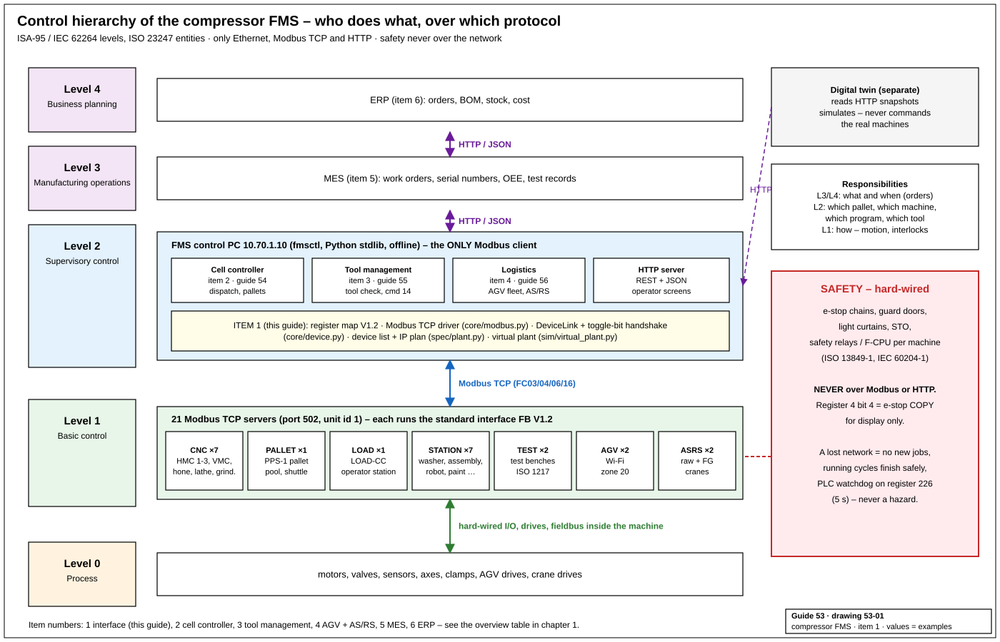
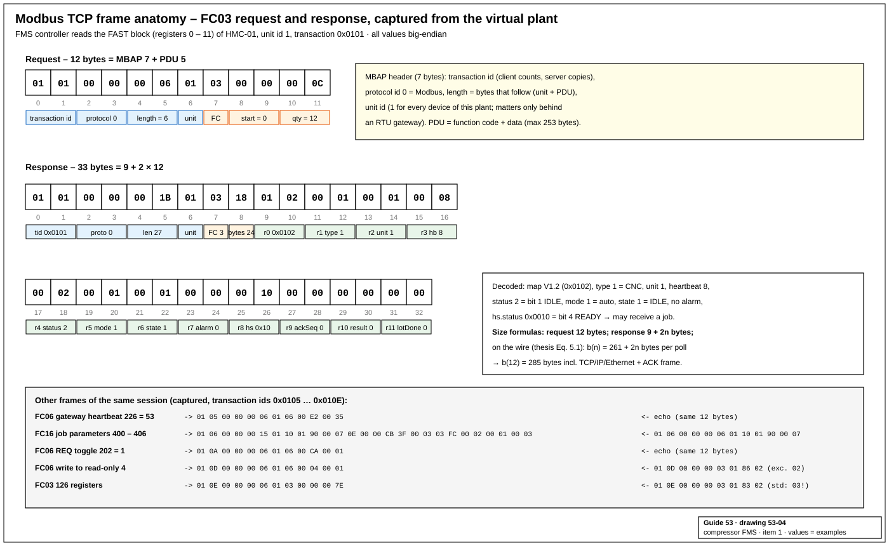
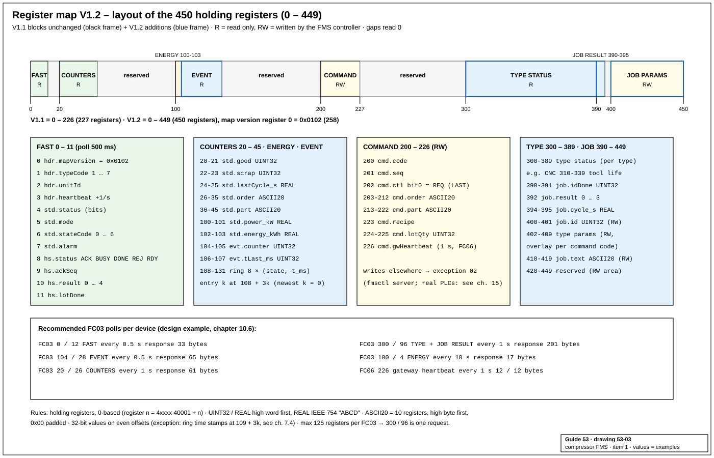
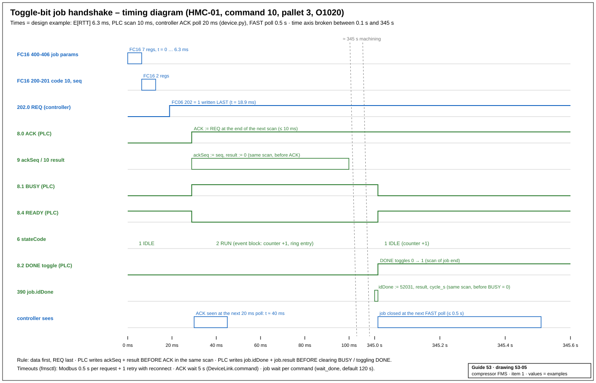
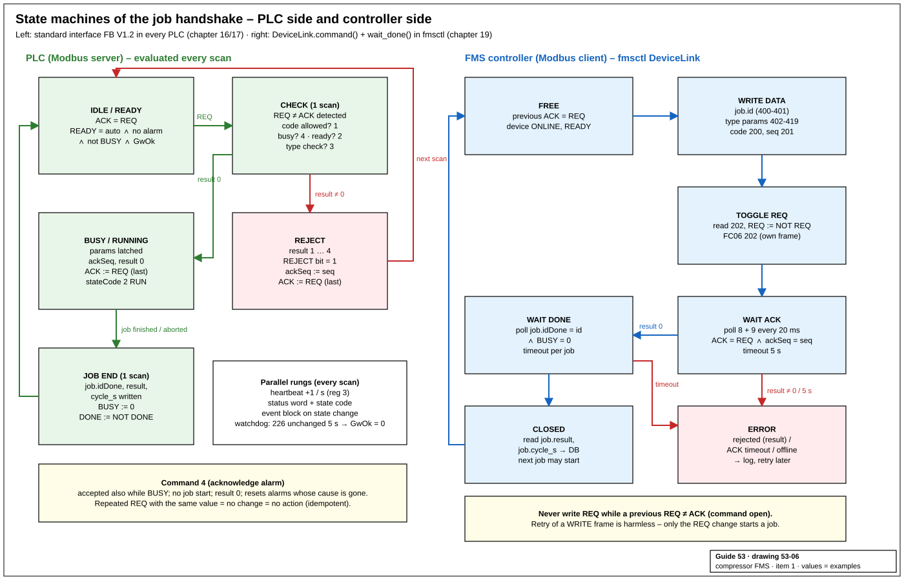
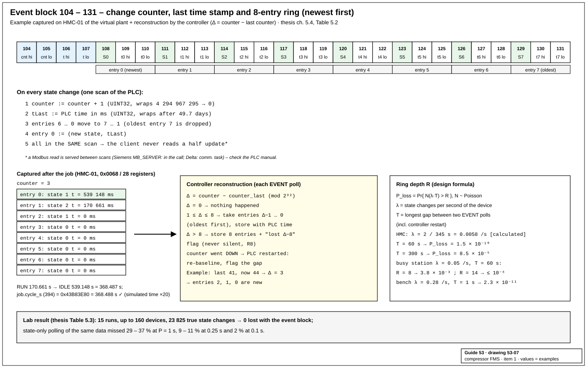
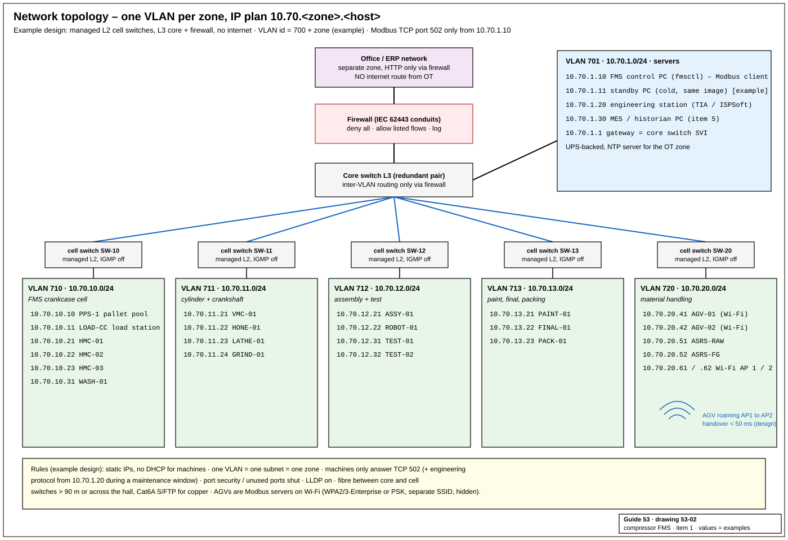
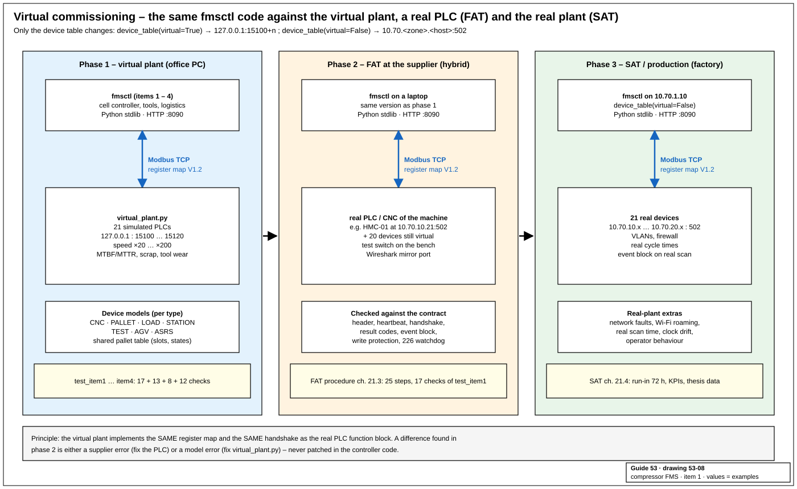

# 53 – FMS control system of the compressor factory, item 1: architecture, interface specification (register map V1.2), job handshake, network, PLC implementation, virtual commissioning

Software package **`fmsctl/`** (real control software, Python standard library, offline PC) · item **1 of 10** ·
contract file `fmsctl/spec/regmap.py` · PLC templates `fmsctl/plc/` · acceptance test `fmsctl/tests/test_item1.py`.

This guide is the **textbook for item 1** of the real FMS for the V-type piston air compressors VC10 / VC20 / VC30
(20 m³/h class). Item 1 is the foundation of everything else: it defines **how the FMS control computer and every
machine PLC talk to each other** – with only Ethernet, Modbus TCP and HTTP. The guide answers these questions:

* Why do we need a real control system next to the digital twin, and who does what (PLC, CNC, cell controller, MES)?
* What exactly travels over the cable – byte by byte – when the controller reads a machine or starts a job?
* How is the register map V1.2 built, why does it look like this, and how does it grow without breaking old machines?
* How can a job be sent **exactly once** over a protocol without events, even when frames are lost or repeated?
* How does the event block make polling **complete** (0 of 23 825 events lost in the lab, thesis ch. 5)?
* How must the network, the VLANs, the Wi-Fi for the AGVs and the firewall look?
* What must the PLC programmer write – complete code for **Siemens S7-1200 / S7-1500** and **Delta AS**?
* How do we test all this **before** the machines arrive (virtual plant), at the supplier (FAT) and in the factory (SAT)?
* What do we write into the purchase order, what do we buy, and what does item 1 give the doctoral thesis?

| What | Result of item 1 (values are examples until the suppliers confirm them) |
|---|---|
| Rule | machines ↔ FMS controller = **Modbus TCP only** (port 502, FC03 / 06 / 16); controller ↔ MES, ERP, screens, twin = **HTTP / JSON only**; **no** OPC UA, MQTT, cloud; **safety hard-wired** |
| Devices | **21 Modbus TCP servers** of **7 device types** (CNC 7, STATION 7, TEST 2, AGV 2, ASRS 2, PALLET 1, LOAD 1), one client: the FMS control PC 10.70.1.10 |
| Network | site block 10.70.0.0/16, **6 VLANs** (servers + 5 zones), IP `10.70.<zone>.<host>`, unit id 1, managed switches, firewall with IEC 62443 zones and conduits, no internet |
| Register map | **V1.2 = V1.1 unchanged + EVENT 104 – 131 + TYPE STATUS 300 – 389 + JOB RESULT 390 – 395 + JOB PARAMETERS 400 – 449**; 450 holding registers; version register 0 = 0x0102 |
| Handshake | toggle bit REQ (202.0) / ACK (8.0), sequence number, result codes 0 – 4, BUSY, DONE toggle, job result block; command codes ≥ 10 for the device-type jobs |
| Event block | change counter + last time stamp + 8-entry ring; lab: **0 of 23 825** state changes lost (state-only polling missed 2 – 37 %) |
| Load | 149.1 requests/s for 21 devices, **47.5 kB/s = 0.38 % of 100 Mbit/s** [calculated]; sequential capacity 22.4 devices at E[RTT] 6.3 ms → poll in parallel per zone |
| PLC code | `fmsctl/plc/siemens_v12_interface.scl` (UDT + DB + FB, MB_SERVER) and `fmsctl/plc/delta_v12_interface.st` (ISPSoft ST, D0 – D449) |
| Tests | virtual plant (21 simulated PLCs) · `test_item1` **17 / 17 passed** (re-run 2026-11-14) · FAT procedure 25 steps · SAT run-in 72 h |

All numbers carry a label: **[example]** chosen value, **[design]** from the factory design / this guide's rules,
**[calculated]** from a formula (checked with Python), **[measured]** on the laboratory bench or the virtual plant.
Check everything with your network designer, the machine makers and the device manuals before you buy or build.

---

## Contents

**Part A – Understand**

1. [Purpose, scope and the 10 items](#1-purpose-scope-and-the-10-items)
2. [Why a separate real control system?](#2-why-a-separate-real-control-system)
3. [Control hierarchy and responsibilities](#3-control-hierarchy-and-responsibilities)
4. [Communication principles – polling, publish / subscribe, one client](#4-communication-principles--polling-publish--subscribe-one-client)
5. [Modbus TCP in depth](#5-modbus-tcp-in-depth)
6. [Data types, word order and number precision](#6-data-types-word-order-and-number-precision)
7. [Register-map design principles](#7-register-map-design-principles)
8. [The job handshake – theory](#8-the-job-handshake--theory)
9. [The event block – theory](#9-the-event-block--theory)
10. [Network design](#10-network-design)
11. [Cyber-security – IEC 62443 zones and conduits](#11-cyber-security--iec-62443-zones-and-conduits)

**Part B – Implement**

12. [Register map V1.2 – common blocks](#12-register-map-v12--common-blocks)
13. [Register map V1.2 – the seven device-type blocks](#13-register-map-v12--the-seven-device-type-blocks)
14. [Commands, parameters and result codes](#14-commands-parameters-and-result-codes)
15. [PLC implementation – common design rules](#15-plc-implementation--common-design-rules)
16. [Siemens S7-1200 / S7-1500 – complete code](#16-siemens-s7-1200--s7-1500--complete-code)
17. [Delta AS – complete code](#17-delta-as--complete-code)
18. [CNC integration through the integrated PLC (PMC)](#18-cnc-integration-through-the-integrated-plc-pmc)
19. [The controller side – fmsctl driver and DeviceLink](#19-the-controller-side--fmsctl-driver-and-devicelink)
20. [The virtual plant](#20-the-virtual-plant)
21. [Test strategy – unit test, virtual commissioning, FAT, SAT](#21-test-strategy--unit-test-virtual-commissioning-fat-sat)
22. [Purchase specification – clauses for machine suppliers](#22-purchase-specification--clauses-for-machine-suppliers)
23. [Commissioning checklist](#23-commissioning-checklist)
24. [FMEA of the interface](#24-fmea-of-the-interface)
25. [Troubleshooting](#25-troubleshooting)
26. [Buy list and shopping list](#26-buy-list-and-shopping-list)
27. [For the doctoral thesis](#27-for-the-doctoral-thesis)
28. [Known gaps and open points in fmsctl](#28-known-gaps-and-open-points-in-fmsctl)
29. [Standards register](#29-standards-register)
30. [Glossary](#30-glossary)
31. [Next to read and files of item 1](#31-next-to-read-and-files-of-item-1)

Drawings: 53-01 control hierarchy · 53-02 network topology · 53-03 register map layout · 53-04 Modbus frame anatomy ·
53-05 handshake timing · 53-06 state machines · 53-07 event ring · 53-08 virtual commissioning.

---

# Part A – Understand

## 1. Purpose, scope and the 10 items

### 1.1 What this guide covers

The digital twin of this project **simulates** the compressor factory. A real factory needs software that **commands**
real machines: it releases jobs, moves pallets, selects NC programs, follows tools, books production and collects data.
That software is `fmsctl`. It is built in 10 items. This guide covers **only item 1** – the interface between the
control computer and the machines, the network under it, the PLC code on the machine side and the virtual plant used to
test it. Items 2 – 4 have their own guides:

| # | Item | Status | Guide |
|---|---|---|---|
| **1** | **Architecture, interface specification (register map V1.2), job handshake, network, PLC implementation, virtual commissioning** | **done – 17 / 17 checks** | **this guide (53)** |
| 2 | FMS cell controller – pallets, fixtures, job release, dispatching, recovery, operator screen | done – 13 / 13 checks | [guide 54](54_fms_cell_controller.md) |
| 3 | Tool management – tool life, sister tools, tool check before a job, presetter data (command 14) | done – 8 / 8 checks | [guide 55](55_tool_management.md) |
| 4 | AGV fleet manager + AS/RS warehouse management | done – 12 / 12 checks | [guide 56](56_agv_asrs_logistics_control.md) |
| 5 | Production MES – orders, serial tracking, test records, OEE, traceability | planned | – |
| 6 | ERP link and planning | planned | – |
| 7 | PLC programs of the machines + hardware-in-the-loop tests | planned (the interface FB of item 1 is its start) | – |
| 8 | Safety concept (ISO 12100, ISO 13849-1) – to be signed by a qualified engineer | planned | – |
| 9 | Commissioning – FAT / SAT, ramp-up data (thesis section 9.6) | planned (FAT / SAT of the interface: chapter 21) | – |
| 10 | Roots blower extension | planned | – |

(File names of guides 54 – 56 as given by the item writers – check the index `docs/00_INDEX.md`.)

### 1.2 What item 1 delivers

| Deliverable | File | Used by |
|---|---|---|
| Register map V1.2 (the contract) | `fmsctl/spec/regmap.py` | every machine supplier, every fmsctl module, the PLC templates |
| Device list + IP plan (21 devices) | `fmsctl/spec/plant.py` | network designer, fmsctl, firewall rules |
| Supplier register lists (CSV, one per type) + device list | `fmsctl/spec/out/*.csv` (`python -m fmsctl.tools.export_spec`) | purchase orders |
| Modbus TCP client + server | `fmsctl/core/modbus.py` | all items; virtual plant |
| Typed access + toggle-bit handshake | `fmsctl/core/device.py` | items 2 – 4 |
| Virtual plant (21 simulated PLCs) | `fmsctl/sim/virtual_plant.py` | virtual commissioning, all tests |
| PLC templates | `fmsctl/plc/siemens_v12_interface.scl`, `fmsctl/plc/delta_v12_interface.st` | machine makers, our PLC programmer |
| Acceptance test | `fmsctl/tests/test_item1.py` | developer, FAT |

### 1.3 Who reads what

| Reader | Read first |
|---|---|
| owner / project engineer | 1 – 4, 10, 11, 21, 22, 26, 27 |
| PLC programmer (ours or the supplier's) | 5 – 9, 12 – 18, 21.3, 23 |
| network / IT | 10, 11, 25, 26 |
| software developer | 5 – 9, 19, 20, 21, 28 |
| thesis supervisor | 4, 9, 10.6, 27 |

---

## 2. Why a separate real control system?

### 2.1 Twin and control are different jobs

| | Digital twin (this project's tabs) | FMS control system (`fmsctl`) |
|---|---|---|
| purpose | predict, explain, plan (what-if) | run the real machines |
| time | faster than real time, many runs | real time, one run |
| failure of the software | a wrong prediction | a stopped factory, scrap, a damaged fixture |
| data direction | reads from the plant (HTTP) | reads **and writes** (Modbus commands) |
| quality level | engineering tool | production software: tested, versioned, restartable |
| state | simulated | the PLCs are the truth; the controller only remembers what the PLCs cannot know |

**Design rule 2.1:** the twin **never** writes to a machine. Only `fmsctl` writes, and only into two defined areas
(registers 200 – 226 and 400 – 449). This is requirement R9 of thesis Table 5.1.

### 2.2 Why not buy a commercial FMS host?

Commercial FMS host software exists (from machine-tool makers and integrators). Reasons to build `fmsctl` here:

1. **Company rule:** only Ethernet, Modbus TCP and HTTP. Many commercial hosts need OPC UA, MTConnect, vendor protocols
   or a cloud licence server.
2. **Mixed suppliers:** HMCs, lathe, grinder, honing machine, test benches, AGVs and cranes come from different makers. One
   register map for all (R10) is cheaper than one adapter per maker.
3. **Offline PCs:** the software must run without internet, on the Python standard library (R6).
4. **Research:** the thesis needs full access to every event, every time stamp and every decision (chapter 27).

If a commercial host is bought later, it must speak the same register map V1.2 – then nothing on the machines changes.

### 2.3 Virtual commissioning – why the virtual plant is part of item 1

The machines arrive one by one over months. The control software must be ready **before** the first machine arrives.
The virtual plant offers exactly the same registers and the same handshake as the real PLCs (chapter 20). The same
`fmsctl` code runs against it, then against one real PLC at the supplier (FAT), then against the real plant (SAT) – only
the device table changes (drawing 53-08). This is called **virtual commissioning** (VDI/VDE 3693 describes the concept –
check the standard for its definitions).

---

## 3. Control hierarchy and responsibilities



### 3.1 Levels (IEC 62264 / ISA-95)

IEC 62264-1 (ISA-95) describes the functional levels of a manufacturing enterprise. We use them to decide **which
computer is responsible for what**:

| Level | Function | In this factory | Time scale | Protocol to the level below |
|---|---|---|---|---|
| 4 | business planning, logistics | ERP (item 6) | days, weeks | HTTP / JSON |
| 3 | manufacturing operations | MES (item 5): work orders, serial numbers, test records, OEE | shifts, hours | HTTP / JSON |
| 2 | supervisory control | **FMS control PC** (`fmsctl`): cell controller, tools, logistics, Modbus driver | seconds, minutes | **Modbus TCP** |
| 1 | basic control | 21 machine PLCs / CNCs, AGV and crane controllers | milliseconds | hard-wired I/O, drives, machine-internal fieldbus |
| 0 | process | motors, valves, sensors, axes | microseconds – ms | physics |

ISO 23247 (digital twin framework for manufacturing) uses a similar split: *observable manufacturing elements* (the
machines), *device communication entity* (our Modbus driver + register map), *digital twin entity* and *user entity*.
Item 1 is the device communication entity of the real system – check ISO 23247-2 / -3 for the exact entity names.

### 3.2 Responsibilities – who decides what

| Decision / function | PLC / CNC (level 1) | FMS controller (level 2) | MES (level 3) |
|---|---|---|---|
| e-stop, guard doors, light curtains, STO | **only hard-wired safety** (relay / F-CPU) | never | never |
| motion, interlocks, clamping, tool change | **yes** | no | no |
| "is this job possible **now**?" (pallet at the changer, program exists, auto mode) | **yes – final check**, result code | first check (plan) | no |
| which pallet goes to which machine, when | no | **yes** | no |
| which NC program for which variant | stores the programs | **selects** (job.programNo) | gives the variant |
| tool life counting | **yes** (CNC tool-life management) | forecasts, blocks jobs (item 3) | no |
| work order, quantity, due date, serial number | no | executes | **yes** |
| counters good / scrap | **counts** (the truth) | copies | books |
| state history (events) | **records** (event block) | reconstructs, stores | analyses (OEE) |

**Design rule 3.2 – "the PLC has the last word".** The controller may ask for anything; the PLC accepts only what is
safe and possible in its current state, and says why it refuses (result codes, chapter 14). A bug in `fmsctl` can stop
production, but it can never move an axis into a fixture.

### 3.3 Safety is hard-wired

* The e-stop circuit, guard locking, light curtains and safe torque off of every machine are wired to its safety relay
  or safety PLC (ISO 13849-1, IEC 60204-1). They do **not** depend on Ethernet.
* Register 4 bit 4 (`std.status` e-stop) is a **copy for display**. The controller never "presses" an e-stop and never
  resets one.
* When the network fails: no new jobs; running cycles finish; the PLC watchdog on register 226 sets READY = 0 after 5 s
  (chapter 8.10). A network failure is a production loss, never a hazard.
* Item 8 (safety concept) covers the risk assessment – not this guide.

### 3.4 Failure philosophy

| Failure | Who notices | Reaction |
|---|---|---|
| controller PC stops | every PLC (226 unchanged 5 s) | READY = 0, running job finishes, DONE toggles, waits |
| PLC program stops, communication still answers | controller (heartbeat register 3 frozen 3 s) | device "stale", no new jobs, alarm |
| device unreachable | controller (time-out + retry) | device OFFLINE, its jobs are not sent, others continue |
| wrong device on an IP | controller (type code / unit id / map version) | device not used, alarm "map / identity" |
| job impossible | PLC (validation) | result code 1 – 4, nothing moves |

---

## 4. Communication principles – polling, publish / subscribe, one client

### 4.1 Two ways to move data

| | Polling (request / response) | Publish / subscribe |
|---|---|---|
| who starts | the client asks, the server answers | the source sends when something changes |
| examples | **Modbus TCP**, HTTP GET | MQTT, OPC UA PubSub, OPC UA subscriptions |
| traffic | constant (also when nothing changes) | only on change |
| short events | can be missed between two polls (unless buffered in the device → event block) | sent when they happen |
| dead device | detected by the time-out of the next poll | needs a keep-alive / last-will mechanism |
| load control | the client decides | the sources decide (bursts possible) |
| infrastructure | none (server in every PLC) | broker or session management, certificates |
| allowed here | **yes** | **no** (company rule) |

### 4.2 Why polling is good enough here – in numbers

The classic objections against polling are bandwidth and lost events. Both are answered with numbers:

* **Bandwidth.** 21 devices with the full poll plan of chapter 10.6 need 47.5 kB/s = **0.38 %** of a 100 Mbit/s link
  [calculated]. The thesis shows 2.1 % for 160 machines (Eq. 5.2). Bandwidth is not a constraint.
* **Lost events.** With the event block (chapter 9) the PLC keeps the history; the controller reads it. In the lab
  campaign 23 825 true state changes were all recovered (thesis Table 5.3) [measured].
* **Latency.** Mean detection latency = P/2 + E[RTT] = 250 + 6.3 = **256 ms** at a 0.5 s poll [calculated] – fine for
  dispatching (decisions every few seconds) and for screens; control loops stay in the PLC.

### 4.3 The "one client" rule

**Design rule 4.3:** the FMS control PC (10.70.1.10) is the **only** Modbus client on the machine network. MES, ERP,
screens and the twin get their data from its HTTP API. Reasons:

1. Low-cost PLCs accept only a few Modbus TCP connections (S7-1200: one `MB_SERVER` instance per connection; Delta AS:
   see the manual). One client = one connection per PLC.
2. Only one program writes commands → no two programs can fight over REQ / ACK.
3. One place for data quality (stale flags, plausibility, event reconstruction).
4. One firewall rule per zone: TCP 502 only from 10.70.1.10 (chapter 11).

Exception: during commissioning a test laptop may read (FC03) on a second connection; it never writes. Remove it after
the SAT.

---

## 5. Modbus TCP in depth



Modbus is a request / response protocol (Modbus Application Protocol Specification V1.1b3). Modbus TCP carries the same
protocol data unit in a TCP connection to port 502 (Modbus Messaging on TCP/IP Implementation Guide V1.0b). TCP already
guarantees order and integrity, so Modbus TCP has **no CRC** (Modbus RTU has one).

### 5.1 Client, server and data model

| Role | In this plant |
|---|---|
| client (old word "master") | FMS control PC 10.70.1.10 – `ModbusClient` in `fmsctl/core/modbus.py` |
| server (old word "slave") | every machine PLC / CNC / AGV / crane; every simulated device of the virtual plant (`ModbusServer`) |

The data model has four tables. We use **holding registers only**:

| Table | Size of one item | Access | Function codes | Used here |
|---|---|---|---|---|
| coils | 1 bit | read / write | 01, 05, 15 | no |
| discrete inputs | 1 bit | read | 02 | no |
| input registers | 16 bit | read | 04 | no (the virtual plant answers FC04 with the holding registers; a real S7 does not – chapter 16.6) |
| **holding registers** | 16 bit | read / write | **03, 06, 16** | **all data, registers 0 – 449** |

### 5.2 The MBAP header

Every Modbus TCP message (ADU = application data unit) = **MBAP header (7 bytes) + PDU** (function code + data,
max 253 bytes) → max ADU **260 bytes**.

| Byte | Field | Size | Rule |
|---|---|---|---|
| 0 – 1 | transaction identifier | 2 | client counts 1, 2, 3 …; server copies it → the client matches the answer to its request |
| 2 – 3 | protocol identifier | 2 | always 0 |
| 4 – 5 | length | 2 | number of bytes that follow = 1 (unit id) + PDU length |
| 6 | unit identifier | 1 | addresses a device **behind** a gateway; for a direct device usually ignored or 1 / 255 – here **1** for every device |
| 7 … | PDU | 1 – 253 | function code + data |

All 16-bit numbers in the frame are **big-endian** (high byte first).

### 5.3 FC03 worked example – read the FAST block of HMC-01

Captured on the virtual plant (2026-11-14, transaction 0x0101) [measured]:

```text
-> 01 01 00 00 00 06 01 03 00 00 00 0C
<- 01 01 00 00 00 1B 01 03 18 01 02 00 01 00 01 00 08 00 02 00 01 00 01 00 00 00 10 00 00 00 00 00 00
```

**Request, 12 bytes:**

| Bytes | Value | Field | Meaning |
|---|---|---|---|
| `01 01` | 257 | transaction id | the controller's counter |
| `00 00` | 0 | protocol id | Modbus |
| `00 06` | 6 | length | unit (1) + FC (1) + start (2) + quantity (2) |
| `01` | 1 | unit id | |
| `03` | 3 | function code | read holding registers |
| `00 00` | 0 | starting address | register 0 (0-based) |
| `00 0C` | 12 | quantity | registers 0 – 11 |

**Response, 33 bytes = 9 + 2 × 12:**

| Bytes | Value | Field | Decoded |
|---|---|---|---|
| `01 01` | 257 | transaction id | copied |
| `00 00` | 0 | protocol id | |
| `00 1B` | 27 | length | 1 + 1 + 1 + 24 |
| `01` | 1 | unit id | |
| `03` | 3 | function code | no exception (bit 7 = 0) |
| `18` | 24 | byte count | 12 registers × 2 |
| `01 02` | 0x0102 | r0 `hdr.mapVersion` | **V1.2** |
| `00 01` | 1 | r1 `hdr.typeCode` | CNC |
| `00 01` | 1 | r2 `hdr.unitId` | 1 |
| `00 08` | 8 | r3 `hdr.heartbeat` | 8 s since start |
| `00 02` | 2 | r4 `std.status` | bit 1 = IDLE |
| `00 01` | 1 | r5 `std.mode` | auto |
| `00 01` | 1 | r6 `std.stateCode` | 1 IDLE |
| `00 00` | 0 | r7 `std.alarm` | none |
| `00 10` | 16 | r8 `hs.status` | bit 4 READY |
| `00 00` | 0 | r9 `hs.ackSeq` | no command yet |
| `00 00` | 0 | r10 `hs.result` | |
| `00 00` | 0 | r11 `hs.lotDone` | |

**Formulas (FC03):** request ADU = 12 bytes; response ADU = **9 + 2n** bytes. For n = 12: 33 bytes; for the maximum
n = 125: 259 bytes [calculated].

### 5.4 FC04, FC06, FC16 and exceptions – the real frames of one job

All frames from the same capture (HMC-01, unit 1) [measured]. Read them like the table above.

| # | Purpose | Request (hex) | Response (hex) | Sizes |
|---|---|---|---|---|
| 1 | FC04 read 0 – 11 | `01 02 00 00 00 06 01 04 00 00 00 0C` | `01 02 00 00 00 1B 01 04 18 01 02 …` (same data as FC03) | 12 / 33 |
| 2 | FC03 read hs 8 – 10 | `01 03 00 00 00 06 01 03 00 08 00 03` | `01 03 00 00 00 09 01 03 06 00 10 00 00 00 00` | 12 / 15 |
| 3 | FC03 read cmd 200 – 202 | `01 04 00 00 00 06 01 03 00 C8 00 03` | `01 04 00 00 00 09 01 03 06 00 00 00 00 00 00` | 12 / 15 |
| 4 | FC06 gateway heartbeat 226 := 53 | `01 05 00 00 00 06 01 06 00 E2 00 35` | echo (identical) | 12 / 12 |
| 5 | FC16 job parameters 400 – 406 | `01 06 00 00 00 15 01 10 01 90 00 07 0E 00 00 CB 3F 00 03 03 FC 00 02 00 01 00 03` | `01 06 00 00 00 06 01 10 01 90 00 07` | 27 / 12 |
| 6 | FC03 read ackSeq 9 | `01 07 00 00 00 06 01 03 00 09 00 01` | `01 07 00 00 00 05 01 03 02 00 00` | 12 / 11 |
| 7 | FC16 code 10, seq 1 → 200 – 201 | `01 08 00 00 00 0B 01 10 00 C8 00 02 04 00 0A 00 01` | `01 08 00 00 00 06 01 10 00 C8 00 02` | 17 / 12 |
| 8 | FC03 read ctl 202 | `01 09 00 00 00 06 01 03 00 CA 00 01` | `01 09 00 00 00 05 01 03 02 00 00` | 12 / 11 |
| 9 | FC06 REQ := 1 (202) | `01 0A 00 00 00 06 01 06 00 CA 00 01` | echo | 12 / 12 |
| 10 | FC03 poll 8 – 11 | `01 0B 00 00 00 06 01 03 00 08 00 04` | `01 0B 00 00 00 0B 01 03 08 00 03 00 01 00 00 00 00` | 12 / 17 |
| 11 | FC06 to read-only register 4 | `01 0D 00 00 00 06 01 06 00 04 00 01` | `01 0D 00 00 00 03 01 86 02` | 12 / 9 |
| 12 | FC03 with 126 registers | `01 0E 00 00 00 06 01 03 00 00 00 7E` | `01 0E 00 00 00 03 01 83 02` | 12 / 9 |
| 13 | FC03 440 – 459 (beyond 449) | `01 0F 00 00 00 06 01 03 01 B8 00 14` | `01 0F 00 00 00 03 01 83 02` | 12 / 9 |
| 14 | FC01 (not supported) | `01 10 00 00 00 06 01 01 00 00 00 08` | `01 10 00 00 00 03 01 81 01` | 12 / 9 |

**Decoding frame 5 (FC16, 27 bytes):** `00 15` length 21 = unit + FC + start (2) + quantity (2) + byte count (1) + 14
data bytes; `10` = FC16; `01 90` start 400; `00 07` 7 registers; `0E` 14 bytes; then `00 00 CB 3F` = job.id 52031
(UINT32, high word first), `00 03` pallet 3, `03 FC` program 1020, `00 02` variant VC20, `00 01` quantity 1, `00 03`
fixture 3. FC16 request ADU = **13 + 2n** bytes (n = 7 → 27); response always 12 bytes.

**Decoding frame 10:** `00 03` = hs.status bit 0 ACK + bit 1 BUSY; `00 01` ackSeq 1; `00 00` result OK; `00 00` lotDone 0
→ the job is accepted and running. The time from frame 9 to the answer of frame 10 was 0.25 ms on the loopback
interface [measured – not realistic for a real PLC, see chapter 8.8].

### 5.5 Exception codes

An exception answer has the function code with bit 7 set (FC + 0x80) and one exception byte; it is always **9 bytes**.

| Code | Name (V1.1b3) | Typical cause in this plant | Controller reaction |
|---|---|---|---|
| 01 | ILLEGAL FUNCTION | FC not supported (frame 14) | configuration error – fix the client, no retry |
| 02 | ILLEGAL DATA ADDRESS | start + quantity outside 0 – 449; write outside 200 – 226 / 400 – 449 (virtual plant); 0-/1-based mistake; old map version (V1.1 device asked for 300 +) | log "exception 02", no retry; check the map version |
| 03 | ILLEGAL DATA VALUE | quantity 0 or > 125 (FC03) / > 123 (FC16); byte count ≠ 2 × quantity | log, no retry – fix the client |
| 04 | SERVER DEVICE FAILURE | the server could not complete the request (internal error) | keep last values, mark stale, retry later |
| 06 | SERVER DEVICE BUSY | long operation | retry later |
| 0A / 0B | GATEWAY PATH UNAVAILABLE / TARGET FAILED TO RESPOND | only behind a Modbus RTU → TCP gateway (MGate): wrong unit id, serial device silent | check the unit id and the serial line |

**No answer at all is not an exception** – it is a time-out (cable, device off, wrong IP, firewall). See 5.9.

### 5.6 Exception 02 or 03? – what the standard says and what our devices do

The application protocol specification describes for FC03 a fixed check order: function code supported (else 01) →
quantity 1 … 125 (else **03**) → start address and start + quantity within the device (else **02**) → execution (else 04).
Check the state diagrams of the standard for every function code.

| Case | Standard | `fmsctl` ModbusServer (virtual plant) | Siemens MB_SERVER / Delta AS |
|---|---|---|---|
| FC03 quantity 126 | 03 | **02** (frame 12) – deviation, see chapter 28 | see the manual (normally 03) |
| FC03 start 440, 20 registers (beyond 449) | 02 | 02 | depends on the size of the mapped area |
| FC06 to register 4 (read-only by our map) | the standard knows no read-only registers; a device may answer 02 | 02 | **accepted** – MB_SERVER and the Delta server cannot protect single ranges (chapter 15.4) |

**Design rule 5.6:** the controller must treat 02 and 03 alike (configuration error, no retry). The FAT accepts both for
the quantity test, and accepts "write ignored and overwritten within one scan" instead of exception 02 for writes into
read-only ranges (chapter 21.3, step 19).

### 5.7 Unit identifier

* Direct Modbus TCP devices ignore the unit id or expect a fixed value. In this plant: **unit id 1 for all 21 devices**
  (`plant.device_table()`), so a PLC configured for 1 or "any" works.
* Identity check is therefore done with the **IP address + `hdr.typeCode` + `hdr.unitId` + map version** (registers 0 – 2).
* Behind a Modbus RTU → TCP gateway (old machine with RS-485) the unit id selects the serial device (1 … 247); the
  gateway answers 0B when the serial device is silent.
* Note: the ball screw factory (guide 43) uses unit ids 1 … 73, one per machine. Both conventions are valid; do not mix
  them inside one plant.

### 5.8 TCP connection management

| Rule | Value / reason |
|---|---|
| one long-lived TCP connection per device | `ModbusClient` keeps the socket; connecting costs a 3-way handshake (≈ 3 × t_net) |
| `TCP_NODELAY` on both sides | without it, Nagle's algorithm can delay small frames by tens of ms (`modbus.py` sets it) |
| one request at a time per connection | simple clients and most PLCs do not pipeline; `ModbusClient` holds a lock per device |
| after a time-out: **close and reconnect** | a late answer can then never be taken as the answer of the next request |
| idle connections | many PLCs close a connection after 60 – 120 s without traffic (check the manual); our polling keeps it busy |
| connection limits | S7-1200 / S7-1500: one `MB_SERVER` instance per client connection; total connection resources per CPU – see the data sheet; Delta AS: see the manual |

### 5.9 Time-outs, retries, back-off

`ModbusClient` defaults: **time-out 0.5 s**, **2 attempts** (1 retry) for connection errors, **no retry** for an
exception answer [design – `fmsctl/core/modbus.py`]. The cell controller uses 0.3 s (`DeviceLink(timeout=0.3)`).

| Formula | Example |
|---|---|
| worst-case time to declare a device lost = P + (1 + retries) × t_out + RTT | 0.5 + 2 × 0.5 + 0.0063 = **1.51 s** [calculated] |
| cost of one dead device per poll (sequential worker) = (1 + retries) × t_out | 1.0 s – longer than the poll period! |
| with back-off (dead device polled only every 5 s) | 1.0 s / 5 s = 0.2 s per second of worker time |

**Design rule 5.9:** time-out = 10 – 50 × the normal device RTT (here 6 – 16 ms → 0.3 – 0.5 s); after 3 failures poll
the device only every 5 s until it answers again; poll each zone (or each device) in its **own thread**, so one dead
device never slows the others (chapter 10.6).

### 5.10 Transaction identifiers

* `ModbusClient` increments a 16-bit transaction id per request (wraps 65 535 → 0) and checks it in the answer; a
  mismatch closes the connection and the request is repeated once.
* Why it matters: after a time-out a late answer may still arrive. Without the id check (and without the reconnect of
  5.8) the client would decode the answer of request k as the answer of request k + 1 – e.g. read a FAST block as the
  event block. Both protections together make this impossible.

### 5.11 Limits

| Limit | Value | Origin |
|---|---|---|
| registers per FC03 / FC04 | **125** | 125 × 2 + 2 = 252 ≤ 253 PDU bytes |
| registers per FC16 | **123** | 123 × 2 + 6 = 252 bytes |
| max ADU | 260 bytes | 7 + 253 |
| our largest read | **96** (300 – 395: type status + job result) | one request per block |
| our largest write | 10 (job.text) or 7 (CNC job parameters) | – |

`ModbusClient.read()` splits longer reads into 125-register requests automatically.

### 5.12 Addressing – 0-based offsets and "4xxxx"

The frame carries the 0-based offset. Many manuals and tools show 1-based "4xxxx" numbers. **1-based = 40001 + offset**
(5-digit style) or 400001 + offset (6-digit style).

| Offset (this guide) | Frame | 1-based tool | Delta AS device (check manual) | Siemens DB byte |
|---|---|---|---|---|
| 0 | `00 00` | 40001 | D0 | DBW0 |
| 202 | `00 CA` | 40203 | D202 | DBW404 |
| 226 | `00 E2` | 40227 | D226 | DBW452 |
| 400 | `01 90` | 40401 | D400 | DBW800 |
| 449 | `01 C1` | 40450 | D449 | DBW898 |

Test rule: read offset 0 – it must be 258 (0x0102). If you get 1 (the type code), your tool is shifted by one.

---
## 6. Data types, word order and number precision

A register has 16 bits. Everything bigger needs several registers, and the Modbus standard does **not** say in which
order. The map fixes it (same rules as V1.1, guide 43 §7).

| Type | Registers | Range | Rule |
|---|---|---|---|
| UINT16 | 1 | 0 … 65 535 | |
| INT16 | 1 | −32 768 … 32 767 | two's complement: −125 → `0xFF83` |
| UINT32 | 2 | 0 … 4 294 967 295 | **high word first** (lower address) |
| REAL | 2 | IEEE 754 single | bytes **A B C D** big-endian: register n = A B, n + 1 = C D |
| ASCII20 | 10 | 20 characters | 2 characters per register, **first character in the high byte**, padded with 0x00 |

### 6.1 UINT32 – worked examples

value = high × 65 536 + low.

| Value | Register n | Register n + 1 | Check |
|---|---|---|---|
| job.id 52 031 | `0x0000` | `0xCB3F` | 0 × 65 536 + 52 031 ✓ (frame 5 of chapter 5.4) |
| 100 000 | `0x0001` | `0x86A0` | 65 536 + 34 464 ✓ |
| 4 000 000 123 | `0xEE6B` | `0x287B` | 61 035 × 65 536 + 10 363 ✓ |

Overflow check for the part counter: 4.29 × 10⁹ parts at 30 crankcases per hour = 16 343 years [calculated] – no
overflow in practice. The **ms clock** of the event block, however, wraps after 2³² ms = **49.7 days** [calculated]: the
controller must always compute time **differences modulo 2³²** (chapter 9.6).

### 6.2 REAL – worked example 345.0 s (design cycle time of the VC20 crankcase on an HMC)

**Encoding by hand:**

1. 345 = 1.34765625 × 2⁸ → sign 0, exponent 8 + 127 = 135 = `1000 0111`.
2. Mantissa (fraction) 0.34765625 × 2²³ = 2 916 352 = `010 1100 1000 0000 0000 0000`.
3. Bits: `0 10000111 01011001000000000000000` = `0100 0011 1010 1100 1000 0000 0000 0000` = **0x43AC8000**.
4. Bytes A B C D = `43 AC 80 00` → register n = **0x43AC** (17 324), register n + 1 = **0x8000** (32 768).

**Decoding back:** 0x43AC8000 → sign 0, exponent 0x87 = 135 → 2⁸, mantissa 1 + 2 916 352 / 8 388 608 = 1.34765625 →
1.34765625 × 256 = **345.0** exactly ✓. (Checked with `regmap.enc('REAL', 345.0)` → `43AC 8000` [calculated].)

345.0 is exactly representable. Most decimal values are not: 341.2 → `0x43AA 0x999A` → read back 341.20001220703125.
**Rule:** round displayed REAL values to 4 – 6 significant digits; never compare REALs for equality.

Captured example: `job.cycle_s` (registers 394 – 395) read `43 B8 3E 80` = 368.488 s (chapter 9.7) [measured].

### 6.3 The four word orders – how to recognise an error

| Order | Register n | n + 1 | Value read as ABCD | Typical source (check the device!) |
|---|---|---|---|---|
| **ABCD (this map)** | `0x43AC` | `0x8000` | **345.0** | Siemens S7 (big-endian memory), many meters |
| CDAB (word swap) | `0x8000` | `0x43AC` | −2.43 × 10⁻⁴¹ | Delta / Mitsubishi memory order (low word first) |
| BADC (byte swap) | `0xAC43` | `0x0080` | nonsense | rare |
| DCBA | `0x0080` | `0xAC43` | nonsense | some PC software |

A word-order error gives **stable nonsense** (frames OK, device "online", only numbers wrong). Test value for the
commissioning: a REAL register that reads 345.0 must show `43 AC 80 00` in Wireshark.

### 6.4 ASCII20 – worked example "VC20-000123"

| Register | 410 | 411 | 412 | 413 | 414 | 415 | 416 – 419 |
|---|---|---|---|---|---|---|---|
| characters | V C | 2 0 | - 0 | 0 0 | 1 2 | 3 ␀ | ␀ ␀ |
| value | `0x5643` | `0x3230` | `0x2D30` | `0x3030` | `0x3132` | `0x3300` | `0x0000` |

Only ASCII 0x20 – 0x7E is allowed (no "°", no local letters). The decoder stops at the first 0x00. On Siemens use
`Array[0..19] of Char`, **not** `String` (a String has two header bytes that shift every character).

### 6.5 Status words and bit numbering

Bit 0 = value 1 (least significant), bit 15 = value 32 768. `std.status` (register 4): bit 0 run (1), 1 idle (2),
2 set-up (4), 3 alarm (8), 4 e-stop copy (16), 5 blocked (32), 6 starved (64), 7 no shift (128). Worked values: idle 2,
run 1, alarm 8, alarm with e-stop 24. **Careful:** RUN is status bit value 1 but state code 2.

`hs.status` (register 8): bit 0 ACK (1), 1 BUSY (2), 2 DONE (4), 3 REJECT (8), 4 READY (16). Captured values: 0x0010
idle and ready; 0x0003 ACK + BUSY (job running); 0x0015 = ACK + DONE + READY (job finished, ready again) [measured].

Siemens trap: in the word DBW8 the **low** byte is DBB9, so bit 0 = DBX9.0 and DBX8.0 = bit 8. Use slice access
(`.%X0`) as in the SCL code (chapter 16).

### 6.6 Number precision of accumulators – why the energy counter needs care

A REAL has 24 significant bits (≈ 7 decimal digits). Adding a small number to a large REAL loses the small number.

**Worked example (energy kWh, power 4 kW, PLC scan 10 ms):** increment per scan = 4 kW × 0.01 s / 3600 =
1.11 × 10⁻⁵ kWh. The spacing of REAL numbers (ULP) at 256 kWh is 2⁸⁻²³ = 3.05 × 10⁻⁵ kWh; an addition smaller than half
the ULP is rounded away. **A REAL kWh counter incremented every scan stops counting at 256 kWh** [calculated – checked
with Python]. Incremented once per second at 10 000 kWh (ULP 9.77 × 10⁻⁴), one hour at 4 kW adds 3.52 kWh instead of
4.00 kWh – **−12 %** [calculated].

**Design rule 6.6:** accumulate in LREAL (Siemens) or in an integer number of Wh plus a small REAL fraction (Delta);
convert to REAL kWh only when writing register 102 – 103. Both templates do this (chapters 16, 17).

### 6.7 Counters that wrap

| Counter | Type | Wraps after | Correct comparison |
|---|---|---|---|
| `hdr.heartbeat` (3), `cmd.gwHeartbeat` (226) | UINT16, +1 / s | 65 536 s = 18.2 h | "changed?" – never "greater than?" |
| `cmd.seq` (201), `hs.ackSeq` (9) | UINT16 | 65 536 commands | equality |
| `evt.counter` (104) | UINT32 | 4.29 × 10⁹ events | difference mod 2³² |
| `evt.tLast_ms`, ring times | UINT32 ms | 49.7 days | difference mod 2³² |

---

## 7. Register-map design principles



### 7.1 The register map is a contract

The register map is the **interface drawing** between us and every machine maker. Like a mechanical interface drawing
it has a version, an owner (the FMS project), a change procedure and an acceptance test. The single source of truth is
`fmsctl/spec/regmap.py`; the CSV files for suppliers are generated from it (`python -m fmsctl.tools.export_spec`), so
the code and the documents can never differ.

### 7.2 Blocks by update rate

The map is designed **for polling**: each block is one FC03 request with its own period.

| Block | Registers | Content | Period [design] | Why this period |
|---|---|---|---|---|
| FAST | 0 – 11 | header, state, alarm, handshake | 0.5 s (0.02 s while waiting for an ACK) | screens, dispatching; handshake answer |
| COUNTERS | 20 – 45 | good, scrap, last cycle, order, part | 1 s | counters change once per cycle (≥ 60 s) |
| ENERGY | 100 – 103 | power, energy | 10 s | slow, for reports |
| EVENT | 104 – 131 | change counter, last time, ring | 0.5 s | loss probability (chapter 9.4) |
| TYPE + JOB RESULT | 300 – 395 | device-type status + finished job | 1 s | pallet locations, tool life, job end |
| COMMAND | 200 – 226 | written on demand; 226 every 1 s | – | – |
| JOB PARAMETERS | 400 – 449 | written before each command ≥ 10 | – | – |

Why not one big read of everything? A read of 0 – 131 would be 132 registers > 125 (not allowed), and reading slowly
changing data every 0.5 s costs PLC communication time for nothing. Why not many small reads? Each request costs a full
round trip (6 – 16 ms on a real PLC); fewer, larger requests are cheaper (the response grows only 2 bytes per register).

### 7.3 Alignment – 32-bit values on even offsets

**Rule (V1.1):** every UINT32 / REAL starts at an even offset. Reason: some PLCs map 32-bit variables only on even word
addresses (%MD-style double words), and a 32-bit value at an odd offset would then need two 16-bit moves. Examples:
`std.good` 20, `std.lastCycle_s` 24, `std.power_kW` 100, `evt.counter` 104, `job.idDone` 390, `job.cycle_s` 394
(393 is a reserved filler so that 394 is even), `job.id` 400.

### 7.4 The one exception – time stamps in the event ring

The ring has 8 entries of 3 registers (state, time high, time low) at 108 + 3k. The time stamps therefore start at
109, 112, 115, … – **odd for k = 0, 2, 4, 6**. This follows the thesis design (Table 5.2: 28 registers, 104 – 131) and is
accepted because:

* Siemens S7: a UDInt in a non-optimized DB needs only an **even byte** address; register 109 = byte 218 → fine.
* Delta AS: the template writes the two words separately anyway (Delta memory is low word first, chapter 17).
* An entry of 4 registers would need 4 + 32 = 36 registers (104 – 139) – a change for a later map version, not now.

The exception is written in the register list (CSV) so that no supplier is surprised.

### 7.5 Reserved space and growth

| Range | Status in V1.2 | Possible use in V1.3+ |
|---|---|---|
| 12 – 19 | reserved | PLC time "now" (12 – 13) for clock offset – proposal, chapter 28 |
| 46 – 99 | reserved | process values per type (as in the ball screw map) |
| 132 – 199 | reserved | longer event ring, alarm history |
| 227 – 299 | reserved (writable range ends at 226) | time-set registers – proposal |
| 346 – 389 (CNC), other free parts of 300 – 389 | reserved per type | more type data |
| 396 – 399, 420 – 449 | reserved | more job data |

**Rule:** reserved registers read 0. A new field is added only in reserved space, never by moving a field.

### 7.6 Write protection

**Rule:** the controller writes only 200 – 226 and 400 – 449 (`regmap.WRITABLE`). The virtual plant answers any other
write with exception 02 (frame 11 of chapter 5.4). Real PLC Modbus servers usually cannot protect ranges (chapter 15.4);
there the protection is (1) the PLC program rewrites every read-only register in every scan, (2) only the controller can
reach port 502 (firewall), (3) the controller code never writes elsewhere (`regmap.writable()`).

### 7.7 Overlays – parameters that depend on the command code

The 8 registers 402 – 409 mean different things for different commands of the same device type. Example CNC:

| Register | Command 10 "run job" | Command 14 "tool data" |
|---|---|---|
| 402 | `job.palletId` | `tool.pocket` |
| 403 | `job.programNo` | – (part of nothing) |
| 404 | `job.variant` | `tool.length_mm` (REAL, high word) |
| 405 | `job.qty` | `tool.length_mm` (low word) |
| 406 | `job.fixtureId` | `tool.radius_mm` (high word) |
| 407 | – | `tool.radius_mm` (low word) |
| 408 | – | `tool.lifeSet` |

The PLC interprets 402 – 409 **according to `cmd.code`** at the moment REQ changes and latches them. This saves address
space and keeps one write (FC16 400 – 409) per command. The CSV export lists both meanings at the same address – the
supplier must implement both (chapter 13.1).

### 7.8 Versioning – why V1.2 does not break V1.1

| Rule | V1.1 → V1.2 |
|---|---|
| version in register 0, major byte = incompatible, minor byte = additions | 0x0101 → **0x0102** (minor change) |
| no existing field moved or redefined | FAST, COUNTERS, ENERGY, COMMAND, 226 unchanged ✓ |
| additions only in reserved space | EVENT in 104 – 131, TYPE / JOB in 300 – 449 (beyond the V1.1 end 226) ✓ |
| old clients keep working | a V1.1 gateway (guide 43) reads 0 – 226 of a V1.2 device unchanged ✓ |
| new clients see old devices | a V1.1 device answers a read of 104 or ≥ 227 with exception 02 → `fmsctl` must check register 0 at connect and not use V1.2 functions on 0x0101 devices |

**Version history**

| Version | Register 0 | Registers | Change | Source |
|---|---|---|---|---|
| V1.0 | 0x0100 | 0 – 225 | first release | guide 43 §8.5 |
| V1.1 | 0x0101 | 0 – 226 | + 226 gateway heartbeat | guide 43 §8.5, guide 47 §6.2 |
| **V1.2** | **0x0102** | **0 – 449** | + EVENT 104 – 131, TYPE 300 – 389, JOB RESULT 390 – 395, JOB PARAMETERS 400 – 449, command codes ≥ 10 | `fmsctl/spec/regmap.py`, thesis Table 5.2 |

### 7.9 Type codes

`hdr.typeCode` (register 1): **1 CNC, 2 PALLET, 3 LOAD, 4 STATION, 5 TEST, 6 AGV, 7 ASRS** (`regmap.TYPE_CODES`).
The controller compares it with the type in `plant.DEVICES` at connect: a wrong value means a wrong IP, a wrong cable or
a wrong PLC program – the device must not be used.

---

## 8. The job handshake – theory



### 8.1 The problem

Modbus has no "message" concept: the controller can only **write registers**. A command consists of several registers
(job id, parameters, code). Three dangers:

1. **Torn data:** the PLC reads the registers in the middle of the update – half old, half new.
2. **Duplication:** a write is repeated (retry after a time-out, controller restart) → the job is started twice.
3. **Loss:** a short "start" pulse is overwritten before the PLC scan sees it.

### 8.2 Level signal versus toggle signal

| Method | How "new command" is signalled | Weakness |
|---|---|---|
| level bit ("START = 1", PLC resets it) | value 1 | both sides write the same bit → race; a retry after the PLC reset starts again |
| pulse | 1 then 0 | lost if shorter than the PLC scan / poll |
| command code ≠ 0, PLC sets it to 0 | value | same race as the level bit |
| **toggle bit** | the bit **changes** (REQ ≠ ACK) | none of the above – each side writes only its own bit |

**Toggle principle:** the controller owns REQ (202 bit 0), the PLC owns ACK (8 bit 0). "A new command exists" ⇔
REQ ≠ ACK. The PLC handles it once and makes ACK = REQ. Writing the same REQ value again changes nothing.

### 8.3 Idempotence

An operation is **idempotent** if doing it twice has the same effect as doing it once. With the toggle bit:

* writing the parameters twice → same values, no effect;
* writing REQ = 1 twice → still REQ = 1 = ACK after the first handling → no second job;
* only a **change** of REQ starts a job, and only the controller changes REQ, after it has seen ACK = REQ.

### 8.4 Sequence numbers

`cmd.seq` (201) is incremented per command and copied by the PLC to `hs.ackSeq` (9). The controller accepts an ACK only
if **ACK = REQ and ackSeq = seq**. Why both? After a controller restart REQ may by chance equal the old ACK; the
sequence number proves that the answer belongs to **this** command. `DeviceLink.command()` uses seq = ackSeq + 1 (mod
65 536). `job.id` (400 – 401) identifies the job end-to-end (job result block 390).

### 8.5 Case analysis – lost and duplicated frames

Sequence (optimised, chapter 19.3): (a) FC16 400 – 409 parameters, (b) FC16 200 – 201 code + seq, (c) FC06 202 REQ
toggle, (d) poll 8 – 9 until ACK = REQ and ackSeq = seq, (e) wait for job end.

| # | Fault | What happens | Result |
|---|---|---|---|
| 1 | request (a) lost (time-out) | client reconnects, repeats (a) | correct – parameters written once more, no job yet |
| 2 | response of (a) lost | client repeats (a); the PLC already has the values | correct – same values (idempotent) |
| 3 | request (c) lost | REQ unchanged, no job; client repeats (c) after reconnect | correct |
| 4 | response of (c) lost, PLC already accepted | client repeats FC06 202 with the **same** REQ value | correct – no change → no second job ✓ |
| 5 | PLC rejects (result ≠ 0) | ACK = REQ, REJECT = 1, result = reason | controller logs, may retry later with a **new** toggle |
| 6 | PLC stopped (program in STOP) | no ACK within 5 s | controller error "no ACK", device stale (heartbeat frozen) |
| 7 | controller crashes after (c) | PLC accepts and runs the job; controller restarts, reads REQ = ACK, `job.id` and `job.idDone` | the job is not lost: the controller finds it in its database as "sent" and closes it when `job.idDone` = id |
| 8 | controller crashes between (a) and (c) | parameters written, no REQ change | nothing happens; on restart new parameters overwrite them |
| 9 | two controllers (forbidden) | both toggle REQ | undefined – prevented by the one-client rule + firewall |
| 10 | PLC power cycle during a job | job aborted; after restart ACK mirrors REQ (no re-execution) | controller sees no `job.idDone` = id → time-out → operator decides |

**Design rule 8.5:** the PLC must answer **ackSeq and result before ACK** in the same scan, and the controller must
toggle REQ **only after** writing all data and **only if** the previous command is closed (REQ = ACK).

### 8.6 Race conditions and how the order of writes prevents them

* **Data before REQ.** If REQ were in the same FC16 as the parameters, a PLC that processes one write over several scans
  (or a Delta server serving between scans) could see the new REQ before the new parameters. Therefore REQ is written
  in its **own** FC06, after the parameters (guide 43 §8.4, guide 47 §5).
* **Result before ACK.** The PLC writes `hs.ackSeq` and `hs.result` before `ACK := REQ` in the same scan; a Modbus read
  between scans then sees either the old state (ACK ≠ REQ) or the complete new state.
* **Job result before BUSY = 0.** At job end the PLC writes `job.idDone`, `job.result`, `job.cycle_s` before it clears
  BUSY and toggles DONE – the controller's test "idDone = id ∧ BUSY = 0" can never see a half-finished job.
* **Latching.** At acceptance the PLC copies 400 – 419 into internal memory. The controller may later overwrite 400 – 419
  (e.g. a rejected attempt while busy, test_item1 check 8) without changing the running job.

### 8.7 Time-outs on the controller side

| Wait | fmsctl value [design] | Basis |
|---|---|---|
| Modbus request | 0.5 s (cell controller 0.3 s), 1 retry with reconnect | 10 – 50 × RTT |
| ACK after REQ | **5 s** (`DeviceLink.command(timeout=5.0)`) | ACK normally < 1 scan + 1 poll ≈ 40 ms; 5 s covers a PLC under load or a long scan |
| job end | per command (`wait_done(timeout=120)` default; the cell controller uses its own supervision) | cycle time × qty + margin |

### 8.8 Timing with real numbers

Example HMC-01, command 10, E[RTT] = 6.3 ms, scan 10 ms, ACK poll every 20 ms [design]:

| Event | t [ms] | Rule |
|---|---|---|
| FC16 400 – 409 parameters sent | 0 | |
| answer | 6.3 | one RTT |
| FC16 200 – 201 code + seq answered | 12.6 | |
| FC06 202 REQ toggled, answered | 18.9 | |
| PLC sees REQ ≠ ACK (write is applied at the end of a scan, handled in the next) | ≤ 28.9 | ≤ 1 scan |
| controller poll sees ACK = REQ ∧ ackSeq = seq | ≈ 40 | next 20 ms poll + RTT |
| job runs | 345 000 | design cycle VC20 [design] |
| PLC writes job result, BUSY = 0, DONE toggles | 345 010 | 1 scan |
| controller closes the job | ≤ 345 510 | next FAST / result poll (0.5 s) |

With the current `DeviceLink.command()` (11 separate frames before the poll) the write phase takes 11 × 6.3 = 69 ms
instead of 18.9 ms [calculated] – acceptable, but see chapter 28 (gap G6).

### 8.9 Job completion – two independent signals

1. **DONE toggle** (8 bit 2): changes at every job end. A lost poll never loses it – the controller compares the bit
   with the value it stored.
2. **Job result block** (390 – 395): `job.idDone` = the id of the last finished job, `job.result` 0 OK / 1 NOK /
   2 aborted / 3 rejected (reserved), `job.cycle_s`. `fmsctl` uses `idDone = id ∧ BUSY = 0` (`DeviceLink.wait_done`,
   cell controller `close_jobs`).

Using the job id is stronger than the toggle alone: after a controller restart the toggle history is unknown, but the
id comparison still works.

### 8.10 Restart behaviour and the gateway watchdog

| Restart | Required behaviour |
|---|---|
| PLC restart | first scan: ACK := REQ (mirror, **do not execute** an old command), BUSY = 0, event counter restarts at 1 |
| controller restart | read REQ, ACK, `job.idDone` of every device; close jobs found finished; never toggle while REQ ≠ ACK |
| controller lost | PLC: register 226 unchanged for **5 s** → GwOk = 0 → READY = 0; running job finishes; DONE toggles; result kept in 390 – 395 until the controller is back |

Watchdog timing: the controller writes 226 every 1 s, so the PLC tolerates 4 missed writes [design]; trip time =
5 s + 1 scan ≈ 5.01 s (guide 47 §6.2 measured 5.02 s with a 20 ms scan).



---

## 9. The event block – theory



### 9.1 The problem of polling states

A client that reads `std.stateCode` every P seconds sees **samples**. A state shorter than P can fall between two polls;
A → B → A inside one interval looks like "no change"; and every change time is known only to within P. For the Bayesian
updating of the thesis (Eq. 4.5, 4.7) lost short stops bias the failure counts and the uptime, and sampled time stamps
distort the repair times (thesis ch. 5.4.1).

### 9.2 Design (thesis Table 5.2)

The PLC sees every change in its scan. So the PLC keeps the history and the controller reads it:

| Register | Name | Type | Content |
|---|---|---|---|
| 104 – 105 | `evt.counter` | UINT32 | number of state changes since power-on |
| 106 – 107 | `evt.tLast_ms` | UINT32 | PLC time (ms since start) of the last change |
| 108 + 3k | `evt.ring<k>` | UINT16 | state code of entry k (k = 0 newest … 7 oldest) |
| 109 + 3k – 110 + 3k | (time of entry k) | UINT32 | PLC time in ms |

On every change, in **one** scan: counter + 1, tLast := now, entries 6 … 0 move to 7 … 1, entry 0 := (state, now).
About ten lines of code (chapters 16, 17).

### 9.3 Reconstruction algorithm (controller)

```text
every EVENT poll (FC03 104 / 28):
    c = counter (UINT32);  if first poll: c_last = c; continue
    d = (c - c_last) mod 2^32
    if d == 0:              nothing new
    elif c < c_last and d > 1e6:   PLC restarted (counter went down) -> re-baseline, flag "gap"
    elif d <= 8:            new events = entries d-1 ... 0 (oldest first), each (state, t_ms)
    else:                   new events = entries 7 ... 0, plus "lost d-8 events" flag (never silent, R8)
    c_last = c
```

Worked example: last counter 41, now 44 → d = 3 → entries 2, 1, 0 are the three new changes, oldest first.

### 9.4 Loss probability – Poisson formula

Events are lost only if more than R = 8 occur between two reads. With event rate λ per device and effective read
interval T, the number of events is approximately Poisson(λT) (thesis Eq. 5.6):

**P_loss ≈ Pr{N(λT) > R} = 1 − Σₖ₌₀ᴿ e^(−λT) (λT)ᵏ / k!**

| Device / situation | λ [1/s] | T | P_loss (R = 8) | Label |
|---|---|---|---|---|
| bench mix of the thesis | 0.28 | 1 s | 2.3 × 10⁻¹¹ | calculated (thesis: 2 × 10⁻¹¹) |
| bench mix | 0.28 | 10 s | 2.4 × 10⁻³ | calculated |
| bench mix | 0.28 | 60 s | 0.99 | calculated |
| HMC, 2 changes per 345 s cycle | 0.0058 | 0.5 s (normal poll) | ≈ 0 | calculated |
| HMC | 0.0058 | 60 s (controller restart) | 1.5 × 10⁻¹⁰ | calculated |
| HMC | 0.0058 | 300 s | 8.5 × 10⁻⁵ | calculated |
| busy station with short stops | 0.05 | 60 s | 3.8 × 10⁻³ | calculated |

### 9.5 Ring depth – design formula

Choose the smallest R with Pr{N(λ T_max) > R} ≤ ε, where T_max = the longest expected gap between two reads (including
a controller restart). Worked example: busy station λ = 0.05 /s, T_max = 60 s, ε = 10⁻⁶ → **R = 14** [calculated]; for
T_max = 120 s → R = 21. With R = 8 the design covers normal polling of every device of this plant and a controller
restart of about 1 minute for the HMCs. **Design rule 9.5:** keep R = 8 (V1.2), restart the controller in less than
60 s, and flag every interval with d > 8 – the controller then knows exactly how many events it missed.

### 9.6 Time stamps and the PLC clock

* **Resolution:** the PLC stamps a change in the scan in which it sees it → error uniform in [0, t_scan], standard
  deviation t_scan/√12 = 2.9 ms for a 10 ms scan [calculated]. State-only polling: P/√12 = 144 ms at P = 0.5 s [calculated].
* **Relative clock:** `evt.tLast_ms` counts ms since PLC start (UINT32, wraps after 49.7 days). Durations (repair time =
  t(IDLE after DOWN) − t(DOWN)) come directly from differences – exact to one scan, independent of wall time.
* **Wall-clock time:** to convert PLC ms to date/time the controller needs the offset. Method in V1.2: for each event,
  the change happened between the previous and the current read → offset bounds; the bounds tighten with every event.
  Better (proposal V1.3, chapter 28): a register "PLC time now" in the FAST block (12 – 13) – then each FAST read gives
  the offset within ±RTT/2.
* **Drift:** a PLC clock built on a crystal drifts (example: 50 ppm = 0.18 s per hour [calculated]; see the CPU data
  sheet). The thesis plans an hourly reference write (ch. 5.5.5); V1.2 has no register for it yet (gap G8).
* **Controller clock:** the FMS PC synchronises to the OT NTP server (chapter 10.8).

### 9.7 Evidence – lab and virtual plant

* **Lab campaign** (thesis ch. 5.7, 15 runs, up to 160 emulated machines): **0 of 23 825** state changes lost with the
  event block; state-only polling reported only 63 – 71 % of the changes at P = 1 s (29 – 37 % missed), 89 – 91 % at
  0.25 s and 98 % at 0.1 s – overall **2 – 37 % missed** [measured].
* **Virtual plant capture** (HMC-01 after one VC20 job, FC03 104 / 28) [measured]:

```text
<- 01 12 00 00 00 3B 01 03 38 00 00 00 03 00 08 3A 0C 00 01 00 08 3A 0C 00 02 00 02 9A A5 00 01 00 00 00 00 00 00 ...
   counter 3 · tLast 0x00083A0C = 539 148 ms · entry 0: state 1 at 539 148 · entry 1: state 2 at 170 661 · entry 2: state 1 at 0
```

RUN started at 170.661 s and ended at 539.148 s (simulated time × 20) → 368.487 s; `job.cycle_s` read 368.488 s ✓.

---
## 10. Network design



### 10.1 Topology

| Option | Description | Use here |
|---|---|---|
| star | every cell switch has its own uplink to the core | **yes** (example design): simple, a cable fault hits one zone |
| ring with fast recovery (RSTP IEEE 802.1D-2004 / IEC 62439-2 MRP) | switches in a ring, one link blocked, opens on a fault | option for the cell switches if the hall is long; recovery time: see the switch data sheet (MRP typically designed for ≤ 200 ms) |
| line (daisy chain) | machine to machine | **no** – one switched-off machine cuts the rest |

Design point [example]: two core switches (L3, redundant pair) in the server room, one managed L2 switch per zone in a
cabinet near the cell, fibre uplinks where cable runs exceed 90 m or cross the hall, a firewall between the OT network
and the office / ERP network.

### 10.2 VLANs – one subnet per zone

A VLAN (IEEE 802.1Q) separates broadcast domains on the same switches. **Rule:** one zone = one VLAN = one /24 subnet;
traffic between VLANs passes the firewall (or an L3 switch with access lists). Benefits: a broadcast storm or a
misconfigured device stays in its zone; firewall rules per zone; clear IP plan.

| VLAN [example] | Subnet | Zone | Devices |
|---|---|---|---|
| 701 | 10.70.1.0/24 | servers (level 2 / 3) | FMS control PC, standby PC, engineering station, MES / historian |
| 710 | 10.70.10.0/24 | FMS crankcase cell | PPS-1, LOAD-CC, HMC-01 … 03, WASH-01 |
| 711 | 10.70.11.0/24 | cylinder + crankshaft machining | VMC-01, HONE-01, LATHE-01, GRIND-01 |
| 712 | 10.70.12.0/24 | assembly + test | ASSY-01, ROBOT-01, TEST-01, TEST-02 |
| 713 | 10.70.13.0/24 | paint, final, packing | PAINT-01, FINAL-01, PACK-01 |
| 720 | 10.70.20.0/24 | material handling | AGV-01 / 02 (Wi-Fi), ASRS-RAW, ASRS-FG, Wi-Fi access points |

(The VLAN ids are an example: "700 + zone" mirrors the ball screw plant's "600 + area" convention of guide 43.)

### 10.3 IP plan – from `fmsctl/spec/plant.py`

Address = **10.70.&lt;zone&gt;.&lt;host&gt;**, port 502, unit id 1 [design]. Host numbers by function: .1 gateway
(router interface), .10 – .19 cell infrastructure (pallet system, load station), .21 – .29 machines, .31 – .39
stations / test benches, .41 – .49 AGVs, .51 – .59 cranes, .61 – .69 access points, .200 – .249 engineering / spare.

| Device | Type | IP | Virtual plant port | Description |
|---|---|---|---|---|
| LOAD-CC | LOAD | 10.70.10.11 | 15100 | fixture load / unload station of the crankcase FMS |
| PPS-1 | PALLET | 10.70.10.10 | 15101 | linear pallet pool: 12 rack locations, shuttle, load station + 3 HMC |
| HMC-01 | CNC | 10.70.10.21 | 15102 | horizontal machining centre 1, pallet changer |
| HMC-02 | CNC | 10.70.10.22 | 15103 | horizontal machining centre 2 |
| HMC-03 | CNC | 10.70.10.23 | 15104 | horizontal machining centre 3 |
| WASH-01 | STATION | 10.70.10.31 | 15105 | crankcase washer |
| VMC-01 | CNC | 10.70.11.21 | 15106 | vertical machining centre (cylinders) |
| HONE-01 | CNC | 10.70.11.22 | 15107 | honing machine (cylinder bores) |
| LATHE-01 | CNC | 10.70.11.23 | 15108 | CNC lathe (crankshaft) |
| GRIND-01 | CNC | 10.70.11.24 | 15109 | cylindrical grinder (crankshaft journals) |
| ASSY-01 | STATION | 10.70.12.21 | 15110 | pump assembly station |
| ROBOT-01 | STATION | 10.70.12.22 | 15111 | robot station (valve plate / head bolting) |
| TEST-01 | TEST | 10.70.12.31 | 15112 | performance test bench 1 (ISO 1217 FAD, power, noise, leak) |
| TEST-02 | TEST | 10.70.12.32 | 15113 | performance test bench 2 |
| PAINT-01 | STATION | 10.70.13.21 | 15114 | paint booth + oven |
| FINAL-01 | STATION | 10.70.13.22 | 15115 | final assembly (tank, motor, pressure switch) |
| PACK-01 | STATION | 10.70.13.23 | 15116 | packing station |
| AGV-01 | AGV | 10.70.20.41 | 15117 | automated guided vehicle 1 (Wi-Fi) |
| AGV-02 | AGV | 10.70.20.42 | 15118 | automated guided vehicle 2 |
| ASRS-RAW | ASRS | 10.70.20.51 | 15119 | raw material AS/RS crane (392 locations) |
| ASRS-FG | ASRS | 10.70.20.52 | 15120 | finished goods AS/RS crane |

Servers [example]: 10.70.1.10 FMS control PC (the only Modbus client), 10.70.1.11 standby PC, 10.70.1.20 engineering
station, 10.70.1.30 MES / historian. **Static addresses only** for machines (no DHCP): a changed address would silently
break the device table.

### 10.4 Switch features required

| Feature | Why | Requirement [design] |
|---|---|---|
| managed, IEEE 802.1Q VLAN | zones | ≥ 8 VLANs |
| RSTP / MRP | redundant uplinks / rings | if a ring is used |
| port mirroring | Wireshark diagnosis without stopping production | yes |
| SNMPv3 / web with HTTPS, LLDP | diagnosis, topology | yes |
| port security (MAC limit), unused ports shut | IEC 62443 FR1 / FR5 | yes |
| IGMP snooping | not needed (no multicast in our design) – may stay on | – |
| QoS | not needed at 0.38 % load | – |
| DIN rail, 24 V DC redundant input, −10 … +60 °C, EMC for industry | cabinet | see data sheet |
| SFP slots for fibre uplinks | > 90 m, between buildings, EMC | ≥ 2 |
| port count | devices + uplinks + 30 % spare | zone 10: 6 + 2 → 16 ports [example] |

### 10.5 Cabling, earthing, EMC

* Copper: industrial Cat6A S/FTP (IEC 61156 / ISO/IEC 11801 classes – check the standard), max 90 m permanent link +
  10 m patch = 100 m channel. Machine side: RJ45 (IP20 in the cabinet) or M12 X-coded (IP67).
* Fibre: OM3 multimode (up to several hundred metres at 1 Gbit/s – see the transceiver data sheet) or OS2 single-mode
  between buildings; LC connectors.
* Separate Ethernet from power cables (spacing per IEC 60204-1 / EN 50174-2 – check), cross power cables at 90°.
* Shield: bond the cable shield at the cabinet entry (360° clamp); equipotential bonding between cabinets avoids current
  in the shield. A frequency converter close to a Cat cable is the most common source of "random" Modbus time-outs.
* Certify every link with a cable analyser before the SAT (chapter 23).

### 10.6 Bandwidth and latency budget for the 21 devices

**Step 1 – poll plan per device [design]:**

| Request | Registers n | Period | Requests/s |
|---|---|---|---|
| FC03 0 / 12 FAST | 12 | 0.5 s | 2 |
| FC03 104 / 28 EVENT | 28 | 0.5 s | 2 |
| FC03 20 / 26 COUNTERS | 26 | 1 s | 1 |
| FC03 300 / 96 TYPE + JOB RESULT | 96 | 1 s | 1 |
| FC03 100 / 4 ENERGY | 4 | 10 s | 0.1 |
| FC06 226 gateway heartbeat | 1 | 1 s | 1 |
| **sum per device** | | | **7.1** |
| **21 devices** | | | **149.1 requests/s** [calculated] |

**Step 2 – bytes on the wire (thesis Eq. 5.1).** A request is 12 bytes, a response 9 + 2n bytes; each TCP segment adds
78 bytes (preamble + gap 20, Ethernet 18, IPv4 20, TCP 20) and a separate TCP acknowledgement occupies 84 bytes:

**b(n) = (12 + 78) + (9 + 2n + 78) + 84 = 261 + 2n bytes per poll**; FC06: (12 + 78) + (12 + 78) + 84 = 264 bytes.

| Request | b | × per s | = bytes/s |
|---|---|---|---|
| FAST b(12) | 285 | 2 | 570 |
| EVENT b(28) | 317 | 2 | 634 |
| COUNTERS b(26) | 313 | 1 | 313 |
| TYPE + JOB b(96) | 453 | 1 | 453 |
| ENERGY b(4) | 269 | 0.1 | 26.9 |
| heartbeat FC06 | 264 | 1 | 264 |
| **per device** | | | **2 260.9 B/s** |
| **21 devices** | | | **47 478.9 B/s = 0.38 Mbit/s = 0.38 % of 100 Mbit/s** [calculated] |

Cross-check with the model of guide 43 §9.6 (wire = max(64, ADU + 58) + 20, TCP ACKs not counted): 34 954.5 B/s – about
26 % less, because the ACK frames are left out. Either way the network is far from its limit.

**Step 3 – round-trip time (thesis Eq. 5.3):** E[RTT] ≈ t_net + t₀ + t_scan/2.

| Device class | t_net | t₀ | t_scan | E[RTT] | Label |
|---|---|---|---|---|---|
| PLC on a switched LAN | 0.3 ms | 1 ms | 10 ms | **6.3 ms** | example |
| CNC (Modbus in the PMC, slower) | 0.3 ms | 5 ms | 20 ms | 15.3 ms | example – measure at the FAT |
| AGV over Wi-Fi | 10 ms | 1 ms | 10 ms | 16.0 ms | example – measure at the SAT |
| lab bench (thesis) | 0.05 ms | 1 ms | 10 ms | 6.05 ms | thesis assumption |

**Step 4 – capacity of one sequential worker (thesis Eq. 5.4):** N_max = P / (k · E[RTT]), here with k · (1/P) = 7.1
requests per device and second: N_max = 1 / (7.1 × 0.0063) = **22.4 devices** [calculated]. The plant has 21 – one
sequential worker would be 94 % busy with no margin for retries. **Design rule 10.6:** one polling thread per zone (or per
device). Worker load per zone = Σ 7.1 × E[RTT]:

| Zone | Devices | Load, all 6.3 ms | Load, CNC 15.3 ms / AGV 16 ms |
|---|---|---|---|
| 10 crankcase cell | 6 | 268.4 ms/s = 26.8 % | 460.1 ms/s = 46.0 % |
| 11 cylinder + crankshaft | 4 | 178.9 ms/s = 17.9 % | 434.5 ms/s = 43.5 % |
| 12 assembly + test | 4 | 178.9 ms/s = 17.9 % | 178.9 ms/s = 17.9 % |
| 13 paint, final, packing | 3 | 134.2 ms/s = 13.4 % | 134.2 ms/s = 13.4 % |
| 20 material handling | 4 | 178.9 ms/s = 17.9 % | 316.7 ms/s = 31.7 % |
| all in one worker | 21 | 939.3 ms/s = 94 % | 1 524.4 ms/s = 152 % → **impossible** |

[calculated] – the second column shows why the real RTT of the CNCs must be measured at the FAT.

**Step 5 – latency (thesis Eq. 5.5):** E[L] ≈ P/2 + E[RTT] = 250 + 6.3 = **256 ms**; L_max ≈ P + RTT_max = 500 + 11.3 =
**511 ms** for P = 0.5 s [calculated]. End-to-end "machine goes DOWN → operator screen red": ≤ 1 scan (10 ms) + ≤ 0.5 s
poll + RTT + screen refresh (1 s) ≈ ≤ 1.5 s [calculated].

### 10.7 Wi-Fi for the AGVs

| Topic | Rule [design / example] |
|---|---|
| role of the AGV | Modbus TCP **server** (10.70.20.41 / .42) on a Wi-Fi client bridge; the controller polls it like any PLC |
| standard | IEEE 802.11ac / ax in 5 GHz (less crowded than 2.4 GHz); separate SSID for the AGVs, not broadcast |
| security | WPA2 / WPA3-Enterprise (802.1X with a local RADIUS) or WPA2/3-PSK with a long key; MAC filter as an extra |
| coverage | site survey before the AP positions are fixed; signal ≥ −67 dBm on the whole AGV path (common design value – confirm with the AP vendor); 20 – 30 % cell overlap |
| roaming | the AGV changes AP while it drives; target handover **< 50 ms** [design]; use fast roaming (IEEE 802.11r/k/v or the vendor's feature, e.g. Moxa Turbo Roaming, Siemens iPCF – check the data sheets) |
| effect on Modbus | a handover shorter than the time-out (0.5 s) costs at most one retry; a longer gap → the device is marked OFFLINE for a few seconds, the AGV keeps driving its current order (it is not controlled over Wi-Fi in real time) |
| bandwidth | 2 260.9 B/s per AGV = 18 kbit/s [calculated] – negligible |
| safety | the AGV's personnel protection (laser scanners, bumpers) is on board and never depends on Wi-Fi |

### 10.8 Time synchronisation

The OT zone has its own NTP server (offline!): either a GPS / DCF77 receiver with NTP output, or the core switch / FMS
PC as the local reference. The FMS PC, MES PC and engineering station synchronise to it (NTP, UDP 123); PLCs that support
NTP may use it for their real-time clock. The event-block ms clock is relative (chapter 9.6) and does not need NTP.

### 10.9 Power supply

* FMS control PC, core switches, firewall and NTP server on a UPS (example: ≥ 15 min autonomy, shutdown signal to the PC).
* Cell switches on the 24 V DC of the machine cabinet with a DC-UPS module or on a separate buffered 24 V supply – a cell
  switch that dies with one machine cuts the whole zone.
* After a power failure the controller must recover from the PLCs + its database (guide 54 – cell controller recovery).

---

## 11. Cyber-security – IEC 62443 zones and conduits

### 11.1 The method in short

IEC 62443-3-2 describes the security risk assessment: divide the system into **zones** (assets with the same security
requirements) and **conduits** (the communication paths between zones), assess the risk, and give each zone a target
**security level SL-T** (0 – 4). IEC 62443-3-3 lists the system requirements per security level, grouped in seven
foundational requirements: FR1 identification and authentication control, FR2 use control, FR3 system integrity, FR4
data confidentiality, FR5 restricted data flow, FR6 timely response to events, FR7 resource availability. (Check the
standards for the exact requirement texts and SL definitions.)

### 11.2 Zones of this plant [example]

| Zone | Assets | SL-T [example] | Reason |
|---|---|---|---|
| Z0 enterprise | office, ERP | (IT policy) | outside the OT network |
| Z1 OT servers | FMS control PC, standby PC, MES / historian, engineering station, NTP | 2 | controls the plant; contains the only Modbus client |
| Z2 machining + assembly cells | VLAN 710 – 713, 17 PLCs / CNCs | 2 | Modbus has **no authentication** – protection must come from the network |
| Z3 material handling | VLAN 720: cranes, AGVs, **Wi-Fi** | 2 – 3 | radio reaches beyond the walls |
| ZS safety | safety relays, F-CPUs, e-stop circuits | not networked | hard-wired (chapter 3.3) |

### 11.3 Conduits = firewall rules (default deny, log the rest)

| # | From | To | Protocol / port | Purpose | When |
|---|---|---|---|---|---|
| C1 | 10.70.1.10 (FMS PC) | Z2, Z3 (all devices) | TCP 502 | Modbus TCP polling + commands | always |
| C2 | Z0 MES / ERP hosts (listed IPs) | 10.70.1.10 / 10.70.1.30 | TCP 8090 (fmsctl HTTP) / MES port | orders, confirmations, screens | always |
| C3 | operator panels / browsers (listed IPs) | 10.70.1.10 | TCP 8090 | operator screens | always |
| C4 | 10.70.1.20 (engineering) | single device | vendor engineering protocol (e.g. Siemens S7 communication TCP 102; Delta: see the manual) | PLC programming | maintenance window, switched on manually, logged |
| C5 | all OT hosts | NTP server | UDP 123 | time | always |
| C6 | Z2 / Z3 devices | anything | – | **no** connection initiated by a machine | never |
| C7 | OT | internet | – | **no** route at all | never |
| C8 | remote service (machine maker) | – | – | **not allowed** online; service on site or with a removable, scanned laptop in the engineering VLAN | – |

Notes: (1) a Modbus device only **answers** on TCP 502; the firewall must not allow connections started by devices
(C6). (2) If a device must reach the FMS PC (none in V1.2), a new conduit needs a change request.

### 11.4 Hardening checklist

| Area | Measure | FR |
|---|---|---|
| PLCs | allowed client IP = 10.70.1.10 where the server supports it (S7 TCON `RemoteAddress`, chapter 16.4); protect the CPU with a password / protection level; disable unused services (web server, FTP) | FR1, FR2, FR5 |
| switches | unused ports shut, MAC limit per port, management only from the engineering VLAN, SNMPv3, change default passwords | FR1, FR5 |
| FMS PC | local accounts, no internet browser use, USB ports controlled, signed backups, Windows / Linux updates installed offline from a checked medium | FR1, FR3 |
| software | `fmsctl` from a tagged version, hash of the release recorded, no "hot fixes" on the production PC | FR3 |
| logging | firewall log + `fmsctl` events (SQLite) kept ≥ 90 days [example] | FR6 |
| availability | standby PC with the same image, UPS, spare switch | FR7 |
| Wi-Fi | WPA2/3-Enterprise, hidden SSID, separate VLAN, AP management only from Z1 | FR1, FR4, FR5 |

### 11.5 Why Modbus is acceptable here

Modbus TCP has no authentication and no encryption (a "Modbus/TCP Security" profile with TLS exists – check the Modbus
Organization documents – but the low-cost PLCs of this plant do not support it). The design compensates with network
segregation (zones, one client, firewall, no internet), PLC-side validation (the PLC has the last word, chapter 3.2) and
hard-wired safety. The residual risk is an attacker **inside** a machine VLAN – mitigated by port security, locked
cabinets and the absence of any wireless access except the AGV VLAN.

---

# Part B – Implement

## 12. Register map V1.2 – common blocks

These registers exist identically in **every** device (all 7 types). Source: `regmap.COMMON` (exported in every
`fmsctl/spec/out/regmap_<TYPE>.csv`). "4xxxx" = 40001 + address.

### 12.1 FAST block 0 – 11 (read)

| Addr | 4xxxx | Name | Type | Unit | R/W | Meaning |
|---|---|---|---|---|---|---|
| 0 | 40001 | `hdr.mapVersion` | UINT16 | | R | map version 0x0102 = 258 = V1.2 |
| 1 | 40002 | `hdr.typeCode` | UINT16 | | R | 1 CNC, 2 PALLET, 3 LOAD, 4 STATION, 5 TEST, 6 AGV, 7 ASRS |
| 2 | 40003 | `hdr.unitId` | UINT16 | | R | unit id (1) – plausibility: wrong IP / cable |
| 3 | 40004 | `hdr.heartbeat` | UINT16 | | R | +1 every second, wraps 65 535 → 0; frozen = PLC program stopped |
| 4 | 40005 | `std.status` | UINT16 | | R | bit 0 run, 1 idle, 2 set-up, 3 alarm, 4 e-stop (copy), 5 blocked, 6 starved, 7 no shift |
| 5 | 40006 | `std.mode` | UINT16 | | R | 0 manual, 1 auto, 2 set-up, 3 maintenance |
| 6 | 40007 | `std.stateCode` | UINT16 | | R | 0 OFF, 1 IDLE, 2 RUN, 3 SETUP, 4 DOWN, 5 BLOCKED, 6 STARVED |
| 7 | 40008 | `std.alarm` | UINT16 | | R | alarm code, 0 = none |
| 8 | 40009 | `hs.status` | UINT16 | | R | bit 0 ACK toggle (= REQ when handled), 1 BUSY, 2 DONE toggle, 3 REJECT, 4 READY |
| 9 | 40010 | `hs.ackSeq` | UINT16 | | R | sequence number of the last accepted / rejected command |
| 10 | 40011 | `hs.result` | UINT16 | | R | 0 OK, 1 unknown command, 2 not ready, 3 bad data, 4 busy |
| 11 | 40012 | `hs.lotDone` | UINT16 | pcs | R | pieces done of the current job |
| 12 – 19 | | reserved | | | R | read 0 |

### 12.2 COUNTERS 20 – 45 and ENERGY 100 – 103 (read)

| Addr | 4xxxx | Name | Type | Unit | R/W | Meaning |
|---|---|---|---|---|---|---|
| 20 – 21 | 40021 | `std.good` | UINT32 | pcs | R | good parts counter (retentive) |
| 22 – 23 | 40023 | `std.scrap` | UINT32 | pcs | R | scrap counter (retentive) |
| 24 – 25 | 40025 | `std.lastCycle_s` | REAL | s | R | last cycle time |
| 26 – 35 | 40027 | `std.order` | ASCII20 | | R | current job / work order |
| 36 – 45 | 40037 | `std.part` | ASCII20 | | R | current part code |
| 46 – 99 | | reserved | | | R | read 0 |
| 100 – 101 | 40101 | `std.power_kW` | REAL | kW | R | electrical power |
| 102 – 103 | 40103 | `std.energy_kWh` | REAL | kWh | R | energy counter (accumulate in LREAL / Wh, chapter 6.6) |

### 12.3 EVENT 104 – 131 (read, new in V1.2)

| Addr | 4xxxx | Name | Type | Unit | R/W | Meaning |
|---|---|---|---|---|---|---|
| 104 – 105 | 40105 | `evt.counter` | UINT32 | | R | number of state changes since power-on |
| 106 – 107 | 40107 | `evt.tLast_ms` | UINT32 | ms | R | PLC time of the last state change |
| 108 | 40109 | `evt.ring0` | UINT16 | | R | entry 0 (newest): state code |
| 109 – 110 | 40110 | (time of entry 0) | UINT32 | ms | R | PLC time of entry 0, high word first |
| 111 / 112 – 113 | 40112 | `evt.ring1` + time | UINT16 + UINT32 | ms | R | entry 1 |
| 114 / 115 – 116 | 40115 | `evt.ring2` + time | | ms | R | entry 2 |
| 117 / 118 – 119 | 40118 | `evt.ring3` + time | | ms | R | entry 3 |
| 120 / 121 – 122 | 40121 | `evt.ring4` + time | | ms | R | entry 4 |
| 123 / 124 – 125 | 40124 | `evt.ring5` + time | | ms | R | entry 5 |
| 126 / 127 – 128 | 40127 | `evt.ring6` + time | | ms | R | entry 6 |
| 129 / 130 – 131 | 40130 | `evt.ring7` + time | | ms | R | entry 7 (oldest) |
| 132 – 199 | | reserved | | | R | read 0 |

### 12.4 COMMAND 200 – 226 (written by the controller)

| Addr | 4xxxx | Name | Type | Unit | R/W | Meaning |
|---|---|---|---|---|---|---|
| 200 | 40201 | `cmd.code` | UINT16 | | RW | 1 load order, 2 start, 3 stop, 4 ack alarm, 5 recipe (V1.1); 10 run job, 11 move pallet, 12 operator task, 13 start test, 14 tool data, 20 transport, 21 charge, 30 store, 31 retrieve (V1.2) |
| 201 | 40202 | `cmd.seq` | UINT16 | | RW | message counter (+1 per command), copied to `hs.ackSeq` |
| 202 | 40203 | `cmd.ctl` | UINT16 | | RW | bit 0 REQ toggle – write **LAST**; device answers ACK = REQ |
| 203 – 212 | 40204 | `cmd.order` | ASCII20 | | RW | work order for command 1 |
| 213 – 222 | 40214 | `cmd.part` | ASCII20 | | RW | part code for command 1 |
| 223 | 40224 | `cmd.recipe` | UINT16 | | RW | recipe / NC program no. for commands 1 and 5 |
| 224 – 225 | 40225 | `cmd.lotQty` | UINT32 | pcs | RW | lot quantity for command 1 |
| 226 | 40227 | `cmd.gwHeartbeat` | UINT16 | | W | gateway heartbeat, +1 per second (FC06); PLC watchdog 5 s |
| 227 – 299 | | reserved | | | R | read 0 (not writable) |

### 12.5 JOB RESULT 390 – 395 and JOB 400 – 401 / 410 – 419 (common to all types, new in V1.2)

| Addr | 4xxxx | Name | Type | Unit | R/W | Meaning |
|---|---|---|---|---|---|---|
| 390 – 391 | 40391 | `job.idDone` | UINT32 | | R | id of the last finished job |
| 392 | 40393 | `job.result` | UINT16 | | R | 0 OK, 1 NOK / scrap, 2 aborted, 3 rejected (reserved – rejections are reported in `hs.result`) |
| 393 | | reserved | | | R | filler for the even offset of 394 |
| 394 – 395 | 40395 | `job.cycle_s` | REAL | s | R | duration of the last job |
| 396 – 399 | | reserved | | | R | |
| 400 – 401 | 40401 | `job.id` | UINT32 | | RW | job id from the cell controller (commands ≥ 10) |
| 402 – 409 | 40403 | type parameters | (per type) | | RW | chapter 13 |
| 410 – 419 | 40411 | `job.text` | ASCII20 | | RW | serial no. / item code of the job |
| 420 – 449 | | reserved | | | RW | writable, unused – the PLC ignores them |

---
## 13. Register map V1.2 – the seven device-type blocks

Each type adds status registers in 300 – 389 (read) and parameters in 402 – 409 (written by the controller before a
command ≥ 10). Source: `regmap.TYPE_BLOCKS`. Registers of the type area that are not listed read 0.

### 13.1 Type 1 – CNC (HMC-01 … 03, VMC-01, HONE-01, LATHE-01, GRIND-01)

**Status (read):**

| Addr | 4xxxx | Name | Type | Unit | Meaning |
|---|---|---|---|---|---|
| 300 | 40301 | `cnc.programNo` | UINT16 | | running NC program (O-number) |
| 301 | 40302 | `cnc.palletWork` | UINT16 | | pallet id in the working area (0 = none) |
| 302 | 40303 | `cnc.palletSetup` | UINT16 | | pallet id at the pallet-changer set-up side (0 = none / no APC) |
| 303 | 40304 | `cnc.toolNo` | UINT16 | | tool in the spindle |
| 304 – 305 | 40305 | `cnc.spindleLoad_pct` | REAL | % | spindle load |
| 306 | 40307 | `cnc.feedOverride_pct` | UINT16 | % | feed override |
| 307 – 309 | | reserved | | | |
| 310 | 40311 | `cnc.toolLife01` | UINT16 | 0.1 % | remaining life of pocket 1 (0 – 1000 = 0 – 100 %) |
| 311 … 338 | 40312 … | `cnc.toolLife02` … `cnc.toolLife29` | UINT16 | 0.1 % | pockets 2 … 29 (register = 309 + pocket) |
| 339 | 40340 | `cnc.toolLife30` | UINT16 | 0.1 % | pocket 30 |
| 340 | 40341 | `tool.lastPocket` | UINT16 | | pocket of the last tool-data command (echo) |
| 341 | | reserved | | | filler (even offset of 342) |
| 342 – 343 | 40343 | `tool.lastLength_mm` | REAL | mm | length offset written last (echo) |
| 344 – 345 | 40345 | `tool.lastRadius_mm` | REAL | mm | radius offset written last (echo) |

**Parameters (written) – overlay by command code (chapter 7.7):**

| Addr | 4xxxx | Command 10 "run job" | Type | Command 14 "tool data" | Type |
|---|---|---|---|---|---|
| 402 | 40403 | `job.palletId` – pallet to machine | UINT16 | `tool.pocket` – magazine pocket 1 – 30 | UINT16 |
| 403 | 40404 | `job.programNo` – O-number, must exist in the CNC | UINT16 | – | |
| 404 | 40405 | `job.variant` – 1 VC10, 2 VC20, 3 VC30 | UINT16 | `tool.length_mm` (high word) | REAL |
| 405 | 40406 | `job.qty` – parts on the pallet / in the job | UINT16 | `tool.length_mm` (low word) | |
| 406 | 40407 | `job.fixtureId` – fixture on the pallet (plausibility) | UINT16 | `tool.radius_mm` (high word) | REAL |
| 407 | 40408 | – | | `tool.radius_mm` (low word) | |
| 408 | 40409 | – | | `tool.lifeSet` – remaining life to set, 0.1 % (1000 = new tool) | UINT16 |

Example values (cell controller, [example]): NC programs O1010 / O1020 / O1030 for VC10 / VC20 / VC30; tool data of
the HMCs in `fmsctl/spec/tooling.py` (guide 55).

### 13.2 Type 2 – PALLET (PPS-1 linear pallet pool)

| Addr | 4xxxx | Name | Type | R/W | Meaning |
|---|---|---|---|---|---|
| 300 … 315 | 40301 … 40316 | `pal.slot01` … `pal.slot16` | UINT16 | R | pallet id at location 1 … 16 (0 = empty): 1 – 12 rack, 13 load station, 14 – 16 pallet changer of HMC 1 – 3 |
| 316 – 319 | | reserved | | R | |
| 320 | 40321 | `pal.shuttlePos` | UINT16 | R | shuttle location (1 – 16) |
| 321 | 40322 | `pal.shuttleBusy` | UINT16 | R | 1 = moving |
| 322 – 329 | | reserved | | R | |
| 330 … 345 | 40331 … 40346 | `pal.state01` … `pal.state16` | UINT16 | R | state of pallet 1 … 16: 0 empty fixture, 1 raw part, 2 machined, 3 NOK |
| 402 | 40403 | `move.palletId` | UINT16 | RW | pallet to move (command 11) |
| 403 | 40404 | `move.src` | UINT16 | RW | source location |
| 404 | 40405 | `move.dst` | UINT16 | RW | destination location |

The pallet PLC is the **source of truth** for pallet locations (`pal.slotNN` is read by the cell controller every
cycle). Command 11 is rejected with result 3 if the pallet is not at `move.src` or `move.dst` is occupied (test_item1
check 3).

### 13.3 Type 3 – LOAD (LOAD-CC load / unload station)

| Addr | 4xxxx | Name | Type | R/W | Meaning |
|---|---|---|---|---|---|
| 300 | 40301 | `load.palletId` | UINT16 | R | pallet at the load station |
| 301 | 40302 | `load.clamped` | UINT16 | R | 1 = fixture clamped (pressure switch) |
| 302 | 40303 | `load.operatorReady` | UINT16 | R | 1 = operator pressed READY |
| 303 | 40304 | `load.partPresent` | UINT16 | R | 1 = part present sensor |
| 402 | 40403 | `task.type` | UINT16 | RW | 1 load raw part, 2 unload machined, 3 unload + load, 4 change fixture |
| 403 | 40404 | `task.palletId` | UINT16 | RW | pallet of the task |
| 404 | 40405 | `task.variant` | UINT16 | RW | variant to load (1 – 3) |

The station PLC shows the task on its HMI ("load VC20 casting on pallet 3"), waits for the operator's READY button and
the clamp pressure switch, then ends the job (command 12). Rejected with 3 if `task.palletId` is not at location 13.

### 13.4 Type 4 – STATION (WASH-01, ASSY-01, ROBOT-01, PAINT-01, FINAL-01, PACK-01)

| Addr | 4xxxx | Name | Type | R/W | Meaning |
|---|---|---|---|---|---|
| 300 – 309 | 40301 | `st.serialIn` | ASCII20 | R | serial no. of the unit in the station |
| 404 | 40405 | `job.variant` | UINT16 | RW | 1 VC10, 2 VC20, 3 VC30 |
| 405 | 40406 | `job.qty` | UINT16 | RW | quantity |
| 410 – 419 | 40411 | `job.text` (common) | ASCII20 | RW | serial no. of the unit |

### 13.5 Type 5 – TEST (TEST-01, TEST-02 performance test benches)

| Addr | 4xxxx | Name | Type | Unit | R/W | Meaning |
|---|---|---|---|---|---|---|
| 300 – 301 | 40301 | `test.fad_m3h` | REAL | m³/h | R | free air delivery (ISO 1217) |
| 302 – 303 | 40303 | `test.power_kW` | REAL | kW | R | shaft / electrical power |
| 304 – 305 | 40305 | `test.pmax_bar` | REAL | bar | R | maximum pressure reached |
| 306 – 307 | 40307 | `test.noise_dBA` | REAL | dB(A) | R | sound pressure level at 1 m |
| 308 – 309 | 40309 | `test.oilTemp_C` | REAL | °C | R | oil temperature at end of test |
| 310 | 40311 | `test.verdict` | UINT16 | | R | 0 none, 1 pass, 2 fail |
| 311 | 40312 | `test.failCode` | UINT16 | | R | 0 none, 1 FAD low, 2 power high, 3 noise, 4 leak, 5 temperature |
| 312 – 321 | 40313 | `test.serial` | ASCII20 | | R | serial no. of the tested unit |
| 404 | 40405 | `job.variant` | UINT16 | | RW | 1 VC10, 2 VC20, 3 VC30 |
| 410 – 419 | 40411 | `job.text` (common) | ASCII20 | | RW | serial no. to test, e.g. "VC20-000123" |

Virtual plant pass limits [example]: FAD ≥ 95 % of nominal (10 / 20 / 30 m³/h), power ≤ 106 % of nominal
(2.2 / 4.0 / 5.5 kW), noise ≤ 76 dB(A). The real limits come from the product specification and ISO 1217 (check).
test_item1 check 13 measured FAD 20.28 m³/h, 3.98 kW, 70.8 dB(A), verdict pass [measured, simulated values].

### 13.6 Type 6 – AGV (AGV-01, AGV-02)

| Addr | 4xxxx | Name | Type | Unit | R/W | Meaning |
|---|---|---|---|---|---|---|
| 300 | 40301 | `agv.node` | UINT16 | | R | current / last node |
| 301 | 40302 | `agv.targetNode` | UINT16 | | R | target node |
| 302 | 40303 | `agv.battery_pct` | UINT16 | % | R | battery state of charge |
| 303 | 40304 | `agv.loaded` | UINT16 | | R | 1 = load on board |
| 304 | 40305 | `agv.state` | UINT16 | | R | 0 idle, 1 moving, 2 loading / unloading, 3 charging, 4 error |
| 402 | 40403 | `tr.fromNode` | UINT16 | | RW | pick-up node (command 20) |
| 403 | 40404 | `tr.toNode` | UINT16 | | RW | drop node (command 20) / charger node (command 21) |
| 404 | 40405 | `tr.loadType` | UINT16 | | RW | 1 casting box, 2 cylinder tray, 3 crankshaft tray, 4 compressor, 5 empty container |

Nodes [example, `plant.NODES`]: 1 raw AS/RS I/O, 2 load station buffer, 3 machining out, 4 assembly in, 5 test in,
6 paint in, 7 final out, 8 FG AS/RS I/O, 9 charger 1, 10 charger 2. The AGV's own navigation controller does path
planning, traffic and safety; the FMS only gives transport orders (guide 56).

### 13.7 Type 7 – ASRS (ASRS-RAW, ASRS-FG)

| Addr | 4xxxx | Name | Type | R/W | Meaning |
|---|---|---|---|---|---|
| 300 | 40301 | `asrs.bay` | UINT16 | R | crane bay position |
| 301 | 40302 | `asrs.level` | UINT16 | R | crane level position |
| 302 | 40303 | `asrs.loadOnFork` | UINT16 | R | 1 = load on the fork |
| 303 | 40304 | `asrs.ioReady` | UINT16 | R | 1 = I/O point free for the next load |
| 402 | 40403 | `loc.bay` | UINT16 | RW | bay of the location (commands 30 / 31) |
| 403 | 40404 | `loc.level` | UINT16 | RW | level of the location |
| 404 | 40405 | `loc.side` | UINT16 | RW | 1 left, 2 right |
| 410 – 419 | 40411 | `job.text` (common) | ASCII20 | RW | item / serial stored or retrieved |

---

## 14. Commands, parameters and result codes

### 14.1 Command codes (register 200)

| Code | Name | Device types | Parameters | Starts a job (BUSY)? | Typical duration [example] |
|---|---|---|---|---|---|
| 1 | load order (V1.1) | V1.1 machines (guide 47) | 203 – 225 | lot | – |
| 2 | start (V1.1) | V1.1 machines | – | – | – |
| 3 | stop at end of cycle (V1.1) | V1.1 machines | – | – | – |
| **4** | **acknowledge alarm** | **all** | – | no – accepted also while busy | 1 scan |
| 5 | select recipe (V1.1) | V1.1 machines | 223 | – | – |
| **10** | **run job** | CNC, STATION | 400 – 401, 402 – 406 (CNC) / 404 – 405 (STATION), 410 – 419 | yes | cycle × qty (VC20 HMC 345 s) |
| **11** | **move pallet** | PALLET | 402 – 404 | yes | 12 s + 2 s × distance (virtual plant) |
| **12** | **operator task** | LOAD | 402 – 404 | yes | 60 – 600 s by task type |
| **13** | **start test** | TEST | 404, 410 – 419 | yes | test cycle of the variant |
| **14** | **tool data** | CNC | 402, 404 – 408 | yes (short) | ≈ 2 s |
| **20** | **transport** | AGV | 402 – 404 | yes | distance / 1.2 m/s + 2 × 20 s handling |
| **21** | **go charging** | AGV | 403 | yes | until 100 % |
| **30** | **store** | ASRS | 402 – 404, 410 – 419 | yes | ≈ 50 s crane cycle |
| **31** | **retrieve** | ASRS | 402 – 404, 410 – 419 | yes | ≈ 50 s |

**Allowed commands per type** (input `AllowedCmds` of the PLC templates, bit n = code n) [design]:

| Type | Codes | `AllowedCmds` |
|---|---|---|
| CNC | 4, 10, 14 | 16#0000_4410 |
| STATION | 4, 10 | 16#0000_0410 |
| PALLET | 4, 11 | 16#0000_0810 |
| LOAD | 4, 12 | 16#0000_1010 |
| TEST | 4, 13 | 16#0000_2010 |
| AGV | 4, 20, 21 | 16#0030_0010 |
| ASRS | 4, 30, 31 | 16#C000_0010 |

### 14.2 Validation order and result codes (register 10)

The PLC checks in this order; the first failing check gives the result:

| Order | Check | Result if it fails | Text |
|---|---|---|---|
| 1 | code ≤ 31 and allowed for this type | **1** | unknown command |
| 2 | code = 4 → always accepted | (0) | |
| 3 | no job running (BUSY = 0) | **4** | busy |
| 4 | shift on, AUTO, no set-up / maintenance, no alarm, e-stop chain closed | **2** | not ready |
| 5 | device-type check of the parameters (chapter 14.3) | **3** | bad data |
| – | all passed | **0** | OK – job latched and started |

(The virtual plant checks "busy" before "not ready" in the same order, `Device.on_write`.)

### 14.3 Device-type checks (result 3 "bad data")

| Type / command | Check [design – extend with the supplier] |
|---|---|
| CNC 10 | program ≠ 0 and stored in the CNC; variant 1 – 3; qty 1 – 100 [example limit]; HMC: pallet ≠ 0 and pallet = `cnc.palletSetup` (at this machine's pallet changer); fixture plausible |
| CNC 14 | pocket 1 – 30; lifeSet ≤ 1000; offsets within the presetter range (supplier) |
| PALLET 11 | src, dst in 1 – 16; pallet at src; dst empty |
| LOAD 12 | task type 1 – 4; pallet at location 13 |
| STATION 10 | variant 1 – 3; qty ≥ 1 |
| TEST 13 | variant 1 – 3; serial not empty; unit present on the bench |
| AGV 20 / 21 | nodes exist in the AGV's map; load type 1 – 5 |
| ASRS 30 / 31 | location exists; store: location empty; retrieve: location occupied |

### 14.4 Job result codes (register 392)

| Code | Meaning | Controller reaction |
|---|---|---|
| 0 | OK | book good, next step |
| 1 | NOK / scrap (e.g. test failed, part scrapped) | book scrap, MES / quality |
| 2 | aborted (alarm during the job, tool life expired, operator abort) | pallet / unit state "NOK" or "to check", operator decision |
| 3 | rejected (reserved – rejections appear in `hs.result`, not here) | – |

### 14.5 Complete worked example – HMC-01 machines pallet 3 with O1020

| Step | Who | Frame | Registers / values |
|---|---|---|---|
| 1 | controller | FC03 0 / 12 | READY (8.4) = 1, REQ = ACK (`hs.status` 0x0010) |
| 2 | controller | FC16 400 / 7 | job.id 52031 = `0000 CB3F`, pallet 3, program 1020, variant 2, qty 1, fixture 3 |
| 3 | controller | FC16 200 / 2 | code 10, seq = ackSeq + 1 = 1 |
| 4 | controller | FC06 202 | REQ 0 → 1 (own frame, last) |
| 5 | PLC | (one scan) | checks: allowed ✓, not busy ✓, auto ✓, pallet 3 = `cnc.palletSetup` ✓, O1020 exists ✓ → result 0; latch; BUSY = 1; ackSeq = 1; ACK = 1 |
| 6 | controller | FC03 8 / 4 | `00 03 00 01 00 00 00 00` → ACK = REQ, ackSeq 1, result 0 → accepted |
| 7 | PLC | – | state RUN → event block counter + 1, ring entry (2, t) |
| 8 | PLC | (job end scan) | job.idDone = 52031, result 0, cycle_s; BUSY = 0; DONE toggles; state IDLE → event |
| 9 | controller | FC03 300 / 96 + 0 / 12 | idDone = 52031 ∧ BUSY = 0 → job closed, pallet "machined" |

---

## 15. PLC implementation – common design rules

### 15.1 Structure of the PLC program

Every machine PLC gets the same **standard interface** (one function block) plus one **device-type block** per type.
Order in the cyclic task (every scan):

```text
1  communication     MB_SERVER call (Siemens) – Delta: built-in server, nothing to call
2  device-type FB    fills 300 – 389 from the machine program; computes TypeCheck for the CURRENT parameters 402 – 409
3  interface FB      clock, heartbeat, watchdog 226, status word + state code, event block, counters, energy,
                     job end, toggle-bit handshake (uses TypeCheck), writes the read-only image
4  machine program   starts a job with NewJob + latched parameters; gives PartDone, JobEnd, JobResult, alarms
```

Why the type FB before the interface FB? The controller writes the parameters **before** REQ (chapter 8.6), so in the
scan in which the interface FB sees REQ ≠ ACK, `TypeCheck` already reflects the new parameters.

### 15.2 Interface of the standard FB (both PLC families)

| Inputs from the machine program | Outputs to the machine program |
|---|---|
| `TypeCode`, `UnitId`, `AllowedCmds` (constants) | `NewJob` (pulse) + `JobCode`, `JobId`, `JobPar[402..409]`, `JobText` (latched) |
| `ShiftOn`, `AutoMode`, `SetupMode`, `MaintMode` | `NewCmd` (pulse, V1.1 codes 1 / 2 / 3 / 5) |
| `InCycle`, `PartDone` (pulse), `PartOk` | `AckAlarm` (pulse, command 4) |
| `Alarm`, `AlarmCode`, `EStopCopy`, `Blocked`, `Starved` | `Busy`, `Ready`, `GwOk` |
| `Power_kW` | `MsNow` (Siemens) – the event-block clock |
| `TypeCheck` (from the type FB) | |
| `JobEnd` (pulse), `JobResult` | |

### 15.3 Rules the PLC code must follow

| # | Rule | Reason |
|---|---|---|
| P1 | internal master copies (ACK, BUSY, DONE, counters) – the register image is **rewritten every scan** from them | a foreign write into a read-only register is overwritten within one scan (15.4) |
| P2 | ackSeq and result written **before** ACK in the same scan | consistent answer (8.6) |
| P3 | job result written **before** BUSY = 0 / DONE toggle | consistent completion (8.6) |
| P4 | parameters **latched** at acceptance | controller may overwrite 400 – 419 later |
| P5 | first scan after start: ACK := REQ, never execute an old REQ | no job after a power cycle (8.10) |
| P6 | event block updated in the same scan as the state change | complete history (9.2) |
| P7 | heartbeat from the PLC clock, +1 per s, wrap 65 535 → 0 | stale detection |
| P8 | watchdog "226 changed within 5 s" (TOF) – never "greater than" | wrap-safe (6.7) |
| P9 | counters retentive (good, scrap, energy) | survive a power cycle |
| P10 | energy accumulated in LREAL / Wh + fraction | precision (6.6) |
| P11 | e-stop and guards only in the safety circuit; register 4 bit 4 is a copy | safety (3.3) |
| P12 | a new cycle starts only with a latched job; a running cycle always finishes | clean stop |
| P13 | registers 0 – 449 used for nothing else (Delta D0 – D449, Siemens DB "FMS_HR") | map integrity |

### 15.4 Write protection on real PLCs

| PLC server | Can it refuse writes to a range? | Our measure |
|---|---|---|
| virtual plant (`ModbusServer`) | yes – exception 02 outside 200 – 226 / 400 – 449 | – |
| Siemens `MB_SERVER` | no – the whole `MB_HOLD_REG` area is writable (guide 47 §8.6) | rule P1 + firewall + client IP filter in TCON |
| Delta AS built-in server | no (any D register is writable – check the manual) | rule P1 + firewall |
| CNC (maker's PLC) | depends | ask the maker; rule P1 |

Consequence for the FAT: test_item1 check 16 ("write to a read-only register is refused, exception 02") passes on the
virtual plant only. On a real PLC the acceptance criterion is: **the written value is replaced by the correct value
within one scan and nothing else changes** (chapter 21.3, step 19).

### 15.5 Timing on the PLC side

| Item | Value [example] |
|---|---|
| scan time of the machine PLC | 5 – 20 ms (check the program) |
| added scan time of the interface FB | small (a few hundred instructions + 3 FOR loops over reserved ranges); measure at the FAT (thesis 5.8 plans this measurement) |
| Modbus answer | at the end of the scan / in the communication task → E[RTT] ≈ t_net + t₀ + t_scan/2 |
| event time-stamp resolution | 1 scan |

---

## 16. Siemens S7-1200 / S7-1500 – complete code

### 16.1 Overview

File: **`fmsctl/plc/siemens_v12_interface.scl`** – an SCL external source. Import: TIA Portal → *External source files* →
*Add new external file* → *Generate blocks from source*. It contains:

| Block | Kind | Purpose |
|---|---|---|
| `"typFmsRingEntry"` | UDT | one ring entry: state (UInt) + time (UDInt) = 3 registers |
| `"typFmsMapV12"` | UDT | the whole register image, 450 words; every field at its map address |
| `"FMS_HR"` | DB, **non-optimized** | instance of the UDT = `MB_HOLD_REG` of `MB_SERVER`; register n = byte 2n |
| `"FC_FmsPutReal"` / `"FC_FmsGetReal"` | FC | REAL ↔ two words (for the Word arrays of the type area) |
| `"FB_FmsIf_V12"` | FB | the standard interface (chapter 15.2) |
| `"FB_FmsType_CNC"` | FB | example type block CNC (300 – 345) + type check of commands 10 and 14 |
| `"FB_FmsComm"` | FB | `MB_SERVER` with `TCON_IP_v4` (client filter 10.70.1.10) |

### 16.2 DB layout – register to byte

Because the S7 stores multi-byte values **big-endian**, a UDInt or Real in the non-optimized DB is already in the map's
order (high word first, ABCD) – one assignment, no swap. The layout was checked field by field against `regmap.py`
(script check: all 450 registers, 0 mismatches [calculated]):

| Register | Byte (DBW / DBD) | Field |
|---|---|---|
| 0 | DBW0 | `hdr_mapVersion` |
| 8 | DBW16 | `hs_status` (.%X0 ACK … .%X4 READY) |
| 20 | DBD40 | `std_good` |
| 24 | DBD48 | `std_lastCycle_s` |
| 104 | DBD208 | `evt_counter` |
| 108 / 109 | DBW216 / DBD218 | `evt_ring[0].state` / `.t_ms` (UDInt on an even **byte** address – allowed) |
| 200 | DBW400 | `cmd_code` |
| 202 | DBW404 | `cmd_ctl` (.%X0 REQ) |
| 226 | DBW452 | `cmd_gwHeartbeat` |
| 300 | DBW600 | `typ[300]` |
| 390 | DBD780 | `job_idDone` |
| 394 | DBD788 | `job_cycle_s` |
| 400 | DBD800 | `job_id` |
| 449 | DBW898 | `res420[449]` (last register, DB length 900 bytes) |

**Commissioning check:** after compiling, open the DB in the "offset" view: `cmd_gwHeartbeat` must be at 452.0 and the DB
length must be 900 bytes. If not, the DB is optimized or a field type is wrong.

### 16.3 MB_SERVER and connection parameters (TCON_IP_v4)

| Field | Value | Note |
|---|---|---|
| `InterfaceId` | 64 | hardware id of the PROFINET interface – check in the device configuration |
| `ID` | 1 | unique connection id in the CPU (a second instance for a test laptop: ID 2) |
| `ConnectionType` | 16#0B | TCP |
| `ActiveEstablished` | FALSE | the PLC is the passive partner (server) |
| `RemoteAddress` | 10.70.1.10 | only the FMS controller may connect (0.0.0.0 = any) |
| `RemotePort` | 0 | any |
| `LocalPort` | 502 | Modbus TCP |

`MB_HOLD_REG := "FMS_HR"` (whole DB) works with current `MB_SERVER` versions; older versions need an ANY pointer
`P#DB<n>.DBX0.0 WORD 450` to the non-optimized DB – check the TIA help of your version.

### 16.4 What the FB does – walk-through

| Section | Lines of the FB | Map registers | Rule |
|---|---|---|---|
| 1 clock + heartbeat | `TIME_TCK()` difference → `msClock` (UDInt ms), +1 s → `hb` | 3 | P7; `TIME_TCK` – check availability, else `RUNTIME` |
| 2 watchdog | `tofGw(IN := 226 changed, PT := T#5S)` | 226 | P8 |
| 3 state + status | priority OFF > DOWN > SETUP > RUN > BLOCKED > STARVED > IDLE; status bit by `CASE` | 4, 6 | 6.5 |
| 4 event block | on state change: counter + 1, ring shift (FOR 7 … 1), entry 0 | 104 – 131 | P6 |
| 5 counters, energy | rising edge `InCycle` → cycle start; `PartDone` → good / scrap, last cycle, lotDone; LREAL Wh | 11, 20 – 25, 100 – 103 | P9, P10 |
| 6 job end | `JobEnd` ∧ BUSY → idDone, result, cycle; BUSY := 0; DONE toggles | 8, 390 – 395 | P3 |
| 7 handshake | REQ ≠ ACK → checks 1 / 4 / 2 / 3 → latch → ackSeq, result, ACK := REQ | 8 – 10, 200 – 202, 400 – 419 | P2, P4, P5 |
| 8 image | rewrite all read-only registers, clear reserved ranges | 0 – 131, 390 – 399 | P1 |

### 16.5 The code

The complete file (also in `fmsctl/plc/siemens_v12_interface.scl`):

```pascal
// =====================================================================================================================
// Standard machine interface – register map V1.2 – Siemens S7-1200 / S7-1500 (TIA Portal, SCL external source)
// Compressor FMS · guide Doctor paper/53_fms_control_system.md, chapter 16 · contract: fmsctl/spec/regmap.py (MAP_VERSION 0x0102)
//
// Import: TIA Portal > External source files > Add new external file > this file > "Generate blocks from source".
// Contents (in this order, because each block uses the ones above it):
//   1  UDT  "typFmsRingEntry"   one event-ring entry (state + time ms) = 3 registers
//   2  UDT  "typFmsMapV12"      the complete register image, 450 words = 900 bytes, registers 0 - 449
//   3  DB   "FMS_HR"            NON-OPTIMIZED data block of type "typFmsMapV12" = MB_HOLD_REG of MB_SERVER
//   4  FC   "FC_FmsPutReal"     REAL  -> two words, high word first ("ABCD")
//   5  FC   "FC_FmsGetReal"     two words -> REAL
//   6  FB   "FB_FmsIf_V12"      header, heartbeat, status word + state code, counters, energy, event block,
//                               toggle-bit command handshake with validation + result codes, gateway watchdog (226),
//                               job result block 390 - 395
//   7  FB   "FB_FmsType_CNC"    example of a device-type block (CNC, registers 300 - 345) + type check of commands 10 / 14
//   8  FB   "FB_FmsComm"        MB_SERVER call for the FMS controller connection (TCON_IP_v4 in the instance)
// OB1 call order (every scan):  "FB_FmsComm" -> "FB_FmsType_CNC" (TypeCheck) -> "FB_FmsIf_V12" -> machine sequence.
//
// ALL VALUES ARE EXAMPLES. Points marked "CHECK" depend on the CPU type / firmware / TIA version – verify them in the
// TIA Portal help and test them at the FAT (guide 53, chapter 21.3). This source was written for the guide and has not
// been compiled in this project – compile it, fix any syntax your TIA version needs, then run the FAT test list.
// =====================================================================================================================

TYPE "typFmsRingEntry"
VERSION : 1.2
   STRUCT
      state : UInt;     // register 108 + 3k : state code 0 - 6
      t_ms  : UDInt;    // registers 109 + 3k / 110 + 3k : PLC time ms, high word first (S7 = big-endian)
   END_STRUCT;
END_TYPE

TYPE "typFmsMapV12"
VERSION : 1.2
   STRUCT
      // ---------------- FAST 0 - 11 (V1.1, unchanged)
      hdr_mapVersion  : UInt;                  // 0    0x0102 = 258
      hdr_typeCode    : UInt;                  // 1    1 CNC 2 PALLET 3 LOAD 4 STATION 5 TEST 6 AGV 7 ASRS
      hdr_unitId      : UInt;                  // 2
      hdr_heartbeat   : UInt;                  // 3    +1 per second, 65535 -> 0
      std_status      : Word;                  // 4    bit0 run 1 idle 2 set-up 3 alarm 4 e-stop copy 5 blocked 6 starved 7 no shift
      std_mode        : UInt;                  // 5    0 manual 1 auto 2 set-up 3 maintenance
      std_stateCode   : UInt;                  // 6    0 OFF 1 IDLE 2 RUN 3 SETUP 4 DOWN 5 BLOCKED 6 STARVED
      std_alarm       : UInt;                  // 7
      hs_status       : Word;                  // 8    bit0 ACK 1 BUSY 2 DONE 3 REJECT 4 READY
      hs_ackSeq       : UInt;                  // 9
      hs_result       : UInt;                  // 10   0 OK 1 unknown 2 not ready 3 bad data 4 busy
      hs_lotDone      : UInt;                  // 11
      res12           : Array[12..19] of Word; // 12 - 19 reserved (read 0)
      // ---------------- COUNTERS 20 - 45 (V1.1)
      std_good        : UDInt;                 // 20 - 21
      std_scrap       : UDInt;                 // 22 - 23
      std_lastCycle_s : Real;                  // 24 - 25
      std_order       : Array[0..19] of Char;  // 26 - 35
      std_part        : Array[0..19] of Char;  // 36 - 45
      res46           : Array[46..99] of Word; // 46 - 99 reserved (process values of a type may go here in V1.3)
      // ---------------- ENERGY 100 - 103 (V1.1)
      std_power_kW    : Real;                  // 100 - 101
      std_energy_kWh  : Real;                  // 102 - 103
      // ---------------- EVENT 104 - 131 (V1.2)
      evt_counter     : UDInt;                 // 104 - 105
      evt_tLast_ms    : UDInt;                 // 106 - 107
      evt_ring        : Array[0..7] of "typFmsRingEntry";  // 108 - 131, entry 0 = newest
      res132          : Array[132..199] of Word;
      // ---------------- COMMAND 200 - 226 (V1.1, written by the FMS controller)
      cmd_code        : UInt;                  // 200
      cmd_seq         : UInt;                  // 201
      cmd_ctl         : Word;                  // 202  bit0 = REQ toggle (written LAST by the controller)
      cmd_order       : Array[0..19] of Char;  // 203 - 212
      cmd_part        : Array[0..19] of Char;  // 213 - 222
      cmd_recipe      : UInt;                  // 223
      cmd_lotQty      : UDInt;                 // 224 - 225
      cmd_gwHeartbeat : UInt;                  // 226  +1 per second by the controller (FC06)
      res227          : Array[227..299] of Word;
      // ---------------- TYPE STATUS 300 - 389 (V1.2) – filled by the device-type FB
      typ             : Array[300..389] of Word;
      // ---------------- JOB RESULT 390 - 399 (V1.2)
      job_idDone      : UDInt;                 // 390 - 391
      job_result      : UInt;                  // 392  0 OK 1 NOK / scrap 2 aborted 3 rejected
      res393          : Word;                  // 393
      job_cycle_s     : Real;                  // 394 - 395
      res396          : Array[396..399] of Word;
      // ---------------- JOB PARAMETERS 400 - 449 (V1.2, written by the FMS controller)
      job_id          : UDInt;                 // 400 - 401
      jpar            : Array[402..409] of Word; // 402 - 409 type-specific parameters (overlay per command code)
      job_text        : Array[0..19] of Char;  // 410 - 419 serial no. / item code
      res420          : Array[420..449] of Word;
   END_STRUCT;
END_TYPE

DATA_BLOCK "FMS_HR"
{ S7_Optimized_Access := 'FALSE' }    // MUST be non-optimized: register n = byte offset 2 * n (CHECK after compiling: DBW452 = register 226)
VERSION : 1.2
NON_RETAIN
"typFmsMapV12"
BEGIN
END_DATA_BLOCK

FUNCTION "FC_FmsPutReal" : Void
{ S7_Optimized_Access := 'TRUE' }
VERSION : 1.2
   VAR_INPUT
      v : Real;
   END_VAR
   VAR_OUTPUT
      hi : Word;     // register n     = bytes A B
      lo : Word;     // register n + 1 = bytes C D
   END_VAR
   VAR_TEMP
      dw : DWord;
   END_VAR
BEGIN
   // REAL -> DWORD copies the bit pattern unchanged (TIA conversion rule for bit strings – CHECK in your TIA help;
   // FAT test: v = 345.0 must give hi = 16#43AC, lo = 16#8000).
   #dw := REAL_TO_DWORD(#v);
   #hi := DWORD_TO_WORD(SHR(IN := #dw, N := 16));
   #lo := DWORD_TO_WORD(#dw);
END_FUNCTION

FUNCTION "FC_FmsGetReal" : Real
{ S7_Optimized_Access := 'TRUE' }
VERSION : 1.2
   VAR_INPUT
      hi : Word;
      lo : Word;
   END_VAR
BEGIN
   #FC_FmsGetReal := DWORD_TO_REAL(SHL(IN := WORD_TO_DWORD(#hi), N := 16) OR WORD_TO_DWORD(#lo));
END_FUNCTION

FUNCTION_BLOCK "FB_FmsIf_V12"
{ S7_Optimized_Access := 'TRUE' }
VERSION : 1.2
   VAR_INPUT
      TypeCode    : UInt := 1;       // 1 CNC 2 PALLET 3 LOAD 4 STATION 5 TEST 6 AGV 7 ASRS
      UnitId      : UInt := 1;       // unit id of this plant = 1 for every device
      AllowedCmds : DWord;           // bit n = command code n is known (n = 0 - 31), e.g. CNC: 4, 10, 14 = 16#0000_4410
      ShiftOn     : Bool;            // key switch / shift active (else status bit 7, state 0 OFF)
      AutoMode    : Bool;            // mode selector AUTO
      SetupMode   : Bool;            // mode selector SET-UP
      MaintMode   : Bool;            // maintenance mode
      InCycle     : Bool;            // machine is in its cycle (RUN)
      PartDone    : Bool;            // ONE-scan pulse per finished piece
      PartOk      : Bool;            // piece is good (else scrap), valid with PartDone
      Alarm       : Bool;            // any machine alarm
      AlarmCode   : UInt;            // 0 = none
      EStopCopy   : Bool;            // e-stop chain open – DISPLAY COPY ONLY, the safety relay does the safety
      Blocked     : Bool;            // finished part cannot leave
      Starved     : Bool;            // no part / no material
      Power_kW    : Real;            // electrical power (meter or calculated)
      TypeCheck   : UInt;            // 0 OK, 3 bad data – result of the device-type FB for the CURRENT parameters (called before)
      JobEnd      : Bool;            // ONE-scan pulse: the accepted job is finished or aborted
      JobResult   : UInt;            // 0 OK, 1 NOK / scrap, 2 aborted (valid with JobEnd)
   END_VAR
   VAR_OUTPUT
      NewJob      : Bool;            // ONE-scan pulse: command >= 10 accepted -> start the job with the latched data
      NewCmd      : Bool;            // ONE-scan pulse: V1.1 command 1, 2, 3 or 5 accepted (handled by the machine program)
      JobCode     : UInt;            // code of the accepted command
      JobId       : UDInt;           // latched job id (400 - 401)
      JobPar      : Array[402..409] of Word;  // latched type parameters
      JobText     : Array[0..19] of Char;     // latched serial / item text
      AckAlarm    : Bool;            // ONE-scan pulse: command 4 (acknowledge alarm)
      Busy        : Bool;            // job running (= hs.status bit 1)
      Ready       : Bool;            // may receive a job (= hs.status bit 4)
      GwOk        : Bool;            // FMS controller alive (226 changed within 5 s)
      MsNow       : UDInt;           // PLC time in ms since start (the event-block clock)
   END_VAR
   VAR_IN_OUT
      HR          : "typFmsMapV12";  // pass "FMS_HR"
   END_VAR
   VAR
      firstDone   : Bool;
      lastTck     : Time;
      msClock     : UDInt;
      lastSecMs   : UDInt;
      hb          : UInt;
      ackT        : Bool;            // internal master copies – the image is rewritten from them every scan
      busyT       : Bool;
      doneT       : Bool;
      rejectT     : Bool;
      lotDone     : UInt;
      jobStartMs  : UDInt;
      cycStartMs  : UDInt;
      inCycleOld  : Bool;
      lastState   : UInt;
      evtCounter  : UDInt;
      evtTLast    : UDInt;
      ring        : Array[0..7] of "typFmsRingEntry";
      gwHbOld     : UInt;
      tofGw       : TOF_TIME;
      jobIdDone   : UDInt;
      jobResult   : UInt;
      jobCycle    : Real;
   END_VAR
   VAR RETAIN
      goodCnt     : UDInt;           // retentive counters (CHECK: "Retain" ticked in the instance DB)
      scrapCnt    : UDInt;
      lastCycle   : Real;
      energyWh    : LReal;           // LREAL accumulator: a REAL kWh counter would lose small increments (guide 53 ch. 6.6)
   END_VAR
   VAR_TEMP
      tck         : Time;
      dtMs        : UDInt;
      newReq      : Bool;
      code        : UInt;
      res         : UInt;
      st          : UInt;
      sw          : Word;
      k           : Int;
   END_VAR
BEGIN
   // ---------------------------------------------------------------- 0 pulses reset
   #NewJob := FALSE; #NewCmd := FALSE; #AckAlarm := FALSE;

   // ---------------------------------------------------------------- 1 clock (ms since start) and heartbeat
   #tck := TIME_TCK();                                  // CHECK: TIME_TCK available on your CPU (else RUNTIME)
   IF NOT #firstDone THEN
      #lastTck := #tck; #msClock := 0; #lastSecMs := 0;
   END_IF;
   #dtMs := DINT_TO_UDINT(TIME_TO_DINT(#tck - #lastTck)); // TIME difference wraps correctly (two's complement)
   #lastTck := #tck;
   #msClock := #msClock + #dtMs;                        // UDINT wraps after 49.7 days – clients use differences mod 2^32
   #MsNow := #msClock;
   IF #msClock - #lastSecMs >= 1000 THEN
      #lastSecMs := #lastSecMs + 1000;
      IF #hb = 65535 THEN #hb := 0; ELSE #hb := #hb + 1; END_IF;
   END_IF;

   // ---------------------------------------------------------------- 2 gateway watchdog (register 226, 5 s)
   #tofGw(IN := (#HR.cmd_gwHeartbeat <> #gwHbOld), PT := T#5S);
   #gwHbOld := #HR.cmd_gwHeartbeat;
   #GwOk := #tofGw.Q;

   // ---------------------------------------------------------------- 3 state code + status word (priority from top)
   IF NOT #ShiftOn THEN #st := 0;                       // OFF
   ELSIF #Alarm OR #EStopCopy THEN #st := 4;            // DOWN
   ELSIF #SetupMode OR #MaintMode THEN #st := 3;        // SETUP
   ELSIF #InCycle THEN #st := 2;                        // RUN
   ELSIF #Blocked THEN #st := 5;                        // BLOCKED
   ELSIF #Starved THEN #st := 6;                        // STARVED
   ELSE #st := 1;                                       // IDLE
   END_IF;
   #sw := 16#0000;
   CASE #st OF
      0: #sw.%X7 := TRUE;
      1: #sw.%X1 := TRUE;
      2: #sw.%X0 := TRUE;
      3: #sw.%X2 := TRUE;
      4: #sw.%X3 := TRUE;
      5: #sw.%X5 := TRUE;
      6: #sw.%X6 := TRUE;
   END_CASE;
   #sw.%X4 := #EStopCopy;                               // copy for display only

   // ---------------------------------------------------------------- 4 event block (counter, time stamp, 8-entry ring)
   IF (#st <> #lastState) OR NOT #firstDone THEN        // the first scan counts as the first event (same as the virtual plant)
      #evtCounter := #evtCounter + 1;                   // UDINT wraps 4 294 967 295 -> 0
      #evtTLast := #msClock;
      FOR #k := 7 TO 1 BY -1 DO
         #ring[#k] := #ring[#k - 1];
      END_FOR;
      #ring[0].state := #st;
      #ring[0].t_ms := #msClock;
      #lastState := #st;
   END_IF;

   // ---------------------------------------------------------------- 5 counters, cycle time, lot pieces
   IF #InCycle AND NOT #inCycleOld THEN #cycStartMs := #msClock; END_IF;
   #inCycleOld := #InCycle;
   IF #PartDone THEN
      IF #PartOk THEN #goodCnt := #goodCnt + 1; ELSE #scrapCnt := #scrapCnt + 1; END_IF;
      #lastCycle := UDINT_TO_REAL(#msClock - #cycStartMs) / 1000.0;
      IF #busyT AND #lotDone < 65535 THEN #lotDone := #lotDone + 1; END_IF;
   END_IF;
   #energyWh := #energyWh + REAL_TO_LREAL(#Power_kW) * UDINT_TO_LREAL(#dtMs) / 3600.0;   // kW * ms / 3600 = Wh

   // ---------------------------------------------------------------- 6 job end (BEFORE the handshake, same scan)
   IF #JobEnd AND #busyT THEN
      #jobIdDone := #JobId;
      #jobResult := #JobResult;
      #jobCycle := UDINT_TO_REAL(#msClock - #jobStartMs) / 1000.0;
      #busyT := FALSE;
      #doneT := NOT #doneT;                             // DONE toggles – a lost poll never loses the end of a job
   END_IF;

   // ---------------------------------------------------------------- 7 toggle-bit command handshake
   #Ready := #ShiftOn AND #AutoMode AND NOT #SetupMode AND NOT #MaintMode AND NOT #Alarm AND NOT #EStopCopy
             AND NOT #busyT AND #GwOk;
   #newReq := #HR.cmd_ctl.%X0 <> #ackT;                // REQ differs from ACK = a NEW command
   IF #newReq AND #firstDone THEN
      #code := #HR.cmd_code;
      IF #code > 31 THEN
         #res := 1;                                     // unknown command
      ELSIF (SHR(IN := #AllowedCmds, N := #code) AND 16#0000_0001) = 0 THEN
         #res := 1;                                     // not a command of this device type
      ELSIF #code = 4 THEN
         #res := 0; #AckAlarm := TRUE;                  // acknowledge alarm – allowed also while busy
      ELSIF #busyT THEN
         #res := 4;                                     // busy
      ELSIF NOT (#ShiftOn AND #AutoMode AND NOT #SetupMode AND NOT #MaintMode AND NOT #Alarm AND NOT #EStopCopy) THEN
         #res := 2;                                     // not ready
      ELSIF #TypeCheck <> 0 THEN
         #res := #TypeCheck;                            // bad data (3) from the device-type check
      ELSE
         #res := 0;
         #JobCode := #code;
         IF #code >= 10 THEN                            // V1.2 job: latch the parameters NOW (the controller may overwrite 400-419 later)
            #JobId := #HR.job_id;
            #JobPar := #HR.jpar;
            #JobText := #HR.job_text;
            #busyT := TRUE;
            #lotDone := 0;
            #jobStartMs := #msClock;
            #NewJob := TRUE;
         ELSE
            #NewCmd := TRUE;                            // V1.1 commands 1, 2, 3, 5 – see guide 47 for their handling
         END_IF;
      END_IF;
      #HR.hs_ackSeq := #HR.cmd_seq;                     // copy the sequence number
      #HR.hs_result := #res;
      #rejectT := (#res <> 0);
      #ackT := #HR.cmd_ctl.%X0;                         // ACK := REQ – LAST action of the handshake
   ELSIF NOT #firstDone THEN
      #ackT := #HR.cmd_ctl.%X0;                         // after a restart: do NOT execute an old REQ, just mirror it
   END_IF;
   #Busy := #busyT;

   // ---------------------------------------------------------------- 8 write the complete read-only image (every scan)
   #HR.hdr_mapVersion := 16#0102;
   #HR.hdr_typeCode := #TypeCode;
   #HR.hdr_unitId := #UnitId;
   #HR.hdr_heartbeat := #hb;
   #HR.std_status := #sw;
   IF #MaintMode THEN #HR.std_mode := 3;
   ELSIF #SetupMode THEN #HR.std_mode := 2;
   ELSIF #AutoMode THEN #HR.std_mode := 1;
   ELSE #HR.std_mode := 0;
   END_IF;
   #HR.std_stateCode := #st;
   #HR.std_alarm := #AlarmCode;
   #HR.hs_status := 16#0000;
   #HR.hs_status.%X0 := #ackT;
   #HR.hs_status.%X1 := #busyT;
   #HR.hs_status.%X2 := #doneT;
   #HR.hs_status.%X3 := #rejectT;
   #HR.hs_status.%X4 := #Ready;
   #HR.hs_lotDone := #lotDone;
   #HR.std_good := #goodCnt;
   #HR.std_scrap := #scrapCnt;
   #HR.std_lastCycle_s := #lastCycle;
   #HR.std_order := #JobText;                           // current job text (the V1.1 lot order uses cmd_order instead)
   #HR.std_power_kW := #Power_kW;
   #HR.std_energy_kWh := LREAL_TO_REAL(#energyWh / 1000.0);
   #HR.evt_counter := #evtCounter;
   #HR.evt_tLast_ms := #evtTLast;
   #HR.evt_ring := #ring;
   #HR.job_idDone := #jobIdDone;
   #HR.job_result := #jobResult;
   #HR.job_cycle_s := #jobCycle;
   // reserved registers read 0 – a foreign write is overwritten within one scan (MB_SERVER cannot refuse writes)
   FOR #k := 12 TO 19 DO #HR.res12[#k] := 0; END_FOR;
   FOR #k := 46 TO 99 DO #HR.res46[#k] := 0; END_FOR;
   FOR #k := 132 TO 199 DO #HR.res132[#k] := 0; END_FOR;
   FOR #k := 227 TO 299 DO #HR.res227[#k] := 0; END_FOR;
   #HR.res393 := 0;
   FOR #k := 396 TO 399 DO #HR.res396[#k] := 0; END_FOR;

   #firstDone := TRUE;
END_FUNCTION_BLOCK

FUNCTION_BLOCK "FB_FmsType_CNC"
{ S7_Optimized_Access := 'TRUE' }
VERSION : 1.2
// Device type 1 = CNC (HMC, VMC, hone, lathe, grinder). Fills registers 300 - 345 and checks commands 10 and 14.
// For the other types copy this FB and use the tables of guide 53 chapter 13 (PALLET, LOAD, STATION, TEST, AGV, ASRS).
   VAR_INPUT
      ProgramNo       : UInt;                    // running NC program (O-number) from the CNC (PMC / NC variable)
      PalletWork      : UInt;                    // pallet id in the working area (0 = none)
      PalletSetup     : UInt;                    // pallet id at the pallet-changer set-up side (0 = none / no APC)
      ToolNo          : UInt;                    // tool in the spindle
      SpindleLoad_pct : Real;
      FeedOverride_pct: UInt;
      ToolLife        : Array[1..30] of UInt;    // remaining life of pockets 1 - 30 in 0.1 % (0 - 1000)
      ProgramExists   : Bool;                    // the CNC confirms: program HR.jpar[403] is stored (lookup in the PMC)
      HasApc          : Bool;                    // machine with automatic pallet changer (HMC)
      ToolEchoPocket  : UInt;                    // echo of the last command 14 (after the CNC has written the offsets)
      ToolEchoLen_mm  : Real;
      ToolEchoRad_mm  : Real;
   END_VAR
   VAR_OUTPUT
      TypeCheck       : UInt;                    // 0 OK, 3 bad data -> input TypeCheck of "FB_FmsIf_V12"
   END_VAR
   VAR_IN_OUT
      HR              : "typFmsMapV12";
   END_VAR
   VAR_TEMP
      i       : Int;
      hi      : Word;
      lo      : Word;
      pocket  : UInt;
      lifeSet : UInt;
   END_VAR
BEGIN
   // ---------------- status 300 - 345
   #HR.typ[300] := UINT_TO_WORD(#ProgramNo);
   #HR.typ[301] := UINT_TO_WORD(#PalletWork);
   #HR.typ[302] := UINT_TO_WORD(#PalletSetup);
   #HR.typ[303] := UINT_TO_WORD(#ToolNo);
   "FC_FmsPutReal"(v := #SpindleLoad_pct, hi => #hi, lo => #lo);
   #HR.typ[304] := #hi; #HR.typ[305] := #lo;
   #HR.typ[306] := UINT_TO_WORD(#FeedOverride_pct);
   FOR #i := 307 TO 309 DO #HR.typ[#i] := 0; END_FOR;
   FOR #i := 1 TO 30 DO
      #HR.typ[309 + #i] := UINT_TO_WORD(#ToolLife[#i]);   // pocket 1 -> register 310
   END_FOR;
   #HR.typ[340] := UINT_TO_WORD(#ToolEchoPocket);
   #HR.typ[341] := 0;
   "FC_FmsPutReal"(v := #ToolEchoLen_mm, hi => #hi, lo => #lo);
   #HR.typ[342] := #hi; #HR.typ[343] := #lo;
   "FC_FmsPutReal"(v := #ToolEchoRad_mm, hi => #hi, lo => #lo);
   #HR.typ[344] := #hi; #HR.typ[345] := #lo;
   FOR #i := 346 TO 389 DO #HR.typ[#i] := 0; END_FOR;

   // ---------------- type check of the CURRENT parameters (evaluated every scan, used by FB_FmsIf_V12 at a new REQ)
   #TypeCheck := 0;
   CASE #HR.cmd_code OF
      10:  // run job: 402 palletId, 403 programNo, 404 variant, 405 qty, 406 fixtureId
         IF WORD_TO_UINT(#HR.jpar[403]) = 0 OR NOT #ProgramExists THEN
            #TypeCheck := 3;                                         // NC program unknown
         ELSIF WORD_TO_UINT(#HR.jpar[404]) < 1 OR WORD_TO_UINT(#HR.jpar[404]) > 3 THEN
            #TypeCheck := 3;                                         // variant not 1 - 3
         ELSIF WORD_TO_UINT(#HR.jpar[405]) < 1 OR WORD_TO_UINT(#HR.jpar[405]) > 100 THEN
            #TypeCheck := 3;                                         // quantity out of range [example limit 100]
         ELSIF #HasApc AND (WORD_TO_UINT(#HR.jpar[402]) = 0 OR WORD_TO_UINT(#HR.jpar[402]) <> #PalletSetup) THEN
            #TypeCheck := 3;                                         // pallet not at this machine's pallet changer
         END_IF;
      14:  // tool data: 402 pocket, 404-405 length REAL, 406-407 radius REAL, 408 life
         #pocket := WORD_TO_UINT(#HR.jpar[402]);
         #lifeSet := WORD_TO_UINT(#HR.jpar[408]);
         IF #pocket < 1 OR #pocket > 30 OR #lifeSet > 1000 THEN
            #TypeCheck := 3;
         END_IF;
   END_CASE;
END_FUNCTION_BLOCK

FUNCTION_BLOCK "FB_FmsComm"
{ S7_Optimized_Access := 'TRUE' }
VERSION : 1.2
// One MB_SERVER instance = ONE client connection. The FMS controller 10.70.1.10 is the only Modbus client (guide 53 ch. 11).
// Optional second instance (ID 2) for a commissioning laptop – remove it after the SAT.
   VAR_OUTPUT
      Ndr     : Bool;      // new data written (one scan)
      Dr      : Bool;      // data read (one scan)
      Error   : Bool;
      Status  : Word;      // show on the HMI – e.g. "no resources", "port in use" (see the MB_SERVER help)
   END_VAR
   VAR
      conn : TCON_IP_v4;
      srv  : MB_SERVER;
      init : Bool;
   END_VAR
BEGIN
   IF NOT #init THEN
      #conn.InterfaceId := 64;          // hardware identifier of the PROFINET interface – CHECK in the device configuration
      #conn.ID := 1;                    // unique connection id in this CPU
      #conn.ConnectionType := 16#0B;    // TCP
      #conn.ActiveEstablished := FALSE; // the PLC is the passive partner (server)
      #conn.RemoteAddress.ADDR[1] := 10; // accept only the FMS controller 10.70.1.10 (0.0.0.0 = any client)
      #conn.RemoteAddress.ADDR[2] := 70;
      #conn.RemoteAddress.ADDR[3] := 1;
      #conn.RemoteAddress.ADDR[4] := 10;
      #conn.RemotePort := 0;
      #conn.LocalPort := 502;
      #init := TRUE;
   END_IF;
   // MB_HOLD_REG: the whole non-optimized DB "FMS_HR" (450 words). CHECK the MB_SERVER version: older versions need an
   // ANY pointer P#DB<n>.DBX0.0 WORD 450 to a non-optimized DB.
   #srv(DISCONNECT := FALSE,
        MB_HOLD_REG := "FMS_HR",
        CONNECT := #conn,
        NDR => #Ndr,
        DR => #Dr,
        ERROR => #Error,
        STATUS => #Status);
   // NOTE: MB_SERVER maps FC04 to the process-image input words (%IW), NOT to "FMS_HR" – the FMS controller uses FC03 only.
   // NOTE: MB_SERVER accepts FC06 / FC16 to every register of "FMS_HR" – FB_FmsIf_V12 rewrites all read-only registers
   //       every scan; the firewall allows TCP 502 only from 10.70.1.10.
END_FUNCTION_BLOCK

// ---------------------------------------------------------------------------------------------------------------------
// OB1 example (HMC-01, unit 1, type 1). Tag names of the machine program are examples.
//
//   "IDB_FmsComm"();
//   "IDB_FmsType_CNC"(ProgramNo := "CNC_ProgNo", PalletWork := "APC_PalWork", PalletSetup := "APC_PalSetup",
//                     ToolNo := "CNC_Tool", SpindleLoad_pct := "CNC_SpLoad", FeedOverride_pct := "CNC_Feed",
//                     ToolLife := "TL_Life", ProgramExists := "CNC_ProgOk", HasApc := TRUE,
//                     ToolEchoPocket := "TL_EchoPk", ToolEchoLen_mm := "TL_EchoL", ToolEchoRad_mm := "TL_EchoR",
//                     HR := "FMS_HR");
//   "IDB_FmsIf"(TypeCode := 1, UnitId := 1, AllowedCmds := 16#0000_4410,
//               ShiftOn := "S_ON", AutoMode := "S_AUTO", SetupMode := "S_SETUP", MaintMode := FALSE,
//               InCycle := "M_INCYC", PartDone := "M_PDONE", PartOk := "M_POK", Alarm := "M_ALM", AlarmCode := "ALM_CODE",
//               EStopCopy := NOT "ES_OK", Blocked := FALSE, Starved := NOT "B_PART", Power_kW := "P_KW",
//               TypeCheck := "IDB_FmsType_CNC".TypeCheck, JobEnd := "M_JOBEND", JobResult := "JOB_RES",
//               HR := "FMS_HR");
//   // machine sequence: start the pallet / NC program with "IDB_FmsIf".NewJob, "IDB_FmsIf".JobPar[402..406]
// ---------------------------------------------------------------------------------------------------------------------
```

### 16.6 Siemens notes and traps

| Topic | Note |
|---|---|
| FC04 | `MB_SERVER` maps FC04 to the process-image input words %IW, **not** to `"FMS_HR"` (guide 47 §8.4). The controller uses only FC03. (The regmap docstring "also FC04" is true for the virtual plant only.) |
| optimized DB | `MB_HOLD_REG` needs the fixed byte layout → `"FMS_HR"` non-optimized. The FBs themselves may be optimized. |
| REAL in Word arrays | `REAL_TO_DWORD` must copy the bit pattern (TIA rule for bit strings – check); FAT test: 345.0 → `43AC 8000` in registers 304 – 305 of a CNC |
| retain | `VAR RETAIN` counters: check that "Retain" is ticked in the instance DB after generation |
| connection resources | one `MB_SERVER` instance per client connection; HMI, PG and other connections share the CPU's resources – see the data sheet |
| STATUS | show `"FB_FmsComm".Status` on the HMI ("no resources", "port in use" … see the `MB_SERVER` help) |
| S7-1200 vs S7-1500 | the same source; LREAL and `TIME_TCK` are used – check both on an S7-1200 of your firmware at the FAT |
| scan time | measure the scan time with and without the FB at the FAT (thesis 5.8) |

---

## 17. Delta AS – complete code

### 17.1 Overview and memory plan

File: **`fmsctl/plc/delta_v12_interface.st`** – ISPSoft structured text (IEC 61131-3 ST). Two POUs: `FB_FmsIf_V12`
(standard interface) and `FB_FmsType_CNC` (type example).

| Range | Use |
|---|---|
| **D0 – D449** | register image V1.2 = Modbus holding registers 0 – 449 (AS series: holding register n = D n – check the AS manual) |
| D1000 – D1099 | interface work registers; D1010 – D1019 in the **latched** range (good, scrap, energy Wh, last cycle) |
| D1100 – D1199 | values from the machine program (power, TypeCheck, JobResult) |
| D2000 – | analog modules and machine program data |

**Change against guide 47 §7.1:** guide 47 placed the analog modules at D300 …. In map V1.2, D300 – D399 is the TYPE
block → analog values must move to D2000 and up (or any range outside D0 – D449).

### 17.2 Setup steps (ISPSoft / HWCONFIG – check the AS manual for the exact menus)

1. HWCONFIG → CPU → Ethernet: fixed IP from chapter 10.3 (e.g. HMC cell PLC in VLAN 710), mask 255.255.255.0, gateway
   10.70.10.1.
2. Enable the built-in **Modbus TCP server** on port 502; if the firmware offers a client-IP filter, enter 10.70.1.10.
3. Latched (retentive) range: include D1010 – D1019.
4. Analog modules: D register ranges outside D0 – D449.
5. Global symbol table: the symbols listed in the file header (gPower_kW D1100, gTypeCheck D1102, gJobResult D1103,
   gLastCycle D1016, gJobCycle D1022, gEnergyKWh D1032, and the CNC example symbols).
6. Download, then test with the FAT list (chapter 21.3): read register 0 → 258.

### 17.3 Delta specifics

| Topic | How the template handles it |
|---|---|
| 32-bit word order | Delta keeps DWORD / REAL with the **low word in the lower register** → every 32-bit value is copied word by word, swapped: `D24 := D1017; D25 := D1016;`. Writing a REAL with `DMOVR` straight to D24 would give CDAB (345.0 read as −2.43 × 10⁻⁴¹) |
| the program does not see Modbus requests | the gateway heartbeat 226 is the only way to detect the controller (guide 47 §6.2) |
| server between scans | Modbus requests are served between program scans → a read sees a consistent image (check the manual for your firmware) |
| write protection | none → the FB rewrites the image every scan (rule P1) |
| ms clock | IEC `TON` restarted every hour + `msBase`; loss ≈ 1 scan per hour (< 20 ms/h) – acceptable for the event block |
| energy | whole Wh in a latched DWORD + REAL fraction < 1 Wh (no lost increments, chapter 6.6) |
| indexed device access | `D1050[k] := D410[k]` – check the syntax of your ISPSoft version, else 10 single moves or `BMOV D410 D1050 K10` |
| conversion functions | `DWORD_TO_WORD`, `SHR`, `TIME_TO_DWORD`, `TRUNC` – if one is missing, use the equivalent API instruction |

### 17.4 The code

The complete file (also in `fmsctl/plc/delta_v12_interface.st`):

```pascal
(* =====================================================================================================================
   Standard machine interface - register map V1.2 - Delta AS series (AS300 / AS332T-A), ISPSoft structured text (ST)
   Compressor FMS - guide Doctor paper/53_fms_control_system.md, chapter 17 - contract: fmsctl/spec/regmap.py (MAP_VERSION 0x0102)

   Memory plan (CHECK the AS manual: built-in Modbus TCP server, holding register n = D n for the AS series):
     D0    - D449   register image V1.2 (Modbus holding registers 0 - 449)          - NEVER use for anything else
     D1000 - D1099  interface work registers (this POU), D1010 - D1019 in the LATCHED (retentive) range
     D1100 - D1199  values handed over by the machine program (REAL / DWORD, Delta order = LOW word first)
     D2000 -        analog modules, machine program data (guide 47 used D300 for analog values - in map V1.2
                    D300 - D399 is the TYPE block, so move analog values to D2000 and up)
   32-bit rule: Delta keeps a DWORD / REAL with the LOW word in the LOWER register. The map wants the HIGH word first,
   so every 32-bit value is copied word by word, swapped (e.g. D24 := D1105; D25 := D1104;).

   Global symbols the machine program writes (enter them in the global symbol table, addresses as shown):
     gPower_kW      REAL   D1100   electrical power
     gTypeCheck     WORD   D1102   0 OK, 3 bad data - device-type check of the CURRENT job parameters (computed before)
     gJobResult     WORD   D1103   0 OK, 1 NOK, 2 aborted (valid with JobEnd)
   Global REAL symbols used by this POU itself (so that their two words can be copied swapped):
     gLastCycle     REAL   D1016   last cycle time s (latched)
     gJobCycle      REAL   D1022   duration of the last job s
     gEnergyKWh     REAL   D1032   energy kWh for register 102 - 103
   Work registers of this POU:
     D1010/D1011 good counter DWORD (latched) - D1012/D1013 scrap DWORD (latched) - D1014/D1015 energy Wh DWORD (latched)
     D1016/D1017 last cycle s REAL (latched)  - D1020/D1021 ms clock DWORD - D1022/D1023 job cycle s REAL
     D1024/D1025 event counter DWORD          - D1026/D1027 job start ms DWORD - D1028/D1029 cycle start ms DWORD
     D1030/D1031 scratch DWORD                - D1032/D1033 scratch REAL - D1036 last gateway heartbeat
     D1040/D1041 latched job id DWORD         - D1042 - D1049 latched job parameters 402 - 409
     D1050 - D1059 latched job text 410 - 419

   ALL VALUES ARE EXAMPLES. Points marked CHECK depend on the CPU firmware and the ISPSoft version (names of conversion
   functions, IEC timer blocks, direct device access in ST). If a conversion function does not exist in your version,
   use the API instruction with the same effect (DMOV, MOV, DFLT, INT, ...). This source was written for the guide and
   has not been compiled in this project - compile it, then run the FAT test list of guide 53, chapter 21.3.
   ===================================================================================================================== *)

FUNCTION_BLOCK FB_FmsIf_V12

VAR_INPUT
    TypeCode    : WORD;      (* 1 CNC 2 PALLET 3 LOAD 4 STATION 5 TEST 6 AGV 7 ASRS *)
    UnitId      : WORD;      (* 1 *)
    AllowedCmds : DWORD;     (* bit n = command code n known, e.g. CNC 4, 10, 14 = 16#00004410 *)
    ShiftOn     : BOOL;
    AutoMode    : BOOL;
    SetupMode   : BOOL;
    MaintMode   : BOOL;
    InCycle     : BOOL;
    PartDone    : BOOL;      (* ONE-scan pulse per finished piece *)
    PartOk      : BOOL;
    Alarm       : BOOL;
    AlarmCode   : WORD;
    EStopCopy   : BOOL;      (* display copy only - the safety relay does the safety *)
    Blocked     : BOOL;
    Starved     : BOOL;
    JobEnd      : BOOL;      (* ONE-scan pulse: accepted job finished or aborted *)
END_VAR

VAR_OUTPUT
    NewJob      : BOOL;      (* ONE-scan pulse: command >= 10 accepted - parameters latched in D1040 - D1059 *)
    NewCmd      : BOOL;      (* ONE-scan pulse: V1.1 command 1, 2, 3 or 5 accepted *)
    JobCode     : WORD;
    AckAlarm    : BOOL;      (* ONE-scan pulse: command 4 *)
    Busy        : BOOL;
    Ready       : BOOL;
    GwOk        : BOOL;
END_VAR

VAR
    tonClk      : TON;       (* CHECK: IEC TON / TOF in the ISPSoft library of your firmware *)
    tofGw       : TOF;
    msBase      : DWORD;
    msNow       : DWORD;
    msLast      : DWORD;
    lastSecMs   : DWORD;
    dtMs        : DWORD;
    whFrac      : REAL;      (* fraction of 1 Wh not yet booked - keeps small increments (guide 53 ch. 6.6) *)
    whWhole     : DWORD;
    hb          : WORD;
    ackT        : BOOL;
    busyT       : BOOL;
    doneT       : BOOL;
    rejectT     : BOOL;
    inCycleOld  : BOOL;
    firstDone   : BOOL;
    lotDone     : WORD;
    lastState   : WORD;
    st          : WORD;
    sw          : WORD;
    hs          : WORD;
    code        : WORD;
    res         : WORD;
    req         : BOOL;
    good        : DWORD;
    scrap       : DWORD;
    evtCnt      : DWORD;
    jobStart    : DWORD;
    cycStart    : DWORD;
    wh          : DWORD;
    rTmp        : REAL;
    k           : INT;
END_VAR

(* ---------------------------------------------------------------- 0 pulses reset *)
NewJob := FALSE;  NewCmd := FALSE;  AckAlarm := FALSE;

(* ---------------------------------------------------------------- 1 ms clock + heartbeat
   TON restarts every hour; msBase collects the full hours. Loss: about one scan per hour (< 20 ms/h). *)
tonClk(IN := NOT tonClk.Q, PT := T#1h);
IF tonClk.Q THEN
    msBase := msBase + 3600000;                      (* full hour reached: book it, ET is reset in the next call *)
    msNow := msBase;
ELSE
    msNow := msBase + TIME_TO_DWORD(tonClk.ET);      (* CHECK conversion name; ET resolution = timer base *)
END_IF;
IF NOT firstDone THEN
    msLast := msNow;  lastSecMs := msNow;
END_IF;
dtMs := msNow - msLast;
msLast := msNow;
IF (msNow - lastSecMs) >= 1000 THEN
    lastSecMs := lastSecMs + 1000;
    IF hb = 16#FFFF THEN hb := 0; ELSE hb := hb + 1; END_IF;
END_IF;

(* ---------------------------------------------------------------- 2 gateway watchdog: register 226 unchanged 5 s *)
tofGw(IN := (D226 <> D1036), PT := T#5s);
D1036 := D226;
GwOk := tofGw.Q;

(* ---------------------------------------------------------------- 3 state code + status word (priority from top) *)
IF NOT ShiftOn THEN st := 0;
ELSIF Alarm OR EStopCopy THEN st := 4;
ELSIF SetupMode OR MaintMode THEN st := 3;
ELSIF InCycle THEN st := 2;
ELSIF Blocked THEN st := 5;
ELSIF Starved THEN st := 6;
ELSE st := 1;
END_IF;
CASE st OF
    0: sw := 16#0080;      (* bit 7 no shift *)
    1: sw := 16#0002;      (* bit 1 idle *)
    2: sw := 16#0001;      (* bit 0 run *)
    3: sw := 16#0004;      (* bit 2 set-up *)
    4: sw := 16#0008;      (* bit 3 alarm *)
    5: sw := 16#0020;      (* bit 5 blocked *)
    6: sw := 16#0040;      (* bit 6 starved *)
END_CASE;
IF EStopCopy THEN sw := sw OR 16#0010; END_IF;      (* bit 4 e-stop copy *)

(* ---------------------------------------------------------------- 4 event block 104 - 131 *)
IF (st <> lastState) OR NOT firstDone THEN
    evtCnt := evtCnt + 1;
    (* shift ring entries 6..0 -> 7..1 : entry k = D(108+3k) state, D(109+3k) t high, D(110+3k) t low *)
    D129 := D126;  D130 := D127;  D131 := D128;      (* 6 -> 7 *)
    D126 := D123;  D127 := D124;  D128 := D125;      (* 5 -> 6 *)
    D123 := D120;  D124 := D121;  D125 := D122;      (* 4 -> 5 *)
    D120 := D117;  D121 := D118;  D122 := D119;      (* 3 -> 4 *)
    D117 := D114;  D118 := D115;  D119 := D116;      (* 2 -> 3 *)
    D114 := D111;  D115 := D112;  D116 := D113;      (* 1 -> 2 *)
    D111 := D108;  D112 := D109;  D113 := D110;      (* 0 -> 1 *)
    D108 := st;
    D109 := DWORD_TO_WORD(SHR(msNow, 16));           (* time high word *)
    D110 := DWORD_TO_WORD(msNow AND 16#0000FFFF);    (* time low word *)
    D106 := D109;  D107 := D110;                     (* evt.tLast_ms, high word first *)
    lastState := st;
END_IF;
D104 := DWORD_TO_WORD(SHR(evtCnt, 16));
D105 := DWORD_TO_WORD(evtCnt AND 16#0000FFFF);
(* NOTE: after a power cycle evtCnt restarts at 1 - the controller sees the counter go DOWN and re-baselines. *)

(* ---------------------------------------------------------------- 5 counters, cycle time, lot pieces, energy *)
IF InCycle AND NOT inCycleOld THEN cycStart := msNow; END_IF;
inCycleOld := InCycle;
good := WORD_TO_DWORD(D1011) * 65536 + WORD_TO_DWORD(D1010);    (* latched DWORD, Delta low word first *)
scrap := WORD_TO_DWORD(D1013) * 65536 + WORD_TO_DWORD(D1012);
IF PartDone THEN
    IF PartOk THEN good := good + 1; ELSE scrap := scrap + 1; END_IF;
    rTmp := DWORD_TO_REAL(msNow - cycStart) / 1000.0;
    gLastCycle := rTmp;                               (* global REAL symbol at D1016 (latched) - CHECK symbol table *)
    IF busyT AND (lotDone < 16#FFFF) THEN lotDone := lotDone + 1; END_IF;
END_IF;
D1010 := DWORD_TO_WORD(good AND 16#0000FFFF);  D1011 := DWORD_TO_WORD(SHR(good, 16));
D1012 := DWORD_TO_WORD(scrap AND 16#0000FFFF); D1013 := DWORD_TO_WORD(SHR(scrap, 16));
(* energy: book whole Wh into a DWORD, keep the fraction in REAL -> no lost increments *)
whFrac := whFrac + gPower_kW * DWORD_TO_REAL(dtMs) / 3600.0;    (* kW * ms / 3600 = Wh *)
IF whFrac >= 1.0 THEN
    whWhole := REAL_TO_DWORD(TRUNC(whFrac));         (* CHECK: TRUNC / REAL_TO_DWORD numeric conversion *)
    wh := WORD_TO_DWORD(D1015) * 65536 + WORD_TO_DWORD(D1014) + whWhole;
    D1014 := DWORD_TO_WORD(wh AND 16#0000FFFF);  D1015 := DWORD_TO_WORD(SHR(wh, 16));
    whFrac := whFrac - DWORD_TO_REAL(whWhole);
END_IF;

(* ---------------------------------------------------------------- 6 job end (before the handshake, same scan) *)
IF JobEnd AND busyT THEN
    D390 := D1041;  D391 := D1040;                    (* job.idDone := latched job id, high word first *)
    D392 := gJobResult;
    gJobCycle := DWORD_TO_REAL(msNow - jobStart) / 1000.0;   (* global REAL symbol at D1022 *)
    D394 := D1023;  D395 := D1022;                    (* REAL high word first *)
    busyT := FALSE;
    doneT := NOT doneT;
END_IF;

(* ---------------------------------------------------------------- 7 toggle-bit command handshake *)
Ready := ShiftOn AND AutoMode AND NOT SetupMode AND NOT MaintMode AND NOT Alarm AND NOT EStopCopy AND NOT busyT AND GwOk;
req := (D202 AND 16#0001) <> 0;
IF (req <> ackT) AND firstDone THEN
    code := D200;
    IF code > 31 THEN
        res := 1;                                     (* unknown command *)
    ELSIF (SHR(AllowedCmds, WORD_TO_INT(code)) AND 16#00000001) = 0 THEN
        res := 1;                                     (* not a command of this device type *)
    ELSIF code = 4 THEN
        res := 0;  AckAlarm := TRUE;                  (* acknowledge alarm - also while busy *)
    ELSIF busyT THEN
        res := 4;                                     (* busy *)
    ELSIF NOT (ShiftOn AND AutoMode AND NOT SetupMode AND NOT MaintMode AND NOT Alarm AND NOT EStopCopy) THEN
        res := 2;                                     (* not ready *)
    ELSIF gTypeCheck <> 0 THEN
        res := gTypeCheck;                            (* bad data from the device-type check *)
    ELSE
        res := 0;
        JobCode := code;
        IF code >= 10 THEN
            D1040 := D401;  D1041 := D400;            (* latch job id (Delta order: low word in D1040) *)
            D1042 := D402;  D1043 := D403;  D1044 := D404;  D1045 := D405;     (* latch parameters 402 - 409 *)
            D1046 := D406;  D1047 := D407;  D1048 := D408;  D1049 := D409;
            FOR k := 0 TO 9 DO                        (* latch job text 410 - 419 -> D1050 - D1059 *)
                D1050[k] := D410[k];                  (* CHECK: indexed device access syntax (or 10 single moves / BMOV) *)
            END_FOR;
            busyT := TRUE;
            lotDone := 0;
            jobStart := msNow;
            NewJob := TRUE;
        ELSE
            NewCmd := TRUE;                           (* V1.1 commands 1, 2, 3, 5 - see guide 47 *)
        END_IF;
    END_IF;
    D9 := D201;                                       (* hs.ackSeq := cmd.seq *)
    D10 := res;                                       (* hs.result *)
    rejectT := (res <> 0);
    ackT := req;                                      (* ACK := REQ - LAST *)
ELSIF NOT firstDone THEN
    ackT := req;                                      (* after a restart: mirror REQ, never execute an old command *)
END_IF;
Busy := busyT;

(* ---------------------------------------------------------------- 8 write the read-only image every scan *)
D0 := 16#0102;                                        (* map version V1.2 = 258 *)
D1 := TypeCode;
D2 := UnitId;
D3 := hb;
D4 := sw;
IF MaintMode THEN D5 := 3; ELSIF SetupMode THEN D5 := 2; ELSIF AutoMode THEN D5 := 1; ELSE D5 := 0; END_IF;
D6 := st;
D7 := AlarmCode;
hs := 0;
IF ackT THEN hs := hs OR 16#0001; END_IF;
IF busyT THEN hs := hs OR 16#0002; END_IF;
IF doneT THEN hs := hs OR 16#0004; END_IF;
IF rejectT THEN hs := hs OR 16#0008; END_IF;
IF Ready THEN hs := hs OR 16#0010; END_IF;
D8 := hs;
D11 := lotDone;
D20 := D1011;  D21 := D1010;                          (* std.good  UINT32 high word first *)
D22 := D1013;  D23 := D1012;                          (* std.scrap *)
D24 := D1017;  D25 := D1016;                          (* std.lastCycle_s REAL "ABCD" *)
FOR k := 0 TO 9 DO                                    (* std.order 26 - 35 := latched job text *)
    D26[k] := D1050[k];                               (* CHECK indexed access *)
END_FOR;
D100 := D1101;  D101 := D1100;                        (* std.power_kW REAL *)
rTmp := DWORD_TO_REAL(WORD_TO_DWORD(D1015) * 65536 + WORD_TO_DWORD(D1014)) / 1000.0;
gEnergyKWh := rTmp;                                   (* global REAL symbol at D1032 *)
D102 := D1033;  D103 := D1032;                        (* std.energy_kWh REAL *)
(* Reserved registers: the AS server accepts writes to every D - the program clears the reserved ranges every scan *)
FOR k := 0 TO 7 DO D12[k] := 0; END_FOR;              (* 12 - 19 *)
FOR k := 0 TO 53 DO D46[k] := 0; END_FOR;             (* 46 - 99 *)
FOR k := 0 TO 67 DO D132[k] := 0; END_FOR;            (* 132 - 199 *)
FOR k := 0 TO 72 DO D227[k] := 0; END_FOR;            (* 227 - 299 *)
D393 := 0;
FOR k := 0 TO 3 DO D396[k] := 0; END_FOR;             (* 396 - 399 *)

firstDone := TRUE;

END_FUNCTION_BLOCK


(* =====================================================================================================================
   Device-type block example: CNC (type 1) - registers 300 - 345 + type check of commands 10 and 14.
   The CNC values come from the CNC's integrated PLC over the machine's internal link or as hard-wired / Modbus values
   (guide 53 chapter 18). Global symbols (examples): gProgNo D2100, gPalWork D2101, gPalSetup D2102, gToolNo D2103,
   gSpLoad REAL D2104, gFeed D2106, gToolLife D2110 - D2139, gProgOk M2100, gHasApc M2101, gEchoPk D2140,
   gEchoLen REAL D2142, gEchoRad REAL D2144.
   ===================================================================================================================== *)
FUNCTION_BLOCK FB_FmsType_CNC
VAR
    k     : INT;
    pal   : WORD;
    prog  : WORD;
    var_  : WORD;
    qty   : WORD;
END_VAR

D300 := gProgNo;
D301 := gPalWork;
D302 := gPalSetup;
D303 := gToolNo;
D304 := D2105;  D305 := D2104;                        (* spindle load REAL, high word first *)
D306 := gFeed;
D307 := 0;  D308 := 0;  D309 := 0;
FOR k := 0 TO 29 DO
    D310[k] := D2110[k];                              (* pocket 1 - 30 remaining life, 0.1 % - CHECK indexed access *)
END_FOR;
D340 := gEchoPk;  D341 := 0;
D342 := D2143;  D343 := D2142;                        (* echo length REAL *)
D344 := D2145;  D345 := D2144;                        (* echo radius REAL *)
FOR k := 0 TO 43 DO D346[k] := 0; END_FOR;            (* 346 - 389 reserved *)

gTypeCheck := 0;
IF D200 = 10 THEN                                     (* run job: 402 pallet, 403 program, 404 variant, 405 qty *)
    pal := D402;  prog := D403;  var_ := D404;  qty := D405;
    IF (prog = 0) OR NOT gProgOk THEN
        gTypeCheck := 3;
    ELSIF (var_ < 1) OR (var_ > 3) THEN
        gTypeCheck := 3;
    ELSIF (qty < 1) OR (qty > 100) THEN
        gTypeCheck := 3;
    ELSIF gHasApc AND ((pal = 0) OR (pal <> gPalSetup)) THEN
        gTypeCheck := 3;                              (* pallet not at this machine's pallet changer *)
    END_IF;
ELSIF D200 = 14 THEN                                  (* tool data: 402 pocket, 408 life *)
    IF (D402 < 1) OR (D402 > 30) OR (D408 > 1000) THEN
        gTypeCheck := 3;
    END_IF;
END_IF;

END_FUNCTION_BLOCK

(* Main program (cyclic task), call order every scan:
     FB_FmsType_CNC_inst();                      -> gTypeCheck for the current parameters
     FB_FmsIf_V12_inst(TypeCode := 1, UnitId := 1, AllowedCmds := 16#00004410, ShiftOn := X0.0, AutoMode := X0.1, ...);
     machine sequence: start with FB_FmsIf_V12_inst.NewJob and the latched parameters D1042 - D1049;
                       give JobEnd (one scan) and gJobResult at the end of the job. *)
```

---

## 18. CNC integration through the integrated PLC (PMC)

### 18.1 Principle

A CNC has two processors that matter here: the **NC** (interpolation, the part program, offsets, tool-life management)
and the **integrated PLC** – called PMC on Fanuc, PLC on SINUMERIK, built-in PLC on others. The machine maker programs the
integrated PLC (tool changer, pallet changer, coolant, doors). The register map V1.2 is implemented **there** – it is
part of the purchase specification (chapter 22).

| Function | Where on the CNC [principle – address areas see the CNC manual] |
|---|---|
| Modbus TCP server | built-in Ethernet option of the CNC, or a small external PLC (S7-1200 / Delta AS) as a "cell PLC" next to the CNC, linked to the PMC by hard-wired 24 V signals or the CNC's own interface |
| registers 0 – 449 | a data area of the PMC (on Fanuc e.g. D or R area; on SINUMERIK a DB) mapped to the Modbus server – **see the CNC and option manuals** |
| `cnc.programNo` 300 | PMC reads the running program number (window / system variable function of the CNC – see manual) |
| `cnc.palletWork` / `palletSetup` 301 – 302 | pallet changer logic (PMC) with pallet id sensors / RFID |
| `cnc.toolLife01 … 30` 310 – 339 | the CNC's tool-life management data, read by the PMC (see manual) |
| command 10 → NC program | PMC: selects program `job.programNo`, checks it exists, starts the cycle (program start signal) when the pallet is in the working area |
| command 14 → offsets | PMC writes tool length / radius offset and life of pocket `tool.pocket` into the NC tool data (data-write function of the PMC – see manual), echoes 340 – 345 |
| job end | M-code at the end of the part program (e.g. M30 / a maker-specific M-code) → PMC sets `JobEnd`, `JobResult` |
| `std.alarm` 7 | PMC maps NC and machine alarms to a code |

### 18.2 The "cell PLC" alternative

If the CNC maker cannot implement the full map in the PMC, a small PLC next to the CNC runs the standard interface and
talks to the CNC with hard-wired signals (program select by BCD / binary code, cycle start, cycle end, alarm, pallet
changer status – agree the signal list and M-codes with the maker, guide 47 §13.4). Limits: tool-life data and offsets
(310 – 345, command 14) usually need a data interface to the NC → discuss with the maker before ordering.

### 18.3 Questions for the CNC maker

1. Which Ethernet / Modbus TCP server option is available for the control, and how many connections does it accept?
2. Which PMC data area can be mapped to Modbus holding registers 0 – 449, and is the byte / word order configurable?
3. Can the PMC read the running program number, the pallet ids, the tool in the spindle and the tool-life data?
4. Can the PMC write tool offsets and tool life (command 14)? Which function, which restrictions (e.g. only in reset)?
5. What is the Modbus answer time of the control under full machining load?
6. Can the maker deliver the implemented map as a table and support the FAT procedure of chapter 21.3?

---
## 19. The controller side – fmsctl driver and DeviceLink

### 19.1 Modules of item 1

| Module | Lines | Content |
|---|---|---|
| `fmsctl/spec/regmap.py` | 182 | map V1.2: `COMMON`, `TYPE_BLOCKS`, `TYPE_CODES`, `WRITABLE`, `fields()`, `index()`, `writable()`, codec `enc()` / `dec()` |
| `fmsctl/spec/plant.py` | 71 | `DEVICES` (21), `NODES`, `device_table(virtual, base_port)`, `station_params()` from `config/factory.json` |
| `fmsctl/core/modbus.py` | 177 | `ModbusClient` (FC03, FC06, FC16, reconnect, transaction check, 125-register split), `ModbusServer` (thread per connection, write check, `on_write` hook) |
| `fmsctl/core/device.py` | 75 | `DeviceLink`: typed `read()` / `write()` by register name, `command()` (toggle-bit handshake), `wait_done()` |
| `fmsctl/tools/export_spec.py` | 31 | CSV per type + device list for the purchase order |

### 19.2 Typed access

```python
from fmsctl.spec import plant
from fmsctl.core.device import DeviceLink
info = {d['id']: d for d in plant.device_table(virtual=True)}['HMC-01']
hmc = DeviceLink(info)                       # 127.0.0.1:15102 (virtual) or 10.70.10.21:502 (real)
hmc.read('hdr.mapVersion')                   # 258
hmc.read('std.lastCycle_s')                  # REAL from registers 24-25
jid = hmc.command(10, {'job.palletId': 3, 'job.programNo': 1020, 'job.variant': 2, 'job.qty': 1, 'job.fixtureId': 3})
hmc.wait_done(jid, timeout=600)              # {'result': 0, 'cycle_s': 341.2}
```

`DeviceLink` looks up the address and type of each name in `regmap.index(type)` and uses `regmap.enc()` / `dec()`, so a
name can never be written with the wrong word order.

### 19.3 The handshake in `DeviceLink.command()` – current and recommended sequence

| Step | Current code (v1) | Recommended (v2, guide 43 / 47 style) |
|---|---|---|
| 1 | – | FC03 0 / 12 → check READY, REQ = ACK (else "previous command open") |
| 2 | FC16 400 – 401 job.id | **one** FC16 400 – 409 (job id + all type parameters), FC16 410 – 419 if text |
| 3 | one FC06 / FC16 per parameter (4 – 5 frames) | – |
| 4 | FC03 9 (ackSeq) | – (seq from step 1 or own counter) |
| 5 | FC06 200 code, FC06 201 seq | **one** FC16 200 – 201 |
| 6 | FC03 202, FC06 202 REQ toggle | FC06 202 REQ toggle (REQ known from step 1) |
| 7 | poll 8 and 9 every 20 ms, 5 s | poll 8 – 10 in **one** FC03 every 20 ms, 5 s |
| frames before the poll | 11 → 69 ms at 6.3 ms RTT | 4 → 25 ms [calculated] |

Sketch of v2 (to be implemented – gap G6):

```python
def command_v2(self, code, params, job_id, timeout=5.0):
    fast = self.cli.read(0, 12)
    if (fast[8] & 1) != (self.cli.read(202, 1)[0] & 1):
        raise HandshakeError('previous command open (REQ != ACK)')
    block = [0] * 10                                    # registers 400-409
    block[0:2] = R.enc('UINT32', job_id)
    for name, v in params.items():                      # place every parameter at its address
        a, t = self.idx[name]
        if 402 <= a <= 409:
            block[a - 400:a - 400 + R.NREG[t]] = R.enc(t, v)
    self.cli.write(400, block)                          # FC16 400-409
    if 'job.text' in params:
        self.cli.write(410, R.enc('ASCII20', params['job.text']))
    seq = (fast[9] + 1) & 0xFFFF
    self.cli.write(200, [code, seq])                    # FC16 200-201
    req = (fast[8] & 1) ^ 1
    self.cli.write1(202, req)                           # FC06 202 - LAST, own frame
    ...                                                 # poll FC03 8/3 until ACK == req and ackSeq == seq
```

### 19.4 Polling – recommended structure for the real plant

| Rule | Value [design] |
|---|---|
| one polling thread per zone (5 threads) or per device | chapter 10.6: one sequential worker would be 94 – 152 % busy |
| periods | FAST 0.5 s, EVENT 0.5 s, COUNTERS 1 s, TYPE + JOB 1 s, ENERGY 10 s, heartbeat write 1 s |
| start offsets | device i of a zone starts at i / n × 0.5 s – no bursts |
| connect check | read 0 – 2: map version 0x0102, type code = `plant` type, unit id 1 → else device "identity error", not used |
| stale | heartbeat (3) unchanged for 3 s → "stale", no new jobs |
| offline | 3 failures → OFFLINE, back-off 5 s |
| heartbeat 226 | written to **all 21 devices** every 1 s (today only the 5 cell devices get it – gap G2) |
| event reconstruction | algorithm of chapter 9.3 per device; events to SQLite with PLC ms + estimated wall time |

### 19.5 Supplier files

```text
python -m fmsctl.tools.export_spec
-> fmsctl/spec/out/regmap_CNC.csv, regmap_PALLET.csv, regmap_LOAD.csv, regmap_STATION.csv,
   regmap_TEST.csv, regmap_AGV.csv, regmap_ASRS.csv, devices.csv
```

Columns: address (0-based), Modbus 4xxxx, registers, name, type, unit, access, meaning. Open in Excel (UTF-8 with BOM).
Attach the file of the machine's type and this guide (chapters 5 – 9, 12 – 15, 21.3, 22) to the purchase order.

---

## 20. The virtual plant



### 20.1 Architecture

`fmsctl/sim/virtual_plant.py` starts one `Device` object per entry of `plant.device_table(virtual=True)`:

| Part | Implementation |
|---|---|
| register image | `self.img = [0] * 450`, protected by an `RLock` |
| Modbus server | `ModbusServer(host, port, img, lock, regmap.writable, on_write)` – thread per connection, exception 02 for writes outside 200 – 226 / 400 – 449 |
| heartbeat | thread, +1 every **real** second (not scaled) |
| handshake | `on_write()` reacts to a write that touches register 202: REQ ≠ ACK → checks → result → `run_job()` thread |
| state + event block | `set_state()` → status word, state code, counter, time stamp (scaled ms), ring |
| shared plant data | `shared['slots']` (16 pallet locations), `shared['pstate']` (pallet contents) – copied into PPS-1's registers by `sync()` |
| parameters | cycle times per variant, MTBF, MTTR, scrap from `config/factory.json` (`plant.station_params()`) |

### 20.2 Device models

| Type | Model [example values] |
|---|---|
| CNC | job 10: HMC checks pallet at its changer (slot 13 + k); program ≠ 0; cycle time × qty with log-normal spread (σ = 4 %); failure with probability 1 − e^(−λt), λ = 1/MTBF; repair time exponential (MTTR); scrap probability; tool-life consumption per pocket from `tooling.py`, abort with alarm 201 if a tool group is used up; job 14: sets life + offsets, echo 340 – 345 |
| PALLET | job 11: checks src / dst; travel 12 s + 2 s × distance; updates the shared slot table |
| LOAD | job 12: operator time by task type (90 / 60 / 140 / 600 s × uniform 0.8 – 1.3); sets the pallet content |
| STATION | job 10: cycle time × qty |
| TEST | job 13: FAD, power, noise, oil temperature, max pressure as normal distributions around the variant's nominal; verdict + fail code |
| AGV | job 20: travel = distance between node coordinates / 1.2 m/s + 20 s load + 20 s unload, battery − 2 %; job 21: charging time ∝ missing charge |
| ASRS | jobs 30 / 31: ≈ 50 s crane cycle (× uniform 0.9 – 1.1) |

### 20.3 Time scaling

`speed` (default 20, tests 50 – 200): every simulated duration is slept as `seconds / speed`, and the event-block clock
`ms()` runs `speed` times faster. Example: VC20 crankcase design cycle 345 s at speed 200 → 1.7 s wall time; the whole
pallet cycle of test_item1 took 2.6 s wall time [measured]. The heartbeat is **not** scaled (it counts real seconds), so
the stale detection of the controller works unchanged.

**Limit:** at high speed the controller's own poll period becomes long compared with simulated time (0.5 s poll at
speed 200 = 100 s simulated) – event-block loss tests must use a low speed (≤ 20).

### 20.4 How to extend the virtual plant

| Task | Steps |
|---|---|
| new device | add a line to `plant.DEVICES` (id, type, zone, host, description) – it gets the next virtual port automatically |
| new device type | (1) `regmap.TYPE_CODES` + `TYPE_BLOCKS[...]`; (2) allowed codes in `Device.on_write`; (3) checks in `validate()`; (4) method `job_<type>()`; (5) export CSV; (6) add a check to a test |
| new command for a type | allowed codes + `validate()` + branch in `job_<type>()`; document it in chapter 14 |
| fault injection | e.g. a flag that freezes the heartbeat, delays answers (sleep in `ModbusServer._reply`), drops connections or swaps words – useful to rehearse the FMEA cases (chapter 24) |
| missing today | 226 watchdog model, parameter latching at acceptance, PLC restart, mode changes (gaps G1, G3) |

### 20.5 Switching to the real plant

```python
from fmsctl.spec import plant
real = plant.device_table(virtual=False)         # 10.70.<zone>.<host>:502
virt = plant.device_table(virtual=True)          # 127.0.0.1:15100+n
# hybrid FAT table: HMC-01 real (laptop on the supplier's test switch), all others virtual
fat = [r if r['id'] == 'HMC-01' else v for r, v in zip(real, virt)]
```

The cell server takes the real table when started without `--virtual` (`python -m fmsctl.cell.server`). Nothing else in
the code changes – this is the purpose of the whole item.

---

## 21. Test strategy – unit test, virtual commissioning, FAT, SAT

### 21.1 Test levels

| Level | What | Where | Who | Exit criterion |
|---|---|---|---|---|
| 1 unit | codec (`enc` / `dec`), frame building, register lists | developer PC | developer | all asserts pass |
| 2 virtual commissioning | `fmsctl` against the virtual plant: test_item1 … item4 | office PC | developer | 17 + 13 + 8 + 12 checks pass |
| 3 FAT (factory acceptance test) | the supplier's real PLC / CNC with its final program against `fmsctl` on a laptop (hybrid table) | supplier's workshop | supplier + our engineer | 25 steps of 21.3 passed, report signed |
| 4 SAT (site acceptance test) | all 21 devices in the real network | our factory | commissioning team | 21.4 passed, 72 h run-in |
| 5 production monitoring | KPIs of the interface (thesis data) | factory | owner | chapter 27 |

### 21.2 The 17 checks of test_item1

`python -m fmsctl.tests.test_item1` (virtual plant at speed × 200) – result of the re-run on 2026-11-14:
**17 / 17 passed** [measured].

| # | Check | Measured detail (virtual plant) |
|---|---|---|
| 1 | 21 devices answer, map V1.2 and type code correct | – |
| 2 | heartbeat increments on every device | – |
| 3 | pallet system rejects move of a pallet that is not at the source | result 3 bad data |
| 4 | move pallet 1 rack 1 → load station | 36.1 s simulated |
| 5 | operator loads raw VC20 casting on pallet 1 | 83.4 s, pallet state 1 |
| 6 | HMC-01 rejects a job for a pallet not at its pallet changer | result 3 |
| 7 | move pallet 1 load station → HMC-01 pallet changer | 14.2 s |
| 8 | HMC-01 rejects a second job while busy | result 4 |
| 9 | HMC-01 machines pallet 1 (O1020, VC20) | 323.7 s (design 345 s), result 0 |
| 10 | event block counted the state changes | counter 1 → 3 |
| 11 | move machined pallet back to rack location 1 | 38.1 s |
| 12 | complete pallet cycle | 2.6 s wall time at × 200 |
| 13 | test bench tests VC20-000123 | FAD 20.28 m³/h, 3.98 kW, 70.8 dB(A), pass |
| 14 | AGV-01 transports a casting box raw AS/RS → load station buffer | 80.2 s, battery 88 % |
| 15 | ASRS-FG stores a compressor at bay 12 / level 3 | 48.4 s |
| 16 | write to a read-only register is refused (exception 02) | exception 02 |
| 17 | unknown command for the device type is rejected | result 1 |

(Simulated durations vary from run to run because of the random cycle-time spread.)

### 21.3 FAT procedure – 25 steps (per machine type, with the supplier's final PLC program)

**Set-up:** laptop with the tagged `fmsctl` version, managed test switch with a mirror port, second laptop with Wireshark,
the machine PLC / CNC with its final program, the CSV of the machine's type, this procedure printed. The laptop uses the
hybrid device table (20.5) and the real IP of the machine.

| Step | Test | Method | Acceptance criterion [design – agree with the supplier] | test_item1 |
|---|---|---|---|---|
| 1 | network | ping, TCP connect to 502 from the controller IP; connect from another IP | connect OK; other IP refused if the PLC has a client filter | – |
| 2 | identity | FC03 0 / 3 | 258, type code of the type, 1 | 1 |
| 3 | addressing | FC03 0 / 1 and 1 / 1 | 258 and the type code (no 1-register shift) | – |
| 4 | heartbeat | read register 3 for 60 s; then PLC to STOP | +1 per s (60 ± 1 in 60 s); frozen within 3 s in STOP | 2 |
| 5 | states | supplier forces OFF, IDLE, RUN, SETUP, DOWN, BLOCKED, STARVED | status bit and state code as chapter 12.1 for each | – |
| 6 | mode | selector manual / auto / set-up / maintenance | register 5 = 0 / 1 / 2 / 3 | – |
| 7 | alarms + command 4 | trigger 2 alarms; send command 4 before and after removing the cause | alarm codes correct; reset only when the cause is gone; result 0 | – |
| 8 | data types | REAL test value 345.0; UINT32 counter preset 65 534 + 2 parts | `43 AC 80 00` in Wireshark; counter `0001 0000` | – |
| 9 | ASCII | job with job.text "VC20-000123" | text appears in `std.order` / type register, high byte first | 13 |
| 10 | retentive counters | power cycle the PLC | good / scrap / energy unchanged | – |
| 11 | event block | 3 state changes; then 10 changes within 1 s while polling every 2 s | counter + 3, ring newest first, time differences = real durations ± 1 scan; controller flags "lost 2" for 10 changes | 10 |
| 12 | accept | valid command of the type | ACK = REQ, ackSeq = seq, result 0, BUSY, within ≤ 100 ms | 4, 5, 7, 9 |
| 13 | reject unknown | code 13 on a CNC (or any code not in `AllowedCmds`) | result 1, REJECT bit, nothing moves | 17 |
| 14 | reject not ready | command in manual mode / with an active alarm | result 2 | – |
| 15 | reject bad data | each type check of chapter 14.3 (e.g. pallet not at the changer, program 0) | result 3 | 3, 6 |
| 16 | reject busy | second command while BUSY | result 4, running job unaffected | 8 |
| 17 | idempotence | repeat FC06 202 with the same value; repeat the parameter FC16 | no second job, no change | – |
| 18 | latching | during a job write other values into 402 – 409 | running job unchanged (pallet, program) | – |
| 19 | write protection | FC06 to register 4 and to 300 | exception 02 **or** value back to correct within 1 scan, no side effect | 16 |
| 20 | job end | let the job finish (OK and NOK / abort cases) | idDone = id, result 0 / 1 / 2, cycle_s plausible, BUSY 0, DONE toggled, counters + 1 | 9, 11, 13, 14, 15 |
| 21 | type status | compare every register of 300 – 389 with the machine HMI during a job | all values correct (pallet ids, program, tool life …) | 4, 7, 11 |
| 22 | gateway watchdog | stop the 226 writes for 10 s during a job and when idle | READY = 0 after 5 s ± 0.5 s; job finishes; READY = 1 again after the writes resume | – |
| 23 | PLC restart | power cycle with REQ ≠ ACK prepared | no job after restart; ACK mirrors REQ; counter restarts (controller re-baselines) | – |
| 24 | timing | 1 000 FC03 0 / 12 under full machining load; scan time with / without the FB | median and p99 RTT recorded; p99 ≤ 50 ms [example]; scan-time increase recorded | – |
| 25 | endurance | 1 h full poll plan + 100 commands | 0 unexplained errors; every state change of the PLC log found in the controller events | 12 |

**FAT report:** step, result, measured value, Wireshark file name, signature of both parties. Open points → supplier
fixes the PLC (never a workaround in `fmsctl`, drawing 53-08).

### 21.4 SAT – site acceptance test

| Phase | Test | Criterion [design] |
|---|---|---|
| S1 network | certification of every copper / fibre link; VLAN and IP of every port; firewall rule test (C1 – C8 of chapter 11.3, also the "deny" cases) | all links pass; only listed flows possible |
| S2 per device | FAT steps 1, 2, 4, 5, 12, 20, 22 on site | as FAT |
| S3 Wi-Fi | AGV drives its complete path while polled at 4 Hz | no OFFLINE longer than 2 s; roaming gaps logged |
| S4 system | all 21 devices with the full poll plan + cell controller in automatic mode | load per zone thread as chapter 10.6 ± 30 % |
| S5 run-in | 72 h continuous production or dry run | ≥ 99.9 % of polls answered; 100 % event completeness (PLC counter difference = stored events); ACK p99 ≤ 200 ms; no unexplained rejection; no PLC watchdog trip |

---

## 22. Purchase specification – clauses for machine suppliers

Copy into every purchase specification of a machine with a PLC or CNC (adapt the type and the IP).

> **C1 Interface.** The machine shall provide a Modbus TCP server (Modbus Application Protocol Specification V1.1b3,
> Modbus Messaging on TCP/IP Implementation Guide V1.0b) on TCP port 502 on one Ethernet port (RJ45 or M12 X-coded,
> 100 Mbit/s or 1 Gbit/s) with a fixed IP address set by the customer (device list `devices.csv`), unit identifier 1.
>
> **C2 Function codes.** The server shall support function codes 03, 06 and 16 for holding registers 0 – 449. Function
> code 04 is not used by the customer.
>
> **C3 Register map.** The register map shall follow the customer's "Compressor FMS register map V1.2" for device type
> <TYPE> (file `regmap_<TYPE>.csv` and guide 53, chapters 12 – 14): holding registers, 0-based; UINT32 high word first;
> REAL IEEE 754 single precision, word order ABCD; ASCII 2 characters per register, high byte first, 0x00 padded; register
> 0 = 0x0102. Reserved registers shall read 0.
>
> **C4 Heartbeat.** Register 3 shall increment by 1 every second while the PLC program runs (wrap 65 535 → 0) and shall
> stop when the program stops.
>
> **C5 Status.** Registers 4 – 7 shall show status bits, mode, state code and alarm code exactly as specified; the e-stop
> bit is a display copy; all safety functions shall be hard-wired and independent of this interface.
>
> **C6 Event block.** Registers 104 – 131 shall implement the change counter, the time stamp of the last change (ms) and
> the 8-entry ring buffer (newest first), updated in the same PLC scan as the state change.
>
> **C7 Command handshake.** Commands shall be accepted only on a change of register 202 bit 0 (REQ toggle); the machine
> shall answer with register 9 = register 201, register 10 = result code (0 OK, 1 unknown command, 2 not ready, 3 bad
> data, 4 busy), register 8 bit 3 = REJECT, and register 8 bit 0 = REQ, in this order and in one PLC scan. Parameters
> (registers 400 – 419) shall be latched at acceptance. After a restart the machine shall not execute a command that was
> pending before the restart.
>
> **C8 Validation.** The machine shall check every command against its current state and the type-specific rules of
> guide 53 chapter 14.3 and refuse impossible commands with the result code; it shall never execute a command that is
> unsafe in its current state.
>
> **C9 Job completion.** At the end of every accepted job the machine shall write registers 390 – 395 (job id, result
> 0 / 1 / 2, duration) and then clear BUSY (8 bit 1) and toggle DONE (8 bit 2), in one scan.
>
> **C10 Gateway watchdog.** The customer writes register 226 once per second. When register 226 has not changed for 5 s,
> the machine shall set READY = 0 (8 bit 4), show "FMS connection lost", finish a running job and keep its result.
>
> **C11 Write protection.** Writes to registers other than 200 – 226 and 400 – 449 shall be refused with exception 02
> or shall be overwritten by the correct value within one PLC scan without any side effect.
>
> **C12 Performance.** The server shall answer a read of 96 registers within 50 ms (p99) under full production load
> [example value], accept at least 2 simultaneous connections and keep a connection open with one request per 100 ms.
>
> **C13 Exclusivity.** No other protocol (OPC UA, MQTT, vendor cloud, remote service access) shall be active on the
> customer network. Engineering access only on request in a maintenance window.
>
> **C14 Documentation.** The supplier shall deliver the implemented register list (CSV / Excel), the PLC / PMC data area
> used, the alarm code list and the source of the interface program.
>
> **C15 Acceptance.** The interface shall pass the FAT procedure of guide 53 chapter 21.3 (25 steps) at the supplier and
> the SAT steps of chapter 21.4 on site. The customer may use the virtual plant `fmsctl` for the tests.

---

## 23. Commissioning checklist

Per device (tick on site; attach Wireshark files and screenshots to the commissioning record):

| # | Item | ✔ |
|---|---|---|
| 1 | cable certified, port, VLAN and switch-port description documented | ☐ |
| 2 | IP, mask, gateway as `devices.csv`; no DHCP | ☐ |
| 3 | ping and TCP 502 from 10.70.1.10; refused from other zones (firewall) | ☐ |
| 4 | register 0 = 258, register 1 = type code, register 2 = 1 | ☐ |
| 5 | heartbeat +1 / s; frozen in PLC STOP | ☐ |
| 6 | status word / state code for IDLE, RUN, DOWN at least | ☐ |
| 7 | REAL test value `43 AC 80 00` (or another known value) in Wireshark | ☐ |
| 8 | event counter increments with each state change; ring time differences plausible | ☐ |
| 9 | one valid command accepted (result 0), one rejected per result code 1 – 4 | ☐ |
| 10 | job end: idDone, result, cycle_s, BUSY 0, DONE toggled | ☐ |
| 11 | type status registers checked against the HMI | ☐ |
| 12 | 226 watchdog: READY drops after 5 s without heartbeat writes, returns afterwards | ☐ |
| 13 | power cycle: counters retained, no job executed after restart | ☐ |
| 14 | RTT median / p99 recorded (FAST read, 1 000 samples) | ☐ |
| 15 | PLC password / protection set; unused services off; client filter 10.70.1.10 where possible | ☐ |
| 16 | PLC program version and map version recorded in the device register | ☐ |

Plant level: all 21 devices online in the controller; 5 zone threads; heartbeat 226 to all devices; firewall log clean;
UPS test (PC shuts down cleanly, restarts, recovers from PLCs + database); NTP sync of all servers; 72 h run-in passed.

---

## 24. FMEA of the interface

Ratings S (severity), O (occurrence), D (detection) 1 – 10 and RPN = S × O × D are **examples** for the first review –
re-rate them in the project team.

| # | Failure mode | Effect | Cause | Detection | Countermeasure | S | O | D | RPN |
|---|---|---|---|---|---|---|---|---|---|
| 1 | device unreachable | no jobs on this device, production loss | cable, switch, power, IP | time-out + retry → OFFLINE | star topology, spare switch, back-off, alarm | 5 | 4 | 2 | 40 |
| 2 | PLC program stopped, server still answers | frozen data, wrong decisions | PLC STOP, fault | heartbeat frozen 3 s → stale | stale rule, no jobs to stale devices | 6 | 3 | 2 | 36 |
| 3 | controller PC down | no new jobs | crash, power | PLC watchdog 226 (5 s) | UPS, standby PC, fast restart + recovery | 6 | 3 | 1 | 18 |
| 4 | job started twice | double machining / collision risk | retry without toggle logic | – (must be prevented) | toggle bit + seq + latching; FAT 17 | 9 | 1 | 3 | 27 |
| 5 | job with wrong parameters | scrap, wrong program | torn write, REQ before data | type check, result 3 | data-first, REQ-last; latching; PLC validation | 7 | 2 | 3 | 42 |
| 6 | word-order error | nonsense values, wrong decisions | CDAB implementation | plausibility (345.0 test) | FAT step 8, test value | 5 | 4 | 3 | 60 |
| 7 | 1-register shift | all values shifted | 0/1-based mistake | register 0 ≠ 258 | connect check, FAT step 3 | 5 | 3 | 1 | 15 |
| 8 | wrong device on an IP | commands to the wrong machine | address conflict, swapped cable | type code / unit id check at connect | identity check, port documentation | 8 | 2 | 2 | 32 |
| 9 | lost short stop | biased OEE / Bayesian data | polling only | event block, d > 8 flag | event block in every PLC; poll 0.5 s | 4 | 3 | 2 | 24 |
| 10 | ring overflow (d > 8) | some events lost (counted) | long controller outage | flag "lost n" | restart < 60 s; R from formula 9.5 | 3 | 2 | 1 | 6 |
| 11 | foreign write into a read-only register | wrong value for one scan | unauthorised client | firewall log | one client, firewall, rule P1 | 5 | 1 | 4 | 20 |
| 12 | REAL counter stops counting | wrong energy | REAL accumulator | trend flat while power > 0 | LREAL / Wh accumulator (6.6) | 3 | 5 | 5 | 75 |
| 13 | PLC restart executes old command | unexpected job | missing first-scan rule | FAT step 23 | rule P5 | 8 | 2 | 3 | 48 |
| 14 | Wi-Fi gap during roaming | AGV OFFLINE briefly | handover, coverage hole | OFFLINE log, RSSI | site survey, fast roaming, time-out 0.5 s | 4 | 5 | 2 | 40 |
| 15 | Modbus connection limit reached | controller cannot connect | HMI / laptops use connections | TCP refused, `MB_SERVER.STATUS` | one client rule, reserve connections | 5 | 3 | 2 | 30 |
| 16 | slow CNC answer under load | zone thread overloaded, late data | PMC communication priority | RTT statistics | thread per zone, measure at FAT (10.6) | 4 | 4 | 3 | 48 |
| 17 | clock drift / offset | wrong wall-clock event times | PLC crystal | offset estimate jumps | relative ms for durations; V1.3 time register | 3 | 5 | 4 | 60 |
| 18 | map version mismatch after a PLC update | wrong decoding | supplier update | register 0 check | change control (7.8), re-test | 6 | 3 | 1 | 18 |
| 19 | e-stop assumed via Modbus | safety failure | wrong design | design review | safety only hard-wired (3.3) – never via the interface | 10 | 1 | 2 | 20 |

---

## 25. Troubleshooting

| Symptom | Likely cause | Check | Fix |
|---|---|---|---|
| no connection at all | wrong IP / VLAN, firewall, cable, server not enabled | ping; switch port VLAN; firewall log; PLC server setting | correct the configuration |
| connection refused after a while | connection limit, half-open connections after a PC crash | `MB_SERVER.STATUS`; number of TCP sessions | one client; restart the server block; keep-alive |
| register 0 reads 1, register 1 reads 0 | 1-register shift (0/1-based) | read 0 and 1 | fix the client or the PLC mapping |
| register 0 = 257 | V1.1 device | – | update the PLC to V1.2 or use V1.1 functions only |
| exception 02 on FC03 300 / 96 | V1.1 device or map area too small | register 0; PLC mapped area length | extend the area to 450 words |
| exception 02 / 03 on every read | quantity > 125 or wrong start | Wireshark: start and quantity | fix the request |
| exception 0B | behind a serial gateway: wrong unit id or serial device silent | gateway diagnostics | unit id, RS-485 wiring, baud rate |
| REAL values like 1e-41 or 1e+11 | word order (CDAB) | registers in hex vs 345.0 = `43AC 8000` | swap words in the PLC (Delta: chapter 17.3) |
| text garbled (pairs swapped) | byte order inside the register | "VC" must be `0x5643` | high byte first |
| heartbeat frozen, other values change | heartbeat rung not executed | PLC program | fix the 1 s clock rung |
| everything frozen, frames OK | PLC in STOP, communication processor still answers | PLC mode | start the PLC; controller marks stale |
| command: no ACK within 5 s | PLC in STOP, REQ written to the wrong register, FB not called | read 202 back; PLC online view of the FB | call the FB every scan; check addresses |
| command rejected with 2 | not in AUTO, alarm, maintenance | registers 5, 6, 7 | operator: auto mode, acknowledge |
| command rejected with 3 | type check: pallet not at the changer, program unknown, variant out of range | parameters 402 – 409 vs type registers | correct the controller data / CNC program list |
| command rejected with 4 | previous job still running | BUSY bit | wait for DONE / check the job end signal |
| job never finishes in the controller | JobEnd pulse missing, idDone not written, BUSY not cleared | registers 390 – 392, 8 | PLC: job end rung (rule P3) |
| READY drops every few seconds | 226 not written to this device (gap G2) or written too slowly | Wireshark FC06 226 | write 226 to all devices every 1 s |
| event counter jumps by > 8 | controller poll too slow, controller restart | poll log | faster EVENT poll; accept flagged loss |
| event counter went down | PLC restart | PLC diagnostics buffer | normal – controller re-baselines |
| sporadic time-outs in one zone | EMC near a frequency converter, bad shield, duplex mismatch | switch port error counters (CRC), cable test | re-route / shield the cable, fix port settings |
| AGV OFFLINE while driving | Wi-Fi coverage hole or slow roaming | RSSI log along the path, AP logs | more APs, fast roaming, antenna position |
| zone thread late, data old | slow CNC answers | RTT statistics per device | more threads, longer periods for slow blocks |
| energy counter stops increasing | REAL accumulator | trend | LREAL / Wh accumulator |

Wireshark display filters: `tcp.port == 502`, `mbtcp.trans_id == 0x0101`, `modbus.func_code == 16`,
`modbus.exception_code`, `ip.addr == 10.70.10.21`. Mirror the switch port of the device or of the controller.

---
## 26. Buy list and shopping list

**Rules of this list:** makers and product series are real examples to start the search – **not** a recommendation and
not a complete market overview. No order numbers are given: take them from the maker's current catalogue. Prices are
only a **class – estimate, ask for a quote**: A < 0.5 k€, B 0.5 – 2 k€, C 2 – 10 k€, D > 10 k€ per unit. Where a value
is not certain, the table says "see datasheet".

### 26.1 Managed industrial switches (cell switches, server switch)

| Maker | Series (examples) | Key data to compare | Price class |
|---|---|---|---|
| Hirschmann (Belden) | RSP, BOBCAT, GREYHOUND (modular) | ports, SFP slots, VLAN, RSTP / MRP, port mirror, SNMPv3, 24 V redundant, temperature | B – C |
| Moxa | EDS-500 series, EDS-G500, EDS-4000 | same | A – B |
| Siemens | SCALANCE XC-200, XB-200 | same, integration in TIA / PRONETA | B |
| Phoenix Contact | FL SWITCH 2000 series | same | A – B |

**Spec it must meet [design]:** managed, 802.1Q VLAN (≥ 8), RSTP and/or MRP, port mirroring, SNMPv3 + HTTPS, LLDP, port
security, ≥ 2 SFP slots, 24 V DC redundant inputs, DIN rail, industrial EMC, −10 … +60 °C or better.
**Check in the datasheet:** number of VLANs, MRP role (manager / client), mirror port function, switching delay, MTBF,
power consumption, approvals (CE, UL), firmware update method offline.

### 26.2 Core switch / firewall (zone separation)

| Maker | Series (examples) | Function | Price class |
|---|---|---|---|
| Hirschmann | EAGLE40 | industrial firewall / router | C |
| Moxa | EDR-G9000 series | secure router / firewall | B – C |
| Siemens | SCALANCE SC-600 | industrial firewall | C |
| Phoenix Contact | FL mGuard | firewall / router | B – C |
| Hirschmann / Siemens / Moxa | L3 rack or DIN switches (e.g. SCALANCE XR-500, Moxa ICS-G7000 – check current series) | inter-VLAN routing, core | C |

**Spec:** stateful firewall per zone, rule set with logging, ≥ 6 VLAN interfaces, offline configuration backup, no cloud
management required. **Check:** throughput with all rules active, number of rules, logging export (syslog to the OT
server), IEC 62443-4-2 certification (if offered – check the certificate scope).

### 26.3 FMS control PC, standby PC, engineering station

| Maker | Series (examples) | Use | Price class |
|---|---|---|---|
| Advantech | UNO (box), IPC-610 (rack) | FMS control PC / standby | B – C |
| Siemens | SIMATIC IPC (box / rack families) | same | C |
| Beckhoff | C6000 series (box), C5000 series (rack) | same | B – C |
| any business notebook | – | engineering station (TIA Portal / ISPSoft) | B |

**Spec [design]:** fanless or industrial fans, 24 V or 230 V with UPS, ≥ 4 cores, ≥ 16 GB RAM, SSD ≥ 256 GB (industrial
grade), 2 Ethernet ports (one for the OT server VLAN, one spare / management), OS supported offline for ≥ 5 years,
Python 3.12 runs (stdlib only). Load of `fmsctl` for 21 devices is small (149 requests/s). **Check:** operating
temperature, SSD endurance (TBW), BIOS watchdog, remote power-on, spare-part availability.

### 26.4 PLCs (for our own machines and cell PLCs)

| Maker | Series | Interface relevance | Price class |
|---|---|---|---|
| Delta | AS series (e.g. AS300, AS332T-A as in guide 47) | built-in Modbus TCP server, D0 – D449 mapping | A |
| Siemens | S7-1200 (e.g. CPU 1215C) | `MB_SERVER`, non-optimized DB | A – B |
| Siemens | S7-1500 (e.g. CPU 1513 / F-CPU for safety machines) | `MB_SERVER`, more memory, LREAL | B – C |

**Check:** number of Modbus TCP connections, Modbus answer time under load, retentive memory size, availability of
`TIME_TCK` / LREAL / ST features used by the templates, client-IP filter option.

### 26.5 Wi-Fi for the AGVs

| Maker | Series (examples) | Role | Price class |
|---|---|---|---|
| Moxa | AWK-1137C (client), AWK-3131A / AWK-4131A (AP) | client on the AGV, access points | B |
| Siemens | SCALANCE W700 (W774 AP, W734 / W722 client) | AP and client, iPCF fast roaming | B – C |
| Phoenix Contact | FL WLAN 1100 / 5100 | AP / client | B |
| Hirschmann | BAT series | AP / client | B – C |

**Spec [design]:** 802.11ac/ax 5 GHz, WPA2/3-Enterprise, fast roaming (802.11r/k/v or vendor feature), handover < 50 ms,
industrial temperature, vibration approval for the vehicle client, external antennas, offline configuration. **Check:**
measured roaming time in the datasheet (conditions!), number of clients per AP, management without cloud.

### 26.6 Modbus RTU → TCP gateways (for old machines or serial meters)

| Maker | Series (examples) | Price class |
|---|---|---|
| Moxa | MGate MB3000 series (e.g. MB3170, MB3270) | A |
| HMS | Anybus Communicator / Modbus gateways | A – B |
| Phoenix Contact | serial-to-Ethernet gateways (check current series) | A |

**Check:** number of serial ports, unit id routing, response time-out setting, exception 0A / 0B behaviour, supported baud
rates.

### 26.7 UPS and power

| Maker | Series (examples) | Use | Price class |
|---|---|---|---|
| APC (Schneider Electric) | Smart-UPS | server rack (PC, core, firewall) | B – C |
| Eaton | 5PX, 9SX | server rack | B – C |
| Phoenix Contact | QUINT UPS | 24 V DC UPS in cell cabinets | A – B |
| Siemens | SITOP UPS1600 | 24 V DC UPS | A – B |

**Spec:** ≥ 15 min autonomy for the server rack [example], shutdown signal to the PC (USB / network card / contact), 24 V
DC UPS for every cell switch. **Check:** battery life, monitoring interface (local only), derating.

### 26.8 Cabling, time and test tools

| Item | Makers / series (examples) | Price class |
|---|---|---|
| industrial Cat6A S/FTP cable, M12 X-coded / RJ45 connectors | Lapp (ETHERLINE), HELUKABEL, Phoenix Contact, Harting | A per item |
| fibre OM3 / OS2 with LC, patch panels | any certified installer | B – C (installation) |
| NTP server with GPS / DCF77 receiver | Meinberg (LANTIME) | B – C |
| cable certifier | Fluke Networks (DSX CableAnalyzer) – or rent / installer's device | C (or rental) |
| Wireshark | free software | – |
| managed test switch with mirror port | any of 26.1 | A – B |

### 26.9 Shopping list – network and control hardware for item 1 (example design point, 21 devices)

| # | Item | Qty | Spec reference | Price class |
|---|---|---|---|---|
| 1 | managed cell switch, 16 ports, 2 SFP | 5 | 26.1 | B |
| 2 | managed server switch, 16 ports | 1 | 26.1 | B |
| 3 | core L3 switch | 2 | 26.2 | C |
| 4 | industrial firewall | 1 (2 for redundancy) | 26.2 | C |
| 5 | FMS control PC | 1 | 26.3 | B – C |
| 6 | standby PC (same image) | 1 | 26.3 | B – C |
| 7 | engineering notebook + TIA Portal / ISPSoft licences | 1 | 26.3, 26.4 | B + licences |
| 8 | Wi-Fi access points (number after the site survey) | 2 [example] | 26.5 | B |
| 9 | Wi-Fi clients on the AGVs (often part of the AGV supply – check) | 2 | 26.5 | B |
| 10 | RTU → TCP gateway (only if an old machine is reused) | 0 – 2 | 26.6 | A |
| 11 | UPS for the server rack | 1 | 26.7 | B – C |
| 12 | 24 V DC UPS module per cell cabinet | 5 | 26.7 | A – B |
| 13 | NTP server (GPS / DCF77) | 1 | 26.8 | B – C |
| 14 | fibre uplinks core ↔ cell switches incl. SFPs | 5 | 26.8 | B – C |
| 15 | Cat6A cabling, connectors, patch cables | ≈ 30 links [example] | 26.8 | B total |
| 16 | test switch with mirror port + Wireshark laptop (commissioning) | 1 | 26.1 | A – B |
| 17 | PLCs for our own machines and cell PLCs | per item 7 | 26.4 | A – C |

Before ordering: site survey (Wi-Fi), cable route plan, final device list (FAT results), quotes from at least two makers
per line.

---

## 27. For the doctoral thesis

### 27.1 Data item 1 produces

| Data | Source | Resolution | Thesis use |
|---|---|---|---|
| state-change events with PLC time stamps | event block 104 – 131, reconstruction 9.3 | 1 PLC scan | ch. 6: failure counts n, uptime T, repair times (Eq. 4.5, 4.7); ch. 9.6 ramp-up validation |
| job records (id, code, parameters, result, duration) | handshake + job result block 390 – 395 | per job | ch. 6 cycle-time distributions per variant; ch. 9 throughput |
| counters good / scrap per device | 20 – 23 | per part | ch. 6 Beta–Binomial scrap model; ch. 9 OEE |
| handshake latencies (REQ → ACK, job end → closed) | controller log | ms | ch. 5: real RTT and latency vs Eq. 5.3, 5.5 |
| RTT distribution per device, poll cycle per zone | controller statistics | ms | ch. 5.8 verification on real PLCs (Delta, Siemens, CNC) |
| lost-event flags (d > 8), offline / stale intervals | reconstruction | per interval | ch. 5: completeness requirement R1 (≥ 99.9 %), data quality R8 |
| FAT / SAT findings | protocols 21.3, 21.4 | per supplier | ch. 8 implementation, ch. 10 discussion (interface quality in a weak supplier market) |
| virtual commissioning results | test_item1 … 4 | per run | ch. 8 verification; ch. 9 design finding (the load station limits the crankcase cell – guide 54) |

### 27.2 How it supports the chapters

* **Chapter 5 (architecture, RQ1 / H1).** Item 1 is the real implementation of the chapter's architecture: one client,
  one map, pull for status / handshake for commands, multi-rate polling, heartbeats both ways, event block. Section 5.8
  ("planned verification on real PLCs") is executed with FAT step 24 (RTT, scan time) and SAT S5 (completeness). The
  formulas b(n) = 261 + 2n, E[RTT] = t_net + t₀ + t_scan/2, N_max = P/(k·E[RTT]) and P_loss = Pr{N(λT) > R} are
  re-evaluated with the measured t_scan and t₀.
* **Chapter 6 (Bayesian updating, RQ2 / H2, H3).** The monthly statistics per station (Table 4.5) are computed from the
  reconstructed events and job records. Without the event block, 2 – 37 % of the changes would be missing (lab) and the
  posterior would be biased.
* **Chapter 9 (cases, 9.6 ramp-up protocol).** Step 2 of the protocol ("event block and counters of every machine via
  the gateway") is exactly item 1. The frozen prediction P0 is compared with the output booked through the interface.

### 27.3 Research questions item 1 makes possible

1. How large is the real Modbus answer time of low-cost PLCs and CNC PMCs under machining load, and how well does Eq. 5.3
   predict it? (FAT step 24 on Delta, Siemens and each CNC make.)
2. Is the event block complete in a real plant (≥ 99.9 %), including controller restarts and Wi-Fi gaps? (SAT S5,
   monthly.)
3. What is the real distribution of short stops (< 0.5 s, < 5 s) on HMCs, and how much would state-only polling have
   biased MTBF and availability? (Compare event-block data with a simulated sampler on the same data.)
4. How much engineering effort does a single map V1.2 save compared with one adapter per supplier? (Hours per device at
   FAT / SAT – document them.)
5. How do PLC clock drift and offset estimation affect repair-time estimates? (V1.3 time register vs bounds method.)

### 27.4 Data management for the thesis

* Store raw events (device, PLC ms, state, controller receive time, poll id) append-only in SQLite; never overwrite.
* Record the software version (`fmsctl` tag), map version and PLC program version with every data set.
* Keep FAT / SAT protocols and Wireshark files with a hash in the thesis data folder (`thesis/data/`), anonymised if a
  supplier requires it (thesis ch. 3: ethics and confidentiality).

---

## 28. Known gaps and open points in fmsctl

Found while writing this guide (code state 2026-11-14). They do not affect the 17 / 17 result of test_item1, but the
real plant needs them.

| # | Gap | Where | Effect | Proposed fix |
|---|---|---|---|---|
| G1 | the virtual plant has no gateway watchdog: READY does not depend on register 226 | `sim/virtual_plant.py` | FAT step 22 cannot be rehearsed virtually; controller code that forgets 226 passes all tests | model GwOk (226 changed within 5 s × scale) and include it in READY; add a test |
| G2 | the gateway heartbeat 226 is written only by the cell controller and only to the 5 crankcase-cell devices | `cell/controller.py` `_heartbeat()` | the other 16 real PLCs would trip their watchdog → READY = 0 (AGVs, cranes, test benches refuse jobs) | a heartbeat thread in the core driver for **all** devices of the device table |
| G3 | the virtual plant does not latch job parameters at acceptance – it reads `job.palletId` again at job end and `job.id` in the job thread | `Device.run_job`, `job_cnc` | a rejected command written while busy (test check 8; captured FC16 while busy was accepted) changes the running job's data in the model | copy 400 – 419 at acceptance (as the PLC templates do) |
| G4 | `ModbusServer` returns exception 02 for quantity 0 or > 125 (standard: 03); FC16 does not check quantity 1 – 123 and byte count = 2 × quantity; unit id not checked | `core/modbus.py` `_reply` | deviates from V1.1b3; a malformed FC16 raises inside the thread and closes the connection | add the 03 checks in the standard order |
| G5 | regmap docstring says "FC03, also FC04"; a real S7 `MB_SERVER` maps FC04 to %IW | `spec/regmap.py` | a third-party client using FC04 would read wrong data | change the text to "FC03 only (FC04 answered by the virtual plant only)" |
| G6 | `DeviceLink.command()` writes every parameter in its own frame (11 frames), does not check "previous command open (REQ ≠ ACK)" before writing, and polls 8 and 9 with two reads | `core/device.py` | slower (69 ms vs 25 ms write phase), parameters not written atomically, possible overlap if two threads use one device | implement `command_v2` (chapter 19.3); one lock per device across the whole command |
| G7 | the event block is not read by any fmsctl module (no reconstruction, no storage) | `cell/`, `logistics/` | the thesis's completeness advantage is not yet realised in the controller | add EVENT poll + algorithm 9.3 + SQLite table |
| G8 | no clock synchronisation: no register for "PLC time now" and none for the hourly reference write planned in thesis 5.5.5 | `spec/regmap.py` | event wall-clock time only by bounds | map V1.3 proposal: `hdr.plcTime_ms` UINT32 at 12 – 13 (read with FAST 0 / 14) and a time-set block in the writable job area |
| G9 | no identity check at connect (map version, type code, unit id) in the controller; only test_item1 checks it | `cell/controller.py` | a wrong device on an IP would be commanded | connect check (chapter 19.4) |
| G10 | no stale detection from the heartbeat (only Modbus errors → OFFLINE) | `cell/controller.py` | a PLC in STOP with a running communication processor looks "online" | heartbeat unchanged 3 s → stale |
| G11 | the CSV export lists two fields at 402, 404 and 406 (CNC overlay) without saying which command they belong to | `tools/export_spec.py` | suppliers may misread the overlay | add a "command" column (10 / 14) |
| G12 | the event-ring time stamps sit at odd offsets (109 + 3k) although the regmap docstring states "2-register values start at even offsets" | `spec/regmap.py` | contradiction in the contract text | document the exception (chapter 7.4) or re-layout in V1.3 (4 registers per entry, 104 – 139) |
| G13 | `job.result` code 3 "rejected" is defined but never written (rejections are only in `hs.result`) | regmap / virtual plant | unclear meaning for suppliers | mark 3 as reserved (done in this guide) |
| G14 | the cell controller polls its 5 devices sequentially every 50 ms (3 – 4 reads each) | `cell/controller.py` | fine on loopback; on real PLCs 5 × 4 × 15 ms = 300 ms > 50 ms loop | real-plant periods of chapter 10.6, one thread per zone |
| G15 | the virtual plant has no PLC restart model and no way to change `std.mode` from a test | `sim/virtual_plant.py` | FAT steps 14 and 23 cannot be rehearsed | add test hooks (set mode, restart device) |

**Inconsistencies between `regmap.py` and guides 43 / 47 (for the owner to decide):**

| # | Topic | regmap.py (V1.2) | Guide 43 / 47 (V1.1) | Recommendation |
|---|---|---|---|---|
| I1 | Delta memory plan | type block in D300 – D389 | guide 47 §7.1 puts analog modules at D300 … | move analog values to D2000 + (chapter 17.1) |
| I2 | map size / gaps | 450 registers, gaps read 0 | guide 43 §8.1: 227 registers, ≥ 227 → exception 02 | both correct for their version; mark guide 43's statement "V1.1" |
| I3 | FC04 | "also FC04" | guide 43 §6.3: FC04 = same data; guide 47 §8.4: S7 maps FC04 to %IW | FC03 only (G5) |
| I4 | process values | 46 – 99 reserved; type data in 300 + | guide 43: process values of the signal groups from 46 | accepted difference – the compressor map keeps 46 – 99 for V1.3 |
| I5 | command frames | separate writes, no "command open" check, ACK time-out 5 s, poll 20 ms | guide 43 / 47: FC16 200 – 225 + FC06 202, check REQ = ACK first, time-out 3 s, poll 100 ms | align fmsctl with guide 43 (G6); time-out 5 s is fine for slow CNCs |
| I6 | wire-size model | thesis Eq. 5.1: b(n) = 261 + 2n incl. TCP ACK | guide 43 §9.6: max(64, ADU + 58) + 20, no ACK | state the model with every number (this guide uses Eq. 5.1) |
| I7 | stale rule | – (not implemented) | guide 43: 2.1 s; guide 47: 3 s; thesis: 3 polls | use 3 s (G10) |
| I8 | unit id | 1 for every device | ball screw plant: 1 … 73 per machine | keep 1 here; identity by IP + registers 0 – 2 |
| I9 | BUSY meaning | job (command ≥ 10) running | MES lot (command 1) running | a device that uses both must OR them – the templates set BUSY for commands ≥ 10 only |
| I10 | even-offset rule | ring time stamps at odd offsets | guide 43 §8.1: every REAL / UINT32 on an even offset | G12 |


### 28.1 Status after the review fixes (2026-11-14)

The gaps found while writing this guide were partly closed in the code right after it was written. Test
`test_item1` was extended from 17 to **20 checks (20 / 20 passed)**.

| # | Status | What was changed |
|---|---|---|
| G1 | **fixed** | `sim/virtual_plant.py`: gateway watchdog. The first write to register 226 arms it; if 226 does not change for `WATCHDOG_S` = 5 s, READY (bit 4 of `hs.status`) goes off and new commands get result 2 "not ready". A running job continues. When 226 changes again, READY comes back. New test check 20. |
| G2 | **partly fixed** | the logistics manager now writes 226 once per second to the 2 AGVs and 2 cranes (in addition to the 5 cell devices of the cell controller). The 12 devices of cylinder / crankshaft lines, assembly, test and paint get their heartbeat when the MES (item 5) talks to them. |
| G3 | **fixed** | the virtual plant copies 400 – 449 when it accepts a job; the running job reads only the copy. New test check 19: a write of `job.text` while the test bench is busy does not change the tested serial number. |
| G4 | **fixed** | `core/modbus.py`: quantity 0 or > 125 (FC03/04) and quantity > 123 or byte count ≠ 2 × quantity (FC16) → exception **03**; address out of range → exception 02. New test check 18 (raw frame, 126 registers → exception 03). Unit id is still not checked (Modbus TCP direct connection – acceptable). |
| G6 | **fixed** | `core/device.py` `command()`: (0) checks REQ = ACK; an old unanswered request is cancelled first; (1) job id + parameters in contiguous **FC16** frames; (2) FC16 for `cmd.code` + `cmd.seq`; (3) FC06 flips REQ last. Write phase 3 frames instead of 11. |
| G18 (new) | **fixed** | the job-id counter is shared by the cell controller and the logistics thread; it is now protected by a lock (`CellController.new_job_id()`). |
| G5, G7 – G15 | open | still as in the table above; G7 (event-block reader) and G8 (clock register, map V1.3) are planned together with the MES (item 5). |

---

## 29. Standards register

| Standard | Title (short) | Used for | Note |
|---|---|---|---|
| Modbus Application Protocol Specification V1.1b3 | Modbus Organization | function codes, exceptions, data model | chapter 5 |
| Modbus Messaging on TCP/IP Implementation Guide V1.0b | Modbus Organization | MBAP header, port 502, connection handling | chapter 5 |
| IEC 61131-3 | PLC programming languages | ST / SCL, function blocks, timers | chapters 16, 17 |
| IEC 62264-1 (ISA-95) | enterprise-control system integration | levels, responsibilities | chapter 3 |
| ISO 23247 (series) | digital twin framework for manufacturing | entity model | chapter 3.1 – check parts 2 / 3 |
| IEC 62443-3-2 | security risk assessment, zones and conduits | zones, conduits, SL-T | chapter 11 |
| IEC 62443-3-3 | system security requirements and security levels | FR1 – FR7 | chapter 11 |
| IEC 62443-4-2 | component security requirements | buy list (certified components) | chapter 26 |
| IEEE 802.3 | Ethernet | physical / MAC | chapter 10 |
| IEEE 802.1Q | VLAN | zones | chapter 10.2 |
| IEEE 802.1D (RSTP), IEC 62439-2 (MRP) | redundancy | ring option | chapter 10.1 |
| IEEE 802.11 (ac / ax, r / k / v) | Wi-Fi, roaming | AGVs | chapter 10.7 |
| ISO/IEC 11801, EN 50174-2 | generic cabling, installation | cabling | chapter 10.5 – check |
| IEC 60204-1 | electrical equipment of machines | safety circuits, cable separation | chapter 3.3 |
| ISO 13849-1 | safety-related parts of control systems | hard-wired safety (item 8) | chapter 3.3 |
| ISO 1217 | displacement compressors – acceptance tests | test bench values (FAD) | chapter 13.5 |
| VDI/VDE 3693 | virtual commissioning | concept | chapter 2.3 – check |
| IEC 61158 / IEC 61784 | fieldbus / industrial Ethernet profiles | background only (not used – company rule) | – |

---

## 30. Glossary

| Term | Meaning |
|---|---|
| ACK | acknowledge toggle bit (register 8 bit 0), written by the PLC: ACK = REQ after handling a command |
| ADU | application data unit = MBAP header + PDU (max 260 bytes) |
| AllowedCmds | PLC template input: bit mask of the command codes a device type accepts |
| APC | automatic pallet changer of a machining centre |
| BUSY | register 8 bit 1: a job is running |
| client / server | Modbus roles: the client asks (FMS controller), the server answers (PLC) |
| conduit | IEC 62443: a communication path between zones, implemented as firewall rules |
| DeviceLink | `fmsctl` class for typed access and the handshake of one device |
| DONE | register 8 bit 2: toggles at the end of every job |
| E[RTT] | expected round-trip time = t_net + t₀ + t_scan/2 (thesis Eq. 5.3) |
| event block | registers 104 – 131: change counter, last time stamp, 8-entry ring |
| exception | Modbus error answer: FC + 0x80 and a code (01 – 0B) |
| FAT / SAT | factory acceptance test (at the supplier) / site acceptance test (in our factory) |
| FC | Modbus function code (03 read holding registers, 06 write single, 16 write multiple) |
| FMEA | failure mode and effects analysis |
| gateway heartbeat | register 226, written by the controller every second; PLC watchdog 5 s |
| heartbeat | register 3, +1 per second by the PLC |
| holding register | 16-bit read / write Modbus data item; all map data |
| idempotent | doing an operation twice has the same effect as once |
| latching | copying the command parameters into PLC memory at acceptance |
| MBAP | Modbus application protocol header (7 bytes) |
| map version | register 0: 0x0102 = V1.2 |
| N_max | sequential capacity P / (k · E[RTT]) (thesis Eq. 5.4) |
| overlay | registers 402 – 409 mean different fields depending on the command code |
| PDU | protocol data unit = function code + data (max 253 bytes) |
| PMC | programmable machine controller = integrated PLC of a Fanuc CNC (other makers: integrated PLC) |
| REQ | request toggle bit (register 202 bit 0), written by the controller, last |
| REJECT | register 8 bit 3: the last command was rejected |
| result code | register 10: 0 OK, 1 unknown, 2 not ready, 3 bad data, 4 busy |
| ring | the 8 newest state changes with time stamps, newest first |
| RTT | round-trip time of one Modbus request |
| scan | one cycle of the PLC program (5 – 20 ms here) |
| sequence number | `cmd.seq` (201) → `hs.ackSeq` (9): proves the answer belongs to this command |
| SL-T | target security level of a zone (IEC 62443) |
| stale | device answers but its heartbeat does not change → data frozen |
| toggle bit | a signal whose **change** (not its value) means "new" |
| TypeCheck | result of the device-type FB for the current parameters (0 or 3) |
| unit id | byte 6 of the MBAP header; 1 for every device of this plant |
| virtual commissioning | testing the control software against simulated PLCs before the machines exist |
| virtual plant | `fmsctl/sim/virtual_plant.py`: 21 simulated PLCs with map V1.2 |
| VLAN | virtual LAN (IEEE 802.1Q): one zone = one VLAN = one subnet |
| watchdog | timer that trips when an expected signal stops changing |
| word order | order of the two 16-bit words of a 32-bit value; here high word first (ABCD) |
| zone | IEC 62443: group of assets with the same security requirements |

---

## 31. Next to read and files of item 1

| Next | Why |
|---|---|
| [guide 54](54_fms_cell_controller.md) – item 2 cell controller | uses `DeviceLink` and the handshake to run the crankcase cell |
| [guide 55](55_tool_management.md) – item 3 tool management | command 14 and the tool-life registers 310 – 345 |
| [guide 56](56_agv_asrs_logistics_control.md) – item 4 AGV + AS/RS | commands 20 / 21 / 30 / 31 and the AGV / ASRS blocks |
| [guide 43](../docs/43_bsf_communication_modbus_http.md) | map V1.1, gateway design, HTTP APIs (ball screw factory) |
| [guide 47](../docs/47_bsf_plc_programs.md) | PLC templates of V1.1 (commands 1 – 5), Delta and Siemens set-up details |
| thesis `thesis/ch05_architecture.md` | the scientific basis of the architecture and the event block |
| [guide 51](51_doctoral_research_roadmap.md) | how item 1 fits into the PhD plan |

**Files of item 1**

| File | Content |
|---|---|
| `fmsctl/spec/regmap.py` | register map V1.2 – the contract |
| `fmsctl/spec/plant.py` | 21 devices, IP plan, AGV nodes, design parameters |
| `fmsctl/spec/out/*.csv` | supplier register lists + device list |
| `fmsctl/core/modbus.py` | Modbus TCP client and server |
| `fmsctl/core/device.py` | typed access + toggle-bit handshake |
| `fmsctl/sim/virtual_plant.py` | virtual plant |
| `fmsctl/tests/test_item1.py` | acceptance test (17 checks) |
| `fmsctl/tools/export_spec.py` | CSV export |
| `fmsctl/plc/siemens_v12_interface.scl` | Siemens S7-1200 / S7-1500 template (UDT, DB, FC, FB, MB_SERVER) |
| `fmsctl/plc/delta_v12_interface.st` | Delta AS template (ISPSoft ST) |
| `docs/img/53_*.svg` | the 8 drawings of this guide |

Commands (from the project root):

```text
python -m fmsctl.tests.test_item1                 # acceptance test, 17 checks
python -m fmsctl.sim.virtual_plant --speed 20     # virtual plant on 127.0.0.1:15100-15120
python -m fmsctl.tools.export_spec                # supplier CSV files
python -m fmsctl.cell.server --virtual            # cell controller + virtual plant, http://localhost:8090/
```

*All values in this guide are examples until the machine suppliers, the network designer and the device manuals confirm
them. Version of this guide: item 1, register map V1.2, 2026-11-14.*
