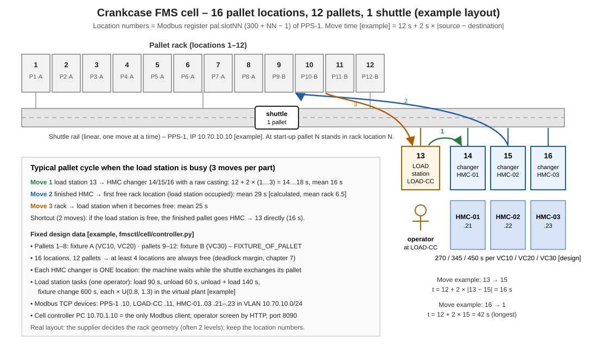
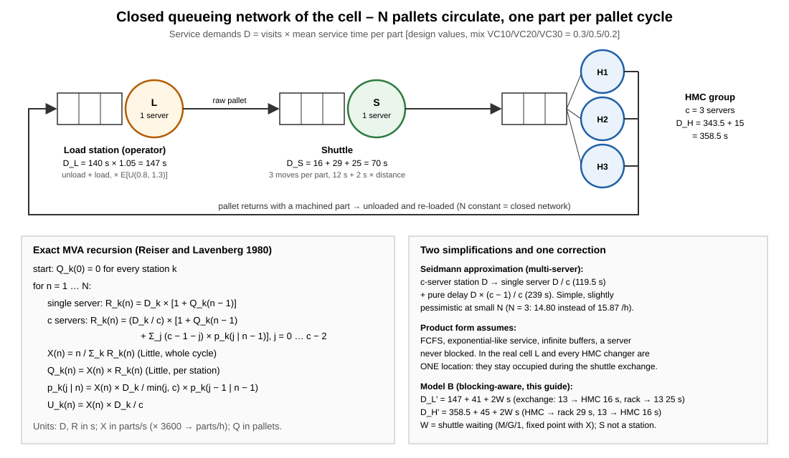
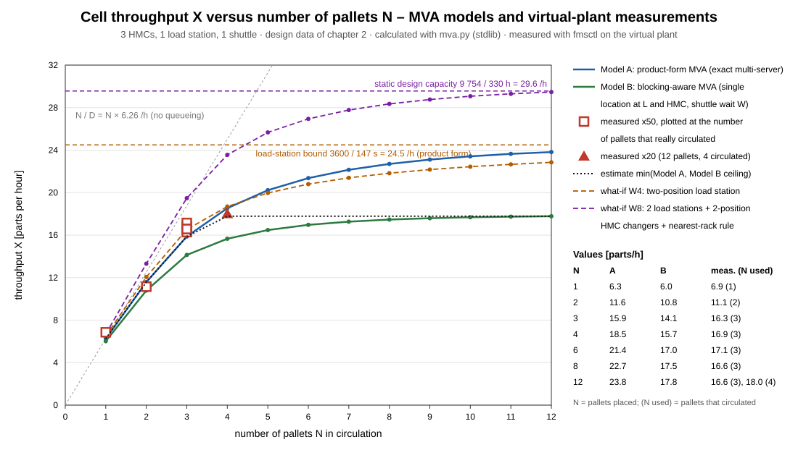
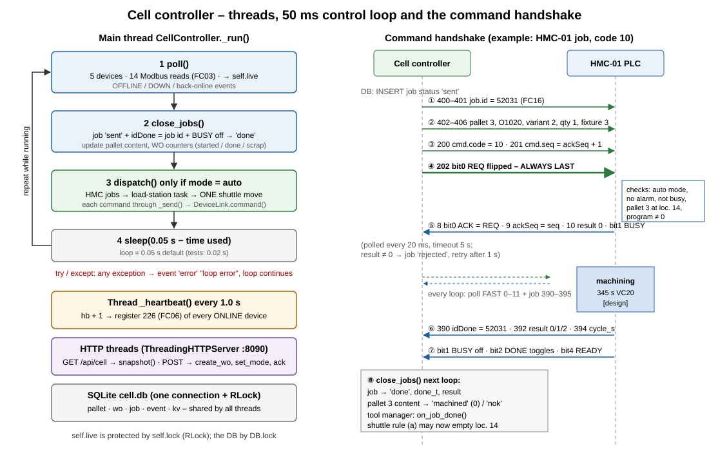
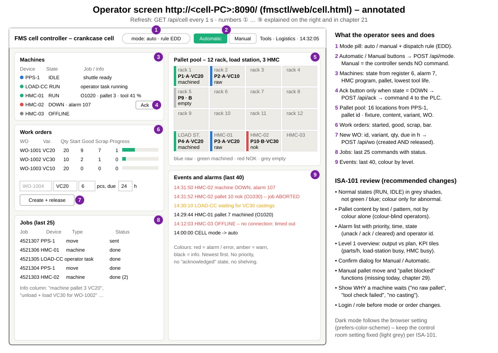
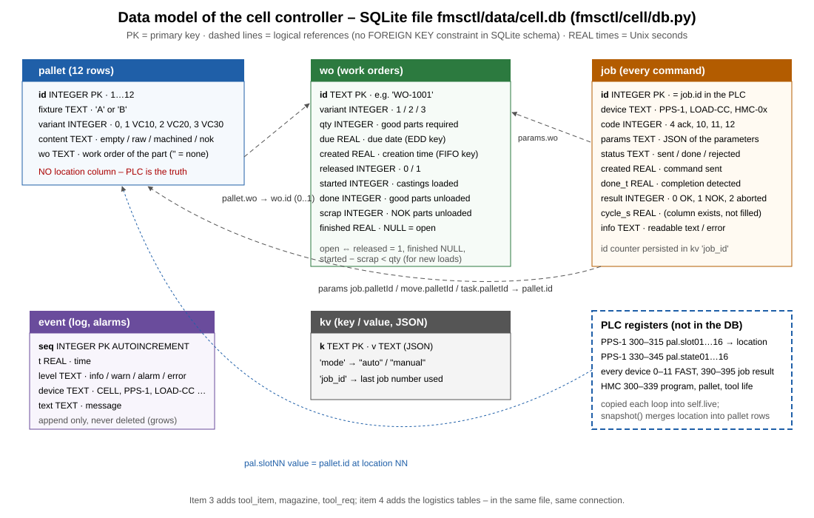
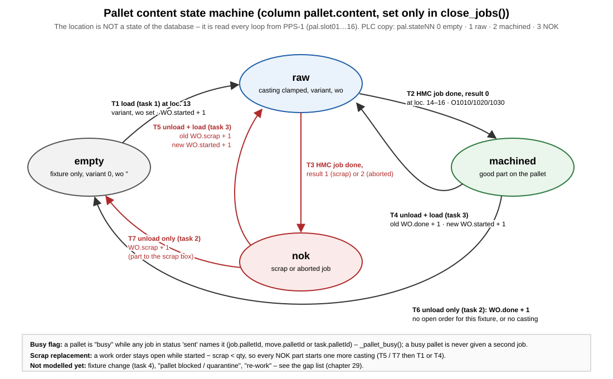
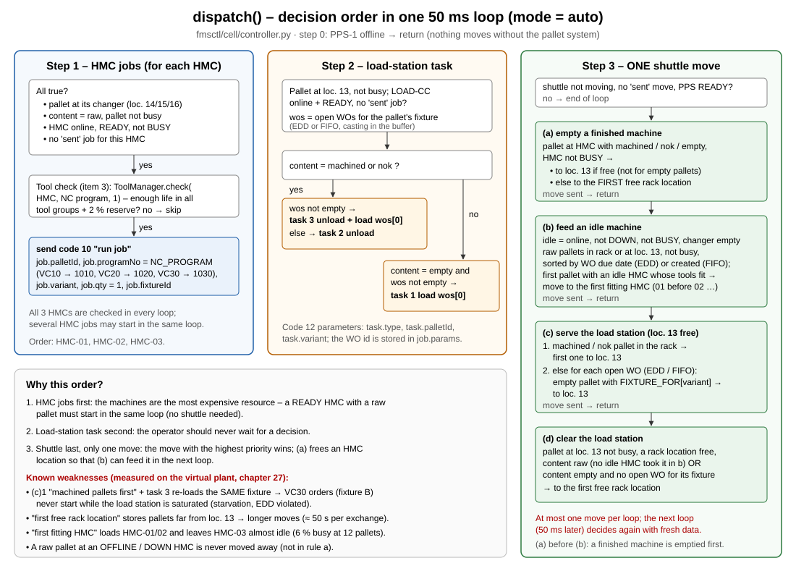

# 54 – FMS cell controller (item 2): theory, design and implementation textbook

> **Important – read this first.**
> All machine times, pallet numbers, fixture assignments, IP addresses and register numbers in this guide are
> **EXAMPLES** from the factory design (`config/factory.json`, thesis Table 4.2) and from the control package
> `fmsctl/`. Replace them with the data of your machine, pallet-system and fixture suppliers before you buy or build.
> Every calculation in this guide was **re-computed with Python 3.12 (standard library only)**; the scripts are listed in
> chapter 34 so you can repeat them with your own numbers.

**Labels used for every number**

| Label | Meaning |
|---|---|
| [design] | value of the factory design (`config/factory.json`, thesis Table 4.2) – not yet confirmed by a supplier |
| [example] | value chosen to explain a method, or a default in the code – replace it |
| [calculated] | result of a formula of this guide with the inputs stated next to it |
| [virtual plant] | measured by running the real `fmsctl` controller against the simulated PLCs of `fmsctl/sim/virtual_plant.py` (a simulation, not a real machine) |
| [measured] | measured on real equipment – none yet; filled in at FAT / SAT |
| [estimate] | engineering estimate – confirm with a quote or a datasheet |

**Source files of item 2**

| File | Lines | What it is |
|---|---|---|
| `fmsctl/cell/controller.py` | 349 | the cell controller: polling, job completion, dispatching, recovery |
| `fmsctl/cell/db.py` | 52 | SQLite persistence (tables pallet, wo, job, event, kv) |
| `fmsctl/cell/server.py` | 111 | HTTP server: JSON API + operator screen, port 8090 |
| `fmsctl/web/cell.html` | 64 | operator screen (browser, works offline) |
| `fmsctl/core/device.py`, `fmsctl/core/modbus.py` | 75 + 177 | typed Modbus TCP access and the toggle-bit job handshake (item 1) |
| `fmsctl/spec/regmap.py`, `fmsctl/spec/plant.py` | 182 + 71 | register map V1.2, device list, IP plan, design parameters (item 1) |
| `fmsctl/sim/virtual_plant.py` | 359 | 21 simulated PLCs for virtual commissioning (item 1) |
| `fmsctl/tests/test_item2.py` | 111 | acceptance test of item 2 – **13 / 13 checks passed** |

Related guides: 53 (FMS control system, items 1–4 overview), 02 (FMS and order flow), 09 (pallet changer APC),
05 (PLC control), 06 (SCADA), 07 (communication), 16 (standards register), 51 (doctoral research roadmap).

---

## Contents

**Part A – Understand**

1. Purpose, scope and how to read this guide
2. The crankcase cell: layout, devices, pallets, times
3. FMS control problems – what a cell controller must decide
4. Dispatching rules – formulas and a worked example with three work orders
5. Pallets, fixtures, the closed system and Little's law
6. The cell as a closed queueing network – Mean Value Analysis (MVA)
7. Deadlock in an FMS – theory and analysis of the 16-location design
8. Source of truth, idempotent commands and recovery after a failure
9. Cyclic versus event-driven control – the 50 ms loop and its time budget
10. Human–machine interface: ISA-101 principles applied to the cell screen
11. Alarm management: ISA-18.2 / IEC 62682 and what fmsctl logs today
12. Key performance indicators: ISO 22400-2, OEE and VDI 3423 availability

**Part B – Implement**

13. Architecture of `fmsctl/cell` – modules, classes, threads
14. Polling: the registers read from the five devices
15. Data model – the SQLite tables column by column
16. Pallet state machine
17. The dispatch algorithm exactly as implemented (pseudo-code + worked trace)
18. Job life cycle, handshake results and the effects of a finished job
19. Configuration: fixtures, NC programs, a new variant, a new pallet, a 4th HMC
20. HTTP API reference with JSON examples
21. Operator manual – procedures for every situation
22. KPIs from the database – SQL, Python and a worked example
23. FAT and SAT procedures – step tables with acceptance criteria
24. FMEA of the cell controller
25. Troubleshooting table
26. Buy list – catalogue examples and consolidated shopping list
27. Design findings for the real factory (virtual plant + MVA)
28. For the doctoral thesis
29. Implementation gaps in `fmsctl/cell` and suggested changes
30. Checklists
31. Standards
32. References
33. Glossary
34. Drawings and calculation scripts of this guide

---

# PART A – UNDERSTAND

## 1. Purpose, scope and how to read this guide

### 1.1 What item 2 is

The compressor factory machines its crankcases in a **flexible manufacturing system (FMS) cell**: three horizontal
machining centres (HMC-01, HMC-02, HMC-03), one pallet pool system with a rail-guided shuttle (PPS-1), and one manual
load station (LOAD-CC) where an operator clamps raw castings on fixture pallets and unclamps machined parts.

The machines and the pallet system each have their own PLC or CNC. They can execute a single command safely: "machine
pallet 3 with program O1020", "move pallet 7 from location 4 to location 15", "operator: unload and reload pallet 2".
They do **not** know *which* command is the right one next. That decision is the job of the **FMS cell controller** –
item 2 of the control system (guide 53, chapter 2).

In simple words: **the PLCs are the hands, the cell controller is the head.** The cell controller

1. reads the state of every device (polling, Modbus TCP),
2. remembers what the PLCs cannot know (which part and which work order is on which pallet),
3. decides the next actions by fixed rules (dispatching),
4. sends the commands with a safe handshake,
5. shows everything on an operator screen and keeps a log for analysis (HTTP, SQLite).

### 1.2 Where it sits – ISA-95 / IEC 62264 levels

ISA-95 (international edition IEC 62264-1) divides a manufacturing company into levels:

| Level | Name | Time scale | In this factory |
|---|---|---|---|
| 4 | Business planning and logistics (ERP) | months, weeks, days | ERP: sales orders, purchasing (item 6) |
| 3 | Manufacturing operations management (MOM / MES) | days, shifts, hours, minutes | MES (item 5), **cell controller (item 2)**, tool management (item 3), logistics (item 4) |
| 2 | Monitoring, supervisory and automated control | minutes, seconds | operator screens, SCADA |
| 1 | Sensing and manipulating | seconds, milliseconds | PLCs, CNCs, drives |
| 0 | The physical process | – | cutting, moving, clamping |

The cell controller is a **level-3 function** ("production execution / dispatching" in the activity model of
IEC 62264-3) that also offers a small level-2 screen. It never controls a motor directly; it never bypasses a safety
function. All safety (guards, light curtains, emergency stop, clamping interlocks) stays in the PLCs and in the
safety circuits (guide 53 item 8, ISO 13849-1).

### 1.3 Company rules that shape the design

| Rule | Consequence in item 2 |
|---|---|
| Only Ethernet, **Modbus TCP** and **HTTP** | every device is reached by Modbus TCP (register map V1.2); screens and other programs use HTTP/JSON |
| Offline factory PCs | Python standard library only, no internet, no CDN, the screen is a single local HTML file |
| One Modbus client per device | only the cell controller PC (10.70.1.10 [example]) writes commands; screens read through the controller's HTTP API |
| All values are examples until suppliers confirm | every constant is in one place (top of `controller.py`, `plant.py`, `regmap.py`) |

### 1.4 How to read

Part A explains the theory with the cell's own numbers: what an FMS controller must decide (chapter 3), how to choose
the order of jobs (4), why the number of pallets limits the work in process (5), how to *calculate* the output of the
cell before it is built (6), why the cell cannot lock itself (7), how it survives a power failure (8), and how the
screen and alarms should be designed (9–12). Part B describes the software exactly as it is written, how to configure,
operate, test and improve it, and what to buy.

Each topic follows the same pattern: **principle → formula → worked example with numbers → design rule →
implementation in fmsctl → how to test → common mistakes.**

### 1.5 The most important result in one paragraph

The static design calculation (thesis Table 4.3) gives 9 754 crankcases per month for three HMCs, i.e.
9 754 / 330 h = **29.6 parts per hour** [calculated]. Running the real controller against the virtual plant gives
**16.6 to 18.0 parts per hour** with 12 pallets [virtual plant]; the queueing models of this guide (chapter 6) give a
ceiling of **17.8 parts per hour** [calculated]. The HMCs are busy only 48–57 % of the time; the bottleneck is the
**single load station** with one operator (≈ 143–147 s of work per part) *plus* the time its single location is
blocked by shuttle exchanges (≈ 55–60 s per part [virtual plant]). A second surprise: of the 12 pallets only **3 to 4
ever circulate** – the dispatch rules keep re-using the pallets that were loaded first, and VC30 orders can starve
(chapter 27). Chapter 27 also shows which changes bring the cell back to the design capacity: a second load station,
two-position HMC pallet changers and a "nearest rack location" rule together reach 29.5 parts per hour in the model
[calculated].

---

## 2. The crankcase cell: layout, devices, pallets, times



**Figure 54.1** – Cell layout with the 16 pallet locations, the shuttle and the typical three-move pallet cycle
[example layout].

### 2.1 Devices and network

| Device id | Type (register map) | IP [example] | Function | Register block used by item 2 |
|---|---|---|---|---|
| PPS-1 | PALLET | 10.70.10.10 | linear pallet pool: 12 rack locations, 1 shuttle, serves locations 13–16 | 300–315 locations, 321 shuttle busy, 330–345 pallet states, 402–404 move |
| LOAD-CC | LOAD | 10.70.10.11 | manual load / unload station with operator panel | 300–303 status, 402–404 operator task |
| HMC-01 | CNC | 10.70.10.21 | horizontal machining centre 1, pallet changer at location 14 | 300–301 program / pallet, 310–339 tool life, 402–406 job |
| HMC-02 | CNC | 10.70.10.22 | HMC 2, location 15 | as HMC-01 |
| HMC-03 | CNC | 10.70.10.23 | HMC 3, location 16 | as HMC-01 |
| cell PC | – | 10.70.1.10 | runs `python -m fmsctl.cell.server`, the only Modbus client | – |

All devices: Modbus TCP port 502, unit id 1, register map V1.2 (`fmsctl/spec/regmap.py`, supplier CSV files in
`fmsctl/spec/out/`). The virtual plant uses 127.0.0.1 with ports 15100 + n instead (guide 53, chapter 4).

### 2.2 Locations

The pallet system publishes 16 locations in registers 300–315 (`pal.slot01` … `pal.slot16`). Each register holds the
id of the pallet standing there, 0 = empty.

| Location | Meaning | Constant in `controller.py` |
|---|---|---|
| 1 … 12 | rack (storage) locations | `RACK = range(1, 13)` |
| 13 | load station LOAD-CC | `LOAD_SLOT = 13` |
| 14, 15, 16 | pallet changer of HMC-01, HMC-02, HMC-03 | `HMC_SLOT = {'HMC-01': 14, 'HMC-02': 15, 'HMC-03': 16}` |

The numbering follows the rail: the shuttle travel time grows with the distance in location numbers. The virtual
plant uses [example]

$$t_{move} = 12\ \text{s} + 2\ \text{s} \times |src - dst| \tag{2.1}$$

*Worked example.* Move 13 → 15 (load station to HMC-02): 12 + 2 × 2 = **16 s** [calculated]. Move 16 → 1:
12 + 2 × 15 = **42 s** (longest move) [calculated]. Mean of all moves load station → HMC: (14 + 16 + 18)/3 = **16 s**;
mean HMC → rack (rack location uniformly 1…12): **29 s**; mean rack → load station: **25 s** [calculated].

**Design rule 2.1.** Ask the pallet-system supplier for the real move-time table (from–to matrix, including lift,
transfer and the time the PLC needs to confirm). Equation (2.1) is only a placeholder; the queueing model of chapter 6
needs the real table.

### 2.3 Pallets and fixtures

| Pallets | Fixture | Variants it can carry | Constant |
|---|---|---|---|
| 1 … 8 | A | VC10, VC20 | `FIXTURE_OF_PALLET = {p: 'A' if p <= 8 else 'B'}` |
| 9 … 12 | B | VC30 | `FIXTURE_FOR = {1: 'A', 2: 'A', 3: 'B'}` |

12 pallets in 16 locations: at any time **at least 4 locations are free** – this is the basis of the deadlock
argument in chapter 7. The design file `config/factory.json` lists a pool "PAL-CC" of 10 pallets for the twin's
simulation; the control package uses 12 [example]. Decide the final number with the MVA of chapter 6 and the cost of a
fixture pallet (chapter 26).

### 2.4 Times

| Quantity | VC10 | VC20 | VC30 | Mix-weighted | Source |
|---|---|---|---|---|---|
| Product mix share π | 0.3 | 0.5 | 0.2 | – | [design] |
| HMC machining time [s] | 270 | 345 | 450 | 343.5 | [design], thesis Table 4.2 |
| HMC pallet change h [s] | 15 | 15 | 15 | 15 | [design] |
| HMC time per part incl. change [s] | 285 | 360 | 465 | 358.5 | [calculated] |
| Load station, design table (LOAD row) [s] | 80 | 90 | 100 | 89.0 | [design], Table 4.2 |
| Load station task in the virtual plant [s] | load 90, unload 60, unload + load 140, fixture change 600; each × U(0.8, 1.3) | | | 140 × 1.05 = 147 per part | [example] |
| HMC MTBF / MTTR | 30 h / 20 min | | | A = 0.9890 | [design] |
| HMC scrap rate | 0.008 | | | | [design] |

The mix-weighted HMC time is

$$\bar t_{HMC} = \sum_p \pi_p\, t_{p} = 0.3 \cdot 270 + 0.5 \cdot 345 + 0.2 \cdot 450 = 343.5\ \text{s} \tag{2.2}$$

and the mean of a uniform factor U(0.8, 1.3) is (0.8 + 1.3)/2 = 1.05, so the mean operator time for the usual task
"unload + load" is 140 × 1.05 = **147 s** [calculated].

> **Notice the difference.** The design table uses **89 s** per part for the load station; the virtual plant uses
> **147 s** because, in steady state, every pallet cycle needs an *unload* **and** a *load* (task 3). This one input
> difference is a large part of the gap between the static capacity and the real output (chapter 6.8).

### 2.5 Static design capacity

The thesis (chapter 4, Eq. 4.1–4.2) calculates the static capacity of a station type m as

$$C_m = c_m\, A_m\, \frac{3600\, H}{\bar t_m + h_m}\,(1 - q_m), \qquad A_m = \frac{MTBF_m}{MTBF_m + MTTR_m} \tag{2.3}$$

For the HMC group: c = 3, A = 30 / (30 + 0.333) = 0.9890, H = 330 h/month [assumption: 2 shifts × 7.5 h × 22 days],
t̄ + h = 358.5 s, q = 0.008:

C = 3 × 0.9890 × 3600 × 330 / 358.5 × (1 − 0.008) = **9 754 parts per month** = 9 754 / 330 = **29.6 parts per hour**
[calculated, thesis Table 4.3].

For the load station the same formula gives 13 343 parts per month = 40.4 parts per hour (with 89 s) – so the static
model says "the load station is not a bottleneck". Chapter 6 shows why this is wrong.

---

## 3. FMS control problems – what a cell controller must decide

### 3.1 Stecke's classification

Kathryn Stecke (1983) divided the decisions of an FMS into **design**, **planning**, **scheduling** and **control**
problems. The planning problems, solved before a production period starts, are:

| # | Planning problem (Stecke 1983) | Question | Our cell |
|---|---|---|---|
| P1 | Part type selection | which part types are produced together in the next period? | all three variants run mixed; the work-order list decides |
| P2 | Machine grouping | which machines are made identical (pooled)? | HMC-01..03 identical: same tools, same NC programs → one pool of 3 |
| P3 | Production ratios | in which ratio are the part types produced? | product mix 0.3 / 0.5 / 0.2 [design], set by the work orders |
| P4 | Resource allocation | how many pallets and fixtures per part type? | 8 fixtures A (VC10/VC20), 4 fixtures B (VC30) |
| P5 | Loading | which operations and tools are assigned to which machine? | every HMC has all tools for O1010, O1020, O1030 (magazine, item 3) |

The **scheduling and control** problems are solved continuously during production:

| # | Real-time problem | Question | Where in fmsctl |
|---|---|---|---|
| C1 | Order release | when does a work order enter the cell? | `released` flag in table `wo`; `create_wo(release=True)` |
| C2 | Part input sequencing | which work order gets the next free pallet? | load-station rule, `_open_wos()` sorted by EDD or FIFO |
| C3 | Routing | which machine gets the pallet? | shuttle rule (b): first idle HMC with fitting tools |
| C4 | Dispatching | which waiting pallet is served first? | rule (b) sorted by EDD / FIFO; shuttle priorities (a)–(d) |
| C5 | Tool allocation | is the tool life sufficient for the next job? | `ToolManager.check()` before every HMC job (item 3) |
| C6 | Fixture allocation | which fixture for which part? | `FIXTURE_FOR`, checked when loading |
| C7 | Material availability | is a casting available at the load station? | `_casting_ok()` with the logistics manager (item 4) |
| C8 | Failure handling | what if a device is down or offline? | OFFLINE / DOWN detection, no jobs, rerouting to the other HMCs |

Because the three HMCs are **identical and fully tooled** (P2 and P5 solved by design), the routing problem is easy:
any idle HMC can machine any variant. This is a deliberate design decision. It makes the cell simple to control and
robust against a machine failure, at the price of a bigger tool magazine (item 3, 18 of 30 pockets used [example]).

### 3.2 Why rules and not an optimiser

Two methods exist for real-time decisions:

| Method | How it works | Pros | Cons |
|---|---|---|---|
| **Priority (dispatching) rules** | at each decision moment, sort the candidates by a key (due date, arrival time, processing time) and take the first | simple, fast (microseconds), transparent, robust to disturbances | not optimal; a rule that is good for one goal can be bad for another |
| **Optimisation / look-ahead scheduling** | build a schedule for the next hours with a mathematical model or simulation; re-plan after events | can be much better for tardiness or set-ups | needs good data, computing time, re-planning logic; operators trust it less |

For a 3-machine cell with identical machines and one-part pallets, rules are the industrial standard and are what
`fmsctl` uses. The MES (item 5) can later add a look-ahead plan that only changes the **due dates or priorities** of
the work orders; the cell controller still executes by rules. That keeps the level-3 split of ISA-95 clean.

### 3.3 Common mistakes

- Treating the cell controller as a scheduler that must be "optimal". It must be **correct, safe and explainable**
  first; optimisation is a second step.
- Allowing two programs (for example a SCADA and the cell controller) to write commands to the same PLC. Then neither
  knows the real state. Rule: one commanding client per device.
- Solving the planning problems P1–P5 in the controller code. They belong in master data (fixtures, programs, tools)
  that the controller reads (see gap list, chapter 29).

---

## 4. Dispatching rules – formulas and a worked example with three work orders

### 4.1 Definitions

For a job (work order) j:

| Symbol | Meaning | Unit |
|---|---|---|
| r_j | release (arrival) time | h |
| p_j | processing time on the bottleneck | h |
| d_j | due date | h |
| C_j | completion time | h |
| F_j = C_j − r_j | flow time | h |
| L_j = C_j − d_j | lateness (negative = early) | h |
| T_j = max(0, L_j) | tardiness | h |

### 4.2 The rules

| Rule | Priority key (smallest first) | Good for | fmsctl |
|---|---|---|---|
| FIFO / FCFS | r_j (or created time) | fairness, simple | `rule='FIFO'`: `ORDER BY created` |
| EDD – earliest due date | d_j | maximum lateness / tardiness | `rule='EDD'` (default): `ORDER BY due, created` |
| SPT – shortest processing time | p_j | mean flow time, mean WIP | not implemented |
| CR – critical ratio | CR_j = (d_j − t) / p_j | balance urgency and work content | not implemented |
| MS – minimum slack | S_j = d_j − t − p_j | tardiness when p differs strongly | not implemented |

Known results for **one machine** (the bottleneck): SPT minimises the mean flow time (Smith 1956); EDD minimises the
maximum lateness (Jackson 1955). No rule is best for all goals. CR and MS are **dynamic**: their value changes with the
time t, so they must be recalculated at every decision.

### 4.3 Worked example

Three work orders wait at t = 0.5 h [example]. Processing times are the bottleneck time of the whole order.

| WO | Variant, qty [example] | r_j [h] | p_j [h] | d_j [h] | CR at t = 0.5 | Slack at t = 0.5 [h] |
|---|---|---|---|---|---|---|
| WO-101 | VC20 × 20 | 0.0 | 1.6 | 4.0 | (4.0 − 0.5)/1.6 = 2.188 | 4.0 − 0.5 − 1.6 = 1.9 |
| WO-102 | VC30 × 10 | 0.2 | 1.2 | 2.5 | (2.5 − 0.5)/1.2 = 1.667 | 0.8 |
| WO-103 | VC10 × 20 | 0.4 | 1.4 | 3.6 | (3.6 − 0.5)/1.4 = 2.214 | 1.7 |

Sequences and results (single bottleneck, start at 0.5 h, total work 4.2 h, so the last order always ends at 4.7 h)
[calculated]:

| Rule | Sequence | C_j [h] | Mean flow time [h] | Σ T_j [h] | T_max [h] | Late orders |
|---|---|---|---|---|---|---|
| FIFO | 101 → 102 → 103 | 2.1, 3.3, 4.7 | 3.167 | 1.9 | 1.1 | 2 |
| SPT | 102 → 103 → 101 | 1.7, 3.1, 4.7 | 2.967 | 0.7 | 0.7 | 1 |
| EDD | 102 → 103 → 101 | 1.7, 3.1, 4.7 | 2.967 | 0.7 | 0.7 | 1 |
| CR (static, computed once) | 102 → 101 → 103 | 1.7, 3.3, 4.7 | 3.033 | 1.1 | 1.1 | 1 |
| CR (dynamic, recomputed) | 102 → 103 → 101 | 1.7, 3.1, 4.7 | 2.967 | 0.7 | 0.7 | 1 |
| MS | 102 → 103 → 101 | 1.7, 3.1, 4.7 | 2.967 | 0.7 | 0.7 | 1 |

Step by step for FIFO: WO-101 ends at 0.5 + 1.6 = 2.1 h (due 4.0, early 1.9 h), WO-102 at 2.1 + 1.2 = 3.3 h (due 2.5,
**late 0.8 h**), WO-103 at 3.3 + 1.4 = 4.7 h (due 3.6, **late 1.1 h**). Mean flow time = [(2.1 − 0) + (3.3 − 0.2) +
(4.7 − 0.4)] / 3 = 3.167 h.

Dynamic CR: at 0.5 h WO-102 has the smallest CR (1.667). At 1.7 h the ratios are WO-103: (3.6 − 1.7)/1.4 = 1.357,
WO-101: (4.0 − 1.7)/1.6 = 1.437 → WO-103 next. The static CR (computed only once) took WO-101 second and made WO-103
late by 1.1 h. **Lesson:** a dynamic rule must be recomputed at every decision – the `fmsctl` loop does this naturally
because it re-sorts every 50 ms.

### 4.4 How fmsctl applies the rule

The rule acts at **two** places:

1. **Part input (load station):** `_open_wos(fixture)` returns the open work orders sorted by `due, created` (EDD)
   or `created` (FIFO). The first one that matches the pallet's fixture and has a casting gets the next load.
2. **Machine feeding (shuttle rule b):** raw pallets waiting in the rack are sorted by the due date (EDD) or the created
   time (FIFO) of the work order written on the pallet; the first pallet that an idle HMC can take is moved.

The acceptance test checks EDD: in `test_item2`, WO-B (VC30, due in 1 h) is created after WO-A (VC20, due in 2 h),
and the first load task must be for WO-B (check 3, chapter 23).

### 4.5 Design rules

- **Use EDD as the default** for a make-to-order compressor factory: customers see due dates, not flow times.
- Make the due date the **only** priority channel from the MES / ERP: to make an order urgent, the planner moves its
  due date. Then the controller needs no "priority" field (but see gap G9: hot orders).
- Do not mix rules inside one decision; if you need a tie-break, use created time (as `fmsctl` does).

### 4.6 Common mistakes

- Sorting by due date only at order release, not at each decision (static instead of dynamic).
- Forgetting that a rule at the **load station** decides the product mix in the cell for the next 30–60 minutes; a rule
  only at the machines cannot repair a wrong input sequence (see the fixture lock-in finding, chapter 27.3).
- Using SPT in a make-to-order factory: long VC30 orders wait for ever when short orders keep arriving.

---

## 5. Pallets, fixtures, the closed system and Little's law

### 5.1 Pallet-limited work in process

In a pallet-based FMS a part can only be in the cell while it is clamped on a pallet. The number of pallets N is fixed,
so the **work in process (WIP) can never exceed N**. Such a system is called a **closed system**: a pallet that leaves
the HMC with a finished part returns to the load station, is unloaded, reloaded with a new casting and starts again.
The controlling mechanism is the same as CONWIP (constant work in process, Spearman et al. 1990): a new part enters
only when a finished part leaves.

Two consequences:

1. Throughput rises with N at first, then flattens when the bottleneck is saturated (chapter 6, Figure 54.7).
2. A fixture family has its own closed loop. VC30 can never have more than **4** parts in the cell, because only 4
   fixture-B pallets exist. If all work orders are VC30, the cell behaves like a cell with N = 4.

### 5.2 Little's law

For any stable system, over a long period [Little 1961]:

$$L = \lambda \cdot W \tag{5.1}$$

L = mean number of items in the system, λ = throughput (items per time), W = mean time an item spends in the system.
For a closed cell L = N (every pallet is always somewhere in the cell), so the **pallet cycle time** is

$$W = \frac{N}{X} \tag{5.2}$$

*Worked example 1 [virtual plant].* In the × 20 run 12 pallets stood in the cell, but only **4 of them carried parts**
(pallets 1, 2, 3 and 9); the other 8 stayed empty in the rack for the whole run (chapter 27.3). L in Little's law is the
number of pallets *in circulation*, so L = 4 and X = 18.0 parts/h give W = 4 / 18.0 h = 0.222 h = **800 s ≈ 13 min**
per pallet cycle. Check with the job table: pallet 2 needed 603–670 s per cycle (for example machined pallet to the
load station at 4 434 s, again at 5 037 s simulated time); pallet 9 (VC30) waited longer in the rack, which raises the
mean to 800 s. The pure work content of a cycle is about 143 s (operator) + 3 moves (≈ 90 s) + 344 s (HMC) ≈ 577 s, so
a circulating pallet waits about 220 s of its 800 s. **If all 12 pallets circulated at the same X, Little's law gives
W = 12 / 18 h = 40 min** – the same output with three times the lead time and WIP. Little's law is therefore also a
quick check whether a controller really uses its pallets: N_used = X × W.

*Worked example 2 [calculated].* How many pallets are needed to keep the cell at a target throughput if each pallet
cycle (without waiting) takes D = 575.5 s (chapter 6)? With X = 24.5 parts/h = 0.0068 parts/s: N = X × D =
0.0068 × 575.5 = **3.9 pallets**. This is the "critical WIP" N* of chapter 6.4. More pallets do not increase the
throughput above the bottleneck rate; they only increase waiting time (W grows linearly with N).

*Worked example 3 – per station.* Little's law also holds for every station: Q_k = X × R_k. In the MVA solution for
N = 12 (Model A, chapter 6) the load-station residence time is R_L = 1 068.6 s and X = 23.82 /h = 0.006617 /s, so
Q_L = 0.006617 × 1 068.6 = **7.07 pallets** wait at or in the load station [calculated].

### 5.3 Fixture design rules

| Rule | Reason |
|---|---|
| N per fixture family ≥ N* of that family's MVA | below N* the family's own loop starves the machines |
| Total N ≤ number of rack locations | guarantees a free rack location for every pallet outside the rack (deadlock freedom, chapter 7) |
| Fixtures of one family interchangeable | any pallet of the family can take any order of the family |
| Pallet id readable automatically (RFID / code) at the load station | the controller must be sure which pallet is in front of the operator (gap G14) |
| Clamping verified by pressure switch (`load.clamped`, register 301) | a pallet must never leave the load station unclamped |

### 5.4 Common mistakes

- Buying "as many pallets as the rack holds" without a model: more pallets than N* cost money (a fixture pallet is a
  large part of the cell investment, chapter 26) and only increase lead time.
- Forgetting the family split: 12 pallets are 8 + 4. The VC30 throughput is limited by its 4 pallets.
- Counting pallets in the load station or in maintenance as available.

---

## 6. The cell as a closed queueing network – Mean Value Analysis (MVA)

### 6.1 Why a queueing model

The static formula (2.3) asks "how many parts can each station make if it never waits?". It ignores that a station
waits when its input is missing or its output cannot leave. In a closed pallet cell the stations are coupled by the N
pallets: if the load station is slow, pallets queue in front of it and the HMCs starve. A **closed queueing network**
captures exactly this coupling, and **Mean Value Analysis (MVA)** solves it with a few lines of arithmetic – no
simulation, no random numbers. Solberg's CAN-Q program (1977) was the first FMS tool of this kind; MVA was published by
Reiser and Lavenberg (1980).

### 6.2 The network of the cell



**Figure 54.6** – The cell as a closed network: N pallets circulate through the load station L (1 server), the
shuttle S (1 server) and the HMC group H (3 servers).

| Station k | Servers c_k | Visits per part V_k | Mean service per visit | Service demand D_k = V_k × S_k | Source |
|---|---|---|---|---|---|
| L load station | 1 | 1 | 147 s (unload + load, 140 × 1.05) | **147 s** | [example], virtual plant |
| S shuttle | 1 | 3 | 23.3 s (16 + 29 + 25 over 3 moves) | **70 s** | [calculated] Eq. 2.1, mean rack location 6.5 |
| H HMC group | 3 | 1 | 358.5 s (343.5 machining + 15 change) | **358.5 s** | [design] |

The total demand of one pallet cycle is D = 147 + 70 + 358.5 = **575.5 s** [calculated].

**Assumptions of the basic model (Model A, "product form"):** stations serve in first-come-first-served order; the
service times behave like exponential random variables (only their means enter); buffers in front of every station
are unlimited; a station is never blocked by the next one; the number of pallets N is constant. The real cell breaks
the "never blocked" assumption – Model B (chapter 6.7) corrects for this.

### 6.3 The MVA recursion

The key idea is the **arrival theorem** (Lavenberg and Reiser 1980): in a closed product-form network with n
customers, a customer arriving at station k sees, on average, the queue of the same network with n − 1 customers.
Therefore the mean residence time (waiting + service) of a single-server station is

$$R_k(n) = D_k \,\bigl[1 + Q_k(n-1)\bigr] \tag{6.1}$$

Little's law for the whole cycle gives the throughput, and Little's law per station gives the new queue lengths:

$$X(n) = \frac{n}{\sum_k R_k(n)} \qquad Q_k(n) = X(n)\, R_k(n) \qquad U_k(n) = \frac{X(n)\, D_k}{c_k} \tag{6.2}$$

Start with Q_k(0) = 0 and repeat for n = 1, 2, …, N.

**Multi-server station (exact, load-dependent MVA).** For a station with c identical servers the residence time
needs the probabilities p_k(j | n) that j pallets are at station k:

$$R_k(n) = \frac{D_k}{c}\Bigl[1 + Q_k(n-1) + \sum_{j=0}^{c-2} (c-1-j)\, p_k(j \mid n-1)\Bigr] \tag{6.3}$$

$$p_k(j \mid n) = \frac{X(n)\, D_k}{\min(j, c)}\, p_k(j-1 \mid n-1), \quad j = 1 \dots n; \qquad p_k(0 \mid n) = 1 - \sum_{j \ge 1} p_k(j \mid n) \tag{6.4}$$

The correction term adds back the "free servers" that a single-server formula would wrongly count as a queue. When
n ≤ c, the formula gives R = D exactly (no waiting while a server is free).

**Seidmann approximation (simple alternative).** Seidmann, Schweitzer and Shalev-Oren (1987) replace a c-server
station by a single server with demand D/c followed by a pure delay (infinite servers) of D(c − 1)/c. For the HMC
group: queue part 358.5 / 3 = 119.5 s, delay part 358.5 × 2/3 = 239 s. It needs only Eq. 6.1 and is good for large N,
slightly pessimistic for small N (Table 6.2). This guide uses the exact formula and shows Seidmann for comparison.

### 6.4 Bounds without any calculation – asymptotic bound analysis

Two simple limits hold for any closed network [Denning and Buzen 1978]:

$$X(N) \le \frac{N}{D} \qquad\text{and}\qquad X(N) \le \frac{1}{D_{max}}, \qquad D_{max} = \max_k \frac{D_k}{c_k} \tag{6.5}$$

For the cell: D = 575.5 s, D_max = max(147, 70, 358.5/3 = 119.5) = 147 s (the load station). So

- with very few pallets: X ≤ N × 3600 / 575.5 = **N × 6.26 parts/h**,
- with many pallets: X ≤ 3600 / 147 = **24.5 parts/h**, never more, however many pallets [calculated].

The two lines cross at the **critical WIP** N* = D / D_max = 575.5 / 147 = **3.9 pallets** [calculated]. Below N* the
cell is pallet-starved; above N* it is bottleneck-limited.

**Key observation.** Already the simplest bound shows that the cell **cannot** reach the static 29.6 parts/h: the load
station alone limits it to 24.5 parts/h, because one operator needs 147 s per part.

### 6.5 Worked solution, step by step (Model A, exact)

Inputs: D_L = 147 s (1 server), D_S = 70 s (1 server), D_H = 358.5 s (3 servers). All values [calculated] with
`mva.py`.

**n = 1.** Queues are empty: Q(0) = 0, p_H(0 | 0) = 1.
R_L = 147 × (1 + 0) = 147.00 s; R_S = 70 × 1 = 70.00 s; R_H = 358.5/3 × (1 + 0 + 2 × 1) = 358.50 s.
Cycle 147 + 70 + 358.5 = 575.50 s; X(1) = 1 / 575.5 = 0.001738 parts/s = **6.255 parts/h**.
Q_L = 0.001738 × 147 = 0.2554; Q_S = 0.1216; Q_H = 0.6229 (sum = 1.000 pallet ✓).
p_H(1 | 1) = 0.001738 × 358.5 / 1 × 1 = 0.6229; p_H(0 | 1) = 0.3771.
Utilisations: U_L = 0.255, U_S = 0.122, U_H = 0.001738 × 358.5 / 3 = 0.208.

**n = 2.**
R_L = 147 × (1 + 0.2554) = 184.55 s; R_S = 70 × (1 + 0.1216) = 78.51 s;
R_H = 119.5 × [1 + 0.6229 + 2 × 0.3771 + 1 × 0.6229] = 119.5 × 3.000 = 358.50 s (a free HMC exists, no waiting).
Cycle = 621.56 s; X(2) = 2 / 621.56 = 0.003218 /s = **11.584 parts/h**.
Q_L = 0.5938, Q_S = 0.2526, Q_H = 1.1535 (sum 2.000 ✓).
p_H(1 | 2) = 0.003218 × 358.5 × 0.3771 = 0.4350; p_H(2 | 2) = 0.003218 × 358.5 / 2 × 0.6229 = 0.3593;
p_H(0 | 2) = 1 − 0.4350 − 0.3593 = 0.2057.

**n = 3.**
R_L = 147 × 1.5938 = 234.29 s; R_S = 70 × 1.2526 = 87.68 s; R_H = 119.5 × [1 + 1.1535 + 2 × 0.2057 + 0.4350] = 358.50 s.
Cycle = 680.48 s; X(3) = 3 / 680.48 = 0.004409 /s = **15.871 parts/h**.
Q_L = 1.0329, Q_S = 0.3866, Q_H = 1.5805; p_H = (0.1418, 0.3252, 0.3437, 0.1893) for j = 0…3.

**n = 4** (first population larger than the number of HMCs).
R_L = 147 × 2.0329 = 298.84 s; R_S = 70 × 1.3866 = 97.06 s;
R_H = 119.5 × [1 + 1.5805 + 2 × 0.1418 + 0.3252] = 119.5 × 3.1893 = 381.12 s (now 22.6 s of waiting for an HMC).
Cycle = 777.02 s; X(4) = 4 / 777.02 = 0.005148 /s = **18.532 parts/h**.
U_L = 0.757, U_S = 0.360, U_H = 0.615.

Already at n = 4 the load station is 76 % busy and holds 1.54 pallets on average, while each HMC is only 62 % busy.

### 6.6 Results for N = 1 … 12 (Model A)

**Table 6.2** – Model A, product-form MVA [calculated].

| N | X exact [parts/h] | X Seidmann [parts/h] | U_L | U_S | U_H | Cycle time N/X [s] | Q_L [pallets] |
|---|---|---|---|---|---|---|---|
| 1 | 6.26 | 6.26 | 0.255 | 0.122 | 0.208 | 576 | 0.26 |
| 2 | 11.58 | 11.14 | 0.473 | 0.225 | 0.385 | 622 | 0.59 |
| 3 | 15.87 | 14.80 | 0.648 | 0.309 | 0.527 | 680 | 1.03 |
| 4 | 18.53 | 17.45 | 0.757 | 0.360 | 0.615 | 777 | 1.54 |
| 5 | 20.23 | 19.35 | 0.826 | 0.393 | 0.672 | 890 | 2.10 |
| 6 | 21.36 | 20.69 | 0.872 | 0.415 | 0.709 | 1 011 | 2.70 |
| 7 | 22.15 | 21.64 | 0.904 | 0.431 | 0.735 | 1 138 | 3.35 |
| 8 | 22.70 | 22.32 | 0.927 | 0.441 | 0.754 | 1 269 | 4.03 |
| 9 | 23.11 | 22.83 | 0.944 | 0.449 | 0.767 | 1 402 | 4.75 |
| 10 | 23.41 | 23.20 | 0.956 | 0.455 | 0.777 | 1 538 | 5.49 |
| 11 | 23.64 | 23.48 | 0.965 | 0.460 | 0.785 | 1 675 | 6.27 |
| 12 | 23.82 | 23.69 | 0.973 | 0.463 | 0.791 | 1 814 | 7.07 |

Model A approaches the load-station bound 24.5 parts/h. With 12 pallets, 7 of them wait at the load station.

### 6.7 Model B – blocking-aware correction

**Why Model A is too optimistic.** In the real cell the load station and each HMC pallet changer are **one location**.
After the operator finishes, the pallet stays on location 13 until the shuttle takes it away, and the next pallet
cannot be served before the shuttle brings it. During both moves the operator waits. The same holds for an HMC: it
cannot start the next part before its finished pallet has been removed *and* a raw pallet delivered (one location, no
second pallet waiting at the machine). Model A counts the moves only as shuttle work, not as time the location is held.

**Exchange times (typical cycle when the load station is the bottleneck, Figure 54.1):**

| Station | Move out | Move in | Exchange e_k [calculated] |
|---|---|---|---|
| L (location 13) | 13 → HMC with the raw part: 16 s | rack → 13 with the next machined pallet: 25 s | e_L = 41 s |
| H (locations 14–16) | HMC → rack (13 is occupied): 29 s | 13 → HMC with a raw part: 16 s | e_H = 45 s |

**Shuttle waiting.** A move request may find the shuttle busy with another move. With shuttle utilisation
ρ_S = X × D_S and mean move time m̄ = D_S / 3, the mean waiting time is approximated by the M/G/1 formula:

$$W = \frac{\rho_S\, \bar m\,(1 + c_v^2)}{2\,(1 - \rho_S)} \tag{6.6}$$

with c_v ≈ 0.3 for the move times (14 … 42 s) [estimate], so 1 + c_v² = 1.09.

**Model B stations.** The shuttle is no longer a separate station (its time is inside the exchanges):

$$D_L' = D_L + e_L + 2W, \qquad D_H' = D_H + e_H + 2W \tag{6.7}$$

Because W depends on X and X depends on D_L', D_H', the model is solved by a **fixed-point iteration**: start with
W = 0, solve MVA, compute W from Eq. 6.6, repeat until W does not change (damping 0.5; converges in < 50 iterations).

*Worked example, N = 12 [calculated].* Converged: X = 17.78 parts/h = 0.004939 /s; ρ_S = 0.004939 × 70 = 0.346;
m̄ = 23.33 s; W = 0.346 × 23.33 × 1.09 / (2 × 0.654) = **6.72 s**. Then D_L' = 147 + 41 + 2 × 6.72 = **201.4 s**
and D_H' = 358.5 + 45 + 13.4 = **416.9 s**. Bounds: load station 3600 / 201.4 = 17.87 parts/h; HMC group
3 × 3600 / 416.9 = 25.9 parts/h. The load station is saturated (U_L' = 0.995), the cell delivers 17.78 parts/h.

**Table 6.3** – Model B, blocking-aware MVA, design mix [calculated].

| N | X [parts/h] | U_L' (location held) | U_H' (location held) | HMC machining utilisation X·358.5/3 | W [s] | ρ_S |
|---|---|---|---|---|---|---|
| 1 | 6.02 | 0.320 | 0.227 | 0.200 | 1.69 | 0.117 |
| 2 | 10.78 | 0.583 | 0.410 | 0.358 | 3.37 | 0.210 |
| 3 | 14.14 | 0.776 | 0.541 | 0.469 | 4.82 | 0.275 |
| 4 | 15.66 | 0.866 | 0.601 | 0.520 | 5.57 | 0.304 |
| 5 | 16.48 | 0.915 | 0.634 | 0.547 | 6.00 | 0.320 |
| 6 | 16.97 | 0.945 | 0.654 | 0.563 | 6.26 | 0.330 |
| 7 | 17.27 | 0.963 | 0.666 | 0.573 | 6.43 | 0.336 |
| 8 | 17.46 | 0.975 | 0.674 | 0.580 | 6.54 | 0.340 |
| 9 | 17.59 | 0.983 | 0.679 | 0.584 | 6.61 | 0.342 |
| 10 | 17.68 | 0.989 | 0.682 | 0.587 | 6.66 | 0.344 |
| 11 | 17.74 | 0.992 | 0.685 | 0.589 | 6.69 | 0.345 |
| 12 | 17.78 | 0.995 | 0.686 | 0.590 | 6.72 | 0.346 |

**Limits of Model B (state them in a paper).** (1) A move that serves both stations (13 → HMC) is counted in both e_L
and e_H, so the cycle time is overestimated at small N (pessimistic by ≈ 11–13 % at N = 3–4, Table 6.4); Model B is
reliable for the **ceiling** (large N), not for small N. (2) The exchange
times assume the typical path of Figure 54.1. (3) Eq. 6.6 is an open-system approximation applied to a closed system.
(4) Failures (A_HMC = 0.989) and scrap are not included; multiply X by about 0.98 for a monthly figure. Model B is an
**engineering approximation**, not an exact solution; a discrete-event simulation or the virtual plant is the
reference.

### 6.8 Comparison with the static capacity and with the virtual plant



**Figure 54.7** – Throughput X versus number of pallets: Model A, Model B, what-ifs W4 and W8, and the virtual-plant
measurements [calculated / virtual plant].

**How the measurements were made.** The real controller code (`CellController`, rule EDD, loop 0.02 s, tool check
switched off and tool life kept at 100 % so that tooling does not interfere) was run against the virtual plant with
3 HMCs, 400 work orders of 1 part each in the pattern VC20, VC10, VC20, VC30, VC20, VC10, VC20, VC20, VC10, VC30
(mix 0.5 / 0.3 / 0.2), due dates 1 min apart. Only N pallets were placed in the rack (fixture A and B pallets mixed).
Each run lasted 4 simulated hours; the first 0.5 h (start-up) was discarded; KPIs come from the `job` table
(script `measure.py` + `analyse.py`, chapter 34).

**Table 6.4** – Virtual plant measurements, 3.5 h windows [virtual plant] and models [calculated].

| N placed | N used | Speed | X [parts/h] | Variants machined VC10/VC20/VC30 | HMC busy (mean of 3) | Operator busy | Shuttle busy | Moves per part | Load-station gap [s] | Model A at N used | Model B at N used (measured inputs) |
|---|---|---|---|---|---|---|---|---|---|---|---|
| 1 | 1 | × 50 | 6.86 | 9 / 15 / 0 | 0.201 | 0.286 | 0.059 | 2.00 | 365 | 6.26 (−9 %) | 6.40 (−7 %) |
| 2 | 2 | × 50 | 11.14 | 8 / 12 / 19 | 0.393 | 0.452 | 0.194 | 2.54 | 175 | 11.58 (+4 %) | 10.53 (−5 %) |
| 3 | 3 | × 50 | 16.29 | 14 / 24 / 19 | 0.541 | 0.655 | 0.349 | 2.70 | 74 | 15.87 (−3 %) | 14.17 (−13 %) |
| 4 | 3 | × 50 | 16.86 | 22 / 37 / 0 | 0.489 | 0.676 | 0.430 | 2.95 | 69 | 15.87 (−6 %) | 14.77 (−12 %) |
| 6 | 3 | × 50 | 17.14 | 23 / 37 / 0 | 0.494 | 0.674 | 0.433 | 2.92 | 69 | 15.87 (−7 %) | 14.79 (−14 %) |
| 8 | 3 | × 50 | 16.57 | 22 / 36 / 0 | 0.481 | 0.668 | 0.428 | 2.97 | 72 | 15.87 (−4 %) | 14.75 (−11 %) |
| 12 | 3 | × 50 | 16.57 | 22 / 36 / 0 | 0.481 | 0.667 | 0.426 | 2.97 | 72 | 15.87 (−4 %) | 14.75 (−11 %) |
| 12 | 4 | × 20 | **18.00** | 19 / 31 / 13 | 0.565 | 0.702 | 0.438 | 2.91 | 59 | 18.53 (+3 %) | 16.04 (−11 %) |

"N used" = number of different pallets that carried a part in the window. "Model B (measured inputs)" uses the measured
mean operator time (143–150 s) and mean HMC job time (317–381 s) of that run. "Load-station gap" = time from the end of
one operator task to the start of the next. Percentages = model error relative to the measurement.

**The first finding: the controller uses only 3–4 pallets.** Whatever the number of pallets placed (4 … 12), only the
pallets that were loaded before the first machined pallet came back keep circulating: rule (c) always prefers a
machined pallet over an empty one, and task 3 reloads it at once (chapter 27.3). In the × 50 runs with N ≥ 4 these
were pallets 1, 2, 3 (fixture A only – so **no VC30 at all**); in the × 20 run pallets 1, 2, 3, 9. The measurements for
N = 4 … 12 are therefore all measurements of a 3-pallet cell, which is why they are almost equal.

**The second finding: with 4 pallets the load station is already saturated.** In the × 20 run the operator worked
143 s per task and the location stood empty or blocked 59 s between tasks: 3600 / (143 + 59) = **17.8 parts/h** –
exactly the measured 18.0 parts/h within the window accuracy, and exactly the Model B ceiling (17.78 parts/h). More
circulating pallets would not raise the output; they would only raise the lead time.

**How good are the models?** At the number of pallets really used, **Model A** is within −9 … +4 % of the
measurements, **Model B** is 5–14 % pessimistic (double-counted moves). But Model A keeps rising with N up to
23.8 parts/h, which the real cell cannot reach because of location blocking, while Model B gives the right ceiling.
For design work this guide therefore uses the simple composite estimate (black dotted line in Figure 54.7):

$$X_{est}(N) = \min\bigl(X_A(N),\; X_B(\infty)\bigr) \tag{6.8}$$

N = 1: 6.26 (measured 6.86); N = 2: 11.58 (11.14); N = 3: 15.87 (16.29–17.14); N ≥ 4: 17.78 (18.00) parts/h
[calculated / virtual plant] – errors between −9 % and +4 %.

**Earlier measurement.** Guide 53 reports a shorter earlier run with 3 HMCs at × 20: ≈ 15 parts/h with each HMC busy
≈ 63 %. The longer runs of this guide give 16.6–18.0 parts/h and 48–57 % HMC busy time. The difference comes from run
length (start-up transient), the order mix of that run, and the definition of "busy" (the HMC *location* is occupied
65–69 % of the time in Model B, Table 6.3, because it also waits for the shuttle exchange). **All measurements agree on
the conclusion: the HMCs are idle 40–50 % of the time, the load station limits the cell.**

**Why the static 29.6 parts/h is not reached – an honest list:**

| # | Effect | Size [calculated / virtual plant] |
|---|---|---|
| 1 | **Wrong load-station input in the static model.** The design table uses 89 s per part; in steady state every cycle needs *unload + load* = 140 s × 1.05 = 147 s. | load-station bound 40.4 → 24.5 parts/h |
| 2 | **Single-location blocking.** Location 13 is held during two shuttle moves per cycle (≈ 41 s design, 50 s measured nominal move time) plus waiting for the shuttle. | 24.5 → about 18 parts/h (Model B) |
| 3 | **Shuttle moves per part ≈ 3**, not 2: a finished pallet usually goes HMC → rack → load station because the load station is busy. | measured 2.9–3.0 moves/part for N ≥ 4 |
| 4 | **Rack placement rule.** `free_rack[0]` puts pallets into the lowest free location, far from location 13: measured mean move 29.6 s nominal (31.4 s incl. latency) instead of 23.3 s. | + about 9 s per load-station exchange |
| 5 | **Operator variability** U(0.8, 1.3): coefficient of variation 0.5 / (1.05 √12) = 0.137 – small; it adds little waiting because the station is saturated anyway. | small |
| 6 | **Product mix and pallet lock-in.** With 4 ≤ N ≤ 12 at × 50 only pallets 1–3 circulated and no VC30 was machined (chapter 27.3); the shorter HMC time did **not** increase output because the load station limits. | output unchanged, mix wrong |
| 7 | **Controller latency at time compression.** At × 50 one 20 ms loop = 1 s simulated; detection + command latency added ≈ 13 s per load-station cycle compared with × 20 (gap 72 s vs 59 s). On the real plant (× 1) this latency is < 1 s. | × 50 underestimates real output by ≈ 6 % |
| 8 | **Failures and scrap** (A = 0.989, q = 0.008) – in the static number, partly in the virtual plant. | ≈ − 2 % |

Effects 1–4 are **design effects** that will occur in the real cell. Effect 6 is a **controller effect** that must be
fixed before SAT (gaps G15, G16). Effect 7 is a test artefact. The virtual plant run at × 20 with almost the design mix
(18.0 parts/h) agrees with the composite estimate Eq. 6.8 (17.78 parts/h) within 1.2 %.

### 6.9 What-if analysis with Model B

All cases: design mix, N = 1…12, Model B; "month" = X(12) × 330 h [calculated].

**Table 6.5** – What-if results [calculated].

| Case | Change in the model | X(4) | X(6) | X(12) [parts/h] | Parts/month | U_L' | U_H' | ρ_S |
|---|---|---|---|---|---|---|---|---|
| Base | as Table 6.3 | 15.66 | 16.97 | 17.78 | 5 866 | 0.99 | 0.69 | 0.35 |
| W1 nearest-free-rack rule | moves R→13 15 s, HMC→R 20 s (racks 10–12); e_L = 31 s, e_H = 36 s, D_S = 51 s | 16.72 | 18.25 | 19.30 | 6 371 | 0.99 | 0.72 | 0.27 |
| W2 faster operator | unload + load 140 → 100 s (hydraulic clamping, quick-acting elements) | 17.92 | 19.71 | 21.27 | 7 019 | 0.97 | 0.83 | 0.41 |
| W3 fixture change every 20 parts | + 600 × 1.05 / 20 = 31.5 s per part | 14.17 | 15.14 | 15.59 | 5 145 | 1.00 | 0.60 | 0.30 |
| W3b quick-change fixture | 120 s change every 20 parts: + 6.3 s per part | 15.35 | 16.58 | 17.30 | 5 710 | 1.00 | 0.67 | 0.34 |
| W4 two-position load station | the operator works on one position while the shuttle exchanges the other: e_L = 0 | 18.69 | 20.80 | 22.85 | 7 540 | 0.93 | 0.90 | 0.44 |
| W5 second load station | 2 operators, 2 locations (c_L = 2) | 20.58 | 23.22 | 24.95 | 8 234 | 0.73 | 0.99 | 0.49 |
| W6 two-position APC at every HMC | a raw pallet waits at the machine: e_H = 0 | 16.27 | 17.36 | 17.84 | 5 888 | 1.00 | 0.59 | 0.35 |
| W7 = W4 + W6 + W1 | | 20.03 | 22.17 | 23.97 | 7 911 | 0.98 | 0.80 | 0.34 |
| W8 = W5 + W6 + W1 | | 23.55 | 26.94 | **29.47** | **9 727** | 0.78 | 0.98 | 0.42 |

**Reading the table.**

- **W6 alone does nothing** (17.84 vs 17.78): faster HMC exchange does not help while the load station is the
  bottleneck. Never improve a non-bottleneck first.
- **W5 (second load station)** moves the bottleneck to the HMCs (U_H' = 0.99) and gives + 40 %.
- **W8** reaches 29.5 parts/h – the static design capacity – only when the load-station capacity is doubled **and**
  the HMC exchange is hidden **and** the rack rule is improved.
- **W3** shows why the current design uses dedicated fixtures per family: a fixture change of 600 s every 20 parts
  costs 12 % output; quick-change fixtures (zero-point, chapter 26) reduce this to 3 %.

**W1 was also checked on the virtual plant** with a patched copy of the controller (one line: the free rack list is
sorted from location 12 downwards): see Table 27.2 for the measured result.

### 6.10 Design rules from the model

1. **Calculate the load station with unload + load time per part**, plus the exchange time of its single location –
   never with "load time" only.
2. Use **N ≈ 2 × N\*** pallets as a starting point (here 2 × 3.9 ≈ 8): Model B gains only 1.8 % from N = 8 to N = 12.
   Each extra pallet adds lead time (Little) and fixture cost. And check that the controller **really circulates** the
   pallets (N_used = X × W, chapter 5.2) – today it uses only 3–4.
3. **Find the bottleneck with D_k / c_k** before buying anything (Eq. 6.5): here 147 s (L) > 119.5 s (H per server) >
   70 s (S).
4. Improve the bottleneck first (W2, W4, W5); improvements elsewhere show no effect (W6).
5. Repeat the MVA with the supplier's real move-time table and the real operator times from a trial (chapter 23).

### 6.11 Implementation and how to repeat

The calculation is a stand-alone script, `mva.py` (≈ 100 lines, standard library), listed in chapter 34. Functions:
`mva_exact(stations, N)` (Eq. 6.1–6.4), `mva_seidmann(stations, N)`, `modelA(N, …)`, `modelB(N, …)` (Eq. 6.6–6.7,
fixed point). To use your own data, change `T_HMC`, `MIX`, `t_L` and the move function at the top.

**How to test the script.** (1) For N = 1 the throughput must equal 3600 / D (6.255 parts/h). (2) Σ Q_k(n) must equal
n. (3) For the multi-server station R_H(n) = D_H while n ≤ 3. (4) Exact and Seidmann results must converge for large N.
(5) Compare with the virtual plant (Table 6.4).

### 6.12 Common mistakes

- Using the static formula alone and calling the cell "balanced".
- Entering the operator's *load* time instead of *unload + load* per cycle.
- Treating a 3-HMC group as one server with D/3 (that is only the bottleneck bound) or as three independent
  stations (wrong routing).
- Forgetting blocking at single locations – the most common reason why FMS cells deliver less than planned.
- Comparing model and virtual plant with different product mixes (check the variant counts first, Table 6.4).

---

## 7. Deadlock in an FMS – theory and analysis of the 16-location design

### 7.1 What a deadlock is

A **deadlock** is a state in which a set of pallets (or jobs) wait for each other in a circle, so that none of them can
ever move. Coffman, Elphick and Shoshani (1971) proved that a deadlock needs **all four** conditions:

| # | Condition | In the pallet cell |
|---|---|---|
| 1 | Mutual exclusion – a resource is used by one at a time | a location holds one pallet |
| 2 | Hold and wait – a holder waits for another resource | a finished pallet holds an HMC location and waits for a free location |
| 3 | No pre-emption – a resource cannot be taken away | a pallet cannot be removed except by a shuttle move to a free location |
| 4 | Circular wait – a closed chain of waiting | pallet A waits for B's location, B waits for A's |

Conditions 1–3 are physical facts of every pallet system. Therefore a cell controller must make **condition 4
impossible** (deadlock *prevention* or *avoidance*), or detect and resolve deadlocks (*detection*), which in a real
cell means an operator intervention. FMS research models this with resource allocation graphs and Petri nets
(Banaszak and Krogh 1990; Fanti and Zhou 2004).

### 7.2 Theorem for the 16-location cell

Let R = 12 rack locations and N = number of pallets.

> **If N ≤ R, every pallet that is outside the rack can always be moved to a free rack location.**
> Proof: if k ≥ 1 pallets are outside the rack, at most N − k ≤ R − 1 pallets are in the rack, so at least one rack
> location is free. ∎

Because the rack is a "sink" that can always accept one more pallet, no pallet waits for a location held by another
waiting pallet in a circle: every waiting chain ends at a free rack location. With N = R = 12 the design is
**structurally deadlock-free** for location resources.

**Check of every shuttle rule** (chapter 17):

| Rule | Destination | Can the destination be missing? |
|---|---|---|
| (a) empty a finished HMC | location 13 if free, else first free rack location | no – if 13 is occupied, at least 2 pallets are outside the rack (13 and the HMC), so ≥ 2 rack locations are free |
| (b) feed an idle HMC | the idle HMC's location | no – "idle" includes "location empty" |
| (c) serve the load station | location 13 | no – rule only fires if 13 is empty |
| (d) clear the load station | first free rack location | no – 13 is occupied, so a rack location is free; the code also checks `free_rack` |

### 7.3 Where a deadlock can still occur

**Case 1 – more pallets than rack locations (N > R).** Example with N = 16 (all locations full): 12 rack locations
with raw pallets, a raw pallet at the load station, and the three HMCs just finished. Each finished pallet needs
location 13 or a rack location (all occupied); the raw pallet on 13 needs an HMC location (occupied by finished
pallets) or a rack location (full). Circular wait → **deadlock**. Only an operator can resolve it (manual removal of
a pallet with a crane – a safety risk). With 13 ≤ N ≤ 15 at least one location is free, and the present rules usually
find a way out (rule b moves a raw pallet from the rack to an empty HMC, which frees a rack location), but this is not
proven for every state. **Rule: never run with more pallets than rack locations** unless you add a deadlock-avoidance
check (a move is allowed only if a safe sequence to empty every machine exists afterwards – the banker's-algorithm idea).

**Case 2 – "all locations full with raw pallets and no idle machine".** With N = 12 at most 12 of 16 locations are
occupied. If all 12 pallets carry raw parts, three of them are at the HMCs and are being machined; when an HMC finishes,
rule (a) has a free location. This is **not** a deadlock; it is a normal full state. If all three HMCs are DOWN with
raw pallets, the cell waits for repair – that is **blocking by failure**, resolved when a machine returns.

**Case 3 – software (logical) deadlocks.** The controller can wait for an event that never comes, although locations
are free. These cases exist in the present code:

| # | Situation | Effect | Present behaviour |
|---|---|---|---|
| L1 | A PLC loses power while a job is 'sent'; after restart `job.idDone` = 0 | `close_jobs()` never closes the job; `_active(device)` stays true; the pallet stays "busy" | device and pallet blocked for ever; the shuttle case (PPS-1) stops the whole cell (gap G1) |
| L2 | A raw pallet stands at an HMC that goes OFFLINE or DOWN for a long time | rule (a) only moves machined / nok / empty pallets | the pallet and its work order wait until the machine returns (gap G2) |
| L3 | LOAD-CC goes offline with a machined pallet on location 13 | no unload; rule (d) moves only raw or empty pallets | after the next HMC cycles all pallets end up machined in the rack; the cell stops (alarm only "OFFLINE") |
| L4 | Tool check fails on all HMCs for one variant | raw pallets of that variant wait in the rack | partial stop; a tool change request is created (item 3) |

**Case 4 – starvation (indefinite postponement).** Not a deadlock, but an order may never be served. Measured on the
virtual plant: with the load station saturated, unload + load always reloads the same fixture family, and VC30
orders (fixture B) never started in 4 simulated hours (chapter 27.3).

### 7.4 Design rules

1. Keep **N ≤ number of rack locations** (here 12 ≤ 12). If you add pallets, add rack locations.
2. Keep at least one location type that can **always** absorb a pallet (the rack); never let the controller fill the
   rack with pallets that cannot leave (for example quarantine pallets – reserve locations for them).
3. Add a **watchdog** in the controller: "work exists (open orders, raw pallets) but no command has been sent for
   T = 10 min" → alarm "cell stalled" (gap G1).
4. Give every 'sent' job a **time-out** derived from its expected duration (e.g. 3 × design cycle) and a
   reconciliation step after a device restart (chapter 8.5).
5. Test deadlock freedom at FAT with the worst cases (chapter 23, F-12 … F-14).

### 7.5 Common mistakes

- Believing that "there is always a free location" is enough: it must be free **for the pallet that waits**, and the
  rules must actually use it.
- Testing only the normal flow; deadlocks appear after failures, restarts and unusual product mixes.
- Resolving a deadlock by hand without telling the controller (location data now differ from the PLC → see chapter 8).

---

## 8. Source of truth, idempotent commands and recovery after a failure

### 8.1 Two memories – one owner per fact

The cell has two memories: the PLCs (registers, retained memory) and the controller database (SQLite). If the same
fact is stored in both, sooner or later they disagree (a pallet moved by hand, a power failure in the middle of a
write). The rule of `fmsctl` is: **every fact has exactly one owner.**

| Fact | Owner | Why | Where the other side reads it |
|---|---|---|---|
| Location of every pallet | **PPS-1 PLC** (registers 300–315) | the PLC sees the pallet physically (sensors); the PC cannot | `poll()` → `live['PPS-1']['slots']`; `snapshot()` merges it into the pallet rows |
| Machine state, alarm, BUSY, READY | **device PLC / CNC** (registers 4–10) | physical | `poll()` |
| Job finished, result, duration | **device** (390–395) | the device knows when it really ended | `close_jobs()` |
| Remaining tool life per pocket | **CNC** (310–339) | the CNC counts the uses | tool manager (item 3) |
| Which variant / work order is on a pallet | **database** (`pallet.variant`, `pallet.wo`) | the PLC does not know orders | written to the PLC only as job parameters |
| Content of a pallet (empty / raw / machined / nok) | **database** (`pallet.content`); PPS-1 keeps a copy in `pal.stateNN` | logical result of jobs | the controller does not read `pal.stateNN` today (gap G12) |
| Work orders, counters | **database** (`wo`) | business data | MES (item 5) later |
| Operating mode auto / manual | **database** (`kv` 'mode') | controller setting | – |
| Job id counter | **database** (`kv` 'job_id') | must be unique after restarts | – |

`fmsctl/cell/db.py` states this rule in its first lines: *"Pallet LOCATIONS are not stored here – the pallet system's
PLC is the source of truth for them; the database keeps what the PLC cannot know."*

### 8.2 Idempotent commands – why a job never starts twice

A command is **idempotent** if sending it twice has the same effect as sending it once. Modbus TCP itself is not
idempotent: a "write register" that is repeated after a lost answer is executed again. The toggle-bit handshake of
register map V1.2 (guide 53, chapter 6) makes the *job start* idempotent:

1. The controller writes the parameters (400–449), the code (200) and the sequence number (201).
2. It **flips** REQ (202 bit 0) – the PLC reacts to the *change* of REQ compared with its own ACK bit, not to the value.
3. The PLC executes once, then sets ACK = REQ. A repeated write of the same REQ value finds REQ = ACK → "no new
   request" → ignored. In the virtual plant: `if req == (self.ack & 1): return  # no new request`.
4. Each job has a unique **job id** (400–401) from the controller (`kv` 'job_id', +1 per command). The PLC copies it to
   `job.idDone` (390–391) at the end. `close_jobs()` closes a job only if `idDone == job id` **and** BUSY is off – so an
   old "done" from a previous job can never close a new one.

**Design rule 8.1 (for the PLC supplier):** "The PLC shall start a job only on a change of REQ, shall copy job.id to
job.idDone at the end of the job, and shall retain job.idDone, job.result and the pallet table through a power
failure (retentive memory)." Put this sentence in the purchase specification of every device.

### 8.3 The ambiguous case: no answer within the time-out

`DeviceLink.command()` waits up to 5 s for the ACK. If no ACK arrives, it raises `HandshakeError("no ACK within 5 s")`;
`_send()` then marks the job **'rejected'** and retries after 1 s with a **new** job id.

This is correct when the PLC really did not receive the command. It is **dangerous** when the PLC accepted the command
but its ACK came too late (overloaded PLC, network delay): the job runs on the machine, but in the database it is
'rejected'. When it finishes, `close_jobs()` ignores it (it only looks at 'sent' jobs), so `pallet.content` stays
'raw'. In the next loop the HMC is READY with a "raw" pallet → the controller sends the **same machining job again**.
On a real HMC that means re-running the program on a machined part (air cuts at best, a collision with a finished
surface at worst).

**Fix (gap G3):** treat a time-out as status **'unknown'**, not 'rejected'. Before any new command to that device,
read `hs.ackSeq`, `job.id`, BUSY and `job.idDone`: if the PLC shows the job id of the 'unknown' job, set it to 'sent'
(or 'done'); only if the PLC clearly shows another state, mark it 'rejected'. As a second barrier, the HMC PLC should
refuse a job when the pallet-state register of that pallet is not "raw" (defence in depth).

### 8.4 Persistence details of SQLite in fmsctl

| Setting | Value in `db.py` | Consequence |
|---|---|---|
| `isolation_level=None` | autocommit | every SQL statement is its own transaction; written to disk before the call returns |
| journal mode | SQLite default (rollback journal) | crash-safe per statement |
| one connection, `check_same_thread=False`, `threading.RLock` | all threads share one connection | simple, no "database locked" errors inside one process |
| transactions spanning several statements | **none** | `close_jobs()` performs 2–4 updates per finished job (job → done, pallet content, WO counters) as separate statements |

If the PC loses power **between** "job → done" and "pallet content → machined", the database says the job is done but
the pallet is still 'raw' – the same re-machining risk as in 8.3. **Fix (gap G4):** wrap the effects of one finished
job in one transaction (`BEGIN IMMEDIATE … COMMIT`), and set `PRAGMA journal_mode=WAL; PRAGMA synchronous=FULL`.

### 8.5 Recovery scenarios

| # | Event | What survives | What the controller does today | What the operator must do |
|---|---|---|---|---|
| R1 | Cell PC restarts (crash, Windows update) | DB (orders, pallet contents, mode, job counter); PLC state | restores mode (**also 'auto'**) and job counter; reads locations from PPS-1; closes 'sent' jobs whose `idDone` matches (test check 12–13) | check the screen; nothing else if the PLCs kept running |
| R2 | A device PLC restarts, retained memory OK | PLC pallet table, `job.idDone` | as R1 | none |
| R3 | A device PLC restarts **without** retained `job.idDone` | – | the 'sent' job is never closed → device blocked for ever (verified, chapter 7.3 L1) | set the job to 'lost' by hand (SQL below), check the pallet physically, correct `pallet.content` |
| R4 | Network cable to one device cut | everything | device OFFLINE alarm, no new jobs for it, others continue; poll loop slows to ≈ 0.6 s (chapter 9.4) | repair; device comes back automatically ("back online") |
| R5 | Total power failure of the cell | DB; PLC retained data | after power-on: like R1 + R2 – **and starts in AUTO immediately** if the mode was auto | follow the restart procedure of chapter 21.8 |
| R6 | Operator moves a pallet by hand (crane / manual mode of PPS-1) | PLC updates the location if it has sensors | uses the new location; content from the DB may now be wrong | correct the content in the DB (no screen function yet, gap G5) |
| R7 | Database file lost or corrupt | PLC state only | new DB: all pallets 'empty', no orders | restore the daily backup; re-enter open orders; check every pallet physically |

**SQL for R3 (until gap G1 is closed)** – run with the controller stopped:

```sql
-- list jobs that wait for a device
SELECT id, device, code, params, created FROM job WHERE status = 'sent';
-- after checking the pallet physically: close the lost job and set the true pallet content
UPDATE job SET status = 'lost', info = 'closed by hand after PLC restart' WHERE id = 6826604;
UPDATE pallet SET content = 'machined' WHERE id = 3;     -- or 'raw' / 'nok' / 'empty'
```

**Proposed reconciliation at start-up (gap G1, pseudo-code):**

```
on controller start:
    mode := 'manual'                                   # never move pallets before a human has checked
    for every job with status 'sent':
        read device registers job.idDone, BUSY, hs.ackSeq
        if idDone == job.id and not BUSY:  apply effects, status := 'done'
        elif BUSY:                          keep 'sent' (job still running)
        else:                               status := 'unknown', raise alarm "job lost – check pallet"
    compare pallet.content with PPS-1 pal.stateNN; list differences as alarms
    the operator confirms on the screen → mode may be set to 'auto'
```

### 8.6 How to test recovery

- `test_item2` checks 12 and 13: stop the controller, start a new instance on the same DB, the mode and 4 work orders
  are recovered, and a work order created before the restart is completed.
- FAT tests F-15 … F-18 (chapter 23): kill the controller during a move; switch off one PLC during a job; pull a cable;
  restore a DB backup.

### 8.7 Common mistakes

- Storing pallet locations in the database "for speed". The PLC is polled every 50 ms anyway; a second copy only
  creates conflicts.
- Restarting in automatic mode after a power failure without a human check.
- Treating "no answer" as "not executed".
- Making several dependent database changes without a transaction.

---

## 9. Cyclic versus event-driven control – the 50 ms loop and its time budget

### 9.1 Two ways to react

| Style | Principle | Typical use |
|---|---|---|
| **Cyclic (polling)** | read everything every T seconds, decide, write | PLC scan, Modbus systems, `fmsctl` |
| **Event-driven** | the device sends a message when something changes; the controller reacts to the message | OPC UA subscriptions, MQTT, message queues |

Modbus TCP has no server-initiated messages: a PLC cannot "push" an event. Under the company rule (Modbus TCP + HTTP
only) the controller **must poll**. Two features of register map V1.2 make polling as good as events for our purpose:

- the **handshake toggles** (ACK, DONE) mean that no state change is lost even if it happens between two polls;
- the **event block** 104–131 (change counter + ring of the last 8 state changes with time stamps) lets an MES or the
  thesis data logger reconstruct short stops exactly (thesis chapter 5).

`fmsctl` uses a **cyclic loop with event-like processing**: every loop reads the whole state, but `close_jobs()`
reacts only to *changes* (a new `idDone`), and `poll()` writes an event only on a *transition* (online → offline,
state → 4 DOWN, back from DOWN).

### 9.2 The loop



**Figure 54.2** – Threads of the cell controller, the 50 ms loop and the command handshake.

`CellController._run()`:

```
while running:
    t0 = now
    try:
        poll()                         # 1 read all devices
        close_jobs()                   # 2 finished jobs -> effects
        if mode == 'auto': dispatch()  # 3 decide + send commands
    except Exception as e:
        event('error', 'CELL', 'loop error: ...')   # the loop must never die
    sleep(max(0, loop - (now - t0)))   # 4 loop = 0.05 s
```

### 9.3 Time budget

**Modbus transactions per loop** (from `poll()`):

| Device | Reads | Registers |
|---|---|---|
| PPS-1 | 3 | 0–11, 390–395, 300–345 (46) |
| LOAD-CC | 2 | 0–11, 390–395 |
| HMC-01..03 | 3 each = 9 | 0–11, 390–395, 300–339 (40) |
| **Total** | **14 transactions** | 46 + 12 + 6 + … ≈ 300 registers |

Plus 1 write per online device per second (heartbeat, register 226) from the separate thread, plus about 10–12
transactions per command (job id, 3–5 parameters, read ackSeq, code, seq, read ctl, write ctl, ACK polling every 20 ms).

| Item | Virtual plant [virtual plant] | Real plant [estimate] |
|---|---|---|
| One Modbus transaction | ≈ 0.02 ms (local) | 2–10 ms (network ≈ 0.5 ms + PLC answers within about one scan cycle) |
| `poll()` (14 transactions) | **0.26 ms** mean, 3.4 ms max (measured, 200 loops) | 14 × 5–10 ms = **70–140 ms** |
| One command incl. ACK | 0.1 ms | 60–150 ms |
| Loop period | 50 ms (sleep fills the rest) | ≈ 100–200 ms (poll alone is longer than 50 ms) |

**Consequence:** on the real plant the loop will run at about 0.1–0.2 s instead of 0.05 s. That is fine: the fastest
process step is a 14 s shuttle move, and a decision delay of 0.2 s is 1.4 % of it. **Measure the real loop time at
FAT** (test F-03) and log it (gap G13: the loop time is not logged today).

**Decision latency for one pallet exchange.** A load-station cycle needs about 4 decisions (close task → move out →
close move → move in → close move → start task). Each costs on average half a loop + poll + command ≈ 0.05 + 0.1 +
0.1 = 0.25 s [estimate] → ≈ 1 s per cycle, i.e. 0.5 % of a 200 s cycle. In the virtual plant at × 50 the same latency
is 50 times larger in simulated time (≈ 13 s per cycle, Table 6.4) – one reason why × 20 is the better test speed.

### 9.4 The offline-device trap

`ModbusClient` tries to connect twice with the link time-out of 0.3 s. When a device is unreachable, every loop waits
up to 2 × 0.3 = 0.6 s for it. **Measured on the virtual plant: `poll()` takes 595 ms with one device switched off**
instead of 0.26 ms. The whole cell then reacts 10 times slower. In `test_item2`, where HMC-03 is off for the whole
test, the two working HMCs produce only **8.0 parts/h** (check 2, × 50) – partly for this reason.

**Fix (gap G6):** poll an OFFLINE device only every 5–10 s (back-off), or poll each device in its own thread; keep the
dispatch loop independent of slow devices.

### 9.5 Design rules

1. Polling period ≤ 1/10 of the shortest process step that matters (here 14 s / 10 = 1.4 s → 0.05–0.2 s is ample).
2. Read contiguous blocks (one transaction per block), not single registers.
3. Never block the decision loop on a single slow device (time-outs, back-off).
4. The loop must survive any exception (`try/except` around the whole cycle – present) **and** must not flood the log
   when the same exception repeats (gap G7, chapter 11.4).

### 9.6 Common mistakes

- Polling every register separately (300 transactions instead of 14).
- Setting the time-out long "to be safe" – it multiplies with the number of offline devices.
- Reacting to a *level* ("job.idDone == 52031") repeatedly instead of to the *change* – `close_jobs()` avoids this by
  changing the job status to 'done' immediately.

---

## 10. Human–machine interface: ISA-101 principles applied to the cell screen

### 10.1 ISA-101 in short

ANSI/ISA-101.01-2015 *Human Machine Interfaces for Process Automation Systems* defines an HMI life cycle (philosophy →
style guide → design → implementation → operation → maintenance) and principles of a **high-performance HMI** [check
the standard for the exact wording]:

| Principle | Meaning |
|---|---|
| Neutral background | light or medium grey, no bright colours, no 3-D pictures |
| Colour for abnormal only | normal states are shown in grey shades; colour (red, amber, …) appears only when the operator must look |
| Redundant coding | colour is never the only carrier of information – add text, shape or position (about 8 % of men have a colour-vision deficiency) |
| Display hierarchy | Level 1 overview of the area, Level 2 unit control, Level 3 equipment detail, Level 4 diagnostics |
| Consistency | same symbol, same colour, same place on every screen |
| Situation awareness | show values in context (target, normal range, trend), not only raw numbers |
| Alarm integration | alarm colours reserved for alarms and consistent with the alarm philosophy (chapter 11) |

### 10.2 The present screen



**Figure 54.8** – The operator screen `fmsctl/web/cell.html` with numbered elements and the ISA-101 review.

| # | Element | Data source | Action |
|---|---|---|---|
| 1 | mode pill "mode: auto · rule EDD" | `snapshot()['mode']`, `['rule']` | – |
| 2 | buttons Automatic / Manual | – | `POST /api/mode` |
| 3 | Machines table: state (register 6), alarm (7), program (300), pallet in work (301), lowest tool life | `live` | – |
| 4 | Ack button (only when state = 4 DOWN) | – | `POST /api/ack` → command 4 to the PLC |
| 5 | Pallet pool: 16 tiles, pallet id · fixture, content, variant, WO; coloured left border | `pallets` + PPS-1 locations | – |
| 6 | Work orders: qty, started, good, scrap, progress bar | table `wo` | – |
| 7 | New work order form: id, variant, qty, due in h | – | `POST /api/wo` (created **and** released) |
| 8 | Jobs: last 25 | table `job` | – |
| 9 | Events and alarms: last 40, colour by level | table `event` | – |

The page refreshes every second (`setTimeout(tick, 1000)` → `GET /api/cell`). If the controller does not answer, the
header shows "no connection to the cell controller".

### 10.3 ISA-101 review and recommended changes

| Present design | ISA-101 view | Recommendation |
|---|---|---|
| RUN = green dot, IDLE = blue dot | colour used for *normal* states | grey shades for normal (dark grey = running, light grey = idle); colour only for DOWN, OFFLINE, starved too long |
| Pallet content shown by a coloured left border (blue raw, green machined, red NOK) | colour-only coding | keep the text (present) and add a symbol (○ empty, ◐ raw, ● machined, ✕ NOK) |
| Event list colour-coded by level | acceptable, but no priority, no state | alarm list with priority, time, state (unacknowledged / acknowledged / cleared) and operator id |
| One page with everything | missing hierarchy | Level 1: cell KPIs (parts/h vs plan, load-station busy, HMC busy, open orders); Level 2: present page; Level 3: per-HMC page (job history, tool life); Level 4: register viewer for diagnostics |
| Automatic / Manual without confirmation | risk of wrong click | confirmation dialog; manual mode shows a permanent banner |
| No "why" for waiting machines | operator cannot see the reason | show the blocking reason per machine: "no raw pallet", "tool check failed", "waiting for shuttle", "no casting" |
| Dark mode follows the browser setting | inconsistent between stations | fix one light-grey style for all control-room screens |
| No login | anybody on the network can switch modes | user roles (gap G10) |

### 10.4 Design rules for the next screen version

1. Write a one-page **HMI style guide** first (colours, fonts, symbols, alarm colours) and apply it to the cell, tool
   and logistics screens together.
2. Text ≥ 14 px at 1 m viewing distance; tile labels ≥ 12 px.
3. Colour palette: background #E6E6E6, normal objects greys, alarm priority 1 red, priority 2 amber/orange, priority 3
   yellow or blue – take the final choice from your alarm philosophy (chapter 11) [example].
4. Every operator action is a POST with a confirmation and is logged with the user name.

### 10.5 Common mistakes

- "Christmas tree" screens where everything is green – the operator stops seeing the one red item.
- Animations (moving shuttles, rotating spindles) on the operator screen – useful in the twin, distracting in operation.
- Different colours for the same state on different screens.

---

## 11. Alarm management: ISA-18.2 / IEC 62682 and what fmsctl logs today

### 11.1 Definitions and life cycle

ANSI/ISA-18.2-2016 and its international equivalent IEC 62682 define an **alarm** as an audible and/or visible means
of indicating to the operator an equipment malfunction, process deviation or abnormal condition **requiring a
response** [check the standard for the exact wording]. Everything else is an *event* or a *message*.

Alarm management life cycle (ISA-18.2): **philosophy** → identification → **rationalisation** (for each alarm:
cause, consequence, operator action, time to respond, priority) → detailed design → implementation → operation →
maintenance → **monitoring and assessment** → management of change → audit.

**Alarm states:** normal; unacknowledged (active, not yet acknowledged); acknowledged; returned to normal but
unacknowledged; shelved (temporarily hidden by the operator); suppressed by design; out of service.

### 11.2 Performance targets

Typical targets given in ISA-18.2 / EEMUA 191 for one operator [check the standard – the numbers are guidance,
not limits]:

| Measure | Target |
|---|---|
| Average alarm rate | about 1 per 10 min (≈ 6 per hour, ≈ 150 per day) "very likely acceptable"; about 2 per 10 min "maximum manageable" |
| Alarm flood | more than 10 alarms in 10 min |
| Priority distribution | about 80 % low, 15 % medium, 5 % high |
| Standing (stale) alarms | as few as possible; reviewed daily |
| Chattering alarms | none (same alarm ≥ 3 times in 1 min) |

### 11.3 What fmsctl logs today

All messages go to table `event` with a level. The complete list generated by `controller.py`:

| Level | Device | Text | Source function | Is it an alarm in the ISA-18.2 sense? |
|---|---|---|---|---|
| info | CELL | controller started (mode, rule) | `__init__` | no – event |
| info | CELL | mode → auto / manual | `set_mode` | no – event (should log the user) |
| info | CELL | work order …: qty × variant released | `create_wo` | no |
| info | CELL | work order … released | `release_wo` | no |
| info | CELL | work order … finished: good, scrap | `_check_wo_finished` | no |
| alarm | device | OFFLINE – error text | `poll` | **yes** – the operator must check the device / network |
| info | device | back online | `poll` | no – return to normal |
| alarm | device | machine DOWN, alarm n | `poll` | **yes** – repair, then acknowledge |
| info | device | machine back from DOWN | `poll` | no |
| info | device | alarm acknowledged by operator | `ack_alarm` | no – operator action log |
| warn | device | acknowledge failed: … | `ack_alarm` | no – message |
| warn | device | command c not accepted: … | `_send` | no, unless repeated (then a diagnostic alarm) |
| info / warn | HMC | pallet p machined / nok (O-number), job ABORTED | `close_jobs` | NOK: no (quality message); aborted: yes, combined with DOWN |
| warn | PPS-1 | move job … ended with result r | `close_jobs` | **yes** – a pallet may be in an unknown place |
| warn | LOAD-CC | waiting for VCxx castings (load-station buffer empty) | `_casting_ok` | **yes** if it lasts > a few minutes (material shortage stops the cell) |
| error | CELL | loop error: type: text | `_run` | **yes** – software fault |

### 11.4 Weaknesses and proposed alarm list

1. **Flood risk.** A repeated exception writes one 'error' event per loop. Verified: a work order with an invalid
   variant (4) is stored before the `KeyError` is raised, and then produces **40 'loop error' events in 2 s** –
   20 per second = 72 000 per hour, about 10 000 times the ISA-18.2 target. **Fix (gap G7):** validate input before
   writing; write a repeated error only once per minute with a counter.
2. **No acknowledgement state.** The Ack button resets the *machine* alarm (command 4) but the event itself has no
   state. **Fix (gap G8):** table `alarm (id, device, code, priority, raised, acked, acked_by, cleared)`.
3. **No priorities.** Proposed rationalisation [example – review with operators and maintenance]:

| Alarm | Cause | Consequence if ignored | Operator action | Time to respond | Priority |
|---|---|---|---|---|---|
| PPS-1 OFFLINE | network / PLC stopped | whole cell stops in < 5 min | call maintenance, check switch / cable | < 5 min | **high** |
| PPS-1 move ended with result ≠ 0 | pallet stuck, sensor | pallet position unknown | check the shuttle, manual mode of PPS-1 | < 5 min | **high** |
| Cell stalled (no command for 10 min while work exists) – new | logical deadlock, stale job | no output | follow chapter 25 | < 10 min | **high** |
| HMC DOWN | machine alarm | one third of capacity lost | read the CNC alarm, repair, Ack | < 15 min | medium |
| HMC OFFLINE | network, CNC off | as above | check power / network | < 15 min | medium |
| LOAD-CC OFFLINE | panel PLC | no loading → cell runs empty within ≈ 30 min | check panel | < 15 min | medium |
| Waiting for castings > 10 min | kanban from AS/RS late | load station idle | call logistics | < 30 min | medium |
| Tool check failed (item 3) | tool worn | HMC idle | tool setter changes tool | < 30 min | low |
| Command rejected 3 times | wrong state / data | job not started | check the device mode | < 30 min | low |
| Loop error (software) | bug, bad data | unpredictable | call the controller administrator | < 15 min | medium |

4. **No rate monitoring.** Add a daily KPI: alarms per 10 min per operator, top-10 most frequent alarms (SQL in
   chapter 22.5).

### 11.5 Common mistakes

- Calling every message an alarm ("alarm: work order finished").
- Alarms without an operator action – if nobody has to do anything, it is not an alarm.
- No owner for alarm-list maintenance; the list grows until operators ignore it.

---

## 12. Key performance indicators: ISO 22400-2, OEE and VDI 3423 availability

### 12.1 ISO 22400-2 time model (simplified)

ISO 22400-2:2014 defines KPIs for manufacturing operations management with exact time elements [check the standard
for the full definitions]. The elements used here, for one work unit (an HMC) over one period:

| Symbol | Name | Meaning in the cell |
|---|---|---|
| PBT | planned busy time | shift time minus planned breaks / maintenance |
| APT | actual production time | time the HMC is actually machining (sum of job durations) |
| ADOT | actual unit down time | time the HMC is DOWN (state 4) |
| PRI | planned run time per item | design cycle of the variant (270 / 345 / 450 s) |
| PQ | produced quantity | machined parts (jobs finished) |
| GQ | good quantity | jobs with result 0 |
| SQ | scrap quantity | PQ − GQ |

### 12.2 KPIs

$$\text{Availability} = \frac{APT}{PBT}, \qquad \text{Effectiveness} = \frac{PRI \cdot PQ}{APT}, \qquad \text{Quality ratio} = \frac{GQ}{PQ} \tag{12.1}$$

$$\text{OEE} = \text{Availability} \times \text{Effectiveness} \times \text{Quality ratio} \tag{12.2}$$

For mixed variants PRI × PQ is replaced by Σ PRI_v × PQ_v (sum over the jobs).

**Important for a cell:** ISO 22400 "availability" APT/PBT counts *every* minute without machining as a loss – also
the minutes the HMC waits for a pallet (starved). In our cell most of the HMC "losses" are caused by the load station,
not by the HMC. Always report the losses **by cause** (down, starved – waiting for a raw pallet, blocked – waiting for
the shuttle to remove a pallet, tool), otherwise the HMC looks bad and the real bottleneck is invisible.

### 12.3 VDI 3423 – technical availability

VDI 3423 (*Availability of machines and plants – terms, definitions, determination of time periods and calculation*)
separates downtime by responsibility. A common form [check the current edition of the guideline]:

$$V_T = \frac{T_N - T_T}{T_N} \tag{12.3}$$

T_N = usage time (time the machine is allocated to production), T_T = downtime with **technical** causes (machine
failure, waiting for the supplier's service). Downtime for organisational reasons (no operator, no material, no
order) is **not** counted against the machine. VDI 3423 is the usual basis for availability guarantees in machine
purchase contracts – write the definition into the HMC purchase order.

*Example [example numbers].* Usage time 330 h/month, HMC failures 11 × 20 min = 3.7 h: V_T = (330 − 3.7) / 330 =
**98.9 %** – consistent with A = MTBF / (MTBF + MTTR) = 30 / 30.333 = 0.989 [design].

### 12.4 Cell KPIs (not in ISO 22400, but needed)

| KPI | Formula | Target / meaning |
|---|---|---|
| Cell output rate | good parts / hour | compare with plan and with Model B |
| Load-station utilisation | Σ operator task time / PBT | > 0.9 → the operator is the bottleneck |
| Load-station location blocking | Σ (time between tasks while work exists) / PBT | shows the exchange losses |
| Shuttle utilisation | Σ move time / PBT | > 0.7 → shuttle becomes critical |
| HMC starved time | time HMC idle with an empty changer while open work exists | loss caused upstream |
| Pallet cycle time | N / X (Little) | grows with N when the bottleneck is saturated |
| Moves per part | moves / machined parts | 2 is ideal, 3 is typical here |
| Schedule adherence | orders finished before due / all orders | EDD performance |

Chapter 22 shows how to calculate all of them from the `job` and `event` tables, with a worked example.

---

# PART B – IMPLEMENT

## 13. Architecture of `fmsctl/cell` – modules, classes, threads

### 13.1 Modules

| Module | Main elements | Depends on |
|---|---|---|
| `fmsctl/cell/controller.py` | constants `CELL`, `HMC_SLOT`, `LOAD_SLOT`, `RACK`, `FIXTURE_OF_PALLET`, `FIXTURE_FOR`, `NC_PROGRAM`, `VARIANT_NAME`; class `CellController` | `cell.db`, `core.device`, `core.modbus`; optional `tooling.manager`, `logistics.manager` |
| `fmsctl/cell/db.py` | `SCHEMA`; class `DB` with `q()`, `x()`, `event()`, `events()`, `get()`, `put()` | `sqlite3`, `json`, `threading` |
| `fmsctl/cell/server.py` | `make_handler(ctl)` → HTTP handler class; `main()` (command-line start) | `http.server`, `cell.controller`, `spec.plant`; optional `sim.virtual_plant` |
| `fmsctl/web/cell.html` | operator screen (HTML + CSS + JavaScript, no external files) | browser only |
| `fmsctl/core/device.py` | `DeviceLink` (typed read / write by register name, `command()`, `wait_done()`), `HandshakeError` | `core.modbus`, `spec.regmap` |
| `fmsctl/core/modbus.py` | `ModbusClient` (FC03 read, FC06 / FC16 write, reconnect, 2 attempts), `ModbusServer`, `ModbusError` | `socket`, `struct` |

### 13.2 Class `CellController` – attributes

| Attribute | Type / initial value | Meaning |
|---|---|---|
| `devices` | dict id → device record | only the 5 devices of `CELL` from the device table |
| `links` | dict id → `DeviceLink(d, timeout=0.3)` | one Modbus client per device |
| `db` | `DB(db_path)` | SQLite file |
| `rule` | 'EDD' (default) or 'FIFO' | dispatch rule |
| `loop` | 0.05 s (default) | loop period |
| `mode` | from `kv` 'mode', default 'manual' | auto / manual |
| `live` | dict id → last polled values | picture of the plant (protected by `lock`) |
| `offline_since` | dict id → time | for OFFLINE events (one event per outage) |
| `retry_after` | dict id → time | after a rejected command: no new command to that device for 1 s |
| `lock` | `threading.RLock()` | protects `live` |
| `running`, `hb` | bool, int | loop flag, heartbeat counter |
| `job_id` | from `kv` 'job_id', else `int(time.time()) % 100000 * 100` | last job number used |
| `tools` | `ToolManager(self)` if `tool_check=True` (default) | item 3 |
| `logistics` | `Logistics(self, device_table)` if `logistics=True` | item 4 (the server always starts it) |
| `waiting_material` | set of variants | to log "waiting for castings" only once |

On first start (empty table `pallet`) the constructor inserts 12 pallets with their fixtures; all are 'empty'.

### 13.3 Public methods (called by the HTTP layer and the tests)

| Method | Effect |
|---|---|
| `set_mode(mode)` | `mode` must be 'auto' or 'manual' (assert); stored in `kv`; event |
| `create_wo(wo_id, variant, qty, due=None, release=True)` | INSERT into `wo`; default due = now + 24 h; event |
| `release_wo(wo_id)` | `released = 1`; event |
| `ack_alarm(device)` | sends command 4 to the device; event (or 'warn' if it fails) |
| `snapshot()` | dict with mode, rule, devices (`live`), pallets with locations, work orders, last 25 jobs, last 40 events |
| `start()` / `stop()` | start / stop the loop thread, heartbeat thread (and logistics) |
| `poll()`, `close_jobs()`, `dispatch()` | the three loop steps (normally only called by `_run`) |

### 13.4 Threads

| Thread | Started by | Period | Work |
|---|---|---|---|
| main loop `_run()` | `start()` | `loop` (0.05 s) | poll → close_jobs → dispatch (auto) |
| heartbeat `_heartbeat()` | `start()` | 1.0 s | write `hb` to register 226 of every online device |
| HTTP server threads | `ThreadingHTTPServer` | per request | snapshot and POST actions |
| logistics thread | `Logistics.start()` | own period | AS/RS, AGV, castings kanban (item 4) |

All threads share the same `DB` object; `DB.q()` and `DB.x()` take `DB.lock`, so SQL statements never overlap. The
`ModbusClient` has its own lock, so the heartbeat write and a poll on the same device cannot mix their frames.

### 13.5 Start-up

```
python -m fmsctl.cell.server --virtual            # with the virtual plant (×20), port 8090
python -m fmsctl.cell.server                      # real plant (IP addresses of fmsctl/spec/plant.py)
python -m fmsctl.cell.server --rule FIFO --port 8090 --db D:\fms\cell.db --speed 20
```

| Option | Default | Meaning |
|---|---|---|
| `--virtual` | off | start the virtual plant in the same process and connect to 127.0.0.1:15100… |
| `--speed` | 20.0 | time factor of the virtual plant |
| `--port` | 8090 | HTTP port |
| `--db` | `fmsctl/data/cell.db` | database file |
| `--rule` | EDD | dispatch rule EDD / FIFO |

`main()` builds `CellController(plant.device_table(virtual=…), db, rule=…, logistics=True)`, calls `start()`, then
serves HTTP on 0.0.0.0:port until Ctrl+C.

**Design rule 13.1 (real factory).** Run the server as a Windows service (e.g. with the Task Scheduler "at start-up,
restart on failure") under a dedicated user; put the database on a local SSD; back up `cell.db` daily (chapter 30).

---

## 14. Polling: the registers read from the five devices

### 14.1 What `poll()` reads

| Device | Read | Registers (0-based) | Values derived (keys in `live[id]`) |
|---|---|---|---|
| every device | `read_block(0, 12)` | 0–11 FAST | `mode` = reg 5, `state` = reg 6, `alarm` = reg 7, `hs` = reg 8, `busy` = bit 1 of reg 8, `ready` = bit 4 of reg 8, `lotDone` = reg 11 |
| every device | `read_block(390, 6)` | 390–395 job result | `idDone` = (reg 390 << 16) \| reg 391, `result` = reg 392 (reg 394–395 `job.cycle_s` is read but not used) |
| PPS-1 | `read_block(300, 46)` | 300–345 | `slots` = {1…16: reg 300…315}, `shuttleBusy` = reg 321, `pstate` = {1…16: reg 330…345} |
| HMC-01..03 | `read_block(300, 40)` | 300–339 | `program` = reg 300, `palletWork` = reg 301, `toolLife` = reg 310…339 (30 pockets, 0.1 %), `toolLifeMin` = lowest non-zero value / 10 [%] |
| LOAD-CC | – | – | the load-station block 300–303 (`load.clamped`, `load.operatorReady`, `load.partPresent`) is **not read** today |

`online = True` is set when all reads succeed. Any `ModbusError` sets `live[id] = {'online': False}`.

### 14.2 Events generated by `poll()`

| Transition | Event |
|---|---|
| first failure after being online (or first ever) | 'alarm' – "OFFLINE – error text"; time stored in `offline_since` |
| online again after an outage | 'info' – "back online" |
| state ≠ 4 → state = 4 | 'alarm' – "machine DOWN, alarm n" |
| state = 4 → state ≠ 4 | 'info' – "machine back from DOWN" |

### 14.3 What is not used yet (and should be)

| Register | Content | Proposed use |
|---|---|---|
| PPS-1 320 `pal.shuttlePos` | shuttle location | choose the next move with the shortest empty travel (gap G17) |
| PPS-1 330–345 `pal.stateNN` | pallet content in the PLC | plausibility check against `pallet.content` (gap G12) |
| LOAD-CC 301 `load.clamped` | pressure switch of the clamping | refuse to move a "raw" pallet that is not clamped; alarm |
| LOAD-CC 303 `load.partPresent` | part sensor | check "load" really put a part, "unload" really removed it |
| every device 394 `job.cycle_s` | job duration measured by the PLC | store in `job.cycle_s` (column exists, never filled – gap G13) – better than the PC's own time stamps |
| every device 104–131 event block | state-change ring | short stops for the MES and the thesis (chapter 28) |

### 14.4 How to test

At FAT, compare the screen with the machine panels for every state (IDLE, RUN, DOWN with an alarm, OFFLINE by pulling
the cable) – test F-04, F-05 (chapter 23). Use a Modbus test tool on a separate laptop **only in read mode** to check
the registers while the controller runs (never two writing clients).

---

## 15. Data model – the SQLite tables column by column



**Figure 54.5** – Tables of the cell controller and their logical links.

### 15.1 Table `pallet`

| Column | Type | Meaning | Written by |
|---|---|---|---|
| id | INTEGER PK | pallet number 1…12 (= value in `pal.slotNN`) | constructor (first start) |
| fixture | TEXT | 'A' or 'B' | constructor from `FIXTURE_OF_PALLET` |
| variant | INTEGER | 0 none, 1 VC10, 2 VC20, 3 VC30 | `close_jobs()` after a load / unload task |
| content | TEXT | 'empty', 'raw', 'machined', 'nok' | `close_jobs()` |
| wo | TEXT | work order of the part, '' if none | `close_jobs()` |

Example rows during production [virtual plant]:

| id | fixture | variant | content | wo |
|---|---|---|---|---|
| 2 | A | 2 | raw | WO-022 |
| 3 | A | 1 | machined | WO-021 |
| 9 | B | 3 | raw | WO-013 |
| 5 | A | 0 | empty | |

### 15.2 Table `wo`

| Column | Type | Meaning |
|---|---|---|
| id | TEXT PK | work order number (free text, unique) |
| variant | INTEGER | 1 / 2 / 3 |
| qty | INTEGER | good parts required |
| due | REAL | due date (Unix seconds) – EDD key |
| created | REAL | creation time – FIFO key and EDD tie-break |
| released | INTEGER | 1 = may be started |
| started | INTEGER | castings loaded for this order |
| done | INTEGER | good parts unloaded |
| scrap | INTEGER | NOK parts unloaded |
| finished | REAL | time when done ≥ qty (NULL = open) |

**Open for a new load** ⇔ `released = 1 AND finished IS NULL AND started − scrap < qty` (`_open_wos()`). Example:
qty 6, started 6, scrap 1 → 6 − 1 = 5 < 6 → one more casting is loaded (scrap replacement).

### 15.3 Table `job`

| Column | Type | Meaning |
|---|---|---|
| id | INTEGER PK | job id = value written to registers 400–401 |
| device | TEXT | PPS-1, LOAD-CC, HMC-01 … |
| code | INTEGER | 10 machine, 11 move, 12 operator task (4 ack is sent without a job row) |
| params | TEXT | JSON, e.g. `{"move.palletId": 3, "move.src": 1, "move.dst": 13}`; keys without a dot (e.g. "wo") are stored but not written to the PLC |
| status | TEXT | 'sent', 'done', 'rejected' |
| created | REAL | time the command was sent |
| done_t | REAL | time `close_jobs()` saw the completion |
| result | INTEGER | 0 OK, 1 NOK, 2 aborted (from register 392) |
| cycle_s | REAL | not filled today (gap G13) |
| info | TEXT | readable text ("machine pallet 3 VC20") or the rejection reason |

### 15.4 Table `event` and table `kv`

`event (seq, t, level, device, text)` – append-only log (chapter 11.3). `kv (k, v)` – JSON values: 'mode', 'job_id'.

### 15.5 Size and housekeeping

[calculated] Per part about 5 job rows (1 HMC job, 1 operator task, ≈ 3 moves) and 2–3 events. At 18 parts/h × 330 h =
5 940 parts/month → ≈ 30 000 job rows and ≈ 15 000 events per month, about 10 MB per month. SQLite handles this easily,
but `snapshot()` sorts the job table on every screen refresh (`ORDER BY id DESC LIMIT 25` uses the primary key – fast)
and `_pallet_busy()` scans all 'sent' jobs (few rows – fast). **Add an index on `job(status)`** when the table exceeds
about 10⁶ rows, and archive events older than one year (gap G18).

### 15.6 Useful queries

```sql
-- open work orders in EDD order (what the controller will load next)
SELECT id, variant, qty, started, done, scrap FROM wo
 WHERE released = 1 AND finished IS NULL AND started - scrap < qty ORDER BY due, created;
-- jobs still waiting for a device (should be at most one per device)
SELECT device, COUNT(*) FROM job WHERE status = 'sent' GROUP BY device;
-- rejected commands today
SELECT device, info, COUNT(*) FROM job WHERE status = 'rejected' AND created > strftime('%s','now','start of day')
 GROUP BY device, info;
```

---

## 16. Pallet state machine



**Figure 54.3** – Content states of a pallet and the jobs that change them.

| # | From → to | Trigger (in `close_jobs()`) | Side effects |
|---|---|---|---|
| T1 | empty → raw | operator task type 1 (load) finished | `variant`, `wo` set; `wo.started + 1` |
| T2 | raw → machined | HMC job (code 10) finished with result 0 | event 'info'; tool manager `on_job_done()` |
| T3 | raw → nok | HMC job finished with result 1 (scrap) or 2 (aborted by alarm) | event 'warn'; tool update only if result ≠ 2 |
| T4 | machined → raw | operator task type 3 (unload + load) | old order `done + 1` (and finish check); new variant / order; new `started + 1` |
| T5 | nok → raw | task type 3 | old order `scrap + 1`; new order `started + 1` |
| T6 | machined → empty | task type 2 (unload) | old order `done + 1`; variant 0, wo '' |
| T7 | nok → empty | task type 2 | old order `scrap + 1` |

**Invariants (check them in tests):** a pallet with content 'raw', 'machined' or 'nok' always has `wo ≠ ''` and
`variant ≠ 0`; an 'empty' pallet has `variant = 0` and `wo = ''`; Σ over orders of (started − done − scrap) = number of
non-empty pallets.

The **location** is not part of this state machine: it comes from the PLC in every loop. A pallet is "busy" while a
'sent' job names it (`_pallet_busy()`), so it never gets two jobs at the same time.

---

## 17. The dispatch algorithm exactly as implemented



**Figure 54.4** – Decision order of `dispatch()` in one loop.

### 17.1 Pseudo-code (faithful to `controller.py`)

```
dispatch():
    pps := live['PPS-1'];  if not pps.online: return
    slots := pps.slots                                # location -> pallet id (PLC = truth)
    pallets := all rows of table pallet               # id -> row
    where := {pallet id -> location}

    # ---- 1. HMC jobs ------------------------------------------------------------------
    for m, s in (HMC-01:14, HMC-02:15, HMC-03:16):
        pid := slots[s]
        if pid and m online and m READY and not m BUSY and no 'sent' job for m
               and pallets[pid].content == 'raw' and not pallet_busy(pid):
            v := pallets[pid].variant
            if tools and not tools.check(m, NC_PROGRAM[v], 1).ok: continue     # change request created
            send(m, 10, {job.palletId: pid, job.programNo: NC_PROGRAM[v], job.variant: v,
                         job.qty: 1, job.fixtureId: pid})

    # ---- 2. load-station operator task -----------------------------------------------------
    lp := slots[13]
    if lp and LOAD-CC online and READY and no 'sent' job for LOAD-CC and not pallet_busy(lp):
        pal := pallets[lp]
        wos := open_wos(fixture = pal.fixture)                    # EDD: ORDER BY due, created; FIFO: created
        wos := [w in wos if casting_ok(w.variant, peek)]          # always true without logistics
        if pal.content in (machined, nok):
            if wos and casting_ok(wos[0].variant):                # reserves a casting
                send(LOAD-CC, 12, {task.type: 3, task.palletId: lp, task.variant: wos[0].variant, wo: wos[0].id})
            else:
                send(LOAD-CC, 12, {task.type: 2, task.palletId: lp, task.variant: 0, wo: ''})
        elif pal.content == empty and wos and casting_ok(wos[0].variant):
            send(LOAD-CC, 12, {task.type: 1, task.palletId: lp, task.variant: wos[0].variant, wo: wos[0].id})
        (if a send fails and logistics is on, the reserved casting is returned)

    # ---- 3. shuttle: at most ONE move --------------------------------------------------------
    if pps.shuttleBusy or a 'sent' job for PPS-1 or not pps.READY: return
    free_rack := [s in 1..12 with slots[s] == 0]                  # ascending: lowest number first
    idle_hmc := [m with slots[HMC_SLOT[m]] == 0 and online and state != 4 and not BUSY]

    # (a) empty a finished machine
    for m, s in HMC order:
        pid := slots[s]
        if pid and content in (machined, nok, empty) and not pallet_busy(pid) and not m BUSY:
            if slots[13] == 0 and content != empty: return move(pid -> 13)
            if free_rack: return move(pid -> free_rack[0])
    # (b) feed an idle machine
    if idle_hmc:
        raw := [pid with content raw, location in rack or 13, not busy]
        sort raw by (wo.due, wo.created) for EDD, or by wo.created for FIFO
        for pid in raw:
            fit := [m in idle_hmc if no tools or tools.check(m, NC_PROGRAM[variant], 1).ok]
            if fit: return move(pid -> HMC_SLOT[fit[0]])
    # (c) serve the load station
    if slots[13] == 0:
        done := [pid in rack with content machined or nok, not busy]      # in location order
        if done: return move(done[0] -> 13)
        for w in open_wos():                                               # all fixtures, EDD / FIFO
            empty := [pid in rack, content empty, fixture == FIXTURE_FOR[w.variant], not busy]
            if empty: return move(empty[0] -> 13)
    # (d) clear the load station
    lp := slots[13]
    if lp and not pallet_busy(lp) and free_rack:
        if content == raw or (content == empty and not open_wos(fixture of lp)):
            return move(lp -> free_rack[0])
```

`move(pid, dst)` = `_send('PPS-1', 11, {move.palletId: pid, move.src: where[pid], move.dst: dst}, reason)`.

`_send(device, code, params, info)`:

```
if now < retry_after[device]: return False          # 1 s pause after a rejection
job_id += 1; kv['job_id'] := job_id
INSERT job (id, device, code, params JSON, status 'sent', created now, info)
try:   links[device].command(code, params with a dot in the key, job_id)     # handshake, ACK within 5 s
       return True
except HandshakeError or ModbusError as e:
       job.status := 'rejected', info := text of e; event 'warn'; retry_after[device] := now + 1 s
       return False
```

### 17.2 Hooks for other items

| Hook | Where | What it does |
|---|---|---|
| Tool check | step 1 and rule (b) | `ToolManager.check(machine, program, qty)` → (ok, reasons); a failed check creates a tool change request and blocks only that machine/variant |
| Casting availability | step 2 | `_casting_ok(variant, peek)`: with `logistics` on, a casting must be in the load-station buffer; `take_casting()` reserves it; `return_casting()` if the command fails; event "waiting for VCxx castings" once |
| Tool update after a job | `close_jobs()` | `tools.on_job_done(machine, program, qty)` when result ≠ 2 |

### 17.3 Worked trace – one pallet, real data [virtual plant, × 20, simulated seconds]

Pallet 2 (fixture A) in the × 20 run with 12 pallets:

| t start [s] | t end [s] | Device | Code | Info (from `job.info`) | Rule |
|---|---|---|---|---|---|
| 4 434 | 4 470 | PPS-1 | 11 | machined pallet 2 → load station | (c) 1 |
| 4 471 | 4 585 | LOAD-CC | 12 | unload + load VC20 for WO-022 | step 2, task 3 |
| 4 588 | 4 606 | PPS-1 | 11 | raw pallet 2 → HMC-03 | (b) |
| 4 607 | 4 950 | HMC-03 | 10 | machine pallet 2 VC20 | step 1 |
| 4 951 | 4 994 | PPS-1 | 11 | HMC-03 finished → rack 1 | (a), location 13 occupied |
| 5 037 | 5 074 | PPS-1 | 11 | machined pallet 2 → load station | (c) 1 |

Reading the trace: the operator task took 114 s (140 × U(0.8, 1.3) = 112–182 s); the HMC needed 343 s for VC20
(design 345 s); move 13 → 16 took 18 s (Eq. 2.1: 12 + 2 × 3 = 18 s ✓); move 16 → 1 took 43 s (Eq. 2.1: 42 s + 1 s
detection latency); the pallet waited 43 s in rack 1 before rule (c) brought it back. Cycle 4 434 → 5 037 = **603 s**.
Note the long move 16 → rack 1: rule (a) uses `free_rack[0]`, the **lowest** free location, which is the farthest
from the machines (gap G16).

### 17.4 Design rules behind the order

1. HMC jobs first – the most expensive resource must not wait for a decision.
2. Operator task second – people should not wait for software.
3. One shuttle move per loop, highest priority first; (a) before (b) because (b) needs the HMC location that (a)
   frees.
4. Every decision is recomputed in every loop from fresh PLC data: no plan can become outdated.

### 17.5 Common mistakes when changing the algorithm

- Sending a second move while the first is still 'sent' (the PLC would reject it with result 4 "busy").
- Choosing a destination without checking `slots[dst] == 0` in the same loop.
- Using data from the database for the location instead of `slots`.
- Changing the priority order without re-running `test_item2` and the deadlock tests of chapter 23.

---

## 18. Job life cycle, handshake results and the effects of a finished job

### 18.1 States of a job row

```
          _send() INSERT                 close_jobs(): idDone == id and not BUSY
  (new) ─────────────────► sent ───────────────────────────────────────────────► done
                             │
                             │ HandshakeError / ModbusError in command()
                             ▼
                          rejected   (device paused 1 s; the decision is made again in a later loop)
```

### 18.2 Result codes

| Register | Value | Meaning | Controller reaction |
|---|---|---|---|
| 10 `hs.result` (at ACK) | 0 | accepted | job stays 'sent' |
| | 1 | unknown command | 'rejected', event 'warn' |
| | 2 | not ready (alarm, not in auto mode) | 'rejected' |
| | 3 | bad data (pallet not at the machine, program 0, impossible move) | 'rejected' |
| | 4 | busy | 'rejected' |
| 392 `job.result` (at end) | 0 | OK | effects of chapter 16 |
| | 1 | NOK / scrap | pallet → 'nok' |
| | 2 | aborted (alarm during the job) | pallet → 'nok', event "job ABORTED (alarm)" |
| | 3 | rejected | – |

### 18.3 Effects in `close_jobs()`

| Code | Condition | Database updates |
|---|---|---|
| 10 (HMC) | always | job → done, result; pallet content 'machined' (0) or 'nok'; tool update if result ≠ 2 |
| 12 (operator), task 2 or 3 | pallet was machined / nok and has a work order | old order `done + 1` or `scrap + 1`; finish check |
| 12, task 1 or 3 | – | pallet → raw with new variant and order; new order `started + 1` |
| 12, task 2 | – | pallet → empty, variant 0, wo '' |
| 11 (move) | result ≠ 0 | event 'warn' "move job … ended with result r" (no other update – the location comes from the PLC) |

### 18.4 Test

`test_item2` check 7: "commands rejected by the plant (logic errors)" = 0 of 76 jobs (run of 2026-11-14). A rejected
command means the controller's picture differed from the PLC – always investigate.

---

## 19. Configuration: fixtures, NC programs, a new variant, a new pallet, a 4th HMC

### 19.1 Where the configuration is

All cell configuration is in constants at the top of `fmsctl/cell/controller.py` (and the device list in
`fmsctl/spec/plant.py`). There is no configuration file and no screen for master data yet (gap G11).

```python
CELL = ['PPS-1', 'LOAD-CC', 'HMC-01', 'HMC-02', 'HMC-03']
HMC_SLOT = {'HMC-01': 14, 'HMC-02': 15, 'HMC-03': 16}
LOAD_SLOT, RACK = 13, range(1, 13)
FIXTURE_OF_PALLET = {p: ('A' if p <= 8 else 'B') for p in range(1, 13)}   # [example]
FIXTURE_FOR = {1: 'A', 2: 'A', 3: 'B'}
NC_PROGRAM = {('HMC', 1): 1010, ('HMC', 2): 1020, ('HMC', 3): 1030}      # [example]
VARIANT_NAME = {1: 'VC10', 2: 'VC20', 3: 'VC30'}
```

**Caution:** `FIXTURE_OF_PALLET` is used only when the table `pallet` is empty (first start). Changing it later has no
effect on an existing database – change the rows in table `pallet` as well.

### 19.2 NC program table

| Variant | NC program (O-number) [example] | Must exist in | Checked by the controller? |
|---|---|---|---|
| VC10 | O1010 | memory of HMC-01, 02, 03 | **no** – the CNC rejects or alarms if missing (gap G19) |
| VC20 | O1020 | | |
| VC30 | O1030 | | |

The controller writes the O-number to register 403 (`job.programNo`). The HMC PLC/CNC must select and start that
program. **Purchase specification:** "The CNC shall reject a job (result 3) if the program number does not exist,
and shall publish the running program number in register 300."

### 19.3 Adding a variant (example VC40, fixture C)

1. `VARIANT_NAME[4] = 'VC40'`; `FIXTURE_FOR[4] = 'C'`; `NC_PROGRAM[('HMC', 4)] = 1040`.
2. Pallets with fixture C: either new pallets (see 19.4) or re-fixture existing pallets (UPDATE `pallet` SET
   fixture = 'C' WHERE id IN (…) – only when they are empty).
3. Tooling (item 3): `PROGRAM_TOOLS[1040]` in `fmsctl/spec/tooling.py`; free magazine pockets 19–30 for new tools.
4. Virtual plant: cycle time in `config/factory.json` (`products[].cycle_s.HMC`); `virtual_plant.job_cnc` limits
   the variant to 1…3 – extend.
5. Screen: `VN` map and the `<select>` in `cell.html`.
6. Register map: `job.variant` / `task.variant` meaning "1 VC10, 2 VC20, 3 VC30" → add 4 in `regmap.py` and in the
   supplier CSV (re-export, guide 53).
7. Test: a work order of VC40 runs on the virtual plant; the fixture rule check of `test_item2` must be extended.

### 19.4 Adding pallets

The register map has **16 locations** (300–315) and **16 pallet states** (330–345). With 12 rack locations the
deadlock rule N ≤ R (chapter 7) allows at most 12 pallets. More pallets need more rack locations, which need a new
register-map version (more `pal.slotNN` registers – the block 300–319 would collide with 320 `pal.shuttlePos`; plan a
new block, e.g. 350–389, in map V1.3). Then: extend `RACK`, the `slots` read in `poll()`, `FIXTURE_OF_PALLET`, and
insert the new pallet rows.

### 19.5 Adding a 4th HMC

1. `plant.DEVICES`: add `('HMC-04', 'CNC', 10, 24, '…')` (IP 10.70.10.24 [example]).
2. `CELL` += 'HMC-04'; `HMC_SLOT['HMC-04'] = 17` → needs location 17 in the pallet system and register map V1.3 (as
   19.4).
3. `ToolManager(machines=…)` tuple; `virtual_plant.validate()` maps HMC k to location 13 + k – correct for k = 4.
4. Test as `test_item2` with 4 machines.

**But first calculate** [calculated, Model B ceiling, N = 12]: 4 HMCs with 1 load station → **17.86 parts/h** (+0.4 %),
because the load station limits. 4 HMCs **with 2 load stations** → 29.58 parts/h; 3 HMCs with 2 load stations →
24.95 parts/h. A 4th HMC is only worth buying together with more load-station capacity.

### 19.6 Common mistakes

- Changing `FIXTURE_OF_PALLET` and expecting the existing database to follow.
- Adding a variant without the NC program in all three machines (the job will be rejected or the machine alarms).
- Adding pallets beyond the number of rack locations (deadlock risk).

---

## 20. HTTP API reference with JSON examples

Base URL: `http://<cell-PC>:8090` (virtual: `http://localhost:8090`). All bodies are JSON, UTF-8. Responses:
`200 {"ok": true}` or data; `400 {"error": "<type>: <message>"}` on any exception; `404 {"error": "not found"}`.
Header `Cache-Control: no-store`. **No authentication** today (gap G10) – keep the cell VLAN closed.

### 20.1 GET endpoints

| Path | Returns |
|---|---|
| `/`, `/cell` | operator screen (`cell.html`) |
| `/api/cell` (any path starting so) | snapshot (below) |
| `/tools`, `/api/tools…` | tool screen / snapshot (item 3, only if the tool manager is on) |
| `/logistics`, `/api/logistics…` | logistics screen / snapshot (item 4) |

**`GET /api/cell` – example (shortened; structure exactly as `snapshot()` returns it, values illustrative) [example]:**

```json
{
  "mode": "auto",
  "rule": "EDD",
  "devices": {
    "PPS-1":   {"online": true, "state": 1, "alarm": 0, "hs": 21, "mode": 1, "busy": false, "ready": true,
                "lotDone": 0, "idDone": 4521304, "result": 0,
                "slots": {"1": 0, "2": 2, "3": 0, "...": 0, "13": 4, "14": 3, "15": 0, "16": 0},
                "shuttleBusy": 0, "pstate": {"1": 0, "2": 1, "...": 0}},
    "LOAD-CC": {"online": true, "state": 2, "busy": true, "ready": false, "idDone": 4521299, "result": 0, "...": "..."},
    "HMC-01":  {"online": true, "state": 2, "alarm": 0, "busy": true, "program": 1020, "palletWork": 3,
                "toolLife": [612, 830, "..."], "toolLifeMin": 41.2, "idDone": 4521290, "result": 0},
    "HMC-03":  {"online": false}
  },
  "pallets": [{"id": 2, "fixture": "A", "variant": 1, "content": "raw", "wo": "WO-1003", "location": 2},
              {"id": 3, "fixture": "A", "variant": 2, "content": "raw", "wo": "WO-1001", "location": 14}],
  "wos":     [{"id": "WO-1001", "variant": 2, "qty": 20, "due": 1794723000.0, "created": 1794636600.0,
               "released": 1, "started": 9, "done": 7, "scrap": 1, "finished": null}],
  "jobs":    [{"id": 4521307, "device": "PPS-1", "code": 11, "params": "{\"move.palletId\": 4, \"move.src\": 13, \"move.dst\": 15}",
               "status": "sent", "created": 1794640321.5, "done_t": null, "result": null, "cycle_s": null,
               "info": "raw pallet 4 -> HMC-02"}],
  "events":  [{"seq": 812, "t": 1794640310.2, "level": "alarm", "device": "HMC-03", "text": "OFFLINE – no connection: timed out"}]
}
```

`hs` is the raw handshake word (register 8: 21 = bits 0, 2, 4 = ACK, DONE toggle, READY). Times are Unix seconds.

### 20.2 POST endpoints

| Path | Body | Effect | Errors |
|---|---|---|---|
| `/api/wo` | `{"id": "WO-1004", "variant": 2, "qty": 6, "due_h": 24}` | `create_wo(id, variant, qty, now + 3600·due_h)`, released at once; `due_h` default 24 | duplicate id → 400 `IntegrityError`; variant ∉ {1,2,3} → 400 `KeyError` **but the row is already stored** (gap G7) |
| `/api/release` | `{"id": "WO-1004"}` | `released = 1` (only useful for orders created with `release=False` from code) | unknown id → 200 (no row changed) |
| `/api/mode` | `{"mode": "auto"}` or `{"mode": "manual"}` | `set_mode()` | other value → 400 `AssertionError` |
| `/api/ack` | `{"device": "HMC-02"}` | command 4 to the device | unknown device → 400 `KeyError` |
| `/api/tools/import` | `{"csv": "serial;type;length;radius\n…"}` | presetter import (item 3) | |
| `/api/tools/complete` | `{"id": 17, "serial": "T04-0012"}` | tool change done (item 3) | |
| `/api/logistics/receive` | `{"item": "RAW_CC", "qty": 24, "boxes": 2}` | goods receipt (item 4) | |
| `/api/logistics/fg` | `{"serial": "VC20-000123"}` | finished compressor to FG AS/RS (item 4) | |

### 20.3 Examples from a command line (PowerShell, offline PC)

```powershell
Invoke-RestMethod http://localhost:8090/api/cell | Select-Object mode, rule
Invoke-RestMethod -Method Post -ContentType 'application/json' -Uri http://localhost:8090/api/wo `
  -Body '{"id":"WO-1004","variant":2,"qty":6,"due_h":24}'
Invoke-RestMethod -Method Post -ContentType 'application/json' -Uri http://localhost:8090/api/mode -Body '{"mode":"manual"}'
```

Python (standard library):

```python
import json, urllib.request
req = urllib.request.Request('http://localhost:8090/api/wo', method='POST', headers={'Content-Type': 'application/json'},
                             data=json.dumps({'id': 'WO-1005', 'variant': 3, 'qty': 4, 'due_h': 8}).encode())
print(json.loads(urllib.request.urlopen(req, timeout=5).read()))      # {'ok': True}
```

### 20.4 Rules for programs that use the API (MES, ERP link)

- Read with `GET /api/cell` at most once per second per client.
- Create orders only through `POST /api/wo`; never write into `cell.db` from another program while the controller
  runs.
- Treat `400` as "not done"; read the snapshot again before retrying (idempotency at API level: use the order id as the
  key – a second POST with the same id fails with `IntegrityError` instead of creating a duplicate).

---

## 21. Operator manual – procedures for every situation

### 21.1 Roles

| Role | Tasks in the cell | Needs on the screen |
|---|---|---|
| Load-station operator | executes the task shown on the LOAD-CC panel (load / unload / both), presses READY | task, pallet, variant, work order |
| Shift leader | enters and checks work orders, switches automatic / manual, acknowledges alarms | everything |
| Maintenance technician | repairs machines, network, PLCs | alarms, device states, event log |
| Tool setter | changes tools on request (item 3, screen `/tools`) | tool requests |
| Controller administrator | backups, corrections in the database, updates | PC access |

### 21.2 How the load-station dialogue works

1. The controller sends command 12 to LOAD-CC with `task.type`, `task.palletId`, `task.variant` (and keeps the work
   order in its own job record).
2. The LOAD-CC PLC shows the task on its panel, e.g. **"Pallet 4: UNLOAD VC20, then LOAD VC30"** [example text], and
   releases the door / light curtain for work.
3. The operator unclamps, removes the finished part (good parts to the washer conveyor, NOK parts to the red scrap box),
   cleans the fixture (chips!), clamps the new casting, checks the clamping pressure display, and presses **READY**.
4. The PLC checks `load.clamped` (pressure switch) and `load.partPresent`, locks the station, ends the job (DONE,
   `job.idDone`).
5. In the next loop the controller marks the pallet 'raw' with the new order and the shuttle takes it away.

**Rule for the operator:** never press READY with an unclamped part. The PLC must refuse READY without the pressure
signal (specify this in the load-station purchase order).

### 21.3 Start of shift

| Step | Action | Check |
|---|---|---|
| 1 | Walk around the cell: guards closed, no tools or chips on the pallet rails, hydraulic units running | visual |
| 2 | Open `http://<cell-PC>:8090/` on the shift-leader PC | page loads, clock runs, no "no connection" |
| 3 | Machines table: all 5 devices online; no DOWN | grey OFFLINE or red DOWN → chapter 21.8 / 21.6 |
| 4 | Pallet pool: compare 3 random pallets with reality (pallet number, part on it) | differences → administrator (chapter 21.13) |
| 5 | Work orders: today's orders present with correct quantity and due date | add missing ones (21.5) |
| 6 | Tool screen `/tools`: no open urgent change requests | tool setter |
| 7 | Logistics `/logistics`: castings in the load-station buffer for the orders of the shift | call logistics |
| 8 | Click **Automatic** | mode pill "mode: auto"; within seconds the first commands appear in Jobs |

### 21.4 Automatic and manual mode

| Mode | Controller behaviour | Use it when |
|---|---|---|
| auto | polls, closes jobs **and dispatches** new commands | normal production |
| manual | polls and closes running jobs, but sends **no new commands** | maintenance in the cell, a pallet must be handled by hand, end of production |

Switching to manual does **not** stop a running job: an HMC finishes its part, the shuttle finishes its move. To stop
movement immediately use the machine's own stop / emergency stop – the controller is not a safety device.

### 21.5 Entering a work order

On the screen (Work orders card): order number (unique, e.g. WO-1004), variant, quantity, due in hours → **Create +
release**. The order is released at once and enters the EDD list. Checks before clicking:

- number not used before (otherwise an error message);
- variant correct (VC10 / VC20 / VC30) – the fixture is chosen automatically;
- due date realistic: with ≈ 18 parts/h [virtual plant] an order of 20 VC20 needs about 1.1 h of cell time **plus**
  the time of the orders before it.

To make an order urgent today: there is no "priority" button (gap G9). Enter it with a short due time (e.g. 1 h);
EDD will load it first at the next free pallet of its fixture.

### 21.6 Machine DOWN – alarm acknowledge

1. The Machines table shows the HMC red "DOWN · alarm n"; the event list shows "machine DOWN, alarm n".
2. Go to the machine, read the CNC alarm, call maintenance if needed, repair.
3. Reset the alarm on the CNC panel if required by the machine maker.
4. On the screen click **Ack** next to the machine → command 4. The event "alarm acknowledged by operator" appears;
   the state changes to IDLE; the event "machine back from DOWN" follows.
5. If the job was aborted (event "job ABORTED (alarm)"), the pallet is now **NOK**: it goes to the load station, the
   operator removes the part as scrap, and a replacement casting is started automatically (scrap replacement).

### 21.7 Machine down for a long time (hours)

The controller sends no new work to the machine. **A raw pallet already standing at that machine stays there**
(rule (a) moves only finished pallets – gap G2), and its work order cannot finish. Procedure:

1. Switch the cell to **manual** (the two other HMCs finish their running parts).
2. Use the pallet system's own manual mode (PPS-1 panel) to move the raw pallet from the HMC changer to a free rack
   location. The PLC updates the location register.
3. Switch back to **automatic**: rule (b) will send that raw pallet to an idle working HMC.

### 21.8 Device OFFLINE

| Device | Effect | Action |
|---|---|---|
| HMC | no new jobs for it, the cell runs on the other two | check the machine power, the Ethernet cable, the switch port LED |
| LOAD-CC | no operator tasks; the cell empties within ≈ 30 min | check the panel PLC |
| PPS-1 | `dispatch()` returns immediately – nothing moves; running HMC jobs finish | urgent: check the pallet-system PLC and network |

While a device is offline the controller loop is slower (≈ 0.6 s per loop, chapter 9.4) – this is normal with the
present software. When the device answers again, the event "back online" appears and it is used again automatically.

### 21.9 End of shift

| Situation | Procedure |
|---|---|
| Next shift continues | nothing; leave the cell in automatic, hand over open alarms |
| Cell stops (weekend) | stop entering orders 1 h before; when all running parts are machined and the load station is idle, click **Manual**; raw pallets may stay in the rack (castings do not change) – note them in the shift book |
| Long stop (holiday) | as weekend, then unload all pallets (enter no orders; machined pallets are unloaded with task 2); clean and preserve fixtures |

### 21.10 Power failure – restart procedure

| Step | Action | Why |
|---|---|---|
| 1 | Do **not** start the controller PC first. Power on the machines and the pallet system; wait until all PLCs run and the pallet system has finished its reference / location check | the PLC is the source of truth for locations |
| 2 | Walk around: every pallet location agrees with the PPS-1 panel | a pallet may have been between two locations |
| 3 | Start the controller (`python -m fmsctl.cell.server`). **Immediately click Manual** if the mode shows auto (today the controller restores the previous mode – gap G1) | no movement before the check |
| 4 | Jobs card: look for jobs in status 'sent' that do not progress for minutes | a PLC may have lost the job (chapter 8.5, R3) |
| 5 | For each such job: check the pallet physically; administrator closes the job and corrects the pallet content (SQL of chapter 8.5) | avoid re-machining or a lost part |
| 6 | Acknowledge machine alarms (21.6) | |
| 7 | Click **Automatic** | |

### 21.11 Pallet stuck / move failed

Signs: event 'warn' "move job … ended with result r", or the shuttle shows "moving" for much longer than 1 min, or
PPS-1 DOWN.

1. Click **Manual**.
2. Follow the pallet-system maker's instructions (manual mode, reference run). Never enter the shuttle area without the
   safety procedure (lock-out, guard key).
3. After the pallet is placed on a defined location, check the PPS-1 location registers on the screen.
4. If a job stays 'sent', the administrator closes it (chapter 8.5).
5. Click **Automatic**.

### 21.12 Scrap (NOK) part at the load station

The panel shows "UNLOAD (NOK)" [example]. Put the part into the red box with the scrap tag (work order, pallet,
time). The controller counts it in `wo.scrap` and starts a replacement automatically. Three NOK parts in a row from
the same HMC → stop and call the shift leader (quality rule [example]).

### 21.13 Correcting a pallet in the database (administrator only)

Until a screen function exists (gap G5): stop the controller or switch to manual, then

```sql
UPDATE pallet SET content = 'empty', variant = 0, wo = '' WHERE id = 7;      -- part removed by hand
UPDATE pallet SET content = 'raw', variant = 2, wo = 'WO-1001' WHERE id = 7; -- casting clamped by hand
UPDATE wo SET started = started + 1 WHERE id = 'WO-1001';                     -- keep the counters consistent
```

Write every correction into the shift book with time and reason.

---

## 22. KPIs from the database – SQL, Python and a worked example

### 22.1 Data available

Every command is a row in `job` with `created` (sent), `done_t` (completion seen), `result` and the parameters. Every
state transition (DOWN, OFFLINE) is in `event`. That is enough for all KPIs of chapter 12 at the resolution of the
controller loop (≤ 0.2 s on the real plant). For exact machine times use the PLC's `job.cycle_s` (gap G13) and the
event block 104–131.

### 22.2 SQL – per HMC (ISO 22400: PQ, GQ, APT, Σ PRI)

```sql
-- :t0, :t1 = period (Unix seconds); jobs completely inside the period
SELECT device,
       COUNT(*)                                   AS PQ,
       SUM(result = 0)                            AS GQ,
       ROUND(SUM(done_t - created))               AS APT_s,
       SUM(CASE json_extract(params, '$."job.variant"')
             WHEN 1 THEN 270 WHEN 2 THEN 345 WHEN 3 THEN 450 END) AS PRI_PQ_s
  FROM job
 WHERE code = 10 AND status = 'done' AND created >= :t0 AND done_t <= :t1
 GROUP BY device;
```

(`json_extract` needs the SQLite JSON functions, included in the sqlite3 module of standard Python 3.12 on Windows.
Keys containing a dot must be quoted: `'$."job.variant"'`.)

### 22.3 SQL – cell level

```sql
-- output and good parts
SELECT COUNT(*) AS parts, SUM(result = 0) AS good FROM job
 WHERE code = 10 AND status = 'done' AND done_t BETWEEN :t0 AND :t1;
-- busy share of the operator (LOAD-CC) and the shuttle (PPS-1), cut to the period
SELECT device, SUM(MIN(done_t, :t1) - MAX(created, :t0)) / (:t1 - :t0) AS busy_share FROM job
 WHERE code IN (11, 12) AND status = 'done' AND done_t > :t0 AND created < :t1 GROUP BY device;
-- moves per machined part
SELECT (SELECT COUNT(*) FROM job WHERE code = 11 AND status = 'done' AND done_t BETWEEN :t0 AND :t1) * 1.0 /
       (SELECT COUNT(*) FROM job WHERE code = 10 AND status = 'done' AND done_t BETWEEN :t0 AND :t1);
-- number of pallets that really circulated
SELECT COUNT(DISTINCT json_extract(params, '$."job.palletId"')) FROM job
 WHERE code = 10 AND done_t BETWEEN :t0 AND :t1;
```

### 22.4 Worked example [virtual plant, × 20 run, window 1 800 … 14 400 s = 3.5 h, times converted to simulated seconds]

PBT = 14 400 − 1 800 = 12 600 s (no planned stops in the window).

| HMC | PQ | GQ | APT [s] | Σ PRI·PQ [s] | Availability APT/PBT | Effectiveness ΣPRI·PQ/APT | Quality GQ/PQ | OEE |
|---|---|---|---|---|---|---|---|---|
| HMC-01 | 28 | 28 | 9 097 | 9 120 | 0.722 | 1.003 | 1.000 | **0.724** |
| HMC-02 | 19 | 17 | 7 341 | 7 380 | 0.583 | 1.005 | 0.895 | **0.524** |
| HMC-03 | 14 | 14 | 4 471 | 4 455 | 0.355 | 0.996 | 1.000 | **0.354** |

Step by step for HMC-02: Availability = 7 341 / 12 600 = 0.583; Effectiveness = 7 380 / 7 341 = 1.005 (the virtual
HMC runs at design speed; > 1 means slightly faster than PRI); Quality = 17 / 19 = 0.895; OEE = 0.583 × 1.005 × 0.895 =
**0.524** [calculated].

Cell level, same window: 63 parts machined, 61 good → **18.0 parts/h**; operator busy share 0.702; shuttle busy share
0.438; 2.90 moves per part; 4 pallets circulated [virtual plant].

**Interpretation.** The OEE values look poor (35–72 %) although the machines are healthy (Effectiveness ≈ 1, no DOWN
events in the window). The loss is **starvation**: the HMCs wait for pallets because the load station is saturated.
HMC-03 has the lowest OEE only because rule (b) offers raw pallets to HMC-01 first (`fit[0]`). A KPI report for this
cell must therefore show the HMC loss **by cause** (starved / blocked / down / set-up), and the load-station utilisation
next to the OEE. Otherwise management will try to "improve the HMCs" – the wrong station.

### 22.5 Alarm KPIs (ISA-18.2 monitoring)

```sql
-- alarms per 10 minutes (look for floods: > 10)
SELECT CAST(t / 600 AS INTEGER) * 600 AS slot, COUNT(*) AS n FROM event
 WHERE level IN ('alarm', 'error') AND t BETWEEN :t0 AND :t1 GROUP BY slot HAVING n > 10;
-- top 10 most frequent alarm texts
SELECT device, text, COUNT(*) AS n FROM event WHERE level IN ('alarm', 'error') AND t BETWEEN :t0 AND :t1
 GROUP BY device, text ORDER BY n DESC LIMIT 10;
```

### 22.6 Python skeleton for a daily report (standard library)

```python
import sqlite3, time
DB = r'fmsctl\data\cell.db'
t1 = time.time(); t0 = t1 - 24 * 3600
c = sqlite3.connect(DB)
PRI = {1: 270, 2: 345, 3: 450}                       # [design] s per part – replace by the proven cycle times
rows = c.execute("""SELECT device, result, done_t - created, json_extract(params, '$."job.variant"')
                    FROM job WHERE code = 10 AND status = 'done' AND created >= ? AND done_t <= ?""", (t0, t1)).fetchall()
for dev in sorted({r[0] for r in rows}):
    r = [x for x in rows if x[0] == dev]
    apt = sum(x[2] for x in r); pq = len(r); gq = sum(1 for x in r if x[1] == 0); pri = sum(PRI[x[3]] for x in r)
    A, E, Q = apt / (t1 - t0), pri / apt, gq / pq
    print(f'{dev}: PQ {pq} GQ {gq} A {A:.3f} E {E:.3f} Q {Q:.3f} OEE {A * E * Q:.3f}')
```

---

## 23. FAT and SAT procedures – step tables with acceptance criteria

### 23.1 Test levels

| Level | Where | Plant | Purpose |
|---|---|---|---|
| Unit / acceptance test | developer PC | virtual plant (`test_item2`) | software logic, 13 automatic checks |
| **FAT** (factory acceptance test) | controller supplier or own office | virtual plant **plus**, if possible, the real PLCs on a test bench (hardware in the loop, item 7) | all functions, failures, recovery, performance before shipping |
| **SAT** (site acceptance test) | factory | real machines, real pallets | interfaces, real times, safety interlocks, production run |

Record for every test: date, software version (git commit), register-map version, tester, result, evidence (screen
shot, database extract).

### 23.2 The 13 automatic checks of `test_item2` (run of 2026-11-14: 13 / 13 PASS)

| # | Check | Result of the run [virtual plant, × 50] |
|---|---|---|
| C1 | three work orders finished automatically (12 crankcases) | WO-A 6 good, WO-B 3 good, WO-C 3 good |
| C2 | throughput plausible with 2 HMCs (6 … 21 parts/h) | 12 good in 1.51 simulated h = 8.0 parts/h (108.5 s wall) |
| C3 | EDD: first loading is for WO-B | "load VC30 for WO-B" |
| C4 | HMC-03 detected OFFLINE and given no job | alarm logged |
| C5 | production ran on the two available machines | HMC-01, HMC-02 |
| C6 | no loop errors | 0 |
| C7 | no commands rejected by the plant | 0 rejected of 76 jobs |
| C8 | all 12 pallets located by the pallet system | locations 2–13 |
| C9 | no pallet left with an unfinished part | contents {'empty'} |
| C10 | fixture rule respected (VC30 only on fixture B) | 0 violations |
| C11 | HTTP API: snapshot, new work order, operator screen | 5 devices, 12 pallets |
| C12 | restart: mode and work orders recovered from the database | mode auto, 4 orders |
| C13 | restart: an order created before the restart completed by the new instance | WO-D 2 good |

Note to C2: the low 8.0 parts/h is mainly the offline-device trap (chapter 9.4: each loop waits ≈ 0.6 s wall for
HMC-03 = 30 s simulated at × 50). The check only tests plausibility, not performance – performance is F-20.

### 23.3 FAT step table

| ID | Test | Steps | Acceptance criterion | Covers |
|---|---|---|---|---|
| F-01 | Installation offline | install Python 3.12 + `fmsctl` on the target PC without internet; start server | page loads; no external request in the browser network log | rules |
| F-02 | Register-map conformance (virtual) | `python -m fmsctl.tests.test_item1` | 17 / 17 PASS | item 1 |
| F-03 | Loop time | log `poll()` duration for 1 000 loops | virtual: < 5 ms; with HIL PLCs: < 200 ms mean, < 500 ms max | 9.3 |
| F-04 | Device states shown | force IDLE, RUN, DOWN (alarm 107), SETUP in the virtual plant | screen state = PLC state within 2 s | 14 |
| F-05 | OFFLINE / back online | stop one virtual device, restart it | one 'alarm' OFFLINE, one 'info' back online; no job for the device meanwhile | C4 |
| F-06 | Automatic production | `test_item2` | 13 / 13 PASS | C1–C13 |
| F-07 | EDD and FIFO | 3 orders with crossing due dates; repeat with `--rule FIFO` | first load = earliest due (EDD) / oldest (FIFO) | C3, chapter 4 |
| F-08 | Fixture rule | orders of all 3 variants | no VC30 on fixture A, no VC10/20 on fixture B | C10 |
| F-09 | Scrap replacement | set HMC scrap rate 0.3 in the virtual plant | every order ends with done = qty; started = qty + scrap | 15.2 |
| F-10 | Tool check hook | expire a tool group (item 3) | no job for that HMC/program, change request created, other HMCs continue | 17.2 |
| F-11 | Casting hook | empty the load-station buffer (item 4) | task 2 (unload only) instead of 3; event "waiting for castings" once | 17.2 |
| F-12 | Deadlock test 1 | 12 pallets all raw, all 3 HMCs RUN | cell continues when the first HMC finishes | 7.3 case 2 |
| F-13 | Deadlock test 2 | 12 pallets, location 13 raw, rack full of machined pallets except free locations, all HMCs finished | all pallets eventually unloaded; no stall > 10 min | 7.2 |
| F-14 | Machine down with raw pallet | HMC DOWN while a raw pallet waits on its changer | documented behaviour (gap G2) or, after fix, the pallet is rerouted within 10 min | 7.3 L2 |
| F-15 | Controller crash during a move | kill the process while a move is 'sent'; restart | the move is closed after restart; no duplicate move | C12, 8.5 R1 |
| F-16 | PLC restart without retained job | reset `job.idDone` of a running job | today: job stays 'sent' (gap G1) – after fix: alarm "job lost" + reconciliation | 8.5 R3 |
| F-17 | Cable pull | pull PPS-1 cable for 60 s | nothing moves; alarm; resumes automatically | 21.8 |
| F-18 | Database restore | restore yesterday's backup | controller starts; differences listed; procedure 21.13 works | 8.5 R7 |
| F-19 | Bad input | POST work order with variant 4, qty 0, duplicate id | rejected with 400 and **no row stored**; no event flood (≤ 1 error per minute) | 11.4 – fails today (gap G7) |
| F-20 | Performance | 8 simulated hours at × 20 with the design mix, 12 pallets | X ≥ 0.95 × Eq. 6.8 estimate (≥ 16.9 parts/h); VC30 share of output within ± 5 % of the order mix; ≥ 6 pallets circulated | 6.8, 27 – **fails today** for mix / pallets (gaps G15, G16) |

### 23.4 SAT step table

| ID | Test | Steps | Acceptance criterion |
|---|---|---|---|
| S-01 | Network and addresses | ping all 5 devices from the cell PC; read registers 0–3 | map version 0x0102, correct type code and unit id, heartbeat counting |
| S-02 | Heartbeat watchdog | stop the controller | every PLC detects the missing gateway heartbeat (register 226) within 5 s and goes to its defined safe state (no new job accepted) |
| S-03 | Handshake per command | send code 10, 11, 12, 4 once each (manual test tool or controller) | ACK within 1 s; DONE and `job.idDone` correct; repeated REQ value ignored |
| S-04 | Rejections | impossible move, job without pallet, job while busy | result 3 / 3 / 4; nothing moves |
| S-05 | Move-time table | measure 20 moves (all from–to classes) with a stopwatch and the job table | table recorded; replaces Eq. 2.1 in the MVA |
| S-06 | Operator time study | 30 tasks of each type (1, 2, 3) with 2 operators | mean and spread recorded; replaces 140 s × U(0.8, 1.3) |
| S-07 | Clamping interlock | try READY without clamping pressure | PLC refuses; pallet does not leave |
| S-08 | Program selection | job for each variant on each HMC | program 1010 / 1020 / 1030 runs; register 300 shows it |
| S-09 | Missing program | job with a non-existing O-number (test only) | CNC rejects (result 3) – no alarm-stop of the machine |
| S-10 | First parts | 1 part of each variant, measured on the CMM | parts OK; cycle times recorded |
| S-11 | Failure reactions | E-stop one HMC during a job; pull one cable | as F-05, 21.6; pallet NOK after abort |
| S-12 | Power failure | switch off the whole cell during production | restart procedure 21.10 works; no part machined twice |
| S-13 | Production run | 2 shifts with real orders | output ≥ 95 % of the Eq. 6.8 estimate recalculated with S-05 / S-06 data; 0 rejected commands caused by logic errors |
| S-14 | Alarm performance | count alarms during S-13 | ≤ 6 per hour average, no flood (> 10 in 10 min) |
| S-15 | Data for the MES / thesis | export job and event tables | complete, time stamps plausible, KPIs of chapter 22 reproducible |

---

## 24. FMEA of the cell controller

Scale 1–10 for S (severity), O (occurrence), D (detection: 10 = not detected); RPN = S × O × D. All ratings are
[example] – review them with the team (method: IEC 60812).

| # | Function | Failure mode | Effect | Cause | S | O | D | RPN | Present control | Recommended action |
|---|---|---|---|---|---|---|---|---|---|---|
| 1 | close jobs | job not closed after PLC restart | device / shuttle blocked for ever | `job.idDone` not retained | 7 | 4 | 6 | 168 | none | reconciliation + job time-out + "cell stalled" alarm (G1) |
| 2 | send job | late ACK treated as rejection | part machined twice | PLC slow, time-out 5 s | 8 | 2 | 8 | 128 | none | status 'unknown' + read-back (G3); PLC refuses job on non-raw pallet |
| 3 | close jobs | crash between two updates | pallet content wrong | no transaction | 8 | 2 | 7 | 112 | none | one transaction per job (G4) |
| 4 | dispatch | VC30 orders never started | late deliveries | rule (c) + task 3 reload same fixture | 6 | 7 | 5 | 210 | none | fixture-aware load rule (G15) |
| 5 | dispatch | only 3–4 pallets used | longer machine idle at mix changes | rule (c) prefers machined pallets | 4 | 9 | 7 | 252 | none | circulate empty pallets of urgent orders (G15) |
| 6 | dispatch | raw pallet stays at a DOWN HMC | order late | rule (a) ignores raw pallets | 5 | 4 | 5 | 100 | operator procedure 21.7 | reroute after time-out (G2) |
| 7 | poll | offline device slows the loop 10× | slower reactions, lower output | 2 × 0.3 s time-out per loop | 4 | 5 | 6 | 120 | none | back-off / parallel polling (G6) |
| 8 | API | invalid order stored, event flood | log useless, disk fills | no input validation | 5 | 4 | 3 | 60 | 400 answer | validate before INSERT; rate-limit errors (G7) |
| 9 | API | unauthorised mode change | unexpected stop / start | no login | 6 | 2 | 6 | 72 | closed VLAN | user roles (G10) |
| 10 | restart | automatic mode restored after power failure | pallets move before check | mode persisted | 7 | 3 | 4 | 84 | procedure 21.10 | start in manual (G1) |
| 11 | load station | pallet leaves unclamped | part loose in machine – crash | operator error, sensor | 9 | 2 | 3 | 54 | PLC interlock (spec) | controller also checks `load.clamped` |
| 12 | NC program | program missing in one HMC | job rejected / alarm | set-up error | 4 | 3 | 3 | 36 | CNC rejects | program check at start (G19) |
| 13 | DB | disk full / file corrupt | controller stops | no housekeeping | 6 | 2 | 4 | 48 | none | backup + archive + disk alarm (G18) |
| 14 | PC | PC failure | cell stops after running jobs | hardware | 6 | 2 | 2 | 24 | – | spare PC image, UPS (chapter 26) |
| 15 | HMI | operator misses an alarm | delay | no priority, no sound | 5 | 4 | 5 | 100 | colour list | alarm table with priorities (G8) |

Highest RPN today: #5 and #4 (dispatching of pallets and fixture families), then #1 (stale jobs) – exactly the
findings of the virtual-plant runs.

---

## 25. Troubleshooting table

| Symptom | Likely cause | Check | Remedy |
|---|---|---|---|
| Screen shows "no connection to the cell controller" | server not running, PC off, firewall | `Invoke-RestMethod http://localhost:8090/api/cell` on the PC | start the service; open port 8090 in the Windows firewall (cell VLAN only) |
| Nothing moves, mode auto | PPS-1 offline; a 'sent' PPS-1 job hangs; shuttle READY bit off | Machines table; Jobs card | chapter 21.8 / 21.11; close stale job (8.5) |
| One HMC never gets work | OFFLINE, DOWN, stale 'sent' job, tool check failing | Machines; Jobs; `/tools` | per cause; G1 |
| HMC-03 rarely used | rule (b) always offers HMC-01 first (`fit[0]`) | KPI per HMC | normal today; balanced choice is gap G17 |
| VC30 orders never start | fixture lock-in (27.3) | Work orders: started = 0 for VC30 | today: give VC30 the earliest due date **and** let the cell run empty of A pallets (manual workaround); fix G15 |
| Load station waits with an empty pallet | no open order for its fixture, or no casting | Work orders; logistics buffer | enter order; call logistics |
| Load station idle although orders exist | LOAD-CC not READY (door open, operator not logged on), LOAD-CC offline | panel | per cause |
| Events show "command … not accepted: busy" | controller and PLC disagree about BUSY; two clients writing | Jobs; network (a second Modbus master?) | remove the second client; check PLC handshake |
| "command … not accepted: bad data" for moves | location table of the PLC differs (pallet moved by hand) | PPS-1 panel vs screen | re-reference the pallet system; 21.13 |
| Many 'loop error' events per second | bad data in the DB (e.g. variant 4) or a software bug | event text | remove the bad row; report the bug (G7) |
| Loop very slow, screen updates late | a device offline (0.6 s per loop) | Machines | repair; G6 |
| Pallet content on screen wrong | manual intervention, crash between updates | physical check | 21.13; G4, G5 |
| Order shows done < qty but no pallet with its parts | scrap replacement waiting for a free fixture / casting | started, scrap | wait / check fixture family |
| Work order never finishes after a NOK | started − scrap < qty false because started counted twice by a manual correction | SQL | correct `started` |
| Heartbeat alarm on a PLC | controller stopped or network | event log | start the controller; check switch |
| Database grows fast | event flood | 22.5 query | fix cause; archive |

---

## 26. Buy list – catalogue examples and consolidated shopping list

> **How to use this list.** Makers and series are **examples** of what exists on the market (check that the series is
> still current and sold in your country). Prices are not given: **estimate – ask for a quote**. Technical values that
> are not stated here: **see datasheet**. The column "Spec it must meet" is what you write into your enquiry. Every
> device that talks to the cell controller must offer **Modbus TCP** with register map V1.2 (directly, or through the
> station PLC) – this is a company rule.

### 26.1 Pallet and fixture systems, zero-point clamping

| Product type | Example makers and series | Key data to compare (see datasheet) | Spec it must meet [example] | What to check |
|---|---|---|---|---|
| Zero-point clamping modules (fixture plate on machine pallet) | SCHUNK VERO-S (NSE plus / NSE3 modules); AMF zero-point clamping system (Andreas Maier); Lang Technik Quick•Point; STARK (Roemheld group) zero-point systems; EROWA (e.g. PowerChuck, UPC pallet system) | pull-in force, holding force, repeatability, release pressure (pneumatic / hydraulic), module height, sealing, seat-check air port | repeatability better than 1/5 of the tightest position tolerance of the crankcase bores (derive from the tolerance stack, guide 09 §22); chip- and coolant-proof; air-blow seat check with pressure switch | real cutting forces vs holding force (guide 09 §4.5); stud types; spare modules; service in your country |
| Fixture pallets / tombstones for HMC | supplied by the HMC maker (machine pallet) + fixture maker (tombstone / angle plate); standard pallet sizes per ISO 8526-1 [check the standard] | pallet size (e.g. 500 mm class), load capacity, T-slot / grid pattern, coupling for hydraulics | pallet size and interface = HMC APC; one fixture holds one crankcase per pallet (as in the control model) or more (then `job.qty` > 1) | pallet weight with part vs APC / shuttle capacity (guide 09) |
| Fixture design (A: VC10/VC20, B: VC30) | local fixture builder or the HMC maker's application department | locating concept (3-2-1, cast datums), clamping points, coolant / chip flow | change of variant inside a family without tools (adjustable stops) | first-article inspection on CMM; operator time for unload + load (S-06) |

### 26.2 Hydraulic fixture components

| Product type | Example makers | Key data (see datasheet) | Spec it must meet [example] | What to check |
|---|---|---|---|---|
| Swing clamps, link clamps, work supports | ROEMHELD; KOSMEK; HILMA (Roemheld group) | clamping force at operating pressure, stroke, swing angle, flow, mounting (block / cartridge) | clamping force ≥ 2 × the calculated cutting-force reaction (safety factor [example]); position monitoring (pneumatic or inductive) | check the current catalogue for the series; seal material for the coolant |
| Pallet coupling / auto coupler (supply on the pallet) | ROEMHELD, KOSMEK, STARK | number of ports, pressure, leakage, coupling force | decoupled pallet keeps pressure (check valve + accumulator on the pallet) for the time in the rack (up to 1 h, chapter 5.2) | pressure drop per hour at temperature; coupling alignment with the APC |
| Hydraulic power unit / intensifier for the load station | ROEMHELD, HYDAC, BOSCH REXROTH | pressure, flow, tank, cooling | pressure switch signal to the LOAD-CC PLC (`load.clamped`, register 301) | noise, oil type same as the HMC (guide 29/30) |
| Pressure switch / sensor for clamping check | ifm (PN series), SICK (PBS), BALLUFF (BSP) | range, switching point accuracy, IO-Link, display | switching point set below the minimum clamping pressure; IO-Link to the LOAD-CC PLC | one per clamping circuit; test at SAT (S-07) |

### 26.3 Automated pallet storage systems (alternatives to a self-built PPS-1)

| System | Maker | Type | Notes |
|---|---|---|---|
| FMS One (control) with MLS / FPC systems | FASTEMS | multi-level or linear pallet systems with own cell software | very common in Europe; check if the system can run "PLC only" with a Modbus TCP register map, or use FMS One as the cell controller |
| PHS (Pallet Handling System, e.g. PHS 1500 / PHS Allround – check current names) | LIEBHERR | linear / multi-level pallet handling | own control "Cell Control" [check]; ask for Modbus TCP interface |
| MMC2 | MAKINO | linear pallet pool for Makino machines | machine-brand bound |
| Palletech | MAZAK | multi-level pallet system for Mazak machines | machine-brand bound |
| LPP (Linear Pallet Pool) | MATSUURA | linear pallet pool | machine-brand bound |

**Make-or-buy decision for the cell controller:**

| Option | Pros | Cons |
|---|---|---|
| A – buy the pallet system with the maker's cell software | proven, maker responsible for deadlocks and recovery, fast commissioning | license cost; closed software; interface to MES via the maker's API (must be HTTP or Modbus TCP – company rule); no control over dispatch rules; the thesis data path depends on the maker |
| B – buy the pallet system "PLC level only" (register map V1.2) and run `fmsctl` | full control, own rules, thesis data path, no license | you are responsible for the gaps of chapter 29, for testing (chapter 23) and for 24/7 support |
| C – B now, A as fallback | lowest risk if the supplier agrees to both interfaces | supplier must deliver both |

Recommendation [example]: ask every pallet-system supplier for **both** interfaces in the enquiry (option C). Decide
after the FAT of `fmsctl` with hardware in the loop.

### 26.4 Load-station equipment

| Item | Example makers and series | Spec it must meet [example] | What to check |
|---|---|---|---|
| Station PLC + operator panel | SIEMENS (S7-1200 / S7-1500 + SIMATIC HMI), BECKHOFF (CX + CP panel), WEINTEK (cMT, Modbus TCP native), PRO-FACE | Modbus TCP server with register map V1.2 (LOAD type, chapter 14); shows task, pallet, variant, order; READY button; language of the operators | register map test S-01 / S-03 |
| Light curtain (opening to the shuttle side) | SICK deTec4; PILZ PSENopt II; KEYENCE GL-R; LEUZE MLC | type 4 / PL e as required by the risk assessment; resolution per ISO 13855 calculation (guide 09 §4.7) | muting / blanking not allowed where people can enter |
| Door interlock with guard locking | EUCHNER (CTM, MGB2); PILZ PSENmlock; SCHMERSAL (AZM) | PL as per risk assessment (ISO 13849-1); locked while the shuttle transfers | escape release from inside |
| Safety relay / safety PLC | PILZ PNOZ; SIEMENS F-CPU; SICK Flexi Soft | safety functions of the risk assessment (item 8) | validation per ISO 13849-2 |
| Clamping pressure switch | see 26.2 | | |
| Part-present sensor | ifm, BALLUFF, SICK, PEPPERL+FUCHS (inductive / capacitive / optical) | detects the casting on the fixture (`load.partPresent`, register 303) | works with chips and coolant |
| Andon / signal tower | PATLITE (LR series); WERMA (KombiSIGN 71) | green / yellow / red + buzzer; colours per alarm philosophy | visibility from the shift-leader place |
| Barcode reader for castings / order papers | SICK (Lector); COGNEX (DataMan); KEYENCE (SR series) | reads the casting batch / heat number label; to PLC via IO-Link / Ethernet | read rate on rough cast surfaces |
| RFID for pallet identification | BALLUFF (BIS M / BIS V); PEPPERL+FUCHS (IDENTControl with read heads); SICK (RFU6xx) | tag on every pallet; read head at location 13; pallet id to the PLC → compare with `task.palletId` (gap G14) | metal-mounted tags; read distance; temperature |
| Lifting aid for castings | balancers / jib cranes (e.g. SCHMALZ, GIS, DEMAG) | needed if the casting mass exceeds the limits of ISO 11228-1 for your operators (reference mass 25 kg [check the standard]) | casting masses VC10 / VC20 / VC30 – see the casting drawings |
| Chip / coolant cleaning at the station | air gun with safety nozzle, coolant flush gun, chip tray | no chips on locating surfaces before loading | operator time impact (S-06) |

### 26.5 Controller hardware and network

| Item | Example makers and series | Spec it must meet [example] |
|---|---|---|
| Cell controller PC (fanless industrial PC) | SIEMENS SIMATIC IPC; BECKHOFF C60xx; ADVANTECH (UNO / ARK) | 4 cores, 8 GB RAM, SSD ≥ 256 GB, 2 × Ethernet, Windows 10/11 IoT LTSC or Linux, Python 3.12 offline installer |
| Spare PC with the same image | same | image restored and tested every 6 months |
| Managed industrial switch (cell VLAN 10) | SIEMENS SCALANCE XC-200; MOXA EDS-500 series; HIRSCHMANN (BOBCAT / RSP) | VLAN, port mirroring for diagnostics, DIN rail, 24 V redundant supply |
| UPS for PC + switch | APC Smart-UPS; EATON 5PX | ≥ 15 min bridging; shutdown signal to the PC |
| Local time server (offline factory) | MEINBERG LANTIME, or a server / PLC configured as NTP | PC and PLC clocks within 1 s (time stamps of jobs and events; due dates) |
| Shift-leader screen | any 24" monitor + thin client / PC with a browser | displays `http://<cell-PC>:8090/` |

### 26.6 Consolidated shopping list for the cell controller scope

| # | Item | Qty [example] | Spec reference | Price |
|---|---|---|---|---|
| 1 | Cell controller PC (industrial, fanless) | 1 + 1 spare | 26.5 | estimate – ask for a quote |
| 2 | UPS for PC and cell switch | 1 | 26.5 | estimate – ask for a quote |
| 3 | Managed industrial switch, cell VLAN | 1 | 26.5 | estimate – ask for a quote |
| 4 | Shift-leader screen + thin client | 1 | 26.5 | estimate – ask for a quote |
| 5 | Local NTP time server (if none in the factory) | 1 | 26.5 | estimate – ask for a quote |
| 6 | Load-station PLC + panel with register map V1.2 | 1 (2 with W5) | 26.4 | estimate – ask for a quote |
| 7 | Light curtain or door with guard locking per load station | 1 per station | 26.4 | estimate – ask for a quote |
| 8 | Clamping pressure switches (IO-Link) | 1 per clamping circuit at the load station (+ spares) | 26.2 | estimate – ask for a quote |
| 9 | Part-present sensor | 1 per load position | 26.4 | estimate – ask for a quote |
| 10 | RFID read head + tags | 1 head per load position, 1 tag per pallet (12 + spares) | 26.4 | estimate – ask for a quote |
| 11 | Signal tower | 1 per load station | 26.4 | estimate – ask for a quote |
| 12 | Zero-point modules + fixture plates (if quick-change W3b is chosen) | per fixture design | 26.1 | estimate – ask for a quote |
| 13 | Hydraulic fixture elements + pallet couplings | per fixture design × 12 pallets | 26.2 | estimate – ask for a quote |
| 14 | Pallet system with register map V1.2 (option B/C) | 1 | 26.3, chapter 2 | estimate – ask for a quote |
| 15 | Second load station or two-position load station (W4 / W5, chapter 27) | 1 | 26.4 | estimate – ask for a quote |

---

## 27. Design findings for the real factory (virtual plant + MVA)

### 27.1 Summary of the numbers

| Quantity | Value | Label |
|---|---|---|
| Static capacity of 3 HMCs (thesis Table 4.3) | 9 754 parts/month = 29.6 parts/h | [calculated] |
| Static capacity of the load station with 89 s | 13 343 parts/month = 40.4 parts/h | [calculated] |
| Load-station bound with unload + load 147 s | 24.5 parts/h | [calculated] |
| Composite estimate Eq. 6.8 (≥ 4 pallets) | 17.8 parts/h = 5 866 parts/month (330 h) | [calculated] |
| Virtual plant, 12 pallets, × 20, design-like mix | 18.0 parts/h; operator busy 70 %; HMC busy 56 % (75 / 59 / 35 %); shuttle 44 %; 2.9 moves/part | [virtual plant] |
| Virtual plant, × 50, N = 4 … 12 | 16.6–17.1 parts/h, **no VC30**, 3 pallets used | [virtual plant] |
| Earlier short run (guide 53) | ≈ 15 parts/h, HMC busy ≈ 63 % | [virtual plant] |
| Factory static bottleneck FINAL (thesis Table 4.3) | 5 667 parts/month | [calculated] |

### 27.2 Finding 1 – the load station is the bottleneck of the cell, and nearly of the factory

The cell ceiling of ≈ 5 866 crankcases per month (Model B, 330 h) is only **3.5 % above** the static factory
bottleneck FINAL (5 667 per month). With the HMC availability (0.989) and scrap (0.008) it becomes
5 866 × 0.989 × 0.992 ≈ **5 755 per month**, a margin of **1.6 %** [calculated]. In practice the crankcase cell will
be a **co-bottleneck of the whole factory**, although the static design shows it with 72 % more capacity than FINAL.

**Recommendations, in order of cost-effectiveness** (Table 6.5):

| Priority | Measure | Model result X(12) | Margin to FINAL 5 667 / month | Notes |
|---|---|---|---|---|
| 1 | W2 – shorten unload + load from 140 to 100 s (hydraulic clamping with one valve, quick-acting locators, chip removal by air nozzle) | 21.27 /h = 7 019 / month | + 24 % | verify with a time study on a fixture prototype (S-06) |
| 2 | W4 – two-position load station (one operator) | 22.85 /h = 7 540 / month | + 33 % | needs a 17th location and a turntable or shuttle-side buffer at the station |
| 3 | W5 – second load station, second operator at peak shifts | 24.95 /h = 8 234 / month | + 45 % | doubles operator cost; HMCs become the bottleneck |
| 4 | W1 + fixes G15 / G16 (software) | 19.3 /h (model) | + 12 % | no hardware cost |
| 5 | W6 – two-position APC at the HMCs | only useful after 2 or 3 | – | most HMCs are sold with a 2-pallet APC anyway: then the "changer location" model of this cell changes (one more location per HMC) |

### 27.3 Finding 2 – pallet lock-in and fixture-family starvation (controller logic)

**Mechanism.** At start-up all pallets are empty. Rule (c) brings empty pallets for the earliest orders until the first
machined pallet returns (after ≈ 10 min). From then on rule (c) **always** prefers a machined pallet in the rack
(`done[0]`), and the load-station rule reloads it with task 3 with the earliest order **of the same fixture**
(`_open_wos(pal['fixture'])`). Because the load station is saturated, there is always a machined pallet waiting, so
**empty pallets are never fetched again**. The set of circulating pallets – and their fixture families – is frozen
by the first 10 minutes.

**Evidence [virtual plant]:**

| Run | Pallets placed | Circulating pallets | VC30 orders (20 % of all) | VC30 parts machined |
|---|---|---|---|---|
| × 50, N = 4, 6, 8, 12 | 4 … 12 | 1, 2, 3 (all fixture A) | open for 4 h, first VC30 order (WO-003) never started | **0** |
| × 20, N = 12 | 12 | 1, 2, 3, 9 | B pallet 9 loaded before the first return | 13 of 63 (21 %) |
| × 20, N = 12, patched W1 | 12 | 1, 2, 3, 9 | pallet 9 waited **61 min** in the rack once, then not used again after 145 min | 3 of 64 |

The × 20 run produced the right mix by luck of timing; the × 50 runs show the failure. EDD is violated across fixture
families: a VC30 order with the earliest due date can wait for ever.

**A second weakness in the same rule:** `done[0]` takes the machined pallet with the **lowest location number**, not
the one that waited longest – a pallet in a high-numbered location can be overtaken again and again (pallet 9 above).

**Proposed fix (gap G15, pseudo-code):**

```
# at the load station, pallet lp with machined / nok content
w_all  := first open order over ALL fixtures (EDD)
w_same := first open order for fixture(lp)
if w_same exists and (w_all == w_same or an empty pallet of fixture(w_all) is NOT available):
    task 3 with w_same                       # as today
else:
    task 2 (unload only)                     # free the station for the family that is due first

# rule (c), load station free
candidates := machined / nok pallets in the rack, ordered by the time they became machined (FIFO)
w_all := first open order over all fixtures
if w_all needs fixture F and no machined pallet of fixture F is waiting and an empty F pallet is in the rack:
    move the empty F pallet to 13           # bring the family that is due
else:
    move candidates[0] to 13
```

Additionally a **target WIP per family** (CONWIP per fixture family) can be set from the MVA: e.g. at least 2 B
pallets circulate whenever VC30 orders are open.

### 27.4 Finding 3 – rack placement and pick order cost exchange time

`free_rack[0]` stores a finished pallet in the lowest free rack location – far from location 13. The measured mean
nominal move time was 29.6 s (× 20 run) against 23.3 s in the design assumption, and the two moves inside a
load-station exchange took 50 s nominal.

**Table 27.2** – Base controller versus patched W1 (free rack list sorted from 12 downwards) [virtual plant, × 20,
12 pallets, 3.5 h windows].

| Quantity | Base | W1 patched | Change |
|---|---|---|---|
| Output X | 18.00 parts/h | 18.29 parts/h | + 1.6 % |
| Mean load-station gap | 59.5 s | 54.5 s | − 5.0 s |
| Nominal move time inside a gap (2 moves) | 50.1 s | 44.4 s | − 5.7 s |
| Mean nominal move time | 29.6 s | 25.8 s | − 3.8 s |
| Shuttle busy share | 0.438 | 0.385 | − 12 % |
| VC30 parts | 13 | 3 | (lock-in, Finding 2) |

The model predicted + 8.5 % for W1 (19.30 parts/h) assuming all rack moves go to locations 10–12. The measured gain is
smaller because rule (c) still picks the machined pallet with the **lowest** location number – the farthest one. Both
choices (store near, pick oldest / nearest) must be changed together (gap G16). The measurement confirms the model's
mechanism: 3600 / (142 s + 54.5 s) = 18.3 parts/h = measured.

### 27.5 Finding 4 – unbalanced HMC use

Rule (b) sends a raw pallet to the **first** idle HMC in the order 01, 02, 03 → HMC busy 75 / 59 / 35 % in the × 20
run. Output is not affected (the HMCs are not the bottleneck), but tool wear, spindle hours and maintenance intervals
differ by a factor of two. Decide on purpose: balanced use (least-busy or least-recently-used machine – gap G17) or
deliberate concentration (keep one HMC free for maintenance and test parts).

### 27.6 Finding 5 – software robustness items that must be fixed before SAT

Stale 'sent' jobs after a PLC restart (G1), the late-ACK ambiguity (G3), missing transactions (G4), the offline-device
slow-down (G6) and the input-validation / event-flood problem (G7) were all reproduced or derived from the code in this
work. None of them appears in normal production on the virtual plant; all of them appear in the first weeks of a real
cell. They are the top of the gap list (chapter 29).

### 27.7 Data the real factory must provide to repeat this analysis

1. Move-time matrix of the pallet system (S-05).
2. Operator times per task type with the real fixtures (S-06) – the most important input.
3. Real HMC cycle times per variant from the first parts (S-10).
4. Failure and repair times (MES / event table) after 3 months.
Then re-run `mva.py` and update Table 6.5 and this chapter.

---

## 28. For the doctoral thesis

### 28.1 What the cell controller delivers to the Bayesian twin

The thesis (chapters 4, 6, 9) updates station parameters from machine data with conjugate Bayesian models. The cell
controller's tables are a ready data source for the crankcase cell:

| Thesis quantity | Model (thesis) | Source in `fmsctl` | Extraction |
|---|---|---|---|
| Cycle-time ratio y = ln(t / t_design,p) per HMC job | Normal-Inverse-Gamma, Welford accumulator (Algorithm 6.1, Eq. 4.9) | `job` code 10: duration `done_t − created` (better: PLC `job.cycle_s`, gap G13); variant from `params` | SQL 22.2 per job, then y per job |
| Failures n and exposure T (processing hours) | Gamma–Poisson (Eq. 4.5, 4.11) | events "machine DOWN" per HMC; T = APT (Σ job durations) | count events; SQL 22.2 APT |
| Repair durations r_i | Gamma (Eq. 4.7) | time between "machine DOWN" and "machine back from DOWN" | pair the events by device |
| Scrap x out of parts | Beta–Binomial (Eq. 4.10) | `job.result` 1 or 2 vs 0 | SQL 22.2 (PQ − GQ) |
| Load-station operator time per task type | new station model "LOAD" with task mix (proposed) | `job` code 12, `task.type` in `params` | per task type: mean, variance |
| Shuttle move time vs distance | regression t = a + b·|src − dst| (proposed) | `job` code 11, `move.src`, `move.dst` | least squares |
| Observed utilisation, starvation, blocking | validation of the twin's predicted state shares (Section 6.5.4) | gaps between jobs per device (Table 6.4 columns) | `analyse.py` logic |
| Monthly good output | target of the frozen-prediction protocol (Section 9.6) | `wo.done`, `job` result 0 | SQL 22.3 |

The register map V1.2 event block (104–131) and the state codes are the same vocabulary as the thesis model
(processing, idle, blocked, down, set-up – thesis Section 4.3), so the cell data enter the Bayesian update without
re-coding.

### 28.2 The load-station finding as an example of the design–reality gap

The static capacity model (thesis Eq. 4.2) predicts that the load station has 13 343 parts/month of capacity – 37 %
more than the HMC group – and that the factory bottleneck is FINAL. The process-level analysis of this guide (MVA and
the control software running against the virtual plant) shows a crankcase-cell ceiling of ≈ 5 866 parts/month, i.e.
the static model **overestimates the cell by a factor of 9 754 / 5 866 = 1.66** and the load station by a factor of
13 343 / 5 866 = 2.3 [calculated].

The error has two different natures, which matters for the thesis argument:

| Error | Type | Can the Bayesian update of chapter 6 learn it? |
|---|---|---|
| 89 s "load" instead of 147 s "unload + load" per part | **parametric** (wrong value of an existing parameter) | yes – the cycle-time ratio of station LOAD will move towards ln(147/89) = 0.50 within the first months |
| single-location blocking during shuttle exchanges (+ 41–60 s per part), 3 moves per part, pallet lock-in by the dispatch rules | **structural** (a mechanism missing in the static model) | not by parameter updates alone – it appears as a systematic residual; the model-discrepancy term δ (thesis Section 6.3.4) or a structural model change is needed |

This is a clean, industrially relevant example for the thesis claim that design-stage models miss process-level
effects and that a twin must be able to learn a **discrepancy**, not only parameters. It can be written as a short
validation section (chapter 9.2 or 10): Table 6.4 (models vs virtual plant), Eq. 6.8, and the honest limits: the
virtual plant is itself a model; the real validation follows the ramp-up protocol of Section 9.6.

### 28.3 Possible paper

*Working title:* "Closed queueing analysis of a pallet-limited FMS cell with a single-location load station:
mean value analysis with blocking correction versus control-software-in-the-loop simulation."
*Contributions:* (1) Model B (Eq. 6.6–6.7) and the composite estimate Eq. 6.8; (2) validation against the real control
code on a Modbus virtual plant (not against a simulation written for the purpose); (3) identification of
dispatch-induced pallet lock-in and family starvation, with a fix and its measured effect; (4) open data (job tables).
*Threats to validity:* virtual plant parameters are design estimates; time compression (× 20 / × 50) adds latency;
single run per configuration – repeat with 5 seeds and report confidence intervals before publication.

### 28.4 What to record from the real cell from day 1

Keep `cell.db` of every day (backup = research data). Record changes (new fixture, new program version, operator
training) with date in a change log – the thesis protocol (Section 9.6) needs them to explain jumps in the parameters.

---

## 29. Implementation gaps in `fmsctl/cell` and suggested changes

| ID | Gap (what a real factory needs and the code lacks) | Risk today | Suggestion | Effort | Priority |
|---|---|---|---|---|---|
| G1 | Stale 'sent' jobs after a PLC restart; no job time-out; no "cell stalled" watchdog; restart restores AUTO | device / whole cell blocked; pallets move before a human check | start in manual; reconciliation at start (8.5); time-out = 3 × expected duration → alarm; watchdog "no command for 10 min while work exists" | M | **1** |
| G2 | Raw pallet stays at a DOWN / OFFLINE HMC | order late; operator must move it by hand | after T (e.g. 15 min) of DOWN / OFFLINE, move the raw pallet to the rack (rule a') | S | 2 |
| G3 | Time-out without ACK treated as 'rejected' | part machined twice | status 'unknown' + read-back of job.id / BUSY / idDone before the next command | M | **1** |
| G4 | No transaction around the effects of a finished job; default journal | inconsistent pallet / order data after a crash | `BEGIN IMMEDIATE … COMMIT` in `close_jobs()`; `PRAGMA journal_mode=WAL`, `synchronous=FULL` | S | **1** |
| G5 | No manual functions on the screen: manual pallet move, set pallet content, block / quarantine a pallet | SQL by hand, errors | screen functions with confirmation and audit log; move only in manual mode | M | 2 |
| G6 | An offline device slows every loop to ≈ 0.6 s | slower cell, test C2 only 8 parts/h | poll OFFLINE devices every 5–10 s; or one polling thread per device | S | 2 |
| G7 | No input validation (variant, qty, due); error events not rate-limited | invalid order stored; 20 error events per second | validate before INSERT; one error event per minute per cause with a counter | S | **1** |
| G8 | No alarm management: no priorities, no ack / shelve states, no audible signal | missed alarms, flood | table `alarm`, rationalised list (11.4), alarm banner, signal tower output | M | 2 |
| G9 | No hot / priority orders | urgent order only through a fake due date | `priority` column (0 normal, 1 hot) sorted before due date; hot orders may pre-empt the next load | S | 3 |
| G10 | No login, no user roles, no audit of who changed what; no HTTP authentication | unauthorised mode change | roles operator / shift leader / admin; local accounts; token per session; log user in events (IEC 62443 approach) | M | 2 |
| G11 | Master data (pallets, fixtures, variants, NC programs) only as constants in the code | changes need a programmer; DB and code can diverge | tables `fixture`, `variant`, `nc_program`; edit screen for the administrator | M | 2 |
| G12 | No plausibility checks with PLC data: `pal.stateNN` vs `pallet.content`, `load.clamped`, `load.partPresent` not read | wrong content undetected | read and compare every loop; alarm on difference; refuse moves of unclamped raw pallets | S | 2 |
| G13 | `job.cycle_s` column never filled; PLC cycle time (394–395) and event block (104–131) not stored; loop time not logged | weaker data for KPIs and the thesis | store PLC cycle time at job close; log loop time statistics every hour | S | 2 |
| G14 | No pallet identification check at the load station | wrong pallet unloaded / loaded | RFID at location 13; PLC compares tag with `task.palletId` and rejects mismatches | M (hardware) | 3 |
| G15 | Pallet lock-in and fixture-family starvation (only 3–4 pallets used; VC30 never started) | late orders, wrong mix | family-aware load rule and rule (c) (27.3); target WIP per family | M | **1** |
| G16 | Rack placement `free_rack[0]` (farthest) and pick order `done[0]` (lowest number, not oldest) | longer exchanges; pallets overtaken | store at the nearest free location; pick the oldest machined pallet (FIFO) | S | 2 |
| G17 | First-fit HMC choice (`fit[0]`); shuttle position (320) not used | unbalanced wear; extra empty travel | least-busy / least-recently-used HMC; choose among equal moves the one nearest to the shuttle | S | 3 |
| G18 | No database housekeeping: no backup job, no archive, no index on `job(status)` | disk growth, data loss | daily backup (`sqlite3 .backup`), yearly archive, index | S | 2 |
| G19 | No NC-program existence check | job rejected or machine alarm at run time | at start-up send a "program present?" query (needs a register in map V1.3, e.g. bitmap of O-numbers) or a dry test job at SAT | M | 3 |
| G20 | No shift calendar / planned breaks; no "run empty before shift end"; no unattended-shift logic | KPIs without PBT; pallets left half-done | table `shift` (start, end, breaks); stop loading x min before shift end; PBT for ISO 22400 | M | 3 |
| G21 | Fixture change (task 4) never used; fixture assignment fixed per pallet | no re-fixturing for mix changes | fixture-change task with 600 s (or quick-change) when the family WIP target requires it | M | 3 |
| G22 | No quality link: no NOK reason codes, no rework path, no CMM result | scrap causes unknown | NOK reason at the load station panel; "rework" content state; link to MES quality (item 5) | M | 3 |
| G23 | Orders only by hand / POST; no push of completed orders to MES / ERP | double data entry | MES pulls via `GET /api/cell` or a new `GET /api/wo?since=` endpoint; ERP link item 6 | S | 3 |
| G24 | Screen: no level-1 KPI view, no per-machine page, no reason for waiting, no confirmation dialogs | slower operator decisions | ISA-101 changes of chapter 10.3 | M | 3 |
| G25 | Time base is the PC clock; no time-sync check | wrong due dates / event order after clock jumps | local NTP; monotonic clock for durations; alarm if PLC and PC clocks differ > 2 s | S | 3 |

Priority 1 = before SAT; 2 = before series production; 3 = within the first year. Effort: S ≈ days, M ≈ weeks
[estimate].


### 29.1 Status after the review fixes (2026-11-14)

The priority-1 gaps and some others were closed in `fmsctl/cell/controller.py`, `cell/db.py`, `cell/server.py` right
after this guide was written. Test `test_item2` was extended from 13 to **15 checks (15 / 15 passed)**. The measured
values in chapters 22 and 27 (e.g. 8.0 parts/h in test check C2, 3 – 4 pallets in circulation, HMC 75 / 59 / 35 %
busy) were taken **before** these fixes. After the fixes the same test C2 gives **15.0 parts/h** with two HMCs (the
offline HMC-03 no longer slows the loop).

| ID | Status | What was changed |
|---|---|---|
| G1 | **fixed** | job time-outs per command (10: 3 × 465 s, 11: 120 s, 12: 1 200 s, 14: 60 s [design], divided by `speed` on the virtual plant) -> state `unknown` + alarm; the job is still closed normally if the PLC reports it later. Operator decision: `resolve_job(id, 'done' / 'failed')`, `POST /api/job/resolve`. "Cell stalled" alarm after 10 min without a finished job while orders are open. After a restart the controller **always starts in MANUAL** mode. New test check: a PLC "restart" that loses its job result (`lose_done` hook) -> unknown + alarm -> resolved -> work order finished. |
| G2 | **fixed** | a raw pallet at an HMC that is DOWN or OFFLINE for more than 15 min [design] is moved to the nearest free rack location (rule a). |
| G3 | **fixed** | no ACK within the time-out (or a connection error during the handshake) -> state `noack`, not `rejected`. The job still blocks its device and pallet. If the PLC finishes it, it is closed normally; if the device is idle and has not taken it after 3 s, it is set to `rejected` and planned again (a reserved casting goes back to the buffer). |
| G4 | **fixed** | `DB.tx()`: all effects of one finished job in ONE transaction (`BEGIN IMMEDIATE … COMMIT`, rollback on error); SQLite WAL journal; index on `job(status, device)`. |
| G5 | **partly fixed** | `set_pallet(id, content, variant, wo)` / `POST /api/pallet` (manual mode only, logged). Manual pallet move and pallet blocking from the screen are still open. |
| G6 | **fixed** | an OFFLINE device is polled again only every 5 s. |
| G7 | **fixed** | `create_wo()` checks id (1 – 32 characters, unique), variant (1 – 3) and quantity (1 – 10 000) before saving. Identical warnings / errors are logged at most once per 60 s. New test check (variant 4 refused). |
| G13 | **partly fixed** | the PLC's own cycle time (registers 394 – 395) is stored in `job.cycle_s` when a job closes. Event block and loop-time statistics still open. |
| G15 | **fixed** | fixture balance: if the most urgent work order needs a fixture type that has no pallet in circulation, the load station only unloads pallets of the other type and the shuttle brings an empty pallet of the needed type first (`_starving_fixture()`). |
| G16 | **fixed** | rack storage in the free location **nearest** to the load station; rule (c) fetches the **oldest** machined pallet (new column `pallet.since`). |
| G17 | **partly fixed** | rule (b) feeds the idle HMC that has waited longest (even load). The shuttle position is not used yet. |
| G18 | **partly fixed** | index on `job(status, device)`; backup and archive still open. |
| G8 – G12, G14, G19 – G25 | open | as in the table above. |

The throughput, pallet-circulation and HMC-balance figures of chapter 27 should be measured again with the fixed
controller before they are used in the thesis (script `scratchpad/g54` of this guide, chapter 34).

---

## 30. Checklists

### 30.1 Design checklist (cell controller scope)

- [ ] Load-station capacity calculated with **unload + load** per part plus exchange time (chapter 6).
- [ ] MVA / Eq. 6.8 estimate ≥ required output × 1.15 (margin) – today **not met** (27.2).
- [ ] N ≤ number of rack locations (deadlock rule, chapter 7).
- [ ] Pallets per fixture family ≥ N* of that family.
- [ ] Move-time matrix requested from the pallet-system supplier.
- [ ] Every device in the purchase specification with Modbus TCP register map V1.2, handshake rules of 8.2, retained
      `job.idDone`, heartbeat watchdog 5 s.
- [ ] Clamping interlock and part sensor at the load station specified.
- [ ] Alarm philosophy and HMI style guide written (chapters 10, 11).

### 30.2 Purchase-specification sentences for device suppliers

1. "The device shall implement register map V1.2 (attached CSV) as Modbus TCP server, port 502, unit id 1."
2. "Commands shall be executed only on a change of the REQ bit; repeated writes shall have no effect."
3. "job.id shall be copied to job.idDone at the end of every job; job.idDone, job.result and the pallet location table
   shall be retained through power loss."
4. "The device shall refuse a job (result 3) if its preconditions are not met (pallet not at location, program not
   present, pallet state not raw)."
5. "If the gateway heartbeat (register 226) does not change for 5 s, the device shall accept no new job and signal it
   in the status word."

### 30.3 Commissioning checklist

- [ ] FAT F-01 … F-20 passed or deviations accepted in writing.
- [ ] SAT S-01 … S-15 passed.
- [ ] Real move times and operator times entered in the MVA; Table 6.5 updated.
- [ ] Operators trained on chapter 21 procedures (power failure, pallet stuck, machine down).
- [ ] Backup and restore tested (F-18).

### 30.4 Daily / weekly administration

- [ ] Daily: backup of `cell.db`; check 'sent' jobs older than 1 h; alarm KPI (22.5).
- [ ] Weekly: top-10 alarms reviewed; rejected commands analysed; disk space.
- [ ] Monthly: KPI report (chapter 22) and thesis statistics export (chapter 28).

---

## 31. Standards

| Standard | Title (short) | Used in this guide for |
|---|---|---|
| ISA-95 / IEC 62264-1:2013, IEC 62264-3 | Enterprise-control system integration – models, terminology; activity models of manufacturing operations management | level 3 position of the cell controller (1.2) |
| ANSI/ISA-101.01-2015 | Human machine interfaces for process automation systems | screen design (10) |
| ANSI/ISA-18.2-2016; IEC 62682 (check the current edition) | Management of alarm systems for the process industries | alarm life cycle, states, rates (11) |
| EEMUA Publication 191 | Alarm systems – a guide to design, management and procurement | alarm-rate guidance (11.2) |
| ISO 22400-1 and -2:2014 | Automation systems and integration – KPIs for manufacturing operations management | OEE, availability, effectiveness, quality ratio (12, 22) |
| VDI 3423 (check the current edition) | Availability of machines and plants – terms, definitions, time recording, calculation | technical availability, purchase contracts (12.3) |
| IEC 60812:2018 | Failure modes and effects analysis (FMEA and FMECA) | FMEA (24) |
| ISO 13849-1 / -2 | Safety of machinery – safety-related parts of control systems | load-station safety functions (26.4) |
| ISO 13855 | Positioning of safeguards with respect to approach speeds | light-curtain distance (26.4) |
| ISO 16090-1 | Machine tools safety – machining centres, milling machines, transfer machines | HMC safety context |
| ISO 11228-1 | Ergonomics – manual handling – lifting, lowering and carrying | lifting aid decision (26.4) |
| ISO 8526-1 (check) | Modular units for machine tools – workholding pallets | pallet interface (26.1) |
| IEC 62443 series | Security for industrial automation and control systems | user roles, network separation (G10) |
| Modbus Application Protocol V1.1b3; Modbus Messaging on TCP/IP Implementation Guide V1.0b | Modbus TCP | communication (items 1, 2) |
| VDI 3633 Part 1 (check) | Simulation of systems in materials handling, logistics and production | use of the virtual plant as a simulation model (6.8) |
| VDI/VDE 3693 (check) | Virtual commissioning | FAT with the virtual plant (23) |

"Check" = verify title, edition and applicability with the current standard before citing it in a contract or thesis.

---

## 32. References

- Banaszak, Z.A., Krogh, B.H. (1990). Deadlock avoidance in flexible manufacturing systems with concurrently competing
  process flows. *IEEE Transactions on Robotics and Automation* 6(6), 724–734.
- Browne, J., Dubois, D., Rathmill, K., Sethi, S.P., Stecke, K.E. (1984). Classification of flexible manufacturing
  systems. *The FMS Magazine* 2(2), 114–117. [verify]
- Buzacott, J.A., Shanthikumar, J.G. (1993). *Stochastic Models of Manufacturing Systems*. Prentice Hall.
- Coffman, E.G., Elphick, M.J., Shoshani, A. (1971). System deadlocks. *ACM Computing Surveys* 3(2), 67–78.
- Denning, P.J., Buzen, J.P. (1978). The operational analysis of queueing network models. *ACM Computing Surveys*
  10(3), 225–261.
- Fanti, M.P., Zhou, M.C. (2004). Deadlock control methods in automated manufacturing systems. *IEEE Transactions on
  Systems, Man, and Cybernetics – Part A* 34(1), 5–22.
- Hollifield, B., Oliver, D., Nimmo, I., Habibi, E. (2008). *The High Performance HMI Handbook*. PAS.
- Hopp, W.J., Spearman, M.L. (2008). *Factory Physics*, 3rd ed. McGraw-Hill.
- Jackson, J.R. (1955). Scheduling a production line to minimize maximum tardiness. Research Report 43, Management
  Science Research Project, UCLA.
- Lavenberg, S.S., Reiser, M. (1980). Stationary state probabilities at arrival instants for closed queueing networks
  with multiple types of customers. *Journal of Applied Probability* 17(4), 1048–1061.
- Lazowska, E.D., Zahorjan, J., Graham, G.S., Sevcik, K.C. (1984). *Quantitative System Performance*. Prentice Hall.
- Little, J.D.C. (1961). A proof for the queuing formula L = λW. *Operations Research* 9(3), 383–387.
- Panwalkar, S.S., Iskander, W. (1977). A survey of scheduling rules. *Operations Research* 25(1), 45–61.
- Reiser, M., Lavenberg, S.S. (1980). Mean-value analysis of closed multichain queuing networks. *Journal of the ACM*
  27(2), 313–322.
- Seidmann, A., Schweitzer, P.J., Shalev-Oren, S. (1987). Computerized closed queueing network models of flexible
  manufacturing systems. *Large Scale Systems* 12, 91–107. [verify]
- Smith, W.E. (1956). Various optimizers for single-stage production. *Naval Research Logistics Quarterly* 3, 59–66.
- Solberg, J.J. (1977). A mathematical model of computerized manufacturing systems. *Proceedings of the 4th
  International Conference on Production Research*, Tokyo. [verify]
- Spearman, M.L., Woodruff, D.L., Hopp, W.J. (1990). CONWIP: a pull alternative to kanban. *International Journal of
  Production Research* 28(5), 879–894.
- Stecke, K.E. (1983). Formulation and solution of nonlinear integer production planning problems for flexible
  manufacturing systems. *Management Science* 29(3), 273–288.

---

## 33. Glossary

| Term | Meaning |
|---|---|
| ACK / REQ | handshake bits: the controller flips REQ to request a command, the PLC copies it to ACK when it accepts |
| APC | automatic pallet changer of a machining centre |
| APT | actual production time (ISO 22400) – time the machine really works |
| Arrival theorem | in a closed product-form network an arriving customer sees the network with one customer less |
| Blocking | a station cannot release its finished item because the next location is occupied |
| Bottleneck | the station with the highest load D_k / c_k; it limits the throughput |
| Cell controller | level-3 software that decides and commands the actions of an FMS cell (here `fmsctl/cell`) |
| Closed system | a system with a constant number of items (pallets) circulating |
| CONWIP | constant work in process – a new item enters only when one leaves |
| Critical ratio (CR) | (due date − now) / remaining processing time; < 1 means late |
| Critical WIP N* | D / D_max – the number of pallets where the cell starts to be bottleneck-limited |
| Deadlock | circular wait – a set of pallets that can never move again |
| Dispatching rule | a priority key used to choose the next job (FIFO, EDD, SPT, CR, MS) |
| EDD | earliest due date first |
| Event block | registers 104–131: change counter and ring of the last 8 state changes |
| FAT / SAT | factory / site acceptance test |
| FIFO | first in, first out |
| Fixture | device on a pallet that locates and clamps the part (A for VC10/VC20, B for VC30) |
| Fixture lock-in | the controller keeps re-using the pallets (and fixture families) that entered circulation first |
| FMEA | failure modes and effects analysis |
| FMS | flexible manufacturing system |
| Handshake | the safe command protocol of register map V1.2 (toggle bits, job id, result) |
| HMC | horizontal machining centre |
| Idempotent | executing a command twice has the same effect as once |
| ISA-95 level 3 | manufacturing operations management (MES, dispatching) |
| Job | one command to one device (code 10 machining, 11 move, 12 operator task), one row in table `job` |
| Little's law | L = λ · W |
| Load station | manual station where castings are clamped and parts unclamped (LOAD-CC, location 13) |
| Location | a place where a pallet can stand (1–12 rack, 13 load station, 14–16 HMC changers) |
| MVA | mean value analysis – exact recursive solution of closed product-form queueing networks |
| Model A / Model B | product-form MVA / blocking-aware MVA of this guide |
| N, N_used | pallets placed in the cell / pallets that really carry parts |
| NC program | CNC program, selected by the O-number (O1010 / O1020 / O1030) |
| OEE | overall equipment effectiveness = availability × effectiveness × quality ratio |
| OFFLINE | the controller cannot reach the device by Modbus TCP |
| PBT | planned busy time (ISO 22400) |
| Product form | class of queueing networks whose steady state factorises – required for exact MVA |
| PPS-1 | pallet pool system of the cell (rack + shuttle) |
| Rack | the 12 storage locations of the pallet system |
| Register map V1.2 | list of Modbus registers every device offers (`fmsctl/spec/regmap.py`) |
| Residence time R_k | waiting + service time of a pallet at station k |
| Seidmann approximation | multi-server station replaced by a single server D/c plus a delay D(c−1)/c |
| Service demand D_k | visits × service time per part at station k |
| Shuttle | the rail vehicle that moves one pallet at a time between locations |
| Source of truth | the single owner of a fact (PLC for locations, database for orders) |
| Starvation | a station is idle because no item is available; also: an order is never served |
| Virtual plant | simulated PLCs with the real register map (`fmsctl/sim/virtual_plant.py`) |
| Watchdog | a timer that raises an alarm if an expected change does not happen |
| WIP | work in process |
| WO | work order (table `wo`) |

---

## 34. Drawings and calculation scripts of this guide

### 34.1 Drawings

| Figure | File | Content |
|---|---|---|
| 54.1 | `img/54_cell_layout.svg` | cell layout, 16 locations, pallet flow, move-time examples |
| 54.2 | `img/54_control_loop.svg` | threads, 50 ms loop, command handshake sequence |
| 54.3 | `img/54_pallet_states.svg` | pallet content state machine T1–T7 |
| 54.4 | `img/54_dispatch_flowchart.svg` | dispatch decision order and known weaknesses |
| 54.5 | `img/54_data_model.svg` | SQLite tables and logical links, PLC registers |
| 54.6 | `img/54_queueing_network.svg` | closed queueing network, MVA formulas, Model B |
| 54.7 | `img/54_throughput_vs_pallets.svg` | throughput vs pallets: Model A, Model B, Eq. 6.8, what-ifs, measurements |
| 54.8 | `img/54_operator_screen.svg` | operator screen annotated, ISA-101 review |

### 34.2 Scripts used (standard library only, written for this guide, kept outside the repository)

| Script | What it does |
|---|---|
| `mva.py` | exact multi-server MVA, Seidmann approximation, Model A, Model B (listing below) |
| `mva2.py` | tables 6.2, 6.3, 6.5, bounds, step-by-step values |
| `measure.py N HOURS SPEED PORT OUT.json` | starts the virtual plant, keeps N pallets, runs the real `CellController` (EDD, loop 0.02 s, tool check off, tool life refilled), creates 400 one-part orders in the design mix, saves job / event / wo tables |
| `analyse.py` | throughput, busy shares, moves per part, task means, load-station gap from a saved run |
| `starve.py` | variants started per order type, gap decomposition |
| `kpi.py` | ISO 22400 KPIs per HMC (chapter 22.4) |
| `looptime.py` | measures `poll()` and command time, and the offline-device effect (chapter 9) |
| `verify_gaps.py` | reproduces gap G7 (event flood) and G1 (stale job after a PLC restart) |
| `dispatch_ex.py` | dispatching example of chapter 4.3 |
| `chart.py` | draws Figure 54.7 from the results |

**Listing – `mva.py` core (copy into a file and run with Python 3.12):**

```python
def mva_exact(stations, N):
    """stations: list of (name, D [s per part], c servers; c = 0 -> pure delay). Exact load-dependent MVA."""
    K = len(stations)
    Q = [0.0] * K
    P = [[1.0] + [0.0] * N for _ in range(K)]          # P[k][j]: probability of j pallets at k (population n-1)
    out = []
    for n in range(1, N + 1):
        R = []
        for k, (nm, D, c) in enumerate(stations):
            if c == 0:
                R.append(D)
            elif c == 1:
                R.append(D * (1 + Q[k]))                                   # Eq. 6.1
            else:
                corr = sum((c - 1 - j) * P[k][j] for j in range(0, c - 1))
                R.append(D / c * (1 + Q[k] + corr))                        # Eq. 6.3
        X = n / sum(R)                                                     # Eq. 6.2
        Qn = [X * r for r in R]
        Pn = []
        for k, (nm, D, c) in enumerate(stations):
            p = [0.0] * (N + 1)
            if c >= 2:
                for j in range(1, n + 1):
                    p[j] = X * D / min(j, c) * P[k][j - 1]                 # Eq. 6.4
                p[0] = max(0.0, 1 - sum(p[1:]))
            Pn.append(p)
        Q, P = Qn, Pn
        out.append({'n': n, 'X_h': X * 3600, 'R': R, 'Q': Qn, 'U': [X * D / c if c else None for (nm, D, c) in stations]})
    return out

MIX = {1: 0.3, 2: 0.5, 3: 0.2}; T_HMC = {1: 270, 2: 345, 3: 450}           # [design]
D_H = sum(MIX[v] * T_HMC[v] for v in MIX) + 15.0                           # 358.5 s
t_L = 140 * 1.05                                                           # 147 s [example]
move = lambda a, b: 12 + 2 * abs(a - b)                                    # Eq. 2.1 [example]
m_LH = sum(move(13, h) for h in (14, 15, 16)) / 3                          # 16 s
m_HR = sum(move(h, r) for h in (14, 15, 16) for r in range(1, 13)) / 36    # 29 s
m_RL = sum(move(r, 13) for r in range(1, 13)) / 12                         # 25 s
D_S = m_LH + m_HR + m_RL                                                   # 70 s

def modelA(N, tL=t_L, cL=1, DS=D_S, DH=D_H, cH=3):
    return mva_exact([('L', tL, cL), ('S', DS, 1), ('H', DH, cH)], N)

def modelB(N, tL=t_L, cL=1, exL=m_LH + m_RL, exH=m_HR + m_LH, DH=D_H, cH=3, DS=D_S, cv2=0.09):
    W = 0.0
    for _ in range(200):                                                   # fixed point on the shuttle wait W
        res = mva_exact([('L', tL + exL + (2 * W if exL else 0), cL),
                         ('H', DH + exH + (2 * W if exH else 0), cH)], N)  # Eq. 6.7
        X = res[-1]['X_h'] / 3600
        rho = min(0.95, X * DS)
        Wn = rho * (DS / 3) * (1 + cv2) / (2 * (1 - rho))                  # Eq. 6.6
        if abs(Wn - W) < 1e-9:
            break
        W = 0.5 * W + 0.5 * Wn
    return res, W, rho

for n, a in enumerate(modelA(12), 1):
    b = modelB(n)[0][-1]
    print(f"N={n:2d}  Model A {a['X_h']:6.2f} /h   Model B {b['X_h']:6.2f} /h")
```

Expected output (first and last lines): `N= 1  Model A   6.26 /h   Model B   6.02 /h` … `N=12  Model A  23.82 /h   Model B
17.78 /h`.

---

*Guide 54 written 2026-11-14 for item 2 of the compressor FMS control system. All values are examples until the
suppliers confirm them; all calculations re-computed with Python 3.12 (standard library). Related: guide 53 (control
system overview), guide 02 (FMS and order flow), guide 09 (pallet changer), thesis chapters 4, 6, 9.*
