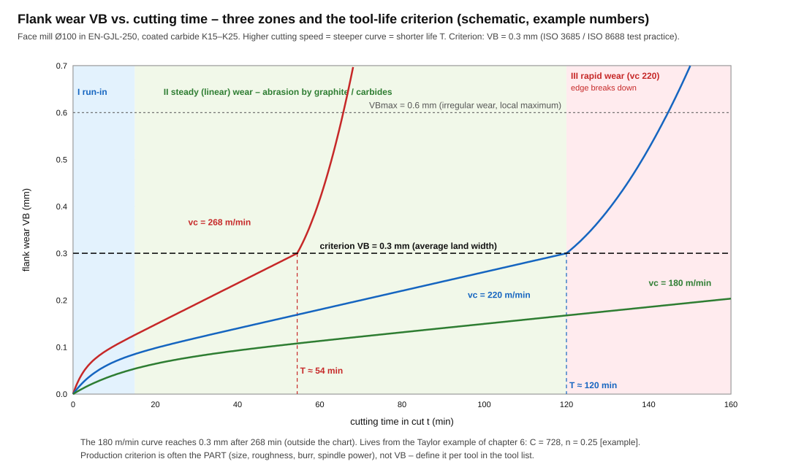
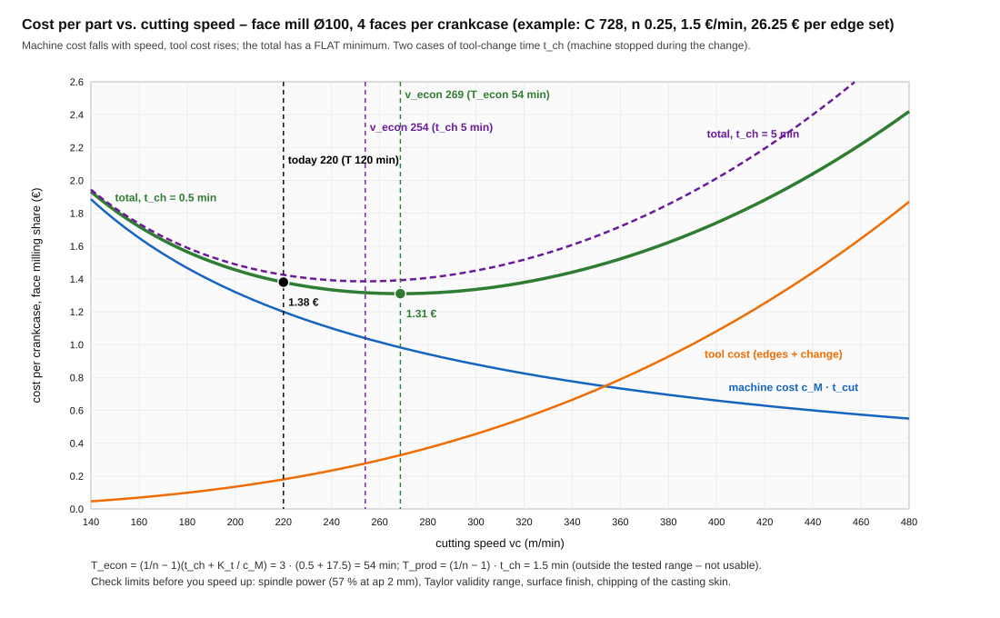
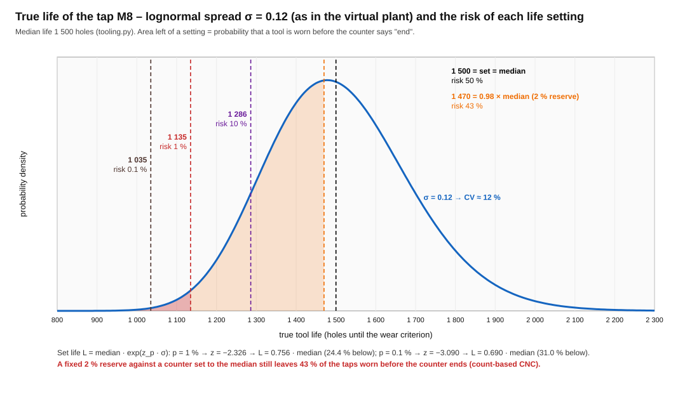
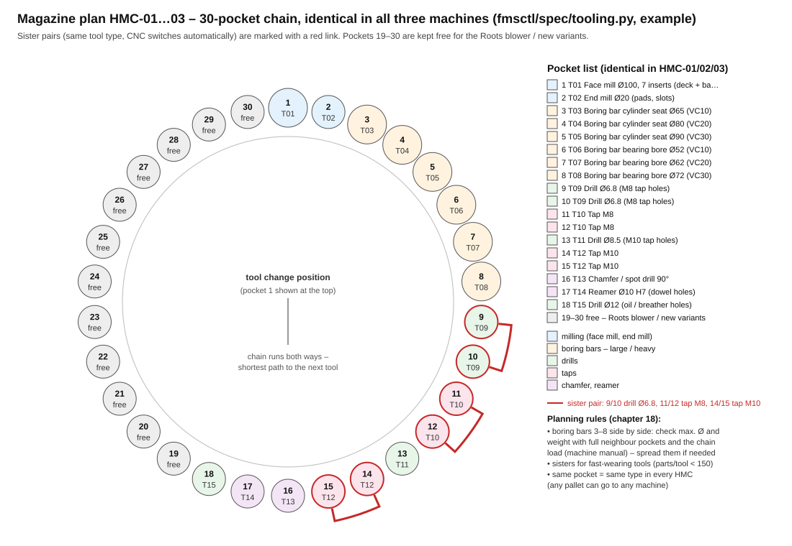
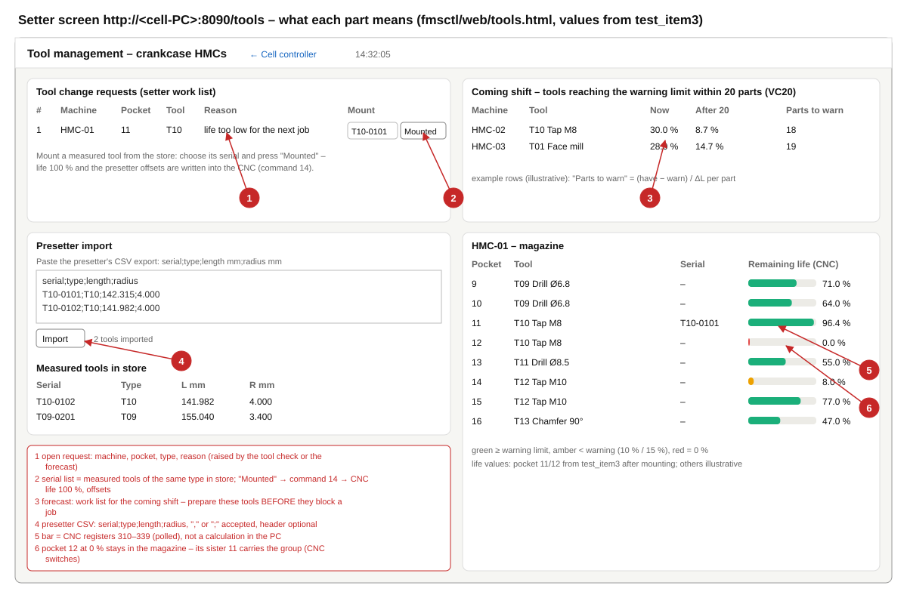

# 55 – Tool Management for the Crankcase HMCs: Wear, Tool Life, Statistics, Presetting and the fmsctl Implementation

> **FMS control system – item 3** (package `fmsctl/`, guide 53 §7c). State: **November 2026**.
> This guide is a textbook **and** an implementation manual. It explains the physics, the mathematics and the
> economics of cutting-tool life, and then shows step by step how the tool management of the crankcase cell is built,
> tested and run in a real factory.
>
> **All tool data, cutting data, prices and test results in this guide are examples** unless a source is given.
> Real cutting data comes from your tool supplier and from your own trials. Real CNC parameters come from the CNC
> manual and the machine builder. **Never change offsets, life values or NC programs on a production machine without a
> qualified person and a first-part check.**

**Labels used for numbers.** Every number carries one label:

| Label | Meaning |
|---|---|
| [code] | value taken from the fmsctl source code (`fmsctl/spec/tooling.py`, `fmsctl/tooling/manager.py`, …) |
| [example] | an assumed example value – replace it with your own data |
| [design] | a value chosen by design in this guide or in the project (can be changed by a decision) |
| [calculated] | calculated in this guide from other values; every calculation was re-run in Python 3.12 |
| [simulated] | result of the virtual plant (`fmsctl/sim/virtual_plant.py`) or a simulated data set |
| [estimate] | a rough market or experience value – ask for a quote or check the datasheet |
| [typical] | a range found in textbooks and catalogues – your process may differ |

**Company rules that shape this guide.** Only **Ethernet, Modbus TCP and HTTP** between the machines and the FMS
computers. The PCs of the factory are **offline** (no internet). No cloud services: cloud tool-management platforms
are **not usable offline** and are therefore not considered. All software in `fmsctl` is Python 3.12, standard library
only.

---

## Contents

**Part A – Understand**

1. Purpose and scope
2. Where in the project (files, screen, test)
3. The crankcase, its material and its tool list
4. Tool wear mechanisms in grey cast iron
5. Measuring wear, tool-life criteria and tool-life testing
6. Taylor's tool-life equation
7. Economics – cost per part and the optimum tool life
8. Statistics of tool life – spread, risk and the reserve
9. Tool breakage versus wear, and tool monitoring
10. Bayesian learning of tool life (link to thesis chapter 4)
11. Tool-life management inside the CNC
12. Tool presetting
13. Tool identification (RFID, Data Matrix)
14. Offsets in the CNC – length, radius, wear

**Part B – Implement**

15. Architecture of item 3 in fmsctl – data model and states
16. The tool check before every job – algorithm, numbers, test
17. Forecast and change requests
18. Magazine planning rules
19. Tool list per NC program – deriving the uses per part (worked example O1020)
20. Command 14 – writing offsets and life into the CNC
21. Presetter integration – CSV format and configuration
22. Tool store (crib) sizing – usage, safety stock, regrind loop, holders
23. Setter procedures (standard operating procedures)
24. Key performance indicators (KPIs)
25. FAT and SAT – acceptance tests for tool management
26. FMEA – what can go wrong
27. Troubleshooting
28. Gaps in the fmsctl tool management and recommended changes
29. Buy list – catalogue examples
30. Consolidated shopping list
31. Standards
32. For the doctoral thesis
33. Data inconsistencies and open points
34. Glossary

**Drawings** (folder `docs/img/`):
`55_flank_wear_curve.svg` (ch. 5), `55_taylor_loglog.svg` (ch. 6), `55_cost_vs_speed.svg` (ch. 7),
`55_life_distribution.svg` (ch. 8), `55_tool_data_flow.svg` (ch. 15), `55_tool_check_flowchart.svg` (ch. 16),
`55_magazine_layout.svg` (ch. 18), `55_setter_screen.svg` (ch. 23).

**Related guides.** 08 (CNC and G-code: §21 tool selection, §22 tool life, §26 probing), 12 (HMC build: spindle
interface), 53 (FMS control system: §7c item 3 summary), 15 (numbering), 16 (standards register), thesis chapter 4
(conjugate Bayesian models).

---

# Part A – Understand

## 1. Purpose and scope

### 1.1 Why tool management matters in a crankcase FMS

Three horizontal machining centres (HMC-01, HMC-02, HMC-03) machine the crankcases of the V-type piston air
compressors VC10, VC20 and VC30. Each crankcase needs about 15 different tools: a face mill, an end mill, boring bars,
drills, taps, a chamfer tool and a reamer [code]. The machines run unattended for long periods. Pallets come and go
automatically. Nobody stands next to the machine and listens to the cut.

In such a system **most unplanned stops and most scrap come from tools**:

- A worn tap breaks in a hole. The crankcase is scrap or needs an expensive repair (thread insert).
- A boring bar wears and the bearing seat Ø62 K7 drifts out of tolerance. If nobody measures, many parts are bad.
- The tool group in the CNC is used up in the middle of a part. The CNC stops with an alarm; the part is unfinished.
- The wrong tool, or the right tool with the wrong length offset, is put in a pocket. The first cut is a crash.

Tool management is the set of **data, rules, devices and procedures** that prevents these events and keeps the tool
cost per part low.

### 1.2 What this guide covers

| Topic | Part A (understand) | Part B (implement) |
|---|---|---|
| Wear and life | mechanisms, criteria, Taylor, economics | life values in `tooling.py`, KPI "life achieved" |
| Risk | statistics of life, breakage, reserve for a target risk | tool check with reserve, recommended risk-based reserve |
| Learning | Bayesian updating (thesis ch. 4) | which data fmsctl collects, gaps |
| CNC | tool-life management, sister tools, offsets | command 14, registers 310–345, PMC side |
| Presetting | principle, accuracy, thermal effects, formats | CSV import, configuration |
| Logistics | identification, store | crib sizing, holders, regrind loop, SOPs |
| Quality | – | FAT / SAT, FMEA, troubleshooting |
| Buying | – | buy list with makers and series, shopping list |

### 1.3 What the system does in one sentence

**Before every job the tool manager checks that every tool group the NC program needs has enough remaining life for
the job plus a reserve; if not, the job is not started, the pallet goes to a machine with fit tools, and the setter
gets a change request; the setter mounts a tool measured on the presetter and the system writes the offsets and the
new life into the CNC.**

---

## 2. Where in the project

### 2.1 Files

| File | What it contains |
|---|---|
| `fmsctl/spec/tooling.py` | 15 example tool types (description, nominal life in uses, warning limit %), the magazine plan (pocket → type, same in all three HMCs), the tool list per NC program (`PROGRAM_TOOLS`), the function `usage_pct()` |
| `fmsctl/tooling/manager.py` | class `ToolManager`: database tables `tool_item`, `magazine`, `tool_req`; `check()`, `on_job_done()`, `forecast()`, `request()`, `complete()`, `import_presetter()`, `snapshot()`; constant `RESERVE = 20` (2 %) |
| `fmsctl/spec/regmap.py` | register map V1.2: CNC registers 310–339 remaining life per pocket (0.1 %), command 14 parameters 402–408, echo 340–345 |
| `fmsctl/cell/controller.py` | cell controller; calls `tools.check()` before each HMC job and when it chooses a machine for a raw pallet; calls `tools.on_job_done()` after a finished job; polls registers 310–339 |
| `fmsctl/cell/server.py` | HTTP: `GET /tools`, `GET /api/tools`, `POST /api/tools/import`, `POST /api/tools/complete` |
| `fmsctl/web/tools.html` | the setter screen |
| `fmsctl/sim/virtual_plant.py` | the virtual CNC: tool-life management with sister groups, true life spread (lognormal σ = 0.12), alarm 201 when a group expires, command 14 |
| `fmsctl/tests/test_item3.py` | acceptance test A/B (8 checks) |

### 2.2 Run it

```
cd c:\Users\Administrator\Pictures\Digitaltwin
python -m fmsctl.tests.test_item3          (about 2 minutes, virtual plant at speed x50)
```

Result of the run for this guide (2026-11-14) [simulated]:

```
PASS | A (no tool check): worn tap group causes an aborted job | 1 aborted, HMC-01 DOWN alarm 201, WO-A 2 good / 1 scrap
PASS | presetter CSV import | 3 tools measured into store
PASS | B: tool check blocked the job before the tap group expired | tool check blocks O1020: T10 Tap M8: 3.0 % left in group, job needs 3.1 %
PASS | B: change request raised and completed by the setter | mounted [(11, 'T10-0101')]
PASS | B: command 14 wrote life 100 % and presetter offsets into the CNC | pocket 11: L 142.315 R 4.000, life 96.4 %
PASS | B: work order finished with no aborted job | 4 good / 0 scrap, aborted 0
PASS | tool snapshot: 3 magazines x 18 pockets, store, forecast | store 2 tools, forecast 0 warnings
PASS | HTTP: /api/tools and the setter screen
8 / 8 checks passed
```

(The life shows 96.4 % and not 100 % because production continued after the mount: about three VC20 parts with the
weaker-than-nominal new tap [simulated].)

### 2.3 Screen

With the cell controller running: `http://<cell-PC>:8090/tools` (link from the cell screen). The screen is explained
in chapter 23 with the annotated drawing `55_setter_screen.svg`.

---

## 3. The crankcase, its material and its tool list

### 3.1 Material: grey cast iron EN-GJL-250

The crankcases (and the cylinders) are castings of **EN-GJL-250** (old name GG25; material number EN-JL1040; standard
EN 1561) [design, guide 08 §11.1, guide 13 §4]. Properties that matter for the tools:

| Property | Value | Effect on the tools |
|---|---|---|
| Tensile strength | ≥ 250 N/mm² (separately cast test bar; lower in thick walls) | moderate cutting forces |
| Hardness | about 180–230 HB, depends on the wall thickness – agree with the foundry [typical] | harder zones = faster wear; hardness spread = life spread |
| Structure | pearlite matrix + **graphite flakes**; hard particles (steadite, carbides) possible near thin walls | **abrasive** wear; short, crumbly chips; graphite dust |
| Specific cutting force | kc1.1 ≈ 1 100–1 150 N/mm², mc ≈ 0.25–0.28 [typical, guide 08 §10.2] | power and torque, see guide 08 §20 |
| Casting skin | sand inclusions, scale, hard edges | chipping and notch wear on the first cut |
| Chips | discontinuous; dry machining is possible | no long chips around the tool; dust needs extraction |

ISO 513 puts grey cast iron in the **K group** (colour red). Typical cutting materials: CVD Al₂O₃-coated carbide
K10–K25, silicon-nitride ceramics for high-speed face milling, CBN for fine boring [typical, guide 08 §21].

### 3.2 The machined features and the tools

The example tool list of `fmsctl/spec/tooling.py` [code]:

| Type | Description | Nominal life (uses) | Warning limit | Use on the crankcase |
|---|---|---|---|---|
| T01 | Face mill Ø100, 7 inserts | 600 faces | 15 % | cylinder decks, base face, cover face |
| T02 | End mill Ø20 | 900 | 15 % | pads, slots |
| T03 | Boring bar cylinder seat Ø65 (VC10) | 450 bores | 15 % | cylinder seat VC10 |
| T04 | Boring bar cylinder seat Ø80 (VC20) | 450 | 15 % | cylinder seat VC20 (see 3.4) |
| T05 | Boring bar cylinder seat Ø90 (VC30) | 400 | 15 % | cylinder seat VC30 |
| T06 | Boring bar bearing bore Ø52 (VC10) | 500 | 15 % | bearing seats VC10 |
| T07 | Boring bar bearing bore Ø62 (VC20) | 500 | 15 % | bearing seats VC20 (Ø62 K7) |
| T08 | Boring bar bearing bore Ø72 (VC30) | 450 | 15 % | bearing seats VC30 |
| T09 | Drill Ø6.8 (M8 tap holes) | 2 400 holes | 10 % | core holes M8 |
| T10 | Tap M8 | 1 500 holes | 10 % | threads M8 (cylinder studs, bearing covers) |
| T11 | Drill Ø8.5 (M10 tap holes) | 2 000 | 10 % | core holes M10 |
| T12 | Tap M10 | 1 200 | 10 % | threads M10 (feet, covers) |
| T13 | Chamfer / spot drill 90° | 4 000 | 10 % | chamfers of all 22 threaded holes |
| T14 | Reamer Ø10 H7 | 1 600 | 10 % | 2 dowel holes (locating holes for later operations) |
| T15 | Drill Ø12 | 1 800 | 10 % | oil and breather holes |

**"Use"** is the unit of life: one face for a face mill, one bore for a boring bar, one hole for a drill, tap, chamfer
tool or reamer. Chapter 11 explains why the CNC counts in uses and chapter 19 how the uses per part are derived from
the NC program.

### 3.3 Uses per part (tool list per NC program)

`PROGRAM_TOOLS` [code] gives, per NC program, the tool types and the uses per part. All three programs share a
common part; only the boring bars differ:

| Program | Variant | Common tools (uses per part) | Variant tools |
|---|---|---|---|
| O1010 | VC10 | T01 4, T02 6, T09 16, T10 16, T11 6, T12 6, T13 22, T14 2, T15 3 | T03 2, T06 2 |
| O1020 | VC20 | same | T04 2, T07 2 |
| O1030 | VC30 | same | T05 2, T08 2 |

Note: 22 chamfers = 16 M8 holes + 6 M10 holes. The chamfer count is therefore consistent with the thread count [code,
checked].

### 3.4 Data check before you start

| Item | Project data | Remark |
|---|---|---|
| Material | EN-GJL-250 for crankcase and cylinder (guide 08 §11.1, guide 13 §4) | consistent |
| VC20 bearing seat | Ø62 K7 (guide 13 §4, guide 08 §20.4); T07 Ø62 [code] | consistent |
| VC20 cylinder bore | real design **Ø75** H7 (guide 13 §4.6: Ø75 × 50, 1 150 rpm, 20.3 m³/h), machined in the **cylinder** on VMC-01 | the crankcase tool T04 is called "cylinder seat **Ø80**" [code] |
| VC10 / VC30 bores | Ø65 / Ø90 (guide 13 §4.7 option B) | T03 / T05 seats are named Ø65 / Ø90 – equal to the **bores** |

The "cylinder seat" in the crankcase is the spigot recess that centres the cylinder. It must be **larger** than the
cylinder bore (bore + 2 × cylinder wall). For VC10 and VC30 the tool names equal the bore diameters, for VC20 the name
(Ø80) is neither the bore (Ø75) nor a plausible seat. **Flag:** the seat diameters must come from the crankcase
drawing; until then T03–T05 are placeholders. The tool-management logic does not depend on the diameter, but the
presetter limits, the holder choice and the buy list do. See chapter 33 for all inconsistencies.

---

## 4. Tool wear mechanisms in grey cast iron

### 4.1 Where the edge loses material

A cutting edge has two faces: the **rake face** (the chip flows over it) and the **flank face** (it faces the newly
cut surface). The edge wears on both faces because of **mechanical load, temperature and chemistry**. Five
mechanisms matter:

| Mechanism | What happens | Driven by | In EN-GJL-250 |
|---|---|---|---|
| **Abrasion** | hard particles in the work material scratch the tool like sandpaper | hardness of the particles relative to the tool; sliding distance | **dominant**: pearlite, phosphide eutectic (steadite), carbides, sand; gives the even flank wear land VB |
| **Adhesion** | micro-welds between chip and tool tear out tool particles | low speed, clean metal surfaces, pressure | small; graphite acts as a lubricant |
| **Diffusion** | atoms move from the tool into the chip (C, Co, W) at high temperature | temperature (above about 800 °C) | small at normal speeds; grows at very high speed with uncoated carbide |
| **Chipping / fracture** | small pieces or the whole edge break | interrupted cut, vibration, inclusions, casting skin, entry shock | **important** in face milling (each tooth enters the cut 700 times a minute) and at the casting skin |
| **Built-up edge (BUE)** | work material welds to the edge, grows and breaks off, taking tool particles with it | low cutting speed, ductile material | rare in grey iron (short chips); can appear in taps and reamers at very low speed |

Further forms (guide 08 §22.1): crater wear KT (diffusion, mainly steel), notch wear at the depth-of-cut line (casting
skin), thermal cracks (changing temperature in interrupted cuts with coolant), plastic deformation (too much heat and
force).

### 4.2 Why grey iron is abrasive but "easy"

- The **graphite flakes** break the chip into small pieces: low cutting forces, low temperature, no chip tangles.
- The **graphite** also lubricates the contact: adhesion and BUE are small.
- But the **matrix contains hard phases**. Pearlite (≈ 250–300 HV) is softer than carbide (≈ 1 500 HV), but steadite
  and free carbides (up to ≈ 1 000 HV and more) [typical] and sand grains (quartz ≈ 1 100 HV) scratch the edge.
  Abrasive wear grows roughly in proportion to the **sliding distance** – which is why tool life in grey iron is
  often well described by "uses" (faces, holes) and by cutting time.

**Design rule 4.1.** For grey iron choose a **wear-resistant** K grade with a thick Al₂O₃ CVD coating for turning,
boring and face milling; choose a **tougher** grade or a stronger edge (negative land, hone) where chipping dominates
(interrupted face milling over cored holes, casting skin). Your tool supplier's application engineer decides.

### 4.3 Wear by tool type on the crankcase

| Tool | Typical end of life | What you see | Consequence if ignored |
|---|---|---|---|
| Face mill T01 | flank wear + micro-chipping of inserts | VB land, burr at the exit edge, edge break-out of the casting at the exit | deck flatness 0.03 lost, gasket leak, spindle load rises |
| End mill T02 | flank wear on the periphery, corner chipping | size of pads, rough walls | burr, chatter |
| Boring bars T03–T08 | flank wear at the nose radius | diameter becomes **smaller** (edge recedes), roughness rises | Ø62 K7 out of tolerance, bearing fit too tight |
| Drills T09, T11, T15 | wear at the outer corners (margin), chisel edge | hole oversize/undersize, burr, higher thrust and torque | **tap breaks** in a bad core hole |
| Taps T10, T12 | wear of the chamfer (lead) teeth, chipping, BUE | thread gauge GO does not enter, torque rises | **tap breakage** – the most expensive tool failure on a crankcase |
| Chamfer T13 | corner wear | chamfer size | thread start damaged |
| Reamer T14 | wear at the lead and on the margins | hole undersize, roughness | dowel fit lost |

**Key point.** For taps and small drills the end of life is often **not** a gradual wear limit but a **sudden
breakage**. Chapter 9 treats breakage separately from wear because the statistics are different.

---

## 5. Measuring wear, tool-life criteria and tool-life testing

### 5.1 Wear measures

| Measure | Symbol | How measured | Used for |
|---|---|---|---|
| Average flank wear land width | VB (VB_B) | toolmaker microscope on the flank face, in the uniform zone of the land | standard life criterion |
| Maximum flank wear | VB_max (VB_B max) | largest local land width (irregular wear, chipping) | criterion when wear is not even |
| Crater depth | KT | profilometer / microscope on the rake face | steel, high speed |
| Notch wear | VN | at the depth-of-cut line | casting skin |
| Corner wear | VC | at the corner radius | drills, boring nose |



### 5.2 The wear curve – three zones

The drawing shows VB against cutting time:

1. **Zone I – run-in.** The sharp edge rounds quickly. VB grows fast for a short time.
2. **Zone II – steady wear.** VB grows almost **linearly**. This zone is the useful life. Its slope (mm per minute or
   per use) is the **wear rate** – it rises strongly with the cutting speed.
3. **Zone III – rapid wear.** Temperature and forces rise with the wear land; the edge breaks down. Change the tool
   before this zone.

**Linear model in zone II** (used later for extrapolation, chapter 10.5):

$$VB(N) \approx VB_0 + w \cdot N$$

with VB₀ = wear after run-in, w = wear rate per use, N = number of uses.

**Worked example 5.1 (extrapolating the life of a tap that was changed early).** A tap was removed at N = 1 290 holes
[example]. On the toolmaker microscope the chamfer flank shows VB = 0.18 mm. Run-in wear VB₀ = 0.05 mm, criterion
VB_crit = 0.30 mm [example]:

```
w        = (0.18 − 0.05) / 1290                = 1.008e-4 mm per hole
N_crit   = (0.30 − 0.05) / w = 1290 · 0.25 / 0.13 = 2481 holes     [calculated]
```

The tap would have lasted about 2 480 holes if wear had been the only limit. This is an **estimate** (linear zone II
assumed, breakage ignored); it is still much better than "unknown", and it is the basis for learning true lives from
tools that are changed preventively (chapter 10).

### 5.3 Tool-life criteria

| Criterion | Example value | Where used |
|---|---|---|
| Average flank wear | **VB = 0.3 mm** | ISO 3685 (turning) and ISO 8688-1 / -2 (milling) test practice [check the standard for the exact definition and conditions] |
| Maximum flank wear | **VB_max = 0.6 mm** (irregular wear) | ISO 3685 / ISO 8688 practice [check the standard] |
| Crater depth | KT = 0.06 + 0.3 · f (mm) | ISO 3685 (turning) [check] |
| Catastrophic failure | breakage, chipping > limit | always |
| **Production criteria** | size drift (bore Ø), roughness Ra, burr height, thread gauge, spindle power +20 % | the real criterion in production |

**Design rule 5.1 – define the criterion per tool in the tool list.** Use the **part** as the judge:

| Tool | Production criterion [example] |
|---|---|
| T01 face mill | burr at the deck exit edge > 0.2 mm, or flatness > 0.02 (of 0.03), or VB > 0.3 |
| T07 boring bar Ø62 K7 | diameter drift > 10 µm (one third of IT7 = 30 µm) that cannot be compensated by offset, or Ra > 1.2 (limit 1.6) |
| T10 tap M8 | GO gauge tight on 1 of the last 5 holes checked, or spindle torque +25 % over the taught value |
| T14 reamer Ø10 H7 | diameter at the lower limit + 2 µm, or Ra > 0.8 |

### 5.4 Tool-life testing – how to get the numbers

The nominal life values in `tooling.py` are examples. In the real factory you get them from **trials**:

**Step 1 – plan.** Same machine, same holder, same casting batch (hardness recorded), same coolant. Change **one**
factor at a time (cutting speed). At least **two speeds** (for Taylor's n and C, chapter 6), better three. At least
**three edges** (or tools) per speed for the spread (chapter 8).

**Step 2 – run.** Stop at fixed intervals (e.g. every 25 holes or 10 faces). Measure VB on the microscope (or in the
presetter with a camera), and measure the part feature (diameter, gauge, roughness).

**Step 3 – record.** Table: tool serial, speed, feed, uses, cutting time, VB, part measure, remarks (chipping, noise).

**Step 4 – evaluate.** Plot VB against uses. Read the life at VB_crit (interpolate). Fit Taylor (chapter 6). Compute
the spread (chapter 8). Set the life value with a risk-based rule (chapter 8.6), not the mean.

**ISO 3685** describes tool-life testing with single-point turning tools (reference conditions, wear measurement,
criteria, evaluation) and **ISO 8688-1 / -2** the same for face milling and end milling [check the current editions].
They are written for laboratory comparisons; in production you use their **method** (criterion, measurement, evaluation)
with your real tools and parts.

**Common mistakes (chapter 5).**
- Measuring VB in a different place each time (use the uniform zone of the land, always the same edge).
- Testing on soft "good" castings only – the hard castings decide the life.
- One tool per speed: no spread known, the life value is a guess.
- Using the mean life as the life setting (chapter 8 shows that half of the tools then fail before the counter ends).

---

## 6. Taylor's tool-life equation

### 6.1 The principle

F. W. Taylor (1907) found that the tool life T falls very strongly when the cutting speed v_c rises, and that the
relation is a **straight line in a log–log diagram**:

$$v_c \cdot T^{\,n} = C$$

| Symbol | Meaning | Unit |
|---|---|---|
| v_c | cutting speed | m/min |
| T | tool life (time in cut until the criterion, e.g. VB = 0.3 mm) | min |
| n | Taylor exponent – depends mainly on the cutting material | – |
| C | Taylor constant = cutting speed that gives T = 1 min | m/min |

Solved for the life:

$$T = \left(\frac{C}{v_c}\right)^{1/n}$$

Taking logarithms: log T = (1/n) · log C − (1/n) · log v_c → straight line with **slope −1/n**.


### 6.2 Typical exponents

| Cutting material | n (typical) | Life change for +10 % speed | for −10 % speed |
|---|---|---|---|
| HSS / HSS-E (taps, some drills) | 0.10–0.15 | × 0.45 (n = 0.12) | × 2.41 |
| Cemented carbide, coated | 0.20–0.30 | × 0.68 (n = 0.25) | × 1.52 |
| Ceramics, CBN | 0.4–0.7 | × 0.83 (n = 0.5) | × 1.23 |

[typical ranges as in guide 08 §10.4; factors calculated: factor = (v₂/v₁)^(−1/n)]

### 6.3 Worked example 6.1 – convert a speed change into a life change

The face mill T01 runs at 220 m/min. The programmer wants +10 % speed (242 m/min) to save cycle time. Coated carbide,
n = 0.25 [example]:

```
T2 / T1 = (v2 / v1)^(−1/n) = 1.10^(−4) = 0.683                         [calculated]
Life in faces: 600 faces → 0.683 · 600 = 410 faces at 242 m/min       [calculated]
```

But each face is cut 10 % faster, so the **life in time** drops to 68.3 %, while the **life in faces** drops to the
same 68.3 % (time per face × faces = time). With +20 %: factor 1.2^(−4) = **0.482** – less than half the life.

**Design rule 6.1.** After any change of cutting speed, **change the life value in the CNC and in `tooling.py`** by
the factor (v₂/v₁)^(−1/n). If you forget it, the counter still expects 600 faces while the tool lasts only 410.

### 6.4 Worked example 6.2 – fit n and C from two test points

The guide 08 face-mill trial (§22.3): 180 m/min → 30 min, 250 m/min → 8 min [example, guide 08]:

```
n = ln(v2 / v1) / ln(T1 / T2) = ln(250/180) / ln(30/8) = 0.3285 / 1.3218 = 0.249     [calculated]
C = v1 · T1^n = 180 · 30^0.249 = 419                                                  [calculated]
T at 220 m/min = (419 / 220)^(1/0.249) = 13.4 min                                      [calculated]
```

A second example with the **drill T09 Ø6.8** (carbide, internal coolant), feed f = 0.15 mm/rev, drilling length
including approach L = 23 mm [example]. Trials give the life in **holes** at two speeds [example]:

| Trial | v_c (m/min) | Spindle speed n = 1000·v_c/(π·d) | Time per hole t = L/(n·f) | Holes until criterion | Life T = holes · t |
|---|---|---|---|---|---|
| 1 | 75 | 3 511 rpm | 0.0437 min | 4 150 | 181.3 min |
| 2 | 110 | 5 149 rpm | 0.0298 min | 1 310 | 39.0 min |

```
n = ln(110/75) / ln(181.3/39.0) = 0.3830 / 1.5362 = 0.249                            [calculated]
C = 75 · 181.3^0.249 = 274                                                            [calculated]
At 90 m/min: n = 4 213 rpm, t = 23 / (4213 · 0.15) = 0.0364 min = 2.18 s per hole
T = (274 / 90)^(1/0.249) = 87.2 min → 87.2 / 0.0364 = 2 397 ≈ 2 400 holes           [calculated]
```

The 2 400 holes match the nominal life of T09 in `tooling.py` [code]: the example trials were chosen so that the code
and this guide are consistent. At 80 m/min the same tool would last 3 417 holes, at 100 m/min only 1 745 holes
[calculated].

**How to fit with more than two points.** Take x = ln v_c, y = ln T for every test and fit a straight line
y = a + b·x by least squares; then n = −1/b and C = exp(−a/b). With three or more points you also see whether the
points really lie on a line (if not, you are outside the Taylor range).

### 6.5 Taylor for tools whose life is counted in uses

The CNC counts **uses**, not minutes. With t_use = time in cut per use:

$$N = \frac{T}{t_{use}} = \frac{(C/v_c)^{1/n}}{t_{use}(v_c)}$$

Because t_use is proportional to 1/v_c, the life in uses falls with exponent (1/n − 1) instead of 1/n:
N ∝ v_c^(−(1/n − 1)). For n = 0.25: N ∝ v_c^(−3).

### 6.6 Extended Taylor equation – feed and depth of cut

Feed f and depth of cut a_p also shorten the life, but much less than the speed:

$$v_c \cdot T^{\,n} \cdot f^{\,a} \cdot a_p^{\,b} = C_{ext}$$

Typical order: the speed has the strongest effect, then the feed, then the depth (a < 1, b < a) [typical; fit a and b
from your own tests]. Solved for T:

$$T = C_{ext}^{1/n} \cdot v_c^{-1/n} \cdot f^{-a/n} \cdot a_p^{-b/n}$$

**Worked example 6.3 – is a higher feed better than a higher speed?** Face mill, n = 0.249, a = 0.4 [example].
Feed +20 % at the same speed:

```
T factor        = 1.2^(−a/n) = 1.2^(−1.606) = 0.746                    [calculated]
Cut time / part = 1 / 1.2 = 0.833 (20 % faster)
Parts per edge  ∝ T · f   = 1.2^(1 − 1.606) = 0.895                   [calculated]
```

A feed increase of 20 % costs only 10.5 % of the parts per edge, while a speed increase of 20 % costs 51.8 % of the
life (n = 0.25). **Design rule 6.2:** to shorten the cycle time, raise the **feed** first (within chip-thickness,
roughness and power limits), the speed last.

### 6.7 Limits of Taylor

- Valid only **inside the tested speed range**. Outside, other wear mechanisms (BUE at low speed, diffusion or
  plastic deformation at high speed, chipping) change the line.
- Gives the **mean** behaviour. Real lives spread around the line (chapter 8).
- Does not describe **breakage** (chapter 9).
- n and C change with the **casting batch and hardness**, the coolant, the holder run-out (guide 08 §21.8) and the
  insert grade. Re-test after such changes.

---

## 7. Economics – cost per part and the optimum tool life

### 7.1 The cost model

For one tool, the cost per part has three parts:

$$k = \underbrace{c_M \cdot t_m}_{\text{machine time in cut}} \;+\; \underbrace{\left(c_M \cdot t_{ch} + K_t\right)\frac{t_m}{T}}_{\text{tool change + tool cost, shared over the parts of one life}} \;+\; \underbrace{c_M \cdot t_{other}}_{\text{rapid moves, load, \dots}}$$

| Symbol | Meaning | Example value |
|---|---|---|
| c_M | machine + labour rate | 1.5 €/min = 90 €/h [example, as guide 08 §22.4] |
| t_m | time in cut per part for this tool | 0.8 min (face mill, 4 faces × 0.2 min) [example] |
| T | tool life in min in cut | from Taylor |
| t_ch | machine time lost per tool change | 0.5 min or 5 min (see 7.3) [example] |
| K_t | tool cost per life (edge set, or tool price / number of lives incl. regrinds) | 26.25 € for 7 inserts × 3.75 € per edge [estimate] |

t_m/T = fraction of a tool life used by one part. The last term does not depend on the cutting speed and is left out
below.

### 7.2 Optimum tool life

Insert T = (C/v)^(1/n) and t_m ∝ 1/v, differentiate k by v and set to zero. Result (classic):

$$T_{econ} = \left(\frac{1}{n} - 1\right)\left(t_{ch} + \frac{K_t}{c_M}\right) \qquad \text{(minimum cost per part)}$$

$$T_{prod} = \left(\frac{1}{n} - 1\right) t_{ch} \qquad \text{(maximum production rate, minimum time per part)}$$

$$v_{econ} = \frac{C}{T_{econ}^{\,n}}, \qquad v_{prod} = \frac{C}{T_{prod}^{\,n}}$$

**Meaning.** An expensive machine (large c_M) pushes T_econ down (cut faster); an expensive tool (large K_t) pushes it
up (cut slower). The maximum-rate life is always shorter than the minimum-cost life. Between v_econ and v_prod is the
"high-efficiency range".

### 7.3 Why the FMS changes the economics: t_ch

In a stand-alone machine the operator stops the machine, indexes 7 inserts and touches off: t_ch ≈ 5 min [example].
In the FMS the setter prepares a **preset sister tool** off-line; the machine only loses the tool-change time and a
short check: t_ch ≈ 0.5 min [example]; if the magazine can be loaded while the machine cuts, even less. A small t_ch
makes **T_prod very short** and moves **T_econ** towards K_t/c_M only.

### 7.4 Worked example 7.1 – face mill T01

Example Taylor constants for T01 chosen to match `tooling.py`: life 600 faces at the programmed 220 m/min with 0.2 min
in cut per face → T = 120 min; with n = 0.25: C = 220 · 120^0.25 = **728** [example/calculated]. (The guide 08 trial
gives a much shorter life, 13.4 min at 220 m/min; the real trial decides – chapter 33.)

```
1/n − 1 = 3
Case A, t_ch = 5 min:   T_econ = 3 · (5 + 26.25/1.5)   = 3 · 22.5 = 67.5 min → v_econ = 728 / 67.5^0.25 = 254 m/min
                        T_prod = 3 · 5                  = 15 min   → v_prod = 728 / 15^0.25   = 370 m/min
Case B, t_ch = 0.5 min: T_econ = 3 · (0.5 + 17.5)      = 54.0 min → v_econ = 728 / 54^0.25   = 269 m/min
                        T_prod = 3 · 0.5                = 1.5 min  → v_prod = 658 m/min (far outside the tested range)
                                                                                                  [all calculated]
```

Cost per crankcase for the face-milling share, case B (t_ch = 0.5 min) [calculated]:

| v_c (m/min) | T (min) | Faces per edge set | Cut time per part (min) | Machine cost (€) | Tool + change cost (€) | **Total (€)** |
|---|---|---|---|---|---|---|
| 150 | 555 | 1 893 | 1.173 | 1.760 | 0.057 | 1.817 |
| 180 | 268 | 1 095 | 0.978 | 1.467 | 0.099 | 1.565 |
| 200 | 176 | 799 | 0.880 | 1.320 | 0.135 | 1.455 |
| **220 (today)** | 120 | 600 | 0.800 | 1.200 | 0.180 | **1.380** |
| 250 | 72 | 409 | 0.704 | 1.056 | 0.264 | 1.320 |
| **269 (v_econ)** | 54 | 330 | 0.655 | 0.983 | 0.328 | **1.310** |
| 300 | 35 | 237 | 0.587 | 0.880 | 0.456 | 1.336 |
| 350 | 19 | 149 | 0.503 | 0.754 | 0.725 | 1.479 |
| 400 | 11 | 100 | 0.440 | 0.660 | 1.082 | 1.742 |



**Reading the result.**
1. The minimum is **flat**: from 250 to 300 m/min the cost changes by less than 2 %. Exact optimisation is not needed;
   staying in the flat zone is.
2. Going from 220 to 269 m/min saves 0.07 € per part (5 %) and 0.15 min cycle time per part, but the life drops from
   600 to 330 faces: **82 parts per edge set instead of 150** → almost twice as many tool changes (chapter 22).
3. **Check the limits** before you speed up: spindle power. Guide 08 §20.3 gives 4.84 kW at 220 m/min and a_p 2 mm.
   Power grows with v_c: 4.84 · 269/220 = 5.92 kW. The spindle gives 115 N·m · 856 rpm / 9 550 = 10.3 kW at 856 rpm →
   **57 %** – below the 80 % rule [calculated]. Also check roughness, burr and chipping of the casting skin.
4. If the HMCs are the **bottleneck**, run nearer v_prod (but never outside the tested Taylor range); if they have spare
   capacity (thesis ch. 4: HMC 9 754 parts/month vs FINAL 5 667), run near v_econ or slower.

### 7.5 Worked example 7.2 – tap M8 (T10)

Data [example]: HSS-E tap for cast iron, v_c = 12 m/min, thread depth 16 mm, pitch 1.25 mm, n = 0.15, tap price
K_t = 25 € (not reground), t_ch = 0.5 min.

```
Spindle speed      n_s = 1000 · 12 / (π · 8)            = 477 rpm
Revolutions/hole   = 2 · 16 / 1.25 (in + out)         = 25.6 rev
Time in cut/hole   = 25.6 / 477                       = 0.0536 min = 3.22 s
Life at 12 m/min   T = 1 500 holes · 0.0536           = 80.4 min
Taylor constant    C = 12 · 80.4^0.15                 = 23.17
T_econ = (1/0.15 − 1)(0.5 + 25/1.5) = 5.667 · 17.17   = 97.3 min → v_econ = 23.17 / 97.3^0.15 = 11.7 m/min (1 763 holes)
T_prod = 5.667 · 0.5                                  = 2.83 min → v_prod = 19.8 m/min (only 87 holes!)
                                                                                                  [all calculated]
```

| v_c (m/min) | Holes per tap | Machine cost / part (16 holes) | Tool cost / part | **Total / part** |
|---|---|---|---|---|
| 10 | 4 215 | 1.544 | 0.098 | 1.642 |
| 11.7 | 1 731 | 1.320 | 0.238 | **1.558** |
| 12 (today) | 1 500 | 1.287 | 0.275 | 1.562 |
| 14 | 626 | 1.103 | 0.658 | 1.761 |
| 16 | 294 | 0.965 | 1.402 | 2.367 |

[calculated]

**Reading.** The tap runs practically at its economic speed. The maximum-rate speed (19.8 m/min, 87 holes per tap) is
useless: the tool cost explodes, and – more important – the **breakage risk** of a tap rises with speed and wear
(chapter 9), and one broken tap in a crankcase costs much more than the tap (scrap or repair). **Design rule 7.1:** for
taps, small drills and reamers use v_econ or slower, never v_prod; the cost of a failure (K_f, chapter 8.7) belongs in
the economics.

### 7.6 Tool cost per part – the whole tool list

Example prices and regrind assumptions [estimate – ask for a quote]: drills Ø6.8 / Ø8.5 45 € / 50 € new + 3 regrinds
at 12 €; chamfer tool 40 € + 4 regrinds at 10 €; reamer 90 € + 2 regrinds at 25 €; drill Ø12 60 € + 3 regrinds at 14 €;
end mill 60 €; boring bar inserts 30 € per life; taps 25 € / 30 €. Cost per life = (price + r · regrind cost)/(1 + r).

| Tool | Cost per life (€) | Uses per part | Life (uses) | Cost per VC20 part (€) |
|---|---|---|---|---|
| T01 face mill | 26.25 | 4 | 600 | 0.175 |
| T02 end mill | 60.00 | 6 | 900 | 0.400 |
| T09 drill Ø6.8 | 20.25 | 16 | 2 400 | 0.135 |
| T10 tap M8 | 25.00 | 16 | 1 500 | 0.267 |
| T11 drill Ø8.5 | 21.50 | 6 | 2 000 | 0.065 |
| T12 tap M10 | 30.00 | 6 | 1 200 | 0.150 |
| T13 chamfer | 16.00 | 22 | 4 000 | 0.088 |
| T14 reamer | 46.67 | 2 | 1 600 | 0.058 |
| T15 drill Ø12 | 25.50 | 3 | 1 800 | 0.043 |
| T04 boring bar seat | 30.00 | 2 | 450 | 0.133 |
| T07 boring bar Ø62 | 30.00 | 2 | 500 | 0.120 |
| **Total** | | | | **1.63 € per VC20 crankcase** [calculated] |

This KPI ("tool cost per part", chapter 24) is not yet computed by fmsctl – the tool cost is missing in the data model
(chapter 28).

---

## 8. Statistics of tool life – spread, risk and the reserve

### 8.1 Tool lives spread

Ten "identical" taps in the same holes do not reach the same life. Causes: hardness spread of the castings, small
differences in the tool grinding and coating, run-out of the holder, coolant concentration, chip evacuation. A typical
coefficient of variation (CV = standard deviation / mean) of wear-limited tool life is 10–30 % [typical]; breakage
makes the lower tail longer.

### 8.2 The lognormal model (used in the virtual plant)

The life L is **lognormal** if ln L is normally distributed: ln L ~ N(μ, σ²).

| Quantity | Formula | With median M = 1 500 holes, σ = 0.12 |
|---|---|---|
| Median | M = e^μ | 1 500 holes [code: nominal life] |
| Mean | M · e^(σ²/2) | 1 500 · 1.0072 = 1 511 holes |
| CV | √(e^(σ²) − 1) | 0.1204 ≈ 12 % |
| p-quantile | L_p = M · e^(z_p·σ) | see table 8.1 |
| Probability to fail before x | P(L < x) = Φ(ln(x/M)/σ) | see 8.3 |

The virtual plant draws for every tool `true_life = lognormvariate(0, 0.12)` – a factor with median 1 that multiplies
the nominal life [code].

**Why lognormal?** Life is the product of many independent factors (hardness × run-out × coating × …); by the central
limit theorem on the logarithm, a product of factors tends to a lognormal. It is also positive and right-skewed – like
real lives. The **Weibull** distribution is the other classic model (weakest-link logic); it has a heavier lower tail
(8.5).

### 8.3 The key question: how many tools fail before the counter says "end"?

If the CNC counts uses and the life value L_set is set equal to the **median**:

$$P(L < L_{set}) = \Phi\!\left(\frac{\ln(L_{set}/M)}{\sigma}\right) = \Phi(0) = 50\,\%$$

**Half of all tools wear out before the counter ends.** With a "2 % reserve" (L_set = 0.98 · M):

```
P = Φ(ln 0.98 / 0.12) = Φ(−0.168) = 43.3 %                                       [calculated]
```

A 2 % reserve against a median life setting is almost no protection against **life spread**.



### 8.4 Reserve for a target risk

Choose the risk p you accept (probability that a tool reaches the criterion before the counter ends). Then

$$L_{set} = M \cdot e^{\,z_p\,\sigma}, \qquad \text{reserve} = 1 - e^{\,z_p\,\sigma}$$

with z_p = standard normal quantile (z = −1.2816 for 10 %, −2.3263 for 1 %, −3.0902 for 0.1 %).

**Table 8.1 – reserve versus risk, σ = 0.12** [calculated]

| Risk p | z_p | Factor e^(z·σ) | Reserve | Tap M8 life setting (M = 1 500) | Face mill (M = 600) |
|---|---|---|---|---|---|
| 50 % | 0 | 1.000 | 0 % | 1 500 | 600 |
| 10 % | −1.2816 | 0.857 | 14.3 % | 1 286 | 514 |
| 5 % | −1.6449 | 0.821 | 17.9 % | 1 231 | 493 |
| **1 %** | −2.3263 | 0.756 | **24.4 %** | **1 135** | 454 |
| **0.1 %** | −3.0902 | 0.690 | **31.0 %** | **1 035** | 414 |
| 0.01 % | −3.7190 | 0.640 | 36.0 % | 960 | 384 |

**Table 8.2 – reserve needed for other spreads** [calculated]

| σ | Reserve for 10 % | for 1 % | for 0.1 % |
|---|---|---|---|
| 0.08 | 9.7 % | 17.0 % | 21.9 % |
| 0.12 | 14.3 % | 24.4 % | 31.0 % |
| 0.20 | 22.6 % | 37.2 % | 46.1 % |
| 0.30 | 31.9 % | 50.2 % | 60.4 % |

**What it means per year.** About 13.3 taps M8 are used up per week (chapter 22) → 640 per year (48 weeks). Expected
number of taps worn before the counter ends [calculated]: life = median → 320 per year; 1 % → 6.4 per year; 0.1 % →
0.64 per year.

### 8.5 Weibull for comparison

A Weibull distribution with the same CV of 12 % has shape β = 10.0 [calculated by solving
CV(β) = √(Γ(1+2/β) − Γ²(1+1/β)) / Γ(1+1/β) = 0.12]. With the median scaled to 1, its quantiles are
L_p = η · (−ln(1−p))^(1/β), η = 1.037:

| Risk | Lognormal reserve | Weibull reserve |
|---|---|---|
| 10 % | 14.3 % | 17.1 % |
| 1 % | 24.4 % | 34.4 % |
| 0.1 % | 31.0 % | 47.9 % |

[calculated]. The Weibull lower tail is heavier: for low risks it asks for a larger reserve. **Rule:** if you do not
know which model fits, fit both to your data (probability plot: ln L against the normal quantile for lognormal;
ln(−ln(1−F)) against ln L for Weibull) and use the more conservative one until you have 20–30 lives.

### 8.6 Two different risks – and what the 2 % reserve in fmsctl really protects

Two failure events must be separated:

| Event | Question | Protection |
|---|---|---|
| **E1 – group runs out of counted life during a job** | Does the counter of the group reach zero before the job ends? | the **tool check** with the reserve (chapter 16) |
| **E2 – a tool is physically worn or broken before its counter ends** | Is the real life shorter than the life value in the CNC? | the **life value** L_set (risk-based, table 8.1) + monitoring (chapter 9) |

**E1 with a count-based CNC.** The counter decreases exactly by the planned uses. The only uncertainty is the planned
use itself (extra holes after a program change, re-cuts, a manual repeat of a cycle). The 2 % reserve = 20 units of
0.1 % covers for example 1.9 extra parts of the tap M8, 3 parts of the face mill, 16 parts of the reamer [calculated:
20 / ΔL per part]. That is a sensible margin for E1.

**E1 in the virtual plant.** The simulated CNC lowers the register by the **true** wear: a tool with true-life factor
0.9 loses 1/0.9 = 1.11 times the planned units per job [code: `take / true_life`]. The register therefore tracks the
real state (like a wear-measuring CNC), and the job can still overrun when the job consumes more than planned. A job
with planned need D and reserve R aborts if the true factor is below D/(D + R):

```
P(abort) = Φ( ln(D / (D + R)) / σ )
Tap M8, 1 part:  D = 10.67, R = 20 → factor < 0.348 → P ≈ 0               [calculated]
Tap M8, 4 parts: D = 42.67, R = 20 → factor < 0.681 → P = 0.068 %
Tap M8, 10 parts: D = 106.7, R = 20 → factor < 0.842 → P = 7.6 %
```

A **risk-based reserve for E1** that grows with the job is R = D · (e^(−z_p σ) − 1): **0.322 · D** for 1 %, **0.449 · D**
for 0.1 % [calculated]. Today the controller sends single-part jobs (`job.qty = 1` [code]); then the fixed 20 dominates.
With multi-part pallets later, use R = max(20, 0.45 · D).

**E2 with a count-based CNC (the real factory).** The real Fanuc / Siemens counter knows nothing about the true wear.
If `tooling.py` contains the **median** life, 50 % of the tools reach the wear criterion before the counter ends
(8.3). The protection against E2 is to put a **risk-based life value** in the CNC (table 8.1), plus breakage
monitoring for taps and small drills.

**Recommendation (chapter 28 gap G1).**
1. Store the **median life M and σ** per tool type (from trials, later from the learning of chapter 10).
2. Write **L_set = M · e^(z_p σ)** into the CNC life value and use it in `usage_pct()` – e.g. p = 1 % for the face mill,
   end mill and boring bars (a worn tool gives a measurable drift first), p = 0.1–0.3 % for taps and drills Ø ≤ 8.5
   (a failure is a breakage). Chapter 8.7 shows how to choose p from costs.
3. Keep the job reserve: R = max(20, 0.45 · D) units.

### 8.7 Choosing the risk from costs

Per tool life the expected cost is K_t + p · K_f, where K_f is the cost of one failure (scrap part, repair, downtime,
tap extraction). The uses per life are about L_set = M · e^(z_p σ). Cost per use:

$$k(p) = \frac{K_t + p \cdot K_f}{M \cdot e^{\,z_p \sigma}}$$

**Worked example 8.1 – tap M8.** K_t = 25 €, K_f = 300 € (scrap crankcase 150 € + 60 min downtime at 1.5 €/min + 60 €
repair) [example], M = 1 500, σ = 0.12. Minimising k(p) numerically [calculated]:

| p | L_set | Cost per part (16 holes) |
|---|---|---|
| 50 % (median) | 1 500 | 1.867 € |
| 10 % | 1 286 | 0.684 € |
| 1 % | 1 135 | 0.395 € |
| **0.35 % (optimum)** | **1 085** | **0.384 €** |
| 0.1 % | 1 035 | 0.391 € |

With K_f = 150 € the optimum is p = 0.76 % (L_set = 1 121); with K_f = 1 000 € it is p = 0.09 % (L_set = 1 032)
[calculated]. **Rule:** the more expensive a failure, the lower the risk; for most taps on a crankcase p ≈ 0.1–0.5 %.
Note the price of safety: the tap tool cost per part rises from 0.267 € (median) to 0.352 € (L_set = 1 135), about
5 100 € per year at 60 000 crankcases – far less than 320 failures × 300 € [calculated].

### 8.8 Common mistakes (chapter 8)
- Setting the CNC life to the **mean** of the trials.
- Believing that "2 % reserve" protects against life spread (it protects only against planning errors).
- Estimating σ from 3 tools (the uncertainty of σ is large – chapter 10 handles it with the predictive distribution).
- Mixing breakages into the wear-life statistics (a breakage at 300 holes is not a "short life", it is a different
  failure mode – chapter 9).

---

## 9. Tool breakage versus wear, and tool monitoring

### 9.1 Two failure modes

| | Wear-out | Breakage |
|---|---|---|
| Cause | gradual loss of edge material | overload: chip jam, hard spot, wrong core hole, worn drill before the tap, misalignment, crash |
| Hazard | increases with use (ageing) | roughly constant per use for a given condition (random), rises when the tool is worn |
| Warning | drift of size, power, roughness | often none (taps, small drills) |
| Statistics | lognormal / Weibull with β ≫ 1 | Poisson process with rate λ per use (exponential time to break) |
| Protection | life value with risk-based reserve | good process (core hole, coolant, holder), breakage detection, sister strategy |

### 9.2 Breakage as a Poisson process

If breakages happen at a rate λ per use, the probability of at least one breakage in N uses is

$$P(\text{break in } N) = 1 - e^{-\lambda N}$$

Example: λ = 1 per 20 000 holes [example, supplier statement] → per crankcase (16 holes): 1 − e^(−16/20 000) = 0.08 %;
per week (20 000 M8 holes, chapter 22): expected 1 breakage. Chapter 10.3 learns λ from the real counts.

### 9.3 Monitoring methods

| Method | Detects | Products (examples) | Remarks |
|---|---|---|---|
| Life counter in the CNC | planned end of life | standard (Fanuc tool life management, Siemens tool monitoring) | the basis – chapter 11 |
| Spindle power / torque monitoring | wear trend, overload, missing tool | control built-in functions; Marposs ARTIS (Genior Modular), Nordmann [check] | teach per tool and program; alarm at ≈ 120–150 % of the taught value, "missing tool" below ≈ 50 % [example thresholds, guide 08 §22.5] |
| Tool breakage check with a contact tool setter or laser | broken drill or tap after the cycle | Renishaw (e.g. TRS2, NC4), Blum (LaserControl / TC series) [check] | 2–5 s per check: use only after critical small tools (T09, T10, T11, T12) |
| Acoustic emission / vibration | breakage of small tools, collision | sensor at the spindle | needs tuning per tool |
| In-process gauging (probe) | size drift = wear of boring bars | spindle probe (guide 08 §26) | also corrects the wear offset |
| Thread check (gauge, probe) | missing or damaged thread | GO/NO-GO gauge sample, or probe | sample plan |

**Design rule 9.1.** For **taps M8 / M10** use (a) a risk-based life value (8.7), (b) a breakage check after the tap
cycle (laser or contact) at least on the last pallet before a tool change and on every pallet in the first weeks,
(c) spindle torque monitoring if the CNC offers it. A broken tap that is not detected leads to a crash of the next tool
or to a crankcase delivered without thread.

**Gap.** fmsctl has no breakage signal today: the virtual plant only knows alarm 201 "tool life expired, no sister
tool"; a real breakage alarm number must be agreed with the CNC supplier and handled (quarantine of the part, request
"after breakage", chapter 23.6, gap G5).

---

## 10. Bayesian learning of tool life (link to thesis chapter 4)

### 10.1 Why learning

The nominal life and its spread are **uncertain** at the design stage (supplier catalogue, a few trials). The FMS
collects every tool life. Bayesian updating combines the design statement ("prior") with the data in a transparent
way – exactly as thesis chapter 4 does for failure rates (Gamma–Poisson), repair times (Gamma–exponential), cycle times
(Normal-Inverse-Gamma on the log scale) and scrap (Beta–binomial). Tool life is a **second application** of the same
conjugate machinery:

| Tool quantity | Data model | Conjugate prior | Thesis analogue |
|---|---|---|---|
| Breakage rate λ per use (taps, small drills) | Poisson count of breakages in N uses | Gamma(a, b) | failures, Eq. 4.5 |
| Wear-limited life L | ln L ~ N(μ, σ²) | Normal-Inverse-Gamma (m, κ, a, b) | cycle time, Eq. 4.8–4.9 |
| Share of tools that end early (e.g. chipped) | Bernoulli | Beta(a, b) | scrap, Eq. 4.10 |

### 10.2 Translating a design statement into a prior (same rule as thesis Table 4.4)

- Breakages: supplier says "MTBF₀ = 20 000 holes between breakages", worth T₀ = 10 000 holes of experience →
  b = T₀ = 10 000, a = 1 + T₀/MTBF₀ = 1.5.
- Life: "median life 1 500 holes, spread σ₀ = 0.12, worth n₀ = 5 tools" → m₀ = ln 1 500 = 7.3132, κ₀ = n₀ = 5,
  a₀ = max(2, n₀/2) = 2.5, b₀ = σ₀² (a₀ − 1) = 0.0216 (so that E[σ²] = σ₀²). (The thesis uses the **mode** for cycle
  times, m₀ = ln t₀ + σ₀²; for tool life the statement is a median, so m₀ = ln M.)

### 10.3 Worked example 10.1 – Gamma–Poisson for tap breakages

Prior Gamma(1.5, 10 000): mean holes between breakages b/(a−1) = 20 000; 90 % interval 2 559–56 843 holes
[calculated]. In the first 1.5 weeks the system records **3 breakages in 30 000 M8 holes** [simulated observation].

$$\lambda \mid n, N \sim \text{Gamma}(a + n,\; b + N) = \text{Gamma}(4.5,\; 40\,000)$$

```
mean λ                      = 4.5 / 40 000      = 1.125e-4 per hole
mean holes between breaks   = 40 000 / 3.5      = 11 429           (thesis Eq. 4.6 form b/(a−1))
90 % interval               = 4 728 … 24 059 holes
P(break in the next part)   = 1 − (b/(b+16))^a  = 0.18 %           (predictive, negative binomial)
expected breaks per week    = 1.125e-4 · 20 000 = 2.25                                        [calculated]
```

The data say: the breakage rate is about **twice** the supplier statement. Action: check the core-hole drill T09 wear,
the tap holder (axial float), coolant concentration, and the casting hardness. After corrective action, month 2:
1 breakage in 20 000 holes → Gamma(5.5, 60 000): mean 13 333 holes, 90 % interval 6 099–26 231 [calculated]. To track
such changes faster use the forgetting factor ρ of thesis Eq. 4.11 (a ← ρa + n, b ← ρb + N).

### 10.4 Worked example 10.2 – Normal-Inverse-Gamma for the wear life of the tap

Prior as in 10.2. Eight taps were run to the wear criterion (or their life was extrapolated with VB, chapter 5.2):
1 380, 1 610, 1 290, 1 450, 1 520, 1 340, 1 700, 1 410 holes [simulated observation].

```
y_i = ln L_i;  n = 8;  ȳ = 7.2840 (geometric mean 1 457);  S = Σ(y − ȳ)² = 0.06143;  sample sd 0.094
κ_n = 5 + 8 = 13
m_n = (5 · 7.3132 + 8 · 7.2840) / 13 = 7.2953        → median 1 473 holes
a_n = 2.5 + 8/2 = 6.5
b_n = 0.0216 + 0.06143/2 + 5 · 8 · (7.2840 − 7.3132)² / (2 · 13) = 0.05363
E[σ²] = b_n / (a_n − 1) = 0.00975 → σ ≈ 0.099                                               [calculated]
```

Posterior predictive of ln L for the **next** tool (thesis §4.6.3): Student-t with 2a_n = 13 degrees of freedom,
location m_n, scale √(b_n(κ_n+1)/(a_n κ_n)) = 0.0943. Life settings [calculated]:

| Basis | 1 % life setting | 0.1 % life setting |
|---|---|---|
| Prior only (t, 5 d.o.f., scale 0.1018) | 1 065 holes | – |
| Posterior predictive (t, 13 d.o.f.) | **1 148 holes** | **1 025 holes** |
| Plug-in normal (σ = 0.099, ignores uncertainty) | 1 171 holes | – |

**Reading.** The data moved the median only a little (1 500 → 1 473) but reduced the uncertainty of σ: the 1 % life
setting **rises** from 1 065 (prior: little knowledge → conservative) to 1 148. The plug-in value (1 171) is too
optimistic because it ignores that σ itself is estimated. **Learning gives more usable life at the same risk.**

### 10.5 The censoring problem – and how to get life data

In production most tools are changed **before** they fail (that is the purpose of the counter). Their true life is
then only known to be **longer than** the uses at removal: the data are **right-censored**. Censored data break the
simple conjugate update. Practical options:

1. **Measure the wear at removal** (VB on the microscope or presetter camera) and extrapolate with the linear model
   (worked example 5.1). The result is an (approximate) complete observation.
2. **Run a sample of tools to the criterion** on purpose (e.g. one in ten, with close quality checks).
3. **Use the quality signal**: boring bars are changed when the offset compensation is used up – that is a real end of
   life.
4. **Full Bayesian with censoring** (likelihood with the survival function for censored lives) – no closed form;
   numerical integration or MCMC – a topic for the thesis (chapter 32).

### 10.6 What fmsctl must collect (gap G6)

For every tool life one record: serial, type, machine, pocket, mount time, removal time, uses counted (CNC), uses
planned (fmsctl), reason for removal (counter end / worn / broken / crash / program change), VB at removal, casting batch,
cutting data version. Today `tool_item.uses` is counted, but there is no life history table and the counter of a
re-measured tool is reset by the presetter import (chapter 28).

---

## 11. Tool-life management inside the CNC

### 11.1 What the CNC does

Every modern CNC for machining centres offers a tool-life function. The names differ – Fanuc calls it **tool life
management**, Siemens SINUMERIK **tool management** with **tool monitoring**, Heidenhain uses columns of the tool table
– but the principle is the same:

1. Each tool (or pocket) has a **life value** and a **remaining value**.
2. The CNC **counts** the use of the tool: per **count** (each time the tool is called, or each time a counting
   M-code / cycle runs), per **time** (minutes in feed), or per **wear** (an external value, e.g. from in-process
   measurement).
3. At a **pre-warning limit** the CNC sets a signal (setter should prepare a replacement).
4. At **zero** the tool is "expired". If a **sister tool** (replacement tool) of the same group exists, the CNC takes
   it automatically at the next tool call. If not, the CNC raises an alarm when the expired tool is called.

### 11.2 Counting modes and which to use

| Counting mode | Unit | Good for | Weakness |
|---|---|---|---|
| Count per tool call | 1 per T call | tools that do the same work in every call | a call can be 1 hole or 16 holes |
| Count per use (cycle / M-code) | holes, faces | drills, taps, reamers, boring bars (one bore per cycle) | needs a counting M-code or cycle per hole (or a macro adding the hole count) |
| Time in feed | minutes | milling cutters with varying paths | needs the CNC to count only cutting time |
| Wear | µm or % | boring bars with probe feedback, power-based estimation | needs a wear source |

**Design rule 11.1.** Count **uses** for drills, taps, chamfer tools, reamers and boring bars (life data from trials
are in holes / bores); count **time in feed** for milling cutters whose work changes between variants (face mill T01:
a VC30 face is larger than a VC10 face – see chapter 19.4). The register interface of fmsctl publishes only the
**remaining life in %** (0.1 %), so the counting mode inside the CNC is free.

### 11.3 Tool groups and sister tools

A **group** collects identical tools (same type) in different pockets. The program calls the **group**, not a pocket.
The CNC selects the first tool of the group with remaining life. In fmsctl the groups are implicit: all pockets of the
same type in `MAGAZINE` form a group [code]:

| Group (type) | Pockets [code] | Reason for the sister |
|---|---|---|
| T09 drill Ø6.8 | 9, 10 | 16 holes per part, 150 parts per drill |
| T10 tap M8 | 11, 12 | 16 holes per part, only 94 parts per tap; breakage-prone |
| T12 tap M10 | 14, 15 | breakage-prone |

**Fanuc (principle, see the CNC manual).** The tool life management function (an option on most controls) stores
groups with their tools and life values. Groups are registered by a program (G10 L3 format) or on the screen; the
counting type (count / time) and the T-code format that calls a group are set by parameters. Signals between CNC and
PMC show "tool change required" (group expired) and allow the operator to reset a group or skip a tool. The number of
groups and tools per group depends on the option. **The exact G10 format, parameters and signals must be taken from
the operator's and parameter manuals of the control in your machine.**

**Siemens SINUMERIK (principle, see the manual).** Tools have an identifier (name) and a duplo number; tools with the
same name and different duplo numbers are **replacement tools**. Tool monitoring can work per time, per count and per
wear; system variables of the "$TC_MOP…" family hold the pre-warning limits, the remaining values and the set values
(for example remaining count and set count). When a tool reaches its limit, it is disabled and the next replacement
tool is used. **Check the SINUMERIK tool management function manual for the exact variables and the PLC interface.**

**Heidenhain (principle).** The tool table has columns for the maximum and the current time in cut and a replacement
tool number; the PLC or the cycle switches to the replacement tool [check the TNC user's manual].

### 11.4 What fmsctl needs from the CNC

| Need | Register / function [code: regmap V1.2] | Supplier must provide |
|---|---|---|
| Remaining life per pocket | `cnc.toolLife01…30` = registers 310–339, UINT16, 0.1 % (0–1000) | PMC/PLC logic that computes 1000 · remaining / set value per pocket and writes it into the Modbus image |
| Group behaviour | – | tool life management with sister tools, configured as in `MAGAZINE` |
| Alarm "group expired" | `std.alarm` = 201 in the virtual plant | the real alarm number mapped to the status block |
| Accept tool data | command 14 (chapter 20) | PMC/PLC logic that writes offsets and resets the life of one pocket |
| Tool in spindle | `cnc.toolNo` register 303 | optional, for diagnostics |

**Contract item.** "The CNC shall publish the remaining life of every magazine pocket in registers 310–339 (0.1 %), shall
switch automatically to sister tools of the same group, and shall accept command 14 to write the length and radius
offsets and the life value of one pocket. The supplier shall document the counting mode per tool." (Add to the machine
specification, guide 60 contract template.)

---

## 12. Tool presetting

### 12.1 Principle

A **tool presetter** measures the assembled tool (cutting tool + holder) **outside** the machine. It has a master
spindle with the same interface as the machine (HSK-A63 or SK/BT40), a precise Z (length) and X (radius) slide and an
optical system (camera with backlight, shadow image of the edge). The setter brings the edge into the crosshair (or the
software finds it), and the presetter reports:

- **L** = length from the gauge line (spindle face for HSK; gauge diameter for 7:24 tapers) to the tool tip,
- **R** = radius (half the diameter) of the cutting edge, or the diameter,
- optional: corner radius, angles, run-out (rotate the spindle and watch the edge), images of the edge for wear checks.

Advantages: the machine keeps cutting while the next tool is measured; no touch-off errors; documented values.

### 12.2 What to measure per tool type

| Tool | L | R / D | Other |
|---|---|---|---|
| Face mill T01 | highest insert (Z) | Ø100 (nominal, for the radius offset in contour moves) | axial run-out of all 7 inserts (≤ 0.01 mm, example) – adjust cartridges if available |
| End mill T02 | tip | Ø20 at the periphery | radial run-out ≤ 0.005 [example] |
| Boring bars T03–T08 | tip | **set the diameter** (fine adjust the insert to the target, e.g. Ø61.994 ± 0.002 = middle of K7 61.979–62.009, guide 08 §20.4) | record the setting |
| Drills, taps, reamer, chamfer | tip (point) | nominal | run-out of the drill ≤ 0.01 [example] |

**Note on boring bars.** The diameter of a boring bar is **set** on the presetter (fine adjustment screw); the CNC
radius offset is not used by the boring cycle G76 / G85. The radius value written by command 14 is then only for
documentation and checks.

### 12.3 Accuracy and the error budget of the length offset

| Error source | Typical size [typical / example] | Remark |
|---|---|---|
| Presetter repeatability | ≈ 1–2 µm | from the presetter datasheet |
| Holder interface repeatability in presetter and spindle | HSK: ≈ 1–2 µm axial; SK/BT without face contact: larger | face contact (HSK, "dual contact" 7:24) is better |
| Thermal difference (see 12.4) | ≈ 10–20 µm | biggest single error if ignored |
| Spindle growth in the machine | ≈ 10–30 µm during warm-up | machine compensation / warm-up program |
| Dirt on taper or face | 5–50 µm | clean, inspect |

**Design rule 12.1.** For features with tight depth tolerances (deck height ±0.05, guide 13 §4) the length offset from
the presetter is good enough if thermal effects and cleanliness are controlled; for tighter depths use a probe check of
the first part after a tool change (guide 08 §26).

### 12.4 Thermal effect – worked example 12.1

Tool + holder, steel, length 150 mm, measured on the presetter at 20 °C; in the machine the tool and spindle are at
30 °C [example]. Linear expansion coefficient of steel α ≈ 11.5 · 10⁻⁶ /K:

```
ΔL = α · L · ΔT = 11.5e-6 · 150 · 10 = 0.0173 mm ≈ 17 µm                 [calculated]
```

17 µm is half of a 30 µm tolerance. Rules: presetter room at 20 ± 1 °C, tools temperature-stabilised before measuring
(no tool straight from the shrink-fit unit or from the machine – shrink-fit holders need cooling, typically several
minutes in a cooling station [check the shrink unit manual]), and a warm-up program for the spindle.

### 12.5 Presetter data output formats

| Output | Description | Use here |
|---|---|---|
| Printed label | serial, L, R, date, QR / Data Matrix | human check, label on the holder |
| Text / CSV file | one line per tool; configurable "post-processor" in the presetter software | **fmsctl import (chapter 21)** |
| Direct CNC transfer | presetter software sends offsets to the CNC (via the CNC maker's interface or DNC) | not used: the company network rule allows only Modbus TCP and HTTP to the machines; fmsctl writes via command 14 |
| RFID write | presetter writes L, R, life to the chip in the holder | option (chapter 13) |
| ISO 13399-based data | tool assemblies and items described in a neutral format | for the tool database / CAM; not needed for the shop-floor loop |

Presetter makers provide configurable output ("post-processors") for many controls and for text files. Ask for a
**CSV/text post-processor** with the fields of chapter 21 and a **network share** or **USB** export – the presetter PC
is offline like all factory PCs.

---

## 13. Tool identification (RFID, Data Matrix)

### 13.1 Why identify

Without identification the system **trusts the setter**: the serial chosen on the screen must be the tool that is
physically put into the pocket. A mix-up (two taps on the bench, wrong one mounted) means wrong offsets – in the worst
case a crash. Identification makes the link physical.

### 13.2 Options

| Method | How | Pros | Cons |
|---|---|---|---|
| Label + human check | printed serial on the holder, setter compares with the screen | cheap | relies on discipline |
| Data Matrix (2D code) on the holder | laser-marked or label; hand scanner at the presetter and at the machine | cheap, robust, no electronics | needs line of sight, clean surface |
| **RFID data carrier in the holder** | a small chip (data carrier) is pressed into a standard bore of the holder (DIN 69873 [check]); a read/write head at the presetter and at the machine magazine loading station | automatic, can carry the data (L, R, life) itself | cost per holder and per read station; integration with the CNC/PLC |

### 13.3 RFID in detail

- **Data carrier**: passive (no battery), in the holder flange, typically read at a distance of a few mm.
- **Data written** (example structure): serial, tool type, L, R, life set value, remaining life, regrind count, date
  of measurement, presetter ID, checksum.
- **Read stations**: at the presetter (write after measuring), at the machine's magazine loading station (read before
  the tool enters the magazine), optional at the tool crib.
- **Two concepts:** (a) **ID only** – the chip carries only the serial; all data are in the fmsctl database (simpler,
  one source of truth); (b) **data on the tool** – the chip carries the offsets; the machine reads them directly
  (works even if the FMS PC is down). **Recommendation for this factory: concept (a)**, with the reader on the machine
  PLC; the PLC publishes the read serial in a register, fmsctl compares it with the serial of the change request before
  it sends command 14.
- **Network rule:** choose identification processors with **Ethernet / Modbus TCP** or a PLC-integrated reader
  (check that the reader family offers it; many offer PROFINET / EtherNet/IP first).

**Gap G7.** fmsctl has no RFID or scan input: `complete(req_id, serial)` trusts the serial chosen on the screen. A
register "serial read at the magazine" (e.g. ASCII20 in the CNC block) and a comparison in `complete()` would close
the gap (chapter 28).

---

## 14. Offsets in the CNC – length, radius, wear

### 14.1 The offsets

| Offset | Fanuc | Siemens | Meaning | Source |
|---|---|---|---|---|
| Length geometry | H (G43 H..) | length 1 of the cutting edge (D number) | gauge line to tip | presetter L |
| Length wear | H wear | wear length | small correction (−) when the part shows a deviation | probe / operator |
| Radius geometry | D (G41/G42 D..) | radius | for contour moves with cutter compensation | presetter R |
| Radius wear | D wear | wear radius | small correction of the contour size | probe / operator |

The CNC uses **geometry + wear**. Rule: the presetter writes **geometry**; measurements of the part write **wear**.
When a new tool is mounted, the wear offsets of that pocket must be **reset to zero** (old corrections belonged to the
old tool) [design rule].

### 14.2 How the offsets act (example)

```
Programmed:  G43 H10 Z5.0      (tap M8, pocket 11)
Offset:      H10 geometry = 142.315 mm, wear = 0.000
Spindle face moves to Z = 5.0 + 142.315 = 147.315 above the work zero → tap tip at Z = 5.0
```

If the presetter value were mistyped as 124.315 (two digits swapped), the tool tip would be 18 mm **lower** than
programmed – a crash at the first rapid move to Z5. This is why the offset is transferred **digitally** (CSV →
database → command 14 → echo check), never typed.

### 14.3 Writing offsets by program (for understanding command 14)

On a Fanuc control (memory type with separate geometry and wear) an NC program can write offsets with G10:
`G10 L10 P11 R142.315` (length geometry), `G10 L11 P11 R0` (length wear), `G10 L12 P11 R4.0` (radius geometry),
`G10 L13 P11 R0` (radius wear) – **the L numbers depend on the offset memory type of your control; check the
programming manual**. On SINUMERIK the offsets are system variables of the tool edge (e.g. length and radius parameters
of `$TC_DP…`) [check the manual]. Command 14 (chapter 20) lets the PMC/PLC do the same job on request from the FMS.

### 14.4 Plausibility limits

Each tool type has an expected range of L and R (from the tool drawing). The FMS should reject a presetter value
outside the range **before** writing it [design rule; gap G8]:

| Type | Expected L (example) | Expected R (example) |
|---|---|---|
| T09 drill Ø6.8 | 150–160 mm | 3.40 ± 0.02 |
| T10 tap M8 | 138–146 mm | 4.00 ± 0.05 |
| T07 boring bar Ø62 | 180–200 mm | 30.997 ± 0.005 (half the set diameter 61.994) |

---

# Part B – Implement

## 15. Architecture of item 3 in fmsctl – data model and states

### 15.1 Division of work: CNC versus tool manager

| Knows / does | CNC (+ PMC/PLC) | Tool manager (fmsctl) |
|---|---|---|
| Counts uses, remaining life per pocket | **yes** (source of truth) | reads registers 310–339 |
| Switches to the sister tool | **yes** | – |
| Which physical tool (serial) is in which pocket | no | **yes** (`magazine.serial`) |
| Presetter offsets of each serial | after command 14 | **yes** (`tool_item.length/radius`) |
| Which tools a program needs, uses per part | no | **yes** (`PROGRAM_TOOLS`) |
| How much life the **next** job will use | no | **yes** (`check()`) |
| Work list for the setter | no | **yes** (`tool_req`, `forecast()`) |


### 15.2 Database tables (SQLite, file of the cell controller)

```sql
CREATE TABLE tool_item (serial TEXT PRIMARY KEY, type TEXT, length REAL, radius REAL, measured REAL,
                        status TEXT DEFAULT 'store', machine TEXT DEFAULT '', pocket INTEGER DEFAULT 0,
                        uses INTEGER DEFAULT 0);
CREATE TABLE magazine  (machine TEXT, pocket INTEGER, type TEXT, serial TEXT DEFAULT '',
                        PRIMARY KEY (machine, pocket));
CREATE TABLE tool_req  (id INTEGER PRIMARY KEY AUTOINCREMENT, machine TEXT, pocket INTEGER, type TEXT, reason TEXT,
                        status TEXT DEFAULT 'open', created REAL, done_t REAL, serial TEXT DEFAULT '');
```
[code, `fmsctl/tooling/manager.py`]

| Table | One row = | Key fields |
|---|---|---|
| `tool_item` | one physical, assembled tool (holder + cutting tool) with a serial | `status` ∈ {store, machine, regrind}; `measured` = Unix time of the presetter import; `uses` = uses counted by fmsctl since the mount |
| `magazine` | one pocket of one HMC | `type` from `MAGAZINE` (fixed plan), `serial` = tool now in the pocket ('' = unknown, e.g. at start-up) |
| `tool_req` | one change request for the setter | `status` ∈ {open, done}; `reason`; `serial` of the mounted tool when done |

At start-up the tool manager fills `magazine` with 3 × 18 rows (pockets 1–18 of `MAGAZINE` for HMC-01…03) [code];
pockets 19–30 have no rows (free).

### 15.3 States of a tool item

| From | Event | To | Code |
|---|---|---|---|
| (new) | presetter CSV line imported | store | `import_presetter()` – INSERT OR REPLACE, status 'store' |
| store | setter presses "Mounted" for a request, command 14 accepted | machine | `complete()` |
| machine | another tool is mounted in the same pocket | regrind | `complete()` (old serial) |
| regrind | re-measured on the presetter after regrind / new inserts | store | `import_presetter()` (resets `uses` – gap G3) |
| any | tool worn out, broken, not re-usable | (scrap) | **missing** – gap G3 |

**Design rule 15.1.** A serial is unique for the **assembly** (holder + cutting tool). When a tap is replaced in the
same holder, the setter re-measures and either keeps the holder serial (the tool item is "re-born" in the store) or
gives a new serial. Decide this once (guide 15 numbering); the recommended rule: **serial = holder number**
(e.g. `T10-0101`), and a separate "life number" counts the lives of this holder (gap G3).

### 15.4 Interfaces

| Interface | Direction | Content |
|---|---|---|
| Modbus TCP FC03 read 300–339 | CNC → cell controller (every loop) | program, pallet, **toolLife[1..30]** |
| Modbus TCP FC16/FC06 write 400–408, 200–202 | cell controller → CNC | command 14 |
| HTTP `GET /api/tools` | browser ← cell controller | snapshot: magazines (life per pocket), requests, store, forecast |
| HTTP `POST /api/tools/import` `{"csv": "…"}` | presetter PC / browser → cell controller | presetter CSV |
| HTTP `POST /api/tools/complete` `{"id": 1, "serial": "T10-0101"}` | setter screen → cell controller | mount confirmation |

---

## 16. The tool check before every job – algorithm, numbers, test

### 16.1 The code (exactly as implemented)

```python
RESERVE = 20          # 0.1 % – keep 2 % reserve after the job

def check(self, machine, program, qty=1):
    lf = self.life(machine)                       # registers 310-339 from the last poll
    if not lf:
        return False, ['no tool data from the CNC']
    reasons = []
    for ttype, uses in TL.PROGRAM_TOOLS.get(program, []):
        need = TL.usage_pct(ttype, uses * qty) + RESERVE     # 1000 * uses * qty / life + 20
        have = self.group_life(machine, ttype)               # sum over all pockets of this type
        if have < need:
            pockets = [pk for pk, t in TL.MAGAZINE.items() if t == ttype]
            worst = min(pockets, key=lambda pk: lf[pk - 1])
            reasons.append(f'{ttype} {TL.TOOL_TYPES[ttype][0]}: {have / 10:.1f} % left in group, '
                           f'job needs {need / 10:.1f} %')
            self.request(machine, worst, ttype, 'life too low for the next job')
    if reasons:
        ...  # event 'tool check blocks O<program>: …' once per new set of reasons
        return False, reasons
    return True, []
```
[code, shortened only in the event lines]

### 16.2 The formula

Life used by one job, in register units (0.1 %):

$$\Delta L = 1000 \cdot \frac{u \cdot q}{L_{nom}}$$

with u = uses per part (`PROGRAM_TOOLS`), q = parts in the job, L_nom = nominal life in uses (`TOOL_TYPES`).

Condition for the job to start, for **every** tool type of the program:

$$\sum_{k \in \text{group}} \ell_k \;\geq\; \Delta L + R, \qquad R = 20 \;(2\,\%)$$

where ℓ_k is the remaining life of pocket k (registers 310–339).


### 16.3 Worked example 16.1 – all tools of O1020, one part

[calculated from `tooling.py`]

| Type | Uses/part | Life | ΔL per part (0.1 %) | ΔL in % | Pockets | Parts per tool | Parts per group | Parts from warning limit to 0 |
|---|---|---|---|---|---|---|---|---|
| T01 | 4 | 600 | 6.667 | 0.667 | 1 | 150 | 150 | 22.5 (15 %) |
| T02 | 6 | 900 | 6.667 | 0.667 | 2 | 150 | 150 | 22.5 |
| T04 | 2 | 450 | 4.444 | 0.444 | 4 | 225 | 225 | 33.8 |
| T07 | 2 | 500 | 4.000 | 0.400 | 7 | 250 | 250 | 37.5 |
| T09 | 16 | 2 400 | 6.667 | 0.667 | 9 + 10 | 150 | 300 | 15.0 (10 %) |
| **T10** | **16** | **1 500** | **10.667** | **1.067** | **11 + 12** | **93.8** | **187.5** | **9.4** |
| T11 | 6 | 2 000 | 3.000 | 0.300 | 13 | 333 | 333 | 33.3 |
| T12 | 6 | 1 200 | 5.000 | 0.500 | 14 + 15 | 200 | 400 | 20.0 |
| T13 | 22 | 4 000 | 5.500 | 0.550 | 16 | 182 | 182 | 18.2 |
| T14 | 2 | 1 600 | 1.250 | 0.125 | 17 | 800 | 800 | 80.0 |
| T15 | 3 | 1 800 | 1.667 | 0.167 | 18 | 600 | 600 | 60.0 |

"Parts from warning limit to 0" = warning limit (0.1 %) / ΔL per part: the warning limit gives the setter this many
parts of time. For T10 only **9.4 parts ≈ 54 min** of one HMC at the VC20 cycle of 345 s [calculated] – the tap M8 is
the critical tool, and that is why it has a sister pocket.

### 16.4 Worked example 16.2 – the acceptance-test situation

Pocket 11 = 0 (0 %), pocket 12 = 30 (3 %) [code, test_item3]:

```
need = 1000 · 16 · 1 / 1500 + 20 = 10.67 + 20 = 30.67   (3.07 %)
have = 0 + 30 = 30                                         (3.0 %)
30 < 30.67 → BLOCK, reason "T10 Tap M8: 3.0 % left in group, job needs 3.1 %"
worst pocket = 11 (0 %) → change request (HMC-01, pocket 11, T10)                [calculated; matches the test log]
```

After the setter mounts a new tap in pocket 11 (life 1000): have = 1030 → the group carries (1030 − 20) / 10.67 =
**94.7 parts** until the next block [calculated].

**Worked example 16.3 – a single-pocket tool.** Face mill T01 at 2.5 % (25): need = 6.67 + 20 = 26.67 → 25 < 26.67 →
block. A tool without a sister is blocked when it has **less than one part plus the reserve** left.

**Worked example 16.4 – a pallet with 4 parts (future).** Tap group with 6 % (60): need = 4 · 10.67 + 20 = 62.67 →
block; with qty = 1 it would pass. **Note:** the controller always calls `check(m, prog, 1)` today because each pallet
carries one crankcase [code]; when multi-part fixtures come, pass the real quantity.

### 16.5 What happens after a block

1. The machine gets **no job**; the pallet stays at its pallet changer.
2. In the shuttle logic (case b, "feed an idle machine"), the controller sends the next raw pallet only to a machine
   whose `check()` passes [code, `dispatch()`]: other HMCs keep producing.
3. A change request appears on the setter screen (no duplicate for the same pocket while one is open).
4. An event "tool check blocks O1020: …" is written once per new set of reasons (no event flood).

### 16.6 How to test

| Test | How | Expected |
|---|---|---|
| Unit: formula | `usage_pct('T10', 16)` | 10.667 |
| Unit: block | life list with pocket 11 = 0, 12 = 30, call `check('HMC-01', 1020)` | (False, ["T10 … 3.0 % … 3.1 %"]), one open request pocket 11 |
| Unit: pass | pocket 11 = 1000 | (True, []) |
| Unit: no data | empty life list | (False, ['no tool data from the CNC']) |
| Integration A/B | `python -m fmsctl.tests.test_item3` | 8 / 8 PASS (chapter 25) |
| Real machine (SAT) | set a pocket life to a low value on the CNC panel (test mode) | block on the cell screen, request on the setter screen |

### 16.7 Common mistakes
- **Wrong uses per part** in `PROGRAM_TOOLS` (program changed, list not updated) → the check passes, the CNC aborts.
  Chapter 19 gives the counting procedure; re-count after every program release.
- Group pockets in `MAGAZINE` differ from the groups configured in the CNC → the sum `have` is wrong.
- Life value in `tooling.py` differs from the life value in the CNC → the percentage per part is wrong (the register is
  a percentage of the CNC value!). **Keep one source**: generate the CNC life table from `tooling.py` or vice versa.

---

## 17. Forecast and change requests

### 17.1 The forecast (setter work list for the coming shift)

```python
def forecast(self, parts_ahead=20, program=1020):
    for each machine, for each (type, uses) of the program:
        warn  = warning limit % · 10
        have  = group life
        after = have − usage_pct(type, uses · parts_ahead)
        if after < warn:  → row {machine, type, now_pct, after_pct,
                                 parts_left = int(max(0, have − warn) / usage_pct(type, uses))}
    sorted by parts_left
```
[code, condensed]

$$\text{parts\_left} = \left\lfloor \frac{\max(0,\; \ell_{group} - w)}{\Delta L_{part}} \right\rfloor$$

**Worked example 17.1.** HMC-02, tap group at 30 % (300), warning 10 % (100), 20 parts ahead [example]:

```
after      = 300 − 20 · 10.667 = 86.7 → 8.7 % < 10 % → listed
parts_left = int((300 − 100) / 10.667) = int(18.75) = 18                              [calculated]
```

HMC-03, face mill at 28 % (280), warning 15 % (150): after = 280 − 133.3 = 146.7 → 14.7 % < 15 % → listed;
parts_left = int(130 / 6.667) = 19 [calculated]. The tap group is listed as soon as it falls below 31.3 %, the face
mill below 28.3 % [calculated: (w + 20 · ΔL)/10].

**Limits of the forecast (gap G9).** It assumes the program O1020 (VC20) for all machines and a fixed horizon of 20
parts. Better: use the **planned mix** of the next shift from the work orders (e.g. 30 % VC10, 50 % VC20, 20 % VC30), a
horizon in **hours** (e.g. 8 h → 83 parts per HMC at 250 crankcases per day), and show the expected **time** of the
warning ("tap M8 HMC-02 at 13:40").

### 17.2 Change requests

| Field | Meaning |
|---|---|
| machine, pocket, type | where and what |
| reason | 'life too low for the next job' (from `check()`); further reasons recommended: 'forecast', 'broken', 'after crash', 'quality drift', 'program change' |
| status | open → done (when `complete()` succeeds) |
| created, done_t | for the KPI "request reaction time" (chapter 24) |
| serial | the tool that was mounted |

Duplicate rule: no second open request for the same machine + pocket [code]. **Limit:** only the **worst** pocket of
a group gets a request; if both sister pockets are low, the second one is requested only at the next block (gap G10).
Recommended: request every pocket of the group below its warning limit at the same time – the setter walks once.

---

## 18. Magazine planning rules



### 18.1 The example plan [code]

Pockets 1–18 hold the 15 types, three of them twice (sisters). Pockets 19–30 are free. The plan is **identical in
all three HMCs** – any pallet can go to any machine, and the tool check uses the same pocket numbers everywhere.

### 18.2 Rules

| # | Rule | Reason | Example in the plan |
|---|---|---|---|
| R1 | **Same pocket = same type in every machine** of the cell | routing flexibility; one set of NC programs; simpler setter work | `MAGAZINE` is shared by HMC-01…03 |
| R2 | **Sister pocket** for every tool with < 150 parts per tool **or** high breakage risk | the group then lasts at least one shift; a breakage does not stop the machine | T09 (150 parts), T10 (94 parts), T12 (breakage-prone) |
| R3 | **Big / heavy tools**: check maximum tool diameter with full neighbour pockets, maximum tool weight, maximum moment (weight × length) and the total chain load in the machine manual; leave neighbour pockets empty or spread heavy tools if needed | ATC limits, chain balance | boring bars T03–T08 in pockets 3–8 side by side: **check** with the machine data (Ø90 bar + neighbours) |
| R4 | **Group tools in the order of the program** where the magazine is slow (chain) | shorter tool-to-tool time | 9 → 11 → 13 → 14 follow the drill-tap order |
| R5 | **Variant tools** (boring bars per variant) stay in the magazine permanently if pockets allow | no tool change at a variant change: "zero set-up" FMS | T03–T08 all loaded |
| R6 | **Reserve pockets** for new parts and for temporary sisters | growth: Roots blower parts (pockets 19–30), trial tools | 12 free pockets |
| R7 | **Probe** gets a fixed pocket in every machine | guide 08 §26 (the probe was T20 in guide 08 §21.9) | **missing** in `MAGAZINE` – decide (chapter 33) |
| R8 | Tools that need **through-spindle coolant** only in pockets/holders that support it | coolant pressure | drills T09, T11, T15 |

### 18.3 How many pockets? (sizing check)

Pockets needed = Σ over types of (1 + sisters) + probe + reserve. Today: 15 types + 3 sisters + probe (1) = 19; with
the reserve rule "≥ 30 % free for growth" → 19 / 0.7 = 27 ≤ 30 [calculated]. The 30-pocket magazine is enough for the
three crankcase variants; for the Roots blower family check the number of additional types before buying (a 40- or
60-pocket magazine costs more but avoids tool changes at a family change).

**Design rule 18.1 – sister count.** Pockets per group so that the group lasts at least one shift without a setter:

$$n_{pockets} \geq \left\lceil \frac{\text{parts per shift per machine} \cdot u}{L_{set}} \right\rceil$$

Example tap M8: 41.7 parts per shift per HMC (250 per day, 2 shifts, 3 HMCs), u = 16, L_set = 1 135 (1 % risk) →
⌈667 / 1 135⌉ = ⌈0.59⌉ = 1 → one tool lasts a shift; the sister is then **mainly for breakage**. With L_set = 1 035
(0.1 %) also 1 [calculated]. Rule R2 still asks for the sister because of the breakage risk.

---

## 19. Tool list per NC program – deriving the uses per part (worked example O1020)

### 19.1 Why it matters

`PROGRAM_TOOLS` is the bridge between the NC program and the tool check. A wrong number makes the check useless: too
low → the CNC aborts (the check thinks there is enough life); too high → tools are changed too early (cost).

### 19.2 The counting rules

| Tool kind | One "use" = | Count from the NC program |
|---|---|---|
| Face mill, end mill | one face / one pad or slot (or: 1 minute in feed, if the CNC counts time) | each tagged feature in the program – or each pass if passes differ in length |
| Boring bar | one bore | each G76 / G85 / G86 position |
| Drill, tap, chamfer, reamer | one hole | each X/Y position while a canned cycle G73/G81–G89 is modal (the G8x block itself counts) |

Rules: count **per part** (divide by parts per pallet), count **all faces of the B-axis** (G54…G57 or B0/B90/B180/B270
blocks), include **subprograms** (M98) as many times as they are called, and count **repeats** (e.g. a second finish
pass = a second use if it wears the tool similarly).

### 19.3 Worked example 19.1 – O1020 excerpt

The excerpt below is an example (simplified geometry; the real program comes from CAM, guide 08 §24):

```
%
O1020 (CRANKCASE VC20 OP20 - EXCERPT, EXAMPLE)
N10 T01 M6 (FACE MILL D100)
G90 G54 B0 G0 X-90 Y0 S700 M3
G43 H01 Z50 M8
G1 X90 F980 (USE) (DECK 1)
G55 B90 G0 X-90 Y0
G1 X90 (USE) (DECK 2)
G56 B180 G0 X-90 Y0
G1 X90 (USE) (BASE FACE)
G57 B270 G0 X-90 Y0
G1 X90 (USE) (COVER FACE)
G0 Z200 M9
N20 T09 M6 (DRILL D6.8 FOR M8)
G54 B0 S4210 M3 G43 H09 Z50 M8
G98 G81 X-30 Y-30 Z-20 R2 F630
X30
Y30
X-30
G80
G55 B90
G81 X-30 Y-30 Z-20 R2 F630
X30
Y30
X-30
G80
G56 B180 (BEARING COVER 1)
G81 X-40 Y0 Z-20 R2 F630
X0 Y40
X40 Y0
X0 Y-40
G80
G57 B270 (BEARING COVER 2)
G81 X-40 Y0 Z-20 R2 F630
X0 Y40
X40 Y0
X0 Y-40
G80
G0 Z200
N30 T10 M6 (TAP M8)
G54 B0 S477 M3 G43 H10 Z50
G98 G84 X-30 Y-30 Z-16 R5 F596
X30
Y30
X-30
G80
(... the same pattern for G55 B90, G56 B180, G57 B270 ...)
N40 T07 M6 (BORING BAR BEARING BORE D62)
G56 B180 S920 M3 G43 H07 Z50
G76 X0 Y0 Z-22 R2 Q0.2 F92 (BEARING SEAT 1)
G80
G57 B270
G76 X0 Y0 Z-22 R2 Q0.2 F92 (BEARING SEAT 2)
G80
M30
%
```

Hand count: T01: 4 faces (2 cylinder decks, base, cover). T09: 4 + 4 (cylinder studs on two decks) + 4 + 4 (two bearing
covers) = **16**. T10: same 16 positions. T07: 2 bearing seats. Cutting data check: S4210 ≈ 90 m/min at Ø6.8 and
F630 = 4 210 · 0.15; tap S477 = 12 m/min at M8 and F596 = 477 · 1.25 (rigid tapping: F = S × pitch) [calculated].

### 19.4 A counting script (standard library)

```python
"""Count uses per tool in a Fanuc-style NC program (holes per canned cycle, faces / bores by comment tag).
Usage: python count_uses.py O1020.nc      (standard library only)
Rules: a hole = every block with X or Y while a canned cycle G73/G74/G76/G81-G89 is modal (the G8x block itself
counts), G80 cancels; a 'use' of a milling tool = a comment (USE) in the program; M98 subprograms are not expanded."""
import re, sys
from collections import Counter

def count(text):
    uses, tool, cycle = Counter(), None, False
    for raw in text.splitlines():
        line = raw.split(';')[0].upper()
        code = re.sub(r'\(.*?\)', '', line)
        m = re.search(r'\bT(\d+)', code)
        if m and 'M6' in code.replace('M06', 'M6'):
            tool, cycle = f'T{int(m.group(1)):02d}', False
        if '(USE)' in line and tool:
            uses[tool] += 1
        if re.search(r'\bG80\b', code):
            cycle = False
        if re.search(r'\bG(73|74|76|8[1-9])\b', code):
            cycle = True
        if cycle and tool and re.search(r'\b[XY]-?\d', code):
            uses[tool] += 1
    return uses

if __name__ == '__main__':
    for t, n in sorted(count(open(sys.argv[1]).read()).items()):
        print(f'{t}: {n}')
```

Output for the full example program (all four faces written out) [calculated, run 2026-11-14]:

```
T01: 4
T07: 2
T09: 16
T10: 16
```

– identical to `PROGRAM_TOOLS[1020]` for these tools [code]. **Procedure at every program release:** run the script,
compare with `PROGRAM_TOOLS`, and if different, update `tooling.py` **in the same release** (change control, guide 08
§24.6). Programs with subprograms or macros need the subprogram expanded first (or a CNC-side counter).

### 19.5 Weighted uses for milling (variant-dependent work)

A VC30 deck face is larger than a VC10 face, so "4 faces" wear the face mill more on VC30. Two solutions:
(a) count **time in feed** in the CNC for T01 and T02 and convert in fmsctl with minutes per part per program; (b) keep
uses but **weight** them per program, e.g. VC10 = 3.4, VC20 = 4, VC30 = 4.9 face-equivalents in proportion to the cut
length [example]. `PROGRAM_TOOLS` already supports (b) because the uses are per program. The weights must be **integers
in the CNC** if the CNC counts uses – use a finer unit (e.g. 10 counts per face-equivalent) or time counting.

### 19.6 Common mistakes
- Counting only the first face of a B-axis program.
- Forgetting pecking: a G83 peck cycle is **one** hole (one use), not one use per peck.
- Two parts per pallet: uses per **part** = uses in the program / 2.
- A new spot-face or chamfer added in a program revision, list not updated.

---

## 20. Command 14 – writing offsets and life into the CNC

### 20.1 Registers (register map V1.2) [code, `fmsctl/spec/regmap.py`]

| Address | Name | Type | Direction | Meaning |
|---|---|---|---|---|
| 400–401 | `job.id` | UINT32 | write | job number from the cell controller |
| 402 | `tool.pocket` | UINT16 | write | magazine pocket 1–30 |
| 404–405 | `tool.length_mm` | REAL (big-endian ABCD) | write | length offset from the presetter |
| 406–407 | `tool.radius_mm` | REAL | write | radius offset from the presetter |
| 408 | `tool.lifeSet` | UINT16, 0.1 % | write | remaining life to set (1000 = new tool) |
| 200 | `cmd.code` | UINT16 | write | 14 |
| 201 | `cmd.seq` | UINT16 | write | sequence number (+1 per command) |
| 202 | `cmd.ctl` bit 0 | REQ toggle | write **last** | request |
| 8 | `hs.status` | bits | read | bit0 ACK, bit1 BUSY, bit2 DONE toggle, bit3 REJECT, bit4 READY |
| 9 / 10 | `hs.ackSeq` / `hs.result` | UINT16 | read | 0 OK, 1 unknown command, 2 not ready, 3 bad data, 4 busy |
| 340 | `tool.lastPocket` | UINT16 | read | echo: pocket of the last command 14 |
| 342–343 | `tool.lastLength_mm` | REAL | read | echo: length written |
| 344–345 | `tool.lastRadius_mm` | REAL | read | echo: radius written |
| 310–339 | `cnc.toolLife01…30` | UINT16, 0.1 % | read | remaining life per pocket (shows the new 100 %) |

Command 14 shares the addresses 402–408 with command 10 (`job.palletId` 402, `job.programNo` 403, `job.variant`
404, `job.qty` 405, `job.fixtureId` 406): the PLC interprets the block by `cmd.code`. 2-register values start at even
addresses (404, 406, 342, 344) as the map requires [code].

### 20.2 Sequence (toggle-bit handshake, as implemented in `DeviceLink.command`)

| Step | Cell controller (fmsctl) | CNC gateway (PMC/PLC) |
|---|---|---|
| 1 | write `job.id`, `tool.pocket`, `tool.length_mm`, `tool.radius_mm`, `tool.lifeSet` | – |
| 2 | read `hs.ackSeq`, write `cmd.code` = 14, `cmd.seq` = ackSeq + 1 | – |
| 3 | toggle `cmd.ctl` bit0 (REQ) **last** | sees REQ ≠ ACK → new command |
| 4 | – | checks: code allowed? machine not busy, not in alarm, mode auto? pocket 1–30? (virtual plant: result 3 "bad data" if the pocket is outside 1–30) |
| 5 | – | sets ACK = REQ, `hs.ackSeq` = seq, `hs.result`, BUSY |
| 6 | waits for ACK (timeout 5 s); result ≠ 0 → exception "not accepted" | – |
| 7 | – | writes the offsets of the pocket's tool, resets wear offsets, sets the life value; writes the echo 340–345 |
| 8 | – | `job.idDone` = job id, `job.result` = 0, BUSY off, DONE toggles |
| 9 | (recommended) read echo 340–345, compare with what was sent (± 0.0005 mm), read the pocket life (≈ 1000) | – |

The virtual plant needs 2 s (simulated) for step 7 [code]. In `complete()` the database is updated as soon as the
command is **accepted** (step 6), not after DONE and echo (steps 8–9) – gap G4.

### 20.3 The PMC/PLC side – principle (see the CNC manual)

The CNC supplier implements the gateway logic. Principles to ask for:

**Fanuc (principle).** The PMC receives the Modbus data (Ethernet option for Modbus TCP server on the PMC or an external
gateway mapped into PMC addresses). Two common ways to write offsets from the PMC side:
1. **PMC window functions** (functional instructions for reading/writing CNC data from the ladder) can write tool offset
   values and read/write tool-life data – fast and independent of the NC program. Which data are writable and the exact
   function numbers are in the PMC programming manual of the control.
2. **A small custom macro** started by the PMC (e.g. while the machine is idle between jobs) that copies values from
   PMC-shared variables into the offset memory with G10 or system variables, and resets the tool-life count of the
   group member.
Either way: write only when the tool is **not** in the spindle and no program uses it; write **geometry**, reset
**wear** to 0; reset the life counter of exactly that tool; then write the echo.

**Siemens SINUMERIK (principle).** The PLC user program receives the Modbus registers (e.g. via a Modbus TCP block on
the PLC) and writes NC variables of the tool (length, radius, monitoring values) using the PLC basic program services
for reading/writing NC variables, or triggers an ASUP (asynchronous subprogram) that writes the `$TC_…` variables. With
active tool management, the tool data belong to the tool (not the pocket): the PLC must find the tool in the pocket.
**Check the function manuals (tool management, PLC basic program) of your software version.**

**Safety and plausibility in the gateway (contract requirements).**
- Reject (result 3) if the pocket is 0 or > 30, if L or R is outside the type range (chapter 14.4), if the tool is in
  the spindle, if the machine is in automatic cycle using that tool.
- Reject (result 2) if the machine is in alarm or not in the agreed mode.
- Write the echo **only after** the values are in the offset memory.
- Log every command 14 in the CNC (date, pocket, L, R, life) for traceability.

### 20.4 Testing command 14

| Test | Expected |
|---|---|
| Normal: pocket 11, L 142.315, R 4.000, life 1000 | result 0; echo 340 = 11, 342 = 142.315, 344 = 4.000; register 320 (pocket 11) = 1000; CNC offset screen shows the values; wear = 0 |
| Pocket 0 or 31 | result 3 (bad data), nothing written |
| Machine in alarm | result 2 (not ready) |
| Machine busy with a job | result 4 (busy) – or accepted only if the gateway queues it safely (agree!) |
| Power cut during step 7 | after restart: echo ≠ sent → fmsctl must repeat the command (needs gap G4 fixed) |
| REAL byte order | send 142.315 → CNC shows 142.315 (not 2.4e−38 – sign of a word-order mismatch) |

---

## 21. Presetter integration – CSV format and configuration

### 21.1 The fmsctl CSV format [code]

```
serial;type;length;radius
T10-0101;T10;142.315;4.000
T10-0102;T10;141.982;4.000
T09-0201;T09;155.040;3.400
```

| Field | Rule in `import_presetter()` |
|---|---|
| separator | `;` or `,` (the one that occurs more often wins) |
| header | optional; a line whose first field is "serial" is skipped |
| serial | text, unique (primary key) |
| type | must be one of `TOOL_TYPES` (T01…T15), case-insensitive; unknown type → warning event, line skipped |
| length, radius | numbers in mm, **decimal point** (a comma as decimal separator would break `float()` and the separator detection) |
| fewer than 4 fields | line skipped |
| existing serial | **replaced** (INSERT OR REPLACE): status 'store', uses 0, machine/pocket cleared – see gap G2 |

Import: paste on the setter screen and press "Import", or from the presetter PC:

```
curl -X POST http://<cell-PC>:8090/api/tools/import -H "Content-Type: application/json" ^
     -d "{\"csv\": \"serial;type;length;radius\nT10-0103;T10;142.101;4.000\n\"}"
```

or with a small Python script (standard library) that watches the presetter export folder:

```python
import json, pathlib, time, urllib.request
SRC = pathlib.Path(r'\\presetter-pc\export')          # [example] network share of the presetter (offline LAN)
URL = 'http://cell-pc:8090/api/tools/import'          # [example]
done = set()
while True:
    for f in sorted(SRC.glob('*.csv')):
        if f.name in done:
            continue
        body = json.dumps({'csv': f.read_text(encoding='utf-8')}).encode()
        req = urllib.request.Request(URL, body, {'Content-Type': 'application/json'})
        print(f.name, urllib.request.urlopen(req, timeout=10).read().decode())
        done.add(f.name)                               # better: move the file to an 'imported' folder
    time.sleep(5)
```

### 21.2 Configuring the presetter export

1. In the presetter software create an **output format** ("post-processor", "interface", "data output" – the name
   depends on the maker) of type **text/CSV**.
2. Fields in this order: tool serial (from the label / RFID / manual entry), tool type (T01…T15 – store it as the
   "tool number" or "assembly number" in the presetter tool database), L (Z), R (X/2) with 3 decimals, decimal point.
3. Separator `;`. One file per measurement or one file per batch. File name with date and time.
4. Target: a shared folder on the offline factory LAN (or USB stick as fallback).
5. Test with three tools and compare the values on the presetter screen, in the file and on the setter screen.

### 21.3 Recommended extension of the format (gap G8)

```
serial;type;length;radius;measured_at;presetter;operator;runout_mm;life_set;regrind_no
T10-0101;T10;142.315;4.000;2026-11-14T09:12:00;PS-01;KM;0.004;1135;0
```

With `measured_at` the system can refuse measurements older than e.g. 7 days; with `runout_mm` it can refuse tools with
too much run-out; `life_set` carries the risk-based life (chapter 8) for reground tools.

---

## 22. Tool store (crib) sizing – usage, safety stock, regrind loop, holders

### 22.1 Weekly tool usage

Basis [example]: 250 crankcases per day, 5 days → **1 250 per week**; mix VC10 / VC20 / VC30 = 0.3 / 0.5 / 0.2 (thesis
Table 4.2). Tool lives per week = Σ_programs (parts · share · uses) / life:

| Type | Uses per week | Lives per week [calculated] | Lives per day | Regrind / re-use |
|---|---|---|---|---|
| T01 face mill | 5 000 faces | 8.33 edge sets | 1.67 | inserts indexed (4 edges assumed) → 14.6 inserts/week |
| T02 end mill | 7 500 | 8.33 | 1.67 | regrind possible (not in example cost) |
| T03 bar Ø65 | 750 | 1.67 | 0.33 | inserts |
| T04 bar seat VC20 | 1 250 | 2.78 | 0.56 | inserts |
| T05 bar Ø90 | 500 | 1.25 | 0.25 | inserts |
| T06 bar Ø52 | 750 | 1.50 | 0.30 | inserts |
| T07 bar Ø62 | 1 250 | 2.50 | 0.50 | inserts |
| T08 bar Ø72 | 500 | 1.11 | 0.22 | inserts |
| T09 drill Ø6.8 | 20 000 holes | 8.33 | 1.67 | 3 regrinds |
| T10 tap M8 | 20 000 | **13.33** | 2.67 | none |
| T11 drill Ø8.5 | 7 500 | 3.75 | 0.75 | 3 regrinds |
| T12 tap M10 | 7 500 | 6.25 | 1.25 | none |
| T13 chamfer | 27 500 | 6.88 | 1.38 | 4 regrinds |
| T14 reamer | 2 500 | 1.56 | 0.31 | 2 regrinds |
| T15 drill Ø12 | 3 750 | 2.08 | 0.42 | 3 regrinds |
| **Sum** | | **69.7 tool changes per week** | **13.9 per day** | |

**Setter workload** [calculated]: 13.9 changes per day × about 10 min (remove, clean, assemble, shrink/clamp, preset,
label, mount) = **139 min per day** – about 2.3 h over two shifts, plus breakage and crash events. One setter can serve
the cell part-time; plan the rest of the shift for presetting, regrind logistics and probing.

### 22.2 Safety stock and reorder point (consumable tools, e.g. tap M8)

Classic formulas (continuous review):

$$SS = z \cdot \sigma_d \cdot \sqrt{L}, \qquad ROP = d \cdot L + SS$$

d = mean usage per week, σ_d = standard deviation of weekly usage, L = replenishment lead time in weeks, z = service
factor (1.645 for 95 %, 2.326 for 99 %).

**Worked example 22.1 – tap M8.** d = 13.33 taps/week, σ_d = 15 % of d = 2.0 [example: demand and life variation],
L = 2 weeks (standard tap from a distributor) [example]:

```
SS (99 %)  = 2.326 · 2.0 · √2 = 6.6 → 7 taps
ROP        = 13.33 · 2 + 6.6  = 33.2 → order when the stock falls to 34 taps
SS (95 %)  = 1.645 · 2.0 · √2 = 4.7;  ROP = 31.3 → 32                                       [calculated]
```

With a **weekly order** (periodic review, R = 1 week) the order-up-to level is
S = d · (L + R) + z · σ_d · √(L + R) = 13.33 · 3 + 2.326 · 2.0 · √3 = **48.1 → 49 taps** [calculated].

If the life value is lowered to the risk-based 1 135 holes (chapter 8), the usage rises by the factor 1 500 / 1 135 =
1.32 → recompute d (17.6 per week) [calculated].

### 22.3 The regrind loop (regrindable drills)

A drill T09 gives 1 + r lives (r = regrinds, here 3 [example]). Weekly lives 8.33 [calculated]:

```
new drills per week      = 8.33 / (1 + 3)         = 2.08   → ≈ 100 new drills per year (48 weeks)
drills in the regrind loop = 8.33 · turnaround 2 weeks = 16.7 drills away at the regrinding shop      [calculated]
```

Circulating stock of T09 = in machines (3 HMCs × 2 pockets = 6) + preset ready (2) + in regrind (17) + safety stock of
new drills. Track the **regrind number** per drill and **scrap** the drill after r regrinds or when the length is below
the minimum (gap G3: fmsctl has no regrind counter; re-import resets the history).

### 22.4 How many holders?

Each assembled tool needs a holder. Holders = pockets in the machines + holders "in circulation" (being assembled,
measured, cooling, waiting) per type. With one day of circulation per change [design]:

$$N_{holders} = N_{pockets} + \sum_{types} \left\lceil \text{lives per day} \right\rceil$$

| Group | Holders in circulation [calculated] |
|---|---|
| T10 (2.67/day) | 3 |
| T01, T02, T09, T12, T13 (1.25–1.67/day) | 2 each = 10 |
| the other 9 types (< 1/day) | 1 each = 9 |
| **Sum** | **22** |

N = 54 pockets (3 × 18) + 22 = **76 holders**, + 10 % for damage and repair = **84 holders** [calculated]. Face mills
need **bodies** (not holders) – 3 in machines + 2 in circulation = 5 bodies.

### 22.5 Crib layout and rules

- Zones: incoming (new tools), assembly / disassembly bench, shrink-fit and cooling station, balancing (if used),
  presetter (temperature-controlled corner, 20 ± 1 °C), ready rack (measured, labelled, per machine), regrind outgoing,
  scrap bin, holders rack.
- **One-way flow**: worn tool → disassembly → clean → (regrind or scrap) → assembly → measure → ready rack → machine.
- Stock control: the fmsctl tool store shows measured tools; the consumable stock (new taps, inserts) is kept in the
  ERP (guide 04 / 46) with min/max levels from 22.2.
- **Cabinets**: drawer cabinets for inserts and small tools; holder racks (HSK-A63 / SK40 inserts); a lockable cabinet
  for expensive tools. Vending machines exist but many need a cloud connection – choose only systems that work fully
  offline on the factory LAN (chapter 29).

---

## 23. Setter procedures (standard operating procedures)



### 23.1 SOP-T1 – shift start (15 min)

1. Open `http://<cell-PC>:8090/tools`. Check that the clock updates (no "no connection").
2. Read the **forecast** ("Coming shift"). For every listed tool prepare a replacement: assemble, measure, label,
   import. Put it in the ready rack of the machine.
3. Check the **open requests**. Handle them first (23.2).
4. Check the three magazine tables: any pocket at 0 % without a sister that still has life? Any serial "–" (unknown)?
   Unknown serials appear after start-up or after a manual change at the machine – find the tool, re-measure, mount
   with a request (or create a manual request – gap G11).
5. Check the presetter: reference (master) measurement OK? Room temperature 20 ± 1 °C?
6. Check the stock of critical consumables (taps M8/M10, face-mill inserts) against the reorder point (22.2).

### 23.2 SOP-T2 – change request

1. Read the request: machine, pocket, type, reason.
2. Take a measured tool of the same type from the ready rack (or measure one: 23.3). **Compare the label serial with
   the serial in the list.**
3. At the machine: open the magazine loading station only in the allowed mode (machine manual; usually the magazine
   can be loaded while the machine cuts if the pocket is not the active one). Remove the old tool from the pocket.
4. Insert the new tool. Close the station.
5. On the screen choose the serial and press **"Mounted"**. Wait for the message (the CNC must accept command 14).
   If "CNC did not accept the tool data (busy / not ready) – retry": wait until the machine is between jobs, retry.
6. Check the magazine table: the pocket shows the new serial and ≈ 100 %. Check the CNC offset page (first weeks:
   always; later: sample) – L and R equal the label; wear offset 0.
7. Put the old tool in the regrind/disassembly box with its tag. Note anything unusual (chipping, breakage) – this is
   life data (chapter 10.6).

### 23.3 SOP-T3 – presetter measurement

1. Clean the holder taper / face and the presetter spindle. Check that the tool is at room temperature (shrink-fit
   holder: cooled).
2. Clamp the holder in the presetter spindle (same interface as the machine).
3. Select the tool type in the presetter software (template with the expected L/R range and the edge to measure).
4. Measure L and R (or set the boring diameter, 12.2). Check run-out where the template asks for it.
5. Print the label (serial, type, L, R, date) and fix it to the holder; for RFID: write the chip.
6. Export (CSV) → import (automatic folder watch or paste on the screen). Check that the tool appears in "Measured tools
   in store" with the same L and R.

### 23.4 SOP-T4 – mounting a tool at a variant or program change

When a new NC program needs a new tool type (e.g. a Roots-blower part in pockets 19–30): add the type to
`TOOL_TYPES`, the pocket to `MAGAZINE`, the uses to `PROGRAM_TOOLS` (chapter 19), the group in the CNC, and the life
value in the CNC – **in one controlled release**; then mount with a request. (Today the magazine plan is code; a change
needs a software release – gap G12.)

### 23.5 SOP-T5 – after a crash

1. Machine stays in alarm; nobody restarts the cycle.
2. Remove **all tools involved** (the crashed tool and the next tool if the crash happened during a tool change).
3. Inspect the spindle taper and the holder face for damage (nicks, fretting); check the spindle run-out with a test
   arbor (≤ 0.003 mm, example) before the next tool goes in.
4. Re-measure every tool that might have moved in its holder (even if it looks fine).
5. Mount re-measured or new tools via requests; the life of re-used tools must be entered (not 100 %!) – gap G13.
6. First part after a crash: full first-part inspection (bearing seats, deck height, threads) before automatic run.
7. Record the crash in the event log with cause (offset, program, fixture, collision with clamp).

### 23.6 SOP-T6 – tool breakage

1. Machine stops (breakage detection alarm or operator).
2. **Quarantine the part** (it may contain a broken tap) and all parts machined since the last breakage check of that
   tool.
3. Inspect the hole: broken tap – extract (tap extractor, EDM) or scrap the part (decision by quality).
4. Inspect the previous tool in the sequence (the drill for the core hole): worn or wrong diameter → change it too.
5. Mount a new tool via request with reason "broken" (gap G5: add this reason).
6. Record: serial, uses at breakage, hole number, casting batch. This is the data for the Gamma–Poisson learning
   (chapter 10.3).

### 23.7 SOP-T7 – quality drift (boring bars)

1. The SPC chart of the bearing seat Ø62 K7 (guide 13 §8, MES) shows a drift towards the lower limit.
2. Correct the **wear offset** (not the geometry) by the measured deviation – or adjust the fine boring head.
3. When the correction range of the head is used up or Ra rises: change the insert / bar (request reason "quality
   drift"). Record the uses at the change – this is a real end-of-life observation.

---

## 24. Key performance indicators (KPIs)

| KPI | Formula | Example / target [example] | Source in fmsctl |
|---|---|---|---|
| Tool cost per part | Σ (cost per life × uses per part / life) | 1.63 € per VC20 crankcase (7.6) | **missing**: tool cost not in the data model (gap G14) |
| Unplanned tool stops | number of stops caused by tools (alarm 201, breakage, quality) per 1 000 parts | 3 stops in 1 250 parts = **2.4 per 1 000** → target < 1 | events (alarm 201); breakage alarm not mapped |
| Tool-related scrap | scrap parts caused by tools / all parts | target < 0.1 % | job result 2 + reason; reason codes needed |
| Mean life achieved vs nominal | Σ uses achieved / Σ L_set (only tools changed at counter end or worn) | e.g. 1 380 / 1 500 = 0.92 | `tool_item.uses` at removal – needs a life history (gap G6) |
| Share of early changes | tools changed before 90 % of L_set / all changes | target < 5 % | life history |
| Blocked-job minutes | time HMCs wait because of a tool check block | target 0 (the forecast should prevent it) | events "tool check blocks" + next start |
| Request reaction time | done_t − created of `tool_req` | median < 15 min | `tool_req` (available) |
| Forecast hit rate | share of tools changed **before** a block, listed in the forecast | > 95 % | events + requests |
| Presetter-to-mount time | mount time − measured time | < 7 days (old measurements are suspect) | `tool_item.measured` + mount event |
| Availability loss by tool stops | Σ stop time / planned time | 3 × 20 min per week / (3 HMC × 2 shifts × 7.5 h × 5 days) = **0.44 %** | events |

[the example values in the table are calculated from the stated assumptions]

**KPI rules.** Show the KPIs per machine and per tool type weekly; act on the top 3 tool types by cost and by stops
(Pareto). A rising "unplanned tool stops" with constant "mean life achieved" points to **breakage**; a falling "mean
life achieved" points to **wear** (casting hardness, coolant, cutting data).

---

## 25. FAT and SAT – acceptance tests for tool management

### 25.1 Levels

| Level | Where | With what | Purpose |
|---|---|---|---|
| Software test | developer PC | `fmsctl/tests/test_item3.py` on the virtual plant | logic of check, request, command 14, screen |
| **FAT** (factory acceptance test) | machine builder / CNC supplier | real CNC (or CNC simulator) + fmsctl on a laptop, Modbus TCP | the gateway: registers 310–339, command 14, alarms |
| **SAT** (site acceptance test) | our factory | real HMCs, real presetter, real tools, real setter | the whole process incl. people |

### 25.2 Mapping the 8 checks of test_item3 to FAT/SAT

| # | test_item3 check [code] | FAT test on the real CNC | SAT test in production | Acceptance criterion |
|---|---|---|---|---|
| 1 | A: without tool check a worn tap group causes an aborted job (alarm 201) | set group T10 to 0 % + 0.5 %, run O1020 **in the air (no part, Z offset +100)**, observe the alarm number and the status block | not repeated with parts (destructive); replaced by the alarm-mapping check | the CNC raises the agreed "group expired" alarm; `std.alarm` and state DOWN reach fmsctl within 2 s |
| 2 | presetter CSV import | export from the real presetter, import | 10 real tools measured and imported | 10/10 lines imported; values identical to the presetter screen to 0.001 mm; unknown type rejected with an event |
| 3 | B: tool check blocks before the group expires | set T10 pockets to 0 % and 3 % on the CNC panel (test mode) | real low tool (end of a shift) | no command 10 sent; event text names the tool and the percentages; another HMC gets the pallet |
| 4 | change request raised and completed | – | setter completes 5 requests on the screen | requests appear ≤ 5 s after the block; "done" after "Mounted"; no duplicates |
| 5 | command 14 wrote life 100 % and offsets | 20 commands with different pockets / values incl. negative cases (20.4) | 5 real mounts | echo = sent ± 0.0005 mm; CNC offset page = sent; wear = 0; life register = 1000; negative cases rejected with the agreed result codes |
| 6 | work order finished with no aborted job | – | one shift of production with tool check active | 0 aborts by "group expired"; all blocks resolved by requests |
| 7 | snapshot: 3 magazines × 18 pockets, store, forecast | – | screen shows all three HMCs | pocket life on the screen = CNC tool-life screen (±1 % rounding) for 10 sampled pockets |
| 8 | HTTP API and setter screen | – | screen on the setter PC and a tablet | page loads < 2 s, refresh every 2 s, works without internet |

**Additional SAT tests (not in test_item3).**
- **Life counting:** run 10 parts O1020; the T10 group register must fall by 10 · 10.67 = 107 ± 2 units (1.07 % per part)
  – this proves that `PROGRAM_TOOLS` and the CNC counting agree.
- **Sister switch:** with pocket 11 at 0.5 %, run one part: the CNC uses pocket 12 for the rest; no alarm.
- **Offline behaviour:** unplug the cell controller during production: the HMCs finish their jobs; after reconnect,
  life values are read again and no wrong request is created.
- **Forecast:** the forecast lists a tool 20 parts before its warning limit; the setter prepares it; no block occurs.

### 25.3 FAT/SAT record

For each test: date, machine, software versions (fmsctl git hash, CNC software, PMC/PLC program version), tester,
values, PASS/FAIL, deviation and action. Sign-off by the project lead and the machine supplier.

---

## 26. FMEA – what can go wrong

Scale 1–10 for severity (S), occurrence (O), detection (D, 10 = not detected); RPN = S · O · D [example ratings –
the team must rate them in a workshop].

| # | Failure mode | Effect | Cause | S | O | D | RPN | Action | New RPN |
|---|---|---|---|---|---|---|---|---|---|
| 1 | Wrong tool in the pocket (serial chosen ≠ tool mounted) | crash or scrap | mix-up at the bench | 9 | 4 | 7 | **252** | RFID / Data Matrix check in `complete()` (G7); label comparison in SOP-T2 | 9·2·2 = 36 |
| 2 | Wrong offset value (typing) | crash | manual entry | 9 | 3 | 6 | 162 | digital transfer only (CSV → command 14 → echo); plausibility limits (G8) | 9·1·2 = 18 |
| 3 | Command 14 accepted but not executed (power cut, gateway error) | DB says new tool, CNC has old offsets / life | no echo check | 8 | 2 | 8 | 128 | verify echo + life after DONE, retry (G4) | 8·2·2 = 32 |
| 4 | Tap breaks undetected | next tool crashes; part without thread delivered | wear, core hole, chip jam | 8 | 4 | 7 | **224** | breakage check after tap cycles; torque monitoring; risk-based life (G1, G5) | 8·3·3 = 72 |
| 5 | Tool worn before the counter ends | scrap, breakage | life set to the median | 7 | 6 | 5 | 210 | risk-based life L_set (chapter 8); learning (chapter 10) | 7·2·5 = 70 |
| 6 | `PROGRAM_TOOLS` not updated after a program change | abort in the CNC (group expired) | change control | 6 | 4 | 4 | 96 | counting script at release (19.4); SAT counting test | 6·2·2 = 24 |
| 7 | Manual tool change at the machine bypassing fmsctl | serial and offsets unknown to the DB | habit, urgency | 6 | 5 | 6 | 180 | detect life jump without command 14 → event + request "unknown tool" (G11) | 6·5·2 = 60 |
| 8 | Presetter measurement with a warm tool | depth error 10–20 µm | shrink-fit not cooled | 5 | 4 | 6 | 120 | cooling time in SOP-T3; measurement age; first-part probe | 5·2·4 = 40 |
| 9 | Re-import of a tool that is in a machine | DB shows the tool in store and in the pocket | `INSERT OR REPLACE` | 5 | 3 | 8 | 120 | refuse import of serials with status 'machine' (G2) | 5·1·2 = 10 |
| 10 | Life data stale (CNC offline) | check uses old values | network | 4 | 3 | 3 | 36 | `check()` already blocks on empty data; add a maximum age of the poll | 4·3·2 = 24 |
| 11 | Sister group configured differently in CNC and `MAGAZINE` | wrong group sum | commissioning error | 6 | 2 | 5 | 60 | SAT sister switch test | 6·2·2 = 24 |
| 12 | Reground tool mounted with life 100 % | early failure | `lifeSet` always 1000 | 6 | 4 | 6 | 144 | life per regrind number (G3) | 6·2·3 = 36 |

Top risks: **wrong tool in pocket (252), undetected tap breakage (224), worn before counter end (210)** – the first
three gaps to close.

---

## 27. Troubleshooting

| Symptom | Likely cause | Check | Fix |
|---|---|---|---|
| Event "tool check blocks O1020: no tool data from the CNC" | HMC offline or registers 310–339 not published | cell screen: HMC online? read register 310 with a Modbus tool | network / gateway; supplier publishes the life block |
| Block although the CNC screen shows enough life | life value in CNC ≠ `tooling.py`, or the group in CNC ≠ `MAGAZINE` | compare the % on the CNC tool-life page with the setter screen | align the life values and groups (one source) |
| The CNC aborts with "group expired" although the check passed | uses per part in `PROGRAM_TOOLS` too low; manual repeats of cycles | SAT counting test (25.2) | re-count with the script (19.4) |
| "CNC did not accept the tool data (busy / not ready) – retry" | machine busy (result 4), in alarm or not auto (result 2) | `hs.result` | retry between jobs; agree queueing with the supplier |
| Command 14 result 3 "bad data" | pocket 0 or > 30, value out of range in the gateway | request pocket; presetter values | correct the data |
| CNC shows a crazy length (e.g. 2.4e−38) | REAL word order mismatch (ABCD vs CDAB) | send 1.0 → register pair should be 0x3F80, 0x0000 | fix byte/word order in the gateway |
| Presetter import "0 tools measured" | wrong separator / decimal comma / unknown type | the warning events; open the CSV in a text editor | presetter post-processor: `;` separator, decimal point, T01–T15 |
| Serial not offered in the "Mounted" list | tool not in store (status machine/regrind) or wrong type | `GET /api/tools` → `store` | re-measure and import; check the type |
| Pocket shows serial "–" | no mount via fmsctl since start-up | – | mount via request; manual request function (G11) |
| Tools worn out much earlier than the counter | life set to median; hard castings; run-out | KPI mean life achieved; hardness of the batch; run-out on the presetter | risk-based life; foundry; holder |
| Many tap breakages | core-hole drill worn, wrong core diameter, tap holder, coolant | Gamma–Poisson estimate (10.3); drill wear; gauge the core hole | change drill earlier; check holder float; coolant concentration |
| Forecast empty although tools are low | forecast uses program 1020 only; other variant running | compare with the magazine table | gap G9 (mix-based forecast) |

---

## 28. Gaps in the fmsctl tool management and recommended changes

The current implementation passes its acceptance test (8/8) and is a sound core. For a real factory the following
gaps should be closed. (This guide does not change the code; the sketches show the intended direction.)

| ID | Gap | Why it matters | Suggestion |
|---|---|---|---|
| **G1** | Fixed reserve of 2 %; nominal life = median | protects only against planning errors (E1); with a count-based CNC 43–50 % of tools wear out before the counter ends (E2) | store M and σ per type; life value L_set = M·e^(z_p σ) with p per type (8.6–8.7); job reserve R = max(20, 0.45·ΔL_job) |
| **G2** | `import_presetter()` uses INSERT OR REPLACE | re-importing a serial that is in a machine sets it to 'store' and loses machine/pocket; history (`uses`) lost | refuse serials with status 'machine'; keep `uses`, add a new life record instead |
| **G3** | No regrind count, no 'scrap' state, `lifeSet` always 1000 | reground tools get full life; no "scrap after r regrinds" | fields `regrind_no`, `max_regrinds`; state 'scrap'; life per regrind (e.g. 95 % of new per regrind [example]) |
| **G4** | `complete()` updates the DB when command 14 is **accepted**, not when it is **done**; echo 340–345 not compared | DB and CNC can disagree after an error | wait for DONE (`wait_done`), compare echo ± 0.0005 mm and life ≈ 1000, else event + retry, request stays open |
| **G5** | No breakage handling | breakage is the most expensive tool failure | map the CNC breakage alarm; request reason 'broken'; quarantine flag on the job/pallet; Gamma–Poisson counter |
| **G6** | No life history; `tool_item.uses` not used for anything; aborted jobs not counted | no data for the KPI "life achieved" and no learning (chapter 10) | table `tool_life` (serial, type, machine, pocket, mounted, removed, uses_cnc, uses_planned, reason, VB, batch) written in `complete()` for the removed tool |
| **G6b** | `on_job_done()` adds the uses to **every** mounted tool of the type | both sister tools get the full uses (double counting) | add the uses to the pocket that the CNC actually used: from the change of registers 310–339 before/after the job |
| **G7** | No RFID / scan check | wrong tool in pocket (FMEA #1, RPN 252) | register "serial read at magazine" from the PLC; `complete()` compares it with the chosen serial |
| **G8** | No plausibility of L/R; measurement age unused | typing errors, warm or old measurements | L/R ranges per type in `TOOL_TYPES`; refuse measurements older than 7 days [design]; extended CSV (21.3) |
| **G9** | Forecast fixed to O1020 and 20 parts | wrong for VC10/VC30 runs and long shifts | use the planned mix of the next work orders and a horizon in hours; show the expected time |
| **G10** | Only the worst pocket of a group gets a request | second sister forgotten until the next block | request all pockets below the warning limit |
| **G11** | Manual tool change at the machine not detected | DB serial wrong (FMEA #7) | if a pocket life jumps up without a command 14 → event "manual change", serial = 'unknown', request "re-identify" |
| **G12** | Magazine plan and tool list are code (`tooling.py`) | every change needs a software release | keep them in a versioned JSON file with change log; generate the CNC life table from it |
| **G13** | After a crash a re-used tool can only be mounted with life 100 % | wrong life | allow `lifeSet` from the screen (with reason) |
| **G14** | No tool cost | no KPI "tool cost per part", no economics | price per life and regrind cost in `TOOL_TYPES`; KPI in the snapshot |
| **G15** | `check()` always called with qty 1 | correct today (1 part per pallet), wrong with multi-part fixtures | pass the real quantity |
| **G16** | No authentication on `POST /api/tools/complete` | anybody on the LAN can "mount" a tool | simple setter login or a PIN; at least log the client IP |
| **G17** | Virtual plant decrements the life by the **true** wear | the simulated CNC is "smarter" than a count-based real CNC: test B passes even with life = median | add a count-based mode with real failure at the true life (alarm "tool worn/broken" when used beyond the true life) to test G1 |

**Sketch for G1 (risk-based life value)** – the same calculation as table 8.1, standard library:

```python
from statistics import NormalDist
import math

def life_set(median_uses, sigma, risk):
    """Life value for the CNC so that P(true life < value) = risk (lognormal)."""
    return median_uses * math.exp(NormalDist().inv_cdf(risk) * sigma)

life_set(1500, 0.12, 0.01)    # -> 1134.6  (tap M8, 1 % risk)
life_set(1500, 0.12, 0.001)   # -> 1035.2  (0.1 % risk)

def job_reserve(need, sigma=0.12, risk=0.001, minimum=20):
    """Reserve in 0.1 % units that covers a job overrun with probability 1 - risk."""
    return max(minimum, need * (math.exp(-NormalDist().inv_cdf(risk) * sigma) - 1))
```

**Sketch for G6b (pocket-exact use counting).** Keep the life list before the job (`self.before[machine] = lf[:]` in
`check()` when it returns True); in `on_job_done()` compare with the new list: every pocket whose value fell has been
used; distribute the uses of the type in proportion to the fall. This also yields the **actual** consumption per job
for the learning in chapter 10.


### 28.1 Status after the review fixes (2026-11-14)

Some gaps were closed in the code right after this guide was written. Test `test_item3` was extended from 8 to
**11 checks (11 / 11 passed)**.

| ID | Status | What was changed in `fmsctl/tooling/manager.py` / `cell/controller.py` |
|---|---|---|
| G2 | **fixed** | `import_presetter()` refuses a serial whose status is 'machine' or 'mounting' (event "unload it before measuring again"). A serial with status 'regrind' that is measured again goes back to 'store' with `uses = 0` and `regrinds + 1`. New test check. |
| G3 | **partly fixed** | new column `tool_item.regrinds` (counted at re-measurement after regrind). Still open: maximum regrinds, state 'scrap', reduced life after regrind. |
| G4 | **fixed** | `complete()` only sends command 14 and sets the request and the tool to 'mounting'. When the CNC has **finished** the job, the controller reads the echo registers 340 – 345 (pocket, L, R) and calls `on_tool_data_done()`. Only if the result is 0 and the echo equals the sent data (± 0.001 mm) is the tool booked into the magazine (old tool → 'regrind'). Otherwise: alarm, request back to 'open', tool back to 'store'. New test check. |
| G6b | **fixed** | `check()` keeps the CNC life list when it releases a job; `on_job_done()` compares it with the new list and books the uses only to the pocket(s) whose life dropped (split by the drop if the CNC switched sisters during the job). New test check. |
| G8 | **partly fixed** | plausibility of presetter values: 20 mm ≤ L ≤ 400 mm, 0 ≤ R ≤ 100 mm [design – adjust per tool type]. The age of a measurement is not yet checked. |
| G1, G5, G6, G7, G9 – G17 | open | as in the table above. G1 (risk-based life value) needs a decision on the target risk (table 8.1) before it is coded. |

---

## 29. Buy list – catalogue examples

> Makers and series are **examples** for orientation. Data and prices: **see datasheet** and **ask for a quote**. No
> catalogue numbers are given on purpose – the supplier selects them for our features. Prices are rough
> [estimate – ask for a quote].

### 29.1 Tool presetters

| Maker | Series (examples) | Key data to compare | Price class [estimate] | What to check |
|---|---|---|---|---|
| ZOLLER (DE) | »smile«, »venturion«, »genius« families [check current names] | measuring range Ø / L (e.g. Ø ≥ 400, L ≥ 500 for face mills and long bars), repeatability (see datasheet), camera / image processing, HSK-A63 and SK40 spindle adapters, shrink-fit integration options | € 15 000 – 60 000 | CSV/text output, offline operation, adapter for our interface, label printer |
| KELCH (DE) | KENOVA set line [check] | as above | € 15 000 – 50 000 | as above |
| Speroni (IT) | presetter families for shop floor and tool room [see datasheet] | as above | € 12 000 – 50 000 | as above |
| HAIMER (DE) | Microset UNO, VIO [check] | as above; options combined with Haimer shrink-fit | € 10 000 – 40 000 | as above |

**Specification (for the request for quotation).** Interface spindle HSK-A63 (or SK40/BT40 – same as the HMCs) with
vacuum/mechanical clamping, measuring range at least Ø 400 × L 500 mm, repeatability and accuracy per datasheet (ask
for the acceptance certificate), CCD camera with automatic edge detection, run-out check by spindle rotation, tool
database with templates (T01–T15), **CSV/text post-processor** with free field order, export to a network folder,
label printer (serial + Data Matrix), optional RFID write head (chapter 13), **runs fully offline**, operator training.

### 29.2 Tool identification (RFID)

| Maker | Family (examples) | What to check |
|---|---|---|
| Balluff (DE) | BIS – industrial RFID, tool-ID data carriers for holders [check the family: BIS C / BIS M] | carrier fits the holder bore (DIN 69873 [check]); read/write heads at presetter and magazine; processor with **Ethernet / Modbus TCP** or integration in the PLC |
| Pepperl+Fuchs (DE) | IDENTControl / RFID systems [check] | as above, Modbus TCP option |
| Siemens (DE) | SIMATIC RF (e.g. RF200 / RF300 families [check which is offered for tool ID]) | integration with SINUMERIK/S7; Ethernet |

Price class [estimate]: data carrier € 10–40 each (84 holders → € 1 000–3 500), read/write head + processor € 1 000–3 000
per station (presetter + 3 machines).

### 29.3 Tool holders HSK-A63 / SK40 / BT40

| Maker | Products (examples) | Notes |
|---|---|---|
| HAIMER (DE) | shrink-fit chucks, Power Collet chucks, tap holders, balancing | wide HSK-A63 / SK40 range |
| BIG DAISHOWA (JP/CH) | BIG-PLUS dual-contact 7:24, Mega chucks, hydraulic chucks, fine boring systems (EWN / EWE [check]) | dual contact = taper + face for 7:24 spindles |
| SCHUNK (DE) | TENDO hydraulic, TRIBOS polygon, CELSIO shrink-fit [check] | hydraulic chucks for reamers and drills |
| Sandvik Coromant (SE) | Coromant Capto (ISO 26623) modular system, HSK and 7:24 adapters | modular boring bars for T03–T08 |
| Others | Kennametal, Mapal, Rego-Fix (ER / powRgrip), Nikken | |

**Specification.** One interface for all three HMCs (guide 12 decides HSK-A63 or SK/BT40 – buy holders for **one**
interface); balancing grade for the spindle speed (guide 08 §21.8: G2.5 at 10 000 rpm → 2.39 g·mm/kg); coolant
through for drills (form AD/B or HSK form A with coolant tube); data-carrier bore (if RFID); quantity 84 (chapter
22.4). Price class [estimate]: € 150–600 per holder → € 15 000–40 000 for 84 holders.

### 29.4 Shrink-fit units and balancing machines

| Maker | Products (examples) | What to check |
|---|---|---|
| HAIMER | Power Clamp shrink-fit machines (induction) with cooling; Tool Dynamic balancing machines [check] | coil for Ø3–32 shanks, cooling station (contact cooling), cycle time |
| ZOLLER | presetters with integrated shrink-fit (e.g. »redomatic« [check]) | combined measure + shrink |
| BIG DAISHOWA, SCHUNK, Bilz | shrink units | |
| Schenck, HAIMER | balancing machines for tool holders | needed if tools > 8 000 rpm are balanced in-house (guide 08 §21.8) |

Price class [estimate]: shrink unit € 8 000–30 000; balancing machine € 15 000–40 000 (or buy pre-balanced holders and
balance only face mills).

### 29.5 Cutting tools for grey-iron crankcases (series families only – see datasheet)

| Tool | Makers and families (examples) | Spec to give the supplier | What to check |
|---|---|---|---|
| Face mill Ø100, 45°, K grade (T01) | Sandvik Coromant CoroMill 345; Seco Double Octomill; Iscar HELIDO family; Mitsubishi Materials WSX445 [check]; Walter, Kennametal 45° face mills | EN-GJL-250 180–230 HB, interrupted cut over cored holes, a_p 2–3, flatness 0.03, burr-free exit | edges per insert, grade (K15–K25 or ceramic/CBN option), wiper insert, pitch, price per edge |
| End mill Ø20 (T02) | solid carbide 4-flute for cast iron (Sandvik CoroMill Plura, Walter, Seco, Iscar, Kennametal, Mitsubishi) | see datasheet | coating, regrind service |
| Boring bars / heads (T03–T08) | Sandvik CoroBore (rough + fine) [check series], BIG DAISHOWA fine boring, Kennametal, Mapal, Walter | Ø, depth, tolerance K7, Ra 1.6, line boring for coaxiality Ø0.02 (guide 08 §20.4) | adjustment resolution (µm), coolant, insert grade (CBN for fine boring option) |
| Drills Ø6.8 / Ø8.5 / Ø12 (T09, T11, T15) | Sandvik CoroDrill (solid carbide families), Walter Titex, Kennametal, Seco Feedmax, Iscar SUMOCHAM (indexable tip, for Ø12) [check] | depth 3–5 × D, internal coolant, core-hole tolerance for M8/M10 | regrind service and number of regrinds, point geometry for cast iron |
| Taps M8 / M10 (T10, T12) | Emuge (Rekord, Enorm families), Walter Prototyp, Gühring, OSG, Sandvik CoroTap [check] | 6H, blind / through, **cast iron** geometry (straight flute), coating | life in GJL, rigid tapping suitability, torque |
| Chamfer / spot drill 90° (T13) | most makers | | |
| Reamer Ø10 H7 (T14) | Mapal, Gühring, Kennametal, Sandvik CoroReamer [check], Walter | H7, through/blind, Ra | regrind service |

Ask the supplier for a **tool proposal with cutting data, expected life in our units (holes, faces, bores) and the
spread** – and for a joint trial (chapter 5.4).

### 29.6 Tool cabinets, crib equipment and software

| Item | Makers (examples) | Notes |
|---|---|---|
| Drawer cabinets | Lista, Bott, Hoffmann Group (GARANT) [check] | inserts, small tools, labelled per type |
| Holder racks / tool trolleys | same makers; presetter makers | HSK-A63 / SK40 inserts; one trolley per machine for ready tools |
| Vertical lift modules / carousels | Kardex, Hänel [check] | for large cribs; local control only |
| Tool vending machines | Hoffmann Group, Würth (ORSYmat), others | **many are cloud-connected – use only if they run fully offline on the LAN; otherwise not usable** |
| Tool data management software | ZOLLER TMS, TDM Systems [check on-premise licensing] | on-premise installation on the offline LAN only; cloud tool-management platforms are **not usable offline** |
| Microscope for wear (VB) | toolmaker / USB digital microscopes (Keyence, Dino-Lite, Zeiss…) | 20–200×, measuring function, saves images to the life record |

---

## 30. Consolidated shopping list

[all prices: estimate – ask for a quote]

| # | Item | Qty | Spec reference | Price class | Priority |
|---|---|---|---|---|---|
| 1 | Tool presetter with HSK-A63 (or SK40) spindle, camera, CSV post-processor, label printer | 1 | 29.1 | € 15 000–60 000 | A |
| 2 | Tool holders (shrink-fit, hydraulic, tap, shell-mill arbors) | 84 | 22.4, 29.3 | € 15 000–40 000 | A |
| 3 | Face mill bodies Ø100 | 5 | 22.4 | € 800–1 500 each | A |
| 4 | Shrink-fit unit with cooling | 1 | 29.4 | € 8 000–30 000 | A |
| 5 | First stock of cutting tools (2 weeks + safety stock, chapter 22) | – | 22 | € 8 000–15 000 | A |
| 6 | Breakage detection (laser or contact) per HMC | 3 | 9.3 | € 3 000–10 000 each | A (taps) |
| 7 | Toolmaker / digital microscope for VB | 1 | 29.6 | € 500–5 000 | A |
| 8 | Tool cabinets, holder racks, 3 tool trolleys | – | 29.6 | € 5 000–15 000 | B |
| 9 | RFID: 84 data carriers + 4 read/write stations | – | 13, 29.2 | € 5 000–15 000 | B (after FMEA #1) |
| 10 | Balancing machine (or outsourcing) | 1 | 29.4 | € 15 000–40 000 | C |
| 11 | Setting rings / gauges for bores Ø62 K7 etc. (for presetter checks and first parts) | – | guide 08 §31 | € 1 000–3 000 | A |
| 12 | Engineering: CNC gateway (registers 310–339, command 14, alarms) by the machine supplier | 3 HMCs | 11.4, 20 | € 3 000–10 000 per machine | A (contract item) |

Without RFID and balancing the core package (items 1–8, 11, 12) is roughly € 75 000–235 000 [calculated from the
ranges above; estimate].

---

## 31. Standards

Cite carefully; **check the current edition and the exact part numbers before use** (guide 16 standards register).

| Standard | Title (short) | Use in this guide |
|---|---|---|
| ISO 3685 | Tool-life testing with single-point turning tools | wear measures, VB criteria, test method (ch. 5) [check edition] |
| ISO 8688-1 | Tool-life testing in milling – Part 1: Face milling | face-mill trials (ch. 5) [check] |
| ISO 8688-2 | Tool-life testing in milling – Part 2: End milling | end-mill trials [check] |
| ISO 513 | Classification and application of hard cutting materials (P, M, K, N, S, H) | K grades for grey iron (ch. 3) |
| ISO 13399 (series) | Cutting tool data representation and exchange | neutral tool data for presetter / CAM / database (ch. 12.5) |
| DIN 4000 (series) | Tabular layouts of article characteristics (incl. cutting tools) | tool classification in the tool database [check the relevant parts] |
| ISO 12164-1 / -2 | Hollow taper interface with flange contact surface (HSK) – shanks / receivers | HSK-A63 holders and presetter spindle [check part titles] |
| ISO 7388-1 / -2 / -3 | Tool shanks with 7/24 taper for automatic tool change (SK forms A/AD…, BT-type forms J…, retention knobs) | SK40 / BT40 holders [check the part numbers and forms] |
| ISO 26623-1 | Polygonal taper interface with flange contact (Coromant Capto) | modular boring tools [check] |
| ISO 16084 | Balancing requirements for rotating tools (holders) | balance of holders [check title and scope] |
| ISO 21940-11 | Mechanical vibration – rotor balancing – rigid rotors (G grades) | e_per = 9 549 · G / n (guide 08 §21.8) |
| DIN 69873 | Data carriers for tools and clamping devices – mounting bore | RFID chip in the holder [check] |
| EN 1561 | Founding – grey cast irons | EN-GJL-250 (ch. 3) |
| ISO 965-1 | ISO general purpose metric screw threads – tolerances | M8/M10 6H (taps) |
| ISO 286-1/-2 | ISO code system for tolerances | Ø62 K7, Ø10 H7 |

---

## 32. For the doctoral thesis

### 32.1 Tool life as a second application of conjugate Bayesian updating

Thesis chapter 4 builds the method "design statement → prior → conjugate update with machine data" for failures,
repairs, cycle times and scrap. Tool management offers a **second, independent application** with the same
machinery and the same data path (Modbus registers → sufficient statistics):

| Thesis element | Tool-management counterpart |
|---|---|
| Gamma–Poisson for machine failures (Eq. 4.5) | Gamma–Poisson for **tool breakages** per use (10.3) |
| NIG for log cycle times (Eq. 4.8–4.9) | NIG for **log tool life** (10.4) |
| Beta–binomial for scrap (Eq. 4.10) | Beta–binomial for the **share of early tool failures** |
| Forgetting factor ρ (Eq. 4.11) | change of casting supplier, coating, cutting data → ρ < 1 |
| Equivalent sample size of the prior | "supplier life worth n₀ tools" |
| Frozen predictions P0, baseline B0 | predicted tool cost per part and unplanned tool stops at design freeze vs. measured |

### 32.2 Data the system collects (and must collect)

| Data | Source | Sufficient statistic |
|---|---|---|
| Uses per job and pocket | registers 310–339 before/after each job (G6b) | Σ uses per tool life |
| Tool life at removal + reason | `complete()` (G6) | complete lives: n, Σ ln L, Σ (ln L)²; censored lives: list |
| Breakages | CNC alarm (G5) | count n, exposure N (uses) |
| VB at removal | microscope / presetter image | extrapolated life (5.2) |
| Context | casting batch, hardness, cutting-data version | covariates for hierarchical models |

### 32.3 Research questions (candidates)

1. **RQ-T1 – Value of learning.** How much tool cost and how many unplanned stops does a Bayesian life setting
   (posterior-predictive quantile) save compared with a fixed catalogue life and with the plug-in estimate, at equal
   risk? (Simulation with the virtual plant in count-based mode, G17, + real data.)
2. **RQ-T2 – Censoring.** How strongly does ignoring right-censored lives (preventive changes) bias the life estimate,
   and is VB extrapolation a sufficient correction compared with a full censored-likelihood Bayesian model?
3. **RQ-T3 – Hierarchy.** Do tool types share information (e.g. all drills in GJL)? A hierarchical prior across types
   and machines could reduce the data needed per type (thesis §4.10 names hierarchical priors as future work).
4. **RQ-T4 – Optimal risk.** Combine the predictive distribution with the cost model k(p) (8.7): what is the optimal
   risk per tool when the parameters are uncertain (decision under epistemic uncertainty)?
5. **RQ-T5 – Coupling with capacity.** How do tool-related stops propagate through the DES twin (HMC availability,
   blocking) and change the system capacity (thesis §4.7)?

### 32.4 Methods and validity

- Use the same frozen-prediction protocol as thesis §4.8: predict tool cost per part and unplanned tool stops at P0,
  measure during ramp-up, report the error.
- Separate wear-out and breakage in all statistics.
- Report the prior sensitivity (n₀ = 2, 5, 20 tools).
- Note the limitation that the virtual plant tracks true wear (G17).

---

## 33. Data inconsistencies and open points

| # | Item | Where | Inconsistency | Proposal |
|---|---|---|---|---|
| 1 | VC20 "cylinder seat Ø80" | `tooling.py` T04, guide 53 §7c | real VC20 bore is **Ø75** (guide 13 §4.6); a seat (spigot recess) must be larger than the bore; T03/T05 (Ø65 / Ø90) equal the bores | take the seat diameters from the crankcase drawing; rename T03–T05 when known |
| 2 | Face-mill life | guide 08 §22.3–22.4 vs `tooling.py` | guide 08 trial: 13.4 min at 220 m/min (≈ 17 parts per edge set); `tooling.py`: 600 faces = 150 parts (120 min in cut) | real trial decides; this guide uses C = 728 (n = 0.25) to match `tooling.py` |
| 3 | Face-mill inserts | guide 08 §20.3 (z = 7) vs §22.4 (5 inserts per edge set) | 7 vs 5 | use z = 7 (also `tooling.py`) |
| 4 | End mill | guide 08 §21.9 Ø16 vs `tooling.py` T02 Ø20 | different diameter | decide in the tool proposal |
| 5 | Boring: rough + fine | guide 08 §20.4 / §21.9 has rough head Ø61.5 + fine head Ø62; `tooling.py` has one bar per bore | the tool list (and the pockets) will grow by 3–6 types | add rough-boring types; recheck pockets (18.3) |
| 6 | Probe pocket | guide 08 §21.9: probe in T20; `tooling.py`: pockets 19–30 free for the Roots blower | conflict for pocket 20 | give the probe a fixed pocket (e.g. 30) in `MAGAZINE` |
| 7 | Pocket numbering | guide 08 §21.9 (T1 face mill, T3 chamfer, T4 drill Ø6.8 …) vs `tooling.py` (pocket 16 chamfer, 9/10 drill) | two different magazine plans | `tooling.py` is the reference for the FMS; update guide 08 table later |
| 8 | Demand | `config/factory.json` 300 units/day vs static system capacity 5 667/month ≈ 258/day (thesis Table 4.3) | demand above capacity | this guide uses 250 crankcases/day for the crib sizing |
| 9 | Virtual plant life model | `virtual_plant.py` decrements the register by true wear | not how a count-based CNC behaves | G17 |
| 10 | Register overlap | `regmap.py`: 402–408 used by command 10 and 14 with different types (404 REAL vs UINT16) | by design, but easy to misread | keep, document for the PLC programmer (20.1) |

---

## 34. Glossary

| Term | Meaning |
|---|---|
| Abrasion | wear by hard particles scratching the tool – dominant in grey cast iron |
| Adhesion | wear by micro-welding and tearing between chip and tool |
| ATC | automatic tool changer |
| Built-up edge (BUE) | work material welded to the cutting edge |
| CBN | cubic boron nitride – very hard cutting material, e.g. for fine boring of cast iron |
| Censored data | a life known only to be longer than the observed uses (tool removed before failure) |
| Change request | entry in `tool_req`: a pocket needs a new tool |
| Command 14 | register-map command "tool data": writes L, R and life of one pocket into the CNC |
| Conjugate prior | prior whose posterior is in the same family – update by adding counts and sums |
| Count-based life | the CNC counts uses or calls, not the real wear |
| Crater wear KT | hollow on the rake face (diffusion, heat) |
| Crib | tool store with assembly, presetting and stock |
| CV | coefficient of variation = standard deviation / mean |
| Data Matrix | 2D code (laser-marked or label) for identification |
| Diffusion wear | atoms move from tool to chip at high temperature |
| Echo | registers 340–345: the CNC repeats the values it has written |
| EN-GJL-250 | grey cast iron with flake graphite, tensile strength ≥ 250 N/mm² (old GG25) |
| FAT / SAT | factory / site acceptance test |
| Flank wear VB | width of the wear land on the flank face |
| FMEA | failure mode and effects analysis; RPN = S · O · D |
| Forecast | list of tools that reach the warning limit within the next N parts |
| Gamma–Poisson | conjugate model for event counts (breakages) per exposure (uses) |
| Geometry offset | basic tool length / radius in the CNC (from the presetter) |
| Group (tool group) | identical tools in several pockets; the CNC takes the next one when one expires |
| HSK-A63 | hollow taper shank, size 63, form A (ISO 12164) |
| K grade | ISO 513 cutting-material group for cast iron |
| Life value (L_set) | the number of uses (or minutes) set in the CNC for one tool |
| Lognormal | distribution of a variable whose logarithm is normal |
| Median life M | life reached by 50 % of the tools |
| NIG | Normal-Inverse-Gamma prior for the mean and variance of a normal (here: of ln L) |
| Nominal life | the life in `TOOL_TYPES` (in this guide: the median of the true life) |
| PMC / PLC | programmable controller of the CNC (Fanuc: PMC) / of the machine |
| Posterior predictive | distribution of the next observation after learning, including parameter uncertainty |
| Presetter | measuring machine for tool length and radius outside the CNC |
| Register (Modbus) | 16-bit value in the device image; REAL / UINT32 use two registers |
| Regrind | re-sharpening of a drill, reamer or end mill; gives another life |
| Remaining life | registers 310–339, 0–1000 = 0–100 % |
| Reserve (R) | extra life required by the tool check beyond the job's need (20 = 2 %) |
| RFID | radio-frequency identification: chip in the holder, read/write head |
| Risk p | probability that a tool reaches its end of life before its counter ends |
| Run-out | eccentricity of the tool edge when rotating |
| Sister tool | a second (third…) tool of the same type in another pocket (same group) |
| Taylor equation | v_c · T^n = C – tool life versus cutting speed |
| T_econ / T_prod | tool life for minimum cost / for maximum production rate |
| Tool check | `ToolManager.check()` before every HMC job |
| Tool item | one physical assembled tool with a serial (`tool_item`) |
| Use | unit of tool life: one hole, face or bore |
| VB_max | maximum local flank wear |
| Warning limit | remaining life (%) at which the tool appears in the forecast and the screen bar turns amber |
| Wear offset | small correction added to the geometry offset (from part measurement) |
| Weibull | life distribution with shape β and scale η; heavier lower tail than lognormal for the same CV |
| z_p | quantile of the standard normal distribution for probability p |

---

*End of guide 55. Drawings: `docs/img/55_*.svg` (8). Numbers re-calculated with Python 3.12 on 2026-11-14.*
