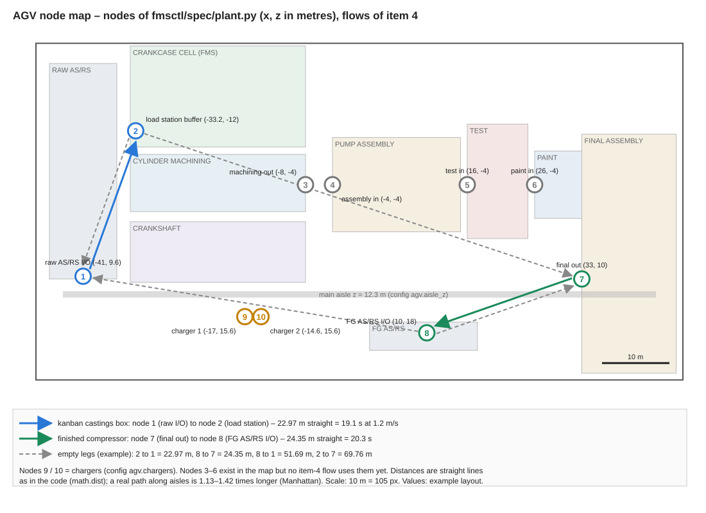
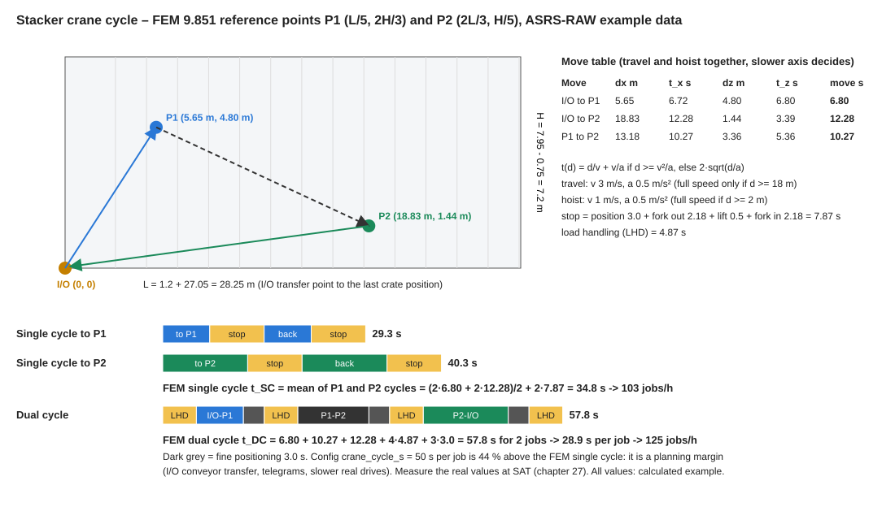
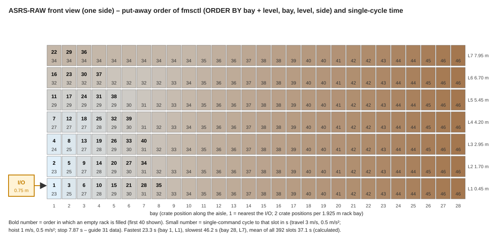
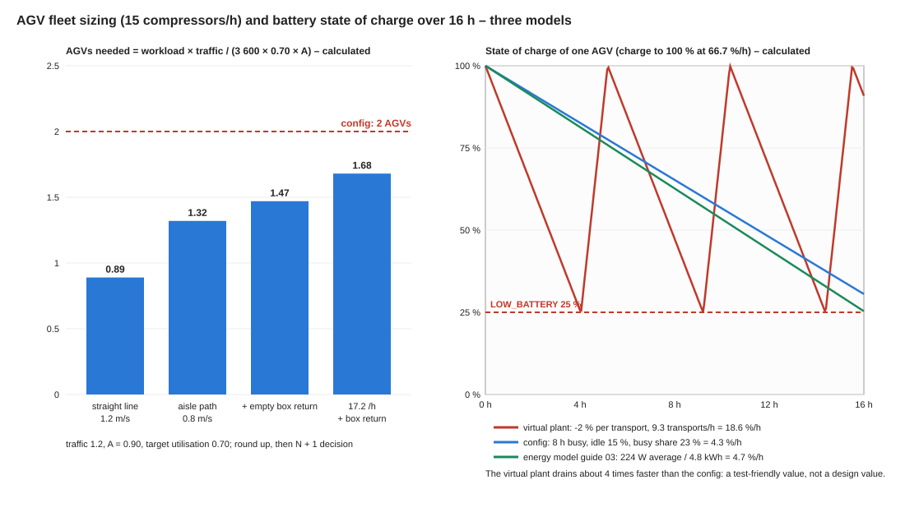
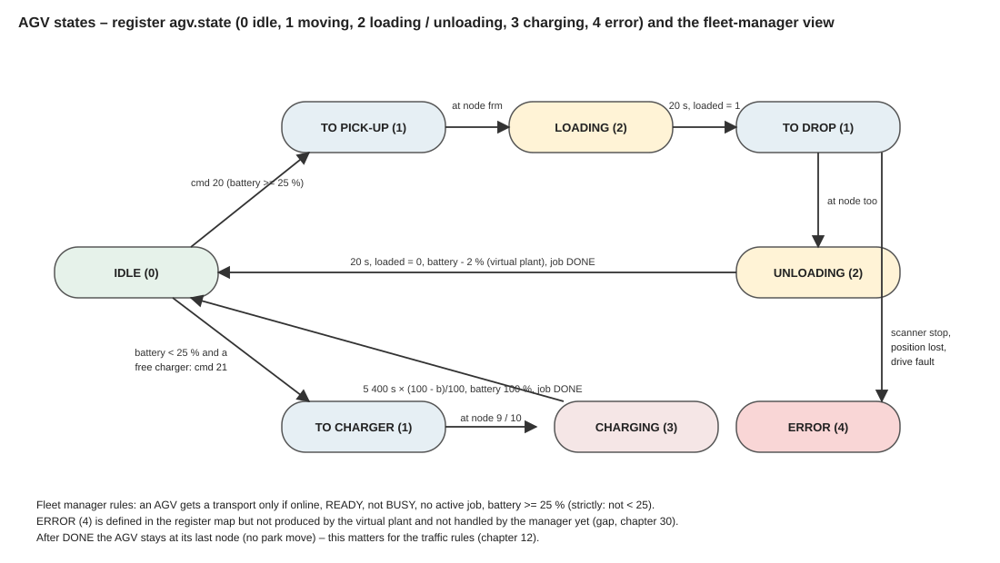
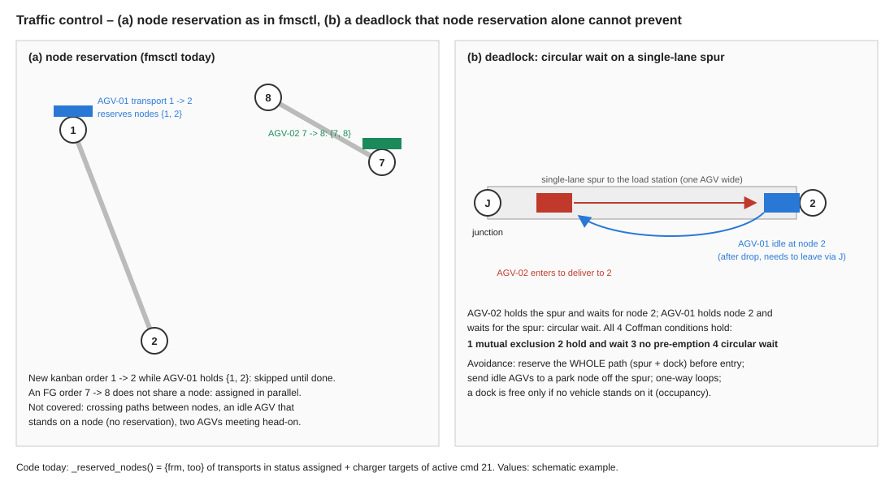
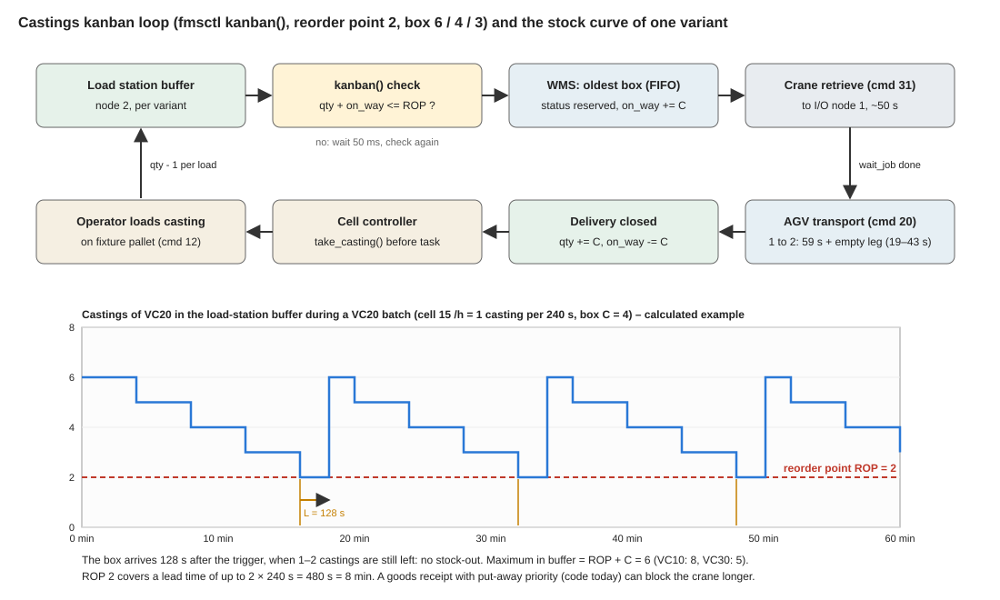
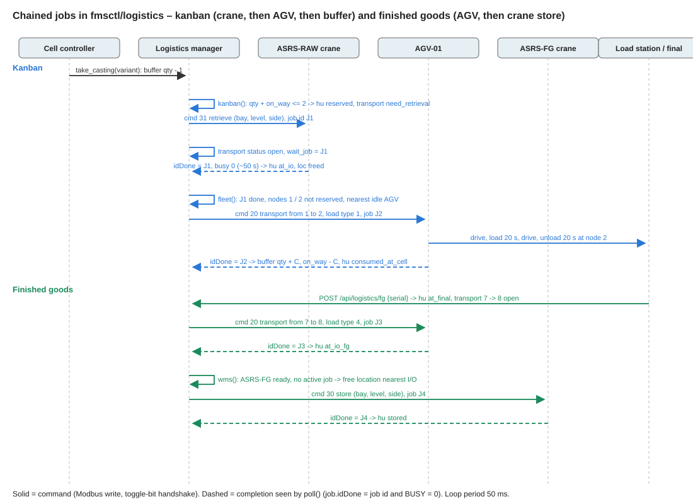

# 56 – AGV fleet manager, AS/RS warehouse management and material flows (FMS item 4) – textbook and implementation guide

**Scope:** item 4 of the FMS control system (`fmsctl/logistics/`): the warehouse management of the two AS/RS (raw material and
finished goods), the fleet manager of the AGVs, the castings kanban for the crankcase cell and the finished-goods flow of the
V-type piston compressor factory (VC10 / VC20 / VC30). Company rule: **Ethernet, Modbus TCP and HTTP only, offline PCs, no
cloud fleet manager.**

**Related guides:** 03 (material handling, fleet and AS/RS sizing for the whole factory), 11 (AGV build, safety fields,
docking), 31 (AS/RS mechanics, FEM 9.851 cycle), 32 (AS/RS crane control, safety), 34 (WMS / ERP / MES, slotting, inventory
control), 53 (FMS control system, items 1–9, register map V1.2). This guide is the deep version of guide 53 §7d.

**Code:** `fmsctl/logistics/manager.py` (270 lines), `fmsctl/web/logistics.html`, `fmsctl/spec/plant.py` (nodes),
`fmsctl/spec/regmap.py` (AGV / ASRS registers), `fmsctl/sim/virtual_plant.py` (simulated AGVs and cranes),
`fmsctl/cell/controller.py` (casting check), `fmsctl/cell/server.py` (HTTP), `fmsctl/tests/test_item4.py` (12 checks).

**How the numbers are labelled.** Every number carries one of these labels:

| Label | Meaning |
|---|---|
| [design] | value of the factory design (`config/factory.json`, the code constants, guides 31 / 32) |
| [example] | an assumed value to show the method – replace it with your supplier's or your own value |
| [calculated] | computed in this guide from design / example values; every calculation was re-run with Python 3.12 (Appendix A) |
| [simulated] | result of a simulation run (the planning model of Appendix A.3, or the virtual plant of `fmsctl`) |
| [measured] | to be measured in the real plant at FAT / SAT |

> **Important.** All supplier data, cycle times and safety values in this guide are **examples**. The supplier's offer, its
> FEM 9.851 test, its risk assessment (ISO 3691-4, EN 528) and the standards themselves decide. Where this guide is unsure, it
> says "check the standard" or "see datasheet".

---

## Contents

**Part A – Understand**

1. Purpose, scope and how to use this guide
2. The material flows of the compressor FMS
3. Unit-load AS/RS fundamentals
4. Crane cycle time – travel-time model and FEM 9.851
5. AS/RS throughput – single, dual and mixed command; utilisation; peaks
6. Storage assignment policies
7. Retrieval rules, inventory accuracy and cycle counting
8. AGV fundamentals – vehicles, navigation, docking, load handling, safety
9. Transport demand from the production plan
10. AGV fleet sizing
11. Battery management and charging strategy
12. Traffic management – zones, reservation, deadlock
13. Dispatching rules for vehicles and loads
14. Kanban and reorder point for the castings buffer
15. Material balance and traceability of handling units

**Part B – Implement**

16. Architecture of `fmsctl/logistics`
17. Data model – tables and state machines
18. The control loop in pseudo-code (exactly as implemented)
19. Register interface of AGVs and cranes (map V1.2)
20. Configuration – constants, nodes, AGVs, AS/RS aisles
21. HTTP API reference
22. Operator screen
23. Operating procedures
24. KPIs and formulas
25. Network, Wi-Fi and IT security
26. Virtual commissioning and the acceptance test `test_item4`
27. FAT and SAT procedures with acceptance criteria
28. FMEA – failure modes and effects
29. Troubleshooting
30. Implementation gaps and recommended improvements
31. Buy list – catalogue examples
32. Consolidated shopping list
33. Standards register
34. For the doctoral thesis
35. Checklists and common mistakes
36. Glossary

Appendix A – calculation and simulation scripts · Appendix B – inconsistencies found with the config and other guides ·
Appendix C – drawings

---

# Part A – Understand

## 1. Purpose, scope and how to use this guide

### 1.1 What item 4 does

Item 4 moves material between the stores and the production. It has three parts:

1. **WMS (warehouse management system).** It owns the location table of both AS/RS. It decides *where* a box goes (put-away)
   and *which* box leaves (retrieval). The crane PLC only executes "store at bay / level / side" (command 30) and "retrieve
   from bay / level / side" (command 31).
2. **Fleet manager.** It turns transport orders (pick-up node → drop node) into AGV commands (command 20 transport,
   command 21 charge). It chooses the AGV, keeps two AGVs away from the same dock and sends AGVs with a low battery to a charger.
3. **Material flows.** Two flows are automated today:
   - **castings kanban:** crankcase castings from the raw AS/RS to the buffer at the load station of the crankcase cell;
   - **finished goods:** a finished compressor from final assembly to the finished-goods AS/RS.

All devices speak **Modbus TCP** with register map V1.2 and the same toggle-bit job handshake as the machines (guide 53 §6).
The operator screen and the interfaces to other systems use **HTTP + JSON**.

### 1.2 Who should read what

| Reader | Read |
|---|---|
| Planning engineer (sizing, purchase) | chapters 2–15, 31–33 |
| Software / controls engineer | chapters 16–26, 30 |
| Commissioning engineer | chapters 19, 23, 26–29 |
| Operator / shift leader | chapters 22, 23, 24, 29 |
| Doctoral thesis | chapters 4, 10, 14, 26, 34 and Appendix A |

### 1.3 Method of every chapter

Each topic follows the same steps: **principle → formula → worked example with our numbers → design rule → how fmsctl does it →
how to test → common mistakes.**

### 1.4 Main results in one table

| Question | Answer [label] | Chapter |
|---|---|---|
| FEM 9.851 single-command cycle of ASRS-RAW | **34.8 s → 103 jobs/h** [calculated] | 4 |
| FEM 9.851 dual-command cycle | **57.8 s for 2 jobs → 125 jobs/h** [calculated] | 4 |
| Mean single cycle over all 392 slots (random storage) | **37.1 s** [calculated] | 4, 6 |
| Config `crane_cycle_s` | 50 s [design] = 1.44 × FEM single cycle – a planning margin | 4 |
| Raw crane load from item-4 flows (15 crankcases/h) | 7.25 jobs/h → 10 % at 50 s [calculated] | 5 |
| Closest-open put-away vs random (170 boxes stored) | 31.5 s vs 37.1 s = −15 % [calculated] | 6 |
| Transport demand at 15 compressors/h | 3.625 castings boxes/h + 15 finished units/h = 18.6 trips/h [calculated] | 9 |
| AGVs needed (aisle paths, 0.8 m/s effective, traffic 1.2, A 0.9, ρ 0.7) | **1.32 → 2 AGVs** [calculated]; 1.47 with empty-box return | 10 |
| One AGV only | stock-outs 186 min in 40 h (charging stops all transport) [simulated] → **2 AGVs minimum** | 10 |
| Kanban replenishment lead time (crane, then AGV) | nominal 128 s; p95 154 s (1.2 m/s) – 184 s (0.8 m/s) [calculated / simulated] | 14 |
| Reorder point 2 castings | covers a lead time of 480 s → **enough**, *if* retrievals have priority over put-away | 14 |
| Goods receipt of 30 boxes with today's put-away priority | crane blocked 25 min → stock-out 27.8 min per 40 h [simulated] | 14 |
| Battery drain in the virtual plant | 2 % per transport = 18.6 %/h – about 4 × the config value [calculated] | 11 |

### 1.5 Drawings of this guide

| Drawing | Content |
|---|---|
| [img/56_node_map.svg](img/56_node_map.svg) | **Fig. 56-1** AGV node map with flows, docks and chargers (`plant.NODES`) |
| [img/56_rack_putaway.svg](img/56_rack_putaway.svg) | **Fig. 56-2** Rack front view with the put-away order of fmsctl and the cycle time of every slot |
| [img/56_crane_cycle.svg](img/56_crane_cycle.svg) | **Fig. 56-3** Single and dual command cycle with the FEM 9.851 reference points |
| [img/56_kanban_loop.svg](img/56_kanban_loop.svg) | **Fig. 56-4** Castings kanban loop and stock curve |
| [img/56_job_chain.svg](img/56_job_chain.svg) | **Fig. 56-5** Chained jobs: crane → AGV → buffer; AGV → crane store |
| [img/56_agv_states.svg](img/56_agv_states.svg) | **Fig. 56-6** AGV state machine including charging |
| [img/56_traffic_deadlock.svg](img/56_traffic_deadlock.svg) | **Fig. 56-7** Node reservation and a deadlock case |
| [img/56_fleet_battery.svg](img/56_fleet_battery.svg) | **Fig. 56-8** Fleet sizing results and battery state of charge |

---

## 2. The material flows of the compressor FMS

### 2.1 The whole factory and the part item 4 covers

The factory makes V-type piston compressors in three sizes. The design mix is VC10 30 %, VC20 50 %, VC30 20 % [design,
`products[].mix`]. The material flow of the whole factory (guide 03 §17) has 13 flows. Item 4 automates the two flows that
the crankcase FMS and final assembly need first:

| Flow | From | To | Unit load (handling unit, HU) | In fmsctl |
|---|---|---|---|---|
| Castings VC10 | ASRS-RAW | load station LOAD-CC | box of 6 crankcase castings [design] | yes (kanban) |
| Castings VC20 | ASRS-RAW | LOAD-CC | box of 4 [design] | yes (kanban) |
| Castings VC30 | ASRS-RAW | LOAD-CC | box of 3 [design] | yes (kanban) |
| Finished compressor | final assembly (node 7) | ASRS-FG I/O (node 8) | 1 compressor [design] | yes |
| Goods receipt | truck / dock | ASRS-RAW I/O | boxes | yes (manual call `receive`) |
| Shipping | ASRS-FG | truck | compressor | **no** (gap, ch. 30) |
| Cylinder castings, crankshaft forgings | ASRS-RAW | cylinder / crankshaft lines | 12 / 6 per box [design] | no (later items) |
| Empty boxes | load station | ASRS-RAW or box stack | empty box | **no** (gap) |

### 2.2 The node map

The AGVs drive between **nodes**. A node is a named point on the hall floor: a dock (pick-up / drop), a charger or a park
position. `fmsctl/spec/plant.py` defines 10 nodes with (x, z) coordinates in metres [example layout]:

| Node | Name | x (m) | z (m) | Used by item 4 |
|---|---|---|---|---|
| 1 | raw AS/RS I/O | −41.0 | 9.6 | kanban pick-up, goods-receipt input |
| 2 | load station buffer | −33.2 | −12.0 | kanban drop |
| 3 | machining out | −8.0 | −4.0 | not yet |
| 4 | assembly in | −4.0 | −4.0 | not yet |
| 5 | test in | 16.0 | −4.0 | not yet |
| 6 | paint in | 26.0 | −4.0 | not yet |
| 7 | final out | 33.0 | 10.0 | FG pick-up |
| 8 | FG AS/RS I/O | 10.0 | 18.0 | FG drop |
| 9 | charger 1 | −17.0 | 15.6 | charging, start position |
| 10 | charger 2 | −14.6 | 15.6 | charging |



**Distances.** The code uses the straight-line distance `math.dist(node_a, node_b)` both for choosing the nearest AGV and (in
the virtual plant) for the travel time. A real AGV follows aisles. The Manhattan distance |Δx| + |Δz| is a better first
estimate of the real path [calculated]:

| Leg | Straight (m) | Manhattan (m) | Ratio | Time straight at 1.2 m/s (s) |
|---|---|---|---|---|
| 1 → 2 (kanban loaded) | 22.97 | 29.4 | 1.28 | 19.1 |
| 7 → 8 (FG loaded) | 24.35 | 31.0 | 1.27 | 20.3 |
| 2 → 7 (empty, kanban drop → FG pick-up) | 69.76 | 88.2 | 1.26 | 58.1 |
| 8 → 1 (empty, FG drop → kanban pick-up) | 51.69 | 59.4 | 1.15 | 43.1 |
| 9 → 1 (charger → raw I/O) | 24.74 | 30.0 | 1.21 | 20.6 |
| 9 → 7 (charger → final out) | 50.31 | 55.6 | 1.11 | 41.9 |
| 1 → 7 | 74.00 | 74.4 | 1.01 | 61.7 |

**Design rule.** For sizing use the real path (from the layout drawing, along the aisles) and an *effective* speed that includes
acceleration, turns and slow zones. Guide 03 §14 found ≈ 0.8 m/s effective for a 1.2 m/s vehicle [calculated in guide 03].
This guide uses both cases: "straight, 1.2 m/s" (as the code) and "aisle path, 0.8 m/s" (realistic).

### 2.3 Handling units

A **handling unit (HU)** is one physical load that the system tracks: a box of castings or one finished compressor. Each HU has
an id (`HU1001`, `HU1002` … for boxes; the serial number `VC20-000200` for a compressor), an item, a quantity and a status.
The crate of the raw AS/RS is 1 200 × 800 × 600 mm, tare 45 kg, maximum 300 kg gross [design, guide 31 §5].

| Box | Castings per box [design] | Casting mass [example, guide 34 §5.4 gives 228 kg for a full CC30 crate] | Crate gross |
|---|---|---|---|
| VC10 (`RAW_CC10`) | 6 | ≈ 25–30 kg | ≈ 200–225 kg |
| VC20 (`RAW_CC`) | 4 | ≈ 40 kg | ≈ 205 kg |
| VC30 (`RAW_CC30`) | 3 | ≈ 61 kg | 228 kg |

The box size is chosen so that one crate stays below 300 kg. **Check** the real casting masses from the foundry drawing.

### 2.4 Common mistakes

- Planning only the loaded trips. Every loaded trip needs an empty trip to the next pick-up; here the empty legs are *longer*
  than the loaded legs (chapter 10).
- Forgetting the empty boxes. Every castings box that goes to the cell must come back.
- Using straight-line distances for sizing. They are 11–28 % too short here.

---

## 3. Unit-load AS/RS fundamentals

### 3.1 Parts of a unit-load AS/RS

A unit-load AS/RS stores one standard load per location. It has four main parts:

| Part | What it is | ASRS-RAW [design, guide 31] |
|---|---|---|
| **Rack** | steel structure with locations on both sides of an aisle | 14 rack bays × 2 crate positions × 7 levels × 2 sides = **392 locations**; length 27.05 m, height 9.5 m |
| **Stacker crane** (storage and retrieval machine, S/R machine) | rail-guided mast with a lifting carriage and a telescopic fork, runs in the aisle | single mast, 4 200 kg moving mass; travel 3 m/s / 0.5 m/s², hoist 1 m/s / 0.5 m/s², fork 1 m/s / 1.2 m/s² |
| **I/O point** (pick-up and deposit point, P&D) | where loads enter and leave the aisle, usually at the aisle end | conveyor infeed (side L) and outfeed (side R), crane transfer at x = 0, fork level 0.75 m |
| **Controls** | crane PLC (axes, safety), WCS (job order), WMS (locations, stock) | crane PLC with commands 30 / 31; the WMS is `fmsctl/logistics` |

**Location coordinates in fmsctl.** The code calls the 28 crate positions along the aisle "bays" 1…28 (1 = nearest the I/O),
levels 1…7 and sides 1 (left) / 2 (right). Guide 31 uses "bay 01–14, position 1–2". The conversion is:

```
rack bay (guide 31) = ceil(code bay / 2)        position = 1 if code bay is odd, 2 if even
x [m] = 1.2 + 0.1 + (rack bay − 1)·1.925 + 0.475 + (position − 1)·0.875          (guide 31 §6.9)
z [m] = 0.45 + (level − 1)·1.25                                                  fork level of the location
```

Example: code bay 4, level 4 → rack bay 2, position 2 → x = 1.2 + 0.1 + 1.925 + 0.475 + 0.875 = **4.575 m**, z = **4.20 m**
[calculated].

### 3.2 Single command and dual command

| Cycle | Sequence | Jobs per cycle |
|---|---|---|
| **Single command (SC)** – store | pick up at I/O → travel to the location → deposit → travel back empty | 1 |
| **Single command (SC)** – retrieve | travel empty to the location → pick up → travel back → deposit at I/O | 1 |
| **Dual command (DC)** | pick up at I/O → store at location A → travel empty to location B → retrieve → back to I/O | 2 |

A dual command saves one empty trip. It needs a store job **and** a retrieval job waiting at the same time.

### 3.3 Other AS/RS types (background)

| Type | Use | Note for this factory |
|---|---|---|
| Unit-load crane AS/RS (pallet / crate) | heavy loads 300–1 500 kg | chosen for castings (crate 300 kg) |
| Mini-load (bins ≤ 50 kg) | small parts | not for castings |
| Shuttle system | very high throughput, many vehicles per aisle | throughput need here is only 7–40 jobs/h |
| Vertical lift module (VLM) | small parts, tools | possible for the tool store (item 3) |
| Floor block storage + forklift | low cost | no automation, no Modbus integration |

The selection is explained in guide 31 §4 and guide 03 §18–19.

### 3.4 Design rules

1. One crane per aisle. One aisle is enough for this throughput (chapter 5), but the crane is a **single point of failure** –
   plan the emergency manual retrieval (guide 32 §8.7).
2. The I/O point at the aisle end nearest the users (here: node 1, towards the cell).
3. Keep 10–15 % of the locations free: a full store kills dual cycles and slotting (guide 34 §5.4).
4. The WMS owns the location table – the crane PLC must not have a second stock database (guide 53 §7d).

### 3.5 How fmsctl does it

`manager.py` creates the location table at the first start: 2 AS/RS × 28 bays × 7 levels × 2 sides = 784 rows. Each row holds
the HU id or `''` (empty). The crane only receives the coordinates. See chapter 17.

### 3.6 Common mistakes

- Two "bays" definitions (rack bay with 2 crates vs crate position). Write the mapping into the interface specification (§3.1).
- Using the same table size for both AS/RS: the code gives ASRS-FG also 28 × 7 × 2 = 392 locations, the config says FG has
  5 levels and 16 m (guide 03: 110 slots). See Appendix B.

---

## 4. Crane cycle time – travel-time model and FEM 9.851

### 4.1 Principle

The crane moves along the aisle (travel axis x) and lifts the carriage (hoist axis z) **at the same time**. The move ends when
**both** axes have arrived. So the move time is the **maximum** of the two axis times. Then the fork works. A full cycle is
moves + stops.

### 4.2 Travel time of one axis with acceleration (trapezoid profile)

The drive accelerates with a to the top speed v, cruises, and decelerates with a. The distance needed to reach top speed and
stop again is d* = v²/a.

```
if d ≥ v²/a  (trapezoid):   t(d) = d/v + v/a
if d < v²/a  (triangle):    t(d) = 2·√(d/a)          peak speed v_p = √(d·a) < v
move time:                  t_move = max( t_x(Δx), t_z(Δz) )
```

**Derivation (trapezoid).** Acceleration phase: time v/a, distance v²/(2a). Same for deceleration. Cruise distance
d − v²/a at speed v: time (d − v²/a)/v. Sum: 2·v/a + d/v − v/a = d/v + v/a.

For ASRS-RAW [design]: travel v = 3 m/s, a = 0.5 m/s² → d* = 9/0.5 = **18 m**: the crane reaches 3 m/s only on moves longer
than 18 m. Hoist v = 1 m/s, a = 0.5 m/s² → d* = **2 m**. Most travel moves in this 28 m aisle are triangles – a higher
**acceleration** helps more than a higher top speed (guide 32 §5.5).

An S-curve (jerk-limited) profile adds about a/j per move (guide 32 §5.2): with j = 0.6 m/s³ ≈ 0.83 s per move.

### 4.3 Stop time (load handling)

At each location the crane needs [design, guide 31 §8]:

```
fine positioning                      3.0 s
fork out (1.35 m, 1 m/s, 1.2 m/s²)    1.35/1 + 1/1.2 = 2.18 s
lift / lower 100 mm                   0.5 s
fork in                               2.18 s
stop time                             3.0 + 2.18 + 0.5 + 2.18 = 7.87 s     (load handling only, LHD: 4.87 s)
```

### 4.4 FEM 9.851 reference points

FEM 9.851 ("Performance data of S/R machines – cycle times") defines a standard test so that offers can be compared. The
idea (check the current edition of the FEM sheet for the details):

- Measure from the I/O point. L = horizontal distance to the farthest location, H = vertical distance to the highest location.
- Two reference points: **P1 = (L/5, 2H/3)** and **P2 = (2L/3, H/5)**.
- **Single cycle:** t_SC = mean of the two single cycles to P1 and to P2 = (t(I/O→P1) + t(P1→I/O) + t(I/O→P2) + t(P2→I/O))/2 +
  2 stops.
- **Dual cycle:** I/O → P1 → P2 → I/O with 4 load-handling operations and 3 positionings.

The reference points are chosen so that the result is close to the mean over all locations of a rack with random storage.

### 4.5 Worked example – ASRS-RAW

Input [design, guide 31]: L = 1.2 + 27.05 = **28.25 m**, H = 7.95 − 0.75 = **7.2 m** (top fork level minus I/O fork level).

```
P1 = (28.25/5, 2·7.2/3) = (5.65 m, 4.80 m)
P2 = (2·28.25/3, 7.2/5) = (18.83 m, 1.44 m)
```

| Move | Δx (m) | t_x (s) | Δz (m) | t_z (s) | t_move (s) |
|---|---|---|---|---|---|
| I/O → P1 | 5.65 | triangle 2√(5.65/0.5) = 6.72 | 4.80 | 4.8/1 + 1/0.5 = 6.80 | **6.80** (hoist decides) |
| I/O → P2 | 18.83 | 18.83/3 + 3/0.5 = 12.28 | 1.44 | 2√(1.44/0.5) = 3.39 | **12.28** (travel decides) |
| P1 → P2 | 13.18 | 2√(13.18/0.5) = 10.27 | 3.36 | 3.36/1 + 2 = 5.36 | **10.27** |

```
t_SC = (2·6.80 + 2·12.28)/2 + 2·7.87 = 19.08 + 15.73 = 34.8 s      → 3 600/34.8 = 103 jobs/h      [calculated]
t_DC = 6.80 + 10.27 + 12.28 + 4·4.87 + 3·3.0 = 29.35 + 28.47 = 57.8 s → 2·3 600/57.8 = 125 jobs/h [calculated]
```

These values agree with guide 31 §8 and guide 32 (34.8 s / 57.8 s).



### 4.6 Cycle time of every location

The single-command cycle to one location is t_SC(bay, level) = 2·t_move(x, z − 0.75) + 2·7.87 s. Over all 392 locations
[calculated]:

| Value | Single cycle |
|---|---|
| fastest location (bay 1, level 1) | **23.3 s** |
| bay 4, level 4 (example of §3.1) | 27.8 s |
| bay 7, level 1 | 31.3 s |
| bay 1, level 7 (top level near the I/O) | 34.1 s |
| slowest location (bay 28, level 7) | **46.2 s** |
| **mean of all 392 locations** (random storage) | **37.1 s** |

The FEM single cycle (34.8 s) is 6 % below the exact mean (37.1 s) for this rack. Guide 34 §5.1 gives the same 37.1 s.



### 4.7 Quick estimate without acceleration (Bozer and White)

For a first check without a drive model, Bozer and White (1984) give the expected travel time for random storage in a
rectangular rack (constant speed, Chebyshev travel):

```
t_h = L/v_x,  t_v = H/v_z,  T = max(t_h, t_v),  b = min(t_h, t_v)/T   (0 < b ≤ 1, "shape factor")
E(SC travel) = T·(1 + b²/3)
E(DC travel) = (T/30)·(40 + 15·b² − b³)
```

ASRS-RAW: t_h = 28.25/3 = 9.42 s, t_v = 7.2/1 = 7.2 s, T = 9.42 s, b = 0.765 → E(SC travel) = 11.25 s → with 2 stops
**27.0 s**; E(DC travel) = 15.17 s → with 4 LHD + 3 positionings **43.6 s** [calculated].

**Lesson.** The constant-speed model gives 27.0 s; with acceleration the mean is 37.1 s (+37 %). In short aisles with slow
acceleration the constant-speed formula is **much too optimistic**. Use it only to compare rack shapes; use the trapezoid model
or FEM 9.851 for offers.

### 4.8 Comparison with the config value of 50 s

`config/factory.json` sets `crane_cycle_s = 50` for ASRS-RAW and 60 for ASRS-FG [design]. The virtual plant uses 50 s ± 10 %
for **both** cranes (`job_asrs`: `50 · uniform(0.9, 1.1)`).

| Source | Single command | Remark |
|---|---|---|
| FEM 9.851, this crane | 34.8 s | pure crane cycle |
| Mean of all locations | 37.1 s | random storage |
| Config / virtual plant | 50 s | includes margin |
| Ratio 50 / 34.8 | 1.44 | |

What the 50 s may contain beyond the FEM cycle [example]: the I/O conveyor transfer (6 m at 0.2 m/s = 30 s if the crane has
to wait for it, guide 31 §10), telegram and handshake times (≈ 1–2 s), slower real drives at start-up, a contour check at the
infeed. **Recommendation:** keep 50 s for capacity planning (it is conservative), but **write the FEM 9.851 values (≤ 35 s SC,
≤ 58 s DC) into the purchase specification** and measure them at the SAT (chapter 27). After the SAT replace the 50 s in the
config with the measured *job* time (crane + I/O + handshake).

### 4.9 Design rules

1. Compare offers only with FEM 9.851 times (same reference points, same load).
2. Check the acceleration, not only the top speed: in racks shorter than v²/a the top speed is never reached.
3. Ask for the measured cycle **including** the I/O conveyor transfer – this is what the WMS sees.
4. Plan with ≤ 80 % crane utilisation in the peak hour.

### 4.10 How fmsctl uses it

The manager does not compute crane times. It waits for the DONE of each job. The cycle time measured by the PLC is returned in
register `job.cycle_s` (394–395, REAL) – a free data source for the KPI "crane cycle" (chapter 24). The closest-open put-away
(chapter 6) indirectly uses the travel-time model: it chooses locations with a small bay + level.

### 4.11 How to test

- In the virtual plant: the 50 s is fixed; check that `job.cycle_s` is ≈ 45–55 s.
- In the real plant: FEM 9.851 test (chapter 27.4) – 20 cycles to P1 / P2, mean and maximum.

### 4.12 Common mistakes

- Adding travel time and hoist time. They run **together**: take the maximum.
- Forgetting the positioning and fork times – they are 15.7 s of the 34.8 s (45 %).
- Taking the supplier's "maximum speed" for the calculation without the acceleration.
- Measuring from the floor instead of from the I/O fork level (H = 7.2 m, not 7.95 m).

---

## 5. AS/RS throughput – single, dual and mixed command; utilisation; peaks

### 5.1 Formulas

```
jobs per hour, single command     n_SC = 3 600 / t_SC
jobs per hour, dual command       n_DC = 2 · 3 600 / t_DC
mixed (share p of jobs in DC)     t_job = (1 − p)·t_SC + p·t_DC/2           n = 3 600 / t_job
crane utilisation                 ρ = Σ (jobs/h × time per job) / 3 600
```

### 5.2 Worked example – ASRS-RAW [calculated]

| Dual share p | Time per job | Jobs per hour |
|---|---|---|
| 0 (all single) | 34.8 s | 103 |
| 0.25 | 33.3 s | 108 |
| 0.5 | 31.9 s | 113 |
| 0.75 | 30.4 s | 119 |
| 1 (all dual) | 28.9 s | 125 |

With the config value 50 s (single only): 72 jobs/h.

### 5.3 Demand on the cranes

**Item-4 flows only** (15 crankcases/h, mix 30 / 50 / 20 – chapter 9): castings boxes 3.625 retrievals/h; in steady state the
same number of boxes is received → 3.625 stores/h → **7.25 jobs/h** [calculated].

| Crane | Jobs/h | Cycle | Utilisation |
|---|---|---|---|
| ASRS-RAW, config 50 s | 7.25 | 50 s | **10.1 %** |
| ASRS-RAW, FEM SC | 7.25 | 34.8 s | 7.0 % |
| ASRS-FG, stores only, config 60 s | 15 | 60 s | 25 % |
| ASRS-FG, stores + shipping retrievals, 60 s | 30 | 60 s | **50 %** |
| ASRS-FG, virtual plant 50 s, stores only | 15 | 50 s | 20.8 % |

**Whole factory** (guide 03 §14, guide 34 §5.5): with cylinders and crankshafts the raw crane has ≈ 20 jobs/h in normal
operation and ≈ 40 jobs/h in the peak → 35–39 % utilisation. One aisle is enough.

### 5.4 Peaks

| Peak | Calculation | Crane time |
|---|---|---|
| Goods receipt of 120 VC20 castings | 120 / 4 = 30 boxes × 50 s | **25 min** (FEM: 30 × 34.8 s = 17.4 min) [calculated] |
| Shipping of 50 compressors | 50 × 60 s | 50 min (guide 03 §14) |
| Cycle count of 5 boxes per day | 5 × 58 s (dual cycle out and back) | 5 min per day (guide 34 §6.8) |

A peak is not a capacity problem here, but it is a **priority problem**: while the crane stores 30 boxes it cannot retrieve
castings for the cell. See chapter 14.4 – this is the most important finding of this guide for the WMS logic.

### 5.5 Design rules

1. Peak-hour utilisation ≤ 80 %; normal ≤ 60 %.
2. Retrievals for production before put-away (a line stop costs more than a late put-away) – guide 03 §3.4, guide 34 §9.3.
3. Pair stores and retrievals into dual cycles when both wait.
4. Split large receipts into waves, or interleave: after every k stores, serve waiting retrievals.

### 5.6 How fmsctl does it

`wms()` serves each AS/RS when it is online, READY and has no active job. **Put-away has priority**: if a HU waits at the I/O
point, it is stored first; only if no HU waits, the oldest open retrieval request is sent. There are no dual commands: one
command per job. See gap list (chapter 30): change to "retrieval first" or "interleave".

### 5.7 Common mistakes

- Sizing the crane for the average and forgetting the receipt wave.
- Counting a dual cycle as one job (it is two jobs).
- Assuming dual cycles without checking that stores and retrievals really wait at the same time (receipts come in waves;
  retrievals come one by one).

---
## 6. Storage assignment policies

### 6.1 Principle

The **storage assignment policy** (put-away rule, slotting) decides which free location a new HU gets. It changes the mean
crane cycle, the throughput and the space need. The five classic policies:

| Policy | Rule | Space need | Cycle time | Data needed |
|---|---|---|---|---|
| **Dedicated (fixed)** | every item has its own locations | highest: Σ max stock per item (guide 03 §20.5: 209 slots) | depends on the layout | none |
| **Random (chaotic)** | any free location, equal chance | lowest (≈ 15 % less: 180 slots) | mean of all locations: 37.1 s | location table (WMS) |
| **Closest open location (COL)** | the free location with the shortest cycle | like random | fills the front first; mean of the occupied area | location table + cycle per location |
| **Class-based (ABC)** | classes by move rate; class A gets the fastest zone | like random + reserve per zone | −10 … −25 % vs random | move counts per item |
| **Turnover-based / COI** | rank items by cube-per-order index COI = locations needed ÷ moves per hour; lowest COI → best locations | like dedicated | optimal for single command (Heskett 1963) | stock and move rate per item |

Hausman, Graves and Schwarz (1976) showed that class-based storage with 2–3 classes already gives most of the benefit of full
turnover-based storage. With a WMS, "random within the class zone" is the practical optimum.

### 6.2 What fmsctl does – closest open location by bay + level

```sql
SELECT * FROM loc WHERE asrs = ? AND hu = '' ORDER BY bay + level, bay, level, side LIMIT 1
```

The location with the smallest **bay + level** wins; ties go to the smaller bay, then the lower level, then side 1 before side 2.
So an empty rack is filled in diagonal lines from the I/O corner (Fig. 56-2): (1,1,L) (1,1,R) (1,2,L) (1,2,R) (2,1,L) (2,1,R)
(1,3,L) … The bold numbers in Fig. 56-2 count (bay, level) pairs; each pair is filled side 1, then side 2. The test
`test_item4` checks this: the first 6 boxes went to bays 1–2, levels 1–2.

**Is bay + level a good proxy for the cycle time?** One crate position along the aisle is 0.875–1.05 m (travel, triangle: 2.6–
2.9 s for one step from standstill); one level is 1.25 m (hoist: 3.2 s). The two steps are of similar size, so "bay + level"
approximates max(t_x, t_z) quite well. Compared with the exact ranking by cycle time [calculated]:

| Locations occupied | Mean SC, fmsctl rule (bay + level) | Mean SC, exact time ranking | Difference |
|---|---|---|---|
| 6 | 23.83 s | 23.56 s | +1.1 % |
| 50 | 27.59 s | 27.15 s | +1.6 % |
| 100 | 29.61 s | 29.33 s | +1.0 % |
| 154 | 31.14 s | 31.01 s | +0.4 % |
| 200 | 32.33 s | 32.27 s | +0.2 % |
| 300 | 34.88 s | 34.85 s | +0.1 % |
| 392 (full) | 37.09 s | 37.09 s | 0 |

**Result:** the simple rule is within 2 % of the exact closest-open-location rule. A precise version would rank by the cycle
table of §4.6 – recommended only when the real crane data are known (gap list, ch. 30).

### 6.3 Worked example – random vs closest open vs class-based for the castings

Average stock [design, `buffers[].stock`]: VC10 240 castings = 40 boxes, VC20 360 = 90 boxes, VC30 120 = 40 boxes →
**170 boxes**. Retrievals per hour at 15 crankcases/h (chapter 9): VC10 0.75, VC20 1.875, VC30 1.0 boxes/h.

COI = boxes ÷ retrievals per hour [calculated]: VC30 40.0, VC20 48.0, VC10 53.3 → VC30 gets the best locations, then VC20,
then VC10.

| Policy | Mean retrieval cycle | vs random |
|---|---|---|
| Random over all 392 locations | 37.09 s | – |
| Closest open, items mixed in the 170 best locations (≈ fmsctl) | 31.45 s | **−15.2 %** |
| Class-based by COI (VC30 → best 40, VC20 → next 90, VC10 → next 40): mean SC 26.66 / 32.01 / 34.99 s, weighted by retrievals | 31.15 s | **−16.0 %** |

**Lesson.** When the store is less than half full, closest-open already gives almost all the gain. Class-based storage adds
only ≈ 1 % here because the three casting items have similar move rates (COI 40–53). Class-based storage pays when move rates
differ a lot – e.g. when cylinders (12 per box, 2 per compressor) and crankshafts are added: guide 34 §5.3 finds 30.3 s (ABC)
vs 31.0 s (closest) vs 37.1 s (random) for the full raw store.

### 6.4 Expected effect on the crane load

At 7.25 jobs/h the difference between 37.1 s and 31.5 s is 7.25 × 5.6 s = 41 s per hour – irrelevant for capacity. It
matters for the **replenishment lead time** of the kanban (chapter 14): a shorter retrieval cycle shortens L directly.

### 6.5 Design rules

1. Use closest-open (random) storage with a WMS. Never fixed locations in an AS/RS.
2. Heavy crates (VC30 228 kg) on levels 1–4 if possible (guide 34 §5.4) – lower energy, lower centre of gravity.
3. Reserve the best 10–20 locations for the I/O buffer function (urgent retrievals, quality hold returns).
4. Re-slot only when the crane is idle ≥ 5 min; each re-slot costs a crane cycle.
5. Review classes monthly from the real move counts (the job table has every move).

### 6.6 How to test

- Empty store, receive 6 boxes → locations (1,1,1) (1,1,2) (1,2,1) (1,2,2) (2,1,1) (2,1,2) (test_item4 check 2 – this
  is exactly the result of the last run).
- Fill to 150 boxes in the virtual plant, export the hu table, compute the mean SC with the script of Appendix A.1.

### 6.7 Common mistakes

- "Closest open" without retrieval FIFO → old boxes stay deep in the rack. fmsctl retrieves FIFO, so this is avoided.
- Putting fast and slow movers in one zone when the store is full – then the policy matters.
- No "blocked location" flag: a damaged rack beam must be excluded from put-away (gap, ch. 30).

---

## 7. Retrieval rules, inventory accuracy and cycle counting

### 7.1 Retrieval rules

| Rule | Meaning | Use |
|---|---|---|
| **FIFO** – first in, first out | the HU received first leaves first | castings (rust, lot traceability) – **used by fmsctl** |
| **FEFO** – first expired, first out | the HU with the earliest expiry date leaves first | paint, sealants, oil, adhesives (items with a shelf life) |
| **LIFO** | last in, first out | never for production material |
| Shortest move | the nearest HU of the item | maximum throughput, but old stock stays |
| Lot-pure | all parts of a work order from one lot | when a customer needs single-lot traceability |
| FIFO + shortest move | oldest lot first; inside a lot the nearest HU | standard WMS rule (guide 34 §9.3) |

fmsctl: `SELECT … WHERE item = ? AND status = 'stored' AND asrs = 'ASRS-RAW' ORDER BY received LIMIT 1` – strict FIFO by the
receipt time stamp of the HU. Test: check 5 of `test_item4` ("the oldest VC20 box was retrieved first": HU1001 = oldest).

**Why FIFO for castings.** Grey-iron castings rust on the machined datum faces; a box that waits months may need rework.
FIFO also keeps the trace window short: a casting defect found at the test bench points to a small number of foundry lots.

**FEFO later.** If item 4 is extended to paint or oil, add an `expiry` column to `hu` and sort by `expiry, received`.

### 7.2 Inventory accuracy

```
inventory record accuracy (IRA) = HUs where system = physical ÷ HUs counted × 100 %
quantity accuracy               = 1 − Σ|counted − system| ÷ Σ system
```

Targets [example]: IRA ≥ 99.5 % for an AS/RS (guide 34 §6.8); an AS/RS with WMS reaches ≈ 99.9 % because nobody touches the
loads. Errors come from: wrong quantity at goods receipt, castings taken out of a box by hand, scrap not booked, a crane
aborted with the load on the fork (chapter 23.6).

### 7.3 Cycle counting

Cycle counting replaces the yearly stock-taking stop. The crane brings a box to the I/O point; a person counts and confirms;
the box goes back.

```
counts per year = Σ (HUs of class i × count frequency of class i)
```

Worked example [example frequencies A 12×, B 6×, C 4× per HU and year; VC20 = B, VC10 / VC30 = C]: 40 × 4 + 90 × 6 + 40 × 4
= **860 counts per year** ≈ 3.4 per working day (250 days) → crane time 3.4 × 58 s (out and back as one dual cycle) ≈ 3.3 min
per day [calculated].

Cheaper extra counts:
- **Zero check:** when a location is emptied, the crane's occupancy sensor confirms it is empty.
- **Low-stock count:** the operator confirms the last 1–2 castings of a box at the load station.
- **Opportunity count:** when a box comes out for the kanban anyway, the operator confirms its quantity at the cell.

**fmsctl status:** no cycle-count function (gap, ch. 30). Suggested implementation: `POST /api/logistics/count {"hu"}` creates
a retrieval with purpose `count`; the box goes to the I/O; `POST /api/logistics/count_result {"hu","qty"}` books the difference
as an event with a reason code and sends the box back (store command).

### 7.4 Common mistakes

- Correcting stock "silently". Every difference must be an event with user, reason and old / new quantity.
- Counting only when a problem appears – then the error has already stopped the line.
- Counting a box that is reserved for a transport (status `reserved`) – exclude reserved and moving HUs.

---

## 8. AGV fundamentals – vehicles, navigation, docking, load handling, safety

### 8.1 Vehicle types for this factory

| Type | Load handling | Typical payload | Use here |
|---|---|---|---|
| Underride (latent) AGV | drives under a crate stand, lifts 30–60 mm | 300 kg – 1.5 t | castings crates at node 1 / 2 (guide 11 item 1) |
| Roller-top AGV | conveyor on the vehicle, transfers to a conveyor | 300 kg – 1.5 t | crates conveyor-to-conveyor at the AS/RS I/O |
| Pallet AGV (lift deck / forks) | lifts a pallet from a stand | 1 t | compressor on a pallet (guide 11 item 3) |
| Forklift AGV | forks, lift height up to several m | 1–2 t | floor storage, trucks |
| Tugger | pulls trailers | several t | milk-run to final assembly |

The register map has a load type per transport (`tr.loadType` 1 casting box, 2 cylinder tray, 3 crankshaft tray,
4 compressor, 5 empty container). One vehicle type for crates **and** compressors simplifies spare parts; this needs the
same carrier interface (e.g. all loads on a standard 1 200 × 800 frame or pallet).

### 8.2 Navigation

| Method | How | Path change | Accuracy (typical, example) | Note |
|---|---|---|---|---|
| Inductive wire | wire in the floor, antenna on the vehicle | floor cutting | ± 5–10 mm | old, robust |
| Magnetic tape / spots | tape or magnets on / in the floor | re-lay tape | ± 10 mm | cheap, tape wears |
| Optical line / QR grid | camera reads a line or 2D codes on the floor | new codes | ± 5–10 mm | common for latent robots |
| Laser with reflectors | rotating laser triangulates reflectors on walls | software | ± 5–10 mm | very accurate, needs reflectors |
| Natural navigation (SLAM / contour) | laser scanner matches the room contour | software | ± 10–30 mm, docking needs a fine method | flexible, needs a stable contour |

At docks a **fine positioning** is added: a marker, a V-shaped reflector, mechanical guides or cone pins (guide 11 §4.4).
Rule: each stage must bring the vehicle into the catch range of the next stage (guide 11 §4.4.4).

### 8.3 Docking at the AS/RS I/O and at the load station

The AGV must transfer the crate exactly to the conveyor or the stand. Typical tolerances [example, guide 11]: stop accuracy
± 10 mm, ± 0.5°; conveyor transfer needs ± 15 mm with lead-in guides. Signals at the dock (hard-wired or over the station PLC):
"station ready to receive", "load present", "transfer complete". In fmsctl the AGV PLC reports only `loaded` and the state; the
handshake with the conveyor is the job of the AGV and the station (local I/O or a short-range optical / IR coupler), not of
the fleet manager. Write this into the interface sheet (guide 11 §4.3.10).

### 8.4 Load handling time

The design uses 20 s for loading and 20 s for unloading [design, `agv.load_s`, `unload_s`]. It contains: fine positioning
(≈ 5 s), transfer or lift (≈ 5–10 s), checks and the release (≈ 5 s) [example split]. Measure it at the SAT – it is 40 s of
every trip (30–45 % of the trip time, chapter 10).

### 8.5 Safety – ISO 3691-4

ISO 3691-4 ("Industrial trucks – Safety requirements and verification – Part 4: Driverless industrial trucks and their systems")
is the main safety standard. Key points (check the standard for the full list):

- **Personnel detection** in the travel direction by a safety-rated sensor (safety laser scanner, IEC 61496-3 type 3) with
  **speed-dependent protective fields**.
- **Operating zones:** the risk assessment defines zones (e.g. restricted zone, confined zone) with their own rules: speed
  limits, marking, access rules.
- Emergency stop on the vehicle; brakes that stop the vehicle in all load states; stability; warning devices (light, sound).
- Safety functions designed and validated with ISO 13849-1 / -2 (performance level per function from the risk assessment).
- Information for use: zone marking, floor requirements, battery charging.

**Stopping distance and protective field** (guide 11 §4.1.10, same formula):

```
reaction time         t_r = t_scanner + t_safety controller (incl. STO + brake)  = 0.07 + 0.10 = 0.17 s  [example]
protective field      D = v·t_r + v²/(2·a_dec)·1.1 + Z                            Z = 100 mm tolerance   [example]
warning field         D_w = D + v·1 000 mm
```

| Speed | Protective field [calculated, flat floor, a_dec = 0.8 m/s²] | Where |
|---|---|---|
| 0.3 m/s | 213 mm | docks, near people |
| 0.6 m/s | 450 mm | crossings |
| 1.0 m/s | 958 mm | aisles |
| 1.2 m/s | 1 294 mm (downhill on 1 % slope: 1 432 mm, guide 11) | free main route |

(Guide 03 §10.8 uses t_r = 0.2 s, a = 1.0 m/s² and gets s_stop = 0.96 m at 1.2 m/s, field ≈ 1.2 m – the same order. The
vehicle maker's measured stopping distance decides.)

**Lesson – speed vs braking:** the braking part grows with v². From 1.2 to 0.6 m/s the field drops from 1.29 m to 0.45 m (−65 %).
That is why AGVs slow down at crossings and docks. The effective speed of 0.8 m/s used for sizing (chapter 10) comes from these
slow zones and from acceleration (a = 0.5 m/s² needs 1.44 m and 2.4 s to reach 1.2 m/s).

### 8.6 Design rules

1. Main aisles ≥ vehicle width + clearance for people on both sides – check ISO 3691-4 and local rules for the value.
2. Docks outside the main aisle (a vehicle that loads must not block traffic).
3. Protective field at full speed ≤ the free length in front of every curve and crossing.
4. Floor: flatness and slope within the vehicle maker's limits; no steps at the AS/RS I/O.
5. Mark the AGV routes on the floor; signs at crossings.

### 8.7 Common mistakes

- Planning with the top speed. The vehicle drives at 0.3 m/s near every dock.
- No space for the protective field at the dock – the vehicle stops before the station.
- Natural navigation in an area that changes every day (crates on the floor) – localisation fails.

---

## 9. Transport demand from the production plan

### 9.1 Principle

The transport demand comes from the production rate and the handling-unit sizes:

```
trips per hour of flow i = parts per hour of flow i ÷ parts per handling unit of flow i
```

### 9.2 Production rate

| Source | Rate | Label |
|---|---|---|
| Final assembly (bottleneck of the static design): 0.3·180 + 0.5·210 + 0.2·250 = 209 s per unit | 17.2 units/h | [calculated, guide 03] |
| Crankcase cell measured in the virtual plant (item 2) | **15 crankcases/h** | [simulated, guide 53 §7b] |
| Twin 24 h run (EDD) | 14.4 units/h | [simulated, guide 03] |

This guide uses **15 /h** (what the cell really produces with one load station) and checks **17.2 /h** (design rate) as the
upper case.

### 9.3 Worked example – from-to matrix of item 4 at 15 /h [calculated]

| Flow | Parts/h | Parts per HU | Trips/h |
|---|---|---|---|
| Castings VC10 (30 %) | 4.5 | 6 | 0.750 |
| Castings VC20 (50 %) | 7.5 | 4 | 1.875 |
| Castings VC30 (20 %) | 3.0 | 3 | 1.000 |
| **Castings total** | 15 | – | **3.625** |
| Finished compressors | 15 | 1 | **15.0** |
| **Total loaded trips** | | | **18.625** |
| Empty boxes back (not in fmsctl) | | 1 box per castings trip | (3.625) |

At 17.2 /h: castings 4.157 trips/h, FG 17.2 trips/h.

**Observation.** The finished-goods flow is 80 % of all trips (15 of 18.6). The FG AS/RS input is 24 m from final assembly.
Guide 03 §4.2 already showed that a conveyor from packing to the FG AS/RS would save more AGV time than anything else.

### 9.4 Batch effect on the castings demand

The mix rates (4.5 / 7.5 / 3.0 per hour) are **averages**. The cell works in work-order batches (lot 10–20 [design,
`products[].wo_lot`, `fms.max_batch`]). During a VC20 batch the cell needs **15 VC20 castings per hour** and no VC10 / VC30.
For the castings buffer (chapter 14) the batch rate counts; for the fleet (chapter 10) the average counts.

### 9.5 Common mistakes

- Using the mix average to size a per-variant buffer.
- Forgetting returns (empty boxes, NOK parts, quality samples).

---

## 10. AGV fleet sizing

### 10.1 Formula

```
trip time            t_trip = t_empty + t_wait,crane + t_load + t_loaded + t_unload
workload             W = Σ_i (trips/h_i × t_trip,i)                                         [vehicle-seconds per hour]
AGVs needed          N = W × f_traffic ÷ (3 600 × ρ_target × A)                             round up, then decide N + 1
```

| Symbol | Meaning | Value used [label] |
|---|---|---|
| f_traffic | waiting at crossings, blocked docks, passing | 1.1–1.3 [example]; 1.2 used |
| ρ_target | target utilisation (keeps waiting short) | 0.70 [example, guide 03] |
| A | availability (battery charging share, faults) | 0.90 [calculated, chapter 11] |

In fmsctl the crane retrieval is finished **before** the AGV is sent (chained job, chapter 18), so t_wait,crane = 0 for the
AGV – but the crane time is part of the kanban lead time (chapter 14).

### 10.2 Empty travel

After a drop the AGV drives empty to the next pick-up. The next pick-up depends on which order comes next. With a random order
sequence and a share p_k of kanban trips (p_k = 3.625 / 18.625 = 0.195):

```
mean empty distance to node 1 (kanban pick-up) = p_k·d(2→1) + (1 − p_k)·d(8→1)
mean empty distance to node 7 (FG pick-up)    = p_k·d(2→7) + (1 − p_k)·d(8→7)
```

[calculated] Straight lines: 0.195 × 22.97 + 0.805 × 51.69 = **46.1 m** to node 1; 0.195 × 69.76 + 0.805 × 24.35 = **33.2 m**
to node 7. Aisle (Manhattan) paths: 53.6 m and 42.1 m.

This simple model assumes one vehicle. With two vehicles the "nearest vehicle" rule reduces the empty travel (the simulation
in §10.5 shows it).

### 10.3 Worked example – trip times and workload at 15 /h [calculated]

**Case 1 – as the code / virtual plant:** straight lines, 1.2 m/s.

| Trip | Empty | Load | Loaded | Unload | t_trip |
|---|---|---|---|---|---|
| Kanban 1 → 2 | 46.1/1.2 = 38.4 s | 20 s | 22.97/1.2 = 19.1 s | 20 s | **97.6 s** |
| FG 7 → 8 | 33.2/1.2 = 27.7 s | 20 s | 24.35/1.2 = 20.3 s | 20 s | **88.0 s** |

W = 3.625 × 97.6 + 15 × 88.0 = 354 + 1 320 = **1 673 s/h**.

**Case 2 – realistic:** aisle paths, 0.8 m/s effective.

| Trip | Empty | Load | Loaded | Unload | t_trip |
|---|---|---|---|---|---|
| Kanban | 53.6/0.8 = 67.0 s | 20 s | 29.4/0.8 = 36.8 s | 20 s | **143.7 s** |
| FG | 42.1/0.8 = 52.7 s | 20 s | 31.0/0.8 = 38.8 s | 20 s | **131.4 s** |

W = 3.625 × 143.7 + 15 × 131.4 = **2 492 s/h**.

**Number of AGVs** (ρ = 0.7) [calculated]:

| Case | f_traffic | A | N |
|---|---|---|---|
| straight, 1.2 m/s | 1.1 | 0.90 | 0.81 |
| straight, 1.2 m/s | 1.2 | 0.90 | **0.89** |
| aisle, 0.8 m/s | 1.1 | 0.90 | 1.21 |
| aisle, 0.8 m/s | 1.2 | 0.90 | **1.32** |
| aisle, 0.8 m/s | 1.2 | 0.85 | 1.40 |
| aisle, 0.8 m/s + empty-box return (3.625 × 76.8 s = 278 s/h) | 1.2 | 0.90 | **1.47** |
| 17.2 /h, aisle, 0.8 m/s | 1.2 | 0.90 | 1.51 |
| 17.2 /h, aisle, 0.8 m/s + empty-box return | 1.2 | 0.90 | 1.68 |



**Result:** **2 AGVs** [design: `agv.count` = 2] are needed for the item-4 flows in every realistic case. Each AGV is busy
35–44 % of the time (Case 2: 2 492 / 2 / 3 600 = 34.6 %).

### 10.4 Redundancy – one AGV down

With one AGV: utilisation = 2 492 × 1.2 / (3 600 × 0.9) = **92 %** (Case 2), 103 % with the empty-box return [calculated].
Queueing theory says that waiting times explode above ≈ 85 %. The simulation (§10.5) shows the real problem: the single AGV
must charge, and during charging **nothing moves**.

**Design rule:** for the item-4 flows, 2 AGVs is the minimum; it gives N + 1 redundancy only in Case 1. When the cylinder and
crankshaft flows are added (guide 03 §14: whole factory 3 648 s/h → 1.77 AGVs), 2 AGVs have no redundancy left → buy a
**third AGV** or a **conveyor packing → FG AS/RS** (it removes 80 % of the trips). This agrees with guide 03.

### 10.5 Simulation check [simulated]

A small time-step model with the same rules as `manager.py` (nearest idle AGV by straight-line distance, node reservation,
crane retrieval finished before the AGV is sent, AGVs stay at their last node, charging below 25 %), 40 h, cell 15 /h in
batches of 10, crane 50 s ± 10 %, battery model of the config (Appendix A.3):

| Run | AGV utilisation | Kanban lead time mean / p95 / max | FG lead time mean / p95 | Castings stock-out | Made (of 600) |
|---|---|---|---|---|---|
| A: 2 AGVs, 1.2 m/s (as the code) | 17.7 % / 24.4 % | 132 / 154 / 158 s | 83 / 81 s | 0 | 599 |
| B: 2 AGVs, 0.8 m/s | 21.0 % / 31.9 % | 153 / 184 / 189 s | 105 / 101 s | 0 | 599 |
| C: 1 AGV, 1.2 m/s | 46.5 % | 321 / 626 / 4 161 s | 379 / 2 690 s | **186 min** | 553 |
| D: 1 AGV, 0.8 m/s | 58.6 % | 415 / 1 667 / 4 190 s | 586 / 3 374 s | **281 min** | 529 |
| G: 2 AGVs, AGV sent when the crane *starts* | 20.5 % / 24.4 % | **110** / 114 / 115 s | 82 / 81 s | 0 | 599 |
| J: 2 AGVs, 0.8 m/s, cell 17.2 /h | 37.6 % / 23.3 % | 158 / 244 / 255 s | 105 / 101 s | 0 | 685 |

Observations:
1. The simulated utilisation (42 % for the fleet in run A) is below the hand calculation (46 %) because "nearest vehicle"
   shortens the empty trips.
2. With one AGV the cell loses 8–12 % of its output, mainly during the 1.1–1.25 h charging periods.
3. Sending the AGV when the crane *starts* (pre-positioning) cuts the kanban lead time by 17 % (improvement, ch. 30).
4. The FG p95 slightly below the mean in A/B is a statistics effect: most FG trips are equal and short; a few long ones raise
   the mean.
5. The work is unevenly shared (17.7 % vs 24.4 %): "nearest vehicle" prefers the AGV that stands closer to node 7. This is
   normal and harmless; a "balance the battery" tie-breaker can even it out.

### 10.6 Design rules

1. Size with real paths and an effective speed, not with straight lines and the top speed.
2. Include the empty trips and the returns.
3. Target ≤ 70 % utilisation per vehicle; check the one-vehicle-down case.
4. Check charging: with a small fleet, charging is the main availability loss.
5. Re-check after the SAT with the measured trip times (chapter 34: design-stage vs reality).

### 10.7 How fmsctl does it

The fleet size is the list `DEVICES` (`AGV-01`, `AGV-02`) and the hard-coded tuple `('AGV-01', 'AGV-02')` in `fleet()`. Adding
an AGV is described in §20.4.

### 10.8 Common mistakes

- Sizing with the twin's 1.2 m/s constant speed: 33 % too few vehicle-hours (1 673 vs 2 492 s/h).
- Forgetting that a vehicle at the charger is not available (A < 1).
- Not checking the dock occupancy: two vehicles may be "available" but the dock allows only one.

---

## 11. Battery management and charging strategy

### 11.1 Battery types

| Property (typical – see datasheet) | Lead-acid (traction, flooded / gel) | Lithium-ion (LiFePO4, NMC) |
|---|---|---|
| Usable depth of discharge | 50–80 % | 80–100 % (window often 20 → 90–100 %) |
| Cycle life | ≈ 1 000–1 500 cycles at 80 % DoD | ≈ 2 000–6 000 cycles (LiFePO4) |
| Charging | full charge 8 h + cooling; partial charges shorten the life | fast and opportunity charging allowed (0.5–1 C) |
| Maintenance | water refill, ventilation (hydrogen gas) – charging room | none; battery management system (BMS) |
| Mass per kWh | high | ≈ 1/3 of lead-acid |
| Cost | low | higher purchase, lower cost per cycle |
| Use in AGVs | old / simple vehicles, battery swap | standard in new AGVs / AMRs |

**Recommendation:** LiFePO4 with opportunity charging. It is thermally more stable than NMC and needs no charging room.

### 11.2 Capacity formula

```
required capacity  C [Ah] = P_avg × t_run ÷ (U_nom × DoD × η_aging)
P_avg = ρ_busy × P_busy + (1 − ρ_busy) × P_idle
```

Worked example [example data of guide 03 §10.4: 48 V LiFePO4, P_busy 363 W, P_idle 150 W; ρ_busy = 0.346 from Case 2]:

```
P_avg = 0.346 × 363 + 0.654 × 150 = 224 W                                             [calculated]
one 8 h shift without charging, window 25 % → 98 % (DoD 0.73):
C = 224 × 8 ÷ (48 × 0.73) = 51.1 Ah;  with 80 % end-of-life capacity: 51.1 ÷ 0.8 = 63.9 Ah → choose 80–100 Ah
with the guide-03 battery 48 V 100 Ah = 4.8 kWh, usable 3.50 kWh:
hours between charges = 3.50 kWh ÷ 0.224 kW = 15.6 h;  charge 73 Ah at 50 A (0.5 C) = 1.46 h
A_battery = 15.6 ÷ (15.6 + 1.46) = 0.915                                               [calculated]
energy per AGV per day = 24 × 0.224 = 5.4 kWh (battery side)
```

Energy per transport [calculated, P_busy × trip time]: kanban 143.7 s → 14.5 Wh, FG 131.4 s → 13.2 Wh – about **0.3 %** of a
4.8 kWh battery per trip.

### 11.3 Three battery models compared (Fig. 56-8)

| Model | Drain | 100 → 25 % | A |
|---|---|---|---|
| **Virtual plant** (`job_agv`): −2 % per transport; idle: 1 % with probability 0.05 per *real* second | 9.3 transports/h per AGV × 2 % = 18.6 %/h | 4.0 h | 4.0 / (4.0 + 1.125) = 0.78 |
| **Config** (`battery_h` 8 h busy, idle 15 % of busy, guide 03 §3.2) | 0.232 × 12.5 + 0.768 × 1.9 = 4.3 %/h (Case 1 busy share) | 17.3 h | ≈ 0.94 |
| **Energy model** (guide 03 §10.4, Case 2) | 224 W / 4.8 kWh = 4.7 %/h | 15.6 h (to 25 %) | 0.915 |

[calculated] **Finding:** the virtual plant drains the battery about **4 × faster per hour** (and ≈ 7–10 × faster per trip:
2 % vs 0.2–0.3 %) than the design. This is good for testing (charging happens often in a short test), but it is not a design
value. The idle drain in the virtual plant runs on **wall-clock** seconds (`heartbeat()` sleeps 1 s real time), so it depends on
the simulation speed factor: 180 %/h real time = 9 %/h simulated at × 20, 3.6 %/h at × 50. Recommendation (gap list): drain =
100 % × busy time ÷ (battery_h × 3 600) + idle factor, in simulated time.

### 11.4 Charging strategies

| Strategy | How | Good for | Note |
|---|---|---|---|
| **Threshold charging** (fmsctl) | idle AGV below 25 % → charger, charge to full | simple, few vehicles | long absence (1.1 h); the AGV is lost for work during that time |
| **Opportunity charging** | short charges whenever idle at a charger or at a dock with floor contacts | Li-ion, mixed load | keeps SoC 40–80 %; needs chargers where AGVs wait |
| **Scheduled charging** | charge in breaks / shift change | planned production | needs a production plan |
| **Battery swap** | exchange the battery | lead-acid, 24/7 | manual work, spare batteries |
| **Leave charger early** | an AGV on the charger may take a job when SoC ≥ a minimum (guide 03 twin: 60 %) | small fleets | the CHARGED constant (95 %) exists in fmsctl but is not used |

**Charge share** (part of the time an AGV must spend on the charger):

```
charge share = P_avg ÷ (P_charger × η_charger)
```

Example [calculated]: 224 W ÷ (1 500 W × 0.92) = 16 %; with a 0.5 C charger (50 A × 52 V ≈ 2.6 kW) 224 ÷ (2 600 × 0.92) = 9.4 %.

**Number of chargers** (guide 03 §4.3): chargers ≥ AGVs × t_charge ÷ (t_work + t_charge) = 2 × 1.46 ÷ (13 + 1.46) = 0.20 → 1
needed; the design has 2 (no waiting, one spare) ✔.

### 11.5 How fmsctl does it (Fig. 56-6)



```
in fleet():
  for every idle AGV (online, READY, not BUSY, no active job):
      if battery < LOW_BATTERY (25):
          free = chargers [9, 10] that are not reserved and where no AGV is charging (agv_state 3)
          if free: send command 21 (tr.toNode = first free charger); reserve that charger
          the AGV is removed from the idle list in any case (no transport for it)
```

The charge job ends when the AGV PLC reports DONE (battery 100 % in the virtual plant). Test: check 7 and 8 of `test_item4`
(AGV-02 started with 20 %, went to charger node 9, got no transport while charging).

**Weak points** (gap list): (1) a charger counts as free if the AGV standing on it is idle (state 0) – after charging the AGV
stays on the charger node, so a second AGV may be sent to the same node; (2) no leave-early rule (CHARGED = 95 is unused);
(3) battery is not used in the assignment (an AGV at 26 % gets a long job); (4) no alarm when no charger is free for a long time.

### 11.6 Design rules

1. Li-ion with opportunity charging; threshold 25–30 % for "must charge", 50–60 % "may leave the charger".
2. Chargers where AGVs wait anyway (near the busiest docks: node 7 / node 1).
3. Take the standby power of the vehicle from the supplier: computers and scanners never sleep (150 W in the example = 67 %
   of the average power).
4. Battery data (SoC, voltage, temperature, cycle count) into the history for predictive maintenance.

### 11.7 Common mistakes

- Using the "8 h battery" of the catalogue without the vehicle's real duty cycle and standby power.
- Sending both AGVs to charge at the same time (staggered start SoC prevents it – the virtual plant starts at 90 %; the test
  sets AGV-02 to 20 %).
- Charging lead-acid batteries partially many times a day (shortens life).

---

## 12. Traffic management – zones, reservation, deadlock

### 12.1 Why traffic management

Two AGVs must not collide, must not block each other at a dock and must never wait for each other in a circle. The safety
scanner prevents collisions with people and objects, but it only **stops** the vehicle – it does not solve the traffic. Traffic
management is a logistic function of the fleet manager (or of the vehicles' own controller).

### 12.2 Methods

| Method | Rule | Prevents | Needs |
|---|---|---|---|
| **Dock / node reservation** (fmsctl) | a node can be the target of only one active transport | two vehicles at one dock | node list |
| **Zone control (block control)** | the route is split into zones; a vehicle enters a zone only when it owns it | collisions, head-on meetings | zone map, vehicles report position |
| **Path reservation** | before driving, the vehicle reserves all segments / zones of its route (or the next k) | head-on deadlocks on single lanes | route graph |
| **Time-window routing** | segments reserved for time windows (conflict-free routing) | most deadlocks, efficient | planner, time model |
| **One-way loops** | all vehicles drive one direction | head-on meetings | layout |
| **Vehicle-to-vehicle rules** | priorities at crossings, "right before left" | crossing conflicts | vehicle software |

### 12.3 Deadlock

A **deadlock** is a state where two or more vehicles wait for each other forever. It happens only if **all four Coffman
conditions** (1971) hold:

1. **Mutual exclusion** – a zone / node can hold only one vehicle.
2. **Hold and wait** – a vehicle holds its zone while it waits for the next one.
3. **No pre-emption** – nobody can take a zone away from a vehicle.
4. **Circular wait** – a closed chain: vehicle A waits for B's zone, B waits for A's zone.

**Example (Fig. 56-7 b).** AGV-01 delivered a box to node 2 at the end of a single-lane spur and stays there (fmsctl has no park
move). AGV-02 is sent into the spur to deliver the next box to node 2. AGV-02 holds the spur and waits for node 2; AGV-01 holds
node 2 and needs the spur to leave → circular wait. In fmsctl this cannot happen *at the dock level* only because the next
transport to node 2 is assigned after the first is **done** – but the first AGV is still standing there. With real vehicles,
the second AGV would drive in and stop in front of the first one (its scanner stops it).



**Strategies:**

| Strategy | How | Coffman condition broken |
|---|---|---|
| Prevention – reserve the whole path before entering a spur | the spur and the dock are one zone | 2 (hold and wait) |
| Prevention – one-way loops, no spurs | layout | 4 (circular wait) |
| Avoidance – check the reservation graph for cycles before granting a zone (banker's-algorithm style) | software | 4 |
| Detection and recovery – timeout, then send one vehicle back / to a park node | software + free space | 3 (pre-emption) |
| Park rule – an idle vehicle leaves the dock to a park node after x s | software | 2 |

### 12.4 What fmsctl does today

```
_reserved_nodes() = { frm, too of every transport with status 'assigned' }
                  ∪ { tr.toNode of every active charge job (code 21) }
an open transport is assigned only if neither frm nor too is in the reserved set
```

Test: check 10 of `test_item4` – 10 transports, 0 conflicts (no two jobs to the same dock overlapped in time).

**What it does not do** (gap list): no path or zone model (two AGVs may cross between nodes), no occupancy of a node by an idle
vehicle, no park move, no deadlock detection, no timeout for a transport that does not finish. With 2 AGVs and docks off the main
aisle this is acceptable **only if** the vehicles' own controller (or the supplier's fleet software) handles the zones and
passing. **Specify this in the AGV purchase:** either the supplier's controller does zone control and collision avoidance between
its vehicles, or fmsctl must get a zone model (§30).

### 12.5 Design rules

1. Docks as dead-end spurs only with whole-spur reservation; better: drive-through docks.
2. Park positions off the aisle; an idle AGV goes there after 30–60 s (config `agv.park`: 4 positions [design]).
3. Main aisle wide enough for two AGVs to pass, or one-way traffic.
4. Every transport has a time-out (e.g. 3 × the planned trip time) → alarm.

### 12.6 Common mistakes

- Relying on the safety scanner for traffic: the vehicles stop, nothing moves, and nobody gets an alarm.
- Reserving only the target node: the route to it may be blocked.
- Forgetting the charger and park positions in the reservation (an AGV standing on a charger is an obstacle).

---

## 13. Dispatching rules for vehicles and loads

### 13.1 Two decisions

1. **Vehicle-initiated** (an AGV becomes free – which load does it take?): nearest load, longest-waiting load (FCFS), highest
   priority, maximum outgoing queue …
2. **Load-initiated** (a load becomes ready – which AGV gets it?): nearest vehicle, longest-idle vehicle, least-utilised
   vehicle, battery-aware …

Egbelu and Tanchoco (1984) compared such rules: "nearest vehicle" minimises empty travel but can starve far stations; FCFS is
fair but drives more. Combinations are common.

### 13.2 What fmsctl does

```
for each open transport in order of id (= creation time):        → longest-waiting load first (FCFS)
    skip if its crane job is not done or a node is reserved
    choose the idle AGV with the smallest straight-line distance from its node to the pick-up node   → nearest vehicle
```

So fmsctl uses **FCFS over loads + nearest vehicle**. With 2 AGVs this is a good choice. Ties (same distance) go to the
first AGV in the list.

### 13.3 Priorities to add (recommendation)

| Situation | Rule |
|---|---|
| Castings buffer at 0 for the running work order (cell starving) | priority 1 – before FG |
| FG at node 7 blocks final assembly (only one place) | priority 2 |
| Normal kanban (buffer ≤ ROP but > 0) | priority 3 |
| Empty box return, cycle count, re-slot | priority 4 (fill-in work) |

Implementation: a `prio` column in `transport`, `ORDER BY prio, id`.

### 13.4 Common mistakes

- Pure nearest-vehicle: a load at a remote node waits forever when the vehicles circulate in another area.
- Pure FCFS with many vehicles: long empty trips.
- No priority for a starving machine.

---
## 14. Kanban and reorder point for the castings buffer

### 14.1 Principle

A **kanban** is a pull signal: material is replenished when it is used, not when a plan says so. The **reorder-point** form
used here: when the stock *position* (on hand + on the way) falls to the reorder point, one replenishment of one container is
started.

```
reorder point          ROP = d × L + SS
                       d = demand rate (castings per second), L = replenishment lead time, SS = safety stock
number of containers   N = D × L × (1 + α) ÷ C            (Toyota formula; α = safety factor 0.1–0.3, C = parts per container)
stock position         IP = on hand + on order (on the way)        trigger when IP ≤ ROP
maximum on hand        ≈ ROP + C
average on hand        ≈ ROP − d·L + C/2       (saw-tooth, constant demand)
```

Always trigger on the stock **position**, not on the stock on hand – otherwise one low stock triggers several boxes (guide 34
§6.4). fmsctl does this correctly: `qty + on_way ≤ REORDER_POINT`.



### 14.2 Demand rate for the buffer

During a batch of one variant the cell consumes **15 castings per hour** of that variant (chapter 9.4):

```
d = 15 / 3 600 = 0.004167 castings/s  →  one casting every 240 s                    [simulated cell rate, guide 53]
```

VC30 machines slower (HMC 450 s vs 270 / 345 s [design]); its batch rate is lower, so the VC20 / VC10 values are the critical
case. Use the measured rate per variant after the SAT.

### 14.3 Replenishment lead time L in fmsctl

In fmsctl the steps run **in series** (Fig. 56-5): the AGV is sent only after the crane has delivered the box to the I/O.

| Step | Time [label] |
|---|---|
| detection (loop) | ≤ 0.05 s |
| wait for the crane (busy with another job) | 0 … 55 s (one cycle); **n × 50 s during a goods receipt** (put-away has priority) |
| crane retrieval to the I/O | 50 s [design] |
| wait for a free AGV and free nodes 1 / 2 | 0 … ≈ 100 s (one FG trip) |
| AGV empty to node 1 | 19.1 s from node 2, 43.1 s from node 8, 20.6 s from charger 9 [calculated, straight, 1.2 m/s] |
| load 20 s + loaded 1 → 2 19.1 s + unload 20 s | 59.1 s |

```
L_nominal = 50 + 19.1 + 20 + 19.1 + 20 = 128.3 s                     (AGV comes from node 2)       [calculated]
L with AGV from node 8 = 50 + 43.1 + 59.1 = 152.2 s
L_worst, normal operation = 128.3 + 55 (crane busy) + 100 (AGV busy) ≈ 283 s                       [calculated]
simulated (run A / B): mean 132 / 153 s, p95 154 / 184 s, max 158 / 189 s                            [simulated]
```

### 14.4 Check – is the reorder point 2 enough?

```
ROP 2 covers  2 ÷ d = 2 × 240 = 480 s = 8 min of demand
d × L_nominal = 0.004167 × 128.3 = 0.53 castings
d × L_worst   = 0.004167 × 283   = 1.18 castings      → ROP 2 > 1.18 ✔ (safety stock ≈ 0.8 casting = 197 s)
```

**Service level** with random (Poisson) demand during L [calculated]:

| L | Mean demand in L | P(demand ≤ 2) = cycle service level with ROP 2 |
|---|---|---|
| 128 s (nominal) | 0.53 | 98.3 % |
| 283 s (worst normal) | 1.18 | 88.4 % |
| 600 s | 2.5 | 54.4 % |

The real demand is much more regular than Poisson (one casting every 240 s), so the real service level is higher: with regular
demand and L < 480 s there is **no** stock-out (simulation runs A, B, G, J: 0 min).

**The critical case – goods receipt.** fmsctl gives **put-away priority** at the I/O point. A truck with 30 boxes keeps the
crane busy for 30 × 50 s = 25 min. A kanban retrieval that is triggered during this time waits:

```
boxes the cell can survive with ROP r:   n ≤ (r × 240 − 128.3) ÷ 50
ROP 2 → 7.0 boxes;  ROP 3 → 11.8;  ROP 4 → 16.6;   a 30-box receipt needs ROP ≥ (128.3 + 30 × 50) ÷ 240 = 6.8 → 7   [calculated]
simulation run E (5 receipts of 30 boxes in 40 h, put-away first): stock-out 27.8 min, kanban lead time max 1 463 s  [simulated]
run I (same, ROP 3): stock-out 11.4 min                                                                              [simulated]
run F (same receipts, retrieval first): stock-out 0, max lead time 181 s                                             [simulated]
```

**Conclusion:** ROP 2 is enough **if retrievals for production have priority over put-away** (or are interleaved). Raising the
ROP does not solve the receipt problem (ROP 7 would be needed). **Fix the priority** (gap list, ch. 30). Until it is fixed,
the operating procedure for goods receipt (§23.1) must split receipts into waves of ≤ 6 boxes.

### 14.5 Number of boxes in the loop

```
N = D × L × (1 + α) ÷ C         D = batch rate 15/h, α = 0.2
```

| Variant | C | L = 128 s (0.036 h) | L = 6 min (0.1 h) | L = 30 min (0.5 h, guide 34 §9.2) |
|---|---|---|---|---|
| VC10 | 6 | 0.11 | 0.30 | 1.50 |
| VC20 | 4 | 0.16 | 0.45 | 2.25 |
| VC30 | 3 | 0.21 | 0.60 | 3.00 |

[calculated] With L ≈ 2–3 min, **less than one box** is in the loop: the classic **two-bin** system (one box in use at the
station, one box on the way or waiting) is enough. Guide 34 §9.2 computed 2 crates for CC20 with the mix rate 8.6/h and a
conservative L of 0.5 h – both results say "two boxes per variant at the station".

### 14.6 Buffer places at the load station

```
maximum castings in the buffer per variant = ROP + C:  VC10 2 + 6 = 8,  VC20 2 + 4 = 6,  VC30 2 + 3 = 5;  sum 19     [calculated]
average during a batch of that variant ≈ ROP − d·L + C/2:  VC10 4.5,  VC20 3.5,  VC30 3.0
```

The config has `B_CC0` capacity 12, `per_variant` 4 [design] – **too small** for the kanban of fmsctl (19 castings possible).
Physically the castings stay in their box: the station needs **2 box places per variant** (open box + new box) = **6 box places**
+ 1 place for the empty-box return. Recommendation: change B_CC0 to "6 box places" or capacity 19 / per_variant 8 (Appendix B).

### 14.7 Recommended kanban parameters per variant

| Variant | Box C | ROP (castings) | Max in buffer | Box places | Condition |
|---|---|---|---|---|---|
| VC10 | 6 | **2** | 8 | 2 | retrieval priority; L_p95 ≤ 8 min |
| VC20 | 4 | **2** | 6 | 2 | same |
| VC30 | 3 | **2** | 5 | 2 | same (lower batch rate → more margin) |

Raise a variant to ROP 3 only if the measured L_p95 (chapter 24, KPI "kanban lead time") exceeds 6 min, e.g. when more AGV flows
are added. Make ROP a **per-variant** parameter (today one constant for all, gap list).

### 14.8 Demand-aware kanban (recommendation)

fmsctl refills **every** variant to ROP + C, even when no work order needs it. At the start all three buffers are empty → three
boxes come at once (the test log shows "kanban RAW_CC: buffer 0 ≤ 2" right after the receipt). Castings of variants without an
order then wait at the cell (space, traceability). Better: trigger the kanban only for variants with a released work order in
the planning window (`fms.window_h` 8 h [design]) – the twin of guide 03 does this ("model-specific castings only if released
work orders still need that model").

### 14.9 How to test

- Virtual plant: create a VC20 work order of 20, watch buffer qty and on_way on the logistics screen; count stock-out events
  "waiting for VC20 castings" (cell controller event).
- Material balance check (§15) after every test run.
- Real plant: record the time stamps trigger → crane DONE → AGV DONE for 50 kanban cycles; compute mean and p95 of L.

### 14.10 Common mistakes

- Triggering on the stock on hand → several boxes for one gap.
- Sizing the ROP with the mix average (7.5 /h for VC20) instead of the batch rate (15 /h).
- Ignoring the crane priority: the ROP is right, but the crane is busy with a truck.

---

## 15. Material balance and traceability of handling units

### 15.1 Material balance

A material balance proves that no part is lost or counted twice. For every variant v and every period:

```
castings delivered to the station (Σ box qty of done kanban transports)
   = castings loaded on pallets (work order 'started', including scrap replacements)
   + castings still in the buffer (buffer.qty)
   (+ castings returned to the store, − castings removed by hand: both must be booked)
```

**Test result** [simulated, `test_item4` check 6]: VC20 delivered 12 = loaded 6 + buffer 6; VC30 delivered 6 = loaded 3 +
buffer 3 → **exact**.

For the AS/RS:

```
HUs received − HUs retrieved (consumed_at_cell) − HUs in transit = HUs stored
locations with hu ≠ '' = HUs with status in (storing, stored, reserved)        (location table and HU table agree)
```

Run this check every shift (SQL in §24.3). A difference means a booking error or a lost HU.

### 15.2 States of a handling unit

| Status | Meaning | Set by |
|---|---|---|
| `at_io_raw` | box received, waits at the raw I/O | `receive()` |
| `storing` | location assigned, store command sent | `wms()` |
| `stored` | in the rack | `close_jobs()` (cmd 30 done) |
| `reserved` | chosen by the kanban, retrieval pending | `kanban()` |
| `at_io` | crane delivered it to the raw I/O, waits for the AGV | `close_jobs()` (cmd 31 done) |
| `consumed_at_cell` | delivered to the load station, castings added to the buffer | `close_jobs()` (cmd 20 done, kanban) |
| `at_final` | finished compressor waits at node 7 | `finished_unit()` |
| `at_io_fg` | dropped at the FG I/O, waits for the store | `close_jobs()` (cmd 20 done, fg) |

### 15.3 Traceability

**What is needed for a compressor factory:** for a field failure (e.g. a cracked crankcase) find the casting lot (heat number,
foundry, date) of that serial number, and all other serials from the same lot (backward and forward trace, guide 34 §10).

| Link | fmsctl today | Recommendation |
|---|---|---|
| Lot / heat → HU | not stored (`receive(item, qty)` has no lot) | add `lot`, `supplier`, `asn` to `hu` and to `POST /receive` |
| HU → load station | yes (transport record) | – |
| Casting in the buffer → pallet / work order | **no** (the buffer is only a number) | keep a FIFO list of HUs per variant at the station; `take_casting()` returns the HU id; store it with the load job (`job.params`) and the pallet |
| Pallet → crankcase serial | item 5 (MES) | serial from the HU id + counter, laser-marked at the load station or after machining |
| Serial → finished compressor | `finished_unit(serial)` | – |

The HU label (barcode / RFID) is the key. fmsctl trusts that the box at the I/O is the one in the database – **no scan check**
(gap). At goods receipt and at the load station a scanner should confirm the HU id (buy list §31.5).

### 15.4 Common mistakes

- Taking a casting out of a box by hand without booking → balance error, wrong stock.
- Mixing two lots in one box – the trace becomes "lot A or lot B".
- Re-using HU ids – use a counter that never resets (fmsctl: `hu_seq` in the kv table, starts at 1000).

---

# Part B – Implement

## 16. Architecture of `fmsctl/logistics`

### 16.1 Place in the FMS control system

```
            browser (operator)                    MES / ERP (item 5, later)
                 │ HTTP                                │ HTTP JSON
                 ▼                                     ▼
   ┌──────────────────────────── fmsctl/cell/server.py (HTTP, port 8090) ───────────────────────────┐
   │  CellController (thread 1: loop 50 ms)      Logistics (thread 2: loop 50 ms)    heartbeat (1 s)  │
   │  cell devices PPS-1, LOAD-CC, HMC-01..03    AGV-01, AGV-02, ASRS-RAW, ASRS-FG                   │
   │            └──────────── shared SQLite database (lock) ───────────┘                            │
   └──────────────────────────────────────────────┬─────────────────────────────────────────────────┘
                                                  │ Modbus TCP (port 502; virtual: 127.0.0.1:15100+n)
            ┌───────────────┬────────────────────┼───────────────────┬────────────────────┐
         AGV-01 (Wi-Fi)  AGV-02 (Wi-Fi)     ASRS-RAW crane PLC   ASRS-FG crane PLC     cell PLCs / CNCs
```

| File | Content |
|---|---|
| `fmsctl/logistics/manager.py` | class `Logistics`: tables, loop, WMS, kanban, fleet |
| `fmsctl/cell/controller.py` | creates `Logistics(self, device_table)` when `logistics=True`; asks `take_casting()` before a loading task |
| `fmsctl/cell/server.py` | HTTP: `/logistics`, `/api/logistics`, `/api/logistics/receive`, `/api/logistics/fg` |
| `fmsctl/web/logistics.html` | operator screen (plain HTML + JS, no external libraries – offline) |
| `fmsctl/core/device.py`, `modbus.py` | `DeviceLink` (typed register access, toggle-bit handshake), Modbus TCP client (stdlib) |
| `fmsctl/spec/plant.py` | device list, IP plan, AGV nodes |
| `fmsctl/spec/regmap.py` | register map V1.2 with the AGV and ASRS blocks |
| `fmsctl/sim/virtual_plant.py` | simulated PLCs (AGV travel and battery, crane cycle) |
| `fmsctl/tests/test_item4.py` | acceptance test (12 checks) |

### 16.2 Threads and timing

| Thread | Period | Work |
|---|---|---|
| Cell controller `_run` | 50 ms | poll cell devices, close jobs, dispatch (only in mode auto) |
| Logistics `_run` | 50 ms (`loop` parameter) | poll, close_jobs, wms, kanban, fleet – **runs in auto and manual mode** |
| Heartbeat | 1 s | writes register 226 to the **cell devices only** (not to AGVs / cranes – gap) |
| HTTP server | per request | snapshot / commands (threading server) |

Both control threads use the same `job` table and the same job-id counter `ctl.job_id` (incremented without a lock in both
threads – a rare race, gap list).

### 16.3 Design principles of the implementation

1. **The PLC is the source of truth for the physical state** (position, loaded, battery, busy); the database holds what the PLC
   cannot know (which HU is where, transport orders).
2. **Every action is a job** with a unique id in the `job` table; completion is seen when `job.idDone` = id and BUSY = 0.
3. **The loop must never die:** every exception becomes an `error` event; the next cycle continues.
4. **Restart-safe:** all state is in SQLite; after a PC restart the loop continues with the open jobs and transports.
5. **Standard library only** (offline rule).

---

## 17. Data model – tables and state machines

### 17.1 Tables of the logistics manager

```sql
CREATE TABLE loc (asrs TEXT, bay INTEGER, level INTEGER, side INTEGER, hu TEXT DEFAULT '',
                  PRIMARY KEY (asrs, bay, level, side));                       -- 784 rows: 2 AS/RS × 28 × 7 × 2
CREATE TABLE hu (id TEXT PRIMARY KEY, item TEXT, qty INTEGER, asrs TEXT, bay INTEGER, level INTEGER, side INTEGER,
                 status TEXT, received REAL);                                  -- handling units
CREATE TABLE buffer (variant INTEGER PRIMARY KEY, qty INTEGER DEFAULT 0, on_way INTEGER DEFAULT 0);   -- castings at node 2
CREATE TABLE transport (id INTEGER PRIMARY KEY AUTOINCREMENT, frm INTEGER, too INTEGER, load INTEGER, hu TEXT,
                        purpose TEXT, status TEXT, agv TEXT DEFAULT '', wait_job INTEGER DEFAULT 0,
                        created REAL, done_t REAL);                            -- AGV transport orders
```

Shared with the cell controller (`fmsctl/cell/db.py`): `job` (id, device, code, params JSON, status sent / done / rejected,
created, done_t, result, cycle_s, info), `event` (seq, t, level, device, text), `kv` (key / value: `hu_seq`, `job_id`, mode).

| Table.column | Meaning | Example |
|---|---|---|
| `loc.hu` | HU id in the location, `''` = empty | `HU1003` |
| `hu.received` | time stamp of the receipt (FIFO key), Unix seconds | 1763120000.123 |
| `buffer.qty` | castings available at the station | 3 |
| `buffer.on_way` | castings in boxes that are being retrieved / transported | 4 |
| `transport.load` | `tr.loadType`: 1 casting box, 4 compressor | 1 |
| `transport.purpose` | `kanban` or `fg` | `kanban` |
| `transport.status` | `need_retrieval` → `open` → `assigned` → `done` | `open` |
| `transport.wait_job` | id of the crane job that must be done before the AGV may start (0 = none) | 51234 |

### 17.2 State machine of a transport

```
kanban:   need_retrieval ──(wms sends cmd 31, wait_job = id)──▶ open ──(crane job done + AGV + nodes free: cmd 20)──▶ assigned ──(AGV DONE)──▶ done
fg:                                                          open ──(AGV + nodes free: cmd 20)──────────────────▶ assigned ──(AGV DONE)──▶ done
```

A rejected command leaves the transport in its previous status → it is tried again in the next loop.

### 17.3 Life of a castings box (example)

```
t = 0       POST /receive {"item":"RAW_CC","qty":4,"boxes":1}         hu HU1001 at_io_raw
t + 0.05 s  wms(): free location (1,1,1) → loc.hu = HU1001, hu storing, cmd 30 to ASRS-RAW (job 501)
t + 50 s    close_jobs(): job 501 done → hu stored
...         buffer VC20 qty 2, on_way 0 → kanban(): HU1001 reserved, on_way 4, transport 17 need_retrieval
            wms(): cmd 31 (job 502) → transport 17 open, wait_job 502
+ 50 s      job 502 done → hu at_io, loc (1,1,1) emptied
            fleet(): AGV-01 nearest → cmd 20 1 → 2 (job 503), transport 17 assigned
+ ~78 s     job 503 done → transport done, buffer qty + 4, on_way − 4, hu consumed_at_cell
```

### 17.4 Database rules

- One writer thread per table group where possible; SQLite with `isolation_level=None` (autocommit) and a Python `RLock`.
- Back up `cell.db` daily (it holds the stock!). Copy with SQLite's backup API or stop the service.
- Never edit the `loc` / `hu` tables by hand in production – use API functions that write events (gap: no stock-correction API).

---

## 18. The control loop in pseudo-code (exactly as implemented)

### 18.1 Main loop

```
every 50 ms:
    poll()          read all 4 logistics devices
    close_jobs()    finish jobs whose DONE is seen, update HU / buffer / transport
    wms()           one store or one retrieval per idle AS/RS
    kanban()        create retrieval requests for low buffers
    fleet()         charging decisions, then assign open transports to idle AGVs
    any exception → event('error', 'LOGISTICS', 'loop error: …') and continue
```



### 18.2 poll()

```
for each device (AGV-01, AGV-02, ASRS-RAW, ASRS-FG):
    fast = read 12 registers from 0          state = fast[6], busy = bit1 of fast[8], ready = bit4 of fast[8]
    res  = read 3 registers from 390         idDone = res[0]<<16 | res[1], result = res[2]
    blk  = read 5 registers from 300         AGV: node, target, battery, loaded, agv_state;  ASRS: bay, level
    on ModbusError: if it was online → alarm 'OFFLINE'; live[device] = {online: False}
```

Three Modbus requests per device per cycle = 4 × 3 × 20 = **240 requests/s** in total, 60 per AGV over Wi-Fi [calculated] – see
chapter 25 for a slower AGV poll.

### 18.3 close_jobs()

```
for each job with status 'sent' on a logistics device:
    if device offline or idDone ≠ job id or device busy: skip
    job.status = done, done_t = now, result = live.result            (result is stored, not checked)
    code 30 (store):    hu.status = stored; event "HUxxxx stored at bay b level l side s"
    code 31 (retrieve): hu.status = at_io; loc.hu = ''               (location free)
    code 20 (transport): transport.status = done
        kanban: buffer.qty += hu.qty, buffer.on_way −= hu.qty, hu.status = consumed_at_cell
        fg:     hu.status = at_io_fg                                (wms() will store it)
    code 21 (charge):   event "charged to x %"
```

### 18.4 wms()

```
for (asrs, io_status) in (ASRS-RAW, at_io_raw), (ASRS-FG, at_io_fg):
    if asrs offline or not READY or has an active job: skip
    hu = oldest HU with status io_status                              # put-away has priority
    if hu:
        loc = free location ORDER BY bay + level, bay, level, side
        if none: alarm 'AS/RS full'; continue
        loc.hu = hu; hu.asrs/bay/level/side = loc; hu.status = storing
        send cmd 30 {loc.bay, loc.level, loc.side, job.text = hu id}
        continue
    if asrs is ASRS-RAW:
        t = oldest transport with status need_retrieval
        if t: send cmd 31 to the location of t.hu (FIFO choice was made in kanban())
              if accepted: t.status = open, t.wait_job = job id
```

### 18.5 kanban()

```
for each variant v in buffer:
    if qty + on_way > REORDER_POINT (2): continue
    hu = oldest HU of item BOX[v] with status stored in ASRS-RAW      # FIFO by received
    if none: continue                                                  # (no alarm – gap)
    hu.status = reserved; buffer.on_way += hu.qty
    new transport (frm 1, too 2, load 1, hu, purpose kanban, status need_retrieval)
    event "kanban <item>: buffer q ≤ 2 -> retrieve HU (n pcs, oldest)"
```

### 18.6 fleet()

```
agvs = online AGVs;  idle = READY and not BUSY and no active job
reserved = { frm, too of transports 'assigned' } ∪ { charger targets of active cmd 21 }
for each idle AGV with battery < 25:
    free = chargers not in reserved and with no AGV in state 3 (charging) on them
    if free: send cmd 21 {tr.toNode = free[0]}; reserved += free[0]
    remove the AGV from idle
for each transport with status open, ORDER BY id:
    if no idle AGV: stop
    if wait_job and that job is not done: skip                         # crane not finished
    if frm or too in reserved: skip                                    # dock busy
    a = idle AGV with minimum straight-line distance from its node (or node 9 if unknown) to frm
    send cmd 20 {tr.fromNode, tr.toNode, tr.loadType}
    if accepted: transport.status = assigned, agv = a; reserved += {frm, too}; remove a from idle
```

### 18.7 Public functions used by others

| Function | Caller | Effect |
|---|---|---|
| `receive(item, qty, n_boxes)` | HTTP `/api/logistics/receive` | creates n HUs at the raw I/O (status `at_io_raw`), returns their ids |
| `finished_unit(serial)` | HTTP `/api/logistics/fg` (later: MES, item 5) | HU = serial at node 7, transport 7 → 8 |
| `take_casting(variant)` | cell controller before a loading task | buffer qty − 1 if > 0, returns True / False (atomic with the DB lock) |
| `return_casting(variant)` | cell controller if the load task was refused | buffer qty + 1 |
| `inventory()` | snapshot | stored HUs grouped by AS/RS and item |
| `snapshot()` | HTTP `/api/logistics` | devices, buffer, inventory, last 25 transports, 60 stored HUs, free locations |

### 18.8 Integration with the cell controller (casting check)

```
dispatch() → load station free with a pallet:
    wos = open work orders that fit the fixture of the pallet
    wos = [w for w in wos if casting available (peek, no reservation)]
    if machined / NOK pallet and wos and take_casting(variant of wos[0]):  task 3 'unload + load'
    elif machined / NOK pallet:                                            task 2 'unload'
    elif empty pallet and wos and take_casting(...):                       task 1 'load'
    if the command is refused → return_casting(variant)
    buffer empty → event 'waiting for VCxx castings (load-station buffer empty)' (once)
```

So the operator never gets a loading task without a casting at the station.

---

## 19. Register interface of AGVs and cranes (map V1.2)

### 19.1 Common part (all devices)

Holding registers, 0-based, FC03 read, FC06 / FC16 write only to 200–226 and 400–449 (guide 53 §5).

| Address | Name | Use in item 4 |
|---|---|---|
| 0 | `hdr.mapVersion` | 0x0102 – check at commissioning |
| 3 | `hdr.heartbeat` | +1 per s – frozen = PLC stopped |
| 6 | `std.stateCode` | 0 OFF 1 IDLE 2 RUN 3 SETUP 4 DOWN … |
| 7 | `std.alarm` | alarm code |
| 8 | `hs.status` | bit0 ACK, bit1 BUSY, bit2 DONE toggle, bit3 REJECT, bit4 READY |
| 9, 10 | `hs.ackSeq`, `hs.result` | 0 OK, 1 unknown command, 2 not ready, 3 bad data, 4 busy |
| 200–202 | `cmd.code`, `cmd.seq`, `cmd.ctl` | command, sequence, REQ toggle (write last) |
| 226 | `cmd.gwHeartbeat` | gateway heartbeat, PLC watchdog 5 s |
| 390–394 | `job.idDone` (UINT32), `job.result`, `job.cycle_s` (REAL) | completion |
| 400 | `job.id` (UINT32) | job id of the command |
| 410 | `job.text` (ASCII20) | HU id / serial |

### 19.2 AGV block

| Address | Name | Type | R/W | Meaning |
|---|---|---|---|---|
| 300 | `agv.node` | UINT16 | R | current / last node |
| 301 | `agv.targetNode` | UINT16 | R | target node |
| 302 | `agv.battery_pct` | UINT16 | R | state of charge % |
| 303 | `agv.loaded` | UINT16 | R | 1 = load on board |
| 304 | `agv.state` | UINT16 | R | 0 idle, 1 moving, 2 loading / unloading, 3 charging, 4 error |
| 402 | `tr.fromNode` | UINT16 | RW | pick-up node (cmd 20) |
| 403 | `tr.toNode` | UINT16 | RW | drop node (cmd 20) / charger (cmd 21) |
| 404 | `tr.loadType` | UINT16 | RW | 1 casting box, 2 cylinder tray, 3 crankshaft tray, 4 compressor, 5 empty container |

Commands: **20 transport** (drive to fromNode, load, drive to toNode, unload, DONE), **21 charge** (drive to toNode, charge,
DONE when full), **4 acknowledge alarm**. The PLC rejects with result 3 if a node is unknown (virtual plant: node not in
`plant.NODES`).

### 19.3 ASRS block

| Address | Name | Type | R/W | Meaning |
|---|---|---|---|---|
| 300 | `asrs.bay` | UINT16 | R | crane bay position |
| 301 | `asrs.level` | UINT16 | R | crane level position |
| 302 | `asrs.loadOnFork` | UINT16 | R | 1 = load on the fork |
| 303 | `asrs.ioReady` | UINT16 | R | 1 = I/O point free for the next load (not used by fmsctl yet) |
| 402 | `loc.bay` | UINT16 | RW | bay 1–28 (cmd 30 / 31) |
| 403 | `loc.level` | UINT16 | RW | level 1–7 |
| 404 | `loc.side` | UINT16 | RW | 1 left, 2 right |

Commands: **30 store** (take the load at the I/O, store at bay / level / side, DONE), **31 retrieve** (take from bay / level /
side, deposit at the I/O, DONE).

### 19.4 Handshake sequence (one command)

```
1  write job.id (400–401) and the parameters (402–404, 410–419)
2  read hs.ackSeq, seq = ackSeq + 1; write cmd.code (200), cmd.seq (201)
3  toggle REQ: write cmd.ctl (202) bit0 = NOT current bit0           ← LAST write
4  PLC: checks code / mode / busy / data → ACK = REQ, ackSeq = seq, result (0 OK or 1–4), BUSY = 1 if accepted
5  fmsctl waits ≤ 5 s for ACK; result ≠ 0 → job 'rejected', event 'warn'
6  PLC executes; at the end: job.idDone = job.id, job.result, job.cycle_s, BUSY = 0, DONE toggles
7  fmsctl poll(): idDone = id and BUSY = 0 → job done
```

### 19.5 What the suppliers must implement (purchase specification text)

**AGV supplier:** "Each vehicle (or the supplier's vehicle controller for each vehicle) provides a Modbus TCP server over Wi-Fi
with register map V1.2, common block + AGV block (addresses above). Command 20 executes a complete transport between two named
nodes including docking and load transfer; command 21 drives to a charger and charges; the vehicle executes an accepted command
autonomously even if the Wi-Fi connection is lost, and reports the result on reconnection. Node numbers 1–10 are configured in
the vehicle map. Traffic between the vehicles (zones, passing, crossing) is handled by the vehicle system (state how)."

**AS/RS supplier:** "The crane PLC provides a Modbus TCP server with map V1.2, common block + ASRS block. Command 30 stores the
load at the I/O point to bay / level / side; command 31 retrieves to the I/O. The crane PLC keeps no stock database; it checks
the occupancy sensor and reports result 3 (bad data) if the target location is occupied (store) or empty (retrieve). The FEM
9.851 cycle times are guaranteed."

### 19.6 Common mistakes

- Writing REQ before the parameters (the PLC reads old parameters).
- Different "bay" meaning in the PLC and in the WMS (§3.1).
- The PLC clears `job.idDone` on power-up → a job done before a PLC restart is never closed. The PLC must keep idDone (retentive).

---

## 20. Configuration – constants, nodes, AGVs, AS/RS aisles

### 20.1 Constants in `manager.py`

| Constant | Value | Meaning | Config equivalent |
|---|---|---|---|
| `DEVICES` | AGV-01, AGV-02, ASRS-RAW, ASRS-FG | logistics devices | `agv.count`, `asrs[]` |
| `ASRS_IO` | ASRS-RAW → node 1, ASRS-FG → node 8 | I/O node per AS/RS | `asrs[].io` (coordinates) |
| `CHARGERS` | [9, 10] | charger nodes | `agv.chargers` |
| `LOW_BATTERY`, `CHARGED` | 25, 95 (CHARGED unused) | charge threshold | `agv.low_battery_pct` |
| `BOX` | 1: (RAW_CC10, 6), 2: (RAW_CC, 4), 3: (RAW_CC30, 3) | variant → item, castings per box | `asrs[0].unit_load` |
| `REORDER_POINT` | 2 | castings per variant (all variants) | – (B_CC0 `per_variant` 4 is a different concept) |
| `BAYS`, `LEVELS` | 28, 7 | location table size (both AS/RS) | RAW: `bays` 28, `levels` 7; FG: `levels` 5 |
| `loop` | 0.05 s | loop period (constructor) | – |

**Recommendation:** read these values from `config/factory.json` (one source of truth) – gap list.

### 20.2 Changing the box size or the reorder point

1. Change `BOX` (and the box size in `logistics.html`, the select list) – the item codes must match the receipts.
2. Change `REORDER_POINT`; to make it per variant: `REORDER_POINT = {1: 2, 2: 2, 3: 2}` and in `kanban()` use
   `REORDER_POINT[b['variant']]`.
3. Re-run `python -m fmsctl.tests.test_item4` (the test imports `BOX` and `REORDER_POINT`).

### 20.3 Adding a node

1. `plant.NODES[11] = (x, z)` and `plant.NODE_NAMES[11] = 'cylinder line in'` (coordinates in metres from the layout).
2. Configure the same node in every AGV (vehicle map – supplier tool).
3. Add the node name to `logistics.html` (`NODE` object).
4. If it is a dock of a new flow: add a transport creation (like `finished_unit`) and, if needed, a buffer.
5. Test: a transport to the new node in the virtual plant (it rejects unknown nodes with result 3).

### 20.4 Adding an AGV

1. `plant.DEVICES`: `('AGV-03', 'AGV', 20, 43, 'Automated guided vehicle 3')` → IP 10.70.20.43 [example plan].
2. `manager.py`: add `'AGV-03'` to `DEVICES` and replace the tuple `('AGV-01', 'AGV-02')` in `fleet()` by
   `[d for d in DEVICES if d.startswith('AGV')]`; also the device list in `close_jobs()` (SQL `IN (...)`).
3. Add a charger node if the charger formula (§11.4) asks for it.
4. Test in the virtual plant (the virtual plant creates a device for every entry of `plant.DEVICES`).

### 20.5 Adding an AS/RS aisle

1. `plant.DEVICES`: new crane `ASRS-RAW2`; `ASRS_IO['ASRS-RAW2'] = <I/O node>`; `DEVICES` += it.
2. Location table: the loc rows are created only when the table is empty → insert the new rows with a one-time SQL script.
3. `wms()`: put-away chooses the aisle (e.g. the aisle with the most free locations, or alternate for aisle balancing – guide 34
   §5.2); retrieval must look for the HU in any aisle (`hu.asrs`).
4. `kanban()`: today it filters `asrs = 'ASRS-RAW'` → change to "any raw aisle".

### 20.6 Values to align with `config/factory.json` (see Appendix B)

FG AS/RS size (code 392, config 5 levels / guide 03 110 slots), crane cycle FG (code / virtual 50 s, config 60 s), B_CC0 buffer
size (config 12 / 4 per variant vs kanban maximum 19), castings `transports[].batch` (config 4 for all variants vs boxes 6 / 4 / 3),
FG I/O position (config (−0.8, 18.5) vs node 8 (10, 18)), FG pick-up (config `B_PK` packing (24.6, 15.2) vs node 7 final out
(33, 10)).

---

## 21. HTTP API reference

Base URL: `http://<FMS-PC>:8090` (virtual: `python -m fmsctl.cell.server --virtual`). JSON in and out, UTF-8. Errors: HTTP 400
with `{"error": "<Type>: <message>"}`; unknown path 404.

### 21.1 `GET /api/logistics` – snapshot

```json
{
  "devices": {
    "AGV-01": {"online": true, "state": 1, "busy": false, "ready": true, "idDone": 51234, "result": 0,
               "node": 2, "target": 2, "battery": 86, "loaded": 0, "agv_state": 0},
    "AGV-02": {"online": true, "state": 2, "busy": true, "ready": false, "idDone": 51230, "result": 0,
               "node": 9, "target": 9, "battery": 41, "loaded": 0, "agv_state": 3},
    "ASRS-RAW": {"online": true, "state": 1, "busy": false, "ready": true, "idDone": 51233, "result": 0, "bay": 1, "level": 2},
    "ASRS-FG":  {"online": true, "state": 1, "busy": false, "ready": true, "idDone": 51231, "result": 0, "bay": 1, "level": 1}
  },
  "buffer": [{"variant": 1, "qty": 6, "on_way": 0}, {"variant": 2, "qty": 3, "on_way": 4}, {"variant": 3, "qty": 3, "on_way": 0}],
  "inventory": [{"asrs": "ASRS-FG", "item": "FG_VC20", "boxes": 4, "qty": 4},
                {"asrs": "ASRS-RAW", "item": "RAW_CC", "boxes": 1, "qty": 4}],
  "transports": [{"id": 17, "frm": 1, "too": 2, "load": 1, "hu": "HU1003", "purpose": "kanban", "status": "assigned",
                  "agv": "AGV-01", "wait_job": 51233, "created": 1763120412.5, "done_t": null}],
  "stored": [{"id": "HU1004", "item": "RAW_CC", "qty": 4, "asrs": "ASRS-RAW", "bay": 1, "level": 2, "side": 2,
              "status": "stored", "received": 1763120000.2}],
  "free": {"ASRS-RAW": 391, "ASRS-FG": 388}
}
```

(Values are an example of the structure; the real response of the last test run had `inventory` =
`[{"asrs": "ASRS-FG", "item": "FG_VC20", "boxes": 4, "qty": 4}]`.)

### 21.2 `POST /api/logistics/receive` – goods receipt

Request: `{"item": "RAW_CC", "qty": 4, "boxes": 2}` – item one of `RAW_CC10`, `RAW_CC`, `RAW_CC30`; qty = castings per box.

Response: `{"ok": true, "hu": ["HU1005", "HU1006"]}`

The boxes are then at the raw I/O (status `at_io_raw`); the crane stores them one by one. **Note:** the API does not check the
item against `BOX` nor the quantity against the box size – an unknown item is stored but never used by the kanban (validation
gap). Print the HU ids as labels.

### 21.3 `POST /api/logistics/fg` – finished compressor ready

Request: `{"serial": "VC20-000200"}` → Response: `{"ok": true}`. The item becomes `FG_VC20` (text before the first `-`).
A transport 7 → 8 is created.

### 21.4 `GET /logistics` – operator screen (HTML)

### 21.5 Examples with curl (on the FMS PC, offline)

```
curl -s http://localhost:8090/api/logistics
curl -s -X POST -H "Content-Type: application/json" -d "{\"item\":\"RAW_CC30\",\"qty\":3,\"boxes\":1}" http://localhost:8090/api/logistics/receive
curl -s -X POST -H "Content-Type: application/json" -d "{\"serial\":\"VC30-000017\"}" http://localhost:8090/api/logistics/fg
```

### 21.6 Python client (standard library)

```python
import json, urllib.request
def post(path, body, base='http://localhost:8090'):
    req = urllib.request.Request(base + path, json.dumps(body).encode(), {'Content-Type': 'application/json'})
    return json.loads(urllib.request.urlopen(req, timeout=5).read())
print(post('/api/logistics/receive', {'item': 'RAW_CC', 'qty': 4, 'boxes': 3}))
snap = json.loads(urllib.request.urlopen('http://localhost:8090/api/logistics', timeout=5).read())
print(snap['buffer'], snap['free'])
```

### 21.7 Planned endpoints (not implemented – gap list)

| Endpoint | Purpose |
|---|---|
| `POST /api/logistics/ship {"item","qty"}` or `{"serial"}` | FG retrieval for shipping (FIFO) |
| `POST /api/logistics/count {"hu"}`, `/count_result {"hu","qty","reason"}` | cycle counting |
| `POST /api/logistics/block {"asrs","bay","level","side"}` | block / unblock a location |
| `POST /api/logistics/agv_mode {"agv","mode":"auto"/"manual"}` | take an AGV out of the fleet |
| `POST /api/logistics/hu_correct {"hu","qty","reason"}` | stock correction with event |
| `POST /api/logistics/cancel {"transport"}` | cancel a transport (e.g. HU damaged) |

### 21.8 Security

The API has no login. It must only be reachable in the FMS server VLAN / the operator VLAN (chapter 25). Do not expose port 8090
to the office network without a reverse proxy with authentication.

---
## 22. Operator screen

`http://<FMS-PC>:8090/logistics` (link "← Cell controller" back to the cell screen). The page refreshes every 1.5 s from
`GET /api/logistics`. It works offline (no external scripts or fonts) and in dark mode.

| Card | Content | Operator action |
|---|---|---|
| AGVs and AS/RS cranes | per AGV: state (idle / moving / loading / charging / error), loaded, node → target, battery bar (red < 25 %, amber < 50 %); per crane: working / ready, bay and level | watch; OFFLINE → chapter 23.8 |
| Castings at the load station | per variant: castings at the cell, on the way | watch for 0 at the cell |
| Goods receipt → raw AS/RS | select VC10 (box of 6) / VC20 (4) / VC30 (3), number of boxes, **Receive** | goods receipt (§23.1) |
| Finished compressor | serial, **Send to FG AS/RS** | manual FG booking until the MES does it |
| Inventory | stored boxes and pieces per AS/RS and item; free locations raw / FG (shown as "/ 392") | stock check |
| Transport orders | last 25: purpose, from → to, HU, AGV, status | follow a transport |
| Stored handling units | up to 60 stored HUs with bay / level / side | find a box |

**Screen rules for the real plant (recommendations):** show the time since the last change of every transport (to see stuck
transports), the kanban lead time of the last 10 deliveries, and a red banner when a variant's buffer is 0 while its work order
runs.

---

## 23. Operating procedures

### 23.1 Goods receipt (castings)

1. Check the delivery against the ASN / purchase order (item, quantity, lot / heat number). Visual check of the castings
   (guide 34 §8: sampling).
2. Fill the crates with the standard quantity (VC10 6, VC20 4, VC30 3). Never mix variants or lots in one crate.
3. On the logistics screen: select the item, enter the number of crates, press **Receive** (or `POST /api/logistics/receive`).
   Write the returned HU ids on the crate labels (label printer – recommended).
4. Put the crates on the infeed conveyor in the order of the HU ids. The crane stores them one by one (≈ 50 s each).
5. **Until retrieval priority is implemented:** receive in waves of **≤ 6 crates**, and wait until the wave is stored before the
   next wave (chapter 14.4). A 30-crate truck = 5 waves.
6. Check on the inventory card that the crates appear as stored.

### 23.2 Finished goods to the FG AS/RS

1. The compressor is ready on its pallet at node 7 (final out).
2. The MES (later) or the operator books it: serial on the screen → **Send to FG AS/RS**.
3. An AGV takes it to node 8; the FG crane stores it.
4. Only **one** compressor may wait at node 7 at a time unless the dock has several places (the AGV picks up "the" load at the
   node – the system does not know places within a node).

### 23.3 Shipping retrieval – NOT IMPLEMENTED

fmsctl has no FG retrieval. Today: the FG crane must be operated from its own panel (manual mode) and the stock must be corrected
→ **not acceptable for production**. Implement `POST /api/logistics/ship` (gap list): FIFO by serial / received, command 31 on
ASRS-FG, HU status `shipped` after confirmation at the outfeed, shipping document from the HU list.

### 23.4 Cycle count – NOT IMPLEMENTED

Procedure to implement (chapter 7.3): select HU → retrieve to I/O → count → confirm quantity → store again. Until then: count only
at the load station (low-stock count) and book differences through the IT administrator with a written record.

### 23.5 AGV charging and manual mode

- **Automatic charging:** below 25 % an idle AGV goes to charger 9 or 10 automatically. Nothing to do.
- **Taking an AGV out of the fleet** (maintenance, cleaning): there is no "manual" switch in fmsctl (gap). Today: switch the AGV
  to manual mode on its own panel → its PLC reports `std.mode` ≠ 1 and is not READY → fmsctl gives it no transport. Wait until its
  current transport is done first.
- **Manual drive:** only with the vehicle's hand-held control; the vehicle must not be in automatic. After manual driving, the
  vehicle must re-localise and report its node correctly before it is set back to automatic.
- **Battery exchange / charger fault:** if both chargers are out of order, AGVs below 25 % stand still (no transport, no alarm in
  fmsctl) – check the battery bars every shift.

### 23.6 AS/RS fault recovery – crane stopped with a load on the fork

Situation: the crane stops (alarm, e-stop, power loss) during a store or retrieval. `asrs.loadOnFork` = 1. The job stays `sent`.

| Step | Action |
|---|---|
| 1 | Read the alarm on the crane panel and on the cell event list. Do not enter the aisle. |
| 2 | Repair the cause (guide 32 §8.3). Acknowledge on the crane panel. |
| 3 | **Case A – the PLC can finish the job** (supplier function "continue"): the crane completes the store / retrieval and reports DONE with result 0 → fmsctl continues normally. |
| 4 | **Case B – the job is aborted** (`job.result` = 2): fmsctl today treats **every** DONE as success (the result is stored, not checked). → After a store abort, the database says "stored at (b, l, s)" but the box may be on the fork or back at the I/O. → The operator must correct the database (gap: no API). |
| 5 | **Case C – the PLC restarted:** if `job.idDone` is lost, the job stays `sent` forever; the crane is never used again by fmsctl (`_active` blocks it). → Restart procedure needed (gap): mark the job `aborted` with a reason, check the load position, rebook. |
| 6 | Manual retrieval with the crane in manual mode (guide 32 §8.7) – then book the HU to `at_io`. |

**Recommendation for the implementation:** check `result`; on result ≠ 0: store → set HU back to `at_io_raw` / `at_io_fg` and free
the location; retrieve → HU back to `stored`; transport back to `need_retrieval`; raise an alarm. Add a job time-out (e.g. 3 ×
expected cycle) with an alarm "job not finished".

### 23.7 AGV lost, blocked or in error

| Situation | What fmsctl sees | Action |
|---|---|---|
| AGV stopped by its scanner (person, object in the way) | job stays `sent`, AGV `state` moving, no progress | remove the obstacle; the AGV continues by itself |
| AGV lost its position | the vehicle goes to error (state 4) and stops | localise the vehicle manually (supplier procedure), acknowledge on the vehicle; fmsctl has **no** alarm for state 4 and no time-out (gap) |
| AGV with load drops out (battery empty, drive fault) | job stays `sent`, transport `assigned`; nodes stay reserved | bring the load by hand to the target; the job must be closed by hand (gap: no cancel / complete API) |
| Transport never finishes | nothing | time-out alarm (gap) |

### 23.8 Wi-Fi loss

- The AGV executes an accepted transport autonomously (requirement §19.5). fmsctl marks it OFFLINE (alarm event) and does not
  send new jobs to it. The transport stays `assigned` and its nodes stay reserved – this is **safe**.
- On reconnection fmsctl reads `job.idDone`; if it equals the job id and BUSY = 0, the job is closed normally.
- Long loss (> 5 min): check the AGV position physically. Check the Wi-Fi roaming (chapter 25).
- The crane PLCs are wired (Ethernet / optical data link on the crane) – no Wi-Fi.

### 23.9 PC restart

All state is in SQLite. After the restart the loop continues: open transports, sent jobs and reservations are read from the
database. Check: no job `sent` for a device that is idle and READY (that would be a lost DONE – close it by hand, gap). The job-id
counter continues from `kv.job_id` (the cell controller stores it; the logistics manager also writes it).

### 23.10 Emergency: AS/RS raw crane down for a long time

The kanban stops; the cell runs until the buffer is empty (ROP 2 + rest of the box = 2–8 castings = 8–32 min). Plan B: manual
retrieval (guide 32 §8.7) and a forklift / hand cart to the load station; book with `return_casting()` per casting until a
"manual delivery" API exists (gap). Keep a small emergency floor stock of castings near the cell (e.g. one box per variant)
for the MTTR of the crane (guide 32: plan the emergency retrieval).

---

## 24. KPIs and formulas

### 24.1 KPI list

| KPI | Formula | Target [example] | Data source in fmsctl |
|---|---|---|---|
| Crane utilisation | Σ (done_t − created) of crane jobs ÷ period | ≤ 60 % normal, ≤ 80 % peak | `job` (code 30 / 31) |
| Crane cycle | mean and p95 of `job.cycle_s` (PLC) or done_t − created | ≤ FEM SC + I/O (≈ 50 s) | `job` |
| Dual-command share | dual cycles × 2 ÷ all jobs | ≥ 30 % (when implemented) | – |
| AGV utilisation | Σ (done_t − created) of cmd 20 jobs per AGV ÷ period | 30–70 % | `job` (code 20) |
| AGV availability | (period − charging − error − offline) ÷ period | ≥ 90 % | `job` (code 21), events |
| Empty-travel share | empty distance ÷ total distance | ≤ 60 % (here ≈ 60–70 % by layout) | node history (to add) |
| Transport lead time | done_t − created per transport (mean, p95) | kanban p95 ≤ 6 min, FG p95 ≤ 5 min | `transport` |
| Kanban lead time | done_t (transport) − created (transport) | p95 ≤ 6 min | `transport` purpose kanban |
| Buffer stock-outs | number and minutes with buffer qty = 0 while the cell waits for that variant | 0 | events "waiting for … castings" |
| Inventory accuracy | correct HUs ÷ counted HUs | ≥ 99.5 % | cycle counts (to add) |
| Location fill | occupied ÷ 392 | ≤ 85–90 % | `loc` |
| Dock-to-stock time | stored time − received time | ≤ 15 min per wave | `hu.received`, store job done_t |
| Battery health | min SoC per day, charge cycles per day | SoC never < 15 % | `live.battery` (to log) |

### 24.2 Worked example – utilisation from the job table

Over one 8 h shift (28 800 s) the job table shows 58 crane jobs with an average duration of 51 s [example]:
ρ = 58 × 51 ÷ 28 800 = **10.3 %** – consistent with the 7.25 jobs/h × 50 s of chapter 5.

### 24.3 SQL for the KPIs (run on a copy of `cell.db`)

```sql
-- kanban lead time (s), last 24 h
SELECT AVG(done_t - created) AS mean_s, MAX(done_t - created) AS max_s, COUNT(*) AS n
FROM transport WHERE purpose = 'kanban' AND status = 'done' AND created > strftime('%s','now') - 86400;

-- AGV utilisation per vehicle, last 8 h
SELECT device, SUM(done_t - created) / 28800.0 AS utilisation, COUNT(*) AS transports
FROM job WHERE code = 20 AND status = 'done' AND created > strftime('%s','now') - 28800 GROUP BY device;

-- crane utilisation and mean cycle
SELECT device, COUNT(*) AS jobs, AVG(done_t - created) AS mean_s, SUM(done_t - created) / 28800.0 AS utilisation
FROM job WHERE code IN (30, 31) AND status = 'done' AND created > strftime('%s','now') - 28800 GROUP BY device;

-- consistency: location table vs HU table (must return 0 rows)
SELECT l.asrs, l.bay, l.level, l.side, l.hu FROM loc l LEFT JOIN hu h ON h.id = l.hu
WHERE l.hu != '' AND (h.id IS NULL OR h.status NOT IN ('storing', 'stored', 'reserved'));

-- stock-out events of the cell
SELECT COUNT(*) FROM event WHERE text LIKE 'waiting for % castings%';
```

(The p95 is easier in Python: read the rows and sort.)

### 24.4 Common mistakes

- Counting a charge job as "busy" → the AGV utilisation looks high. Separate code 20 and 21.
- Using done_t − created for the crane when the job waited for an ACK: the difference is small (< 1 s) but note it.
- No time base: always state the period (shift, day) of a KPI.

---

## 25. Network, Wi-Fi and IT security

### 25.1 Zones and conduits (IEC 62443)

IEC 62443-3-2 / -3-3 split the plant into **zones** with a security level and **conduits** between them. For item 4:

| Zone | Devices | Conduit to the FMS server zone |
|---|---|---|
| Z-FMS (servers, VLAN 1) | FMS control PC 10.70.1.10 | – |
| Z-MH-wired (VLAN 20) | crane PLCs ASRS-RAW 10.70.20.51, ASRS-FG .52, conveyor PLCs | Modbus TCP 502, only from 10.70.1.10 |
| **Z-MH-Wi-Fi** (VLAN 20 or own VLAN) | AGV clients 10.70.20.41 / .42, access points | Modbus TCP 502 to the AGVs, only from 10.70.1.10; AP management only from the admin PC |
| Z-Operator | operator PCs / tablets | HTTP 8090 to the FMS PC |

Rules: firewall between the zones (allow-list); the Wi-Fi zone is a **separate zone** because radio can be reached from outside
the fence; WPA2-Enterprise or WPA3 (with a local RADIUS server – offline), no WPS, hidden management, MAC / certificate binding
of the AGV clients; Modbus TCP has no authentication → the network must give the protection (only the FMS PC may write).

### 25.2 Industrial Wi-Fi for AGVs

| Requirement | Value [example] | Why |
|---|---|---|
| Band | 5 GHz, non-DFS channels if possible | less interference; DFS can force channel changes |
| Roaming time | ≤ 50–100 ms (vendor fast-roaming function) | the AGV moves between APs; Modbus timeout 0.3 s |
| Coverage | ≥ −67 dBm everywhere on the routes, 2 APs visible | roaming without gaps (site survey) |
| Clients | one industrial Wi-Fi client per AGV (Ethernet to the AGV PLC) | robust, defined roaming |
| Latency | < 20 ms typical | polling 3 requests per cycle |

**Site survey** before and after installation (rack, steel, the AS/RS itself reflect and block radio).

### 25.3 Polling load

fmsctl polls every logistics device every 50 ms with 3 requests (§18.2) → 60 requests/s per AGV over Wi-Fi. That is more than
needed for vehicles that change state every few seconds. **Recommendation:** poll AGVs every 250–500 ms (status only), cranes
every 100–250 ms; keep the timeout 0.3–0.5 s and mark OFFLINE only after 3 failed polls (today: after 1 → false OFFLINE alarms
during roaming).

### 25.4 Gateway heartbeat

Map V1.2 has a gateway heartbeat (register 226, PLC watchdog 5 s). fmsctl writes it only to the **cell** devices. If the AGV / crane
suppliers implement the watchdog as specified, they will block new jobs. → Add the logistics devices to the heartbeat (gap), or
agree with the suppliers that the watchdog only applies when a command is pending.

### 25.5 Why not VDA 5050

**VDA 5050** (VDA / VDMA, "interface for the communication between AGVs and a master control") is the common standard for mixed
fleets. It uses **MQTT** with JSON messages (order, instantActions, state, visualization, connection) and a broker. It is good for
fleets of different makes. It is **not used here** because the company rule allows only Ethernet, **Modbus TCP and HTTP**; MQTT
needs a broker (an additional server and protocol). If a supplier offers only VDA 5050, two options: (a) ask for an exception
and a local broker in the FMS zone (offline), or (b) a gateway on the supplier side that maps VDA 5050 to map V1.2. Keep VDA 5050
in mind for the future – it would allow several AGV makers under one master control.

---

## 26. Virtual commissioning and the acceptance test `test_item4`

### 26.1 How to run

```
cd <project root>
set PYTHONIOENCODING=utf-8                (Windows console: the test prints "≤"; without it a cp1252 console may crash)
python -m fmsctl.tests.test_item4
```

The test starts the virtual plant at × 50 on ports 16100+, a cell controller with logistics on a temporary database, and an
HTTP server on port 18094. Run time ≈ 3–5 min. **Do not run two tests at the same time** (port clash → devices offline →
production checks fail).

### 26.2 The 12 checks and what they prove

| # | Check | Proves | Last result [simulated] |
|---|---|---|---|
| 1 | goods receipt: 6 boxes stored by the raw crane | receive → put-away → cmd 30 → stored | PASS: (1,1,1) (1,1,2) (1,2,1) (1,2,2) (2,1,1) (2,1,2) |
| 2 | put-away nearest the I/O, all different | closest-open rule, no double booking | PASS: max bay 2 ≤ 3 |
| 3 | production finished with castings by kanban only | cell ↔ logistics integration, no manual feeding | PASS: WO-L1 6 good, WO-L2 3 good |
| 4 | kanban triggered ≥ 3 retrievals | reorder-point logic | PASS: "kanban RAW_CC: buffer 0 ≤ 2 -> retrieve HU1001" |
| 5 | FIFO: oldest VC20 box first | retrieval rule | PASS: HU1001 = oldest |
| 6 | material balance exact | delivered = loaded + buffer | PASS: VC20 12 = 6 + 6; VC30 6 = 3 + 3 |
| 7 | AGV-02 (20 %) went charging first | battery rule | PASS: "low battery 20 % – going to charger node 9" |
| 8 | AGV-02 no transport while charging | availability rule | PASS: kanban only on AGV-01 |
| 9 | 4 finished compressors stored in ASRS-FG | FG flow, chained AGV → crane | PASS: (1,1,1) (1,1,2) (1,2,1) (1,2,2) |
| 10 | no two AGVs to the same dock at once | node reservation | PASS: 10 transports, 0 conflicts |
| 11 | no rejected commands, no loop errors | robustness | PASS |
| 12 | HTTP API and screen | interface | PASS: inventory FG_VC20 4 |

**Total: 12 / 12 passed** (re-run for this guide, 2026-11-14).

### 26.3 What the test does not cover (add these tests)

| Missing test | Why |
|---|---|
| crane job aborted (result 2) / crane offline during a job | fault recovery (§23.6) |
| AGV offline during a transport, reconnect | Wi-Fi loss (§23.8) |
| goods receipt of 30 boxes during production | priority problem (§14.4) |
| AS/RS full | alarm "AS/RS full" |
| both chargers occupied / AGV left on a charger | charger rule weakness (§11.5) |
| PC restart with open transports | restart safety |
| lead-time KPI (kanban p95) | performance acceptance |
| two AGVs, three simultaneous transports to different docks | parallelism |

---

## 27. FAT and SAT procedures with acceptance criteria

### 27.1 Principle

- **FAT** (factory acceptance test) at the supplier: the crane PLC / the AGV controller is tested against the fmsctl client
  (or the virtual-plant client) **before** delivery – register map, handshake, commands, faults.
- **SAT** (site acceptance test) in the plant: the complete system with real loads, real paths, real Wi-Fi, and performance tests
  (FEM 9.851 cycle, trip times, kanban lead time).
- The 12 checks of `test_item4` are the **logic** acceptance; the SAT adds **performance** and **safety**.

### 27.2 FAT – crane PLC (per AS/RS)

| # | Test | Acceptance criterion |
|---|---|---|
| F1 | read all registers of the common + ASRS block | values plausible, map version 0x0102 |
| F2 | heartbeat | +1 per s |
| F3 | cmd 30 / 31 with valid location | ACK with result 0, BUSY, DONE with idDone = job id, cycle_s plausible |
| F4 | cmd 30 to an occupied location, cmd 31 from an empty one (simulated occupancy) | result 3 (bad data) |
| F5 | command while busy / not auto / alarm | result 4 / 2 / 2 |
| F6 | write outside 200–226 / 400–449 | Modbus exception 02 |
| F7 | job.idDone retentive after PLC power cycle | idDone unchanged |
| F8 | abort during a job (e-stop simulation) | DONE with result 2, `loadOnFork` correct |
| F9 | gateway-heartbeat watchdog (if implemented) | new jobs refused 5 s after the heartbeat stops |

### 27.3 FAT – AGV system (one vehicle + the supplier's controller)

| # | Test | Acceptance criterion |
|---|---|---|
| A1 | registers of the AGV block | node, battery, state correct |
| A2 | cmd 20 between two test nodes | sequence moving → loading → moving → unloading → idle; DONE |
| A3 | cmd 21 | drives to the charger, state 3, DONE at full |
| A4 | unknown node | result 3 |
| A5 | Wi-Fi switched off during cmd 20 | vehicle completes the transport; idDone correct after reconnection |
| A6 | obstacle in the path | stop by the safety scanner, continue after removal, no DONE before completion |
| A7 | error state | state 4, alarm code, acknowledge with cmd 4 |

### 27.4 SAT – FEM 9.851 crane cycle measurement

**Procedure** (check the FEM 9.851 edition for the exact rules):

1. Define the reference locations nearest to P1 (5.65 m, 4.80 m) and P2 (18.83 m, 1.44 m): code bay / level whose x / z are
   closest – P1 ≈ bay 5 (x = 5.625 m), level 5 (z = 5.45 m → 4.70 m above the I/O fork level); P2 ≈ bay 19 (x = 19.10 m),
   level 2 (z = 1.70 m → 0.95 m above the I/O fork level) [calculated from §3.1]. The real rack does not have locations exactly at
   P1 / P2 – use the nearest locations and agree them in the contract (check the FEM 9.851 rule).
2. Load: crate at the design load (300 kg) [design].
3. Run 10 single cycles to P1 and 10 to P2 (store + retrieve alternately), and 10 dual cycles I/O → P1 → P2 → I/O.
4. Time from "load at I/O ready / fork at I/O" to "fork back at I/O" (as defined by FEM 9.851); use the PLC time stamps
   (event ring 108–131) or `job.cycle_s`.
5. Compute t_SC = (mean SC to P1 + mean SC to P2)/2 and t_DC = mean DC.

**Acceptance:** t_SC ≤ guaranteed value (here ≤ 34.8 s [calculated example], or the offer), t_DC ≤ 57.8 s; no single cycle more
than 10 % above the mean [example criterion]. Record the **job time seen by fmsctl** too (incl. conveyor and handshake) and enter it
in the config (`crane_cycle_s`).

### 27.5 SAT – logistics system

| # | Test | Acceptance criterion [example] | Maps to test_item4 |
|---|---|---|---|
| S1 | receive 6 real crates | stored at the 6 nearest locations, labels scanned correctly | 1, 2 |
| S2 | production 2 h with kanban only | no stock-out event; output ≥ planned | 3, 4 |
| S3 | FIFO with 3 crates of different receipt time | oldest first | 5 |
| S4 | material balance after S2 (physical count at the station) | exact | 6 |
| S5 | AGV battery < 25 % (set by the supplier's service tool) | goes to a free charger, no transport while charging | 7, 8 |
| S6 | 20 finished compressors | all stored in ASRS-FG, FG lead time p95 ≤ 5 min | 9 |
| S7 | 50 transports with 2 AGVs | 0 dock conflicts, 0 deadlocks, 0 manual interventions | 10 |
| S8 | 8 h run | 0 rejected commands, 0 loop errors, 0 false OFFLINE alarms | 11 |
| S9 | screen and API from an operator PC | all values correct | 12 |
| S10 | trip times: 20 kanban, 20 FG trips | measured t_trip vs §10.3 Case 2 (143.7 / 131.4 s) recorded | – |
| S11 | kanban lead time 50 cycles | p95 ≤ 6 min | – |
| S12 | goods receipt of 30 crates during production | no stock-out (after the priority fix) | – |
| S13 | Wi-Fi: walk test on all routes; roaming during a transport | no OFFLINE longer than 1 s | – |
| S14 | fault tests §23.6–23.8 | procedures work, database consistent (SQL §24.3 returns 0 rows) | – |
| S15 | safety: protective fields, e-stops, zones (ISO 3691-4 verification by the supplier) | documented, signed | – |

---

## 28. FMEA – failure modes and effects

Severity S, occurrence O, detection D on 1–10 [example ratings]; RPN = S × O × D. Act on RPN ≥ 100 or S ≥ 9.

| # | Function | Failure mode | Effect | Cause | S | O | D | RPN | Action |
|---|---|---|---|---|---|---|---|---|---|
| 1 | kanban supply | castings not delivered in time | cell stops | crane busy with goods receipt (put-away priority) | 7 | 6 | 4 | **168** | retrieval priority / interleave; receipt waves ≤ 6 |
| 2 | crane store | job aborted, treated as done | stock wrong, box lost in the system | result not checked | 6 | 3 | 7 | **126** | check result; rebook; alarm |
| 3 | crane | PLC restart loses idDone | crane never used again, cell stops | idDone not retentive | 7 | 2 | 6 | 84 | FAT F7; job time-out |
| 4 | AGV | stuck / error, no alarm | transports wait, cell starves | no time-out, state 4 not handled | 7 | 4 | 6 | **168** | time-out alarm; handle state 4 |
| 5 | charging | second AGV sent to an occupied charger | collision / block at the charger | idle AGV on charger not counted | 5 | 4 | 5 | **100** | park move after charging; occupancy check |
| 6 | traffic | two AGVs block each other between nodes | deadlock, both stop | only node reservation | 6 | 3 | 5 | 90 | supplier zone control or zone model |
| 7 | traffic | AGV sent to a dock where an idle AGV stands | block | idle AGVs stay at the drop node | 5 | 5 | 5 | **125** | park rule; node occupancy |
| 8 | WMS | wrong box at the I/O (mixed up by hand) | wrong variant at the cell, scrap | no HU scan | 8 | 2 | 8 | **128** | barcode / RFID check at I/O and at the station |
| 9 | WMS | store command rejected → HU stuck in `storing` | location blocked forever, HU invisible | state set before the command | 4 | 2 | 6 | 48 | set state after ACK or roll back |
| 10 | network | false OFFLINE during Wi-Fi roaming | alarms, delayed jobs | 1 failed poll = offline | 3 | 6 | 3 | 54 | 3 failed polls; slower AGV poll |
| 11 | kanban | castings of unneeded variants at the cell | space, trace | kanban not demand-aware | 3 | 7 | 3 | 63 | demand-aware kanban |
| 12 | FG | no shipping retrieval | manual crane operation, stock errors | not implemented | 6 | 9 | 2 | **108** | implement ship API |
| 13 | AS/RS | full raw store | receipts blocked | planning | 5 | 2 | 2 | 20 | alarm exists; fill KPI |
| 14 | job ids | duplicate job id (two threads) | loop error, missed job | counter without lock | 5 | 1 | 5 | 25 | lock around the counter |
| 15 | crane | no gateway heartbeat to cranes / AGVs | supplier watchdog blocks jobs | heartbeat only to cell devices | 6 | 5 | 3 | 90 | add heartbeat |
| 16 | safety | person in the AGV route | injury | – | 10 | 3 | 2 | 60 | ISO 3691-4 scanner fields, zones, training (S ≥ 9 → always verified) |

---

## 29. Troubleshooting

| Symptom | Likely cause | Check | Fix |
|---|---|---|---|
| "waiting for VC20 castings" at the cell | buffer 0: kanban late or no stock | logistics screen: on_way > 0? inventory RAW_CC > 0? crane busy with receipt? | wait / receive castings / stop receipt wave |
| Kanban never triggers | no stored HU of that item (status ≠ stored), or item code wrong at receipt | `SELECT * FROM hu WHERE item = 'RAW_CC'` | receive with the right item code |
| Transport stays `open` | crane job not done (wait_job) / node reserved / no idle AGV | `SELECT * FROM job WHERE id = <wait_job>`; AGV states | free the node / AGV; see §23.6–23.7 |
| Transport stays `assigned` for long | AGV blocked / offline / error | AGV panel, Wi-Fi | §23.7–23.8; close by hand (record!) |
| Crane never gets a job | old job `sent` (lost DONE) → `_active` true | `SELECT * FROM job WHERE device = 'ASRS-RAW' AND status = 'sent'` | check crane, close / abort the job with a record |
| HU stays `storing` | store command rejected after the state was set | job table: rejected job for that HU | rebook HU to `at_io_raw`, free the location |
| "AS/RS full" alarm | no free location | free count on the screen; locations booked to lost HUs (SQL §24.3) | clean up / extend |
| AGV at < 25 % stands still | no free charger (both reserved / occupied) | charger nodes, AGVs on them | move the idle AGV off the charger |
| OFFLINE alarms on AGVs every few minutes | Wi-Fi roaming, timeout 0.3 s | AP logs, signal | fast roaming; 3-poll rule |
| Test fails with "0 good / 0 scrap" | ports busy (another test or server on 16100+ / 18094) | `netstat -an` | stop the other process, re-run |
| Test crashes with UnicodeEncodeError | Windows console code page | – | `set PYTHONIOENCODING=utf-8` |
| Inventory shows an item twice | different item strings (e.g. `RAW_CC` vs `RAW_CC20`) | inventory card | use the item list only |

---

## 30. Implementation gaps and recommended improvements

Ordered by importance for a real factory. "Effort" is a rough estimate of the code work [example].

| # | Gap in `fmsctl/logistics` | Risk | Suggestion | Effort |
|---|---|---|---|---|
| G1 | **Put-away has priority over retrieval** at the raw I/O | cell stock-out during goods receipt (sim: 27.8 min / 40 h) | retrieval first, or interleave (1 retrieval after every 2 stores); later dual commands | small |
| G2 | **No FG retrieval for shipping** | manual crane operation, wrong stock | `POST /ship`, FIFO, cmd 31 on ASRS-FG, status `shipped`, shipping list | medium |
| G3 | **Job result not checked**; no time-out; **crane fault with load on fork** not handled | wrong stock, crane blocked forever | check result; rollback rules (§23.6); time-out 3 × expected; abort / complete API with event | medium |
| G4 | **AGV state 4 (error) not handled**, no transport time-out, no cancel | silent stop | alarm on state 4; time-out; `POST /cancel`, `POST /complete` (manual) | small |
| G5 | **Traffic: node reservation only** (no path / zone model, no node occupancy by idle AGVs, no park move, no deadlock detection) | blocks, deadlock with real vehicles | park move after 30–60 s idle (config `agv.park`); node occupancy from `agv.node`; zone model or supplier zone control; deadlock time-out | medium – large |
| G6 | **Charger rule:** idle AGV on a charger not counted as occupying it; `CHARGED` unused; no leave-early | two AGVs to one charger; long absences | occupancy check; park after charge; leave the charger at ≥ 60 % when work waits | small |
| G7 | **Battery not used in the assignment** | AGV at 26 % takes a long job and dies on the way | skip AGVs with battery < threshold + trip energy; tie-break by higher SoC | small |
| G8 | **No HU barcode / RFID check** | wrong box to the cell | scan at the I/O (crane infeed) and at the load station; compare with `job.text` | medium (+ hardware) |
| G9 | **Kanban parameters:** one ROP for all variants, constants in code, not demand-aware | stock at the cell for unneeded variants | per-variant ROP from config; trigger only for variants with released work orders in the window | small |
| G10 | **No cycle counting, no stock correction API, no location block** | inventory accuracy unknown | count / count_result / hu_correct / block endpoints with events | medium |
| G11 | **Traceability:** no lot at receipt; casting → HU link lost at the buffer | no backward trace | `lot`, `asn` in hu; FIFO HU list at the station; HU id in the load job | medium |
| G12 | **Store state set before the command**; rejected store leaves HU `storing` | location lost | set after ACK or roll back on rejection | small |
| G13 | **Gateway heartbeat** not written to AGVs / cranes | supplier watchdog blocks jobs | include logistics links in the heartbeat thread | small |
| G14 | **Polling** every 50 ms, 3 requests, OFFLINE after 1 failure | Wi-Fi load, false alarms | AGV poll 250–500 ms; OFFLINE after 3 failures | small |
| G15 | **Sequential crane → AGV** (AGV sent only when the crane is done) | kanban lead time +17 % | pre-assign the AGV when the crane starts (sim: 132 → 110 s) | small |
| G16 | **No empty-box return** flow | boxes pile up at the station | transport 2 → 1 (load type 5) after each delivery; store or stack | small |
| G17 | **FG table size** = raw table size (392) | wrong free count for FG | size from config (FG levels 5, bays from length) | small |
| G18 | **Job-id counter** shared by two threads without a lock | rare duplicate id → loop error | `threading.Lock` around the counter (or one counter service) | small |
| G19 | **Logistics runs in manual mode** of the cell | AGVs move while the cell is in manual | own logistics mode (auto / manual / per-AGV manual) | small |
| G20 | **No dual commands** | less crane capacity (not critical now) | pair store + retrieval in `wms()` (needs a combined command or two queued jobs in the PLC) | medium |
| G21 | **Priorities** for transports missing | starving cell waits behind FG | `prio` column (§13.3) | small |
| G22 | **Receipt API without validation** (item, qty) | unusable HUs | validate against BOX / item master | small |
| G23 | **Virtual plant battery model** 4 × too fast, idle drain in wall-clock time | wrong conclusions from long sims | drain from busy time and battery_h in simulated time | small |


### 30.1 Status after the review fixes (2026-11-14)

The most important gaps were closed in `fmsctl/logistics/manager.py` right after this guide was written. Test
`test_item4` was extended from 12 to **15 checks (15 / 15 passed)**. Chapters 16 – 26 describe the code **before**
these fixes; where they differ, this table is valid.

| # | Status | What was changed |
|---|---|---|
| G1 | **fixed** | `wms()`: at each AS/RS a waiting **retrieval** (kanban or shipping) is sent before any put-away. New test check: retrievals of a shipping order go before the stores of units that arrived later. |
| G2 | **fixed** | `ship(item, n)` and `POST /api/logistics/ship {"item","n"}`: the n oldest stored units of an item are retrieved FIFO to the FG I/O point; status `shipped`, transport purpose `ship` (no AGV). New test check. |
| G3 | **fixed** | every crane result is checked. Result ≠ 0 → handling unit `fault`, linked transports `fault`, kanban `on_way` corrected, alarm with the load-on-fork signal (register 302). The operator decides with `resolve(hu, action)` / `POST /api/logistics/resolve` – `stored`, `at_io` (store again) or `removed`. Time-outs: crane 300 s, AGV 900 s → alarm once. New test check with an injected crane fault (`fail_next` hook in the virtual plant). |
| G4 | **partly fixed** | AGVs in state 4 (error) get no transport; AGV result ≠ 0 → transport `fault` + alarm; time-out alarm. Still open: cancel / manual-complete API. |
| G6 | **partly fixed** | a charger counts as occupied if any AGV stands on it. Still open: use of `CHARGED`, leave-early rule, park moves. |
| G7 | **fixed** | AGV choice = distance to the pick-up + 30 m penalty if the battery is below 40 % [design]. |
| G9 | **partly fixed** | `REORDER_POINT` is a dict per variant; the kanban is **demand-aware**: it refills a variant only while unfinished work orders still need more castings than are at the cell or on the way (castings taken by a running loading task are counted). Result in the test: VC30 delivered 3 = loaded 3 (before: 6 = 3 + 3). Still in code, not in config. |
| G10 | **partly fixed** | `block_location()` / `POST /api/logistics/block` and `resolve()` for stock correction. Cycle counting is still open. |
| G11 | **partly fixed** | goods receipt takes a `lot` (stored in `hu.lot`). |
| G12 | **fixed** | a store command that is not accepted rolls back the location booking; the unit goes back to `at_io_raw`. |
| G13 | **fixed** | gateway heartbeat (register 226) once per second to AGVs and cranes. |
| G14 | **partly fixed** | OFFLINE only after 3 failed polls (event "ONLINE again" on recovery). Poll period is still the loop time. |
| G17 | **fixed** | FG location table 28 bays × 5 levels × 2 sides = 280 (config: 5 levels); snapshot gives `size` and `free` per AS/RS. |
| G18 | **fixed** | one job-id counter with a lock (`CellController.new_job_id()`). |
| G19 | **partly fixed** | the kanban stops while the cell is in manual mode; put-away of receipts and running transports continue. |
| G22 | **partly fixed** | receipt refuses unknown items. |
| G5, G8, G15, G16, G20, G21, G23 | open | as in the table above. |

---
## 31. Buy list – catalogue examples

**Rules of this list.** Makers and series are **examples** to start the market search. Model names marked "(check)" must be
confirmed in the current catalogue. Key data are typical values – **see datasheet**. Prices are not given: **estimate – ask for a
quote**. No catalogue (order) numbers are given on purpose. The most important question for every item of this guide is the
**interface**: Modbus TCP and / or HTTP, offline operation, no cloud.

### 31.1 AS/RS – complete systems and stacker cranes

| Item | Required spec | Example maker + series | Key data | Price | What to check / ask |
|---|---|---|---|---|---|
| Unit-load AS/RS, 1 aisle (raw) | 392 crate locations, 9.5 m, 300 kg crates, FEM 9.851 SC ≤ 35 s / DC ≤ 58 s, crane PLC with Modbus TCP server (map V1.2, cmd 30 / 31) | SSI Schäfer (unit-load stacker cranes – series name check) | see datasheet | estimate – ask for a quote | FEM 9.851 guarantee, Modbus TCP on the crane PLC **without** their WMS, retentive idDone, EN 528 documentation |
| same | same | Dematic (unit-load AS/RS) | see datasheet | ask for a quote | can the crane PLC be ordered without the Dematic WMS / WCS? |
| same | same | Swisslog (Vectura pallet stacker crane – check for crate loads) | see datasheet | ask for a quote | interface to a third-party WMS; offline operation |
| same | same | Daifuku (unit-load AS/RS) | see datasheet | ask for a quote | local service in your country; controller interface |
| same | same | Murata Machinery / Muratec (unit-load AS/RS – check) | see datasheet | ask for a quote | interface, service |
| same | same | Kardex Mlog (pallet stacker cranes, e.g. MSP series – check) | see datasheet | ask for a quote | modular crane, open PLC interface |
| same | same | Mecalux, Stöcklin, TGW, viastore, Jungheinrich (see guide 31 §18.1) | see datasheet | ask for a quote | as above |
| Finished-goods AS/RS | ≥ 180 locations for one truck per shift (guide 03 §14), compressor on pallet up to ≈ 300 kg (VC30 with 500 L tank – check mass and size) | same makers | see datasheet | ask for a quote | load size of the VC30 (largest unit), pallet type |
| Mini-load / VLM for small parts (option) | bins | Kardex (Shuttle VLM – check), Hänel (Lean-Lift – check) | see datasheet | ask for a quote | not for castings |

**Must be confirmed with the AS/RS supplier:** the crane PLC is delivered **with an open Modbus TCP server** and implements
commands 30 / 31 and the registers of §19.3; no stock database in the PLC; behaviour after abort and power loss; the FEM 9.851
cycle at the agreed reference locations; EN 528 conformity; emergency manual retrieval.

### 31.2 AGVs / AMRs with local (non-cloud) operation

| Item | Required spec | Example maker + series | Key data (maker claims – check) | Price | Interface / offline – what must be confirmed |
|---|---|---|---|---|---|
| Crate AGV (underride or roller top) | 300 kg crate 1 200 × 800, 1.2 m/s, stop accuracy ± 10 mm, ISO 3691-4, Wi-Fi client | **Local integrator** building to guide 11 (vehicle PLC with Modbus TCP server, map V1.2) | per design guide 11 | ask for a quote | best fit to the company rule; the integrator must deliver the ISO 3691-4 risk assessment and CE |
| AMR with top module | payload 600 / 1 350 kg, natural navigation | MiR (MiR600 / MiR1350 – check current models) | see datasheet | ask for a quote | robot REST API over **HTTP** (fits the rule); Modbus support on the robot (check registers / functions); fleet software runs **on-premise** (check that it works fully offline, without licence calls home); safety per ISO 3691-4 (check the maker's statement) |
| AMR | payload 250 / 1 500 kg | Omron (LD series, HD-1500 – check) | see datasheet | ask for a quote | fleet manager runs on a local appliance (check offline); the standard integration protocol is a TCP text protocol (ARCL – check) – **not Modbus / HTTP** → needs an exception or a gateway (PLC) |
| Navigation kit for own vehicles | natural navigation + fleet server | BlueBotics (ANT lite+ / ANT driven, ANT server – check) | see datasheet | ask for a quote | server is local; check its API (HTTP?) and Modbus options; VDA 5050 support |
| Autonomous forklift | pallets, own swarm logic, no central server | AGILOX (ONE / OCF – check) | see datasheet | ask for a quote | API type (check HTTP / Modbus); fully offline? |
| Mobile platform | heavy loads | KUKA (KMP series, fleet software – check) | see datasheet | ask for a quote | VDA 5050 / other interfaces; offline |
| Forklift AGV | 1–2 t | Linde (L-MATIC / R-MATIC – check), Jungheinrich (automated EKS / ERC – check) | see datasheet | ask for a quote | host interface; offline |
| Latent robots (QR grid) | crates / racks | Hikrobot, Geek+ (latent series – check) | see datasheet | ask for a quote | fleet software usually a server **at site** (check offline and licence); interface protocol (often HTTP REST – check) |

**Must be confirmed with every AGV supplier (send this list):**
1. Does the system run **100 % offline** (no cloud, no licence server on the internet, no remote map editing needed)?
2. Interface per vehicle: Modbus TCP server with map V1.2 (§19.2) **or** an HTTP REST API that fmsctl can call
   (transport, charge, state). Which one, documented?
3. Who does traffic control between vehicles (zones, passing)? If the supplier's fleet manager does it: can fmsctl send
   transport orders to that fleet manager over HTTP instead of to the vehicles?
4. Behaviour on Wi-Fi loss during a transport; behaviour after power loss; is `job.idDone` (or the equivalent) kept?
5. ISO 3691-4 conformity statement, risk assessment, field sets per speed; CE.
6. Docking accuracy with crate stands / conveyors; load transfer interface (signals).
7. Battery: type, usable capacity, standby power, charger power, opportunity charging, cycle life.
8. Local service and spare parts in your country.

### 31.3 Chargers and batteries

| Item | Spec | Example maker + series | Price | Check |
|---|---|---|---|---|
| Floor-contact charging station | per AGV maker, ≈ 1.5–3 kW [example], 24 / 48 V | from the AGV maker (MiR / Omron charging stations – check) | ask for a quote | current, contact type, floor mounting |
| Inductive (contactless) charging | 48 V, opportunity charging at docks | Wiferion (etaLINK – check current maker / brand after the takeover by PULS) | ask for a quote | power, air gap, efficiency |
| Contact charging rails | for own AGVs | Conductix-Wampfler (charging contacts – check) | ask for a quote | IP rating, current |
| LiFePO4 traction battery | 48 V, 80–100 Ah (§11.2), BMS with CAN / Modbus data | local pack maker; cells e.g. CATL / EVE / BYD (check) | estimate – ask for a quote | certification (UN 38.3 for transport, IEC 62619 for industrial batteries – check), BMS data |

### 31.4 Safety laser scanners (AGV and area protection)

| Example maker + series (check) | Key data (see datasheet) | Check |
|---|---|---|
| SICK nanoScan3 / microScan3 | type 3 (IEC 61496-3), 275°, several field sets, measurement data output | number of field sets, response time, data for navigation |
| Pilz PSENscan | type 3, 275° | field sets, data output |
| Keyence SZ-V series | type 3, 270° | field sets, network |
| Leuze RSL 400 series | type 3, 270°, long-range variants | field sets, measurement data |
| Hokuyo (UAM series – check) | type 3 | compact AGVs |

The scanner choice belongs to the AGV supplier (it is part of the vehicle's safety function); for your own vehicles (guide 11) use
these makers and validate with ISO 13849.

### 31.5 Barcode / RFID for handling units

| Item | Example maker + series (check) | Interface (check) | Use |
|---|---|---|---|
| Fixed 1D / 2D code reader at the AS/RS infeed | Cognex DataMan (fixed-mount series), Keyence SR-X series, SICK Lector series, Datalogic Matrix series | Ethernet; Modbus TCP or plain TCP / HTTP – check per model | read the HU label before put-away; compare with the HU at the I/O |
| Hand-held scanner at the load station | Zebra, Honeywell, Datalogic, Cognex (industrial hand-helds) | USB-HID keyboard to the operator PC (simple, offline) | confirm the HU at delivery; low-stock count |
| UHF RFID (crate tags) | SICK RFU6xx series, Balluff BIS U series, Siemens SIMATIC RF600 (check) | Ethernet; protocol check (Modbus TCP?) | read the crate on the AGV / at the station without line of sight |
| HF RFID (short range, robust) | Balluff BIS M, Pepperl+Fuchs (check) | IO-Link / Ethernet | fixed read point at the dock |
| Label printer (thermal transfer) | Zebra, Honeywell, SATO (industrial series) | Ethernet, local | HU labels, Code 128 / DataMatrix (GS1 SSCC if required by customers) |

### 31.6 Industrial Wi-Fi

| Item | Example maker + series (check) | Key features (check) | Price |
|---|---|---|---|
| Access point + client | Moxa AWK series (e.g. AWK-3252A AP, AWK-1137C client) | Turbo Roaming, 24 V, DIN rail | ask for a quote |
| Access point + client | Siemens SCALANCE W (W1700 / W700 APs, W721 / W734 clients) | iPCF fast roaming (check with the AGV traffic pattern) | ask for a quote |
| Access point + client | Phoenix Contact FL WLAN series, Hirschmann (Belden) BAT series | fast roaming | ask for a quote |
| Local RADIUS server | any (on the FMS server or a firewall) | WPA2 / WPA3-Enterprise offline | – |
| Industrial firewall between zones | Moxa EDR, Siemens SCALANCE S, Phoenix mGuard (check) | allow-list Modbus TCP 502 from the FMS PC only | ask for a quote |

---

## 32. Consolidated shopping list (item 4)

Quantities for the item-4 scope [example]; prices: **estimate – ask for a quote**.

| # | Item | Qty | Spec reference | Remark |
|---|---|---|---|---|
| 1 | Unit-load AS/RS raw (rack + crane + I/O conveyors + crane PLC with Modbus TCP) | 1 aisle | §31.1, guide 31 / 32 | FEM 9.851 guarantee |
| 2 | Unit-load AS/RS FG | 1 aisle | §31.1 | ≥ 180 locations |
| 3 | AGV for crates and compressors (or 2 types) | 2 (+1 when cylinder / crankshaft flows come) | §31.2, §10 | offline, Modbus TCP / HTTP |
| 4 | Charging stations | 2 | §31.3 | at nodes 9 / 10 |
| 5 | Crate stands / docking stations (node 1 outfeed, node 2 station, node 7, node 8) | 4 + empty-box place | §8.3 | catch range ≥ AGV stop accuracy |
| 6 | Box places at the load station | 6 + 1 | §14.6 | two-bin per variant |
| 7 | Crates 1 200 × 800 × 600, 300 kg | ≈ 400 (guide 34 §9.3a) | guide 31 §6.10 | label holders both sides |
| 8 | HU labels + label printer | 1 printer + labels | §31.5 | Code 128 / DataMatrix |
| 9 | Fixed code reader at raw infeed, hand scanner at the station | 1 + 1 | §31.5 | HU check (gap G8) |
| 10 | Industrial Wi-Fi APs (site survey decides) | ≈ 4–6 [example] | §31.6 | 5 GHz, fast roaming |
| 11 | Wi-Fi clients on the AGVs | 2 (+1) | §31.6 | if not built into the AGV |
| 12 | Industrial firewall between zones | 1–2 | §25 | IEC 62443 zones |
| 13 | Floor marking for AGV routes, signs | – | §8.6 | |
| 14 | FMS server (existing) + UPS | – | guide 53 | backup of `cell.db` |
| 15 | Emergency floor stock rack near the cell | 1 | §23.10 | one box per variant |

---

## 33. Standards register

Check the current edition of every standard; the descriptions are short summaries.

| Standard | Title / content (short) | Use in this guide |
|---|---|---|
| **FEM 9.851** | Performance data of S/R machines – cycle times (reference points P1, P2; single and dual cycle) | §4, §27.4 |
| **FEM 9.831** | Calculation principles of S/R machines; tolerances, deformations and clearances in high-bay racks (background) | §3, guide 31 |
| **EN 528** | Rail-dependent storage and retrieval equipment – safety requirements (check the edition) | crane safety, guide 32 |
| **EN 15512** | Steel static storage systems – adjustable pallet racking – principles for structural design (background) | rack, guide 31 |
| **EN 15620** | Adjustable pallet racking – tolerances, deformations and clearances (background) | rack tolerances |
| **EN 15635** | Steel static storage systems – application and maintenance of storage equipment (inspection) | rack in use |
| **EN 619** | Continuous handling equipment – safety of unit-load conveyors | I/O conveyors |
| **ISO 3691-4** | Industrial trucks – safety requirements and verification – Part 4: driverless industrial trucks and their systems | §8.5, §27 |
| **IEC 61496-3** | Safety of machinery – electro-sensitive protective equipment – AOPDDR (safety laser scanners) | §31.4 |
| **ISO 13849-1 / -2** | Safety-related parts of control systems – design (PL) and validation | AGV and crane safety functions |
| **ISO 12100** | Safety of machinery – risk assessment | all |
| **VDI 2510** (series – check the parts) | Automated guided vehicle systems (AGVS) – planning, components, safety, operation | §8–12 background |
| **VDA 5050** | Interface for the communication between AGVs and a master control (MQTT + JSON) | §25.5 – not used (MQTT) |
| **IEC 62443-3-2 / -3-3** | Security for industrial automation – zones and conduits, system security requirements | §25.1 |
| **IEC 62264 (ISA-95)** | Enterprise-control system integration (WMS / MES / ERP levels) | guide 34 |
| **IEC 60204-1** | Electrical equipment of machines | AGV / crane electrics |
| **IEC 62619** | Safety requirements for secondary lithium cells and batteries for industrial applications (check) | AGV battery |
| **ISO/IEC 15416 / 15415** | Bar code print quality (1D / 2D) | HU labels |
| **GS1 SSCC** | Serial shipping container code (18 digits) | HU ids for customer shipments |
| **Modbus Application Protocol / Messaging on TCP/IP** (Modbus Organization) | Modbus TCP | all device interfaces |

---

## 34. For the doctoral thesis

### 34.1 Item 4 as a "design stage vs reality" case

The thesis (thesis/ chapter 4–9) argues that the static design calculations of an FMS miss effects that only a process-level model
(the digital twin and the virtual plant) shows. Item 2 gave the first case (the load station limits the cell to 15 /h instead of
29.6 /h, guide 53 §7b). Item 4 gives **three more cases**, each with a design-stage value, a process-model value and – after the
SAT – a measured value:

| Case | Design stage (static) | Process model (this guide) | Reality (SAT) |
|---|---|---|---|
| L1 crane cycle | config 50 s; FEM 34.8 s | job time in the virtual plant 45–55 s | [measured] FEM test + job time |
| L2 AGV fleet | 0.89 AGV (straight lines, 1.2 m/s) | 1.32–1.47 (aisle path, 0.8 m/s, returns); 1 AGV fails because of charging (stock-out 186 min / 40 h) | [measured] trip times, utilisation |
| L3 kanban ROP | ROP 2 enough (d·L = 0.53) | enough in steady state, **fails during goods receipt** with put-away priority (27.8 min stock-out / 40 h); fixed by a WMS rule, not by stock | [measured] kanban lead-time distribution |

The general lesson for the thesis: **the logistics capacity is rarely the problem; the control rules (priorities, charging,
sequencing) decide whether the capacity is available when it is needed.** This is invisible in a capacity table and visible in a
process model.

### 34.2 Data the twin should log (for the thesis and for operation)

| Data | Source | Table / field | Use |
|---|---|---|---|
| every crane job: start, end, location, PLC cycle time | job, registers 390–395 | `job` (+ `cycle_s` to store) | FEM comparison, cycle distribution per location |
| every AGV transport: created, assigned, done, AGV, from, to | transport, job | `transport`, `job` | trip-time distribution, empty travel |
| AGV position / battery every 5 s | poll | new table `agv_log` (t, agv, node, target, battery, state) | battery model validation, utilisation |
| buffer level per variant on every change | buffer | new table `buffer_log` | kanban validation, stock-outs |
| stock-out events | cell controller | `event` | KPI |

### 34.3 Method for the comparison (sizing vs measured)

1. Before the SAT: freeze the design-stage values (this guide, chapter 1.4) with their assumptions.
2. Run the virtual plant with the **same** parameters → process-model values.
3. At the SAT and in the first 4 weeks: measure the same KPIs (chapter 24).
4. Compute the relative error e = (model − measured) ÷ measured for each value and level (static, process model).
5. Explain each error by its cause (e.g. effective speed, docking time, Wi-Fi delays, operator behaviour).
6. Calibrate the virtual plant (AGV speed, load time, crane time, battery drain) and repeat for the next design decision (third
   AGV? FG conveyor?).

Hypothesis to test [example formulation]: "The error of the static fleet calculation is larger than the error of the process
model by more than a factor of 2 for the AGV utilisation and the kanban lead time."

### 34.4 Reproducibility

All numbers of this guide are reproduced by the scripts of Appendix A (standard library, run time < 5 s). Fix the random seed
(the planning model uses seed 1; the virtual plant in `test_item4` uses seed 31) and record the code version (git commit) with
every result in the thesis.

### 34.5 Literature for the thesis (classical sources – verify the bibliographic details)

- Bozer, Y.A.; White, J.A. (1984): Travel-time models for automated storage/retrieval systems. IIE Transactions 16(4).
- Hausman, W.H.; Schwarz, L.B.; Graves, S.C. (1976): Optimal storage assignment in automatic warehousing systems. Management
  Science 22(6).
- Heskett, J.L. (1963): Cube-per-order index – a key to warehouse stock location. Transport and Distribution Management.
- Egbelu, P.J.; Tanchoco, J.M.A. (1984): Characterization of automatic guided vehicle dispatching rules. International Journal
  of Production Research 22(3).
- Coffman, E.G.; Elphick, M.J.; Shoshani, A. (1971): System deadlocks. ACM Computing Surveys 3(2).
- Vis, I.F.A. (2006): Survey of research in the design and control of automated guided vehicle systems. European Journal of
  Operational Research 170(3).
- Roodbergen, K.J.; Vis, I.F.A. (2009): A survey of literature on automated storage and retrieval systems. EJOR 194(2).
- Le-Anh, T.; De Koster, M.B.M. (2006): A review of design and control of automated guided vehicle systems. EJOR 171(1).
- Gudehus, T. (2010): Logistik. Springer (in German) – strategies, kanban, storage.

---

## 35. Checklists and common mistakes

### 35.1 Before ordering

☐ Transport demand from the real production plan (15 /h measured, 17.2 /h design) ☐ real AGV paths from the layout ☐ effective
speed and load times from the supplier ☐ one-vehicle-down case checked ☐ charging strategy and chargers ☐ FEM 9.851 values in the
crane specification ☐ Modbus TCP map V1.2 (or HTTP API) in every purchase order ☐ offline operation confirmed in writing
☐ ISO 3691-4 / EN 528 documents requested ☐ HU label and scan points defined ☐ buffer places at the load station = ROP + C per
variant ☐ Wi-Fi site survey planned.

### 35.2 Before go-live

☐ `test_item4` 12 / 12 on the current code ☐ FAT of crane PLC and AGV against the fmsctl client ☐ retrieval priority implemented
(G1) ☐ result check and time-outs (G3, G4) ☐ park rule (G5 / G6) ☐ heartbeat to logistics devices (G13) ☐ shipping API (G2)
☐ backup of `cell.db` ☐ operators trained on §23.

### 35.3 Every shift

☐ battery bars ☐ no transport older than 10 min ☐ consistency SQL (§24.3) = 0 rows ☐ stock-out events reviewed ☐ crane alarms.

### 35.4 Common mistakes (summary of the chapters)

1. Straight-line distances and top speed for fleet sizing.
2. Forgetting empty trips, returns and charging.
3. Sizing the castings buffer with the mix average instead of the batch rate.
4. Giving put-away priority over production retrievals.
5. Trusting "DONE" without checking the result.
6. No time-outs → silent stops.
7. Idle AGVs standing on docks and chargers.
8. Fast polling over Wi-Fi with an OFFLINE alarm after one lost answer.
9. Two "bay" definitions between WMS and crane PLC.
10. Correcting stock without an event.

---

## 36. Glossary

| Term | Meaning |
|---|---|
| **ABC classes** | items grouped by move rate (A = fast) to give fast movers the best locations |
| **AGV** | automated guided vehicle – driverless vehicle for transports |
| **AMR** | autonomous mobile robot – AGV with natural navigation and own path planning |
| **AS/RS** | automated storage and retrieval system – rack + stacker crane + controls |
| **Availability A** | share of time a vehicle can work (not charging, not in error) |
| **Bay (fmsctl)** | crate position along the aisle, 1–28 (guide 31: rack bay 1–14 with 2 positions) |
| **Block / zone control** | traffic method: a vehicle enters a zone only when it owns it |
| **BMS** | battery management system of a lithium battery |
| **Chained job** | a job that may start only when another job is done (`wait_job`) |
| **COI** | cube-per-order index = space needed ÷ moves per period; low COI → best locations |
| **Coffman conditions** | the four conditions that must all hold for a deadlock |
| **Crane cycle** | time of one store or retrieval (single) or one store + one retrieval (dual) |
| **Cycle counting** | counting a few HUs every day instead of a yearly stock-take |
| **Deadlock** | vehicles wait for each other in a circle forever |
| **DoD** | depth of discharge – part of the battery capacity used |
| **Dual command (DC)** | crane cycle with one store and one retrieval |
| **FAT / SAT** | factory / site acceptance test |
| **FEFO / FIFO** | first expired / first in, first out |
| **FEM 9.851** | rule sheet for S/R machine cycle times (P1, P2) |
| **Fleet manager** | software that assigns transports to vehicles, controls traffic and charging |
| **HU** | handling unit – one tracked load (box of castings, compressor) |
| **I/O point (P&D)** | where loads enter and leave the AS/RS aisle |
| **IRA** | inventory record accuracy |
| **Kanban** | pull signal for replenishment when material is used |
| **LHD** | load handling device (telescopic fork) and its time |
| **Node** | named point on the AGV map (dock, charger, park position) |
| **Node reservation** | rule that only one active transport may target a node |
| **Opportunity charging** | short charges whenever the vehicle is idle at a charger |
| **p95** | 95th percentile – 95 % of the values are below it |
| **Put-away** | storing an HU in a location chosen by the WMS |
| **ROP** | reorder point – stock position that triggers a replenishment |
| **Single command (SC)** | crane cycle with one store or one retrieval |
| **SoC** | state of charge of a battery (%) |
| **Stock position** | stock on hand + stock on the way (on order) |
| **Toggle-bit handshake** | REQ / ACK / DONE bits that make each command unique (guide 53 §6) |
| **Trapezoid profile** | accelerate – cruise – decelerate; triangle if the top speed is not reached |
| **Two-bin system** | kanban with two containers: one in use, one being replenished |
| **VDA 5050** | MQTT-based AGV interface standard (not used here) |
| **WCS** | warehouse control system – job sequencing for conveyors and cranes |
| **WMS** | warehouse management system – locations, stock, put-away and retrieval decisions |

---

## Appendix A – calculation and simulation scripts

All numbers labelled [calculated] / [simulated] in this guide were produced with the following Python 3.12 code (standard library;
run it from the project root so that `fmsctl` can be imported).

### A.1 Crane cycle (FEM 9.851, per location, put-away ranking)

```python
import math, statistics as st
VX, AX, VZ, AZ = 3.0, 0.5, 1.0, 0.5                      # travel / hoist [design, guide 31]
def t(d, v, a):                                          # trapezoid / triangle move time
    d = abs(d)
    return 0.0 if d == 0 else (d / v + v / a if d >= v * v / a else 2 * math.sqrt(d / a))
FORK = 1.35 / 1.0 + 1.0 / 1.2                             # 2.18 s one way
STOP = 3.0 + 2 * FORK + 0.5                               # 7.87 s
LHD = 2 * FORK + 0.5                                      # 4.87 s
mv = lambda dx, dz: max(t(dx, VX, AX), t(dz, VZ, AZ))
L, H = 1.2 + 27.05, 7.95 - 0.75
P1, P2 = (L / 5, 2 * H / 3), (2 * L / 3, H / 5)
SC = (2 * mv(*P1) + 2 * mv(*P2)) / 2 + 2 * STOP                                   # 34.81 s
DC = mv(*P1) + mv(P2[0] - P1[0], P2[1] - P1[1]) + mv(*P2) + 4 * LHD + 3 * 3.0     # 57.81 s
def xz(bay, level):                                       # fmsctl bay 1..28 -> metres (guide 31 §6.9)
    rb, pos = (bay + 1) // 2, 2 - bay % 2
    return 1.2 + 0.1 + (rb - 1) * 1.925 + 0.475 + (pos - 1) * 0.875, 0.45 + (level - 1) * 1.25
def sc_slot(b, l):
    x, z = xz(b, l)
    return 2 * mv(x, z - 0.75) + 2 * STOP
slots = [(b, l, s) for b in range(1, 29) for l in range(1, 8) for s in (1, 2)]
print(round(SC, 2), round(DC, 2), round(st.mean(sc_slot(b, l) for b, l, s in slots), 2))   # 34.81 57.81 37.09
code_order = sorted(slots, key=lambda r: (r[0] + r[1], r[0], r[1], r[2]))                # fmsctl put-away order
time_order = sorted(slots, key=lambda r: (sc_slot(r[0], r[1]), r[0], r[1], r[2]))
for n in (6, 50, 154, 392):
    print(n, round(st.mean(sc_slot(b, l) for b, l, s in code_order[:n]), 2),
             round(st.mean(sc_slot(b, l) for b, l, s in time_order[:n]), 2))
```

### A.2 Fleet sizing, battery, kanban

```python
import math
from fmsctl.spec import plant
N = plant.NODES
man = lambda a, b: abs(N[a][0] - N[b][0]) + abs(N[a][1] - N[b][1])
euc = lambda a, b: math.dist(N[a], N[b])
def workload(rate=15.0, v=0.8, dist=man, empty_box_return=False):
    kan = rate * (0.3 / 6 + 0.5 / 4 + 0.2 / 3); fg = rate            # boxes/h, compressors/h
    pk = kan / (kan + fg)
    ek = pk * dist(2, 1) + (1 - pk) * dist(8, 1)                       # mean empty distance to node 1
    ef = pk * dist(2, 7) + (1 - pk) * dist(8, 7)                       # mean empty distance to node 7
    tk = ek / v + 20 + dist(1, 2) / v + 20; tf = ef / v + 20 + dist(7, 8) / v + 20
    w = kan * tk + fg * tf + (kan * (40 + dist(2, 1) / v) if empty_box_return else 0)
    return w, tk, tf
for args in ((15, 1.2, euc), (15, 0.8, man), (15, 0.8, man, True), (17.2, 0.8, man, True)):
    w, tk, tf = workload(*args)
    print(args[:2], round(tk, 1), round(tf, 1), round(w), 'AGVs', round(w * 1.2 / (3600 * 0.7 * 0.9), 2))
# battery (guide-03 energy model): P_avg, hours between charges, availability
p = 0.346 * 0.363 + 0.654 * 0.150; h = 3.50 / p; print(round(p, 3), round(h, 1), round(h / (h + 1.46), 3))
# kanban
d = 15 / 3600; L = 50 + euc(2, 1) / 1.2 + 20 + euc(1, 2) / 1.2 + 20
print(round(L, 1), round(d * L, 2), 2 / d, round((2 / d - L) / 50, 1))      # 128.3 s, 0.53, 480 s, 7.0 boxes
```

### A.3 Planning model of the item-4 rules (simulation)

A 1-second time-step model (listed below; save it as `sim56.py` in the project root and run `python sim56.py`):

- cell: one casting every 3 600 / rate s of the current work-order variant; work orders in batches of 10 with the mix 30 / 50 / 20;
  if the buffer is empty the cell waits (stock-out seconds counted);
- one finished unit every 3 600 / rate s at node 7;
- kanban exactly as `kanban()` (stock position ≤ ROP → one box, FIFO not modelled because all boxes are equal);
- raw crane: one job at a time, 50 s × U(0.9, 1.1); put-away first (as fmsctl) or retrieval first (option); goods receipts as
  waves of n boxes at given times;
- FG crane: stores after each FG drop;
- AGVs: assignment as `fleet()` (open transports by id, crane job done, nodes not reserved, nearest idle AGV by straight line),
  trip time = empty + 20 + loaded + 20 at speed v; AGVs stay at the drop node; option: AGV sent when the crane starts;
- battery: config model (8 h busy, idle 15 %, 1.5 h full charge, charge below 25 % to 100 %);
- 40 h per run, seed 1.

```python
"""Small time-step model of the item-4 logistics rules (same rules as fmsctl/logistics/manager.py) for guide 56.
Not the fmsctl code itself: a planning model to size the fleet and the kanban. 1 s steps."""
import math, random, statistics as st, sys
from fmsctl.spec import plant
N = plant.NODES
BOX = {1: 6, 2: 4, 3: 3}
MIX = {1: .3, 2: .5, 3: .2}


def run(hours=40, n_agv=2, v=1.2, rop=2, cell_rate=15.0, crane=50.0, receipt=None, retrieval_first=False,
        crane_parallel=False, seed=1, lot=10, battery_model='config'):
    rng = random.Random(seed)
    T = int(hours * 3600)
    buf = {k: rop + BOX[k] for k in BOX}
    onway = {k: 0 for k in BOX}
    # cell: batches of `lot` of one variant
    seq = []
    while len(seq) < cell_rate * hours + 50:
        vv = rng.choices([1, 2, 3], [MIX[1], MIX[2], MIX[3]])[0]
        seq += [vv] * lot
    take_every = 3600 / cell_rate
    next_take = take_every; idx = 0; stockout = 0.0; waiting = False
    fg_every = 3600 / cell_rate; next_fg = 120.0
    crane_q = []      # raw crane: list of ('ret', tid) or ('put', n)
    crane_busy_until = 0; crane_job = None; crane_busy_s = 0
    put_queue = 0
    fgcrane_busy_until = 0; fg_store_q = 0; fgcrane_busy_s = 0
    trans = []        # dicts: frm, too, kind, status, created, ready_t, agv, var
    agvs = [{'node': 9 + (i % 2), 'busy_until': 0, 'job': None, 'bat': 90 - 7 * i, 'busy_s': 0, 'charging': False, 'phase': None} for i in range(n_agv)]
    lead = []; fg_lead = []
    def d(a, b): return math.dist(N[a], N[b])
    rec_times = set()
    if receipt:
        for (t0, nbox) in receipt:
            rec_times.add((int(t0 * 3600), nbox))
    rec_map = {t: n for t, n in rec_times}
    for t in range(T):
        # goods receipt
        if t in rec_map:
            put_queue += rec_map[t]
        # cell consumption
        if t >= next_take:
            vv = seq[idx]
            if buf[vv] > 0:
                buf[vv] -= 1; idx += 1; next_take = t + take_every; waiting = False
            else:
                stockout += 1
        # finished units
        if t >= next_fg:
            trans.append({'frm': 7, 'too': 8, 'kind': 'fg', 'status': 'open', 'created': t, 'agv': None, 'wait': None})
            next_fg += fg_every
        # kanban
        for k in BOX:
            if buf[k] + onway[k] <= rop:
                onway[k] += BOX[k]
                tr = {'frm': 1, 'too': 2, 'kind': 'kan', 'status': 'need_ret', 'created': t, 'agv': None, 'var': k, 'crane_done': None}
                trans.append(tr)
        # raw crane
        if t >= crane_busy_until:
            if crane_job is not None:
                if crane_job[0] == 'ret':
                    crane_job[1]['crane_done'] = t
                crane_job = None
            rets = [x for x in trans if x['kind'] == 'kan' and x['status'] == 'need_ret']
            if put_queue and not (retrieval_first and rets):
                put_queue -= 1; crane_job = ('put', None)
            elif rets:
                rets[0]['status'] = 'open'; crane_job = ('ret', rets[0])
            if crane_job:
                dur = crane * rng.uniform(0.9, 1.1); crane_busy_until = t + dur; crane_busy_s += dur
        # fg crane
        if t >= fgcrane_busy_until and fg_store_q:
            fg_store_q -= 1; dur = crane * rng.uniform(0.9, 1.1); fgcrane_busy_until = t + dur; fgcrane_busy_s += dur
        # AGVs finishing
        for a in agvs:
            if a['job'] is not None and t >= a['busy_until']:
                j = a['job']
                if j == 'charge':
                    a['charging'] = False
                else:
                    j['status'] = 'done'
                    if j['kind'] == 'kan':
                        buf[j['var']] += BOX[j['var']]; onway[j['var']] -= BOX[j['var']]; lead.append(t - j['created'])
                    else:
                        fg_store_q += 1; fg_lead.append(t - j['created'])
                a['job'] = None
            # battery (config model: 8 h busy, idle 15 %, charge 1.5 h)
            if a['job'] == 'charge':
                if t >= a.get('ch_start', 0) + a.get('travel', 0):
                    a['bat'] = min(100, a['bat'] + 100 / 5400)
            elif a['job'] is not None:
                a['bat'] -= 100 / (8 * 3600)
            else:
                a['bat'] -= 0.15 * 100 / (8 * 3600)
        idle = [a for a in agvs if a['job'] is None]
        reserved = set()
        for x in trans:
            if x['status'] == 'assigned':
                reserved |= {x['frm'], x['too']}
        for a in agvs:
            if a['job'] == 'charge':
                reserved.add(a['node'])
        for a in list(idle):
            if a['bat'] < 25:
                free = [c for c in (9, 10) if c not in reserved]
                if free:
                    c = free[0]; tt = d(a['node'], c) / v
                    need = (100 - a['bat']) / 100 * 5400
                    a['job'] = 'charge'; a['busy_until'] = t + tt + need; a['ch_start'] = t; a['travel'] = tt
                    a['node'] = c; reserved.add(c)
                idle.remove(a)
        for x in trans:
            if not idle:
                break
            if x['status'] != 'open':
                continue
            if x['kind'] == 'kan' and not crane_parallel and (x['crane_done'] is None):
                continue
            if x['frm'] in reserved or x['too'] in reserved:
                continue
            a = min(idle, key=lambda a: d(a['node'], x['frm']))
            empty = d(a['node'], x['frm']) / v
            wait_c = 0
            if x['kind'] == 'kan' and crane_parallel and x['crane_done'] is None:
                wait_c = max(0, crane_busy_until - (t + empty))
            dur = empty + wait_c + 20 + d(x['frm'], x['too']) / v + 20
            a['job'] = x; a['busy_until'] = t + dur; a['busy_s'] += dur; a['node'] = x['too']
            x['status'] = 'assigned'; reserved |= {x['frm'], x['too']}; idle.remove(a)
        trans = [x for x in trans if x['status'] != 'done']
    util = [a['busy_s'] / T for a in agvs]
    def p95(l):
        l = sorted(l); return l[int(.95 * (len(l) - 1))] if l else 0
    return {'agv_util': [round(u, 3) for u in util], 'kan_n': len(lead), 'kan_lead_mean': round(st.mean(lead), 1) if lead else 0,
            'kan_lead_p95': round(p95(lead), 1), 'kan_lead_max': max(lead) if lead else 0,
            'fg_n': len(fg_lead), 'fg_lead_mean': round(st.mean(fg_lead), 1), 'fg_lead_p95': round(p95(fg_lead), 1),
            'stockout_min': round(stockout / 60, 1), 'crane_util': round(crane_busy_s / T, 3), 'fgcrane_util': round(fgcrane_busy_s / T, 3),
            'made': idx, 'bat_end': [round(a['bat']) for a in agvs]}


if __name__ == '__main__':
    print('A base 2 AGV 1.2 m/s ROP2', run())
    print('B 2 AGV eff 0.8 m/s', run(v=0.8))
    print('C 1 AGV 1.2', run(n_agv=1))
    print('D 1 AGV 0.8', run(n_agv=1, v=0.8))
    rc = [(4, 30), (12, 30), (20, 30), (28, 30), (36, 30)]
    print('E receipt 30 boxes, put-away first (code)', run(receipt=rc))
    print('F receipt 30 boxes, retrieval first', run(receipt=rc, retrieval_first=True))
    print('G parallel crane + AGV', run(crane_parallel=True))
    print('H ROP1', run(rop=1))
    print('I ROP3 put-away first with receipts', run(rop=3, receipt=rc))
    print('J cell 17.2', run(cell_rate=17.2, v=0.8))
    print('K ROP2 eff0.8 receipts retrieval-first', run(v=0.8, receipt=rc, retrieval_first=True))
```

Its results are in §10.5 and §14.4. It is a **planning model**, not the fmsctl code – the fmsctl code is tested with the virtual
plant (`test_item4`).

---

## Appendix B – inconsistencies found with the config and other guides

| # | Topic | Here / code | Config / other guide | Recommendation |
|---|---|---|---|---|
| B1 | Crane cycle raw | FEM 34.8 s; virtual plant 50 s | config 50 s; guide 03 §10.2 35.6 s (rounded LHD) | keep 50 s as job time incl. I/O until SAT; FEM values in the specification |
| B2 | FG crane cycle | virtual plant 50 s (same code for both cranes) | config FG 60 s | virtual plant should read `crane_cycle_s` per AS/RS |
| B3 | FG AS/RS size | code 28 × 7 × 2 = 392 locations | config FG 5 levels, 16 m (no bays); guide 03: 110 slots, recommends ≥ 180 | size the FG table from the config; decide FG size (≥ 180) |
| B4 | FG I/O position | node 8 = (10, 18) | config `asrs[1].io` = (−0.8, 18.5) | align node 8 with the config (or change the config) – 10.8 m difference |
| B5 | FG pick-up | node 7 "final out" (33, 10) | config `transports` TR-FG from `B_PK` packing (24.6, 15.2) | decide: does the AGV pick up after final assembly or after packing? (packing is 10 m closer to the FG I/O) |
| B6 | Castings transport batch | box of 6 / 4 / 3 per trip | config `transports` TR-CC10 / CC / CC30 `batch` 4 for all | set batch = box size per variant |
| B7 | Load-station castings buffer | kanban max ROP + C = 8 / 6 / 5 (19 castings) | config `B_CC0` capacity 12, per_variant 4; guide 34 §9.1 rule "< 4" | change B_CC0 to 6 box places (19 castings) or reduce the box size |
| B8 | Kanban trigger | ROP 2 for all variants, all variants refilled | guide 34 §9.1 / guide 03 §3.3: call-off only for the model of a released work order | demand-aware kanban (G9) |
| B9 | Battery drain | virtual plant 2 % per transport (≈ 18.6 %/h), idle drain in wall-clock time | config 8 h busy (12.5 %/h), idle 15 %; guide 03 energy model ≈ 4.7 %/h | change the virtual plant (G23) |
| B10 | Low-battery threshold | code: `battery < 25` | guide 03: "at or below 25 %" | harmless; write "< 25 %" in the specification |
| B11 | Retrieval vs put-away priority | fmsctl: put-away first | guides 03 §3.4 and 34 §9.3: retrievals first | change fmsctl (G1) |
| B12 | AGV speed in sizing | code and virtual plant: straight lines at 1.2 m/s | guide 03 §14: effective ≈ 0.8 m/s with real paths | size with 0.8 m/s; calibrate at SAT |
| B13 | Gateway heartbeat | written only to cell devices | guide 53 / map V1.2: to every device | add logistics devices (G13) |
| B14 | Production rate | 15 /h used here (measured in item 2) | guide 03: 17.2 /h ideal | both shown; use measured values after SAT |
| B15 | Rack "bays" | code: 28 crate positions | guide 31: 14 bays × 2 positions | write the mapping (§3.1) into the interface specification |

---

## Appendix C – drawings

| File | Content | Made from |
|---|---|---|
| `img/56_node_map.svg` | node map, flows, chargers, zones | `plant.NODES`, config `layout.zones`, `agv` |
| `img/56_rack_putaway.svg` | rack front view, fmsctl put-away order, SC per location | trapezoid model, guide 31 rack data |
| `img/56_crane_cycle.svg` | FEM 9.851 P1 / P2, move table, SC / DC time bars | §4.5 |
| `img/56_kanban_loop.svg` | kanban loop and VC20 stock curve (ROP 2, C 4, L 128 s) | §14 |
| `img/56_job_chain.svg` | sequence diagram of chained jobs | `manager.py` |
| `img/56_agv_states.svg` | AGV state machine incl. charging and error | regmap `agv.state`, `virtual_plant.job_agv` |
| `img/56_traffic_deadlock.svg` | node reservation, deadlock on a spur, Coffman conditions | §12 |
| `img/56_fleet_battery.svg` | AGVs needed per case; SoC over 16 h for three battery models | §10, §11 |

All drawings: white background, Arial, text ≥ 11 px, generated by a Python script and checked by rendering with Chrome headless.

*End of guide 56.*
