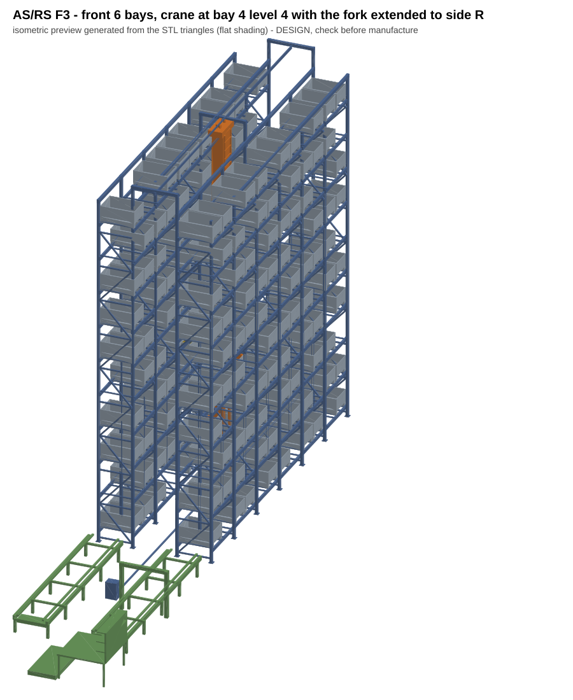
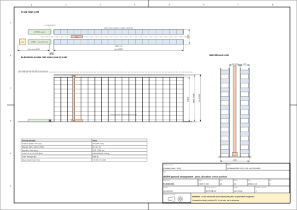
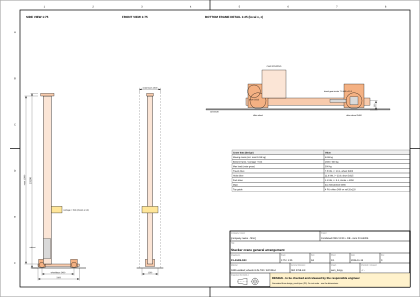
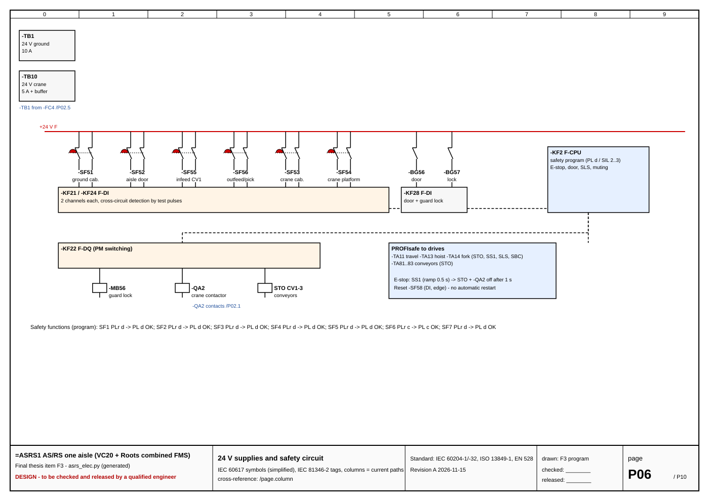
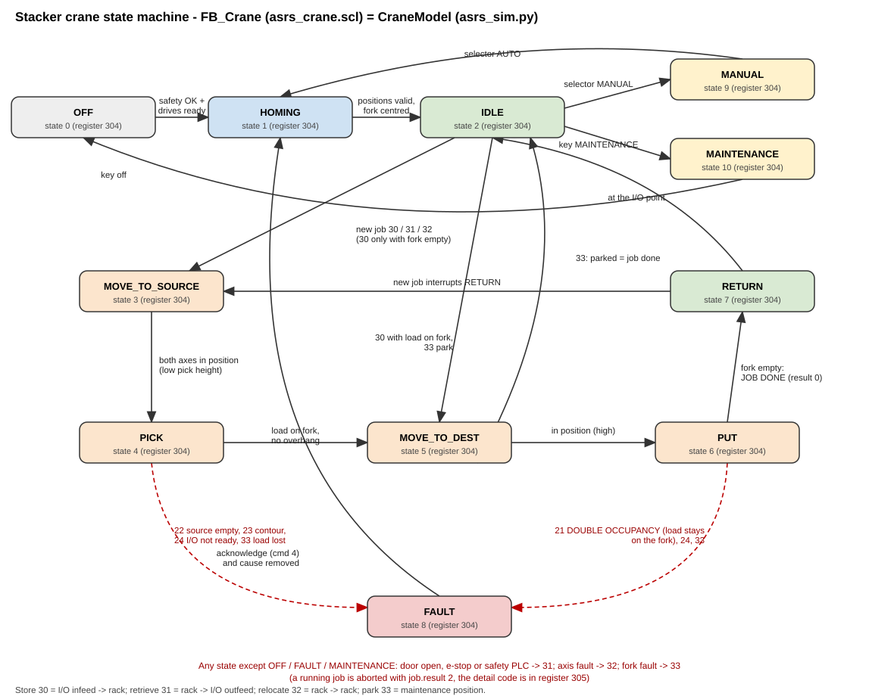
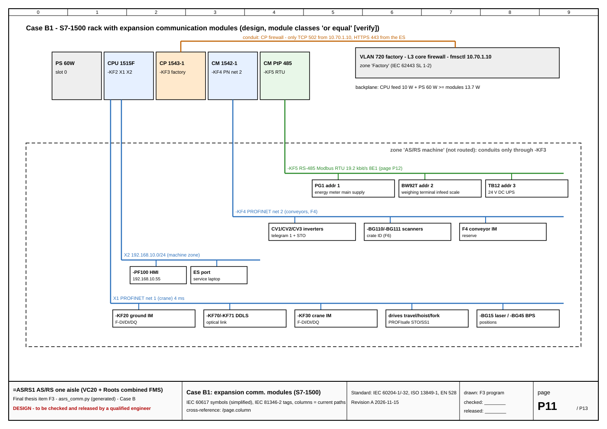
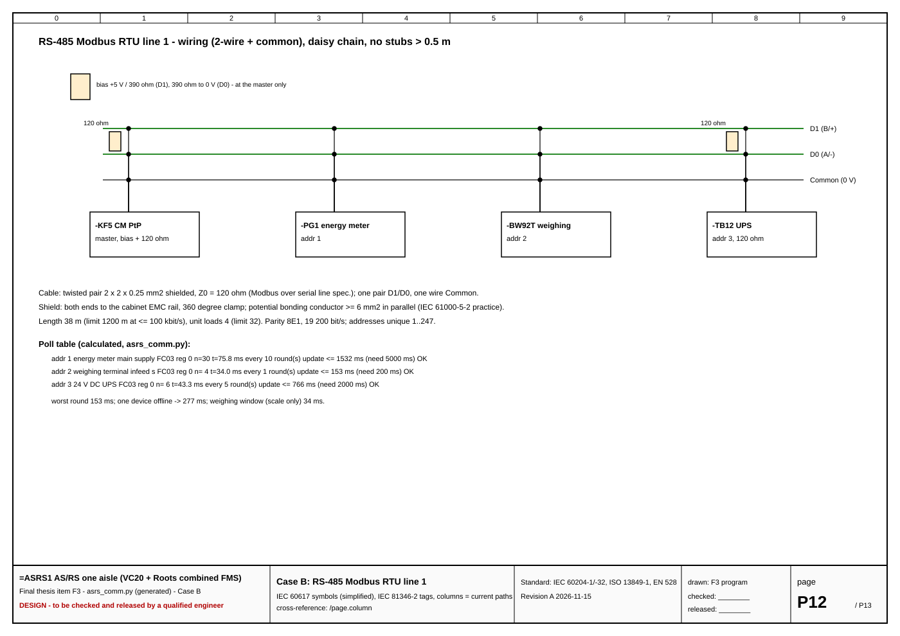
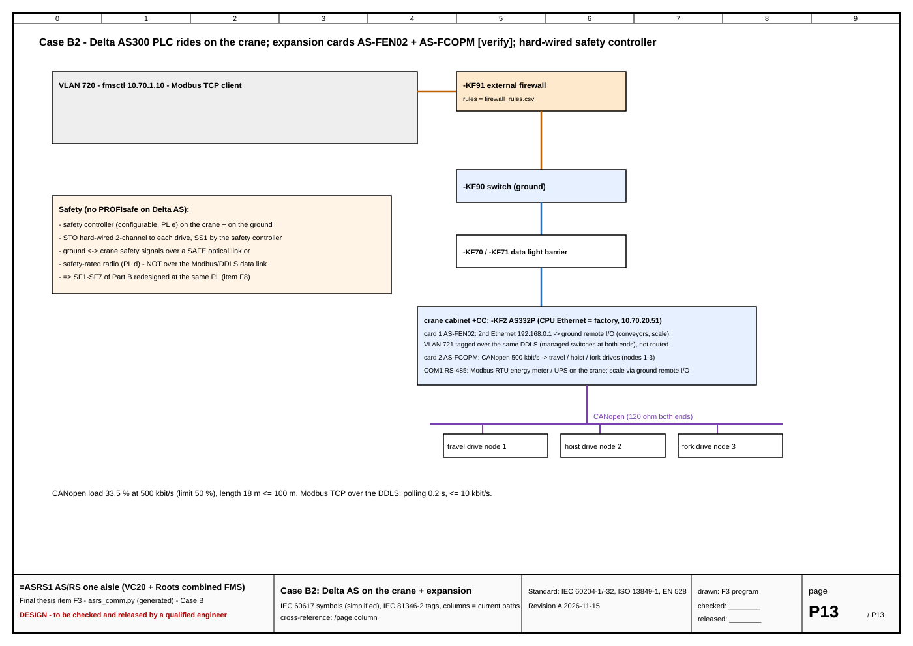

# 60 – Final thesis item F3: the AS/RS – mechanics, 3D, electrics, safety, PLC, communication (Case A built-in ports, Case B expansion modules)

*Automated storage and retrieval system for the combined FMS (VC20 + Roots blowers). It is designed from the F1 parts and
the F2 programme down to drawings, 3D models, schematics, PLC programs, a virtual crane and the fmsctl interface.*

**Files** (all in `thesis_final/design/03_asrs/`):

| File | What it does | Self-test |
|---|---|---|
| `asrs_data.json`, `asrs_design.py` | core sizing: crates, positions, throughput, rack, crane, FEM 9.851, drives, structure, positioning, energy, buffers, option comparison | 16/16 |
| `asrs_3d.py` | 3D models: STL + OpenSCAD; drawings D01–D05 as SVG; dimension table | see Part A |
| `asrs_elec.py` | device list, I/O list, cable list, electrical calculations, schematics P01–P10, safety and PL verification | see Part B |
| `plc/asrs_crane.scl`, `plc/asrs_crane_delta.st`, `asrs_sim.py` | PLC programs (Siemens S7-1500, Delta AS) and virtual crane with Modbus V1.2a tests | see Part C |
| `out/` | `report.md`, `design_result.json` (the single source of all dimensions), `bom_mech.csv`, `3d/`, `drw/`, `elec/`, state diagram | – |

**Relation to the earlier AS/RS guides 31–39.**
- Guides 31–39 (docs/) are the general textbook: AS/RS types, rack and crane theory, circuits, ladder logic, WMS,
  crane manufacturing and the telescopic fork. They designed one crane for 392 crates as a teaching example.
- **F3 is the final project design.** It re-sizes the system from the real F1/F2 flows.
- F3's program reproduces guide 31 §17 exactly when it is given guide 31's inputs (self-test checks 3–7):
  bay 1925 mm, 7 levels, 14 bays, 392 positions; travel 9.35 kW → 7.5 kW; hoist 10.39 kW → 11 kW; beam 48.3 N/mm²;
  upright χ = 0.864.
- So the theory of guide 31 remains valid. F3 changes only the inputs and adds the parts that were missing: real
  flows, one-aisle decision, high-bay height, stiffer mast, PLC state machine, virtual crane.

**Data labels.**
- Design values and reference estimates. Catalogue classes are given as examples, not as orders.
- Every drawing, circuit and program is an **engineering design**. Before manufacture or installation it must be checked
  and released by the responsible engineer, and its safety by a qualified person.

---

## 1 What the AS/RS must do in this factory

The AS/RS is the **material buffer of the whole plant**. It decouples:

1. **The foundry and forge from the machining cells.** Castings arrive weekly in truck loads. The cells consume them
   per hour.
2. **The machining cells from assembly.** Machined parts wait as WIP until a **kit** for an assembly batch is picked.

A crate that is not where the cell or the kitting station needs it stops the factory. The AS/RS therefore has to be
sized for storage, throughput and availability, not only for storage.

## 2 Requirements derived from F1 and F2 (program `asrs_design.py`, report §1–2)

### 2.1 One crate standard

**Steel crate 1200 × 800 × 600 mm**, tare 45 kg, max gross 300 kg (EN 13626-type box pallet).
- It enters the rack and the fork on its 800 mm side.
- It is also handled by AGV (F5) and conveyor (F4).

One standard for castings *and* machined parts means:
- one rack beam level;
- one fork;
- one conveyor width;
- one AGV load handler.

**Parts per crate.** Castings use layers with separators; machined parts get dunnage, which leaves 75 % of the raw
count. The program checks the 300 kg limit. Example: Roots housing R01-RB150 is 38 kg, so 6 per crate would weigh
45 + 6 · 38 = 273 kg. That is still inside the limit, but the program caps any part whose crate would exceed 300 kg.

### 2.2 Stock policy → storage positions

**RAW castings.** The foundry delivers weekly, i.e. a lot of 5 working days, plus 2 days of safety stock:

$$\text{RAW positions}_i = \max\left(2,\ \left\lceil \frac{q_i/22}{ppc_{raw,i}}\cdot(5 + 2)\right\rceil\right)$$

**KIT (machined parts).** Average 1 day of WIP plus 0.5 day of safety stock, with the machined parts per crate:

$$\text{KIT positions}_i = \max\left(2,\ \left\lceil \frac{q_i/22}{ppc_{mach,i}}\cdot(1 + 0.5)\right\rceil\right)$$

**Worked example: crankcase C01.**
- 3000 pieces per month → 136.4 per day.
- Raw: 12 per crate → 11.4 crates per day → 11.4 × 7 = 79.5 → **80 RAW positions**.
- Machined: 9 per crate → 15.2 crates per day × 1.5 = 22.7 → **23 KIT positions**.

**Totals** (report §1):

| | RAW | KIT |
|---|---|---|
| Positions | 499 | 169 |
| Crates in per month | 1518 | 2039 |

With a **fill factor of 0.90** (a store is never 100 % usable: zones, blocked slots, variation): (499 + 169)/0.9 =
**743 positions needed**.

### 2.3 Throughput → crane moves

| Flow | Moves per month |
|---|---|
| RAW: 1518 crates stored (from truck) + 1518 retrieved (to the cells) | 3037 |
| KIT: 2039 stored (from the cells) + 2039 final retrievals, plus 113 kit batches × 10 crate visits × 2 (out to the pick station and back) | 6344 |
| **Total** | **9381** |

- Per hour at H = 330 h: **28.4 moves/h on average**.
- With a peak factor of 1.6 (truck arrivals, shift start, kit waves): **45.5 moves/h**.

## 3 System choice

### 3.1 Which storage technology

| Technology | Fits 300 kg crates? | Throughput | Labour | Space | Verdict |
|---|---|---|---|---|---|
| Block storage + forklift | yes | low; no FIFO | high | large | no – no traceability, damage |
| Pallet racking + reach truck | yes | 20–30 moves/h per truck | 1 driver per shift per truck | medium | possible at the start; does not fit the FMS/AGV concept |
| Very-narrow-aisle truck | yes | 25–35/h | driver | good | same problem |
| **Unit-load AS/RS (stacker crane)** | **yes** | **80–110/h per crane** | **none in storage** | **best (high-bay)** | **chosen** – integrates with WMS, AGV, ID and the twin |
| Mini-load / shuttle | no (bins ≤ 50 kg) | very high | none | good | for small parts; not needed here |

### 3.2 One aisle or two aisles (report §10)

F2 originally had two stores: RAW at the dock, and KIT in the middle of the hall. The program compares both options,
using the F2 flows and layout optimiser (best of 6 annealing restarts).

| Option | Transport (unit-load m/month) | AGVs | Investment estimate |
|---|---|---|---|
| Two aisles: RAW 14 bays/560 positions, KIT 5 bays/200 positions | 862 911 | 4 | 1.36 M EUR |
| **One aisle RAW + KIT at the dock** | 1 025 695 (+19 %) | 5 | **1.00 M EUR** |

**Decision: one aisle.**
- One crane, one control system, one set of I/O and spare parts saves about **360 kEUR**, even after paying for the
  5th AGV that the longer kit trips need.
- **The price is a single point of failure.** If the crane stops, castings and kits stop together.
- This is solved by **line-side buffers** (chapter 10) and a maintenance contract with a 4 h response.

The decision was fed back into F2 (department KIT merged into RAW, AS/RS investment 0.55 M EUR). F2 now gives:

| F2 result after the change | Value |
|---|---|
| Hall | 72 × 50 m |
| AGVs | 5 |
| Total investment | 15.5 M EUR |
| NPV (reference) | 53.1 M EUR |

> **Lesson.** The two layouts were compared fairly only after the layout optimiser used several restarts. A single
> annealing run varied by up to 30 % between runs, which is more than the difference between the options. **Compare
> options only with a method whose own noise is smaller than the difference you want to see.**

## 4 Rack (report §3)

### 4.1 Geometry

**Levels from the building.**

$$n_{lev} = \left\lfloor\frac{H_{clear} - h_{top} - z_1 - h_{crate}}{p}\right\rfloor + 1 = \left\lfloor\frac{14.0 - 1.5 - 0.45 - 0.6}{1.25}\right\rfloor + 1 = 10$$

**Clear height H_clear = 14.0 m under the lowest roof member, top clearance 1.5 m.**
- The first value was 13.5 m with 1.0 m top clearance.
- The 3D model (Part A) showed that the cross ties of the top guide rail reach **13.35 m**: they must hang above the
  mast, not at rack top.
- 13.5 m would leave 150 mm for sprinklers and lighting, so the hall section was raised to 14.0 m.
- The number of levels does not change.
- **This is an example of why the 3D model is made: it finds what the calculation cannot see.**

**Bay** = upright + 3 gaps + 2 crates = 100 + 3 · 75 + 2 · 800 = **1925 mm**. The clear beam is 1825 mm.

**Positions per bay** (2 sides × 2 crates × 10 levels) = 40. Bays = ⌈743/40⌉ = **19**, giving **760 positions**.

**Rack dimensions.**
- Length: 19 · 1.925 + 0.1 = **36.67 m**.
- Height: top level 0.45 + 9 · 1.25 = 11.70 m, plus crate 0.6, plus 0.3 = **12.60 m**.
- Width: 2 · 1.2 + 1.5 + 2 · 0.1 = **4.10 m**.

**Why a 14 m high-bay section and not the 10.5 m of the main hall.**
- With 10.5 m only 7 levels fit, and the rack becomes **52 m long**.
- That fits neither the 22 m department depth nor along the 50 m dock wall, once the 9 m I/O front zone is added.
- **Level 1 at z₁ = 0.45 m** is possible only with a crane bottom frame that is low in the middle (top at 300 mm,
  Part A). Confirm this with the crane supplier. Otherwise use z₁ ≈ 0.8 m, which costs about one more bay.
- A **high-bay section** at the dock end (36.7 + 9 + 1.5 = 47.2 m < 50 m) is the normal industrial solution. Its roof can
  even be carried by the rack ("rack-clad building"; guide 31 §4.3).

### 4.2 Structural checks (simplified – the rack supplier designs with tested sections per EN 15512)

| Check | Formula | Result | Limit |
|---|---|---|---|
| Beam I (box 120 × 50 × 2) | (b·h³ − (b−2t)(h−2t)³)/12 | 1.217 × 10⁶ mm⁴ | – |
| Beam stress | 1.4 · P·a / W, with P = 300 · 9.81/2 = 1471.5 N, a = 475 mm | 48.3 N/mm² (14 %) | 355 |
| Beam deflection | P·a(3L² − 4a²)/(24EI) | 1.04 mm | L/200 = 9.1 mm |
| Upright load | N_Ed = 1.4 · 300 · 9.81 · 10 + 1.3 · 17 · 10 · 9.81 | 43.4 kN | – |
| Upright buckling | χ = 0.864 (curve b, λ̄ = 0.545); N_b,Rd = χ · 520 · 355 | 159.4 kN (27 %) | 100 % |
| Floor pressure | N / base plate 18 000 mm² | 1.73 N/mm² | slab design by the structural engineer |

These utilisations are low because the crate is only 300 kg. The uprights are governed by stiffness and the tolerances
of EN 15620 class 400 (crane-served rack), not by strength.

**Standards.**

| Standard | Topic |
|---|---|
| EN 15512 | design |
| EN 15620 | tolerances and clearances for crane-served racks |
| EN 15629 | specification |
| EN 15635 | inspection in use, annual by a competent person |
| EN 1090 / EN ISO 1461 | execution and galvanising |

## 5 Stacker crane (report §4, §6)

### 5.1 Arrangement and masses

- Single-mast crane with a bottom frame carrying both wheels, the travel drive, the hoist drive and the crane cabinet.
- The mast is a box section with a top frame and guide rollers on the top rail.
- The lifting carriage carries the telescopic fork.

| Part | Mass |
|---|---|
| Bottom frame | 1600 kg |
| Mast 600 × 400 × 6, 13.10 m: 11 856 mm² × 13.10 m × 7850 kg/m³ (the real tube between the bottom and top frame is 12.6 m – Part A – so this is about 4 % conservative) | **1219 kg** |
| Top frame | 200 kg |
| Carriage + fork | 600 kg |
| Rest (cabinet, ladder, cables) | 800 kg |
| **Moving mass** | **4419 kg** + load 300 kg |

### 5.2 The mast – the design iteration that mattered

The mast is a cantilever clamped in the bottom frame. When the crane accelerates at a_x = 0.5 m/s², its own mass and
the carriage at the top bend it.

$$\delta = \underbrace{\frac{q H^4}{8EI}}_{\text{mast mass}} + \underbrace{\frac{P_t H^3}{3EI}}_{\text{carriage + load + top frame}} \qquad f_1 = \frac{1}{2\pi}\sqrt{\frac{3EI/H^3}{m_{top} + m_{car} + 0.24\,m_{mast} + m_{load}/3}}$$

| Mast section | I [mm⁴] | δ_top | f₁ | Verdict |
|---|---|---|---|---|
| 500 × 350 × 6 (guide 31, for 9.3 m) at 13.1 m | 3.10 × 10⁸ | 7.13 mm | 1.52 Hz | **too soft**: settles slowly at every stop, fork misses the slot |
| **600 × 400 × 6** | **6.27 × 10⁸** | **4.43 mm** | **1.93 Hz** | **chosen** |

**Worked numbers for the chosen mast.**
- q = 1219 · 0.5 / 13 100 = 0.0465 N/mm. P_t = (600 + 300 + 200) · 0.5 = 550 N.
- δ = 0.0465 · 13 100⁴ / (8 · 210 000 · 6.27·10⁸) + 550 · 13 100³ / (3 · 210 000 · 6.27·10⁸) = 1.30 + 3.13 = **4.43 mm**.
- k = 3EI/H³ = 175.7 N/mm. m_eq = 200 + 600 + 0.24 · 1219 + 100 = 1193 kg. f₁ = √(175 700/1193)/(2π) = **1.93 Hz**.

**Why the frequency matters.** After every stop the mast swings at f₁. The fork may enter the rack only when the swing
is below about ±5 mm. A mast at 1.5 Hz needs roughly 30 % more settling time than one at 1.9 Hz, and that time adds to
*every* cycle. A taller rack therefore needs a stiffer mast. This is the reason a design check must be repeated whenever
one main dimension changes.

### 5.3 Wheels and rail

| Quantity | Calculation | Result |
|---|---|---|
| Static wheel loads | 55/45 split | 25.5 / 20.8 kN |
| Tilt during acceleration | ΔR = ½ · m · a · h_cg / wheelbase = ½ · 4719 · 0.5 · 4.59 / 2.4 | 2.25 kN |
| R_max | 1.15 · 25.5 + 2.25 | **31.5 kN** |
| P_mean | (R_min + 2 R_max)/3 | **28.0 kN** |
| Allowed (DIN 15070 / FEM 1.001 style) | p_lim · b_eff · D · c₁ · c₂ = 5.0 · 42 · 400 · 0.889 | **74.7 kN** |
| Utilisation | 28.0 / 74.7 | **37 %** |

b_eff is the rail head width minus the edge radii: 50 − 2 · 4 = **42 mm**. A first version used the full 50 mm, which is
not conservative; corrected.

## 6 Cycle time and throughput (FEM 9.851, report §4)

FEM 9.851 defines two **reference points** measured from the I/O point. Travel length L = 36.67 + 1.2 = 37.87 m; lift
height H = 11.70 − 0.45 = 11.25 m.
- **P1** = (L/5, 2H/3) = (7.57 m, 7.50 m).
- **P2** = (2L/3, H/5) = (25.25 m, 2.25 m).

Travel and hoist move at the same time, so a move takes the slower axis plus 2 s of positioning. Each axis follows the
trapezoid profile:

$$t(d) = \begin{cases}\dfrac{d}{v} + \dfrac{v}{a} & d \ge v^2/a\\[2mm] 2\sqrt{d/a} & d < v^2/a\end{cases}$$

| Move | Travel time | Hoist time | Move = max + 2 s |
|---|---|---|---|
| I/O → P1 | 2√(7.57/0.5) = 7.78 s | 7.5/1 + 1/0.5 = 9.50 s | **11.50 s** |
| I/O → P2 | 25.25/3 + 3/0.5 = 14.42 s | 2.25 + 2 = 4.25 s | **16.42 s** |
| P1 → P2 | 2√(17.68/0.5) = 11.89 s | 5.25 + 2 = 7.25 s | **13.89 s** |

**Fork cycle** = 2 strokes (2 · (1.35/1 + 1/1.2) = 4.37 s) + lift 0.15 m (1.15 s) + dead time 1 s = **6.52 s**.

| Cycle | Calculation | Time | Moves per hour |
|---|---|---|---|
| **Single cycle (SC)** | (2 · 11.50 + 2 · 16.42)/2 + 2 · 6.52 | **41.0 s** | 3600/41.0 = **88** |
| **Dual cycle (DC)** | 11.50 + 13.89 + 16.42 + 4 · 6.52 | **67.9 s** | 2 · 3600/67.9 = **106** |

**Capacity when half of the moves can be paired into dual cycles:**

$$\lambda_{max} = \frac{3600}{p\cdot DC/2 + (1-p)\cdot SC} = \frac{3600}{0.5\cdot 33.9 + 0.5\cdot 41.0} = 96\ \text{moves/h}$$

**Crane utilisation at the 45.5 moves/h peak: 47 %.**
- One crane is enough, with room to grow: about 2× the programme before a second aisle is needed.
- The WMS should pair stores and retrievals: every pairing turns two single cycles into one dual cycle and is free
  capacity (guide 56).

## 7 Drives (report §5)

**Travel.** Moving mass m = 4719 kg including the load; rotating-mass factor k_rot = 1.05; rolling resistance w = 0.010.

| Quantity | Calculation | Result |
|---|---|---|
| Force | 4719 · 0.5 · 1.05 + 0.010 · 4719 · 9.81 | 2941 N |
| Peak power | F · v / η = 2941 · 3 / 0.90 | 9.80 kW |
| Motor | ≥ 9.80/1.5 (inverter overload 150 % for the 6 s ramp) | **7.5 kW** |
| Wheel speed (D400) | 3/(π · 0.4) · 60 | 143.2 rpm |
| Gear ratio (4-pole motor) | 1450/143.2 | **10.1** |
| Output torque | 2941 · 0.2 | 588 N·m |

**Hoist.** Lifted mass m_h = carriage 600 + load 300 = 900 kg; direct 1:1 rope on a D315 drum.

| Quantity | Calculation | Result |
|---|---|---|
| Static power | 900 · 9.81 · 1.0 / 0.85 | 10.39 kW |
| Peak power (with acceleration) | 900 · (9.81 + 0.5) · 1.0 / 0.85 | 10.92 kW |
| Motor | – | **11 kW** |
| Drum speed | 1.0/(π · 0.315) · 60 | 60.6 rpm |
| Gear ratio | – | **23.9** |
| Rope force | 900 · 10.31 | 9279 N |
| Rope safety | 80 kN / 9.28 kN (check the rope group per FEM 9.661) | **8.6** |
| Regenerative power when lowering | 900 · 9.81 · 1.0 · 0.65 | **5.74 kW** → braking resistor, or a common DC link with a regenerative unit |

**Fork** (2-stage telescopic: the top stage moves at 2× the rack speed of the pinion).

| Quantity | Calculation | Result |
|---|---|---|
| Force | (120 + 300) · (1.2 + 0.05 · 9.81) | 710 N |
| Power | 710 · 1.0 / 0.80 | 0.89 kW |
| Motor | – | **1.1 kW** |
| Pinion speed (D60) | – | 159 rpm |
| Gear ratio | – | **9.1** |

**Energy per single cycle** (report §8):
- Without regeneration, **35.1 Wh**: 2 accelerations of the kinetic energy ½ m v², half the lift, rolling.
- With regeneration (η_back = 0.65), **22.1 Wh** (−37 %).
- At 9381 moves per month that is 330 kWh against 207 kWh per month. The money is small; the reason for the DC link is
  lower braking-resistor heat in the cabinet.

## 8 Positioning budget (report §7)

The fork must enter the slot within the clearance: ±75 mm horizontally (gaps 75 mm), ±50 mm vertically (below the
beam). The budget adds every error source:

| x (travel) | mm | z (hoist) | mm |
|---|---|---|---|
| laser distance meter | 2.0 | barcode position system | 1.0 |
| rail / mast deflection | 3.7 | rope stretch under load | 4.0 |
| thermal 20 K over 40 m (12·10⁻⁶ · 20 · 40 000) | 9.6 | beam deflection | 1.5 |
| rack tolerance EN 15620 | 5.0 | rack level tolerance | 5.0 |
| control stop error | 3.0 | control stop error | 2.0 |
| **RSS 12.0 / sum 23.3** | ≤ 75 | **RSS 6.9 / sum 13.5** | ≤ 50 |

Even the worst-case sum is far inside the clearance. The real limit is the **slot-occupancy and overhang check**:
- a crate standing 50 mm too far back is detected by the fork sensors;
- a crate standing 50 mm too far forward is caught by the contour check at the I/O before storage (Part B, Part C).

## 9 I/O, P&D station and contour check

At the front of the aisle (x = 0, front zone 9 m):
- an **infeed chain conveyor** (from the truck and the cells, by AGV or forklift);
- an **outfeed chain conveyor** (to the AGV handover);
- a **pick (kitting) station**, where a crate is presented and the operator picks into kit carriers with pick-to-light.

**Every crate passes a contour, weight and ID check before storage.** It is the "load check" required by EN 528:
- light grids for height, width and protrusion;
- a weighing cell (≤ 300 kg);
- a barcode/RFID read of the crate ID (item F6).

A crate that fails is rejected back to the infeed with a reason code. The conveyor and station designs follow in **F4**,
the identification in **F6**.

## 10 Availability and line-side buffers (report §9)

- Crane availability is about 97.5 %, with a mean repair time of 2 h. Plan for the 95 % repair time, **4 h**.
- During a crane stop the cells and the kitting must continue from **line-side buffers**: buffer = consumption per hour
  × 4 h, in crates.
- Example C04 cylinder: 18.2 pieces/h × 4 h = 73 pieces → **4 crates at the VMC cell**, at 24 raw per crate.
- The full table is in report §9. Over all 30 part/variant lines the buffers come to **42 crate places**: 21 for the VC20 parts, plus one crate for each Roots part line, because a crate is the smallest unit. They are part of the F4/F5
  station design.
- **Emergency procedure:** the crane has a manual mode and a maintenance platform (Part B safety SF, Part C MANUAL
  state). A crate can be retrieved manually under supervision.

## 11 Mechanical BOM and cost

`out/bom_mech.csv` lists 27 lines:
- rack: upright frames, beam pairs, rails, anchors, top tie, rails, end stops;
- crane: bottom frame, mast, top frame, carriage, wheels, guide rollers;
- drives: travel / hoist / fork geared motors with ratio and torque, drum + rope;
- positioning: laser, barcode position system, data light barrier, power rail;
- I/O equipment, access door, fence.

Make/buy is marked:
- **make** in the own workshop: welded frames, mast, carriage. Guide 38 explains crane manufacturing.
- **buy:** rack, drives, sensors, fork.

The cost estimate for the option comparison is 0.55 M EUR for the AS/RS with I/O and pick station (reference estimate).
**Ask for at least two turnkey AS/RS offers.** The F3 design is then the technical specification against which the
offers are compared. EN 15629 says what a rack specification must contain.

---

## Part A – 3D models and drawings of the AS/RS







*Design – check before manufacture.* All geometry is generated by `thesis_final/design/03_asrs/asrs_3d.py` from
`out/design_result.json`, the output of `asrs_design.py run`. If you change the design data, run both programs again:
the 3D files, the drawings and the dimension table all follow automatically.

```
cd thesis_final/design/03_asrs
python asrs_design.py run        # sizing -> out/design_result.json
python asrs_3d.py run            # 3D + drawings -> out/3d/, out/drw/
python asrs_3d.py selftest       # SELFTEST PASS (24/24)
```

### A.1 How the 3D model is built

**Coordinate system.** The same system is used in docs/31, in the twin and in the PLC program.

| Axis | Direction | Zero point |
|---|---|---|
| x | along the aisle | I/O transfer point, where the crane picks from the conveyors; the rack starts at x = 1200 mm |
| y | across the aisle | crane axis; side L = −y, side R = +y |
| z | up | finished floor |

All units are millimetres.

**From parameters to geometry.** Nothing is drawn by hand. Each part is a function of the design numbers:

| Parameter (design_result.json) | Value | Used for |
|---|---|---|
| bays × levels × sides | 19 × 10 × 2 | number of frames, beams, positions (760) |
| bay pitch / clear beam | 1925 / 1825 mm | upright and beam positions |
| z1 / level pitch | 450 / 1250 mm | beam top of level l: z = 450 + (l − 1)·1250 |
| rack length / height / width | 36 675 / 12 600 / 4100 mm | outer dimensions (self-test checks them) |
| aisle | 1500 mm | upright faces at y = ±750 |
| crate | 1200 × 800 × 600 mm, 300 kg | crate model, positions, fork reach |
| mast | box 600 × 400 × 6 | crane mast (hollow tube from 4 plates) |
| top of crane | 13 100 mm | top frame; mast tube 300 … 12 900 mm = 12 600 mm long |
| wheel D / wheelbase | 400 / 2400 mm | wheels on the 50 × 30 rail (wheel centre z = 230) |
| fork stroke | ±1350 mm | 3-stage telescopic fork |
| drum D | 315 mm | hoist drum on the bottom frame |

**Design choices made in this part** (they are also written into the dimension table):
- **Upright depth 80 mm.** The frame depth per side is (4100 − 1500)/2 = 1300 mm.
- **Crate front face 50 mm behind the upright face**, at y = 800 mm. The crate centre, which is the fork pick point,
  is at y = 1400 mm.
- **Crate legs 160 mm high.** The opening between the legs is 500 mm. The fork base stage is 450 mm wide, so there is
  25 mm clearance on each side.
  - The fork enters 10 mm above the beam top and has 140 mm total thickness (60 + 45 + 35).
  - So it fits under the crate body, and it lifts 150 mm.
- **Crane bottom frame with a low middle section** (top at z = 300 mm) between the two wheel boxes.
  - The carriage can then go down to level 1: its base plate is at z = 380 mm.
  - Without this, the lowest level would have to be about 0.8 m, and the rack would need one more bay.
- **Top guide.** A guide rail 20 × 120 mm (z 13 130 … 13 250) hangs under cross ties at z 13 250 … 13 350. The ties sit on
  posts on every 3rd frame.
  - 4 polyurethane rollers D80 on the crane top frame hold the mast top.
  - The crane passes **under** the ties. Ties at the rack top (12 600) would hit the mast, which reaches 12 900.

**Mesh library (standard library only).**
- **Primitives:** `box` (axis-aligned), `bar` (rectangular bar between any two points, used for the bracing
  diagonals), `cyl` (n-segment cylinder along x, y or z) and `tube` (hollow box from 4 plates).
- **Correct winding:** every face is oriented outward by a centroid test, so the signed volume of every closed part is
  positive. The self-test checks it: a 10 × 20 × 30 box gives exactly 6000 mm³; a 64-segment cylinder is within 1 % of πr²h.
- **Mirroring:** side L is the mirror image of side R. Mirroring reverses the winding, so the program swaps two vertices
  to keep the normals outward.

**Files in `out/3d/`:**

| File | Triangles | Content |
|---|---|---|
| `rack.stl` | 38 448 | both sides: uprights, bracing, beams, crate support rails, base plates, top ties |
| `rails.stl` | 544 | bottom rail 50 × 30 (42 375 mm long), end stops + PU buffers, posts, cross ties, top guide rail |
| `crane.stl` | 1 804 | stacker crane, carriage at level 1, fork retracted |
| `fork.stl`, `fork_ext.stl` | 36 each | fork retracted / extended to side R (tip at y = 2000) |
| `io.stl` | 636 | infeed (side L) and outfeed (side R) chain conveyors, contour gate, pick station |
| `crate.stl` | 120 | crate with legs and a part load |
| `asrs_assembly.stl` | 105 512 | everything, 70 % of positions filled, crane at bay 4 / level 4 with the fork extended under a lifted crate |
| `*.scad` (6 files) | – | the same geometry as **parametric** OpenSCAD source (variables at the top, loops, modules) |
| `preview_iso.svg` | – | picture of the front 6 bays, drawn directly from the triangles (painter's algorithm, flat shading); opens in any browser |

**Why these formats?**
- **STL** (binary, mm) is the universal triangle format. Every CAD, viewer and 3D printer reads it.
- **SCAD** is text: you can change `bays = 19;` or `levels = 10;` and regenerate.
- STL has no units or features, and SCAD needs OpenSCAD. Neither is a native SOLIDWORKS part.

**Getting the model into your CAD.**
1. **SOLIDWORKS:** *File → Open → STL*, then *Options → Import as: Graphics body* (or *Solid body* for small parts such as
   the crate or the fork). Use it as a **reference** for layout, collision checks and presentations. You cannot edit
   features on it.
2. **FreeCAD → STEP:** open the `.scad` file. FreeCAD's OpenSCAD workbench, with OpenSCAD installed, converts it to real
   solids. Then *File → Export → STEP*. SOLIDWORKS opens STEP as solid bodies, and FeatureWorks can recognise simple
   features.
3. **Native rebuild:** recommended for manufacturing. Use the drawings and `dimension_table.csv`; see A.4.

### A.2 The drawing set (`out/drw/`, A3 landscape SVG)

| No. | Title | Scale | Content |
|---|---|---|---|
| F3-ASRS-D01 | AS/RS general arrangement | 1:200 / 1:100 | plan view (rack both sides, rail, crane, conveyors, pick station, front zone 9000, rack 36 675, width 4100); elevation along the aisle (10 levels, rack 12 600, crane 13 100, ties 13 350, clear height 13 500); section A-A (aisle 1500, frame 1300); key data table |
| F3-ASRS-D02 | Rack upright frame and beam level detail | 1:75 / 1:20 | upright frame with bracing and levels L1–L10; bay detail with 100 / 75 / 800 / 75 / 800 / 75 = 1925 mm; level table (beam top 450 … 11 700 mm, crate top 1050 … 12 300 mm); notes |
| F3-ASRS-D03 | Stacker crane general arrangement | 1:75 / 1:25 | side and front view (mast 12 600, top 13 100, wheelbase 2400, bottom frame 3100, carriage width 1200 between crate faces 1600); bottom frame detail (wheels D400, drum D315, travel gear-motor 7.5 kW i = 10.1, mast 600 × 400 × 6); crane data table (4419 kg, drives 7.5 / 11 / 1.1 kW) |
| F3-ASRS-D04 | Telescopic fork | 1:20 / 1:5 | top views retracted / extended R / extended L with crate outlines; stroke 1350; crate centre 1400; tip 2000; section of the 3 stages (450 × 60, 400 × 45, 350 × 35); kinematics notes |
| F3-ASRS-D05 | Rail and floor layout | 1:200 | 80 base-plate positions, each with 2 × M12 anchors; bottom rail 42 375 mm with end stops; tolerance table (design targets); installation sequence |

**How to read them.**
- **Title block** (bottom right, ISO 7200 layout): drawing number, title, scale, sheet size, date, revision, material,
  general tolerance, drawn / checked / released, and the projection symbol.
- **Status field** (yellow): *"DESIGN – to be checked and released by the responsible engineer"*. A drawing becomes a
  manufacturing drawing only after the engineer signs the "checked / released" field.
- **First-angle projection** (ISO 5456-2, the European convention): the view from the left is drawn to the right of the
  front view. The symbol in the title block is the truncated cone: front view on the left, end view (two circles) on the
  right.
- **Dimensions** are in mm. Each dimension line has arrowheads and extension lines (ISO 129-1). **Do not scale from the
  drawing; use the numbers.** The SVG is exact, but printing changes the scale.
- **General tolerance ISO 2768-mK.**
  - "m" = medium linear tolerances, for example ±0.3 mm for 30–120 mm and ±0.8 mm for 400–1000 mm.
  - "K" = geometric tolerances, class K.
  - Rack and installation tolerances are **not** ISO 2768: they follow EN 15620 / FEM 9.831 and the supplier (D05 table).
- **Grid references** 1–8 / A–F on the frame (ISO 5457), and a 20 mm filing margin on the left.

### A.3 The dimension table (`out/drw/dimension_table.csv`)

The table has 53 rows, with the columns `part, feature, value_mm, tolerance, source`. Each row tells you where the value
comes from, either a design_result field or a design choice of this part. Examples:

| part | feature | value_mm | tolerance | source |
|---|---|---|---|---|
| rack | rack length | 36675 | EN 15620 class 400 / supplier | design_result rack.length_m |
| rack | beam top level L10 | 11700 | ±5 | z1 + (l − 1) pitch |
| crate | fork entry opening between legs | 500 | ±3 | fork width + 2 × 25 |
| crane | top of crane (top frame) above floor | 13100 | ±10 | design_result crane.mass.H_mast_m |
| crane | mast tube length | 12600 | ISO 2768-mK | top frame − bottom frame |
| fork | stroke each side | 1350 | ±2 | asrs_data crane.fork_stroke_m |
| rails | cross ties z range (every 3rd frame) | 13250 .. 13350 | ±5 | asrs_3d |
| building | clear height required (underside roof) | 13500 | ≥ value | asrs_data rack.clear_height_m |

### A.4 Rebuilding the AS/RS natively in SOLIDWORKS (step by step)

1. **Units and origin.** Use the part template in mm. Put the origin at the transfer point: x along the aisle, y across,
   z up. Then the STL reference and your parts overlap exactly.
2. **Design table.**
   - Copy the numeric rows of `dimension_table.csv` into an Excel sheet with the columns `$PRP@…` / dimension names
     (`D1@Sketch1` …).
   - Insert it as a *design table* (*Insert → Tables → Design Table → From file*).
   - Changing the bay count or the levels in Excel then regenerates the parts, which is the same idea as the OpenSCAD
     variables.
3. **Rack frame as a weldment.**
   - 3D sketch: 2 vertical lines 12 600 mm, 1300 mm apart in y, plus horizontals and diagonals every 1250 mm.
   - *Weldments → Structural member*: a custom 100 × 80 profile for the uprights, 40 × 40 for the bracing.
   - The rack supplier delivers the real tested section (EN 15512). Your model is for layout and interfaces.
4. **Beams and the rack pattern.**
   - Beam 120 × 50 × 2 (clear span 1825) as a part.
   - Linear pattern in the assembly: 19 bays × 10 levels × 2 beams. Pattern the frames 20 × in x at 1925 mm. Mirror
     side R to side L about the XZ plane.
5. **Crane mast as a weldment.** A rectangular tube 600 × 400 × 6, 12 600 mm long, on the bottom frame. Model the bottom
   frame as a weldment of plates and tubes (low middle section top at z = 300, wheel boxes 500 mm long up to z = 650).
6. **Bought parts.** Insert the supplier CAD (STEP) for the geared motors, wheels, telescopic fork, laser distance meter
   and barcode positioning system. Use the masses from the BOM (`bom_mech.csv`) and check the total of 4419 kg against
   the SOLIDWORKS mass properties.
7. **Configurations.**
   - Fork: retracted / extended R / extended L.
   - Carriage at L1 / L10.
   - Use them for collision checks: *Interference Detection* in the assembly, at the top level and at both rack ends.
8. **Drawings.** Make the drawings from the assembly using the D01–D05 layouts and scales. Copy the title-block fields
   and the "design – check" status until release.
9. **Compare.** Import `asrs_assembly.stl` as a graphics body and check that your native model lies inside it: same
   outer dimensions, same level heights.

### A.5 What the self-test checks (24 checks)

| # | Check | Result |
|---|---|---|
| 1–4 | mesh library: box volume and winding, cylinder volume, diagonal bar volume, mirror winding | exact / < 1 % |
| 5 | all 8 STL files read back by an independent reader | triangles > 0 |
| 6–8 | rack bounding box = design (base-plate overhang removed): length 36 675, height 12 600, width 4100 mm | within 1 mm |
| 9 | crane top frame = 13 100 mm | exact |
| 10–11 | crane half width 650 mm (carriage 600, fork 650) → **150 mm clearance** to the crate faces at ±800; inside the upright faces ±750 | ≥ 50 mm |
| 12–13 | fork extended: tip 2000 mm ≥ crate centre 1400 and ≤ rack rear 2050; top stage (700 … 2000) covers the crate centre | yes |
| 14–15 | fork 450 mm fits the 500 mm leg opening; fork 140 mm + 10 mm entry ≤ legs 160 mm | yes |
| 16 | wheels stand on the 30 mm rail | min z = 30 |
| 17 | top of ties 13 350 mm ≤ building clear height 13 500 mm | 150 mm margin |
| 18–20 | top-level crate top 12 300 below the top tie 12 480; carriage at L10 below the top frame; carriage at L1 (380) above the low frame section (300) | yes |
| 21–24 | 5 drawings are valid SVG with title block, ISO 2768-mK and status text; the preview is valid; 6 SCAD files with balanced brackets; dimension table has ≥ 40 rows | yes |

### A.6 Checklist before the drawings go to a supplier

- [ ] `asrs_design.py run` and `asrs_3d.py selftest` both run on the final data (24/24).
- [ ] Rack: the supplier's tested upright / beam sections replace the 100 × 80 / 120 × 50 design sections; level heights
  are confirmed with the real beam height.
- [ ] Crate: legs ≥ 160 mm and leg opening ≥ 500 mm are confirmed on the real crate (EN 13626), with the fork supplier.
- [ ] Building:
  - clear height ≥ 13.5 m under the **lowest** roof member;
  - plus the sprinkler and lighting clearance;
  - slab check for the base-plate loads and the rail (D05).
- [ ] Crane: the supplier's GA replaces D03. Wheel loads, mast and drives are checked against `asrs_design.py` sections 5–6.
- [ ] Interference check in CAD at both rack ends, at L1 and L10, with the fork extended on both sides.
- [ ] Every drawing is signed "checked" and "released" by the responsible engineer. Until then, the status stays *DESIGN*.

---

## Part B – Electrical design and safety of the AS/RS



*Program `thesis_final/design/03_asrs/asrs_elec.py`, outputs in `thesis_final/design/03_asrs/out/elec/`.*

**Status: DESIGN.** Everything in this part must be checked and released before anyone builds the cabinets:
- the electrical design by a qualified electrical engineer (IEC 60204-1 / IEC 60204-32, IEC 60364);
- the safety functions by a qualified safety engineer (ISO 13849-1/-2, EN 528).

The type designations are *classes* ("S7-1500 F-CPU or equal"); a supplier offer gives the exact article numbers. All
numbers in this part are printed by the program from `out/design_result.json`, the core design of Part A.

```
cd thesis_final/design/03_asrs
python asrs_design.py run        # core design -> out/design_result.json
python asrs_elec.py selftest     # SELFTEST PASS (23/23)
python asrs_elec.py run          # devices.csv, io_list.csv, cables.csv, safety.csv, calc_report.md, P01..P10.svg
```

| Output file | Content |
|---|---|
| `devices.csv` | 57 devices: IEC 81346-2 tag, description, type class, location, page, 24 V current, safety yes/no |
| `io_list.csv` | 140 I/O points: address, tag, description, signal type, module, safety, page |
| `cables.csv` | 26 cables: number, from, to, type, cores × cross-section, length, route, EMC rule |
| `safety.csv` | risk assessment ISO 12100 → PLr |
| `calc_report.md` | all calculations with the numbers put into the formulas |
| `P01.svg … P10.svg` | 10 schematic pages, A3 landscape, title block, current-path columns 0–9 |

The tag style is the same as guide 33 (docs/33_asrs_control_circuits.md). Guide 33 is the detailed teaching text for the
8-page schematic *web* page. This part applies the same rules to the **final** crane, whose data come from Part A.

---

### B1 The electrical architecture of a stacker crane

A stacker crane is a machine that **moves along 40 m** and carries its own drives. Power and data must reach a moving
machine. The standard solution has four blocks:

```
 factory sub-distribution ──W0001 5G6, 40 m──►  +GC ground cabinet (aisle front)
                                                 │  -QB1 main switch, -FC1 SPD, -FC2 crane MCCB, -QA2 contactor, -QB2 rail isolator
                                                 │  -KF2 F-CPU (PLC-ASRS1), ET 200SP ground station, conveyor inverters, switch -KF90
                                                 ▼
                         -WD1 enclosed conductor rail 40 A, 4-pole + PE, 40.7 m (power to the moving crane)
                                                 ▼  -XD10 collector trolley (double PE collector)
                         +CC crane cabinet on the bottom frame
                                                 │  -QA10, -RA10 reactor, -TA10 infeed + chopper ══ DC link ══ -TA11 travel,
                                                 │  -TA13 hoist, -TA14 fork; -RA11 brake resistor; ET 200SP crane station -KF30
                         data: -KF70 (ground) ◄── infrared light, PROFINET + PROFIsafe ──► -KF71 (crane)
```

**Why this split.**

| Block | What it contains | Why |
|---|---|---|
| Ground cabinet +GC | everything that does **not** move: main switch, crane feeder, the safety PLC, conveyors, network | the PLC sees all safety devices of the aisle (doors, E-stops at the I/O) even when the crane is switched off |
| Conductor rail -WD1 | copper bars in a plastic housing along the aisle; carbon brushes slide on them | unlimited travel length, low wear, standard for pallet stacker cranes (guide 33 §5.1 compares it with a cable chain) |
| Crane cabinet +CC | the drives and the I/O of the crane | motor cables stay short (4 m) – less EMC trouble, less voltage drop |
| Data light barrier -KF70/-KF71 | two optical heads facing each other along the aisle | PROFINET and PROFIsafe without a cable; 100 Mbit/s |

**Shared DC link.**
- One infeed module, -TA10 (18 kW, diode bridge + brake chopper), feeds a DC bus of about 565 V.
- The three inverters hang on that bus.
- When the travel axis brakes, its energy goes into the bus, and the hoist can use it for lifting at the same moment.
- Only the surplus is burnt in the resistor -RA11. Guide 33 §6.1 explains the principle in detail.

---

### B2 Motors, inverters and their sizing (P03–P05)

**Motor current.** The rated current comes from the electrical power balance:

$$I_n = \frac{P_n}{\sqrt3\,U\,\cos\varphi\,\eta}$$

cos φ and η are typical IE3 4-pole values (IEC 60034-30-1). Take the real values from the motor data sheet.

| Axis | Motor | P_n | cos φ / η | I_n | P_peak (Part A) | I_peak = I_n · P_peak/P_n | Inverter (heavy duty) |
|---|---|---|---|---|---|---|---|
| travel | -MA11 | 7.5 kW | 0.83 / 0.904 | **14.43 A** | 9.80 kW | 18.86 A | 7.5 kW, I_r 16.5 A |
| hoist | -MA13 | 11.0 kW | 0.84 / 0.914 | **20.68 A** | 10.92 kW | 20.68 A | 11 kW, I_r 25.0 A |
| fork | -MA14 | 1.1 kW | 0.80 / 0.845 | **2.35 A** | 0.89 kW | 2.35 A | 1.1 kW, I_r 3.1 A |

**Worked example – hoist.**

$$I_n = \frac{11\,000}{1.732 \cdot 400 \cdot 0.84 \cdot 0.914} = 20.68\ \text{A}$$

**Inverter rule.** The inverter must satisfy two conditions:
- carry the motor current permanently: I_r ≥ I_n;
- carry the acceleration peak: 1.5 · I_r ≥ I_peak. Heavy-duty inverters allow 150 % for 60 s.

Travel: 16.5 ≥ 14.43 ✓ and 1.5 · 16.5 = 24.75 ≥ 18.86 ✓. The travel axis needs 131 % of its rated power during
acceleration. That is why Part A chose 7.5 kW for a 9.8 kW peak; the inverter's overload rating covers it.

**Functions the inverters must have** (purchase specification):

| Function | Meaning | Why |
|---|---|---|
| STO | safe torque off: no torque, the motor coasts | basis of every safety function |
| SS1 | safe stop 1: controlled ramp, then STO | E-stop with stop category 1: the crane brakes on the ramp instead of on the mechanical brake, so the mast does not swing |
| SLS | safely limited speed | maintenance and aisle ends (SF3) |
| SBC | safe brake control | the hoist brakes (SF7) |

All of them are commanded via PROFIsafe telegram 30 from the F-CPU. The STO terminals are **not** bridged by hand: the
safety PLC alone switches them.

**Two hoist brakes (P04).**
- -MB13 (motor brake) and -MB15 (second brake on the drum side) each hold at least 1.6 × the load torque alone.
- Both have a release-monitoring contact: -BG51 and -BG52.
- A daily **brake test** lets the drive apply 1.3 × the load torque against each closed brake. If the drive measures
  movement, the brake is worn and the crane stops with an alarm.
- This is the hoisting practice of EN 528 and IEC 60204-32. A rope break is covered separately by the safety catch -BG30
  (guide 33 §11).

**The fork motor on the carriage (P05).** The fork motor rides up and down with the carriage. Its cable goes through a
drag chain on the mast: 15.6 m, chain-approved shielded cable 4G1.5. Its voltage drop is only 0.19 % because the current
is small (2.35 A).

---

### B3 Crane currents, supply, conductor rail (P02)

**Crane currents.**
- The thermal current uses a simultaneity factor k_s = 0.6: travel and hoist rarely run at full power together for long.
- The peak current assumes all axes accelerate at the same time.

$$I_{th} = \frac{(k_s \sum P_n + P_{aux})\cdot 1000}{\sqrt3\,U\,\cos\varphi_{in}\,\eta_{dr}} = \frac{(0.6\cdot19.6 + 1.5)\cdot1000}{1.732\cdot400\cdot0.95\cdot0.97} = \mathbf{20.77\ A}$$

$$I_{pk} = \frac{(21.61 + 1.5)\cdot 1000}{1.732\cdot400\cdot0.95\cdot0.97} = \mathbf{36.19\ A}$$

| Term | Meaning |
|---|---|
| P_aux = 1.5 kW | crane auxiliaries: 24 V PSU, lights, cabinet fan |
| cos φ_in = 0.95 | diode infeed with a 4 % reactor |
| η_dr = 0.97 | drive efficiency |

**Whole AS/RS** (program report §2).

| Consumer | Current |
|---|---|
| crane thermal | 20.77 A |
| conveyors 3 × 0.75 kW (CV1 infeed, CV2 outfeed, CV3 pick station) | 5.27 A |
| stationary 24 V + lighting (2 kVA) | 2.89 A |
| **design current I_b** | **28.93 A → S = √3 · 400 · 28.93 = 20.0 kVA** |
| peak (crane accelerating) | 44.35 A → 30.7 kVA |

The AS/RS needs a **20 kVA design / 31 kVA peak** feeder from the sub-distribution. This is a small consumer compared with
the HMCs, about 30 kVA each, so it is no problem for the factory transformer. The peak lasts about 6 s, during
accelerations.

**Fuse and cable rule (IEC 60364-4-43).**
- **Fuse:** a gG fuse must satisfy I_n ≥ I_b and I_n ≥ I_pk/1.5. The 6-second peaks must stay well away from the fuse's
  fusing current. Here 28.93 A and 44.35/1.5 = 29.6 A, so **gG 32 A**.
- **Cable:** the conventional tripping current of a gG fuse is I₂ = 1.6 · I_n, and the standard requires I₂ ≤ 1.45 · I_z:

$$I_z \ge \frac{1.6\cdot32}{1.45} = 35.3\ \text{A}$$

  Method C, PVC, 3 loaded conductors (IEC 60364-5-52 Table B.52.4) gives 6 mm² = 41 A. At 40 °C: 41 · 0.87 = 35.7 A
  ≥ 35.3 ✓, so **-W0001 5G6**.
- **Voltage drop at the peak current**, 40 m, R₇₀ = 1.2 · 18.3/6 Ω/km, X = 0.08 Ω/km, cos φ 0.9:

$$\Delta U = \frac{\sqrt3\,I\,L\,(R\cos\varphi + X\sin\varphi)}{U}\cdot100 = 2.56\ \%\ \le 3\ \%$$

**Conductor rail -WD1.**
- **Rating rule:** I_rail ≥ 1.25 · I_th = 26 A and I_rail ≥ I_pk/1.5 = 24 A, so a **40 A class** rail.
- **Impedance:** R' = 1.60 Ω/km, X' = 0.20 Ω/km. *This is an assumption; take the values from the rail data sheet.*
- **Length:** 36.7 m rack + 4 m = 40.7 m, end feed:

$$\Delta U_{rail} = 0.97\ \%\ (\text{centre feed } 0.49\ \%) \qquad \Delta U_{total} = 2.56 + 0.97 = \mathbf{3.53\ \%} \le 5\ \%$$

Why keep a margin below 5 %? During a simultaneous hoist + travel acceleration at the far end, the drives trip with
"DC link under-voltage" if the voltage dips **and** the brushes bounce on a joint at the same moment. The crane-side
24 V buffer (-TB10 + capacitor module) bridges these micro-interruptions for the PLC I/O.

**Fault loop at the far end** (IEC 60364-4-41, automatic disconnection). An earth fault on the crane must trip -FC2 fast.
The loop is: upstream + supply cable (phase + PE) + rail (phase + PE conductor) + crane wiring.

$$Z_s = 0.150 + 0.293 + 0.130 + 0.044 = \mathbf{0.617\ \Omega} \;\le\; 0.8\cdot\frac{U_0}{I_i} = 0.8\cdot\frac{230}{250} = 0.736\ \Omega$$

- -FC2 is an MCCB with I_r 25 A and instantaneous release I_i = 10 · I_r = 250 A.
- The earth-fault current is I_k1 = 0.95 · 230/0.617 = 354 A, which is more than 250 A ✓.
- The factor 0.8 is the rule for measured values: conductor temperature and measuring uncertainty.
- **Measure Z_s at commissioning with the crane at the far end**, so the PE current flows through the collectors.

**Short-circuit level.** With an upstream loop of 0.15 Ω, I_k3 at the ground cabinet is estimated at about 3.2 kA. All
devices with ≥ 10 kA breaking capacity are therefore fine, or back-up protection by -FC0 is used. Ask for the real value
from the factory single-line diagram.

---

### B4 Braking energy and the brake resistor (P03)

The worst braking case is the hoist lowering and braking at the end of the stroke **while** the travel brakes:

$$P_{brk} = m_h(g+a_z)\,v_z\,\eta_H + (m_t\,a_x - F_{roll})\,v_x\,\eta_T$$
$$= 900\cdot10.31\cdot1.0\cdot0.85 + (4719\cdot0.5 - 463)\cdot3.0\cdot0.90 = \mathbf{13\,008\ W}$$

| Symbol | Meaning |
|---|---|
| m_h = 900 kg | carriage 600 kg + crate 300 kg |
| m_t = 4719 kg | crane + load |
| F_roll | rolling resistance = 0.010 · m_t · g = 463 N |

**Resistor value.** The chopper connects the resistor when the DC link rises to U_on ≈ 750 V:

$$R \le \frac{U_{on}^2}{1.2\,P_{brk}} = \frac{750^2}{1.2\cdot13\,008} = 36.0\ \Omega \;\rightarrow\; \mathbf{33\ \Omega}\ (\text{peak } 750^2/33 = 17.0\ \text{kW})$$

- 33 Ω is above the assumed minimum chopper resistance of 15 Ω. **Check the real minimum in the drive manual:** a smaller
  resistor destroys the chopper transistor.

**Continuous rating.**
- One FEM single cycle lowers about half the lift height twice (h = 11.70 − 0.70 = 11.0 m) and stops twice from full speed.
- The braking distance is s = v²/(2a) = 9 m.

$$E_{cycle} = 2\,m_h g\frac h2\eta_H + 2\left(\tfrac12 m_t v^2 - F_{roll}s\right)\eta_T = 113\,277\ \text{J}$$

$$P_{avg} = \frac{113\,277}{41.0\ \text{s}} = 2766\ \text{W} \;\rightarrow\; 1.25\cdot2766 = 3.5\ \text{kW} \;\rightarrow\; \mathbf{4\ kW}$$

**Upper estimate.** In reality part of the energy is shared over the DC link. Part A gives a static regeneration of
5.74 kW for hoist lowering.

**Resistor or regenerative infeed?** Read guide 33 §7.4. At 47 % crane utilisation (Part A) a resistor is acceptable. An
active infeed saves about a third of the crane energy (Part A: 37 %) and removes the hot resistor from the crane. Decide
after the supplier's energy calculation.

---

### B5 Positioning and sensors (P08)

| Axis | Measuring system | Accuracy | Why |
|---|---|---|---|
| travel x | laser distance meter -BG15 on the crane, reflector at the aisle end; PROFINET, 1 ms | ± 2 mm | absolute, no reference run after power loss; independent of wheel slip |
| hoist z | bar-code positioning -BG45: a tape on the mast, reader on the carriage; PROFINET | ± 1 mm | absolute, and gives speed: **second channel for safe speed** (SF3, SF7) |
| fork | motor encoder -BG14 + position sensors -BG21…-BG25 | ± 5 mm | the end sensors are the reference; the pre-end sensors -BG24/-BG25 slow the fork down |

The positioning budget of Part A shows x RSS 12.0 mm against ±75 mm allowance, and z 6.9 mm against ±50 mm. The sensors are
far from the limit.

**Limit switch philosophy (three levels, travel and hoist).**
1. **Software limits:** the PLC never commands a target outside the rack.
2. **Slow-down switches**, -BG16/-BG17 travel and -BG36/-BG38 hoist: plain DI. The PLC reduces the speed even if the
   position value is wrong.
3. **Final limit switches**, -BG18/-BG19 and -BG37/-BG39: forced-NC contacts, 2 channels on F-DI. A **safety function**
   (SF4): STO + brakes. Behind them: polyurethane end buffers.

At 3 m/s and 0.5 m/s² the stopping distance would be 9.0 m. That is why **SLS limits the speed to 0.25 m/s in the last 3 m**
before each aisle end (SF3), so a final-limit stop needs less than 0.1 m.

**Load-handling sensors on the carriage.**

| Sensors | Task |
|---|---|
| -BG26/-BG27 load on fork | a crate is on the fork; plausibility with the job (store: yes; retrieve before pick-up: no) |
| -BG28/-BG29 protrusion front/rear | the crate has slipped on the fork; the crane must not travel, or it hits the rack |
| -BG40/-BG41 double-occupancy check | before a store, a long-range diffuse sensor looks into the target slot; if it sees a crate, the store is refused (the WMS data are wrong) |
| -BG42 slot fine-position flag | a reflex sensor on a flag at each slot; optional fine correction |
| -BW35 load pin + -KF35 load monitor | weighs the crate on the carriage; overload → SF6 |

---

### B6 The I/O list explained (`io_list.csv`, 140 points)

| Signal type | Count | Typical members | Rule |
|---|---|---|---|
| F-DI | 40 | E-stops, final limits, door interlock and lock, light-curtain OSSDs, slack rope, catch, overload, enabling switch | **2 channels per function** (two addresses); test pulses detect cross-circuits |
| DI | 64 | slow-down switches, fork, load and protrusion sensors, brake feedbacks, conveyor photo-eyes, contour check, muting sensors, buttons, AGV handshake inputs | standard 24 V p-switching |
| DQ / F-DQ | 21 | beacons, lamps, horn, AGV handshake outputs; F-DQ: guard-lock solenoid, crane contactor -QA2, conveyor STO | F-DQ PM-switching (plus and minus) for safety outputs |
| AI | 1 | infeed scale -BW92 | via weighing module |
| PROFINET / TCP | 14 | 6 inverters (telegram 1 + PROFIsafe 30), laser, bar-code reader, load cell, 2 scanners, pick-to-light, Modbus TCP server | each PROFIsafe device has a unique F-address |

**Addressing.** Ground station %I0–%I6 and %Q0–%Q3; crane station %I20–%I26 and %Q20; drive telegrams from %IW256. All
addresses and tags are unique (self-test). The modules have ≥ 20 % spare channels.

**The I/O conveyor** (P09). CV1 infeed is a chain conveyor, top 0.70 m, 0.2 m/s:

```
entry -BG91 → scale -BW92 → contour check -BG101…-BG106 + scanner -BG110 (crate ID, item F6) → transfer -BG93 (crane pick-up)
```

- A crate that is too heavy, sticks out (height, width, depth, broken runner) or has no readable ID is **rejected
  before** it can enter the rack: the conveyor reverses, the red beacon -PF91.3 lights and the HMI shows the reason.
- CV2 takes crates from the crane to the AGV handover. CV3 is the pick (kitting) station with scanner -BG111 and
  pick-to-light -PF120.

**AGV handover -KF130** (link to item F5). A parallel 8-bit optical or wireless I/O coupler in VDI 2510 style:
- DI: AGV present, ready, transfer complete, fault;
- DQ: conveyor ready, transfer running, conveyor fault.

The conveyor runs only while both sides report "ready / running". A missing signal stops the transfer within one PLC
cycle.

**Modbus TCP to the cell controller** (P10). The F-CPU runs an MB_SERVER with the register map **V1.2a**
(fmsctl/spec/regmap.py, type code 7 = AS/RS):
- status: 300 bay, 301 level, 302 load on fork, 303 I/O ready;
- job parameters: 402 bay, 403 level, 404 side;
- commands: 30 store, 31 retrieve;
- toggle-bit handshake REQ 202.0 / ACK 8.0 with ackSeq 9 and the V1.2a sequence guard;
- gateway heartbeat 226 with a 5 s watchdog.

IP 10.70.20.51 in VLAN 720 (zone 20, material handling), as in guide 53 and fmsctl/spec/plant.py.

---

### B7 Cables and EMC (`cables.csv`)

| Rule | Where | Why |
|---|---|---|
| Shielded motor cables, shield 360° on both ends (EMC glands, shield clamp at the inverter) | W0011, W0013, W0016, W0104–W0106 | inverter output = steep voltage edges → interference on sensor cables |
| Encoder cables shielded, separate from motor cables | W0012, W0014 | encoder pulses are disturbed first |
| Chain-approved cables in the mast drag chain; power and data separated by a chain separator | W0016, W0017, W0018 | millions of bending cycles; crosstalk |
| Brake-resistor cable short and twisted | W0020 | high di/dt, the resistor is hot – mount it with free air and a touch guard |
| Load-cell cable shield earthed on one end | W0108 | microvolt signals, avoid earth loops |
| PROFINET green cable, max 100 m per segment; fibre or Cat6A to the factory | W0101, W0110 | standard |
| Power and signal on separate cable trays, ≥ 200 mm apart or with a metal divider (IEC 61000-5-2 practice) | all | EMC |

The lengths in the list come from the rack geometry: rail 40.7 m, mast 13.1 m + 3 m to the cabinet, aisle light
36.7 + 10 m. **Check every length on the installation drawing** before ordering.

---

### B8 The schematic pages (P01–P10)

Every page has:
- a frame with current-path columns 0–9;
- a title block with "DESIGN – to be checked and released", checked and released fields, revision and page number;
- cross-references written as /page.column, for example "-QA2 contacts /P02.1".

The symbols are simplified IEC 60617.

| Page | Content | What to look at |
|---|---|---|
| P01 | cover, page index, locations, totals | 760 positions, 20.0 / 30.7 kVA, 57 devices, 140 I/O, PL results |
| P02 | main power distribution | -QB1 40 A → SPD → feeders -FC2 MCCB 25 A (crane), -FC3 conveyors, -FC4 24 V, -FC5 RCBO; -QA2 contactor (second shutdown path), -QB2 lockable rail isolator, conductor rail -WD1, collector -XD10; voltage drop and fault-loop results |
| P03 | crane infeed and travel drive | -QA10 → reactor -RA10 → infeed -TA10 → DC link (red +, blue −) → -TA11 → -MA11, encoder -BG11, brake -MB11 (SBC), brake resistor -RA11 33 Ω / 4 kW, PROFIsafe box |
| P04 | hoist drive | -TA13 → -MA13, two brakes -MB13/-MB15 with SBC, brake monitoring -BG51/-BG52, load monitor -KF35 with load pin -BW35 |
| P05 | fork drive | -TA14 → chain cable → -MA14 on the carriage, fork sensor block and interlock "travel / hoist only with the fork in the centre" |
| P06 | 24 V and safety circuit | PSUs -TB1 10 A, -TB10 5 A + buffer; six 2-channel E-stops, door interlock -BG56 + lock -BG57 on F-DI; F-CPU; F-DQ to the guard lock -MB56, crane contactor -QA2 and conveyor STO; PROFIsafe to all drives; reset -SF58 |
| P07 | PLC and I/O stations | F-CPU -KF2; ground station -KF20 with 7 modules; PROFINET to the conveyor inverters and scanners; data light barrier -KF70 ↔ -KF71; crane station -KF30 with 6 modules; drives, laser, bar-code reader |
| P08 | positioning and sensors | side view of the rack: laser + reflector, bar-code tape, slow-down and final limits at both ends and both heights; sensor list |
| P09 | I/O conveyors | 3 conveyor inverters with STO; infeed sequence; light curtains and muting with the ISO 13855 distance; AGV handshake |
| P10 | network | firewall, cell controller 10.70.1.10, switch -KF90 (VLAN 720), F-CPU X2 10.70.20.51, HMI, pick-to-light, AGV fleet server; Modbus V1.2a; isolated PROFINET device network |

> **These drawings are a design basis, not a workshop drawing set.** A panel builder converts them into EPLAN or similar,
> with terminal diagrams, exact article numbers, wire numbers and the cabinet layout. The tags, I/O addresses and cable
> numbers of this part remain valid and must be carried over unchanged, because the PLC program uses them.

---

### B9 Safety – from hazard to performance level

#### B9.1 The procedure

The machine safety chain:

1. **ISO 12100 risk assessment.**
   - List the hazards of each life phase: operation, fault clearing, maintenance.
   - Estimate each risk.
   - Reduce it in three steps: inherently safe design → safeguarding → information.
2. **ISO 13849-1 required performance level PLr** for each safety function, from the **risk graph** (Annex A):
   - S: severity. S1 = reversible injury, S2 = irreversible or death.
   - F: frequency or duration of exposure. F1 = seldom or short, F2 = frequent or long.
   - P: possibility of avoidance. P1 = possible, P2 = scarcely possible.

| | P1 | P2 |
|---|---|---|
| S1 F1 | a | b |
| S1 F2 | b | c |
| S2 F1 | c | d |
| S2 F2 | d | e |

3. **Design the function** (category, components, diagnostics). **Verify** the achieved PL ≥ PLr.
4. **Validate** (ISO 13849-2): tests, fault injection, documentation.

**Type-C standards** for the AS/RS:
- EN 528: rail-dependent storage and retrieval equipment;
- EN 619: conveyors for unit loads;
- ISO 13855: safety distances for light curtains;
- ISO 14119: interlocks with guard locking;
- IEC 60204-32: electrical equipment of hoisting machines.

A type-C standard gives specific requirements that take priority over the general standards.

#### B9.2 Risk assessment of the AS/RS (`safety.csv`)

| Hazard | Situation | S F P | PLr | Measure |
|---|---|---|---|---|
| person in the aisle hit by the crane | maintenance or fault clearing in the aisle | S2 F1 P2 | **d** | SF2 door interlock + guard locking, SF3 SLS |
| person crushed at the I/O conveyor transfer | reaching into the conveyor end while the fork picks | S2 F2 P1 | **d** | SF5 light curtain with muting |
| falling load | rope break, brake failure, crate slides off the fork | S2 F1 P2 | **d** | SF6, SF7, protrusion sensors |
| crane overtravel into the end structure | positioning or control fault at full speed | S2 F1 P2 | **d** | SF4 final limits + buffers, SF3 SLS at the aisle ends |
| hoist overload | crate > 300 kg, two crates | S1 F2 P2 | **c** | SF6 load monitor + infeed scale |
| fork hits the rack or an occupied slot | wrong slot data | S1 F1 P2 | b | double-occupancy check (functional, *not* a safety function), protrusion check |
| emergency | a person sees danger | S2 F1 P2 | **d** | SF1 E-stop |
| maintenance on the crane platform | the crane moves with a person on board | S2 F1 P2 | **d** | SF2 + SF3 + enabling switch -SF78, rail isolator lock-out |

**Inherent design first.**
- **Perimeter fence:** nobody enters the aisle except through the interlocked door.
- **Contour check:** no crate that sticks out ever reaches the rack.
- **Two brakes** on the hoist.
- **SLS at the aisle ends:** a fault then means a slow impact, not a full-speed impact.

#### B9.3 Verification method (simplified method, ISO 13849-1 §4.5)

**Step 1 – MTTFd of an electromechanical component from its B10d.**
- B10d = the number of operations until 10 % of the components have failed *dangerously*.
- Typical values from ISO 13849-1 Table C.1 or the maker:
  - E-stop: 100 000;
  - position switch with separate actuator / guard locking: 2 000 000;
  - forced-NC position switch: 20 000 000;
  - contactor at nominal load: 1 300 000.

$$n_{op} = \frac{d_{op}\cdot h_{op}\cdot 3600}{t_{cycle}} \qquad MTTF_d = \frac{B_{10d}}{0.1\cdot n_{op}}$$

Here d_op = operating days per year (220), h_op = hours per day (16), and t_cycle = mean time between two operations, in s.

**Step 2 – combine.**
- **Within a channel:** 1/MTTFd = Σ 1/MTTFd,i.
- **Two different channels** (Cat 3 / 4):

$$MTTF_d = \tfrac23\left(C_1 + C_2 - \frac{1}{1/C_1 + 1/C_2}\right)$$

- **Classes:** low 3–10 a, medium 10–30 a, high 30–100 a. For Cat 3, a channel counts as at most 100 a.

**Step 3 – diagnostic coverage.**

$$DC_{avg} = \frac{\sum DC_i/MTTF_{d,i}}{\sum 1/MTTF_{d,i}}$$

| DC class | Range | Example here |
|---|---|---|
| none | < 60 % | |
| low | 60–90 % | |
| medium | 90–99 % | muting plausibility, brake test: 90 % |
| high | ≥ 99 % | cross-monitored 2-channel inputs with test pulses: 99 % |

**Step 4 – common cause failure (CCF).** ISO 13849-1 Annex F. At least **65 points** are required for Cat 2, 3 and 4. This
design scores **80**:

| Measure | Points |
|---|---|
| separation of the channels | 15 |
| overvoltage protection | 15 |
| proven components | 5 |
| FMEA | 5 |
| competence | 5 |
| EMC | 25 |
| environment | 10 |
| diversity | not claimed |

**Step 5 – PL from the bar chart** (Figure 5).

| Category | DC | MTTFd low | MTTFd medium | MTTFd high |
|---|---|---|---|---|
| B | none | a | b | – |
| 1 | none | – | – | c |
| 2 | low | a | b | c |
| 2 | medium | b | c | d |
| 3 | low | b | c | d |
| 3 | medium | c | d | d |
| 4 | high | – | – | e |

**Step 6 – series of subsystems** (input → logic → output), Table 11:
1. Take the lowest PL of the subsystems.
2. If too many subsystems share that lowest PL, go one PL down: more than 3 for PL d and e, more than 2 for PL b and c.

Certified subsystems (F-CPU, drive STO, type 4 light curtain, load monitor) enter with their certified PL and PFHd from the
data sheet.

#### B9.4 Worked example SF1 – emergency stop (PLr d)

**Function.**
- Any of the six E-stops (-SF51, -SF52, -SF55, -SF56 ground; -SF53, -SF54 crane) causes **SS1**: a controlled stop on the
  0.5 s ramp, then STO of all drives.
- After 1 s, -QA2 also opens the crane feeder. This is stop category 1 (IEC 60204-1 §9.2.2) with two shutdown paths.

**Input subsystem.**
- Two-channel E-stop on F-DI, cross-monitored, so DC = 99 %, which counts as medium for Cat 3.
- B10d = 100 000. Assume one actuation per week (tests + real use): t_cycle = 604 800 s.

$$n_{op} = \frac{220\cdot16\cdot3600}{604\,800} = 21\ \text{per year} \qquad MTTF_d = \frac{100\,000}{0.1\cdot21} \gg 100\ \text{a} \rightarrow 100\ \text{a (high)}$$

Cat 3, DC medium/high, MTTFd high → **PL d** (bar chart).

**Logic.** F-CPU with F-DI and F-DQ, certified PL e (PFHd ≈ 1·10⁻⁹).

**Output.** Drive STO via PROFIsafe, certified PL e (SIL 3).

**Combination.** d, e, e → lowest d, only one d → **PL d ≥ PLr d ✓**.

To reach PL e you would need Cat 4: DC high in *every* subsystem, diverse channels, and MTTFd high. That is not required
by EN 528 for this hazard.

#### B9.5 Worked example SF2 – aisle door with guard locking (PLr d)

**Function.**
- The door -BG56 can only be unlocked by the guard-lock solenoid -MB56 (power to unlock) after a request -SF57.
- Before unlocking, the crane has stopped, STO is active and the drives report standstill.
- If the door is forced open, STO acts immediately.
- -BG57 monitors the lock itself (ISO 14119: guard locking with lock monitoring).

**Input.**
- Interlock and lock monitoring, 2 channels. B10d = 2 000 000.
- Assume one door opening every 2 h: t_cycle = 7200 s.

$$n_{op} = \frac{220\cdot16\cdot3600}{7200} = 1760\ \text{per year} \qquad MTTF_d = \frac{2\,000\,000}{0.1\cdot1760} = 11\,364\ \text{a} \rightarrow 100\ \text{a (high)}$$

Cat 3, DC 99 % → **PL d**. Logic e, output e → **PL d ✓**.

**Practical rules (ISO 14119).**
- Mount the switch so it cannot be defeated easily: separate coded actuator, hidden mounting.
- Install an **escape release** on the inside of the door.
- Combine with **personal locks** (lock-out / tag-out) on the rail isolator -QB2 for long maintenance work.

#### B9.6 Worked example SF7 – hoist holding brakes (heavy use, PLr d)

The brakes are the components that work hardest: about two actuations per crane cycle (t_cycle = 41.0/2 = 20.5 s).

$$n_{op} = \frac{220\cdot16\cdot3600}{20.5} = 618\,901\ \text{per year} \qquad MTTF_d = \frac{2\,000\,000}{0.1\cdot618\,901} = \mathbf{32.3\ a}$$

- 32.3 a is still "high", but only just.
- **Lesson:** with a B10d of 1 000 000 the result would be 16 a (medium). Cat 3 with DC medium would still give PL d,
  but with less margin.
- With release monitoring and the daily brake test, DC = 90 % → Cat 3, DC medium, MTTFd high → **PL d ✓**.
- **Ask the brake maker for the B10d** of the actual brake at the actual switching energy.

#### B9.7 All safety functions – result

| SF | Function | PLr | Achieved | Key components |
|---|---|---|---|---|
| SF1 | E-stop → SS1 → STO + -QA2 | d | **d** | E-stops 2 ch, F-CPU, drive STO |
| SF2 | aisle door interlock + guard locking | d | **d** | -BG56/-BG57, -MB56, F-CPU, STO |
| SF3 | SLS 0.25 m/s travel / 0.15 m/s hoist (maintenance, last 3 m) | d | **d** | drive safety + two speed channels (motor encoder + laser / bar code) |
| SF4 | final limits travel and hoist | d | **d** | forced-NC switches 2 ch, B10d 2·10⁷ |
| SF5 | I/O light curtain type 4 with muting | d | **d** | light curtain PL e, muting sensors Cat 3 / DC 90 %, conveyor STO |
| SF6 | overload + slack rope | c | **c** | load monitor PL c, slack-rope switch Cat 1 (well-tried, MTTFd high) |
| SF7 | hoist holding: SBC + two monitored brakes + brake test | d | **d** | two brakes, B10d 2·10⁶, DC 90 % |

All seven functions reach their PLr (the self-test checks this).

**Not a safety function: the double-occupancy check.** It protects the *goods and the rack*, not people (risk S1 F1 P2 →
PLr b). It is a functional PLC check with plain DI sensors. Calling it a safety function would only add certification work
without protecting anyone.

#### B9.8 ISO 13855 – safety distance of the I/O light curtain

A person who reaches through the light curtain must not reach the hazard (the conveyor transfer, the fork) before the
movement has stopped:

$$S = K\cdot T + C, \qquad C = 8\,(d - 14)\ \text{for}\ d \le 40\ \text{mm}$$

**Inputs.**
- T is the total stopping time:
  - light curtain 10 ms;
  - F-CPU cycle and PROFIsafe 40 ms;
  - drive STO response 60 ms;
  - mechanical stop of the conveyor or fork 150 ms;
  - **T = 0.260 s**.
- d = 14 mm (finger resolution), so C = 0.
- First try with K = 2000 mm/s: S = 2000 · 0.26 = 520 mm. Above 500 mm the standard allows K = 1600 mm/s, with the
  result not below 500 mm: S = 1600 · 0.26 = 416 mm → **S = 500 mm**.

**Mount the curtain ≥ 500 mm from the danger point.**
- If there is no space, shorten T: a faster conveyor brake, or a shorter PLC cycle for the F-program.
- **Measure the real stopping time** with a stopping-time meter at commissioning, then recalculate S.

**Muting.**
- Two crossed sensor pairs (-BG86/-BG87 infeed, -BG88/-BG89 outfeed) let a **crate** pass without stopping.
- Sequence and time window are checked in the F-CPU: both sensors within 0.5–4 s.
- A person does not produce the correct sequence, so the conveyor stops.
- Muting lamp, plus an override only with a hold-to-run key switch (IEC 62046).

---

### B10 Checklists

**For the panel builder.**
- [ ] Tags, I/O addresses and cable numbers carried over unchanged from `devices.csv`, `io_list.csv`, `cables.csv`.
- [ ] Real data of motors, inverters, rail and brakes entered; currents, cross-sections, voltage drop and fault loop
  recalculated (`asrs_elec.py`: change the values in `MOTOR_DATA`, `RAIL_CLASSES`, `PARAM`).
- [ ] Short-circuit rating (SCCR) of the cabinet ≥ I_k3 at the connection point. Ask for the value from the factory
  single-line diagram.
- [ ] Safety modules on their own 24 V F-group; F-DQ PM-switching; test pulses enabled; F-addresses unique.
- [ ] EMC: 360° shield clamps, separation of power and signal, brake resistor outside the cabinet with a touch guard.
- [ ] ≥ 20 % spare I/O and ≥ 20 % spare space in the cabinets.
- [ ] Documentation per IEC 81346 / IEC 61082; circuit diagrams, terminal plans, parts list, cable plan, SISTEMA (or
  equal) report for every safety function.

**For commissioning (FAT/SAT; see also guide 33, chapter 20).**
- [ ] Insulation resistance and PE continuity, including both PE collectors over the whole rail length.
- [ ] **Fault loop Z_s measured with the crane at the far end** ≤ 0.8 · U₀/I_i (here ≤ 0.736 Ω).
- [ ] Voltage at the crane during a simultaneous hoist + travel acceleration at the far end: no DC-link under-voltage.
- [ ] Every E-stop tested: crane, I/O, ground; SS1 ramp time and the -QA2 delay measured.
- [ ] Door: no unlocking while the crane moves; forced opening → STO; escape release works.
- [ ] SLS: speed in maintenance mode and in the last 3 m measured; final limits approached at SLS speed.
- [ ] Brake test of both hoist brakes; holding torque ≥ 1.3 × load; release monitoring.
- [ ] Overload: 330 kg test weight → hoist stops; slack rope: lower the carriage onto a block → stop.
- [ ] Light curtains: stopping time measured → recalculate S (ISO 13855); muting sequence and time window.
- [ ] Contour check: test crates with every protrusion type and with overweight → rejected.
- [ ] Modbus V1.2a: commands 30 / 31 with the toggle-bit handshake; stale REQ refused (sequence guard); heartbeat
  watchdog 5 s.
- [ ] Validation report ISO 13849-2: safety functions, fault list, test results, signed by the responsible person.

**Limits of this part.**
- The cable capacity table, the catalogue motor data, the rail impedance, the B10d values and the certified PFHd values are
  **typical values**. Replace them with the data sheets of the purchased products.
- The fault-loop and short-circuit values depend on the real factory supply.
- The simplified PL method is acceptable for verification. A SISTEMA calculation with the real component library is
  recommended for the documentation file.

---

## Part C – Control of the stacker crane: PLC program, communication, virtual crane

*Sub-task C of item F3. It covers:*
- *the crane PLC programs for Siemens S7-1500 (SCL) and Delta AS (ST);*
- *the register map V1.2b towards the WMS / cell controller;*
- *the coordinate calculation, positioning, fork control and state machine;*
- *the job sequences down to the Modbus frames;*
- *interlocks, result codes and alarms;*
- *the virtual crane `asrs_sim.py` and its test results;*
- *virtual commissioning, the FAT steps, and the changes in `fmsctl/`.*

| File | Content |
|---|---|
| `thesis_final/design/03_asrs/plc/asrs_crane.scl` | S7-1500 program (UDTs, FC_AsrsCoord, FB_Axis, FB_Fork, FB_AsrsType, FB_Crane, OB1 / OB30) |
| `thesis_final/design/03_asrs/plc/asrs_crane_delta.st` | Delta AS port (same states, codes, interlocks) |
| `thesis_final/design/03_asrs/plc/README.md` | import steps, I/O and tag mapping, commissioning order |
| `thesis_final/design/03_asrs/asrs_sim.py` | mirror model + Modbus face (virtual crane); `selftest`, `serve`, `diagram` |
| `thesis_final/design/03_asrs/out/plc_state_machine.svg` | state diagram |
| `fmsctl/spec/regmap.py`, `fmsctl/plc/*`, `fmsctl/sim/virtual_plant.py`, `fmsctl/logistics/manager.py`, `fmsctl/spec/plant.py` | map V1.2b, templates, new layout (C.15) |

> **Status of the PLC code.** It was written for the thesis and has **not been compiled** here, because no TIA Portal or
> ISPSoft is available on this PC. Its logic is verified through the mirror model. The model has the same states,
> transitions, detail codes and interlocks, and it passes 30 of 30 tests (C.12). Compile the code in your engineering
> tool, fix the version-specific syntax (marked CHECK), and run the FAT list in C.14.

---

### C.1 Control architecture

```
 WMS / logistics manager (fmsctl/logistics, cell controller PC 10.70.1.10)
        │  Modbus TCP, register map V1.2b, toggle-bit handshake, gateway heartbeat (reg. 226, 5 s watchdog)
        ▼
 Crane PLC (S7-1500 or Delta AS)  ── OB1 (comm.): FB_FmsComm → FB_AsrsType → FB_FmsIf_V12 → ASRS_LINK
        │                         ── OB30 (10 ms): FB_Crane (state machine) → FB_Axis ×2 + FB_Fork
        │  PROFINET / EtherCAT drive telegrams (speed setpoint, enable, status)    hard-wired / safety bus
        ▼                                                                          ▼
 travel drive 7.5 kW · hoist drive 11 kW · fork drive 1.1 kW              safety PLC: e-stop, aisle door guard
 laser distance meter (x) · barcode positioning (z) · fork encoder         locking, overtravel, SLS end zones,
 fork / load / slot / overhang sensors · I/O conveyor handshake            slack rope → STO / SS1 on the drives
```

The work is split into three layers, and each layer owns one kind of decision:

| Layer | Decides | Never does |
|---|---|---|
| WMS (software) | *which* crate goes *where* (location table, zones KIT / RAW, FIFO, put-away rule); retrievals before put-aways | moving axes, checking sensors |
| Crane PLC | *how* a job is executed safely in the right order: coordinates, profiles, fork, checks (double occupancy, source empty, contour), result codes | choosing locations; overriding safety |
| Safety PLC + drives | *whether* the crane may move at all (STO, SS1, SLS) | anything else |

**Why the PLC checks occupancy even though the WMS owns the location table.** The table can be wrong: a manual
correction, a crate put in by forklift during maintenance, or a lost job result. The look-ahead sensors on the carriage
see the *real* rack. A put into an occupied slot (double occupancy) would push a 300 kg crate out of the rear of the rack.
EN 528 therefore requires this check.

---

### C.2 Register map V1.2b for the crane

V1.2b is **additive** to V1.2a: no existing register changed, so the header value stays 0x0102, and every existing
device and test still works.

| Register | Name | R/W | Meaning |
|---|---|---|---|
| 200 | cmd.code | RW | **30** store (I/O infeed → rack), **31** retrieve (rack → I/O outfeed), **32** relocate (rack → rack, new), **33** park at the maintenance position (new), **4** acknowledge alarm |
| 201 / 202 | cmd.seq / cmd.ctl | RW | sequence number; bit 0 = REQ toggle, written last |
| 8 / 9 / 10 | hs.status / hs.ackSeq / hs.result | R | ACK, BUSY, DONE, REJECT, READY; acknowledged sequence number; 0 OK, 1 unknown, 2 not ready, 3 bad data, 4 busy |
| 226 | cmd.gwHeartbeat | W | gateway heartbeat; PLC watchdog 5 s |
| 300 | asrs.bay | R | current crate column (0 = at the I/O point) |
| 301 | asrs.level | R | current level |
| 302 | asrs.loadOnFork | R | 1 = load on the fork |
| 303 | asrs.ioReady | R | 1 = infeed P&D free for the next load |
| **304** | asrs.craneState | R | state of FB_Crane, 0–10 (C.6) |
| **305** | asrs.detail | R | detail of the last job or rejection (C.8) |
| **306–307** | asrs.x_mm | R | travel position, UINT32, high word first |
| **308** | asrs.z_mm | R | hoist position |
| 390–395 | job.idDone / job.result / job.cycle_s | R | last finished job; result 0 OK, 2 aborted |
| 400–401 | job.id | RW | job id |
| 402 / 403 / 404 | loc.bay / loc.level / loc.side | RW | destination of 30 / 32, source of 31 (column 1–38, level 1–10, side 1 L / 2 R) |
| **405 / 406 / 407** | src.bay / src.level / src.side | RW | source of 32 relocate |
| **408–409** | crate.id | RW | crate number (UINT32), plausibility with the barcode of item F6 |

**"bay" means crate column.** The rack has 19 physical bays per side with 2 crates each, so the WMS addresses
**38 columns**. Physical bay = (col + 1) div 2; crate in the bay k = (col − 1) mod 2.

**Zones (WMS only).**
- **KIT** = columns 1–10: 200 positions near the I/O point, because the machined parts move twice as often
  (6344 against 3037 moves per month, part A).
- **RAW** = columns 11–38: 560 positions.

This is the classic *ABC slotting*: frequent items close to the I/O point shorten the mean cycle.

**PLC templates.**
- Codes above 31 did not fit the 32-bit `AllowedCmds` mask of `FB_FmsIf_V12`. Both templates (S7 and Delta) therefore got
  one new input, `AllowedCmdsHi` (bit n = code 32 + n, default 0).
- Existing devices keep the old behaviour without any change.
- The crane uses `AllowedCmds := 16#C000_0010` (codes 4, 30, 31) and `AllowedCmdsHi := 16#0000_0003` (codes 32, 33).

---

### C.3 Coordinates: from (column, level, side) to (x, z)

`FC_AsrsCoord` (S7), `FC_AsrsCoordD` (Delta) and `coord()` (sim) all compute the same thing.

$$x = X_0 + U + (b-1)\,B + F + k\,P_2 \qquad b = \frac{col+1}{2}\ \text{(integer)},\quad k = (col-1) \bmod 2$$
$$z = z_1 + (level-1)\,p$$

| Symbol | Value | Origin (design F3) |
|---|---|---|
| X₀ | 1.200 m | first upright face from the I/O transfer point |
| U | 0.100 m | upright width |
| B | 1.925 m | bay = 100 + 3 × 75 + 2 × 800 mm |
| F | 0.475 m | gap 75 + half crate 400 |
| P₂ | 0.875 m | crate 800 + gap 75 |
| z₁ / p | 0.45 m / 1.25 m | first level / level pitch |

**Worked example: bay 7, level 4, side R.** Bay 7 holds columns 13 (k = 0) and 14 (k = 1).
- Column 13: x = 1.2 + 0.1 + 6 · 1.925 + 0.475 + 0 = **13.325 m**.
- Column 14: x = 13.325 + 0.875 = **14.200 m**.
- Level 4: z = 0.45 + 3 · 1.25 = **4.20 m**.
- The register values are 402 = 13, 403 = 4, 404 = 2.

The self-test checks this example (C.12).

**Three heights per location.**

| Height | Value | Use |
|---|---|---|
| "high" | z | the crate is carried above the beams; the crane travels with the load here |
| "low" | z − 0.15 m | the fork is under the crate resting on the beams |

Pick = approach low → fork out → lift to high → fork in. Put = approach high → fork out → lower to low → fork in.

**The I/O point.** x = 0, conveyor top 0.70 m (fork high there). The infeed P&D is on side L, the outfeed on side R.

**Range check.** Column 1–38, level 1–10, side 1–2. Anything else is rejected at the handshake: hs.result 3 "bad data",
detail 11. Numbers outside the rack can therefore never reach a drive.

---

### C.4 Positioning control (FB_Axis)

**Sensors.**
- Travel: a laser distance meter, ±2 mm, at the rack end.
- Hoist: a barcode positioning system, ±1 mm, code tape on the mast.

Both are **absolute**. After power-on or a fault the crane knows where it is, without a homing run. "HOMING" is therefore
only a plausibility check: sensor valid, inside the limits, and the fork moved to the centre.

**Speed command law (called every 10 ms, Tcycle = 0.01 s).**

$$v_T = \min\Big(v_{max},\ \sqrt{2\,a_{max}\,(|e| - 0.005)}\Big),\qquad e = x_{target} - x_{actual}$$
$$v_{k+1} = v_k + \text{clamp}(v_T\,\text{sign}(e) - v_k,\ \pm a_{max}T_{cycle})$$

| Term | Meaning |
|---|---|
| √(2a·e) | the highest speed from which the axis can still stop at the target with a_max (from v² = 2·a·s) |
| clamp | limits the change of speed per cycle to a·T. This makes the trapezoid: ramp up, cruise, ramp down |
| creep | v_creep = 0.03 m/s inside the last 10 mm |
| window | ±3 mm travel / ±2 mm hoist |
| settle | 200 ms inside the window at zero speed → InPos / Done |

**Travel example** (v = 3 m/s, a = 0.5 m/s²):
- The acceleration distance is v²/a = 18 m.
- A 25 m move is long enough for a cruise phase: t = d/v + v/a = 8.33 + 6.0 = **14.3 s**.
- A 4 m move never reaches full speed: t = 2√(d/a) = **5.66 s**, with peak speed √(4 · 0.5) = 1.41 m/s.

**Supervision.**

| Check | Rule | Example |
|---|---|---|
| Timeout | t_limit = 1.5 × trapezoid time + 5 s | 25 m: 1.5 · 14.3 + 5 = 26.5 s |
| Following error | ∣integrated profile position − actual position∣ > 0.10 m while not near the target. It catches a closed brake, a slipping wheel or a blocked axis long before the timeout | – |
| Sensor invalid | laser or BPS status lost during a move → stop | – |
| End zones | inside 1.5 m of each end (hoist 0.5 m) and moving towards that end: v ≤ 0.5 m/s (hoist 0.3 m/s) | – |

The end-zone limit is the *functional* slow-down. The safety function SLS in the drive supervises the same limit
independently (item F8). The buffers at the aisle ends are sized for the reduced speed only.

The error codes (1–5) are listed in C.8.

---

### C.5 Fork control (FB_Fork)

- **Speeds:** two, fast and creep. The motor encoder gives the fork position, and creep starts 0.10 m before the end.
- **Confirmation:** the end positions are confirmed by the sensors iForkCentre, iForkLeftEnd and iForkRightEnd.
- **Timeout:** 8 s.
- **Overtravel:** the overtravel contacts (NC) give an alarm here and are also wired to the safety PLC.
- **Inconsistent sensors**, e.g. centre and left at the same time, mean a sensor fault (code 4).
- **Interlock in both directions:** the fork moves only when both axes are in position; the axes move only when the fork
  is centred. A crane must never travel with an extended fork.
- **Load check after every pick and put:**
  - after pick: load on the fork (two sensors AND-ed) and no overhang;
  - after put: fork empty.

---

### C.6 The state machine (FB_Crane = CraneModel)



| No. (reg. 304) | State | What happens | Leaves to |
|---|---|---|---|
| 0 | OFF | drives off, waits for safety OK + drives ready | HOMING |
| 1 | HOMING | plausibility check of laser / BPS, fork to the centre | IDLE |
| 2 | IDLE | at the I/O point, accepts jobs | MOVE_TO_SOURCE, MOVE_TO_DEST, MANUAL, MAINTENANCE |
| 3 | MOVE_TO_SOURCE | x and z together to the low pick height of the source | PICK |
| 4 | PICK | check the source → fork out → lift → fork in → load check | MOVE_TO_DEST or FAULT |
| 5 | MOVE_TO_DEST | carry high to the destination (33: park = job done) | PUT (or IDLE for 33) |
| 6 | PUT | double-occupancy check → fork out → lower → fork in → fork-empty check | RETURN (job done) or FAULT |
| 7 | RETURN | back to the I/O point; **a new job interrupts it** | IDLE or MOVE_TO_SOURCE |
| 8 | FAULT | everything stopped; waits for acknowledge with the cause removed | HOMING |
| 9 | MANUAL | hold-to-run jog at creep speed, no jobs | HOMING |
| 10 | MAINTENANCE | key switch, crane at the maintenance position, drives disabled | OFF |

**Why JOB DONE comes at the end of PUT and not after RETURN.**
- The WMS can send the next job while the crane is still returning.
- If the next job starts near the crane's current position, the crane does not drive empty to the I/O point first. This
  is how a dual cycle is formed (part A: 67.9 s dual against 2 × 41.0 s single).
- `RETURN` is interrupted in `IDLE / RETURN` handling (the same CASE branch in the SCL).

---

### C.7 Job sequences step by step, down to the register level

#### C.7.1 Store (30): I/O infeed → rack column 13, level 4, side R, crate 9001

The WMS (fmsctl `DeviceLink.command`) sends three write frames, then polls for the ACK.

```
1  FC16 400..404  job.id = 1001, loc.bay 13, loc.level 4, loc.side 2
   00 01 00 00 00 11 01 10 01 90 00 05 0A 00 00 03 E9 00 0D 00 04 00 02
2  FC16 408..409  crate.id = 9001
   00 02 00 00 00 0B 01 10 01 98 00 02 04 00 00 23 29
   (FC03 read of 9 = ackSeq, e.g. 7 -> next seq 8:  00 03 00 00 00 06 01 03 00 09 00 01)
3  FC16 200..201  cmd.code 30, cmd.seq 8
   00 04 00 00 00 0B 01 10 00 C8 00 02 04 00 1E 00 08
4  FC06 202       REQ toggle -> 1 (written LAST)
   00 05 00 00 00 06 01 06 00 CA 00 01
5  FC03 8..10     poll status:  00 06 00 00 00 06 01 03 00 08 00 03
   reply          00 06 00 00 00 09 01 03 06 00 03 00 08 00 00   -> hs.status 0x0003 = ACK 1 + BUSY,
                                                                   ackSeq 8, result 0 = accepted
```

**Frame anatomy, frame 1.**

| Bytes | Meaning |
|---|---|
| `00 01` | transaction id |
| `00 00` | protocol id |
| `00 11` | length: 17 bytes follow |
| `01` | unit id |
| `10` | function code 16 |
| `01 90` | start address 400 |
| `00 05` | 5 registers |
| `0A` | 10 data bytes |
| `00 00 03 E9` | job.id 1001, high word first |
| `00 0D` | loc.bay 13 |
| `00 04` | loc.level 4 |
| `00 02` | loc.side 2 |

**PLC side, in the same scan as the REQ toggle.**
1. FB_FmsIf_V12 sees REQ ≠ ACK and cmd.seq 8 ≠ ackSeq 7 (sequence guard).
2. The code is allowed. Not busy, mode AUTO, no alarm, watchdog OK.
3. FB_AsrsType.TypeCheck = 0: the location is in range, and a checked load is at the infeed.
4. FB_FmsIf_V12 latches 400–419, sets ACK := REQ, BUSY and NewJob.
5. OB1 copies the job into ASRS_LINK. OB30 starts it.

**Execution.**

| Step | Action |
|---|---|
| MOVE_TO_SOURCE | x 0 → 0, z → 0.55 m (I/O low) |
| PICK | infeed load present and contour OK → qInfeedTake → fork left → lift to 0.70 → fork centre → load on fork ✓ |
| MOVE_TO_DEST | x → 13.325 m, z → 4.20 m. The travel move (5.9 s) and the lift (5.6 s) run *simultaneously*; time = the longer one + 2 s positioning |
| PUT | right look-ahead sensor shows the slot free ✓ → fork right → lower to 4.05 → fork centre → fork empty ✓ |
| Job end | JobEnd → job.idDone 1001, job.result 0, DONE toggles, BUSY off |
| RETURN | back to the I/O point |

#### C.7.2 Retrieve (31)

Registers 402–404 are the **source**; the destination is the outfeed P&D on side R.
- **PICK** checks the source with the look-ahead sensor. Empty → detail **22**, FAULT.
- **PUT** at the outfeed waits for iOutfeedFree up to 60 s, then detail **24**.

#### C.7.3 Relocate (32)

- Source: registers 405–407. Destination: 402–404. No I/O point is involved.
- Uses: re-slotting (moving a frequent part into zone KIT), and emptying a location for rack inspection (EN 15635).
- The type check rejects source = destination, and a loaded fork (detail 12).

#### C.7.4 Park (33)

- The crane drives to the maintenance position: x = 0 m, z = 0.45 m, at the aisle door with the access platform.
- The job is done when it is in position.
- After that, maintenance staff switch the key to MAINTENANCE. Only then does the guard locking release the door (item F8).

---

### C.8 Interlocks, result and detail codes, alarms

**Accept a command (hs.result)** – FB_FmsIf_V12 + FB_AsrsType:

| Condition | hs.result | Detail (305) |
|---|---|---|
| unknown code / not an AS/RS code | 1 | – |
| busy with a job | 4 | – |
| not AUTO, alarm active, e-stop, watchdog lost (> 5 s), crane not IDLE / RETURN | 2 | – |
| column / level / side out of range | 3 | 11 |
| retrieve or relocate with a load on the fork; relocate with source = destination | 3 | 12 |
| store without a load on the fork and without a checked load at the infeed | 2 | 24 |

**During a job (job.result 2 = aborted, crane → FAULT):**

| Detail | Alarm text | Class | Reaction / operator action |
|---|---|---|---|
| 21 | Destination occupied – double occupancy | 2 | the load **stays on the fork**. Check the slot and correct the WMS (block the location), acknowledge (cmd 4), then send a new store (30). It puts the fork load elsewhere without visiting the infeed |
| 22 | Source empty – no crate found | 2 | check the slot on site or by camera; correct the WMS |
| 23 | Contour / weight / ID check failed at the infeed | 2 | rework the load at the infeed |
| 24 | I/O point not ready (no load / outfeed blocked > 60 s) | 2 | clear the conveyor, acknowledge |
| 31 | Safety stop – door / e-stop / safety PLC | 3 | find the cause, close the door, reset the safety PLC, acknowledge → HOMING → IDLE |
| 32 | Axis fault (1 timeout, 2 following error, 3 sensor, 4 drive, 5 target out of range) | 2 | check the drive, brake, laser / barcode reading |
| 33 | Fork fault / load lost or overhanging | 2 | inspect in MANUAL mode |

**Global interlocks.** In every state except OFF, FAULT and MAINTENANCE: door open, e-stop or safety PLC not OK →
immediate FAULT with detail 31. A running job is reported as aborted.

**Acknowledge.** An acknowledge (cmd 4 or HMI) works **only when the cause is gone**. While the door is open, the crane
stays in FAULT; the self-test checks this.

**Mapping to fmsctl.**
- The logistics manager treats job.result 2 as "fault". It shows the alarm and waits for `resolve(hu, action)`.
- Register 305 tells the operator *why*: double occupancy and source empty need different corrections in the location
  table.

---

### C.9 Program structure: OB1 + OB30 and the hand-over DB

| OB | Cycle | Contents |
|---|---|---|
| OB1 (free cycle) | – | communication: MB_SERVER (FB_FmsComm), type check, handshake (FB_FmsIf_V12) |
| OB30 (cyclic interrupt) | **10 ms** | motion: FB_Crane with both axes and the fork |

The profile generator integrates speed with T = 0.01 s, so it needs a constant cycle.

**The trap.** A one-scan pulse such as `NewJob`, `AckAlarm` or `JobEnd` from OB1 can be missed by OB30, and the other way
round, because the two cycles are different.

**The fix.** The pulses are **latched** in `ASRS_LINK`:
- OB1 sets `jobReq`; FB_Crane clears it when it takes the job.
- FB_Crane sets `jobEnd`; OB1 passes it to FB_FmsIf_V12 and clears it.

---

### C.10 MANUAL and MAINTENANCE

**MANUAL (mode selector).**
- Hold-to-run jog from the crane HMI: travel 0.2 m/s, hoist 0.1 m/s, fork creep.
- All safety interlocks stay active. Jobs are refused (std.mode 0 → hs.result 2).
- Used for commissioning, teaching and recovering a crate after detail 33.
- Leaving MANUAL always goes through HOMING.

**MAINTENANCE (key switch).**
- First park the crane (cmd 33), then turn the key.
- The safety circuit disables the drives, and the door guard locking may then be released.
- Leaving MAINTENANCE goes to OFF, so it is a complete restart.

---

### C.11 The Delta AS port

`asrs_crane_delta.st` has the same 11 states, the same detail codes and the same interlocks, written more compactly.

| Element | Delta version |
|---|---|
| Axis FB | **FB_AxisD**: the same speed law |
| Coordinate function | **FC_AsrsCoordD** |
| Main program | **PRG_Crane** in a 10 ms timed interrupt task |
| Fork | controlled directly in PRG_Crane |
| Latched job parameters | D1042–D1049, as in the template |
| Hand-over flags | gNewJob, gAckAlarm, gJobEnd: the same latch principle as ASRS_LINK |

**Delta 32-bit rule.** Delta stores 32-bit values low word first. The template therefore copies x_mm and crate.id word
by word.

---

### C.12 The virtual crane `asrs_sim.py` and its test results

**Mirror principle.**
- `CraneModel` is a line-by-line transcription of FB_Crane / FB_AsrsType into Python, with a simulated clock.
- Motion times use the design values of part A:
  - travel 3 m/s / 0.5 m/s², hoist 1 m/s / 0.5 m/s², fork 1 m/s / 1.2 m/s², stroke 1.35 m;
  - 2 s positioning per stop, 1 s dead time.
- The model "knows" the real rack occupancy (760 positions). The look-ahead sensors are derived from it, which is how
  double occupancy can be tested.
- **Any change of the PLC logic must be made in both places.** The test list then shows whether the behaviour is still
  as specified.

**Modbus face.**
- `CraneDevice` is a subclass of `fmsctl.sim.virtual_plant.Device`. Handshake, sequence guard, gateway watchdog, event
  block and job result block are therefore *exactly* those of the plant simulation.
- The fmsctl logistics manager can talk to it without any change: `python asrs_sim.py serve --port 15051 --speed 20`.

**Self-test** (`python asrs_sim.py selftest`): **SELFTEST PASS (30/30).**

| # | Test | Result |
|---|---|---|
| 1 | coordinates column 13, level 4 | x 13.325 m, z 4.20 m |
| 2–3 | range limits; 760 positions, zones KIT 200 / RAW 560 | PASS |
| 4 | power-up OFF → HOMING → IDLE | PASS |
| 5–7 | store, relocate, retrieve (model) | crate where expected |
| 8 | double occupancy | job.result 2, detail 21, load stays on the fork, FAULT |
| 9 | recovery | refused in FAULT; after acknowledge a new store puts the fork load elsewhere |
| 10 | retrieve from an empty slot | detail 22 |
| 11–12 | range (3, 11), not possible (3, 12), contour failed (2, 24) | PASS |
| 13 | door opened while moving | FAULT, job aborted, detail 31 |
| 14 | acknowledge with the door still open | refused; after closing → HOMING → IDLE |
| 15 | E-stop in IDLE | FAULT (31) → reset + acknowledge → IDLE |
| 16 | MANUAL | jobs refused |
| 17 | **single cycle vs FEM 9.851** | P1 (column 7, level 7) 37.5 s; P2 (column 25, level 3) 47.6 s; **mean 42.6 s against 41.0 s design (+3.9 %)** |
| 18 | **1 h at the peak demand 45.5 moves/h** (60 % filled rack, random locations, 50 % store / 50 % retrieve) | 45 jobs, crane busy **54 %** against 45.5 × 41.0 / 3600 = **52 %** |
| 19–30 | **Modbus**: header 0x0102 / type 7; store, relocate and retrieve through the real handshake (store job 28.1 s to the end of PUT); out-of-range rejected with "bad data", detail 11; double occupancy → result 2, detail 21, DOWN, load on fork; new job refused while DOWN; acknowledge (cmd 4) + store elsewhere; door during the move → result 2, detail 31; recovery; stale REQ with an old sequence number ignored; gateway heartbeat lost → jobs refused and READY off | all PASS |

**Reading the cycle-time result.** The model is 3.9 % slower than the FEM 9.851 formula, for two reasons:
- the FEM points P1 / P2 had to be rounded to real locations (column 7 level 7 and column 25 level 3);
- the model has the I/O point at the conveyor height of 0.70 m, not at level 1.

The difference is inside the ±10 % tolerance. The random-location run confirms that the FEM points represent the
average: 54 % busy against the 52 % calculated.

**Reading the throughput result.**
- One crane at the peak demand is busy about half of the time with single cycles only.
- With 50 % dual cycles (part A) it would be 47 %.
- The reserve covers foundry trucks arriving in bunches, and a crane fault. After a 4 h repair, the backlog of about
  180 moves is cleared in about 4 h at full capacity.

---

### C.13 Virtual commissioning: PLC ↔ simulation

There are two levels.

**Level 1 – software in the loop for the WMS** (available now). The virtual crane replaces the crane PLC towards the WMS.
- Start `python asrs_sim.py serve`.
- Point the logistics manager at 127.0.0.1:15051, in place of the crane IP 10.70.20.51.
- Run the material flows: receipts, kanban retrievals, kitting visits.
- The WMS code is then switched to the real IP without changes, which is the same principle as `fmsctl/sim`.

**Level 2 – the real PLC program against the model** (next step, needs the engineering tools).
1. Run the SCL program in **S7-PLCSIM Advanced** (or the real CPU on the bench).
2. Close the loop: CraneModel computes the sensor values (laser x, BPS z, fork position, end and occupancy sensors) from
   the PLC outputs (speed setpoints, fork commands). Each OB30 cycle exchanges them through the PLCSIM Advanced API or a
   Modbus / OPC UA bridge.
3. The model then acts as the plant; the same 30 tests run against the real PLC code.
4. **The Python model and the SCL code must give the same states and detail codes for the same test.** This is the
   strongest check before the FAT, and it finds errors in the PLC sequence without any risk to steel or people.

This bridge is not built yet, because it needs the vendor API.

---

### C.14 FAT steps for the crane control (at the supplier, before delivery)

| # | Test | Pass criterion |
|---|---|---|
| 1 | I/O check of every signal against the I/O list | 100 % correct, tags as in `plc/README.md` |
| 2 | Safety functions (by the safety integrator): e-stop, door guard locking, overtravel, SLS end zones, slack rope | stop distances measured, PL verified (item F8) |
| 3 | Jog in MANUAL, directions, software limits X 0–37.875 m / Z 0.30–11.90 m | stop before the hardware limits |
| 4 | Coordinate check at columns 1 / 19 / 38 and levels 1 / 5 / 10 | deviation ≤ ±10 mm, against the ±75 / ±50 mm allowance of part A |
| 5 | Positioning repeatability: 20 approaches to one location from both directions | spread ≤ ±3 mm (x) / ±2 mm (z) |
| 6 | Pick / put cycle with an empty crate and with a 300 kg test load | no contact with the beams; load check OK |
| 7 | Double occupancy (slot filled) and source empty | detail 21 / 22, load handling as in C.8 |
| 8 | Contour check at the infeed (oversize crate) | refused, detail 24 or 23 |
| 9 | Modbus interface with fmsctl: commands 30 / 31 / 32 / 33 / 4, rejection codes, stale REQ, watchdog stop > 5 s | the same results as the virtual crane, C.12 |
| 10 | Door opened during a move, then e-stop during a move | FAULT 31, safe stop, recovery only after acknowledge |
| 11 | Cycle time: 50 single cycles to P1 / P2 | mean ≤ 41.0 s × 1.10 |
| 12 | Endurance: 2 h at 45.5 moves per hour with random locations | no fault, busy share ≈ 50 % |

---

### C.15 Changes in `fmsctl/` and their tests

| File | Change | Why |
|---|---|---|
| `fmsctl/spec/regmap.py` | ASRS block: 304 craneState, 305 detail, 306 x_mm (UINT32), 308 z_mm, 405–407 source, 408 crate.id (UINT32); cmd.code text 32 / 33; docstring V1.2b | relocate, detail codes and positions for the WMS and HMI; additive, header 0x0102 unchanged |
| `fmsctl/plc/siemens_v12_interface.scl`, `delta_v12_interface.st` | input `AllowedCmdsHi` for codes 32–63 (default 0) | codes > 31 were "unknown" in the 32-bit mask |
| `fmsctl/sim/virtual_plant.py` | ASRS accepts 30, 31, **32, 33**, 4 | the simple plant crane accepts the new commands |
| `fmsctl/logistics/manager.py` | `LAYOUT['ASRS-RAW'] = (38, 10)`, zone constant `ZONE_KIT_COLS = 10`; location table filled with `INSERT OR IGNORE` | final F3 rack, 760 locations. An existing 28 × 7 database gets the new locations instead of being left at 392 |
| `fmsctl/spec/plant.py` | device texts: ASRS-RAW "RAW + KIT zones (760 locations)", ASRS-FG "optional, not in the final F2 layout" | documentation |

**ASRS-FG is kept.** The final F2 layout puts finished goods into block storage (SHP), not into an AS/RS. But the
finished-goods flow of item 4 (`finished_unit`, `ship`) and its acceptance tests use ASRS-FG. Removing it would break a
documented, tested function for no gain. It stays as an **optional FG store** and is marked as not part of the final
layout.

**fmsctl acceptance tests after the changes:** item 1 21/21, item 2 15/15, item 3 11/11, item 4 15/15. These are the same
counts as before the change.

**Still open for item F9.** The fmsctl WMS does not yet *use* the zones (put-away into KIT columns for machined parts) or
command 32 (re-slotting).

---

### C.16 Limits and checklist

**Limits.**
- The PLC code is not compiled yet (C.0). The drive telegram scaling is an example, depending on the drive type
  (sub-task B).
- The model has ideal sensors. Signal noise, laser dropouts at the rack end and BPS read errors are tested at the FAT,
  not here.
- Dual cycles are formed by the WMS sequence (the next job interrupts RETURN). An explicit dual-cycle command, with
  store and retrieve in one job, is not in map V1.2b.
- The PUT time-out at the outfeed (60 s, detail 24) is in the PLC but not in the model. The model waits, and the test
  harness always frees the outfeed.

**Checklist before the SAT.**
- [ ] SCL / ST compiled, no warnings on type conversions.
- [ ] I/O names aligned with the final list of sub-task B.
- [ ] Coordinates checked on the real rack (C.14 #4); rack constants corrected if needed.
- [ ] All detail codes provoked once at the FAT and shown on the HMI.
- [ ] fmsctl tests + `asrs_sim.py selftest` PASS with the final register map.
- [ ] Virtual commissioning level 2 (C.13) done, or its tests repeated at the FAT.

---

## Part D – Case B: the AS/RS with expansion communication modules

> **Update 2026-11-15.** Kenzo asked for "another case when we use expansion communication modules".
>
> **Case A** is the design of Parts B and C. It uses only the ports built into the crane PLC:
> - X1 = PROFINET IO;
> - X2 = factory Modbus TCP.
>
> **Case B** adds communication modules to the PLC rack. This part shows when they are needed, which ones to choose
> (by optimisation, not by habit), what they change in the network, the security, the timing and the PLC program, and how
> to commission them.
>
> | | |
> |---|---|
> | Program | `thesis_final/design/03_asrs/asrs_comm.py` (self-test 29/29) |
> | Data | `comm_data.json` |
> | Outputs | `out/comm/`: `comm_report.md`, `case_compare.csv`, `modules_bom.csv`, `ip_plan.csv`, `firewall_rules.csv`, `rtu_poll_table.csv`, `rtu_sim_log.csv`, schematic pages P11–P13 |
> | PLC | `plc/asrs_comm_b.scl` (S7-1500), `plc/asrs_comm_b_delta.st` (Delta AS) |
>
> All values are **design values or reference estimates**. Module names are classes, "or equal".
> **Check every module name, port count, power and price in the current supplier catalogue [verify].**

```
python asrs_comm.py selftest     # 29/29
python asrs_comm.py run          # writes out/comm/
python asrs_comm.py rtu --seconds 5 --fault silent:1    # watch the virtual RS-485 line with a dead energy meter
```

### D.1 What an expansion communication module is

A PLC CPU has a few **built-in interfaces**. The S7-1515F-2 PN of Case A has two:
- X1, the PROFINET IO controller;
- X2, a second Ethernet interface.

When the machine needs **more or different interfaces** than the CPU has, you plug **communication modules** into the
rack next to the CPU.

| Word | Meaning | Examples (classes) |
|---|---|---|
| **CP** (communication processor) | a module with its **own processor** for one network. It does protocol work and often **security** (firewall, VPN) without loading the CPU | CP 1543-1: Ethernet with stateful firewall [verify] |
| **CM** (communication module) | a simpler module that adds one interface. The CPU program does most of the protocol work | CM 1542-1: 2nd PROFINET IO controller; CM PtP RS422/485 HF: serial / Modbus RTU [verify] |
| **Function card** (Delta AS) | a small card in the CPU's card slot. There are at most 2 per CPU in this design | AS-FEN02: 2nd Ethernet; AS-FCOPM: CANopen master [verify] |
| **Serial module** (Delta AS) | a rack module that carries serial function cards | AS00SCM-A [verify] |
| **External firewall** | a separate box between two networks, used when the PLC family has no CP with a firewall | industrial firewall / router |
| **System power supply** (S7-1500) | a module in slot 0 that **feeds the backplane**. It is needed when the modules draw more than the CPU can feed | PS 60 W [verify] |

**Why not simply buy a bigger CPU with more ports?** That is sometimes the right answer. A CPU with a third port gives
one more network, but:
- it does **not** give a firewall;
- it does not give a serial port;
- it does not give a CANopen master.

The selection in D.3 therefore works with interface **types**, not only with the number of ports.

### D.2 The three cases and where their demand comes from

| Demand | Case A | Case B1 (Siemens) | Case B2 (Delta) | Why it is needed in B |
|---|---|---|---|---|
| PROFINET IO controllers | 1 | **2** | 0 | B1: the F4 conveyors get their own network → fault isolation, and F4 can be commissioned while the crane runs |
| Ethernet interfaces | 1 | **2** | **2** | B1: the factory link moves to the CP; X2 stays inside the machine for HMI + engineering. B2: CPU port = factory, card = ground remote I/O |
| RS-485 (Modbus RTU) | 0 | **1** | **1** | energy meter (energy data for the twin), weighing terminal (digital, replaces the analogue module -KF27), 24 V UPS status |
| CANopen | 0 | 0 | **1** | B2: the Delta AS has no PROFINET / PROFIsafe in this design → the crane drives on CANopen |
| Firewall **at the machine** | no | **yes** | **yes** | plant IT asks for an IEC 62443 **conduit at every machine zone**, not only at the core firewall |

**Why these four new needs are realistic for this factory:**
1. **Energy data.** The digital twin (thesis ch. 6) wants measured kWh per crane cycle. Today it uses the calculated
   35.1 / 22.1 Wh from ch. 7. An energy meter at the main supply gives the measured value. It is cheap, and almost
   every meter speaks **Modbus RTU**.
2. **Digital weighing.**
   - Case A connects the 4 load cells to an analogue module, so the PLC has to do the calibration.
   - A weighing terminal (Case B) does calibration, filtering, "stable" detection and zero/tare itself.
   - It sends only the result: weight + status.
3. **UPS status.** The 24 V UPS tells the PLC "mains failed, battery 96 %". The crane can then finish its move and park
   before the battery is empty (FAT test T12, power failure).
4. **Security.** Many plants require a firewall in front of every PLC (IEC 62443-3-3, zones and conduits). With Case A
   the CPU port X2 is directly on VLAN 720. With Case B1 only the CP is on VLAN 720, and the CPU is behind its firewall.

### D.3 Choosing the modules by optimisation

**Model** (program `select_modules`).

$$\min \sum_m c_m\,n_m \quad\text{subject to}\quad p^{cpu}_k + \sum_m n_m\,a_{m,k} \;\ge\; D_k \;\;\forall k\in\{\text{PN\_IO, ETH, RS485, CAN}\}$$

$$\text{firewall if required},\qquad \sum_m n_m W_m \le W_{cpu} + \sum_m n_m W^{supply}_m,\qquad n_{comm}\le n_{max},\qquad n_{cards}\le 2\ (\text{Delta})$$

| Symbol | Meaning |
|---|---|
| $n_m$ | number of module $m$ (0–2) |
| $c_m$ | price (reference estimate) |
| $a_{m,k}$ | interfaces of type $k$ that module $m$ gives |
| $p^{cpu}_k$ | built-in ports of type $k$ |
| $D_k$ | the demand of D.2 |
| $W_m$ | backplane power the module draws |
| $W^{supply}_m$ | backplane power the module adds (power supply module) |

The catalogue is small, so the program tries **every combination** (exhaustive enumeration). For B1 it finds 16
feasible sets. The self-test checks that the chosen set is the cheapest of them.

**Result** (`comm_report.md` §1):

| Case | CPU | Built-in enough? | Cheapest module set | Comm. hardware EUR | Backplane W used (available) |
|---|---|---|---|---|---|
| A | S7-1515F-2 PN | yes | none | 0 | 0 (10) |
| B1 | S7-1515F-2 PN | no: PN_IO 2 > 1, ETH 2 > 1, RS485 1 > 0, firewall | **CP 1543-1 + CM 1542-1 + CM PtP RS-485 HF + PS 60 W** | **4 270** | 13.7 (70) |
| B2 | Delta AS332P | no: ETH 2 > 1, CAN 1 > 0, firewall | **AS-FEN02 + AS-FCOPM + external firewall** (RS-485 is built in) | **2 150** | 2.0 (10) |

**The trap the program found: backplane power.**
- The three S7 modules draw 6.7 + 5.5 + 1.5 = **13.7 W**.
- The CPU feeds only about **10 W** into the backplane [verify for your CPU].
- Without a system power supply in slot 0, the rack works on the desk with one module and fails when all three are
  plugged in.
- TIA Portal shows this in the "power budget" of the device view. **Always check it.**

**Feasible alternatives** (from the report): B1 with two CM PtP (9 120 EUR) or two CM 1542-1 (9 770 EUR). These are
useful when a second serial line is needed (see D.5, weighing).

**Cost in context.** The 4 270 EUR of B1 is **0.8 %** of the AS/RS investment (549 kEUR, F3). The decision is
technical, not financial.

### D.4 Network architecture and security (schematic P11)



**Zones and conduits (IEC 62443-3-3).** A **zone** is a group of devices with the same security needs. A **conduit** is
the only allowed path between two zones.

| | Case A | Case B1 |
|---|---|---|
| Zone "Factory" (VLAN 720) | CPU X2, HMI, pick-to-light | **only the CP 1543-1** (10.70.20.51) |
| Zone "AS/RS machine" | X1 PROFINET devices | X1 net 1 (crane), CM 1542-1 net 2 (conveyors), X2 192.168.10.0/24 (HMI, ES port), RS-485 line |
| Conduit | the L3 core firewall only | L3 core firewall **+ the CP firewall** at the machine |

**The factory address stays 10.70.20.51 in every case** (self-test). fmsctl, the WMS and the register map V1.2b
therefore do **not change** when you switch from Case A to Case B.

**IP plan** (`ip_plan.csv`), Case B1:

| Interface | Address | Network |
|---|---|---|
| -KF3 CP 1543-1 | 10.70.20.51/24 | VLAN 720 factory: Modbus TCP server :502 through the CP |
| -KF2 X2 | 192.168.10.1/24 | machine zone: HMI -PF100 .55, ES port |
| -KF2 X1 | 192.168.0.1/24 | PROFINET net 1 (crane), not routed |
| -KF4 CM 1542-1 | 192.168.1.1/24 | PROFINET net 2 (conveyors F4), not routed |
| -KF5 CM PtP | RS-485 line 1 | Modbus RTU 19.2 kbit/s 8E1, slaves 1–3 |

**Firewall rules of the CP** (`firewall_rules.csv`). The rule is **"deny everything, allow only what is needed"**:

| No. | Action | Source → destination | Service | Purpose |
|---|---|---|---|---|
| 1 | allow | 10.70.1.10 → 10.70.20.51 | TCP 502 | fmsctl cell controller → Modbus TCP (V1.2b) |
| 2 | allow | 10.70.1.20 → 10.70.20.51 | TCP 443 | engineering / diagnostics HTTPS (time-limited, logged) |
| 3 | allow | 10.70.20.51 → 10.70.1.5 | UDP 123 | NTP time for the event time stamps |
| 4 | allow | 10.70.20.51 → 10.70.1.6 | UDP 514 | syslog of firewall events |
| 5 | **deny** | any → any | any | default deny, logged |

The self-test checks that the last rule is "deny any", and that TCP 502 is open **only** for the cell controller.

**Important:** Modbus TCP has no login and no encryption. The firewall is the protection. That is why rule 1 names one
source address, not the whole VLAN.

### D.5 The Modbus RTU line (schematic P12)



#### D.5.1 The physics of RS-485

- **Differential signal.**
  - Two wires: D1 (B/+) and D0 (A/−). The receiver looks at the **difference** of the two voltages.
  - Noise that hits both wires equally cancels out. This makes RS-485 robust over long cables (up to 1200 m at
    ≤ 100 kbit/s).
- **Daisy chain, no star.**
  - The cable goes from device to device. Stubs (branches) must be shorter than about 0.5 m.
  - A star makes reflections, and reflections make CRC errors.
- **Termination.**
  - 120 Ω at **both ends** of the line (here at the master -KF5 and at the last slave -TB12).
  - The cable has a wave impedance Z₀ ≈ 120 Ω. A matching resistor at the ends stops the reflections.
  - **Check with power off:** D1–D0 must measure about **60 Ω** (two 120 Ω resistors in parallel). 120 Ω means one end
    is missing; 40 Ω means one too many.
- **Bias.**
  - When nobody transmits, the line would float, and noise would look like data.
  - Bias resistors (390 Ω to +5 V on D1, 390 Ω to 0 V on D0) hold a defined idle state.
  - They go at **one point only**, usually the master.
- **Unit loads.** One standard receiver = 1 unit load, and a line takes 32. Here: 4 (master + 3 slaves).
- **Common and shield.**
  - The third wire, Common (0 V), keeps the voltage between devices inside the receiver range.
  - The shield goes to the EMC rail at both cabinet ends, together with an equipotential bonding conductor.

#### D.5.2 The frame

A Modbus RTU frame = **slave address (1 byte) + function code (1 byte) + data + CRC-16 (2 bytes, low byte first)**.

Worked example. The master reads 10 registers from address 0 of slave 1:

```
01 03 00 00 00 0A C5 CD
│  │  └─┬─┘ └─┬─┘ └─┬─┘
│  │   start   count  CRC-16/MODBUS (poly 0xA001 reflected, init 0xFFFF) → 0xCDC5, sent low byte first
│  └ function 03 = read holding registers
└ slave address 1
```

The response = address, 03, byte count (2n), n × 2 data bytes, CRC → **5 + 2n bytes**.
- If the slave cannot do the request, it answers with **function code + 0x80** and an exception code: 01 illegal function,
  02 illegal address, 04 device failure.
- The program implements this codec byte by byte (`crc16`, `req_read`, `req_write1`, `req_writen`, `parse_resp`).
- The self-test checks it against two published CRC vectors: `01 03 00 00 00 0A → C5 CD`, and "123456789" → 0x4B37.

**Number formats on this line:**
- energy meter: **float32 big-endian, high word first**;
- scale: **INT32 in 0.1 kg** + a status word (bit 0 stable, bit 1 overload, bit 2 zero);
- UPS: bit word + integers.

Word order is the most common commissioning error with Modbus. **Always check one known value** (e.g. 230 V) before you
trust the others.

#### D.5.3 Timing – how long one poll takes

At 8E1 (8 data bits, even parity, 1 stop bit + 1 start bit) one character is 11 bits.

$$t_{char} = \frac{11}{\text{baud}},\qquad t_{gap} = 3.5\,t_{char}\ (\text{baud} \le 19\,200;\ \text{above: } 1.75\ \text{ms})$$

$$t_{trans} = n_{req}\,t_{char} + t_{gap} + t_{resp,slave} + n_{rsp}\,t_{char} + t_{gap} + t_{PLC}$$

**Worked example, energy meter (30 registers) at 19 200 bit/s:**
- $t_{char}$ = 11 / 19 200 = 0.573 ms; $t_{gap}$ = 2.0 ms.
- Request 8 bytes = 4.58 ms. Response 5 + 60 = 65 bytes = 37.24 ms.
- Slave response time 20 ms (data sheet class [verify]); one PLC cycle 10 ms to process the result.
- $t_{trans}$ = 4.58 + 2.0 + 20 + 37.24 + 2.0 + 10 = **75.8 ms**.

**Poll table** (`rtu_poll_table.csv`):

| Addr | Device | Registers | t_trans | Polled every | Worst update | Needed | OK |
|---|---|---|---|---|---|---|---|
| 1 | energy meter main supply | 30 | 75.8 ms | 10th round | 1 532 ms | 5 000 ms | yes |
| 2 | weighing terminal infeed | 4 | 34.0 ms | every round | **153 ms** | **200 ms** | yes |
| 3 | 24 V DC UPS | 6 | 43.3 ms | 5th round | 766 ms | 2 000 ms | yes |

- A **round** polls every slave that is due.
- The worst round is the one where all three are due: 75.8 + 34.0 + 43.3 = **153 ms**. The mean round is 50.3 ms.
- The worst update interval of a slave = (its "every") × (worst round).

**Baud-rate choice:**

| Baud | Worst round | Scale ≤ 200 ms? |
|---|---|---|
| 9 600 | 233 ms | **no** |
| 19 200 | 153 ms | yes ← chosen |
| 38 400 | 118 ms | yes |
| 115 200 | 95 ms | yes |

19 200 is the slowest rate that meets the need. Many energy meters and weighing terminals use 19 200 by default.
At 115 200 the line gets sensitive to cable quality, and the gain is small, because the slave response times and the
PLC cycle dominate.

#### D.5.4 The dead-device problem and the "weighing window"

When a slave does not answer, the master waits for the **timeout** (200 ms):
- With 2 retries, one dead device costs 3 × 200 = 600 ms per round, until it is declared offline (after 3 failed polls).
- After that it is probed only every 50th round, with one try. That probe still costs one timeout:

$$\text{round}_{offline} = 153.2 - 75.8 + 200 = 277\ \text{ms} > 200\ \text{ms}$$

It is even worse in the first seconds after the device dies. Until it is declared offline, each of its 3 polls costs
3 tries × 200 ms, so for about **1.8 s** the scale is updated only every 600–800 ms.

So **a dead energy meter would make the scale too slow** for the infeed check. This is a classic serial-bus design error:
one unimportant device disturbs an important one.

**Solution: the weighing window.**
- While a crate stands on the scale, the infeed sequence sets `weigh_window = TRUE`. The poller then polls **only the
  scale**, and its update is **34 ms**.
- The window lasts about 2–3 s per crate; the other devices wait.
- Alternative: put the scale on a **second line**. This is the second-cheapest B1 set, +650 EUR, or COM2 on the Delta.

The self-test proves both the problem (277 ms) and the solution (34 ms).

#### D.5.5 The virtual RS-485 line and the poller mirror

`asrs_comm.py` contains a **virtual line** (`Bus`) with a simulated clock. Every frame takes exactly the time of the
formula above. Three **virtual slaves** answer with real bytes: energy meter, weighing terminal and UPS.

`Poller` is the Python mirror of the PLC block `FB_RtuPoller` (D.8):
- schedule (every n rounds);
- acyclic writes first (tare);
- timeout + 2 retries;
- **no retry after an exception**: the device answered, so it is alive;
- offline after 3 failed polls, then a slow probe;
- data **age** for validity;
- counters ok / err / timeout / crc / exc.

Faults can be injected: `silent`, `crc` or `exc`.

What the self-test proves (excerpt):

| Test | Result |
|---|---|
| simulated transaction times = formula | 75.8 / 34.0 / 43.3 ms |
| silent energy meter | offline after 3 polls; scale stays valid |
| energy meter comes back | found by the slow probe, online again |
| CRC errors on the UPS | counted, data never accepted |
| exception from the UPS | no retry, not offline, code 4 stored |
| infeed check | 286.4 kg → OK; 312 kg → reject (detail 23); unstable → wait; scale dead > 1 s → reject (detail 23) |
| tare command | written (FC16/FC06) before the cyclic reads |

The infeed result uses the **existing** detail code 23 "contour" of the register map V1.2b. The WMS therefore sees a
weight reject the same way as a contour reject, and nothing changes in fmsctl.

### D.6 Timing and load on the other networks

**Modbus TCP latency of a WMS command** (fmsctl polls every 0.2 s):

$$t_{mean} = \tfrac{T_{poll}}{2} + t_{net} + t_{OB1} + t_{CP},\qquad t_{worst} = T_{poll} + 2t_{net} + 2t_{OB1} + 2t_{CP}$$

| Case | Mean | Worst | Requirement |
|---|---|---|---|
| A (CPU port) | 109 ms | 218 ms | ≤ 1 000 ms |
| B1 (through the CP, +4 ms each way [reference estimate]) | 113 ms | 226 ms | ≤ 1 000 ms |
| B2 (CPU port over the data light barrier) | 109 ms | 218 ms | ≤ 1 000 ms |

The CP adds about 8 ms worst case. Compared with the crane's 41 s cycle, this is nothing.

**PROFINET load.** A cyclic frame on the wire is max(64, 26 + payload) + 20 bytes; update time 4 ms.

$$\text{load} = \frac{\sum 8 \cdot \text{bytes}}{T_{update}\cdot 100\ \text{Mbit/s}}$$

| | Devices | Load |
|---|---|---|
| Case A, everything on X1 | 13 | 2.30 % |
| Case B1, net 1 (crane) | 7 | 1.18 % |
| Case B1, net 2 (conveyors) | 6 | 1.12 % |

The planning limit is 50 % [verify against the PI installation guideline]. **Bandwidth is not the reason for the second
network.** The reasons are:
- **fault isolation:** a broken conveyor cable does not stop the crane;
- **commissioning:** F4 can be commissioned while the crane runs;
- **topology:** the crane network passes the data light barrier as a line, so MRP is not possible across it.

This is an honest result: the second IO controller is bought for organisation and availability, not for speed.

**CANopen (Case B2).**
- A frame with 8 data bytes has 111 bits, plus up to 24 stuff bits = 135 bits. A SYNC frame is about 57 bits.
- 3 drives × 2 PDOs × 2 directions = 12 frames per 10 ms cycle:

$$\text{load} = \frac{12 \times 135 + 57}{500\,000 \times 0.010} = \frac{1677}{5000} = 33.5\ \% \le 50\ \%$$

- At 250 kbit/s the load would be 67 %, too high.
- At 500 kbit/s the bus may be 100 m long (CiA 301 typical table). The crane bus is 18 m, so it is fine.

### D.7 Case B2: Delta AS on the crane (schematic P13)



**The architecture changes, not only the modules.**
- CANopen cannot pass the data light barrier, which carries Ethernet only. With Delta the PLC therefore **rides on the
  crane**, next to the drives. This is common in real stacker cranes.
- The **factory Modbus TCP** reaches the crane PLC through the data light barrier, on the CPU's own port.
- The **AS-FEN02** card gives a second Ethernet for the **ground remote I/O**: conveyors and scale. It runs as a tagged
  VLAN 721 over the same optical link, with managed switches at both ends.
- **AS-FCOPM** gives the CANopen master for the 3 drives. Each drive is a CiA 402 device, see D.9.
- The built-in **COM1 RS-485** serves the Modbus RTU line.

**The safety consequence (the most important point).** In this design the Delta AS has **no PROFIsafe**. All safety
functions SF1–SF7 of Part B must therefore be built with:
- a **safety controller** (configurable, PL e class) on the crane and one on the ground;
- **hard-wired 2-channel STO** to each drive, and SS1 by the safety controller;
- safety signals between the ground (door, E-stop, light curtains) and the crane carried by a **safety-rated** optical
  link or radio (PL d). **Never over the Modbus / data light barrier link.**

The PL calculation of B9 must then be redone with the new components (item F8).

**Recommendation for this project.**

| | Case A | Case B1 | Case B2 |
|---|---|---|---|
| Comm. hardware | 0 | 4 270 EUR | 2 150 EUR (+ safety controllers, not counted here) |
| Firewall at the machine | no (external box needed) | **yes (CP)** | external box |
| Energy data for the twin | no | **yes** | yes |
| Digital weighing | no (analogue) | **yes** | yes |
| Safety | PROFIsafe | PROFIsafe | hard-wired + safe link, redesign needed |
| Change in fmsctl / WMS | – | **none** | **none** |

- **Case A** stays the valid **minimum** design.
- **Case B1 is recommended for the real plant.** It gives the IEC 62443 conduit at the machine, measured energy for the
  twin, digital weighing and a separate F4 conveyor network, for 0.8 % of the AS/RS cost and with no change in the
  factory software.
- **Case B2** is for a plant that standardises on Delta. It is cheaper in modules, but it needs the safety redesign.

### D.8 PLC program for Case B1 (Siemens S7-1500 with CP, CM and CM PtP)

File: `thesis_final/design/03_asrs/plc/asrs_comm_b.scl`. It is imported after the Case A files. Like all PLC files of
this project it is **not compiled here** (there is no TIA Portal). Places that depend on the version are marked CHECK,
and catalogue facts are marked [verify].

**What changes compared with Case A, and what stays the same.**

| Part | Case A | Case B1 |
|---|---|---|
| Factory Modbus TCP server | `FB_FmsComm` on CPU port X2 | `FB_FmsCommCp` on the CP 1543-1 (InterfaceId = the CP's hardware id) |
| Register map | V1.2b in DB `FMS_HR` | **the same** DB `FMS_HR`, the same V1.2b |
| IP address seen by fmsctl | 10.70.20.51 | **the same** 10.70.20.51 (now on the CP), so fmsctl needs no change |
| CPU X2 | factory network | machine zone 192.168.10.1 (HMI, engineering laptop) |
| Infeed scale | analogue module -KF27 | weighing terminal -BW92T on RS-485 |
| New data | – | energy meter -PG1, 24 V UPS -TB12 |

**1 Factory link through the CP.**
- `MB_SERVER` is the same instruction as before. Only the `TCON_IP_v4` parameter `InterfaceId` now points to the CP.
- You find that number in TIA in either place:
  - Device view → the CP's Ethernet interface → Properties → General → *Hardware identifier*;
  - the system constant `Local~CP_1543-1~IE_1` in the default tag table.
- `RemoteAddress` = 10.70.1.10 is a second barrier. The real barrier is the CP firewall with the 5 rules of
  `out/comm/firewall_rules.csv`:
  1. allow TCP 502 from 10.70.1.10;
  2. allow HTTPS 443 from the engineering station 10.70.1.20;
  3. NTP;
  4. syslog;
  5. deny everything else and log it.

**2 How Modbus_Master works – one request at a time.**
RS-485 is a half-duplex line: only one device may talk at a time. The master asks, one slave answers, and only then can
the next question start. The Siemens instructions follow this rule:

1. `Modbus_Comm_Load` runs **once** at start-up: port = the CM PtP, 19 200 bit/s, even parity. It links the port to the
   instance of `Modbus_Master` (`MB_DB`).
2. `Modbus_Master` must be **called in every PLC cycle**. A request starts when `REQ = TRUE`, with:
   - `MB_ADDR` = slave address;
   - `MODE` 0 = read, 1 = write;
   - `DATA_ADDR` = 40001 + register;
   - `DATA_LEN`;
   - `DATA_PTR` = the buffer.
3. While the request runs, the block is busy. It ends with **DONE** (good answer) or **ERROR**, and `STATUS` gives the
   reason:
   - no answer within the timeout (CHECK: 16#80C8);
   - a CRC or frame error;
   - an exception answer from the slave (a 16#838x code, so the exception code = STATUS − 16#8380).
4. Only after DONE or ERROR may the next request start. A new REQ while busy is rejected.

**3 Why the poller is a state machine.**
One poll takes 34–76 ms (§D.4), which is many PLC cycles. The program cannot "wait" inside one cycle, because that would
block the crane control. So `FB_RtuPoller` remembers where it is:

| Step | Meaning |
|---|---|
| 10 | start of a round |
| 20 / 21 | send the queued acyclic writes (tare = FC06 register 10 := 1) – one try each, no retry |
| 30 | choose the next slave that is due: offline → only every 50th round, one try; weighing window → only the scale; otherwise every `Every` rounds |
| 31 | start one read (FC03) |
| 32 | wait for DONE / ERROR, then decide: store the data, retry, count the error, or set offline |
| 40 | end of round: `LastRoundMs`, `Round + 1` |

The rules are exactly those of the Python class `Poller` in `asrs_comm.py`. The 29 self-tests there therefore also
check the logic of this PLC block:
- **Timeout or CRC error:** retry up to 2 more times. After the last failure: `NErr + 1`, `Fails + 1`. After 3 failed
  polls the slave is **offline**.
- **Exception answer** (e.g. 02 illegal address, 04 device failure): this is a definite answer from a living device, so
  there is **no retry**. `Fails` does not count it and the slave stays online. `NExc` and `LastExc` store it.
- **Good answer:** copy the data, `TOkMs := now`, `Fails := 0`, `Offline := FALSE`.
- **Data validity:** `FC_RtuValid` = online AND data received AND age ≤ 1000 ms.

**4 Decoding** (`FB_RtuDecode`, the same layouts as `make_slaves()` in Python; check them against the real device
manuals):
- energy meter: float32, high word first;
- scale: INT32 in 0.1 kg, status bits b0 stable, b1 overload, b2 zero;
- UPS: bits b0 mains OK, b1 on battery, b2 battery low; then state of charge %, battery voltage × 10, load %, minutes.

**5 The infeed weight check** (`FC_InfeedWeightCheck`):

| Condition | Result | asrs.detail |
|---|---|---|
| scale not valid (offline, or no answer for more than 1 s) | NO_DATA – **reject**, never accept blind | 23 |
| overload bit, or gross > 300 kg | OVERWEIGHT – reject | 23 |
| not stable | WAIT_STABLE – wait | 0 |
| otherwise | OK | 0 |

Detail 23 is the existing "contour reject" of register map V1.2b. The WMS therefore needs nothing new.

**6 Where it is called.**
- `FB_RtuPoller` runs in OB30 (10 ms), the same as `FB_Crane`. One PLC cycle between two requests is the t_plc = 10 ms
  of the timing formula.
- `FB_FmsCommCp` runs in OB1, as in Case A.

### D.9 Case B2 – Delta AS on the crane, CANopen drives and CiA 402

File: `plc/asrs_comm_b_delta.st`.

**The RTU poller** `FB_RtuPollerD` has the same steps as in B1, written as pure ST. Only a small **port adapter** is
specific to Delta: the MODRW instruction on COM1, plus its completion and error flags. Delta documents those per
firmware version, so they are marked CHECK. The adapter turns them into four signals: `PortDone`, `PortErr`,
`PortErrKind` (1 timeout, 2 CRC/frame, 3 exception) and `PortExcCode`. Because of this split, the poller logic never
changes when the PLC brand changes.

**CANopen with the AS-FCOPM card.**
- The CANopen Builder maps the PDO objects of each drive to D registers. Example: node 1 travel uses RPDO D25000
  control word and D25001 target velocity, and TPDO D24000 status word and D24001 actual velocity.
- The PLC program only reads and writes D registers. Every 10 ms the card exchanges them with the drives (the SYNC).
- The bus load is 12 PDO frames + SYNC = 1677 bit per 10 ms = **33.5 %** at 500 kbit/s, under the 50 % limit. At
  250 kbit/s it would be 67.1 %, which is too high. The cable is 18 m, and the limit at 500 kbit/s is 100 m.

**CiA 402 – how a drive is switched on** (`FB_Cia402`). A CANopen drive does not run when it simply gets "enable". It
must go through fixed states, and the PLC reads each state from the status word 0x6041:

| Status word (mask) | State | Control word 0x6040 the PLC sends next |
|---|---|---|
| xx40 (mask 4F) | switch-on disabled | **6** = shutdown → ready |
| xx21 (mask 6F) | ready to switch on | **7** = switch on |
| xx23 (mask 6F) | switched on | **15** = enable operation |
| xx27 (mask 6F) | operation enabled | 15 keeps it running; 7 disables; 2 = quick stop |
| xx08 (mask 4F) | fault | **128** (bit 7, on a rising edge) = fault reset |

- The speed goes to object **0x6042** (velocity mode, rpm). The mode is selected once by the SDO 0x6060 := 2.
- The scale factor from m/s to rpm is n = v · i · 60 / (π · D_wheel). It must be set from the F3 drive design; the
  values in the file are examples marked CHECK.
- A lost node (heartbeat) or a drive fault sets `iTravelFault` / `iHoistFault` / `iForkFault`. `PRG_Crane` then goes to
  FAULT with detail 32 or 33, the same as in Case A.

**Safety stays hard-wired.** The Delta AS has no PROFIsafe:
- STO is wired 2-channel from a safety controller to every drive.
- The PLC uses `iSafetyOk` only as a permission.
- CANopen and Modbus are **never** safety channels.

**Factory link:** the built-in Modbus TCP server of the CPU port with D0–D449 (V1.2b) is unchanged. It reaches the
ground over the data light barrier and passes the external firewall -KF91.

### D.10 Commissioning and FAT tests of the communication modules

The commissioning order is in `plc/README.md`: wiring with the power off first, then one slave at a time, then the whole
line, then the fault tests, then the firewall. The FAT list adds these tests to §91:

| No. | Test | Pass criterion |
|---|---|---|
| C1 | Resistance D1–D0 with the power off (B1/B2), CAN_H–CAN_L (B2) | about 60 Ω (two 120 Ω terminations) |
| C2 | Address scan: each slave alone | answers at its own address only; 19 200 bit/s 8E1 |
| C3 | 10 min run, all slaves | NErr = NTo = NCrc = 0; `LastRoundMs` ≤ 153 ms |
| C4 | Weighing window during an infeed | scale update about 34 ms (≤ 200 ms) |
| C5 | Energy meter unplugged | offline after 3 failed polls; scale stays valid; back online by the slow probe after re-plugging |
| C6 | Scale unplugged during an infeed | weight check NO_DATA → crate rejected, detail 23 |
| C7 | 312 kg test load (or a simulated value) | OVERWEIGHT → reject, detail 23 |
| C8 | Tare from the HMI | FC06 register 10 sent before the next cyclic reads; scale shows 0 |
| C9 | Wrong register (configuration test) | exception 02 counted in NExc, no retry, slave stays online |
| C10 | fmsctl from 10.70.1.10 over the CP / firewall | full store/retrieve test of Part C passes; worst latency ≤ 226 ms (calculated) |
| C11 | Modbus TCP from another address in VLAN 720 | refused / timeout; the firewall logs the attempt |
| C12 | CANopen (B2): enable sequence, bus load, node lost | 6 → 7 → 15 seen; load ≤ 50 %; pulling a node → crane FAULT |
| C13 | UPS on battery (mains of the 24 V supply off) | UPS bit seen within 2 s (update ≤ 766 ms); crane finishes its move and parks |

### D.11 Limits and checklist

**Limits.**
- No code was compiled. The status codes of Modbus_Master (16#80C8, 16#838x), the static names (`RETRIES`,
  `MB_RESP_TO`), the MODRW flags and the CANopen Builder D addresses must be checked in the real tool.
- The register layouts of the meter, scale and UPS are design layouts. Real devices have their own maps, so change
  `FB_RtuDecode` and `make_slaves()` together.
- MB_SERVER over the CP 1543-1 depends on the firmware and TIA version [verify]. If it is not supported, keep MB_SERVER on
  X2 and put an external firewall in front of it (this is Case A plus a firewall).
- The energy and UPS values are not in register map V1.2b. Adding them for the twin would need a new additive register
  block. That is only a proposal; it is not done in `fmsctl`.
- Response times and prices are reference estimates (`comm_data.json`).

**Checklist.**
- [ ] CP / CM / PS module types and firmware confirmed in the current catalogue; backplane power budget checked (13.7 W ≤ 70 W).
- [ ] CP firewall rules = `firewall_rules.csv`; tested from an allowed and a blocked address.
- [ ] RS-485: daisy chain, 120 Ω at both ends, bias at the master only, shield clamped, length 38 m.
- [ ] Slave addresses 1/2/3, 19 200 bit/s 8E1 on every device; register maps checked against the manuals.
- [ ] Poller settings: timeout 200 ms, 2 retries, offline after 3, probe every 50 rounds; internal retries of the instruction = 0.
- [ ] Weighing window is set by the infeed sequence (F4).
- [ ] B2: CANopen 500 kbit/s, SYNC 10 ms, heartbeat set, 0x6060 = 2; m/s → rpm scaling from the drive design.
- [ ] Safety: STO / SS1 hard-wired or PROFIsafe; no safety function over Modbus or CANopen.
- [ ] Python mirror `asrs_comm.py` updated together with every PLC change.

---

## 90 From design to a running AS/RS – the project path

| Step | Content | Who | Output |
|---|---|---|---|
| 1 | Technical specification from F3: `report.md`, drawings D01–D05, I/O list, safety functions, interface V1.2a | Kenzo + supervisor | tender document |
| 2 | Offers from at least 2 AS/RS suppliers (turnkey) **or** own build (rack bought, crane made after guide 38) | purchasing | comparison against the F3 numbers: SC/DC time, positions, drive sizes, PL |
| 3 | Detailed design by the supplier or own team; design review against F3 (checklist §93) | supplier + Kenzo | released drawings, schematics, PLC code |
| 4 | **Virtual commissioning:** the real PLC program against `asrs_sim.py` over Modbus TCP, before any steel is installed | controls engineer | test protocol (Part C) |
| 5 | Foundation and floor flatness (EN 15620: floor tolerance for the rail), anchors | civil | survey record |
| 6 | Rack installation and survey (verticality, beam levels), rail alignment (±1 mm per 10 m, check per supplier) | installer | survey record |
| 7 | Crane installation, cabling, power rail, data light barrier | installer | – |
| 8 | Cold commissioning: I/O check of every signal against the I/O list, drive parameters, direction checks, end limits | electrician | signed I/O list |
| 9 | Hot commissioning: homing, positioning teach / verification of every 10th slot, fork in/out at all levels with an empty crate, then with 300 kg | controls | slot table |
| 10 | Safety validation (ISO 13849-2): every safety function tested and documented, PL verified (Part B) | qualified person | validation report |
| 11 | **FAT/SAT** (§91) and acceptance; CE marking of the AS/RS as a machine (EN 528) | supplier + owner | acceptance protocol |
| 12 | Ramp-up: the WMS (fmsctl logistics) takes over; the twin logs every cycle time → Bayesian update of SC/DC (thesis ch. 6) | operations | KPIs |

## 91 FAT / SAT test list (minimum)

| No. | Test | Pass criterion |
|---|---|---|
| T1 | Single cycle at P1/P2 (FEM 9.851), 20 repetitions | mean ≤ 41.0 s + 5 % |
| T2 | Dual cycle P1–P2, 20 repetitions | mean ≤ 67.9 s + 5 % |
| T3 | Throughput test 1 h with a mixed job list (50 % dual) | ≥ 96 moves/h × 0.95 |
| T4 | Positioning: 30 random slots, measured offset fork/slot | within ±10 mm x, ±5 mm z |
| T5 | Store into an occupied slot (prepared) | refused, result code, no contact |
| T6 | Crate with overhang / overweight / unreadable ID at the contour check | rejected with reason code |
| T7 | Emergency stop at full speed (travel), stopping distance | within the value used for the end buffers; no load loss |
| T8 | Aisle door opened during automatic operation | stop (SS1/STO) and no restart until reset outside the aisle |
| T9 | Final limit switches, both ends and hoist top/bottom | safe stop before the buffers |
| T10 | Slack rope / overload | hoist stop, alarm |
| T11 | Communication: the full store/retrieve/relocate sequence from fmsctl over Modbus V1.2a; stale REQ; heartbeat loss | as in the virtual tests (Part C) |
| T12 | Power failure during a move and restart | no lost crate; position recovered; job reported as failed/unknown → resolved by WMS |
| T13 | Manual mode and maintenance mode at reduced speed (SLS) | speed ≤ limit, enabling device works |
| T14 | 8 h endurance run | no faults that are not induced |

## 92 Maintenance plan (summary; follow the supplier manual)

| Interval | Task |
|---|---|
| Daily | visual check of crane and rack, end buffers, light curtains; clean the laser reflector and the BPS tape |
| Monthly | wheel and guide-roller wear, rope condition (broken wires per ISO 4309), brake test (both hoist brakes), lubrication |
| Every 6 months | travel rail alignment, power rail collectors, drive data log (overload events), safety function tests (record) |
| Yearly | rack inspection by a competent person (EN 15635), rope replacement per discard criteria, complete safety validation |
| Spare parts on site | 1 set of wheels + guide rollers, 1 rope, fork chain/rack parts, 1 inverter of each size, laser + BPS reader, data light barrier pair, sensor kit |

## 93 Design-review checklist (use for the supplier offer too)

- [ ] Positions ≥ 743 net (760 designed); zones RAW / KIT configurable in the WMS.
- [ ] SC ≤ 41 s and DC ≤ 68 s at the FEM 9.851 points of THIS rack (36.7 m × 11.25 m lift).
- [ ] Crate 1200 × 800, 300 kg, fork entry on the 800 side; contour, weight and ID check at the infeed.
- [ ] Mast stiffness: f₁ ≥ 1.8 Hz, δ ≤ 5 mm at a_x = 0.5 m/s² (or the supplier's settling-time proof).
- [ ] Wheel load and rail: P_mean ≤ allowed with an effective rail width; floor slab designed for 31.5 kN wheel loads + rack base loads.
- [ ] Drives: travel ≥ 7.5 kW, hoist ≥ 11 kW with 2 brakes, fork ≥ 1.1 kW; regen concept defined.
- [ ] Safety: all SF of Part B with PL achieved ≥ PLr; EN 528 load checks; EN 619 / ISO 13855 at the I/O.
- [ ] Interface: Modbus TCP V1.2a register map (or V1.2b), commands 30/31 (+32/33), event block, sequence guard, heartbeat.
- [ ] Communication case stated (A built-in ports / B1 / B2, Part D); backplane power budget; RS-485 termination and poll table; firewall rules.
- [ ] Line-side buffers at the cells for a 4 h crane stop (42 crate places).
- [ ] Documentation: drawings, schematics, I/O list, PLC source code (open, not locked), FAT/SAT protocol, spare-parts list.

## 94 References and standards

| Standard / source | Topic |
|---|---|
| EN 528 | Rail dependent storage and retrieval equipment – safety |
| EN 619 | Continuous handling equipment for unit loads – safety |
| EN 15512, EN 15620, EN 15629, EN 15635 | Steel static storage systems – design, tolerances, specification, use and inspection |
| FEM 9.851 | Performance data of S/R machines – cycle times |
| FEM 9.831 | Basis of calculations for S/R machines – tolerances, deformations and clearances |
| FEM 9.661 / ISO 4308 | Rope drives – selection |
| DIN 15070 / FEM 1.001 | Wheel and rail calculation |
| ISO 12100 | Risk assessment |
| ISO 13849-1/-2 | Safety-related parts of control systems – PL, validation |
| IEC 60204-1 | Electrical equipment of machines |
| IEC 61800-5-2 | Safety functions of drives (STO, SS1, SLS) |
| ISO 13855, ISO 13857 | Safety distances |
| IEC 61131-3 | PLC programming languages |
| ISO 4309 | Wire ropes – care, inspection, discard |
| IEC 62443-3-3 | Industrial communication networks – security: system requirements, zones and conduits |
| Modbus Organization: *Modbus Application Protocol Specification V1.1b3*; *Modbus over Serial Line V1.02* | Modbus RTU/TCP frames, RS-485 wiring, termination, bias |
| TIA/EIA-485-A | RS-485 electrical characteristics |
| CiA 301, CiA 402 | CANopen application layer; drive profile (control word 0x6040, status word 0x6041) |
| Tompkins et al., *Facilities Planning*, 4th ed., Wiley 2010 | AS/RS design |
| Roodbergen, K.J., Vis, I.F.A. (2009) A survey of literature on automated storage and retrieval systems. *European Journal of Operational Research* 194(2), 343–362 | AS/RS literature |
| Bozer, Y.A., White, J.A. (1984) Travel-time models for automated storage/retrieval systems. *IIE Transactions* 16(4), 329–338 | cycle-time models |

---

**Next item: F4, load stations and conveyors.**

| Input from F3 | Value |
|---|---|
| AS/RS I/O | infeed with contour / weight / ID check; outfeed to the AGV handover; pick station |
| Conveyor | speed 0.2 m/s, top at 0.70 m, crate 1200 × 800, 300 kg |
| HMC pallet cell | 1 load station (FA / FC tombstones), 9 pallet places (F2) |
| Line-side buffers | 42 crate places (F3 ch. 10) |
| Assembly-line conveyors | from F2 |
