# 61 – Final thesis item F4: load stations and conveyors

> **Item F4 is built step by step, in 7 sub-items** (Kenzo: "in more detail, one by one").
>
> | Sub-item | Content | Status |
> |---|---|---|
> | **F4.1** | **System definition and sizing**: which stations, how many crate places, AS/RS front simulation, assembly carriers, module list, cost | **done** (ch. 1–10) |
> | **F4.2** | Conveyor modules – mechanical design: chain zone, transfer unit, roller lane; rollers, chains, shafts, bearings, gear motors; 3D + drawings | **done** (ch. 11–21) |
> | **F4.3** | Load stations: AGV P&D station, TU1 check station (contour, scale, ID), pick/rework place, HMC pallet load station (rotating table, clamping check) | **done** (ch. 22–35) |
> | **F4.4** | Assembly carrier line: carrier, loop, spurs, lift-transfer, tank/motor feed | **done** (ch. 36–48) |
> | **F4.5** | Electrics and safety (communication **Case A** built-in ports / **Case B** expansion modules), I/O, cables, schematics, PL | **done** (ch. 49–61) |
> | F4.6 (next) | PLC programs (zone logic, transfers, station handshakes), virtual conveyor, fmsctl interface | planned |
> | F4.7 | Commissioning, FAT/SAT, maintenance, final checklist | planned |
>
> **Program:** `thesis_final/design/04_conveyors/conv_system.py`. Self-test 22/22. Python standard library, offline.
>
> **Data:** `conv_data.json`, plus the results of F2 (`../02_fms`) and F3 (`../03_asrs`).
>
> **Outputs** in `out/`:
> - `system_report.md`, `design_result.json`;
> - `stations.csv`, `zones.csv`, `modules.csv`, `des_asrs_front.csv`;
> - `asrs_front_layout.svg`, `system_overview.svg`.
>
> All values are **design values or reference estimates**. The simulation results are labelled **simulated**.

```
cd thesis_final/design/04_conveyors
python conv_system.py selftest      # 22/22
python conv_system.py run           # writes out/
python conv_system.py des --hours 200 --agv 360    # AS/RS front with slower AGVs
```

---

## 1 What F4 must deliver, and why we size before we design

A conveyor system is designed in this order. The order matters:

1. **Function and quantity.** Which stations, which flows, how many crates per hour, how many waiting places.
   → *F4.1 (this part)*
2. **Mechanics.** The modules that carry the crate: rollers, chains, frames, motors. → *F4.2–F4.4*
3. **Electrics, safety, control.** → *F4.5–F4.6*
4. **Commissioning.** → *F4.7*

If you start with step 2, you design a beautiful conveyor with the wrong number of places, and you find it out in the
ramp-up. That is the most common and most expensive conveyor mistake.

**Three questions F4.1 answers with numbers:**

| Question | Method | Chapter |
|---|---|---|
| How many crates move between which departments? | crate flows from the F1 routings + F3 crate contents | 2 |
| How many places does each lane need? | Poisson overflow rule + line-side buffers | 3 |
| Does the AS/RS front work in the busiest hour, without deadlock? | discrete-event simulation (1 s steps) | 4–5 |
| How many workpiece carriers does the assembly line need? | Erlang C queues + Little's law | 6 |

---

## 2 Crate flows between departments – and a correction of F2

### 2.1 The method

For every machined part, the routing of F1 gives the order of the departments. Example C01 crankcase:
RAW (AS/RS) → HMC → FIN → QC → KIT (AS/RS).

Each step between two departments is one **leg**. The number of crates per month on a leg is:

$$n_{leg} = \frac{\text{pieces per month}}{\text{parts per crate}}$$

- **First leg** (castings out of the AS/RS): parts per crate = `ppc_raw` of F3, e.g. 12 crankcases per crate.
- **Later legs** (machined parts): `ppc_mach` = 75 % of ppc_raw. Machined parts need separators, so fewer fit.

Other flows:
- kits to assembly in **kit trolleys of 30 units** (F3);
- bought small parts to the AS/RS;
- tool trolleys and chip bins as in F2.

The total of one department is the sum of all legs that touch it. Half of it comes in and half goes out (a crate in
with castings, a crate out with machined parts).

### 2.2 The result – and why it differs from F2

| Dept | F2 unit loads / month | **Crates / month (F4.1)** |
|---|---|---|
| RAW (AS/RS) | 19 840 | 4 010 |
| FIN | 12 200 | 2 379 |
| VMC | 6 593 | 2 198 |
| ROT | 3 227 | 1 435 |
| HMC | 7 660 | 1 303 |
| QC | 6 933 | 956 |
| BUY | 3 540 | 340 (+ 3 200 tanks/motors, see below) |
| ASY | 6 600 | 113 kit trolleys (+ 3 200 tanks/motors) |
| TOOL / CHIP | 1 200 / 180 | 1 200 / 180 (floor stations) |
| **AGV flows total** | **33 987** | **7 058 (21 %)** |

**Why the big difference?**
- F2 used one rough rule per part family: "P-L = 1 part per transport unit". It also counted one kit per product. That
  was right for the layout *ranking* in F2, because only relative flows matter there.
- F3 then defined the real crate, 1200 × 800, 300 kg, with 12 crankcases in it. A crankcase leg therefore has 12 times
  fewer moves.

**What this changes:**
- **F5 (AGVs):** F2 estimated 5 AGVs from 33 987 moves. **F5 will size the fleet with the 7 058 crate moves**, and fewer
  AGVs will probably be needed.
- **F2 layout:** not changed. The ranking of the flows stays almost the same, and the strongest pairs remain
  RAW–VMC, RAW–ROT and RAW–FIN.

This is an example of the thesis method: a later, more detailed item corrects an earlier rough number. The correction is
stated openly, not hidden.

**Not crates: tanks and motors.**
- The 300 L air receiver is about 1550 mm long, so it does not fit a 1200 × 800 crate.
- The 3 200 BUY → ASY unit loads (tank + motor) per month are therefore a **separate tank/motor feed** to the assembly
  load station, designed in F4.4: tank racks on a tugger or on an AGV with a rack top.

### 2.3 Which department gets which station

| Type | Departments | Why |
|---|---|---|
| **AS/RS front U-loop** | RAW | the crane's input/output, with check and pick station (chapter 4) |
| **P&D station** (pick-up and drop-off): one inbound + one outbound roller lane, docking on the AGV spine | FIN, VMC, ROT, HMC, QC, BUY, ASY | crates come and go by AGV |
| **Floor station** | TOOL, CHIP (MNT, SHP) | tool trolleys and chip bins, not crates |
| **Assembly carrier line** | ASY → TST → PNT → PCK → SHP | products travel singly on carriers (chapter 6) |

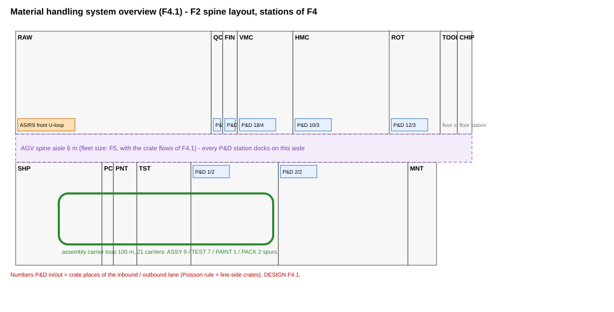

---

## 3 How many places a lane needs – the Poisson rule

### 3.1 The outbound lane: crates wait for an AGV

A machine finishes crates at random times. On average there are λ crates per hour in the busiest hour. Each crate waits
on the outbound lane until an AGV takes it. In the design case that is at most **W = 10 min** (the dispatch target for
F5).

If crates arrive randomly and independently, the number of crates on the lane is **Poisson-distributed** with mean
λ·W. This is the M/G/∞ result: it holds for any distribution of the waiting time, as long as the arrivals are Poisson.

$$P(N = k) = e^{-m}\frac{m^k}{k!},\qquad m = \lambda W$$

**Design rule:** choose the smallest number of places k with P(N > k) ≤ 1 %. A crate then finds a full lane in less
than 1 % of the cases. In that case the machine operator keeps the crate at the machine a little longer, which is not a
safety problem.

**Worked example, VMC outbound.**
- Department flow 2 198 crates/month; half goes out.
- λ = 2198 / 2 / 330 h × 1.6 (peak factor) = **5.33 crates/h**.
- m = 5.33 × 10/60 = **0.888**.

| k | P(N = k) | P(N ≤ k) | P(N > k) |
|---|---|---|---|
| 0 | 0.411 | 0.411 | 0.589 |
| 1 | 0.365 | 0.777 | 0.223 |
| 2 | 0.162 | 0.939 | 0.061 |
| 3 | 0.048 | 0.987 | 0.014 |
| **4** | 0.011 | **0.997** | **0.003 ≤ 1 %** |

→ **4 places.** The program uses at least 2 places on every outbound lane, so the operator can always put a crate down.

### 3.2 The inbound lane: line-side buffer + arrival queue

The inbound lane holds two things:
1. **The line-side buffer of F3.** These are the crates that keep the machines running for 4 h if the crane fails
   (p95 repair time).
2. **A queue of newly delivered crates.** They wait until the operator pulls them to the machine (W_pull = 15 min).

$$\text{places}_{in} = \text{line-side crates}(d) + k_{Poisson}(\lambda_{in} W_{pull})$$

**Correction of F3 – line-side crates 28, not 42.**
- F3 added the buffer crates of all three Roots variants (RB50, RB100, RB150).
- Only **one Roots variant runs at a time**: the lot is about one week (F2). The buffer is therefore the *maximum* over
  the variants, not the sum.

| Dept | Line-side crates | from |
|---|---|---|
| HMC | 7 | C01 crankcase 4 + R01–R03 (running RB variant) 3 |
| VMC | 13 | C02 1, C03 1, C04 4, C05 2, C06 2, C08 1, R04/R05 2 |
| ROT | 8 | C07 2, C09 4, R06/R07 2 |
| **Total** | **28** | (F3: 42) |

**Worked example, VMC inbound.**
- m = 5.33 × 15/60 = 1.33.
- P(N > 4) = 1.1 % > 1 %, but P(N > 5) = 0.2 %, so 5 queue places.
- **Inbound = 13 + 5 = 18 places.**

### 3.3 All P&D stations

| Dept | Crates/month | Peak in = out /h | Inbound places | Outbound places |
|---|---|---|---|---|
| FIN | 2 379 | 5.77 | 5 | 4 |
| VMC | 2 198 | 5.33 | **18** | 4 |
| ROT | 1 435 | 3.48 | 12 | 3 |
| HMC | 1 303 | 3.16 | 10 | 3 |
| QC | 956 | 2.32 | 3 | 2 |
| BUY | 340 | 0.82 | 2 | 2 |
| ASY | 113 | 0.27 | 1 | 2 |

**What the numbers say:**
- The **line-side buffers** dominate the inbound lanes of VMC, ROT and HMC, not the traffic.
- In F4.3 the VMC inbound lane of 18 places (18 m!) will be split. A short **inbound lane** of 5 places takes the
  deliveries, and a **static flow rack** (gravity roller, 2 levels) next to the machines holds the 13 buffer crates. This
  saves floor space and conveyor cost.

---

## 4 The AS/RS front – the U-loop

### 4.1 What happens at the front of the aisle

F3 gave a simple sketch: an infeed conveyor, an outfeed conveyor, a contour gate and a pick table. F4.1 makes it a
working system. The crate centre is at y = ±1.4 m (the fork pick point of F3), and crates travel with the 800 mm side
leading.

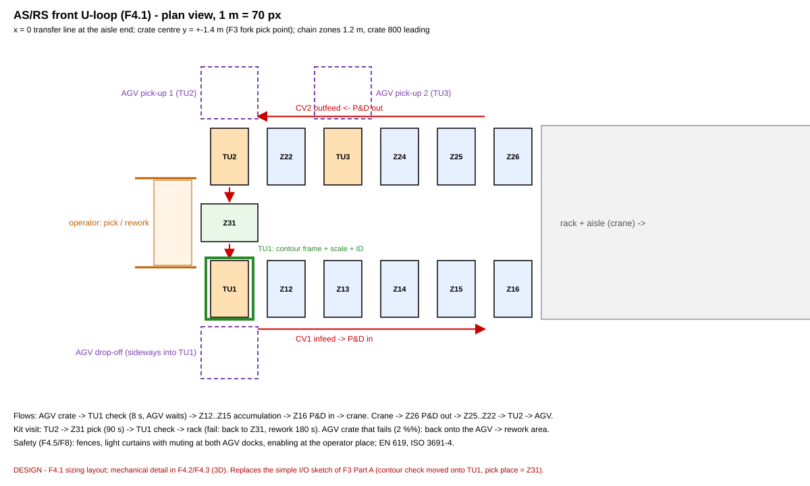

| Line | Zones (x from the aisle end) | Function |
|---|---|---|
| **CV1 infeed** (y = −1.4) | TU1 (−6.0), Z12 … Z15, Z16 = P&D in (0.0) | TU1 is the **check station**: weighing transfer (4 load cells), contour light frame, ID reader (F6). The AGV drops sideways into TU1 and waits for the result. Z12–Z15 accumulate, and the crane picks at Z16 |
| **CV2 outfeed** (y = +1.4) | Z26 = P&D out (0.0), Z25, Z24, **TU3** (−3.6), Z22, **TU2** (−6.0) | the crane puts at Z26. **Two AGV pick-up places**: TU3 and TU2 |
| **CV3 cross** | Z31 (−6.0, 0.0) | **pick / rework place**. The operator stands at x = −7.0 between fences. Crates travel with the 1200 side leading |

**Chain zone length 1.2 m** = crate 800 + 400 gap. Each zone has two sensors (slow-down, stop) and stops safely before
the next crate: zero-pressure accumulation (ZPA), so crates never touch.

At v = 0.2 m/s, one zone takes t = 1.2 / 0.2 = **6 s**. A transfer unit adds 3 s for the lift.

### 4.2 Three flows through the U-loop

1. **Store.** AGV → TU1 check (8 s) → Z12 … Z15 → Z16 → crane.
2. **Retrieve to an AGV.** Crane → Z26 → … → TU3 or TU2 → AGV.
3. **Kit visit.** Crane → Z26 → … → TU2 → Z31 pick (90 s mean) → TU1 check → Z12 … → crane, back into the rack.

**Rejects (2 %):**
- An AGV crate that fails the check goes **back onto the AGV**, which is still docked, and to a rework area.
- A kit crate that fails after picking (e.g. a part sticking out) goes **back to Z31** for 180 s of rework.

### 4.3 The busiest-hour demand

From the F3 crane-move model (it includes the receiving infeed and empty crates, so it is conservative):
- AGV moves at the AS/RS = (3037 + 6344 − 2 × 1133 kit visits) / 2 = 3557 in and 3557 out per month.
- In the busiest hour: 3557 / 330 × 1.6 = **17.2 crates/h in** and **17.2 out**.
- Kit visits: 1133 / 330 × 1.6 = **5.5/h** (each = 1 retrieval + 1 storage).
- Crane moves: 17.2 + 17.2 + 2 × 5.5 = **45.5/h**. This is exactly the F3 peak.

---

## 5 Simulation of the AS/RS front – what it found

### 5.1 Why a simulation and not only a formula

The U-loop has **blocking**: a crate can move only when the next zone is free. It also has **shared resources**: TU1
serves the AGV, the returns from Z31 and the rejects, and Z31 serves kit visits and rework. Queueing formulas cannot
describe blocking networks like this. A small discrete-event simulation can.

**Model** (`class Front` in `conv_system.py`):
- Time steps of 1 s, 400 h after a 20 h warm-up.
- Poisson arrivals: AGV crates, retrieval orders, kit visits.
- Each zone holds one crate. A crate moves when the next zone is empty, which takes pitch / v (+ lift).
- **Crane:** single cycle 41.0 s or dual cycle 67.9 s (F3). A dual cycle is used when a store and a retrieval are both
  possible, and each cycle has a random factor 0.6–1.4 for the slot position.
- **AGV pick-up:** the AGV is dispatched when the crane starts the retrieval. It arrives after an exponential time with
  mean 240 s (assumption for F5).

### 5.2 Finding 1 – the first design had a deadlock

The first version had the check at Z12, and a rejected crate drove **backwards** to TU1 and then into Z31. The simulation
stopped moving after a few hours:
- The rejected crate in Z12 waited for TU1.
- TU1 held a new crate that waited for Z12.

This is a **circular wait**, the classic deadlock condition: each holds one resource and waits for the other.

**Solution: change the design, not the software.**

| Rule | Content |
|---|---|
| R0 | The check is done **on TU1**. An AGV crate that fails goes back onto the docked AGV, so no backward movement is needed |
| R1 | Z31 stays **reserved** for a returning kit crate until it has passed the check on TU1. A fail can then always go back to Z31 |
| R2 | A kit crate enters Z31 from TU2 only when Z31 is free **and not reserved** |
| R3 | Z31 returns into TU1 **before** a waiting AGV may drop (this frees the pick place first) |
| R4 | The crane stores whenever a crate waits at Z16 (a dual cycle if a retrieval is also possible). CV1 can therefore never block the crane |

With R0–R4 there is no circular wait. The self-test runs the model at 1.0× and at **1.6× the busiest hour (2.56× the
average)**, and the material keeps flowing in both runs.

**Lesson for the PLC (F4.6):** these rules become interlocks in the conveyor program. A deadlock found in a 1-second
Python model costs nothing. Found during the ramp-up, it costs days.

### 5.3 Finding 2 – one AGV pick-up place is not enough

With one pick-up place (TU2 only), TU2 is blocked from the moment a crate arrives until its AGV arrives.

**Estimate.** The crate needs about 75 s from the crane start to TU2. The AGV arrives after an exponential time A with
mean 240 s. Because the exponential distribution is memoryless, the expected blocking time is:

$$E[\max(A - 75, 0)] = 240\,e^{-75/240} = 176\ \text{s},\qquad +10\ \text{s transfer} = 186\ \text{s per crate}$$

- One pick-up place can therefore serve about 3600 / 186 = **19 crates/h**. The busiest hour needs 17.2: utilisation
  0.9, which means long queues.
- If the AGV is dispatched later (when the crate reaches TU2), it is 3600 / 250 = 14/h < 17.2, which is **unstable**.
  The first simulation run showed exactly this: CV2 full, the crane blocked, the backlog growing.

**Simulation comparison** (150 h each, *simulated*):

| AGV arrival mean after dispatch | 1 pick-up place: crane blocked by full P&D out | **2 pick-up places (TU2 + TU3)** |
|---|---|---|
| 120 s | 0.5 % | 0.3 % |
| 240 s (design) | 5.0 % | **2.7 %** |
| 360 s | 18 % | 9 % |

**Decision:** Z23 becomes the second transfer unit **TU3**, for +5 500 EUR (TU instead of chain zone).

**Requirements handed to F5:**
- the AGV must be dispatched **when the crane starts the retrieval**;
- the mean arrival time must be **≤ 240 s**.

### 5.4 Final results (400 h, busiest hour, *simulated*)

| Quantity | Value |
|---|---|
| crane moves per h | 44.7 (demand 45.5; the 2 % rejected AGV crates are not stored) |
| crane utilisation | **49.9 %** (F3 analytic: 47 %) |
| AGV wait at TU1: mean / p95 / max | 1.7 / **14** / 48 s |
| crates on CV1 (6 places): p99 / max; time full | 2 / 5; 0.00 % |
| crates on CV2 (6 places): p99 / max | 6 / 6 |
| crane waiting because P&D out occupied | 2.6 % of the time |
| retrieval lead time p95 (order → crate at the AGV / pick) | 917 s (mostly the AGV arrival) |
| kit visits per h | 5.4 (demand 5.5) |
| open orders at the end | 3 (stable) |

**Reading:**
- **CV1 is generous.** Five accumulation zones are rarely more than 2 full. They stay anyway, because they absorb AGV
  bunching.
- **CV2 is the critical line.** Its occupancy depends on the AGVs. If F5 cannot meet 240 s, CV2 needs more places or a
  third pick-up place. The command `python conv_system.py des --agv 360` shows the effect.

---

## 6 The assembly carrier line – how many carriers

### 6.1 The idea

Each product (a VC20 on its 300 L tank, about 120 kg, or a Roots blower on its base frame) is built on its own
**workpiece carrier** (skid 1800 × 800 mm, payload 250 kg). The carrier stays with the product through assembly → test →
paint → pack, and then returns empty.

The stations work **in parallel** (9 assembly stations, 7 test benches, the robust counts of F2). They sit on **spurs**
beside the main loop: the carrier leaves the loop at a lift-transfer, is worked on, and goes back.

### 6.2 Waiting at the station groups – Erlang C

A group of c identical stations with random arrivals is an M/M/c queue. The probability that an arriving carrier must
wait is **Erlang C**:

$$C(c,a) = \frac{\frac{a^c}{c!}}{(1-\rho)\sum_{k=0}^{c-1}\frac{a^k}{k!} + \frac{a^c}{c!}},\qquad a = \lambda t,\ \rho = \frac{a}{c}$$

$$W_q = \frac{C\,t}{c(1-\rho)},\qquad P(N_q \ge k) = C\rho^k$$

**Worked example, assembly.**
- λ = 3400 / 330 × 1.2 = 12.4 products/h; t = 31.7 min.
- a = 12.4 × 31.7 / 60 = 6.53; c = 9; ρ = 0.73.
- C = 0.287: 29 % of the carriers wait.
- W_q = 0.287 × 31.7 / (9 × 0.27) = **3.7 min**.
- Queue places with P(N_q ≥ k) ≤ 5 %: 0.287 × 0.73^k ≤ 0.05 → **k = 6**.

| Group | c | t min | ρ | C | W_q min | Queue places |
|---|---|---|---|---|---|---|
| ASSY | 9 | 31.7 | 0.73 | 0.287 | 3.7 | 6 |
| TEST | 7 | 25.6 | 0.75 | 0.393 | 5.8 | 8 |
| PAINT | 1 | 2.4 | 0.48 | 0.485 | 2.2 | 4 |
| PACK | 2 | 5.0 | 0.52 | 0.350 | 1.8 | 3 |

The self-test checks the Erlang C function against two textbook values. For c = 1 it must give C = ρ (M/M/1); for
c = 2, a = 1 it must give C = 1/3.

### 6.3 Carriers – Little's law

**Little's law:** the average number in a system = arrival rate × average time in the system. It holds for any queue,
with no assumption on the distributions.

- **Flow time** of one carrier: 3 min load on, 31.7 + 3.7 assembly, 25.6 + 5.8 test, 2.4 + 2.2 paint, 5.0 + 1.8 pack,
  2 min unload, plus the loop. The loop is 100 m (twice the widths of ASY 18.7 + TST 11.6 + PNT 5.0 + PCK 2.5 + half of
  SHP, plus the turns); at 0.2 m/s that is 8.3 min.
- Total flow time = **91.5 min**.
- Carriers = 12.4 × 91.5 / 60 = 18.9 → +10 % spare → **21 carriers**.
- Physical places (spurs 2 per station + queue places + loop positions at 2 m pitch) = 110. The carriers fit easily.

**Why the loop is long but the carrier count small:** the loop also carries the empty-carrier return. Its positions are
mostly free, and that free space is the buffer that decouples the groups.

---

## 7 Module list, I/O estimate, cost

| Module | Qty | Where | EUR each (reference) | EUR |
|---|---|---|---|---|
| CC chain zone 1.2 m | 9 | AS/RS front | 3 500 | 31 500 |
| TU transfer unit (lift-up strands) | 3 | TU1 (check), TU2, TU3 | 9 000 | 27 000 |
| RCX cross roller zone | 1 | Z31 | 4 000 | 4 000 |
| contour frame + scale | 1 + 1 | TU1 | 6 000 + 3 000 | 9 000 |
| RL roller lane zone 1.0 m | 86 | P&D stations | 1 800 | 154 800 |
| PD_end (docking, stops, guards) | 14 | 7 stations × 2 lanes | 6 000 | 84 000 |
| assembly loop per m | 100 | assembly | 1 100 | 110 000 |
| spur unit (lift-transfer in/out) | 19 | assembly | 7 000 | 133 000 |
| corner unit | 4 | assembly | 8 000 | 32 000 |
| carrier | 21 | assembly | 650 | 13 650 |
| assembly load station | 1 | tank onto carrier | 12 000 | 12 000 |
| **Total** | | | | **583 950** |

- **Against the F2 placeholder of 450 kEUR: 130 %.** The assembly line (300 kEUR) is the largest block.
- Expected savings in F4.3: flow racks instead of motorised lanes for the line-side buffers, about −40 kEUR.
- The final cost comes from the BOMs of F4.2–F4.4.

**I/O estimate** (input of F4.5): about 420 DI, 250 DO, 1 AI (the scale). Two cases follow in F4.5:
- **Case A** (built-in ports): the conveyors are remote I/O on PROFINET.
- **Case B** (expansion modules): the AS/RS front sits on the second PROFINET network (CM 1542-1 of the AS/RS PLC,
  F3 Part D), and the departments and the assembly line get their own PLCs.

---

## 8 Corrections handed back to earlier items

| Item | What changes | Why |
|---|---|---|
| F2 | AGV flows 7 058 instead of 33 987 per month | real crate contents (F3) instead of family unit loads |
| F3 | line-side crates 28 instead of 42 | one Roots variant at a time |
| F3 | contour check moved onto TU1; pick place = Z31; second AGV pick-up TU3 | deadlock-free rules, pick-up capacity (simulation) |
| F5 | AGV dispatch at crane start, arrival ≤ 240 s mean; fleet sized with the crate flows | chapter 5.3 |

These corrections are **recorded here** and applied in the item that owns them: F5 sizes the fleet, and the F3 3D model
gets the new front in F4.2/F4.3.

---

## 9 What the self-test checks (22 checks)

- **Poisson rule:** mean 1.0 at 1 % gives 4 places (hand value), and mean 0 gives 0.
- **Station types:** RAW = U-loop; TOOL/CHIP = floor; the assembly-line flows are excluded; P&D stations exist for
  HMC, VMC, ROT, FIN, QC, ASY and BUY.
- **Flows and buffers:**
  - flow balance: department totals = 2 × crate flows;
  - line-side crates F3 = 42, refined = 28 (HMC 7 / VMC 13 / ROT 8);
  - VMC inbound = 13 + queue.
- **Simulation:**
  - crane moves = demand (stable);
  - utilisation 35–60 %;
  - AGV wait p95 ≤ 60 s;
  - kit visits and rejects pass through Z31;
  - stress ×1.6 without deadlock;
  - slow AGVs fill CV2.
- **Erlang C and the carriers:**
  - Erlang C textbook values (M/M/1, c = 2);
  - assembly utilisations < 1;
  - carriers fit into the places;
  - Little check.
- **Modules and cost:**
  - the AS/RS front modules are 9 CC + 3 TU + 1 RCX;
  - the F3 crane-side moves ≥ the RAW crate flows (conservative front);
  - cost within ±40 % of the F2 placeholder.
- **Drawings:** both SVGs are well-formed XML.

---

## 10 Checklist F4.1 → F4.2

- [x] Crate flows per department (crates, not family unit loads).
- [x] Lane places by the Poisson rule; line-side crates corrected to 28.
- [x] AS/RS front: zones defined, deadlock-free rules R0–R4, 2 AGV pick-up places, busiest hour simulated.
- [x] Assembly: 21 carriers, queue places per group, loop 100 m.
- [x] Module list (input of F4.2), I/O estimate (input of F4.5), cost against the budget.
- [x] **F4.2:** mechanical design of CC, TU, RCX and RL, with roller/chain load, shaft, bearing, motor sizing, 3D and
      drawings (chapters 11–21).

**References** (standard textbooks; check the editions):
- Tompkins, J.A. et al., *Facilities Planning*, 4th ed., Wiley 2010: conveyor and P&D design.
- Kleinrock, L., *Queueing Systems Vol. 1*, Wiley 1975: M/M/c, Erlang C.
- Little, J.D.C. (1961) A proof for the queuing formula L = λW. *Operations Research* 9(3), 383–387.
- Coffman, E.G., Elphick, M.J., Shoshani, A. (1971) System deadlocks. *ACM Computing Surveys* 3(2), 67–78.
- EN 619 (safety of unit-load conveyors); ISO 3691-4 (driverless trucks, for the AGV docks).

---

# F4.2 – Mechanical design of the conveyor modules

> **Program:** `thesis_final/design/04_conveyors/conv_mech.py`. Self-test 19/19.
>
> **Data:** `conv_mech_data.json`. Catalogue values are reference values from ISO 606, ISO 281 and typical catalogue
> classes; check them with the supplier [verify].
>
> **Outputs** in `out/mech/`:
> - `calc_report.md`;
> - `module_specs.json` (input of the 3D model);
> - `bom_modules.csv`.
>
> **3D and drawings:** `conv_3d.py`, chapter 20.

```
python conv_mech.py selftest     # 19/19
python conv_mech.py run
```

## 11 The four modules and what decides their size

| Module | Where | Crate orientation | Carries the crate on |
|---|---|---|---|
| **CC** chain zone 1.2 m | AS/RS front CV1, CV2 (9 zones) | 800 leading | two roller chains 12B at gauge 900 |
| **TU** transfer unit 1.2 m | TU1 (check), TU2, TU3 | x: 800 leading / y: 1200 leading | chains (x); 8 rollers lifted 30 mm above the chains (y) |
| **RCX** cross roller zone 1.34 m | Z31 pick place | 1200 leading | 9 chain-driven rollers (1.34 m, so that it fits between TU1 and TU2: found by the 3D model, ch. 20) |
| **RL** roller lane zone 1.4 m | all P&D stations (86 zones) | 1200 leading | 9 chain-driven rollers |

**The surprise of this chapter.** For almost every part, **the load does not decide the size.** The deciding factors are:
- robustness (impacts from AGVs, forks and end stops);
- stiffness (the two chains must run in step);
- the space for standard parts: hollow-shaft gear motor, bearing units, key.

The program shows this honestly for every part: it lists *all* candidates, marks which ones the load alone would allow,
and states why a bigger one was chosen.

## 12 First decision: the crate base and the direction of travel

**The crate base (new in F4.2).**
- Two **runners**, 100 × 160 mm, along the 1200 side, at ±350 mm across the 800 side. The total crate height stays
  600 mm including the runners (F3).
- The **central telescopic fork of the F3 crane (450 mm wide)** enters from the 800 side through the **600 mm opening**
  between the runners.
  - The first version had **three** runners (−350 / 0 / +350). The 3D check (ch. 34) showed that the middle runner sits
    exactly where the F3 fork enters: a clash.
  - Two runners keep the F3 crane unchanged. The F3 crate model now has these 2 runners instead of 4 legs.
- The runners have the same
  160 mm height as the feet of the F3 model.

**The rule** (the basic rule of unit-load conveying):
> The runners must **cross** the carrying elements. On rollers, **at least 3 rollers** must be under each runner at
> every moment. Otherwise the crate drops between the rollers and tilts.

| Conveyor | Crate orientation | Contact | Verdict |
|---|---|---|---|
| CC chain zone (CV1, CV2) | 800 leading | runners cross the 2 chains | OK |
| TU chain part (x) | 800 leading | runners cross the 2 chains | OK |
| TU roller part (y) | 1200 leading | runners cross the rollers | OK |
| RCX / RL | 1200 leading | runners cross the rollers | OK |
| roller conveyor 800 leading | 800 leading | runners **parallel** to the rollers | **NOT ALLOWED** |

- Roller pitch 150 mm → 1200 / 150 = **8 rollers under each runner**. The rule asks for ≥ 3 (pitch ≤ 400 mm).
- **This is why the transfer unit works.** The chains carry the crate in x, where the runners cross the chains. The
  lifted rollers carry it in y, where the runners cross the rollers. The crate base and the TU are designed as one
  system.

**Consequence for F4.1:**
- The roller zones are **1.4 m** (1200 + 200), not 1.0 m. `conv_data.json` is updated.
- The places and the cost per zone do not change; only the lane lengths grow.
- The AGV (F5) always transfers with the 1200 side leading. It docks sideways at the TUs and end-on at the P&D lanes,
  so it needs **one** roller-deck orientation.

## 13 Chain zone CC – the chain

### 13.1 The pull in one strand

The crate (one per zone) and the chain move together. The resistances are:
- the chain rollers **rolling** on the UHMW-PE wear strip under the load (top strand), f_top = 0.12;
- the return strand **sliding** on its strip, f_ret = 0.25;
- the force to **accelerate** the crate and the chain, a = 0.3 m/s².

$$F = \left(\frac{m}{2} + qL\right) g\,f_{top} + qL\,g\,f_{ret} + \left(\frac{m}{2} + 2qL\right)a$$

**Worked example, 12B-1** (q = 1.25 kg/m, L = 1.2 m, m = 300 kg):

| Term | Value |
|---|---|
| top strand: (150 + 1.5) × 9.81 × 0.12 | 178.3 N |
| return strand: 1.5 × 9.81 × 0.25 | 3.7 N |
| acceleration: (150 + 3.0) × 0.3 | 45.9 N |
| **F per strand** | **227.9 N** |

The self-test compares this hand value with the program.

### 13.2 Three checks for every chain

| Check | Formula | Limit | Meaning |
|---|---|---|---|
| static safety | SF = F_B / (k_s F) | ≥ 8 | margin against breaking (k_s = 1.4 service factor for starts and stops) |
| joint pressure | p = k_s F / A | ≤ 25 MPa | pin/bush wear: the elongation life of the chain |
| roller pressure | F_c / (n_r d₁ b₁) | ≤ 10 MPa | the chain rollers carry the crate runners. F_c = m g / (2 runners × 2 strands) × 2 (uneven base) = 1471 N, spread over n_r = 100 / p rollers under one runner |

| Chain | F N | SF | p MPa | roller p MPa | OK |
|---|---|---|---|---|---|
| 08B-1 | 225 | 57 | 6.3 | 3.2 | yes |
| 10B-1 | 226 | 71 | 4.7 | 2.5 | yes |
| **12B-1** | **228** | **91** | **3.6** | **2.1** | **yes ← chosen** |
| 16B-1 | 235 | 182 | 1.6 | 1.8 | yes |

**All chains pass.** At 0.2 m/s and 300 kg a conveyor chain is lightly loaded. 12B is chosen for these reasons:
- **impact:** an AGV or a fork that hits the conveyor must not bend an 08B chain;
- **wear reserve:** about 25 times lower joint pressure than the limit, so the chain stretches very slowly and the
  sensors stay aligned;
- **standard practice** for 1–1.5 t pallet conveyors, so spare parts are available everywhere.

### 13.3 Sprocket and chain length

$$d_0 = \frac{p}{\sin(180°/z)} = \frac{19.05}{\sin 12°} = 91.6\ \text{mm}\ (z = 15),\qquad n = \frac{60 v}{\pi d_0} = \frac{60 \cdot 0.2}{\pi \cdot 0.0916} = 41.7\ \text{rpm}$$

- **Odd tooth number (15):** every link meets every tooth only in turn, so the wear is even.
- **z = 15 is also the practical minimum.** Below about 13 teeth, the chordal effect makes the chain speed pulse.
- **Chain length:** 2 × 1.2 m + π d₀ = 2.69 m = **142 links** (an even number, so no offset link is needed).
- **Take-up stroke** ≥ max(2 pitches, 2 % of the length) = **54 mm**. Chains stretch up to about 2–3 % before they are
  replaced.

## 14 Gear motor of the chain zone

$$T = \frac{2 F \cdot d_0/2}{\eta_{chain}} = \frac{2 \cdot 227.9 \cdot 0.0458}{0.95} = 22.0\ \text{N m},\qquad P = k_s\frac{2 F v}{\eta_{gear}\eta_{chain}} = 1.4\cdot\frac{2\cdot 227.9\cdot 0.2}{0.92\cdot 0.95} = 146\ \text{W}$$

| Item | Value |
|---|---|
| gear motor | **0.18 kW**, 4-pole, helical-bevel, hollow shaft with torque arm |
| ratio | i = 1400 / 41.7 ≈ **34** |
| nominal output torque | 0.18 × 9550 / 1400 × 34 × 0.92 = **38 N m** (need 30.8 N m with k_s) |

**Start check:** 2 × 38 N m available against 30.8 N m needed → OK. The inverter (F4.5) ramps at 0.3 m/s², so no
direct-on-line shock occurs.

**Why helical-bevel and not worm?**
- Efficiency is about 0.92 against 0.5–0.7 for a worm.
- The motor sits **parallel to the conveyor**, under the frame, so nothing sticks out into the AGV path.

## 15 Drive shaft

**Loads** (drive shaft, sprockets at ±450 mm, bearings at ±550 mm, gear motor on one end):
- Radial load per sprocket R = 1.1 F = 251 N (tight strand + 10 % slack-side pre-tension).
- Bending between the sprockets M = R × a = 251 × 90 = **22 565 N mm**.
- Torque (with k_s) T = **30 776 N mm** between the motor and the first sprocket, and T/2 between the sprockets.

**Four checks** (C45E +N, R_m = 620 MPa, R_e = 340 MPa):

$$\sigma_v = \sqrt{\sigma_b^2 + 3\tau^2} \le \frac{R_e}{2},\qquad \frac{1}{SF} = \frac{K_f\sigma_a}{S_e} + \frac{\sqrt3\,\tau_m}{R_m}\ (\text{Goodman, keyway } K_f = 2),\qquad S_e = 0.5R_m k_{surf} k_{size}$$

$$\varphi = \frac{(T/2)\,l}{G\,J},\qquad J = \frac{\pi d^4}{32},\qquad \text{strand offset} = \varphi\,\frac{d_0}{2}$$

| d mm | σ_v MPa | SF static | SF fatigue | twist °/m | strand offset mm | OK |
|---|---|---|---|---|---|---|
| 20 | 44.5 | 7.6 | 3.4 | 0.693 | 0.50 | no (twist) |
| 25 | 22.8 | 14.9 | 6.6 | 0.284 | 0.20 | no (twist) |
| **30** | **13.2** | **25.8** | **11.4** | **0.137** | **0.10** | **yes** |

**The shaft is decided by its torsional stiffness, not by its strength.**
- The torque enters at one end, so the far sprocket lags behind the near one.
- At d = 25 the strands run 0.2 mm out of step. Over many starts the crate can then **skew** and touch the side guides.
- The common limit of 0.25°/m keeps the two strands synchronous. **d = 30 mm**, which also fits the standard hollow-shaft
  bore of the gear motor.

## 16 Bearings

$$L_{10h} = \left(\frac{C}{P}\right)^3 \frac{10^6}{60\,n}$$

**UCP206** (bore 30, C = 19.5 kN): P = 251 N, n = 41.7 rpm → L₁₀h = 1.9 × 10⁸ h, which is far above the 30 000 h
(10 years × 3300 h).

**The bearing is chosen by the shaft, not by the load.** In real conveyors the bearing usually fails from **dirt and
missing lubrication**, not from fatigue. Specify sealed insert bearings with grease nipples, plus a lubrication interval
in the maintenance plan (F4.7).

## 17 Roller zones RCX and RL

### 17.1 Load per roller

The crate sits on 8 rollers (pitch 150 under 1200). A real base is not flat, so the design load per roller is the larger
of:
- 2 × the static share: 2 × 2943 / 8 = 736 N;
- the worst case "only 3 rollers carry" (the rule of ch. 12): 2943 / 3 = **981 N** ← decisive.

The roller is a tube on two bearings. When the crate travels 1200-leading, it is only **800 mm wide across the rollers**,
so the roller is **1000 mm** long (800 + 2 × 100 for guides and AGV docking tolerance), span L = 1010 mm. The first
version used 1300 mm rollers like a chain-conveyor width; the 3D review (ch. 20) showed that this is not needed. The
roller carries **2 point loads**, one per runner, of 490 N each at L/2 ± 350 mm. Moment and deflection by **superposition** of the single-load formulas:

$$\delta(x) = \frac{P\,b\,x\,(L^2 - b^2 - x^2)}{6EIL}\ \ (x \le a),\qquad M_{max} = \max_x\left(R_A x - \sum P_i (x - a_i)\right)$$

The self-test checks this beam routine against PL/4 and PL³/(48EI), and against symmetry.

| Tube D × t | σ MPa | δ mm (limit L/500 = 2.0) | Verdict |
|---|---|---|---|
| 50 × 1.5 | 28.3 | 0.66 | load OK, **below the robustness minimum** |
| **60 × 2** | **14.9** | **0.29** | **chosen** |
| 80 × 2 | 8.2 | 0.12 | OK |

With two runners the loads sit near the bearings (±350 on a 1010 mm span), so the moment is smaller than with a
central runner.

**Why 60 × 2 and not 50 × 1.5:** a 300 kg crate with steel runners, landing from an AGV or hitting the end stop, dents a
1.5 mm wall. 60 × 2 is the normal heavy pallet-roller class.

**Roller bearings 6204** (axle 20): P = 490 N, n = 64 rpm → L₁₀h = 5.5 × 10⁶ h.

### 17.2 Drive: chain-driven live roller

Each roller has a double sprocket (08B, z = 14). Chain loops connect roller 1–2, 2–3, … and the gear motor drives
roller 1.

$$F = f\,m\,g + m\,a + \tfrac12 m_{rollers} a = 0.03 \cdot 2943 + 300 \cdot 0.3 + 0.5 \cdot 37 \cdot 0.3 = 184\ \text{N}$$

$$\eta = 0.98^{9} = 0.834,\qquad P = k_s\frac{F v}{\eta\,\eta_{gear}} = 1.4\cdot\frac{184\cdot 0.2}{0.834\cdot 0.92} = 67\ \text{W} \;\rightarrow\; 0.12\ \text{kW},\ i \approx 22$$

**Why not 24 V motor-driven rollers (MDR)?** MDR zones are standard for boxes and totes up to about 50 kg per zone. For
300 kg crates with steel runners a gear motor with chain loops is the robust and common solution. The first loop pull is
232 N, against an 08B breaking load of 18 kN.

**Chain guard height.** On the z14 sprockets (d₀ 57.1 mm) the 08B chain stands about 4 mm above the roller top. That
is outside the 800 mm crate width, so the crate never touches it, but the guard must cover it: guard top ≈ 710 mm, which
is 10 mm above the conveyor top (3D check, ch. 20).

## 18 Transfer unit: the lift

The roller set (8 rollers, frame, drive, 110 kg) plus the crate is lifted 30 mm by **two eccentric shafts** (e = 15 mm)
with cam followers, coupled by a chain and driven by one brake gear motor.

$$F = (300 + 110)\cdot 9.81 = 4022\ \text{N},\qquad M_{max} = \frac{F e}{\eta} = \frac{4022\cdot 0.015}{0.85} = 71\ \text{N m (crank at 90°)}$$

$$n = \frac{30}{t_{lift}} = \frac{30}{1.5} = 20\ \text{rpm (180° in 1.5 s)},\qquad P = M\omega = 71\cdot\frac{2\pi\cdot 20}{60} = 149\ \text{W} \;\rightarrow\; 0.25\ \text{kW brake motor},\ i = 70$$

**Why an eccentric and not pneumatic cylinders:**
1. **Self-locking.** At the top (180°) and at the bottom (0°) the eccentric is at dead centre. The load produces **no
   torque**, so the roller set holds its position with no energy and no brake load, even in a power failure. A cylinder
   would sink if the air fails.
2. **Smooth motion.** The lift speed follows a sine (zero at both ends), so the crate is set down gently and needs no
   damper.
3. **No compressed air** at the AS/RS front and the AGV docks: one utility less (F11).

## 19 Frame, stopping, energy

**Side frame C 160 × 60 × 5 (S355), legs every 1.2 m.**
- Deflection under half a crate + chain + guides = **0.05 mm** (limit L/750 = 1.6 mm), stress 7 MPa.
- The profile is chosen by the **space** for chain guides, sprockets and bearing units, not by strength.
- Legs: 80 × 80 with base plate and 2 anchors M12, adjustable ±25 mm, so the conveyor top stays at 700 ± 2 mm (the
  transfer level of the crane fork, F3).

**Stopping in the zone (zero-pressure accumulation):**

$$s = v\,t_r + \frac{v^2}{2a_d} = 0.2\cdot 0.02 + \frac{0.2^2}{2\cdot 0.5} = 0.044\ \text{m} = 44\ \text{mm} \ll \text{gap } 400\ \text{mm}$$

**Sensors:** slow-down at 250 mm and stop at 60 mm before the zone end. Even with a missed slow-down signal, the crate
stops 300 mm before the next crate.

**Energy:** 626 J (0.17 Wh) per crate per chain zone. The whole AS/RS front at 45 crates per hour uses less than 0.1 kWh
per hour, so energy is negligible. The motors are sized by starting and robustness.

### Module parts lists (`out/mech/bom_modules.csv`)

| Module | Main parts |
|---|---|
| CC | 2 side frames C160; 2 chains 12B-1 × 142 links; 4 guide profiles + UHMW-PE strips; 4 sprockets z15; drive shaft d30; idler shaft; 4 bearing units UCP206 / take-up units; gear motor 0.18 kW i≈34; 2 legs; 2 sensors |
| RL / RCX | 2 side frames; 9 rollers 60 × 2 × 1000, axle 20, bearings 6204, double sprocket 08B z14; 9 chain loops 08B; gear motor 0.12 kW i≈22; chain guard; legs |
| TU | chain part as CC; roller set (8 rollers as RL) in a lifting frame, gear motor 0.12 kW; 2 eccentric shafts e = 15 with cam followers; brake gear motor 0.25 kW i = 70; 4 linear guides; 3 sensors (up, down, cam) |

## 20 3D models and drawings of the conveyor modules

| | |
|---|---|
| Program | `thesis_final/design/04_conveyors/conv_3d.py` (self-test 23/23), Python standard library, offline |
| Inputs | `out/mech/module_specs.json` (results of `conv_mech.py`) and the zone positions in `out/design_result.json` (F4.1). **No dimension is typed twice.** If a calculation changes, run `conv_mech.py run`, then `conv_3d.py run`, and the models and drawings follow |
| Outputs | `out/3d/`: 9 STL files + 9 OpenSCAD files + `preview_iso.svg`. `out/drw/`: drawings D11–D15 (A3 SVG) + `dimension_table.csv` (45 rows) |

```
cd thesis_final/design/04_conveyors
python conv_mech.py run      # calculations -> out/mech/module_specs.json
python conv_3d.py run        # 3D models + drawings
python conv_3d.py selftest   # 23/23
```

All models and drawings are **design** documents: the responsible engineer must check and release them before
manufacture.

### 20.1 How the model is built

- **Same tools as the AS/RS.** The program uses the geometry tools of F3 (`asrs_3d.py`): boxes, cylinders and bars are
  joined into a triangle mesh and written as binary STL.
- **Every primitive is also recorded.** From that record the program writes an OpenSCAD file. The STL and the SCAD file
  therefore always show the same geometry.
- **Local coordinates of a module:**
  - x = direction of travel;
  - y = across;
  - z = up from the floor;
  - origin = module centre on the floor.
- **Conveyor top:** the chain top or the roller top is at **z = 700 mm** in every module (F3: transfer level of the
  crane).
- **Plant coordinates (assemblies):** the U-loop uses the coordinates of F4.1. x = 0 is the transfer line at the aisle
  end, x < 0 points away from the rack, and y is across the aisle, with the crate centre at y = ±1400 mm.
- **Level of detail.** The model is detailed enough to check space, heights, clearances and orientation. It is not a
  manufacturing model of each part: bolts, welds and the chain links are not modelled. Chain 12B is shown as a bar
  25 × 16 mm.

### 20.2 The module models

| File | What it shows | Main dimensions (from module_specs) |
|---|---|---|
| `crate_runners.stl` | the crate with its new base: 2 runners 100 × 160 mm along the 1200 side at ±350 | 800 × 1200 × 600 |
| `cc.stl` | chain zone CC | 2 C side frames 160 × 65 × 5 (inside 1310), 2 strands 12B at gauge 900 with C guides + UHMW-PE strips, drive and idler shafts d30, sprockets z15 (d0 91.6) at 1020 mm centres, 4 bearing units UCP206 (idler side with 54 mm take-up), hollow-shaft gear motor 0.18 kW with torque arm, slow-down / stop sensors 250 / 60 mm before the zone end, legs 80 × 80 with base plates |
| `rl.stl` | roller zone RL (P&D lanes) | 1400 long, 9 rollers Ø60 × 2 at pitch 150, axle 20, double sprockets 08B z14, 8 chain loops, chain guard, gear motor 0.12 kW |
| `rcx.stl` | Z31 pick place | the same design, **1340 mm long** (see the note below) |
| `tu.stl` / `tu_up.stl` | transfer unit, lift DOWN / UP | the chain part as CC plus 8 rollers Ø60 (axis x) at pitch 150 between the chains. Roller top 685 down, 715 up (stroke 30). 2 eccentric shafts e = 15 at x = ±300, coupling chain, brake lift motor 0.25 kW, 4 linear guides |
| `pd_end.stl` | AGV end of a P&D lane | side guides with a 15° lead-in, gap 25 mm per side to the crate, stop plate 10 mm with 2 PU buffers and the stop actuator |

**Three things the 3D model showed that the calculation did not:**
1. **Z31 is too long for its space.**
   - TU1 and TU2 have their centres at y = ±1400. Their outer frame half-width is 655 + 65 = 720 mm.
   - The free space between them is therefore 2 × (1400 − 720) = 1360 mm. A 1400 mm roller zone does not fit (20 mm
     overlap).
   - The RCX for Z31 is now **1340 mm long**: frames 10 mm clear on each side, and the same 9 rollers.
   - The self-test checks that no two modules of the U-loop overlap.
2. **The chain on the roller sprockets rises above the roller top.**
   - The 08B chain on a z14 sprocket (d0 57.1) stands about 4 mm above the Ø60 roller top.
   - It lies at the roller ends, outside the crate width of 800 mm, so it does not touch the crate.
   - The chain guard is therefore 10 mm above the conveyor top there.
3. **The TU rollers fit between the chains.**
   - With rollers at y = ±375 / ±525 and chains at ±450, the side gap between roller and chain is 32.5 mm. This is
     enough for the lift movement and for chain wear.
   - The TU rollers are 960 mm long, so they stay clear of the chain shafts at x = ±510.

### 20.3 The assemblies

- **`asrs_front_assembly.stl`** (+ `.scad`), the AS/RS front U-loop:
  - 13 modules at exactly the F4.1 zone positions: TU1, Z12–Z16, Z26, Z25, Z24, TU3, Z22, TU2, and Z31 turned 90°;
  - crates on TU1, Z14, Z16, Z26, Z24 and Z31;
  - the operator platform with its fence posts at x = −7.0 m.
  - **The crate keeps the same orientation everywhere** (1200 side along y). On the chain zones it travels 800-leading
    in x. On Z31 and on the TU rollers it travels 1200-leading in y. The runners always cross the chains or the rollers.
- **`pd_station_assembly.stl`** (+ `.scad`), the HMC P&D station of F4.1:
  - inbound lane 10 roller zones (14.0 m) and outbound lane 3 zones (4.2 m);
  - the lanes are parallel, 300 mm apart, with PD_end at the AGV side (x = 0);
  - on the lanes the crate travels 1200-leading, so its runners cross the rollers.
- **`preview_iso.svg`**: an isometric picture of the U-loop, made from the STL triangles.

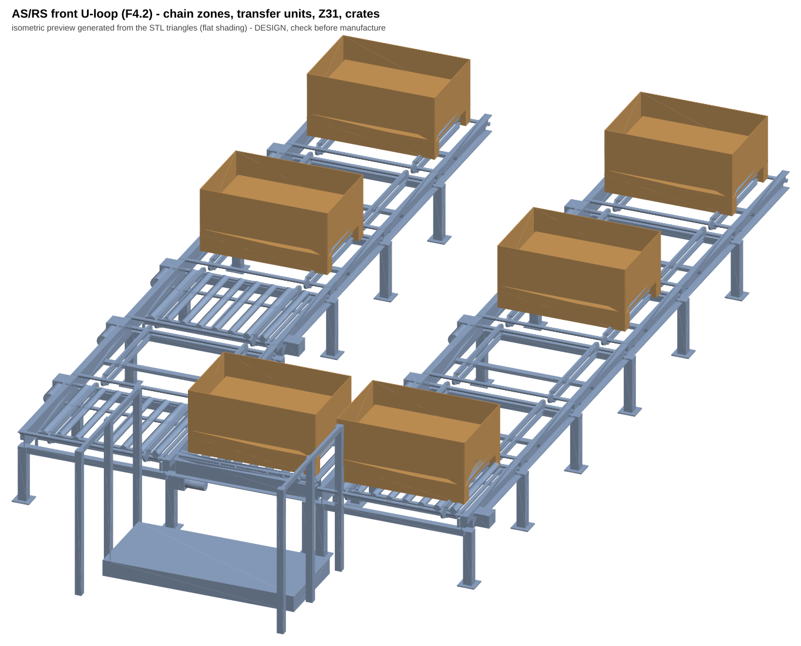

The assembly SCAD files only place the module SCAD files (`use <cc.scad>` etc.). Changing a module therefore changes
every place where it is used.

### 20.4 The drawing set (A3, title block ISO 7200, tolerances ISO 2768-mK)

| No. | Content | Scale |
|---|---|---|
| [D11](../thesis_final/design/04_conveyors/out/drw/D11_chain_zone_CC.svg) | CC chain zone: side view (chain top 700, shaft height 646.2, sprocket centres 1020) and top view (gauge 900, inside frames 1310, take-up 54); parts list C1–C10 with balloons | 1:15 |
| [D12](../thesis_final/design/04_conveyors/out/drw/D12_roller_zone_RL.svg) | RL / RCX roller zone: top view (9 rollers, pitch 150, length 1400), section A-A (roller 60 × 2 × 1000, guard, crate runners across), parts R1–R6 | 1:15 |
| [D13](../thesis_final/design/04_conveyors/out/drw/D13_transfer_unit_TU.svg) | TU: section in the down position, detail B (chain top 700, roller top 685 down / 715 up, 15 + 15 = stroke 30), eccentric detail (top dead centre = self-locking), parts T1–T6 | 1:10 / 1:2 |
| [D14](../thesis_final/design/04_conveyors/out/drw/D14_asrs_front_U_loop.svg) | U-loop plan: all zones with x/y table, AGV docks (drop, pick 1, pick 2), operator place, 6000 / 2800 mm | 1:50 |
| [D15](../thesis_final/design/04_conveyors/out/drw/D15_pd_station_crate_base.svg) | HMC P&D station plan (14 000 / 4 200 mm lanes) and the crate-base details: runner on rollers (9 rollers under a 1200 runner, rule ≥ 3) and runners across a chain strand (4 contacts) | 1:75 / 1:10 |

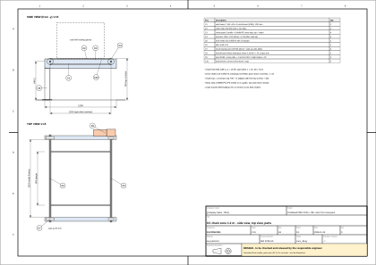

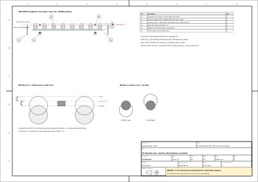

**The parts lists come from `out/mech/bom_modules.csv`,** the same file the calculation writes. The self-test checks
that every position (C1–C10, R1–R6, T1–T6) is on its drawing twice: in the parts list and in a balloon.

### 20.5 Rebuilding the modules in SOLIDWORKS (step by step)

The STL files are for viewing and space checks. For manufacturing drawings, rebuild the parts natively. The file
`out/drw/dimension_table.csv` gives every main dimension with its tolerance and its source.

1. **Units and origin.** Start a new part in mm. Origin = module centre on the floor. Top plane = floor; z up.
2. **Side frame (C1 / R1).**
   - Sheet-metal part, C 160 × 65 × 5, length 1200 (CC) or 1400 (RL).
   - Place it so that the frame top is 10 mm below the conveyor top (z = 690), web inside at y = ±655.
   - Holes for the shafts: centre z = 646.2, x = ±510 (drive / idler), with a 54 mm slot on the idler side.
3. **Chain part (CC, T1).**
   - Sprocket z15 for 12B from the Toolbox (ISO 606), pitch diameter 91.6, at x = ±510, y = ±450.
   - Shaft d30 (k6 at the bearings), length 1470; bearing units UCP206 from the supplier CAD library.
   - Chain path: top strand centre z = 692, return strand centre z = 600.4. Wear strips under the top strand.
4. **Rollers (R2).**
   - Tube 60 × 2 × 1240 + double sprocket 08B z14 at the +y end, axle 20 through both frames, centre z = 670.
   - Linear pattern of 9 at pitch 150, starting at x = −600.
   - RCX: the same part in a 1340 mm frame.
5. **Transfer unit (TU).**
   - Use the chain part assembly of step 3.
   - Add the lifting frame with 8 rollers 60 × 960 (axis x) at y = −525 … +525, pitch 150.
   - Mate: roller top at 685 (down). Add a **distance mate of 30 mm** as a configuration "UP", which gives roller top 715.
   - Eccentric shafts at x = ±300 with e = 15. Use a cam mate, so the motion study shows the lift.
6. **Gear motors.** Download the supplier CAD (helical-bevel, hollow shaft d30, 0.18 kW, i = 34 for CC; 0.12 kW, i = 22
   for RL; brake motor 0.25 kW, i = 70 for the TU lift) and mate it on the shaft with the torque arm.
7. **Assemblies.** Insert the modules at the zone positions of the D14 table (CC/TU 0°, Z31 RCX 90°) and the P&D lanes
   of D15. Run **Interference Detection**. It must show only the intended contacts: crate runners on chains or rollers.
8. **Drawings.** Make the drawings from the assemblies with the parts list from the BOM. Compare them with D11–D15:
   the numbers must agree.

### 20.6 What the self-test checks (23 checks)

| Group | Checks |
|---|---|
| Mesh | a rotation keeps the outward winding (signed volume); all 9 STL files read back; CC, RL and TU have a positive signed volume |
| CC | length 1200 from the bounding box; conveyor top 700 ± 2; chain gauge 900, measured from the top-strand vertices of the mesh |
| RL / RCX | 9 rollers at pitch 150 inside 1400; roller top 700 ± 2 (guard ≤ 712); RCX 1340 fits between TU1 and TU2 with 9 rollers |
| TU | roller top up − down = 30 = stroke; rollers below the chain top when down and above when up; side gap roller–chain ≥ 10 mm |
| U-loop | 13 modules at the F4.1 positions; no two module footprints overlap |
| Crate | runners cross the chains on CC and the rollers on RL (dot product of the directions = 0); ≥ 3 rollers under a runner on RL (9); crate size 800 × 1200 × 600 with 2 runners |
| P&D | HMC lanes 10 / 3 zones as in F4.1 |
| Drawings | D11–D15 well-formed SVG with title block and status; every BOM position on its drawing; iso preview well-formed |
| Files | 9 OpenSCAD files with balanced brackets; dimension table ≥ 40 rows (45) |

## 21 Checklist F4.2 → F4.3

- [x] Crate base with 2 runners (fits the F3 fork); orientation rule (runners cross chains / rollers, ≥ 3 rollers); roller zones 1.4 m.
- [x] CC: chain 12B-1 (all candidates pass; chosen for robustness), sprocket z15, gear motor 0.18 kW, shaft d30 (twist decides), UCP206.
- [x] RL / RCX: rollers 60 × 2 (robustness minimum), bearings 6204, chain-driven live roller, 0.12 kW.
- [x] TU: eccentric lift 30 mm, 0.25 kW brake motor, self-locking at both dead centres.
- [x] Frame, stopping distance, sensor positions, energy; module parts lists; 3D models and drawings D11–D15.
- [x] **F4.3:** the load stations – AGV P&D station (docking, guides, end stop, AGV handshake), TU1 check station
      (contour frame, weighing transfer, ID), pick/rework place Z31 (ergonomics, pick-to-light), flow racks for the
      line-side buffers, HMC pallet load station (rotating table, clamping check).

**References:**
- ISO 606 (short-pitch roller chains);
- ISO 281 (rolling bearings – dynamic load ratings and rating life);
- DIN 743 (shafts – load capacity) – here a simplified Goodman check;
- EN 619 (safety of unit-load conveyors);
- EN ISO 13857 (safety distances, chain guards);
- FEM 2.581 / 2.582 (bulk/unit-load conveyor design) [verify edition];
- Roloff/Matek, *Maschinenelemente* (chain and shaft design), current edition.

---

# F4.3 – The load stations

> **Program:** `thesis_final/design/04_conveyors/load_stations.py`. Self-test 29/29.
>
> **Data:** `ls_data.json`, plus F1 (products), F3 (part flows) and F4.1 (the AS/RS front simulation).
>
> **Outputs** in `out/stations/`:
> - `stations_report.md`;
> - `handshake.csv`, `handshake_sequences.csv`;
> - `reject_codes.csv`, `kit_visits.csv`, `flow_lanes.csv`;
> - `stations_specs.json` (input of the 3D model).
>
> **3D and drawings:** `stations_3d.py` (D16–D20), chapter 34.

```
python load_stations.py selftest     # 29/29
python load_stations.py run
```

## 22 What a "load station" is in this factory

A load station is every place where a crate, a pallet or a part **changes hands**:

| | Station | Between | Chapter |
|---|---|---|---|
| A | **AGV P&D station** (pick-up and drop-off) | AGV ↔ roller lane of a department | 23–24 |
| B | **TU1 check station** | AGV / pick place ↔ AS/RS | 25–26 |
| C | **Pick / rework station Z31** | AS/RS crates ↔ kit trolleys for assembly | 27–29 |
| D | **Gravity flow racks** | AGV ↔ machine operator (line-side buffer) | 30 |
| E | **HMC pallet load station** | operator ↔ tombstone fixture on the machine pallet | 31–32 |

**Why this sub-item is the most "human" part of F4.** At every station either two machines must agree (AGV and
conveyor), or a person works next to a machine. This gives three kinds of design question:
- **Tolerances.** Does the crate find its way, even when the AGV stops 10 mm too short?
- **Information.** Who tells whom that the transfer is finished?
- **People.** Can the operator do this all day without back pain, and without being hit by the shuttle?

The program answers each question with a calculation. The results changed the design **five times** in this sub-item
(ch. 33).

## 23 AGV P&D station – tolerances, transfer, end stop

### 23.1 The lateral tolerance budget

The AGV docks at the lane end. Its stop position has errors:
- lateral stop error e_y = ±10 mm;
- yaw ψ = ±0.5°;
- floor unevenness ±3 mm.

The yaw is the dangerous one. Over the 1200 mm crate length it gives an offset at the far end of:

$$1200 \cdot \sin 0.5° = 10.5\ \text{mm}$$

$$\text{worst case} = 10 + 10.5 + 3 = 23.5\ \text{mm},\qquad \text{RSS} = \sqrt{10^2 + 10.5^2 + 3^2} = 14.8\ \text{mm}$$

**What catches the error:**
- side guides with 25 mm clearance per side;
- a **15° lead-in** of 150 mm length, which pushes a misaligned crate into line.

$$\text{capture} = 25 + 150\tan 15° = 65.2\ \text{mm} \ge 23.5\ \text{mm} \;\rightarrow\; \text{OK, even in the worst case}$$

**Why both worst case and RSS?**
- **RSS** (root of the sum of squares) is the realistic value when the errors are independent.
- **Worst case** is what happens when they all add up on a bad day.
- Mechanical **capture** (guides) must cover the worst case, because a jam costs an operator call. A sensor tolerance may
  use RSS.

### 23.2 The height step – a requirement for the AGV (F5)

The crate runner must roll from the AGV deck onto the first lane roller. A runner can climb a step of about
h ≤ 0.1·D = **6 mm** onto a Ø60 roller.

| | Value |
|---|---|
| AGV deck height tolerance | ±5 mm |
| floor | ±3 mm |
| **worst case** | **8 mm > 6 mm** ✗ |
| RSS | 5.8 mm ✓ |

The worst case fails. **Requirement handed to F5:** the AGV deck must be **actively levelled to ±3 mm**. That needs a
lifting deck with a height sensor, not a fixed deck.

### 23.3 Transfer and gap

- Gap between the AGV deck and the lane: 30 mm. While the crate crosses it, (1200 − 30)/150 = **7 rollers** stay under each runner (the rule is ≥ 3).
- Transfer time: 1.4 m / 0.2 m/s + 3 s handshake = **10 s**. This is exactly the value F4.1 used.

### 23.4 End stop – what if the stop sensor fails?

If the control fails, the crate runs into the mechanical stop at full speed:

$$E = \tfrac12 m v^2 = \tfrac12 \cdot 300 \cdot 0.2^2 = 6\ \text{J},\qquad F_{avg} = \frac{E}{s} = \frac{6}{0.012} = 500\ \text{N},\qquad a_{peak} \approx \frac{2F_{avg}}{m} = 3.3\ \text{m/s}^2 = 0.34\,g$$

- A PU buffer behaves like a linear spring, so the peak force is about twice the average.
- Below about **0.5 g** the parts in the crate do not shift and the separators stay in place → **OK**.

## 24 AGV ↔ station handshake

### 24.1 Why a local signal exchange

The AGV and the conveyor are two machines with two PLCs. The fleet manager (Wi-Fi) knows **which** crate goes where. But
the moment-by-moment agreement must be **local and deterministic**: "my rollers run now – yours too?". Wi-Fi latency and
drop-outs are too uncertain for that.

**Solution:** a short-range **optical data coupler** at the docking point (8 signals each way), the common technique for
AGV–conveyor transfer.

| Id | Direction | Signal | Meaning |
|---|---|---|---|
| A1 | AGV → station | AGV_PRESENT | docked (docking sensor + position confirmed) |
| A2 | AGV → station | AGV_READY_SEND | loaded, ready to push out (drop-off) |
| A3 | AGV → station | AGV_READY_RECV | empty, rollers inwards (pick-up) |
| A4 | AGV → station | AGV_TRANSFER_DONE | crate fully on / off the deck |
| S1 | station → AGV | ST_READY_RECV | zone 1 empty, rollers inwards, stop lowered |
| S2 | station → AGV | ST_READY_SEND | crate at the lane end, stop lowered, rollers outwards |
| S3 | station → AGV | ST_TRANSFER_DONE | crate fully on / off the lane |
| S4 | station → AGV | ST_FAULT | fault / E-stop / light curtain → AGV stops its rollers |

### 24.2 Drop-off sequence

| Step | AGV | Station | Timeout |
|---|---|---|---|
| 1 | docks, AGV_PRESENT = 1 | checks: zone 1 empty, no fault | – |
| 2 | – | lowers the stop, lane rollers inwards, ST_READY_RECV = 1 | 10 s after AGV_PRESENT |
| 3 | AGV_READY_SEND = 1, deck rollers outwards | crate moves (both at 0.2 m/s) | – |
| 4 | AGV_TRANSFER_DONE = 1 (deck free) | ST_TRANSFER_DONE = 1 (crate fully in zone 1) | 15 s |
| 5 | resets its signals, leaves | raises the stop; job closed in fmsctl | – |

The pick-up sequence is the mirror image (`handshake_sequences.csv`).

### 24.3 The four rules (they become PLC interlocks in F4.6)

1. The rollers of **both** sides run only while AGV_PRESENT = 1 and ST_FAULT = 0.
2. A timeout in any step: both sides stop, and the job goes to "transfer error" for the operator.
3. If AGV_PRESENT is lost during a transfer, both conveyors stop immediately. The crate stays on the gap and is recovered
   in manual mode.
4. **These signals are not safety functions.** People are protected by the muting light curtain at the lane end (F4.5 /
   F8).

## 25 TU1 check station – the contour limits come from the rack

The check on TU1 (F4.1 ch. 5) decides whether a crate may go into the rack. **The limits are not chosen by feeling. They
follow from the F3 rack geometry:**

| Limit | Derivation | Value |
|---|---|---|
| **side overhang** (per side) | half the crate gap 75/2 = 37.5 − crane x tolerance 12.0 (F3 RSS) − safety 5 = 20.5 | **20 mm** |
| **front / rear overhang** | min(front space 50, rear space 1300 − 50 − 1200 = 50) − fork tolerance 10 − safety 5 = 35 | **20 mm** (margin kept) |
| **height** | available above the beam: 1250 − 120 (beam) − 150 (fork lift) − 6.9 (z tolerance) − 5 = 968 mm; company rule "nothing above the rim": crate 600 (incl. runners) + 20 | **620 mm** |

**Sensors** (a portal over TU1):
- two vertical light grids at ±(400 + 20) mm for the side overhang;
- one horizontal light grid at 620 mm for the height;
- **resolution 14 mm**, which detects a 20 mm crankshaft end that sticks out.

**Length (front/rear) is measured in motion.** The crate moves at 0.2 m/s, and the grid scans every 10 ms, so the edge is
found to **2 mm**. The PLC compares the time between the leading and the trailing edge with 1200 mm.

**Reject codes** (`reject_codes.csv`):

| Code | Meaning | Reaction |
|---|---|---|
| 0 | OK | store |
| 1 | overweight | back onto the AGV → rework area (split the crate) |
| 2 | height above the rim rule | rework: re-stack |
| 3 / 4 | side / front-rear overhang | rework |
| 5 / 6 | no ID / ID unknown or wrong destination | new label / clarification |
| 7 | **weight not plausible** | rework: count the parts |
| 8 | crate base damaged (2 runner sensors, one per runner) | crate out of service |

## 26 Weighing transfer – load cells, uncertainty, guard band

### 26.1 Load cell size

TU1 stands on **4 load cells**. They carry the TU itself (dead load 450 kg) plus the crate, with 25 % overload reserve.
An off-centre crate can put 1.5 times its share on one cell:

$$F_{cell} = \frac{450 + 300\cdot 1.25}{4}\cdot 1.5 = 309\ \text{kg} \;\rightarrow\; \textbf{500 kg cells}$$

### 26.2 How exact is the weight? – the uncertainty budget

| Source | Value |
|---|---|
| 4 cells, C3 class (≈ 0.023 % of capacity each), independent: √4 × 0.00023 × 500 | 0.23 kg |
| vibration (crane, AGVs, chain drive) | 0.8 kg |
| zero drift (temperature, dirt) | 0.3 kg |
| **combined u = √(0.23² + 0.8² + 0.3²)** | **0.88 kg** |

The cells are not the weak point. **Vibration** dominates, so mount TU1 on its own foundation plate, separate from the
crane rail.

### 26.3 Guard band – how to decide "300 kg or more?"

If we accept everything up to 300.0 kg, a crate of 300.8 kg will sometimes pass because of the measuring error. The
standard solution is a **guard band** of 2u (95 % confidence):

$$\text{accept if } W \le 300 - 2\cdot 0.88 = \textbf{298.2 kg}$$

The price: a crate of 299 kg is rejected although it is legal. That is acceptable, because such crates are rare and the
rack beam is designed for 300 kg.

### 26.4 Settling time

$$k = 4\cdot\frac{500\cdot 9.81}{0.0003} = 65.4\ \text{MN/m},\qquad f_n = \frac{1}{2\pi}\sqrt{\frac{k}{m}} = \frac{1}{2\pi}\sqrt{\frac{65.4\cdot 10^6}{750}} = 47\ \text{Hz}$$

The digital filter is 2 Hz. Settling = filter (4τ = 0.32 s) + decay of the oscillation (ζ = 0.05: ln 50 / (ζ ω_n) =
0.26 s) = **0.58 s**. That is far below the 8 s of the check.

### 26.5 Plausibility – the scale also counts

The WMS knows what the crate should contain:

$$W_{exp} = \text{tare} + n \cdot m_{part},\qquad |W - W_{exp}| \le \max(3\,\%\,W_{exp},\ 2u)$$

**Can one missing part be detected?** Only if one part is heavier than the tolerance.

| Raw crate | Parts | kg/part | Crate kg | Tolerance kg | One missing part detected? |
|---|---|---|---|---|---|
| C01 crankcase | 12 | 16.5 | 243.0 | 7.3 | **yes** |
| C09 flywheel | 12 | 10.5 | 171.0 | 5.1 | **yes** |
| R01 housing (RB100) | 6 | 29.0 | 219.0 | 6.6 | **yes** |
| C04 cylinder | 24 | 3.9 | 138.6 | 4.2 | no |
| C08 con-rod | 80 | 0.42 | 78.6 | 2.4 | no |

**Lesson:**
- The scale "counts" the **heavy** parts. That is where a missing part is expensive: a crankcase missing means an
  assembly stop.
- The **light** parts are counted by their **bins** (ch. 28) and by the pick-to-light confirmation, not by weight.

## 27 Pick station Z31 – what is kitted, and how many visits

### 27.1 Kitting vs line feeding

- **Kitting:** the parts for N assembly units are picked into a **kit trolley** at Z31, and the AGV brings the trolley
  to assembly.
- **Line feeding:** heavy parts go to assembly in their **own crate**, and are handled there with a balancer.

**The limit between the two is set by ergonomics (ch. 29): parts ≤ 5.0 kg are kitted.**

| Variant | Kitted mass / unit | Units per trolley (≤ 240 kg) | Units per visit (2 trolley places, lot limit) | Line-fed in crates |
|---|---|---|---|---|
| VC20 | 17.2 kg | 13 | 26 | C01 crankcase 14.2, C09 flywheel 9.4 |
| RB50 | 12.3 kg | 19 | 35 | R01 16.9, R02 5.4, R03 5.4 |
| RB100 | 3.2 kg | 73 | 45 (lot) | R01 24.4, R02, R03, R06 7.3, R07 7.1 |
| RB150 | 3.2 kg | 73 | 20 (lot) | R01 31.9, R02, R03, R06 9.9, R07 9.7 |

**The trolley payload limit** comes from the AGV (F5): 300 kg gross − 60 kg trolley = 240 kg →
13 VC20 units × 17.2 kg = 224 kg.

**Two trolley places at Z31:** each crate visit picks for **two** kits. This halves the crane moves for kitting.

### 27.2 Crate visits – a modelling error found and corrected

The first model counted one visit per part type per kit. Then the self-test check "picks × mass ≤ crate capacity" failed
for C04:
- one kit visit needs 52 cylinders × 3.3 kg = 172 kg;
- one crate holds **8 bins × 8 kg = 64 kg** (bins, ch. 28).

**Corrected model:**

$$\text{parts per crate} = \min\left(ppc_{mach},\ 8\cdot\left\lfloor\frac{8\ \text{kg}}{m}\right\rfloor\right),\qquad \text{crate visits per kit visit} = \left\lceil\frac{\text{picks}}{\text{parts per crate}}\right\rceil$$

| Part | Picks per kit visit | Parts / crate | Crate visits | t per crate visit |
|---|---|---|---|---|
| C02 cover | 26 | 30 | 1 | 113 s |
| C04 cylinder | 52 | 16 | **4** | 80 s |
| C05 head | 52 | 30 | 2 | 110 s |
| C06 valve plate | 52 | 45 | 2 | 81 s |
| C07 crankshaft | 26 | 16 | 2 | 80 s |
| C08 con-rod | 52 | 60 | 1 | 133 s |

**Pick time per crate visit** (MTM-style values):

$$t = 20\ \text{s (arrival, scan, confirm)} + n_{picks}\cdot t_{pick}(m) + \tfrac12 n_{bins}\cdot 6\ \text{s (pull a far bin)}$$

with t_pick = 2.0 s (≤ 1 kg), 3.0 s (≤ 4 kg) and 4.5 s (> 4 kg).

**Result:**
- **1 640 crate visits per month**, against 1 133 assumed by F3. That is 45 % more, because of the bin capacity.
- Mean time **94 s** per visit (F4.1 assumed 90 s).

### 27.3 Feedback into the AS/RS front simulation (F4.1)

The program runs the F4.1 simulation again with the new kit rate and pick time (busiest hour, 150 h, *simulated*):

| | F4.1 assumptions | F4.3 kitting values |
|---|---|---|
| kit visits per h | 5.5 | **8.0** |
| crane utilisation | 49.5 % | **55.9 %** |
| AGV wait p95 at TU1 | 14 s | 16 s |
| crane blocked by full P&D out | 2.7 % | 2.7 % |
| open orders at the end | 0 | 0 (stable) |

**The U-loop still works.** The crane is now 56 % busy instead of 47–50 %, which leaves less reserve for growth.

**Measure for later:** if kitting grows, the first lever is a **third trolley place** (3 kits per visit), not a second
crane.

## 28 The bin-in-crate concept

### 28.1 The reach problem

The crate stands on Z31 with its **1200 side facing the operator** (the travel direction of CV3 fixes this). The
operator must therefore reach **800 mm deep**. NIOSH allows a horizontal distance H of at most **63 cm**; beyond that the
recommended weight is zero.

### 28.2 The solution

Small machined parts are stored in **flat bins 600 × 400 × 147.5 mm** (VDA RL-KLT 6147 class) inside the crate: 4 per
layer, 2 layers = 8 bins. The crate inside is 1192 × 792 × 420 mm: 280 mm bins would fit only one layer (3D check,
ch. 34).
- **Far bin:** the operator **pulls** it to the near half: F = μ m g = 0.4 × 8 × 9.81 = **31 N**, far below 100 N.
  The picks are then made at H ≈ 45 cm.
- **Bottom layer:** the top bins are put on a **side shelf** at crate-rim height (a lift of ≤ 8 kg, ch. 29).
- **Counting:** each bin holds a known number of parts (e.g. 2 × C04 per bin at the 8 kg limit). The pick-to-light shows
  the count, and an empty bin is an automatic count check.
- **Bonus:** bins protect the machined surfaces (honed bores, sealing faces) better than layers with separators.

## 29 NIOSH – the ergonomic limits are calculated, not guessed

**The revised NIOSH lifting equation:**

$$RWL = LC\cdot HM\cdot VM\cdot DM\cdot AM\cdot FM\cdot CM,\qquad LI = \frac{\text{load}}{RWL}$$

$$LC = 23\ \text{kg},\quad HM = \frac{25}{H},\quad VM = 1 - 0.003|V-75|,\quad DM = 0.82 + \frac{4.5}{D}$$

| Symbol | Meaning |
|---|---|
| H | horizontal distance hands–ankles, cm |
| V | hand height at the start, cm |
| D | vertical travel, cm |
| AM | asymmetry multiplier (= 1, no twist) |
| FM | frequency multiplier: 6 picks/min for 1–2 h → 0.50 |
| CM | coupling multiplier: 0.95 |

**LI ≤ 1** is acceptable for nearly all workers.

**First design** (kit limit 8 kg, bins 15 kg): the heaviest kitted part was the RB100 rotor, 7.25 kg.

| Case | RWL | Load | LI |
|---|---|---|---|
| pick, near bin, top layer | 5.3 kg | 7.2 kg | **1.38** ✗ |
| pick, near bin, bottom layer | 5.2 kg | 7.2 kg | **1.40** ✗ |
| pick from a far bin without pulling (H = 85) | 0 | – | **not allowed** |
| lift a full bin (15 kg) to the shelf | 8.9 kg | 15 kg | **1.69** ✗ |

**The limits are now derived from the RWL:**
- kit only parts ≤ **5.0 kg** (RWL of the near picks 5.19 kg, rounded down);
- fill bins to ≤ **8 kg** (RWL of the bin lift 8.88 kg, rounded down).

**Final design:**

| Case | RWL | Load | LI |
|---|---|---|---|
| pick, near bin, top layer | 5.3 kg | 4.6 kg (RB50 rotor) | **0.88** ✓ |
| pick, near bin, bottom layer | 5.2 kg | 4.6 kg | **0.89** ✓ |
| far bin | – | – | pulled first (31 N) ✓ |
| bin lift | 8.9 kg | 8 kg | **0.90** ✓ |

**Worked example**, near bin, top layer: H = 45, V = 120, D = 25 (D ≥ 25 is the NIOSH minimum, so DM = 0.82 + 4.5/25 = 1.0).

$$RWL = 23 \cdot \frac{25}{45} \cdot (1 - 0.003\cdot 45) \cdot 1.0 \cdot 1 \cdot 0.50 \cdot 0.95 = 23 \cdot 0.556 \cdot 0.865 \cdot 0.475 = 5.25\ \text{kg}$$

**Consequences:**
- the RB rotors (> 5 kg) and the head plates R02/R03 (5.4 kg) are **line-fed** to the Roots assembly, where a small
  balancer is planned (F4.4 / F10);
- the bins become smaller and lighter, which is why C04 needs 4 crate visits (ch. 27.2).

**This is the honest chain of cause and effect:** ergonomics → kit limit → bin limit → more crate visits → higher crane
load (56 %) → still OK. Each step is calculated, and the earlier items (F3, F4.1) are checked again.

## 30 Gravity flow racks for the line-side buffers

### 30.1 A functional correction of F4.1

F4.1 put all line-side crates of a department into **one** motorised inbound lane. A lane is FIFO, so the operator could
only reach the **first** crate, whatever part it holds. That does not work when VMC needs C04 now and the C04 crate is
third in the lane.

**Correct:** **one lane per part type**, plus one empty-crate return lane per department.

### 30.2 Gravity instead of motors

The crate rolls down a slight slope (1200-leading, runners across the rollers) from the AGV side to the machine side.
No motors and no controls are needed.

**Slope.** It must also start a **light** (empty-ish, 45 kg) crate, which has the highest relative resistance f = 5 %:

$$s = f_{light} + 0.5\,\% = 5.5\,\% \quad (3.15°)$$

**Speed.** A full crate (f = 3 %) on a 4.2 m lane would reach:

$$v = \sqrt{2gL(s - f)} = \sqrt{2\cdot 9.81\cdot 4.2\cdot 0.025} = 1.44\ \text{m/s}$$

That is far too fast: a 300 kg crate at 1.44 m/s hitting the separator. Therefore **brake rollers** (centrifugal speed
controllers) are placed every **1.05 m**, so that at least one is always under the crate, limiting it to ≤ 0.3 m/s.

**Separator at the exit.** It holds the first crate against the line pressure of the others (≤ 3 places → 2 behind):

$$F = (n-1)\,m\,g\,(s - f_{min}) = 2\cdot 300\cdot 9.81\cdot(0.055 - 0.02) = 206\ \text{N}$$

The separator releases one crate at a time when the operator takes it, so the operator never works against line
pressure.

**Height – found by the 3D model (ch. 34).**
- A slope loses height. The first design had 7 m lanes starting at the conveyor height of 700 mm, so the exit was at
  315 mm. That is too low for picking, and the empties would have had to be lifted onto the return lane.
- Final design:
  - lanes of **≤ 3 places (4.2 m)**;
  - the **AGV lifting deck raises the crate to 900 mm** at the entry (requirement F5: deck lift 700–900 mm);
  - drop 0.055 × 4.2 m = 231 mm → **exit 669 mm**, a normal picking height.
- **Empties:**
  - the crate in use stands on a **ball-transfer deck** across the lane exits;
  - the operator slides the empty crate (45 kg) sideways with F = 0.02 × 45 × 9.81 = **9 N**;
  - it goes onto a **powered return lane** (3 roller zones) that rises 0.7 % to the AGV deck height of 700 mm.

### 30.3 Lanes and space

| Dept | Lanes | Example |
|---|---|---|
| HMC | C01 (2 lanes), R01, R02, R03 (running RB variant), powered return | face 6.3 m of 20.6 m department width |
| ROT | C07, C09 (2 lanes), R06, R07, powered return | 6.3 m of 10.9 m |
| VMC | C02, C03, C04 (2 lanes), C05, C06, C08, R04, R05, powered return | **10.5 m of 11.9 m** (tight, but it fits) |

- 53 places, 107 800 EUR (reference, incl. ball decks and powered return lanes).
- The 28 line-side crates leave the motorised lanes of F4.1 (−50 400 EUR). **Net +57 400 EUR.** This is not the saving
  F4.1 hoped for; it is the price of a lane system that works.

## 31 HMC pallet load station – table, drive, bearing

**Task.** The operator unloads the machined crankcase or Roots kit from the tombstone fixture and loads raw parts. The
pallet (500 × 500) stands on a **rotary index table**, so that each tombstone face comes to the operator.

**Masses** (design, all positions loaded with raw parts):
- FA: pallet 110 + tombstone 350 + 2 × 16.5 = **493 kg**;
- FC: 110 + 380 + 2 × (22 + 6.6 + 6.6) = **560 kg**.

**Inertia about the vertical axis:**

$$J = m_{pal}\frac{a^2 + a^2}{12} + m_{tomb}\frac{b^2 + c^2}{12} + m_{parts}\,r^2 = 19.1\ \text{kg m}^2\ (\text{FC})$$

**Index 90° in 3 s** (trapezoid 1/3 – 1/3 – 1/3):

$$\omega = \frac{\pi/2}{2\cdot 3/3} = 0.785\ \text{rad/s},\qquad \alpha = \frac{\omega}{1\ \text{s}} = 0.785\ \text{rad/s}^2,\qquad T = J\alpha + \mu m g r_b = 19.1\cdot 0.785 + 0.005\cdot 560\cdot 9.81\cdot 0.15 = 19.1\ \text{N m}$$

- P = T ω / η = 19 W → **0.12 kW brake gear motor** + an **index pin** for exact position. The pin takes the reaction
  when the operator tightens or loosens.
- **Slewing ring** (Ø 300 class): axial load 5.5 kN; tilting moment from a 22 kg part dropped by the hoist (impact factor
  2) at 0.3 m = 0.13 kN m.
  - It is much stronger than needed (fs > 20).
  - It is chosen for **tilting stiffness and index accuracy**; a smaller ring is not cheaper in this size.

## 32 HMC load station – clamping, checks, time, ergonomics, safety

### 32.1 Hydraulic clamping force

The fixture holds the part by friction against the cutting force (face milling, F_c ≈ 3 kN, design estimate). There are
2 friction faces (clamp and rest pad) and n = 3 clamps (C01 OP10, F1 data). With safety factor S = 2:

$$F_{clamp} = \frac{S\,F_c}{2\mu n} = \frac{2\cdot 3000}{2\cdot 0.15\cdot 3} = 6667\ \text{N per clamp}$$

$$A = \frac{F}{p} = \frac{6667}{25\ \text{N/mm}^2} = 267\ \text{mm}^2 \;\rightarrow\; d = 18.4\ \text{mm} \;\rightarrow\; \textbf{Ø20 swing clamp: 7854 N at 250 bar}$$

### 32.2 The pallet keeps its pressure – accumulator

The pallet is uncoupled from the station hydraulics when it goes to the machine. A small gas accumulator on the pallet
(160 cm³, precharge 150 bar) keeps the pressure. With a leakage of 0.02 cm³/min (isothermal, p V = const):

$$V_1 = \frac{150\cdot 160}{250} = 96\ \text{cm}^3,\qquad p(15\ \text{min}) = \frac{24000}{96 + 0.3} = 249.2\ \text{bar}$$

The pressure switch at 220 bar would trip only after **655 min**. The pallet is safe for the whole machining cycle, and
for a long machine stop.

### 32.3 Clamping check – before the pallet may leave

| Check | Sensor | Pass |
|---|---|---|
| clamping pressure per circuit | pressure switch at the coupling | ≥ 220 bar |
| part seated on its rest pads | **air-gap sensing**: air nozzle in each rest pad, back-pressure | ≥ 2.5 bar (gap < ~0.02 mm) |
| part present | inductive / diffuse sensor | yes |
| pallet locked on the table, index pin in | proximity switches | yes |
| operator presses READY (2-hand not needed: no motion on the operator side) | button | – |

Only when all checks pass does the station release the pallet to the shuttle. This is register 301
`load.clamped` = 1 in the V1.2b register map.

### 32.4 Load-station time

The F1 model gives the time per handling (one position = unload the old part + load the new one):

$$t = 25 + 8\cdot n_{clamps} + 20\ (\text{if } m > 15\ \text{kg, hoist}) + 10\ (\text{clean})$$

| | F1 model | F2 used | + index & check (3 × 3 s + 5 s) | Per visit |
|---|---|---|---|---|
| FA (2 positions × 79 s) | 158 s = 2.63 min | 2.63 min ✓ | 14 s | 172 s |
| FC (R01 2 × 71 s, R02 2 × 51 s, R03 2 × 51 s) | 346 s = 5.77 min | 5.77 min ✓ | 14 s | 360 s |

Utilisation = (9.09 × 172 + 1.21 × 360) / 3600 = **55.5 %**. F2 MVA gave 57 %, so one load station is confirmed.

### 32.5 Why the hoist is required – NIOSH

Loading a raw crankcase (16.5 kg) by hand onto the tombstone: H = 40, V = 120, D = 45, FM = 0.94, CM = 0.95.

$$RWL = 23\cdot\frac{25}{40}\cdot 0.865\cdot 0.92\cdot 0.94\cdot 0.95 = 10.2\ \text{kg},\qquad LI = \frac{16.5}{10.2} = 1.62 > 1$$

→ **jib crane** (3 m arm, 125 kg SWL) with a gripper. This agrees with the F1 rule "hoist above 15 kg": the rule is now
justified by a calculation.

### 32.6 Light curtain between the operator and the shuttle (ISO 13855)

The pallet shuttle on the other side of the table must be stopped before a person reaches it.

$$S = K\,T + C,\qquad T = 15 + 30 + 300 = 345\ \text{ms},\qquad C = 8(d - 14) = 8(30 - 14) = 128\ \text{mm}$$

- With K = 2000 mm/s: S = 818 mm > 500 mm. The standard then allows a recalculation with K = 1600 mm/s:
  S = 1600 × 0.345 + 128 = **680 mm** (≥ 500).
- The light curtain therefore stands **680 mm** from the nearest hazard point of the shuttle.
- The shuttle's stop time (300 ms) is the largest term. A faster safe stop (STO + brake) would make the station more
  compact.

## 33 What F4.3 changed – five design corrections

| # | Found by | Change |
|---|---|---|
| 1 | height-step budget (ch. 23) | requirement for F5: AGV deck actively levelled to ±3 mm |
| 2 | NIOSH (ch. 29) | kit limit 8 → 5 kg, bins 15 → 8 kg; RB rotors and head plates line-fed |
| 3 | crate-capacity check (ch. 27) | crate visits counted per crate: 1 640 / month (F3: 1 133) → AS/RS front simulated again: crane 56 %, stable |
| 4 | FIFO logic (ch. 30) | one gravity lane per part type instead of one motorised lane (+57 kEUR) |
| 5 | 3D model (ch. 34) | crate base 2 runners (F3 fork), flat bins, crate height 600 → TU1 height limit 620, lanes ≤ 3 places with entry 900 (AGV lift) + powered return |

**Confirmed (no change):**
- the 10 s AGV transfer of F4.1;
- the 8 s check time (the scale settles in 0.58 s);
- one HMC load station (55.5 %);
- the F1 hoist rule.

## 34 3D models and drawings of the load stations

> **Program:** `thesis_final/design/04_conveyors/stations_3d.py`. Self-test 23/23. Python standard library, offline.
>
> **Inputs:**
> - `out/stations/stations_specs.json`, `flow_lanes.csv`, `reject_codes.csv` and `stations_report.md` (all from `load_stations.py`);
> - `out/mech/module_specs.json` (F4.2);
> - `out/design_result.json` (F4.1).
>
> **Helpers:** the geometry helpers (Mesh, STL, OpenSCAD log, Sheet, View) come from `conv_3d.py` (F4.2) and
> `../03_asrs/asrs_3d.py` (F3). The station models therefore reuse the real TU, RL and PD_end modules; nothing is drawn
> twice.
>
> **Outputs:**
> - `out/3d/stations/`: 6 STL + 6 OpenSCAD files, 2 iso previews;
> - `out/drw/`: D16–D20;
> - 21 new rows in `out/drw/dimension_table.csv`.

```
cd thesis_final/design/04_conveyors
python stations_3d.py run         # models, drawings, dimension rows
python stations_3d.py selftest    # 23/23
```

### 34.1 How the station models are built

- **Same coordinate rules as F4.2.** Units are mm, z is up, and the conveyor top is at z = 700.
  - The **P&D station** lane runs along +x, and the AGV is on the −x side.
  - The **TU1** model is in its own local axes: the chains run in x and the crate arrives from the AGV in y.
  - The **HMC station** has the operator on −y and the pallet shuttle on +y.
- **Every part is a closed solid** (box, cylinder or sloped bar).
  - The self-test checks that every edge of the station meshes is used an even number of times, so the STL files
    are closed for slicing or import.
- **One geometry, two formats.** Every primitive is logged while the mesh is built, so the OpenSCAD file is written
  from exactly the same geometry as the STL. Sloped bars become `hull()` of two cubes.
- **Reused modules:**

| Station | Module reused from F4.2 |
|---|---|
| TU1 check station | `gen_tu(up=True)` |
| P&D station | `gen_rl` + `gen_pd_end` |
| Z31 pick station | `gen_rl("rcx", 1340)` turned 90° |

### 34.2 The station models

| File | Content |
|---|---|
| `pd_station_agv.stl` | first lane zone (RL 1.4 m) + PD_end (guides 25 mm per side, 15° lead-in 150 mm, pop-up stop flush with the lane end, 2 PU buffers); muting light-curtain posts at y = ±(lane half-width + 150); muting sensor pair in the lane; optical data coupler at 500 mm on the lane and on the AGV; **AGV** 1600 × 1000 with roller deck, deck top = 700, front face 30 mm from the lane end |
| `check_station_tu1.stl` | TU1 in the up position with a crate; portal with 4 posts at y = ±900; **vertical light grids at x = ±420** (= 400 + 20 side overhang); **horizontal grid at z = 1320** (= 700 + 620); 4 load cells 500 kg under the module; 2 runner sensors at x = ±350; ID reader post on the operator side (−x) |
| `pick_station_z31.stl` | RCX 1340 turned 90° (crate travels along y, 1200 leading); operator platform 300 mm (x −1400 … −620); fences to the AGV docks; 2 kit trolleys behind the operator; pick-to-light bar at 1800 mm with 4 lights; bin shelf; crate with **8 bins in 2 layers** |
| `flow_rack_lane.stl` | gravity lane 4.2 m (≤ 3 places), **slope 5.5 %**: entry roller top **900** (AGV lifting deck, F5), exit **669**; rollers Ø60 at pitch 150; brake rollers every 1050 mm; separator 1400 mm before the exit; end stop; legs that follow the slope |
| `flow_rack_vmc.stl` | the VMC block from `flow_lanes.csv`: part lanes (C04 in 2 lanes) + 1 **powered** empty-crate return lane rising from 669 at the machine side to 700 at the AGV side; **ball-transfer deck** across the lane exits; lane pitch 1050 → face 10.5 m |
| `hmc_load_station.stl` | table 900 mm with slewing ring Ø420, index brake motor + index pin, hydraulic coupling block; pallet 500 × 500; tombstone 400 × 400 × 800 with 2 crankcases (faces ±x) and **6 swing clamps Ø20** (3 per part); chip tray; operator mat; **light curtain 680 mm** from the pallet shuttle; jib crane (column, arm 3000, chain hoist, gripper) |

The iso previews are `preview_check_tu1.svg` and `preview_hmc.svg`.

### 34.3 The drawing set D16–D20 (A3, ISO 5457 frame, ISO 7200 title block)

| Drawing | Content |
|---|---|
| [D16](../thesis_final/design/04_conveyors/out/drw/D16_pd_station_agv_docking.svg) | plan of the lane end with the docked AGV (1:20): guides, lead-in, stop, curtain posts, gap 30; elevation detail of the transfer gap (1:5); the tolerance budget of `stations_report.md` A; handshake signals and AGV requirements |
| [D17](../thesis_final/design/04_conveyors/out/drw/D17_check_station_tu1.svg) | front view (1:15): portal, grids at ±420 and 620 above the top, load cells, runner sensors, crate; reject-code table 0–8; contour limits 20 / 20 / 620 |
| [D18](../thesis_final/design/04_conveyors/out/drw/D18_pick_station_z31.svg) | plan (1:25): RCX, crate with bins, platform, trolley places, bin shelf, reach line 63 cm; section (1:10) with the 2 bin layers; the NIOSH limits (kit ≤ 5 kg, bins ≤ 8 kg, bin pull 31 N) |
| [D19](../thesis_final/design/04_conveyors/out/drw/D19_flow_rack.svg) | side view of the 4.2 m lane (1:30) with the slope, brake rollers (red), separator, entry 900 / exit 669; VMC block plan (1:100) with the powered return lane |
| [D20](../thesis_final/design/04_conveyors/out/drw/D20_hmc_load_station.svg) | plan (1:50): table, tombstone, light curtain at S = 680 from the shuttle, jib radius 3000, mat; elevation (1:30): table 900, tombstone 800, crankcases, clamps |

**Dimension table.** The 21 new rows (modules "PD station", "check TU1", "pick Z31", "flow rack", "HMC station") are
appended to `dimension_table.csv` after the 45 rows of F4.2. Both programs keep each other's rows when they run again.

### 34.4 Rebuilding the stations in SOLIDWORKS

1. **Start from the F4.2 parts** (CC, RL, TU, PD_end, crate). The stations are assemblies of these parts plus a few new
   parts.
2. **P&D station:**
   - mate RL zone 1 to the floor at conveyor top 700;
   - put PD_end at the lane end, with its stop face flush with the end of the frame;
   - add the two curtain posts and the coupler bracket at 500 mm;
   - the AGV is only a reference body: front face 30 mm from the lane, deck top 700.
3. **TU1 check station:**
   - portal from 60 × 60 tubes at (±460, ±900), height 1600;
   - light-grid bars at x = ±420 and the horizontal bar at z = 1320, all taken from the dimension table;
   - load cells under the module at (±520, ±(frame_in + 40)).
4. **Z31 pick station:**
   - RCX 1340 turned 90°;
   - platform 780 × 1800 × 300;
   - trolleys 800 × 800;
   - bins 594 × 396 × 147.5 in 2 layers.
5. **Flow rack:**
   - make one parametric lane: length L (≤ 4.2 m), slope 5.5 %, entry 900, roller pitch 150, brake roller every 7th position;
   - pattern it with a lane pitch of 1050 mm;
   - the return lane is a powered roller lane (3 zones) rising 0.7 % to 700 at the AGV side; add the ball-transfer deck at the exits.
6. **HMC station:**
   - table 600 × 600 × 780 body + Ø420 slewing ring + 640 × 640 plate (top 900);
   - pallet 500 × 500 × 60; tombstone 400 × 400 × 800;
   - clamps Ø20 at the positions in the model;
   - **light curtain plane 680 mm from the shuttle edge.** This is a safety distance (ISO 13855): do not move it closer.

### 34.5 Findings of the 3D model – and how they were resolved

The model found four points that the calculations did not show. **All four are now fixed in the data and programs.**

| # | Finding | Resolution (2026-11-15) |
|---|---|---|
| 1 | **Crate base vs F3 fork.** The F3 crane has **one central telescopic fork** 450 mm wide. A middle runner at x = 0 sits exactly where it enters; with 3 runners the openings are only 250 mm | **2 runners at ±350** (opening 600 mm). The F3 crane is unchanged. `conv_mech` was re-run: chain contacts 4, roller pressure 2.1 MPa, 2 loads per roller (σ 14.9 MPa) |
| 2 | **Bins.** The crate inside is 1192 × 792 × 420 mm (600 total − 160 runners − 20 floor), so 600 × 400 × 280 bins fit only one layer | flat bins **600 × 400 × 147.5** (VDA RL-KLT 6147 class), 2 layers × 4 |
| 3 | **Crate height.** `ls_data` used 760 mm (600 + 160) while F3 / F4.2 model 600 including the runners | 600 is correct (F3). **Height limit at TU1 = 600 + 20 = 620 mm** |
| 4 | **Gravity lanes lose height.** A 7 m lane at 5.5 % dropped 385 mm (exit 315 mm, too low), and empties had to be lifted onto the return lane | lanes **≤ 3 places (4.2 m)**; entry at **900 mm** via the AGV lifting deck (requirement F5: deck lift 700–900 mm); exit **669 mm**; **ball-transfer deck** at the exits (slide 9 N) + **powered** return lane up to 700 |

### 34.6 The F3 crate model – updated

`../03_asrs/asrs_3d.py` `gen_crate` and its OpenSCAD source now show the F4.2 base: **2 runners 100 × 160 mm along the
1200 side at ±350**, instead of 4 legs.
- The F3 self-test check reads "fork 450 fits between the crate runners (opening 600)". It passes, and F3 stays 24/24.
- The dimension table of F3 now lists the runner height and the 600 mm opening.

### 34.7 What the self-test checks (23 checks)

- **Files and solids:**
  - all 6 station STL files read back;
  - meshes closed (even edge count);
  - OpenSCAD brackets balanced;
  - 5 drawings well-formed with a title block;
  - dimension table: 45 F4.2 rows kept + 21 station rows.
- **P&D station:**
  - AGV deck top 700 ± 3;
  - AGV gap 30 mm;
  - guide inner half-width 425 = 400 + 25.
- **TU1 check station:**
  - grids at x = 400 + w_lim and z = top + h_lim (620);
  - 4 load cells;
  - one runner sensor per runner.
- **Z31 pick station:**
  - 8 bins inside the crate inner space without overlap;
  - the check that 600 × 400 × 280 × 2 layers would not fit;
  - runners cross the rollers;
  - platform 300 and 2 trolley places.
- **Flow rack:**
  - slope 5.500 % measured from the roller tops;
  - brake rollers every 1050 mm (always ≥ 1 under a crate);
  - separator 1400 mm before the exit;
  - all VMC lanes of `flow_lanes.csv` present;
  - powered return lane: 700 at the AGV side, exit height at the machine side.
- **HMC station:**
  - light curtain ≥ 680 mm from the shuttle;
  - table 900 and tombstone 400 × 400 × 800;
  - 6 clamps Ø20;
  - jib radius 3000.

**Limits.** The models show envelopes and main parts, not the detailed design: no welds, no bolt patterns, and no
light-grid beam pitch. The AGV is a reference body until F5. Release by the responsible engineer is needed before
manufacture; the HMC light-curtain distance must be released by a qualified safety person (item F8).

## 35 Checklist F4.3 → F4.4

- [x] **A P&D station:** lateral budget (worst 23.5 mm < capture 65 mm), height step (F5 deck ±3 mm), end stop 0.34 g, handshake signals + sequences + rules.
- [x] **B TU1 check:** contour limits derived from the F3 rack (20 / 20 / 620 mm), 14 mm light grids, 500 kg load cells, u = 0.88 kg, guard band 298.2 kg, plausibility table, reject codes.
- [x] **C pick station Z31:** kitting vs line feeding, trolley payload, 2 trolley places, crate visits 1 640/month, 94 s, AS/RS front simulated again (crane 56 %, stable).
- [x] **NIOSH:** kit ≤ 5 kg, bins ≤ 8 kg (LI < 1); bin-in-crate with bin pulling.
- [x] **D flow racks:** 5.5 % slope, lanes ≤ 3 places, entry 900 (AGV lift) → exit 669, brake rollers 1.05 m, separator 206 N, ball deck + powered return, one lane per part type, faces fit.
- [x] **E HMC load station:** index table 0.12 kW, slewing ring, Ø20 clamps, accumulator, clamping check, 55.5 % utilisation, hoist (LI 1.62), light curtain S = 680 mm.
- [x] **3D and drawings:** D16–D20; crate base 2 runners (fits the F3 fork); F3 crate model updated.
- [x] **F4.4:** assembly carrier line – carrier design (VC20 on tank, RB on base frame), loop and spurs (lift-transfer), tank/motor feed (tank racks), assembly load station, balancers for the line-fed parts.

**References:**
- Waters, T.R., Putz-Anderson, V., Garg, A. (1994) *Applications Manual for the Revised NIOSH Lifting Equation*. DHHS (NIOSH) Publication 94-110.
- EN 1005-2 (manual handling of machinery); ISO 11228-1/-2 (lifting / pushing and pulling).
- ISO 13855 (positioning of safeguards); EN 619 (unit-load conveyors); ISO 3691-4 (driverless trucks).
- OIML R60 (load cells); EN 15620 (rack tolerances).
- VDA 4500 (small load carriers, bins).

---

# F4.4 – The assembly carrier line and the tank / motor feed

> **Program:** `thesis_final/design/04_conveyors/asm_line.py`. Self-test 19/19.
>
> **Data:** `asm_data.json`, plus the F2 machine loads and the F4.1 assembly sizing.
>
> **Outputs** in `out/assembly/`:
> - `assembly_report.md`;
> - `des_throughput.csv`;
> - `modules_assembly.csv`;
> - `assembly_specs.json` (input of the 3D model).
>
> **3D and drawings:** `asm_3d.py` (D21–D25), chapter 48.

```
python asm_line.py selftest     # 19/19
python asm_line.py run
```

## 36 What the assembly line must do

From F4.1:
- **Volume:** 3 400 products per month = **10.3 /h** on average; the design rate with the 1.2 peak factor is **12.4 /h**.
- **Products:** each one (a VC20 on its 300 L tank, or a Roots blower on its base frame) travels on its own **workpiece carrier**.
- **Route:** LOAD (tank onto the carrier) → ASSY (9 parallel stations) → TEST (7 benches) → PAINT (1) → PACK (2) →
  UNLOAD → empty carrier back to LOAD.
- **Layout:** the stations are on **spurs** beside a 100 m loop, so a carrier at work never blocks the main line.

**Station times per unit** (F2 loads / 3 400 units):

| Station | t per unit |
|---|---|
| LOAD | 3.0 min |
| ASSY | 31.7 min |
| TEST | 25.6 min |
| PAINT | 2.4 min |
| PACK | 5.0 min |
| UNLOAD | 2.0 min |

**F4.4 answers eight design questions with numbers:**

| Question | Chapter |
|---|---|
| Is the carrier strong enough, and does the product stay on it (start, emergency stop, bumpers)? | 37 |
| At what height does each operator work, and how far must the lift table travel? | 38 |
| How long may a conveyor drive section be, and which motor drives it? | 39 |
| Do the transfers block the main line? | 40 |
| How many carriers, really? (simulation instead of a formula) | 41 |
| How do tanks and motors reach the line (AGV moves for F5)? | 42 |
| Which heavy parts need a balancer? | 43 |
| What does the test bench need from the carrier? | 44 |

## 37 The carrier and product stability

### 37.1 The carrier

- **Frame:** 1800 × 800 mm, welded.
  - two longitudinal **RHS 80 × 40 × 3** on the two chain strands (gauge 640 mm);
  - cross members, 2 locating bushes, PU bumpers front and rear;
  - mass 60 kg.
- **Adapter plates** (tool-free changeover in about 2 min):
  - **VC20:** 4 rubber-lined saddles for the tank feet (feet at 900 × 380 mm);
  - **RB:** 4 locating pins for the base frame.

### 37.2 The frame over a transfer

When a carrier is lifted by a transfer unit, it rests on supports **1200 mm** apart. The product feet (900 mm apart) load
each beam with two forces P = m g / 4 at a distance a = (1200 − 900)/2 = 150 mm from the supports:

$$M = P\,a,\qquad \delta = \frac{P\,a\,(3L^2 - 4a^2)}{24\,E\,I}$$

**VC20** (125 kg): P = 307 N, M = 46 000 N mm, σ = M / W = 46 000 / 14 000 = **3.3 MPa**, δ = **0.07 mm** (limit L/1000 =
1.2 mm).

| Product | Mass on carrier | σ MPa | δ mm |
|---|---|---|---|
| VC20 | 197 kg | 3.3 | 0.07 |
| RB50 | 153 kg | 3.3 | 0.07 |
| RB100 | 178 kg | 4.2 | 0.09 |
| RB150 | 228 kg | 4.8 | 0.10 |

The frame is far from its limits. The RHS size is chosen for **stiffness at the locating bushes**, so the lift-and-locate
pins find the carrier to ±0.5 mm, and for welding.

### 37.3 Does the product stay on the carrier?

The product stands on rubber pads (μ = 0.4). It must neither **tip** nor **slide**:

$$a_{tip} = g\,\frac{x_{feet}/2}{h_{cg}},\qquad a_{slide} = \mu\,g = 3.9\ \text{m/s}^2$$

| Product | a_tip along | a_tip across | a_slide |
|---|---|---|---|
| VC20 (CG 420 mm) | 9.81 × 450 / 420 = 10.5 | 9.81 × 190 / 420 = **4.4** | **3.9** |
| RB150 | 12.1 | 7.0 | 3.9 |

**Sliding is always the first limit**, so we compare it with every deceleration the carrier can see:

| Event | Deceleration | vs 3.9 m/s² |
|---|---|---|
| start / stop ramp | 0.3 m/s² | OK |
| emergency stop of the chain | 1.5 m/s² | OK |
| **the carrier rolls into the one in front** (on an accumulation chain a stopped chain does not stop the carrier: it rolls on the free rollers) | E = ½ m v² = ½ × 197 × 0.2² = 3.9 J into the PU bumpers: a ≈ 2E / (m s) | **10 mm stroke: 4.0 m/s² → the product slides!** |

**Design change.** The bumpers get **20 mm stroke**, which gives **2.0 m/s²**, OK for all products.

This is a typical accumulation-conveyor problem: the conveyor stops softly, but the carriers hit each other.

## 38 Working height – why the ASSY lift table sits in a pit

### 38.1 The rule

For light assembly work standing, the best working height is about **100 mm below the elbow** (EN ISO 14738 practice).
Operators differ:

| Operator | Elbow height (with shoes) | Working height |
|---|---|---|
| P5 female | 960 mm | 860 mm |
| P50 | 1 070 mm | 970 mm |
| P95 male | 1 185 mm | 1 085 mm |

The carrier top must therefore be at **working height − task height above the carrier**.

| Product, task | Task height | Carrier top needed: P5 F / P50 / P95 M |
|---|---|---|
| VC20 A60 pump + motor on the tank plate | 600 | 260 / 370 / 485 |
| VC20 A60 belts, guard | 750 | 110 / 220 / 335 |
| **VC20 A70 pressure switch, valves (top)** | **950** | **−90 / 20 / 135** |
| RB100 A10–A30 rotors, gears | 400 | 460 / 570 / 685 |
| RB150 A40–A50 motor, belts | 610 | 250 / 360 / 475 |

The needed range is **−90 … 705 mm**: about 800 mm of travel.

### 38.2 The decision

- A floor-mounted scissor lift table cannot go below about **350 mm** (its own closed height + the carrier). That would
  leave 10 of the 27 cases uncovered, and all the VC20 top fittings would be above shoulder height for most people.
- **Solution: the lift table stands in a 250 mm pit** at each ASSY spur, giving a carrier top of **100 … 800 mm**.
  - It covers **25 of 27** cases.
  - The remaining 2 (VC20 top fittings for P5 female and P50) are only 190 and 80 mm too high. That is a short reach
    upwards for a few minutes per unit, accepted by ISO 11226 for short durations.
- **Cost:** 9 pits × 1 500 EUR. Plan them with the foundation (F11), because cutting a pit later is expensive.

**The operator sets the height once per task step** (memory buttons per product and step). The PLC can recall the
height from the product type on the carrier ID (F6).

## 39 The accumulation chain – drive sections and stoppers

### 39.1 Why an accumulation chain

The carriers ride on **twin-strand accumulation roller chain** (3/4 inch class). Its rollers turn freely, so when a
stopper holds a carrier, the chain keeps running **under** it with only a small back pressure (μ_acc ≈ 0.05). Queues can
form anywhere on the line, without a motor per zone. This is the standard pallet conveyor for assembly lines.

### 39.2 Chain pull per strand

$$F = 2\,q\,L\,g\,f_s + \tfrac12\left(n_{mov}\,m\,g\,f_r + n_{acc}\,m\,g\,\mu_{acc}\right) + \tfrac12\,(m_{mov} + m_{chain})\,a$$

| Term | Meaning |
|---|---|
| first | the chain sliding on its guides (top + return, q = 2 kg/m, f_s = 0.15) |
| second | moving and accumulated carriers |
| third | start acceleration |

m = 232 kg (carrier + adapter + heaviest product, RB150).

**How long may one drive section be?**
- If a section is **completely full** of accumulated carriers, the pull reaches the allowable 1 500 N per strand at
  **41.9 m**.
- Design: **4 sections of 25 m**. Even when all carriers of a section queue, the pull is far below the limit.

**Worked example:** 25 m section, 12 carriers (11 accumulated, 1 moving):

| Term | Value |
|---|---|
| chain: 2 × 25 × 9.81 × 0.15 × 2 | 147 N |
| carriers: ½ (232 × 9.81 × 0.05 + 11 × 232 × 9.81 × 0.05) | 683 N |
| acceleration: ½ (232 + 200) × 0.3 | 65 N |
| **F** | **895 N** per strand |

$$P = \frac{2 F v}{\eta} = \frac{2\cdot 895\cdot 0.2}{0.85} = 421\ \text{W} \;\rightarrow\; \times 1.4 \;\rightarrow\; \textbf{0.75 kW per section}$$

### 39.3 Stoppers

The stopper in front of the longest queue (8 places, TEST) must hold:
- the line pressure F = 8 × 232 × 9.81 × 0.05 = **910 N**;
- the impact of an arriving carrier, E = ½ × 232 × 0.2² = **4.6 J**.

A damped stopper class of 1 500 N / 10 J is enough.

## 40 Lift-transfers – does a spur block the main line?

A transfer out of the main line takes:

$$t = t_{lift} + \frac{l_{spur}}{v} + t_{lower} = 2 + \frac{2.0}{0.2} + 2 = 14\ \text{s}$$

Every product passes each group once, with 2 transfers (out and back in). At 12.4 /h:

$$\text{main-line occupation} = 12.4 \cdot 2 \cdot 14 / 3600 = 9.6\,\%$$

The main line is free 90 % of the time, and each ASSY spur is used for transfers only 1.1 % of the time. **The transfers
are not a bottleneck.**

## 41 How many carriers – simulation of the closed loop

### 41.1 Why simulate when Little's law already gave 21?

F4.1 used Little's law: carriers = rate × flow time = 18.9 → +10 % = 21. Little's law is exact **on average**, but it
assumes the rate is reached. In a **closed** loop it is the other way round: the number of carriers N **limits** the
rate. Too few carriers starve the stations; too many only make queues.

### 41.2 The model

`des_loop`:
- N carriers circulate through LOAD → ASSY (9) → TEST (7) → PAINT (1) → PACK (2) → UNLOAD.
- Service times are lognormal (CV 0.25), FCFS, and include the 2 transfers per spur.
- Transport times come from the segment lengths at 0.2 m/s.
- 600 h per N.

**Check with one carrier.** The throughput must be 60 / cycle time = 60 / 79.8 min. The self-test confirms this within
5 %.

### 41.3 Result (*simulated*)

| Carriers N | Throughput /h |
|---|---|
| 8 | 5.9 |
| 12 | 8.9 |
| 16 | 11.7 |
| **18** | **13.0 ← first N above 12.4 /h** |
| 20 | 14.1 |
| 22 | 15.2 |
| 26 | 16.0 |
| 30 | 16.1 (saturated: bottleneck TEST = 7 × 60 / 25.6 = 16.4 /h) |

**Reading:**
- Up to about 20 carriers the throughput grows almost linearly: each carrier adds about 0.7 units per hour.
- Above 24 carriers it saturates at the **TEST** capacity. More carriers then only lengthen the queues.

**Decision: 21 carriers** = the simulated minimum of 18 + 3 spare (maintenance, product changeover VC20 ↔ RB, a carrier
held for rework). Little's estimate from F4.1 is confirmed.

### 41.4 Where the queues wait

All carriers follow the same sequence, so a queue may wait **on the main line** in front of its group: it blocks nobody
who could pass. Each segment must hold its queue.

| Segment in front of | Capacity (length / 2 m pitch) | Max queue at 22 carriers (*simulated*) |
|---|---|---|
| ASSY | 6 | 6 |
| TEST | 12 | 6 |
| PAINT | 6 | 5 |
| PACK | 3 | 3 |

ASSY and PACK are **full at 22 carriers**. **Rule for operations: never put more than 22 carriers on the loop.** With more
carriers the queue spills back into the previous station group and blocks it.

## 42 Tank and motor feed – AGV moves for F5

**Tank rack:** 4 tanks × 62 kg + 50 kg rack = **298 kg**, just inside the AGV payload of 300 kg. The rack is designed
around the AGV, not the other way round.

| Flow per month | Units | Transports |
|---|---|---|
| tank racks (VC20) | 3 000 / 4 | 750 full + 750 empty |
| base-frame racks (RB) | 400 / 4 | 100 + 100 |
| motor crates (8 motors per 1200 × 800 crate) | 3 400 / 8 | 425 + 425 empty |
| **total** | | **2 550 AGV moves / month (9.3 /h at peak)** |

**Input for F5:** together with the 7 058 crate moves of F4.1 and the 1 640 kit visits (crane side, not AGV), the AGV
fleet will be sized for about **9 600 moves per month**. F2 assumed 34 000.

**At the load station:**
- a buffer for 1 h at peak = 11 tanks = **4 rack places** (incl. the rack in use);
- **8 racks** in circulation;
- a **vacuum tank lifter** on a jib crane (SWL 125 kg). A 62 kg tank is far above any manual lifting limit (NIOSH LC =
  23 kg).

## 43 Line-fed heavy parts – balancers

Heavy parts come to assembly in their own crates (F4.3), mostly C01 crankcase, C09 flywheel and the Roots housings and
rotors.

NIOSH at the assembly fixture (H 45, V 80, D 40, about 1 lift per unit per part → FM 0.85, CM 0.95):

$$RWL = 23\cdot\frac{25}{45}\cdot 0.985\cdot\left(0.82 + \frac{4.5}{40}\right)\cdot 0.85\cdot 0.95 = 9.5\ \text{kg}$$

| Part | kg | LI | Handling |
|---|---|---|---|
| C01 crankcase | 14.2 | **1.50** | balancer |
| C09 flywheel | 9.4 | 0.99 | by hand (at the limit; the balancer is there anyway) |
| R01 housing RB50 / RB100 / RB150 | 16.9 / 24.4 / 31.9 | 1.8 / 2.6 / 3.4 | balancer |
| R06 / R07 rotors RB150 | 9.9 / 9.7 | 1.04 / 1.02 | balancer |
| R02, R03 head plates | 5.4 | 0.57 | by hand |

- **5 balancers**, one shared by 2 neighbouring ASSY stations.
- Lifts per hour at peak: 12.9 → utilisation 3 %. The balancers are bought for **ergonomics**, not for capacity.
- A gripper with a quick change: crankcase gripper (bore-internal) and housing gripper.

## 44 Test bench docking

The VC20 is tested on its carrier (ISO 1217 free air delivery, power, noise). The carrier is **located by lift-and-locate
pins to ±0.5 mm**, so a **pneumatic docking slide** can connect everything automatically:
- an air outlet quick coupling DN15 (11 bar) to the bench receiver and flow meter;
- a 400 V 16 A CEE plug for the motor, through the bench contactor and power meter;
- a condensate hose;
- the noise hood closing over the unit (ISO 2151).

The operator only starts the test. The result goes to the test register block of fmsctl (300–313, type TEST).

## 45 Modules and cost

| Module | Qty | EUR |
|---|---|---|
| carriers + adapter sets | 21 + 21 | 18 900 |
| loop 100 m + 4 section drives | | 124 000 |
| corner units | 4 | 32 000 |
| spur units (9 ASSY, 7 TEST, 1 PAINT, 2 PACK) | 19 | 133 000 |
| lift tables + pits (ASSY) | 9 + 9 | 49 500 |
| lift-and-locate units | 21 | 37 800 |
| test docking units | 7 | 24 500 |
| load station + tank lifter + 8 racks | | 22 100 |
| balancers | 5 | 22 500 |
| stoppers | 25 | 11 250 |
| personnel gate sections (ch. 48.5) | 2 | 13 000 |
| **total** | | **488 550** |

**F4.1 estimated 300 650 EUR** for the assembly line. The difference (+188 kEUR) is what makes the line usable:
- lift tables and pits (ergonomics);
- lift-and-locate (accuracy for test docking and tools);
- test docking;
- balancers.

## 46 What F4.4 changed

| # | Found by | Change |
|---|---|---|
| 1 | bumper energy (ch. 37) | PU bumpers 10 → **20 mm** stroke (the product would slide at 4.0 m/s²) |
| 2 | working-height analysis (ch. 38) | ASSY lift tables **in a 250 mm pit** (range 100–800 mm) |
| 3 | closed-loop simulation (ch. 41) | 21 carriers confirmed (minimum 18); **maximum 22** because of the queue space in front of ASSY and PACK |
| 4 | tank rack (ch. 42) | rack of 4 tanks = 298 kg, matched to the 300 kg AGV payload |
| 5 | AGV flows (ch. 42) | +2 550 moves / month for F5 → the fleet is sized for about 9 600 moves / month, not 34 000 |
| 6 | 3D model (ch. 48.5) | spurs inside the loop were enclosed → 2 interlocked personnel gate sections (access + escape); clear height ≥ 1.9 m over the line; load station area 8 × 6 m |

## 47 Checklist F4.4 → F4.5

- [x] Carrier 1800 × 800, adapters VC20 / RB, beam, tipping, sliding, bumpers 20 mm.
- [x] Working heights for P5 F … P95 M; lift tables in pits 100–800 mm.
- [x] Accumulation chain: 4 × 25 m sections, 0.75 kW each; stoppers 910 N / 4.6 J.
- [x] Transfers 14 s; main-line occupation 9.6 %.
- [x] Closed-loop DES: N_min 18, decision 21, maximum 22.
- [x] Tank racks (4 tanks, 298 kg), motor crates; 2 550 AGV moves / month → F5.
- [x] NIOSH for the line-fed parts → 5 balancers; test docking list.
- [x] Modules and cost 488.6 kEUR incl. 2 personnel gates; 3D and drawings D21–D25 (ch. 48).
- [x] **F4.5:** electrics and safety of all F4 conveyors and stations: drives, I/O, cables, schematics, safety
      functions and PL. Communication in **two cases**: A (built-in PLC ports) and B (expansion modules).

**References:**
- EN ISO 14738 (anthropometric requirements for workstations);
- DIN 33402-2 (body dimensions) [verify edition];
- ISO 11226 (static working postures);
- Waters et al. 1994 (revised NIOSH equation);
- EN 619 (conveyors);
- ISO 1217 (displacement compressor acceptance tests);
- ISO 2151 (noise test code for compressors);
- Little 1961.

## 48 3D models and drawings of the assembly line

> **Program:** `thesis_final/design/04_conveyors/asm_3d.py`. Self-test 20/20. Python standard library, offline.
>
> **Inputs** (both from `asm_line.py`):
> - `out/assembly/assembly_specs.json`;
> - `out/assembly/assembly_report.md`.
>
> **Helpers:** the geometry and drawing helpers come from `conv_3d.py` (F4.2), `stations_3d.py` (F4.3) and
> `../03_asrs/asrs_3d.py` (F3). Nothing is drawn twice.
>
> **Outputs:**
> - `out/3d/assembly/`: 9 STL + 9 OpenSCAD files, plus `preview_loop.svg` and `preview_spur.svg`;
> - `out/drw/`: D21–D25;
> - 16 new rows (module names starting with `ASM `) in `out/drw/dimension_table.csv`.

```
cd thesis_final/design/04_conveyors
python asm_3d.py run         # models, drawings, dimension rows
python asm_3d.py selftest    # 20/20
```

### 48.1 How the models are built

- **Same rules as F4.2 / F4.3.** Units are mm and z is up. The main-line chain top is at **z = 500** (spec
  `conveyor_top`). The carrier travels along x with its 1800 mm side leading.
- **Every part is a closed solid** (box, cylinder or bar). The self-test checks that every edge is used an even number
  of times, so the STL files are closed.
- **One geometry, two formats.** Each primitive is logged while it is built, so the OpenSCAD file has exactly the same
  geometry as the STL.
- **All numbers come from the spec:**
  - carrier 1800 × 800, gauge 640, bumper stroke 20;
  - VC20 and RB100 envelopes (feet, CG, height);
  - lift-table range 100–800;
  - the number of carriers, stations, rack places, balancers and drive sections;
  - the segment lengths of the loop.

### 48.2 The models

| File | Content |
|---|---|
| `carrier.stl` | 2 RHS 80 × 40 on the chain strands (gauge 640), 5 cross members, 8 mm deck (carrier height 88), 2 locating bushes at x = ±700, PU bumpers front/rear with 20 mm stroke |
| `carrier_vc20.stl` | carrier + 4 rubber-lined saddles (h 70) + VC20 envelope: feet 900 × 380, tank Ø500 × 1550, tank plate, pump block, motor, belt guard. Height 1050 above the feet; CG 420 above the feet = **578 above the chain top** |
| `carrier_rb100.stl` | carrier + 4 pins Ø20 at 760 × 460 + RB100 envelope on its base frame 900 × 600 (height 700, CG 418 above the chain top) |
| `main_line_module.stl` | 2 m twin-strand accumulation chain (rails + side frames + guides 25 mm above the chain), lift-transfer with 3 transverse belts (stroke 30), damped stopper with shock absorber, section drive |
| `assy_spur.stl` | main line + lift-transfer (up), 2 m spur (strands at x = ±600 cross the carrier RHS), **scissor lift table in a 250 mm pit** with the carrier top at 500, lift-and-locate pins, operator floor, balancer column + arm shared by 2 spurs |
| `assy_spur_low.stl` | the same spur with the carrier top at **100** (table platform at +12 mm; it fits the pit: floor −250 + closed height 230) |
| `test_spur.stl` | spur + carrier with a product envelope, sound hood 2200 × 1300 × 1600, docking slide carrying the air coupling DN15 and the CEE plug, lift-and-locate pins |
| `load_station.stl` | main line with stopper, carrier at the load position, **4 rack places** (rack 1700 × 1150 × 1150, 4 tanks 2 × 2; one place for the empty rack), jib R 3500 with vacuum tank lifter |
| `loop_layout.stl` | schematic loop **44 × 6 m = 100 m** (= `loop_m`): 4 corner units, 9 ASSY + 7 TEST spurs on side 1 (alternating inside/outside, pitch 1.3 m along the line), PAINT + 2 PACK spurs on side 2 (outward), LOAD / UNLOAD stations, 4 drive sections, and the **21 carriers** |

Previews: `preview_loop.svg` (the whole loop with the carriers in red) and `preview_spur.svg` (the ASSY spur).

**Loop positions** follow the segment lengths of `asm_line.py`. Starting at LOAD (s = 2 m): ASSY + 12 m,
TEST + 25 m, PAINT + 12 m, PACK + 6 m, UNLOAD + 10 m, and back to LOAD + 35 m.

### 48.3 The drawing set D21–D25 (A3, ISO 5457 frame, ISO 7200 title block)

| Drawing | Content |
|---|---|
| [D21](../thesis_final/design/04_conveyors/out/drw/D21_carrier_adapters.svg) | carrier top view 1:20 (1800 / 800 / gauge 640 / VC20 feet 900, bushes, bumpers); side views 1:25 with VC20 and RB100 and their CG heights; table of the tipping / sliding / bumper / E-stop accelerations from `assembly_report.md` A |
| [D22](../thesis_final/design/04_conveyors/out/drw/D22_main_line_transfer_stopper.svg) | section across the main line 1:10 (strands, side guides, carrier RHS, transfer belts, top 500); plan of the 2 m module with the lift-transfer and the stopper; the accumulation principle and the chain-pull numbers (report C, D) |
| [D23](../thesis_final/design/04_conveyors/out/drw/D23_assy_spur_lift_table.svg) | elevation along the ASSY spur 1:25: pit 250, carrier at 100 / 500 / 800, lift range 100–800, the P5 female (860) and P95 male (1085) work heights, the VC20 top-fitting case (reach-up 190 mm for P5), and the balancer |
| [D24](../thesis_final/design/04_conveyors/out/drw/D24_loop_plan.svg) | loop plan 1:250: all 19 spurs, LOAD / UNLOAD, the 21 carriers, 4 drive sections, 4 corner units; segment table with length, queue capacity (length / 2 m pitch) and the F4.1 queue places |
| [D25](../thesis_final/design/04_conveyors/out/drw/D25_load_station_test_dock.svg) | plan of the load station 1:50 (rack places, jib radius); elevation of the test-bench docking 1:20 (hood, carrier, docking slide); docking list and tank-feed numbers |

**Dimension table.** The 16 new rows (`ASM carrier`, `ASM main line`, `ASM spur`, `ASM loop`, `ASM load station`,
`ASM test spur`) are added after the 66 rows of F4.2 and F4.3. All three programs (`conv_3d`, `stations_3d`,
`asm_3d`) keep each other's rows when they run again. `conv_3d.py` was changed in one line for this: it now also keeps
the `ASM ` rows.

### 48.4 Rebuilding the line in SOLIDWORKS

1. **Carrier part.**
   - Weldment with 2 RHS 80 × 40 × 3 (length 1800) at y = ±320;
   - 5 cross members 60 × 60, deck plate 1800 × 800 × 8;
   - 2 bushes at x = ±700;
   - PU bumpers 300 × 55 with 20 mm free stroke.
2. **Adapter configurations.** VC20: 4 saddles 120 × 120 × 70 at (±450, ±190). RB: 4 pins Ø20 × 40 at (±380, ±230).
   Use **configurations**, not separate parts, because the changeover is tool-free.
3. **Main-line module (2 m).** Strands at y = ±320 with their top at 500, side guides +25. The lift-transfer has
   3 belts at x = −800 / −300 / +200 relative to the module centre, with a 30 mm stroke. The stopper is at x = +800.
4. **ASSY spur.**
   - Pit 2200 × 1200 × 250 (walls 20);
   - scissor table platform 1900 × 900; mate it to a "carrier top" global variable (100 … 800);
   - pins at x = ±700.
   - Make two configurations (500 / 100) and check them with **Interference Detection**.
5. **Loop.** Lay out a 2D sketch of the 44 × 6 m rectangle. Place the spur sub-assemblies at the s-positions of D24
   (ASSY from s ≈ 8.8 m in steps of 1.3 m, TEST from s ≈ 35 m, PAINT at s ≈ 51 m, PACK at s ≈ 55.7 / 58.3 m).
6. Take all values from `dimension_table.csv` (rows `ASM …`).

### 48.5 Findings of the 3D model

1. **Access to the inner spurs (design conflict – decided: option B).**
   - Side 1 holds 9 ASSY + 7 TEST spurs, alternating inside and outside. The inside spurs (4 ASSY + 3 TEST) and their
     operators are **enclosed by the loop**. An operator, a maintenance person or a fire-escape route must cross the
     main line.
   - The inner depth fits: main line half-width 420 + spur 2000 + work position and pit (to ≈ 3.8 m) + operator floor
     (to ≈ 5.4 m) < 5.6 m to the side-2 line. But it leaves **no free aisle**.
   - Options (decision for the design owner / F8 safety):

   | Option | Change | Effect |
   |---|---|---|
   | A | **all spurs outward** (ASSY on side 1, TEST on side 2 next to PAINT/PACK) | no enclosed area; side 2 gets 10 spurs; the segment TEST→PAINT changes; re-run `asm_line.py` (segments) |
   | B | keep the layout and add a **personnel gate**: a lift-up / swing-down main-line section (2 m) with interlock (EN 619), plus a second escape route | cheapest layout; the gate must be interlocked with the drive section, and an escape route through the loop is needed |
   | C | **step-over bridge** (stairs over the line) | no carrying of parts; only for access; uses floor space at both sides |

   **Decision: option B.**
   - **Two interlocked personnel gate sections** (lift-up bridges, 1.2 m wide), one on each long side of the loop.
     Together they give access and two escape routes.
   - Opening a gate stops the upstream drive section. The gate can be opened from inside at any time: this is the
     escape function.
   - The safety function (PL d, guard interlocking per ISO 14119) is designed in F8.
   - Cost: 2 × 6 500 EUR. `asm_line.py` now lists them: total 488.6 kEUR.
   - **Option A** (all spurs outward) needs a loop of about 112 m. It stays the alternative if the final hall layout
     (F11/F12) has the space; in that case re-run `asm_line.py` with the new segment lengths.

2. **Product heights on the line.** On the main line (top 500) the VC20 stands 1208 mm above the chain top, so its
   top is at about 1.7 m above the floor. The transfers and corner units need a clear height of at least 1.9 m (no
   ducts or lights lower than that).
3. **Load station.** The 4 rack places plus the jib (R 3.5 m) need about 8 × 6 m next to LOAD. In the layout the LOAD
   station is at the SHP end of side 1 (outward side). The racks are placed outward, away from the inner area.

### 48.6 What the self-test checks (20 checks)

- **Files and solids:**
  - all 9 STL files read back;
  - carrier, adapters, main line, spurs and load station closed (even edge count);
  - OpenSCAD brackets balanced;
  - 2 iso previews well-formed;
  - 5 drawings D21–D25 well-formed with a title block;
  - dimension table: the 66 earlier rows kept + 16 assembly rows.
- **Carrier:** 1800 × 800 (without bumpers), gauge 640, bumper stroke 20.
- **Main line:** chain top 500 ± 2 (measured on the mesh).
- **Lift table:** carrier top 500 / 100 in the two variants, range 100–800; the low variant fits the pit.
- **Products:** VC20 feet 900 × 380, CG = feet bottom + 420, height 1050; RB100 pins 760 × 460, height 700.
- **Loop:**
  - drawn length 100.0 m (±10 % of `loop_m`);
  - spurs ASSY 9 / TEST 7 / PAINT 1 / PACK 2;
  - ASSY + TEST on side 1 and PAINT + PACK outward on side 2;
  - the inward spurs fit the 6 m interior;
  - 21 carriers placed;
  - 4 corner units and 4 drive sections.
- **Load station:** 4 rack places (spec), racks of 4 tanks.

**Limits.** The models show envelopes and main parts, not the detailed design: no welds, no chain links, no bolt
patterns. The products are envelopes. The loop layout is a schematic rectangle; its exact position in the hall follows
the F2 layout and the access decision of 48.5. Release by the responsible engineer is needed before manufacture. The
pit, the lift-table safety edges and the personnel access need the safety review of F8.

---

# F4.5 – Electrics, safety and communication of the conveyors and stations

> **Program:** `thesis_final/design/04_conveyors/conv_elec.py`. Self-test 18/18.
>
> **Data:** `elec_data.json`. It reuses from F3 the motor, cable and ISO 13849 helpers (`asrs_elec.py`) and the module
> optimisation (`asrs_comm.py`, `comm_data.json`).
>
> **Outputs** in `out/elec/`:
> - `elec_report.md`;
> - `drives.csv`, `io_summary.csv`, `safety.csv`, `comm_cases.csv`, `air.csv`;
> - `elec_specs.json`.
>
> **Schematic pages E01–E08:** `conv_elec_drw.py`, chapter 61.
>
> **DESIGN.** Release by a qualified electrical engineer (IEC 60204-1). Safety functions are validated by a qualified
> person (ISO 13849-2); the complete safety concept follows in F8.

```
python conv_elec.py selftest     # 18/18
python conv_elec.py run
```

## 49 Four control areas

| Area | Content | PLC |
|---|---|---|
| **AF** AS/RS front | 9 chain zones, 3 transfer units, Z31, TU1 check station | PLC-ASRS1 (F3) |
| **PD** P&D stations + flow racks | 52 roller zones, 14 lane ends, 19 flow lanes in 3 departments | **PLC-CONV1** (new) |
| **ASM** assembly line | 4 loop sections, 4 corners, 19 spurs, 9 lift tables, 25 stoppers, 21 lift-and-locate units, 7 test docks, 2 gates, load station | **PLC-ASM1** (new) |
| **HMC** pallet load station | index table, clamping checks, light curtain | the cell controller of the HMC pallet system (vendor) |

**The P&D roller zones are 52, not 71:**
- the 28 line-side places of F4.1 moved to the gravity flow racks (F4.3);
- each of the 3 flow-rack departments got a powered return lane of 3 zones: 71 − 28 + 9 = 52.

## 50 Drive concept – why every drive needs a ramp

The cheapest way to start a small motor is **direct on line (DOL)** with a contactor. A standard motor then gives about
twice its rated torque at start:

$$T_{out} = 2\cdot\frac{P\cdot 9550}{n_m}\cdot i\cdot\eta,\qquad F = \frac{T_{out}}{d_0/2},\qquad a = \frac{F - F_{res}}{m}$$

| Case | Start force | Acceleration | Limit | DOL acceptable? |
|---|---|---|---|---|
| chain zone, **light crate 45 kg** | 1 677 N | **31 m/s²** | 4.9 m/s² (0.5 g, the contents shift) | **no** |
| chain zone, full crate 300 kg | 1 677 N | 4.3 m/s² | 4.9 m/s² | just yes |
| assembly section, 1 carrier moving (the others are accumulated) | 6 988 N | **16 m/s²** | 3.9 m/s² (the product slides, F4.4) | **no** |

- **The motor is sized for the heaviest case**, so the light case gets a violent start. A 45 kg crate would jump, and the
  chain would slip under it.
- **Decision:** every conveyor drive is a **decentralised drive with an integrated inverter**: motor, gearbox and
  inverter in one unit at the conveyor.
  - It is connected to PROFINET, with **STO via PROFIsafe**.
  - It ramps at 0.3 m/s², reaching 0.2 m/s in 0.67 s, below every limit.
  - The same unit gives smooth stops at the zone sensors (F4.2 stopping distance 44 mm), and it reports its current, so
    a jammed zone is detected by the drive itself.

**Cost note:** 165 drives × 900 EUR = 148.5 kEUR, the largest item. **Option:** multi-motor drives (one inverter for 2–3
neighbouring roller zones that always start together) could save about 30 % at the P&D lanes. They are not used in the
base design, because ZPA needs each zone to start and stop alone.

## 51 Drives and power per area

**Input current of one drive** (motor efficiency η_m, inverter η_inv = 0.97, input power factor 0.9):

$$I_{in} = \frac{P}{\eta_m\,\eta_{inv}\,\sqrt3\,U\,\cos\varphi_{in}},\qquad \text{e.g. 0.18 kW: } I_{in} = \frac{180}{0.64\cdot 0.97\cdot\sqrt3\cdot 400\cdot 0.9} = 0.465\ \text{A}$$

**Feeder current:** I_b = k_s × ΣI_in (k_s = 0.5: not all zones run at once), at least the largest drive, + 2 A for the
24 V supply and controls.

| Area | Drives | kW | ΣI_in | I_b | Fuse | Feeder | ΔU |
|---|---|---|---|---|---|---|---|
| AF | 19 | 3.4 | 8.7 A | 6.4 A | 10 A | 5G1.5 | 0.73 % |
| PD | 66 | 7.9 | 21.8 A | 12.9 A | 16 A | **power bus 2.5 mm²**, 75 m | 1.65 % |
| ASM | 79 | 29.4 | 65.6 A | 34.8 A | 40 A | 5G10 | 1.21 % |
| HMC | 1 | 0.1 | 0.3 A | 2.3 A | 10 A | 5G1.5 | 0.20 % |

**The power bus of the PD area.**
- The 66 drives sit along the 75 m spine. Instead of 66 single cables, one 400 V **power bus** (a flat or hybrid cable
  with tap-off boxes) runs along the spine.
- With the load spread evenly along the bus, the voltage drop equals that of the whole current concentrated at the
  **middle**:

$$\Delta U\% = \frac{\sqrt3\cdot I_b\cdot R'\cdot (L/2)\cdot\cos\varphi}{U}\cdot 100 = \frac{\sqrt3\cdot 12.9\cdot(0.0219/2.5)\cdot 37.5\cdot 0.9}{400}\cdot 100 = 1.65\,\%$$

**The ASM area** is dominated by the 9 lift-table hydraulic units (1.1 kW each). They run only for seconds, which is why
k_s = 0.5 is realistic.

## 52 I/O per area

The I/O is counted per element type (`elec_data.json` → `io`), then multiplied by the number of elements:

| Element | I/O |
|---|---|
| chain / roller zone | 2 DI (slow-down, stop) + 1 PROFINET drive |
| transfer unit | 7 DI + 3 drives |
| lane end (PD_end) | 4 DI (stop up/down, 2 muting) + 2 F-DI (light curtain) + 1 drive (electric stop) + 1 optical coupler |
| spur | 8 DI + 2 DO + 3 drives |
| lift table | 3 DI, 3 DO (valves), 2 F-DI (safety edge), 1 AI (height) + 1 drive |
| gate section | 1 DI + 2 F-DI + 1 F-DO (guard locking) |

| Area | DI | DO | F-DI | F-DO | AI | PN drives | AGV couplers | Remote I/O stations | 24 V (PSU) |
|---|---|---|---|---|---|---|---|---|---|
| AF | 50 | 0 | 14 | 0 | 0 | 23 | 3 (TU1, TU2, TU3) | 2 | 3.4 A (5 A) |
| PD | 198 | 19 | 62 | 0 | 0 | 66 | 17 | 6 | 14.2 A (20 A) |
| ASM | 337 | 127 | 46 | 2 | 9 | 79 | 0 | 11 | 19.8 A (40 A) |
| HMC | 12 | 4 | 8 | 0 | 2 | 1 | 0 | 1 | 1.7 A (5 A) |

- **Remote I/O stations** = I/O ÷ 48 per station, rounded up. Each is a small ET 200SP-class box near its elements, so
  that sensor cables stay short.
- **24 V supply:** 1.25 × the sum of the device currents (as F3 B6).

## 53 Communication – Case A and Case B

**Case A – built-in ports.** Each new PLC is an S7-1515F-2 PN class:
- X1 = PROFINET IO line to its remote I/O, drives and couplers;
- X2 = factory VLAN 720 (Modbus TCP to fmsctl, register map V1.2b).

No module is needed. The AS/RS front stays on X1 of PLC-ASRS1 together with the crane (F3).

**Case B – expansion modules.** The same optimisation as F3 Part D (`asrs_comm.select_modules`), with the demand of
each PLC:

| PLC | Why Case B | Optimum | Extra |
|---|---|---|---|
| PLC-CONV1 | net 1 = west half of the spine, net 2 = east half (a cable fault stops only half of the stations); CP firewall for the factory link; RS-485 for the energy meters of the power bus | **CP 1543-1 + CM 1542-1 + CM PtP + PS 60 W** | 4 270 EUR |
| PLC-ASM1 | net 1 = loop + spurs, net 2 = the 7 test benches (vendor PLCs as PROFINET i-devices; a bench fault cannot stop the loop); firewall; RS-485 for the hydraulic units and energy meters | **CP 1543-1 + CM 1542-1 + CM PtP + PS 60 W** | 4 270 EUR |

The optimiser finds the **same module set as for the AS/RS** (F3). A plant that standardises on Case B therefore needs
only one spare-parts set of communication modules. That is an advantage that only shows up when the method is applied
to all PLCs.

**PROFINET load** (frame = max(64, 26 + payload) + 20 bytes, 4 ms update):

| PLC | PN devices | One network (Case A) | Per network (Case B) |
|---|---|---|---|
| PLC-CONV1 | 89 | 15.0 % | 7.4 % |
| PLC-ASM1 | 90 | 15.1 % | 7.6 % |

- Both are under the 50 % planning limit, and far below the 256-device limit of the controller.
- 15 % is noticeably more than the AS/RS (2.3 %), because each drive is a PROFINET device. This is the price of the
  decentralised drive concept, and it is still acceptable.

## 54 Safety – risk assessment

Risk graph of ISO 13849-1. S = severity, F = frequency/exposure, P = possibility of avoiding.

| Hazard | S | F | P | PLr | Measure |
|---|---|---|---|---|---|
| person reaches into the lane end while the AGV transfers | S1 | F2 | P2 | c | SF-C2 |
| person caught between carriers / at a transfer (loop) | S1 | F2 | P1 | b | fixed guards + SF-C3 |
| person inside the loop when a gate moves or the loop restarts | S2 | F1 | P2 | d | SF-C3 |
| foot crushed under the lowering lift table at the pit edge | S2 | F2 | P1 | d | SF-C4 |
| hand caught at the HMC pallet shuttle | S2 | F1 | P2 | d | SF-C5 |
| hand in the crate at Z31 while the crate moves / TU lifts | S1 | F2 | P2 | c | SF-C6 |
| finger at the test docking slide | S1 | F1 | P2 | b | SF-C7 |
| any hazard – emergency | S2 | F1 | P2 | d | SF-C1 |

**Fixed guards first.** Chain and sprocket nip points are covered by fixed guards per EN ISO 13857. They are not safety
functions, because they need no control system. Safety functions are used only where people must be near moving parts.

## 55 Safety functions and PL achieved

The same method as F3 B9 (simplified method, ISO 13849-1, helpers reused):

$$MTTF_D = \frac{B_{10D}}{0.1\,n_{op}},\qquad n_{op} = \frac{d_{op}\,h_{op}\cdot 3600}{t_{cycle}}$$

Then the Cat 3 symmetrisation, the bar chart, and the Table 11 combination of the subsystems.

| SF | PLr | Function | PL achieved |
|---|---|---|---|
| SF-C1 | d | E-stop per area → SS1 then STO of all drives of the area | **d** |
| SF-C2 | c | AGV dock: multi-beam light curtain, muted while AGV_PRESENT + docking sensor; a person → STO of the lane + ST_FAULT to the AGV | **d** |
| SF-C3 | d | gate section: interlock with guard locking, unlock only after STO of the upstream section; escape release from inside | **d** |
| SF-C4 | d | lift table: safety edge around the table → both lowering valves close | **d** |
| SF-C5 | d | HMC load station light curtain (S = 680 mm) → STO of the pallet shuttle | **e** |
| SF-C6 | c | Z31 pick window: no crate movement and no TU lift while hands are in the window | **e** |
| SF-C7 | c | test docking slide: force-limited (< 150 N) + hood interlock | **d** |

All safety functions reach their PLr. Typical structure: a certified sensor (light curtain type 4, safety edge, coded
interlock), the F-CPU (PL e), and the **drive STO via PROFIsafe** (PL e). Using PROFIsafe for every drive makes the
outputs simple: there are no safety contactors per zone.

**SF-C4 in detail (the pit):**
- Input: the safety edge with its control unit (certified PL d).
- Output: **two monitored lowering valves** (hydraulic valves, MTTF_D 150 years each per ISO 13849-1 Annex C), Cat 3,
  DC 90 % from the position monitoring of the table → d.
- **Overrun after contact:** the table lowers at 30 mm/s; edge reaction 20 ms + valve closing 80 ms → s = 30 × 0.1 =
  **3 mm**, far inside the 25 mm deformation travel of the edge. The foot is touched, not crushed.

## 56 The AGV dock – a 1.4 m guarded tunnel (ISO 13855)

At the lane end a **multi-beam light curtain** (body detection) protects the transfer area. A person walking in must be
stopped before reaching the moving rollers or the crate:

$$S = K\cdot T + C = 1600\cdot(0.010 + 0.030 + 0.300) + 850 = \textbf{1394 mm}$$

| Symbol | Meaning |
|---|---|
| K = 1600 mm/s | walking speed |
| T | curtain 10 ms + F-CPU 30 ms + stopping of the rollers and the crate 300 ms |
| C = 850 mm | reach-over allowance for multi-beam devices (ISO 13855) |

**Consequence for the layout:** every P&D lane end gets a **guarded tunnel about 1.4 m long** (side fences); the curtain
is at its entrance. The AGV **mutes** the curtain while it is docked (AGV_PRESENT + the docking sensor, with a time and
sequence plausibility check). A person cannot follow the AGV into the tunnel, because muting ends with the transfer.
F5 must keep 1.4 m of free docking depth in front of every station.

## 57 Compressed air (input F11)

$$V_{free} = n_{acting}\cdot\frac{\pi}{4}d^2 s\cdot\frac{p + 1}{1\ \text{bar}},\qquad Q = \sum V_{free}\cdot\frac{\text{cycles/h}}{60}$$

| Actuator | Qty | Bore × stroke | NL per cycle | Cycles/h | NL/min |
|---|---|---|---|---|---|
| assembly stoppers | 25 | 32 × 25 | 0.28 | 8 | 0.9 |
| lift-and-locate | 21 | 40 × 20 | 0.35 | 4 | 0.5 |
| test docking slides | 7 | 50 × 150 | 4.12 | 1.5 | 0.7 |
| flow-rack separators | 19 | 32 × 50 | 0.56 | 3 | 0.5 |
| balancers | 5 | – | 25 per lift | 12.9 | 5.4 |
| **total + 15 % leakage** | | | | | **≈ 9 NL/min** |

The conveyors need almost no air. The electric drives (pop-up stops, TU lifts, eccentrics) were chosen in F4.2/F4.3 for
this reason. The balancers dominate, and could also be electric chain balancers.

## 58 Cost (electrics, controls hardware, safety components)

| Item | Qty | EUR |
|---|---|---|
| decentralised drives (inverter + STO, PROFINET) | 165 | 148 500 |
| remote I/O stations incl. F-modules | 20 | 44 000 |
| optical AGV couplers | 20 | 24 000 |
| light curtains (docks, pick window, HMC) | 22 | 57 200 |
| E-stops, safety edges, gate locks | 32 + 9 + 2 | 11 010 |
| 2 F-CPUs, 3 cabinets | | 26 400 |
| power bus, PROFINET cable, energy meters | | 8 700 |
| **Case A total** | | **319 810** |
| **Case B extra** (2 × CP + CM + PtP + PS) | | **+8 540** |

## 59 What F4.5 decided and found

| # | Result |
|---|---|
| 1 | DOL starting is not acceptable (light crate 31 m/s², carrier 16 m/s²) → **165 decentralised drives with ramps + STO via PROFIsafe** |
| 2 | PD area fed by a **power bus 2.5 mm²** along the spine (ΔU 1.65 %), instead of 66 single cables |
| 3 | Case A: no modules. Case B: the **same optimum module set as the AS/RS** → one spare-parts set |
| 4 | PROFINET load 15 % per controller (one device per drive) → acceptable; Case B halves it |
| 5 | all 7 safety functions reach PLr; the AGV dock needs a **1.4 m guarded tunnel** (requirement for F5 and the layout) |
| 6 | air demand ≈ 9 NL/min, a minor load for F11 |

## 60 Checklist F4.5 → F4.6

- [x] Areas, drive concept (DOL check), drive list, feeders, power bus, 24 V.
- [x] I/O per area, remote I/O stations.
- [x] Communication Case A / Case B with module optimisation and PROFINET load.
- [x] Risk assessment, SF-C1 … SF-C7 with PL achieved, ISO 13855 dock distance, pit overrun.
- [x] Compressed air, cost; schematic pages E01–E08 (ch. 61).
- [ ] **F4.6:** PLC programs. Zone logic (ZPA), transfers, the deadlock rules R0–R4 of the AS/RS front, the AGV handshake,
      the check station, the assembly loop (stoppers, spurs, lift tables, 22-carrier limit), the fmsctl interface, and a
      virtual conveyor for testing.

**References:**
- IEC 60204-1 (electrical equipment of machines);
- IEC 60364-5-52 (cable sizing);
- IEC 61800-5-2 (drive safety functions, STO/SS1);
- ISO 13849-1/-2;
- ISO 13855; ISO 14119 (interlocks with guard locking); EN ISO 13856-2 (safety edges); EN ISO 13857;
- EN 619; ISO 3691-4;
- EU 2019/1781 (motor efficiency);
- ISO 8573-1 (compressed air quality) for F11.

## 61 The schematic pages E01–E08

> **Program:** `thesis_final/design/04_conveyors/conv_elec_drw.py`. Self-test 16/16. Python standard library, offline.
>
> **Inputs** (all from `conv_elec.py`), in `out/elec/`:
> - `elec_specs.json`, `drives.csv`, `io_summary.csv`, `safety.csv`;
> - the PROFINET numbers and the direct-on-line values from `elec_report.md`.
>
> **Output:** `out/elec/E01.svg` … `E08.svg`, A3 landscape, 1400 × 990 px.
>
> **Drawing style:** the same `Page` class as the AS/RS schematics P01–P10 (F3, `asrs_elec.py`): IEC 60617-style
> symbols, IEC 81346 tags, title block with "checked / released" fields.

```
python conv_elec_drw.py run        # writes E01-E08
python conv_elec_drw.py selftest   # 16/16
```

### 61.1 How to read the pages

**Tags (IEC 81346).**

| Prefix | Meaning |
|---|---|
| =CONV1 | P&D stations + flow racks, PLC-CONV1 |
| =ASM1 | assembly carrier line, PLC-ASM1 |
| =ASRS1 | AS/RS front on the F3 crane PLC |
| =HMC1 | HMC load station |
| +CC / +PDn | location: control cabinet / P&D station n |

| Letter code | Device |
|---|---|
| -KF | PLC / logic |
| -TA | drive (inverter) |
| -MA | motor |
| -BG | sensor |
| -SF | button / E-stop |
| -QM | valve |
| -FA | fuse |
| -XT / -XD | terminals, tap-off |

**Colours.**

| Colour | Meaning |
|---|---|
| blue | PROFINET |
| orange | factory network (VLAN 720) or a safety device |
| green | RS-485 (Modbus RTU) and PE |
| red | 24 V or a light curtain |
| purple | AGV signals |

**Every number on a page comes from the calculation program.** If `elec_data.json` changes, run `conv_elec.py run`
and then `conv_elec_drw.py run`; the pages follow automatically.

### 61.2 E01 – single-line overview

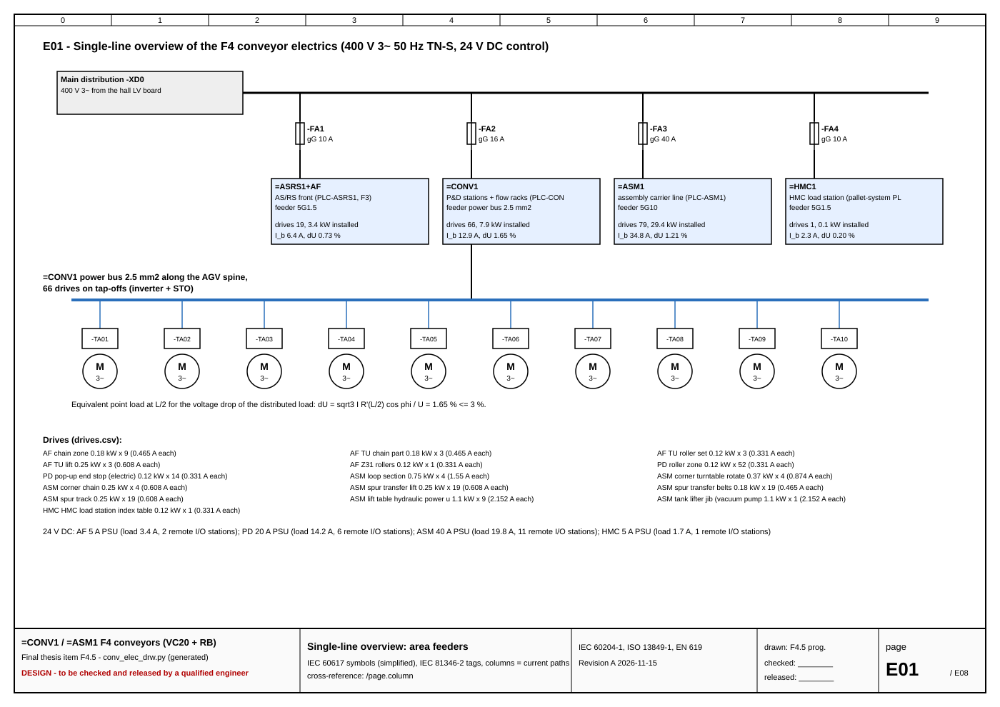

The main distribution feeds four areas:

| Area | Fuse | Feeder | Drives | Installed | dU |
|---|---|---|---|---|---|
| AF (AS/RS front) | gG 10 A | 5G1.5 | 19 | 3.4 kW | 0.73 % |
| PD (P&D + flow racks) | gG 16 A | power bus 2.5 mm² | 66 | 7.9 kW | 1.65 % |
| ASM (assembly line) | gG 40 A | 5G10 | 79 | 29.4 kW | 1.21 % |
| HMC (load station) | gG 10 A | 5G1.5 | 1 | 0.1 kW | 0.20 % |

- The PD drives hang on a **power bus** along the AGV spine, with fused tap-offs.
- The voltage drop of this distributed load is calculated as if the whole load sat at L/2.
- The lower part lists every drive type (from `drives.csv`) and the 24 V PSU of each area.

### 61.3 E02 – network Case A (built-in ports)

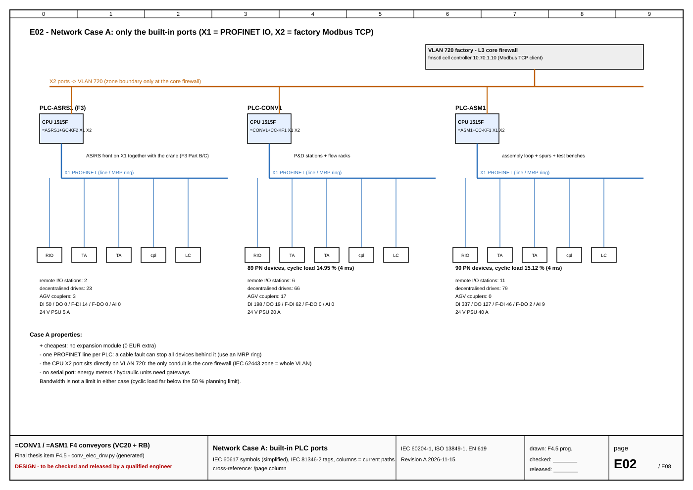

Three PLCs, each **without** an expansion module:
- **X1:** a PROFINET line, or an MRP ring for availability, to the remote I/O, drives, AGV couplers and light curtains;
- **X2:** factory VLAN 720.

| PLC | PN devices | Cyclic load at 4 ms |
|---|---|---|
| PLC-CONV1 | 89 | 14.95 % |
| PLC-ASM1 | 90 | 15.12 % |

The page lists the I/O totals of every area. Under the drawing it lists the **Case A properties**:
- cheapest option;
- one network per PLC;
- the PLC port sits directly on the factory VLAN;
- no serial port.

### 61.4 E03 – network Case B (expansion modules)

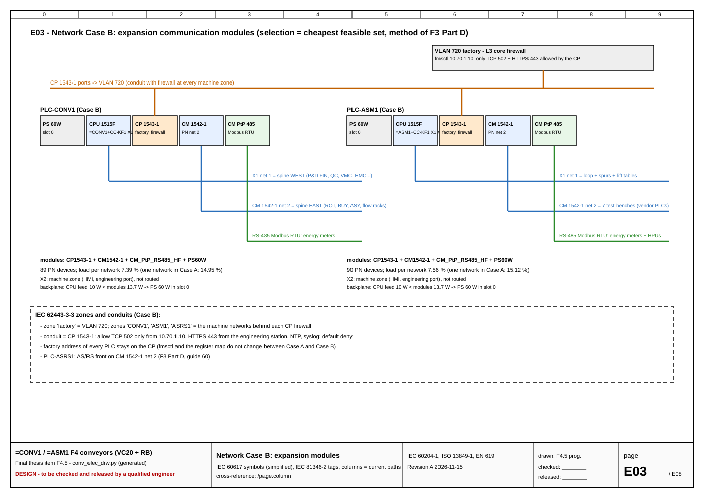

Both PLCs get the module set that the F3 Part D optimisation finds: **CP 1543-1 + CM 1542-1 + CM PtP RS-485 + PS 60 W**.

| | PLC-CONV1 | PLC-ASM1 |
|---|---|---|
| X1 net 1 | spine west | loop + spurs + lift tables |
| CM 1542-1 net 2 | spine east (a cable fault stops only half of the stations) | 7 test benches |
| RS-485 | energy meters | energy meters + hydraulic units |

- **Load:** each network carries about half the load (7.4 / 7.6 %).
- **Security:** the box at the bottom explains the IEC 62443 zones and the CP conduit. The factory IP address stays on
  the CP, so fmsctl does not change between Case A and Case B.
- **Power:** the backplane note explains why the PS 60 W is needed: the modules draw 13.7 W, and the CPU feeds only 10 W.

### 61.5 E04 – typical drive circuit

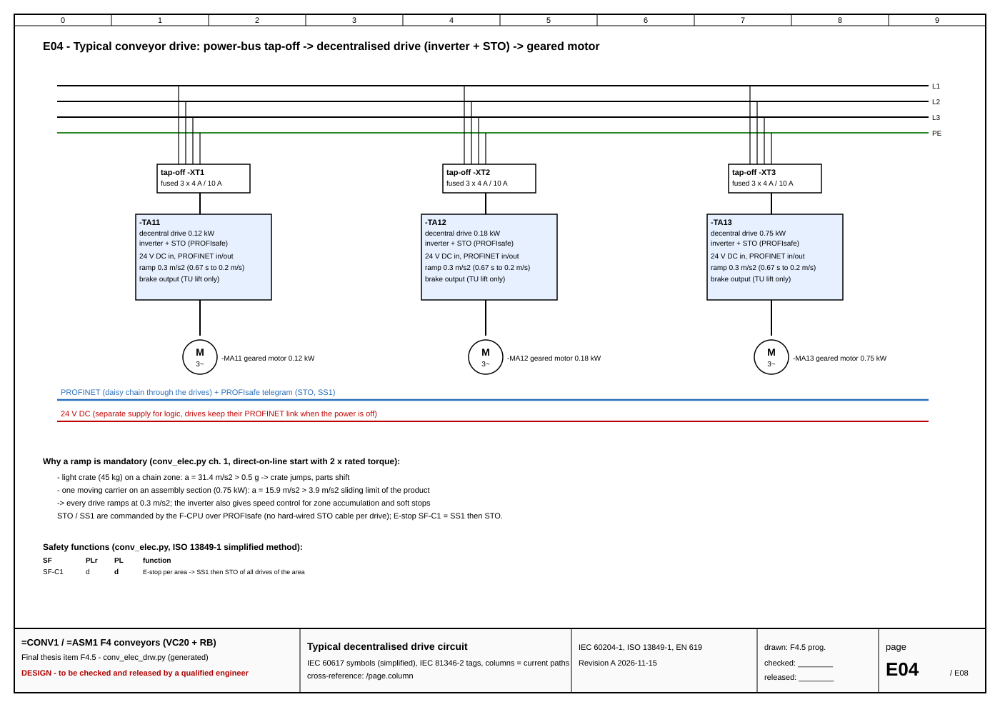

Three examples, 0.12 / 0.18 / 0.75 kW. Each shows the chain:

**power-bus tap-off → decentralised drive (inverter + STO over PROFIsafe) → geared motor.**

The text explains why a ramp is mandatory. A direct-on-line start would give:
- **31.4 m/s²** on a light crate;
- **15.9 m/s²** on an assembly carrier, against its 3.9 m/s² sliding limit.

Every drive therefore ramps at 0.3 m/s². STO and SS1 come over PROFIsafe, so no hard-wired STO cable per drive is
needed.

### 61.6 E05 – AGV dock SF-C2

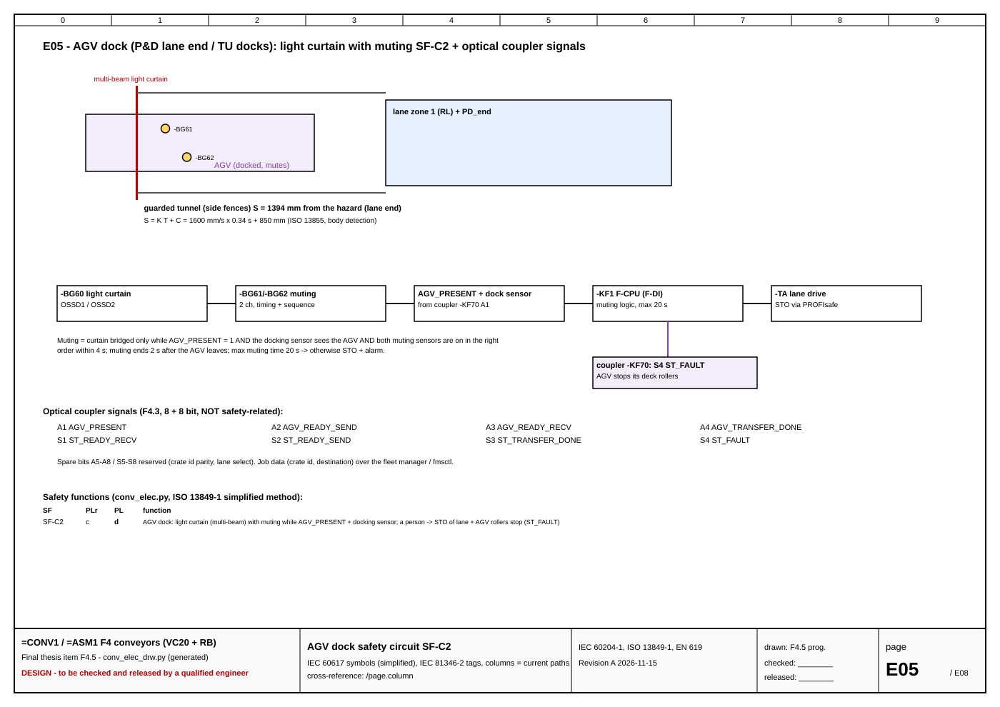

- **Top:** a plan of the dock. The multi-beam light curtain stands **S = 1394 mm** in front of the lane end
  (ISO 13855: 1600 × 0.34 + 850). Side fences form a guarded tunnel, and the docked AGV mutes the curtain.
- **Middle:** the safety chain: light curtain → muting sensors → AGV_PRESENT + docking sensor → F-CPU → STO of the lane
  drive, plus ST_FAULT to the coupler.
- **Muting rule:** both sensors in the right order within 4 s, muting ends 2 s after the AGV leaves, and the muting time
  is at most 20 s.
- **Bottom:** the 8 + 8 coupler signals of F4.3. They are **not** safety signals.

### 61.7 E06 – lift table in the pit SF-C4

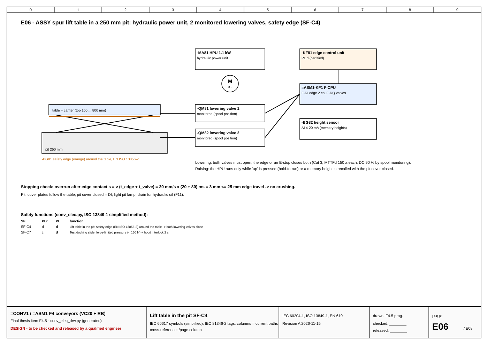

- **Hydraulics:** a 1.1 kW hydraulic power unit and **two monitored lowering valves** in series (Cat 3).
- **Sensing:** a safety edge around the table (EN ISO 13856-2) with a certified control unit, and a height sensor for
  the memory heights.
- **Stopping check:** overrun 30 mm/s × 100 ms = **3 mm**, against **25 mm** edge travel, so the edge stops the table
  before a foot is crushed.

### 61.8 E07 – assembly gate SF-C3 and E-stop SF-C1

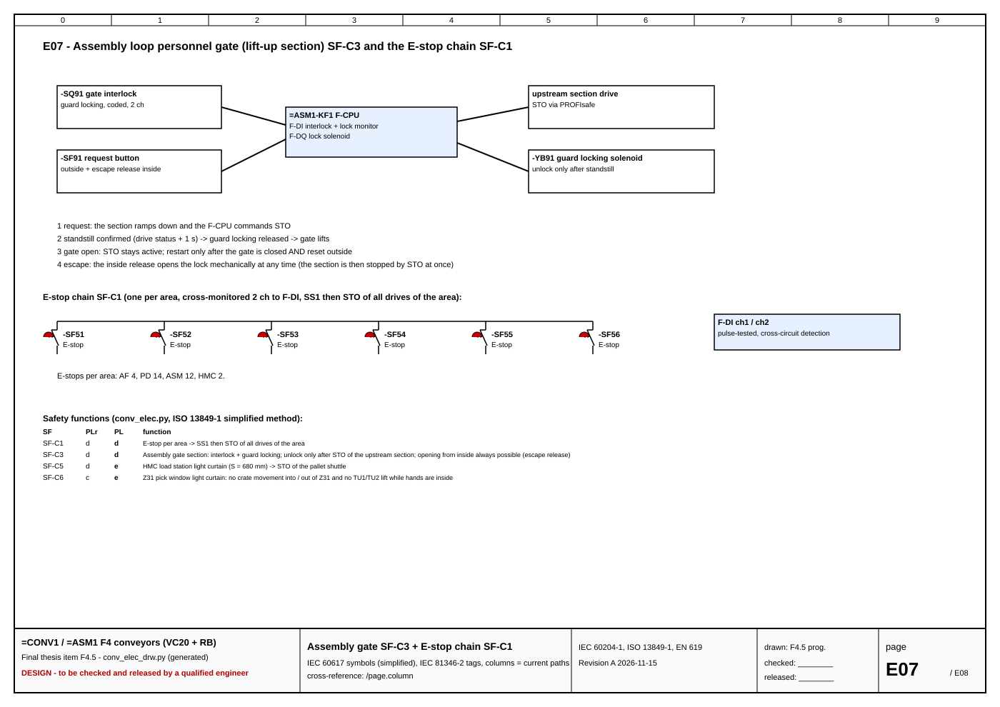

**The gate sequence:**
1. request;
2. the section ramps down and goes to STO;
3. standstill is confirmed → the lock opens → the gate lifts;
4. restart only after the gate is closed and reset from outside.

The escape release inside opens the gate at any time.

**The E-stop chain:** cross-monitored, 2 channels, to F-DI. The page shows the number of E-stops per area and the PL
table of SF-C1, C3, C5 and C6.

### 61.9 E08 – P&D station I/O plan

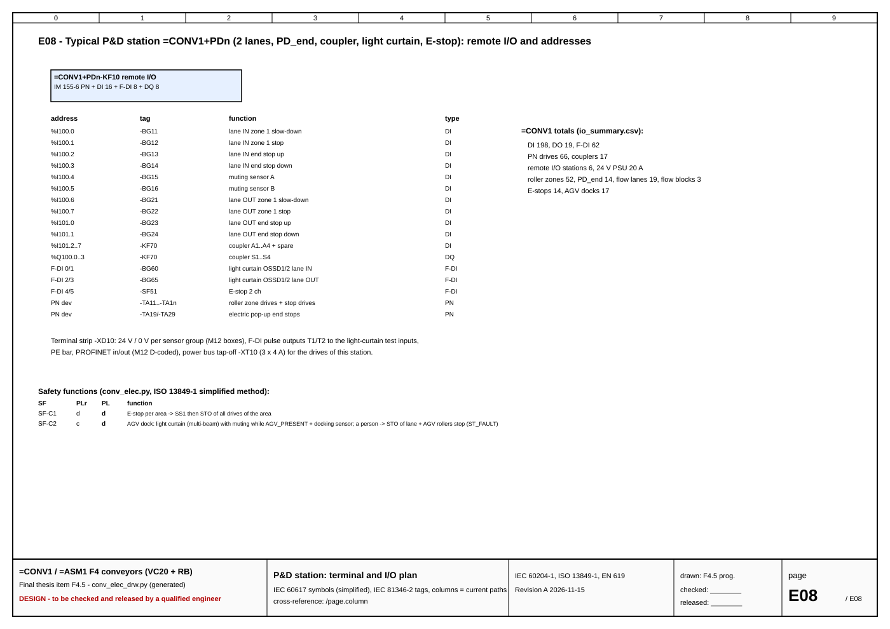

A typical station =CONV1+PDn:
- one remote I/O (IM 155-6 PN + DI 16 + F-DI 8 + DQ 8) with its addresses;
- lane sensors, end-stop feedback, muting sensors, coupler bits, light-curtain OSSDs, E-stop;
- the PROFINET drives.

The right side repeats the =CONV1 totals from `io_summary.csv`, and the bottom describes the terminal strip and the
tap-off.

### 61.10 From these pages to an EPLAN / E3 project

1. **Project structure:** create a project with the same structure identifiers (=CONV1, =ASM1, =ASRS1, =HMC1) and
   locations (+CC, +PDn).
2. **Devices:** import `drives.csv` and the I/O totals as device lists; use one macro per typical circuit, E04–E07.
3. **Typical P&D station:** draw it once (E08) and copy it for the 7 stations and the 3 flow-rack blocks. Number the
   addresses per station (%I100… → %I110… …).
4. **PLC:** generate the PLC I/O assignment from the project and export it to TIA Portal (F4.6). Keep the tag names.
5. **Safety:** enter the safety functions of `safety.csv` in SISTEMA or an equivalent tool, with the real component
   data from the supplier. The PL values here use the simplified method and typical B10d / MTTFd values.

### 61.11 What the self-test checks (16 checks)

- **Format:**
  - 8 pages;
  - all pages well-formed XML;
  - title block with page number and "DESIGN" on every page.
- **E01:** fuse, cable and dU of every area, and the PD drive count, equal the spec.
- **Network pages:**
  - E02 has no CP / CM / PS module, while E03 has all four;
  - the E03 module lists equal the spec;
  - the PN device counts on E02 / E03 equal the report.
- **Safety pages:**
  - E05 shows S = 1394 mm and all coupler signals;
  - E06 shows overrun 3 mm ≤ 25 mm;
  - every SF of `safety.csv` appears with its PL.
- **E04 / E08:** E04 shows the direct-on-line values from the report; E08 shows the PD I/O totals from `io_summary.csv`.

### 61.12 Limits

- These are **design schematics**: the principle, the numbers and the typical circuits. They are **not** complete
  wiring diagrams with every wire number and terminal.
- Catalogue types are classes "or equal" [verify].
- **DESIGN – release by a qualified electrical engineer** (IEC 60204-1, IEC 60364). **The safety functions must be
  validated by a qualified person** (ISO 13849-2), with the real component data, and the final risk assessment of
  item F8.

