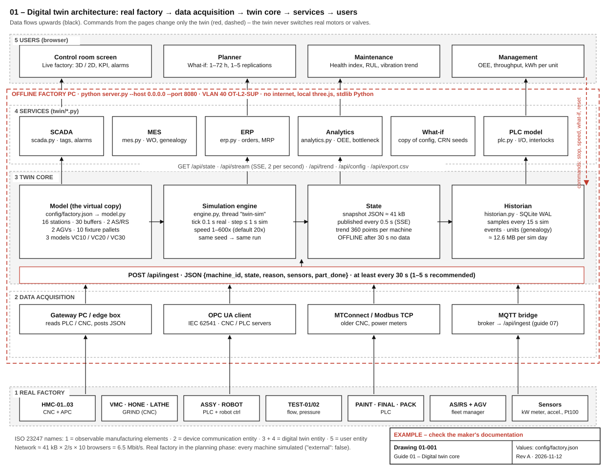
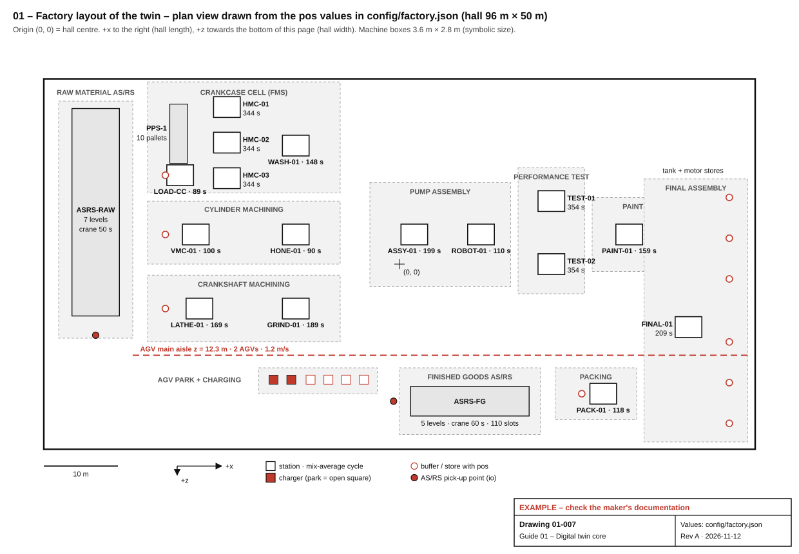
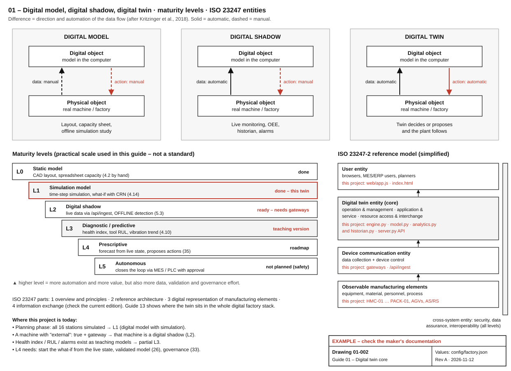
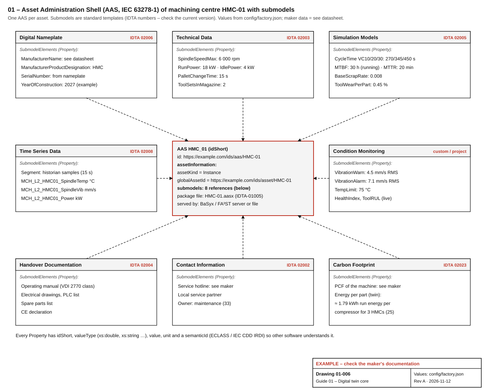
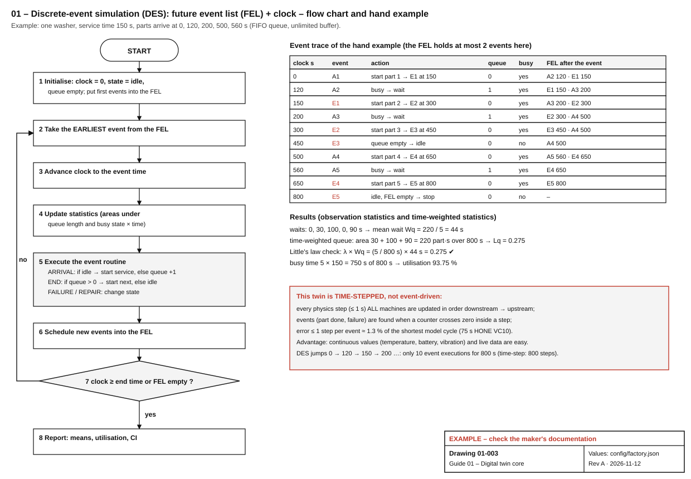
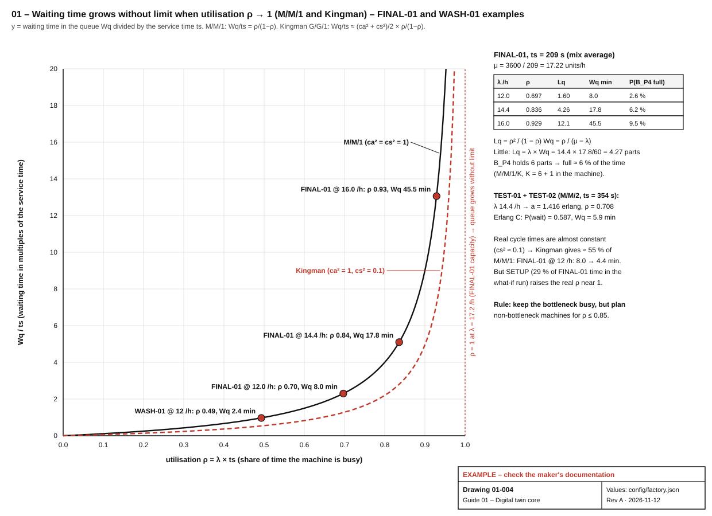
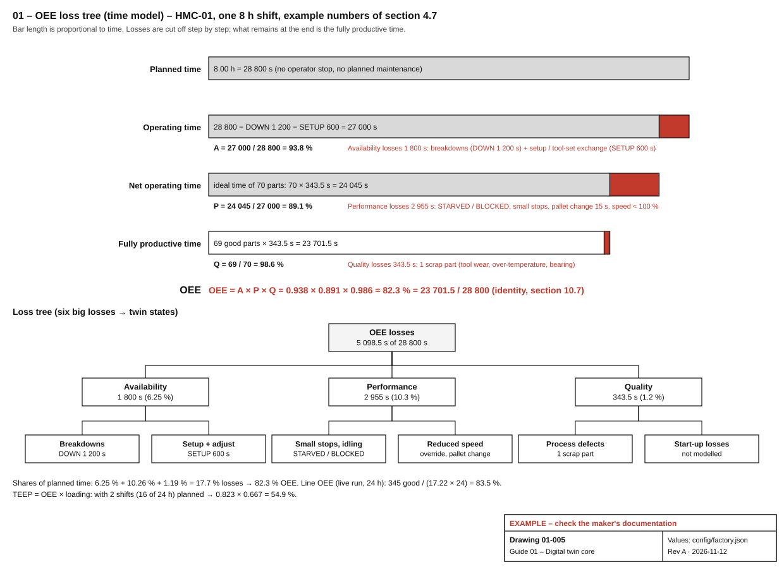
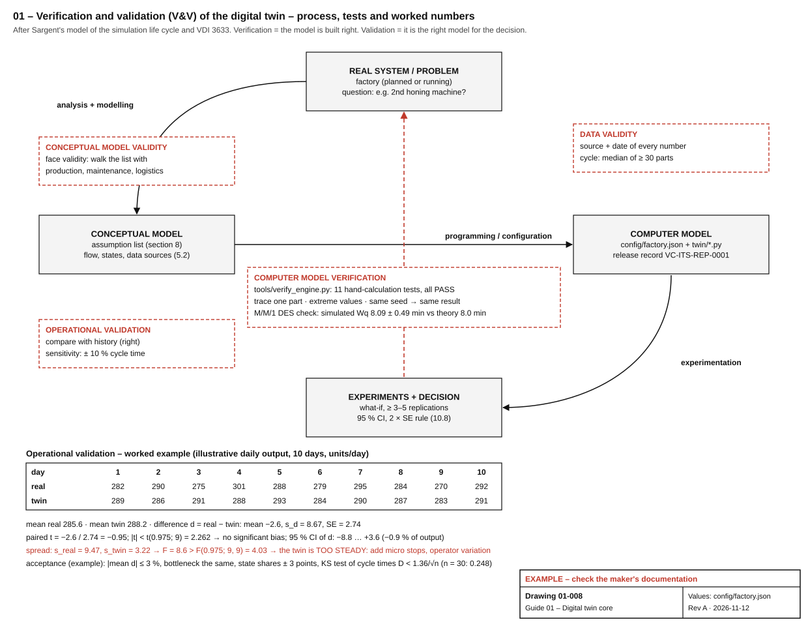

# 01 – The Digital Twin Core

**Topic:** What the twin is, the factory layout, the simulation engine, OEE and analytics, the historian,
the 3D / 2D views, what-if simulation, how to run it, how to connect a real machine, the HTTP API,
and how to adapt the twin to **your** real factory.

**Main files:** `server.py`, `twin/engine.py`, `twin/model.py`, `twin/analytics.py`, `twin/historian.py`,
`twin/handling.py`, `config/factory.json`, `config/example_flange_line.json`, `web/app.js`,
`web/factory3d.js`, `web/view3d.js`, `tools/verify_engine.py`, `tools/gateway_example.py`, `start.bat`.

> **Every number in this guide is an example value.** Cycle times, MTBF, MTTR, scrap rates, power,
> buffer sizes, floor coordinates, prices: they are reasonable values to make the twin work. They are
> **not** data from your suppliers or your machines. Replace them with real data before you take any
> decision (machine purchase, floor plan, staffing, delivery promise).

---

## Contents

1. Purpose
2. Where in the twin (tabs, files, deep links, how to operate the page)
3. Concepts explained simply
4. The model and its formulas (with the example numbers from the code)
5. Implementing in the real factory, step by step
   - 5.1 How to adapt the twin to YOUR real factory
   - 5.2 From twin to real factory: data you must collect
   - 5.3 Connecting a real machine
   - 5.4 HTTP API
6. Checklists
7. Common mistakes / lessons learned
8. Limits of the twin (what is simplified)
9. Key formulas at a glance
10. Science principles (reliability, OEE, statistics, simulation methods)
11. Detailed specification for implementation (config, data, API, historian, twin PC, gateways)
12. Identification and numbering
13. Standards for this topic
14. Complete worked example (HMC group, one week)
15. Data you still need from suppliers / measurements
16. Glossary

**Part B – textbook, technical reference and design guide (chapters 17–38, 8 drawings `docs/img/01_*.svg`)**

17. Digital twin definitions, maturity levels and ISO 23247
18. Asset Administration Shell (AAS, IEC 63278) – the standard data container of a twin
19. Discrete-event simulation theory (event list, clock, hand example, Python check)
20. Random numbers and input distributions (exponential, normal, lognormal, Weibull, triangular …)
21. Output analysis: warm-up, run length, replications (measured on this twin)
22. Queueing theory for stations and buffers (Little, M/M/1, M/M/c, M/M/1/K, Kingman)
23. Reliability model of the whole factory (from `config/factory.json`)
24. OEE model and loss tree (ISO 22400 time model, TEEP)
25. Energy model (power per state, kWh per unit, cost)
26. Verification and validation (V&V) of the twin
27. Data architecture: data classes, state model, ISA-95, OPC UA and AAS mapping
28. Synchronisation with the real factory (rates, latency, missing data, state estimation)
29. 3D visualisation (scene graph, draw calls, CAD to glTF, coordinates)
30. Performance: speed factor, profiling, measured numbers
31. Deployment on the offline factory PC (sizing, Windows service, backups, UPS)
32. Cybersecurity of the twin
33. Governance: model owner, change control, model validity
34. Commercial digital twin and simulation platforms – comparison
35. Roadmap: from this teaching twin to a production twin
36. Buy list – catalogue examples
37. Shopping list – running the twin on the offline factory PC
38. Formula sheet (Part B), how the numbers were checked, corrections, glossary additions

---

## 1. Purpose

### 1.1 What a digital twin is

A **digital twin** is a virtual copy of the factory that runs on a computer. It has three jobs:

| Job | Before the factory exists | After the factory runs |
|---|---|---|
| **Show** what happens | A simulated factory shows the planned flow in 3D | Real machines send their data; the twin shows the live state |
| **Explain** why it happens | Which machine limits output (bottleneck), where parts wait | Same, with real data: OEE losses, alarms, health |
| **Predict** what will happen | What-if: "Do we need a second honing machine?" | What-if with measured values; predictive maintenance |



*Figure 1-1 – Architecture of this twin. Chapter 17 explains the layers and the ISO 23247 names.*

In this project the twin is used in **two phases**:

1. **Planning phase (now).** All machines are simulated. You use the twin to check the layout, the
   capacity, the buffer sizes, the number of AGVs and pallets, and to train the team.
2. **Running phase (later).** Real machines send data (`"external": true` + `POST /api/ingest`).
   The twin becomes a live monitor of the real factory. Simulated and real machines can be mixed.

### 1.2 What a digital twin is NOT

| The twin is NOT … | Why this matters |
|---|---|
| a control system | It does not switch real motors or valves. Machine safety and control stay in the PLC / CNC. Never use the twin as a safety device. |
| an exact physical model | Temperature, vibration and wear are first-order approximations (simple formulas). They show trends, not exact values. |
| a source of truth for numbers you did not give it | If the cycle time in the config is wrong, every result is wrong. "Garbage in, garbage out." |
| a finished ERP or MES product | MES / ERP here are teaching and planning models (see guide `04_mes_and_erp.md`). |
| a secure system | There is no login. Run it only on a trusted factory network. |

### 1.3 Why the real factory needs it

- **Avoid expensive mistakes.** A second machine costs a lot; a bigger buffer costs a little. The twin
  shows which one gives more output before you spend money.
- **One common picture.** Planning, production, maintenance and management look at the same screen
  and the same numbers.
- **Prepare data connections early.** The ingest interface defines exactly which signals each machine
  must deliver. You can write this into the machine purchase specification.

---

## 2. Where in the twin

### 2.1 How to start

| Way | Command | When |
|---|---|---|
| Double-click | `start.bat` | Normal use on Windows. Opens `http://localhost:8080` and starts `python server.py`. |
| Terminal | `python server.py` | Standard start, port 8080, only this PC can connect. |
| Other port | `python server.py --port 8081` | Test a copy while the main twin keeps running. |
| Network | `python server.py --host 0.0.0.0` | Other PCs in the factory network may connect (`http://<twin-pc>:8080`). |
| Other config | `python server.py --config config/example_flange_line.json` | Try a different factory (e.g. the simple flange line). |
| Other database | `python server.py --db data/test_history.db` | Keep test history separate from the main history. |

Requirements: **Python 3.10 or newer**. Nothing else. No `pip install`, no internet. Three.js is in
`web/vendor/`.

Options of `server.py` (from the code):

| Option | Default | Meaning |
|---|---|---|
| `--port` | `8080` | TCP port of the web server |
| `--host` | `127.0.0.1` | `0.0.0.0` = listen on all network cards |
| `--config` | `config/factory.json` | Factory description (machines, buffers, layout, ERP data) |
| `--db` | `data/history.db` | SQLite file of the historian |

If the port is already used, the server **refuses to start** and prints:
`Port 8080 is already in use - is the twin already running? ... python server.py --port 8081`.
(See lesson 7.1 for why.)

Stop the server with **Ctrl+C** in its window. After you edit the config file you must **restart** the
server; the config is read only at start.

### 2.2 The top bar (always visible)

| Control | Function |
|---|---|
| **● connected / connecting** | Connection to the server (live stream). |
| **Clock T+ hh:mm:ss** | Simulated production time since the last reset. |
| **Speed** | 1x (real time), 10x, 20x (default), 60x, 300x. The API allows 1–600x. |
| **Pause / Resume** | Freezes simulated time. |
| **Reset** | Restarts the simulation from zero (new historian run). |
| **Export CSV** | Downloads the sensor history of the current run (`/api/export.csv`), opens in Excel. |
| **◐ Auto / ☀ Light / ☾ Dark** | Colour theme. Click to change: Auto (follows the Windows setting) → Light → Dark. The choice is saved on this PC (browser storage `twin.theme`). Pages, charts, 2D drawings and all 3D views (background + floor) follow the theme. Dark is easier on the eyes in a dim control room or on a big screen at night shift. |

### 2.3 Tabs covered by this guide

| Tab | What you do there |
|---|---|
| **Live factory** | KPI row, 3D factory or 2D line schematic, material handling panel, machine detail (sensors, health, OEE, commands, charts), active alarms, event log. |
| **What-if simulation** | Change machine, FMS, material-handling and buffer values; simulate 1–72 h; compare with the current design. |
| **How it works** | Short explanation of the concepts and a 10-minute exercise. |

Other tabs have their own guides: FMS & Order flow → `02`, material handling → `03`, MES / ERP → `04`,
PLC → `05`, SCADA → `06`, Communication → `07`, CNC → `08`, Pallet changer → `09`, Mechanical elements
→ `10`, AGV build → `11`, HMC build → `12`.

### 2.4 The Live factory tab

**KPI row** (top): finished good units, throughput last hour, average and ideal throughput per hour,
factory OEE, WIP (work in process), bottleneck, power, energy per good unit, scrap.

**3D factory** (`web/factory3d.js`, Three.js):

- Every station is drawn at its `pos` from the config. Conveyors between stations are drawn
  automatically. Parts on a conveyor = the real buffer content.
- **Andon light tower** on each machine: **green** = RUNNING, **amber** = STARVED / BLOCKED / STOPPED,
  **red** = DOWN (blinking; BLOCKED also blinks amber), **blue** = MAINTENANCE, **slow blinking blue** =
  SETUP (changeover).
- Spindles, robot, grinding wheel move only while the machine is RUNNING.
- Parts carry a colour tag per model (VC10 / VC20 / VC30). Units of the order followed in the Order-flow
  tab carry a blue serial-number tag.
- AGVs follow the blue dashed routes. AGV light: green = driving, amber = loading or waiting for the
  crane, blue = charging.

Toolbar of the 3D view:

| Control | Function |
|---|---|
| Camera: Overview / Machining / Assembly & test / Final & shipping / Logistics / Walk-in | Camera flies to a preset view. |
| Focus selected | Flies to the machine you selected. |
| Color: Realistic / By machine state / By health | Turns the 3D factory into a heat map of states or of health. |
| Labels | Machine names on / off. |
| Building | Walls, columns, roof trusses, overhead crane on / off. |
| Mouse drag: Rotate / Move | Swaps the mouse buttons (see below). Remembered in the browser. |

**Mouse and keyboard in the live 3D factory:**

| Input | Mode "Rotate" (default) | Mode "Move" |
|---|---|---|
| Left drag | turn the view | move (pan over the floor) |
| Right drag | move (pan over the floor) | turn the view |
| Middle drag | zoom (dolly) | zoom (dolly) |
| Wheel | zoom | zoom |
| Click on a machine | select it (detail card below) | same |
| Double-click on a machine | fly to it | same |

Keyboard (mouse over the view, or click the view first): **W / S** or **↑ / ↓** forward / back,
**A / D** sideways, **← / →** turn, **Q / E** (or PgDn / PgUp) down / up, **Shift** = 3x faster.
The walking speed grows with the camera height: slow between machines, fast high over the hall.

**Mouse control in the other 3D views (`niceControls`, `web/view3d.js`).**
The live factory uses its own controls (above). The machine 3D views (Mechanical elements, Pallet changer
3D, CNC / G-code and others) use `niceControls`, which was made because the standard zoom was
uncomfortable (it zoomed only toward the centre of the view in small steps):

| Input | Function |
|---|---|
| Wheel | zoom **toward the point under the mouse** (about 18 % per notch: camera distance × 0.82) |
| Shift + wheel | fine zoom (about 5 % per notch) |
| Left drag | turn around the orbit point |
| Right or middle drag | move (pan) |
| Double-click | the clicked point becomes the new orbit point (the view slides there) |
| Page scroll | if you were scrolling the page and the mouse passes over a 3D view, the view does not take the wheel for 0.6 s, so the page keeps scrolling |

For developers: every new 3D view should use `niceControls(controls, camera, scene, {minDist, maxDist, floorY})`;
a "fit view" button should call the returned `stop()`.

**Line schematic (2D)**: the same factory as cards, grouped by `line`. Click a card to open the machine
detail. Use it on slow PCs or when the 3D view cannot start.

**Machine detail card**: sensors, health index, remaining tool life, vibration-trend prediction, OEE
breakdown, charts of temperature (with limit), vibration (with warning and alarm lines) and power.
Buttons: **Stop**, **Start**, **Do maintenance**, **Simulate bearing fault** (training), **Speed
override** slider 50–130 %.

**Active alarms** and **Event log**: see 4.9.

### 2.5 Deep links (open the page in a given state)

| Link | Effect |
|---|---|
| `/?cam=overview` (also `machining`, `assembly`, `final`, `logistics`, `walk`) | Camera preset |
| `/?focus=HMC-01` | Select the machine and fly to it |
| `/?color=state` or `/?color=health` (or `real`) | Colour mode |
| `/?view=2d` | Start in the line schematic |
| `/?building=0` | Hide the building shell |
| `/?theme=dark` (or `light`, `auto`) | Open with this colour theme (for a shop-floor screen) |
| `/#whatif`, `/#learn`, `/#fms`, `/#order`, `/#mes`, `/#erp`, `/#scada`, ... | Open a tab |

Example: `http://localhost:8080/?cam=machining&color=health` – machining area as a health heat map.

### 2.6 Files

| File | Role |
|---|---|
| `server.py` | Web server (stdlib `http.server`) + HTTP API. Starts the engine. |
| `twin/engine.py` | Runs the simulation in a background thread ("twin-sim"), receives commands and live data, publishes snapshots, writes the historian. |
| `twin/model.py` | The "virtual copy": `Buffer`, `Machine` (state machine + physics), `Factory` (wiring, capacity, clock). |
| `twin/handling.py` | AGVs, AS/RS cranes, pallet pools, transport loops (guide `03`). |
| `twin/analytics.py` | OEE, bottleneck, health / remaining life, alarms, KPIs, what-if. |
| `twin/historian.py` | Time-series storage in SQLite (`data/history.db`). |
| `config/factory.json` | **Your** factory: machines, buffers, flows, cycle times, limits, 3D positions, ERP data. |
| `config/example_flange_line.json` | A simple 5-station serial line (good for learning). |
| `web/index.html`, `web/app.js`, `web/style.css` | Dashboard, tabs, what-if page. |
| `web/theme.js` | Theme switch (Auto / Light / Dark). Colours are CSS variables in `style.css` (`:root`, dark values under `[data-theme="dark"]` and `prefers-color-scheme`). 3D views register with `dtTheme.scene(scene)` and `dtTheme.floor(material)`; other code can listen to the `themechange` event. |
| `web/factory3d.js` | Live 3D factory. |
| `web/view3d.js` | `niceControls` mouse control for the machine 3D views. |
| `tools/verify_engine.py` | Checks the engine against hand calculations. |
| `tools/gateway_example.py` | Example of a machine sending data to the twin. |
| `start.bat` | Windows start file. |

---

## 3. Concepts explained simply

### 3.1 Stations and buffers

The factory is a **network**:

- A **station** (machine, work cell) takes parts, works on them for a time, and gives one part out.
- A **buffer** is any place where parts wait: conveyor, rack, pallet place, store, supermarket.

```
[buffer] -> (station) -> [buffer] -> (station) -> [buffer]
```

Rules of the model (`twin/model.py`):

1. A station takes `qty` parts from **each** of its input buffers. Example: pump assembly takes
   1 crankcase + 2 cylinders + 1 crankshaft.
2. It works for the cycle time (+ part handling time), then puts **one** part into its output buffer.
3. Several stations with the **same inputs and the same output** work **in parallel**
   (example: HMC-01, HMC-02, HMC-03; TEST-01 and TEST-02).
4. Every part is a small record (id, lot, serial number, model, components, route). So every
   finished compressor can be traced back to its castings (genealogy).

### 3.2 The factory in this project

```
Raw AS/RS --AGV--> [Load station: fixture pallet + serial no.] -> pallet pool -> [Machining Center 1 / 2 / 3] -> [Washer] --\
Raw AS/RS --AGV--> [Boring Center] -> [Honing] -> cylinder supermarket (kanban) ------ 2 per unit ----------------+-> [Pump Assembly: kit check]
Raw AS/RS --AGV--> [CNC Lathe] -> [Grinder] -> crankshaft supermarket (kanban) ---------------------------------/        |
                                                                              [Robot Head Bolting] -> [Test Bench 1 + 2] (FAD >= 97% of nominal)
                                                                                                             |
   Finished-goods AS/RS <--AGV-- [Packaging] <- [Final Assembly + tank + motor of the model] <- [Powder Coating] <--------+
```

Lines and stations in `config/factory.json` (example values):

| Line | Station id | Name | Type | Base cycle (VC20) s | Parallel |
|---|---|---|---|---|---|
| Crankcase (FMS cell) | LOAD-CC | Fixture load station | load | 90 | 1 |
| | HMC-01..03 | Crankcase machining centers | cnc | 345 + 15 pallet change | 3 |
| | WASH-01 | Crankcase washer | washer | 150 | 1 |
| Cylinder machining | VMC-01 | Cylinder boring center | cnc | 100 | 1 (needs 2 per unit) |
| | HONE-01 | Honing machine | cnc | 90 | 1 (needs 2 per unit) |
| Crankshaft machining | LATHE-01 | CNC lathe | cnc | 170 | 1 |
| | GRIND-01 | Grinder | cnc | 190 | 1 |
| Assembly & test | ASSY-01 | Pump assembly cell (kit check) | assembly | 200 | 1 |
| | ROBOT-01 | Robot head bolting | robot | 110 | 1 |
| | TEST-01, TEST-02 | Performance test benches | test | 360 | 2 |
| | PAINT-01 | Powder coating booth | paint | 160 | 1 |
| Final assembly & packing | FINAL-01 | Final assembly (tank + motor) | assembly | 210 | 1 |
| | PACK-01 | Packaging & stretch wrap | packaging | 120 | 1 |

Three models run on the same machines (FMS, details in guide `02`):

| Model | SKU | Mix (example) | Spec. air flow | Cycle times |
|---|---|---|---|---|
| VC10 | VC10-100 | 30 % | 10 m³/h | own table `cycle_s` (shorter) |
| VC20 | VC20-300 | 50 % | 20 m³/h | empty `cycle_s` → uses `cycle_time_s` of each station |
| VC30 | VC30-500 | 20 % | 30 m³/h | own table `cycle_s` (longer) |

Material handling (example values): raw-material AS/RS (`ASRS-RAW`, crane cycle 50 s, 280 slots),
finished-goods AS/RS (`ASRS-FG`, crane cycle 60 s, **110 slots**), 2 AGVs (1.2 m/s), 10 fixture
pallets in the crankcase pallet pool. Guide `03` explains this part.

Hall (`layout.hall`): 96 m long (x), 50 m wide (z), 11 m high. Coloured zones on the floor are in
`layout.zones`.



*Figure 1-2 – Plan view drawn directly from `config/factory.json` (origin = hall centre, +z towards the bottom
of the page). The labels show the mix-average cycle time of each station (4.2). Coordinates: 29.4.*

### 3.3 The simple example: flange line

`config/example_flange_line.json` is a plain serial line, good for learning and for testing the engine:

```
B0 (raw, endless) -> LATHE-01 40 s -> B1 (8) -> MILL-01 52 s -> B2 (8) -> ROBOT-01 30 s -> B3 (6) -> QC-01 25 s -> B4 (6) -> PACK-01 20 s -> B5 (finished)
```

It has no `inputs` / `output` keys. Then the model connects `buffers[i] -> stations[i] -> buffers[i+1]`
automatically. Rule: **number of buffers = number of stations + 1**, otherwise the server stops with an
error. The slowest station is MILL-01 (52 s), so the ideal output is 3600 / 52 = **69.2 parts/h**.

### 3.4 Machine states

Every machine is always in exactly one state. Note: there is **no "IDLE" state** in this twin.
An idle machine is either **STARVED** (nothing to do) or **BLOCKED** (cannot give its part away).
The reason is important: STARVED and BLOCKED point to different causes.

| State | Meaning | Typical cause | Andon |
|---|---|---|---|
| RUNNING | Processing a part | – | green |
| SETUP | Changeover to another model (program, fixture, jaws, tool set, test adapter) | model change | blue, slow blink |
| STARVED | Waiting, inputs not available | upstream too slow, no released work order, no free fixture pallet, kit incomplete, kanban full | amber |
| BLOCKED | Finished part cannot leave, output buffer full | downstream too slow or down | amber, blinking |
| DOWN | Unplanned stop (breakdown) | random failure, tool broken, bearing failure | red, blinking |
| MAINTENANCE | Planned maintenance | operator pressed "Do maintenance" | blue |
| STOPPED | Stopped by the operator | operator pressed "Stop" | amber |
| OFFLINE | External (real) machine, no data for 30 s | gateway / network problem | – |

The `reason` text tells you more, e.g. "Waiting for Cylinder supermarket", "No free fixture pallet",
"Kit not complete - waiting for …", "Output full", "Changeover to VC30".

### 3.5 Time in the twin

- The twin has its own **simulated clock** (`sim_time`, in seconds).
- **Time scale** (speed): at 20x, one real second = 20 simulated seconds. One 8-hour shift then takes
  24 real minutes. At 300x it takes 96 s.
- Inside, the physics advances in **steps of at most 1 simulated second**. A higher speed means more
  steps per real second, not bigger steps. So the result does not depend on the speed setting
  (only on the random events).

### 3.6 Reliability: MTBF and MTTR

- **MTBF** (mean time between failures, hours): average **running** time between two breakdowns.
- **MTTR** (mean time to repair, minutes): average time from breakdown until the machine runs again.

Why both matter: two machines with the same availability can behave very differently. A machine that
fails every 30 min for 1 min is easy for a small buffer; a machine that fails once a week for 5 hours
empties every buffer. The twin uses random (exponential) times, so it shows this effect.

### 3.7 Buffers decouple machines

When machine A stops, machine B can continue from the buffer between them, until the buffer is empty.
When B stops, A can continue into the buffer until it is full. A buffer turns "one stops, both stop"
into "one stops, the other continues for a while". `tools/verify_engine.py` shows the size of the effect
(see 4.6).

### 3.8 OEE in one sentence

**OEE** (Overall Equipment Effectiveness) = how much good output a machine made, compared with what it
could make in the planned time at the ideal cycle time. It splits the losses into three groups:
availability (stops), performance (slow / waiting), quality (scrap). Formulas in 4.7.

### 3.9 Bottleneck

The **bottleneck** is the resource that limits the output of the whole factory. One hour lost at the
bottleneck is one hour lost for the whole factory. One hour lost at another machine is often absorbed
by buffers. So: improve the bottleneck first.

### 3.10 Simulated vs real data

Each machine is either:

- **simulated** (`"external": false`, default): the model creates states and sensor values, or
- **external** (`"external": true`): its state, sensors and finished parts come from a real gateway
  via `POST /api/ingest`. The simulator does not move it.

Both kinds share the same buffers, so a real lathe can feed a simulated grinder.

---

## 4. The model and its formulas

All example numbers below come from `config/factory.json` and the code. Replace them with your data.

### 4.1 The engine loop (`twin/engine.py`)

| Constant | Value | Meaning |
|---|---|---|
| `TICK_S` | 0.1 s (real) | The sim thread wakes up 10 times per second |
| `MAX_SUBSTEP` | 1.0 s (simulated) | Largest physics step |
| `EXTERNAL_TIMEOUT_S` | 30 s (real) | No data for 30 s → external machine OFFLINE |
| `TREND_POINTS` | 360 | Points kept per machine for the detail charts |
| `history_interval_s` (config) | 15 s (simulated) | How often a sample is written to the historian |
| default time scale | 20x | Changeable 1–600x |

What happens every tick:

1. `real_dt` = real time since the last tick (about 0.1 s).
2. If not paused: `sim_dt = real_dt × time_scale`. Example at 20x: 0.1 × 20 = **2 simulated seconds**
   → two 1-second physics steps.
3. Each physics step calls, in this order: `factory.step` (machines + material handling) → `mes.step`
   → `erp.step` → `scada.step` → `plc.step`.
4. Queued "step" requests (from the Order-flow buttons +1 min / +10 min / +1 h) are executed here,
   **in the sim thread** (see lesson 7.2).
5. Every `history_interval_s` simulated seconds: one sample per machine → trend buffer + historian.
6. External machines without data for 30 real seconds are set to OFFLINE.
7. Every 0.5 real seconds a snapshot (JSON) is published to all browsers (`/api/stream`, Server-Sent Events).

**Step order inside the factory.** Downstream stations are stepped **first**. Why: when the last
station takes a part, space becomes free in its input buffer *in the same step*, so the upstream station
can put its part. Otherwise the model would show artificial blocking.

### 4.2 Time per part and capacity

Time per part of one machine:

```
total_time = average cycle over the product mix + handling_s
average cycle = Σ (mix_v × cycle_v)
handling_s = pallet change time (with pallet changer)   or   load_unload_s (without)
```

Capacity of a group of parallel machines, in **finished products per hour**:

```
rate = Σ (3600 / total_time of each machine)  /  parts needed per product
```

"Parts needed per product" (`multiplier`) is calculated backwards from the finished-goods store
through the flow. Example: the cylinder line must make 2 cylinders per compressor, so its multiplier is 2.

**Worked example 1 – crankcase machining centers (HMC-01..03):**

| Model | Mix | HMC cycle |
|---|---|---|
| VC10 | 0.3 | 270 s |
| VC20 | 0.5 | 345 s (station `cycle_time_s`) |
| VC30 | 0.2 | 450 s |

```
average cycle = 0.3 × 270 + 0.5 × 345 + 0.2 × 450 = 81 + 172.5 + 90 = 343.5 s
total_time    = 343.5 + 15 (pallet change) = 358.5 s
one HMC       = 3600 / 358.5 = 10.04 parts/h
three HMCs    = 3 × 10.04 = 30.1 products/h
```

Without the pallet changer (`load_unload_s` = 120 s): total_time = 463.5 s → 3 × 7.77 = 23.3 products/h.
This is why the pallet changer matters: the next part is clamped on the second pallet while the machine cuts.

**Worked example 2 – cylinder boring (VMC-01), 2 cylinders per compressor:**

```
average cycle = 0.3 × 85 + 0.5 × 100 + 0.2 × 125 = 100.5 s
rate = (3600 / 100.5) / 2 = 17.9 products/h
```

**Worked example 3 – final assembly (FINAL-01):**

```
average cycle = 0.3 × 180 + 0.5 × 210 + 0.2 × 250 = 209 s
rate = 3600 / 209 = 17.2 products/h
```

**Design capacity of the whole factory = the smallest group rate.** The code calculates this table
(`Factory._capacity`, example values, no breakdowns, no changeovers):

| Rank | Station(s) | Products / h |
|---|---|---|
| 1 (limit) | FINAL-01 | **17.2** |
| 2 | VMC-01 | 17.9 |
| 3 | ASSY-01 | 18.1 |
| 4 | GRIND-01 | 19.0 |
| 5 | HONE-01 | 20.1 |
| 6 | TEST-01 + TEST-02 | 20.3 |
| 7 | LATHE-01 | 21.3 |
| 8 | PAINT-01 | 22.6 |
| 9 | WASH-01 | 24.3 |
| 10 | HMC-01..03 | 30.1 |
| 11 | PACK-01 | 30.5 |
| 12 | ROBOT-01 | 32.9 |
| 13 | LOAD-CC | 40.4 |

So the ideal throughput shown in the KPI row is **17.2 units/h** (example values). Note: the top three
are very close (17.2 / 17.9 / 18.1). In reality this means the bottleneck will **move** between them
with every breakdown and changeover. A "balanced" line is not always good: it has no spare capacity
to catch up.

### 4.3 How a machine decides what to do (each 1-s step)

Simplified logic of `Machine.step` for a simulated machine:

1. If DOWN or MAINTENANCE: count down the repair timer. When it reaches 0 → back to STARVED, sample a
   new time to failure. After maintenance, or after a "Tool…" or "Bearing…" repair: tool wear = 0 and
   bearing fault cleared.
2. If STOPPED: do nothing.
3. If a finished part is waiting: try to put it into the output buffer. Buffer full → **BLOCKED**.
4. If the machine is empty: decide the next part (`_plan`):
   - station with `seize` and no free fixture pallet → STARVED "No free fixture pallet";
   - station with `serial` (load station): needs a **released work order** from the MES;
   - station with `kanban`: makes the model whose supermarket is below target (guide `02`);
   - station with `pick: "rule"`: picks the next pallet by the dispatching rule FIFO / EDD / SPT / SETUP;
   - station with `pick: "kit"`: starts only when the complete kit is there;
   - otherwise first in, first out.
   Nothing possible → **STARVED** with a reason.
5. When a part is taken: changeover time is calculated (4.5). If > 0 → **SETUP** until it is done.
6. Then **RUNNING**: progress grows by `dt × speed / total_time`. At 100 % the part is finished (4.8).
7. While RUNNING, the time to failure counts down (4.4).

### 4.4 Breakdowns (MTBF / MTTR)

```
time to failure  ~ Exponential(mean = MTBF)        (sampled again after every repair)
counts down only while RUNNING, at the rate (speed/100)²
repair time      ~ Exponential(mean = MTTR)
```

- The **square of the speed** means: at 120 % speed override the machine wears 1.2² = 1.44 times faster,
  so MTBF falls to 1/1.44 = 69 %. At 80 %, MTBF rises to 1/0.64 = 156 %. This is a simple model of
  "faster = more stress"; it is not from a standard.
- MTBF counts **running hours**, not calendar hours. A machine that waits a lot fails less often per day.

**Availability formula** (one machine alone, no other losses):

```
A = MTBF / (MTBF + MTTR)
```

| Example | MTBF | MTTR | A |
|---|---|---|---|
| HMC (config) | 30 h | 20 min = 0.333 h | 30 / 30.333 = **98.9 %** |
| Washer | 80 h | 10 min | 99.8 % |
| verify test 5 | 2 h | 30 min | 2 / 2.5 = **80 %** → 60 parts/h × 0.8 = 48 parts/h |

The MES tab shows the **actual** MTBF and MTTR per machine, calculated as
`running hours / number of failures` and `repair time / number of failures`, next to the planned values.
When the real factory runs, compare these numbers with the supplier values.

### 4.5 Changeover (SETUP) – short version

Full explanation in guide `02`. In the engine:

```
setup time before a part of model v =
      setup_s           if the machine was set up for another model
    + tool_magazine.load_s   if the magazine does not hold the tool set of model v
```

Example values: VMC-01 `setup_s` = 180 s; HMC magazines hold 2 tool sets, `load_s` = 600 s (10 min) to
exchange one set (least recently used set is removed).

Check from `verify_engine.py` (one machine, 60 s per part, 30 s setup, two models 50/50):

```
models alternate:      60 + 30 = 90 s per part           → 3600 / 90 = 40.0 parts/h
batches of 10:        (10 × 60 + 30) / 10 = 63 s per part → 3600 / 63 = 57.1 parts/h
```

### 4.6 Buffers – the numbers

`verify_engine.py` test 9: two machines in series, each 60 s per part, each MTBF 1 h, MTTR 15 min
(each 80 % available).

```
no buffer (theory):   60 / (1 + 0.25 + 0.25) = 40 parts/h     (a stop of either machine stops both)
huge buffer:          60 × 0.80 = 48 parts/h                  (the buffer absorbs all stops)
```

Here 0.25 = MTTR / MTBF = 15 min / 60 min for each machine. Small buffers give values between
40 and 48; the script prints them (last run: buffer 1 → 39.6 /h, buffer 10 → 42.1 /h, buffer 5000 →
47.8 /h). **Lesson:** a buffer can give up to 20 % more output here without
buying a machine, but only if it is large compared with (output rate × repair time). Example:
15 min repair × 1 part/min = 15 parts to bridge one average repair.

Buffer sizes in the config (example values): `B_CYL` supermarket 36 (12 per model), `B_CS` 24
(8 per model), `B_PAL` 8 pallets, `B_CC1` 6, `B_P1`..`B_P4` 4–6, `B_PK` 3.

### 4.7 OEE formulas (`twin/analytics.py`)

Per machine:

```
planned time   = total time − STOPPED − MAINTENANCE − OFFLINE
operating time = planned time − DOWN − SETUP
Availability   A = operating time / planned time
Performance    P = ideal time of all parts made / operating time      (max 1.0)
Quality        Q = good parts / all parts
OEE            = A × P × Q
```

"Ideal time of all parts made" = sum of the model cycle time of every part (each model has its own cycle).
Note: STARVED and BLOCKED time is inside the operating time, so it lowers **Performance**, not Availability.
This is a choice of this twin. Other OEE definitions treat waiting differently – agree on one
definition in your factory before you compare numbers.

**Worked example (example numbers, one HMC, one 8-hour shift):**

| Item | Value |
|---|---|
| Total time | 8 h = 28 800 s, no operator stop, no maintenance → planned = 28 800 s |
| DOWN | 1 200 s |
| SETUP | 600 s |
| Operating time | 28 800 − 1 200 − 600 = 27 000 s |
| Parts made | 70, average ideal cycle 343.5 s → ideal time = 24 045 s |
| Good parts | 69 |

```
A = 27 000 / 28 800 = 93.8 %
P = 24 045 / 27 000 = 89.1 %
Q = 69 / 70        = 98.6 %
OEE = 0.938 × 0.891 × 0.986 = 82.3 %
```

The same numbers as a loss tree drawing: chapter 24.2 (Figure 24-1).

**Factory (line) OEE:**

```
line OEE = good finished units / (ideal rate × hours)      (max 1.0)
```

Example: 8 h, ideal rate 17.2 units/h → ideal 137.8 units. 120 good units → line OEE = 120 / 137.8 = 87.1 %.

Other KPIs (`line_kpis`):

| KPI | Formula |
|---|---|
| Average throughput | good finished units / simulated hours |
| Throughput last hour | units that reached the finished-goods store in the last 3600 s |
| Scrap rate | scrapped parts / all operations of all machines |
| WIP | parts in normal buffers + parts in machines + parts on AGVs / in transport |
| Energy | Σ power × time (kWh) |
| kWh per good unit | energy / good finished units |

### 4.8 Quality and scrap

**Machining / assembly stations** – scrap probability of each part:

```
p_scrap = base_scrap_rate
        + (tool_wear − 70) / 30 × 0.15     only if tool wear > 70 %
        + 0.05                             only if temperature > temp_limit
        + bearing_severity × 0.1
tool wear ≥ 100 %  →  part scrapped + machine DOWN "Tool broken" for one MTTR
```

Example HMC: base 0.8 %. At 85 % tool wear: 0.8 % + (15/30) × 15 % = **8.3 %**. This is why the health
panel says "Change tool NOW" above 85 %.

**Tool wear:**

```
wear per part = tool_wear_per_part_pct × (speed/100)^1.5
```

HMC: 0.45 % per part → a new tool lasts 100 / 0.45 = 222 parts. At start the wear is a random value
between 5 % and 40 %, so not all tools are new at time zero.

**Test bench** – quality is decided by the measured free air delivery (FAD):

```
measured FAD ~ Normal(mean = 1.02 × spec, standard deviation = 0.022 × spec)
pass if FAD ≥ spec × (1 − flow_tolerance_pct / 100)
```

VC20 example: spec 20 m³/h, tolerance 3 % → limit 19.4 m³/h; mean 20.4, σ = 0.44.

```
z = (19.4 − 20.4) / 0.44 = −2.27   →   reject share ≈ 1.2 %
```

A rejected unit is scrapped (no rework loop in the twin). The bench pressure ramps to `test_pressure_bar`
(8 bar) during the first 30 % of the test.

### 4.9 Physics: power, temperature, vibration, bearing wear

These are **first-order approximations**: simple formulas that give the right trend, so you can learn
predictive maintenance. They are not an exact machine model.

**Power (kW):**

```
RUNNING:        P = idle_power + run_power × speed × (1 + 0.25 × wear + 0.3 × bearing_severity)
DOWN / STOPPED: P = 0.3 × idle_power
other states:   P = idle_power
(+ small random noise)
```

HMC example: idle 4 kW, run 18 kW, 100 % speed, new tool → 22 kW. A worn tool (wear 1.0) adds 25 % of
the run power: 4 + 18 × 1.25 = 26.5 kW. **Why useful:** in the real factory, a power meter on the
spindle drive is a cheap tool-wear indicator.

**Temperature (°C)**, first-order lag with time constant τ = 600 s:

```
target = ambient + k × power + 20 × bearing_severity + process_temp_c
k = heat_rise / (run_power + idle_power)
T(new) = T + (target − T) × dt / 600
```

HMC example: ambient 30 °C (config), heat_rise 30 °C (default for cnc), k = 30 / 22 = 1.36 °C/kW;
running at 22 kW → target 30 + 30 = **60 °C**, limit 75 °C. After a change, the temperature reaches
63 % of the step in 10 minutes.

**Vibration (mm/s RMS):**

```
v = base_vib × load × (0.8 + 0.2 × speed) + 1.5 × wear × load + 8.5 × bearing_severity + noise
load = 1.0 when RUNNING, 0.25 otherwise;  v ≈ 0 when DOWN / STOPPED / MAINTENANCE
```

`base_vib` by type: cnc 1.2, test 2.2, robot 0.8, washer 0.6, paint 0.4, assembly 0.2, load 0.2,
packaging 1.0, inspection 0.3 (any other type: 1.0).
Limits in the config: warning 4.5, alarm 7.1 mm/s for the CNC machines. (These values match the zone
boundaries B/C and C/D for medium machines (group 2, 15–300 kW) on **flexible** foundations in the
ISO 10816-3 vibration severity table. For **rigid** foundations the same boundaries are 2.8 and
4.5 mm/s. ISO 10816-3 has been replaced by **ISO 20816-3**; check the zone values in the current
edition. Machine tools often have their own limits from the supplier – those win. Check the correct
group and foundation class for each of your real machines with the machine supplier.)

A smoothed value (EWMA, about 60 s) `vib_ewma` is used for alarms and the trend; one trend point every
30 running seconds.

**Bearing wear (the training fault):**

```
onset:   random, probability dt / (40 h) per running second  → on average after 40 running hours
         (only types cnc, robot, test). Or the button "Simulate bearing fault".
start:   bearing_severity = 0.02
growth:  d(severity)/dt = 0.00004 + 0.00025 × severity   (per running second, max 1.0)
failure: vibration > 1.35 × vibration_alarm  →  DOWN "Bearing failure", repair = 3 × MTTR
```

The growth gets faster as the damage grows (like real bearing damage). Worked example for an HMC
(base 1.2 mm/s, tool wear 30 %, alarm 7.1 → failure at 1.35 × 7.1 = 9.6 mm/s):

| Event | Severity needed | Running time from onset |
|---|---|---|
| Warning 4.5 mm/s | ≈ 0.34 | ≈ 1.1 h |
| Alarm 7.1 mm/s | ≈ 0.64 | ≈ 1.7 h |
| Failure 9.6 mm/s | ≈ 0.93 | ≈ 2.0 h |

(Solution of the growth equation: `s(t) = (s0 + 0.16) × e^(0.00025 t) − 0.16`.) So in the twin there
are about **0.9 running hours** between warning and failure. A real bearing usually gives much more
warning time (weeks or months). The twin is fast on purpose, so you can see the whole story in one
training session. Repair after failure is 3 × 20 min = 60 min for an HMC, compared with about 12 min
(0.6 × MTTR, minimum 120 s) for planned maintenance. **Lesson:** planned maintenance before the failure
saves time.

Important: `vibration_alarm_mm_s` in the config drives this failure physics. The SCADA tab has its own
copy of alarm limits; changing SCADA limits does not change the physics (guide `06`).

### 4.10 Health index and remaining useful life (RUL)

```
wear_score = max(0, (tool_wear − 50) / 50)                    (0 below 50 % wear)
vib_score  = max(0, (vib_ewma − 1.3 × base_vib) / (vib_alarm − 1.3 × base_vib))
health index = 100 × (1 − min(1, max(wear_score, vib_score)))
level: good ≥ 70, warning ≥ 40, critical < 40 (always critical when DOWN)
```

Tool RUL:

```
parts left = (100 − tool_wear) / wear per part
hours left = parts left × total_time / speed / 3600
```

HMC example: wear 60 %, 0.45 %/part → 40 / 0.45 = 88 parts; × 358.5 s = 31 600 s ≈ **8.8 h** of
running time.

Vibration prediction: a straight line (least squares) through the last ~40 trend points (~20 running
minutes). Only when the vibration is clearly raised (between 0.6 × warning and the alarm) and rising:

```
hours to alarm = (vib_alarm − vib_ewma) / slope / 3600
```

Recommendations shown: "Plan tool change within … h" (wear > 65 %), "Change tool NOW" (> 85 %),
"Vibration rising - bearing alarm expected in ~… h" (< 4 h), "Vibration ALARM - stop and inspect
spindle bearing", "Over temperature - check coolant / reduce speed".

### 4.11 Alarms

`active_alarms` (Live factory tab):

| Level | Condition |
|---|---|
| critical | Machine DOWN |
| serious | vib_ewma ≥ alarm limit; temperature > limit; a store is empty ("Stock-out - production will stop") |
| warning | vib_ewma ≥ warning limit; tool wear ≥ 85 %; external machine OFFLINE; AGV battery < 10 % |

The SCADA tab has a full alarm management with acknowledge, shelve, deadbands (guide `06`).

### 4.12 Bottleneck detection

Method: **active period** (`find_bottleneck`).

1. For each machine: share of the **recent** time (smoothed over about one hour) in RUNNING or DOWN.
   Waiting (STARVED / BLOCKED) does not count – a waiting machine is not the limit.
2. The machine with the highest share is the bottleneck.
3. If several are within 3 percentage points (common while everything runs flat out), the one with the
   lowest design capacity (table in 4.2) wins.
4. Material handling can be the bottleneck too: if an AS/RS crane or the AGV fleet is busy more than
   88 % of the time and more than the busiest machine + 2 points, it is reported ("AGV fleet",
   "… (crane)").

Why "recent": at the start all buffers are empty and the first machine looks busiest. Using about the
last hour avoids this start-up error.

### 4.13 Historian (`twin/historian.py`)

- One SQLite file, default `data/history.db` (change with `--db`). WAL mode. No server needed.
- `run_id` = date-time of the start / last reset (e.g. `20261111-083000`). Old runs stay in the file.

| Table | One row per | Columns |
|---|---|---|
| `samples` | machine per `history_interval_s` (15 s simulated) | run_id, sim_t, wall_t, machine, state, temperature_c, vibration_mm_s, power_kw, spindle_rpm, tool_wear_pct, good, scrap |
| `events` | event (breakdown, back in service, MES / ERP messages …) | run_id, sim_t, wall_t, machine, level, text |
| `units` | finished or scrapped unit (traceability) | run_id, sn, wo, status, start_t, end_t, fad, so, customer, shipped_t, data (genealogy JSON) |

- **Export:** `Export CSV` button = `GET /api/export.csv` = all samples of the current run.
- **Writer thread:** the SQLite write connection is created and used **only by the simulation thread**
  (SQLite connections are bound to the thread that created them). See lesson 7.2.
- **Growth:** the file grows with every run. Stop the server and delete or archive the file when it gets
  too large. In a big real factory you would use a time-series database instead (the code comment
  names InfluxDB / TimescaleDB as examples).

### 4.14 What-if simulation with ± uncertainty

What it does (`analytics.what_if`):

1. Copies the current config. Applies your changes → **scenario**. The unchanged copy → **baseline**.
2. In both copies: all machines simulated (no external), stores never run empty (stock 10⁶ =
   "purchasing works"), finished goods leave the AS/RS at once, no MES / no customer orders – the models
   start in the product-mix proportions.
3. Simulates `hours` (0.5–72, page default 8) in 1-second steps, `replications` times (1–5, default 3).
   Replication r uses random seed 1000 + r for **both** baseline and scenario.
4. Each machine has its **own random stream** (seed + machine id). So changing one machine does not
   change the random breakdowns of the others. This is called "common random numbers": the difference
   you see comes from your change, not from luck.
5. Returns averages: finished units (per model), changeovers, hours in changeover, throughput, line OEE,
   scrap, energy per unit, bottleneck (most frequent), AGV and crane utilisation, and state shares per
   machine (bar chart).

What you can change on the page:

| Group | Fields |
|---|---|
| Machines | cycle time, changeover time, MTBF, MTTR, scrap rate, tool wear per part |
| FMS | dispatching rule, batch size (SETUP rule), product mix, switch off a parallel machine, tool sets per magazine, tool-set exchange time, kanban target |
| Material handling | AGV count, AGV speed, crane cycle per AS/RS, pallets per pool, pallet changer on / off |
| Buffers | capacity of every normal buffer |

**The ± value.** The gain is shown as e.g. `▲ +6.2 % finished units (± 1.4 %)`.

```
gain %  = (scenario good − baseline good) / baseline good × 100
d_r     = scenario good_r − baseline good_r        (paired, same seed r)
± %     = standard deviation(d) / √n / baseline good × 100      (n = replications, needs n ≥ 2)
```

This is the **standard error** of the paired difference. Rule of thumb printed on the page: if the gain
is smaller than about **2 × the ± value**, it may be luck. Then run more hours or 5 replications.

Example: gain +3.0 % ± 2.0 % → not proven (3.0 < 4.0). Gain +6.2 % ± 1.4 % → real (6.2 > 2.8).

A machine can be switched off only if another machine with the same inputs and output remains
(e.g. one of the three HMCs, one of the two test benches).

API example:

```json
POST /api/whatif
{"changes": {"stations": {"VMC-01": {"cycle_time_s": 80}, "HMC-01": {"pallet_changer": 0}},
             "buffers": {"B_CYL1": {"capacity": 20}},
             "agv": {"count": 3},
             "asrs": {"ASRS-FG": {"crane_cycle_s": 45}},
             "pools": {"PAL-CC": {"count": 12}},
             "fms": {"rule": "SETUP", "max_batch": 10},
             "products": {"VC10": {"mix": 0.4}}},
 "hours": 8, "replications": 3}
```

The what-if run does not change the live twin.

### 4.15 Verification: `tools/verify_engine.py`

The script compares the engine with answers you can calculate by hand. **After every change to the
engine (`twin/model.py`, `twin/handling.py`, `twin/analytics.py`, `twin/engine.py`) run it, and every
line must say PASS.**

```
python tools/verify_engine.py
```

It does not use the server or port 8080. It takes a few minutes (it simulates hundreds of hours).

| Test | Hand calculation | Tolerance |
|---|---|---|
| 1 machine, 60 s, 8 h | 8 × 3600 / 60 = 480 parts | 0.5 % |
| Serial line 50 → 80 → 60 s | 3600 / 80 = 45 /h (slowest) | 0.5 % |
| 2 parallel machines, 120 s | 2 × 30 = 60 /h | 0.5 % |
| Assembly needs 2 cylinders @ 100 s | 36 cylinders/h / 2 = 18 /h | 0.5 % |
| Breakdowns MTBF 2 h / MTTR 30 min | 60 × 2 / 2.5 = 48 /h | 2 % |
| Scrap 5 % | 95 % good | 0.5 % |
| Test bench reject share | normal distribution, ≈ 1.2 % | 25 % (relative, small numbers) |
| Real compressor factory, 3 models, perfect machines | 3600 / largest time per unit | 3 % |
| Changeover 30 s, models alternate | 40 /h | 0.5 % |
| Changeover 30 s, batches of 10 | 57.1 /h | 0.5 % |
| 2 machines 80 % available, huge buffer | 48 /h | 2 % |

Example output (run on 2026-11-11 with the example config, about 2 minutes):

```
Buffer effect (theory: no buffer = 60/(1+0.25+0.25) = 40/h, huge buffer = 48/h, ...): buffer 1 = 39.6/h, buffer 10 = 42.1/h
PASS | 1 machine, 60 s, 8 h                                  | hand   480.00 | twin   479.00 | diff  -0.21%
PASS | Serial line, slowest 80 s (units/h)                   | hand    45.00 | twin    44.98 | diff  -0.04%
PASS | 2 parallel machines, 120 s (units/h)                  | hand    60.00 | twin    59.98 | diff  -0.03%
PASS | Assembly needs 2 cylinders @100 s (units/h)           | hand    18.00 | twin    17.99 | diff  -0.06%
PASS | Breakdowns MTBF 2 h / MTTR 30 min (units/h)           | hand    48.00 | twin    48.00 | diff  +0.00%
PASS | Scrap 5% -> good share (%)                            | hand    95.00 | twin    95.11 | diff  +0.12%
PASS | Test bench reject share (%)                           | hand     1.15 | twin     1.34 | diff +16.09%
PASS | Compressor factory, 3 models, perfect machines        | hand    17.22 | twin    17.09 | diff  -0.78%
PASS | Changeover 30 s, models alternate (units/h)           | hand    40.00 | twin    40.00 | diff  +0.00%
PASS | Changeover 30 s, batches of 10 (units/h)              | hand    57.14 | twin    57.14 | diff  -0.01%
PASS | 2 machines 80% avail, huge buffer (units/h)           | hand    48.00 | twin    47.79 | diff  -0.44%
Repeatable: True 82.0
```

The "1 machine, 8 h" result is 479, not 480: the last part is still in the machine when the 8 hours
end. The test-bench line has a wide tolerance because only about 1 % of units are rejected, so a few
units more or less change the share a lot.

It also prints the buffer effect (buffer 1 and 10) and checks that the same what-if run twice gives the
**same** answer ("Repeatable: True"). If a test fails after your change, the change is wrong (or the
test's assumption changed – then fix the test **and** write down why).

---

## 5. Implementing in the real factory, step by step

### 5.1 How to adapt the twin to YOUR real factory

Work on a **copy** of the config first, e.g. `config/my_factory.json`, and start it on another port
(`python server.py --config config/my_factory.json --port 8081 --db data/my_test.db`). Keep the original
as a reference.

**Step 1 – Make the machine list.**
For every machine or manual work place write one line: id, name, line, type, what goes in (part + qty),
what comes out. Use short ids with a prefix (`HMC-01`); the prefix before the "-" is used to look up
model-specific cycle times (`"HMC": 270` applies to HMC-01, HMC-02, HMC-03).

| Key | Example | Notes |
|---|---|---|
| `id` | `"HMC-01"` | unique, no spaces |
| `name` | `"Crankcase Machining Center 1"` | shown everywhere |
| `line` | `"Crankcase machining (FMS cell)"` | groups the 2D cards |
| `type` | `cnc`, `washer`, `assembly`, `robot`, `test`, `paint`, `packaging`, `load` | selects physics (base vibration, heat rise, test logic) |
| `model` | `hmc`, `vmc`, `hone`, `lathe`, `grinder`, `washer`, `assembly`, `robot`, `testbench`, `paint`, `final`, `pack`, `loadst` | 3D look only |

**Step 2 – Draw the flow (inputs / output).**
For each station: `"inputs": [{"buffer": "B_CC", "qty": 1}, {"buffer": "B_CYL", "qty": 2}, ...]` and
`"output": "B_P1"`. Every buffer id must exist in `buffers`, otherwise the server stops with
"station X: unknown buffer". Parallel machines = same inputs + same output.

**Step 3 – Enter cycle times.**
- `cycle_time_s` = ideal time per part (the time the machine needs when nothing goes wrong). This is the
  value for the default model (VC20 here).
- Per model: `products[].cycle_s` = `{"HMC": 270, ...}` by station id or prefix. If a station is
  missing there, `cycle_time_s × time_factor` is used (`time_factor` default 1).
- Part handling: with an automatic pallet changer `"pallet_changer": {"change_s": 15}`; without it
  `"load_unload_s": 120`.
- Changeover: `setup_s`, and for machining centers `tool_magazine: {"sets", "load_s", "initial"}`.
- Source of the numbers: supplier time studies or CAM cycle times first; later, measured values
  (median of at least 30 parts, see 5.2). Do not use the fastest part ever made.

**Step 4 – Enter reliability and quality.**
- `mtbf_h` (running hours), `mttr_min`. Before you have data, ask the supplier, and use conservative
  values. After start-up, use the actual values from the MES tab.
- `base_scrap_rate` (0.01 = 1 %), `tool_wear_per_part_pct` (100 / tool life in parts).
- Test bench: `spec_flow_m3_h` (per model in `products[]`), `flow_tolerance_pct`, `test_pressure_bar`.

**Step 5 – Enter power and limits.**
`idle_power_kw`, `run_power_kw`, `spindle_rpm`, `temp_limit_c`, `vibration_warn_mm_s`,
`vibration_alarm_mm_s`, optional `heat_rise_c`, `process_temp_c` (washer, paint oven).

**Step 6 – Floor plan coordinates.**
- Coordinate system: metres, origin (0, 0) = **centre of the hall**. `x` along the hall length,
  `z` across the width. `layout.hall = {"length": 96, "width": 50, "height": 11}` → x from −48 to +48,
  z from −25 to +25.
- Each station: `"pos": [x, z]` (centre of the machine) and `"rot"` in degrees.
- Buffers with their own place (line-side racks, stores): `"pos": [x, z]`.
- AS/RS: `pos`, `rot`, `length`, `height`, `levels`, `io` (AGV pick-up / drop point).
- AGV: `aisle_z` (main aisle), `park`, `chargers`. Pallet pool rack: `pallet_pools[]`.
- Zones painted on the floor: `layout.zones[]` with `x: [from, to]`, `z: [from, to]`.
- Take the coordinates from the CAD layout of the hall. Pick one corner of the CAD drawing, measure the
  hall centre, and convert. Check the result in the 3D view with **Building** on: machines must not stand
  in walls or columns, and the AGV aisle must be free.

**Step 7 – Buffers.**

| Kind | Keys |
|---|---|
| Normal (conveyor, rack between machines) | `capacity`, `part` (3D shape), `prefix` |
| Supermarket per model | `capacity`, `per_variant` |
| Store in an AS/RS | `asrs: "ASRS-RAW"`, `stock` (start quantity), `variant` if model-specific |
| Floor store of purchased parts | `store: true`, `stock`, `pos` |
| Finished goods | `finished: true` (+ `asrs` if stored in the AS/RS) |
| Endless raw material (simple examples) | `infinite: true` |

Start with the buffer size you can physically place (count the places on the conveyor or rack), then
use the what-if page to test larger and smaller values.

**Step 8 – Material handling.** `pools`, `pallet_pools`, `asrs`, `agv`, `transports`. See guide `03`.

**Step 9 – Products, FMS and ERP.** `products`, `fms`, `kanban`, `pick`, `alt`, `erp`. See guides `02`
and `04`.

**Step 10 – Check.**
1. Start the copy on port 8081. If the server stops with an error, read the message: it names the
   station and the missing buffer or pool.
2. Look at the 3D view: positions, conveyors, zones.
3. Run at 300x for one simulated day. Is the ideal throughput in the KPI row what you calculated by hand
   (4.2)? Is the bottleneck where you expected?
4. Run `python tools/verify_engine.py` (test 8 reads `config/factory.json`; if you changed that file
   it must still PASS).
5. Only then replace `config/factory.json` (keep a dated backup).

**Step 11 – Write down the source of every number.** Keep a simple table next to the config:
key, value, source (supplier offer / time study / estimate), date, person. When a value is still an
estimate, everyone must know it.

### 5.2 From twin to real factory: data you must collect

| Data item | Where from | Who | Unit |
|---|---|---|---|
| Machine list with ids | Investment plan, layout | Production engineering | – |
| Process route per model (which machine, which order) | Process plan / routing | Production engineering | – |
| Ideal cycle time per machine and model | Supplier time study, CAM simulation; later measured (median of ≥ 30 parts) | Machine supplier, NC programmer, industrial engineer | s |
| Part handling / pallet change time | Supplier, measurement with stopwatch | Supplier, industrial engineer | s |
| Changeover time per machine (program, fixture, jaws) | Supplier; SMED study after start | Production engineering | s |
| Tool-set exchange time, tool sets per magazine | Machine data, tool list | NC programmer | s, – |
| MTBF | Supplier references; later MES (running h / failures) | Maintenance | h (running) |
| MTTR | Supplier; later maintenance records | Maintenance | min |
| Scrap rate per operation | Similar processes, supplier; later quality records | Quality | fraction |
| Tool life | Tool supplier, cutting tests; later tool management | NC programmer / tool room | parts |
| Idle and running power | Machine nameplate is too high; measure with power meter | Electrical | kW |
| Temperature and vibration limits | Machine supplier manual, vibration standard for the machine group | Maintenance | °C, mm/s RMS |
| Test spec (flow, pressure, tolerance) | Product specification | R&D / Quality | m³/h, bar, % |
| Product mix and demand | Sales forecast | Sales / planning | share, units/day |
| Buffer places (conveyor, rack) | Layout, conveyor drawing | Production engineering | parts |
| Fixture pallets per pool | Fixture design, budget | Production engineering | pallets |
| Floor coordinates of all equipment | CAD hall layout | Plant layout planner | m |
| AS/RS crane cycle time, slots | AS/RS supplier | Logistics | s, slots |
| AGV speed, load / unload time, battery | AGV supplier | Logistics | m/s, s, h |
| Shift plan (hours, breaks) | HR / production | Production manager | h (not yet modelled, see 8) |
| Network address and protocol of each machine | Machine supplier, IT | Automation / IT | – |
| Signals per machine (state, part done, good / bad, sensors) | PLC / CNC documentation | Automation | – |

### 5.3 Connecting a real machine

The twin receives data by HTTP POST in JSON. A small program near the machine (gateway) reads the PLC /
CNC and posts the data. Steps:

1. In the config set `"external": true` for that machine. Restart the server.
   The machine shows **OFFLINE** until data arrives.
2. Start the twin with network access if the gateway is another PC: `python server.py --host 0.0.0.0`.
3. The gateway sends to `http://<twin-pc>:8080/api/ingest` **at least every 30 s**, otherwise the
   machine shows OFFLINE again.
4. Message (one object, or a list of objects for several machines):

```json
{
  "machine_id": "TEST-01",
  "state": "RUNNING",
  "reason": "",
  "sensors": {"temperature_c": 55, "vibration_mm_s": 2.1, "power_kw": 4.4,
              "spindle_rpm": 0, "tool_wear_pct": 0, "flow_m3_h": 20.4, "pressure_bar": 8.0},
  "part_done": {"good": true, "cycle_time_s": 355, "flow_m3_h": 20.4}
}
```

| Field | Required | Notes |
|---|---|---|
| `machine_id` | yes | must exist in the config, else error 400 "unknown machine_id" |
| `state` | no | one of RUNNING, SETUP, STARVED, BLOCKED, DOWN, MAINTENANCE, STOPPED, OFFLINE |
| `reason` | no | e.g. PLC alarm text; a change to DOWN creates a critical event |
| `sensors` | no | any of the listed keys; missing keys keep the old value |
| `part_done` | only when a part is finished | the twin then takes the inputs from the upstream buffers (first in, first out) and puts the part in the output buffer (`good: true`) or scraps it (`good: false`) |

5. Try it without a machine:

```
python tools/gateway_example.py --machine LATHE-01
python tools/gateway_example.py --machine LATHE-01 --server http://192.168.0.10:8080 --cycle 8
```

The script fakes readings once per second and a finished part every `--cycle` seconds. In a real
gateway, replace the function `read_machine()` with real reads. **Test it against a copy of the twin
on port 8081**, not against the running twin on 8080.

Typical hardware paths (from the README; choose with your automation team):

| Machine | Path |
|---|---|
| CNC / PLC with network | OPC UA, MTConnect or Modbus TCP read by the gateway |
| Old machine without interface | current clamp on the motor (running / idle), proximity sensor (part count), accelerometer on the spindle, read by a small controller that posts JSON |
| Test bench | flow meter and pressure transmitter (4–20 mA) are usually already in the test PLC → read them by OPC UA or Modbus |
| Many machines | MQTT broker + a small bridge script to `/api/ingest` |

Note: the Python libraries for OPC UA or Modbus are **not** part of the standard library. On the offline
factory PC they must be installed from local files, or you write the gateway in the PLC supplier's tool.
The twin server itself needs no extra libraries.

Points to agree with the machine supplier (put them in the purchase specification):

- "Part done" signal with good / bad, and the cycle time.
- Machine state with the same meaning as section 3.4 (especially: DOWN vs STOPPED vs waiting).
- Alarm code / text for `reason`.
- Sensor values and their units (°C, mm/s RMS, kW, rpm).
- Protocol, address, update rate, who owns the network.

### 5.4 HTTP API

Base URL `http://<twin-pc>:8080`. All bodies are JSON. Errors return 400 with `{"ok": false, "error": "..."}`.

**Core (this guide):**

| Method | Path | Purpose |
|---|---|---|
| GET | `/api/state` | Current snapshot (KPIs, machines, buffers, handling, MES / ERP summary, FMS, alarms, events) |
| GET | `/api/stream` | Live snapshots as Server-Sent Events (about 2 per second) |
| GET | `/api/trend?machine=HMC-01` | Recent temperature / vibration / power samples (up to 360) |
| GET | `/api/config` | Factory configuration + derived geometry for the 3D view |
| GET | `/api/export.csv` | Historian samples of the current run (CSV) |
| POST | `/api/command` | Machine: `{"action": "stop" \| "start" \| "maintenance" \| "inject_bearing_fault" \| "set_speed", "machine": "HMC-01", "value": 110}` |
| POST | `/api/command` | Simulation: `{"action": "pause" \| "resume"}`, `{"action": "time_scale", "value": 60}` (1–600), `{"action": "reset"}`, `{"action": "reset", "mode": "manual"}` (empty factory, manual mode), `{"action": "step", "value": 600}` (advance 1 s – 4 h, also while paused) |
| POST | `/api/command` | FMS: `{"action": "rule", "value": "FIFO" \| "EDD" \| "SPT" \| "SETUP", "window_h": 8}`; APC: `{"action": "pallet_change_s", "value": 8.8}` (until reset) |
| POST | `/api/ingest` | Live machine data (5.3) |
| POST | `/api/whatif` | What-if scenario (4.14) |

**Other modules (details in their guides):**

| Method | Path | Guide |
|---|---|---|
| GET / POST | `/api/mes`, GET `/api/mes/unit?sn=VC20-000012` | 04 |
| GET / POST | `/api/erp`, GET `/api/order?so=SO-0001` | 04, 02 |
| GET | `/api/fms` | 02 |
| GET / POST | `/api/plc` | 05 |
| GET / POST | `/api/scada`, GET `/api/scada/trend?tags=...&hours=4` | 06 |
| GET | `/api/comm?since=N` | 07 |

Warning: POST commands change the running twin. A "reset" sent to the wrong port deletes the state of
someone else's running simulation (lesson 7.3).

---

## 6. Checklists

### 6.1 Before you start the twin

- [ ] Python 3.10+ installed (`python --version`).
- [ ] No other twin is running on the same port (check the task manager for leftover `python` processes).
- [ ] You know which config file and which database file you start with.
- [ ] Testing? Use `--port 8081` and a separate `--db`.

### 6.2 After you edited the config

- [ ] JSON is valid (the server prints an error and stops otherwise).
- [ ] Every `inputs[].buffer` and `output` exists in `buffers`.
- [ ] Every `seize` / `release` pool exists in `pools`.
- [ ] Every kanban `buffer` is downstream of its machine.
- [ ] Serial line without `inputs` / `output`: buffers = stations + 1.
- [ ] Cycle times are ideal times in seconds (not minutes, not hours).
- [ ] `mtbf_h` in hours, `mttr_min` in minutes, scrap rate as a fraction (0.01 = 1 %).
- [ ] Positions checked in 3D (no machine in a wall, AGV aisle free).
- [ ] Ideal throughput in the KPI row = your hand calculation.
- [ ] Server restarted.
- [ ] Source of every new number written down.

### 6.3 After you changed engine code

- [ ] `python tools/verify_engine.py` → **every** line PASS, "Repeatable: True".
- [ ] Tested on port 8081, not on the running twin.
- [ ] Anything that advances simulated time runs in the sim thread (queued), not in the HTTP thread.
- [ ] New model-specific logic (shipping, MRP, kanban, stock holding) is **per model**.

### 6.4 Before you trust a what-if result

- [ ] At least 3 replications; for small effects 5.
- [ ] Gain larger than 2 × the ± value.
- [ ] Simulated time long enough to include several breakdowns of the slow machines (at least 1–2 × the
      largest MTBF; with MTBF 30 h use ≥ 24–72 h).
- [ ] You know what the what-if ignores: purchasing (stores never empty), customer orders, shift breaks,
      operators.
- [ ] The bottleneck in the result makes sense to you.

### 6.5 Connecting a real machine

- [ ] Machine id in the gateway = id in the config.
- [ ] `"external": true` set and server restarted.
- [ ] Gateway tested against a copy on port 8081.
- [ ] Message at least every 30 s (recommended every 1–5 s).
- [ ] `part_done` sent exactly once per part.
- [ ] State meaning agreed (DOWN ≠ STOPPED ≠ STARVED).
- [ ] Sensor units checked (vibration in mm/s RMS, not peak or g).
- [ ] Twin PC reachable from the gateway (`--host 0.0.0.0`, firewall rule for the port).
- [ ] Network is a trusted factory network (the twin has no login).

---

## 7. Common mistakes / lessons learned

These are real problems found while building this twin. Avoid them in the real project.

### 7.1 Two servers on the same port

**What happened:** on Windows, two `server.py` instances once started on port 8080 at the same time.
Windows allowed it ("reuse address"). The **old** server kept answering, so changes seemed to have no
effect.

**Fix in the code:** on Windows `server.py` now sets `allow_reuse_address = False` and refuses a second
bind with a clear message.

**What you do:** before a restart, check that no old `python server.py` process is still running (task
manager, or `tasklist | findstr python`). Stopping a window does not always kill the process.

### 7.2 The historian belongs to the simulation thread

**What happened:** the "step" command (advance N minutes) was first executed in the HTTP request thread.
The historian's SQLite connection was created in the simulation thread, and SQLite connections may only
be used by the thread that created them → error.

**Fix:** the step request is put into a queue (`_step_req`); the sim loop executes it and the HTTP thread
waits for an "done" signal.

**Rule:** anything that advances simulated time or writes the historian must run in the sim loop.

### 7.3 Do not disturb a running twin – test a copy

**What happened:** while testing, commands were sent to the user's own running twin on port 8080 and its
simulation was reset.

**Rule:** for tests start a copy: `python server.py --port 8081 --db data/test.db`. Send test commands
only to 8081. The same applies to gateway tests.

### 7.4 Rules must be per model (the full finished-goods AS/RS)

**What happened:** in the FMS version a global "hold free stock" rule (keep finished units in stock
instead of shipping them) filled the finished-goods AS/RS (110 slots) completely. Packaging could no
longer store units, the line jammed back up to the machines.

**Rule:** every shipping, MRP, kanban and stock rule must be **per model** (VC10 / VC20 / VC30), with a
limit per model. In the real factory: give each model a maximum stock in the warehouse management system.
A full warehouse stops production as surely as a broken machine.

### 7.5 Big batches are not automatically better

Grouping one model into big batches (SETUP rule) empties the kanban supermarkets of the other models and
can cause **more** changeovers downstream than the EDD rule. That is why EDD is the default rule. Test it
in the what-if page with your own numbers before deciding (guide `02`).

### 7.6 Do not copy SCADA limits into the physics

The SCADA tab has its own alarm limits. The machine value `vibration_alarm_mm_s` drives the bearing
failure physics (failure at 1.35 × alarm). Changing the physics value to "tune an alarm" changes when
the simulated machine breaks.

### 7.7 Typical config mistakes

| Mistake | Effect |
|---|---|
| Cycle time in minutes instead of seconds | factory 60 times too fast |
| Fastest-ever cycle time instead of the normal one | twin promises output the factory never makes |
| MTBF in calendar hours | too many breakdowns in the twin (MTBF counts running hours) |
| Scrap as percent (`1`) instead of fraction (`0.01`) | every part is scrapped |
| Two "parallel" machines with slightly different inputs | they are not treated as parallel |
| Forgot to restart after editing | old config still running |
| Floor coordinates from a CAD corner instead of the hall centre | whole factory shifted out of the hall |

---

## 8. Limits of the twin (what is simplified)

| Area | Simplification | What you must check in reality |
|---|---|---|
| Physics | Temperature, vibration, wear are first-order formulas; bearing damage grows in hours, not weeks | Tune with real measurements; use real condition-monitoring limits |
| Breakdowns | Exponential random times, one failure type per machine (+ tool and bearing failures) | Real failure records (Pareto of causes) |
| Speed override | MTBF scales with speed², tool wear with speed^1.5 – a simple assumption | Supplier data, cutting tests |
| Operators | Not a limited resource; manual stations never wait for a person | Staffing plan, multi-machine operation |
| Shifts | No shift calendar, breaks or weekends; the factory runs 24 h | Real shift plan (a bigger pallet pool helps over breaks) |
| Test reject | Scrapped, no rework loop | Rework process and its capacity |
| AGVs | Fixed routes through one main aisle, no traffic control / blocking | Fleet-manager simulation from the AGV supplier |
| Pallet-pool shuttle | Drawn for illustration; its time is inside the pallet change time | Real cycle of the pallet system |
| What-if | Purchasing always works, no customer orders, no MES, no breaks | Supply risks, order patterns |
| MES / ERP data | In memory, lost on Reset (finished units are also in the historian) | Real MES / ERP with a backup |
| 3D | Box-type machine shapes | Real CAD (glTF / GLB could be loaded with Three.js) |
| Security | No login, no encryption | Separate network, firewall, IT security rules |
| Time | 1-second steps; events shorter than 1 s are rounded into the step | Fine for cycle times of tens of seconds |

---

## 9. Key formulas at a glance

| Formula | Meaning | Example (config values) | Section |
|---|---|---|---|
| `t_avg = Σ mix_v × t_v` | mix-average cycle time | HMC: 343.5 s | 4.2 |
| `rate = Σ 3600 / (t_avg + handling) / multiplier` | capacity of a station group (units/h) | HMC group 30.1 /h | 4.2 |
| `A = MTBF / (MTBF + MTTR)` | availability of one machine | HMC 98.9 % | 4.4, 10.2 |
| `R(t) = e^(−t / MTBF)` | probability of no failure in running time t | HMC, 8 h: 76.6 % | 10.1 |
| `rate_line ≈ rate / (1 + Σ MTTR_i / MTBF_i)` | serial line, no buffers | 60 → 40 /h (verify test) | 10.2 |
| `L10h = 10⁶ / (60 n) × (C / P)^p` | bearing basic rating life (h) | 2 778 h | 10.4 |
| `T(t) = T_end + (T_0 − T_end) e^(−t/τ)` | first-order lag (temperature) | 63 % after τ = 600 s | 10.6 |
| `OEE = A × P × Q = good × t_ideal / planned time` | OEE identity | 82.3 % | 4.7, 10.7 |
| `SE = s / √n`, `CI = x̄ ± t × SE` | uncertainty of a simulation result | t = 4.303 for n = 3 | 10.8 |
| `n ≥ (t × s / E)²` | replications needed for half-width E | – | 10.8 |
| `rows/day = machines × 86 400 / interval` | historian growth | 16 × 5 760 = 92 160 | 11.5 |

---

## 10. Science principles

This chapter explains the laws behind the twin. Each law is derived in simple steps, with units and
numbers from the config. Queueing and flow (Little's law, utilisation, Kingman, bottleneck theory)
are in guide `02`, chapter 10. Kinematics, batteries and AS/RS cycles are in guide `03`, chapter 10.

### 10.1 Random failures: the exponential law

Assume a machine has a **constant failure rate** λ (failures per running hour). "Constant" means: the
machine does not remember how long it has run. A new and an old machine have the same chance to fail
in the next hour.

```
λ = 1 / MTBF                                   [1/h]
Probability to fail in a short time dt = λ × dt
R(t) = probability of NO failure during running time t
dR = −λ × R × dt   →   R(t) = e^(−λ t) = e^(−t / MTBF)
```

Numbers (HMC, MTBF = 30 h):

| Question | Calculation | Result |
|---|---|---|
| No failure in 8 running hours | e^(−8/30) = e^(−0.267) | **76.6 %** (so 23.4 % chance of at least one failure) |
| Expected failures in 8 running hours | 8 / 30 | 0.27 |
| None of the 3 HMCs fails in 8 running hours | e^(−3 × 8 / 30) = e^(−0.8) | 44.9 % |
| Median time to failure | 0.693 × 30 h | 20.8 h (half of the failures come earlier than the mean!) |

**Number of failures in a period** follows the Poisson distribution with mean m = running hours / MTBF:

```
P(k failures) = m^k × e^(−m) / k!
```

**How the twin samples a failure time (inverse transform method):**

```
U = random number between 0 and 1
t_failure = −MTBF × ln(U)          Example: U = 0.5 → t = 0.693 × 30 h = 20.8 h
```

**When the exponential law is right and when not.** It fits machines with many different failure
causes (electronics, hydraulics, many small parts) – for a complex machine the mix of causes looks
random. It is wrong for single wear parts (tools, bearings, belts): they fail more often when they are
old. For those use Weibull (10.3). The twin uses the exponential law for "general breakdowns" and
separate wear models for the tool (4.8) and the bearing (4.9).

Important consequence: with the exponential law, **preventive maintenance does not reduce random
breakdowns** (the machine does not remember). In the twin, "Do maintenance" helps only because it resets
the tool wear and the bearing fault – not because of the exponential breakdowns.

### 10.2 MTBF, MTTR and availability – derivation

A machine alternates between "up" (runs until failure) and "down" (being repaired):

```
| up (mean MTBF) | down (mean MTTR) | up | down | ...
```

Over a long time, the share of time "up" is the mean up time divided by the mean cycle (renewal theory):

```
A = MTBF / (MTBF + MTTR)
```

Units must be the same: HMC MTBF = 30 h, MTTR = 20 min = 0.333 h → A = 30 / 30.333 = 0.989.

**Inherent vs operational availability.** MTTR in the config must contain **all** the down time: wait for
the technician, find the cause, wait for the spare part, repair, test, restart. Supplier MTTR values are
often only the "hands-on" repair time. Example: hands-on 20 min + technician walking 10 min + spare from
store 15 min = 45 min → A = 30 / 30.75 = 97.6 % instead of 98.9 %.

**Two machines in series, no buffer.** This is the case of `verify_engine.py` test 9.
In the twin a machine can only fail while it is **running** ("operation-dependent failures"). Per hour of
running, machine i causes on average MTTR_i / MTBF_i hours of repair. Without a buffer, the whole line
stands while one machine is repaired (and the other cannot fail meanwhile). So:

```
time needed for 1 h of production = 1 + Σ (MTTR_i / MTBF_i)
line rate = ideal rate / (1 + Σ MTTR_i / MTBF_i)
Example: 60 /h / (1 + 0.25 + 0.25) = 40 /h
```

If failures also happened while waiting ("time-dependent failures"), the formula would be the product
A1 × A2 = 0.8 × 0.8 = 0.64 → 38.4 /h. The real factory is between both; the twin uses the first one.

**Two machines in parallel** (TEST-01, TEST-02, each MTBF 90 h, MTTR 10 min → A = 0.99815):
both down at the same time = (1 − A)² = (0.00185)² = 3.4 × 10⁻⁶ – practically never. But one bench
down halves the test capacity (20.3 → 10.2 /h) – this matters much more.

**Large buffer.** With an infinite buffer every machine works independently; the line rate is set by
the slowest "effective" machine: rate_i × A_i. Example: 60 /h × 0.8 = 48 /h. Real buffers give a value
between the two limits (40 and 48 /h in the example, see 4.6).

### 10.3 Weibull distribution and the bathtub curve

For wear parts the failure rate changes with age. The Weibull distribution describes this with two
numbers: shape β and scale η (characteristic life, the time when 63.2 % have failed).

```
R(t) = e^(−(t/η)^β)
failure rate h(t) = (β/η) × (t/η)^(β−1)
mean life = η × Γ(1 + 1/β)
B10 life (10 % failed) = η × (−ln 0.9)^(1/β) = η × (0.1054)^(1/β)
```

| β | Failure rate | Phase of the bathtub curve | What to do |
|---|---|---|---|
| < 1 | falls with age | **infant mortality** (assembly faults, weak parts) | run-in test, burn-in, good commissioning |
| = 1 | constant | **random failures** (= exponential law, 10.1) | spare parts, fast repair (MTTR), redundancy |
| > 1 | rises with age | **wear-out** (tools, bearings, seals, belts) | preventive replacement or condition monitoring |

Example (example values): a seal with β = 2, η = 1 000 running hours.
Mean life = 1 000 × Γ(1.5) = 1 000 × 0.886 = 886 h. B10 = 1 000 × 0.1054^0.5 = 1 000 × 0.325 = 325 h.
Replacing it every 325 h means 10 % fail before replacement.

The **bathtub curve** = a machine life: high failure rate in the first weeks (β < 1), then a long flat
part (β ≈ 1), then rising again (β > 1). For the new factory: plan extra maintenance staff and spare
parts in the **first months** after start-up, and do not use supplier MTBF values for this period.

How to get β and η: collect failure times per failure cause (MES / CMMS), plot on Weibull paper or use
a spreadsheet fit. At least 5–10 failures of the same cause are needed for a usable estimate.

### 10.4 Bearing life L10 (ISO 281)

The basic rating life of a rolling bearing is the life that **90 %** of a group of identical bearings
reach or exceed:

```
L10 = (C / P)^p                         [million revolutions]
L10h = 10⁶ / (60 × n) × (C / P)^p       [hours]
C = basic dynamic load rating (bearing catalogue) [kN]
P = equivalent dynamic bearing load [kN]
p = 3 for ball bearings, 10/3 for roller bearings
n = speed [rpm]
```

Example (example values): ball bearing C = 30 kN, P = 3 kN, n = 6 000 rpm (HMC spindle speed in the config):

```
L10 = (30 / 3)³ = 1 000 million revolutions
L10h = 10⁶ / (60 × 6 000) × 1 000 = 2.78 × 1 000 = 2 778 h
If P rises to 4 kN:  (7.5)³ = 422 → L10h = 1 172 h   (+33 % load → −58 % life)
```

Points to know:

- 10 % of bearings fail **before** L10. The median life is several times L10 (bearing lives scatter with
  a Weibull shape of roughly 1.1–1.5, which gives a median of about 3.5–5.5 × L10).
- ISO 281 also gives a **modified life** L_nm = a1 × a_ISO × L10 (reliability, lubrication, contamination).
  Spindle bearings (preloaded angular-contact bearings) are calculated by the spindle supplier – ask for
  the calculated life at your cutting loads.
- In the twin, a bearing fault starts on average after **40 running hours** and grows to failure in about
  2 h (4.9). This is far too fast for a real bearing; it is made fast for training only.

### 10.5 Condition monitoring and the P–F interval

**P** = the point where a starting fault can first be detected (for example vibration rises).
**F** = functional failure. The time between them is the **P–F interval**.

```
inspection / measuring interval  ≤  P–F interval / 2     (common rule of thumb in maintenance practice)
```

Example: if a spindle bearing shows rising vibration about 4 weeks before failure, measure at least every
2 weeks. With permanent sensors (twin approach: one value every second) the interval is no problem; the
limits (warning / alarm) and the trend logic (4.10) are the important part. In the twin the P–F interval
from warning to failure is only about 0.9 running hours (4.9).

### 10.6 First-order lag: temperature and smoothing (EWMA)

A machine body is a heat store (heat capacity C_th in J/K). It gets heat from the losses P and loses
heat to the room through a thermal resistance R_th (K/W):

```
C_th × dT/dt = P − (T − T_ambient) / R_th
steady state: T_end = T_ambient + R_th × P
solution:     T(t) = T_end + (T_0 − T_end) × e^(−t/τ),   τ = R_th × C_th   [s]
```

After τ the temperature has made 63.2 % of the step, after 3τ 95 %, after 5τ 99.3 %.
In the twin τ = 600 s and `k = R_th` in °C/kW (4.9). Example HMC: start 30 °C, target 60 °C:

| Time | Calculation | T |
|---|---|---|
| 10 min (1 τ) | 30 + 30 × (1 − e^(−1)) | 49.0 °C |
| 30 min (3 τ) | 30 + 30 × (1 − e^(−3)) | 58.5 °C |

The twin updates `T = T + (target − T) × dt/τ` every step (Euler method). With dt = 1 s and τ = 600 s the
error is negligible (dt/τ = 0.0017).

**EWMA smoothing** of the vibration is the same equation used as a filter:
`y = y + (x − y) × dt/τ` with τ = 60 s. It removes noise but delays the signal by about τ. For live data
(`/api/ingest`) the twin uses a fixed factor 0.2 per message instead.

### 10.7 OEE mathematics

The three factors multiply to a simple identity (symbols: T_pl planned time, T_op operating time,
N parts made, G good parts, t_c ideal cycle time):

```
A × P × Q = (T_op / T_pl) × (N × t_c / T_op) × (G / N) = G × t_c / T_pl
```

So **OEE = time the good parts would need at the ideal cycle ÷ planned time**. Check with 4.7:
69 × 343.5 / 28 800 = 23 701 / 28 800 = **82.3 %** – the same as 0.938 × 0.891 × 0.986.
With several models, `G × t_c` becomes `Σ (good parts of model v × t_c of model v)`.

The **six big losses** (classic TPM list) and where they appear in the twin:

| Loss | OEE factor | State / cause in the twin |
|---|---|---|
| Breakdowns | Availability | DOWN |
| Setup and adjustment | Availability | SETUP (changeover, tool-set exchange) |
| Small stops and idling | Performance | STARVED, BLOCKED (inside operating time, see 4.7) |
| Reduced speed | Performance | speed override < 100 %; pallet change time (not in the ideal time) |
| Process defects | Quality | scrap (tool wear, temperature, bearing) |
| Start-up losses | Quality | not modelled separately |

Note for the HMC: the ideal time in the code is the cycle **without** the 15 s pallet change. So the best
possible Performance of an HMC is 343.5 / 358.5 = 95.8 %.

**Line OEE is not the product of the machine OEEs.** Machines that are not the bottleneck wait a lot, so
their Performance (and OEE) is low **on purpose**. A non-bottleneck with 50 % OEE is normal. Improve OEE
at the bottleneck; at other machines only reduce what stops the bottleneck.

### 10.8 Statistics of simulation results

The twin uses random numbers (breakdowns, test results). Two runs with different seeds give different
outputs. So one result is a **sample**, not the truth.

**Replications.** Run the same model n times with independent seeds. Results x1 … xn.

```
mean            x̄ = Σ x_i / n
std. deviation  s = √( Σ (x_i − x̄)² / (n − 1) )
standard error  SE = s / √n
95 % confidence interval:  x̄ ± t(0.975; n−1) × SE
```

| n (replications) | 2 | 3 | 4 | 5 | 10 | 20 | 30 | ∞ |
|---|---|---|---|---|---|---|---|---|
| t(0.975; n−1) | 12.71 | 4.303 | 3.182 | 2.776 | 2.262 | 2.093 | 2.045 | 1.960 |

**Honest note on the what-if rule "gain > 2 × ±".** The ± on the what-if page is **one** standard error.
With n = 3 replications, "gain > 2 × SE" corresponds to about **82 %** confidence (not 95 %); with n = 5
about **88 %**. For a 95 % statement with n = 3 the gain must be larger than 4.3 × SE, with n = 5 larger
than 2.8 × SE. Use 95 % for expensive decisions (machine purchase).

**Paired comparison and common random numbers (CRN).** The what-if page compares baseline and scenario
with the **same** seeds and gives each machine its own random stream. Then:

```
Var(d) = Var(scenario) + Var(baseline) − 2 × Cov(scenario, baseline)
```

The covariance is large and positive (same breakdowns in both), so the difference d has a much smaller
spread than each result alone. Chapter 14 shows a factor of about 9 in the standard error.

**How many replications?** For a wanted half-width E of the confidence interval:

```
n ≥ (t × s / E)²     (start with t = 2, then correct with the t-table)
```

**Run length and warm-up.**
- The what-if starts with an empty factory. The first 1–2 h are a **warm-up** (buffers fill) and give too
  little output. Long runs make this error small: for an 8 h run it is large, for 72 h small.
- A run must contain enough failures. Expected failures of one HMC in a run of H hours ≈ H × running share
  / MTBF. 8 h × 0.5 / 30 h = 0.13 failures → the result depends on luck. 72 h → 1.2 failures per machine.
  The relative spread of a Poisson count is 1/√m: m = 0.13 → 2.8 (very large); m = 1.2 → 0.9.
- Rule used in this guide (6.4): simulated time ≥ 1–2 × the largest MTBF.

### 10.9 Discrete-event simulation vs time-step simulation

| | Discrete-event (DES) | Time-step (used by this twin) |
|---|---|---|
| Idea | jump from event to event (part finished, failure, repair) using a time-ordered event list | advance the clock in fixed steps (≤ 1 s) and update every object each step |
| Time accuracy | exact event times | events are rounded into the step (error ≤ 1 step per event) |
| Speed | fast when events are rare | effort ∝ simulated time / step × number of objects |
| Continuous values (temperature, battery, vibration) | need extra "update" events | natural (one equation per step) |
| Live animation and live data | needs synchronisation | natural (the live twin is a time-step loop) |
| Typical tools | commercial DES packages, Python SimPy | own code (this twin) |

Why the twin uses steps of 1 s: cycle times are 75–450 s, so one second is ≈ 1.3 % of the shortest
cycle (1 / 75 s); `verify_engine.py` shows errors < 0.8 % against hand calculations (4.15). Temperature, battery
and vibration need a continuous update anyway. If you later need cycle times of a few seconds (e.g. a
fast assembly robot), the step must be smaller or the model must become event-based.

Random numbers: Python's `random.Random(seed)` (Mersenne Twister) – the same seed gives exactly the same
run (repeatable, `Repeatable: True` in verify). Each machine has its own stream (seed + machine id).

---

## 11. Detailed specification for implementation

### 11.1 Config file – top level (`config/factory.json`)

"Default" = value the code uses when the key is missing. "Range" = sensible range (recommendation of
this guide); the code itself checks only a few ranges (marked "code").

| Key | Unit | Default | Range | Meaning |
|---|---|---|---|---|
| `factory_name` | text | – | ≤ 60 characters | shown in the page header |
| `product` | text | – | – | description line |
| `ambient_temp_c` | °C | 25 | 10–45 | hall temperature for the thermal model (config: 30) |
| `history_interval_s` | s (simulated) | 10 | 5–60 | historian sample interval (config: 15) |
| `random_seed` | integer | 1 | any | seed of the live simulation (config: 7) |
| `layout.hall` | m | – | length, width, height > 0 | hall size, origin = hall centre |
| `layout.zones[]` | m | – | inside the hall | coloured floor zones `{name, x:[a,b], z:[a,b], color}` |
| `products[]`, `fms` | – | – | – | guide `02`, chapter 11 |
| `pools`, `pallet_pools`, `asrs`, `agv`, `transports` | – | – | – | guide `03`, chapter 11 |
| `erp` | – | – | – | guide `04` |

### 11.2 Config file – station keys

| Key | Unit | Default | Range | Meaning / note |
|---|---|---|---|---|
| `id` | text | required | unique, no spaces, `PREFIX-NN` | prefix before "-" is used for model cycle tables |
| `name`, `line` | text | id / "" | – | display and 2D grouping |
| `type` | enum | `cnc` | cnc, washer, assembly, robot, test, paint, packaging, load | physics (base vibration, heat rise, test logic) |
| `model` | enum | – | see 5.1 step 1 | 3D shape only |
| `pos`, `rot` | m, ° | – | inside the hall | centre of the machine, rotation |
| `inputs[]` | `{buffer, qty, alt}` | serial line | qty 1–10 | parts taken per cycle from each buffer |
| `output` | buffer id | serial line | must exist | |
| `external` | bool | false | – | true = real machine via `/api/ingest` |
| `cycle_time_s` | s | 60 | 1–36 000 | ideal time per part for the default model |
| `pallet_changer.change_s` | s | – | 5–60 | handling time with pallet changer |
| `load_unload_s` | s | 0 | 0–1 800 | handling time without pallet changer |
| `setup_s` | s | 0 | 0–14 400 | changeover time per model change (guide `02`) |
| `tool_magazine` | `{sets, load_s, initial}` | none | sets ≥ 1, load_s 0–7 200 | guide `02` |
| `idle_power_kw` | kW | 1.0 | 0–200 | power when waiting |
| `run_power_kw` | kW | 5.0 | 0–500 | extra power when running at 100 % |
| `spindle_rpm` | rpm | 0 | 0–30 000 | nominal speed (display, power) |
| `temp_limit_c` | °C | 75 | 30–150 | over-temperature alarm, scrap +5 % above |
| `heat_rise_c` | K | by type (robot 20, inspection 10, packaging 8, assembly 4, load 3; every other type – cnc, washer, test, paint – 30) | 0–100 | temperature rise at full power |
| `process_temp_c` | K | 0 | 0–200 | process heat (washer, oven) |
| `vibration_warn_mm_s` | mm/s RMS | 4.5 | 0.5–20 | warning limit |
| `vibration_alarm_mm_s` | mm/s RMS | 7.1 | > warn | alarm limit; failure at 1.35 × alarm |
| `tool_wear_per_part_pct` | % per part | 0 | 0–100 | = 100 / tool life in parts |
| `base_scrap_rate` | fraction | 0 | 0–0.2 | 0.01 = 1 % |
| `mtbf_h` | running h | 50 | 1–10 000 | |
| `mttr_min` | min | 10 | 1–2 880 | must include waiting for technician and spares |
| `spec_flow_m3_h`, `flow_tolerance_pct`, `test_pressure_bar` | m³/h, %, bar | 20, 3, 8 | – | test benches only |
| `serial`, `seize`, `release`, `pick`, `kanban`, `set_up_for` | – | – | – | guides `02`, `03` |

What the code checks (server stops with a message): unknown buffer in `inputs` / `output`, unknown pool,
serial line with buffers ≠ stations + 1. What-if API checks: `hours` 0.5–72, `replications` 1–5, pool
count ≥ 1, known buffer / AS/RS / pool ids, known AGV keys (code).

### 11.3 Data structures (in memory)

**Part record** (a Python dictionary that travels with the part):

| Field | Type | Example | Set by |
|---|---|---|---|
| `id` | text | `CC20-000045` (buffer prefix + 6-digit sequence) | buffer when the part is created |
| `part` | text | `crankcase` | buffer |
| `lot` | text | `CC20-L0003` (raw material lot) | store at withdrawal |
| `v` | text | `VC20` | model-specific store or first machine (`assign`) |
| `sn` | text | `VC20-000012` | load station (`serial`) |
| `wo` | text | `WO-0004` | load station (from MES) |
| `start_t` | s | 3 600 | load station |
| `route` | list | `[["HMC-02", 3700, 4060], ...]` | each machine: [id, start, end] |
| `fad` | m³/h | 20.41 | test bench |

**Machine snapshot** (part of `GET /api/state`, function `machine_snapshot` in `twin/analytics.py`):
`id, name, type, external, line, inputs, output, state, reason, progress (0–1), speed_pct,
cycle_time_s, handling_s, item {id, wo, v}, last_cycle_s, fms {...}, sensors {temperature_c,
vibration_mm_s, vibration_avg_mm_s, power_kw, spindle_rpm, tool_wear_pct, flow_m3_h, pressure_bar},
test {...}, limits {temp_c, vib_warn, vib_alarm}, counters {total, good, scrap}, oee {availability,
performance, quality, oee}, states {share per state}, health {...}`.

### 11.4 Ingest API (`POST /api/ingest`) – field specification

| Field | Type | Unit | Range / values | Required | Recommended update |
|---|---|---|---|---|---|
| `machine_id` | string | – | id from the config | yes | – |
| `state` | string | – | RUNNING, SETUP, STARVED, BLOCKED, DOWN, MAINTENANCE, STOPPED, OFFLINE (code checks) | no | on change + every message |
| `reason` | string | – | ≤ 120 characters (recommendation) | no | with state |
| `sensors.temperature_c` | number | °C | −20 … 200 | no | 1–5 s |
| `sensors.vibration_mm_s` | number | mm/s RMS (10–1 000 Hz band, ISO 20816 style) | 0 … 50 | no | 1–5 s |
| `sensors.power_kw` | number | kW (active power) | 0 … 500 | no | 1 s |
| `sensors.spindle_rpm` | number | rpm | 0 … 30 000 | no | 1 s |
| `sensors.tool_wear_pct` | number | % of tool life used | 0 … 100 | no | per part |
| `sensors.flow_m3_h` | number | m³/h FAD | 0 … 100 | test benches | 1 s |
| `sensors.pressure_bar` | number | bar (gauge) | 0 … 16 | test benches | 1 s |
| `part_done.good` | bool | – | true / false | at part end | exactly once per part |
| `part_done.cycle_time_s` | number | s | > 0 | recommended | per part |
| `part_done.flow_m3_h` | number | m³/h | > 0 | test benches | per part |

Transport rules: HTTP/1.1 POST, `Content-Type: application/json`, UTF-8, one object or a list. Message at
least every 30 s (else OFFLINE), recommended 1–5 s. Answer 200 = accepted, 400 = error text. No
authentication in the twin → only inside a protected network zone (13: IEC 62443).

### 11.5 Historian – table schema

Current SQLite schema (`twin/historian.py`), with types and units:

| Table.column | SQLite type | Unit / format | Note |
|---|---|---|---|
| `samples.run_id` | TEXT | `YYYYMMDD-HHMMSS` | one per start / reset |
| `samples.sim_t` | REAL | s since run start | simulated time |
| `samples.wall_t` | REAL | s since 1970-01-01 UTC (Unix time) | PC clock |
| `samples.machine` | TEXT | machine id | |
| `samples.state` | TEXT | state name | |
| `samples.temperature_c` | REAL | °C | |
| `samples.vibration_mm_s` | REAL | mm/s RMS | raw value, not EWMA |
| `samples.power_kw` | REAL | kW | |
| `samples.spindle_rpm` | REAL | rpm | |
| `samples.tool_wear_pct` | REAL | % | |
| `samples.good`, `samples.scrap` | INTEGER | count since run start | cumulative counters |
| `events.(run_id, sim_t, wall_t, machine, level, text)` | TEXT/REAL | level = info, warning, serious, critical | |
| `units.(run_id, sn, wo, status, start_t, end_t, fad, so, customer, shipped_t, data)` | TEXT/REAL | `data` = genealogy JSON | index on `sn` |

Index: `ix_samples (run_id, machine, sim_t)`, `ix_units (sn)`.

**Growth estimate:** 16 machines × 86 400 / 15 = **92 160 sample rows per day**. Measured on 2026-11-12: one
simulated day of the live twin (samples + events + units + indexes) made a file of **12.6 MB**, i.e. about
137 bytes per sample row including the other tables → about **4.6 GB per simulated year** at 24 h/day
(the earlier estimate of 80–120 bytes per row was too low; see 27.5).

**Recommended schema for the real factory** (time-series, one value per row, works in SQLite,
PostgreSQL/TimescaleDB or any historian):

| Column | Type | Example | Rule |
|---|---|---|---|
| `ts` | timestamp, UTC | `2026-11-11T08:30:15.250Z` | ISO 8601, always UTC, ms resolution |
| `tag` | text | `MCH_L2_HMC01_SpindleTemp` | naming rule in 12.3 |
| `value` | double | 58.4 | numeric; states as code numbers |
| `quality` | small int | 192 = good | use the OPC UA status (good / uncertain / bad) |
| `unit` | text (in a tag master table) | `degC` | one unit per tag, never mixed |

Plus a **tag master table**: tag, description, unit, range low/high, alarm limits, source (PLC address),
sample rule (cyclic interval or deadband), owner. With 20 tags per machine at 1 s, 16 machines → 27.6
million values per day: use a deadband (store only changes larger than e.g. 0.5 % of range) or a real
time-series database.

### 11.6 Twin server / factory PC – purchase specification (example)

| Group | Requirement (example values – adapt) |
|---|---|
| Purpose | Runs `server.py` (twin, historian, web pages) for 10–20 browser clients; what-if runs up to 72 h × 5 replications |
| CPU | ≥ 4 cores, high single-core speed (the simulation runs in one Python thread) |
| RAM | ≥ 16 GB |
| Storage | ≥ 512 GB SSD (historian ≈ 4 GB / year with current sampling; more with real tags), second disk or NAS for backup |
| Operating system | Windows 10/11 / Windows Server 2022 or Linux; Python 3.10+ installed from a **local** installer (offline) |
| Browser clients | current Chromium-based browser or Firefox with WebGL2 for 3D; 1920 × 1080 minimum |
| Network | 1 Gbit/s Ethernet; fixed IP; in the production network zone behind a firewall; port 8080 open only to the clients and gateways |
| Time | NTP time sync to the factory time server (historian `wall_t`) |
| Power | UPS ≥ 15 min with automatic clean shutdown |
| Environment | office / control room 15–35 °C; on the shop floor: industrial PC, fanless or filtered, IP54 or better (IEC 60529, see doc 14 for IP codes), 0–45 °C |
| Safety of the device | IT equipment per IEC 62368-1 (CE / local mark) |
| Security | user accounts, no internet, antivirus offline updates, backup of `config/` and `data/` daily; zone/conduit concept per IEC 62443 |
| Documentation | network diagram, IP list, backup / restore procedure, start/stop procedure |
| Acceptance | (1) `python tools/verify_engine.py` all PASS; (2) 24 h run at 20x without error; (3) snapshot reaches 10 browsers ≤ 1 s; (4) restore from backup tested; (5) power cut test with UPS |

### 11.7 Machine gateway – specification to send with every machine purchase

| Item | Requirement |
|---|---|
| Signals | state (with the meanings of 3.4), alarm number + text, part done (good / bad), cycle time, part counter, temperature, vibration (if sensor fitted), power, spindle speed, tool life used; test bench: flow, pressure, result |
| Interface | OPC UA server (IEC 62541) on the CNC / PLC preferred; alternatives MTConnect or Modbus TCP; documented address list |
| Update | state and counters on change (≤ 1 s delay); analog values ≤ 1 s |
| Time stamps | from the machine clock, synchronised by NTP |
| Units | SI units as in 11.4 (°C, mm/s RMS, kW, rpm, m³/h, bar) |
| Documentation | signal list with address, type, unit, range, meaning; state diagram |
| Acceptance | 1 shift: part counter in the twin = machine counter (0 difference); state times match within 1 %; DOWN with reason text arrives ≤ 2 s |

---

## 12. Identification and numbering

The project numbering scheme is documented in `docs/15_numbering_and_identification.md`. If that guide
and this chapter differ, **guide 15 wins**. This chapter shows what the scheme means for the twin core.

### 12.1 Machine ids

| Rule | Example |
|---|---|
| Config id = `<TYPE>-<NN>`, 2 digits, from the machine list | `HMC-01`, `TEST-02`, `WASH-01` |
| The same id on the machine nameplate sticker, in the MES, CMMS, SCADA and twin | `HMC-01` everywhere |
| In tag names the "-" is removed | `HMC-01` → `HMC01`, `LOAD-CC` → `LOADCC` |
| Never reuse an id of a scrapped machine | a new HMC becomes `HMC-04` |

### 12.2 Plant area and line codes for tags (from guide 15, 3.10)

| Area code | Line | Machines (config ids → tag form) |
|---|---|---|
| `MCH` machining | `L1` crankshaft machining | LATHE-01, GRIND-01 → `LATHE01`, `GRIND01` |
| `MCH` | `L2` crankcase FMS cell | LOAD-CC, HMC-01..03, WASH-01, PPS-1 → `LOADCC`, `HMC01`–`HMC03`, `WASH01`, `PPS1` |
| `MCH` | `L3` cylinder machining | VMC-01, HONE-01 → `VMC01`, `HONE01` |
| `ASM` assembly | `L1` pump assembly | ASSY-01, ROBOT-01 → `ASSY01`, `ROBOT01` |
| `TST` test | `L1` | TEST-01, TEST-02 → `TEST01`, `TEST02` |
| `PNT` paint | `L1` | PAINT-01 → `PAINT01` |
| `FIN` final assembly + packing | `L1` | FINAL-01, PACK-01 → `FINAL01`, `PACK01` |
| `LOG` logistics | `L0` | ASRS-RAW, ASRS-FG, AGV-01, AGV-02, chargers → `ASRSRAW`, `ASRSFG`, `AGV01`, `CHG01` |
| `UTL` utilities | `L0` | compressed air, power meters |

The twin server itself is in network VLAN 40 `OT-L2-SUP` (guide 15, 3.13); its host name follows
`vc-<area>-<device>`, e.g. `vc-its-twin01`.

### 12.3 Tag names

Format: `<Area>_<Line>_<Machine>_<Signal>`, signal in CamelCase, no spaces, ASCII only. Suffixes
(`_Cnt` counter, `_Sp` set point, `_Hi`/`_HiHi` limits …) as in guide 15, 3.10.

| Twin field (ingest / snapshot) | Twin SCADA tag (today) | Project tag (real factory) | Unit |
|---|---|---|---|
| `state` | `HMC-01.State` | `MCH_L2_HMC01_State` | code |
| `sensors.temperature_c` | `HMC-01.Temperature` | `MCH_L2_HMC01_SpindleTemp` | °C |
| `sensors.vibration_mm_s` | `HMC-01.Vibration` | `MCH_L2_HMC01_SpindleVib` | mm/s |
| `sensors.power_kw` | `HMC-01.Power` | `MCH_L2_HMC01_Power` | kW |
| `sensors.spindle_rpm` | `HMC-01.SpindleSpeed` | `MCH_L2_HMC01_SpindleSpeed` | rpm |
| `sensors.tool_wear_pct` | `HMC-01.ToolWear` | `MCH_L2_HMC01_ToolLifeUsed` | % |
| `counters.good` | – | `MCH_L2_HMC01_Good_Cnt` | pcs |
| `counters.scrap` | – | `MCH_L2_HMC01_Scrap_Cnt` | pcs |
| `part_done.cycle_time_s` | – | `MCH_L2_HMC01_CycleTime` | s |
| `limits.vib_alarm` | – | `MCH_L2_HMC01_SpindleVib_HiHi` | mm/s |
| test bench flow | `TEST-01.Flow` | `TST_L1_TEST01_Flow` | m³/h |
| crankshaft lathe temperature | `LATHE-01.Temperature` | `MCH_L1_LATHE01_SpindleTemp` | °C |

The gateway keeps a mapping table "project tag → twin field". The twin itself keeps its short names.

### 12.4 Serial numbers, lots and run ids in the twin vs the project scheme

| Object | Twin format (code) | Project format | Example |
|---|---|---|---|
| Compressor serial | `VC20-000012` (model + 6-digit counter) | `<model>-<YYWW>-<5 digits>`, sequence restarts at 00001 every ISO week | `VC20-2546-00123` (ISO year 2025, week 46) |
| Part in process | part id `CC20-000045` (buffer prefix + counter) | the crankcase carries the compressor serial; other parts are traced by lot | – |
| Raw-material lot | `CC20-L0003` | `LOT-<item prefix>-<YYWW>-<3 digits>` | `LOT-CC20-2546-003` |
| Work / sales / purchase order | `WO-0001`, `SO-0001`, `PO-0001` | `<prefix>-<YYWW>-<4 digits>`, restarts every ISO week | `WO-2546-0001` |
| Maintenance work order | `MWO-0001` | `MWO-<YYWW>-<4 digits>` | `MWO-2546-0012` |
| Simulation run | `run_id = YYYYMMDD-HHMMSS` | keep (twin only) | `20261111-083000` |

The twin keeps its short forms; they map 1:1 to the real formats (guide 15, 3.8). If you want the twin
to show real formats, change `assign_serial` in `twin/model.py` (one line, use Python
`date.isocalendar()` for YYWW) and test with `verify_engine.py`.

### 12.5 Drawings and documents for this topic

Drawings `VC-<area>-<group>-<4 digits>-<rev>`, documents `VC-<area>-<doc type>-<4 digits>-<rev>`
(area, group and doc-type codes from guide 15, 3.2 and 3.4; running numbers below are examples):

| Number | Content |
|---|---|
| `VC-FAC-LAY-0001-A` | hall layout (source of all `pos` coordinates in the config) |
| `VC-FAC-LAY-0002-A` | floor zones and aisles (`layout.zones`, AGV aisle) |
| `VC-ITS-NET-0001-A` | network plan: twin PC, gateways, firewall, ports, IP list |
| `VC-ITS-DAT-0001-A` | data model: config keys (11.1–11.2), historian schema (11.5) |
| `VC-ITS-TAG-0001-A` | tag list (all tags of 12.3 with unit, range, source) |
| `VC-ITS-SPEC-0001-A` | twin PC and gateway specification (11.6, 11.7) |
| `VC-ITS-REP-0001-A` | `factory.json` release record (version, date, source of every number, 5.1 step 11) |

Revision letter rises with every released change of the config (A, B, C …); keep the old file.

---

## 13. Standards for this topic

Only standards that exist are listed. Clause numbers and values change between editions: where marked,
check the clause in the current edition before you write it into a contract.

| Number | Title (short) | What it requires / gives for us | Value / clause used | How to verify |
|---|---|---|---|---|
| ISO 23247 (parts 1–4) | Digital twin framework for manufacturing | reference architecture: observable manufacturing elements → data collection → digital twin core → user | our gateways = data collection; `server.py` = core; browser = user (check clause in current edition) | architecture review against part 2 |
| IEC 62264-1 (ISA-95) | Enterprise–control system integration | levels 0–4, object models for production, material, equipment | twin = level 3 view; machines level 1–2; ERP level 4 | interface list mapped to levels |
| ISO 22400-2 | KPIs for manufacturing operations management | definitions of OEE and its time model (availability, effectiveness, quality ratio) | compare its time elements with 4.7; agree one definition (check clause in current edition) | written KPI definition sheet, signed by production |
| IEC 61703 | Mathematical expressions for reliability, availability, maintainability | formulas for MTBF, MTTR, availability | A = MTBF / (MTBF + MTTR) (10.2) | calculation check |
| IEC 60050-192 | International vocabulary – dependability | definitions of failure, MTBF, MTTR, availability | use its terms in contracts | – |
| EN 13306 | Maintenance terminology | maintenance terms (preventive, corrective, condition-based) | CMMS terms | – |
| ISO 14224 | Collection of reliability and maintenance data (written for petroleum / gas, widely copied) | structure of failure records: equipment, failure mode, cause, down time | template for the MES / CMMS failure record | sample of 20 records complete |
| ISO 281 | Rolling bearings – dynamic load ratings and rating life | L10 formula, modified life | 10.4 | supplier calculation sheet |
| ISO 20816-3 (replaces ISO 10816-3) | Mechanical vibration – evaluation by measurements on non-rotating parts, industrial machines | vibration zones A–D by machine group and foundation | 4.5 / 7.1 mm/s = group 2, flexible (check values in current edition) | measure at acceptance, compare with zone |
| ISO 17359 | Condition monitoring and diagnostics of machines – general guidelines | procedure: select parameters, set alarms, review | basis for 4.10 health logic | CM plan per machine |
| ISO 13374-1 | Condition monitoring – data processing, communication and presentation | data-processing blocks (acquisition → state detection → health → prognosis → advisory) | twin chain: sensors → limits → health → RUL → recommendation | – |
| IEC 62541 | OPC Unified Architecture | machine data interface; status codes good / uncertain / bad | gateway source; `quality` column (11.5) | read test with OPC UA client |
| MTConnect (ANSI/MTC1.4, check current version) | machine-tool data standard | standard names for CNC data items | alternative for CNC gateways | agent test |
| IEC 62443 (e.g. part 3-3) | Security for industrial automation and control systems | zones and conduits, security levels, user accounts | twin PC in a production zone; no direct internet | IT security review |
| ISO 8601 | Date and time format | `YYYY-MM-DDThh:mm:ss.sssZ` | historian `ts`, logs | file check |
| IEC 60529 | IP code | protection of enclosures | shop-floor PC ≥ IP54 front (example) | data sheet |
| IEC 62368-1 | Audio/video, information and communication technology equipment – safety | electrical safety of the PC / monitors | conformity mark | certificate |
| VDI 3633 (sheet 1) | Simulation of systems in materials handling, logistics and production | how to run a simulation study: aims, data, validation, experiments | method of 5.1 and 10.8 | study report |
| VDI 3423 | Availability of machines and plants | definition and calculation of technical availability, for supplier contracts | contract availability clause | data recorded per VDI 3423 during warranty |

---

## 14. Complete worked example – HMC group, one week

Task: The plant manager asks: "What will the three HMCs do in one week? How many failures, which OEE,
how much data? And is it worth shortening the final-assembly cycle?" All inputs are config values
(example values).

**Inputs**

| Input | Value |
|---|---|
| Week | 7 × 24 h = 168 h = 604 800 s, factory runs 24 h (twin assumption) |
| Factory output | 14.4 good units/h (24 h twin run, guide 02, 4.2) |
| HMC cycle (mix) | 343.5 s + 15 s pallet change = 358.5 s |
| HMC MTBF / MTTR | 30 h / 20 min |
| Tool wear | 0.45 % per part; planned change at 85 % wear; maintenance time 0.6 × MTTR = 12 min |
| Tool-set exchanges | 9 per day for 3 HMCs in the twin run = 3 per HMC per day × 600 s |
| Scrap | 0.8 % |

**Step 1 – Load of one HMC**

```
parts per HMC = 14.4 / 3 = 4.8 parts/h
running time  = 4.8 × 358.5 s = 1 721 s per hour → running share 47.8 %
running hours per week = 0.478 × 168 = 80.3 h
parts per week = 4.8 × 168 = 806 parts
```

**Step 2 – Failures (exponential law and Poisson, 10.1)**

```
expected failures per HMC = 80.3 / 30 = 2.68 per week     (3 HMCs: 8.0 per week)
down time per HMC         = 2.68 × 20 min = 53.5 min = 3 212 s
P(0 failures)  = e^(−2.68) = 6.9 %
P(≥ 5 failures) = 1 − (0.069 + 0.184 + 0.246 + 0.220 + 0.147) = 13.4 %
```

So in about 1 week out of 7 one HMC fails 5 times or more – plan spare parts and technician time for this,
not only for the average.

**Step 3 – Tool changes**

```
parts per tool with change at 85 % = 85 / 0.45 = 189 parts
tool changes per week = 806 / 189 = 4.3   → 4.3 × 12 min = 51 min = 3 096 s (MAINTENANCE)
tool-set exchanges (SETUP) = 3 per day × 7 × 600 s = 12 600 s = 3.5 h
```

**Step 4 – OEE of one HMC for the week (4.7, 10.7)**

```
planned time   = 604 800 − 3 096 (maintenance) = 601 704 s
operating time = 601 704 − 3 212 (DOWN) − 12 600 (SETUP) = 585 892 s
good parts     = 806 × (1 − 0.008) = 800  (6 scrap)
A = 585 892 / 601 704 = 97.4 %
P = 806 × 343.5 / 585 892 = 276 861 / 585 892 = 47.3 %
Q = 800 / 806 = 99.3 %
OEE = 0.974 × 0.473 × 0.993 = 45.7 %
check with the identity: 800 × 343.5 / 601 704 = 45.7 %  ✔
```

Interpretation: 45.7 % is **normal** for a machine group that has 30.1 units/h capacity in a factory that
makes 14.4 units/h. The HMCs wait (STARVED) most of the time. Do not buy anything to raise this OEE. The
biggest own loss is the tool-set exchange (3.5 h per week): a better tool-set allocation or a faster
prepared exchange would help more than faster repairs.

**Step 5 – Spindle bearing life (10.4, example catalogue values)**

```
C = 30 kN, P = 3 kN, n = 6 000 rpm → L10h = 2 778 h
spindle hours per week ≈ running hours = 80.3 h → L10 reached after 2 778 / 80.3 = 35 weeks
```

So, with these example values, about 10 % of spindles would need a bearing change within the first
8 months. Ask the spindle supplier for the real calculated life at your cutting forces.

**Step 6 – Historian data for the week**

```
rows = 16 machines × 604 800 / 15 = 645 120 rows ≈ 50–80 MB (estimate)
```

**Step 7 – Decision: shorten the FINAL-01 cycle for VC20 from 210 s to 190 s?**

Hand calculation first (4.2):

```
new FINAL-01 mix cycle = 209 − 0.5 × 20 = 199 s → 3 600 / 199 = 18.1 units/h
new bottleneck = VMC-01 with 17.9 units/h
maximum ideal gain = 17.9 / 17.2 − 1 = +4.1 %
```

What-if run (POST `/api/whatif`, `{"changes": {"stations": {"FINAL-01": {"cycle_time_s": 190}}},
"hours": 24, "replications": 3}`). Results below are **illustrative numbers** to show the calculation
(note: the real what-if baseline of the example config gives about 12 units/h ≈ 288 units per 24 h, not 345,
because the what-if has no MES lots and starts all three models at once – see 21.4; the method is the same):

| Replication (seed) | Baseline good units | Scenario good units | Difference d |
|---|---|---|---|
| 1 (1001) | 344 | 356 | 12 |
| 2 (1002) | 351 | 364 | 13 |
| 3 (1003) | 339 | 350 | 11 |
| Mean | 344.67 | 356.67 | 12.0 |

```
s_d = √(((12−12)² + (13−12)² + (11−12)²) / 2) = √1 = 1.0 unit
SE  = 1.0 / √3 = 0.577 unit
gain = 12.0 / 344.67 = +3.5 %;  page shows ± = 0.577 / 344.67 = ± 0.17 %
95 % CI of d = 12.0 ± 4.303 × 0.577 = 12.0 ± 2.5  → [9.5 ; 14.5] units per 24 h
```

The whole interval is above zero → the gain is real (95 %). It is below the +4.1 % ideal gain, as
expected. **Without** common random numbers (unpaired), the spread would be: s_baseline = 6.03,
s_scenario = 7.02 → SE = √(6.03²/3 + 7.02²/3) = 5.34 → 95 % CI ≈ 12 ± 2.776 × 5.34 = [−2.8 ; 26.8] –
not provable. Pairing made the standard error about 9 times smaller (5.34 / 0.577).

**Step 8 – Value of the result.** 12 units per day × contribution per VC20 unit (price 1 450 − material
741 = 709 USD, example values, guide 02 chapter 10.6) ≈ 8 500 USD per day before labour. This is the
number to compare with the cost of the faster final-assembly station.

---

## 15. Data you still need from suppliers / measurements

| What | Why (where it is used) | Who delivers |
|---|---|---|
| Ideal cycle time per machine and model (CAM / time study) | all capacity numbers (4.2) | machine suppliers, NC programmer, industrial engineering |
| Pallet change / load-unload times | handling time (4.2) | HMC supplier, APC supplier |
| MTBF per machine, **with definition** (running h or calendar h) and reference list of installed machines | breakdowns (4.4, 10.1) | machine suppliers |
| MTTR split: hands-on repair, diagnosis, spare-part delivery time | realistic MTTR (10.2) | machine suppliers + own maintenance plan |
| Failure modes with Weibull data or at least "wear parts and their life" | maintenance plan (10.3) | machine suppliers |
| Spindle bearing type, load rating C, calculated life at our loads | 10.4 | spindle / HMC supplier |
| Vibration acceptance limits and measuring points per machine | `vibration_warn/alarm` (4.9) | machine suppliers (ISO 20816 group) |
| Idle and running power per machine (measured, not nameplate) | power, energy per unit (4.9) | own measurement at acceptance |
| Thermal time constant and normal operating temperature | `heat_rise_c`, τ (10.6) | machine supplier / own measurement |
| Tool life per tool and model | `tool_wear_per_part_pct` (4.8) | tool supplier, cutting tests |
| Scrap rates of similar processes | `base_scrap_rate` | quality, suppliers |
| Shift plan, breaks, holidays | not yet in the twin (8); changes all outputs | production management, HR |
| Signal list and protocol of every machine (11.7) | gateways (5.3) | machine suppliers, automation team |
| Network plan and IT security rules | twin PC (11.6) | IT |
| Agreed OEE definition | comparison of numbers (4.7, ISO 22400-2) | production management |
| Measured cycle times after start-up (median of ≥ 30 parts) | replace estimates | MES / industrial engineering |

---

## 16. Glossary

| Term | Meaning |
|---|---|
| AGV | Automated guided vehicle: carries loads between places without a driver |
| Andon | Light tower on a machine that shows its state by colour |
| AS/RS | Automated storage and retrieval system: high rack + stacker crane |
| Availability (A) | Operating time / planned time |
| Bottleneck | The resource that limits the output of the whole factory |
| Buffer | Place where parts wait between stations |
| Changeover / SETUP | Time to switch a machine from one model to another |
| Common random numbers | Same random events in baseline and scenario, so the difference comes from the change |
| Cycle time | Time a station needs for one part (ideal = without losses) |
| Deep link | URL that opens the page in a given state (`/?cam=assembly`) |
| Digital twin | Virtual copy of the factory fed by simulated or real data |
| EDD / FIFO / SPT | Dispatching rules: earliest due date / first in first out / shortest processing time |
| EWMA | Exponentially weighted moving average (smoothed value) |
| External machine | Machine driven by real data (`"external": true`) instead of the simulator |
| FAD | Free air delivery of a compressor (m³/h) |
| FMS | Flexible manufacturing system: several models on the same machines |
| Gateway | Small program / device that reads a machine and sends its data to the twin |
| Genealogy | Which parts and lots went into one finished unit |
| Historian | Database of values over time (here SQLite) |
| Ingest | Receiving live data (`POST /api/ingest`) |
| Kanban / supermarket | Pull system: a buffer per model with a target level; production refills it |
| MTBF | Mean time between failures (running hours) |
| MTTR | Mean time to repair (minutes) |
| OEE | Overall equipment effectiveness = A × P × Q |
| Pallet changer (APC) | Device that changes the machining pallet so the next part is clamped while the machine cuts |
| Performance (P) | Ideal time of parts made / operating time |
| Quality (Q) | Good parts / all parts |
| Replication | One repeat of a simulation with another random seed |
| RUL | Remaining useful life (of a tool or a bearing) |
| Server-Sent Events (SSE) | One-way live stream from server to browser (`/api/stream`) |
| Snapshot | JSON picture of the whole factory at one moment |
| Standard error (±) | Uncertainty of an average; here of the paired what-if difference |
| STARVED / BLOCKED | Waiting for input / waiting for space in the output |
| Throughput | Good finished units per hour |
| Time scale | Simulated seconds per real second (speed) |
| WIP | Work in process: parts inside the factory (buffers, machines, transport) |
| What-if | Simulation of a changed design, compared with the current design |
| Bathtub curve | Failure rate over the life of a machine: high at start, flat, rising at the end |
| Confidence interval (95 %) | Range that contains the true value with 95 % probability: mean ± t × SE |
| Discrete-event simulation (DES) | Simulation that jumps from event to event instead of using fixed time steps |
| L10 life | Bearing life that 90 % of identical bearings reach (ISO 281) |
| Poisson distribution | Distribution of the number of random events (failures) in a period |
| P–F interval | Time from the first detectable sign of a fault (P) to the failure (F) |
| Tag | Named signal in SCADA / historian, e.g. `MCH_L2_HMC01_SpindleTemp` |
| Weibull distribution | Life distribution with shape β (β < 1 early, = 1 random, > 1 wear-out failures) |

---

# Part B – Textbook, technical reference and design guide

Part A (chapters 1–16) explains how **this** twin works. Part B gives the theory, the methods, the
standards, real design values and the equipment you need to turn it into a twin for the real V-compressor
factory. All numbers are example values from `config/factory.json` unless a source is named. Every number
was checked with a Python standard-library script (chapter 38.2).

Where other guides already go deep, Part B links to them instead of repeating:

| Topic | Deep guide |
|---|---|
| Little's law, Kingman, Theory of Constraints, batch size, kanban | `02_fms_and_order_flow.md`, chapter 10 |
| Capacity planning, layout methods, digital factory stack, ISA-95 levels | `13_real_factory_roadmap.md`, chapters 5, 6, 10 |
| PLC simulation and virtual commissioning | `05_plc_control.md`, chapter 30 |
| SCADA architecture, historian compression, SCADA security | `06_scada.md`, chapters 17, 21, 27 |
| OPC UA, MQTT / Sparkplug B, MTConnect, network security, network load | `07_communication.md`, chapters 25–27, 29, 31 |
| Numbering of machines, tags, documents | `15_numbering_and_identification.md` |

---

## 17. Digital twin definitions, maturity levels and ISO 23247

### 17.1 Three words that people mix up

The words "model", "shadow" and "twin" describe **how data flows** between the real object and the computer
object (definition after Kritzinger et al., 2018, widely used in industry):

| Name | Real → computer | Computer → real | Example in our project |
|---|---|---|---|
| **Digital model** | manual (somebody types the values) | manual (somebody decides and acts) | The what-if page, the capacity table 4.2, a layout drawing |
| **Digital shadow** | **automatic** (sensors, gateways) | manual | A machine with `"external": true`: its state comes live through `/api/ingest`; people look and act |
| **Digital twin** | automatic | **automatic** (the twin sends a decision, e.g. a new sequence to the MES) | Not in this project (on purpose: safety and responsibility stay with people and the PLC) |

In daily speech everything is called "digital twin". In a contract, write which of the three you mean, and
which data flows are automatic.



*Figure 17-1 – Model, shadow, twin; maturity levels; ISO 23247 entities and where our files sit.*

### 17.2 Maturity levels (practical scale)

There is no single official scale. This guide uses six levels, which match most vendor and research scales:

| Level | Name | What it can do | Needs | This project |
|---|---|---|---|---|
| L0 | Static model | Layout, capacity by hand | CAD, spreadsheet | done (4.2, guide 13) |
| L1 | Simulation model | What-if with random breakdowns, changeovers, buffers | validated input data (5.2) | **done – this twin** |
| L2 | Digital shadow | Live state, OEE, alarms from real machines | gateways, network, historian | ready (`/api/ingest`), needs gateways |
| L3 | Diagnostic / predictive | Health index, remaining life, alarm prediction | sensors + failure history | teaching models (4.10) |
| L4 | Prescriptive | Forecast from the live state ("what happens in the next 8 h if HMC-02 stays down?"), proposes actions | L2 + validated L1 model + look-ahead simulation | roadmap (35) |
| L5 | Autonomous | Sends decisions to MES / PLC | all above + safety case + governance | not planned |

**Rule:** do not jump levels. An L4 forecast from a model that was never validated (chapter 26) is worse
than no forecast, because people believe it.

### 17.3 ISO 23247 – digital twin framework for manufacturing

ISO 23247 (published 2021, four parts: 1 overview and principles, 2 reference architecture, 3 digital
representation of manufacturing elements, 4 information exchange) gives a common vocabulary. Check the clause
numbers in the current edition before you quote them in a contract.

| ISO 23247 entity | Task | In this project |
|---|---|---|
| Observable manufacturing elements (OME) | the real things: equipment, material, personnel, process, facility, environment, product | HMC-01 … PACK-01, AGVs, AS/RS, castings, operators, the hall |
| Device communication entity | data collection from the OME, and (optionally) device control | gateways (5.3), OPC UA / MQTT readers, `POST /api/ingest` |
| Digital twin entity – operation & management | keeps the model synchronised, runs the simulation | `twin/engine.py`, `twin/model.py` |
| Digital twin entity – application & service | simulation, analysis, reporting | `twin/analytics.py` (OEE, bottleneck, what-if), MES / ERP / SCADA modules |
| Digital twin entity – resource access & interchange | interfaces to users and other systems | `server.py` HTTP API (5.4), historian export |
| User entity | people and systems that use the twin | browsers (`web/app.js`), MES / ERP users |
| Cross-system entity | security, data assurance, interoperability across all entities | not built yet: chapters 32 (security) and 33 (governance) |

### 17.4 The layers of our twin (Figure 1-1)

| Layer | Content | Data rate (example) | Where to read more |
|---|---|---|---|
| 1 Real factory | 16 stations, 2 AS/RS, 2 AGVs, sensors | – | guides 08–12 |
| 2 Data acquisition | gateways, OPC UA clients, MQTT bridge | state on change, analog 1 s | 5.3, 11.7, 28, guide 07 |
| 3 Twin core | model, engine, state snapshot, historian | snapshot 2 per second, sample every 15 s sim | 4.1, 4.13 |
| 4 Services | SCADA, MES, ERP, analytics, what-if, PLC model | – | guides 02–06 |
| 5 Users | browsers in control room, office, shop floor | ≈ 41 kB per snapshot per browser | 2.4, 30 |

---

## 18. Asset Administration Shell (AAS, IEC 63278) – the standard data container of a twin

### 18.1 What the AAS is

The **Asset Administration Shell** is the standard "digital nameplate plus data folder" of one asset
(machine, component, product) in Industrie 4.0. It is defined by IEC 63278-1 (structure) and the IDTA
specifications (metamodel IDTA-01001, API IDTA-01002, package file format **AASX** IDTA-01005). Check the
current versions on the IDTA website (download once, keep a local copy for the offline PC).

| Element | Meaning | Example HMC-01 |
|---|---|---|
| AAS | the shell of one asset; has a unique id (IRI or URN) | `https://example.com/ids/aas/HMC-01` (use your company domain) |
| assetInformation | asset kind (Type or Instance) and global asset id | Instance, `https://example.com/ids/asset/HMC-01` |
| Submodel | one topic, built from a standard template | Digital Nameplate, Technical Data … |
| SubmodelElement | the data: Property, Range, File, Reference, Collection, Operation, Event | `SpindleSpeedMax = 6000` (unit 1/min) |
| semanticId | link to a dictionary entry (ECLASS or IEC CDD IRDI) so software knows the meaning | the ECLASS property "maximum spindle speed" |



*Figure 18-1 – AAS of HMC-01. Values from the config; maker data = "see datasheet".*

### 18.2 Submodel templates useful for the twin (IDTA numbers – check the current version)

| Template | IDTA no. | What we would put in it | Source in this project |
|---|---|---|---|
| Digital Nameplate for industrial equipment | 02006 | maker, type, serial number, year | machine nameplate |
| Contact Information | 02002 | service hotline, local partner | purchase contract |
| Technical Data | 02003 | spindle speed, power, pallet change time, axis travel | supplier datasheet; config `spindle_rpm`, `run_power_kw` |
| Handover Documentation | 02004 | manuals, drawings, CE declaration (VDI 2770 document classes) | supplier hand-over |
| Provision of Simulation Models | 02005 | link to simulation models of the asset (e.g. a `factory.json` fragment, FMU, 3D model) | config `cycle_time_s`, `mtbf_h`, `mttr_min` |
| Time Series Data | 02008 | where the historian data of the asset lives, with tag names | historian, tags 12.3 |
| Carbon Footprint | 02023 | product carbon footprint of the machine | supplier; twin energy per unit (25) |
| Hierarchical Structures enabling Bills of Material | 02011 | machine → spindle → bearing | guides 12, 18, 19 |

### 18.3 Mapping the config of HMC-01 to an AAS (example)

```json
{
  "idShort": "SimulationModel_HMC01",
  "id": "https://example.com/ids/sm/HMC-01/simulation",
  "submodelElements": [
    {"modelType": "Property", "idShort": "CycleTime_VC20", "valueType": "xs:double", "value": "345"},
    {"modelType": "Property", "idShort": "PalletChangeTime", "valueType": "xs:double", "value": "15"},
    {"modelType": "Property", "idShort": "MTBF_RunningHours", "valueType": "xs:double", "value": "30"},
    {"modelType": "Property", "idShort": "MTTR_Minutes", "valueType": "xs:double", "value": "20"},
    {"modelType": "Property", "idShort": "BaseScrapRate", "valueType": "xs:double", "value": "0.008"},
    {"modelType": "Property", "idShort": "ToolWearPerPart_pct", "valueType": "xs:double", "value": "0.45"}
  ]
}
```

(Simplified JSON in the style of the AAS metamodel; a real file also carries `semanticId` per element and
the units in a `ConceptDescription`.)

**Why this matters for the twin:** if every machine supplier delivers an AASX file with Technical Data and
Simulation Models, a script can build `config/factory.json` automatically, and the twin always uses the
values the supplier guaranteed. Put "AASX with submodels 02003, 02004, 02006 (+ 02005 if available)" into
the purchase specification of every machine (11.7). The twin itself does not read AASX today (roadmap 35).

### 18.4 How AAS, OPC UA and MQTT work together

| Need | Use | Why |
|---|---|---|
| Static data (nameplate, documents, parameters) | AAS (AASX file or AAS server REST API) | one file per asset, standard templates |
| Live values (state, temperature) | OPC UA server on the machine (guide 07, ch. 25) | fast, typed, status codes |
| Many machines to many users | MQTT broker, e.g. Sparkplug B (guide 07, ch. 26) | publish / subscribe, decoupled |
| Link between them | AAS Time Series submodel or a Reference element pointing to the OPC UA node / MQTT topic | the twin finds "where is the live value of this property" |

---

## 19. Discrete-event simulation theory

### 19.1 The building blocks

| Term | Meaning | Example in our factory |
|---|---|---|
| Entity | object that moves through the system | crankcase, cylinder, compressor, fixture pallet |
| Attribute | data carried by an entity | model VC20, serial number, route (11.3) |
| Resource | something entities need and must wait for | HMC-01, operator, AGV, fixture pallet |
| Queue | place where entities wait for a resource | buffer `B_PAL`, supermarket `B_CYL` |
| Event | instant at which the state changes | part arrives, cycle ends, failure, repair end |
| Activity | time between two events with known duration | machining 345 s, repair 20 min |
| Clock | current simulated time | `sim_time` |
| Future event list (FEL) | all scheduled future events, sorted by time | "E1 at 150 s, A2 at 120 s" |
| Statistical counters | observation-based (wait of each part) or time-persistent (queue length over time) | Wq, Lq, utilisation |

### 19.2 The event-scheduling algorithm

```
1  clock = 0; set initial state; put the first events into the FEL
2  repeat
3      take the event with the smallest time from the FEL
4      clock = time of that event                  (time JUMPS – nothing happens in between)
5      update time-weighted statistics: area += value × (clock − last clock)
6      execute the event routine (change state)
7      schedule the new events that follow from it
8  until clock ≥ end time or FEL empty
9  report: averages, utilisation, confidence intervals (chapter 21)
```

The FEL is a priority queue. In Python it is `heapq` (standard library): insert and remove cost
O(log n) for n events.



*Figure 19-1 – DES loop and hand example (washer, service 150 s).*

### 19.3 Hand example – one washer, 5 parts

Service time 150 s (constant), arrivals at 0, 120, 200, 500, 560 s, FIFO, unlimited buffer.

| Part | Arrival s | Start s | Wait s | End s |
|---|---|---|---|---|
| 1 | 0 | 0 | 0 | 150 |
| 2 | 120 | 150 | 30 | 300 |
| 3 | 200 | 300 | 100 | 450 |
| 4 | 500 | 500 | 0 | 650 |
| 5 | 560 | 650 | 90 | 800 |

```
mean wait            Wq = (0 + 30 + 100 + 0 + 90) / 5 = 44 s
time-weighted queue  Lq = area / T = (30 + 100 + 90) part·s / 800 s = 0.275 parts
Little's law check   λ × Wq = (5 / 800 s) × 44 s = 0.275   ✔
utilisation          5 × 150 / 800 = 93.75 %
```

The DES executed only 10 events for 800 s. Our time-step twin would execute 800 steps for the same time
(but it also updates temperature and vibration every step, which a DES would need extra events for). The
comparison table is in 10.9.

### 19.4 A complete DES in 30 lines of standard-library Python

This M/M/1 model (random arrivals and random service times) was run to check the queueing formula of
chapter 22. Use it as a pattern when you want a fast event-driven model of one cell next to the twin:

```python
import heapq, random, statistics

def mm1(lam, mu, n_parts, seed):
    rng = random.Random(seed)
    fel = [(rng.expovariate(lam), "A")]          # future event list: (time, type)
    queue, busy, waits, done = [], False, [], 0
    while done < n_parts:
        clock, kind = heapq.heappop(fel)          # earliest event, clock jumps
        if kind == "A":                           # ARRIVAL
            heapq.heappush(fel, (clock + rng.expovariate(lam), "A"))
            if busy:
                queue.append(clock)
            else:
                busy = True; waits.append(0.0)
                heapq.heappush(fel, (clock + rng.expovariate(mu), "D"))
        else:                                     # DEPARTURE (end of service)
            done += 1
            if queue:
                waits.append(clock - queue.pop(0))
                heapq.heappush(fel, (clock + rng.expovariate(mu), "D"))
            else:
                busy = False
    return statistics.mean(waits[1000:])          # first 1000 parts = warm-up, deleted

lam, mu = 12 / 3600, 1 / 209                      # FINAL-01: 12 units/h, 209 s mean service
runs = [mm1(lam, mu, 20000, s) / 60 for s in range(1, 6)]
print(runs)                                       # minutes
```

Result (5 replications of 20 000 parts): 7.8, 8.7, 7.8, 8.3, 7.8 min → mean **8.09 ± 0.49 min** (95 %),
theory **8.0 min** (22.3). The simulation agrees with the formula – this is a typical **verification** test
(chapter 26).

### 19.5 Time-stepped, event-driven, or both?

| Question | Choose time-stepped (this twin) | Choose event-driven (DES) |
|---|---|---|
| Live data and animation needed? | yes | needs a "real-time synchronisation" layer |
| Continuous physics (temperature, battery, fluid)? | yes | only with extra update events |
| Shortest activity | ≥ 50 × step (here ≥ 50 s with 1 s step) | any length, exact |
| Very long studies (a year, 100 replications) | slow | fast |
| Typical tools | own code, game engines | Plant Simulation, AnyLogic, FlexSim, Simio, Arena, SimPy (chapter 34) |

Many commercial tools are **hybrid**: DES for the material flow plus continuous blocks for physics.

---

## 20. Random numbers and input distributions

### 20.1 Pseudo-random numbers

A computer makes "random" numbers with a formula: the next number follows from the previous one. With the
same start value (**seed**) you get the same sequence → repeatable runs. Python's `random.Random` uses the
Mersenne Twister (period 2^19937 − 1). Rules used in this twin:

- one stream per machine: seed = `"<base seed>-<machine id>"` (`twin/model.py`), so one machine's change does not
  shift the random numbers of the others (common random numbers, 4.14);
- replication r of the what-if uses base seed 1000 + r;
- never use the PC clock as a seed when you want to compare scenarios.

### 20.2 Inverse transform method

Every distribution has a cumulative distribution function F(x) = P(X ≤ x). Take U uniform on (0, 1) and
solve F(x) = U:

```
x = F⁻¹(U)
exponential:  x = −mean × ln(1 − U)   (or −mean × ln U, same distribution)
Weibull:      x = η × (−ln(1 − U))^(1/β)
uniform:      x = a + (b − a) × U
triangular:   x = a + √(U (b − a)(c − a))          if U < (c − a)/(b − a)
              x = b − √((1 − U)(b − a)(b − c))      otherwise        (a = min, c = mode, b = max)
```

Example (HMC, MTBF 30 h): U = 0.5 → 20.8 h; U = 0.9 → 69.1 h; U = 0.1 → 3.2 h (with x = −30 × ln(1 − U)).

### 20.3 Which distribution for which input

| Distribution | Parameters | Mean / variance | Use it for | Do not use it for |
|---|---|---|---|---|
| Exponential | mean m | m / m² | time between random failures of a complex machine, random arrivals | wear parts, manual times |
| Weibull | shape β, scale η | η Γ(1+1/β) | life of wear parts (β > 1), early failures (β < 1) | – |
| Normal | μ, σ | μ / σ² | measurement noise, test results (FAD 4.8), dimensions | times (can become negative) |
| Lognormal | μ_ln, σ_ln | e^(μ+σ²/2) | **repair times** (many short, some very long), manual task times | – |
| Triangular | min a, mode c, max b | (a+b+c)/3 | expert estimate when no data exist | when you have ≥ 30 measurements |
| Uniform | a, b | (a+b)/2 / (b−a)²/12 | only when you know nothing but the range | – |
| Erlang / Gamma | k stages | k × stage mean | processes of several random steps; cv = 1/√k | – |
| Empirical | measured values | – | when no standard distribution fits, but data exist | extrapolation beyond the data |
| Bernoulli / Binomial | p | n p | scrap per part / scrap count in a lot (the twin uses Bernoulli per part) | – |
| Poisson | m | m / m | number of failures in a period (10.1) | – |
| Constant | value | – | CNC cycle time (very small scatter) | manual work |

### 20.4 Worked examples

**Triangular – manual final assembly (if FINAL-01 were manual).** Expert says: best 190 s, normal 210 s,
worst 250 s.

```
mean = (190 + 210 + 250) / 3 = 216.7 s       (not 210 s – the long tail moves the mean!)
σ    = √((a² + b² + c² − ab − ac − bc) / 18) = 12.5 s
U = 0.25 → 207.3 s;   U = 0.80 → 228.1 s     (inverse transform, 20.2)
```

So a manual FINAL-01 with "normal 210 s" really has a 216.7 s mean → capacity 3600 / 216.7 = 16.6 units/h
instead of 17.1 /h for the VC20 alone. Always enter the **mean**, not the mode, as `cycle_time_s`.

**Lognormal vs exponential repair times (HMC, MTTR 20 min, coefficient of variation 1.0).**

```
σ_ln = √(ln(1 + cv²)) = √(ln 2) = 0.833
median = mean / √(1 + cv²) = 20 / 1.414 = 14.1 min
P(repair > 60 min):  lognormal 4.1 %,  exponential e^(−3) = 5.0 %
```

The twin uses exponential repair times (simple, slightly pessimistic for long repairs). If your
maintenance records show a lognormal shape, the mean is still what counts for availability.

**Weibull vs exponential failures with the same MTBF = 30 h.**

| β | η = MTBF / Γ(1 + 1/β) | R(8 h) = probability of no failure in 8 running hours |
|---|---|---|
| 1.0 (exponential, the twin) | 30.0 h | 76.6 % |
| 1.5 | 33.2 h | 88.9 % |
| 2.0 | 33.9 h | 94.6 % |
| 3.0 | 33.6 h | 98.7 % |

Same mean, very different risk in one shift. For spare-part planning use the real shape from your records.

### 20.5 How to fit a distribution to measured data

1. Collect ≥ 30 values (better 100) of one thing under one condition (e.g. VC20 cycle on HMC-01).
2. Check independence: plot value vs time; no trend, no pattern. (A trend means tool wear or warm-up –
   model it, do not hide it in the distribution.)
3. Compute mean, standard deviation, coefficient of variation cv = s / mean.
   cv < 0.1 → constant is fine; cv ≈ 1 → exponential; between → lognormal, gamma or triangular.
4. Estimate parameters (method of moments: set model mean and variance equal to the data).
5. Test the fit: Kolmogorov–Smirnov, D = largest distance between the data CDF and the model CDF. At 5 %
   significance the critical value is about 1.36 / √n: n = 30 → 0.248, n = 50 → 0.192. (If you estimated
   the parameters from the same data, the test is optimistic – treat it as a rough check.)
6. Write the source, date and fitted values in the config release record (5.1 step 11).

---

## 21. Output analysis: warm-up, run length, replications

### 21.1 Two kinds of studies

| Study | Question | How to run |
|---|---|---|
| Terminating | "How many units in this week with this order list?" | start from a defined state (e.g. Monday 06:00, buffers as counted), run exactly one week, n replications |
| Steady state | "What is the long-run output of this layout?" | delete the warm-up, run long, n replications (or one very long run with batch means) |

The what-if page is a steady-state study that starts **empty**, so the warm-up matters.

### 21.2 Warm-up – Welch's method

1. Run n replications, record the output of every hour.
2. Average over the replications for each hour.
3. Smooth with a moving average of window w (e.g. w = 3 hours on each side).
4. The warm-up ends where the smoothed curve becomes flat.

### 21.3 Measured on this twin (2026-11-12, example config, what-if settings, 5 replications × 48 h)

Output per hour, averaged over 5 replications (units/h):

| Hour | 1 | 2 | 3 | 4 | 5 | 6 | 7 | 8 | … 41–48 |
|---|---|---|---|---|---|---|---|---|---|
| Mean | 2.8 | 11.8 | 11.6 | 12.8 | 12.4 | 13.0 | 12.8 | 13.2 | 11.4 – 12.0 |
| Moving average (w = 3) | 9.8 | 10.3 | 10.7 | 11.0 | 12.5 | 12.6 | 12.6 | 12.5 | 11.6 – 11.9 |

The first hour is almost empty (the line fills: crankcase route LOAD → HMC → WASH → ASSY → … → PACK takes
about one hour). From hour 2 the output is stable. **Warm-up = 2 h.**

Replication means (units/h):

| | rep 1 | rep 2 | rep 3 | rep 4 | rep 5 | mean | s | 95 % half-width |
|---|---|---|---|---|---|---|---|---|
| all 48 h | 11.67 | 11.90 | 11.58 | 11.71 | 12.21 | 11.81 | 0.249 | ± 0.31 |
| first 2 h deleted | 11.87 | 12.11 | 11.78 | 11.87 | 12.41 | **12.01** | 0.257 | **± 0.32** |

```
half-width = t(0.975; 4) × s / √n = 2.776 × 0.257 / √5 = 0.32 units/h
warm-up bias if not deleted = 11.81 − 12.01 = −0.20 units/h  (−1.7 %)
```

For an 8 h run the bias is much bigger: the first 8 hours averaged 11.3 units/h, i.e. about −6 % (the
empty first hour is 1/8 of the run). Since the
what-if compares baseline and scenario with the same seeds, the bias cancels partly in the **difference** –
but not in the absolute numbers. Use ≥ 24 h runs for absolute numbers.

### 21.4 Why the what-if baseline (≈ 12.0 /h) is lower than the live twin (≈ 14.4 /h)

The live twin (24 h measured: 345 good units = 14.4 /h, line OEE 83.5 %) runs with the MES: work orders in
lots, EDD rule, fewer changeovers. The what-if has **no MES** and starts all three models in mix proportion
at once (4.14), so the machines change over much more often (e.g. FINAL-01 spent 29 % of the time in SETUP
in the 48 h run; bottleneck reported: VMC-01). So:

- compare what-if numbers **only with what-if numbers** (the gain in % is valid);
- do not compare the what-if absolute output with the live KPI row.

(Reported to the project lead as an improvement idea: an option to start the what-if from the live state
with the live MES rules – roadmap 35.)

### 21.5 How many replications?

```
n ≥ (t × s / E)²       E = wanted half-width
E = 0.1 units/h, s = 0.257:   with t = 2.776 → n = 51;   with t ≈ 2 (large n) → n = 27
```

The what-if allows only 5 replications. To get a smaller half-width, make the runs **longer** instead
(the standard deviation of a run mean falls with about 1/√(run length)).

---

## 22. Queueing theory for stations and buffers

Little's law, utilisation and the Kingman equation are derived in guide 02, chapter 10. Here: the formulas
you need to size **one buffer in front of one station**, with numbers from the config.

### 22.1 Notation

| Symbol | Meaning | Unit |
|---|---|---|
| λ | arrival rate (parts per hour arriving at the station) | 1/h |
| ts = 1/μ | mean service time (the mix-average cycle time, 4.2) | s |
| c | number of parallel machines | – |
| ρ = λ / (c μ) | utilisation | – |
| Lq, Wq | mean number waiting, mean waiting time in the buffer | parts, min |
| L, W | the same including the part in the machine | parts, min |
| ca², cs² | squared coefficients of variation of arrivals and service times | – |

Little's law (any stable system): **L = λ W**, **Lq = λ Wq**.

### 22.2 Formulas

| Model | Assumptions | Formulas |
|---|---|---|
| M/M/1 | random arrivals, random (exponential) service, 1 machine, unlimited buffer | Lq = ρ² / (1 − ρ), Wq = ρ / (μ − λ), W = 1 / (μ − λ) |
| M/M/c | c parallel machines | P_wait = Erlang C(c, a) with a = λ / μ; Wq = P_wait / (c μ − λ) |
| M/M/1/K | buffer of K places in total (queue + machine) | P(full) = (1 − ρ) ρ^K / (1 − ρ^(K+1)) = share of time the upstream machine is **blocked** |
| M/G/1 (Pollaczek–Khinchine) | any service distribution | Wq = (1 + cs²) / 2 × ρ / (1 − ρ) × ts |
| G/G/1 (Kingman, approx.) | any arrivals and service | Wq ≈ (ca² + cs²) / 2 × ρ / (1 − ρ) × ts |

Erlang C:  `P_wait = [a^c / c! × c / (c − a)] / [Σ_{k=0}^{c−1} a^k / k! + a^c / c! × c / (c − a)]`.

### 22.3 Worked example 1 – FINAL-01 and its buffer B_P4 (6 places)

ts = 209 s (mix average) → μ = 3600 / 209 = 17.22 units/h.

| λ (units/h) | ρ | Lq (parts) | Wq (min) | W (min) | P(B_P4 full), K = 6 + 1 |
|---|---|---|---|---|---|
| 12.0 (what-if output) | 0.697 | 1.60 | 8.0 | 11.5 | 2.6 % |
| 14.4 (live output) | 0.836 | 4.26 | 17.8 | 21.2 | 6.2 % |
| 16.0 | 0.929 | 12.1 | 45.5 | 49.0 | 9.5 % |

Little's law check at 14.4 /h: Lq = λ Wq = 14.4 × 17.8 / 60 = 4.27 parts ✔ (B_P4 holds 6).

### 22.4 Worked example 2 – the test benches TEST-01 + TEST-02 (M/M/2)

ts = 0.3 × 300 + 0.5 × 360 + 0.2 × 420 = 354 s, μ = 10.17 /h per bench, c = 2.

| λ (units/h) | a = λ ts (erlang) | ρ | P(wait) | Wq (min) | Lq |
|---|---|---|---|---|---|
| 12.0 | 1.180 | 0.590 | 0.438 | 3.2 | 0.63 |
| 14.4 | 1.416 | 0.708 | 0.587 | 5.9 | 1.42 |
| 17.2 | 1.691 | 0.846 | 0.775 | 14.8 | 4.25 |

Compare: one bench with twice the speed (M/M/1, ts = 177 s, ρ = 0.708 at 14.4 /h) would give
Wq = 0.708 / (20.34 − 14.4) h = 7.2 min of waiting but only 3 min of service, total W ≈ 10.1 min; two
benches give W = 5.9 + 5.9 = 11.8 min. Two slow benches wait less but the part stays longer in service – and a
failure of one bench leaves half the capacity (10.2).

### 22.5 Worked example 3 – the effect of variability (Kingman)

CNC and robot cycle times are almost constant: cs² ≈ 0.1. Arrivals at FINAL-01 come from a line with
breakdowns: ca² ≈ 1 (assumption).

```
FINAL-01 at 12 /h (ρ = 0.697):
  M/M/1                Wq = (1 + 1) / 2   × 2.30 × 209 s = 8.0 min
  Kingman cs² = 0.5    Wq = (1 + 0.5) / 2 × 2.30 × 209 s = 6.0 min
  Kingman cs² = 0.1    Wq = (1 + 0.1) / 2 × 2.30 × 209 s = 4.4 min
```



*Figure 22-1 – The waiting time explodes as ρ approaches 1 (FINAL-01 capacity 17.2 /h).*

### 22.6 What the twin does better than the formulas

The formulas assume one station alone, stable random behaviour and no blocking from downstream. The real line
has changeovers (FINAL-01 spent 29 % of the time in SETUP in the 48 h what-if run, which pushes its real ρ
close to 1), breakdowns, kanban rules and finite buffers everywhere. Use the formulas to **check** the twin
(order of magnitude) and to make a first buffer size; use the twin for the decision.

**Buffer sizing rule from the formulas:** buffer places ≥ Lq at the planned ρ + the parts needed to bridge one
average repair upstream (rate × MTTR, 4.6). FINAL-01 at 14.4 /h: 4.3 + 14.4 × 15 / 60 (PAINT-01 MTTR 15 min)
= 4.3 + 3.6 ≈ 8 places → the config value 6 is on the small side (example – test it in the what-if).

---

## 23. Reliability model of the whole factory (from `config/factory.json`)

### 23.1 All stations at the live output of 14.4 units/h

Utilisation ρ = λ × multiplier × total time / (3600 × machines); running hours per week = 168 × ρ per
machine; failures per week = running hours / MTBF × machines; down time = failures × MTTR.

| Station(s) | n | MTBF h | MTTR min | A = MTBF/(MTBF+MTTR) | ρ at 14.4 /h | failures / week | down min / week |
|---|---|---|---|---|---|---|---|
| LOAD-CC | 1 | 200 | 5 | 99.96 % | 35.6 % | 0.30 | 1 |
| HMC-01..03 | 3 | 30 | 20 | 98.90 % | 47.8 % | 8.03 | 161 |
| WASH-01 | 1 | 80 | 10 | 99.79 % | 59.2 % | 1.24 | 12 |
| VMC-01 | 1 | 35 | 15 | 99.29 % | 80.4 % | 3.86 | 58 |
| HONE-01 | 1 | 45 | 12 | 99.56 % | 71.6 % | 2.67 | 32 |
| LATHE-01 | 1 | 30 | 15 | 99.17 % | 67.6 % | 3.79 | 57 |
| GRIND-01 | 1 | 40 | 18 | 99.26 % | 75.6 % | 3.18 | 57 |
| ASSY-01 | 1 | 120 | 8 | 99.89 % | 79.6 % | 1.11 | 9 |
| ROBOT-01 | 1 | 70 | 10 | 99.76 % | 43.8 % | 1.05 | 11 |
| TEST-01 + 02 | 2 | 90 | 10 | 99.82 % | 70.8 % | 2.64 | 26 |
| PAINT-01 | 1 | 60 | 15 | 99.59 % | 63.6 % | 1.78 | 27 |
| FINAL-01 | 1 | 120 | 8 | 99.89 % | 83.6 % | 1.17 | 9 |
| PACK-01 | 1 | 80 | 6 | 99.88 % | 47.2 % | 0.99 | 6 |
| **Total** | 16 | | | | | **31.8** | **466 (7.8 h)** |

(ρ is the pure cycle time share; SETUP and waiting come on top.) Reading: the maintenance team must handle
about **32 breakdowns per week** (4.5 per day, 24 h operation) – this sizes the maintenance crew and the
spare-part store. The three HMCs cause 35 % of the down time.

### 23.2 Line without buffers – the worst case

```
Σ MTTR_i / MTBF_i (one entry per station group) = 0.0529
line rate ≈ 17.22 / (1 + 0.0529) = 16.35 units/h      (−5.0 % from breakdowns alone)
```

Buffers win most of this back (4.6, 10.2). Changeovers cost much more than breakdowns in this factory
(21.4) – a typical result for a mixed-model line.

### 23.3 Parallel machines (k-out-of-n)

HMC A = 30 / 30.333 = 0.98901. With binomial probabilities:

```
all 3 HMCs up        A³                    = 96.74 %
at least 2 of 3 up   A³ + 3 A² (1 − A)     = 99.964 %
```

The HMC group capacity is 30.1 /h; with 2 HMCs it is 20.1 /h – still above the line limit 17.2 /h. So one HMC
down for a long time does **not** stop the factory (if the pallet pool and the buffer B_CC1 keep working).
This is a design argument for 3 smaller machines instead of 2 big ones.

### 23.4 How sure is a measured MTBF? (chi-square confidence bound)

For exponential failures, after r failures in a total running time T:

```
point estimate       MTBF = T / r
one-sided lower bound (confidence 1 − α):  MTBF_low = 2 T / χ²(1 − α; 2r + 2)
```

Example: 3 HMCs, one week, 3 × 80.3 = 241 running hours, r = 8 failures:

```
MTBF point = 241 / 8 = 30.1 h
90 % lower bound = 2 × 241 / χ²(0.90; 18) = 482 / 25.99 = 18.5 h
```

So after one week you can only say "MTBF is at least 18.5 h (90 % sure)". Collect months of data before you
change the config value, and never accept a supplier MTBF without the number of machines and hours behind it.

### 23.5 Reliability data to write into the purchase contract

| Item | Example requirement |
|---|---|
| Availability definition | per VDI 3423 or own formula, measured during the warranty period |
| MTBF definition | running hours (not calendar hours), what counts as a failure (> 5 min stop?) |
| MTTR definition | from failure to ready-to-produce, incl. diagnosis; spare parts on site |
| Failure records | maker gives failure statistics of ≥ 10 installed machines of the same type |
| Wear-part list | parts with expected life (Weibull or hours) – feeds 10.3 |

---

## 24. OEE model and loss tree

### 24.1 ISO 22400-2 time model and the twin

ISO 22400-2 defines KPIs for manufacturing operations. The main terms (check the exact definitions in the
current edition) and the twin equivalent:

| ISO 22400 term | Meaning | Twin (4.7) |
|---|---|---|
| POT – planned operation time | time the machine is planned to work | total time − STOPPED − MAINTENANCE − OFFLINE |
| PBT – planned busy time | POT minus planned downtime | = planned time |
| APT – actual production time | time really producing | operating time (includes STARVED / BLOCKED in this twin) |
| ADOT – actual unit down time | breakdown time | DOWN |
| AUST – actual unit setup time | setup time | SETUP |
| PRI – planned run time per item | ideal cycle time | model cycle time (without pallet change) |
| PQ, GQ, SQ – produced, good, scrap quantity | counts | counters total / good / scrap |
| Availability = APT / PBT | | A |
| Effectiveness = PRI × PQ / APT | | P |
| Quality ratio = GQ / PQ | | Q |
| OEE index = A × Effectiveness × Q | | OEE |

### 24.2 The loss tree with the numbers of 4.7



*Figure 24-1 – OEE loss tree, HMC-01, one 8 h shift (example numbers of 4.7).*

| Level | Time s | Share of planned time |
|---|---|---|
| Planned time | 28 800 | 100 % |
| − availability losses (DOWN 1 200 + SETUP 600) | 1 800 | 6.25 % |
| = operating time | 27 000 | 93.75 % |
| − performance losses (waiting, small stops, pallet change, speed) | 2 955 | 10.26 % |
| = net operating time (70 × 343.5) | 24 045 | 83.49 % |
| − quality losses (1 scrap × 343.5) | 343.5 | 1.19 % |
| = fully productive time (69 × 343.5) | 23 701.5 | **82.30 % = OEE** |

### 24.3 TEEP and utilisation

```
TEEP = OEE × loading,   loading = planned time / calendar time
2 shifts (16 of 24 h): 0.823 × 16/24 = 54.9 %
```

TEEP shows how much of the **calendar** you use – the number to look at before you buy a machine
("can we add a third shift instead?").

### 24.4 OEE targets – honest numbers

| Kind of machine | Typical OEE (rule of thumb, varies a lot by industry) | Comment |
|---|---|---|
| Bottleneck, well run | 75–85 % | "world class 85 %" is a common target, not a law |
| Non-bottleneck | 40–70 % | low on purpose: it waits (10.7) |
| New line, first months | 50–65 % | start-up losses, bathtub curve (10.3) |

Our twin: line OEE 83.5 % (live 24 h), HMC weekly OEE 45.7 % (chapter 14) – both plausible.

---

## 25. Energy model

### 25.1 The twin formula (4.9) and its average

Per machine: running → idle + run × speed × (1 + 0.25 wear + 0.3 bearing); DOWN / STOPPED → 0.3 × idle;
other states → idle. Averaged over time (speed 100 %, new tools):

```
P_avg ≈ P_idle + P_run × ρ               (ρ = running share, 23.1)
E per unit = Σ P_avg / λ                  [kWh per unit]
```

### 25.2 Factory numbers (example config)

| Item | Value | How |
|---|---|---|
| Sum of idle power (16 machines) | 33.2 kW | config |
| Peak (all machines running at the same time) | 184.2 kW | Σ (idle + run) |
| Average at 14.4 /h, analytic | 124.6 kW → 8.65 kWh/unit | 25.1 |
| Average at 14.4 /h, **twin measured** (24 h live) | 3 420 kWh / 24 h = 142.5 kW → **9.91 kWh/unit** | KPI row |
| Difference | +14 % | tool-wear term (+25 % × wear on run power), SETUP time at idle power, noise |

Run energy per compressor (only the run power × cycle time, 6.35 kWh in total):

| Station | kWh / unit | Station | kWh / unit |
|---|---|---|---|
| HMC (3 machines) | 1.79 | WASH-01 | 0.49 |
| PAINT-01 | 0.97 | TEST-01/02 | 0.44 |
| LATHE-01 | 0.70 | HONE-01 (2 cylinders) | 0.30 |
| GRIND-01 | 0.68 | ROBOT-01 | 0.11 |
| VMC-01 (2 cylinders) | 0.61 | FINAL / PACK / ASSY / LOAD | 0.09 / 0.07 / 0.07 / 0.02 |

Base load share: 33.2 kW / 14.4 /h = 2.31 kWh per unit only for **waiting** machines → 27 % of the total.
**Lesson:** an "energy-saving standby" (machine switches off hydraulics, chip conveyor, coolant pump when
STARVED for > 5 min) is often the cheapest energy measure. Test it in the twin by lowering `idle_power_kw`.

### 25.3 Cost (example tariff)

```
0.15 USD/kWh (example – use your tariff):  9.91 × 0.15 = 1.49 USD per compressor
3 420 kWh/day × 0.15 = 513 USD/day  →  about 187 000 USD/year at 365 days × 24 h
```

Not in the twin: compressed air, HVAC, lighting, paint oven gas, AS/RS and AGV charging. A real factory
energy balance is usually 1.5–2 × the machine energy – measure it (ISO 50001 energy management and metering:
guide 27; sustainability: guide 13, chapter 17).

---

## 26. Verification and validation (V&V) of the twin

### 26.1 Definitions

| Word | Question | Who checks |
|---|---|---|
| **Verification** | Is the model built right? (code and config do what the conceptual model says) | the model builder, tests |
| **Validation** | Is it the right model? (accurate enough for **this** decision) | builder + users (production, maintenance) |
| **Accreditation / release** | Do we officially allow its use for this decision? | model owner (33) |
| **Data validity** | Are the inputs correct and current? | data owners (5.2) |

A model is valid **for a purpose**. "Valid for buffer sizing" does not mean "valid for delivery dates".



*Figure 26-1 – V&V process (after Sargent and VDI 3633) with worked numbers.*

### 26.2 Techniques

| Technique | What you do | Example in this project |
|---|---|---|
| Face validity | experts watch the animation and the numbers: "does it look right?" | walk the 3D factory with the line leaders |
| Trace | follow one entity through the model step by step | follow one serial number in the Order-flow tab |
| Hand calculation | compare with formulas | `tools/verify_engine.py`, 11 tests (4.15) |
| Comparison with a second model | queueing formula or a separate DES | M/M/1 check in 19.4: 8.09 ± 0.49 vs 8.0 min |
| Extreme conditions | MTBF = ∞, buffer = 0, cycle × 10 | output must react as theory says |
| Repeatability | same seed → same result | "Repeatable: True" |
| Sensitivity analysis | ± 10 % on each input, see which outputs move | if a ± 10 % MTTR change moves output by 0.1 %, MTTR data quality is less important |
| Historical data comparison | run the twin with the real inputs of past days, compare outputs | 26.3 |
| Statistical tests | t-test (means), F-test (spread), KS (distributions) | 26.3 |
| Turing test | show real and twin reports to experts, can they tell which is which? | for the live shadow |

### 26.3 Worked example – compare 10 real days with the twin (illustrative numbers)

| Day | 1 | 2 | 3 | 4 | 5 | 6 | 7 | 8 | 9 | 10 |
|---|---|---|---|---|---|---|---|---|---|---|
| Real units | 282 | 290 | 275 | 301 | 288 | 279 | 295 | 284 | 270 | 292 |
| Twin units (same orders, same shift) | 289 | 286 | 291 | 288 | 293 | 284 | 290 | 287 | 283 | 291 |
| d = real − twin | −7 | 4 | −16 | 13 | −5 | −5 | 5 | −3 | −13 | 1 |

```
mean d = −2.6 units/day,  s_d = 8.67,  SE = 8.67 / √10 = 2.74
paired t = −2.6 / 2.74 = −0.95;   |t| < t(0.975; 9) = 2.262  → no significant bias
95 % CI of the bias: −2.6 ± 2.262 × 2.74 = −8.8 … +3.6 units/day  (mean bias −0.9 % of output)

spread:  s_real = 9.47,  s_twin = 3.22
F = s_real² / s_twin² = 8.6  >  F(0.975; 9, 9) = 4.03   → the twin is too STEADY
```

Decision: the twin is valid for the **mean** output (capacity questions), but it under-estimates the day-to-day
scatter → not yet valid for delivery-date promises. Typical missing causes: micro stops, operator breaks,
material shortages, quality holds. Add them, then repeat the test.

### 26.4 Acceptance criteria (example – agree them before the test)

| Output | Criterion |
|---|---|
| Mean daily output | \|mean bias\| ≤ 3 % and 95 % CI contains 0 |
| Bottleneck | same station in twin and reality on ≥ 8 of 10 days |
| State shares per machine | within ± 3 percentage points (RUNNING, DOWN, SETUP) |
| WIP | within ± 15 % |
| Cycle-time distribution per machine | KS distance D < 1.36 / √n |
| Day-to-day spread | F-test not significant at 5 % (or documented as a limit) |

### 26.5 Keep it valid – drift monitoring

After release, compare twin and reality **every week** (same table as 26.3, rolling 4 weeks). When a
machine is rebuilt, a cycle time is changed or a new product starts, the release (33) is invalid until the
test is repeated.

---

## 27. Data architecture: data classes, state model, ISA-95, OPC UA and AAS mapping

### 27.1 Data classes of a twin

| Class | Changes | Example | Store today | Store in the real factory |
|---|---|---|---|---|
| Master data | rarely (release) | machine list, cycle times, routes, BOM | `config/factory.json` | AAS files + MES / ERP master data |
| Time-series data | every second | temperature, vibration, power | historian `samples` (15 s) | historian / time-series DB (guide 06, ch. 21) |
| Event data | when something happens | DOWN with reason, alarm, changeover | historian `events` | historian events + CMMS |
| State data | the "now" | state of each machine, buffer contents | snapshot in memory | snapshot + state table with time stamps |
| Transaction data | per order / unit | work order, serial number, test result | MES / ERP in memory, `units` table | MES / ERP database |
| Genealogy | per unit | which casting lot went into VC20-2546-00123 | `units.data` JSON | MES traceability tables |
| Model / scenario data | per study | what-if changes and results | not stored | study folder with config + results + report |

### 27.2 State model – one meaning for every system

The most important data agreement: the **machine state**. If the PLC calls a waiting machine "Idle", the MES
calls it "Ready" and the twin calls it "STARVED", the OEE numbers will never match.

| Twin state (3.4) | ISO 22400 time element | PackML state (guide 05, ch. 20) | OPC UA Machinery: MachineryItemState / OperationMode (OPC 40001-1, check edition) |
|---|---|---|---|
| RUNNING | APT, producing | Execute | Executing / Processing |
| SETUP | AUST | (Stopped / Execute in setup mode) | Executing or NotExecuting / Setup |
| STARVED | APT (twin), delay | Starved (Held/Suspended) | NotExecuting / Processing |
| BLOCKED | APT (twin), delay | Blocked (Suspended) | NotExecuting / Processing |
| DOWN | ADOT | Aborted / Held (fault) | OutOfService |
| MAINTENANCE | planned downtime | Stopped (maintenance mode) | OutOfService / Maintenance |
| STOPPED | not planned | Stopped | NotExecuting |
| OFFLINE | no data | – | NotAvailable |

Write this table into the gateway specification (11.7) and test it at the machine acceptance.

### 27.3 ISA-95 (IEC 62264) object models and our config

| ISA-95 object | Meaning | In `config/factory.json` / twin | Real system |
|---|---|---|---|
| Equipment hierarchy: enterprise → site → area → work centre → work unit | where | `line` (work centre), station `id` (work unit) | MES equipment model |
| Storage zone / unit | where material waits | buffers, AS/RS slots | WMS |
| Material definition / class | what kind of material | `part`, `products[]` | ERP item master |
| Material lot / sublot | a quantity of material | lot `CC20-L0003`, serial number | MES lot tracking |
| Personnel class / person | who | not modelled (8) | MES / HR |
| Process segment | a step of the process | station type + `inputs` / `output` | routing |
| Product definition | how to make a product | product route + `cycle_s` | MES product definition |
| Operations schedule / request | what to make when | work orders `WO-…` (MES tab) | MES / APS |
| Operations performance | what was made | `units` table, counters | MES reports |

The XML implementation of ISA-95 is **B2MML** (free schemas, MESA). The interface MES ↔ ERP is level 4 ↔ 3
(guide 04, guide 13 chapter 10).

### 27.4 OPC UA and AAS address of one value – example

| Value | Twin field | Project tag | OPC UA node (example, machine tool companion spec OPC 40501) | AAS |
|---|---|---|---|---|
| Spindle temperature | `sensors.temperature_c` | `MCH_L2_HMC01_SpindleTemp` | `ns=3;s=HMC01.Spindle.Temperature` (maker-specific) | Time Series submodel, record `SpindleTemp` |
| Machine state | `state` | `MCH_L2_HMC01_State` | `Machinery/HMC01/MachineryItemState` | – (live) |
| Cycle time VC20 | `cycle_time_s` | – | – | Simulation Models submodel |
| Parts good | `counters.good` | `MCH_L2_HMC01_Good_Cnt` | `…/Production/…PartsProduced` (check spec) | – |

The **tag master table** (11.5) is the place that links all four names. Keep it in one file under change
control (33).

### 27.5 Data volumes (measured and estimated)

| Data | Size | Source |
|---|---|---|
| Snapshot (whole factory, JSON) | 40.9 kB, built in 0.8 ms | measured 2026-11-12 |
| Snapshot stream to 10 browsers | 40.9 kB × 2/s × 10 × 8 = 6.5 Mbit/s | calculation |
| Historian, current twin | 12.6 MB per simulated day (≈ 137 B per sample row incl. events, units, index) → 4.6 GB/year | measured |
| Real factory, 20 tags × 16 machines at 1 s | 27.6 million values/day; with a deadband that keeps 1 value in 10 and ≈ 50 B/value → 138 MB/day, 50 GB/year | estimate – measure |

---

## 28. Synchronisation with the real factory

### 28.1 Which signal how often

| Signal | Changes in | Recommended acquisition | Reason |
|---|---|---|---|
| Machine state, alarm | ms … s | on change (event), max 1 s delay | OEE accuracy: a 1 s error per state change |
| Part done (good / bad) | per part | event, exactly once | counts must match the machine counter |
| Power (kW) | s | 1 s average | tool wear trend; energy |
| Spindle speed | s | 1 s | state check |
| Temperature | minutes (τ = 600 s, 10.6) | 10–60 s is enough (≥ 10 samples per τ) | slow signal |
| Vibration (RMS value) | s | 1 s RMS value computed **in the sensor** | the raw signal needs ≥ 2 × the highest frequency (Nyquist): 1 000 Hz band → ≥ 2 560 samples/s in the sensor, not in the twin |
| Flow / pressure (test bench) | s | 1 s during the test, result per unit | test record |

### 28.2 Latency budget – from machine to screen

| Step | Mean | Worst case |
|---|---|---|
| Gateway poll interval 1 s (mean wait = half) | 0.50 s | 1.00 s |
| Gateway processing | 0.05 s | 0.10 s |
| Network (factory LAN) | 0.002 s | 0.005 s |
| Twin applies the message at the next tick (0.1 s) | 0.05 s | 0.10 s |
| Snapshot publication every 0.5 s | 0.25 s | 0.50 s |
| Browser render (60 frames/s) | 0.017 s | 0.033 s |
| **Total** | **≈ 0.87 s** | **≈ 1.74 s** |

So a state change on the machine is on the screen in about 1–2 s. This is fine for monitoring and OEE. It
is **far too slow for any safety or control function** (those need ms in the PLC – guide 05).

### 28.3 Time stamps and clocks

- Use the **machine time stamp** (when it happened), not the time the twin received it.
- All clocks synchronised by NTP to the factory time server; on a LAN, NTP usually keeps clocks within a few
  milliseconds (measure with `w32tm /stripchart` on Windows). PTP (IEEE 1588) only for motion / sub-ms needs.
- Store UTC (ISO 8601, 11.5); show local time on screens.

### 28.4 Missing and bad data – what the twin should do

| Situation | Today in this twin | Recommended rule for the real twin |
|---|---|---|
| No message for 30 s | machine → OFFLINE (`EXTERNAL_TIMEOUT_S`) | keep; show the age of the last value |
| A sensor key missing in a message | old value kept | keep, but mark quality "uncertain" after 3 missing intervals |
| Value out of range (e.g. 999 °C) | accepted | reject, mark "bad", log an event |
| Gateway restarts, messages lost | parts may be missing | gateway with store-and-forward (local buffer, resend in order); counters as totals, not increments |
| Clock jump | – | reject time stamps more than 5 s in the future |
| Network down for 1 h | OFFLINE, gap in history | gateway buffers 1 h; twin back-fills the historian; OEE recalculated |

**Rule:** send counters as **totals** (part counter 12 345), not as "one more part". A lost message then
costs nothing – the next total corrects it.

### 28.5 State estimation – filling the gaps with the model

The twin knows more than the sensors: it knows the flow. Example: there is no sensor on buffer B_P4, but the
twin knows how many parts PAINT-01 put in and FINAL-01 took out.

```
estimated content L(k) = L(k−1) + parts in − parts out          (mass balance)
check: physical count at shift change → correction = count − L
if |correction| > 1 part regularly → a counter or a signal is wrong (find it!)
```

Smoothing of noisy live values: the twin uses an EWMA with factor α = 0.2 per message (10.6). With 1 message
per second this equals a time constant τ = −Δt / ln(1 − α) = 1 / 0.223 = **4.5 s**.

A more advanced method is the Kalman filter (it weighs model prediction and measurement by their
uncertainties). It is worth it only when sensors are noisy **and** the model is good – e.g. tool wear
estimated from spindle power plus part count.

### 28.6 Live state → forecast (the step to level L4)

Today the what-if starts from an empty factory (4.14). A production twin starts the simulation from the
**live snapshot** (buffer contents, machine states, open orders) and simulates the next shift several times:
"with HMC-02 down for 2 more hours, we finish 104 ± 6 units by 22:00" (illustrative numbers). No warm-up is needed because the start
state is real. This is the main software step of the roadmap (35).

---

## 29. 3D visualisation

### 29.1 How the 3D view is built (`web/factory3d.js`, three.js r160 from `web/vendor/`)

| Concept | Meaning | In this twin |
|---|---|---|
| Scene graph | tree of objects; moving a parent moves all children | each machine is a `THREE.Group` at its `pos` with spindle, door, light tower as children |
| Mesh = geometry + material | the visible object | box-type machine shapes (8: limits) |
| Draw call | one command to the GPU; each mesh with its own material costs one | many parts → many draw calls |
| Instancing | one draw call for many copies of the same mesh | `InstancedMesh` for conveyor rollers and AS/RS rack uprights / loads |
| Lights and shadows | hemisphere light + one directional "sun" with PCF soft shadow map | shadows cost GPU time; switch off on weak PCs |
| Camera | perspective, 42° field of view, near 0.3 m, far 600 m | presets (2.4) |
| Fog | hides far objects, saves visual noise | 120–260 m |
| Pixel ratio | limits resolution on 4K screens | max 2 |
| Frame budget | time for one picture | 16.7 ms at 60 frames/s, 33 ms at 30 frames/s |

### 29.2 Level of detail (LOD) and the polygon budget

Real CAD models are far too detailed for a live view (a machining centre in STEP can have millions of
triangles). Rules of thumb (measure on your own PC):

| Item | Recommended size |
|---|---|
| One machine, near view | 20 000 – 50 000 triangles |
| One machine, far view (LOD 2) | 1 000 – 5 000 triangles (`THREE.LOD` switches by distance) |
| Whole hall | < 1–2 million triangles and < 500–1 000 draw calls on an office PC with integrated graphics |
| Textures | ≤ 2048 × 2048 px, compressed |

### 29.3 From CAD to the twin (offline pipeline)

1. Export each machine from CAD as STEP (from the maker's layout model, not the full design model).
2. Convert and simplify: tessellate (chordal tolerance about 1–2 mm for a machine), remove inner parts,
   screws, cables; merge parts with the same material.
3. Save as **glTF 2.0 / GLB** (open ISO/IEC 12113 format). Tools: Blender (free), CAD exporters, FreeCAD.
4. Load with `GLTFLoader` – this file is in the three.js package (`examples/jsm/loaders/GLTFLoader.js`); copy
   the file of the **same version (r160)** into `web/vendor/` for the offline PC. (Not done in this project yet.)
5. Place the model at `pos` / `rot`, scale = 1 (metres), check in the 3D view with **Building** on.

### 29.4 Coordinates – CAD layout to twin

The twin uses metres, origin at the **hall centre**, x along the length, z across the width (5.1 step 6).
If the CAD layout has its origin at the bottom-left corner of a 96 m × 50 m hall, with CAD X along the length
and CAD Y "up" on the drawing (towards the top of the paper):

```
x_twin = X_cad − 48            (half the hall length)
z_twin = 25 − Y_cad            (half the hall width; Y up on paper = z down in the twin plan)
Example HMC-01: X_cad = 24.7 m, Y_cad = 46.2 m  →  x = −23.3, z = −21.2   (= config pos)
```

Check the direction once with a known point (a column) – a mirrored layout is a common mistake (7.7).
Figure 1-2 (section 3.2) is drawn directly from the config values with +z towards the bottom of the page.

### 29.5 Offline rules for 3D

- All libraries local (`web/vendor/three.module.min.js`, `OrbitControls.js`); no CDN, no web fonts.
- WebGL2 browser; test the slowest client PC; use `/?view=2d` as fallback.
- Keep a list of every 3D asset with its source and licence (maker models are often licensed for internal
  use only).

---

## 30. Performance: speed factor, profiling, measured numbers

### 30.1 Measured on this PC (2026-11-12, Python 3.12, one thread)

| Measurement | Result |
|---|---|
| Factory model only (what-if mode), 4 simulated hours | 0.59 s → **≈ 24 500 simulated seconds per real second** (≈ 41 µs per 1-s step) |
| Live engine incl. MES, ERP, SCADA, PLC, historian, 4 simulated hours | 3.04 s → **≈ 4 740 simulated seconds per real second** |
| Maximum speed setting 600x | needs 600 / 4 740 = 12.7 % of one CPU core |
| What-if 72 h × 5 replications × 2 (baseline + scenario) | 2 592 000 steps ≈ 106 s |
| Snapshot JSON | 40.9 kB, 0.8 ms to build |

Profile of one simulated hour (what-if mode, `cProfile`, sorted by own time): `Machine._update_sensors`
(temperature, vibration, power – 57 600 calls) and `random.gauss` (noise, ≈ 195 000 calls) take the most time.
So the **sensor physics**, not the material flow, sets the speed. If a production twin must be faster, update
sensors every 5 s instead of every 1 s, or skip noise in what-if runs.

### 30.2 Formulas

```
real time needed = simulated time / (simulated seconds per real second)
max speed factor  = (sim s per real s) × (1 − reserve), reserve e.g. 50 % for the web server and GC
what-if run time  = hours × 3600 × replications × 2 / (sim s per real s, what-if mode)
```

### 30.3 How to profile without disturbing the running twin

```
python -m cProfile -s tottime tools\verify_engine.py > profile.txt
```

or write a small script that imports `twin.analytics` and runs `analytics._run(config, 1.0, 1001)` under
`cProfile` (this is how 30.1 was measured; it does not start a server and does not use port 8080).

---

## 31. Deployment on the offline factory PC

### 31.1 Sizing (example for the full V-compressor factory)

| Resource | Need | Example choice |
|---|---|---|
| CPU | simulation is one thread: high single-core speed matters; 4–8 cores for web, gateways, database | current 6–8 core desktop / industrial CPU |
| RAM | Python twin < 1 GB (measure in Task Manager); database + browser + OS | 16 GB (32 GB if a time-series DB runs on the same PC) |
| Disk | historian 4.6 GB/year (current) or ≈ 50 GB/year (real tags, 27.5) × 5 years + backups | 1 TB SSD (enterprise / industrial grade) + second disk for local backup |
| GPU | only for the PCs that show 3D (control room screens) | integrated graphics for 2D; entry workstation GPU for big 3D screens |
| Network | 6.5 Mbit/s for 10 browsers (27.5) | 1 Gbit/s, fixed IP, VLAN 40 (12.2) |
| Power | UPS (31.4) | – |

### 31.2 Run the twin as a service (starts after a power cut, no user logged in)

Built-in Windows way (no extra software, offline):

```
schtasks /Create /TN "DigitalTwin" /TR "C:\Twin\run_twin.bat" /SC ONSTART /RU SYSTEM /RL HIGHEST
```

`run_twin.bat` (example):

```
cd /d C:\Twin
python server.py --host 0.0.0.0 --port 8080 --db data\history.db >> logs\twin.log 2>&1
```

In the Task Scheduler GUI also set: "If the task fails, restart every 1 minute, up to 3 times"; "Do not start
a new instance" (this avoids the **two servers on one port** problem of 7.1). Do not also start `start.bat` on
the same PC. Alternatives: NSSM (open-source service wrapper – copy the exe from a trusted source) or a
Windows service written with `pywin32` (not standard library → needs an offline install).

### 31.3 Backups (3-2-1 rule: 3 copies, 2 media, 1 off-site)

| What | How often | How (offline, standard tools) |
|---|---|---|
| `config/` (+ release records) | at every change + daily | `robocopy C:\Twin\config \\NAS\twin\config /MIR` |
| `data/history.db` | daily | SQLite online backup (safe while the twin runs, see below) |
| Whole PC image | monthly + before updates | Windows backup or maker IPC tool |
| Off-site copy | weekly | external disk to another building / safe |

Python standard-library online backup of the historian (WAL mode safe):

```python
import sqlite3, datetime
src = sqlite3.connect(r"C:\Twin\data\history.db")
dst = sqlite3.connect(rf"D:\Backup\history_{datetime.date.today():%Y%m%d}.db")
src.backup(dst)          # copies page by page, consistent snapshot
dst.close(); src.close()
```

**Test the restore** every 6 months (acceptance item 11.6). A backup that was never restored is only a hope.

### 31.4 UPS sizing – worked example

```
load: twin PC 150 W + 2 monitors × 30 W + switch 20 W = 230 W
apparent power at power factor 0.9: 230 / 0.9 = 256 VA → choose a 1 000–1 500 VA class unit (reserve, ageing)
runtime estimate: battery 2 × 12 V × 9 Ah = 216 Wh; usable 80 % × inverter 90 %:
                  216 × 0.8 × 0.9 / 230 W × 60 = 40.6 min
```

Real runtime: use the maker's runtime chart at your load (batteries lose capacity with age and heat).
Configure automatic clean shutdown after e.g. 10 min on battery (USB or network card of the UPS).

### 31.5 Offline updates

- Python and all files come from a **local installer** kept on the NAS (memory rule: everything offline).
- Updates: download on an internet PC, scan, copy with a checked USB stick or through the DMZ file
  transfer (guide 07, ch. 31), install on a test copy (port 8081) first, run `tools/verify_engine.py`, then
  the live PC.

---

## 32. Cybersecurity of the twin

The twin has **no login and no encryption** (1.2, 8). This is acceptable for a teaching tool on one PC; it is
not acceptable for a production twin on the factory network.

| Threat | What could happen | Measure (by priority) |
|---|---|---|
| Anyone on the network opens the page | sees production data | run with `--host 127.0.0.1` unless needed; firewall: port 8080 only from listed client IPs |
| Anyone sends `POST /api/command` | resets the simulation, stops simulated machines | firewall; later a reverse proxy with login (e.g. IIS or nginx on Windows, offline install) in front of `server.py`; read-only users |
| Fake gateway sends `/api/ingest` | wrong states and counts → wrong OEE and decisions | allow `/api/ingest` only from the gateway IPs; later a token per gateway; plausibility checks (28.4) |
| Malware via USB stick | PC encrypted | USB control, offline antivirus updates, backups (31.3) |
| Twin used as a path into the PLC network | attack on machines | the twin only **receives** data; gateways read, never write; zones and conduits per IEC 62443 (guide 07 ch. 31, guide 06 ch. 27) |
| Config changed silently | wrong model | change control (33), file hash in the release record |

Security level target (IEC 62443-3-3): SL 1–2 for the twin zone is a typical starting point; decide with IT.
The twin must **never** be a safety function (1.2).

---

## 33. Governance: model owner, change control, model validity

### 33.1 Roles (example RACI)

| Task | Model owner (production engineering) | Data owners (maintenance, quality, IE) | IT / OT | Users (production, planning) | Plant manager |
|---|---|---|---|---|---|
| Keep `factory.json` correct | A / R | C (deliver values) | I | I | I |
| Release a new model version | A | C | C | C | I |
| Validation test (26) | R | C | I | C | A (for investment decisions) |
| Gateways, network, backups | I | I | A / R | I | I |
| Decisions based on the twin | C | C | I | R | A |

(R = responsible, A = accountable, C = consulted, I = informed.)

### 33.2 Change control of the model

1. Change request: what, why, source of the new value (supplier offer, measurement, time study).
2. Make the change in a **copy** (`config/my_factory.json`), test on port 8081 (7.3).
3. Run `tools/verify_engine.py` (all PASS) and the hand check of 4.2.
4. If the change affects a validated output: repeat the relevant part of the validation (26).
5. Release record `VC-ITS-REP-0001-<rev>` (12.5): version, date, list of changed keys with old / new value
   and source, test results, approver, SHA-256 hash of the file (Windows: `certutil -hashfile factory.json SHA256`).
6. Replace the live config, restart, keep the old file.

### 33.3 Model validity statement (one page per release)

| Field | Example |
|---|---|
| Purpose | capacity and buffer sizing of the crankcase, cylinder and assembly lines |
| Valid for | mean output per day, bottleneck, buffer effect, ± 3 % |
| Not valid for | delivery dates of single orders, staffing, energy bills (8) |
| Data status | cycle times: supplier offers 2026-10; MTBF: supplier, not yet measured |
| Last validation | date, method, result (26.3) |
| Next review | after 3 months of production data |

---

## 34. Commercial digital twin and simulation platforms – comparison

| Product group | Typical products | Strength | Weakness | Fits this project when … |
|---|---|---|---|---|
| DES material-flow simulation | Siemens Tecnomatix Plant Simulation, AnyLogic, FlexSim, Simio, Rockwell Arena | fast, statistics built in, libraries for AGV, conveyors, workers; validated in many projects | licence cost, training; live data needs extra work | you need detailed studies (shift models, workers, AGV traffic) beyond this twin |
| 3D layout + robot / virtual commissioning | Visual Components, Siemens Process Simulate, NX MCD, ISG-virtuos, WinMOD, Emulate3D | PLC code tested against a 3D model before the machine exists (guide 05, ch. 30) | needs PLC programs and good 3D models | you commission new cells / AGVs |
| Industrial IoT / twin platforms | Siemens Insights Hub, PTC ThingWorx, AVEVA (PI System, AVEVA Connect), Microsoft Azure Digital Twins, AWS IoT TwinMaker | connectors, dashboards, scaling to many sites | cloud ones do **not** run offline; vendor lock-in | only on-premise versions are possible for the offline factory |
| Open source building blocks | SimPy, Salabim, Eclipse BaSyx, AASX Package Explorer, Node-RED, Grafana, InfluxDB, TimescaleDB, Mosquitto | no licence cost, full control, offline | you are the integrator and support | small team with Python skills (like this twin) |
| This twin | stdlib Python + three.js | teaching, transparent formulas, offline, free | simplified physics, no login, one PC | planning phase and first live connections |

**Decision questions:** offline possible? Licence model (node-locked, floating, subscription) and price
over 5 years? Training effort? Can it import / export our data (CSV, JSON, AAS, OPC UA)? Who supports it
locally? Can we keep our formulas transparent (validation, 26)?

---

## 35. Roadmap: from this teaching twin to a production twin

| Phase | Goal | Main work | Done when | Effort (example) |
|---|---|---|---|---|
| P0 – now | teaching + planning twin (L1) | this repository | team understands the model; guides read | – |
| P1 – planning twin | decisions on machines and buffers with supplier data | replace all example values (5.2, 15); validity statement (33.3); optional detailed study in a DES tool for the AGV / worker questions | release record A signed | 2–3 months, 1 engineer part-time |
| P2 – first shadow | live data of 2–3 machines (L2) | gateways (11.7), OPC UA, tag list, real historian (InfluxDB / TimescaleDB or SCADA historian), security measures (32) | gateway acceptance 11.7 passed; counts match for 1 week | 3–6 months, automation + IT |
| P3 – full shadow + validation | all machines live; twin validated against reality | all gateways, MES integration, state model 27.2, validation 26.3 / 26.4 | acceptance criteria 26.4 met | 6–12 months |
| P4 – predictive / prescriptive (L3–L4) | forecast from the live state, maintenance prediction | start what-if from the snapshot (28.6), Weibull from real failures (10.3), AAS import of machine data (18), login + roles | forecast error tracked weekly | 6–12 months, needs software developer |
| P5 – scale and integrate | use for the next lines / sites | AAS for every asset, ISA-95 interfaces, possibly a commercial platform on-premise | – | – |

Keep the teaching twin: it stays the "test bench" for new logic before it goes into the production system.

---

## 36. Buy list – catalogue examples

Prices: **estimate – ask for a quote.** Classes: € = free / < 1 000 EUR, €€ = 1 000–10 000 EUR,
€€€ = 10 000–50 000 EUR, €€€€ = > 50 000 EUR (per licence or unit, 2026 order of magnitude, varies a lot by
country and contract). Key data only where well known – otherwise "see datasheet". Offline = can run on a PC
without internet (licence activation may still need a one-time file transfer – ask).

### 36.1 Simulation software (material flow)

| Spec / purpose | Maker – product | Key data | Price class | Offline | What to check |
|---|---|---|---|---|---|
| Object-oriented DES, 3D, AGV / worker libraries | Siemens – Tecnomatix Plant Simulation | DES with SimTalk script language; see datasheet | €€€ | yes (local / floating licence server) | licence type, libraries included, training |
| Multi-method (DES, agent-based, system dynamics) | AnyLogic – AnyLogic Professional (free Personal Learning Edition for learning) | Java-based; see datasheet | €€€ | yes (cloud optional) | material-handling library, export of models |
| 3D DES | FlexSim – FlexSim (free Express version, limited) | see datasheet | €€–€€€ | yes | AGV module, licence per seat |
| Object-based DES, scheduling | Simio – Simio Design / Enterprise | see datasheet | €€–€€€ | yes | scheduling add-on, data import |
| Classic DES | Rockwell Automation – Arena Simulation | SIMAN-based; student version limited | €€–€€€ | yes | 3D needs add-on; support locally |
| 3D layout, robots, simulation | Visual Components – Essentials / Professional / Premium | layout + DES-style simulation, OPC UA connectivity in higher editions | €€–€€€ | yes | which edition has PLC connectivity |
| Open-source DES library | SimPy (MIT licence) | Python, process-based DES | € (free) | yes – install the wheel file offline | not standard library → `pip install simpy-<ver>.whl` from a local file |
| Open-source DES with animation | Salabim (MIT licence) | Python DES + 2D/3D animation | € (free) | yes (offline wheel) | same as SimPy |

### 36.2 3D and virtual commissioning

| Spec / purpose | Maker – product | Key data | Price class | Offline | What to check |
|---|---|---|---|---|---|
| Physics-based mechatronic model + virtual PLC | Siemens – NX Mechatronics Concept Designer + S7-PLCSIM Advanced | MCD: physics, sensors; PLCSIM Advanced: virtual S7-1500 | €€€–€€€€ | yes | NX licence needed; coupling via PLCSIM Advanced API / OPC UA |
| Robot and human simulation, VC | Siemens – Tecnomatix Process Simulate (Virtual Commissioning) | see datasheet | €€€€ | yes | robot controller support (RCS modules) |
| Real-time VC | ISG – ISG-virtuos | real-time simulation, fieldbus coupling; see datasheet | €€€ | yes | supported fieldbuses / PLCs |
| Real-time VC, fieldbus emulation | Mewes & Partner – WinMOD | see datasheet | €€€ | yes | PROFINET / EtherCAT emulation hardware |
| Material-handling emulation | Rockwell Automation – Emulate3D (Demo3D / Factory Test) | see datasheet | €€€ | yes | PLC brands supported |
| Game engines for custom twins | Unity, Unreal Engine (Epic Games) | full 3D engines | € – €€ (licence rules depend on revenue – check) | yes | licence terms, team skills |
| Web 3D library (used here) | three.js (MIT licence) | r160 in `web/vendor/` | € (free) | yes | keep loaders (GLTFLoader) of the same version |

### 36.3 IIoT / digital twin platforms

| Spec / purpose | Maker – product | Key data | Price class | Offline | What to check |
|---|---|---|---|---|---|
| Industrial IoT cloud | Siemens – Insights Hub (formerly MindSphere) | cloud service | subscription – ask | **no (cloud)** | ask about private / on-premise options |
| Industrial historian + data infrastructure | AVEVA – PI System | on-premise historian, asset framework | €€€–€€€€ | yes (on-premise) | tag-based licence, connectors |
| IIoT application platform | PTC – ThingWorx | on-premise or cloud | €€€–€€€€ | yes (on-premise installation) | licence model, Kepware connectivity |
| Digital twin graph service | Microsoft – Azure Digital Twins | DTDL models, cloud | pay per use | **no (cloud)** | not usable on the offline PC |
| Digital twin service with 3D scenes | Amazon Web Services – AWS IoT TwinMaker | cloud | pay per use | **no (cloud)** | not usable on the offline PC |

### 36.4 Asset Administration Shell tools

| Spec / purpose | Maker – product | Key data | Price class | Offline | What to check |
|---|---|---|---|---|---|
| AAS server / SDK | Eclipse Foundation – Eclipse BaSyx (open source) | Java / Python / C# SDKs, AAS server, registry; Docker images | € (free) | yes (load the images from a local file) | AAS metamodel version (V3) |
| AASX viewer / editor | Eclipse – AASX Package Explorer (open source) | Windows desktop tool, opens / edits AASX | € (free) | yes | version vs. submodel templates |
| AAS server (Java) | Fraunhofer IOSB – Eclipse FA³ST Service (open source) | AAS API server with OPC UA / MQTT asset connections | € (free) | yes | Java runtime needed |
| Submodel templates | IDTA – template specifications (02002, 02003, 02004, 02005, 02006, 02008, 02023 …) | PDF + AASX templates | € (free) | yes (download once) | current version |

### 36.5 Data infrastructure (details in guides 06 and 07)

| Spec / purpose | Maker – product | Key data | Price class | Offline | What to check |
|---|---|---|---|---|---|
| Time-series database | InfluxData – InfluxDB (open-source edition) | time-series DB with retention policies | € (OSS) / €€€ (enterprise) | yes | version (2.x / 3.x), backup method |
| Time-series on SQL | Timescale – TimescaleDB (PostgreSQL extension) | hypertables, compression | € (community) | yes | licence of the features you use |
| Relational DB | PostgreSQL Global Development Group – PostgreSQL | open source | € | yes | Windows installer offline |
| Flow-based integration | OpenJS Foundation – Node-RED | OPC UA / MQTT / Modbus nodes | € | yes (install packages from local files) | node licences, Node.js version |
| Dashboards | Grafana Labs – Grafana OSS | time-series dashboards | € (OSS) | yes | plugins offline |
| MQTT broker | Eclipse – Mosquitto; HiveMQ (CE / Enterprise); EMQX | MQTT 3.1.1 / 5 | € – €€€ | yes | clustering, TLS, Sparkplug support (guide 07, ch. 26) |
| OPC UA connectivity server | PTC – Kepware KEPServerEX; Softing – dataFEED | many PLC drivers | €€ | yes | driver list for your machines |

### 36.6 Hardware for the twin

| Spec / purpose | Maker – product | Key data | Price class | Offline | What to check |
|---|---|---|---|---|---|
| Rack industrial PC (twin server) | Siemens – SIMATIC IPC547 series | 19″ rack, industrial lifetime; see datasheet | €€ | yes | CPU, RAM, RAID, OS licence, 24/7 rating |
| Box / control-cabinet IPC (gateway or small twin) | Siemens – SIMATIC IPC427 / IPC527 series; Beckhoff – C60xx ultra-compact IPCs | DIN-rail / wall mounting, fanless variants | €€ | yes | operating temperature, TwinCAT / Windows IoT licence |
| Rugged edge server | Dell – PowerEdge XR series; HPE – ProLiant (DL rack) / Edgeline | short-depth, extended temperature (XR) | €€–€€€ | yes | support contract on site, iDRAC / iLO offline |
| Workstation GPU for big 3D screens | NVIDIA – RTX A2000 / RTX 2000 Ada class | WebGL2 / OpenGL / DirectX; see datasheet | €€ | yes | slot, power, driver offline installer |
| UPS (line-interactive / online) | APC by Schneider Electric – Smart-UPS (e.g. 1 500 VA class); Eaton – 5PX | runtime chart, network card | €–€€ | yes | runtime at 230 W, shutdown software |
| 24 V DC UPS for a cabinet IPC | Siemens – SITOP UPS1600 + battery module; Phoenix Contact – QUINT UPS | DC UPS, IPC shutdown signal | € | yes | battery type, buffer time |
| Backup NAS | Synology / QNAP (2–4 bay) | RAID 1 / 5, snapshot | €–€€ | yes | disks rated for NAS, no cloud features needed |

---

## 37. Shopping list – running the twin on the offline factory PC

Example quantities for the planning and first-shadow phase (P1–P2). Prices: estimate – ask for a quote.

| Pos. | Item | Qty | Example product (or equal) | Price class | Note |
|---|---|---|---|---|---|
| 1 | Twin server, industrial rack PC, 6–8 cores, 32 GB RAM, 2 × 1 TB SSD RAID 1 | 1 | Siemens SIMATIC IPC547 or Dell PowerEdge XR class | €€ | runs `server.py`, historian, optional DB |
| 2 | Spare SSD + spare PSU (if not hot-swap) | 1 set | maker spare parts | € | – |
| 3 | Control-room PC with workstation GPU + 2 × 27″ monitors | 1 | office PC + NVIDIA RTX A2000 class | €€ | 3D view on the big screen |
| 4 | Large display for the shop floor (55″, 24/7 rated) | 2 | professional signage display | €€ | `/?theme=dark&cam=overview` |
| 5 | UPS 1 500 VA with network card | 1 | APC Smart-UPS / Eaton 5PX | €–€€ | clean shutdown (31.4) |
| 6 | NAS 2-bay, 2 × 4 TB | 1 | Synology / QNAP | €–€€ | backups (31.3) |
| 7 | External backup disks (rotation, off-site) | 2 | 2–4 TB USB | € | weekly off-site copy |
| 8 | Gateway edge PCs (fanless, DIN rail) | 3 (first machines) | Siemens IPC427 / Beckhoff C60xx class | €€ each | OPC UA client + store-and-forward |
| 9 | OPC UA connectivity server licence | 1 | Kepware / Softing class | €€ | if machines lack OPC UA |
| 10 | Managed switch + firewall for the twin zone | 1 + 1 | see guide 07 shopping list | €€ | VLAN 40, IEC 62443 zone |
| 11 | Power meters (Modbus TCP) on HMC spindle drives | 3 | see guide 07 / 27 | € each | tool-wear trend (4.9) |
| 12 | Software: Python 3.12 offline installer, three.js r160, SQLite tools | 1 | free | € | keep installers on the NAS |
| 13 | Optional: time-series DB + Grafana (open source) | 1 | InfluxDB OSS / TimescaleDB + Grafana OSS | € | when the SQLite historian is too small |
| 14 | Optional: DES licence for detailed studies | 1 | Plant Simulation / AnyLogic / FlexSim / Simio | €€–€€€ | P1 studies (workers, AGV traffic) |
| 15 | Optional: AAS tools | 1 | Eclipse BaSyx, AASX Package Explorer | € | P4 |
| 16 | Training (simulation method, OPC UA, IEC 62443 basics) | 2–3 people | maker / university courses | €€ | – |

---

## 38. Formula sheet (Part B), how the numbers were checked, corrections, glossary additions

### 38.1 Formula sheet

| Formula | Meaning | Example (config values) | Section |
|---|---|---|---|
| `L = λ W`, `Lq = λ Wq` | Little's law | 14.4 /h × 17.8 min = 4.27 parts | 22.1 |
| `Wq = ρ / (μ − λ)`, `Lq = ρ² / (1 − ρ)` | M/M/1 | FINAL-01 at 14.4 /h: 17.8 min, 4.26 | 22.3 |
| `Wq = P_wait / (c μ − λ)` (Erlang C) | M/M/c | TEST benches: 5.9 min | 22.4 |
| `P_full = (1 − ρ) ρ^K / (1 − ρ^(K+1))` | M/M/1/K blocking | B_P4 (K = 7): 6.2 % | 22.3 |
| `Wq ≈ (ca² + cs²)/2 × ρ/(1−ρ) × ts` | Kingman | 8.0 → 4.4 min for cs² 1 → 0.1 | 22.5 |
| `x = F⁻¹(U)` | inverse transform sampling | exponential U = 0.5 → 20.8 h | 20.2 |
| `mean = (a + b + c) / 3` | triangular mean | 216.7 s for 190 / 210 / 250 | 20.4 |
| `η = MTBF / Γ(1 + 1/β)` | Weibull scale from MTBF | β = 1.5 → 33.2 h | 20.4 |
| `x̄ ± t × s / √n` | confidence interval | 12.01 ± 0.32 units/h | 21.3 |
| `n ≥ (t s / E)²` | replications | 51 for ± 0.1 /h | 21.5 |
| `MTBF_low = 2T / χ²(1−α; 2r+2)` | MTBF lower bound | 18.5 h (r = 8, T = 241 h) | 23.4 |
| `A³ + 3A²(1 − A)` | 2-out-of-3 availability | 99.964 % | 23.3 |
| `rate ≈ rate_ideal / (1 + Σ MTTR/MTBF)` | line without buffers | 16.35 /h | 23.2 |
| `TEEP = OEE × planned / calendar` | calendar use | 54.9 % | 24.3 |
| `P_avg = P_idle + P_run × ρ` | average power | 124.6 kW → 8.65 kWh/unit | 25.1 |
| `t = d̄ / (s_d / √n)`, `F = s₁² / s₂²` | validation tests | t = −0.95, F = 8.6 | 26.3 |
| `D_crit ≈ 1.36 / √n` | KS test, 5 % | n = 30: 0.248 | 20.5 |
| `τ = −Δt / ln(1 − α)` | EWMA time constant | α = 0.2, Δt = 1 s → 4.5 s | 28.5 |
| `x = X − L/2`, `z = W/2 − Y` | CAD → twin coordinates | HMC-01 (24.7, 46.2) → (−23.3, −21.2) | 29.4 |
| `runtime = Wh × η / P` | UPS runtime | 40.6 min | 31.4 |

### 38.2 How the numbers were checked

All numbers of Part B were calculated with Python standard-library scripts on 2026-11-12 (kept in the
author's scratch folder, not part of the twin):

| Script | What it checks |
|---|---|
| `calc.py` | capacity table 4.2 (all 13 groups re-calculated: same values), reliability table 23.1, energy 25, queueing 22 (M/M/1, Erlang C, M/M/1/K, Kingman), DES hand example 19.3, M/M/1 DES check 19.4, distributions 20.4, t-probabilities (10.8: 82 % for n = 3 and 88 % for n = 5 confirmed), validation example 26.3, UPS 31.4, data volumes 27.5, P(≥ 5 failures) = 13.4 % (14) |
| `calc2.py` | chi-square bound 23.4 (χ²(0.90; 18) = 25.989), F(0.975; 9, 9) = 4.03 by numeric integration, TEEP, EWMA τ, CAD transform |
| `warmup.py` | runs the real twin model (`twin.model.Factory`, what-if settings) 5 × 48 h → table 21.3 |
| `live.py` | runs the live engine (`twin.engine.TwinEngine`) offline for 24 simulated hours with a scratch database → 14.4 units/h, 83.5 % line OEE, 3 420 kWh, 12.6 MB historian, snapshot 40.9 kB, speed 4 740x |
| `perf.py` | speed of the factory model and the `cProfile` result (30.1) |

The drawings `docs/img/01_*.svg` (copies in `web/img/`) were generated by a script from the same values and
from the `pos` keys of `config/factory.json`, then rendered with headless Chrome and checked by eye.

### 38.3 Corrections made in Part A (2026-11-12)

| Place | Before | After | Why |
|---|---|---|---|
| 4.9 vibration | `base_vib` list without packaging | added packaging 1.0, inspection 0.3, others 1.0 | matches `BASE_VIBRATION` in `twin/model.py` |
| 4.13 / 11.5 historian growth | 80–120 B per row, 7–11 MB/day | measured 12.6 MB per simulated day (≈ 137 B per sample row incl. other tables), 4.6 GB/year | measurement with the live engine |
| 10.9 | "one second is < 1.3 % of the shortest cycle" | "≈ 1.3 % (1 / 75 s)" | 1 / 75 = 1.33 % |
| 11.2 `heat_rise_c` | list of defaults without cnc / washer / test / paint rule | "every other type – cnc, washer, test, paint – 30" | matches `HEAT_RISE` default in the code |
| 14 step 7 | illustrative baseline 345 units per 24 h without comment | note: the real what-if baseline is ≈ 288 per 24 h (21.4) | what-if has no MES lots |
| Contents | chapters 1–16 | Part B chapters 17–38 added | – |

### 38.4 Glossary additions

| Term | Meaning |
|---|---|
| AAS (Asset Administration Shell) | Standard digital container of one asset with submodels (IEC 63278-1, IDTA) |
| AASX | Package file format of an AAS (zip with XML / JSON and attached files) |
| Accreditation / release | Official permission to use a model for a stated purpose |
| B2MML | XML implementation of the ISA-95 object models |
| Digital model / shadow / twin | Manual both ways / automatic to the computer / automatic both ways (17.1) |
| Draw call | One drawing command to the graphics card |
| Erlang C | Formula for the probability of waiting with c parallel servers |
| Face validity | Experts judge whether model behaviour looks realistic |
| Future event list (FEL) | Time-sorted list of scheduled events in a DES |
| glTF / GLB | Open 3D file format for real-time views (ISO/IEC 12113) |
| IDTA | Industrial Digital Twin Association – publishes AAS specifications and submodel templates |
| Inverse transform | Making random values of any distribution from a uniform random number U |
| ISO 23247 | Digital twin framework for manufacturing (4 parts) |
| Kalman filter | Method that combines model prediction and measurement by their uncertainties |
| LOD (level of detail) | Simpler 3D model shown when the object is far away |
| M/M/1, M/M/c, M/M/1/K | Queue models: random arrivals / random service / 1 or c servers / K places in total |
| Maturity level | Step on the scale from static model (L0) to autonomous twin (L5) |
| Semantic id | Reference to a dictionary entry (ECLASS, IEC CDD) that defines the meaning of a value |
| Store-and-forward | Gateway keeps data locally while the network is down and sends it later |
| Submodel | One topic of an AAS (nameplate, technical data …), usually from a standard template |
| TEEP | Total effective equipment performance = OEE × planned time / calendar time |
| Validation / verification | Right model for the purpose / model built right |
| Warm-up | Start period of a simulation that is deleted because the system is not yet in steady state |
| Welch's method | Graphical method to find the warm-up period from averaged, smoothed output |
