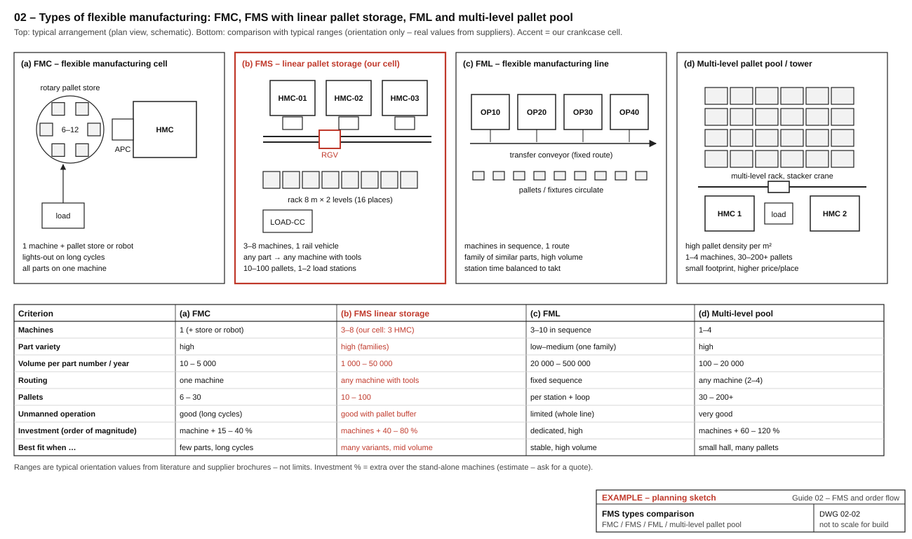
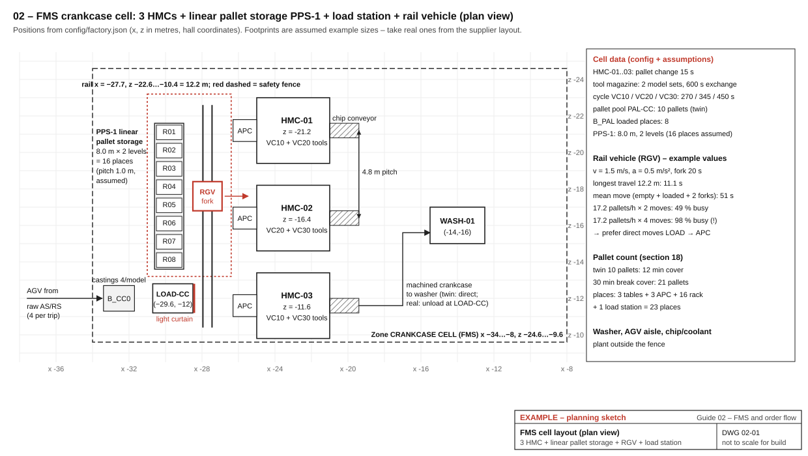
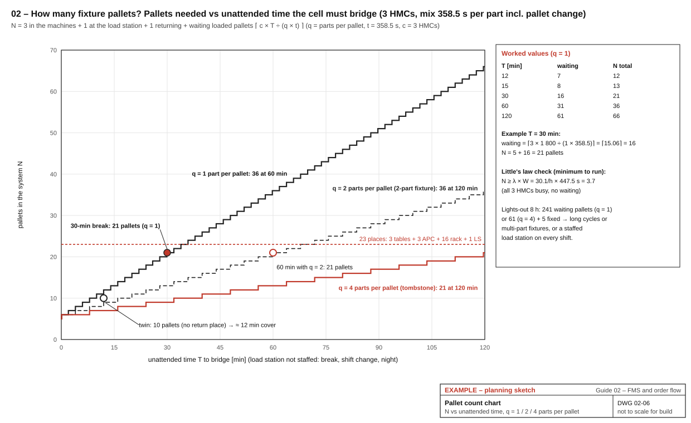
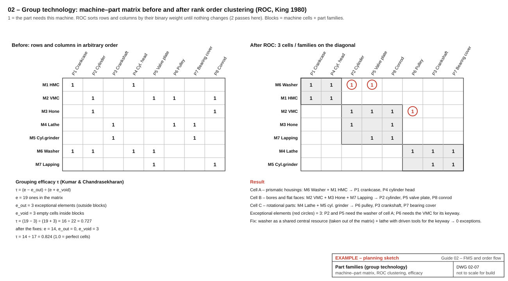
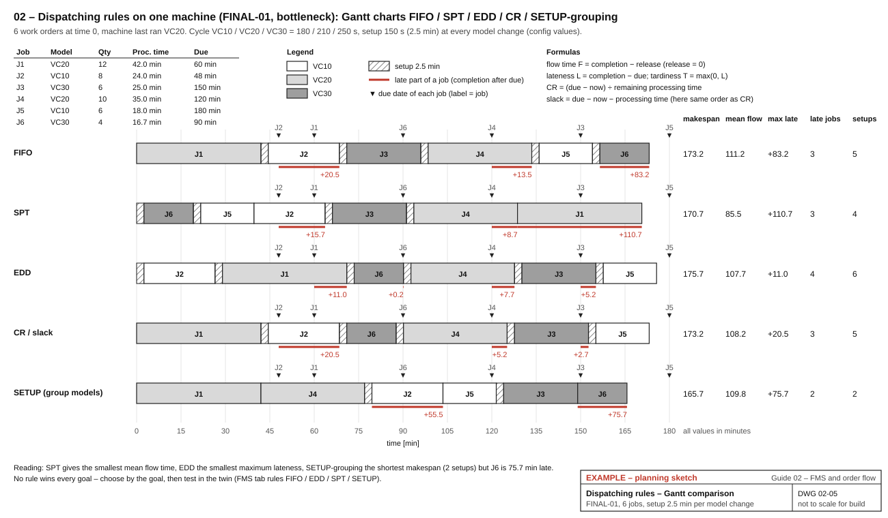
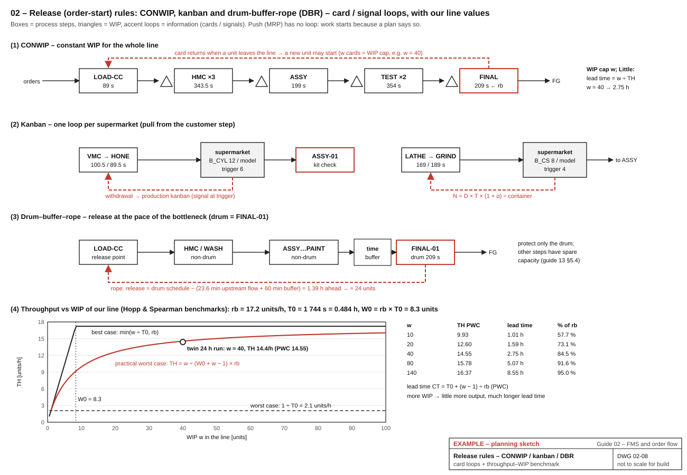
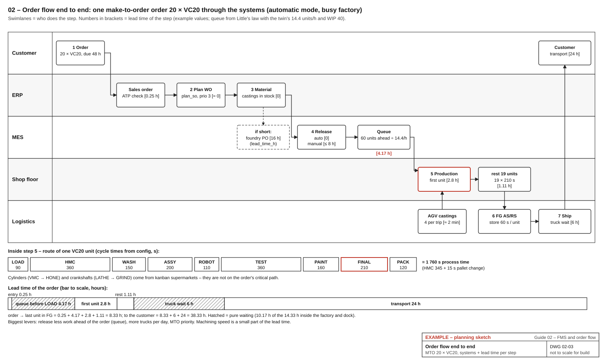
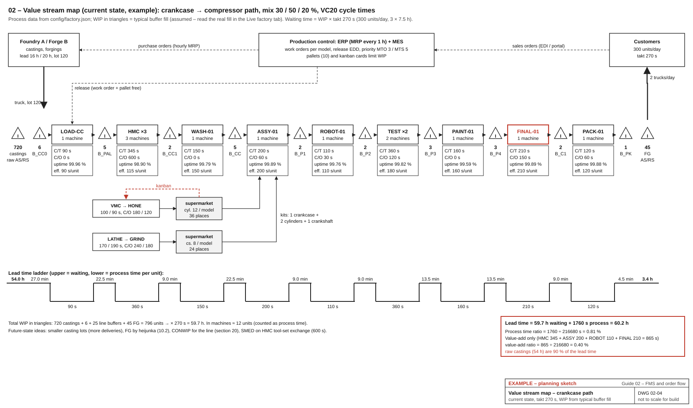

# Guide 02 – FMS (three models on the same machines) and Order Flow

> **All numbers in this guide are example values** taken from `config/factory.json` and from the twin code.
> They are not data from your real factory. Replace them with real machine data, real supplier data and
> real time studies before you make decisions.

---

## Contents

**Part A – the twin and its logic**

1. [Purpose](#1-purpose)
2. [Where in the twin](#2-where-in-the-twin) (tabs, files, how to use, API)
3. [Concepts explained simply](#3-concepts-explained-simply) (model on every part, SETUP, tool magazines, pallets, kanban, kit check, rules, MTO, 7 steps)
4. [Model and formulas](#4-model-and-formulas-with-the-example-values-of-the-code) (cycle times, capacity, batches, kanban, MRP, lead time)
5. [Implementing in the real factory – step by step](#5-implementing-in-the-real-factory--step-by-step)
6. [Checklists](#6-checklists)
7. [Common mistakes and lessons learned](#7-common-mistakes-and-lessons-learned)
8. [Limits of the twin](#8-limits-of-the-twin)
9. [Key formulas at a glance](#9-key-formulas-at-a-glance)
10. [Science principles](#10-science-principles) (Little, utilisation, Kingman, buffers, TOC, batches, rules, safety stock, EOQ)
11. [Detailed specification for implementation](#11-detailed-specification-for-implementation)
12. [Identification and numbering](#12-identification-and-numbering)
13. [Standards for this topic](#13-standards-for-this-topic)
14. [Complete worked example – one MTO order, 50 × VC20](#14-complete-worked-example--one-make-to-order-order-50--vc20)
15. [Data you still need](#15-data-you-still-need-from-suppliers--measurements)
16. [Glossary](#16-glossary)

**Part B – FMS planner's textbook and design reference (added 2026-11-12)**

17. [FMS types and configurations](#17-fms-types-and-configurations) (FMC, FMS, FML, pallet pools, robot cells, our cell layout, rail vehicle)
18. [Pallet and fixture planning](#18-pallet-and-fixture-planning) (pallet count formula, coverage time, fixture families, multi-part fixtures)
19. [Part families and group technology](#19-part-families-and-group-technology) (PFA, rank order clustering, grouping efficacy, routing flexibility)
20. [Scheduling, dispatching and release rules](#20-scheduling-dispatching-and-release-rules) (FIFO / SPT / EDD / CR / slack worked example, setups, CONWIP, kanban, DBR)
21. [Tool management in an FMS](#21-tool-management-in-an-fms) (tool sharing, magazine slots, sister tools, tool room load)
22. [Capacity, OEE, bottleneck and Little's law in the FMS](#22-capacity-oee-bottleneck-and-littles-law-in-the-fms)
23. [Flexibility measures](#23-flexibility-measures)
24. [Order flow end to end, lead time and value stream map](#24-order-flow-end-to-end-lead-time-and-value-stream-map)
25. [Mix planning and heijunka](#25-mix-planning-and-heijunka) (daily mix, levelled sequence, EPEI, setup families)
26. [Performance KPIs](#26-performance-kpis-of-the-fms-and-the-order-flow)
27. [FMS control software and integration](#27-fms-control-software-and-integration)
28. [Failure handling and rerouting](#28-failure-handling-and-rerouting)
29. [Economics of an FMS](#29-economics-of-an-fms)
30. [Buy list – catalogue examples](#30-buy-list--catalogue-examples) + shopping list for a 3-HMC cell with linear pallet storage
31. [Corrections in this revision](#31-corrections-in-this-revision)
32. [Formula sheet – Part B](#32-formula-sheet--part-b)
33. [Glossary – Part B](#33-glossary--part-b)
34. [Drawings of this guide and how the numbers were checked](#34-drawings-of-this-guide-and-how-the-numbers-were-checked)

Drawings (all in `docs/img/`, also copied to `web/img/`): DWG 02-01 `02_fms_layout.svg` · 02-02 `02_fms_types.svg` ·
02-03 `02_order_flow.svg` · 02-04 `02_vsm_crankcase.svg` · 02-05 `02_dispatch_rules.svg` · 02-06 `02_pallet_count.svg` ·
02-07 `02_part_families.svg` · 02-08 `02_conwip_kanban.svg`.

---

## 1. Purpose

This guide explains two parts of the digital twin:

1. **FMS (Flexible Manufacturing System)** – how the factory makes **three compressor models**
   (VC10, VC20, VC30) on the **same machines**: changeovers, tool magazines, kanban supermarkets,
   kit check and dispatching rules.
2. **Order flow** – how **one customer order** travels through the systems:
   ERP → MES → machines → finished-goods AS/RS → customer. You can do every step by hand
   (manual mode) or let the system do it (automatic mode).

Use this guide with your team to:

- understand **why** the twin behaves as it does,
- copy the **logic** (not only the machines) into the real MES/ERP and PLC programs,
- avoid the mistakes the twin already showed us (section 7).

The three models (example values):

| Model | SKU | Flow (FAD) | Motor | Tank | Price | Mix (share of demand) | Work content |
|---|---|---|---|---|---|---|---|
| VC10 | VC10-100 | 10 m³/h | 2.2 kW | 100 L | $890 | 30 % | 46 min |
| VC20 | VC20-300 | 20 m³/h | 4 kW | 300 L | $1,450 | 50 % | 56 min |
| VC30 | VC30-500 | 30 m³/h | 5.5 kW | 500 L | $2,150 | 20 % | 68 min |

"Work content" = the value `mes.work_s` that the code uses as the sort key of the SPT rule. **Correction:**
the code adds the station time of **every machine in the list**, so the three HMCs and the two test
benches are counted 3 × and 2 ×, the second cylinder is not counted, and the pallet change is not counted.
It is a good ranking key (VC10 < VC20 < VC30) but not the real work per unit. The **real work content
per unit** (one HMC, one test bench, two cylinders, no handling) is: VC10 **34.6 min** (2 075 s),
VC20 **41.4 min** (2 485 s), VC30 **50.2 min** (3 010 s).

---

## 2. Where in the twin

### 2.1 Tabs and deep links

| What | Where | Deep link |
|---|---|---|
| Models, rule, FMS cell, kanban, changeovers | Tab **FMS & products** | `http://localhost:8080/#fms` |
| PLC control of the cell (same tab, lower part) | Tab **FMS & products** | `/?plc=PLC-02#fms` |
| One customer order step by step | Tab **Order flow** | `/#order` |
| Work orders, serial numbers, genealogy | Tab **MES** | `/#mes` |
| Sales orders, MRP, purchase orders, stock | Tab **ERP** | `/#erp` |
| Test other rules / mix / tool sets offline | Tab **What-if simulation** | `/#whatif` |
| Units with blue serial tags in 3D | Tab **Live factory** | `/` (follows the order selected in Order flow) |

### 2.2 Files

| File | What it contains |
|---|---|
| `config/factory.json` | `products`, `fms`, station keys `setup_s`, `tool_magazine`, `pick`, `kanban`, buffer keys `per_variant`, `variant`, input key `alt` |
| `twin/model.py` | `Buffer` (per-model counting), `Machine._plan` (which part next), `_rule_key`, `_kanban_variant`, `_changeover`, `Factory` (rule, window, mix) |
| `twin/mes.py` | work orders, `gate` (order release), `rule_key`, `need_for` (castings needed), pegging of units |
| `twin/erp.py` | sales orders, make-to-order steps (`plan_so`, `buy_for_so`, `_auto_order`), MRP per model, shipping (`_ship`, `_fg_for`) |
| `twin/fms.py` | builds the JSON for the FMS tab (`GET /api/fms`) and the rule texts |
| `twin/engine.py` | `rule` command, `step` command (time stepping), `reset` with `mode: manual` |
| `web/ops.js` | `renderFMS` (FMS tab), `renderOrder` + `orderAction` (Order flow tab) |
| `web/index.html` | layout of both tabs, formula box "How this FMS works" |

### 2.3 How to use the FMS tab (5 minutes)

1. Open `/#fms`.
2. Read the **Product family** table: backlog, units to start, in production, in stock, finished – per model.
3. Look at the **Dispatching rule** card. The active rule is highlighted (default **EDD**).
   Below it: released work orders **in the order the rule will start them**.
4. Look at the **FMS cell** cards: load station (castings per model), pallet pool (in use / free),
   3 machining centers (model in the machine, tool magazine content, tool exchanges, OEE).
5. Look at **Kanban supermarkets**: one bar per model (dark = in the supermarket, light = in the line,
   amber mark = trigger level).
6. Look at **Changeovers per station**: time per change, number of changes, hours lost, share of time.
7. Click **SETUP** and set the **Batch window** (for example 48 h). Watch the changeover table
   for one or two simulated hours. Then go back to **EDD**. (See section 7.2 for what you will see.)

### 2.4 How to use the Order flow tab (10 minutes, manual)

1. Open `/#order`.
2. Press **Start empty factory (manual)**. The simulation restarts with no orders, and every automatic
   function is off (no random demand, no hourly MRP, no automatic release, no automatic shipping).
3. Enter: customer, model (for example VC20), **Qty 50**, **Due in 48 h**. Leave **automatic steps** unticked.
   Press **Create order**.
4. The 7-step bar appears. Press the button under it for each step:
   - **Create work order for 50 units** (step 2),
   - **Buy missing material** if something is short (step 3), then wait, step time, or press **Deliver now** (training shortcut),
   - **Release WO-xxxx to the shop floor** (step 4).
5. Press **+10 min** several times (or **+1 h**). Watch the route map: each serial number moves from
   machine to machine, onto the AGV and into the finished-goods AS/RS.
6. When all 50 units are in stock, press **Ship order** (step 7).
7. Click any serial number to see its route, its parts and their lots (genealogy).

Time buttons: **Pause / Run**, **+1 min**, **+10 min**, **+1 h**. They work while paused
(`POST /api/command {"action":"step","value":600}`; allowed range 1 s to 4 h per call).

### 2.5 API

| Call | Purpose |
|---|---|
| `GET /api/fms` | models, rule, rule texts, window, FMS cell, pallets, kanbans, changeovers, queue |
| `POST /api/command {"action":"rule","value":"EDD"}` | set the rule: `FIFO`, `EDD`, `SPT`, `SETUP` |
| `POST /api/command {"action":"rule","value":"SETUP","window_h":8}` | SETUP rule with a due-date window (0.5–168 h) |
| `GET /api/order?so=SO-0001` | the 7 stages, route map, units, material check, purchase orders, log |
| `POST /api/erp {"action":"create_so","customer":"X","qty":50,"due_h":48,"product":"VC20","mto":true,"auto":false}` | make-to-order sales order |
| `POST /api/erp {"action":"plan_so","id":"SO-0001","release":false}` | step 2: work order for this order |
| `POST /api/erp {"action":"buy_so","id":"SO-0001"}` | step 3: purchase orders for missing material |
| `POST /api/erp {"action":"receive_now","id":"PO-0003"}` | training shortcut: supplier delivers now |
| `POST /api/mes {"action":"release","id":"WO-0001"}` | step 4: release |
| `POST /api/erp {"action":"ship","id":"SO-0001"}` | step 7: ship what is in stock for this order |
| `POST /api/erp {"action":"so_auto","id":"SO-0001","auto":true}` | the system does the remaining steps of this order |
| `POST /api/erp {"action":"mode","mode":"auto"}` or `"manual"` | whole factory automatic or manual |
| `POST /api/command {"action":"reset","mode":"manual"}` | empty factory, manual mode |

---

## 3. Concepts explained simply

### 3.1 The model is written on every part (`v`)

Every part in the twin is a small record (a Python dictionary). The field **`v`** holds the model:
`"VC10"`, `"VC20"` or `"VC30"`.

- **Crankcase castings** are model-specific from the start. They come from three different stores
  (`RAW_CC10`, `RAW_CC`, `RAW_CC30`, each with `"variant"`), so the casting already has `v`.
- **Cylinder castings and crankshaft forgings** are the same raw part for all models (no `v`).
  The machine **gives** the part its model when it machines it (`"assign": True` in `_plan`):
  "the part becomes this model because we ran that model's NC program".
- **Tanks and motors** come from model-specific stores. The final-assembly input has an `alt` table:
  VC10 → 100 L tank + 2.2 kW motor, VC20 → 300 L + 4 kW, VC30 → 500 L + 5.5 kW.

**Why it matters in the real factory:** every place that counts parts (buffer, supermarket, AS/RS, AGV load,
MRP, shipping) must count **per model**. A buffer with "8 crankcases" says nothing; "3 × VC10, 5 × VC20" is the real information.
In the real factory the model travels with the part as: serial number on the casting (DMC / laser mark),
RFID tag on the fixture pallet, or the order number in the MES linked to the pallet ID.

### 3.2 Machine state SETUP (changeover)

A machine needs a changeover when the next part is a **different model** from the last one:
new NC program, other fixture or chuck jaws, other gauges, other test adapter.

In the twin the machine first takes the part, then stays in state **SETUP** for the setup time, then goes to **RUNNING**.
SETUP is shown in blue blinking light in 3D and counts as lost time (it lowers OEE availability).

Setup times in the example config (`setup_s`):

| Station | Setup time per model change |
|---|---|
| VMC-01 cylinder boring | 180 s |
| HONE-01 honing | 120 s |
| LATHE-01 crankshaft lathe | 240 s |
| GRIND-01 grinder | 180 s |
| ASSY-01 pump assembly | 60 s |
| ROBOT-01 head bolting | 30 s |
| TEST-01 / TEST-02 test benches | 120 s |
| FINAL-01 final assembly | 150 s |
| PACK-01 packaging | 60 s |
| LOAD-CC, WASH-01, PAINT-01 | 0 (no setup) |
| HMC-01..03 | no `setup_s`; they use a **tool magazine** (see 3.3) |

### 3.3 Machining centers with tool magazines

The three horizontal machining centers (HMC-01, HMC-02, HMC-03) machine the crankcases.
Each **tool magazine holds the tool sets of only 2 models** (`"tool_magazine": {"sets": 2, "load_s": 600}`).

| Machine | Tool sets at start (`initial`) |
|---|---|
| HMC-01 | VC10, VC20 |
| HMC-02 | VC20, VC30 |
| HMC-03 | VC10, VC30 |

So **every model is loaded in 2 of the 3 machines**.

If a pallet of the third model arrives, the machine must **exchange one tool set** (600 s = 10 min, example value).
The set that was **used longest ago** leaves the magazine (LRU = "least recently used", code in `_changeover`).

**Flexible routing:** a loaded pallet can go to **any** free machining center (`"pick": "rule"`).
Under the **SETUP** rule a free machine prefers a pallet whose tools are already in its magazine.
Under EDD, FIFO and SPT the machine takes the pallet the rule ranks first, even if this costs a tool exchange.

### 3.4 Fixture pallets and the load station

The **Fixture Load Station** (LOAD-CC) clamps a casting on a fixture pallet and marks the **serial number**.
It may only start when:

1. a **released work order** still needs units (order release by the MES – `release_gate`),
2. a casting **of that model** is at the station,
3. a **free fixture pallet** exists (pool `PAL-CC`, 10 pallets).

The pallet returns to the pool when the HMC finishes the part. So the number of pallets
**limits the work in progress (WIP)** of the cell. (Pallet pool sizing: see Guide 03 §4.6 and chapter 18 of this
guide; the cell layout with the linear pallet storage and the rail vehicle is drawing DWG 02-01 in chapter 17.)

The serial number is built as `<model>-<running number>`, for example `VC20-000012`.

### 3.5 Kanban supermarkets

The cylinder line (VMC-01 → HONE-01) and the crankshaft line (LATHE-01 → GRIND-01) do **not** follow work orders.
They are **pull** lines: they refill a **supermarket** in front of the assembly cell.

| Supermarket | Buffer | Places per model (`per_variant`) | Kanban target | Trigger | Line |
|---|---|---|---|---|---|
| Cylinder supermarket | `B_CYL` (36 places) | 12 | 12 | 6 | VMC-01 → HONE-01 |
| Crankshaft supermarket | `B_CS` (24 places) | 8 | 8 | 4 | LATHE-01 → GRIND-01 |

**Kanban level of a model** = parts of that model in the supermarket **+ parts already on the way**
in the line (buffers between the machines and parts inside the machines). Code: `_kanban_level`.

The decision rule of the first machine of the line (`_kanban_variant`):

1. Make a model **only** if its level is **below target**.
2. **Stay on the current model** while it is still below target (no changeover needed).
3. Change to another model **only** when that model has fallen **to its trigger level or lower**
   (a "full batch of kanban cards" is waiting).
4. If several models are at trigger: take the one with the lowest fill (level ÷ target).
5. If no model needs parts: the line stops with the reason "Kanban full – no part needed now". This is correct – overproduction is waste.

### 3.6 Kit check at assembly

The pump assembly cell ASSY-01 needs **1 crankcase + 2 cylinders + 1 crankshaft of the same model** (a **kit**).
It uses `"pick": "kit"`:

1. It looks at the crankcases waiting in front of it (buffer `B_CC`), sorted by the dispatching rule.
2. For each one it checks: are 2 cylinders and 1 crankshaft **of this model** in the supermarkets?
3. It starts the **first crankcase whose kit is complete**.
4. If no kit is complete, it waits with the reason "Kit not complete – waiting for …".

So the buffer in front of the assembly also **re-sequences** the models: a VC30 crankcase may pass a VC20
crankcase if only the VC30 kit is complete.

**Why:** starting a unit without all parts creates half-built units on the floor (WIP that blocks space and hides problems).

### 3.7 Dispatching rules

A dispatching rule decides **which work order or pallet goes first**. It is used in two places:

- **MES order release** (`mes.rule_key`): which released work order the load station starts next.
- **Machines with `pick: rule` or `pick: kit`** (`Machine._rule_key`): which waiting pallet / crankcase goes first.

Work-order **priority always comes first** (1 = most urgent). Make-to-order orders from the Order flow tab get
**priority 3**, MRP stock orders **priority 5**.

> **Correction (2026-11-12):** "priority always first" is exactly true for the **MES order release** (`mes.rule_key`).
> At the **machines** (`Machine._rule_key`) the priority is folded into the due value (`priority × 10⁹ + due`), so it
> comes first under **EDD** and **SETUP** only. Under **FIFO** the machines ignore the priority (queue position only),
> and under **SPT** the machine time of the model comes first and the priority only breaks ties. A worked comparison of
> the rules is in chapter 20 (drawing DWG 02-05).

| Rule | Sort key (after priority) | Good for | Weak point |
|---|---|---|---|
| **FIFO** | creation order | simple, fair | models alternate → many changeovers |
| **EDD** (default) | earliest due date | on-time delivery | urgent orders of different models mix → changeovers |
| **SPT** | shortest work content (VC10 first) | low WIP, many units finish fast | big models (VC30) can wait very long |
| **SETUP** | due-date window, then "model running now first", then due date | fewer changeovers at the **load station and HMCs** | big windows → long batches → empty kanbans → **more** changeovers downstream (section 7.2) |

**SETUP rule in detail:**
Time is cut into windows of `window_h` hours (example 8 h). `window number = due time ÷ (window_h × 3600 s)`, rounded down.
Orders due in the **same window** form one batch. Inside the batch, the model that is running now goes first.
Orders in a **later** window always wait. So the window limits how long a batch can become.

### 3.8 Make-to-order and pegging

There are two kinds of sales orders in the twin:

| | Make-to-stock (MRP) order | Make-to-order (MTO) order |
|---|---|---|
| Created by | random demand or ERP tab | **Order flow** tab (`mto: true`) |
| Work order | MRP makes one work order per model for **all** open stock orders together | **its own** work order (`plan_so`), linked by `so` |
| Units | anonymous stock | **pegged**: every unit gets `so = SO-xxxx` when it starts |
| MRP | netted by MRP | **ignored** by MRP; its pegged units are not counted as free stock |
| Shipping | from free stock of the same model | own units first, then free stock of the same model |
| Priority | 5 | 3 |

**Pegging** = a fixed link "this serial number is made for this customer order". The MES writes `so` into the unit record
when the unit starts (`_on_start`). The ERP will not give a pegged unit to another order (`_fg_for`).

**Scrap is replaced automatically:** a work order counts `started − scrap`. When a unit is scrapped
(for example a test-bench reject), the work order again needs one unit, so the load station starts one more.

### 3.9 Manual and automatic order flow

| | Automatic factory | Manual factory |
|---|---|---|
| Customer orders | random demand (example 300 units/day) + your orders | only your orders |
| MRP (planning) | every hour (`mrp_interval_h` = 1) | only when you press a button |
| Work-order release | automatic | you press **Release** |
| Shipping | automatic (every 30 s check) | you press **Ship** |

In addition, each MTO order has its own switch **automatic steps for this order**. With it, the ERP does
plan → buy → release → ship for this one order, even in a manual factory.

If some switches are on and some off (ERP tab settings), the mode shows **mixed**.

### 3.10 The 7 steps of one order

| Step | System | Done when | What happens |
|---|---|---|---|
| 1 Customer order | ERP | always | sales order with customer, model, quantity, due date |
| 2 Plan work order | ERP → MES | planned quantity ≥ order quantity | `plan_so` creates a work order (priority 3, due = order due date) |
| 3 Check material | ERP | no item SHORT and no item waiting on a purchase order | BOM check per model; `buy_so` creates purchase orders for the missing quantity |
| 4 Release | MES | a work order is RELEASED / IN_PROGRESS / COMPLETED | the load station may start units of this order |
| 5 Production | machines | all units started, none left in production, enough finished | units move through the route; AGVs move castings and finished crates |
| 6 Finished-goods AS/RS | AS/RS | finished + picking + shipped ≥ order quantity | the AGV brings each packed unit to the FG AS/RS, the crane stores it |
| 7 Ship | ERP | order status SHIPPED | the crane retrieves the units; the ERP books revenue; the MES marks each serial number as shipped to the customer |

You can **release before the material arrives** (the button is offered in step 3). The line then starts with the stock that is there.

The same 7 steps as a swimlane drawing with the lead time of every step: DWG 02-03 in chapter 24.

---

## 4. Model and formulas (with the example values of the code)

### 4.1 Cycle time per model

Each product has a table `cycle_s` per station type. VC20 has no table, so it uses the station's own `cycle_time_s`.

| Station | VC10 | VC20 | VC30 | Mix average |
|---|---|---|---|---|
| LOAD-CC | 80 s | 90 s | 100 s | 89.0 s |
| HMC (each of 3) | 270 s | 345 s | 450 s | 343.5 s (+15 s pallet change) |
| WASH-01 | 130 | 150 | 170 | 148.0 |
| VMC-01 | 85 | 100 | 125 | 100.5 |
| HONE-01 | 75 | 90 | 110 | 89.5 |
| LATHE-01 | 140 | 170 | 210 | 169.0 |
| GRIND-01 | 160 | 190 | 230 | 189.0 |
| ASSY-01 | 170 | 200 | 240 | 199.0 |
| ROBOT-01 | 95 | 110 | 130 | 109.5 |
| TEST-01 / 02 | 300 | 360 | 420 | 354.0 |
| PAINT-01 | 130 | 160 | 200 | 159.0 |
| FINAL-01 | 180 | 210 | 250 | 209.0 |
| PACK-01 | 100 | 120 | 140 | 118.0 |

**Mix-average cycle time**

```
t_avg = Σ (mix share of model × cycle time of model)
HMC:   t_avg = 0.3 × 270 + 0.5 × 345 + 0.2 × 450 = 81 + 172.5 + 90 = 343.5 s
```

### 4.2 Capacity of a station group

```
units per hour = Σ over parallel machines (3600 ÷ (t_avg + handling time)) ÷ parts needed per unit
```

| Group | Calculation | Units/h |
|---|---|---|
| HMC-01..03 | 3 × 3600 ÷ (343.5 + 15) | 30.1 |
| TEST-01..02 | 2 × 3600 ÷ 354 | 20.3 |
| VMC-01 (2 cylinders per unit) | 3600 ÷ 100.5 ÷ 2 | 17.9 |
| ASSY-01 | 3600 ÷ 199 | 18.1 |
| FINAL-01 | 3600 ÷ 209 | **17.2 ← lowest** |

**Ideal factory rate = lowest group = 17.2 units/h** (FINAL-01). This is the design limit **without**
setups, breakdowns, starvation or start-up. In one 24-hour test run of the twin (seed 1, EDD rule,
starting with an empty line) the real output was **345 units = 14.4 units/h** (example result).
The gap comes from breakdowns (MTBF/MTTR), changeovers, scrap and the empty line at the start.

Note: VMC-01 (17.9) and ASSY-01 (18.1) are very close to FINAL-01. With this mix the factory has
**three near-bottlenecks**. A small mix change moves the bottleneck. This is typical for an FMS – check it with the what-if tab.

### 4.3 Time per unit with batches (changeover share)

```
time per unit = cycle time + setup time ÷ batch size
LATHE-01, VC20, batch 4:   170 s + 240 s ÷ 4 = 230 s   (35 % slower than 170 s)
LATHE-01, VC20, batch 8:   170 s + 240 s ÷ 8 = 200 s
```

```
setup share of a station = Σ setup time ÷ total time
Example from the 24 h run: LATHE-01 10 changeovers × 240 s = 2,400 s;  2,400 ÷ 86,400 = 2.8 %
```

### 4.4 Tool magazine exchange

```
exchange needed when: model of the pallet ∉ tool sets in the magazine
time lost = load_s = 600 s (example)
```

With 3 machines × 2 sets and 3 models, each model is in 2 machines. In the 24 h EDD run the three HMCs
made only 2 + 3 + 4 = 9 tool exchanges (1.5 h in total). Reason: there are usually two machines able to run each model, and
the LRU rule keeps the most used sets.

### 4.5 Kanban target

General kanban rule (the twin uses the same idea):

```
target ≥ demand during the refill time + safety stock
```

**Example – cylinder supermarket, model VC20** (example values):

```
demand of VC20 cylinders  = 2 per unit × 17.2 units/h × 0.5 mix = 17.2 cylinders/h
refill time (worst case)  = the line finishes the batch of another model (up to 12 × 100 s = 20 min)
                           + changeover VMC 180 s + HONE 120 s (5 min)
                           + first part through VMC + HONE (100 + 90 s ≈ 3 min)
                           ≈ 28 min ≈ 0.47 h
demand during refill      = 17.2 × 0.47 ≈ 8 cylinders
target                    = 8 + safety (≈ 4) = 12 cylinders = 6 units  → config "target": 12
trigger                   = target ÷ 2 = 6 (the twin default when "trigger" is missing)
```

**Example – crankshaft supermarket, VC20:** demand = 1 × 17.2 × 0.5 = 8.6/h; refill ≈ 0.5 h → 4.3 + safety → target 8, trigger 4.

The common Toyota form with containers:

```
number of kanban cards N = demand per hour × refill time (h) × (1 + safety factor) ÷ parts per container
```

### 4.6 MRP per model (make-to-stock orders)

Finished-goods level, for **each model separately** (`run_mrp`):

```
net = open demand + safety stock − free FG stock − open work orders
free FG stock = FG units of this model − units being picked − units pegged to open MTO orders
              + units of this model on the way into the FG store (AGV, crane queue)
if net > 0: new work order = net rounded UP to the work-order lot (wo_lot)
```

**Example at start** (initial orders: VC20 40 + 40, VC10 25, VC30 16; FG empty; no work orders):

| Model | Demand | + Safety | − Free FG | − Open WO | Net | Lot | Work order |
|---|---|---|---|---|---|---|---|
| VC10 | 25 | 6 | 0 | 0 | 31 | 20 | **40** |
| VC20 | 80 | 10 | 0 | 0 | 90 | 20 | **100** |
| VC30 | 16 | 4 | 0 | 0 | 20 | 10 | **20** |

Material level (each purchased item, model items only for their model):

```
units      = max(units still to start, planned rate × supplier lead time) (+ units in WIP for tank/motor)
gross      = BOM quantity × units
net        = gross + safety stock − on hand − on order
if net > 0: purchase order = net rounded UP to the purchase lot
```

Example CC20-CAST (VC20 casting): planned rate = 300 units/day × 0.5 ÷ 24 = 6.25 units/h; × 16 h lead time = 100.
units = max(100 to start, 100) = 100; gross = 100; net = 100 + 100 safety − 360 on hand − 0 = **−160 → no purchase order**.

### 4.7 Material check of one MTO order (step 3)

For each BOM item of the order's model (`_materials`):

```
need  = units of this order still to start × BOM qty
        (+ units of this order already running that still need a late part, e.g. tank and motor)
have  = in store + being put away + already at the line (moved by AGV)
        − what other open work orders of the same item still need
short = max(0, need − have)
to buy = max(0, short − already on order)
status = OK / ON ORDER / SHORT
```

**Why "− other open work orders":** stock is shared. Without this line, two orders would both count the same castings and both believe they are covered.

### 4.8 Shipping rule

Every 30 s (automatic shipping) the ERP goes through the open orders **by due date** (`_ship`):

1. Units allowed for this order: its **own pegged units** first, then **free units of the same model**
   (not pegged to another open order).
2. If there are **not enough** units **and** the order is **not late** yet → do not ship (ship complete orders),
   and **keep the free stock of this model** for this older order (`hold_free` = a set of **models**).
3. If the order **is late** → ship what is there (partial shipment).
4. Each unit is retrieved by the FG crane, then counted as shipped (revenue, cost of goods, on-time flag).

The manual button **Ship order** ships everything available for the order right away (also partial).

### 4.9 Order lead time estimate (rule of thumb)

```
lead time ≈ flow time of the first unit + (quantity − 1) × time per unit at the bottleneck
```

Example: 50 × VC20 in an **empty** factory. Bottleneck for VC20 only = FINAL-01 210 s.
Flow time of the first unit = the longest path (critical path), not the sum of all times, because the
crankcase, cylinder and crankshaft branches run at the same time:

```
crankcase branch  LOAD 90 + HMC 345 + 15 + WASH 150           = 600 s  (longest branch)
cylinder branch   VMC 2 × 100, HONE overlaps → 290 s;  crankshaft branch LATHE 170 + GRIND 190 = 360 s
after assembly    ASSY 200 + ROBOT 110 + TEST 360 + PAINT 160 + FINAL 210 + PACK 120 = 1 160 s
critical path     600 + 1 160 = 1 760 s ≈ 29 min
+ AGV casting trip ≈ 2 min + changeovers on the path ≈ 7 min + AGV to FG ≈ 2 min  → ≈ 40 min
```

Lead time ≈ 0.67 h + 49 × 210 s = 0.67 + 2.86 = **≈ 3.5 h** (ideal estimate; breakdowns add a little).
(Correction: an earlier version used the SPT key of 56 min as flow time and got 4.4 h.)
In a busy factory add the queue of other released orders. Chapter 14 shows the full example.
Check it in the twin with **+10 min** steps.

---

## 5. Implementing in the real factory – step by step

### Step 1 – Freeze the product data per model
1. For each model, list: BOM (casting, cylinders, crankshaft, tank, motor, small parts), routing (station sequence),
   cycle time per station, setup time per station change (from model A to model B), test specification (FAD, tolerance).
2. Measure setup times as a **matrix** (from → to). The twin uses one value per station; reality can differ
   (VC10 → VC20 may be faster than VC10 → VC30).
3. Enter real values into `config/factory.json` (`products[].cycle_s`, `setup_s`) and run the what-if tab.

### Step 2 – Give every part its model and identity
1. Mark the serial number on the crankcase at the load station (laser or dot-peen DMC). The twin does this at LOAD-CC.
2. Put an RFID tag (or a barcode) on every fixture pallet. The PLC of the cell links **pallet ID ↔ serial number ↔ model ↔ work order**.
3. Cylinders and crankshafts: if they get no own serial number, at least the **batch** and the **model** must be on the container / supermarket lane.
4. Scanners at: load station, each HMC (pallet arrival), assembly (kit check), test bench, final assembly (tank + motor scan), packaging, FG AS/RS input.

### Step 3 – NC programs and tool management of the HMCs
1. One NC program per model and machine (naming example from the twin: `OHMC01_VC20.nc`).
2. The MES (or the cell controller) sends the program number with the pallet. The machine checks: program loaded? tool set in the magazine?
3. Plan the **tool set allocation** like the twin (each model in at least 2 machines). Then one machine can break down without stopping a model.
4. Tool presetting room: tool sets of the third model are prepared **before** they are needed. A prepared exchange is faster than 10 min.
5. Tool life management: count parts per tool in the CNC; the twin's preventive maintenance at 85 % wear is an example of the logic.

### Step 4 – Changeover reduction (SMED) before choosing a rule
1. Film one changeover per station. Separate **internal** work (machine stopped) and **external** work (can be done while running).
2. Move external work out: prepare fixture, jaws, test adapter beside the machine.
3. Use quick-change: zero-point clamping, coded fixtures, standard heights, program call by barcode.
4. Re-measure and update `setup_s`. Every second of setup you remove is worth more than any dispatching rule.

### Step 5 – Kanban loops for cylinders and crankshafts
1. Calculate target and trigger per model (section 4.5) with **real** demand and refill times.
2. Build the supermarket with **fixed lanes per model** (the twin uses `per_variant`): colour-coded lanes, one lane per model, max quantity marked.
3. Signal: when a lane falls to the trigger, a card (or an electronic signal from a light barrier / weighing / RFID count) goes to the first machine of the line.
4. Line rule for the operator / PLC: stay on the current model until it reaches target; change only when another model is at trigger (same as the twin).
5. Show the levels on a screen at the line (like the kanban bars in the FMS tab).

### Step 6 – Kit check at assembly
1. Before the operator starts a pump: scan crankcase serial number → MES checks 2 cylinders + 1 crankshaft of the same model are in the kit position.
2. Poka-yoke: wrong-model parts must not fit or must be rejected by scan (different bore, different crankshaft length, colour code).
3. Allow re-sequencing (start the next crankcase with a complete kit), but log it.

### Step 7 – Dispatching rule in the MES
1. Start with **EDD** (default of the twin).
2. Keep a **priority** field (1 = urgent). Customer-specific orders get a better priority than stock orders (twin: 3 vs 5).
3. If you want batching, use the SETUP rule with a **small window** (for example one shift = 8 h), never a window of several days.
4. Measure every week: number of changeovers per station, on-time delivery, kanban stock-outs. Change the rule only with data.

### Step 8 – ERP ↔ MES order flow
1. ERP: sales order with model, quantity, due date, and the flag make-to-order / make-to-stock.
2. ERP → MES: work order (in ISA-95 / B2MML this is a ProductionSchedule; the twin shows an example message in the Communication tab).
3. MES → ERP: units started, scrap, completed, units into FG stock (ProductionPerformance).
4. Pegging: the MES writes the sales-order number on every unit of an MTO work order. The WMS must keep these units for that order.
5. Shipping: WMS picks per order, **per model**. ERP books revenue and creates the invoice.
6. Decide clearly which system does what: who runs MRP (ERP), who releases (MES planner or automatic), who picks (WMS).

### Step 9 – Test the logic with the twin before go-live
1. Load the real config, run 3 × 24 h in the what-if tab with each rule.
2. Run the manual order-flow exercise with the planners and the shop-floor team.
3. Run a "bad day": one HMC off (what-if `enabled: 0`), VC30 mix 40 %, kanban target −50 %. Note what breaks first.

---

## 6. Checklists

### 6.1 Product / FMS data checklist
- [ ] Every model has a BOM, routing, cycle time per station, test specification.
- [ ] Setup time measured per station (and ideally as a from–to matrix).
- [ ] Tool sets per model defined; magazine capacity per HMC known; each model in ≥ 2 HMCs.
- [ ] NC program per model and machine; program call linked to the pallet/order.
- [ ] Fixture works for all models (or fixture change counted as setup).
- [ ] Model-specific castings, tanks, motors have separate storage locations and separate stock in the ERP.

### 6.2 Kanban checklist
- [ ] Target and trigger calculated per model with real demand and refill time.
- [ ] Separate lanes per model; maximum marked; first-in first-out inside a lane.
- [ ] Rule written at the line: "stay on the model until target; change only at trigger".
- [ ] Stock-out of a lane creates an alarm / andon.
- [ ] Review targets when the mix changes by more than about 10 points.

### 6.3 Order-flow checklist
- [ ] Every sales order has a model, quantity, due date, MTO/MTS flag.
- [ ] MRP runs **per model**; MTO orders are excluded from MRP netting.
- [ ] Pegged units cannot be shipped to another customer (system lock, not only a rule on paper).
- [ ] Scrapped units create a replacement start automatically (work order counts started − scrap).
- [ ] Shipping rule: complete orders when on time, partial only when late or when the customer agrees.
- [ ] Shipping logic and "keep stock for the oldest order" work **per model** (section 7.1).
- [ ] FG warehouse capacity alarm before it is full (for example at 85 %).
- [ ] Material check counts what other open work orders still need.

### 6.4 Go-live test checklist (manual order exercise)
- [ ] Create MTO order of 50 × VC20 → work order created with priority 3.
- [ ] Material short → purchase orders created for exactly the missing quantity (rounded to lot).
- [ ] Release → castings of the right model arrive at the load station; no other model is brought.
- [ ] Units carry serial number + work order + sales order (check 5 at random).
- [ ] One forced test-bench reject → replacement unit starts automatically.
- [ ] All units in FG → ship → each serial number shows customer and shipping date.

---

## 7. Common mistakes and lessons learned

### 7.1 Lesson: a global "hold free stock" rule jammed the whole line

**What happened (in an earlier version of the twin):** the shipping rule said "if the oldest order is not complete
and not late, keep the **free stock** for it and ship nothing else". This flag was **global** (for all models).

The chain of events:

1. An old VC30 order waited for its last units.
2. The global flag blocked shipping of **all** models, also complete VC10 and VC20 orders.
3. Finished units kept arriving; nothing left. The **FG AS/RS (110 slots)** filled up.
4. The AGV transport to the FG store checks free slots (`slots − count − incoming`). At 0 free slots the AGV stopped taking crates from packaging.
5. Buffer `B_PK` (3 places) filled → PACK-01 BLOCKED → FINAL-01 BLOCKED → … → the whole line stopped.
6. The VC30 order could now **never** be completed. Deadlock.

**Fix (current code):** `hold_free` is a **set of models**. Free VC30 stock is kept for the old VC30 order,
but VC10 and VC20 orders ship normally.

**Rule for the real factory:** **every** shipping, MRP, reservation, kanban and warehouse rule must work **per model**
(per SKU). Test every rule with the question: "Can a problem of model A stop model B?" If yes, change the rule.
Also: the FG warehouse must have a capacity alarm and a manual override, because a full warehouse stops production.

### 7.2 Lesson: big SETUP batches cause MORE changeovers, not fewer

It sounds logical: "batch the same model together → fewer changeovers". The twin shows the opposite when the batches become long.

Example result, 24 h runs, same seed, same orders (example values):

| Rule | Window | Good units | Changeovers (all stations) | Setup hours |
|---|---|---|---|---|
| EDD | – | 345 | 156 | 6.0 h |
| SETUP | 8 h | 344 | 174 | 6.6 h |
| SETUP | 48 h | 327 | 213 | 8.4 h |

Why:

1. A long VC20 batch at the load station sends only VC20 crankcases to assembly.
2. Assembly needs 2 VC20 cylinders + 1 VC20 crankshaft per unit. The VC20 **supermarket lanes are sized for the mixed flow**
   (12 cylinders = 6 units, 8 crankshafts = 8 units). They **empty** quickly.
3. The kanban lines must now run VC20 for a long time; the other models' lanes are full and idle.
   When the batch changes, the lines must change over again, often before the lanes are refilled.
4. While the VC20 kits are missing, the assembly starts **whatever kit is complete** (re-sequencing). So the flow after assembly
   alternates models more often – and **every** downstream station (robot, test benches, final assembly, packing) changes over each time.
5. Result: fewer changeovers at the HMCs, but more everywhere else, and less output.

That is why **EDD is the default rule**. Batching helps only when the kanban supermarkets are big enough for the batch size:

```
batch size ≤ kanban target per model ÷ parts per unit   (cylinders: 12 ÷ 2 = 6 units)
```

### 7.3 Other common mistakes

| Mistake | Effect | Better |
|---|---|---|
| Counting buffers without model | AGV brings wrong castings, assembly waits for kits | count per model everywhere (`count_v`) |
| AGV brings castings "to fill the place" | line-side full of a model nobody ordered | bring castings only for released work orders (`need_for`) |
| Starting units without a complete kit | half-built pumps on the floor | kit check before start |
| One tool set per model in only one HMC | one breakdown stops a model | each model in ≥ 2 machines |
| Changing the rule every day | nobody understands the plan | change only with a week of data |
| Pegged units used for another order | the MTO customer gets late | system lock on pegged serial numbers |
| Using SPT permanently | VC30 orders starve, become late | use SPT only short term, with priorities |
| No scrap replacement | order short by the scrapped units | work order counts started − scrap |
| Releasing everything at once | long queues, high WIP, more mixing | release by due date; pallets limit WIP |

---

## 8. Limits of the twin

1. **One setup time per station**, the same for every model change. Real setups depend on from-model and to-model.
2. **Tool exchange = fixed 600 s.** No tool life per tool, no sister tools, no tool presetting queue.
3. **Changeover starts when the part is taken.** In reality you can often prepare a setup while the last part runs.
4. **Kanban signal is instant and perfect.** No lost cards, no counting errors, no delay.
5. **No operators** as a limited resource: changeovers, kit picking, load station work need no people in the twin.
6. **No shift calendar** and no breaks: the twin runs 24 h per day.
7. **Demand is random** (example 300 units/day, orders of 5–30 units, due in 24–72 h) – not a real forecast.
8. **Suppliers are always on time** (fixed lead time). No partial deliveries, no quality rejects at goods receipt.
9. **Test reject = scrap.** No rework loop.
10. **MRP is simple** (one level per model, lot rounding, safety stock); no capacity check (it can create more work than the factory can do).
11. **What-if has no orders:** in the What-if tab the models start in mix proportions; the SETUP rule there uses `max_batch` (example 10)
    instead of the due-date window.
12. **Data is in memory.** A reset clears orders and work orders (finished units are also written to `data/history.db`).
13. All numbers (cycle times, setups, MTBF, prices, lots) are **example values**.

---

## 9. Key formulas at a glance

| Formula | Meaning | Example | Section |
|---|---|---|---|
| `L = λ × W` | Little's law: WIP = throughput × flow time | 14.4 /h × 2.8 h = 40 units | 10.1 |
| `ρ = λ × t_e / c` | utilisation of a group of c machines | TEST at 17.2 /h: 84.6 % | 10.2 |
| `W_q ≈ ((c_a² + c_e²)/2) × (ρ/(1−ρ)) × t_e` | Kingman (VUT) waiting time | FINAL-01: 9 min | 10.4 |
| `c_e² = c_0² + 2 A (1−A) m_r / t_0` | variability with breakdowns (exponential repair) | 0.019 vs 4.85 | 10.4 |
| `c_d² = ρ² c_e² + (1−ρ²) c_a²` | variability passed downstream | – | 10.5 |
| `t_unit = t + S / Q` | time per unit with batch Q and setup S | LATHE Q = 4: 229 s | 4.3, 10.7 |
| `Q_min = D × S / (1 − D × t)` | smallest batch that keeps up with demand D | GRIND at 17.2 /h: 9 | 10.7 |
| `target ≥ D × T_refill + SS`, `SS = z × σ × √T` | kanban target with safety stock | VC20 cylinders 15 | 4.5, 10.9 |
| `EOQ = √(2 D S_o / H)` | economic order quantity | 487 castings | 10.10 |
| `net = demand + safety − free FG − open WO` | MRP net requirement per model | VC20: 90 → WO 100 | 4.6 |
| `lead time ≈ critical path + (Q − 1) × t_bottleneck` | order lead time | 3.5 h | 4.9, 14 |

---

## 10. Science principles

The laws of flow and queueing that explain why the FMS behaves as it does. Reliability, OEE and
simulation statistics are in guide `01`, chapter 10. Material-handling physics is in guide `03`.

### 10.1 Little's law

Draw the number of units in the factory (WIP) over a long time T. The area under this curve, in
"unit-hours", is the sum of the times all units spent inside: area = n × W (n units, W = mean flow time).
The mean WIP is area / T:

```
L = area / T = (n / T) × W = λ × W
L = mean WIP [units],  λ = throughput [units/h],  W = mean flow time [h]
```

It holds for any system in steady state, any rule, any distribution. Uses:

| Known | Calculated | Example (example values) |
|---|---|---|
| λ and W | WIP | 14.4 units/h × 2.8 h = 40 units in the factory |
| WIP and λ | flow time | MES counts 40 units in WIP, output 14.4 /h → W = 40 / 14.4 = 2.8 h |
| Released backlog and λ | waiting time of a new order | 100 released units ahead / 14.4 /h = 6.9 h before a new order starts |
| Pallet count (WIP cap) | maximum flow time at a given rate | guide `03`, 4.6 |

Consequence: at the **same** output, more WIP means **longer** flow time. Releasing everything at once
(table 7.3) does not make the factory faster – it only makes every order wait longer.

### 10.2 Utilisation

```
ρ = arrival rate × effective time per part / number of parallel machines = λ × t_e / c
```

Utilisation of each group at the 24 h twin output of 14.4 units/h (ρ = 14.4 / capacity from 4.2):

| Group | Capacity /h | ρ at 14.4 /h |
|---|---|---|
| FINAL-01 | 17.2 | 0.84 |
| VMC-01 | 17.9 | 0.80 |
| ASSY-01 | 18.1 | 0.80 |
| GRIND-01 | 19.0 | 0.76 |
| HONE-01 | 20.1 | 0.72 |
| TEST-01/02 | 20.3 | 0.71 |
| LATHE-01 | 21.3 | 0.68 |
| PAINT-01 | 22.6 | 0.64 |
| WASH-01 | 24.3 | 0.59 |
| HMC-01..03 | 30.1 | 0.48 |
| PACK-01 | 30.5 | 0.47 |
| ROBOT-01 | 32.9 | 0.44 |
| LOAD-CC | 40.4 | 0.36 |

(These ρ values ignore setups and breakdowns; with them the top machines are closer to 1.)

### 10.3 Why waiting time explodes near 100 % utilisation

For the simplest queue (one machine, random arrivals and random process times, "M/M/1"):

```
W_q = ρ / (1 − ρ) × t_e
```

| ρ | 0.50 | 0.70 | 0.80 | 0.85 | 0.90 | 0.95 |
|---|---|---|---|---|---|---|
| W_q in multiples of t_e | 1.0 | 2.3 | 4.0 | 5.7 | 9.0 | 19.0 |

From 80 % to 95 % the waiting time grows almost 5 times. That is why planning rules say "crane ≤ 80–85 %",
"AGV ≤ 70–75 %": not because the equipment cannot do more, but because queues become very long.

### 10.4 Kingman (VUT) equation – variability × utilisation × time

Real machines are not as random as M/M/1. Kingman's approximation for one machine:

```
W_q ≈ V × U × T = ((c_a² + c_e²) / 2) × (ρ / (1 − ρ)) × t_e
c_a = coefficient of variation of the time between arrivals (std. dev. / mean)
c_e = coefficient of variation of the effective process time
```

Effective process time with random breakdowns (Hopp & Spearman, "Factory Physics"):

```
t_e  = t_0 / A
c_e² = c_0² + (1 + c_r²) × A × (1 − A) × m_r / t_0
t_0 = natural process time, c_0 its variation, m_r = MTTR, c_r = variation of repair time (exponential: c_r² = 1)
```

**Example 1 – FINAL-01 as in the config** (MTBF 120 h, MTTR 8 min = 480 s), at 14.4 units/h, c_a² = 1 assumed:

```
mix: t = 180 / 210 / 250 s with 0.3 / 0.5 / 0.2 → mean 209 s
variance = 0.3 × 29² + 0.5 × 1² + 0.2 × 41² = 589 s²   → c_0² = 589 / 209² = 0.0135
A = 120 / (120 + 0.133) = 0.99889
c_e² = 0.0135 + 2 × 0.99889 × 0.00111 × 480 / 209 = 0.0135 + 0.0051 = 0.0186
t_e = 209 / 0.99889 = 209.2 s;   ρ = 14.4 × 209.2 / 3600 = 0.837
W_q = ((1 + 0.0186) / 2) × (0.837 / 0.163) × 209.2 = 0.509 × 5.13 × 209.2 ≈ 547 s ≈ 9 min
```

**Example 2 – same availability, different failure pattern** (both A = 97.1 %):

| Failure pattern | m_r | c_e² | t_e | ρ | W_q |
|---|---|---|---|---|---|
| rare and long: MTBF 168 h, MTTR 5 h | 18 000 s | 0.0135 + 2 × 0.0281 × 18 000 / 209 = **4.85** | 215.2 s | 0.861 | 2.92 × 6.19 × 215.2 ≈ **3 900 s = 65 min** |
| frequent and short: MTBF 1 h, MTTR 1.8 min | 107 s | 0.0135 + 2 × 0.0281 × 107 / 209 = **0.042** | 215.2 s | 0.861 | 0.52 × 6.19 × 215.2 ≈ **690 s = 12 min** |

Same availability, **5 times** longer waiting. This is the mathematical reason for the rule in guide 01,
3.6: long repairs hurt much more than short ones. In the real factory: keep MTTR short (spare parts on
site, trained technicians), even if MTBF is good.

### 10.5 Why buffers decouple variability

The variability of the parts **leaving** a machine (linking equation, Hopp & Spearman):

```
c_d² = ρ² × c_e² + (1 − ρ²) × c_a²
```

A busy machine (ρ near 1) passes its own variability downstream. Example 2 (rare long failures, ρ = 0.861):
c_d² = 0.741 × 4.85 + 0.259 × 1 = 3.85 → the next station sees very irregular arrivals.

A buffer absorbs this: while the upstream machine is down, the downstream machine takes parts from the
buffer. To bridge one repair completely:

```
buffer ≥ consumption rate × repair time
FINAL-01 down 8 min at 1 unit per 209 s → 480 / 209 = 2.3 → 3 places (B_P4 has 6: OK)
rare long failure 5 h → 18 000 / 209 = 86 units → not practical
```

So: **short** stops are solved by buffers, **long** stops must be solved by faster repair. Place buffers
**in front of** the bottleneck (it must never starve) and **behind** it (it must never be blocked).

### 10.6 Bottleneck theory (Theory of Constraints)

The output of a line equals the capacity of its slowest resource. Five focusing steps (Goldratt):

1. **Identify** the bottleneck (twin: active-period method, guide 01, 4.12).
2. **Exploit** it: no idle time – breaks covered, buffer in front, quality check before it (do not process scrap).
3. **Subordinate** everything else: other machines work at the bottleneck pace (kanban, release by pallets).
4. **Elevate**: shorter cycle, second machine – only after steps 2–3.
5. **Repeat**: the bottleneck moves (here: FINAL-01 → VMC-01 → ASSY-01 are within 5 %).

**Economics of a bottleneck hour** (example values from the config):

| Model | Price | Material (casting + 2 cylinders + crankshaft + tank + motor + other) | Contribution | FINAL-01 time | Contribution per bottleneck minute |
|---|---|---|---|---|---|
| VC10 | 890 | 72 + 56 + 60 + 95 + 150 + 95 = 528 | 362 | 180 s | 121 USD/min |
| VC20 | 1 450 | 95 + 56 + 60 + 180 + 210 + 140 = 741 | 709 | 210 s | 203 USD/min |
| VC30 | 2 150 | 138 + 56 + 60 + 285 + 280 + 195 = 1 014 | 1 136 | 250 s | 273 USD/min |

```
mix-weighted contribution = 0.3 × 362 + 0.5 × 709 + 0.2 × 1 136 = 690 USD per unit
one bottleneck hour = 17.2 units × 690 = 11 868 USD contribution (before labour, energy)   [corrected 2026-11-12, was 11 873]
one hour at a non-bottleneck with free capacity ≈ 0 USD (buffers absorb it)
```

### 10.7 Changeovers and batch size

A batch of Q parts with setup S and cycle t takes S + Q × t. The machine keeps up with demand D
(parts per second) only if this is not more than the time the batch covers, Q / D:

```
S + Q × t ≤ Q / D    →    Q_min = D × S / (1 − D × t)
capacity with batch Q = 3600 / (t + S / Q)   [parts/h]
```

Numbers at the **ideal** rate 17.2 units/h (D in parts/s, mix-average t from 4.1):

| Machine | D (parts/s) | t | S | D × t | Q_min | Capacity in units/h with Q = 4 / 8 / 12 |
|---|---|---|---|---|---|---|
| LATHE-01 | 0.00478 | 169 s | 240 s | 0.808 | **6** | 15.7 / 18.1 / 19.0 |
| GRIND-01 | 0.00478 | 189 s | 180 s | 0.903 | **9** | 15.4 / 17.0 / 17.6 |
| VMC-01 (2 per unit) | 0.00956 | 100.5 s | 180 s | 0.960 | **43** cylinders | 12.4 / 14.6 / 15.6 |

(Corrected 2026-11-12: LATHE Q = 12 was 19.4, GRIND Q = 12 was 17.7, VMC Q = 4 was 12.6. Check: LATHE 3 600 ÷ (169 + 240/12) =
19.0; GRIND 3 600 ÷ (189 + 15) = 17.6; VMC 3 600 ÷ (100.5 + 45) ÷ 2 = 12.4.)
| HONE-01 (2 per unit) | 0.00956 | 89.5 s | 120 s | 0.855 | **8** cylinders | 15.1 / 17.2 / 18.1 |

At the twin output of 14.4 units/h D is smaller: Q_min = 3 for LATHE and GRIND, 7.3 cylinders for VMC.

**What this means:** if every batch needs a changeover, the cylinder line cannot reach 17.2 units/h with
the supermarket size of 12 cylinders per model (best case 15.6 units/h). This is one main reason why the
twin makes about 14.4 units/h and not the ideal 17.2 units/h. It shows two levers: shorter setups (SMED)
or bigger supermarket lanes (bigger batches). Test both in the what-if tab.

### 10.8 Dispatching rules – what theory says

For **one machine** with all jobs waiting, two classic results hold:

| Rule | Proven property (one machine) |
|---|---|
| SPT (shortest processing time first) | gives the **smallest mean flow time** (Smith's rule) |
| EDD (earliest due date first) | gives the **smallest maximum lateness** (Jackson's rule) |
| FIFO | no optimal property, but fair and predictable |

For a whole factory with parallel machines, setups and kits no rule is optimal for every goal. That is
why rules are tested in the twin (7.2) instead of chosen by theory.

### 10.9 Safety stock for a kanban loop

If demand per hour varies with standard deviation σ (in parts per hour) and the refill time is T (h):

```
SS = z × σ × √T          z = 1.65 for 95 %, 2.33 for 99 % service level
target = mean demand × T + SS
```

Example cylinders VC20 (σ is an **assumed** example value – measure it): mean demand 17.2 /h, T = 0.47 h,
σ = 6 cylinders per hour:

```
SS = 1.65 × 6 × √0.47 = 1.65 × 6 × 0.686 = 6.8 → 7
target = 17.2 × 0.47 + 7 = 8.1 + 7 = 15 cylinders   (config uses 12 → check with real σ)
```

### 10.10 Economic order quantity (purchase lots)

Ordering often costs ordering effort; ordering rarely costs stock holding:

```
EOQ = √(2 × D × S_o / H)
D = demand per year, S_o = cost per order, H = holding cost per part and year
```

Example CC20 castings (S_o and H are **example values**): D = 150 per day × 300 days = 45 000 per year,
S_o = 50 USD, H = 20 % × 95 USD = 19 USD per year:

```
EOQ = √(2 × 45 000 × 50 / 19) = √236 842 ≈ 487 castings
```

But 487 castings need 487 / 4 = 122 AS/RS slots – almost half of the raw AS/RS. The space limit wins:
the config lot of 120 castings (30 slots) is a space-driven choice. Always check the lot against AS/RS
slots (guide 03, 4.5).

---

## 11. Detailed specification for implementation

### 11.1 Config keys of the FMS (`config/factory.json`)

**`products[]`** (one entry per model):

| Key | Unit | Default | Range | Meaning |
|---|---|---|---|---|
| `id` | text | required | short, no spaces | model code, written on every part (`v`) |
| `sku` | text | – | ERP article number | `VC20-300` |
| `name`, `color` | text, `#rrggbb` | – | – | display |
| `price` | USD | – | > 0 | revenue per unit |
| `other_parts_cost` | USD | – | ≥ 0 | small parts not modelled as items |
| `wo_lot` | units | – | 1–500 | MRP rounds work orders up to this lot |
| `safety_stock` | units | – | 0–500 | FG safety stock per model |
| `mix` | share | 1 | ≥ 0; code normalises the sum to 1 | product mix (what-if and default gate) |
| `spec_flow_m3_h` | m³/h | station value | > 0 | test specification of this model |
| `size` | factor | 1 | 0.5–2 | 3D size only |
| `cycle_s` | `{station id or prefix: s}` | `{}` | 1–36 000 s | model cycle times; missing → `cycle_time_s × time_factor` |
| `time_factor` | factor | 1.0 | 0.3–3 | for stations not listed in `cycle_s` |

**`fms`**:

| Key | Unit | Default | Range | Meaning |
|---|---|---|---|---|
| `rule` | enum | EDD | FIFO, EDD, SPT, SETUP | dispatching rule |
| `window_h` | h | 8 | 0.5–168 (code, rule command) | due-date window of the SETUP rule |
| `max_batch` | units | 10 | 1–100 | batch limit of the SETUP rule in what-if (no orders there) |

**Station keys of the FMS:**

| Key | Format | Range | Meaning |
|---|---|---|---|
| `setup_s` | s | 0–14 400 | changeover per model change |
| `tool_magazine` | `{"sets": 2, "load_s": 600, "initial": ["VC10","VC20"]}` | sets ≥ 1 (code), load_s 0–7 200 | tool sets in the magazine, exchange time, start content |
| `pick` | `"rule"` / `"kit"` / missing | – | how the next part is chosen |
| `kanban` | `{"buffer", "target", "trigger"}` | trigger < target; default trigger = target / 2 | pull control of the first machine of a line |
| `serial` | text | – | this station gives serial numbers (load station) |
| `seize` / `release` | pool id | must exist | take / give back a fixture pallet |
| `set_up_for` | model id | – | model the machine is set up for at start |

**Buffer and input keys:** `per_variant` (max parts per model in a supermarket), `variant` (model of a
store), input `alt` (`{"VC10": "RAW_TANK100", ...}` = model-specific input buffer).

### 11.2 Data structures (from the code)

**Work order** (`twin/mes.py`):

| Field | Type | Example | Meaning |
|---|---|---|---|
| `id`, `n` | text, int | `WO-0001`, 1 | number |
| `item`, `product` | text | `VC20-300`, `VC20` | SKU and model |
| `qty`, `started`, `done`, `scrap` | int | 50, 12, 10, 0 | counters; still to start = qty − (started − scrap) |
| `status` | enum | PLANNED, RELEASED, IN_PROGRESS, COMPLETED | |
| `due`, `created`, `released`, `completed` | s (sim time) | – | |
| `source` | text | `MRP`, `SO-0001`, `Manual` | where it came from |
| `so` | text | `SO-0001` | pegged sales order (MTO) |
| `priority` | int | 3 (MTO), 5 (MRP) | 1 = most urgent |

**Sales order** (`twin/erp.py`): `id` (SO-0001), `customer` (≤ 60 characters), `qty`, `product`, `sku`,
`shipped`, `picking`, `status` (OPEN … SHIPPED), `created`, `due`, `shipped_t`, `on_time`, `value`
(qty × price), `mto`, `auto`.

**Purchase order:** `id` (PO-0001), `sku`, `name`, `supplier`, `qty`, `cost`, `status`, `source`,
`ordered`, `due` (= ordered + lead time), `received`, `lot` (`<prefix>-L<PO number>`, e.g. `T300-L0001`).

**Kanban card** (proposal for the real factory, electronic or paper):

| Field | Example |
|---|---|
| Card id | `KB-CYL-VC20-03` (guide 15 §8a) |
| Part / model | cylinder, VC20 |
| Quantity per card (container) | 6 cylinders |
| Supplier process → customer process | VMC-01/HONE-01 → ASSY-01 |
| Lane location | `FLR-ASM-R01-P02` |
| Cards in the loop | target / quantity per card = 12 / 6 = 2 |

### 11.3 API fields with ranges

| Call | Field | Type | Range / rule |
|---|---|---|---|
| `POST /api/erp create_so` | `customer` | text | cut to 60 characters (code) |
| | `qty` | int | > 0 |
| | `due_h` | h | > 0 (recommended ≥ lead time, 4.9) |
| | `product` | model id | must exist |
| | `mto`, `auto` | bool | – |
| `POST /api/command rule` | `value` | enum | FIFO, EDD, SPT, SETUP |
| | `window_h` | h | 0.5–168 (code clamps) |
| `POST /api/command step` | `value` | s | 1–14 400 (code clamps) |
| `POST /api/erp receive_now` | `id` | PO id | open PO |
| `POST /api/mes release` | `id` | WO id | status PLANNED |

### 11.4 Real equipment – specification tables to send to suppliers

All values are **examples** from the twin config; replace with your process data.

**A) Fixture load station (LOAD-CC)**

| Group | Requirement |
|---|---|
| Performance | load + clamp + mark ≤ 80 / 90 / 100 s for VC10 / VC20 / VC30 (twin cycle), one operator |
| Function | take casting from line-side place (4 per model), place on fixture pallet, clamp, mark serial number, confirm in MES |
| Ergonomics | working height adjustable or 900–1 050 mm; lifting aid (balancer) if casting > 15 kg (check national manual-handling limits, ISO 11228-1) |
| Accuracy | casting located on fixture datum; clamping force documented per model |
| Interfaces | MES: work order + model + serial number; pallet RFID read/write; marking unit; pallet-pool system "pallet ready" |
| Safety | risk assessment per ISO 12100; guarding of the marking laser (laser class per IEC 60825-1) |
| Documentation | layout, electrical drawings, signal list, operating manual, spare parts list |
| Acceptance | 50 loads per model within cycle; 100 % correct serial ↔ pallet ↔ WO link; no wrong-model load possible |

**B) Fixture pallets (pool PAL-CC, 10 pieces)**

| Group | Requirement |
|---|---|
| Quantity | 10 (twin: Little's law minimum 3.7 + buffer, guide 03, 4.6) |
| Interface to HMC | zero-point clamping / pallet changer interface of the HMC supplier |
| Accuracy | repeatability of the pallet on the machine: ask the HMC supplier (typical zero-point systems claim a few µm) |
| Models | one fixture for VC10 / VC20 / VC30 (quick-change locators) or model-coded fixtures |
| Identification | RFID tag (11.4 D) + engraved plate `PAL-0001` … `PAL-0010` |
| Environment | coolant and chips; corrosion protected |
| Acceptance | measure repeatability 10 × per pallet on each HMC; all within the process tolerance budget |

**C) Part marking and code reading**

| Group | Requirement |
|---|---|
| Code | Data Matrix ECC 200 (ISO/IEC 16022) |
| Content | compressor serial number, e.g. `VC20-2546-00123` (15 characters) |
| Size / place | e.g. 8–12 mm square on a machined or flat cast pad; quiet zone around it |
| Method | dot-peen or laser on cast iron; must survive washing and painting (or mask during painting) |
| Quality | direct-part-mark grade per ISO/IEC TR 29158 – minimum grade to agree (example: C or better) |
| Readers | fixed readers at LOAD-CC, each HMC, ASSY-01, TEST, FINAL-01, PACK-01; first-read rate ≥ 99.5 % (example) |
| Interface | reader → PLC / MES (OPC UA or TCP), result + read quality |
| Acceptance | 200 parts: read at every station, no wrong read, grade report |

**D) RFID on fixture pallets and containers**

| Group | Requirement |
|---|---|
| Standard | HF 13.56 MHz ISO/IEC 15693, or UHF ISO/IEC 18000-63 – one standard for the whole plant |
| Tag | on-metal type, IP67 or better, resistant to coolant; −10 … +80 °C |
| Data | pallet id (fixed); serial number, model, WO, process step (written) |
| Read range | as the station needs (HF typically a few cm–tens of cm; UHF larger – ask supplier) |
| Acceptance | 1 000 reads per station without failure; write-verify test |

**E) Kanban supermarket racks (B_CYL, B_CS)**

| Group | Requirement |
|---|---|
| Lanes | one lane per model; cylinders 12 per model (36 total), crankshafts 8 per model (24 total) – config values |
| Type | gravity flow rack (FIFO), or containers on roller lanes; part protection (no metal contact on machined surfaces) |
| Marking | lane colour per model (VC10 / VC20 / VC30), max level line, trigger line |
| Signal | sensor at the trigger position per lane (light barrier / weight) → PLC → line display (electronic kanban) |
| Ergonomics | pick height 700–1 200 mm (example), from the assembly side |
| Acceptance | fill each lane to max; trigger signal at the right count ±0; FIFO verified |

**F) MES functions for the FMS (software specification)**

| Function | Requirement (copy of the twin logic) |
|---|---|
| Work orders | per model; priority; due date; MTO / MTS flag; counts started − scrap (automatic replacement) |
| Release gate | load station starts only units of released WOs, in rule order (FIFO / EDD / SPT / SETUP window) |
| Material call | castings per model only for released WOs (twin `variant_need`) |
| Kit check | ASSY starts only with a complete kit of the same model; re-sequencing logged |
| Tool-set awareness | send pallet to an HMC that has the model's tool set (SETUP rule) or plan the exchange |
| Pegging | serial ↔ sales order lock; WMS must respect it |
| Interfaces | ERP (ISA-95 / B2MML style messages), PLC (OPC UA), WMS, fleet manager |
| Acceptance | go-live tests 6.4 all passed; one week parallel run with the twin |

---

## 12. Identification and numbering

The project scheme is in `docs/15_numbering_and_identification.md` (guide 15). This chapter uses it;
if anything differs, **guide 15 wins**. The twin keeps its short ids; they map 1:1 to the real formats.

### 12.1 Orders and records (guide 15, 3.7–3.8)

Format of orders: `<prefix>-<YYWW>-<4 digits>`, the sequence restarts at `0001` every ISO week per prefix.

| Object | Twin format (code) | Real factory | Example |
|---|---|---|---|
| Sales order | `SO-0001` | `SO-<YYWW>-<nnnn>` | `SO-2546-0002` |
| Work order | `WO-0001` | `WO-<YYWW>-<nnnn>` | `WO-2546-0001` |
| Purchase order | `PO-0001` | `PO-<YYWW>-<nnnn>` | `PO-2545-0011` |
| Maintenance WO | `MWO-0001` | `MWO-<YYWW>-<nnnn>` | `MWO-2546-0012` |
| NCR (non-conformance) | `NCR-00002` | `NCR-<YYWW>-<nnnn>` | `NCR-2548-0002` |
| Own material lot | `CC20-L0003` (`<buffer prefix>-L<PO no.>`) | `LOT-<item prefix>-<YYWW of receipt>-<nnn>` + supplier batch | `LOT-CC20-2546-003` |

### 12.2 Units, parts, carriers and tools

| Object | Twin | Project format | Example |
|---|---|---|---|
| Compressor serial (marked on the crankcase at LOAD-CC) | `VC20-000012` | `<model>-<YYWW>-<5 digits>`, restarts at 00001 every ISO week per type code | `VC20-2546-00123` |
| Cylinder / crankshaft | part id `CYL-000123` | no own serial: traced by lot `LOT-CYL-…` / `LOT-CS-…` and container | – |
| Fixture pallet | pool `PAL-CC`, count 10 | `PAL-<4 digits>` (engraved + HF RFID tag) | `PAL-0007` |
| Fixture on the pallet | – | `FIX-<4 digits>` | `FIX-0003` |
| Crate (cylinders, crankshafts in containers) | – | `CRT-<6 digits>` | `CRT-000123` |
| Supermarket lane (floor / supermarket location) | `B_CYL` with `per_variant` | `FLR-<area>-R<rr>-P<pp>` | `FLR-ASM-R01-P02` (cylinder rack, VC20 lane) |
| Kanban card | – | `KB-<item>-<model>-<2 digits>` (guide 15 §8a, D-11) | `KB-CYL-VC20-03` |
| NC program | `OHMC01_VC20.nc` (twin example) | O-number `O<p><k><oo>` + file `<part no.>_<OP>_<machine type>_<rev>.nc` | `O2102`, `VC-PRD-CC-0020_OP20_HMC_C.nc` |
| Tool / sister tool | – | `T<f><nnn>` / `T<f><nnn>-<nn>` | `T1203`, `T1203-01` |
| Tool set of one model on one HMC | `initial: ["VC10","VC20"]` | list of tool numbers per O-program; set name `TS-<machine>-<model>` (guide 15 §8a, D-12) | `TS-HMC01-VC20` |

YYWW = ISO year (2 digits) + ISO week (2 digits), Python `date.isocalendar()` (guide 15, 3.15).

### 12.3 Tags of the FMS (format `<Area>_<Line>_<Machine>_<Signal>`, codes from guide 15, 3.10)

Lines: `MCH_L1` crankshaft, `MCH_L2` crankcase FMS cell, `MCH_L3` cylinder, `ASM_L1` pump assembly.

| Tag | Meaning | Unit |
|---|---|---|
| `MCH_L2_LOADCC_PalletId` | pallet at the load station | text |
| `MCH_L2_LOADCC_SerialNo` | serial number just marked | text |
| `MCH_L2_LOADCC_WorkOrder` | WO of the unit being loaded | text |
| `MCH_L2_HMC01_ProgramNo` | active NC program | text |
| `MCH_L2_HMC01_ToolSets` | tool sets in the magazine | text list |
| `MCH_L2_HMC01_SetupActive` | changeover running | bool |
| `MCH_L2_HMC01_Setup_Cnt` | number of changeovers | pcs |
| `MCH_L3_VMC01_ModelActive` | model now in the cylinder line | text |
| `MCH_L1_LATHE01_ModelActive` | model now in the crankshaft line | text |
| `ASM_L1_SMCYL_LevelVC20` | cylinder supermarket level VC20 | pcs |
| `ASM_L1_SMCYL_TriggerVC20` | lane at trigger | bool |
| `ASM_L1_ASSY01_KitComplete` | kit check result | bool |

### 12.4 Drawings and documents for this topic (codes from guide 15, 3.2 / 3.4; running numbers are examples)

| Number | Content |
|---|---|
| `VC-MCH-FIX-0014-A` | crankcase fixture for HMC (all models or per model) |
| `VC-MCH-PAL-0001-A` | machining / fixture pallet base |
| `VC-MCH-CEL-0001-A` | crankcase cell layout incl. load station and pallet pool |
| `VC-ASM-STN-0010-A` | supermarket flow rack, cylinders |
| `VC-ASM-STN-0011-A` | supermarket flow rack, crankshafts |
| `VC-PRD-CC-0020-C` | crankcase VC20, machined – shows the DMC position |
| `VC-QA-SPEC-0001-A` | marking specification: DMC content, size, grade (11.4 C) |
| `VC-MCH-SPEC-0001-A` | load station and fixture pallet specification (11.4 A, B) |

---

## 13. Standards for this topic

| Number | Title (short) | What it requires / gives for us | Value / clause used | How to verify |
|---|---|---|---|---|
| ISO 9001 | Quality management systems | identification and traceability of outputs when required | clause 8.5.2 (2015 edition) | audit: serial → lots → test result in ≤ 5 min |
| IEC 62264-1, -2, -3 (ISA-95) | Enterprise–control integration | object models (production schedule, performance, material) and MOM activity models | ERP ↔ MES messages (step 8 in chapter 5) | interface specification review |
| ISO 22400-2 | KPIs for manufacturing operations management | KPI definitions (OEE, throughput, WIP, setup ratio …) | weekly KPI list of step 7 (check clause in current edition) | KPI sheet |
| ISO/IEC 16022 | Data Matrix bar code symbology | symbol structure ECC 200 | part marking (11.4 C) | verifier report |
| ISO/IEC TR 29158 | Direct part mark (DPM) quality guideline | grading method for marked parts | minimum grade in contract (check current edition) | verifier report on sample parts |
| ISO/IEC 15415 | 2D symbol print quality test | grading of printed 2D codes (labels) | labels on containers | verifier |
| ISO/IEC 15459 | Unique identification | rules for unique identifiers of items and transport units | basis of serial / carrier ids | – |
| ISO/IEC 15693 / ISO/IEC 18000-63 | RFID air interfaces (HF vicinity cards / UHF) | tag–reader compatibility | one standard plant-wide (11.4 D) | read test |
| ISO 1217 | Displacement compressors – acceptance tests | how to measure free air delivery (FAD) and power; tolerances for packaged compressors (annex) | test bench method; our ± 3 % internal limit is separate from the standard's tolerance bands (check annex values in current edition) | bench calibration and comparison |
| ISO 13399 | Cutting tool data representation | standard tool data | tool data exchange with presetter / CAM | data import test |
| ISO 6983-1 | NC program format | G-code structure | NC programs per model (guide 08) | – |
| ISO 12100 | Safety of machinery – risk assessment | risk assessment method | load station, marking unit | risk assessment document |
| IEC 60825-1 | Safety of laser products | laser classification | laser marking unit | supplier certificate |
| ISO 11228-1 | Ergonomics – manual handling, lifting and carrying | limits for manual lifting | casting handling at LOAD-CC (check national rules too) | workplace assessment |
| ISO 8601 | Date and time | week numbering for YYWW | serial numbers | – |

---

## 14. Complete worked example – one make-to-order order, 50 × VC20

**Situation:** manual mode, empty factory, rule EDD. Customer "Alpha Tools" orders 50 × VC20, due in
48 h. Stock as in the config, **except** (assumption for the example) only 30 tanks of 300 L are in the
floor store because other orders used them.

**Step 1 – Sales order**

```
SO-0001: 50 × VC20-300, due = now + 48 h, value = 50 × 1 450 = 72 500 USD, mto = true
```

**Step 2 – Work order**

```
plan_so → WO-0001: qty 50, product VC20, priority 3, due = SO due, so = SO-0001
```

**Step 3 – Material check (4.7)** – BOM per VC20: 1 CC20 casting, 2 cylinder castings, 1 crankshaft
forging, 1 tank 300 L, 1 motor 4 kW.

| Item | Need | Have | Short | Lot | Purchase order |
|---|---|---|---|---|---|
| CC20-CAST | 50 | 360 | 0 | – | – |
| CYL-CAST | 100 | 900 | 0 | – | – |
| CS-FORG | 50 | 480 | 0 | – | – |
| TANK-300 | 50 | 30 | **20** | 60 | **PO-0001: 60 tanks** (rounded up), 60 × 180 = 10 800 USD, lead time 12 h |
| MOT-4KW | 50 | 200 | 0 | – | – |

**When is the tank needed?** (not only "how many"): unit k reaches FINAL-01 at about
0.67 h + (k − 1) × 210 s. Unit 31 needs a tank after 0.67 h + 30 × 210 s = 0.67 + 1.75 = **2.4 h**.
The PO arrives after 12 h → FINAL-01 waits **≈ 9.6 h**. Decision options: expedite the supplier, or
release now and accept that 20 units finish later (due date 48 h is still met). Here: release now.

**Step 4 – Release** WO-0001. LOAD-CC starts VC20 units in EDD order.

**Step 5 – Production**

| Item | Calculation | Result |
|---|---|---|
| Bottleneck for VC20 only | FINAL 210 s; VMC 2 × 100 = 200 s; ASSY 200; GRIND 190; TEST 360 / 2 = 180; HMC 360 / 3 = 120 | FINAL-01, 3 600 / 210 = 17.1 units/h |
| Flow time of unit 1 | critical path 1 760 s + AGV 2 min + setups 7 min + AGV to FG 2 min (4.9) | ≈ 40 min |
| Units 1–30 finished | 0.67 h + 29 × 210 s | ≈ 2.4 h |
| Units 31–50 | tanks arrive at 12 h; 20 × 210 s = 1.17 h; + pack and AGV ≈ 0.1 h | ≈ 13.3 h |
| Kanban load | VMC runs VC20 at 200 s per unit vs 210 s demand → ρ = 0.95; GRIND 190 / 210 → ρ = 0.90 | lines keep up, little reserve |
| AGV trips for castings | 50 / 4 per trip | 13 trips (13 crane retrievals of 4 castings) |
| AGV trips for cylinders / crankshafts | 100 / 12; 50 / 6 | 9 + 9 trips |
| Expected test rejects | p = 1.16 % (guide 01, 4.8) → 50 × 0.0116 | 0.58 units |
| Chance of at least one reject | 1 − (1 − 0.0116)⁵⁰ = 1 − 0.558 | **44 %** → WO starts a 51st unit automatically |
| Serial numbers | twin `VC20-000001` …; project format | `VC20-2546-00001` … `-00050` (+ replacement) |

**Step 6 – Finished-goods AS/RS**

```
50 store jobs × 60 s = 50 min crane time, spread over ≈ 13 h
```

**Step 7 – Ship**

```
50 retrievals × 60 s = 50 min of continuous crane time → the truck must be at the dock ≥ 50 min
revenue 72 500 USD; material 50 × 741 = 37 050 USD; contribution 35 450 USD
finished after ≈ 13.3 h < due 48 h → on time
```

Each serial number in the MES shows: WO-0001, SO-0001, Alpha Tools, ship date, casting lot (e.g.
`CC20-L0000` start stock), cylinder and crankshaft lots, tank lot `T300-L0001` (units 31–50, from PO-0001),
FAD value from the test bench.

In real-factory numbers (guide 15), if the order is entered in ISO week 46 of 2025: `SO-2546-0001`,
`WO-2546-0001`, `PO-2546-0001`, serials `VC20-2546-00001` …, tank lot `LOT-T300-2546-001` (or the week of
receipt, 2547, if the tanks arrive in the next week).

**Lesson of the example:** the material check must compare the **time** a part is needed with the
**arrival time** of the purchase order. The twin's material check (4.7) counts quantities only.

---

## 15. Data you still need from suppliers / measurements

| What | Why | Who |
|---|---|---|
| Setup time **matrix** per station (from model → to model), internal / external part | `setup_s`, batch sizes (4.3, 10.7) | machine suppliers, SMED study |
| Tool lists per model and HMC; magazine places; tool-set exchange time with prepared tools | `tool_magazine` (3.3) | HMC supplier, NC programmer |
| Fixture concept: one fixture for all models or change; clamping time per model | LOAD-CC cycle, pallet count | fixture supplier |
| Repeatability of pallet on machine | process capability | HMC / zero-point supplier |
| Real demand per model per day and its variation (σ) | kanban targets, safety stock (10.9) | sales / planning |
| Refill time of each kanban loop (measured) | kanban targets (4.5) | industrial engineering |
| Supplier lead times, minimum lots, reliability of delivery dates | MRP (4.6), worked example step 3 | purchasing, suppliers |
| Ordering and holding cost | EOQ (10.10) | finance |
| Marking method that survives washing and painting; achievable code grade on cast iron | traceability (11.4 C) | marking supplier, trial on real castings |
| RFID standard decision and tag test on our pallets | 11.4 D | automation team, RFID supplier |
| ERP / MES message formats and which system does MRP, release, picking | chapter 5 step 8 | IT, ERP / MES suppliers |
| Test-bench measurement uncertainty and FAD scatter of real units | test reject rate (guide 01, 4.8) | R&D, test bench supplier |
| Number of operators per area and shift | operators are not modelled (8) | production management |

---

## 16. Glossary

| Term | Simple meaning |
|---|---|
| **FMS** | Flexible Manufacturing System: machines that can make several models with little changeover, plus automatic part flow |
| **Model / variant (`v`)** | VC10, VC20 or VC30; written on every part record |
| **HMC** | Horizontal Machining Center (here: crankcase machining) |
| **Tool magazine** | storage of tools in the machine; here it holds the tool sets of 2 models |
| **Tool set exchange** | replacing the tools of one model by the tools of another model (600 s example) |
| **SETUP (state)** | machine is changing over to another model; lost time |
| **Changeover / setup time (`setup_s`)** | time lost when the model changes |
| **SMED** | method to reduce setup time (separate internal and external work) |
| **Fixture pallet** | pallet with a fixture that holds a casting during machining; the number of pallets limits WIP |
| **Load station** | clamps castings on pallets and marks the serial number; starts units only for released work orders |
| **Kanban** | pull signal: make only what was used |
| **Supermarket** | small store in front of the user with fixed places per model |
| **Target / trigger** | kanban stock to reach / level at which a model change is allowed |
| **Kit** | all parts of one unit of one model (1 crankcase + 2 cylinders + 1 crankshaft) |
| **Dispatching rule** | rule that decides which order or pallet goes first (FIFO, EDD, SPT, SETUP) |
| **EDD** | Earliest Due Date first |
| **SPT** | Shortest Processing Time first |
| **FIFO** | First In, First Out |
| **Due-date window** | time slice (example 8 h) used by the SETUP rule to group orders |
| **Priority** | number on a work order; 1 = most urgent; always sorted before the rule |
| **Sales order (SO)** | customer order in the ERP |
| **Work order (WO)** | production order in the MES for one model |
| **Purchase order (PO)** | order to a supplier |
| **MTO / MTS** | make-to-order (for one customer) / make-to-stock (for anonymous stock) |
| **Pegging** | fixed link between a unit (serial number) and a customer order |
| **MRP** | Material Requirements Planning: calculates work orders and purchase orders from demand and stock |
| **Net requirement** | what is still missing after stock and open orders are subtracted |
| **Lot size** | quantity is rounded up to a multiple of it |
| **Safety stock** | extra stock against uncertainty |
| **Release** | the MES allows the shop floor to start a work order |
| **FG** | finished goods |
| **Partial shipment** | shipping only part of an order |
| **OEE** | Overall Equipment Effectiveness = availability × performance × quality |
| **WIP** | work in progress: units started but not finished |
| **LRU** | least recently used: the tool set used longest ago leaves the magazine first |
| **Little's law** | WIP = throughput × flow time (L = λ × W) |
| **Utilisation (ρ)** | share of time a machine is needed: λ × t_e / c |
| **Coefficient of variation (c)** | standard deviation ÷ mean; measures how irregular times are |
| **Kingman / VUT equation** | waiting time ≈ variability × utilisation factor × process time |
| **Critical path** | longest chain of steps that must happen one after the other; sets the flow time of one unit |
| **Contribution** | price − material cost; money earned per unit before labour and overhead |
| **EOQ** | economic order quantity: lot size with the lowest sum of ordering and holding cost |
| **YYWW** | ISO year (2 digits) + ISO week (2 digits) in serial and order numbers (guide 15) |

---

# Part B – FMS planner's textbook and design reference (added 2026-11-12)

Part A explains the twin. Part B is the **planning book** for the real FMS: which type of system, how many pallets,
fixtures and tools, how to schedule and release, how to read lead time, which KPIs, which software, what it costs, and
what you can buy. All numbers are **example values** from `config/factory.json` or clearly marked assumptions; every
number was checked with a small Python script (stdlib only, chapter 34).

Links instead of repetition: machine count, takt, OEE planning factor and line balancing → guide 13 §5; pallet pool
Little's law and AGV/AS/RS → guide 03 §4; MES/ERP data and MRP → guide 04; pallet changer and zero-point clamping →
guide 09 §17–18; tool lists, tool life (Taylor) and fixtures → guide 08 §21–23; simulation statistics → guide 01 §10.

---

## 17. FMS types and configurations

### 17.1 The family of flexible systems – words you will meet in catalogues

| Term | What it is | Typical size | Typical use |
|---|---|---|---|
| **Stand-alone CNC with APC** | one machining centre with a 2-pallet changer (guide 09) | 1 machine, 2 pallets | job shop, low volume |
| **FMC – flexible manufacturing cell** | one machine (sometimes 2) + a pallet store (rotary, linear or tower) or a robot that loads parts | 1–2 machines, 6–30 pallets | many parts, long cycles, unattended night shift |
| **FMS – flexible manufacturing system** | 2–8 machines sharing one **pallet storage** and one **transport vehicle**, a load/unload station and a **cell controller** that sends any pallet to any machine that has the tools and the NC program | 3–8 machines, 10–100 pallets | part families, medium volume, many variants – **our crankcase cell** |
| **FML – flexible manufacturing line** (also "flexible transfer line", "agile line") | CNC machines in a fixed **sequence** (OP10 → OP20 …), linked by a conveyor or gantry; parts can switch between product types by NC program | 3–10 stations | one part family, high volume (e.g. cylinder heads, crankcases in automotive) |
| **Transfer line (dedicated)** | special machines with fixed tools, one part type | 5–30 stations | very high volume, no variants |
| **Robot cell** | a robot loads raw parts into 1–3 machines directly (chuck, vice, zero-point fixture) and takes out finished parts; parts in drawers, trays or on a conveyor | 1–3 machines | small / medium parts ≤ robot payload, turning and milling |
| **Pallet pool – linear, single level** | pallets in one row along a rail; rail-guided vehicle (RGV) with forks or a telescopic shuttle | 8–40 places | FMS with 2–8 machines – **our PPS-1** |
| **Pallet pool – linear, multi-level** | 2–4 levels on the same rail; stacker crane instead of floor vehicle | 20–200+ places | many pallets, small hall |
| **Pallet pool – rotary / tower** | rotating carousel or vertical tower next to one machine | 6–30 places | FMC with one machine |

Drawing DWG 02-02 compares the four main arrangements:



### 17.2 Which type fits – decision rules

1. **Count the part numbers and the volume per part number.** Crankcase: 3 part numbers, 75 000 units/year
   (guide 13 §5.1) → VC20 alone 37 500 per year, VC10 22 500, VC30 15 000. This sits in the FMS range (1 000–50 000
   per part number); an FML would also work for VC20 alone, but not economically for three models with different
   cycle times.
2. **Look at the cycle time.** Long cycles (> 20 min) and few operators → FMC with many pallets, lights-out. Short
   cycles (our HMC 4.5–7.5 min) → many pallet moves per hour → the **transport vehicle** and the **load station**
   become the critical resources (17.4, 18).
3. **Check the variant mix stability.** If the mix moves a lot (VC30 between 10 % and 40 %), routing flexibility
   (any pallet to any machine) is worth more than balanced stations of an FML.
4. **Check part weight and size.** Crankcases on fixture pallets in a 500 mm class HMC → pallet system. Small
   rotational parts (crankshaft, cylinders) → robot cells or gantry loaders are cheaper than pallets.
5. **Plan the growth.** A linear pallet storage can be extended by rail modules and one more machine (expansion
   flexibility, chapter 23). Plan the floor space now (guide 13 §6.4).

| Our part | Recommended system | Why |
|---|---|---|
| Crankcase VC10/20/30 (prismatic, 4 faces, ~6 min) | **FMS: 3 HMCs + linear pallet storage + RGV + 1–2 load stations** | 3 models, routing flexibility, tool sets in 2 of 3 machines |
| Cylinder (bore + hone) | 2 machines in line with a **robot or gantry loader**, kanban to assembly | short cycles (75–125 s), small part |
| Crankshaft (turn + grind) | lathe + grinder with **gantry loader**, kanban to assembly | rotational part, chuck loading |
| Cylinder head, valve plate (future own machining) | FMC (1 VMC + robot or rotary pallet store) | small volume per part, long unattended runs |

### 17.3 Our crankcase cell – layout from the config

Drawing DWG 02-01 is drawn from the positions in `config/factory.json` (`stations[].pos`, `pallet_pools`, hall x/z in
metres). Footprints are assumed example sizes.



| Element | Config | Value |
|---|---|---|
| HMC-01 / 02 / 03 | `pos` | x −23.3; z −21.2 / −16.4 / −11.6 → **pitch 4.8 m** |
| Load station LOAD-CC | `pos` | (−29.6, −12) |
| Castings at the load station B_CC0 | `pos`, `per_variant` | (−31.6, −12), 4 per model, 12 places |
| Linear pallet pool PPS-1 | `pallet_pools[0]` | centre (−29.8, −17.6), **length 8.0 m, 2 levels** |
| Rail vehicle (shuttle) | `shuttle_x`, `rail_z` | x −27.7, z −22.6 … −10.4 → **rail 12.2 m** |
| Pallets | `pools` PAL-CC | 10 pallets; loaded buffer `B_PAL` 8 places |
| Pallet change | `pallet_changer.change_s` | 15 s per change (the twin puts the shuttle time inside these 15 s – guide 03 §3.5) |
| Washer WASH-01 | `pos` | (−14, −16) |

**Rack places (assumption):** a 500 mm class pallet with fixture and part needs about 0.8–1.0 m of rack length. With
1.0 m pitch: 8.0 m ÷ 1.0 m × 2 levels = **16 places**. With the 3 machine tables, 3 APC waiting places and the load
station the cell has **23 pallet places** (used in 18.2).

### 17.4 Rail vehicle (RGV) – move time and utilisation

A move = drive empty to the source + take the pallet (fork / shuttle transfer) + drive loaded + put the pallet down.
Travel time with a trapezoidal speed profile (same physics as guide 03 §10.1):

```
d ≥ v²/a :  t_travel = d / v + v / a          (reaches full speed)
d < v²/a :  t_travel = 2 × √(d / a)           (triangle profile)
t_move    = t_travel(empty) + t_fork + t_travel(loaded) + t_fork
U_RGV     = λ_pallets × moves per pallet × t_move / 3 600
```

Example values (ask the supplier for real ones): v = 1.5 m/s, a = 0.5 m/s², fork transfer t_fork = 20 s.

| Distance | 2 m | 4.8 m (HMC pitch) | 9.6 m | 12.2 m (whole rail) |
|---|---|---|---|---|
| t_travel | 4.0 s | 6.2 s | 9.4 s | 11.1 s |

Mean travel between a random rack place (z −21.6 … −13.6) and a random target (one of the 3 HMCs or the load
station) = **5.6 s** (computed by simulation of 200 000 random moves). So t_move = 5.6 + 20 + 5.6 + 20 ≈ **51 s** –
the fork transfers, not the driving, dominate.

| Pallet rate λ | Moves per pallet | RGV utilisation |
|---|---|---|
| 17.2 pallets/h (factory pace) | 2 (direct: LOAD → APC, APC → LOAD) | 0.49 |
| 17.2 pallets/h | 3 | 0.74 |
| 17.2 pallets/h | 4 (always via the rack) | **0.98 – too high** |
| 30.1 pallets/h (all 3 HMCs busy) | 2 | 0.86 |

**Design rules from this:**
- Keep the RGV ≤ 70 % busy (queueing, chapter 10.3) → at 17.2 pallets/h at most 0.7 × 3 600 ÷ (17.2 × 51) =
  **2.9 moves per pallet**. The cell controller must move pallets **directly** from the load station to a free APC
  whenever possible and use the rack only as a buffer.
- A 2-part fixture (two castings per pallet, chapter 18.5) halves the pallet moves per compressor.
- Ask the supplier for t_fork, v, a and the **double-cycle** ability (take one pallet and put another in the same stop).

### 17.5 When a robot cell is better than a pallet system

| Criterion | Pallet system (FMS) | Robot loading parts directly |
|---|---|---|
| Part mass | any (pallet carries it) | ≤ robot payload incl. gripper (guide 21, payload diagram) |
| Clamping | fixture on the pallet, set up outside the machine | fixture/chuck inside the machine, robot loads it |
| Set-up of a new part | new fixture on a pallet, machine keeps running | gripper fingers + fixture change in the machine |
| Unattended time | pallets × cycle time (18.2) | parts in trays/drawers × cycle time – often hours for small parts |
| Typical cost | high (rail, rack, pallets, fixtures) | medium (robot, fence, part storage) |
| Good for in our factory | crankcase (4 faces, heavy, 3 models) | cylinders, crankshafts, small own parts |

---

## 18. Pallet and fixture planning

### 18.1 The pallet count formula

A pallet is either **in a machine**, **waiting loaded** (APC place or rack), **at the load station**, or **returning**
(finished part on it, or empty). The number of pallets must cover:

```
N = c × 1                     pallets on the machine tables (c = number of machines)
  + n_LS                      pallets at the load/unload station(s)
  + n_ret                     pallets on the way back / waiting to be unloaded (≥ 1)
  + ⌈ c × T ÷ (q × t) ⌉       loaded pallets waiting, to bridge an unattended time T
t = machine time per part incl. pallet change,  q = parts per pallet
```

Minimum to run at all (Little's law, guide 03 §4.6): `N ≥ λ × W_loop` with W_loop = load + machining + change time
= 89 + 343.5 + 15 = 447.5 s → at 30.1 pallets/h: N ≥ 3.7 pallets.

**Why T matters:** the load station is a manual workplace. During breaks, shift change, a casting shortage or a
night without an operator, only **loaded** pallets keep the HMCs running. The APC waiting places (one per HMC) are
part of this buffer.

### 18.2 Worked numbers for our cell (c = 3, t = 358.5 s mix average, n_LS = 1, n_ret = 1)



| Unattended time T | Waiting loaded pallets ⌈3 × T ÷ (q × 358.5 s)⌉ | N (q = 1) | N (q = 2) | N (q = 4) |
|---|---|---|---|---|
| 12 min | 7 | 12 | 9 | 7 |
| 15 min | 8 | 13 | 9 | 7 |
| 30 min (break) | 16 | **21** | 13 | 9 |
| 60 min | 31 | 36 | 21 | 13 |
| 120 min | 61 | 66 | 36 | 21 |
| 8 h (lights-out shift) | 241 | 246 | 126 | 66 |

```
Example T = 30 min, q = 1:  waiting = ⌈3 × 1 800 ÷ 358.5⌉ = ⌈15.06⌉ = 16
                            N = 3 + 1 + 1 + 16 = 21 pallets  ≤ 23 places in the cell ✓
```

**What it means for the twin and for the real cell:**
1. The twin uses **10 pallets** (3 in the machines, 1 at the load station, 6 loaded waiting, no return place) →
   6 × 358.5 ÷ 3 = 717 s ≈ **12 min** cover (guide 03 §4.6). Good for the simulation, too few for real breaks.
2. A **30-minute** break without relief needs **21 pallets** with 1 part per pallet. Our 16 rack places fit this.
3. **Lights-out** night shifts are **not** realistic with 6-minute parts and 1 part per pallet (241 pallets). Options:
   staff the load station on every shift (planned in guide 13 §12), or use multi-part fixtures (18.5).

### 18.3 Fixture families – how many fixtures for 3 models?

| Concept | Description | Fixtures to buy (21 pallets) | Changeover at the load station | When |
|---|---|---|---|---|
| **A – dedicated fixture per model on fixed pallets** | each pallet always carries a VC10, VC20 or VC30 fixture | 21 complete fixtures, split by mix (e.g. 7 / 10 / 4) | none – but the pallet mix limits the model mix | stable mix |
| **B – common base + model locator set** (recommended) | one hydraulic base per pallet; 3 sets of model-specific locators / supports / clamp arms, coded (pins, RFID) | 21 bases + about 5 locator sets per model | 2–5 min to swap locators (external work, machine keeps running) | changing mix |
| **C – one adjustable fixture for all models** | locators move by program or by hand to the model positions | 21 adjustable fixtures | seconds (program) | highest flexibility, highest price, more risk of wrong setting (poka-yoke!) |
| **D – fixture on a zero-point subplate** | fixture plates change on the pallet by zero-point modules (guide 09 §18) | 21 pallets with modules + fixture plates per model | 1–2 min, repeatable to a few µm (supplier claim) | many models, frequent changes |

Design rules:
- **Same datum scheme for all models** (3-2-1 principle, guide 08 §23): the casting is located on the same cast
  pads; then one base works for all models and the NC zero points differ only by a known offset.
- Code every locator set (pins + RFID) so that the cell controller **refuses** a wrong model/fixture combination.
- Fixture clamping force and hydraulics: guide 08 §23.2 and guide 09 §28.3.
- Note: guide 08 §31 (shopping list) counts **6 fixture bases** (2 per HMC, an APC cell without pallet storage). With a
  pallet storage every pallet needs its own base → **21 bases** in concept B. Decide the concept before ordering.

### 18.4 Pallet circulation and fixture utilisation

```
fixture utilisation = time a fixture is in a machine ÷ total time
                    = c ÷ N   (if machines are always busy)
twin: 3 ÷ 10 = 30 %;   30-min design: 3 ÷ 21 = 14 %
```

Low fixture utilisation is normal in an FMS: the pallets are the **buffer**. Each extra pallet costs money (pallet +
fixture base + rack place) but buys unattended time. Decide T first (operator plan), then N.

### 18.5 Multi-part fixtures and tombstones

A tombstone (angle cube) carries 2–4 crankcases. Effects with q parts per pallet (VC20, 345 s per part):

| q | Pallet cycle | Pallets per hour per HMC | Pallet moves per compressor (2 per pallet) | Waiting pallets for T = 30 min (mix t = 358.5 s, as 18.2) |
|---|---|---|---|---|
| 1 | 345 + 15 = 360 s | 10.0 | 2.0 | 16 |
| 2 | 690 + 15 = 705 s | 5.1 | 1.0 | 8 |
| 4 | 1 380 + 15 = 1 395 s | 2.6 | 0.5 | 4 |

Price: a tombstone fixture costs several times a single fixture and the part access for 4 faces of a crankcase is
harder (tool length, collisions). Check with the NC programmer (guide 08) and the fixture supplier. The pallet change
(15 s) also becomes a smaller share of the time: 15 ÷ 360 = 4.2 % → 15 ÷ 1 395 = 1.1 %.

---

## 19. Part families and group technology

### 19.1 Idea

**Group technology (GT)** puts parts with similar shape or similar **process routes** into **families**, and the
machines they need into **cells**. Benefits: shorter transport, fewer setups (similar fixtures and tools), one team
owns one family. Two ways to find families:

| Method | Uses | Good for |
|---|---|---|
| **Classification and coding** (e.g. Opitz code: digits for rotational/prismatic, dimensions, features, material) | the drawing | design re-use, finding similar parts |
| **Production flow analysis (PFA, J. L. Burbidge)** | the **routings** (which machine each part needs) – a machine–part matrix | forming machine cells – our case |

### 19.2 Rank order clustering (ROC, J. R. King 1980) – step by step

1. Write the **machine–part matrix**: rows = machines, columns = parts, 1 = the part visits the machine.
2. Read each **row** as a binary number (left column = highest bit). Sort the rows by this number, largest first.
3. Read each **column** as a binary number (top row = highest bit). Sort the columns, largest first.
4. Repeat 2–3 until nothing changes. Blocks of 1s appear on the diagonal = cells and families.
5. 1s outside the blocks are **exceptional elements** (a part needs a machine of another cell). 0s inside the blocks
   are **voids**.

**Quality of the result – grouping efficacy** (Kumar & Chandrasekharan 1990):

```
τ = (e − e_out) ÷ (e + e_void)
e = number of 1s,  e_out = exceptional elements,  e_void = empty cells inside the blocks;  τ = 1 is perfect
```

### 19.3 Worked example – our own machined parts (example routings)



7 machines (M1 HMC, M2 VMC, M3 hone, M4 lathe, M5 cylindrical grinder, M6 washer, M7 lapping) and 8 parts (P1
crankcase, P2 cylinder, P3 crankshaft, P4 cylinder head, P5 valve plate, P6 pulley, P7 bearing cover, P8 conrod).
The routings are **examples** (head, valve plate, pulley, cover and conrod are not machined in the twin).

ROC converges after 2 passes:

| Cell | Machines | Part family |
|---|---|---|
| A – prismatic housings | M6 washer, M1 HMC | P1 crankcase, P4 cylinder head |
| B – bores and flat faces | M2 VMC, M3 hone, M7 lapping | P2 cylinder, P5 valve plate, P8 conrod |
| C – rotational parts | M4 lathe, M5 grinder | P6 pulley, P3 crankshaft, P7 bearing cover |

```
e = 19, e_out = 3 (P2 and P5 need the washer of cell A, P6 needs the VMC for its keyway), e_void = 3
τ = (19 − 3) ÷ (19 + 3) = 0.727
Fix: washer as a shared central resource (removed from the matrix: −4 ones) + lathe with driven tools for the keyway (−1)
e = 14, e_out = 0, e_void = 3  →  τ = 14 ÷ 17 = 0.824
```

Lesson: exceptional elements are solved by (a) a shared resource placed between cells (washer, heat treatment,
paint), (b) a slightly more capable machine (driven tools), (c) re-routing the part, or (d) buying the operation
outside. This is the same thinking as the twin's tool-set allocation.

### 19.4 Routing flexibility inside the crankcase cell

The HMCs are one "cell" for one family (crankcases), but the **tool magazine** holds only 2 model sets
(`tool_magazine.sets = 2`). The tool-set allocation is a small family-to-machine assignment:

| Machine | Tool sets | Models that can run without a tool exchange |
|---|---|---|
| HMC-01 | VC10 + VC20 | VC10, VC20 |
| HMC-02 | VC20 + VC30 | VC20, VC30 |
| HMC-03 | VC10 + VC30 | VC10, VC30 |

- With 3 models and 2 sets per machine there are exactly C(3,2) = 3 pairs → 3 machines cover every pair, every model
  has **2 routes**. This is the minimum for "one machine may fail".
- Average routing flexibility = routes per model ÷ machines = 2 ÷ 3 = 0.67 (chapter 23).
- A bigger magazine that holds all 3 models (21.2) gives 3 routes per model (flexibility 1.0) and removes the 600 s
  tool-set exchanges.

---

## 20. Scheduling, dispatching and release rules

### 20.1 Four decision levels – who decides what

| Level | Question | Horizon | System | In the twin |
|---|---|---|---|---|
| Planning (MRP / MPS) | how many of which model, which material, when | weeks – days | ERP | `run_mrp` hourly |
| Scheduling (APS) | which order on which resource, in which sequence, with finite capacity | days – shift | APS / MES | not modelled (rules only) |
| **Release** | **when** may an order start (enter the shop floor) | hours – minutes | MES | `gate`, pallets, kanban |
| **Dispatching** | which waiting job does a free machine take **now** | seconds | MES / cell controller | `rule_key`, `_rule_key` |

### 20.2 Priority (dispatching) rules – the full list

| Rule | Next job = smallest … | Good for | Weak point |
|---|---|---|---|
| FIFO / FCFS | arrival time | fairness, simple | ignores due dates and setups |
| **SPT** | processing time p | smallest mean flow time and WIP (Smith 1956, one machine) | long jobs wait very long |
| LPT | −p (longest first) | balance of parallel machines at the end of a schedule | high WIP |
| **EDD** | due date d | smallest maximum lateness (Jackson 1955, one machine) | ignores how long the job is |
| **CR** – critical ratio | (d − now) ÷ remaining processing time | dynamic urgency; CR < 1 = will be late | unstable when many jobs are late |
| **Slack (S)** | d − now − remaining processing time | like CR, absolute | ignores the number of remaining operations |
| S/RO – slack per remaining operation | slack ÷ remaining operations | multi-step routings | needs routing data |
| WSPT | p ÷ weight (priority) | smallest weighted flow time | weights must be agreed |
| ATC – apparent tardiness cost | weighted SPT × exp(−slack ÷ k·p̄) | mixed goals (practical APS rule) | needs a tuning factor k |
| **SETUP / family** | same model as now first, within a due-date window | fewer setups at that machine | long batches empty the kanbans (Part A §7.2) |

### 20.3 Worked example – 6 jobs on the bottleneck FINAL-01

Data: cycle VC10 / VC20 / VC30 = 180 / 210 / 250 s, setup 150 s at every model change (config `setup_s`), machine
last ran VC20, all jobs released at time 0.

| Job | Model | Qty | p (min) | Due (min) |
|---|---|---|---|---|
| J1 | VC20 | 12 | 42.0 | 60 |
| J2 | VC10 | 8 | 24.0 | 48 |
| J3 | VC30 | 6 | 25.0 | 150 |
| J4 | VC20 | 10 | 35.0 | 120 |
| J5 | VC10 | 6 | 18.0 | 180 |
| J6 | VC30 | 4 | 16.7 | 90 |

```
completion C_j = start + setup (if model changes) + p_j
flow time F_j = C_j − 0,  lateness L_j = C_j − d_j,  tardiness T_j = max(0, L_j),  makespan = C of the last job
```



| Rule | Sequence | Setups | Makespan | Mean flow time | Max lateness | Late jobs | Mean tardiness |
|---|---|---|---|---|---|---|---|
| FIFO | J1 J2 J3 J4 J5 J6 | 5 | 173.2 min | 111.2 min | +83.2 min | 3 | 19.5 min |
| SPT | J6 J5 J2 J3 J4 J1 | 4 | 170.7 | **85.5** | +110.7 | 3 | 22.5 |
| EDD | J2 J1 J6 J4 J3 J5 | 6 | 175.7 | 107.7 | **+11.0** | 4 | **4.0** |
| CR (= slack here) | J1 J2 J6 J4 J3 J5 | 5 | 173.2 | 108.2 | +20.5 | 3 | 4.7 |
| SETUP (group models) | J1 J4 J2 J5 J3 J6 | **2** | **165.7** | 109.8 | +75.7 | **2** | 21.9 |

Check of one line (EDD, J1): J2 first with setup 2.5 + 24.0 → C = 26.5; J1 setup 2.5 + 42.0 → C = 71.0;
L = 71.0 − 60 = +11.0 min ✓. A brute-force check of all 720 sequences confirms: EDD gives the smallest mean tardiness
(4.0 min) and SETUP-grouping the smallest makespan (165.7 min) for this data.

**Lessons:**
1. Each rule wins its own goal: SPT → flow time, EDD → lateness, grouping → makespan / setups. **No rule wins all.**
2. On a single machine without setups the makespan is the same for every sequence; **setups** make the sequence
   matter for capacity. Here grouping saves 10 min of 176 min = 5.7 % of bottleneck time.
3. The twin's default EDD is right when on-time delivery is the main goal and setups are short (Part A §7.2). Use
   grouping only inside a due-date window (SETUP rule) and only if the kanbans can carry the batch.

### 20.4 Sequence-dependent setups

Real setups depend on **from** and **to** model (Part A §8 limit 1). Example matrix for LATHE-01 (assumed values –
measure them in the SMED study):

| from \ to | VC10 | VC20 | VC30 |
|---|---|---|---|
| VC10 | – | 150 s | 300 s |
| VC20 | 160 s | – | 180 s |
| VC30 | 240 s | 200 s | – |

A cycle through all 3 models: VC10 → VC20 → VC30 → VC10 = 150 + 180 + 240 = **570 s**; the other direction
VC10 → VC30 → VC20 → VC10 = 300 + 200 + 160 = 660 s; the twin's single value 3 × 240 = 720 s. With n models there
are (n − 1)! cycles – for 3–5 models try all; for more it is a travelling-salesman problem (APS software).
Effect on EPEI (25.3): 720 s → 32.1 min, 570 s → 25.4 min.

### 20.5 Release rules – push, CONWIP, kanban, drum-buffer-rope



| Rule | Starts work when … | Controls | Our line |
|---|---|---|---|
| **Push (MRP)** | the plan says so (release date = due − planned lead time) | nothing on the floor – WIP can grow | twin "release everything" mistake (Part A §7.3) |
| **CONWIP** | a unit **leaves** the line (one card per unit, w cards) | total WIP of the line = w | the 10 fixture pallets are a CONWIP loop for the HMC cell |
| **Kanban** | a supermarket falls below its level (card per container) | WIP per loop and per model | cylinders (12 per model), crankshafts (8 per model) |
| **DBR** | the bottleneck schedule (drum) minus a time buffer (rope) | WIP in front of the bottleneck | drum = FINAL-01 |

**Benchmarks for throughput TH and WIP w** (Hopp & Spearman, "Factory Physics"):

```
r_b = bottleneck rate,  T0 = raw process time (sum of the times on the longest path, no waiting)
W0 = r_b × T0 (critical WIP)
best case:             TH = min(w ÷ T0, r_b),           CT = max(T0, w ÷ r_b)
worst case:            TH = 1 ÷ T0,                     CT = w × T0
practical worst case:  TH = w ÷ (W0 + w − 1) × r_b,     CT = T0 + (w − 1) ÷ r_b
```

Our line: r_b = 3 600 ÷ 209 = 17.2 units/h (FINAL-01, mix average), T0 = (89 + 343.5 + 15 + 148) + (199 + 109.5 +
354 + 159 + 209 + 118) = 1 744 s = 0.484 h → W0 = 17.2 × 0.484 = **8.3 units**.

| WIP w | TH (PWC) | % of r_b | Lead time CT (PWC) |
|---|---|---|---|
| 10 | 9.93 units/h | 57.7 % | 1.01 h |
| 20 | 12.60 | 73.1 % | 1.59 h |
| **40** | **14.55** | 84.5 % | **2.75 h** |
| 80 | 15.78 | 91.6 % | 5.07 h |
| 140 | 16.37 | 95.0 % | 8.55 h |

The twin's 24-hour run: about 40 units WIP, 14.4 units/h, flow time 2.8 h (Part A §10.1) – almost exactly the
practical worst case (14.55 units/h, 2.75 h). Meaning: the twin's variability (breakdowns, setups, kits) is about
"PWC level"; reducing variability moves the point towards the best-case line. Doubling WIP to 80 gives only +8 %
output but +84 % lead time.

**CONWIP level:** choose w from the table for the wanted compromise, e.g. 85 % of r_b → w = 0.85 × (W0 − 1) ÷ 0.15
= 42 units. **DBR rope:** release = drum schedule − (upstream flow time to FINAL + time buffer). Upstream raw time
LOAD → start of FINAL = 1 744 − 209 − 118 = 1 417 s = 23.6 min; with a 60-min buffer the rope is 1.39 h → about
1.39 × 17.2 = **24 units** released ahead of the drum. **Kanban card number:** Part A §4.5 and guide 13 §5.7.

### 20.6 Evaluate rules yourself – small Python (stdlib only, runs offline)

```python
cyc = {"VC10": 180, "VC20": 210, "VC30": 250}; SETUP = 150          # s, config values
jobs = {"J1": ("VC20", 12, 60), "J2": ("VC10", 8, 48), "J3": ("VC30", 6, 150),
        "J4": ("VC20", 10, 120), "J5": ("VC10", 6, 180), "J6": ("VC30", 4, 90)}  # model, qty, due [min]
def run(seq, last="VC20"):
    t, m0, res = 0.0, last, []
    for j in seq:
        m, q, d = jobs[j]
        t += (SETUP / 60 if m != m0 else 0) + q * cyc[m] / 60; m0 = m
        res.append((j, round(t, 1), round(t - d, 1)))              # job, completion, lateness
    return res
p = lambda j: jobs[j][1] * cyc[jobs[j][0]] / 60
print("SPT", run(sorted(jobs, key=p)))
print("EDD", run(sorted(jobs, key=lambda j: jobs[j][2])))
```

For real schedules with many machines use an APS or the open-source **Google OR-Tools CP-SAT** solver (Python,
Apache 2.0 licence, runs offline after installing the wheel from a local copy) – see 30.5.

---

## 21. Tool management in an FMS

### 21.1 What tool management must do

| Function | Content | Where |
|---|---|---|
| Tool master data | tool number, assembly (holder + cutter + extension), ISO 13399 data, NC tool list per program | tool data management software (30.4), CAM |
| Presetting | measure length / radius, write offsets (file, RFID chip on the holder, or network) | presetter in the tool room (guide 08 §31) |
| Tool life | count parts / minutes / metres per tool; pre-warning (e.g. 90 %); end of life | CNC tool life management |
| **Sister tools** | identical spare tool in the magazine; the CNC switches automatically at end of life | CNC + tool list |
| Tool flow | which tools must go to which machine **before** the next pallet arrives; worn tools back to the tool room | cell controller ("tool demand list") |
| Central tool room | assemble, preset, store ready tools, send for regrinding, scrap | 1 room for the factory |
| Tool-set exchange | load the tools of another model (twin: 600 s, LRU rule) | operator + cell controller |

In an FMS the cell controller checks **before** it sends a pallet to a machine: NC program there? all tools of the
program in the magazine? enough remaining life for this pallet? If not, it chooses another machine or creates a
tool demand for the tool room.

### 21.2 Magazine slots – tool sharing between models

Example crankcase program (guide 08 §21: 11 pockets T1–T10 + probe T20). **Assumption:** 8 tools are **common** to all
models (face mill, end mill, chamfer drill, 2 drills, 2 taps, probe) and 3 are **model-specific** (rough and fine
bearing-seat boring heads, one spigot bore tool), plus 4 sister tools for the small drills and taps.

```
slots = common + Σ model-specific + sisters
2 models in the magazine:  8 + 2 × 3 + 4 = 18 slots
all 3 models:              8 + 3 × 3 + 4 = 21 slots
without sharing (guide 08 §31 rule): 12 tools × 2 models × 1.3 sister factor ≈ 31 slots
```

HMC magazines of 40, 60, 90 or 120 pockets are common options (check the machine catalogue). **Result:** if the
programs share tools, even a 40-pocket magazine holds all three models and the 600 s tool-set exchange of the twin
disappears. The twin's `"sets": 2` is therefore a conservative example. **Agree common tools early** with the NC
programmer – it is the cheapest flexibility in the whole FMS.

**Tool-life sharing:** a common tool wears on every model. Count life in **cutting minutes** (or metres), not in
"parts of one program", otherwise the counter is wrong when the mix changes.

### 21.3 Sister tools for unattended time

```
tools needed per position  n = ⌈ T × r ÷ L ⌉       sisters = n − 1
T = unattended time [h],  r = parts per hour on this machine,  L = tool life [parts]
```

Example: HMC on VC20 only, r = 3 600 ÷ (345 + 15) = 10.0 parts/h.

| Tool life L | T = 8 h → n (sisters) | T = 16 h → n (sisters) |
|---|---|---|
| 42 parts (guide 08 §22 example) | 2 (1) | 4 (3) |
| 150 parts | 1 (0) | 2 (1) |
| 300 parts | 1 (0) | 1 (0) |
| 600 parts | 1 (0) | 1 (0) |

Short-life tools (inserts of the face mill, small drills, taps) decide the unattended time. A broken-tool check
(laser or contact, guide 08 §22.5) is needed before you trust sister tools at night.

### 21.4 Tool count for the cell and tool-room load

```
assemblies in circulation = Σ machines (slots in use) + ready stock in the tool room + spare (≈ 10 %)
tool changes per day      = parts per day × tools per part ÷ mean tool life
tool-room time per day    = changes per day × (disassemble + assemble + preset) time
regrind loop stock        = changes per day × share regrindable × days away
```

Worked (assumptions: 11 tools per part, mean life 300 parts, 4 min per tool in the tool room, 60 % regrindable,
5 days at the regrind supplier):

```
parts per day  = 14.4 units/h × 22.5 h = 324 crankcases
changes/day    = 324 × 11 ÷ 300 = 11.9 tools
tool-room time = 11.9 × 4 min = 48 min per day   → one presetter is enough; operator part-time
regrind loop   = 11.9 × 0.6 × 5 = 36 cutting tools away at any time
assemblies     = 3 × 21 slots + 12 ready (one day of changes) ≈ 75, + 10 % spare ≈ 83 holders
```

Compare guide 08 §31 (≈ 105 holders without sharing). Both are examples – the real number comes from the NC tool
lists.

### 21.5 Tool-set exchange or a bigger magazine? (decision example)

The twin's 24 h EDD run: 9 tool-set exchanges × 600 s = 5 400 s on 3 HMCs = 5 400 ÷ (3 × 86 400) = **2.1 %** of HMC
time. The HMCs are only about 46 % busy (22.1). → **Accept the exchanges now**; prepare them in the tool room
(external work). In the growth case (450 units/day, HMC load 83 %, guide 13 §5.3) the loss matters → order the
bigger magazine or common tools before.

---

## 22. Capacity, OEE, bottleneck and Little's law in the FMS

Capacity tables for all stations: Part A §4.2 and guide 13 §5.3. Here the FMS view.

### 22.1 OEE of the HMC group – how the losses add up

```
availability (breakdowns)  A1 = MTBF ÷ (MTBF + MTTR) = 30 ÷ (30 + 0.333) = 0.989
tool-set exchanges         A2 = 1 − 0.021 = 0.979
A = A1 × A2 = 0.968
performance (pallet change counted as speed loss) P = 343.5 ÷ 358.5 = 0.958
quality (base_scrap_rate 0.8 %)  Q = 0.992
OEE while the HMC has work = 0.968 × 0.958 × 0.992 = 0.920
```

But the HMCs are **needed** only `ρ = 14.4 × 343.5 ÷ (3 × 3 600) = 0.46` of the time at the twin output. High OEE on
a non-bottleneck does not raise factory output (TOC, Part A §10.6) – the HMCs are deliberately over-sized for
**flexibility** (2 models per magazine) and **growth**. Put OEE effort on FINAL-01, VMC-01 and ASSY-01.

### 22.2 Little's law – three worked examples from the config

```
L = λ × W       (WIP = throughput × time in the system)
```

| System | L | λ | W = L ÷ λ | Raw time | Flow factor W ÷ raw |
|---|---|---|---|---|---|
| Pallet loop of the HMC cell (all 10 pallets busy = CONWIP 10) | 10 pallets | 14.4 /h | 0.694 h = **41.7 min** | 447.5 s = 7.5 min | 5.6 |
| Whole line (twin 24 h run) | 40 units | 14.4 /h | **2.8 h** | T0 = 0.484 h | 5.8 |
| Order queue in front of the load station | 60 released units ahead | 14.4 /h | **4.17 h** before the new order starts | – | – |

Reading: in the pallet loop most of the 41.7 min is waiting in `B_PAL` because the HMCs are faster than the line.
That is wanted (buffer), but it shows that **more pallets do not make the cell faster** – they only add waiting.

### 22.3 Where the bottleneck goes when the mix changes

Capacity (units/h, ideal) for three mixes VC10 / VC20 / VC30:

| Group | 30 / 50 / 20 % (config) | 30 / 30 / 40 % | 50 / 40 / 10 % |
|---|---|---|---|
| FINAL-01 | **17.2** | **16.6** | **18.1** |
| VMC-01 (2 per unit) | 17.9 | 17.1 | 18.9 |
| ASSY-01 | 18.1 | 17.4 | 19.0 |
| GRIND-01 | 19.0 | 18.3 | 20.1 |
| TEST-01/02 | 20.3 | 19.7 | 21.4 |
| HMC-01..03 (+15 s) | 30.1 | 28.5 | 32.4 |

FINAL-01 stays the bottleneck, but the capacity moves by ±5 % with the mix. Plan the takt with the **heaviest
expected mix**, not with the average one.

### 22.4 Factory-physics check of the twin

The twin point (WIP 40, 14.4 /h) lies on the practical-worst-case curve (20.5). Targets for the real line: same WIP
with less variability → TH towards 16 units/h; or same TH with less WIP → shorter lead time (w = 20 → 1.6 h at PWC).

---

## 23. Flexibility measures

Flexibility has several meanings. Name the one you want before you pay for it.

| Type | Question | Measure (simple) | Our cell (example) |
|---|---|---|---|
| Machine flexibility | how fast can a machine change to another model? | changeover time | HMC 0 s (tools in magazine) or 600 s (tool-set exchange); LATHE 240 s |
| Routing flexibility | how many machines can make a part? | routes per model ÷ machines | 2 ÷ 3 = **0.67** (1.0 with all tools in all magazines) |
| Mix flexibility | how many models without hardware change, how wide a mix range? | models; capacity change over the mix range | 3 models; FINAL capacity 16.6–18.1 units/h for the mixes of 22.3 |
| Volume flexibility | how far can output go up or down economically? | output range ÷ max | 1 shift 7.5 h × 14.4 = 108 /day … 3 shifts 324 /day → 33–100 % |
| Expansion flexibility | how easily can capacity be added? | cost and time for +1 machine | **limited**: a 4th HMC at 4.8 m pitch would sit at z −26.0 (outside the hall, z ≥ −25) or z −6.8 (inside the cylinder zone z −8.5 … 0) – see 23.1 |
| Product flexibility | how fast can a new model be introduced? | weeks for NC program + tools + locator set | concept B fixtures (18.3): new locator set + program, no new pallets |
| Failure robustness | what is left when one machine fails? | capacity with one machine down | 20.0 units/h ≥ 17.2 needed ✓ (28.2) |

### 23.1 Expansion check of the config layout (finding)

The rail runs z −22.6 … −10.4 and the HMCs sit at z −21.2 / −16.4 / −11.6. Extending at the same pitch is not
possible inside the present zone: z −26.0 is outside the hall and z −6.8 collides with the cylinder machining zone.
Options for the real layout (decide in the layout phase, guide 13 §6): (a) put machines on **both sides** of the rail
(rack moved to the end of the rail or to a second level), (b) shift the cylinder zone by one machine pitch now,
(c) longer rail towards x (turn the cell by 90°). The twin does not model expansion; the config can be changed when
the real hall plan is fixed.

---

## 24. Order flow end to end, lead time and value stream map

### 24.1 The chain of systems and documents

| Step | System | Document / message (ISA-95 idea, guide 04) | Lead time in the example | What can go wrong |
|---|---|---|---|---|
| 1 Order entry | ERP (sales) | sales order, ATP / CTP check | 0.25 h | wrong model / due date; no capacity check |
| 2 Planning | ERP → MES | work order (ProductionSchedule) | ≈ 0 (MTO `plan_so`) / 0.5 h mean wait for the hourly MRP (MTS) | MTO counted in MRP twice |
| 3 Material | ERP (purchasing, WMS) | purchase order, goods receipt, lot | 0 if in stock; **16 h** casting lead time if short | quantity checked, **time** not (Part A §14) |
| 4 Release | MES | WO status RELEASED | 0 automatic; up to one shift (8 h) manual | released too early → queues |
| 5a Queue | MES (release gate) | – | 60 units ahead ÷ 14.4 /h = **4.17 h** | priority not set |
| 5b Castings to the line | fleet manager, AS/RS | transport order (VDA 5050, guide 03) | ≈ 2 min | wrong model brought |
| 5c Production, first unit | machines, PLC, cell controller | ProductionPerformance, serial, genealogy | **2.8 h** (Little, busy line) | breakdowns, kit missing |
| 5d Rest of the order | bottleneck FINAL-01 | – | 19 × 210 s = **1.11 h** | tank / motor missing |
| 6 FG store | AS/RS, WMS | storage confirmation | 60 s per unit (crane) | FG store full (Part A §7.1) |
| 7 Ship | ERP, WMS | delivery note, invoice | truck wait ≈ 6 h (2 trucks/day, mean half interval) | partial shipment rules |
| Transport | carrier | – | 24 h (example) | – |



### 24.2 Lead time decomposition

```
LT = t_entry + t_plan + t_material + t_release + t_queue + t_flow(first unit) + (Q − 1) × t_bottleneck
     + t_FG + t_dock + t_transport

Example 20 × VC20, automatic mode, castings in stock:
order → last unit in FG = 0.25 + 0 + 0 + 0 + 4.17 + 2.8 + 19 × 210/3 600 = 0.25 + 4.17 + 2.8 + 1.11 = 8.33 h
to the customer          = 8.33 + 6 + 24 = 38.33 h
```

| Variant | Change | Order → FG |
|---|---|---|
| Base case above | – | 8.33 h |
| MTS order (hourly MRP) | + 0.5 h mean MRP wait | 8.83 h |
| Manual release once per shift | + up to 8 h (mean 4 h) | ≈ 12.3 h |
| Castings short | + 16 h foundry lead time (start of production waits) | ≈ 24.3 h |
| Empty factory (Part A §4.9, 50 units) | no queue, first unit 0.67 h | 3.5 h |

**Lesson:** inside the factory the queue (4.17 h) and the dock wait (6 h) are larger than all machining. The
fastest improvements are release control (CONWIP, 20.5) and logistics (more trucks), not faster machines.

### 24.3 Value stream mapping (VSM) – symbols

| Symbol | Meaning | Data written under it |
|---|---|---|
| Process box | one process step (machine or cell) | C/T cycle time, C/O changeover, uptime, number of machines, operators |
| Triangle "I" | inventory (WIP) between steps | quantity, time = quantity × takt (or ÷ daily demand) |
| Striped "push" arrow | material pushed by a schedule | – |
| Supermarket (open box with shelves) | controlled store, pull | places per model |
| Kanban card / dashed signal line | pull signal | cards, container size |
| Truck | external transport | frequency, lot size |
| Factory icon | supplier / customer | demand, takt |
| Production control box | ERP / MES | planning interval |
| Timeline ("lead time ladder") | upper steps = waiting, lower steps = process time | totals, value-add ratio |

### 24.4 Value stream map of the crankcase → compressor path (current state, example)



Process data (VC20 times, from the config):

| Process | C/T | C/O | Uptime = MTBF ÷ (MTBF + MTTR) | Machines |
|---|---|---|---|---|
| LOAD-CC | 90 s | 0 | 200 h / 5 min → 99.96 % | 1 |
| HMC | 345 s (+15 s change) | 600 s tool set | 30 h / 20 min → 98.90 % | 3 |
| WASH-01 | 150 s | 0 | 99.79 % | 1 |
| ASSY-01 | 200 s | 60 s | 99.89 % | 1 |
| ROBOT-01 | 110 s | 30 s | 99.76 % | 1 |
| TEST-01/02 | 360 s | 120 s | 99.82 % | 2 |
| PAINT-01 | 160 s | 0 | 99.59 % | 1 |
| FINAL-01 | 210 s | 150 s | 99.89 % | 1 |
| PACK-01 | 120 s | 60 s | 99.88 % | 1 |

WIP (typical buffer fill – **assumed**, read the real values in the Live factory tab) and waiting time at takt 270 s:

| Inventory | Units | Waiting time |
|---|---|---|
| Raw castings in the AS/RS (start stock 240 + 360 + 120) | 720 | 720 × 270 s = **54.0 h** |
| B_CC0 castings at the load station | 6 | 27.0 min |
| B_PAL loaded pallets | 5 | 22.5 min |
| B_CC1, B_CC (machined, clean crankcases) | 2 + 5 | 9.0 + 22.5 min |
| B_P1, B_P2, B_P3, B_P4 (pumps) | 2 + 2 + 3 + 3 | 9.0 + 9.0 + 13.5 + 13.5 min |
| B_C1, B_PK | 2 + 1 | 9.0 + 4.5 min |
| FG AS/RS (safety stocks 20 + half work-order lots 25) | 45 | **3.4 h** |

```
total inventory = 720 + 6 + 25 + 45 = 796 units → 796 × 270 s = 214 920 s = 59.7 h
process time    = 90 + 360 + 150 + 200 + 110 + 360 + 160 + 210 + 120 = 1 760 s (= critical path, Part A §4.9)
lead time       = 59.7 h + 0.49 h = 60.2 h
process time ratio = 1 760 ÷ 216 680 s = 0.81 %
value-add ratio (only HMC 345 + ASSY 200 + ROBOT 110 + FINAL 210 = 865 s change the product) = 0.40 %
```

Line WIP check: 25 units in the line buffers + about 12 inside the machines = 37 units ≈ the 40 units of Little's law
(22.2) ✓. Ratios below 1–5 % are normal in a first VSM – the map shows **where** the time is: here 90 % in raw
castings.

### 24.5 Future-state ideas with their effect

| Idea | Change | Effect on the lead time |
|---|---|---|
| Smaller casting lots, 2 deliveries per day | raw castings 720 → 360 | −27 h (−45 %) – check foundry price and AGV/AS/RS trips (guide 03) |
| CONWIP w = 40 for the line (20.5) | stops WIP growth on busy days | keeps the line part at ≈ 2.8 h |
| FG by heijunka (25.2), MTO priority | FG 45 → 30 units | −1.1 h |
| SMED at FINAL-01 (150 s) and HMC tool sets | shorter setups | more capacity at the bottleneck, smaller batches |

---

## 25. Mix planning and heijunka

### 25.1 Daily mix

| Model | Mix | Units per day (300) | Units per hour (13.33) |
|---|---|---|---|
| VC10 | 30 % | 90 | 4.0 |
| VC20 | 50 % | 150 | 6.67 |
| VC30 | 20 % | 60 | 2.67 |

### 25.2 Levelled sequence (heijunka)

Smallest repeating pattern = 3 : 5 : 2 → **10 units**, 10 × 270 s = 45 min, 30 patterns per day. The Toyota
"goal chasing" method picks, at every position k, the model that keeps the cumulative production closest to
k × mix share:

```
choose model m that minimises  Σ over all models i of ( k × D_i ÷ N − (x_i + [i = m]) )²
k = position 1…N,  D_i = demand of model i in the pattern,  N = 10,  x_i = units of i already scheduled
```

Result (A = VC10, B = VC20, C = VC30): **B A C B A B B C A B** (5 × B, 3 × A, 2 × C ✓).

- **Pitch** = takt × pack-out quantity = 270 s × 1 = 4.5 min: one kanban per slot in the heijunka box at the load
  station.
- Levelling only makes sense where changeovers are short. At the load station and the HMCs (tools in magazine) the
  changeover is 0 → level fully. At FINAL-01 (150 s) and the kanban lines → small batches by EPEI (25.3).

### 25.3 EPEI – every product every interval

```
EPEI = Σ setup times of one cycle through all models ÷ (1 − ρ_prod)
ρ_prod = Σ_v D_v × t_v × parts per unit ÷ available time
batch of model v per cycle = D_v × EPEI ÷ available time
```

Demand 300 /day, available 81 000 s (3 × 7.5 h), setup 3 × `setup_s` per cycle:

| Station | ρ_prod | EPEI (no other losses) | VC20 batch | EPEI with 10 % other losses | VC20 batch |
|---|---|---|---|---|---|
| LATHE-01 | 0.626 | 32.1 min | 3.6 | 39.4 min | 4.4 |
| GRIND-01 | 0.700 | 30.0 min | 3.3 | 40.5 min | 4.5 |
| VMC-01 (2 cyl.) | 0.744 | 35.2 min | 3.9 units = 8 cyl. | 52.1 min | 5.8 units |
| HONE-01 (2 cyl.) | 0.663 | 17.8 min | 2.0 | 22.8 min | 2.5 |
| ASSY-01 | 0.737 | 11.4 min | 1.3 | 16.6 min | 1.8 |
| FINAL-01 | 0.774 | 33.2 min | 3.7 | 53.6 min | 6.0 |

Example LATHE: ρ = (90 × 140 + 150 × 170 + 60 × 210) ÷ 81 000 = 50 700 ÷ 81 000 = 0.626;
EPEI = 720 s ÷ 0.374 = 1 925 s = 32.1 min. With the sequence-dependent cycle of 570 s (20.4) EPEI = 25.4 min.

Check with the kanban sizes: VMC batch of 8 VC20 cylinders (no losses) ≤ 12 per model ✓; with 10 % losses 11.6
cylinders → the 12-place lane is just enough. This is the same message as Part A §10.7, there calculated at the
higher ideal rate of 17.2 units/h (VMC ρ = 0.96 → Q_min 43 cylinders).

### 25.4 Setup families

Group the models by what must change: if VC10 and VC20 use the same chuck jaws / fixture locators and only VC30
needs other ones, the cheap changes (program, offsets) happen VC10 ↔ VC20 and the expensive one only to/from VC30.
Sequence inside the family first (A B A B …), the family change rarely. Measure the setup matrix (20.4) to find the
families.

---

## 26. Performance KPIs of the FMS and the order flow

Definitions follow ISO 22400-2 where it has the KPI (check the clause in the current edition). Twin values are from
the 24 h EDD run and this guide.

| KPI | Formula | Twin / example value | Example target | Source in the twin |
|---|---|---|---|---|
| Throughput rate | good units ÷ time | 14.4 units/h | ≥ 13.33 (takt 270 s) | Live factory, MES |
| OEE (per machine) | A × P × Q | HMC 0.92 while it has work (22.1) | bottleneck ≥ 0.85 | analytics OEE |
| Utilisation | busy time ÷ available time | HMC 0.46; FINAL 0.84 | bottleneck 0.85–0.90 | 10.2 |
| WIP | units started, not finished | 40 | CONWIP level (20.5) | MES |
| Throughput time (lead time) | WIP ÷ throughput (Little) | 2.8 h | ≤ 3 h | MES genealogy timestamps |
| Flow factor | lead time ÷ raw process time | 2.8 ÷ 0.484 = 5.8 | < 4 | 22.2 |
| On-time delivery | orders shipped by due date ÷ orders | ERP tab | ≥ 95 % | ERP |
| Setup ratio | setup time ÷ available time | 6.0 h ÷ (16 stations × 24 h) = 1.6 % | < 3 % | FMS tab changeovers |
| Tool-set exchange loss | exchanges × load_s ÷ HMC time | 2.1 % | < 3 % | FMS tab |
| Pallet utilisation | pallets in machines ÷ pallets | 3 ÷ 10 = 30 % | – (buffer design, 18.4) | FMS tab pallets |
| First-pass yield (parts for one compressor) | Π (1 − scrap rate) per part | 91.3 % (config scrap rates + 1.16 % test reject) | ≥ 97 % | MES NCR |
| Kanban stock-outs | lanes empty × time | FMS tab bars | 0 per shift | FMS tab |
| Schedule attainment | units made as planned ÷ planned | – | ≥ 95 % | MES |
| Value-add ratio | value-add time ÷ lead time | 0.40 % (24.4) | trend up | VSM |

FPY example: (1 − 0.008) HMC × (1 − 0.01)² VMC × (1 − 0.008)² HONE × (1 − 0.01) LATHE × (1 − 0.012) GRIND × (1 − 0.003)
ASSY × (1 − 0.002) ROBOT × (1 − 0.006) PAINT × (1 − 0.002) FINAL × (1 − 0.0116) TEST = 0.913. (A scrapped cylinder
does not scrap the compressor – it costs a part, so read this as "parts yield".)

---

## 27. FMS control software and integration

### 27.1 Functions of an FMS cell controller

| Function | What it does | Twin equivalent |
|---|---|---|
| Order / job management | takes work orders from the MES (model, quantity, due, priority), splits them into pallet jobs | MES `gate`, work orders |
| Master data | parts, fixtures, pallets, NC programs, tool lists, which machine may run what | `products`, `tool_magazine`, `pick` |
| **Pallet scheduler** | decides which pallet goes to which machine, when the RGV moves, which pallet the operator loads next | `pick: rule`, dispatching rules |
| Load station guidance | screen shows: which casting, which fixture/locator set, which pallet; checks the RFID | LOAD-CC `serial`, `seize` |
| **NC program distribution (DNC)** | sends the right program version to the machine before the pallet arrives; keeps revisions | program per model (`OHMC01_VC20.nc`) |
| Tool management link | compares the program tool list with the magazine and the remaining life; creates tool demand | `tool_magazine`, LRU |
| Fixture management | which locator set is on which pallet base (concept B, 18.3) | – |
| Resource monitoring | machine states, alarms, OEE, spindle hours | SCADA, analytics |
| Reporting to MES / ERP | started, finished, scrap, serial ↔ pallet ↔ program, times | ProductionPerformance |
| Manual / emergency modes | run a machine stand-alone when the RGV or the controller is down (28) | – |

### 27.2 Integration – levels and interfaces

```
ERP  ──(work orders, B2MML / REST)──►  MES  ──(jobs, priorities)──►  FMS cell controller
                                                                        │  OPC UA / vendor protocol
                     ┌───────────────────────────┬──────────────────────┼───────────────────────┐
                 CNC HMC-01..03            RGV + rack PLC          load station PLC        tool presetter / TDM
          (OPC UA for Machine Tools,     (pallet moves,          (RFID, clamping,          (tool data, offsets)
           MTConnect, DNC/FTP/SMB)        safety)                 operator screen)
```

| Interface | Typical standard / method | Check with the supplier |
|---|---|---|
| MES ↔ cell controller | ISA-95 / B2MML style messages, REST, OPC UA | who is master of the job queue? who releases? |
| Cell controller ↔ CNC | OPC UA (companion specification "OPC UA for Machine Tools", OPC 40501-1 – check edition), MTConnect, vendor API; program transfer by DNC / network share | program handshake, tool data read, alarms, remote start allowed? |
| Cell controller ↔ RGV / rack | normally inside the supplier's system (PLC + controller) | open interface for the MES (pallet positions, states) |
| Tool data | ISO 13399 data, presetter file / RFID on the holder | format of the offset transfer per CNC brand |
| Safety | not via the cell controller: hard-wired / PROFIsafe (guide 05, 24) | light curtain + door interlock at the load station and rack |

### 27.3 One pallet job – step by step (what the controller does)

1. MES releases WO-2546-0001 (50 × VC20, priority 3).
2. Controller creates 50 pallet jobs; the load station screen asks for a VC20 casting on a pallet with the VC20
   locator set (RFID check of pallet and fixture code).
3. Operator clamps, confirms; the marking unit writes the serial; the controller links serial ↔ pallet ↔ WO.
4. Pallet scheduler: which HMC has the VC20 tools, enough tool life and a free APC place soonest? (HMC-01 or HMC-02.)
5. DNC: program `O2102` revision C is in HMC-01? If not, transfer and verify checksum.
6. RGV moves the pallet LOAD → APC of HMC-01 (direct move, 17.4); otherwise to a rack place.
7. HMC-01 changes the pallet (15 s), runs the program, reports tool life used and the result of the probe check.
8. Finished pallet → RGV → load station; unload, washer, part leaves the cell; pallet free.
9. Controller reports "1 unit finished, 0 scrap, times" to the MES.

### 27.4 Pallet scheduler logic (pseudo-code, same idea as the twin)

```
when a machine M becomes free (or its APC place is free):
    candidates = loaded pallets waiting, whose model has
                 – an NC program for M, – all tools in M's magazine with enough life
    if candidates is empty:
        candidates = pallets whose tools can be brought (tool-set exchange) → add exchange time to their key
    choose the candidate with the smallest key of the active rule
        EDD:   (priority, due)               SPT: (machine time, priority, due)
        SETUP: (due window, same model as last on M first, due)
    order RGV move pallet → M; if M is down or in alarm: skip M (rerouting, 28)
when the load station is free:
    next casting = first released work order in rule order whose casting is at the station and a pallet with the
                   right fixture is free (concept B: or a free base + locator set)
```

---

## 28. Failure handling and rerouting

### 28.1 What happens when … (reaction table)

| Event | Effect | Automatic reaction (cell controller / twin) | Operator action | Design rule |
|---|---|---|---|---|
| One HMC down (twin: MTBF 30 h, MTTR 20 min) | its pallets wait | scheduler skips the machine; pallets go to the other machine with the tool set (each model in 2 HMCs) | maintenance work order (guide 04) | each model in ≥ 2 machines (19.4) |
| Tool broken / end of life without sister | that model cannot run on that machine | reroute pallets of this model; tool demand to the tool room | replace, preset | sister tools for night (21.3) |
| Fixture / locator fault (clamping pressure, seating check) | pallet blocked | pallet to the load station; pallet locked in the controller | repair, release | air-gap seating check (guide 09 §23.3) |
| **RGV down** | **all HMCs stop** after their APC pallet | none – single point of failure | manual mode: load pallets with a crane / cart directly to the APC (if the machine supplier allows it) | ask for a manual mode in the contract; spare parts for the RGV drive |
| Load station down / no operator | no new pallets | HMCs work off the loaded pallets (coverage time 18.2) | relief operator | T in the pallet formula |
| Washer down | machined parts pile up after the cell | B_CC1 fills (6 places), then the HMCs are blocked | – | buffer ≥ consumption × typical repair (Part A §10.5) |
| Cell controller / network down | no new jobs | machines finish the running pallets | run machines stand-alone with local programs | local program copies, UPS for the controller |
| Wrong part / wrong program | scrap, crash risk | RFID + program check before start | – | poka-yoke: pallet ↔ fixture ↔ program interlock |

### 28.2 Capacity with one HMC down

Machine time per unit incl. pallet change: VC10 285 s, VC20 360 s, VC30 465 s. Mix 30 / 50 / 20 %. The maximum
mix rate λ is limited by the machine capacity of every **group of models** (Hall / transport-problem condition):

```
all 3 HMCs up:   λ_max = 3 × 3 600 ÷ 358.5 = 30.1 units/h
HMC-01 down:     VC20 only on HMC-02 → 0.5 × λ × 360 ≤ 3 600 → λ ≤ 20.0 units/h
HMC-02 down:     VC20 only on HMC-01 → λ ≤ 20.0;   HMC-03 down: λ ≤ 2 × 3 600 ÷ 358.5 = 20.1 units/h
```

20.0 units/h > 17.2 (factory bottleneck) → **one HMC may fail without losing output**, as long as the pallet buffer
in front of the remaining machines does not run empty (the twin shows it). With **two** HMCs down one model is
without any machine unless tools are exchanged (600 s).

### 28.3 Availability of the cell (k-out-of-n)

```
P(at least 2 of 3 HMCs up) = A³ + 3 × A² × (1 − A),   A = 30 ÷ (30 + 0.333) = 0.98901
                           = 0.96739 + 0.03225 = 0.99964
cell = P(≥ 2 HMC) × A_RGV × A_LOAD = 0.99964 × 0.998 × 0.99958 = 0.9972
A_RGV assumed: MTBF 500 h, MTTR 1 h → 0.998 (ask the supplier for real data); A_LOAD = 200 ÷ (200 + 0.083) = 0.99958
```

The redundant HMCs are almost never the problem; the **single** RGV and load station are. That is why the supplier's
RGV MTTR, spare parts and manual mode matter more than a fourth HMC.

### 28.4 Recovery checklist after a machine stop

- [ ] Cause recorded (MES maintenance work order, NCR if parts affected).
- [ ] Pallets of the stopped machine rerouted or held; part on the table: finish, re-machine or scrap decision.
- [ ] Tool life and offsets checked after a crash; first part measured (probe or CMM).
- [ ] Kanban / pallet buffers back to normal level; release rule unchanged (do not "push everything" after a stop).
- [ ] Lesson in the weekly KPI review (26).

---

## 29. Economics of an FMS

### 29.1 What an FMS buys you

| Benefit | How to put a number on it |
|---|---|
| Higher spindle utilisation (unattended breaks, no waiting for the operator) | spindle hours per year × utilisation (stand-alone ≈ 60–70 %, FMS ≈ 80–90 % – typical claims, check references) |
| Fewer operators per machine | operators per shift × shifts × labour cost |
| Fewer machines for the same output / growth without a new machine | avoided investment |
| Less WIP and shorter lead time | capital cost of WIP, customer value of short lead time |
| Fast introduction of new models | time-to-market (hard to price – write it down anyway) |

### 29.2 Worked comparison (all money values are **estimates** – ask for quotes)

Assumptions: 300 units/day = 75 000 /year (guide 13 §5.1); HMC time 358.5 s per unit; 250 days × 22.5 h = 5 625 h per
machine and year; HMC 500-class with APC ≈ 450 k€ each; FMS extra (linear storage, RGV, 2 load stations, 21 pallets
with fixture bases instead of 6, cell controller, software) ≈ 900 k€; operator 45 k€/year, absence factor 1.15;
option A needs 1.5 operators per shift for 3 stand-alone HMCs, option B 1 operator per shift.

```
spindle hours needed = 75 000 × 358.5 ÷ 3 600 = 7 469 h/year
A (stand-alone, 65 % utilisation): 7 469 ÷ (5 625 × 0.65) = 2.04 → 3 HMCs;  growth 450/day: 3.06 → 4 HMCs
B (FMS, 85 % utilisation):         7 469 ÷ (5 625 × 0.85) = 1.56 → 2 (3 for the tool-set flexibility); growth: 2.34 → 3
labour A = 4.5 × 1.15 × 45 000 = 232 875 €/year;  labour B = 3 × 1.15 × 45 000 = 155 250 €/year
saving = 77 625 €/year
```

| Case | Extra investment of B | Saving per year | Simple payback | NPV 10 years at 8 % (annuity factor 6.710) |
|---|---|---|---|---|
| 300 units/day | 900 k€ | 77.6 k€ | 11.6 years | −379 k€ |
| Growth 450 units/day (B avoids the 4th HMC: 900 − 450 = 450 k€) | 450 k€ | 77.6 k€ (more in reality) | 5.8 years | +71 k€ |

```
NPV = −I + Σ_{k=1..n} CF ÷ (1 + r)^k = −I + CF × [1 − (1 + r)^−n] ÷ r
growth case: −450 000 + 77 625 × 6.710 = +70 900 €
```

**Honest reading:** at today's volume the FMS does **not** pay back on labour alone. It pays when (a) the growth case
comes (avoided machine), (b) unattended break / night hours are used, (c) the variant number grows (each new model
on stand-alone machines costs more set-up and operators), or (d) shorter lead time wins orders. Put your real quotes
and labour cost into the same formula; also compare with a **cheaper middle option**: 3 HMCs with APC + a small
6–8 pallet rotary store each (FMC, 17.1).

### 29.3 Cost items people forget

Fixtures (21 bases + locator sets), extra tools for sister tools, the cell controller licences and their yearly
maintenance, interface programming to the MES, foundations and fence, training, the first 6 months of ramp-up at
OEE 0.65 (guide 13 §5.2), spare parts for the RGV, and engineering time for NC programs with common tools (21.2).

---

## 30. Buy list – catalogue examples

How to read the tables (same rules as guide 09 §28 and guide 13 §14):
- **Spec** = what this guide calculated. **Example makers + products** are well-known examples, **not** a
  recommendation; ask 2–3 suppliers. Product names change – use the current catalogue. "(check)" = name or scope not
  fully sure – confirm with the supplier before you write it into a specification.
- **Key data** only where we are confident; otherwise "see datasheet". Never order from this table.
- **Price class (estimate – ask for a quote)** for systems: low < 10 k€ · medium 10–100 k€ · high 100–500 k€ ·
  very high > 500 k€.
- **Offline**: can it run on the factory network without internet (project rule)? "yes" = on-premise installation
  is offered; always confirm licence activation without internet.

### 30.1 FMS and pallet pool systems

Spec (this guide): linear pallet storage for 3 HMCs (500 mm pallet class), 16 rack places (8 m × 2 levels, 17.3),
RGV move ≤ 51 s incl. forks (17.4), 1–2 load/unload stations with RFID, open interface to the MES, manual mode when
the RGV is down (28.1).

| Maker + product | Type | Key data | Price class | What to check |
|---|---|---|---|---|
| **Fastems FMS One** (check) | standardised pallet automation for one or a few machines | see datasheet | high | number of machines, pallet weight class, extension path to MLS |
| **Fastems FPC** (Flexible Pallet Container – check) | pallet tower / container for one machine (FMC) | see datasheet | high | pallet places, footprint, unattended hours |
| **Fastems MLS** (Multi-Level System, e.g. MLS-MD – check) | multi-level linear storage with stacker crane, several machines, several load stations | see datasheet | very high | levels, move time, load station type, extension modules |
| **Liebherr PHS** (Pallet Handling System, e.g. PHS 1500 / PHS Allround – check) | linear pallet handling for several machines | see datasheet | high – very high | pallet weight, number of levels, machine brands supported |
| **Liebherr PSS** (check scope) | pallet storage / automation system | see datasheet | high | confirm what PSS covers before asking |
| **DMG MORI LPP** (Linear Pallet Pool – check) | linear pallet pool for HMCs (multi-level options) | see datasheet | very high | only DMG MORI machines? cell controller CELLAS |
| **DMG MORI PH Cell** (check) | pallet handling for vertical / 5-axis machines | see datasheet | high | pallet size – usually smaller than 500 mm HMC pallets |
| **Mazak Palletech** (Palletech System, multi-level option) | linear pallet system for Mazak HMCs | see datasheet | very high | only Mazak machines; controller Smooth (30.2) |
| **Makino MMC2** (Makino Machining Complex) | linear pallet system for Makino HMCs | see datasheet | very high | controller MAS-A5 (30.2); a-series HMC pallet class |
| **Okuma** pallet systems for HMCs (multi-pallet / pallet pool options – check) | pallet pool for Okuma HMCs | see datasheet | high – very high | product name, number of pallets |
| **EROWA Robot** systems (e.g. Robot Compact / Robot Dynamic – check) | robot loading of small pallets (EROWA, ITS) | see datasheet | high | for small pallets (EDM, 5-axis, robot cells) – not for 500 mm HMC pallets |
| **LANG Technik RoboTrex** (check) | robot cell for vice / zero-point workholding | see datasheet | medium – high | for small prismatic parts (future own parts, 17.2) |
| **Schuler** (check) | mainly a press-line maker | – | – | check if you meant **SCHUNK** (gripping, robot cell modules) or another automation supplier |

### 30.2 FMS cell control software

| Maker + product | Scope | Offline | Price class | What to check |
|---|---|---|---|---|
| **Fastems Manufacturing Management Software (MMS)** | job / pallet scheduling, resource and tool check, NC program management for Fastems systems | yes (on-premise – check) | medium – high | MES interface, multi-brand machines, tool data import |
| **Liebherr LSC** (cell control software – check name) | control of Liebherr PHS / automation | yes (check) | medium | interface to our MES, reporting |
| **Mazak Smooth** family (Smooth PMC / cell controller for Palletech – check) | Palletech scheduling, monitoring | yes (check) | medium | open data interface (MTConnect, OPC UA) |
| **Makino MAS-A5** (check) | MMC2 cell control: schedule, pallets, programs, tools | yes (check) | medium | MES link, tool life sharing |
| **DMG MORI CELLAS** (check) | LPP cell control | yes (check) | medium | multi-brand? |
| Own MES module + twin logic | release, rule order, kit check (11.4 F) | yes | medium (development) | only if the system supplier gives an open interface |

### 30.3 Pallets, fixtures and identification (details in guide 09 §28, guide 08 §31)

| Item | Spec (this guide) | Example source | Price class | What to check |
|---|---|---|---|---|
| Machining pallets 500 class | 21 pieces (18.2), from the HMC / FMS builder | HMC builder spare pallets | medium per pallet | interchangeability on all 3 HMCs, RFID pocket |
| Hydraulic fixture bases | 21 bases + about 5 locator sets per model (concept B, 18.3) | **Roemheld**, **AMF**, **SCHUNK**, local fixture builders | medium per base | coupling of hydraulics on the pallet, seating check, model coding |
| Zero-point modules / subplates | concept D | guide 09 §28.1 (SCHUNK VERO-S, AMF, Stark/Roemheld, Lang) | low – medium per module | automation version, pull-in force |
| Pallet / fixture RFID | HF ISO/IEC 15693, on-metal tag (11.4 D) | Balluff BIS, SICK, Siemens SIMATIC RF, Pepperl+Fuchs, Turck (series – see datasheets) | low | one standard plant-wide |

### 30.4 Tool management systems

| Maker + product | Scope | Offline | Price class | What to check |
|---|---|---|---|---|
| **ZOLLER TMS Tool Management Solutions** | tool database, assemblies, presetter link, storage, tool demand | yes (on-premise) | medium | CNC offset transfer per brand, CAM link, FMS controller link |
| **TDM Systems** (TDM Global Line / tool data management – Sandvik group) | tool data, tool lists, 3D tool models, ISO 13399, shop-floor tool logistics | yes (on-premise – check) | medium – high | CAM interfaces (NX, hyperMILL …), MES interface |
| **Hoffmann Group** tool management (GARANT / Tool24 dispensing systems – check) | tool dispensing cabinets, consumption tracking | partly (check cloud parts) | low – medium | which parts need internet |
| Presetter + shrink + balancing | guide 08 §31.6–31.7 (ZOLLER smile / venturion, Haimer …) | yes | medium | network or RFID offset output |

### 30.5 Scheduling / APS software

| Product | Type | Offline | Price class | What to check |
|---|---|---|---|---|
| **Siemens Opcenter APS** (former Preactor) | finite-capacity scheduling, Gantt, rules, setup matrices | yes (on-premise) | medium – high | sequence-dependent setups (20.4), interface to ERP/MES |
| **Asprova APS** | finite scheduling, strong in discrete manufacturing | yes (on-premise) | medium – high | data model for tools / pallets as secondary resources |
| **DELMIA Ortems** (Dassault Systèmes) | APS / production scheduling | on-premise – check | medium – high | current product line and licence model |
| **Google OR-Tools** (CP-SAT solver) | open source library (Apache 2.0), Python / C++ / Java | **yes** – install the wheel from a local copy | free (engineering time) | needs a developer; good for custom rules and what-ifs |
| **Timefold Solver** (former OptaPlanner – check) | open source planning engine (Java) | yes | free (engineering time) | Java skills |
| Stdlib Python scripts (20.6) | rule evaluation, small brute force | yes | free | only for small problems |

### 30.6 Value stream mapping and simulation (see guide 01 §10.8–10.9 and the What-if tab)

| Product | Use | Offline | Price class | What to check |
|---|---|---|---|---|
| **Siemens Tecnomatix Plant Simulation** | discrete-event simulation of lines, AGVs, FMS | yes | medium – high | libraries for AGV / pallet systems, training effort |
| **FlexSim** | 3D discrete-event simulation | yes | medium | export of results |
| **AnyLogic** | multi-method (DES, agents, system dynamics) | yes (desktop) | medium | licence type (personal learning edition limits) |
| **Simio** | object-based DES with scheduling | yes | medium – high | scheduling add-on |
| **SimPy** | open source Python DES library (MIT licence) | **yes** | free | programming needed; fits the twin's Python stack |
| VSM drawing: Microsoft Visio (VSM stencil), eVSM (check), paper + pencil on the floor | current / future state maps | yes | low | the walk on the floor matters more than the tool |
| The twin itself (What-if tab) | rules, mix, pallets, tool sets | yes | – | example data until the real config is entered |

### 30.7 Consolidated shopping list – FMS cell with 3 HMCs and linear pallet storage

| No. | Item | Spec / quantity | Section | Price class (estimate) | Note |
|---|---|---|---|---|---|
| 1 | HMC 500 class with 2-pallet APC | 3; magazine ≥ 40 pockets (all 3 models with common tools, 21.2) | 17, 21, guide 12/13 | very high (each ≈ 450 k€ assumed) | identical machines → pallets interchangeable |
| 2 | Linear pallet storage | 8 m × 2 levels = 16 places, extendable | 17.3, 18.2 | high – very high | with item 3 as one system |
| 3 | Rail vehicle (RGV) | v ≈ 1.5 m/s, fork ≈ 20 s (ask), double cycle | 17.4 | (in item 2) | manual mode, spare drive |
| 4 | Load / unload stations | 1 (+1 for fixture set-up later), tilting / rotating, RFID reader, screen | 18, 27.3 | medium each | ergonomics (ISO 11228-1), light curtain |
| 5 | Machining pallets | 21 (30-min break cover) | 18.2 | medium each | from the HMC builder |
| 6 | Hydraulic fixture bases + locator sets | 21 bases + 5 sets per model | 18.3 | medium each | 3-2-1 datum common to all models |
| 7 | RFID tags + readers | 21 pallet tags, readers at load station + 3 APCs | 30.3 | low | HF ISO/IEC 15693 |
| 8 | Cell controller software + licences | 3 machines, 1 storage, MES interface | 27, 30.2 | medium – high | yearly maintenance |
| 9 | DNC / program management | revision control, checksum | 27.1, guide 08 | medium | – |
| 10 | Tool management software | tool database, presetter link | 21, 30.4 | medium | – |
| 11 | Presetter, shrink unit | 1 each | 21.4, guide 08 §31 | medium | 48 min/day load (21.4) |
| 12 | Tool holders + cutting tools first fill | ≈ 83 assemblies + sister tools | 21.4 | medium – high (total) | blanket order with the tool supplier |
| 13 | Broken-tool detection (laser / contact) | 3 | 21.3, guide 08 §22.5 | low – medium each | needed for unattended hours |
| 14 | Safety fence, door interlocks, light curtains | around rail + rack, load station | 17.3, guide 24 | medium | ISO 13855 distances |
| 15 | Chip conveyors, central coolant, mist extraction | 3 machines | guide 28 | medium – high | – |
| 16 | Interface engineering MES ↔ cell controller | B2MML / OPC UA | 27.2, guide 04 | medium | test with the twin first |
| 17 | Spare parts package RGV + load station | per supplier list | 28.3 | low – medium | single points of failure |
| 18 | Training (operators, maintenance, NC programmers) | – | – | low – medium | include manual mode drills |

---

## 31. Corrections in this revision

| Where | Was | Now | Why |
|---|---|---|---|
| §3.7 | "priority always comes first" for both places | note added: exact for the MES release; at the machines only under EDD and SETUP | code: `Machine._rule_key` folds priority into the due value; FIFO uses the queue position, SPT the machine time first |
| §10.6 | 17.2 × 690 = 11 873 USD | 11 868 USD | arithmetic |
| §10.7 table | LATHE Q = 12: 19.4; GRIND Q = 12: 17.7; VMC Q = 4: 12.6 units/h | 19.0; 17.6; 12.4 | recalculated with 3 600 ÷ (t + S/Q) ÷ parts per unit |

Found while checking, **outside this guide** (not changed here – for the project lead):
- Guide 08 §31 shopping list counts 6 crankcase fixture bases (2 per HMC); with a pallet storage every pallet needs a
  base (21 in concept B, 18.3).
- The config layout leaves no room for a 4th HMC along the rail (23.1).
- Guide 13 §5.4 uses a contribution of 428 $/unit (with labour), this guide 690 USD/unit (price − material only) –
  both are correct for their definition; keep the definitions visible when comparing.

---

## 32. Formula sheet – Part B

| Formula | Meaning | Example | Section |
|---|---|---|---|
| `t_travel = d/v + v/a` (or `2√(d/a)` if d < v²/a) | RGV travel time | 12.2 m → 11.1 s | 17.4 |
| `U_RGV = λ × moves × t_move ÷ 3 600` | RGV utilisation | 17.2 × 2 × 51 s → 0.49 | 17.4 |
| `N = c + n_LS + n_ret + ⌈c × T ÷ (q × t)⌉` | pallet count | T = 30 min → 21 | 18.1 |
| `N ≥ λ × W_loop` | minimum pallets (Little) | 3.7 | 18.1 |
| `fixture utilisation = c ÷ N` | share of time a fixture is machining | 3 ÷ 21 = 14 % | 18.4 |
| `τ = (e − e_out) ÷ (e + e_void)` | grouping efficacy | 0.727 → 0.824 | 19.2 |
| `CR = (d − now) ÷ remaining p`, `slack = d − now − p` | dynamic dispatching rules | – | 20.2 |
| `L = C − d`, `T = max(0, L)` | lateness, tardiness | EDD max L = 11.0 min | 20.3 |
| `W0 = r_b × T0` | critical WIP | 8.3 units | 20.5 |
| `TH_PWC = w ÷ (W0 + w − 1) × r_b` | practical worst case throughput | w = 40 → 14.55 /h | 20.5 |
| `CT_PWC = T0 + (w − 1) ÷ r_b` | practical worst case lead time | 2.75 h | 20.5 |
| `slots = common + Σ specific + sisters` | magazine slots with tool sharing | 21 for 3 models | 21.2 |
| `n = ⌈T × r ÷ L⌉` | tools per position for unattended time T | L = 42, T = 8 h → 2 | 21.3 |
| `changes/day = parts × tools per part ÷ life` | tool-room load | 11.9 /day | 21.4 |
| `OEE = A × P × Q` | HMC OEE while it has work | 0.92 | 22.1 |
| `flow factor = W ÷ T0` | lead time vs raw process time | 5.8 | 22.2 |
| `λ ≤ capacity of every model group` | capacity with machines down | 20.0 /h | 28.2 |
| `P(≥2 of 3) = A³ + 3A²(1 − A)` | k-out-of-n availability | 0.99964 | 28.3 |
| `LT = Σ waits + Σ process` | lead time decomposition | 8.33 h / 38.33 h | 24.2 |
| `inventory time = units × takt` | VSM waiting time | 796 × 270 s = 59.7 h | 24.4 |
| `EPEI = Σ S ÷ (1 − ρ_prod)` | every product every interval | LATHE 32.1 min | 25.3 |
| `NPV = −I + CF × [1 − (1 + r)^−n] ÷ r` | economics | +71 k€ (growth) | 29.2 |

---

## 33. Glossary – Part B

| Term | Simple meaning |
|---|---|
| **FMC** | flexible manufacturing cell: one machine + pallet store or robot |
| **FML** | flexible manufacturing line: CNC stations in a fixed sequence for one part family |
| **RGV** | rail-guided vehicle that moves pallets between rack, machines and load station |
| **Linear pallet storage / pallet pool** | rack of pallets along a rail (1–4 levels) |
| **Load / unload station** | manual (or robot) place where parts are clamped on and taken off the pallets |
| **Cell controller** | software that schedules pallets, programs and tools in an FMS |
| **DNC** | distribution of NC programs to the machines over the network |
| **Tombstone** | angle-cube fixture that carries several parts on one pallet |
| **Locator set** | model-specific locating and clamping parts mounted on a common fixture base |
| **Group technology (GT)** | grouping parts into families and machines into cells |
| **PFA** | production flow analysis: finding families from the routings |
| **ROC** | rank order clustering: sorting the machine–part matrix by binary weights |
| **Exceptional element** | a part that needs a machine of another cell |
| **Grouping efficacy (τ)** | quality number of a cell solution (1 = perfect) |
| **APS** | advanced planning and scheduling software (finite capacity) |
| **Makespan** | time until the last job of a set is finished |
| **Lateness / tardiness** | completion − due / lateness if positive, else 0 |
| **CR** | critical ratio = time left ÷ work left |
| **CONWIP** | constant WIP: a new unit starts only when one leaves |
| **DBR** | drum-buffer-rope: release at the pace of the bottleneck with a time buffer |
| **Critical WIP (W0)** | WIP that a perfect line needs to reach full output: r_b × T0 |
| **PWC** | practical worst case – benchmark curve for TH and lead time vs WIP |
| **Sister tool** | identical spare tool in the magazine |
| **EPEI** | every product every interval: shortest cycle in which all models can be made |
| **Heijunka** | levelling the model mix and volume over the day |
| **Pitch** | takt × pack-out quantity; time between two kanbans in the heijunka box |
| **VSM** | value stream map: material + information flow with times |
| **Value-add ratio** | value-adding time ÷ lead time |
| **Flow factor** | lead time ÷ raw process time |
| **Routing flexibility** | number of machines that can make a part |
| **Single point of failure** | one element whose failure stops the whole system (here RGV, load station) |
| **NPV** | net present value of an investment |

---

## 34. Drawings of this guide and how the numbers were checked

| No. | File (`docs/img/`, copy in `web/img/`) | Content | Section |
|---|---|---|---|
| DWG 02-01 | `02_fms_layout.svg` | plan view of the crankcase cell from config positions; RGV data; pallet places | 17.3 |
| DWG 02-02 | `02_fms_types.svg` | FMC / FMS / FML / multi-level pool + comparison table | 17.1 |
| DWG 02-03 | `02_order_flow.svg` | swimlanes Customer / ERP / MES / Shop floor / Logistics with lead time per step | 24.1 |
| DWG 02-04 | `02_vsm_crankcase.svg` | value stream map with process data, WIP triangles, kanban loops, lead time ladder | 24.4 |
| DWG 02-05 | `02_dispatch_rules.svg` | Gantt charts FIFO / SPT / EDD / CR / SETUP-grouping on FINAL-01 | 20.3 |
| DWG 02-06 | `02_pallet_count.svg` | pallets vs unattended time for 1 / 2 / 4 parts per pallet | 18.2 |
| DWG 02-07 | `02_part_families.svg` | machine–part matrix before / after ROC, efficacy | 19.3 |
| DWG 02-08 | `02_conwip_kanban.svg` | CONWIP, kanban, DBR loops + throughput–WIP benchmark | 20.5 |

All drawings are "EXAMPLE – planning sketch", offline (no external fonts or links), white background, black lines +
one accent colour.

**Number check (2026-11-12):** every new number in chapters 17–29 and the corrected values in chapter 31 were
recomputed with small Python scripts (stdlib only) that read `config/factory.json`: mix-average cycle times and
capacities, RGV move times (200 000 random moves), pallet counts, the 6-job dispatching example (all 720 sequences
brute-forced), ROC clustering and efficacy, PWC curve, tool counts, OEE, Little's law, failure capacities (Hall
condition), k-out-of-n availability, VSM totals, heijunka goal chasing, EPEI and the NPV example. The drawings are
generated from the same numbers.
