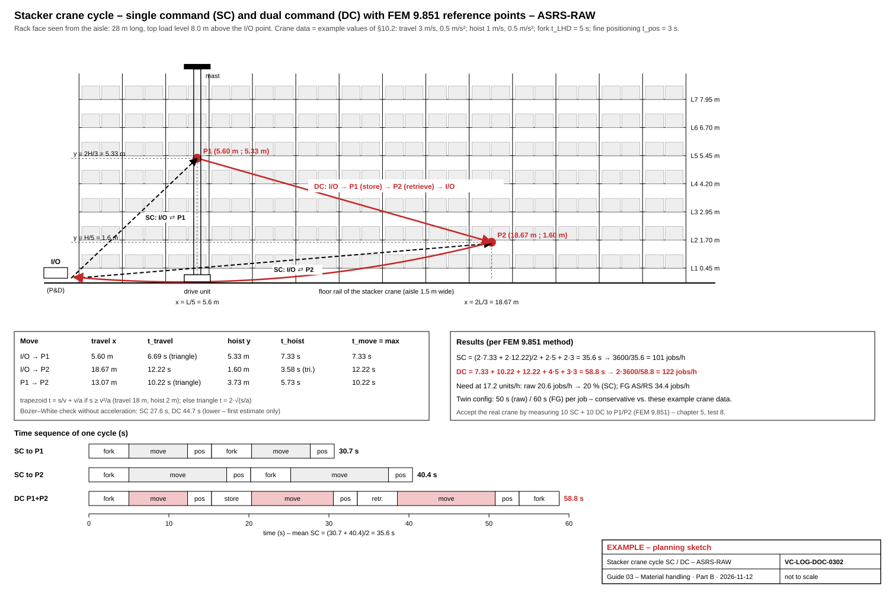
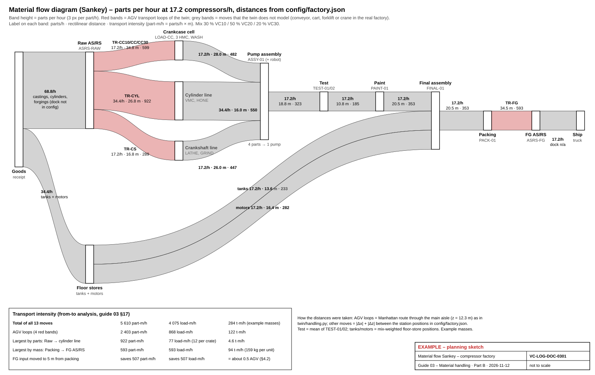
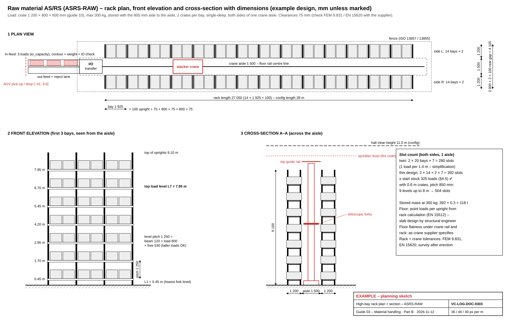
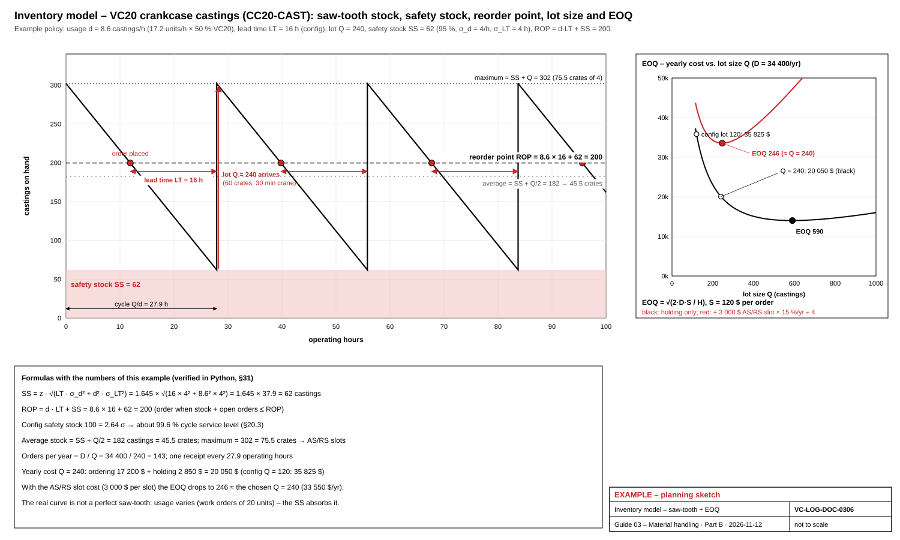
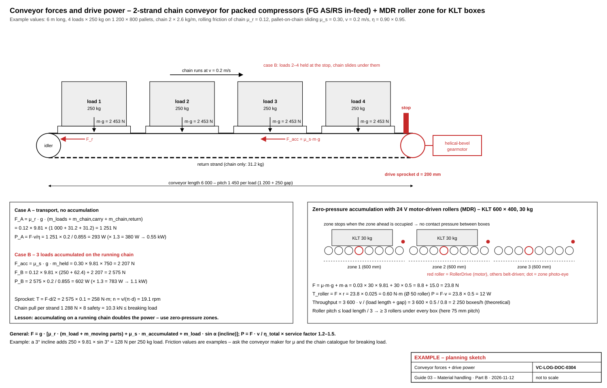
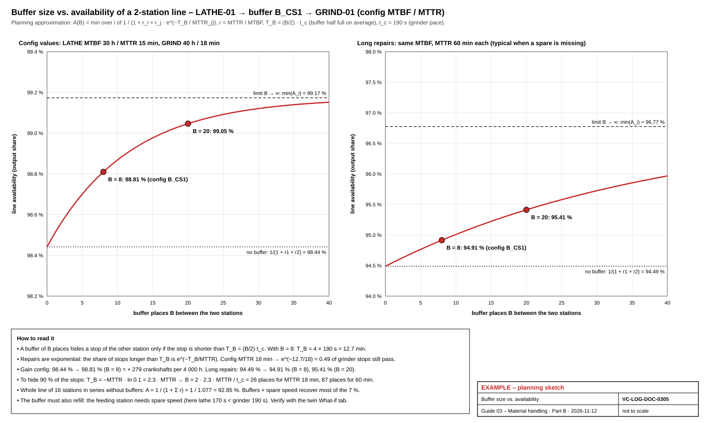
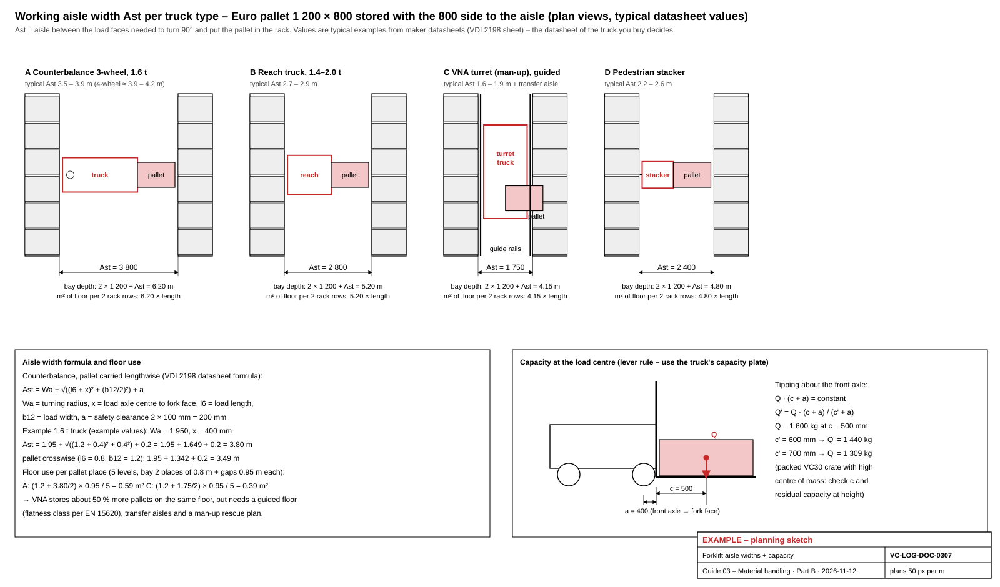
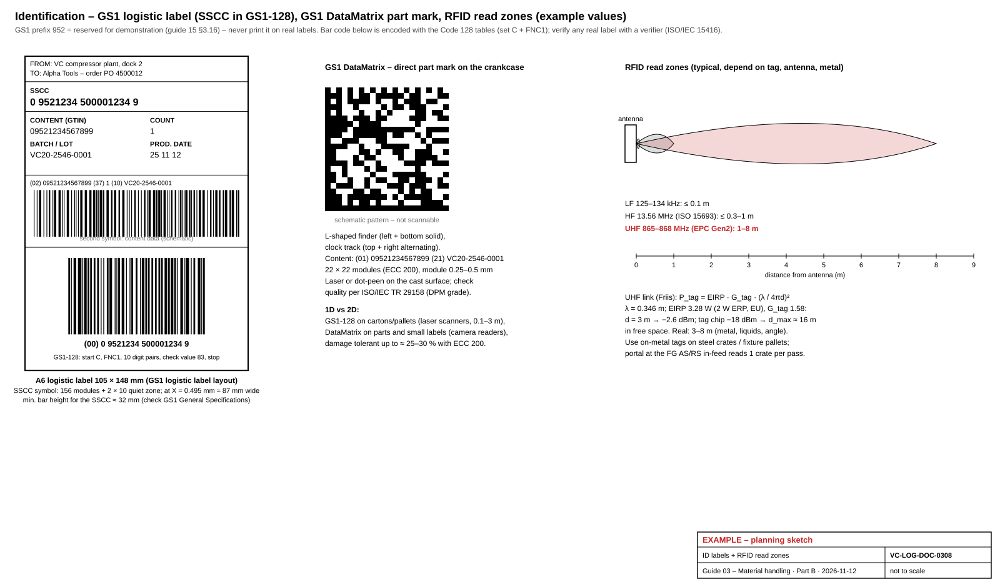

# Guide 03 – Material Handling: AGVs, AS/RS, Pallet Pool, Transport Loops

> **All numbers in this guide are example values** taken from `config/factory.json`, from the twin code, or
> from example runs of the twin. They are not data from your real factory or from a supplier.
> Replace them with measured values and supplier data before you buy or build anything.

## Contents

**Part A – the twin's material handling: model, sizing, implementation**

1. Purpose
2. Where in the twin
3. Concepts explained simply (material flow, AGV fleet, transport loops, AS/RS, pallet pool, buffers)
4. Model and formulas (trip time, fleet size, battery, crane utilisation, slots, pallet pool, buffers)
5. Implementing in the real factory – step by step
6. Checklists
7. Common mistakes and lessons learned
8. Limits of the twin
9. Key formulas at a glance
10. Science principles (kinematics, crane cycle SC / DC with drawing `03_asrs_cycle.svg`, Little, battery, fleet, rack physics, conveyors, stopping distance, docking statistics)
11. Detailed specification for implementation
12. Identification and numbering
13. Standards for this topic
14. Complete worked example – sizing material handling for 17.2 units/h
15. Data you still need from suppliers / measurements
16. Glossary

**Part B – intralogistics textbook, design reference and buy lists (added 2026-11-12)**

17. Material flow analysis – from-to matrix, transport intensity, Sankey (drawing `03_material_flow_sankey.svg`)
18. Storage systems – types, selection, racking standards and tolerances
19. High-bay AS/RS design – rack geometry, crane throughput, shuttles, VLM (drawing `03_rack_layout.svg`)
20. Inventory and warehouse sizing – ABC / XYZ, safety stock, reorder point, EOQ, slots (drawing `03_inventory_model.svg`)
21. Conveyors – types, power calculation, throughput, transfers, safety (drawing `03_conveyor_power.svg`)
22. Buffers and decoupling – buffer size vs. availability (drawing `03_buffer_availability.svg`)
23. Forklifts, tuggers and manual handling – types, capacity, aisle widths, milk run (drawing `03_forklift_aisles.svg`)
24. Load carriers – pallets, KLT boxes, special crates for crankcases
25. Identification – barcode, DataMatrix, RFID, labels (drawing `03_id_labels.svg`)
26. WMS functions, integration, storage and picking strategies, shipping
27. Safety in intralogistics – trucks, racks, cranes, conveyors, fire
28. Logistics KPIs
29. Buy list – catalogue examples + shopping list for the crankcase-line logistics
30. Corrections found in the review of 2026-11-12
31. How the numbers were checked + drawings of this guide

---

## 1. Purpose

Machines only produce if parts arrive on time and finished parts leave on time.
This guide explains the **material handling** of the twin:

- **AGVs** (automated guided vehicles): the fleet, vehicle states, battery and charging, how tasks are created and assigned.
- **AS/RS** (automated storage and retrieval system): rack slots, stacker crane cycle, job queue.
- **Pallet pool**: the fixture pallets that circulate in the crankcase machining cell.
- **Transport loops**: the kanban-type AGV routes between stores and machines.

For each part you get: how the twin models it, the formulas to size it (with the code's example numbers),
how to implement it in the real factory (fleet manager, VDA 5050, WMS, safety per ISO 3691-4),
commissioning tests, checklists, and mistakes to avoid.

Related guides and tabs: the FMS / order logic is in Guide 02. Mechanical interfaces (AGV ↔ station, AS/RS ↔ AGV,
docking accuracy) are designed in the tabs **Mechanical elements** and **AGV build**.

---

## 2. Where in the twin

### 2.1 Tabs and deep links

| What | Where | Deep link |
|---|---|---|
| Material handling panel (AGVs, AS/RS, pallet pool, transport loops) | Tab **Live factory**, card **Material handling** below the 3D view | `http://localhost:8080/` |
| 3D view of AS/RS, AGVs, chargers, routes | Live factory, camera **Logistics (AS/RS, AGV)** | `/?cam=logistics` |
| Castings per model at the load station, pallet pool in use | Tab **FMS & products**, card **FMS cell** | `/#fms` |
| Where each unit is (on AGV, at AS/RS entrance, in FG stock) | Tab **Order flow**, route map | `/#order` |
| AGV docking handshake (E84 style), AGV in the network diagram | Tab **FMS & products**, PLC section | `/#fms` |
| VDA 5050 / MQTT example messages | Tab **Communication** (step 10 "AGV brings castings to the load station") | `/?csstep=10#comm`, `/?cmmode=proto#comm` |
| Test AGV count, AGV speed, crane cycle, pallet count | Tab **What-if simulation**, table **Material handling** | `/#whatif` |
| Mechanical design of the interfaces | Tabs **Mechanical elements** (items 1–4) and **AGV build** (items 1–4) | `/?mxitem=3#mech`, `/?avitem=4#agv` |

### 2.2 Files

| File | What it contains |
|---|---|
| `twin/handling.py` | classes `Pool`, `ASRS`, `AGV`, `Transport`, `Handling` (dispatch, AGV step, receive, ship) |
| `twin/model.py` | `Buffer` (store / finished / per-model counts, `reserved`, `incoming`), machine `seize` / `release` of pallets |
| `twin/analytics.py` | bottleneck finder (crane / AGV fleet can be the bottleneck), battery alarm, what-if changes `agv`, `asrs`, `pools` |
| `twin/erp.py` | goods receipt → AS/RS put-away (`_receive`), shipping → crane retrieval (`_ship`) |
| `config/factory.json` | sections `pools`, `pallet_pools`, `asrs`, `agv`, `transports`; buffer keys `asrs`, `variant`, `per_variant`, `pos` |
| `web/ops.js` | `renderMH` – the Material handling panel |
| `web/factory3d.js` | 3D racks, cranes, AGVs, chargers, routes |

### 2.3 How to read the Material handling panel

| Card | Shows | Watch for |
|---|---|---|
| **AGV-01, AGV-02** | state in words, battery % (bar turns amber below 25 %), load (qty × part), current task, busy %, km driven | many minutes in "waiting for crane"; battery often low; busy % above about 75 % |
| **Raw material AS/RS** / **Finished goods AS/RS** | crane idle / storing / retrieving, slots used / slots, crane busy % (bar amber above 85 %), jobs waiting, stock per buffer | crane busy above 85 %; jobs waiting growing; FG slots near full |
| **Crankcase fixture pallets** | pallets in use / total, free pallets (bar amber at 0 free) | 0 free for a long time = pallets limit the cell |
| **Transport loops (kanban)** | per loop: trips, parts moved, active tasks | one loop with no trips while its line starves |

The card header shows the fleet size and the fleet busy share.
In 3D: AGV light **green** = driving, **amber** = loading or waiting for the crane, **blue** = charging. AGVs follow the **blue dashed routes**.

### 2.4 How to use it (10 minutes)

1. Open `/?cam=logistics`. Find the two AS/RS, the two chargers, the park positions, the main aisle.
2. Look at the Material handling card. Note AGV busy %, crane busy %, FG slots used.
3. Open **What-if**. In **Material handling** set **AGV fleet size = 1**. Run 8 h × 3 repetitions.
   Compare output and the bottleneck. (Expect the AGV fleet to become the bottleneck or very busy – see 4.2.)
4. Set the **Finished goods AS/RS crane cycle** to 120 s. Run again. Watch the FG crane utilisation (see 4.4).
5. Set **Crankcase fixture pallets = 4**. Run again. Watch the HMC utilisation (see 4.6).

---

## 3. Concepts explained simply

### 3.1 The material flow in this factory

```
Raw AS/RS ──AGV──> castings at load station (per model) ──> load station ──> pallet pool ──> HMC-01/02/03
Raw AS/RS ──AGV──> cylinder castings at boring ──> VMC ──> HONE ──> cylinder supermarket
Raw AS/RS ──AGV──> crankshaft forgings at lathe ──> LATHE ──> GRIND ──> crankshaft supermarket
Floor stores (tanks, motors per model) ──> final assembly (taken directly, no AGV in the twin)
Packaging ──> B_PK (3 places) ──AGV──> Finished goods AS/RS ──crane──> shipping
Supplier ──goods receipt──> crane put-away into Raw AS/RS
```

### 3.2 AGV fleet

Example fleet (`"agv"` in the config):

| Parameter | Value | Meaning |
|---|---|---|
| `count` | 2 | vehicles |
| `speed_m_s` | 1.2 m/s | driving speed (constant, no acceleration in the twin) |
| `load_s` / `unload_s` | 20 s / 20 s | time to take / give the load |
| `battery_h` | 8 h | battery time when driving or busy all the time |
| `charge_h` | 1.5 h | time to charge from 0 to 100 % |
| `low_battery_pct` | 25 % | go to the charger at or below this level |
| `aisle_z` | 12.3 m | position of the main aisle |
| `park` | 4 positions | where idle AGVs wait |
| `chargers` | 2 positions | charging stations |

**Route:** the twin drives "Manhattan" style: from the start point straight to the main aisle, along the aisle, then straight to the target (`Handling.route`).
If start and target are on one line, it drives directly.

**AGV states** (`handling.py`):

| State | Meaning | Counts as busy? |
|---|---|---|
| IDLE | no task, standing | no |
| TO_PICKUP | driving empty to the source | yes |
| WAIT_CRANE | at the AS/RS output, the crane has not yet brought the load | yes |
| LOADING | taking the load (20 s) | yes |
| TO_DROP | driving loaded to the destination | yes |
| UNLOADING | giving the load (20 s) | yes |
| TO_CHARGE | driving to a charger | no (but not available) |
| CHARGING | on the charger | no (available again from 60 %) |
| TO_PARK | driving to its park position after 45 s idle | no |

**When is an AGV available for a new task?**
- IDLE or TO_PARK **and** battery above 25 %, or
- CHARGING **and** battery at least 60 % (it leaves the charger early when work is waiting).

**Battery logic:**
- Driving or busy: battery drops by 100 % ÷ 8 h = **12.5 % per hour**.
- Standing (idle, parked): 15 % of that = **1.9 % per hour**.
- Charging: +100 % ÷ 1.5 h = **66.7 % per hour**, until 98 %, then IDLE.
- An IDLE AGV at or below 25 % goes to a **free** charger. If no charger is free, it waits (alarm below 10 %: "no free charger?").
- At start the batteries are 100 %, 93 %, 86 % … (7 % less per vehicle) so that not all vehicles need charging at the same time.

### 3.3 Transport loops (how AGV tasks are created)

A **transport** is a fixed loop "from buffer A to buffer B, batch n" (`"transports"` in the config):

| Loop | From | To | Batch |
|---|---|---|---|
| TR-CC10 / TR-CC / TR-CC30 | crankcase castings VC10 / VC20 / VC30 in Raw AS/RS | castings place at the load station `B_CC0` | 4 |
| TR-CYL | cylinder castings in Raw AS/RS | `B_CYL0` at boring | 12 |
| TR-CS | crankshaft forgings in Raw AS/RS | `B_CS0` at the lathe | 6 |
| TR-FG | `B_PK` packed compressors | Finished goods AS/RS | 1 |

Every **2 seconds** the dispatcher (`_dispatch`) checks every loop:

1. `q = min(batch, free space at destination, parts available at source)`. If q = 0 → no task.
2. If the destination is an **AS/RS** and its input conveyor is full (`io_capacity`, default 3 loads), no new delivery.
3. **Model-specific castings** (a source with `variant`) are brought **only if released work orders still need that model**
   (`variant_need` from the MES). Each model has its own places at the load station (`per_variant` = 4).
4. **No partial loads**, except when the line-side place is **completely empty** (then a smaller load is better than nothing).
5. All candidate tasks are sorted by **urgency**:
   - line side: `1 − (stock + incoming) ÷ capacity` (emptiest place first; per model for castings),
   - to a store: `(source stock − reserved) ÷ source capacity` (fullest source first – e.g. packaging output).
6. The most urgent task gets the **nearest available AGV** (shortest Manhattan distance to the source).

When a task is assigned, the source parts are **reserved** and the destination counts them as **incoming**.
So two AGVs never pick the same parts, and the destination is never over-filled.

If the source is in an AS/RS, a **crane retrieval job** is requested at the moment of assignment. The crane works while the AGV drives.
The AGV waits (WAIT_CRANE) only if the crane is not finished when it arrives.

### 3.4 AS/RS (automated storage and retrieval system)

Two AS/RS in the example:

| | Raw material AS/RS | Finished goods AS/RS |
|---|---|---|
| id | ASRS-RAW | ASRS-FG |
| Rack length | 28 m | 16 m |
| Levels | 7 | 5 |
| Crate positions per side (config `bays`; raw: 14 bays × 2 crates; FG: length ÷ 1.4 m) | 28 | 11 |
| Slots (= 2 sides × positions × levels; raw: config `slots`) | **392** (decided 2026-11-12, was 280) | **110** |
| Crane cycle | 50 s per job | 60 s per job |
| Unit load (parts per slot) | VC10 casting 6, VC20 casting 4, VC30 casting 3, cylinder 12, crankshaft 6 | 1 compressor crate |
| I/O point (AGV pick-up / drop) | [−41, 9.6] | [−0.8, 18.5] |

**Crane logic** (`ASRS.step`):
- One crane per AS/RS. It does one job at a time. Every job (store or retrieve) takes the fixed `crane_cycle_s`.
- Jobs wait in a queue. **Retrievals go first** (production must not wait), then stores in arrival order.
- The slot position (bay, level, side) is chosen at random – it is only for the 3D animation.

**Which jobs exist:**
- **Goods receipt** (purchase order arrives): one **store** job per unit load. Example: 120 VC20 castings ÷ 4 per load = 30 store jobs = 30 × 50 s = 25 min of crane time.
- **AGV task from the raw AS/RS:** one **retrieve** job per AGV task.
- **AGV delivery to the FG AS/RS:** one **store** job per unit load (here 1 crate). It waits on the input conveyor until the crane takes it.
- **Shipping:** one **retrieve** job per unit.

**Stock in lots:** the raw stores keep stock in **lots** (FIFO). A withdrawal takes from the oldest lot first, and the part record keeps the lot number. That is how a finished compressor can be traced to its casting lot.

### 3.5 Pallet pool

The crankcase cell uses **10 fixture pallets** (`"pools": [{"id": "PAL-CC", "count": 10}]`).

- The load station **takes** a free pallet when it starts clamping (`"seize": "PAL-CC"`).
- The loaded pallet waits in `B_PAL` ("Pallet pool (loaded)", capacity 8).
- A machining center takes the pallet the dispatching rule chooses, machines the part, and **gives the pallet back** when it finishes (`"release": "PAL-CC"`).
- No free pallet → the load station waits ("No free fixture pallet").

**Why a pool:** the number of pallets is a hard **WIP limit** for the cell. Loaded pallets in front of the machines are a **buffer** that keeps the HMCs running while the load station stops (operator break, missing casting).

The 3D pallet rack (`"pallet_pools"`, 2 levels, 8 m) and its shuttle are only a picture; the shuttle time is inside the 15 s pallet change time of the HMC.

### 3.6 Buffers

| Buffer type | Config | Behaviour in the twin |
|---|---|---|
| normal | `capacity` | holds up to `capacity` parts; a full buffer **blocks** the station before it |
| supermarket | `capacity` + `per_variant` | in addition, max `per_variant` parts of each model |
| store in AS/RS | `asrs: "ASRS-RAW"`, `stock` | stock in lots; changed by goods receipts and AGV withdrawals |
| floor store | `store: true`, `stock`, `pos` | like above, but no crane (tanks, motors) |
| finished goods | `finished: true` (+ `asrs`) | counts everything that arrived; in an AS/RS the free space = slots − stock − incoming |
| line-side rack | a buffer with `pos` filled by an AGV | drawn as a flow rack in 3D |

---

## 4. Model and formulas (with example values)

### 4.1 Trip time of one AGV task

```
trip time = empty drive to source + crane wait + load time + loaded drive + unload time
drive time = route length ÷ speed
```

Route lengths in the example layout (Manhattan route through the aisle at z = 12.3 m):

| Loop | Loaded route | Loaded drive at 1.2 m/s |
|---|---|---|
| TR-CC10 / CC / CC30 (Raw AS/RS → load station) | 34.8 m | 29 s |
| TR-CYL (Raw AS/RS → boring) | 26.8 m | 22 s |
| TR-CS (Raw AS/RS → lathe) | 16.8 m | 14 s |
| TR-FG (packaging → FG AS/RS) | 34.5 m | 29 s |

**Example – FG trip:** AGV parked at [−7.2, 15.6] drives empty to packaging [24.6, 15.2]:
3.3 m + 31.8 m + 2.9 m = 38 m → 32 s. Then load 20 s + loaded 29 s + unload 20 s.

```
FG trip ≈ 32 + 20 + 29 + 20 = 101 s ≈ 100 s
```

**Example – casting trip:** empty drive park → Raw AS/RS ≈ 40 m → 33 s; crane needs 50 s, started at assignment → wait ≈ 50 − 33 = 17 s;
load 20 s; loaded 29 s; unload 20 s.

```
casting trip ≈ 33 + 17 + 20 + 29 + 20 = 119 s ≈ 120 s
```

### 4.2 AGV fleet size

```
trips per hour of a loop = parts needed per hour ÷ parts per trip
workload (vehicle-seconds per hour) = Σ (trips per hour × trip time)
AGVs needed = workload ÷ (3600 × target utilisation × availability)
```

Example at the **ideal factory rate of 17.2 units/h** (Guide 02, section 4.2):

| Loop | Parts per unit | Parts per trip | Trips/h | Trip time | Workload s/h |
|---|---|---|---|---|---|
| FG | 1 | 1 | 17.2 | 100 s | 1,720 |
| Castings (3 loops) | 1 | 4 (smaller loads happen) | ≈ 5.0 * | 120 s | 600 |
| Cylinders | 2 | 12 | 2.9 | 115 s | 334 |
| Crankshafts | 1 | 6 | 2.9 | 105 s | 305 |
| **Total** | | | **≈ 28** | | **≈ 2,960** |

\* In a 24 h twin run there were 100 casting trips for 345 units = 0.29 trips per unit (not 0.25), because per-model places hold only 4 and some loads are smaller. 0.29 × 17.2 ≈ 5.0.

```
availability (charging)   = 6 h work ÷ (6 h work + 1.1 h charging) ≈ 0.85   (see 4.3)
target utilisation         = 0.70  (leave room for peaks, traffic, blocked paths)
AGVs needed = 2,960 ÷ (3600 × 0.70 × 0.85) = 2,960 ÷ 2,142 = 1.38  → 2 AGVs
```

**Check against the twin:** 24 h run (EDD, 14.4 units/h): 582 trips = 24.3 trips/h, fleet busy 37 %.
Busy time per trip = 0.37 × 2 AGVs × 86,400 s ÷ 582 ≈ 110 s – close to the 100–120 s estimate.

**Redundancy:** with 2 AGVs, one breakdown leaves one AGV at about 2,960 ÷ 3,600 = 82 % workload (no charging reserve).
Decide whether you need **N + 1** vehicles, or a manual back-up (forklift / hand cart) for the FG loop. Note that the
FG loop is more than half of the workload: putting the FG AS/RS input **closer to packaging** (or a conveyor) is the cheapest way to save an AGV.

### 4.3 Battery and charging

```
drain while busy  = 100 % ÷ battery_h = 100 ÷ 8 = 12.5 %/h
drain while idle  = 0.15 × 12.5 = 1.9 %/h
charge rate       = 100 % ÷ charge_h = 100 ÷ 1.5 = 66.7 %/h
```

**Worst case (always busy):** 100 % → 25 % = 75 % ÷ 12.5 = **6 h of work**.
Charge 25 % → 98 % = 73 % ÷ 66.7 = **1.1 h**. Minimum charge to be available again (25 % → 60 %) = 35 ÷ 66.7 = 0.5 h.

```
availability = 6 ÷ (6 + 1.1) = 0.85
```

**At the twin's real load (busy 37 %):** average drain = 0.37 × 12.5 + 0.63 × 1.9 = 5.8 %/h → 75 ÷ 5.8 ≈ **13 h between charges**.

**Chargers needed:**

```
chargers ≥ AGVs × charging time ÷ (work time + charging time)  (+1 if the fleet is small)
2 × 1.1 ÷ 7.1 = 0.31 → 1 charger is enough on average; the config has 2 (no waiting, one spare)
```

Real batteries: use the supplier's energy data (Wh per metre, Wh per lift, standby power) and the battery's usable capacity
(LiFePO4 is often used between about 20 % and 90–100 %). Opportunity charging (short charges at stations) changes the calculation.

### 4.4 Crane utilisation and AS/RS throughput

```
crane utilisation = (stores per hour + retrievals per hour) × cycle time ÷ 3600
maximum moves per hour = 3600 ÷ cycle time
```

**Finished goods AS/RS** (cycle 60 s): every unit = 1 store + 1 retrieval (shipping) = 2 moves = 120 s.

```
max units/h through the FG AS/RS = 3600 ÷ 120 = 30 units/h  (at 100 %)
at 17.2 units/h: utilisation = 17.2 × 120 ÷ 3600 = 57 %
24 h twin run, 14.4 units/h: estimate 48 %, twin showed 45 %
```

Design rule: plan **≤ 80–85 %** crane utilisation (queues grow very fast above that). The panel turns the bar amber above 85 %.
The bottleneck finder names a crane (or the AGV fleet) as **bottleneck** when its recent busy share is above 88 % and above the busiest machine.

**Raw material AS/RS** (cycle 50 s), moves per finished unit (mix 30/50/20):

| Move | Per unit |
|---|---|
| retrieve castings (AGV trips) | 0.29 |
| retrieve cylinders (2 ÷ 12) | 0.17 |
| retrieve crankshafts (1 ÷ 6) | 0.17 |
| store castings from receipts (0.3/6 + 0.5/4 + 0.2/3) | 0.24 |
| store cylinders (2 ÷ 12) | 0.17 |
| store crankshafts (1 ÷ 6) | 0.17 |
| **Total** | **≈ 1.2 moves** |

```
at 17.2 units/h: 17.2 × 1.2 × 50 s ÷ 3600 ≈ 29 %
```

(The 24 h twin run showed 16 % because the start stock covered most of the day – few receipts were put away.)
Peaks matter more than averages: one receipt of 120 VC20 castings = 30 store jobs = 25 min of crane time in one block.
Because retrievals have priority, production is not stopped, but the put-away takes longer.

### 4.5 AS/RS slot sizing

```
slots needed = Σ over items ( maximum stock ÷ parts per unit load ) × (1 + reserve)
maximum stock ≈ safety stock + purchase lot   (just after a delivery)
```

**Raw AS/RS example** (safety stock and lot from the `erp.items` config):

| Item | Safety + lot | Unit load | Loads |
|---|---|---|---|
| CC10 casting | 60 + 120 = 180 | 6 | 30 |
| CC20 casting | 100 + 120 = 220 | 4 | 55 |
| CC30 casting | 40 + 60 = 100 | 3 | 34 |
| Cylinder casting | 300 + 240 = 540 | 12 | 45 |
| Crankshaft forging | 150 + 120 = 270 | 6 | 45 |
| **Total** | | | **209** |

```
with 15 % reserve: 209 × 1.15 ≈ 240 slots ≤ 392  → OK in steady state (61 % full)
```

**Start stock check:** the example **start stock** needs 240/6 + 360/4 + 120/3 + 900/12 + 480/6
= 40 + 90 + 40 + 75 + 80 = **325 loads**. With the old 280 slots it did not fit. **Decided 2026-11-12:** the raw AS/RS has
**392 slots** (2 sides × 14 bays × 2 crates × 7 levels, see §19 below and guide 31), so 325 loads fit (83 % full, 67 slots free).
Note: the twin still does **not** check raw AS/RS slots (it only checks FG slots).

**FG AS/RS example (110 slots, 1 crate per slot):**

```
slots ≥ safety stocks + units waiting for incomplete orders + production between shipments
safety stocks = 6 + 10 + 4 = 20
hours of production the rest can hold = (110 − 20) ÷ 17.2 units/h ≈ 5.2 h
```

So if shipping stops for more than about **5 hours** at full output, the FG AS/RS is full and the line stops
(Guide 02, section 7.1 shows exactly this jam). If trucks leave once per shift (8 h), the FG store needs at least
20 + 17.2 × 8 ≈ 158 slots plus orders waiting for completion – or shipping must be more frequent.

### 4.6 Pallet pool size (Little's law)

```
Little's law:  pallets in the loop N = throughput λ × time a pallet spends in the loop W
```

Time per pallet without waiting: load station 89 s + HMC 343.5 s + pallet change 15 s = **447.5 s**.

| Situation | λ | N = λ × W |
|---|---|---|
| Cell runs at factory pace | 17.2/h = 0.00478/s | 0.00478 × 447.5 = **2.1 pallets** |
| All 3 HMCs fully busy | 30.1/h = 0.00836/s | 0.00836 × 447.5 = **3.7 pallets** |

That is the **minimum**. Add pallets as a buffer:

```
coverage time of loaded pallets = loaded pallets × HMC time per part ÷ number of HMCs
6 loaded pallets × 358.5 s ÷ 3 = 717 s ≈ 12 min of machining without the load station
```

Example design: 3 pallets in the machines + 1 at the load station + 6 loaded waiting = **10 pallets** (config value).
Too few pallets → HMCs starve when the load station stops. Too many → money in fixtures, floor space, and longer waiting (more WIP).
Use the what-if tab (pallet count 4, 6, 10, 14) to see the effect.

### 4.7 Buffer sizing

```
buffer to protect the downstream station ≥ consumption rate × time the supply can be interrupted
```

| Buffer | Example | Calculation |
|---|---|---|
| `B_PK` (packed, waiting for AGV), 3 places | AGV may need up to ~10 min to come (charging, other tasks) | at bottleneck pace 1 unit per 209 s: 3 × 209 s ≈ 10.5 min → **3 places** |
| `B_CC0` castings at load station, 4 per model | AGV casting trip ≈ 2 min + crane queue | 4 castings × 89 s ≈ 6 min of load-station work per model |
| `B_PAL` loaded pallets, 8 | load station stops (break, missing casting) | see 4.6: 6–8 pallets ≈ 12–16 min |

A buffer also protects **upstream**: when the downstream station is down, the upstream station can continue until the buffer is full.

```
time until the upstream station is blocked = free places × upstream cycle time
```

---

## 5. Implementing in the real factory – step by step

### Step 1 – Define the load units
1. For each material: container type (crate, pallet, bin), parts per container (the twin's `unit_load`), weight, dimensions with overhang.
2. One container standard for AS/RS **and** AGV **and** forklift if possible (the Mechanical elements tab uses a crate on its 2 long edges so a fork and an underride AGV both fit below).
3. Label every container (barcode / RFID): container ID, item, lot, quantity, model.

### Step 2 – Make a from–to matrix and calculate trips
1. List every transport: from, to, parts per hour per model, parts per trip.
2. Calculate trips per hour and trip time (section 4.1, 4.2) with the real layout.
3. Calculate AGV count, chargers, crane utilisation, slots (sections 4.2–4.5) for the **peak** hour, not only the average.
4. Put the real values into `config/factory.json` and run the what-if tab with 1, 2, 3 AGVs.

### Step 3 – Choose the vehicles
1. Load type decides the vehicle: crates → underride (latent) lifting AGV; machining pallets → pallet AGV with lift deck; finished crates → underride AGV or conveyor.
2. Navigation: natural-feature / laser-reflector / QR code floor grid / magnetic tape. Ask each supplier for **stop accuracy and repeatability** (typical claims are a few mm to ±10 mm; measure it – step 9).
3. Station interfaces must accept the vehicle's stop error (floating deck, cone pins, V-guides – see AGV build item 4 "docking accuracy").
4. Request the supplier's **VDA 5050** compliance and version, and a **factsheet** (dimensions, speeds, load, battery, safety fields).

### Step 4 – Fleet manager
The fleet manager is the "MES of the AGVs". It must do what the twin's `Handling` does, and more:

| Function | In the twin | Real fleet manager |
|---|---|---|
| Create transport orders | kanban loops every 2 s | from MES / WMS calls, or from its own kanban rules |
| Choose vehicle | nearest available AGV | nearest / lowest cost / battery-aware |
| Traffic control | **none** (AGVs pass through each other) | intersections, one-way aisles, deadlock prevention, waiting points |
| Charging | go to charger at ≤ 25 %, available from 60 % | charging strategy, opportunity charging |
| Station handshake | implicit | I/O handshake (E84 style) or messages per station |
| Error handling | none | blocked path, lost load, obstacle, timeouts, manual recovery |
| Reporting | busy %, km, trips | KPIs, order history, error log |

**VDA 5050** is the open interface between the fleet manager (master control) and the vehicles, published by VDA and VDMA.
It uses **MQTT** with **JSON** messages. Main topics: `order` (route as nodes and edges with actions), `instantActions`
(e.g. pause, cancel), `state` (position, battery, errors, load), `visualization`, `connection`, `factsheet`.
Benefit: vehicles of different suppliers under one fleet manager. Check the version (for example 2.x) both sides support.
The twin's Communication tab shows a **simplified** example of such an order message – not the full schema.

### Step 5 – WMS and AS/RS control
1. **WMS** (warehouse management system) knows every slot, container ID, item, lot, quantity, and reservations.
2. ERP → WMS: goods receipt expected (purchase order), shipping order.
3. WMS → AS/RS PLC (material flow controller): transport telegrams "store container X in slot Y" / "retrieve slot Y to output"; PLC → WMS: confirmation, faults.
4. MES → WMS: material call (castings of model VC20 for work order WO-0012) – like the twin's `variant_need`.
5. WMS → fleet manager: "container X ready at AS/RS output" → AGV order.
6. Rules to copy from the twin: **retrievals for production before put-away**, **FIFO by lot**, **reservations** (never promise the same container twice), **per-model counting**, **capacity alarm** for the FG store.
7. Front end: input conveyor with **contour check** (size), weight check, barcode/RFID read; reject lane for bad loads. Limit the input conveyor (the twin's `io_capacity` = 3 loads).

### Step 6 – Safety
**AGVs – ISO 3691-4** (driverless industrial trucks and their systems) is the main standard for AGV safety:
1. Do a **risk assessment** of the whole system (vehicles + routes + stations + people), not only of the vehicle.
2. Personnel detection: safety laser scanners (commonly type 3 per IEC 61496-3) with **speed-dependent protective fields**; bumpers where needed.
3. The standard defines zones of the operating area (for example restricted and confined zones) with rules for clearance, speed and marking. Mark routes on the floor; keep clearance to racks and machines as required.
4. Safety functions (emergency stop, speed limits, field switching, load handling) need the **required performance level (PLr)** given in ISO 3691-4; they are verified with ISO 13849-1/-2.
5. Warning lights and sounds when moving, turning, lifting.
6. Floor: flatness, slope, joints, cleaning, slippery spots. Ask the supplier for limits; measure the floor before go-live.
7. The **system integrator** is responsible for the whole system conformity (in the EU: CE marking under the machinery legislation). Agree in the contract who is the integrator.

**AS/RS:**
1. Stacker cranes: **EN 528** (safety of rail-dependent storage and retrieval equipment).
2. Fence and openings: safety distances per ISO 13857 (reach) and ISO 13855 (positioning of protective devices; e.g. S = 1600 × T + 850 mm for multi-beam light curtains, as used in the Mechanical elements item 3 tab). The 2024 edition of ISO 13855 changed parts of the method – verify the formula in the edition you use (guide 16).
3. Conveyors at the front end: EN 619. Muting light curtains at the AGV transfer: no stop position inside the fence opening.
4. Racks: design and tolerances by the rack supplier's standards (for example the EN 15512 / EN 15620 / EN 15635 family in Europe – check which apply).
5. Fire protection (sprinklers in high racks), maintenance access with lock-out, rescue of a person from the crane – follow local regulations and the insurer.

### Step 7 – Infrastructure
1. **Wi-Fi survey** along all AGV routes (roaming without loss of connection). Plan a separate network segment for AGVs.
2. Chargers: power supply, space, ventilation as the battery supplier requires, protection against collision.
3. Park positions out of the main aisle.
4. Floor marking and signs; pedestrian crossings.

### Step 8 – Connect to the twin
1. The twin can stay a **planning and training tool**: keep the config updated with real trip times, crane cycles, AGV count.
2. Optional: send real AGV positions and states from the fleet manager to a dashboard. (The current twin has no AGV ingest API – only machine data via `/api/ingest`. A bridge would need new code.)

### Step 9 – Commissioning tests

| # | Test | How | Pass criterion (set your own) |
|---|---|---|---|
| 1 | AGV stop accuracy | 30 dockings per station, measure x / y / angle | mean ± 3σ inside the station's capture range |
| 2 | Safety fields | test piece in the path at each speed and in curves; with max load | AGV stops before contact; matches the risk assessment |
| 3 | Emergency stop | E-stop at max speed, max load, on the steepest slope | braking distance ≤ the value in the risk assessment |
| 4 | Station handshake | every signal of the E84-style handshake, plus missing / late signal | nothing moves without the full handshake; timeouts give a clear fault |
| 5 | Communication loss | switch off Wi-Fi access point on the route | AGV stops safely and recovers; fleet manager shows the fault |
| 6 | Battery endurance | full shift at planned trips/h | no AGV below the low limit without a free charger |
| 7 | Throughput | run planned trips/h for 2 h, then +20 % | all transports done; no line starved by AGVs |
| 8 | Crane cycle time | measure single cycles to defined rack positions (FEM 9.851 describes a standard method) | ≤ the value used in the planning (twin: 50 s raw, 60 s FG) |
| 9 | Contour / weight check | oversized and overweight loads on the input conveyor | rejected, not stored |
| 10 | Inventory accuracy | count 100 random slots physically vs WMS | 100 % match (find the cause of every difference) |
| 11 | Pallet pool | run the cell with the planned pallet count for one shift | HMCs not starved by missing pallets |
| 12 | FG full test | simulate shipping stop | alarm before full; documented procedure |
| 13 | Recovery | person blocks an AGV, AGV loses load, crane fault mid-job | documented, trained recovery for each |

---

## 6. Checklists

### 6.1 Design checklist
- [ ] Load units defined (type, size, weight, parts per unit) and labelled.
- [ ] From–to matrix with parts per hour **per model**.
- [ ] Trip times calculated with real route lengths, speeds, load/unload times, crane waits.
- [ ] AGV count for the **peak** hour at ≤ 70–75 % utilisation, with charging availability; redundancy decided.
- [ ] Chargers: number, location, power.
- [ ] Crane utilisation ≤ 80–85 % at peak (including receipt put-away peaks).
- [ ] Slots: max stock ÷ unit load + reserve, for raw **and** FG; **start stock fits**.
- [ ] FG store holds the production between shipments (hours of output) + safety stock + orders waiting.
- [ ] Pallet pool: Little's law minimum + buffer; checked in what-if.
- [ ] Buffers: consumption rate × interruption time.

### 6.2 Interface checklist
- [ ] VDA 5050 version agreed with all vehicle suppliers and the fleet manager supplier.
- [ ] Station handshake signals listed (E84 style or similar), with timeouts.
- [ ] WMS ↔ AS/RS PLC telegrams defined (store, retrieve, confirm, fault).
- [ ] MES → WMS material call per model and work order.
- [ ] ERP → WMS goods receipt / shipping order; WMS → ERP confirmations.
- [ ] Lot and container ID kept through every move (traceability).

### 6.3 Safety checklist
- [ ] Risk assessment for the whole AGV system per ISO 3691-4 (routes, stations, people, other traffic).
- [ ] Safety fields per speed and per route section, documented and tested.
- [ ] Zones marked on the floor; clearances as required.
- [ ] AS/RS per EN 528; fence distances per ISO 13857 / ISO 13855; conveyors per EN 619.
- [ ] System integrator and CE / conformity responsibility written in the contract.
- [ ] Fire protection and rescue procedures approved locally.

### 6.4 Operation checklist (daily / weekly)
- [ ] AGV battery health, charger function, bumpers and scanner windows clean.
- [ ] Crane utilisation and jobs waiting trend (weekly).
- [ ] FG slots used vs alarm level.
- [ ] Pallet count physically = pallet count in the system; damaged pallets removed.
- [ ] Inventory spot check WMS vs physical.

---

## 7. Common mistakes and lessons learned

| Mistake | What happens | Better |
|---|---|---|
| FG store sized only for safety stock | a few hours without shipping → FG full → AGV cannot unload → packaging and the whole line block (Guide 02, 7.1) | size FG for production between shipments; FG capacity alarm; shipping rules **per model** |
| Average instead of peak | the crane is fine on average but a 120-casting receipt blocks it for 25 min | check peaks; split big receipts; retrievals first |
| Start stock larger than the AS/RS | material cannot be stored at go-live (old example config: 325 loads for 280 slots – fixed: 392 slots) | calculate slots for the start stock too |
| AGVs bring material "to fill places" | line side full of a model nobody ordered; the needed model waits | bring model-specific material only for released work orders (twin: `variant_need`) |
| Partial loads all the time | many trips with few parts | full loads, partial only when the line-side place is empty |
| No reservations | two AGVs go for the same container; a place is over-filled | reserve source, count incoming at destination |
| AGV count from the average without charging | AGVs are "enough" on paper, but one is always charging | include availability (charging) and a target utilisation |
| FG input far from packaging | the FG loop takes more than half of all AGV time | short FG route or conveyor |
| Rigid docking for an AGV with ±10 mm stop error | jams, damage, operator calls | floating deck, cone pins, V-guides (AGV build item 4) |
| No plan for Wi-Fi | AGVs stop at dead spots | Wi-Fi survey before installation |
| Safety only for the vehicle | dangerous spots at stations and crossings | risk assessment of the whole system |
| Fixture pallets not tracked | lost or damaged pallets reduce the real pool | RFID on pallets; physical count = system count |

---

## 8. Limits of the twin

1. **No AGV traffic control.** AGVs follow fixed routes through one main aisle and pass through each other. No waiting at crossings, no deadlocks. Real trip times will be longer.
2. **Constant speed**, no acceleration, no curves, no slow zones, no lift time (only `load_s` / `unload_s`).
3. **Simple battery model:** linear drain and charge, no ageing, no temperature, no charge curve.
4. **No AGV breakdowns** and no maintenance of AGVs or cranes (machines have MTBF/MTTR, handling equipment has not).
5. **Crane cycle is fixed** per job, independent of slot position. No dual-command cycles (store + retrieve in one trip).
6. **One crane retrieval per AGV task**, even when the batch is more than one unit load (e.g. 4 VC30 castings = 2 loads of 3).
7. **Raw AS/RS slots are not enforced** (only shown). FG slots **are** enforced (AGV stops delivering when full).
8. **Slot position is random** and only for 3D.
9. **Floor stores (tanks, motors)** feed final assembly directly – no AGV, no forklift, no line-side stock.
10. **Pallet pool shuttle in 3D is illustrative**; its time is inside the 15 s pallet change.
11. **No forklifts, no manual carts, no operators.**
12. **No live AGV data input** – the twin cannot (yet) show the real fleet.
13. All values (speeds, cycles, battery, slots, unit loads) are **example values**.

---

## 9. Key formulas at a glance

| Formula | Meaning | Example | Section |
|---|---|---|---|
| `t = s/v + v/a` (if s ≥ v²/a), else `t = 2√(s/a)` | move time with acceleration (trapezoid / triangle profile) | AGV 25.4 m: 23.6 s | 10.1 |
| `t_move = max(t_x, t_y)` | crane: travel and hoist at the same time | 7.3 s to P1 | 10.2 |
| `t_SC = t(P1) + t(P2) + 2 t_LHD + 2 t_pos` | single-command cycle (FEM 9.851 points) | 35.6 s | 10.2 |
| `t_DC = t(P1) + t(P1→P2) + t(P2) + 4 t_LHD + 3 t_pos` | dual-command cycle | 58.8 s | 10.2 |
| `E(SC) = T (1 + b²/3)`, `E(DC) = T/30 (40 + 15b² − b³)` | Bozer–White travel time (constant speed) | 11.6 s / 15.7 s | 10.2 |
| `N = λ × W` | pallets in the loop (Little) | 3.7 pallets | 4.6, 10.3 |
| `E = V × Ah`, `C-rate = I / Ah` | battery energy, current ratio | 4.8 kWh, 0.5C = 50 A | 10.4 |
| `P = m g C_rr v / η + P_aux` | AGV driving power | ≈ 450 W | 10.4 |
| `AGVs = workload × traffic / (3600 × ρ_target × A_battery)` | fleet size | 1.77 → 2 (+1) | 10.5, 14 |
| `δ = 5 w L⁴ / (384 E I)` | beam deflection, uniform load | 0.25 mm | 10.6 |
| `s_stop = v t_r + v² / (2 a_b)` | AGV stopping distance | 0.96 m | 10.8 |
| `slots = Σ max stock / unit load × (1 + reserve)` | AS/RS size | 240 ≤ 392 | 4.5 |

---

## 10. Science principles

Queueing (utilisation, Kingman) is explained in guide `02`, chapter 10; reliability in guide `01`,
chapter 10. Here: the physics and maths of moving and storing loads.

### 10.1 Kinematics of a move – the trapezoid profile

A vehicle or crane axis accelerates with a (m/s²) to the top speed v (m/s), drives at v, and brakes
with a (same value assumed):

```
time to reach v:      t_a = v / a
distance needed:      s_a = v² / (2a)      (the same again for braking)
if s ≥ v²/a  (trapezoid):  t = 2 × v/a + (s − v²/a) / v  =  s/v + v/a
if s < v²/a  (triangle):   t = 2 × √(s / a),  top speed reached only √(s × a)
```

So acceleration adds **v/a** to every move (compared with constant speed). Example AGV with
v = 1.2 m/s, a = 0.5 m/s² (example values – ask the supplier): v/a = 2.4 s, v²/a = 2.88 m.

The twin uses **constant speed** (no acceleration, no turning, guide limit 8.2). Effect on the FG loaded
route (packaging → FG AS/RS, 34.5 m in 3 straight segments, AGV stops and turns at each corner):

| Segment | Length | Twin (s / 1.2) | With acceleration |
|---|---|---|---|
| packaging → aisle | 2.9 m | 2.4 s | 2.9/1.2 + 2.4 = 4.8 s |
| along the aisle | 25.4 m | 21.2 s | 21.2 + 2.4 = 23.6 s |
| aisle → FG I/O | 6.2 m | 5.2 s | 5.2 + 2.4 = 7.6 s |
| 2 turns on the spot (example 4 s each) | – | 0 | 8.0 s |
| **Total** | 34.5 m | **28.8 s** | **44.0 s (+53 %)** |

Lesson: enter in the config an **effective** speed = route length / real trip time measured or simulated
by the AGV supplier, not the top speed. Here 34.5 / 44 = 0.78 m/s instead of 1.2 m/s.

### 10.2 AS/RS crane cycle – single and dual command

A stacker crane moves **horizontally** (travel) and **vertically** (hoist) at the same time. The move ends
when the slower axis arrives:

```
t_move = max(t_travel, t_hoist)      (each axis with its own trapezoid, 10.1)
```

**Single command (SC):** I/O → slot → I/O, one store **or** one retrieval.
**Dual command (DC):** I/O → store in slot 1 → go to slot 2 → retrieve → I/O. Two jobs in one trip.

FEM 9.851 defines reference points for comparing cycle times: P1 at about (1/5 length, 2/3 height) and
P2 at (2/3 length, 1/5 height) from the I/O point (check the definition in the current FEM document).
Single cycle = mean of the cycles to P1 and P2; dual cycle = I/O → P1 → P2 → I/O.

**Example raw AS/RS** (rack 28 m, top load level 8 m above I/O; crane data are **example values**:
travel 3 m/s, 0.5 m/s²; hoist 1 m/s, 0.5 m/s²; load handling (fork in + out) t_LHD = 5 s; fine
positioning t_pos = 3 s per stop):

| Move | Travel x | t_travel | Hoist y | t_hoist | t_move |
|---|---|---|---|---|---|
| I/O → P1 | 5.6 m | triangle: 2√(5.6/0.5) = 6.7 s | 5.33 m | 5.33/1 + 1/0.5 = 7.3 s | **7.3 s** |
| I/O → P2 | 18.7 m | 18.7/3 + 3/0.5 = 12.2 s | 1.6 m | triangle: 2√(1.6/0.5) = 3.6 s | **12.2 s** |
| P1 → P2 | 13.1 m | triangle: 2√(13.1/0.5) = 10.2 s | 3.73 m | 3.73 + 2 = 5.7 s | **10.2 s** |

```
single cycle = (2 × 7.3 + 2 × 12.2) / 2 + 2 × 5 + 2 × 3 = 19.6 + 16 = 35.6 s  → 3600 / 35.6 = 101 jobs/h
dual cycle   = 7.3 + 10.2 + 12.2 + 4 × 5 + 3 × 3 = 29.8 + 29 = 58.8 s → 2 × 3600 / 58.8 = 122 jobs/h
```



Dual cycles give about 20 % more jobs per hour – but only when a store and a retrieval are waiting at the
same time. The twin does single cycles only, with a fixed 50 s (raw) / 60 s (FG) – conservative compared
with these example crane data.

**Quick estimate without acceleration (Bozer & White, 1984)** for random storage, I/O at the lower corner:

```
t_x,max = L / v_x,   t_y,max = H / v_y,   T = max of both,   b = min / max   (0 < b ≤ 1)
E(SC travel) = T × (1 + b²/3)
E(DC travel) = T / 30 × (40 + 15 b² − b³)
Example: t_x,max = 28/3 = 9.33 s, t_y,max = 8/1 = 8.0 s → T = 9.33 s, b = 0.857
E(SC) = 9.33 × (1 + 0.735/3) = 11.6 s     E(DC) = 0.311 × (40 + 11.0 − 0.63) = 15.7 s
+ fixed times: SC 11.6 + 16 = 27.6 s;  DC 15.7 + 29 = 44.7 s
```

This formula ignores acceleration, so it gives lower times than the FEM-point method above. Use it only for
first estimates; use the supplier's cycle time (measured per FEM 9.851) for the design.

### 10.3 Little's law for the pallet pool and for transport WIP

`N = λ × W` (derivation in guide 02, 10.1) works for any loop: fixture pallets (4.6), AGVs ("vehicles
busy = trips per hour × trip time / 3600"), and loads on the AS/RS input conveyor. Example AGVs:
24.3 trips/h × 110 s / 3600 = 0.74 vehicles busy on average = 37 % of 2 AGVs – exactly the twin's
fleet busy value (4.2).

### 10.4 Battery energy, C-rate and AGV energy use

```
energy      E [Wh] = nominal voltage V × capacity [Ah]
usable      E_use = E × (SoC_max − SoC_min)
C-rate      = current [A] / capacity [Ah]     (1C = full capacity in 1 h; 0.5C = in 2 h)
charge time ≈ ΔSoC × Ah / I_charge  (+ time for the constant-voltage end phase of lithium batteries)
```

**Example battery (example values):** LiFePO4, 48 V nominal (15 cells × 3.2 V), 100 Ah:

```
E = 48 × 100 = 4 800 Wh = 4.8 kWh
twin window 25 % → 98 %:  E_use = 4.8 × 0.73 = 3.50 kWh
charging at 0.5C = 50 A:  73 Ah / 50 A = 1.46 h ≈ the config charge_h = 1.5 h
grid energy per charge ≈ 3.50 / 0.9 (charger efficiency, example) = 3.9 kWh
```

**Power of a driving AGV** (example: vehicle 500 kg + load 500 kg = 1 000 kg; rolling resistance
coefficient C_rr = 0.015 for polyurethane wheels on concrete – example; drive efficiency η = 0.75;
auxiliary power for computer, scanners, Wi-Fi, lights P_aux = 150 W):

| Part | Calculation | Power |
|---|---|---|
| Rolling at 1.2 m/s | 1 000 × 9.81 × 0.015 × 1.2 / 0.75 | 235 W |
| Acceleration (6 starts per ≈ 100 s trip) | 6 × ½ × 1 000 × 1.2² / 0.75 / 100 s | 58 W |
| Lifting 500 kg by 60 mm, 1 lift per trip | 500 × 9.81 × 0.06 / 0.6 / 100 s | 5 W |
| Auxiliary | – | 150 W |
| **Driving** | | **≈ 450 W** |
| Busy average (70 % driving, 30 % loading / waiting at ≈ 160 W) | 0.7 × 450 + 0.3 × 160 | **≈ 363 W** |
| Standing idle (auxiliary only) | – | 150 W |

```
busy hours per charge   = 3.50 kWh / 0.363 kW = 9.6 h      (config: battery_h 8 h → conservative)
idle drain / busy drain = 150 / 363 = 41 %                 (twin assumes 15 % → optimistic for idle time)
peak current while accelerating ≈ (1 000 × 0.5 + 147) N × 1.2 m/s / 0.75 / 48 V ≈ 22 A = 0.22C
```

Lesson: on a real AGV the computer and safety scanners never sleep. Ask the supplier for the **standby
power** and correct the idle drain in your planning (in the twin it is the fixed factor 0.15 in
`twin/handling.py`).

### 10.5 AGV fleet sizing – the full formula

```
trip time   = empty drive + crane wait + load + loaded drive + unload       (10.1 for drive times)
workload    = Σ loops (trips/h × trip time)                                  [vehicle-s per h]
traffic     = factor for waiting at crossings, passing, blocked paths (1.1–1.3, example; ask supplier)
A_battery   = work time / (work time + charge time)
AGVs        = workload × traffic / (3600 × ρ_target × A_battery)            round UP, then N + 1 decision
```

ρ_target ≈ 0.70–0.75 keeps the waiting time for a vehicle short (guide 02, 10.3). Chapter 14 does the full
calculation with acceleration and turns.

### 10.6 Rack load physics

A rack beam pair carries the unit load. Simplified as a simply supported beam with uniform load w (N/m)
over the span L:

```
max. bending moment  M = w L² / 8
max. stress          σ = M / W_el            (W_el = section modulus)
max. deflection      δ = 5 w L⁴ / (384 E I)  (E = 210 000 N/mm² for steel, I = second moment of area)
```

Example (example values): design unit load 300 kg per slot (crate + castings), bay 1.4 m, 2 beams → each
beam 150 kg = 1 472 N → w = 1 472 / 1.4 = 1 051 N/m. Beam section with I = 1.0 × 10⁶ mm⁴,
W_el = 2.0 × 10⁴ mm³:

```
M = 1 051 × 1.4² / 8 = 257.5 N·m          σ = 257 500 N·mm / 20 000 mm³ = 12.9 N/mm²  (≪ 355 for S355)
δ = 5 × 1 051 × 1.4⁴ / (384 × 210 × 10⁹ × 1.0 × 10⁻⁶) = 0.25 mm
common limit L/200 (EN 15512 – check clause) = 1 400 / 200 = 7 mm  → OK
```

Upright and floor: each slot load goes to 4 beam ends (75 kg each). An inner upright gets beam ends from the
left and right bay on each level: 2 × 75 kg × 7 levels = 1 050 kg = 10.3 kN (+ rack weight). With a
150 × 150 mm base plate the contact pressure is 10 300 N / 22 500 mm² = 0.46 N/mm² – small; the slab
(punching, settlement) and anchors are checked by the structural engineer. Total stored mass of the raw
AS/RS at design load: 392 × 300 kg = 118 t.

Important for AS/RS: the rack also must meet **tight tolerances** (straightness, level, column plumb) so the
crane fork finds the slot – stricter than a manual pallet rack (EN 15620 and FEM 9.831 for crane racks;
check clauses). The rack supplier makes the full design (EN 15512); you give: unit load mass and size,
number of levels, seismic zone, floor data. Material values in guide 14.

### 10.7 Conveyors and accumulation (I/O front end)

```
drive force   F = μ × m × g        (μ = rolling resistance of the roller conveyor, often 0.02–0.05, example)
drive power   P = F × v / η
length for n waiting loads = n × (load length + gap)
transfer time per load = (load length + gap) / v
```

Example: 3 loads × 300 kg on the input conveyor (`io_capacity` = 3), μ = 0.03, v = 0.3 m/s, η = 0.7:
F = 0.03 × 900 × 9.81 = 265 N; P = 265 × 0.3 / 0.7 = 114 W. Length = 3 × (1.2 + 0.3) = 4.5 m;
transfer time = 1.5 / 0.3 = 5 s per load.

### 10.8 Stopping distance and protective field of an AGV

```
s_stop = v × t_r + v² / (2 × a_b)
t_r = response time of scanner + controller + brake; a_b = braking deceleration
protective field length ≥ s_stop + tolerances (scanner measurement tolerance, wheel slip, floor)
```

Example (example values – the supplier's data and ISO 3691-4 decide): t_r = 0.2 s, a_b = 1.0 m/s²:

| Speed | v × t_r | v²/(2 a_b) | s_stop | Field with + 0.2 m tolerance |
|---|---|---|---|---|
| 1.2 m/s | 0.24 m | 0.72 m | 0.96 m | ≈ 1.2 m |
| 0.6 m/s | 0.12 m | 0.18 m | 0.30 m | ≈ 0.5 m |
| 0.3 m/s (docking) | 0.06 m | 0.045 m | 0.11 m | ≈ 0.3 m |

The stopping distance grows with v²: half speed → about one third of the distance. That is why AGVs slow
down near stations and crossings (speed-dependent field switching).

### 10.9 Docking accuracy – statistics

Measure 30 or more dockings at a station: mean offset μ and standard deviation σ (x, y, angle).

```
capability index  C_pk = (capture range − |μ|) / (3 σ)
Example: capture ± 10 mm, μ = 1 mm, σ = 2 mm → C_pk = (10 − 1) / 6 = 1.5
```

C_pk ≥ 1.33 is a common target (it means the nearest limit is ≥ 4 σ away). With C_pk = 1.5 (4.5 σ) a
miss is a few-in-a-million event.

---

## 11. Detailed specification for implementation

### 11.1 Config keys of material handling (`config/factory.json`)

| Section.key | Unit | Default (code) | Range (recommendation) | Meaning |
|---|---|---|---|---|
| `pools[].id`, `.name` | text | – | – | fixture-pallet pool, e.g. `PAL-CC` |
| `pools[].count` | pallets | 6 | ≥ 1 (code, what-if) | number of fixture pallets |
| `pallet_pools[]` | m | – | – | 3D rack: `pool`, `buffer`, `pos`, `length`, `levels`, `shuttle_x`, `rail_z` (display only) |
| `asrs[].id`, `.name` | text | – | – | `ASRS-RAW`, `ASRS-FG` |
| `asrs[].pos`, `.rot` | m, ° | – | inside the hall | rack centre, orientation |
| `asrs[].length` | m | 20 | 5–150 | bays = max(4, int(length / 1.4)) |
| `asrs[].height` | m | – | 3–45 | 3D only |
| `asrs[].levels` | levels | 6 | 1–30 | |
| `asrs[].slots` | slots | 2 × bays × levels | ≥ 1 | override the calculated slot count |
| `asrs[].crane_cycle_s` | s per job | 60 | 20–180 | fixed time per store or retrieval |
| `asrs[].io` | m `[x, z]` | `pos` | – | AGV pick-up / drop point |
| `asrs[].io_capacity` | loads | 3 | 1–10 | loads that fit on the input conveyor |
| `asrs[].unit_load` | `{buffer: parts}` | 1 | ≥ 1 | parts per slot / per crane job |
| `agv.count` | vehicles | 0 | 0–20 | |
| `agv.speed_m_s` | m/s | 1.2 | 0.3–2.0 | use the **effective** speed (10.1) |
| `agv.load_s`, `agv.unload_s` | s | 20, 20 | 5–60 | |
| `agv.battery_h` | h | 8 | 2–24 | busy hours from 100 % to 0 % |
| `agv.charge_h` | h | 1.5 | 0.5–10 | 0 → 100 % |
| `agv.low_battery_pct` | % | 25 | 10–40 | go to charger at or below |
| `agv.aisle_z` | m | 0 | inside the hall | main aisle |
| `agv.park`, `agv.chargers` | list of `[x, z]` | `[[0,0]]`, `[]` | – | |
| `transports[].from`, `.to` | buffer id | – | must exist | loop source and destination |
| `transports[].batch` | parts | 1 | 1–unit load | parts per trip |
| `transports[].from_pt`, `.to_pt` | m | station or buffer `pos` | – | pick-up / drop point |
| buffer `asrs`, `variant`, `per_variant`, `pos` | – | – | – | store in an AS/RS, model, per-model limit, place |

**Fixed constants in `twin/handling.py`** (change in code only): dispatcher every 2 s; bay width 1.4 m;
idle battery drain 15 % of busy drain; charging stops at 98 %; a charging AGV is available again from 60 %;
idle AGV drives to park after 45 s; start batteries 100 %, 93 %, 86 % …; alarm below 10 %.

### 11.2 Data structures

**AGV snapshot** (`GET /api/state` → `handling.agvs[]`): `id, state, x, z (m), path, dist (m left),
speed (m/s), battery (%), load {part, qty, v}, task (loop name), util (busy share), km (odometer)`.
**AS/RS snapshot:** crane state, `slots`, `used`, `io_capacity`, jobs waiting, busy share, stock per buffer.
**Transport:** `id, name, from, to, trips, moved, open`.
**AGV task (internal):** `{tr: loop, qty, job: crane job, items: parts, t0: start time}`.

**WMS tables for the real factory (proposal):**

| Table | Key columns |
|---|---|
| `location` | location id (`ASRS-RAW-A01L-L2-S14`), store, aisle, side, level, slot, max mass kg, max height mm, status (free / occupied / blocked) |
| `carrier` | carrier id (`CRT-000123`), type, tare kg, current location |
| `stock` | carrier id, item / SKU, lot (`LOT-CC20-2546-003`), model, quantity, receipt time, reserved for (WO / SO) |
| `movement` | time (UTC, ISO 8601), carrier id, from location, to location, reason (receipt, call, ship), order id, user / system |
| `transport_order` | order id, from, to, carrier, priority, status, AGV id, created / started / done times |

### 11.3 Real equipment – specification tables to send to suppliers

All numbers are **examples** derived from the twin config; use your own final layout and loads.

**A) AS/RS (stacker crane + rack + front end)**

| Group | ASRS-RAW | ASRS-FG |
|---|---|---|
| Unit load | crate `CRT-…`, 1 200 × 800 mm footprint (example), max 300 kg (to define) | packed compressor on pallet, up to VC30 size (to define), max mass to define |
| Slots | 392 (≥ 240 steady state, ≥ 325 start stock, 4.5) | ≥ 110 now; ≥ 180 if trucks leave once per shift (4.5) |
| Throughput | ≥ 40 jobs/h at peak (receipt 30 loads + production calls) with single cycles; cycle per FEM 9.851 ≤ 50 s | ≥ 35 jobs/h (17.2 stores + 17.2 retrievals) + shipping peak 50 retrievals in ≤ 50 min; single cycle per FEM 9.851 ≤ 60 s (**decided by the user 2026-11-13: 60 s**, 50 × 60 s = 50 min – plan the truck loading for 50 min or pre-stage crates; guide 15 D-33) |
| Strategy | retrievals before stores; FIFO by lot; dual cycles when possible | same; per-model stock limits |
| Accuracy | fork positioning per supplier; rack tolerances per EN 15620 / FEM 9.831 | same |
| Front end | input conveyor for 3 loads; contour check (height, width, overhang); weight check; barcode/RFID read; reject lane | same |
| AGV interface | transfer station at I/O point, handshake (E84 style or VDA 5050 actions) | same |
| Environment | hall 5–40 °C (ambient config 30 °C), dust from casting handling | same |
| Safety | EN 528 (crane), EN 619 (conveyors), fence ISO 13857, light curtains / muting ISO 13855, IEC 61496; rescue concept; fire protection with insurer | same |
| Interfaces | WMS ↔ material flow controller telegrams (store, retrieve, confirm, fault); OPC UA status to SCADA (crane state, faults, counts) | same |
| Documentation | rack calculation (EN 15512), layout, electrical drawings, signal list, manuals, spare parts, maintenance plan, rescue procedure | same |
| Acceptance | cycle-time test per FEM 9.851 (P1/P2, 10 cycles each); 2 h throughput test at planned peak; contour/weight reject test; 100 random slot inventory check = 100 % | same + FG-full alarm test |

**B) AGV fleet (vehicles)**

| Group | Requirement |
|---|---|
| Quantity | 2 + 1 (N + 1) or 2 + FG conveyor (chapter 14) |
| Load | crates up to 300 kg (to define); underride / lift deck; lift stroke ≥ 60 mm (example) |
| Speed | ≥ 1.2 m/s top; effective ≥ 0.8 m/s on the planned routes incl. turns (10.1) |
| Docking accuracy | ± 10 mm / ± 1° at stations with C_pk ≥ 1.33 (10.9) – or station capture range adapted |
| Battery | LiFePO4 (example) ≥ 4.8 kWh; ≥ 8 h busy between charges at planned duty; automatic charging; data: standby power, Wh/m, Wh/lift |
| Navigation | natural feature / reflector / QR grid – supplier proposal; route changes by our staff |
| Safety | ISO 3691-4 (system), safety laser scanners Type 3 (IEC 61496-3) with speed-dependent fields, bumpers where required, E-stops, warning light and sound; safety functions with PLr per ISO 3691-4, verified per ISO 13849-2; battery per IEC 62133-2 and EN 1175 (check which apply) |
| Interfaces | VDA 5050 (version 2.x – agree the exact version) over MQTT; Wi-Fi on own SSID / VLAN 60 |
| Environment | floor flatness and slope limits stated by supplier; 5–40 °C; dust |
| Documentation | VDA 5050 factsheet, risk assessment contribution, manuals, spare parts, training |
| Acceptance | commissioning tests 1–7 and 13 in chapter 5, step 9 |

**C) Fleet manager (master control)**

| Group | Requirement |
|---|---|
| Functions | transport orders from MES / WMS and own kanban rules (copy of the twin logic: reservations, incoming, per-model need, full loads, urgency sort); nearest-vehicle dispatch; traffic control and deadlock prevention; charging strategy |
| Performance | order assignment ≤ 2 s; ≥ 40 transport orders per hour |
| Interfaces | VDA 5050 to vehicles; REST / OPC UA / MQTT to MES and WMS; state of every AGV to SCADA (tags in 12.4) |
| Data | order history, KPIs (busy %, trips, km, battery), error log; export CSV |
| Acceptance | throughput test + 20 %; communication-loss test; recovery tests |

**D) Chargers**

| Group | Requirement |
|---|---|
| Number | ≥ 1 per 4 AGVs on average + 1 spare (calculation 4.3 / 14) – config has 2 |
| Power | e.g. 50 A at 48 V ≈ 2.4 kW DC (0.5C), supply ≈ 3 kW per charger (example) |
| Type | floor contacts or inductive, automatic docking |
| Safety | protection against collision; ventilation per battery supplier; electrical per IEC 60204-1 / local rules |
| Acceptance | 10 automatic docking + charging cycles without fault; charge time 25 → 98 % ≤ planned |

**E) Line-side places and buffers**

| Buffer | Requirement (config values) |
|---|---|
| `B_CC0` castings at LOAD-CC | 12 places, 4 per model, separate lanes per model, AGV drop by crate |
| `B_CYL0`, `B_CS0` | 24 cylinders / 12 crankshafts, FIFO flow rack, AGV drop point |
| `B_PK` packed units waiting for AGV | 3 places, roller conveyor with AGV transfer, sensor per place |
| Fixture pallet pool (PPS-1) | ≥ 10 pallets, 2 levels, shuttle; see guide 09 |
| All | place sensor (occupied / free) to PLC; marking per model; safe AGV transfer per EN 619 |

**F) Load carriers (crates)**

| Group | Requirement |
|---|---|
| Size | one footprint for AS/RS, AGV and forklift (e.g. 1 200 × 800 mm, ISO 6780 pallet size family – example) |
| Content per crate | castings VC10 6, VC20 4, VC30 3, cylinders 12, crankshafts 6 (config `unit_load`) |
| Mass | tare + content ≤ design unit load (300 kg example) |
| Protection | inserts so machined / cast surfaces do not touch |
| Identification | `CRT-<6 digits>`, label both sides + UHF RFID (guide 15) |

---

## 12. Identification and numbering

Scheme from `docs/15_numbering_and_identification.md` (guide 15) – if anything differs, **guide 15 wins**.

### 12.1 Equipment

| Object | Id (config / role) | Physical serial | Note |
|---|---|---|---|
| Raw / FG AS/RS | `ASRS-RAW`, `ASRS-FG` | supplier serial | tag form `ASRSRAW`, `ASRSFG` |
| AGV | `AGV-01`, `AGV-02` (role) | `AGV-2546-00001` (own-built) or supplier serial | the role keeps its id when the vehicle is exchanged |
| Charger | `CHG-01`, `CHG-02` | supplier serial | config `agv.chargers` order |
| Pallet pool system | `PPS-1` | – | config `pallet_pools` |
| Transport loop | `TR-CC10`, `TR-CC`, `TR-CC30`, `TR-CYL`, `TR-CS`, `TR-FG` | – | twin loop ids |

### 12.2 Storage locations

Format `<store>-A<aa>[L|R]-L<l>-S<ss>`; slot counted from the I/O point; two rack sides per aisle → `L` / `R`.

| Store | Range | Example |
|---|---|---|
| `ASRS-RAW` (1 aisle, 2 sides, 28 slots per side = 14 bays × 2 crates, 7 levels = 392) | `ASRS-RAW-A01L-L1-S01` … `ASRS-RAW-A01R-L7-S28` | `ASRS-RAW-A01L-L2-S14` |
| `ASRS-FG` (1 aisle, 2 sides, 11 slots, 5 levels = 110) | `ASRS-FG-A01L-L1-S01` … `ASRS-FG-A01R-L5-S11` | `ASRS-FG-A01R-L3-S07` |
| Floor stores and line-side places | `FLR-<area>-R<rr>-P<pp>` | `FLR-MCH-R01-P02` (castings VC20 at LOAD-CC), `FLR-FIN-R01-P01` (tanks 100 L) |

In the twin the slot position is random and only for 3D; the real WMS must use these codes.

### 12.3 Carriers, transport orders, VDA 5050 ids

| Object | Format | Example |
|---|---|---|
| Crate | `CRT-<6 digits>` | `CRT-000123` |
| Fixture pallet | `PAL-<4 digits>` | `PAL-0007` |
| Shipping pallet of a finished compressor | GS1 SSCC (18 digits) label + compressor serial | see guide 15, 3.16 |
| Transport order (fleet manager) | `TO-<YYWW>-<4 digits>` (proposal, same pattern as other orders) | `TO-2546-0147` |
| VDA 5050 `orderId` | = transport order id | `TO-2546-0147` |
| VDA 5050 `nodeId` | location id of the stop point (proposal) | `ASRS-RAW-IO`, `FLR-MCH-R01-P02` |
| VDA 5050 `serialNumber` | vehicle serial | `AGV-2546-00001` |

### 12.4 Tags (area `LOG`, line `L0`)

| Tag | Meaning | Unit |
|---|---|---|
| `LOG_L0_AGV01_State` | AGV state (code) | – |
| `LOG_L0_AGV01_BatterySoc` | battery state of charge | % |
| `LOG_L0_AGV01_PosX`, `LOG_L0_AGV01_PosY` | position in hall coordinates | m |
| `LOG_L0_AGV01_Trips_Cnt` | trips | pcs |
| `LOG_L0_ASRSRAW_CraneState` | crane state | – |
| `LOG_L0_ASRSRAW_SlotsUsed` | slots occupied | pcs |
| `LOG_L0_ASRSRAW_JobsWaiting` | crane queue | pcs |
| `LOG_L0_ASRSFG_SlotsUsed_Hi` | FG capacity alarm limit (e.g. 85 %) | pcs |
| `LOG_L0_CHG01_Current` | charging current | A |

### 12.5 Drawings and documents (codes from guide 15; running numbers are examples)

| Number | Content |
|---|---|
| `VC-FAC-LAY-0003-A` | AS/RS, AGV routes, park and charger layout |
| `VC-MEC-ASR-0001-A` | AS/RS ↔ AGV transfer station |
| `VC-MEC-DCK-0003-A` | crate docking stand (guide 10) |
| `VC-AGV-CHG-0001-A` | charger station |
| `VC-MEC-SPEC-0001-A` | AS/RS specification (11.3 A) |
| `VC-AGV-SPEC-0001-A` | AGV fleet and fleet manager specification (11.3 B, C) |
| `VC-AGV-RA-0001-A` | risk assessment of the AGV system (ISO 3691-4) |
| `VC-IF-AGV-ITS-0001-A` | interface sheet AGV ↔ fleet manager (VDA 5050, Wi-Fi) |

---

## 13. Standards for this topic

| Number | Title (short) | What it requires for us | Value / clause used | How to verify |
|---|---|---|---|---|
| ISO 3691-4 | Driverless industrial trucks and their systems – safety | risk assessment of the **system**; personnel detection; speed-dependent fields; braking; warning; operating zones; load transfer at stations | zones and clearances, PLr of safety functions (edition 2023 – check clauses); USA: ANSI/ITSDF B56.5 | risk assessment + verification tests (chapter 5, step 9) |
| ISO 13849-1 / -2 | Safety-related parts of control systems | PL design and validation of safety functions | PLr from ISO 3691-4 / risk assessment | validation report |
| IEC 61496-1 / -3 | Electro-sensitive protective equipment (laser scanners = part 3) | scanner type | Type 3 for AGV scanners (see guide 16) | certificate |
| ISO 13855 | Positioning of safeguards | safety distance S = K × T + C | light curtains at AS/RS openings; 2024 edition changed parts – verify | measure stopping time T |
| ISO 13857 | Safety distances (reach over / through) | fence heights and distances | AS/RS fence | layout check |
| ISO 12100 | Risk assessment | method | whole material-handling system | document `VC-AGV-RA-…` |
| EN 528 | Rail-dependent storage and retrieval equipment – safety | stacker crane safety, access, rescue | ASRS-RAW / ASRS-FG (verify edition) | supplier conformity + site test |
| EN 619 | Continuous handling equipment for unit loads – safety and EMC | conveyors, transfer stations | I/O conveyors, `B_PK` transfer | supplier conformity |
| EN 15512 | Adjustable pallet racking – structural design | rack calculation | beam deflection limit (span/200 – check clause), upright design | rack calculation by supplier |
| EN 15620 | Racking – tolerances, deformations, clearances | tolerance classes, floor flatness | automated racks: tight class; floor spec to building contractor | survey after erection |
| EN 15629 | Specification of storage equipment | what the user must specify to the rack supplier | basis of 11.3 A | – |
| EN 15635 | Application and maintenance of storage equipment | person responsible, inspection ≥ every 12 months by a competent person, damage classes | operation | inspection record |
| FEM 9.851 | Performance data of S/R machines – cycle times | reference points P1/P2 for single and dual cycles | 10.2; acceptance of crane cycle | cycle-time test |
| FEM 9.831 | S/R machines – tolerances, deformations and clearances in the high-bay warehouse | rack/crane tolerances | AS/RS rack (check current document) | survey |
| VDA 5050 | Interface AGV ↔ master control | MQTT + JSON topics `order`, `instantActions`, `state`, `visualization`, `connection`, `factsheet` | version 2.x – verify | interoperability test |
| ISO/IEC 20922 | MQTT v3.1.1 | message transport for VDA 5050 | broker in OT network | – |
| SEMI E84 | Parallel I/O handshake for carrier hand-off | signal sequence model for station hand-offs ("E84 style") | station handshake list | handshake test |
| IEC 62133-2 | Safety of secondary lithium cells and batteries | AGV battery safety | certificate from supplier | certificate |
| EN 1175 | Industrial trucks – electrical / electronic requirements | electrical safety of battery-powered trucks (check applicability to AGVs with supplier) | AGV electrics | conformity |
| ISO 6780 | Flat pallets – principal dimensions and tolerances | standard pallet sizes (e.g. 1 200 × 800, 1 200 × 1 000) | carrier footprint | – |

---

## 14. Complete worked example – sizing material handling for 17.2 units/h

Target: check the example design (2 AGVs, cranes 50 / 60 s, 392 / 110 slots, 10 pallets) at the ideal rate
17.2 units/h, with **real kinematics** instead of the twin's constant speed. Vehicle, battery and crane data
are the example values of chapter 10.

**Step 1 – From–to matrix** (mix 30 / 50 / 20)

| Loop | Parts/h | Parts per trip | Trips/h |
|---|---|---|---|
| TR-FG packaging → FG AS/RS | 17.2 | 1 | 17.2 |
| TR-CC10 / CC / CC30 castings | 5.16 / 8.6 / 3.44 | 4 (part loads happen) | 5.0 (0.29 per unit, 4.2) |
| TR-CYL cylinders | 34.4 | 12 | 2.9 |
| TR-CS crankshafts | 17.2 | 6 | 2.9 |

**Step 2 – Trip times with acceleration and turns** (10.1: each segment s/1.2 + 2.4 s, triangle below 2.88 m;
4 s per turn)

| Trip part | Segments | Time |
|---|---|---|
| FG empty: park → packaging | 3.3 + 31.8 + 2.9 m | 5.2 + 28.9 + 4.8 + 2 × 4 = 46.9 s |
| FG loaded: packaging → FG I/O | 2.9 + 25.4 + 6.2 m | 44.0 s (table 10.1) |
| **FG trip** | + load 20 s + unload 20 s | 46.9 + 20 + 44.0 + 20 = **131 s** (twin estimate 101 s) |
| Castings empty: park → raw I/O | 3.3 + 33.8 + 2.7 m | 5.2 + 30.6 + 4.6 (triangle) + 8 = 48.4 s |
| Crane wait | crane 50 s started at assignment | 50 − 48.4 = 1.6 s |
| Castings loaded: raw I/O → LOAD-CC | 2.7 + 7.8 + 24.3 m | 4.6 + 8.9 + 22.7 + 8 = 44.2 s |
| **Casting trip** | + 20 + 20 s | 48.4 + 1.6 + 20 + 44.2 + 20 = **134 s** (twin 119 s) |
| Cylinder / crankshaft trips | scaled like the casting trip (+ 13 %) | ≈ 130 s / ≈ 120 s |

**Step 3 – Fleet size (10.5)**

```
workload = 17.2 × 131 + 5.0 × 134 + 2.9 × 130 + 2.9 × 120 = 2 253 + 670 + 377 + 348 = 3 648 s/h
with traffic factor 1.1:  4 013 s/h
A_battery from step 4 = 0.90; target utilisation 0.70
AGVs = 4 013 / (3 600 × 0.70 × 0.90) = 4 013 / 2 268 = 1.77 → 2 AGVs  (each busy 4 013 / 2 / 3 600 = 56 %)
one AGV down: 4 013 / (3 600 × 0.90) = 124 % → the factory cannot run on one AGV
```

Options: (a) 3 AGVs (N + 1); (b) 2 AGVs + a conveyor from packaging to the FG AS/RS: the remaining
workload is (670 + 377 + 348) × 1.1 = 1 535 s/h → 0.7 AGV → 1 AGV runs it alone and the second is the spare.

**Step 4 – Battery and chargers (10.4)**

```
energy per AGV hour = 0.56 × 0.363 + 0.44 × 0.150 = 0.203 + 0.066 = 0.269 kWh/h
hours between charges = 3.50 / 0.269 = 13.0 h;  charge 1.46 h
A_battery = 13.0 / (13.0 + 1.46) = 0.90
energy per AGV per day = 24 × 0.269 = 6.5 kWh battery ≈ 7.2 kWh from the grid ≈ 0.86 USD/day at 0.12 USD/kWh
chargers = 2 × 1.46 / 14.46 = 0.20 → 1 charger + 1 spare (config: 2) ✔
```

**Step 5 – Cranes (10.2)**

| AS/RS | Jobs/h | Cycle | Utilisation |
|---|---|---|---|
| FG, single cycles, supplier example | 17.2 + 17.2 = 34.4 | 35.6 s | 34.4 × 35.6 / 3 600 = 34 % |
| FG, single cycles, twin value | 34.4 | 60 s | 57 % |
| FG, all as dual cycles (best case) | 17.2 pairs | 58.8 s | 28 % |
| Raw, 1.2 jobs per unit (4.4) | 20.6 | 35.6 s / 50 s (twin) | 20 % / 29 % |

Peaks: shipping 50 units = 50 × 35.6 s = 30 min (twin value: 50 min); one receipt of 120 VC20 castings =
30 loads × 35.6 s = 18 min (twin value: 25 min). Both ≤ 85 % of the hour → OK.

**Step 6 – Slots (4.5)**

```
raw steady state: 209 loads × 1.15 = 240 ≤ 392 ✔
raw start stock of the config: 325 loads ≤ 392 ✔ (with the old 280 slots it was ✘)
FG: 110 slots → (110 − 20 safety) / 17.2 = 5.2 h without shipping
one truck per 8 h shift → 20 + 17.2 × 8 = 158 slots + orders waiting (say 20) = 178 → specify ≥ 180 slots,
e.g. 16 bays (22.4 m) × 6 levels × 2 sides = 192 slots, or ship every 4 h
```

**Step 7 – Pallet pool (4.6)**

```
N_min = 30.1 / 3 600 × 447.5 s = 3.7 pallets;  + 1 at load station + 6 loaded buffer (12 min) → 10 ✔
```

**Step 8 – Rack and floor (10.6)**

```
beam deflection 0.25 mm ≤ 7 mm ✔;  upright 10.3 kN;  base-plate pressure 0.46 N/mm²;  stored mass raw AS/RS 84 t
```

**Step 9 – AGV safety field (10.8)**

```
at 1.2 m/s: s_stop = 0.24 + 0.72 = 0.96 m → protective field ≈ 1.2 m (example – supplier and ISO 3691-4 decide)
```

**Result summary**

| Item | Example design | Check result |
|---|---|---|
| AGVs | 2 | enough at 56 % busy, **no redundancy** → 3 AGVs or FG conveyor |
| Chargers | 2 | ✔ (1 needed) |
| Config `speed_m_s` | 1.2 | use effective ≈ 0.8 m/s (10.1) |
| Config `battery_h` | 8 h | real estimate 9.6 h – OK; idle drain factor too low (15 % vs ≈ 41 %) |
| Raw crane | 50 s | ✔ (20–29 %) |
| FG crane | 60 s | ✔ (34–57 %) |
| Raw slots | 392 (was 280) | ✔ steady state; ✔ config start stock |
| FG slots | 110 | ✘ if trucks leave once per shift → ≥ 180 |
| Pallets | 10 | ✔ |

---

## 15. Data you still need from suppliers / measurements

| What | Why | Who |
|---|---|---|
| Unit load data: crate size, tare, parts per crate, mass per model (castings, cylinders, crankshafts) | `unit_load`, rack design (10.6), AGV payload | foundry / forge, packaging design, logistics |
| Final hall layout with AGV routes, crossings, doors, slopes | trip lengths (14, step 2) | layout planner |
| AGV data: top speed, acceleration, braking, turn time, load / unload time, docking accuracy (C_pk) | trip time, safety field, station design | AGV supplier (VDA 5050 factsheet) |
| Battery: chemistry, Ah, voltage, usable SoC window, charge current, **standby power**, Wh/m | battery model (10.4) | AGV supplier |
| Fleet-manager simulation of our layout incl. traffic | traffic factor (10.5) | AGV supplier |
| Crane data: travel / hoist speed and acceleration, fork time, measured FEM 9.851 single and dual cycles | `crane_cycle_s` (10.2) | AS/RS supplier |
| Rack calculation and required floor flatness, slab loads | building design (10.6) | rack supplier, structural engineer |
| Conveyor and transfer-station data (speed, length, sensors) | I/O capacity (10.7) | conveyor supplier |
| Scanner response time and braking data | safety fields (10.8), risk assessment | AGV / scanner supplier |
| Wi-Fi survey of all routes | communication reliability | IT / Wi-Fi supplier |
| Truck / shipping schedule and order sizes | FG slots (4.5, 14 step 6) | sales / logistics |
| Supplier delivery sizes and frequency | receipt peaks for the raw crane | purchasing |
| Insurer and fire authority requirements for high racks | sprinklers, rack design | insurer, local authority |
| Measured trip times and crane cycles after commissioning | replace estimates in the config | logistics / industrial engineering |

---

## 16. Glossary

| Term | Simple meaning |
|---|---|
| **AGV** | Automated Guided Vehicle: a driverless vehicle that carries loads |
| **AMR** | Autonomous Mobile Robot: an AGV that plans its own path around obstacles |
| **Underride / latent AGV** | flat AGV that drives under a crate or rack and lifts it |
| **Fleet manager** | software that gives orders to all AGVs, controls traffic and charging |
| **VDA 5050** | open standard interface (MQTT + JSON) between fleet manager and AGVs |
| **MQTT** | light publish/subscribe message protocol over the network |
| **E84-style handshake** | parallel I/O signals between vehicle and station (request, ready, busy, complete), taken from the semiconductor standard SEMI E84 |
| **AS/RS** | Automated Storage and Retrieval System: high rack + stacker crane |
| **Stacker crane** | rail-guided machine that stores and retrieves loads in the AS/RS |
| **Crane cycle** | time for one store or one retrieval (twin: 50 s raw, 60 s FG) |
| **Single / dual cycle** | one job per trip / store + retrieve in one trip |
| **Slot** | one storage place for one unit load |
| **Unit load** | the container with its parts that goes into one slot (e.g. 4 VC20 castings) |
| **I/O point / P&D** | pick-up and drop position where AGVs give and take loads at the AS/RS |
| **Contour check** | light grid that rejects loads that are too big or badly placed |
| **WMS** | Warehouse Management System: knows every slot, container, lot, reservation |
| **Put-away** | storing goods after receipt |
| **Goods receipt** | booking delivered material into stock |
| **Lot** | quantity from one delivery / production batch, used for traceability |
| **FIFO** | first in, first out (oldest lot first) |
| **Pallet pool** | fixed number of fixture pallets that circulate in a cell; limits WIP |
| **Little's law** | WIP = throughput × time in the system |
| **Transport loop** | fixed AGV route "from A to B, batch n" created when the destination needs parts |
| **Reserved / incoming** | parts promised to an AGV task / parts on the way to a buffer |
| **Utilisation** | busy time ÷ total time |
| **Availability (AGV)** | share of time a vehicle is not charging or broken |
| **Safety laser scanner** | sensor that watches a protective field in front of the AGV and stops it |
| **Protective field** | area that must be free; its size changes with speed |
| **PLr** | required performance level of a safety function (ISO 13849-1) |
| **ISO 3691-4** | safety standard for driverless industrial trucks and their systems |
| **Trapezoid profile** | move with acceleration, constant speed and braking; time = s/v + v/a |
| **Single / dual command cycle** | crane trip with one job / with one store and one retrieval |
| **FEM 9.851 points P1 / P2** | reference rack positions used to state and test crane cycle times |
| **C-rate** | charge or discharge current ÷ battery capacity (0.5C = 50 A for 100 Ah) |
| **State of charge (SoC)** | battery filling level in % |
| **Effective speed** | route length ÷ real trip time incl. acceleration and turns |
| **Stopping distance** | distance from detection to standstill: v × t_r + v² / (2 a_b) |
| **C_pk** | capability index: (tolerance − mean offset) ÷ 3σ |
| **Storage location code** | `ASRS-RAW-A01L-L2-S14`: store, aisle + side, level, slot (guide 15) |
| **EN 528** | safety standard for rail-dependent storage and retrieval equipment |
| **Risk assessment** | systematic list of hazards, risks and protective measures |

---

# Part B – Intralogistics textbook, design reference and buy lists

Part A explains how the twin moves material. Part B is the **planner's reference**: the methods, formulas,
real design values, equipment types and catalogue examples you need to plan the intralogistics of the real
compressor factory. All numbers are **example values**; every calculation was checked with a small Python
script (chapter 31). Where a topic is already treated in another guide, this part gives a short summary and
a link instead of repeating it:

| Topic | Where in depth |
|---|---|
| AGV types, navigation, traction, battery, safety fields, VDA 5050, fleet size per vehicle | guide 11, chapters 17–28 |
| Layout planning (SLP, REL chart, aisle rules, area per machine), Little's law for the line | guide 13, §5.5, §6 |
| Conveyor stops, shock absorbers, docking stands, AS/RS ↔ AGV transfer (mechanical design) | guide 10, items 2–3, §30 |
| Kanban loops, supermarkets, CONWIP, fixture pallet count | guide 02 (§3.5, §4.5, §10.9) |
| Safety stock, inventory turns, MRP in the ERP | guide 04, §10.3–10.5 |
| Label formats, GS1 application identifiers, check digits, storage location codes | guide 15, §3.16; guide 04, §12.7 |
| Standards register (what to buy first) | guide 16 |

---

## 17. Material flow analysis – from-to matrix, transport intensity, Sankey

### 17.1 Why a material flow analysis first

Before you choose any AGV, conveyor or rack you must know **what moves, from where to where, how much and how
far**. The classic tools:

| Tool | What it shows | Used for |
|---|---|---|
| **From-to matrix** | number of loads (or parts, or tonnes) per hour between every pair of areas | the basis of everything below |
| **Distance matrix** | rectilinear (|Δx| + |Δz|) or real route distance between the areas | trip times |
| **Transport intensity** = flow × distance | "transport work" in part-m/h, load-m/h or t·m/h | layout optimisation (SLP, guide 13 §6.2): put high-intensity pairs close |
| **Sankey diagram** | flows as bands with width = quantity | quick visual check, presentations |
| **Spaghetti diagram** | real walking / driving paths on the layout | finding detours on the shop floor |
| **Flow-distance chart** | each pair as a point (x = flow, y = distance) | pairs in the "high flow, long distance" corner must be fixed first |

Which unit to use? **Loads** decide the number of transport moves (vehicle time). **Mass** decides the vehicle
type and the energy. **Parts** are useful for line-side storage. Make the matrix in all three.

### 17.2 Worked example – the 13 flows of the twin at 17.2 units/h

Source: `config/factory.json` (station and buffer positions, AGV loops, AS/RS I/O points). AGV loops use the
Manhattan route through the main aisle (z = 12.3 m) exactly like `twin/handling.py`; all other moves use
|Δx| + |Δz| between the station positions. Masses are **example values** (crate data of guide 10: VC20
casting 32 kg; others assumed: VC10 24 kg, VC30 45 kg casting, cylinder casting 5 kg, crankshaft forging 14 kg,
pump 70 kg, tanks 35 / 65 / 95 kg, motors 20 / 32 / 42 kg, packed compressor 95 / 165 / 240 kg).

| # | From → to | Parts/h | Parts per load | Loads/h | Distance m | part-m/h | load-m/h | t·m/h | In the twin |
|---|---|---|---|---|---|---|---|---|---|
| 1 | Raw AS/RS → crankcase cell (LOAD-CC) | 17.2 | 4 | 4.30 | 34.8 | 599 | 150 | 19.3 | AGV TR-CC10/CC/CC30 |
| 2 | Raw AS/RS → cylinder line (VMC) | 34.4 | 12 | 2.87 | 26.8 | 922 | 77 | 4.6 | AGV TR-CYL |
| 3 | Raw AS/RS → crankshaft line (LATHE) | 17.2 | 6 | 2.87 | 16.8 | 289 | 48 | 4.1 | AGV TR-CS |
| 4 | WASH-01 → ASSY-01 | 17.2 | 1 | 17.2 | 28.0 | 482 | 482 | 13.1 | buffer only |
| 5 | HONE-01 → ASSY-01 | 34.4 | 1 | 34.4 | 16.0 | 550 | 550 | 2.8 | buffer only |
| 6 | GRIND-01 → ASSY-01 | 17.2 | 1 | 17.2 | 26.0 | 447 | 447 | 6.3 | buffer only |
| 7 | ASSY-01 → ROBOT-01 → TEST (mean) | 17.2 | 1 | 17.2 | 18.75 | 323 | 323 | 22.6 | buffer only |
| 8 | TEST → PAINT-01 | 17.2 | 1 | 17.2 | 10.75 | 185 | 185 | 12.9 | buffer only |
| 9 | PAINT-01 → FINAL-01 | 17.2 | 1 | 17.2 | 20.5 | 353 | 353 | 24.7 | buffer only |
| 10 | Floor store tanks → FINAL-01 | 17.2 | 1 | 17.2 | 13.55 | 233 | 233 | 14.5 | taken directly |
| 11 | Floor store motors → FINAL-01 | 17.2 | 1 | 17.2 | 16.4 | 282 | 282 | 8.6 | taken directly |
| 12 | FINAL-01 → PACK-01 | 17.2 | 1 | 17.2 | 20.5 | 353 | 353 | 56.1 | buffer only |
| 13 | Packing (B_PK) → FG AS/RS | 17.2 | 1 | 17.2 | 34.5 | 593 | 593 | 94.4 | AGV TR-FG |
| | **Total** | | | | | **5 610** | **4 075** | **284** | |

Rules used: distance tanks = 0.3 × 18.5 + 0.5 × 13 + 0.2 × 7.5 = 13.55 m (mix-weighted floor-store positions);
motors = 0.3 × 23 + 0.5 × 12 + 0.2 × 17.5 = 16.4 m; TEST = mean position of TEST-01 / TEST-02.



**What the analysis tells the planner:**

1. **By parts**, the biggest flow is cylinders (34.4/h, 922 part-m/h) – but 12 go in one crate, so only
   77 load-m/h. Big containers make big part flows cheap to move.
2. **By mass and by loads**, the biggest flow is **packing → FG AS/RS** (94 t·m/h, 593 load-m/h, one 159 kg
   crate per load). This is the same finding as §4.2: the FG loop is more than half of the AGV workload. If the
   FG AS/RS in-feed were 5 m from packing, the factory saves 17.2 × (34.5 − 5) = **507 load-m/h** – about
   half an AGV.
3. The **nine flows inside the line (#4–#12)** are 3 210 part-m/h – 57 % of all transport work – but the
   twin models them as buffers without transport. In the real factory each needs a decision: conveyor, roller
   track, hand cart, tugger or AGV (chapters 21–23). Single parts of 27–165 kg cannot be carried by hand
   (lifting limits, guide 10).
4. Flow #4 (crankcases 28 m to assembly) and #6 (crankshafts 26 m) are long for a 1-piece flow: candidates
   for a small **tugger milk run** or for moving ASSY-01 closer to the machining exits.

### 17.3 Procedure for the real factory

1. List every item (part number, container, parts per container, mass) – take the BOM and routings from the ERP.
2. Build the **from-to matrix** for the peak hour of the **peak product mix**, in loads/h and kg/h.
3. Measure or calculate distances (CAD layout, real aisles, one-way rules).
4. Calculate intensity; sort descending; draw a Sankey and a flow-distance chart.
5. Optimise the layout (SLP, guide 13 §6.2): the top 20 % of pairs carry usually ≥ 60 % of the transport work.
6. Choose the transport means per flow (§17.4), then size it (Part A §4, chapters 19–23).

### 17.4 Choosing the transport means (rule of thumb)

| Flow pattern | Loads/h per route | Distance | Good choice |
|---|---|---|---|
| fixed route, high rate, short | > 60 | < 30 m | conveyor (roller, chain, belt) |
| fixed route, low-medium rate, single loads 50–1 000 kg | 5–40 | 20–200 m | AGV (underride or pallet), or conveyor if the route never changes |
| many sources / sinks, changing | 5–60 | 20–300 m | AGV / AMR fleet |
| many small loads to many line points | cyclic, every 15–60 min | 100–500 m round trip | tugger train (milk run) |
| heavy, irregular, outdoor, truck loading | low | any | forklift |
| inside one cell, 1–3 m | per cycle | < 5 m | robot, gantry, roller track, gravity flow rack |

---

## 18. Storage systems – types, selection, racking standards and tolerances

### 18.1 Overview of storage types

| System | Typical density (pallet places per m² floor, 1 200 × 800, ≈ 7–8 m high) | Access to each load | Throughput | Typical use in this factory |
|---|---|---|---|---|
| Block stacking on the floor | 1.5–3 (depends on stack height) | no (LIFO) | low | empty crates, packaging material |
| Adjustable pallet racking (APR), wide aisle | ≈ 1.0–1.3 | yes | medium (forklift) | spare parts, packaging, bulky purchase parts |
| Narrow / very narrow aisle (VNA) racking | ≈ 1.5–2.0 | yes | medium | larger raw material store without AS/RS |
| Drive-in racking | ≈ 2–2.5 | no (LIFO) | low | many pallets of few items |
| Pallet flow (live) racking | ≈ 2–2.5 | FIFO by lane | high | line-side buffers of castings |
| Mobile racking | ≈ 2–2.5 | one aisle open at a time | low | cold stores, archives |
| Pallet AS/RS (stacker crane, high-bay up to 30–45 m) | ≈ 2–4 (with height) | yes, automatic | high | **ASRS-RAW, ASRS-FG** |
| Pallet shuttle / multi-deep AS/RS | ≈ 3–5 | yes (per lane) | high | many pallets per item |
| Mini-load AS/RS / shuttle for boxes (KLT) | very high (boxes) | yes, automatic | very high | small parts for assembly (bolts, valves, gaskets) |
| Vertical lift module (VLM), carousel | very high (trays) | goods-to-person | 60–150 trays/h | tool room, spare parts, assembly C-parts |
| Cantilever racking | – | yes | low | bar stock, tubes |
| Kanban flow shelves (carton live storage) | – | FIFO | – | line-side small parts at ASSY-01 / FINAL-01 |

Density values are planning examples; your hall height, truck and rack design decide.

### 18.2 How to select

1. **Number of items (SKU) and loads per item.** Few items × many loads → drive-in / shuttle / block. Many items
   × few loads → selective racking, AS/RS, mini-load.
2. **Moves per hour.** Below ≈ 20 moves/h a forklift with selective racks is usually cheaper; above ≈ 30–40
   moves/h or above ≈ 8–10 m height an AS/RS becomes attractive (labour, accuracy, density).
3. **Access rule.** FIFO by lot (castings, traceability) needs selective access or flow lanes, not drive-in.
4. **Building.** Clear height, floor quality, column grid, fire code (sprinklers). Rack-clad buildings for
   high-bay > 20 m.
5. **Integration** with AGV / conveyors (I/O points), WMS and MES.

### 18.3 Pallet racking design rules (EN 15512, EN 15620, EN 15635, EN 15629)

| Item | Rule / typical value | Note |
|---|---|---|
| Who designs | rack supplier – structural calculation per **EN 15512** (beams, uprights, bracing, base plates, connectors) | you specify per **EN 15629**: load mass and size, levels, truck, floor, seismic zone |
| Beam deflection | span / 200 is the usual limit (§10.6) | check the clause in the edition you use |
| Clearances (manual trucks) | horizontal between loads and to uprights ≈ 75–100 mm; vertical clearance to the next beam grows with height (≈ 75 mm low levels up to ≈ 150 mm at 10–13 m) | values per **EN 15620** tolerance class and truck – ask the rack supplier for the table |
| Clearances (AS/RS) | smaller and tighter, set by the crane supplier together with **FEM 9.831** | §19.1 uses 75 mm as a safe planning value |
| Floor | flatness and level per EN 15620 (VNA: "defined movement" floor) or per crane supplier | specify **before** the slab is cast |
| Load signs | every rack run: max load per level and per bay, beam height – must not be changed without the supplier | EN 15635 |
| Column guards | corner and end protection where trucks drive (typically ≥ 400 mm high) | EN 15635 |
| Inspection | weekly visual by the **person responsible for storage equipment safety (PRSES)**, expert inspection at least every 12 months; damage classes green / amber / red | EN 15635 – red = unload immediately |
| Anchors | every upright anchored; slab and anchors checked by the structural engineer | guide 26 |

### 18.4 Kanban racks and line-side storage

- **Carton flow shelves** (roller tracks inclined ≈ 3–5°): box in from behind, out in front → FIFO, two-bin kanban.
  Lane length = boxes per lane × box length + 10 %; one lane per item, at least 2 boxes.
- **Pallet flow lanes** for castings: gravity rollers with brake rollers and a separator at the pick end.
- **Line-side place size** = coverage time × consumption rate (guide 02 §4.5). Example `B_CC0`: 4 castings per
  model = 4 × 89 s ≈ 6 min of load-station work (Part A §4.7).

---

## 19. High-bay AS/RS design – rack geometry, crane throughput, shuttles, VLM

### 19.1 Rack geometry of ASRS-RAW (worked design)

Inputs: crate 1 200 × 800 × 600 mm, max 300 kg (guide 10: 203 kg full with VC20 castings), stored single-deep
with the 800 mm side to the aisle (fork entry on the short side, like a Euro pallet), rack length 28 m and
height 9.5 m from the config.

```
bay with 2 crates:   100 (upright) + 75 + 800 + 75 + 800 + 75 = 1 925 mm
bays in 28 m:        (28 − 0.10) / 1.925 = 14.5 → 14 bays → rack length 14 × 1.925 + 0.10 = 27.05 m
levels:              L1 = 0.45 m (lowest fork level), pitch 1.25 m → L7 = 0.45 + 6 × 1.25 = 7.95 m (top load ≈ 8 m as in §10.2)
slots:               2 sides × 14 bays × 2 crates × 7 levels = 392 slots   (twin config since 2026-11-12: 392)
width:               2 × 1 200 (load depth) + 1 500 crane aisle + 2 × 100 rear gap = 4.1 m  (zone in the config: 10 m)
stored mass:         392 × 0.3 t = 118 t at design load
```

**Design finding (applied 2026-11-12):** the twin used to count one slot per 1.4 m (280 slots). A real two-load bay gives **392
slots in the same 28 m** – enough for the config start stock of 325 loads (§4.5). The config now sets `bays: 28, slots: 392`. The level pitch of
1.25 m leaves 530 mm free above a 600 mm crate; with a 850 mm pitch, 9 levels fit below 8 m → 504 slots. Use
the higher pitch only if taller loads must be stored.



### 19.2 Stacker crane types and data

| Type | Load | Height | Travel speed | Hoist speed | Typical use |
|---|---|---|---|---|---|
| Single-mast pallet crane | up to ≈ 1–2 t | up to ≈ 30–45 m | ≈ 3–4 m/s (accel. ≈ 0.5–1 m/s²) | ≈ 1–1.5 m/s | standard pallet AS/RS |
| Twin-mast pallet crane | heavy loads, ≥ 2 t | up to ≈ 45 m | ≈ 2–3 m/s | ≈ 0.5–1 m/s | heavy or very high racks |
| Mini-load crane | boxes ≤ 50–300 kg | up to ≈ 25 m | ≈ 4–6 m/s | ≈ 2–3 m/s | KLT stores |
| Multi-load handling (2 loads on one carriage) | 2 × pallet / box | – | – | – | higher throughput per aisle |

Speeds are typical ranges seen in catalogues – the offer and the FEM 9.851 test decide. Energy: modern cranes
share the DC link between travel and hoist and feed braking energy back (ask for kWh per cycle).

### 19.3 Throughput – single, dual and mixed cycles

The cycle times of §10.2 (FEM 9.851 points) give, for the example crane:

| Rack | SC cycle | DC cycle | SC jobs/h | DC jobs/h |
|---|---|---|---|---|
| ASRS-RAW 28 m × 8 m | 35.6 s | 58.8 s | 101 | 122 |
| ASRS-FG 16 m × 6 m (top level assumed 6.0 m) | 31.2 s | 52.0 s | 115 | 139 |
| ASRS-RAW with a faster crane (4 m/s, 0.8 m/s²; hoist 1.5 m/s, 0.8 m/s²; LHD 4 s, pos 2 s) | 27.1 s | 45.2 s | 133 | 159 |

**Mixed operation:** if a share p of all jobs can be paired into dual cycles:

```
time per job = (1 − p) × t_SC + p × t_DC / 2
p = 0   → 35.6 s → 101 jobs/h
p = 0.5 → 32.5 s → 111 jobs/h
p = 1   → 29.4 s → 123 jobs/h
```

**Number of aisles:** aisles = peak jobs/h ÷ (jobs/h per crane × 0.8). Raw store: peak ≈ 40 jobs/h ÷ (101 ×
0.8) = 0.5 → 1 aisle is enough; a second aisle would only be needed for redundancy (one crane = single point of
failure: plan a manual emergency retrieval, §27).

**Class-based storage (ABC zoning):** put fast movers near the I/O point. If 80 % of moves go to the front third
of a 28 m rack, the mean travel distance drops from 14 m (random) to 0.8 × 4.67 + 0.2 × 18.67 = 7.5 m –
the crane cycle gets shorter and the throughput higher. The WMS does this with "slotting" (§26).

### 19.4 Shuttle systems and mini-load (boxes)

A **shuttle system** has one vehicle per level (or per few levels) and a **lift** at the front. Throughput
comes from many vehicles working in parallel; the lift is often the bottleneck.

```
shuttle cycle (example: mean 20 m, 2 m/s, 2 m/s², fork 4 s × 2, positioning 1.5 s × 2) = 2 × 11 + 8 + 3 = 33 s
  → 109 cycles/h per shuttle; 10 levels → ≈ 1 090 box moves/h (if the lift can follow)
lift cycle (mean 3 m, 3 m/s, 4 m/s², transfer 3 s × 2, positioning 1 s × 2) = 11.5 s → 313 moves/h per lift
  → with 1 lift the system makes ≈ 313 moves/h; add lifts or a second lift side for more
```

For this factory a mini-load or shuttle store is an option for **assembly C-parts** (bolts, valve plates,
gaskets, bearings) – but at 17.2 kits/h a VLM is usually enough (§19.5).

### 19.5 Vertical lift modules (VLM) and carousels

A VLM is a tall cabinet with trays on both sides and an extractor that brings the tray to an opening
("goods-to-person").

```
tray cycle (example: mean 4 m, 1.5 m/s, 1.5 m/s², tray in/out 8 s × 2, positioning 2 s × 2) = 27.3 s → 132 trays/h
with 2 openings (one tray is prepared while the operator picks) the operator rarely waits
picking: 1 tray per 40 s with 2 lines per tray → 180 lines/h (theoretical)
```

Kit for ASSY-01 (example: 12 lines per pump): VLM goods-to-person 30 s + 12 × 10 s = 150 s per kit → 17.2 kits/h
need 0.72 operator; person-to-goods on shelves 30 s + 50 s walking + 12 × 15 s = 260 s → **1.24 operators**.
The VLM saves ≈ 0.5 operator per shift and 60–85 % floor space (maker claims – check), and gives counting and
access control.

---

## 20. Inventory and warehouse sizing – ABC / XYZ, safety stock, reorder point, EOQ, slots

Basics of safety stock and turns are in guide 04 §10.3–10.4. Here they are applied to the **storage design**.
Example year: 4 000 operating hours (2 shifts) × 17.2 units/h = **68 800 compressors** (example).

### 20.1 ABC analysis (by consumption value)

Consumption value per year = parts per compressor × 68 800 × unit cost (`erp.items` in the config).

| Rank | Item | Qty/year | Cost $ | Value M$/yr | Share | Cumulative | Class |
|---|---|---|---|---|---|---|---|
| 1 | MOT-4KW | 34 400 | 210 | 7.224 | 17.7 % | 17.7 % | A |
| 2 | TANK-300 | 34 400 | 180 | 6.192 | 15.1 % | 32.8 % | A |
| 3 | CS-FORG | 68 800 | 60 | 4.128 | 10.1 % | 42.9 % | A |
| 4 | TANK-500 | 13 760 | 285 | 3.922 | 9.6 % | 52.5 % | A |
| 5 | CYL-CAST | 137 600 | 28 | 3.853 | 9.4 % | 61.9 % | A |
| 6 | MOT-5.5KW | 13 760 | 280 | 3.853 | 9.4 % | 71.4 % | A |
| 7 | CC20-CAST | 34 400 | 95 | 3.268 | 8.0 % | 79.4 % | A |
| 8 | MOT-2.2KW | 20 640 | 150 | 3.096 | 7.6 % | 86.9 % | B |
| 9 | TANK-100 | 20 640 | 95 | 1.961 | 4.8 % | 91.7 % | B |
| 10 | CC30-CAST | 13 760 | 138 | 1.899 | 4.6 % | 96.4 % | C |
| 11 | CC10-CAST | 20 640 | 72 | 1.486 | 3.6 % | 100 % | C |
| | **Total** | | | **40.881** | | | (594 $ per compressor) |

Classes here: A ≤ 80 %, B 80–95 %, C > 95 % cumulative. With only 11 purchased items the curve is flat; in the
real factory with ≈ 300–600 items the classic picture appears (≈ 20 % of items = 80 % of value). **Use:** A items
– tight control, small lots, frequent deliveries, exact counts; C items – larger lots, two-bin kanban, less
control effort.

**ABC by moves (for slotting):** rank the items by **crane or picking moves per day**, not by value – cylinders
and crankshafts are the fast movers in the raw AS/RS (§4.4).

### 20.2 XYZ analysis (by demand variation)

Coefficient of variation CV = σ / mean of the weekly demand. X: CV < 0.25 (steady), Y: 0.25–0.5, Z: > 0.5
(lumpy). Example estimate: cylinders and crankshafts (common to all models) → X; VC20 parts → X/Y;
VC30 parts (20 % mix, work orders of 10) → Y/Z. **AX** items → kanban / JIT delivery; **CZ** items → order
on demand or keep a fixed stock.

### 20.3 Safety stock and reorder point for CC20-CAST (hour basis)

Usage d = 17.2 × 0.5 = 8.6 castings/h; lead time LT = 16 h (config); σ_d = 4 /h and σ_LT = 4 h (examples –
measure them).

```
demand during lead time   d × LT = 8.6 × 16 = 137.6
σ during lead time         √(LT × σ_d² + d² × σ_LT²) = √(16 × 16 + 73.96 × 16) = √1 439 = 37.9
SS (95 %, z = 1.645)       1.645 × 37.9 = 62 castings     (only demand variation: 1.645 × 4 × √16 = 26)
ROP                        137.6 + 62 = 200 castings
config safety stock 100  = 100 / 37.9 = 2.64 σ → cycle service level 99.6 %
```

| Service level | z | SS (castings) |
|---|---|---|
| 90 % | 1.28 | 49 |
| 95 % | 1.645 | 62 |
| 98 % | 2.05 | 78 |
| 99 % | 2.33 | 88 |
| 99.6 % (config) | 2.64 | 100 |

Again (as in guide 04): lead-time variation (σ_LT) creates most of the safety stock – 1 183 of the 1 439 in the
square root.

### 20.4 Economic order quantity (EOQ) – and why the AS/RS changes it

```
EOQ = √(2 · D · S / H)          D = demand per year, S = cost per order, H = holding cost per part and year
total cost per year = D/Q · S + Q/2 · H
```

CC20-CAST: D = 34 400/yr, S = 120 $ per order (purchasing, transport, receipt, inspection – example),
H = 25 % × 95 $ = 23.75 $/yr.

| Lot Q | Ordering $/yr | Holding $/yr | Total $/yr |
|---|---|---|---|
| 120 (config) | 34 400 | 1 425 | 35 825 |
| 240 | 17 200 | 2 850 | 20 050 |
| 360 | 11 467 | 4 275 | 15 742 |
| **590 = EOQ** | 6 997 | 7 006 | **14 003** |

The EOQ of 590 castings = 148 crates – half of the whole AS/RS. Add the **cost of the AS/RS slot**: about
3 000 $ per slot including crane and building share (example: 392 slots for ≈ 1.2 M$) × 15 % per year ÷ 4
castings per slot = 112.5 $ per casting and year → H = 136.25 $/yr → **EOQ = 246** ≈ 240 (total 33 550 $/yr).
Lesson: in an automated store **space is expensive**; the EOQ must include the slot cost. The EOQ curve is flat
near the optimum (±20 % lot → ≈ +2 % cost), so round to a crate and truck multiple.



Chosen policy for CC20-CAST (example): **Q = 240** (60 crates), SS = 62, ROP = 200 → maximum stock
62 + 240 = 302 (75.5 crates), average 62 + 120 = 182 (45.5 crates), 143 orders per year, one receipt every
27.9 operating hours, put-away 60 crates × 30 s… 50 s = 30–50 min of crane time per receipt.

### 20.5 Number of storage locations

```
dedicated (fixed) storage:  slots = Σ ⌈max stock_i / unit load_i⌉          (each item has its own slots)
random (chaotic) storage:   slots ≈ Σ (SS_i + Q_i/2) / unit load_i ÷ fill factor (0.85–0.90)
```

Raw AS/RS with the config values (safety stock + lot): dedicated = 30 + 55 + 34 + 45 + 45 = **209** slots
(§4.5); random = (120/6 + 160/4 + 70/3 + 420/12 + 210/6) = 153.3 loads ÷ 0.85 = **180** slots. Random storage
needs ≈ 15 % fewer slots, but needs a WMS that knows every slot (§26). Add the start stock and growth.

### 20.6 Coverage and turns of the raw AS/RS (config values)

Average value in the raw AS/RS = Σ (SS + lot/2) × cost = 57 860 $; consumption 14.6 M$/yr → **253 turns per
year**, ≈ 1 working day of stock. Coverage hours (average stock ÷ usage): CC10 23 h, CC20 19 h, CC30 20 h,
cylinders 12 h, crankshafts 12 h. This is a JIT situation that needs a foundry and forge **next door** with
16–20 h lead time. With a real casting lead time of 3 weeks (guide 04 §10.3 uses 15 days) the stock and the
AS/RS are 10–20 × bigger – plan the raw store for the real supply chain, not for the twin's values.

---

## 21. Conveyors – types, power calculation, throughput, transfers, safety

### 21.1 Conveyor types for unit loads

| Type | Loads | Speed (typical) | Accumulation | Use in this factory |
|---|---|---|---|---|
| Gravity roller | boxes, pallets on slope 2–5 % | uncontrolled | yes (pressure) | carton flow racks, line side |
| Line-shaft / belt-driven roller | boxes ≤ 50 kg | 0.2–0.6 m/s | low pressure | light distribution |
| **24 V motor-driven roller (MDR), zero-pressure zones** | boxes, KLT ≤ 50 kg per zone (heavier versions exist) | 0.1–1.0 m/s | **zero pressure** | assembly kits, KLT front end of VLM / mini-load |
| Heavy roller conveyor (chain-driven rollers) | pallets 0.5–1.5 t | 0.1–0.3 m/s | zero pressure with zones | FG AS/RS in-feed, `B_PK` |
| **2- or 3-strand chain conveyor** | pallets across the runners | 0.1–0.3 m/s | pressure if the chain runs under held loads | AS/RS I/O, pallet transfer |
| Belt conveyor | boxes, parts | 0.1–1 m/s | no (except special) | inclines, small parts |
| Plastic chain / flat-top / workpiece-pallet systems | small parts on carriers ≤ ≈ 10–200 kg (system dependent) | 0.1–0.3 m/s | yes (on low-friction chain) | assembly lines (pump subassemblies) |
| Slat / skillet / floor conveyor | heavy products with an operator on it | 1–5 m/min | – | final assembly of large compressors (option) |
| Overhead power & free | hooks / carriers | 0.1–0.3 m/s | yes | paint line (powder coating, guide 13) |
| Transfer units: chain transfer, turntable, lift-and-turn | change of direction 90° | 6–15 s per load | – | at every junction |

### 21.2 Drive power – method and worked example

```
F = g · [ μ_r · (m_load + m_moving parts) + μ_s · m_accumulated + m_load · sin α ]
P = F · v / η_total × service factor (1.2 – 1.5)
T_drive = F · d/2          n = v / (π · d)  [1/s] × 60 = rpm
```

μ_r = rolling resistance of rollers or rolling chain (≈ 0.02–0.05 for rollers, ≈ 0.1–0.15 for roller chain on
a track incl. joint friction – examples); μ_s = sliding friction of a held load on the running chain (wood on
steel ≈ 0.3 – example). Ask the conveyor maker for their values.

**Example – FG AS/RS in-feed chain conveyor**, 6 m, 4 places of packed compressors on 1 200 × 800 pallets,
250 kg each, 2 chains × 2.6 kg/m (carry + return strand = 31.2 kg each), v = 0.2 m/s, gearmotor η = 0.90,
chain drive η = 0.95:

| Case | Force | Power | With × 1.3 → motor |
|---|---|---|---|
| A – all 4 loads transported | 0.12 × 9.81 × (1 000 + 31.2 + 31.2) = **1 251 N** | 1 251 × 0.2 / 0.855 = 293 W | 380 W → **0.55 kW** |
| B – 3 loads held at the stop, chain slides under them | 0.30 × 9.81 × 750 = 2 207 N + 0.12 × 9.81 × (250 + 62.4) = 368 N → **2 575 N** | 602 W | 783 W → **1.1 kW** |

Sprocket d = 200 mm: T = 2 575 × 0.1 = 258 N·m at 19.1 rpm → gearmotor ≈ 350 N·m with service factor. Chain
pull 1 288 N per strand × safety 8 = 10.3 kN → e.g. roller chain 08B-1 (breaking load ≈ 18 kN – check the chain
catalogue). A 3° incline would add 128 N per 250 kg load.

**Lesson:** accumulation on a running chain **doubles** the power and wears pallets and chain. Use
**zero-pressure** accumulation: zones that stop (MDR, zoned heavy rollers) or a chain conveyor that stops /
lifts the held loads.

**Example – MDR zone for KLT boxes** (600 × 400 box, 30 kg, rollers Ø 50 mm, μ = 0.03, a = 0.5 m/s²,
v = 0.5 m/s): F = 0.03 × 30 × 9.81 + 30 × 0.5 = 8.8 + 15.0 = 23.8 N; torque per driven zone 23.8 × 0.025 =
0.60 N·m; P = 23.8 × 0.5 = 12 W. Compare with the torque curve of the RollerDrive in the maker's datasheet
(acceleration needs more torque than constant running).



### 21.3 Throughput, gaps and lengths

```
throughput (straight)   = 3 600 · v / (load length + gap)          [loads/h]
time per transfer unit  = t_transfer (6–15 s)  → max 3 600 / t_transfer loads/h
accumulation length     = n × (load length + gap)
```

Pallet conveyor 0.2 m/s with 1.2 m loads + 0.3 m gap → 480 loads/h; a 90° chain transfer of 12 s limits the
line to 300 loads/h. The FG in-feed needs 17.2 loads/h – far below; **size by buffer length and reliability,
not by speed.** MDR box line 0.5 m/s, 0.6 m box + 0.2 m gap → 2 250 boxes/h (theoretical).

Design rules: ≥ 3 rollers under every load (roller pitch ≤ load length / 3); load per roller ≤ roller rating
(250 kg on 8 rollers = 307 N each); pallets run with the bottom boards **across** the rollers; one photo-eye per
zone; contour check, weight check and ID read before an AS/RS.

### 21.4 Conveyor safety (EN 619, ISO 13857, ISO 13849)

- Guard nip points (roller–roller, chain–sprocket, transfer units) within reach; distances per ISO 13857.
- E-stop buttons or pull-wires along the conveyor; restart only after reset.
- AGV / forklift transfer points: protective devices (light curtains with muting, see §27) and no person can
  stand in the transfer zone while it moves.
- Lift-and-turn units and lifts: crushing zones guarded, falling load prevented.
- Safety functions with PL per risk assessment (ISO 13849-1); EN 619 for unit-load conveyors.

---

## 22. Buffers and decoupling – buffer size vs. availability

Part A §4.7 sizes buffers from the **interruption time**. Here: **how much availability a buffer buys**.

### 22.1 Lines without buffers – the series effect

Every station has the stop ratio r = MTTR / MTBF. Without buffers every stop stops the whole line:

```
A_line = 1 / (1 + Σ r_i)
```

The 16 stations of the config: Σ r = 0.077 → **A_line = 92.85 %**, although the worst single station (HMC,
r = 20 min / 30 h = 1.1 %) has 98.9 %. Buffers (and parallel machines) bring the line back towards the worst
station.

### 22.2 Two stations with a buffer – planning approximation

```
T_B = (B / 2) · t_c                 time the buffer covers (buffer half full on average)
A(B) ≈ min over i of  1 / (1 + r_i + r_j · e^(−T_B / MTTR_j))
B = 0:  A = 1 / (1 + r_1 + r_2)          B → ∞:  A = min(A_1, A_2)
```

Assumptions: repair times exponential, the buffer is half full on average, the feeding station has spare speed
to refill it. It is a planning estimate – check important buffers with the twin (What-if tab) or a simulation.

**Example LATHE-01 → B_CS1 (8 places) → GRIND-01** (config: lathe MTBF 30 h / MTTR 15 min; grinder 40 h /
18 min; t_c = 190 s):

| B | T_B | A (config) | A (long repairs, MTTR 60 min each) |
|---|---|---|---|
| 0 | 0 | 98.44 % | 94.49 % |
| 4 | 6.3 min | 98.66 % | 94.71 % |
| **8 (config)** | 12.7 min | **98.81 %** | 94.91 % |
| 20 | 31.7 min | 99.05 % | 95.41 % |
| 40 | 63.3 min | 99.15 % | 95.97 % |
| ∞ | – | 99.17 % | 96.77 % |



**Read it like this:**

- With B = 8, T_B = 12.7 min: a grinder stop of 18 min average passes through with probability
  e^(−12.7/18) = 0.49.
- Gain 98.44 % → 98.81 % = **+279 crankshafts per 4 000 h** (at 190 s per part).
- To hide 90 % of the stops: T_B = 2.3 × MTTR → B = 2 × 2.3 × MTTR / t_c = **26 places** for 18 min, **87 places**
  for 60 min. Big buffers for long repairs are expensive – faster repair (spare parts, trained staff) is often
  cheaper than buffer places.
- Decoupling also needs **capacity reserve**: a buffer that never refills is useless. Lathe 170 s vs. grinder
  190 s gives the lathe ≈ 11 % spare speed.

### 22.3 Where to put buffers (rules)

1. In front of the **bottleneck** (it must never starve) and behind it (it must never be blocked).
2. Between stations with **long or variable repair times** (HMCs, washer).
3. Where **different rhythms** meet (batch washer → 1-piece assembly; shift breaks).
4. Keep total WIP limited (Little: more buffer = longer lead time, guide 02 §10.1); use CONWIP / kanban caps.

---

## 23. Forklifts, tuggers and manual handling – types, capacity, aisle widths, milk run

### 23.1 Truck types

| Type | Capacity (typical) | Lift height | Aisle Ast (Euro pallet) | Use |
|---|---|---|---|---|
| Hand pallet truck / electric pallet truck | 1.6–2.5 t | floor | ≈ 1.8–2.2 m | short moves, truck loading |
| Pedestrian stacker | 1.0–1.6 t | ≈ 3–5 m | ≈ 2.2–2.6 m | small stores, line supply |
| Counterbalance electric, 3-wheel | 1.2–2.0 t | ≈ 3–6.5 m | ≈ 3.5–3.9 m | general purpose, indoor |
| Counterbalance 4-wheel (electric, LPG, diesel) | 1.5–8 t | ≈ 3–7 m | ≈ 3.9–4.5 m | heavy loads, yard, truck loading |
| Reach truck | 1.4–2.5 t | ≈ 6–13 m | ≈ 2.7–2.9 m | racking stores |
| VNA turret truck (man-up / man-down) | 1.0–1.5 t | ≈ 10–17 m | ≈ 1.6–1.9 m, guided | high-density stores |
| Order picker | 1.0 t | pick height ≈ 6–12 m | ≈ 1.4–1.8 m | picking from racks |
| Tow tractor / tugger train | 2–25 t towed | – | train width + ≈ 2 × 0.5 m | milk run to the lines |

Values are typical catalogue ranges – the truck datasheet (VDI 2198 format) decides.

### 23.2 Capacity at the load centre

The rated capacity Q is given at a load centre c (usually 500 mm, heavy trucks 600 mm). The truck tips about
the front axle (distance a from the axle to the fork face):

```
Q' = Q · (c + a) / (c' + a)
Q = 1 600 kg at c = 500 mm, a = 400 mm (example):  c' = 600 → 1 440 kg;  c' = 700 → 1 309 kg
```

Use the **capacity plate** (it also reduces the capacity at greater lift heights and with attachments). A packed
VC30 compressor has a high centre of mass and an unusual shape – define c and check stability before buying.

### 23.3 Working aisle width (VDI 2198 datasheet formula, counterbalance)

```
Ast = Wa + √((l6 + x)² + (b12/2)²) + a
Wa = turning radius, x = distance load axle centre → fork face, l6 = load length, b12 = load width,
a = safety clearance (2 × 100 mm)
Example 1.6 t truck: Wa = 1 950 mm, x = 400 mm, pallet lengthwise (l6 1 200, b12 800):
Ast = 1.95 + √(1.6² + 0.4²) + 0.2 = 1.95 + 1.649 + 0.2 = 3.80 m      crosswise: 3.49 m
```

Floor use per pallet place (5 levels, 0.95 m bay width per place): counterbalance (1.2 + 3.80/2) × 0.95 / 5 =
0.59 m²; VNA (1.2 + 1.75/2) × 0.95 / 5 = 0.39 m² → VNA stores ≈ 50 % more pallets per m² but needs a guided,
very flat floor, transfer aisles and a rescue plan for man-up trucks. General aisle rules (people, escape
routes): guide 13 §6.4.



### 23.4 Tugger train (milk run) – worked example for tanks and motors

The twin lets FINAL-01 take tanks and motors directly from the floor stores. In reality 17.2 tanks (35–95 kg,
up to 500 L) and 17.2 motors (20–42 kg) per hour must reach the line.

```
route 120 m at 1.5 m/s = 80 s;  6 stops × 1 min;  loading at the store 2 min → cycle 560 s ≈ 9.3 min
interval 30 min → per tour 8.6 tanks + 8.6 motors → e.g. 3 tank trailers (4 tanks each) + 1 motor trailer
utilisation of the tugger = 560 / 1 800 = 31 % → the same driver and tugger can also run flows #4 and #6 (§17.2)
```

Milk-run rules: fixed timetable, standard containers, line-side places sized for interval + 1 tour of reserve
(kanban, guide 02), E-frame or C-frame trailers that roll off onto line-side racks, speed ≤ walking speed in
mixed areas.

### 23.5 Manual handling limits

Lifting by hand is limited (often ≈ 23–25 kg for men under good conditions – NIOSH / national rules; guide 17
uses NIOSH). Castings of 24–45 kg, tanks and motors need lifting aids: jib cranes with vacuum or mechanical
grippers (guide 10 item 2), balancers, roller tracks at working height.

---

## 24. Load carriers – pallets, KLT boxes, special crates for crankcases

### 24.1 Standard carriers

| Carrier | Size (mm) | Key data (typical – check the maker / standard) | Use |
|---|---|---|---|
| Euro pallet EPAL 1 (EN 13698-1) | 1 200 × 800 × 144 | ≈ 25 kg; load up to ≈ 1 500 kg (evenly distributed, dynamic), stacking more on a flat floor; in racks less – see EPAL load table | shipping finished compressors |
| Industrial pallet (EN 13698-2) | 1 200 × 1 000 | heavier loads | large compressors, purchase parts |
| Mesh box pallet (EPAL Gitterbox) | 1 240 × 835 × 970 | up to ≈ 1 000–1 500 kg, stackable | castings from the foundry, scrap |
| Plastic pallet (hygienic, AS/RS-capable) | 1 200 × 800 | flat, dimensionally stable – better for AS/RS and conveyors than wood | AS/RS in-house |
| Small load carrier **KLT (VDA 4500)** | 300 × 200, 400 × 300, 600 × 400; heights ≈ 147 / 280 mm (e.g. R-KLT 4315, 6415, 6429) | rigid PP, stackable, label pockets; load per box per maker (often ≈ 20–50 kg) | small parts, assembly kits, VLM / mini-load |
| Large load carrier (GLT) | 1 200 × 1 000 / 1 200 × 800 | plastic box pallets, foldable versions | returnable packaging with suppliers |

**Rule:** choose the carrier for the **whole chain** – supplier truck, receipt, AS/RS, AGV, line side,
empties return. Wood pallets warp and splinter: an AS/RS needs a contour check and often in-house plastic or steel
carriers.

### 24.2 Special crate for crankcase castings (design summary)

From guide 10 item 2: steel crate 1 200 × 800 × 600 mm, 75 kg empty, nests for 4 VC20 castings (32 kg each) →
203 kg full; flat bottom ±2 mm; 2 fork tunnels; self-centring V-guide pockets for the docking stand. Load per
crate per model (config `unit_load`):

| Content | Parts per crate | Mass full (example) |
|---|---|---|
| VC10 castings (24 kg) | 6 | 75 + 144 = 219 kg |
| VC20 castings (32 kg) | 4 | 75 + 128 = 203 kg |
| VC30 castings (45 kg) | 3 | 75 + 135 = 210 kg |
| Cylinder castings (5 kg) | 12 | 75 + 60 = 135 kg |
| Crankshaft forgings (14 kg) | 6 | 75 + 84 = 159 kg |

All ≤ the 300 kg design unit load of the rack (§10.6) and the U300 AGV (guide 11). Design points: inserts of
PE / PA so cast and machined faces never touch; same nest positions for robot / gripper access; drainage holes
(washing); corrosion protection for machined parts (VCI film or oil); RFID tag in a protected pocket; label
holders on two sides; stackable 3-high with the load (check the corner posts).

### 24.3 Carrier pool size (Little's law)

```
carriers = flow of loads per hour × round-trip time (h) × (1 + reserve for repair, cleaning, loss)
VC20 crates: 2.15 loads/h × (supplier 16 h + store ≈ 21 h + use + return ≈ 24 h) ≈ 2.15 × 61 h = 131 crates + 15 % ≈ 150
```

(2.15 = 8.6 castings/h ÷ 4; times are examples.) Track every carrier with its ID (`CRT-…`) – lost carriers
are a common hidden cost.

---

## 25. Identification – barcode, DataMatrix, RFID, labels

The numbering scheme (what the codes mean) is in guide 15 §3.16 and guide 04 §12.7 – **guide 15 wins** if
anything differs. Here: the **technology** and the design values.

### 25.1 Which identifier where

| Object | Identifier | Technology | Reader |
|---|---|---|---|
| Shipping pallet of a compressor | SSCC `(00)` + content `(02)`, count `(37)`, lot `(10)`, customer PO `(400)` | GS1-128 on an A6 / A5 GS1 logistic label, both sides | handheld or fixed laser / imager scanner |
| Crate, KLT, fixture pallet | `CRT-000123`, `PAL-0007` | barcode label (Code 128 or DataMatrix) **+ UHF RFID tag** (on-metal type for steel crates) | RFID gate / antenna at AS/RS in-feed, AGV stations |
| Crankcase, crankshaft (single part) | serial `(21)`, optional GTIN `(01)` | GS1 DataMatrix as direct part mark (laser or dot-peen) | fixed camera reader in the cell |
| Storage location | `ASRS-RAW-A01L-L2-S14`, `FLR-MCH-R01-P02` | barcode label on the beam (manual areas) | handheld at put-away (scan location + scan carrier) |
| Purchase receipt | supplier label (often VDA 4994 / GS1) | barcode | goods receipt scanner |

### 25.2 Barcodes – design values

| Item | Typical value | Note |
|---|---|---|
| GS1-128 on logistic labels | X-dimension 0.495–1.016 mm; bar height for the SSCC ≈ 32 mm minimum; quiet zone 10 X each side | check GS1 General Specifications table for your application |
| SSCC symbol length | start C + FNC1 + 10 digit pairs + check + stop = 156 modules + 20 quiet → ≈ 87 mm at X = 0.495 mm | calculated in chapter 31 |
| Print quality | ISO/IEC 15416 grade ≥ 1.5 (C) for GS1 logistic labels | measure with a verifier, not with a scanner |
| Printer | thermal transfer, 203 or 300 dpi, wax-resin ribbon for warehouse labels | 300 dpi for small DataMatrix |
| 2D codes | DataMatrix ECC 200 (GS1 uses FNC1), QR for documents | camera (imager) readers |
| DPM (direct part mark) | module 0.25–0.5 mm on cast / machined surface; quality per ISO/IEC TR 29158 | lighting matters (dome / low angle) |
| Reading distance | handheld standard ≈ 0.1–0.6 m; long-range imagers up to ≈ 10 m+ on reflective labels | see datasheet |

**SSCC check digit (mod 10)** – the same method as the GTIN in guide 15: `0 9521234 500001234` → weights 3, 1,
3 … from the right → check digit **9** → SSCC `095212345000012349`. The next pallet `0 9521234 500001235` gets
check digit **6**. The Code 128 check value of the whole GS1-128 symbol (different method, modulo 103) is 83.

### 25.3 RFID – frequencies and read ranges

| Band | Frequency | Standard | Read range (typical) | Strong / weak points |
|---|---|---|---|---|
| LF | 125–134 kHz | ISO 11784/85, ISO 14223 | ≤ ≈ 0.1 m | works near metal and liquids; slow; tool ID |
| HF | 13.56 MHz | ISO 15693, ISO 14443, NFC | ≈ 0.05–1 m (large antenna) | robust, exact position → fixture pallets, tool holders, workpiece carriers |
| UHF | 865–868 MHz (EU), 902–928 MHz (US) | EPC Gen2 = ISO/IEC 18000-63 | ≈ 1–8 m (gate), more in free space | bulk reading, crates, pallets; metal and liquids detune → on-metal tags |

**UHF read range estimate (Friis, free space):**

```
P_tag = EIRP · G_tag · (λ / (4 π d))²        λ = c / f = 3·10⁸ / 868·10⁶ = 0.346 m
EIRP 3.28 W (EU limit 2 W ERP), G_tag 1.58 (2 dBi):  d = 1 m → +7.0 dBm;  3 m → −2.6 dBm;  6 m → −8.6 dBm
tag chip sensitivity −18 dBm → d_max = λ/(4π) · √(EIRP · G_tag / P_min) ≈ 16 m (free space, ideal)
```

Real installations reach 3–8 m: tag orientation, metal, people and liquids cost 10–20 dB. Use this only to
understand why the **tag choice** and **antenna position** matter; test in the real place.



### 25.4 ID points in the material flow (minimum)

1. Goods receipt: scan supplier label → create lot `LOT-…`, print own crate label, write RFID.
2. AS/RS in-feed: RFID gate + barcode backup, contour + weight check → WMS knows carrier, item, lot, quantity.
3. AGV pick-up and drop: RFID read at the station (wrong crate = no hand-over).
4. Load station: scan crate + DataMatrix on the casting → serial linked to the casting lot (traceability, guide 04).
5. Packing: print SSCC label, link compressor serial ↔ SSCC.
6. FG AS/RS in-feed and shipping: scan SSCC → delivery note, advance shipping notice (ASN / DESADV) to the customer.

---

## 26. WMS functions, integration, storage and picking strategies, shipping

### 26.1 Functions of a WMS

| Function | What it does | In the twin |
|---|---|---|
| Master data | items, carriers, locations, unit loads, rules | config `buffers`, `asrs`, `unit_load` |
| Goods receipt | check against purchase order (ASN), quality hold, labels | `twin/erp.py` `_receive` |
| Put-away strategy | chooses the slot (fixed, random, ABC zone, weight class, height class, aisle balance) | random slot (3D only) |
| Stock management | quantity per location, carrier, lot, status (free, blocked, QA), reservations | `Buffer` with `reserved`, `incoming`, lots |
| Replenishment | line-side kanban, min/max, from MES calls | transport loops + `variant_need` |
| Picking | orders → picks; strategies below | – |
| Inventory | cycle counting, permanent inventory, discrepancy handling | – |
| Shipping | wave planning, loading sequence, labels, ASN | `twin/erp.py` `_ship` |
| Material flow control (WCS / MFC) | telegrams to cranes, conveyors; often a separate layer | crane queue in `ASRS.step` |
| Fleet manager interface | transport orders to AGVs (VDA 5050 via the fleet manager) | `Handling._dispatch` |
| KPIs and reports | chapter 28 | Material handling panel |

### 26.2 Integration (ISA-95 level 3)

```
ERP (purchase orders, sales orders, stock value)   ── IDoc / REST / B2MML ──>  WMS
MES (work orders, material calls per model)        ── REST / OPC UA / MQTT ──>  WMS
WMS (transport orders)                              ── telegrams / OPC UA ──>  WCS / PLC of crane + conveyors
WMS (transport orders)                              ── REST / MQTT ──>  AGV fleet manager ── VDA 5050 ──> AGVs
```

Interfaces and message examples: guide 07 (OPC UA, MQTT, VDA 5050, B2MML) and guide 04 (ERP / MES functions).
Rules to keep from the twin: retrievals before put-away, FIFO by lot, reservations, per-model material calls,
capacity alarm of the FG store (Part A §5, step 5). **Offline:** the WMS and the fleet manager must run on
servers in the factory (OT network) – no cloud dependence for daily operation.

### 26.3 Picking strategies

| Strategy | How | Good for |
|---|---|---|
| Person-to-goods, single order | picker walks with one order | few orders, small store |
| Batch picking | one walk for several orders, sort later | many small orders |
| Zone picking | each picker owns a zone, order passes zones | large stores |
| Wave picking | orders released in time waves (truck departure) | shipping |
| **Goods-to-person** (VLM, mini-load, shuttle, AMR racks) | the store brings the box to the picker | high pick rates, ergonomics, accuracy |
| **Kitting** | all parts for one product in one kit box | ASSY-01 (pump kit), FINAL-01 (fasteners) |
| Sequencing (JIS) | parts delivered in the order of production | model-mixed lines (tanks per model to FINAL-01) |

Pick time model: `t_kit = t_base + n_lines × (t_travel/line + t_grab)` – worked numbers in §19.5 (150 s with a
VLM vs. 260 s on shelves). Accuracy: pick-by-light or put-to-light and scan confirmation reach ≈ 99.9 %+ (maker
claims – measure).

### 26.4 Packaging and shipping

- Packing: compressor on pallet, strapping, stretch film (PACK-01), corner boards, label with SSCC on 2 sides.
- **Trucks:** a standard semi-trailer 13.6 m holds 33 Euro pallets (11 rows × 3). 300 units per day (config demand)
  with one compressor per pallet = 300 / 33 = **9.1 truckloads per day** (VC10 may be double-stacked → fewer).
  So "trucks leave once per shift" (Part A §4.5) means a **shipping wave of ≈ 3 trucks per shift**, not one truck.
- Loading time ≈ 33 × 1.5 min ≈ 50 min per truck with a forklift → docks = 9.1 × 60 min / (16 h × 60 × 0.7) =
  0.81 → **1 dock + 1 spare** (2 docks), each with dock leveller, seal and wheel chock.
- Marshalling area in front of the docks: one truckload (33 pallet places) per dock, filled from the FG AS/RS in
  loading sequence before the truck arrives.

---

## 27. Safety in intralogistics – trucks, racks, cranes, conveyors, fire

| Hazard / equipment | Main standards and rules | Key measures |
|---|---|---|
| Forklifts with driver | ISO 3691-1 (trucks), ISO 3691-5 (pedestrian-controlled), ISO 22915 (stability), national operator training rules | trained and authorised drivers, daily check, speed limits, blue-spot / warning lights, separate pedestrian walkways, no people under raised loads |
| AGVs / AMRs | ISO 3691-4, ISO 13849 | Part A step 6, guide 11 §23 |
| Racks | EN 15512 / 15620 / 15629 / **15635** | load signs, column guards, weekly visual + yearly expert inspection, damage classes, never repair by welding |
| Stacker cranes | EN 528 | fence, access doors with interlock, rescue concept, maintenance platforms, overspeed / end-stop buffers |
| Conveyors | EN 619, ISO 13857, ISO 13855 | §21.4 |
| Transfer openings (AGV ↔ conveyor, AS/RS) | ISO 13855 (S = K·T + C), IEC 61496 light curtains, muting | no stopping place inside the opening; muting only by the load, not by a person |
| Lift tables, vertical conveyors | EN 1570-1 (lift tables), EN 81-series where people can ride | toe guards, safety edges |
| Manual handling | NIOSH lifting equation (guide 17), national limits | lifting aids for castings, tanks, motors |
| Fire in high racks | local fire code, insurer (e.g. FM Global data sheets, VdS / EN 12845 / NFPA 13 – which applies depends on the country) | sprinklers in the roof and often **in-rack sprinklers** for high-bay; flue spaces between loads kept free; plastic carriers increase the fire load |
| Battery charging | battery maker, IEC 62485-3 (traction batteries, lead-acid) / lithium rules | ventilation for lead-acid, separation, fire detection near chargers |
| Docks | – | wheel chocks / vehicle restraint, dock leveller rated for the forklift, lights |

**Rack damage classes (EN 15635 principle):** green = within limits, record; amber = unload when practical,
repair within 4 weeks; red = unload immediately and isolate. Limits (mm deviation per measured length) are given
in the standard and by the rack supplier.

**AS/RS rescue:** plan how to rescue a person from the crane cabin / maintenance platform at 9 m and how to retrieve
a stuck load manually (crane manual drive, mobile elevating work platform) – part of the supplier's scope.

---

## 28. Logistics KPIs

| KPI | Formula | Example (this factory) | Target (example) |
|---|---|---|---|
| Throughput | moves or units per hour | raw crane 20.6 jobs/h, FG 34.4 jobs/h at 17.2 units/h | ≥ plan + 20 % reserve |
| Utilisation | busy time / available time | FG crane 34–57 % (§14 step 5), AGVs 56 % each | cranes ≤ 80–85 %, AGVs ≤ 70–75 % |
| Equipment availability | MTBF / (MTBF + MTTR) | crane MTBF 400 h, MTTR 2 h → 99.5 % | ≥ 98–99.5 % (contract) |
| Inventory turns | consumption value / average stock value | raw AS/RS (config) 253 / year | depends on supply chain |
| Days (hours) of coverage | average stock / usage | CC20 19 h | per item policy |
| Inventory accuracy | correct locations / counted locations | 100 random slots counted | ≥ 99.5 % (AS/RS ≈ 100 %) |
| Dock-to-stock time | receipt booked → stored | 30 crates × 50 s = 25 min crane time | ≤ 1–2 h |
| Order lead time (ship) | order released → truck loaded | – | per customer promise |
| **OTIF** (on time in full) | order lines delivered on time and complete / all lines | 470 of 500 = 94 % | ≥ 95–98 % |
| Pick accuracy | correct picks / all picks | – | ≥ 99.9 % |
| Line stops caused by logistics | minutes per shift | from MES downtime reasons | 0 |
| Transport cost per unit | logistics cost / units | – | trend down |
| AGV KPIs | trips/h, km, battery health, errors per 1 000 trips | twin: 24.3 trips/h, 37 % busy | guide 11 §28 |

Show the KPIs on the SCADA / MES dashboards (guide 06) with the tag names of Part A §12.4.

---

## 29. Buy list – catalogue examples + shopping list for the crankcase-line logistics

**How to use these tables.** The makers and products are **examples** of what exists on the market (not a
recommendation). Key data are given only where they are commonly published; otherwise "see datasheet". Prices
are **rough classes – estimate, ask for a quote** (they depend on size, country, scope and year).
Price classes: € (< 1 k€), €€ (1–10 k€), €€€ (10–100 k€), €€€€ (100 k€ – 1 M€), €€€€€ (> 1 M€).

### 29.1 Pallet AS/RS, stacker cranes and shuttle systems

| Spec for us | Maker + product (example) | Key data | Price class | What to check |
|---|---|---|---|---|
| Pallet stacker crane, 1 aisle, 9–10 m, 300 kg–1 t | SSI Schaefer – Exyz stacker crane | see datasheet | €€€€ – €€€€€ system | FEM 9.851 cycle, energy recovery, rescue concept |
| Pallet AS/RS turnkey | Dematic – pallet AS/RS | see datasheet | €€€€ – €€€€€ | WCS included? interface to our WMS |
| Pallet stacker crane | Swisslog – Vectura | see datasheet | €€€€ – €€€€€ | cycle time, service contract |
| Pallet stacker crane | TGW – Mustang | see datasheet | €€€€ – €€€€€ | single / twin mast, height |
| Stacker cranes (pallet / mini-load) | Kardex Mlog – MSingle / MTwin (pallet), mini-load cranes | see datasheet | €€€€ | rack-supported building option |
| AS/RS with pallet racking from one source | Jungheinrich – automated pallet warehouse (stacker cranes + racking) | see datasheet | €€€€ – €€€€€ | combination with their forklifts / AGVs |
| Box shuttle system (KLT) | Knapp – OSR Shuttle Evo | see datasheet | €€€€ – €€€€€ | lift throughput, goods-to-person station |
| Box shuttle system | Dematic – Multishuttle | see datasheet | €€€€ – €€€€€ | number of levels / lifts |
| Box shuttle system | SSI Schaefer – Cuby / Navette shuttles | see datasheet | €€€€ | box size, max load per box |
| Box shuttle system | TGW – Stingray | see datasheet | €€€€ | – |
| Cube storage (bins in a grid, robots on top) | AutoStore (via integrators, e.g. Swisslog) | see datasheet | €€€€ | bin size 600 × 400, weight per bin |

### 29.2 Vertical lift modules and carousels

| Spec for us | Maker + product (example) | Key data | Price class | What to check |
|---|---|---|---|---|
| VLM for assembly C-parts, 6–10 m high, trays 250–500 kg | Kardex – Shuttle XP | see datasheet (tray loads up to several 100 kg) | €€€ | tray cycle time, dual opening, pick-to-light, WMS interface |
| VLM | Hänel – Lean-Lift | see datasheet | €€€ | height optimisation of trays |
| Vertical carousel | Hänel – Rotomat | see datasheet | €€€ | small heavy parts, tools |
| VLM | Modula – Lift (ML / MX series) | see datasheet | €€€ | software (Modula WMS), offline operation |

### 29.3 Pallet racking and shelving

| Spec for us | Maker + product (example) | Key data | Price class | What to check |
|---|---|---|---|---|
| Adjustable pallet racking, EN 15512 calculation | SSI Schaefer – pallet racking PR 600 | see datasheet | € per pallet place (≈ tens of € – estimate) | load table, EN 15620 class, seismic |
| Pallet racking, VNA, AS/RS racks, rack-clad buildings | Mecalux – pallet racking / clad-rack | see datasheet | € – €€ per place | design per EN 15512, anchor loads |
| Pallet racking with truck matching | Jungheinrich – racking systems | see datasheet | € per place | combined offer with trucks |
| Carton flow racks / kanban shelves | SSI Schaefer, Bito, item / Bosch Rexroth profile kits | see datasheet | €€ per rack | inclination, lane width for KLT |
| Column guards, rack protection | rack makers; A-Safe, Boplan (polymer barriers) | see datasheet | € – €€ | impact rating (J), height ≥ 400 mm |

### 29.4 Conveyors

| Spec for us | Maker + product (example) | Key data | Price class | What to check |
|---|---|---|---|---|
| 24 V MDR zero-pressure for KLT | Interroll – RollerDrive EC5000 + MultiControl | 24 V DC, several power classes (see datasheet) | €€ per zone set | torque at start, zone logic, PROFINET / EtherNet/IP |
| Modular box conveyor | Interroll – Modular Conveyor Platform (MCP) | see datasheet | €€€ per line | curves, merges, transfer units |
| Pallet conveyor (roller + chain) | Interroll – pallet conveyor modules | see datasheet | €€€ | load per pallet, speed, transfers |
| Workpiece-pallet transfer system (assembly) | Bosch Rexroth – TS2plus | see datasheet (workpiece pallets, load classes) | €€€ | pallet size, positioning accuracy at stations |
| Plastic-chain conveyor for small parts | Bosch Rexroth – VarioFlow plus | see datasheet | €€ – €€€ | chain type, curves, accumulation |
| Belt / chain conveyors on aluminium profile | mk Technology Group – e.g. GUF-P 2000 belt conveyor | see datasheet | €€ | belt type, drive position |
| Belt conveyors, low profile | Dorner – 2200 / 3200 series | see datasheet | €€ | load per length |
| MDR and belt conveyors | Hytrol – E24 (24 V MDR) and others | see datasheet | €€ – €€€ | US market; parts availability in your country |
| Gearmotors for conveyor drives | SEW-Eurodrive, Nord, Lenze | helical-bevel 0.37–1.5 kW | € – €€ | service factor, brake, IE class |

### 29.5 Forklifts, tuggers and handling aids

| Spec for us | Maker + product (example) | Key data | Price class | What to check |
|---|---|---|---|---|
| Electric counterbalance 1.6 t, indoor | Linde – E16; Jungheinrich – EFG 216; Still – RX 20; Toyota – Traigo | 1.6 t at 500 mm (see datasheet) | €€€ | Ast (VDI 2198 datasheet), lithium battery, speed limit, blue-spot |
| Reach truck | Linde – R14–R20; Jungheinrich – ETV 214; Still – FM-X; Toyota – BT Reflex | 1.4–2.0 t, lift ≈ 6–13 m | €€€ | residual capacity at height, Ast |
| VNA turret truck | Jungheinrich – EKX 516; Still – MX-X; Toyota – BT Vector | guided, lift > 10 m | €€€ – €€€€ | floor flatness, guidance type, rescue |
| Pedestrian stacker / pallet truck | Jungheinrich – EJC / EJE; Linde – L / T series; Still – EXV / EXU | 1.2–2.0 t | €€ | lift height, battery |
| Tow tractor / tugger train | Linde – P-series tow tractor; Jungheinrich – EZS 350; Still – LTX; Toyota – tow tractors | towing capacity see datasheet | €€€ | trailer system (E- / C-frame), turning tracking |
| Jib crane + vacuum / mechanical gripper for castings | Schmalz – Jumbo (vacuum tube lifter); Demag / ABUS – jib cranes | see datasheet | €€ – €€€ | load capacity incl. gripper, cast-surface grip |

### 29.6 Load carriers

| Spec for us | Maker + product (example) | Key data | Price class | What to check |
|---|---|---|---|---|
| KLT VDA 4500 boxes | SSI Schaefer – R-KLT / RL-KLT; Walther Faltsysteme – KLT and foldable W-KLT | 300 × 200 / 400 × 300 / 600 × 400 | € per box | load per box, label holder, stacking |
| Euro pallets | EPAL licensed producers | 1 200 × 800, EPAL quality marks | € | repair / exchange pool |
| Plastic pallets for AS/RS | Craemer; Schoeller Allibert; Cabka | see datasheet (rack load) | € | rack load rating, deflection, RFID pocket |
| Steel crate for castings (own design) | local steel fabricator (guide 10) | 1 200 × 800 × 600, 75 kg | € – €€ each | flatness, nests, corner posts, paint |
| Mesh box pallets | EPAL Gitterbox licensed producers | 1 240 × 835 × 970 | € | for foundry deliveries |

### 29.7 Identification (printers, scanners, readers, RFID)

| Spec for us | Maker + product (example) | Key data | Price class | What to check |
|---|---|---|---|---|
| Industrial label printer 203/300 dpi | Zebra – ZT411 / ZT421; SATO – CL4NX Plus; Honeywell – PM45 | thermal transfer, RFID option | €€ | 300 dpi for DataMatrix, RFID encoding option, network |
| Print-and-apply for SSCC labels | Zebra – ZE511 print engine; integrators | see datasheet | €€€ | label on 2 sides, cycle time |
| Rugged handheld scanner | Zebra – DS3608; Honeywell – Granit 1990i | 1D / 2D, long range versions | €– €€ | DPM version for part marks |
| Mobile computer with scanner | Zebra – TC / MC series; Honeywell – CT series | Android, Wi-Fi | €€ | offline app for the WMS |
| Fixed barcode scanner / camera reader at conveyors | SICK – CLV6xx / Lector6xx; Cognex – DataMan 370 / 470; Keyence – SR-X series | see datasheet | €€ | read rate %, PROFINET, depth of field |
| HF RFID for fixture pallets / tools | Siemens – SIMATIC RF200 / RF300; Balluff – BIS M; Turck – BL ident HF | 13.56 MHz, ISO 15693 | €– €€ per point | IO-Link / PROFINET, tag on metal |
| UHF RFID gate at AS/RS in-feed | Siemens – SIMATIC RF600; Balluff – BIS U; Turck – BL ident UHF (Q300); Zebra – FX9600 | EPC Gen2, EU 865–868 MHz | €€ – €€€ per gate | antenna layout, read zone tests, on-metal tags |
| Label verifier (ISO/IEC 15416 / 15415) | Axicon; Omron (Microscan) LVS series | grade A–F | €€ | GS1 conformance check |
| Laser marker for DataMatrix on castings | Trumpf, Keyence, Gravotech (laser / dot-peen) | see datasheet | €€€ | contrast on cast iron, cycle time, fume extraction |

### 29.8 WMS and fleet software

| Spec for us | Product (example) | Offline (on-premise) possible? | Price class | What to check |
|---|---|---|---|---|
| WMS integrated with SAP ERP | SAP EWM (Extended Warehouse Management) | yes (on-premise S/4HANA) – also cloud editions | €€€€ | MFC / WCS functions, consultant effort |
| Best-of-breed WMS | Manhattan Active Warehouse Management | **cloud-native – not offline** (check offline fallback) | €€€€ | not suitable for a strictly offline plant |
| WMS / supply-chain suite | Körber (formerly HighJump) WMS | on-premise editions exist – ask | €€€ – €€€€ | interface to WCS / AGV |
| Open-source ERP with inventory / WMS | Odoo Inventory (Community edition) | **yes – runs on a local server** | € licence (integration effort) | barcode app, routes, lots; crane / AGV interfaces must be built |
| Open-source WMS | OpenWMS.org | **yes – self-hosted** | € licence (effort) | maturity, community, your IT skills |
| WCS / material flow control | usually from the AS/RS supplier | yes | included in system | telegram interface spec |
| AGV fleet manager | see guide 11 §29 | must be on-premise | – | VDA 5050 version |

### 29.9 Consolidated shopping list – crankcase-line logistics (example)

Scope: raw AS/RS, FG AS/RS, conveyors, carriers and identification for the crankcase line and finished goods,
at 17.2 units/h. AGVs and fleet manager: guide 11 §29. All quantities are planning examples.

| # | Item | Qty | Spec (example) | Basis in this guide | Price class |
|---|---|---|---|---|---|
| 1 | Raw-material pallet AS/RS (rack + 1 crane + WCS) | 1 aisle | 392 slots, 300 kg, 9.1 m, SC ≤ 50 s (FEM 9.851) | §19.1, §19.3 | €€€€ – €€€€€ |
| 2 | Raw AS/RS front end (in-feed 3 places, out-feed, reject lane, contour + weight check, RFID gate) | 1 set | chain / roller conveyors 1 200 × 800, 300 kg | §21, Part A step 5 | €€€ |
| 3 | Finished-goods AS/RS (rack + crane) | 1 aisle | ≥ 180 slots (16 bays × 6 levels × 2 sides = 192), SC ≤ 60 s (decided 2026-11-13) | §4.5, §11.3 A, §19.3 | €€€€ |
| 4 | FG in-feed chain conveyor from packing (replaces AGV loop TR-FG) | 6–35 m | 250 kg loads, 0.2 m/s, zero-pressure, gearmotor 0.55 kW per section | §17.2, §21.2, §14 option (b) | €€€ |
| 5 | Steel crates for castings / cylinders / forgings | ≈ 150 VC20 + pool for other items (≈ 400 total – size per §24.3) | 1 200 × 800 × 600, nests per part | §24.2–24.3 | €€€ (total) |
| 6 | KLT boxes for assembly C-parts | ≈ 500 | R-KLT 4315 / 6415 | §24.1 | €€ |
| 7 | VLM for assembly C-parts at ASSY-01 | 1 | 2 openings, pick-to-light | §19.5 | €€€ |
| 8 | Carton flow racks (two-bin kanban) at ASSY-01 / FINAL-01 | 4–6 | KLT lanes | §18.4 | €€ |
| 9 | Electric counterbalance truck 1.6 t (receipt, shipping, back-up) | 2 | Ast ≈ 3.5–3.8 m, lithium | §23 | €€€ |
| 10 | Tugger train for tanks / motors + flows #4 / #6 | 1 tugger + 4–6 trailers | E- / C-frame | §23.4 | €€€ |
| 11 | Pallet racking for packaging, spare parts, empties | ≈ 200 places | EN 15512, load signs, guards | §18.3 | €€ – €€€ |
| 12 | Jib cranes with casting grippers at LOAD-CC | 1–2 | guide 10 item 2 | §23.5 | €€ – €€€ |
| 13 | Label printers (receipt, crates, SSCC) | 3 | 300 dpi, RFID option at receipt | §25 | €€ |
| 14 | Print-and-apply SSCC at packing | 1 | 2 sides | §25.1, §26.4 | €€€ |
| 15 | Handheld scanners / mobile computers | 6–8 | rugged, DPM-capable at receipt | §25.2 | €€ |
| 16 | Fixed code readers (DataMatrix) at LOAD-CC, ASSY-01, packing | 3–4 | camera readers, PROFINET | §25.4 | €€ |
| 17 | UHF RFID gates (raw in-feed, FG in-feed, receipt) + on-metal tags for all crates | 3 gates + ≈ 450 tags | EPC Gen2 | §25.3 | €€€ |
| 18 | HF RFID read heads for fixture pallets (pool of 10) | 4–6 heads + 12 tags | ISO 15693 | §25.1 | €€ |
| 19 | Label verifier | 1 | ISO/IEC 15416 | §25.2 | €€ |
| 20 | WMS (on-premise) + WCS interface + integration services | 1 | offline-capable (§29.8) | §26 | €€€ – €€€€ |
| 21 | Docks: leveller, seal, wheel chock, lights | 2 | for 33-pallet trailers | §26.4 | €€€ |
| 22 | Rack protection, floor marking, mirrors, pedestrian barriers | 1 lot | – | §27 | €€ |
| 23 | Rack inspection contract (EN 15635 yearly expert) | 1 / year | – | §18.3 | € – €€ |
| 24 | In-rack sprinkler extension for the high-bay (if required by the insurer) | 1 | per fire code | §27 | €€€ – €€€€ |

---

## 30. Corrections found in the review of 2026-11-12

| # | Where | Problem | Fix |
|---|---|---|---|
| 1 | §11.3 A, FG AS/RS throughput | asked for "50 retrievals in ≤ 45 min" **and** "cycle ≤ 60 s" – 50 × 60 s = 50 min, so both cannot be true | **decided 2026-11-13: single cycle 60 s** (twin value kept); shipping peak 50 retrievals in ≤ 50 min |
| 2 | §3.4 / §4.5 (design note, not a calculation error) | the twin counts 1 slot per 1.4 m; a real two-load bay holds more | §19.1: 392 slots in the same 28 m – the start-stock problem of §4.5 disappears with a real rack design |
| 3 | §4.5 / §14 step 6 (wording) | "trucks leave once per shift" sounds like one truck; 300 units/day need ≈ 9 truckloads | §26.4: shipping wave of ≈ 3 trucks per shift, 2 docks |

All other numbers of Part A (chapters 4, 10, 14) were recalculated and confirmed (chapter 31).

---

## 31. How the numbers were checked + drawings of this guide

Every number in Part B and the main numbers of Part A were recalculated with Python (standard library only) from
`config/factory.json`. Checked items include: route lengths of all AGV loops (34.8 / 26.8 / 16.8 / 34.5 m), the
13 flows and their intensities (5 610 part-m/h, 4 075 load-m/h, 284 t·m/h), FEM 9.851 cycles (raw 35.6 / 58.8 s,
FG 31.2 / 52.0 s, fast crane 27.1 / 45.2 s), mixed-cycle throughput, rack geometry (1 925 mm bay, 14 bays,
392 / 504 slots), shuttle / lift / VLM cycles (33 / 11.5 / 27.3 s), ABC values (40.881 M$/yr), EOQ (590 and
246), safety stock (62, z = 2.64 for the config value), slot counts (209 dedicated, 180 random), turns (253),
conveyor forces (1 251 / 2 575 N) and powers, MDR zone (23.8 N, 0.60 N·m), buffer availability curve
(98.44 → 98.81 %, Σ r = 0.077 → 92.85 %), aisle width (3.80 / 3.49 m), capacity derating (1 440 / 1 309 kg),
milk run (560 s), carrier pool (131 + 15 %), SSCC check digits (9, 6), Code 128 check value (83, 156 modules),
UHF link budget (+7.0 / −2.6 / −8.6 dBm, 16 m), truck and dock count (9.1 trucks, 0.81 docks).

**Drawings** (all in `docs/img/`, copied to `web/img/`; offline SVG, EXAMPLE planning sketches):

| File | Content | Section |
|---|---|---|
| `03_asrs_cycle.svg` | stacker crane SC / DC with FEM 9.851 points P1 / P2, move table, time sequence | §10.2, §19.3 |
| `03_material_flow_sankey.svg` | 13 flows of the factory, parts/h, distances, part-m/h | §17.2 |
| `03_rack_layout.svg` | ASRS-RAW plan, front elevation, cross-section with dimensions | §19.1 |
| `03_inventory_model.svg` | saw-tooth stock with SS, ROP, LT, Q; EOQ cost curve with slot cost | §20.4 |
| `03_conveyor_power.svg` | chain conveyor forces, accumulation, power; MDR zero-pressure zone | §21.2 |
| `03_buffer_availability.svg` | buffer size vs. availability, config and long repairs | §22.2 |
| `03_forklift_aisles.svg` | aisle width per truck type, VDI 2198 formula, capacity lever rule | §23.3 |
| `03_id_labels.svg` | GS1 logistic label with SSCC in GS1-128, DataMatrix, RFID read zones | §25.3 |

**Glossary additions (Part B):** *Transport intensity* – flow × distance (part-m/h, load-m/h, t·m/h). *Sankey
diagram* – flow picture with band width = quantity. *EOQ* – economic order quantity √(2DS/H). *ROP* – reorder
point d·LT + SS. *ABC / XYZ* – ranking by value / by demand variation. *Random (chaotic) storage* – any free slot,
WMS remembers it. *Slotting* – placing fast movers near the I/O point. *MDR* – 24 V motor-driven roller.
*Zero-pressure accumulation* – zones stop so loads never push each other. *VLM* – vertical lift module
(goods-to-person tray store). *Shuttle system* – one vehicle per rack level plus lifts. *Ast* – working aisle
width of a truck. *Load centre* – distance from the fork face to the centre of mass of the load. *Milk run* –
tugger train on a fixed route and timetable. *KLT* – small load carrier per VDA 4500. *SSCC* – 18-digit serial
shipping container code. *OTIF* – on time in full. *PRSES* – person responsible for storage equipment safety
(EN 15635).
