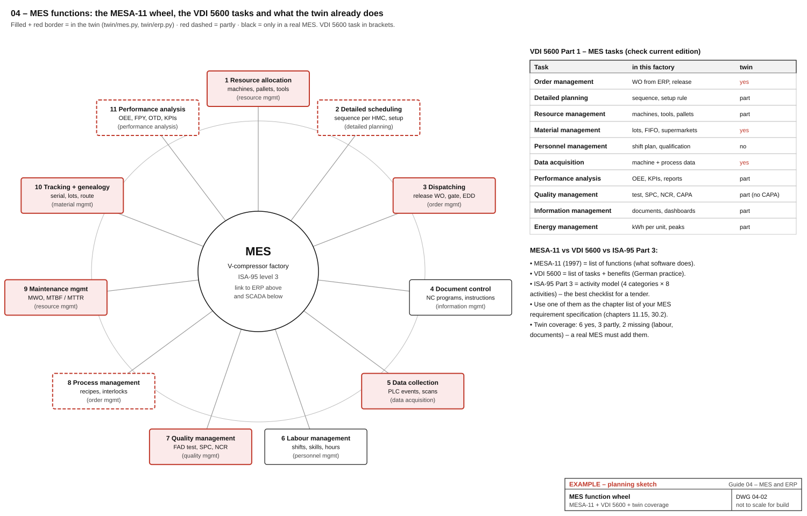
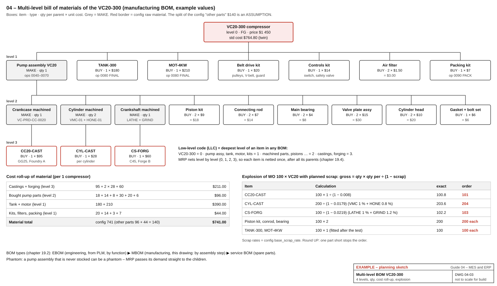
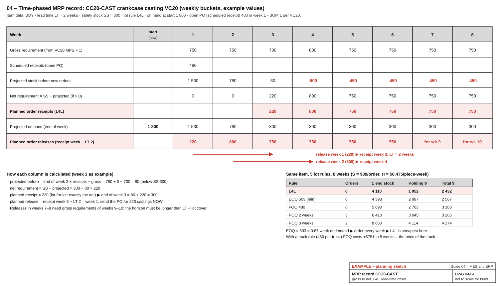
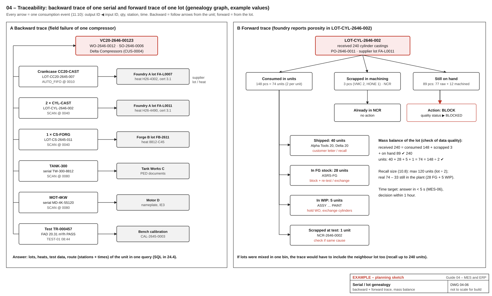
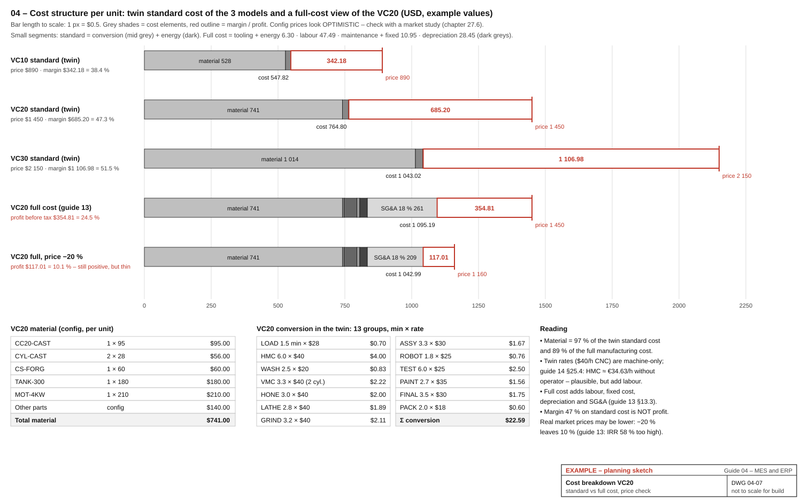
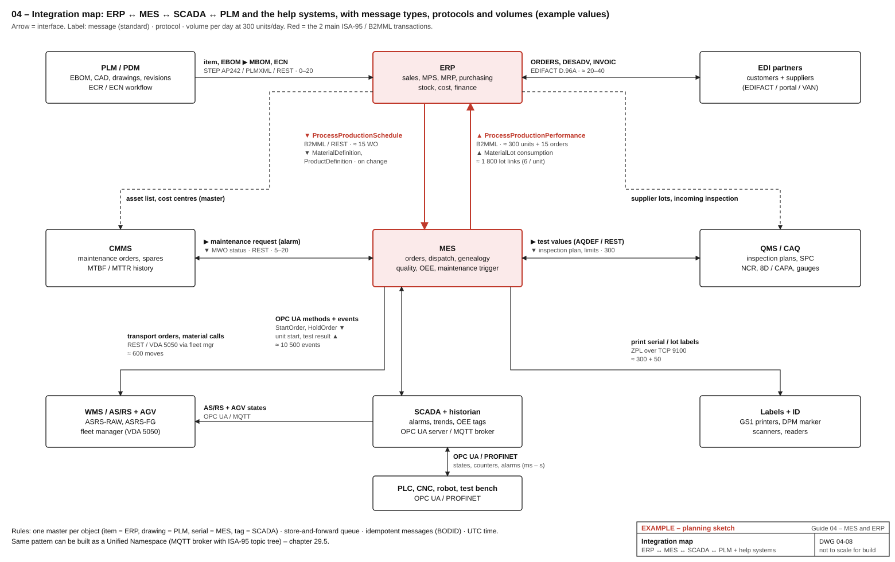

# 04 – MES and ERP: Work Orders, Traceability, Quality, Maintenance, MRP, Purchasing, Stock and Cost

> **All numbers in this guide are example values** from `config/factory.json` and from test runs of the twin.
> They are not data from your factory. Replace them with your own data (supplier quotes, measured cycle
> times, real test results) before you use them for decisions.

## Contents

**Part A – the twin and the first specification**

1. [Purpose](#1-purpose)
2. [Where in the twin](#2-where-in-the-twin)
3. [Concepts simply](#3-concepts-simply)
4. [Model and formulas](#4-model-and-formulas)
5. [Implementing in the real factory – step by step](#5-implementing-in-the-real-factory--step-by-step)
6. [Checklists](#6-checklists)
7. [Common mistakes](#7-common-mistakes)
8. [Limits of the twin](#8-limits-of-the-twin)
9. [How to use chapters 10 – 15](#9-how-to-use-chapters-10--15)
10. [Principles](#10-principles)
11. [Detailed specification for implementation](#11-detailed-specification-for-implementation)
12. [Identification and numbering](#12-identification-and-numbering)
13. [Standards](#13-standards)
14. [Complete worked example – one order end to end](#14-complete-worked-example--one-order-end-to-end)
15. [Data you still need](#15-data-you-still-need)
16. [Glossary](#16-glossary)

**Part B – textbook, technical reference and design guide**

17. [ISA-95 in depth – levels, models and the mapping of this factory](#17-isa-95-in-depth--levels-models-and-the-mapping-of-this-factory)
18. [MES functions – MESA-11 and VDI 5600](#18-mes-functions--mesa-11-and-vdi-5600)
19. [Master data in depth – items, BOMs, routings, work centres](#19-master-data-in-depth--items-boms-routings-work-centres)
20. [MRP step by step – MPS, gross to net, lot sizing, offsetting](#20-mrp-step-by-step--mps-gross-to-net-lot-sizing-offsetting)
21. [Capacity planning – RCCP, CRP, finite and infinite loading](#21-capacity-planning--rccp-crp-finite-and-infinite-loading)
22. [Production order life cycle and statuses](#22-production-order-life-cycle-and-statuses)
23. [Shop-floor data collection and OEE](#23-shop-floor-data-collection-and-oee)
24. [Traceability in depth – genealogy, forward and backward trace](#24-traceability-in-depth--genealogy-forward-and-backward-trace)
25. [Quality management in MES – inspection, SPC, NCR, CAPA, 8D](#25-quality-management-in-mes--inspection-spc-ncr-capa-8d)
26. [Maintenance management – TPM, strategies, reliability, CMMS](#26-maintenance-management--tpm-strategies-reliability-cmms)
27. [Costing – standard cost, actual cost, variances, price check](#27-costing--standard-cost-actual-cost-variances-price-check)
28. [KPIs and dashboards](#28-kpis-and-dashboards)
29. [Integration – B2MML, OPC UA, MQTT, REST, EDI, PLM](#29-integration--b2mml-opc-ua-mqtt-rest-edi-plm)
30. [Selecting and implementing MES and ERP](#30-selecting-and-implementing-mes-and-erp)
31. [Buy lists – catalogue examples](#31-buy-lists--catalogue-examples)
32. [Errors found and corrections (this revision)](#32-errors-found-and-corrections-this-revision)
33. [Glossary – Part B terms](#33-glossary--part-b-terms)

Drawings: DWG 04-01 … 04-08 in `docs/img/04_*.svg` (list at the start of Part B).

---

## 1. Purpose

This guide explains the two business IT systems of the factory:

* **MES** (Manufacturing Execution System) – runs the shop floor *today*: which work order starts now,
  which serial number is where, did it pass the test, which machine needs maintenance.
* **ERP** (Enterprise Resource Planning), manufacturing part only – plans the *business*: customer orders,
  what to make (work orders), what to buy (purchase orders), stock, cost, revenue.

After reading it, you and your team should be able to:

1. Use the MES and ERP tabs of the twin and understand every number on them.
2. Do the MRP calculation and the Cpk calculation by hand and get the same result as the twin.
3. Write a requirements list for a real MES and ERP, prepare the master data, and plan the go-live.

**Why this matters:** machines, AGVs and PLCs can be perfect, but if the work order is wrong, the material is
not bought on time, or a bad casting lot cannot be traced, the factory still fails. MES and ERP are the
"brain" above the machines.

---

## 2. Where in the twin

| What | Where |
|---|---|
| MES tab | Browser `http://localhost:8080/#mes` (HTML: `web/index.html`, section `tab-mes`; drawing code: `renderMES()` in `web/ops.js`) |
| ERP tab | `http://localhost:8080/#erp` (section `tab-erp`; `renderERP()` and `renderCost()` in `web/ops.js`) |
| MES logic | `twin/mes.py` (class `MES`) |
| ERP logic | `twin/erp.py` (class `ERP`) |
| Settings | `config/factory.json`: `erp` section (items, lots, safety stocks, lead times, rates), `products` section (price, `wo_lot`, `safety_stock`, mix, cycle times per model), stations (`mtbf_h`, `mttr_min`, `spec_flow_m3_h`, `flow_tolerance_pct`, `serial`) |
| Messages between layers | `twin/comm.py` (14-step workflow), Communication tab |
| Unit history on disk | `data/history.db` (SQLite, table `units`) – written by `twin/historian.py` |
| API | `GET /api/mes`, `GET /api/mes/unit?sn=VC20-000012`, `POST /api/mes`, `GET /api/erp`, `POST /api/erp` (see README) |

### 2.1 MES tab – what you see

| Card | Content | Buttons |
|---|---|---|
| KPI tiles | Open work orders (+ units still to start), units in production, first-pass yield, Cpk, open maintenance orders | – |
| Work orders | Order, model, qty, started, done, scrap, progress, status, due, source (MRP / Manual / SO number) | **New work order** (model, qty, due in h, release yes/no), **Release**, **Hold**, **Close** |
| Traceability (genealogy) | Type or click a serial number: status, location, model, work order, air flow, customer, route (station + start → end time), components with lots | **Find** |
| Latest units | Last finished / scrapped / shipped units | click a serial number |
| Quality: air-flow test (SPC) | Chart of the measured FAD with UCL, LCL, LSL, mean; mean, σ, Cpk, out-of-control count; FPY and mean FAD per model | – |
| Non-conformance records | NCR number, time, station, part, lot, reason | – |
| Maintenance work orders | Order, machine, type (corrective / predictive / preventive), task, status | **Start** (stops the machine for maintenance), **Close** |
| Reliability: actual vs. plan | Failures, MTBF actual vs. plan, MTTR actual vs. plan (only machines with failures) | – |

### 2.2 ERP tab – what you see

| Card | Content | Buttons |
|---|---|---|
| KPI tiles | Revenue, gross profit (+ standard margin), on-time delivery, order backlog (+ late orders), inventory value (incl. WIP), purchases | – |
| Planning (MRP) and automation | Last MRP run: finished-goods table per model and material table per item, with every term of the formula | **Run MRP now**; switches: random customer orders, demand units/day, MRP every hour, release work orders automatically, ship automatically |
| Sales orders | Order, customer, model, qty, shipped (+ being picked), status, due / on time / late, value | **New order**; **Ship** (only when automatic shipping is off) |
| Inventory | Item, location (AS/RS or floor store), on hand, put-away, on order, safety, coverage hours, value, status (OK / LOW / SHORT) | – |
| Purchase orders | Order, item, supplier, qty, cost, status, arrival, lot | **Order** (item, qty) |
| Bill of materials and standard cost | Cost comparison of the 3 models, BOM of the selected model, cost breakdown, machine + labour cost per station | click a model |

---

## 3. Concepts simply

### 3.1 The ISA-95 levels (IEC 62264)

ISA-95 (international version IEC 62264) splits a factory into levels. Each level talks only to its
neighbours. The twin uses exactly these levels (`twin/comm.py`):

| Level | System | Time scale | Job in this factory |
|---|---|---|---|
| External | Customers, suppliers | days | Send orders, receive deliveries and invoices |
| **L4** | **ERP** | days, hours | Sales orders, MRP, purchasing, stock, cost, shipping |
| **L3** | **MES** | hours, minutes | Work-order release and dispatching, serial numbers, genealogy, quality, maintenance orders |
| L2 | SCADA (+ the twin) | seconds | Operator screens, alarms, trends, historian |
| L1 | PLC, CNC, AGV, test bench | milliseconds | Run the machines, report part done, test results, alarms |
| L0 | Sensors, actuators | milliseconds | Flow meter, pressure transmitter, vibration sensor, valves |

Drawing of the levels with this factory's systems and data flows: DWG 04-01 in chapter 17.2.

**Simple rule:** the ERP says **WHAT** and **WHEN** (23 × VC20-300 by Wednesday). The MES decides **HOW** and
**WHERE** (which machine, which program, in which sequence). The PLC **DOES** it.

### 3.2 Data flow ERP ↔ MES ↔ SCADA/PLC

Orders go **down**, results go **up**. These are the 14 steps of `twin/comm.py` (also in the Communication tab):

| Step | From → To | Message | Typical protocol | In the twin |
|---|---|---|---|---|
| 1 | Customer → ERP | Customer order | EDI ORDERS or web portal | `erp.create_so()` |
| 2 | ERP (inside) | MRP run | calculation | `erp.run_mrp()` every hour |
| 3 | ERP → supplier | Purchase order | EDI ORDERS | `erp.create_po()` |
| 4 | Supplier → ERP | Delivery, goods receipt, **lot number** | EDI DESADV + barcode/RFID scan | `erp._receive()` |
| 5 | ERP → MES | Work order | **ISA-95 B2MML ProductionSchedule** | `mes.create_wo()` |
| 6 | MES → PLC (via SCADA) | Release, recipe | OPC UA method call | `mes.wo_action("release")`, `mes.gate()` |
| 7 | MES/fleet → AGV | Transport order | VDA 5050 over MQTT | `handling._assign()` |
| 8 | PLC → MES | Unit started, **serial number**, casting lot | OPC UA | `mes._on_start()` |
| 9 | MES → CNC | Changeover / NC program | OPC UA file transfer, MTConnect | machine changeover (state SETUP) |
| 10 | Sensors → SCADA | Sensor data | IO-Link / 4–20 mA → PLC → OPC UA/MQTT | historian |
| 11 | Test bench → MES | Test result (FAD) | OPC UA or MQTT JSON | `mes._on_test()` |
| 12 | PLC/analytics → MES | Alarm → maintenance order | OPC UA Alarms & Conditions | `mes._new_mwo()` |
| 13 | MES → ERP | Production confirmation | **ISA-95 B2MML ProductionPerformance** | `mes._on_fg()` |
| 14 | ERP → customer | Shipment, invoice | EDI DESADV + INVOIC | `erp._shipped()` |

### 3.3 The B2MML idea

**B2MML** (Business To Manufacturing Markup Language) is an XML (or JSON) format, published by MESA, that
implements the ISA-95 object models. Its idea is simple:

* A message = **verb + noun**. Verb = what to do (`Process`, `Acknowledge`, `Get`, `Show`, `Sync`...).
  Noun = which ISA-95 object (`ProductionSchedule`, `ProductionPerformance`, `MaterialDefinition`...).
* `ApplicationArea` = the envelope (sender, time). `DataArea` = verb + noun + data.
* Field names come from the ISA-95 dictionary (`MaterialDefinitionID`, `Quantity`, `EndTime`...), so ERP
  and MES suppliers understand the same words.

The two most important messages in this factory:

| Message | Direction | Content in the twin (`twin/mes.py`) |
|---|---|---|
| `ProcessProductionSchedule` | ERP → MES | work order ID, `MaterialDefinitionID` (e.g. VC20-300), quantity, due, priority, sales order |
| `ProcessProductionPerformance` | MES → ERP | per finished unit: order, serial, material, qty 1, location; per completed work order: good qty, scrap qty |

Shortened example (from the Communication tab, step "ERP sends the work order to the MES"):

```xml
<ProcessProductionSchedule xmlns="http://www.mesa.org/xml/B2MML">
  <ApplicationArea><Sender><LogicalID>ERP</LogicalID></Sender>
    <CreationDateTime>2026-11-09T08:20:00Z</CreationDateTime></ApplicationArea>
  <DataArea>
    <Process/>
    <ProductionSchedule><ProductionRequest>
      <ID>WO-0012</ID><Priority>3</Priority><EndTime>2026-11-11T08:00:00Z</EndTime>
      <MaterialProducedRequirement>
        <MaterialDefinitionID>VC20-300</MaterialDefinitionID><Quantity>23</Quantity>
      </MaterialProducedRequirement>
    </ProductionRequest></ProductionSchedule>
  </DataArea>
</ProcessProductionSchedule>
```

**Why it matters for you:** if you buy ERP and MES from different suppliers, ask both for B2MML (or an
agreed ISA-95 based JSON/REST interface). Then the interface is a contract on paper, not a custom program
that only one person understands. Many real projects still use a custom REST/SQL interface – that is fine,
but use the ISA-95 object names in it.

### 3.4 Key words in one sentence each

| Word | Meaning |
|---|---|
| Sales order (SO) | A customer wants N units of a model by a due date. |
| Work order (WO) | An instruction to the shop floor: make N units of a model by a due date. |
| Purchase order (PO) | An order to a supplier: deliver N pieces of an item after the lead time. |
| BOM | Bill of materials: which purchased items, and how many, go into one unit. |
| Routing | The sequence of stations (operations) and their cycle times for one unit. |
| MRP | Material Requirements Planning: calculates what to make and what to buy. |
| Lot | A group of parts with the same origin (one delivery, one heat, one casting batch). |
| Serial number | A unique number for one single compressor. |
| Genealogy | The "family tree" of one unit: which component lots are inside it. |
| SPC | Statistical Process Control: a chart that shows if a process is stable. |
| Cpk | A number that says if a stable process is good enough for the specification. |
| NCR | Non-conformance record: a written record of a bad part (scrap, reject). |
| MTBF / MTTR | Mean time between failures / mean time to repair. |
| Pegging | Units are reserved for one customer order (make-to-order). |

---

## 4. Model and formulas

### 4.1 Work orders (MES)

#### 4.1.1 Status life cycle

```
            release                 first unit started              all units good in FG store
PLANNED ------------> RELEASED ------------------------> IN_PROGRESS --------------------------> COMPLETED
   |                     |  ^                                |  ^
   |                hold |  | release                   hold |  | release
   |                     v  |                                v  |
   |                   ON_HOLD <-----------------------------+--+
   |
   +-- close (from PLANNED, RELEASED, IN_PROGRESS, ON_HOLD) --> CLOSED
```

Real ERP + MES life cycle with message flow: chapter 22 (DWG 04-05).

Rules from `MES.wo_action()`:

| Action | Allowed from | Result |
|---|---|---|
| release | PLANNED, ON_HOLD | RELEASED (or IN_PROGRESS if units were already started) |
| hold | RELEASED, IN_PROGRESS | ON_HOLD – no new units start; units already on the line continue |
| close | any open status | CLOSED – the order is finished by hand (e.g. cancelled) |
| (automatic) | IN_PROGRESS | COMPLETED when `done ≥ qty` |

Every release / hold sends an OPC UA style command (`StartOrder` / `HoldOrder`) to the serial-number station
(the fixture load station `LOAD-CC`).

#### 4.1.2 Order release – the "gate"

The serial-number station (`LOAD-CC`, config field `"serial": "VC"`) asks the MES before every new unit
(`MES.gate()`):

1. Is there a RELEASED or IN_PROGRESS work order that still needs units? If not → *"No released work order"*,
   the station waits. **This is why holding all orders empties the line.**
2. Are the castings of that model at the station? If not → *"Waiting for castings"*.
3. If several orders qualify, the **dispatching rule** picks one (sort key, smallest first):

| Rule | Sort key |
|---|---|
| FIFO | priority, creation number |
| EDD (default in config `fms.rule`) | priority, due date, creation number |
| SPT | priority, total work content of the model, due date |
| SETUP | priority, due-date window (`window_h` = 8 h example), "same model as now running" first, due date |

Priority always comes first (1 = most urgent). Example values in the code: make-to-order work orders get
priority **3**, MRP and manual work orders priority **5**.

Total work content per model (sum of station times, used by SPT), computed by the twin from the config
(example values): VC10 = 2 755 s (46 min), VC20 = 3 345 s (56 min), VC30 = 4 095 s (68 min).

**Note (correction):** the twin adds the time of **every machine** (`MES.work_s` in `twin/mes.py`), so the
3 parallel HMCs and the 2 parallel test benches are counted 3 × and 2 ×. The real work content of **one**
unit is lower: VC10 = 1 915 s, VC20 = 2 295 s (38 min), VC30 = 2 775 s. For SPT this does not matter
(only the ranking VC10 < VC20 < VC30 counts), but use the lower values for lead-time and Little's-law
calculations (10.5).

#### 4.1.3 Quantities of a work order

```
units still to start = qty − (started − scrap)
```

**Why "− scrap":** if a unit of the work order is scrapped (for example at the test bench), the order
automatically starts one more unit, so the customer still gets the full quantity.

Example: WO with qty 20, started 18, scrap 1 → still to start = 20 − (18 − 1) = **3**.

### 4.2 Traceability by serial number (MES)

#### 4.2.1 How numbers are created in the twin

| Thing | Format in the twin | Example | Created when |
|---|---|---|---|
| Serial number | `<model>-<6-digit sequence>` (one sequence for all models) | `VC20-000012` | the load station starts a unit (`Factory.assign_serial()`); marked on the **crankcase** |
| Component ID | `<buffer prefix>-<6-digit sequence>` | `CYL-000994`, `CS-000510`, `T100-000139` | the part leaves its store |
| Lot number | `<buffer prefix>-L<PO number, 4 digits>` | `CC20-L0009` (from PO-0009); start stock `CC20-L0000` | goods receipt of a purchase order (`ERP._receive()`) |

Stock is taken **first in, first out by lot** (`Buffer` in `twin/model.py`), so each component carries the
lot it came from.

These are the **twin's** formats. The real factory uses the project numbering (chapter 12 and
`docs/15_numbering_and_identification.md`): serial `VC20-2646-00123`, lot `LOT-CC20-2646-003`,
work order `WO-2646-0012`.

Forward / backward trace worked example with SQL: chapter 24 (DWG 04-06).

#### 4.2.2 What the genealogy record contains

`GET /api/mes/unit?sn=...` returns (real example from a twin run):

| Field | Example |
|---|---|
| sn / status / where | `VC10-000409` · IN STOCK · Finished goods AS/RS |
| work order / model / SKU | `WO-0015` · VC10 · VC10-100 |
| test result | FAD 10.08 m³/h |
| customer / sales order | filled when shipped (`mark_shipped()`) |
| route | `LOAD-CC` → `HMC-03` → `WASH-01` → `ASSY-01` → `ROBOT-01` → `TEST-01` → `PAINT-01` → `FINAL-01` → `PACK-01`, each with start and end time |
| components | crankcase `CC10-000090` lot `CC10-L0000`; 2 × cylinder `CYL-000994/995` lot `CYL-L0002` (route VMC-01 → HONE-01); crankshaft `CS-000510` lot `CS-L0001` (route LATHE-01 → GRIND-01); tank `T100-000139` lot `T100-L0011`; motor `M22-000139` lot `M22-L0012` |

Storage: the MES keeps the last 1 000 finished units in memory and writes every finished or scrapped unit to
`data/history.db`, so a unit can be found after it left memory. Shipping updates the record with customer
and order.

**Why genealogy:** if the foundry reports "lot CYL-L0002 has porosity", you must find every compressor that
contains a cylinder of that lot – in minutes, not days. That is the difference between recalling 40 units
and recalling a whole month of production.

### 4.3 Quality: air-flow test, SPC and Cpk (MES)

#### 4.3.1 Pass / fail at the test bench

The test bench measures the free air delivery (FAD). From `Machine._finish_part()` in `twin/model.py`:

```
pass  if  FAD ≥ nominal flow × (1 − tolerance / 100)
LSL = nominal × (1 − tolerance / 100)
```

Example values (tolerance `flow_tolerance_pct` = 3 %):

| Model | Nominal flow | LSL = nominal × 0.97 |
|---|---|---|
| VC10 | 10 m³/h | 9.7 m³/h |
| VC20 | 20 m³/h | **19.4 m³/h** |
| VC30 | 30 m³/h | 29.1 m³/h |

A failed unit is **scrapped** in the twin (no rework loop) and gets an NCR, e.g.
`NCR-00002 · TEST-02 · VC20-000004 · lot CC20-L0000 · "FAD 19.29 < 19.4 m3/h"`.

#### 4.3.2 Why the chart uses % when there are 3 models

With three models (10, 20, 30 m³/h) the values cannot share one chart in m³/h. So the twin plots
**FAD in % of the model's nominal flow**: `pct = FAD / nominal × 100`. Then 100 % = nominal and LSL = 97 %
for every model. With only one model the chart is in m³/h.

#### 4.3.3 Formulas (individuals chart, I-MR) – `MES.quality()`

The twin needs at least **8** test results. It uses the stored tests (up to the last 400).

| Step | Formula |
|---|---|
| 1. Mean | x̄ = (x₁ + x₂ + … + xₙ) / n |
| 2. Moving ranges | MRᵢ = \|xᵢ − xᵢ₋₁\| for i = 2 … n |
| 3. Average moving range | MR̄ = sum of MRᵢ / (n − 1) |
| 4. Process sigma (short term) | σ = MR̄ / d₂, with d₂ = **1.128** (constant for ranges of 2 values) |
| 5. Control limits | UCL = x̄ + 3σ,  LCL = x̄ − 3σ |
| 6. Capability (one-sided, lower limit only) | **Cpk = (x̄ − LSL) / (3σ)** |
| 7. Out of control | number of the last 50 points with \|x − x̄\| > 3σ |
| 8. First-pass yield | FPY = passed / tested |

Why only the lower limit: a customer is never unhappy with **more** air, so there is no upper spec limit.

#### 4.3.4 Worked example (real numbers from a 30-hour twin run, example values)

| Value | Result |
|---|---|
| Tests | 459, passed 456 |
| FPY | 456 / 459 = **99.3 %** |
| Mean x̄ | 102.15 % |
| σ (I-MR) | 2.185 % |
| UCL | 102.15 + 3 × 2.185 = **108.71 %** |
| LCL | 102.15 − 3 × 2.185 = **95.60 %** |
| LSL | 97.0 % |
| Cpk | (102.15 − 97.0) / (3 × 2.185) = 5.15 / 6.555 = **0.79** |

The MES tab shows "capable" at **Cpk ≥ 1.33**, otherwise "not capable". Here 0.79 → not capable.
A Cpk of 0.79 means the lower limit is only about 2.4 σ below the mean (0.79 × 3 = 2.36), so roughly 1 %
of units will fail – this fits the 3 rejects out of 459.

**What to do when Cpk is too low** (the hint in the tab): raise the mean air flow (valves, piston rings,
clearance volume) or reduce the variation (honing quality, ring gap, assembly torque). Raising the mean is
often cheaper than reducing σ.

**Control limits vs. spec limit – do not mix them:**

* **UCL / LCL** come from the process (what it *does*). A point outside means "something changed – find the cause".
* **LSL** comes from the customer (what it *must* do). A point below means "this unit is bad".

### 4.4 Non-conformance records (NCR)

Every scrapped part creates an NCR (`MES._on_scrap()`): number `NCR-00001…`, time, station, part ID (serial
number or component ID), lot, reason. Reasons seen in the twin: `Process defect`, `Worn tool`, and the test
failure text `FAD x.xx < limit`. The MES also counts scrap per station. If the scrapped part is a serial
unit, its work order gets `scrap + 1` and the unit record gets status SCRAPPED.

### 4.5 Maintenance work orders and MTBF / MTTR (MES)

The MES checks every machine every **10 s** (`MES._maintenance()`):

| Type | Created when | Closed when |
|---|---|---|
| CORRECTIVE | the machine goes DOWN (breakdown) – status IN_PROGRESS at once | automatically when the machine is running again; downtime in minutes is recorded |
| PREDICTIVE | the vibration trend reaches the alarm limit in less than **6 h** (analytics) | after a maintenance stop; or marked "too late" if the machine broke down first |
| PREVENTIVE | tool wear ≥ **85 %** | when tool wear is back below 20 % (tool changed), or after a maintenance stop |

**Start** puts the machine into MAINTENANCE state (it stops producing). This is the real trade-off: a planned
stop now, or a longer breakdown later.

**Actual reliability** (`MES.reliability()`):

```
MTBF actual (h)   = running time of the machine (h) / number of failures
MTTR actual (min) = total repair time (min) / number of failures
```

Note: the twin divides **running** time (state RUNNING), not calendar time, by the failures.

Example from a twin run: HMC-01 with 2 failures, MTBF actual 11.1 h vs. plan 30 h, MTTR actual 31.7 min vs.
plan 20 min (plan = `mtbf_h`, `mttr_min` in the config). Such a gap tells you: either the plan values were
too optimistic, or there is a real problem (in the twin, tool breakage and bearing failures add to the
random breakdowns).

### 4.6 Sales orders (ERP)

A sales order (`ERP.create_so()`) has: ID `SO-0001…`, customer, model, qty, due date, value = qty × price.

Example values: price VC10-100 = $890, VC20-300 = $1 450, VC30-500 = $2 150.

Two kinds:

| Kind | How planned | Stock |
|---|---|---|
| Normal (make-to-stock + order) | Hourly MRP nets all normal orders of a model together | shared finished stock |
| Make-to-order (from the Order flow tab) | Own work order, priority 3, MRP does not touch it | units are **pegged** (reserved) to this order |

Random demand for training (config `demand`): 300 units/day, orders of 5–30 units, due in 24–72 h, model chosen
by the mix 30 / 50 / 20 % (all example values).

**Shipping rule** (`ERP._ship()`, every 30 s): orders are served by due date. An order is shipped only
**complete** while it is still on time; if it is already late, the units in stock are shipped as a partial
shipment (status PARTIAL). The AS/RS crane picks each unit; then revenue and COGS are booked.

### 4.7 MRP – the full calculation (ERP)

MRP runs at start, every `mrp_interval_h` = **1 h** (example), or when you press **Run MRP now**. It has two
levels: first finished goods (→ work orders), then purchased material (→ purchase orders).

#### 4.7.1 Level 1 – finished goods, per model

```
demand    = Σ (qty − shipped − being picked) of open normal sales orders of this model
FG free   = units of this model in the FG store − units being picked − units pegged to open make-to-order orders
            + units on the way into the FG store (AGV, crane)
WO open   = Σ (qty − done) of open work orders of this model without a sales order
net       = demand + safety stock − FG free − WO open
if net > 0:  new work order qty = round up (net / wo_lot) × wo_lot
             due = earliest due date of the open sales orders of this model (else now + 24 h)
```

**Worked example – MRP at start of the twin (example values from `config/factory.json`):**

Initial sales orders: SO-0001 Alpha Tools 40 × VC20 (due 20 h), SO-0002 Beta Air Systems 25 × VC10 (30 h),
SO-0003 Gamma Workshop 16 × VC30 (40 h), SO-0004 Delta Motors 40 × VC20 (48 h). Finished stock 0, no work orders.

| Model | Demand | + Safety | − FG free | − WO open | = Net | WO lot | New work order |
|---|---|---|---|---|---|---|---|
| VC10 | 25 | 6 | 0 | 0 | **31** | 20 | ⌈31/20⌉ × 20 = **40** → WO-0001, due 30 h |
| VC20 | 40 + 40 = 80 | 10 | 0 | 0 | **90** | 20 | ⌈90/20⌉ × 20 = **100** → WO-0002, due 20 h |
| VC30 | 16 | 4 | 0 | 0 | **20** | 10 | ⌈20/10⌉ × 10 = **20** → WO-0003, due 40 h |

**Worked example – a later run (twin at hour 3, example):** VC20 demand 104, safety 10, FG free 33, WO open 67
→ net = 104 + 10 − 33 − 67 = **14** → ⌈14/20⌉ × 20 = **20** → new WO-0004 with 20 units.

**Why the lot size:** a work order of 3 units causes the same changeovers and paperwork as one of 20.
The lot size (`wo_lot`) is a compromise between changeover loss and stock.

#### 4.7.2 Level 2 – purchased material, per item

For each item of the item master (castings, forgings, tanks, motors):

```
units to start    = units still to start in open work orders (for this model, or all models for shared items)
planned rate (/h) = min( ideal factory rate × mix share ,
                         max( forecast rate , units finished in the last hour × mix share ) )
     forecast rate = demand units/day × mix share / 24      (if random demand is on)
                   = units to start / 24                     (if random demand is off)
units             = max( units to start , planned rate × lead time (h) )
                    + units in WIP of this model             (only for parts used late: tank and motor at final assembly)
gross requirement = BOM qty per unit × units
on hand           = stock in the store + stock being put away
on order          = Σ qty of open purchase orders of this item
net requirement   = gross + safety stock − on hand − on order
if net > 0:  purchase order qty = max( round up (net / lot) × lot , lot )
             arrival = now + lead time
```

**Why "max(units to start, rate × lead time)":** a new delivery can only arrive after the lead time. Until then,
the factory uses material for the open work orders – and, if more orders come in, for the planned production
during the lead time. The larger number is the real risk.

**Why "+ units in WIP" for tank and motor:** castings leave the store when a unit starts, but tank and motor are
used at final assembly, near the end. Units already on the line still need them.

**Ideal factory rate** (computed from the config, example): the slowest station group is FINAL-01. Its
mix-weighted average cycle is 0.3 × 180 s + 0.5 × 210 s + 0.2 × 250 s = 209 s → 3 600 / 209 = **17.22 units/h**
(all models together).

**Worked example A – CC20-CAST at start (no purchase):**

Config (example): BOM 1 per VC20, lead time 16 h, lot **120**, safety stock **100**, start stock 360.

| Term | Calculation | Value |
|---|---|---|
| Units to start (VC20) | WO-0002 | 100 |
| Forecast rate | 300 units/day × 0.5 / 24 | 6.25 /h |
| Rate cap | 17.22 × 0.5 | 8.61 /h |
| Planned rate | min(8.61, max(6.25, 0)) | 6.25 /h |
| Rate × lead time | 6.25 × 16 h | 100 |
| Units | max(100, 100) (casting → no WIP term) | 100 |
| Gross | 1 × 100 | 100 |
| On hand / on order | 360 / 0 | |
| Net | 100 + 100 − 360 − 0 | **−160** → no purchase order |

**Worked example B – CYL-CAST at hour 3 (purchase):**

Config (example): BOM **2** per unit (all models), lead time 16 h, lot 240, safety 300.

| Term | Calculation | Value |
|---|---|---|
| Units to start (all models) | 35 + 61 + 20 | 116 |
| Forecast rate | 300 / 24 | 12.5 /h |
| Units finished last hour | | 18 /h |
| Planned rate | min(17.22, max(12.5, 18)) | 17.22 /h |
| Rate × lead time | 17.22 × 16 | 275.6 |
| Units | max(116, 275.6) | 275.6 |
| Gross | 2 × 275.6 | **551** |
| On hand / on order | 780 / 0 | |
| Net | 551 + 300 − 780 − 0 | **71** |
| PO qty | ⌈71/240⌉ × 240 | **240** → PO-0002, arrives in 16 h |

**Worked example C – TANK-300 at hour 3 (late-use part):**

Config (example): BOM 1 per VC20, lead time 12 h, lot 60, safety 60.

| Term | Calculation | Value |
|---|---|---|
| Units to start (VC20) | | 61 |
| Planned rate | min(8.61, max(6.25, 18 × 0.5 = 9)) | 8.61 /h |
| Rate × lead time | 8.61 × 12 | 103.3 |
| + units of VC20 in WIP | | 26 |
| Units / gross | 103.3 + 26 | **129** |
| Net | 129 + 60 − 166 − 0 | **23** |
| PO qty | ⌈23/60⌉ × 60 | **60** → PO-0003 |

**Worked example D – CS-FORG at hour 6 (open PO already counted):**
gross 340, safety 150, on hand 360, on order 120 → net = 340 + 150 − 360 − 120 = **10** → PO = 120 (lot 120).

#### 4.7.3 Known mismatch in the Communication teaching view

The Communication tab, step-by-step simulation, **step 3** ("MRP calculates what to make and what to buy")
shows for CC20-CAST:

```
net = need + safety − on hand − on order = 23 + 20 − 15 − 0 = 28 → lot size 60
```

The config (`config/factory.json`) has for CC20-CAST **lot = 120, safety stock = 100**.
**The config values are the ones the engine uses.** The teaching view is a simplified story with its own
numbers. With the config values and the same story numbers it would be:

```
net = 23 + 100 − 15 − 0 = 108  →  ⌈108/120⌉ × 120 = 120 castings
```

Note also: in the Order flow tab, the button *Buy missing material* (`ERP.buy_for_so()`) uses
`need − (stock + put-away + line stock − stock needed by other orders) − on order`, rounded up to the lot,
**without** safety stock. Only the hourly MRP adds the safety stock.

### 4.8 Purchase orders and goods receipt (ERP)

* `PO-0001…`: item, supplier, qty, cost = qty × unit cost, due = order time + lead time.
* When the due time is reached, `_receive()` books the goods receipt: a **lot number** is created
  (e.g. `CYL-L0002` from PO-0002), the material goes to the AS/RS (crane put-away jobs) or floor store,
  and the value is added to "Purchases". The twin sends an EDI DESADV style message with a GS1-128 barcode scan.
* *Deliver now* (Order flow) is a training shortcut only.
* The twin has no supplier delays and no partial deliveries.

Example item data (from config, all example values):

| Item | BOM per unit | Unit cost | Supplier | Lead time | Lot | Safety | Start stock |
|---|---|---|---|---|---|---|---|
| CC10-CAST | 1 (VC10) | $72 | Foundry A | 16 h | 120 | 60 | 240 |
| CC20-CAST | 1 (VC20) | $95 | Foundry A | 16 h | 120 | 100 | 360 |
| CC30-CAST | 1 (VC30) | $138 | Foundry A | 16 h | 60 | 40 | 120 |
| CYL-CAST | 2 (all) | $28 | Foundry A | 16 h | 240 | 300 | 900 |
| CS-FORG | 1 (all) | $60 | Forge B | 20 h | 120 | 150 | 480 |
| TANK-100 / 300 / 500 | 1 (per model) | $95 / $180 / $285 | Tank Works C | 12 h | 60 / 60 / 30 | 30 / 60 / 20 | 120 / 200 / 60 |
| MOT-2.2KW / 4KW / 5.5KW | 1 (per model) | $150 / $210 / $280 | Motor D | 12 h | 60 / 60 / 30 | 30 / 60 / 20 | 120 / 200 / 60 |

(Supplier names are placeholders. Lead times of hours are shortened for the simulation; real foundry lead
times are usually weeks.)

### 4.9 Inventory and coverage hours (ERP)

```
coverage (h) = on hand / (ideal factory rate × BOM qty × mix share of the model)
status       = SHORT if on hand = 0,  LOW if on hand < safety stock,  else OK
value        = on hand × unit cost       (finished goods: × standard cost)
```

Examples at start (ideal rate 17.22 /h):

| Item | Calculation | Coverage |
|---|---|---|
| CC20-CAST | 360 / (17.22 × 1 × 0.5) | **41.8 h** |
| CYL-CAST | 900 / (17.22 × 2 × 1.0) | **26.1 h** |
| TANK-500 | 60 / (17.22 × 1 × 0.2) | **17.4 h** |

**Why coverage in hours:** "360 pieces" says nothing; "41.8 h" tells the planner at once whether the stock
lasts longer than the lead time (16 h). Coverage < lead time = danger. Note that the twin uses the **ideal**
(maximum) rate, so the real coverage is a little longer.

### 4.10 BOM and standard cost (ERP)

The BOM is **derived from the factory flow** (`Factory._capacity()`): the assembly station takes 1 crankcase +
2 cylinders + 1 crankshaft, final assembly takes 1 tank + 1 motor of the model. So the twin knows that one unit
needs 2 cylinder castings.

```
material   = Σ (BOM qty × unit cost) + other purchased parts (valves, heads, belt, packing)
conversion = Σ over station groups (time per unit (s) / 3600 × rate per hour of the station type)
             time per unit = model cycle time + handling time (e.g. pallet change 15 s)
energy     = kWh per unit (actual, or 10 kWh before the first unit) × energy price × (model time / average time)
standard cost = material + conversion + energy
margin %   = (price − standard cost) / price
```

**Worked example VC20-300 at start (example values):**

| Line | Calculation | Cost |
|---|---|---|
| CC20-CAST | 1 × $95 | $95 |
| CYL-CAST | 2 × $28 | $56 |
| CS-FORG | 1 × $60 | $60 |
| TANK-300 | 1 × $180 | $180 |
| MOT-4KW | 1 × $210 | $210 |
| Other parts | | $140 |
| **Material** | | **$741.00** |
| Conversion (e.g. HMC 6.0 min × $40/h = $4.00; test 6.0 min × $25/h = $2.50; …13 groups) | | **$22.59** |
| Energy | 10 kWh × $0.12 × time ratio | **$1.21** |
| **Standard cost** | | **$764.80** |
| Margin at $1 450 | (1 450 − 764.80) / 1 450 | **47.3 %** |

Cost breakdown drawing, full cost, variances and the price warning: chapter 27 (DWG 04-07).

Other models (start of run, example): VC10 $547.82 (margin 38.4 %), VC30 $1 043.02 (margin 51.5 %).

Rates per hour (example): cnc $40, washer $20, load $28, assembly $30, robot $25, test $25, paint $35,
packaging $18; energy $0.12/kWh.

Note: for parallel machines (3 HMCs, 2 test benches) only **one** machine's time counts per unit – one unit
uses one machine.

### 4.11 Revenue, profit, on-time delivery (ERP)

Booked at the moment each unit is shipped (`ERP._shipped()`):

```
revenue        += price of the model
COGS           += standard cost of the model
gross profit    = revenue − COGS
on-time delivery (OTD) = orders shipped complete by the due date / all orders shipped complete
backlog units   = Σ (qty − shipped) of open orders
late orders     = open orders with due date in the past
inventory value = Σ item stock value + FG stock × standard cost + WIP units × material cost (default model)
```

Example from a 30-hour twin run: revenue $600 630, COGS $320 310, gross profit $280 320, 429 units shipped,
OTD 100 %, backlog 117 units, 7 open orders.

**Why OTD per order, not per unit:** a customer who gets 39 of 40 units on time still cannot finish his job.
That is also why the twin ships complete orders while on time.

---

## 5. Implementing in the real factory – step by step

### 5.1 Decide the split: what is ERP, what is MES

| Function | ERP (L4) | MES (L3) | Why |
|---|---|---|---|
| Customer orders, prices, invoices | ✔ | | money and contracts |
| Item master, BOM, routing (master copy) | ✔ | copy | one source of truth |
| MRP, purchasing, supplier lead times | ✔ | | needs stock + demand + suppliers |
| Work order creation | ✔ | (also manual) | from MRP |
| Release, sequence, dispatching rule | | ✔ | needs live machine and material state |
| Serial numbers, genealogy, test results | | ✔ | needs PLC data in seconds |
| SPC, NCR | | ✔ | close to the process |
| Maintenance orders | either (CMMS) | ✔ (trigger) | alarms come from the shop floor |
| Finished-goods stock booking | ✔ | reports | MES confirms, ERP books |

Write this table for your project and get it signed by production, IT and finance **before** you buy anything.

### 5.2 Requirements list (use it for supplier inquiries)

**MES must:**

1. Receive work orders from the ERP (B2MML or agreed ISA-95 based REST/JSON), and send confirmations back
   (good qty, scrap qty per order, per serial if wanted).
2. Statuses PLANNED / RELEASED / IN_PROGRESS / ON_HOLD / COMPLETED / CLOSED (or equivalent), release and hold
   by authorised users, with audit trail (who, when).
3. Dispatching per model with at least EDD and a "same model first" (setup) rule; priority override.
4. Order release interlock: the load station PLC may start a unit only with a valid released order (as the twin's gate).
5. Serial number generation and printing / laser-marking interface; scan at every station (or PLC report).
6. Genealogy: component lots per serial (crankcase, 2 cylinders, crankshaft, tank, motor, plus critical bought
   parts like valves), route with times, test data; forward and backward search ("which units contain lot X",
   "which lots are in unit Y"). Retention time as required by your product liability and customers.
7. Test bench interface: store raw curve or at least FAD, pressure, temperature per serial; pass/fail limits per model managed in MES (recipe), not hard-coded in the PLC.
8. SPC: I-MR chart (or X̄-R if you test in subgroups), Cpk, alarms when rules are broken.
9. NCR with reason codes, disposition (scrap / rework / use as is), link to lot and serial.
10. Rework loop (the twin has none – a real factory needs one for test-bench rejects).
11. Maintenance: orders from alarms, condition monitoring and counters; MTBF/MTTR reports (or interface to a CMMS).
12. OEE per machine, shift reports.
13. Interfaces to PLC/SCADA (OPC UA preferred), label printers, scanners.
14. Works on the plant network without internet; defined backup and restore; user roles.

**ERP (manufacturing part) must:**

1. Item master with units, item types (make / buy), cost, lead time, lot size, safety stock, supplier.
2. Multi-level BOM per model and routing with work centres and times.
3. MRP with safety stock, lot sizing (fixed lot / multiple of lot), lead-time offset, pegging for make-to-order.
4. Purchasing with supplier EDI or portal; goods receipt with lot / batch numbers and barcode scanning.
5. Warehouse locations incl. AS/RS interface (or a WMS between ERP and AS/RS).
6. Standard costing per model, actual vs. standard variance.
7. Sales orders, delivery, invoice; OTD report.
8. Open API (REST) or B2MML to the MES.

### 5.3 Master data to prepare (most work – start early)

| Master data | Content | Example from the twin | Who prepares |
|---|---|---|---|
| Items | number, name, unit, make/buy, cost, supplier, lead time, lot, safety stock | `CC20-CAST`, $95, Foundry A, 16 h, lot 120, safety 100 | purchasing + engineering |
| Finished products | SKU, price, WO lot size, FG safety stock | `VC20-300`, $1 450, lot 20, safety 10 | sales + planning |
| BOM per model | items and qty per unit | VC20: 1 CC20-CAST, 2 CYL-CAST, 1 CS-FORG, 1 TANK-300, 1 MOT-4KW + other parts | engineering |
| Work centres | machines / stations, capacity, cost rate | HMC group (3 machines), $40/h | production + finance |
| Routings | operation sequence per part and model | crankcase: LOAD → HMC → WASH → ASSY → ROBOT → TEST → PAINT → FINAL → PACK | manufacturing engineering |
| Cycle times | per operation and model, plus handling / changeover | HMC VC10 270 s, VC30 450 s; pallet change 15 s | manufacturing engineering (measure, do not guess) |
| Test specs | nominal, tolerance, test pressure per model | 20 m³/h, −3 %, 8 bar | quality |
| Reliability plan | MTBF, MTTR per machine | HMC 30 h / 20 min | maintenance (from supplier data, then actuals) |
| Customers, suppliers | addresses, EDI IDs | placeholders | sales, purchasing |

**Rules for master data:**

1. One owner per field. Example: lead time = purchasing, cycle time = manufacturing engineering.
2. Use the same item numbers in ERP, MES, PLC recipes and labels.
3. Measure cycle times (at least 30 cycles, take the median) before go-live, and again after 3 months.
4. Check every BOM by building one unit with the BOM printout in hand.

### 5.4 Traceability, label and serial number scheme

Recommended steps:

1. **Define what is traced:** serial level = the compressor (marked on the crankcase, like the twin). Lot level =
   castings, forgings, tanks, motors, valves. Decide if tanks and motors are traced by **their own serial**
   (pressure vessel and motor nameplates usually have one – record it, it is better than a lot).
2. **Serial format:** the twin uses `<model>-<6 digits>` = `VC20-000012`. The project scheme for the real
   factory is `<model>-<YYWW>-<5-digit seq>` = `VC20-2646-00123` (chapter 12, doc 15). Rules: never reused,
   no meaning hidden in digits that may change, enough digits for the volume. Add a plant code if you will
   have more than one plant.
3. **Mark:** laser or dot-peen DataMatrix + plain text on the crankcase at the load station, before machining
   (so even scrapped parts are traceable). Verify readability after washing and painting.
4. **Lot labels at goods receipt:** GS1-128 barcode with Application Identifiers. On a pallet (logistic
   unit): (00) SSCC + (02) GTIN of the contained items + (37) count + (10) lot. On a single item or a
   fixed-content case: (01) GTIN + (10) lot. Ask suppliers to print it; otherwise print it at receipt.
   (Correction: the Communication tab shows (02) + (10) + (37) without (00). GS1 rules use (02) and (37)
   only on a logistic unit together with the SSCC – see 12.7.)
5. **Capture points:** load station (serial ↔ work order ↔ casting lot), pump assembly (cylinder + crankshaft lots),
   test bench (results), final assembly (tank + motor), packing (final check), shipping (serial ↔ customer order).
6. **FIFO by lot** in the stores, or the genealogy is wrong. Forbid mixing lots in one bin.
7. **Test the recall:** pick one lot, ask the MES "which serials contain it, where are they now, which customer".
   Target time: a few minutes.

### 5.5 Go-live steps

1. **Write the process** (as-is and to-be) and the ERP/MES split (5.1).
2. **Choose systems** with the requirements list (5.2). Make every supplier demonstrate *your* scenario: one
   order of 23 × VC20 from sales order to shipment, with one scrapped unit and one lot recall.
3. **Prepare master data** (5.3) in a spreadsheet first; review; then load.
4. **Build interfaces:** ERP ↔ MES (B2MML/REST), MES ↔ PLC/SCADA (OPC UA), MES ↔ printers/scanners, ERP ↔ AS/RS/WMS.
   Use the twin's API (`/api/erp`, `/api/mes`, `/api/ingest`) as a test partner where helpful.
5. **Test in stages** (see 5.6).
6. **Train users** with the twin: planners (MRP, release), operators (scan, hold), quality (SPC, NCR),
   maintenance (orders).
7. **Opening stock:** count every item and lot physically; load it on the cut-over day.
8. **Cut-over:** start with one model (e.g. VC20) and one line, run in parallel with paper for 1–2 weeks,
   then add models.
9. **Hypercare:** daily meeting for the first 4 weeks: open issues, data errors, KPI review.
10. **Review after 3 months:** update cycle times, MTBF/MTTR, safety stocks and lot sizes with actuals.

### 5.6 Testing

| Test | What | Pass criterion (example) |
|---|---|---|
| Unit test of MRP | Recalculate 3 items by hand (like 4.7.2) | same result as the ERP |
| Interface test ERP → MES | Send 10 work orders incl. hold, change, close | all arrive, statuses agree in both systems |
| Interface test MES → ERP | Confirm 20 units, 1 scrap | ERP stock + 19 FG, scrap booked |
| Release interlock | Hold all orders | load station stops starting units |
| Genealogy | Build 5 units, compare MES record with physical parts | 100 % match |
| Recall drill | Search one cylinder lot | all affected serials and customers listed |
| SPC | Enter 25 known test values | x̄, σ, Cpk equal a spreadsheet calculation |
| Network loss | Unplug MES for 15 min | lines can continue or stop safely; data is buffered and sent later |
| Volume test | One shift of real volume (e.g. 17 units/h, example) | no delay at the scanners and screens |

### 5.7 KPIs to watch from day one

| KPI | Formula | Example target (set your own) |
|---|---|---|
| On-time delivery | orders shipped complete by due date / orders shipped | ≥ 95 % |
| First-pass yield | passed / tested at the test bench | ≥ 98 % |
| Cpk of air flow | (x̄ − LSL) / 3σ | ≥ 1.33 |
| Inventory coverage | on hand / consumption per hour | > lead time + safety |
| Schedule adherence | WOs completed by due / WOs due | ≥ 90 % |
| MTBF, MTTR per machine | see 4.5 | MTBF rising, MTTR falling |
| Inventory accuracy | correct counts / counted locations | ≥ 98 % |
| Standard vs. actual cost | (actual − standard) / standard | within ± 5 % |
| Gross margin per model | (price − cost) / price | per business plan |

---

## 6. Checklists

### 6.1 Before choosing systems
- [ ] ERP/MES split table written and signed (5.1)
- [ ] Requirements list complete (5.2), including offline operation and user roles
- [ ] Demo scenario defined (order → production → scrap → recall → shipment)
- [ ] Interface standard agreed (B2MML or ISA-95 based REST), OPC UA for the shop floor
- [ ] Data ownership and backup responsibility defined

### 6.2 Master data
- [ ] Item numbers identical in ERP, MES, PLC recipes and labels
- [ ] Every item has cost, supplier, lead time, lot size, safety stock
- [ ] BOM per model checked by building one unit
- [ ] Routings and cycle times measured (not guessed), per model
- [ ] Test limits per model approved by quality
- [ ] Work-centre cost rates approved by finance

### 6.3 Traceability
- [ ] Serial format fixed, never reused, enough digits
- [ ] Marking readable after washing and painting
- [ ] Supplier lot labels (GS1-128) agreed
- [ ] Capture points defined and scanners/PLC reports installed
- [ ] FIFO by lot enforced in stores and supermarkets
- [ ] Recall drill passed

### 6.4 MRP parameters
- [ ] Safety stock covers lead-time variation and demand variation (not "a round number")
- [ ] Lot sizes agreed with suppliers (packaging, truck load)
- [ ] Coverage hours > lead time for every item at go-live
- [ ] MRP run interval and "firm" period defined (what MRP may not change)
- [ ] Make-to-order vs. make-to-stock rule per customer/model defined

### 6.5 Go-live
- [ ] Opening stock counted per lot
- [ ] Users trained (with the twin)
- [ ] Parallel run period and fallback (paper) defined
- [ ] KPIs reported daily from day one
- [ ] Hypercare team named

---

## 7. Common mistakes

| Mistake | Effect | Better |
|---|---|---|
| Copy the example values of the twin into the real ERP | wrong purchases, wrong cost | use supplier quotes and measured times |
| Safety stock = 0 "to save money" | line stops at the first late delivery | size it from lead-time and demand variation |
| Lot size ignored in planning | stock jumps; MRP seems "wrong" (orders 120 when 10 are missing) | understand rounding up (4.7.2 example D) |
| Lead time of the twin (hours) used for real foundries (weeks) | material arrives far too late | real lead times, and plan with a horizon longer than the lead time |
| Release all work orders at once | WIP explodes, the wrong models block machines | release by the dispatching rule and capacity (MES gate) |
| Serial marked late (e.g. at final assembly) | scrap in machining is not traceable | mark at the first operation, like the twin's load station |
| Lots mixed in one bin | genealogy is wrong; recall too big | FIFO by lot, one lot per bin |
| SPC limits confused with spec limits | operators stop for nothing, or ship bad units | UCL/LCL = process, LSL = customer (4.3.4) |
| Cpk computed on an unstable process | number is meaningless | first get the chart in control, then compute Cpk |
| Cpk from a few points | random result | the twin needs ≥ 8; for a real decision use ≥ 25–30 values |
| MTBF on calendar time vs. running time mixed | wrong comparisons with suppliers | state the base; the twin uses running time |
| Two masters for BOM/routing (ERP and MES both edited) | data drifts apart | ERP master, MES copy via interface |
| Custom point-to-point interfaces without a written spec | nobody can maintain them | B2MML / ISA-95 object names, written interface spec |
| Trusting the teaching view numbers (lot 60, safety 20) | wrong lot and safety for CC20-CAST | config values (lot 120, safety 100) are used by the engine |

---

## 8. Limits of the twin

* **ERP covers manufacturing only:** no accounting, HR, payroll, quotations, real invoices, credit checks,
  taxes, currency changes.
* **Data is in memory** and is lost with **Reset**; only finished/scrapped units are stored in `data/history.db`.
  The MES keeps the last 1 000 units in memory, 400 test results, 200 NCRs.
* **No login, no roles, no audit trail in MES/ERP** (SCADA has an operator name). Do not run it on an open network.
* **MRP is simplified:** single level for purchased items (no sub-assemblies with own lead times), no time
  buckets / planning horizon, no firm planned orders, no capacity check (CRP), forecast is a constant rate.
* **Supplier side is ideal:** always on time, always the full quantity, no quality problems at receipt.
* **Lead times are hours** to make the simulation visible; real lead times are days or weeks.
* **Test rejects are scrapped**, no rework loop, no disposition workflow in NCRs.
* **SPC:** control limits are recalculated from all stored data every time (no frozen "phase I" limits), only one
  SPC characteristic (FAD), only the lower spec limit, no Western Electric / Nelson rules except "beyond 3σ".
* **Standard cost** uses the cycle time of one machine per group and default rates; overhead, scrap cost, labour
  as a limited resource and depreciation are not included. WIP is valued at material cost of the default model.
* **Maintenance:** no spare parts, no technician capacity, no maintenance calendar.
* **Order-flow material check and hourly MRP use slightly different formulas** (the order check has no safety stock).
* **Communication teaching view** uses its own story numbers (e.g. CC20-CAST lot 60, safety 20); the engine uses the config.
* Supplier and customer names, prices and costs are placeholders, not market data.

---

## 9. How to use chapters 10 – 15

Chapters 1 – 8 explain the twin. Chapters 10 – 15 are for building the **real** MES and ERP.

| Chapter | Content | Main reader |
|---|---|---|
| 10 Principles | The theory behind MRP, lot sizes, safety stock, WIP, SPC and traceability, with numbers | planner, quality engineer |
| 11 Detailed specification | Exact record layouts (fields, types, lengths), B2MML field lists, requirement tables for suppliers, server sizing | IT, buyer, MES/ERP supplier |
| 12 Identification and numbering | All numbers of the project (serial, lot, work order …) and the GS1 labels, with the check digit | engineering, quality, logistics |
| 13 Standards | Which standard says what, what it requires from us, how to check it | quality, buyer |
| 14 Complete worked example | One customer order from EDI to payment, every record and every message with field values | everybody (training) |
| 15 Data you still need | What is still missing, why, and who must deliver it | project manager |

Large general tables (unit conversions, material data, statistical tables) are collected in
`docs/14_engineering_reference_data.md`. The project numbering rules are owned by
`docs/15_numbering_and_identification.md`; chapter 12 here only applies them to MES and ERP.
**If chapter 12 and doc 15 ever disagree, doc 15 wins.**
The full list of standards of the project (with editions and where to buy them) is
`docs/16_standards_register.md`; chapter 13 here lists only what matters for MES and ERP.

All parameter values in chapters 10 – 15 (costs, lead times, z-values, server sizes, field lengths) are
**examples or proposals**. They are marked so. Replace them with your own data.

---

## 10. Principles

### 10.1 Independent and dependent demand – the idea of MRP

* **Independent demand** comes from outside: customers order compressors. You can only forecast it.
* **Dependent demand** is calculated: if you build 100 × VC20, you **need** 100 crankcase castings
  and 200 cylinder castings. You do not forecast them; you compute them from the BOM.

MRP (Material Requirements Planning) is the calculation of dependent demand. It has 4 steps, done for
every item and every time bucket (day or week):

| Step | Name | Formula |
|---|---|---|
| 1 | BOM explosion | gross requirement (child) = planned production (parent) × qty per parent |
| 2 | Netting | net requirement = gross + safety stock − (projected stock + scheduled receipts) |
| 3 | Lot sizing | planned receipt = net requirement rounded by the lot rule (10.2) |
| 4 | Lead-time offset | planned order release = planned receipt week − lead time |

The levels are done **from top to bottom** (finished product → sub-assembly → part → raw material),
because each lower level needs the planned orders of the level above. ERP systems give every item a
**low-level code** (its deepest level in any BOM) so that each item is netted only once.

**Twin vs. real MRP:** the twin nets **one** level for purchased items, without time buckets
(chapter 8). A real ERP uses time buckets. The following example shows a time-phased MRP record.

#### Worked example – time-phased MRP record (example values)

Item CC20-CAST. Real foundry lead time **2 weeks**. Safety stock 300. On hand at start 1 800.
One open purchase order (scheduled receipt) of 480 arrives in week 1. Weekly VC20 production plan from
the master schedule: 750, 750, 700, 800, 750, 750 (BOM: 1 casting per VC20).

Extended to 8 weeks with 5 lot rules and a multi-item table: chapter 20 (DWG 04-04).

**Rule A – lot-for-lot (L4L): order exactly the net requirement.**

| Week | 1 | 2 | 3 | 4 | 5 | 6 |
|---|---|---|---|---|---|---|
| Gross requirement | 750 | 750 | 700 | 800 | 750 | 750 |
| Scheduled receipt | 480 | | | | | |
| Projected stock before order | 1 800 + 480 − 750 = 1 530 | 780 | 80 | 300 − 800 = −500 | −450 | −450 |
| Net requirement (to reach 300) | 0 | 0 | 220 | 800 | 750 | 750 |
| Planned receipt | | | 220 | 800 | 750 | 750 |
| Projected stock after order | 1 530 | 780 | 300 | 300 | 300 | 300 |
| **Planned order release** (week − 2) | **220** | **800** | **750** | **750** | | |

**Rule B – fixed lot 480 (for example 4 truck loads of 120): order a multiple of 480.**

| Week | 1 | 2 | 3 | 4 | 5 | 6 |
|---|---|---|---|---|---|---|
| Stock before order | 1 530 | 780 | 80 | 560 − 800 = −240 | 720 − 750 = −30 | 450 − 750 = −300 |
| Missing to reach 300 | 0 | 0 | 220 | 540 | 330 | 600 |
| Planned receipt = ⌈missing / 480⌉ × 480 | | | 480 | 960 | 480 | 960 |
| Stock after order | 1 530 | 780 | 560 | 720 | 450 | 660 |
| **Planned order release** (week − 2) | **480** | **960** | **480** | **960** | | |

Average end stock weeks 3 – 6: L4L = 300, fixed lot = (560 + 720 + 450 + 660) / 4 = **598**.
The fixed lot needs about 300 castings more stock on average, but it fits the supplier's truck and
packaging. **There is no "right" rule; there is a cost trade-off (10.2).**

### 10.2 Lot sizing: lot-for-lot, fixed lot, EOQ

| Rule | Order quantity | Good for | Weak point |
|---|---|---|---|
| Lot-for-lot (L4L) | exactly the net requirement | expensive items (motors, tanks), make-to-order | many small orders |
| Fixed lot / multiple of lot (the twin) | ⌈net / lot⌉ × lot | supplier packaging, pallet, truck load, furnace batch | extra stock |
| EOQ (Economic Order Quantity) | √(2·D·S / H) | stable demand, real ordering cost | assumes constant demand |
| Minimum order quantity | max(net, MOQ) | supplier conditions | extra stock |

**EOQ derivation (simple).** Per year you order D/Q times, each order costs S. The average stock is Q/2
and each piece in stock costs H per year.

```
total cost per year  C(Q) = (D / Q) · S  +  (Q / 2) · H
the minimum is where both terms are equal (derivative = 0):
                     D·S / Q = Q·H / 2   →   Q* = √(2·D·S / H)
```

**Worked example – CC20-CAST (example values):**

| Symbol | Meaning | Value |
|---|---|---|
| D | demand per year | 150 VC20 per day × 250 working days = 37 500 castings |
| S | cost per order (purchasing, receiving, incoming inspection, booking) | $80 |
| i | holding cost rate (capital, space, handling, risk) | 25 % per year |
| C | unit cost | $95 |
| H = i·C | holding cost per piece and year | 0.25 × 95 = $23.75 |

```
Q* = √(2 × 37 500 × 80 / 23.75) = √252 632 = 503 castings
orders per year = 37 500 / 503 = 75  →  one order every 250 / 75 = 3.3 working days
C(503)  = 37 500/503 × 80 + 503/2 × 23.75 = 5 964 + 5 973 = $11 937 per year
C(120)  = 25 000 + 1 425 = $26 425   (the twin's lot 120 – too small for these costs)
C(400)  = 7 500 + 4 750 = $12 250    (+2.6 %)
C(600)  = 5 000 + 7 125 = $12 125    (+1.6 %)
```

**Lesson:** the cost curve is flat near Q*. ±20 % around Q* costs only ~2 % more. So round Q* to a
practical number (full pallets, truck loads) – here for example 480 = 4 × 120.

### 10.3 Safety stock and reorder point

Safety stock protects against **variation**: demand higher than planned, or delivery later than planned.

```
demand variation only:            SS = z · σ_d · √LT
demand and lead-time variation:   SS = z · √( LT · σ_d²  +  d² · σ_LT² )
reorder point:                    ROP = d · LT + SS
```

| Symbol | Meaning | Unit |
|---|---|---|
| z | service factor from the normal distribution (table below) | – |
| d | average demand per period | pieces/day |
| σ_d | standard deviation of demand per period | pieces/day |
| LT | average lead time | days |
| σ_LT | standard deviation of the lead time | days |

| Cycle service level (probability of no stock-out in one replenishment cycle) | z |
|---|---|
| 90 % | 1.28 |
| 95 % | 1.645 |
| 98 % | 2.05 |
| 99 % | 2.33 |
| 99.9 % | 3.09 |

**Worked example – CC20-CAST (example values):** d = 150/day, σ_d = 30/day, LT = 15 working days
(3 weeks), z = 1.645 (95 %).

```
demand variation only:   SS = 1.645 × 30 × √15 = 1.645 × 30 × 3.873 = 191 castings
ROP = 150 × 15 + 191 = 2 441 castings  → order when stock + open orders fall below 2 441

with lead-time variation σ_LT = 3 days:
SS = 1.645 × √(15 × 30²  +  150² × 3²) = 1.645 × √(13 500 + 202 500) = 1.645 × 464.8 = 765 castings
```

**Lesson:** a supplier who is sometimes 3 days late costs you 4 × more safety stock than all your
demand variation. **Measure supplier delivery reliability** (σ_LT) – it is often the biggest lever.

Notes:
* The twin uses **fixed** safety stocks from the config, not this formula.
* Measure σ_d from at least 3 – 6 months of real consumption per item; until then use a sensible
  estimate and review monthly (chapter 15).
* The formula assumes normal, independent demand. For items with very lumpy demand (big single
  orders) use a simulation or a planner's judgement.

### 10.4 Inventory turns and days of supply

```
inventory turns per year = cost of goods sold per year / average inventory value
days of supply           = 365 / turns       (or working days / turns)
```

Example (example values): COGS $40 M per year, average inventory (raw + WIP + finished) $2.5 M
→ turns = 40 / 2.5 = **16** → days of supply = 365 / 16 = **23 days**.

Use turns per item group (castings, motors, finished goods) – one plant number hides problems.

### 10.5 Little's law for WIP and lead time

For any stable system (a machine, a line, the whole factory):

```
WIP = throughput × flow time          L = λ · W
```

Example (example values): the line finishes λ = 15 units/h. You count WIP = 60 units between load
station and FG store → flow time W = 60 / 15 = **4 h**. The real work content of a VC20 is 2 295 s
= 0.64 h (sum of one machine per station, 4.1.2 note) → **flow factor** = 4 / 0.64 = 6.3: the unit waits
5/6 of its time.

**Consequence:** at the same throughput, **less WIP = shorter lead time**. This is why the MES gate
(4.1.2) releases work only when the line can take it, instead of releasing all orders at once.

**Why queues explode near 100 % load** (Kingman approximation, for one station):

```
waiting time ≈ ((ca² + cs²) / 2) · (ρ / (1 − ρ)) · te
ρ = utilisation, te = mean process time, ca, cs = coefficient of variation of arrivals and process
```

ρ / (1 − ρ) is 4 at 80 %, 9 at 90 %, 19 at 95 %. Planning a bottleneck at 95 % load doubles the
waiting compared with 90 %. Plan the bottleneck at **≤ 85 – 90 %** (example rule).

### 10.6 Dispatching theory – why EDD and SPT

Two proven results for one machine (classical scheduling theory):

* **SPT** (shortest processing time first) gives the **smallest average flow time**.
* **EDD** (earliest due date first) gives the **smallest maximum lateness**.

For a real line with several stations these rules are good heuristics, not optimal. That is why the MES
should offer several rules and the planner chooses (the twin: FIFO, EDD, SPT, SETUP).

### 10.7 SPC statistics

#### 10.7.1 The normal distribution

Many process results (air flow, diameters) scatter around a mean μ with standard deviation σ in the
bell-shaped **normal distribution**.

| Range | Share of values inside | Share outside |
|---|---|---|
| μ ± 1σ | 68.27 % | 31.73 % |
| μ ± 2σ | 95.45 % | 4.55 % |
| μ ± 3σ | 99.73 % | 0.27 % (2 700 ppm, half on each side) |

**Why control limits at ±3σ:** a stable process gives a point outside ±3σ only 0.27 % of the time =
about once in **370 points** (average run length ARL₀ = 1 / 0.0027 = 370). So a point outside is
"probably a real change", and false alarms are rare.

#### 10.7.2 I-MR chart constants

For an individuals chart (one value per unit) the moving range of 2 neighbours estimates σ:

| Constant | Value (n = 2) | Use |
|---|---|---|
| d₂ | 1.128 | σ = MR̄ / d₂ |
| E₂ = 3 / d₂ | 2.660 | UCL/LCL of the I chart = x̄ ± 2.660 · MR̄ |
| D₄ | 3.267 | UCL of the MR chart = 3.267 · MR̄ |
| D₃ | 0 | LCL of the MR chart = 0 |

Example with the twin numbers of 4.3.4: σ = 2.185 % → MR̄ = 2.185 × 1.128 = 2.465 % →
UCL(MR) = 3.267 × 2.465 = **8.05 %**. A jump of more than 8 % of nominal between two units is a signal.

Other constants (X̄-R, X̄-s for subgroups) are in `docs/14_engineering_reference_data.md`.

#### 10.7.3 Rules for "out of control" (Western Electric rules)

The twin uses only rule 1. A real MES should offer at least these 4:

| Rule | Signal |
|---|---|
| 1 | one point outside ±3σ |
| 2 | 2 of 3 points in a row beyond 2σ, same side |
| 3 | 4 of 5 points in a row beyond 1σ, same side |
| 4 | 8 points in a row on the same side of the centre line |

More rules give more false alarms. Start with rules 1 and 4.

#### 10.7.4 Cp, Cpk, Pp, Ppk

```
Cp  = (USL − LSL) / (6σ)                  needs two limits – potential, ignores where the mean is
Cpu = (USL − x̄) / (3σ)      Cpl = (x̄ − LSL) / (3σ)
Cpk = min(Cpu, Cpl)                       with only a lower limit: Cpk = Cpl  (our FAD test)
Pp, Ppk = same formulas, but σ = overall standard deviation s of all values (long term)
```

* **Cpk** uses the short-term σ (MR̄ / d₂) = what the process can do when stable. The twin computes Cpk.
* **Ppk** uses the overall s = what the customer really gets (includes shifts between shifts, lots, days).
  If Ppk is much lower than Cpk, the process is not stable over time.
* Our FAD test has only an LSL, so **Cp cannot be computed** (no USL). Report Cpk (= Cpl).

#### 10.7.5 From Cpk to defect rate (PPM)

For a stable, normal process with one limit: share below LSL = Φ(−3 · Cpk).

| Cpk | z = 3·Cpk | Units below LSL | ppm |
|---|---|---|---|
| 0.57 | 1.71 | 4.4 % | ~44 000 |
| 0.79 | 2.37 | 0.89 % | ~8 900 |
| 1.00 | 3.00 | 0.135 % | 1 350 |
| 1.33 | 3.99 | 0.0033 % | ~33 (exactly 4σ: 32) |
| 1.67 | 5.00 | – | ~0.3 |
| 2.00 | 6.00 | – | ~0.001 |

(For two-sided limits add the share above the USL.) The twin example Cpk 0.79 → ~0.9 % rejects; the
twin run showed 3 / 459 = 0.65 % – the same size.

#### 10.7.6 How many values do you need for Cpk?

Cpk from a sample is itself uncertain. A common approximation (Bissell) for the lower 95 % confidence
bound:

```
Cpk_low ≈ Cpk − 1.645 · √( 1/(9n) + Cpk² / (2(n − 1)) )
```

| Measured Cpk | n | Cpk_low (95 %) |
|---|---|---|
| 1.50 | 30 | 1.50 − 1.645 × √(0.0037 + 0.0388) = **1.16** |
| 1.50 | 125 | 1.50 − 1.645 × √(0.00089 + 0.00907) = **1.34** |

**Lesson:** with 30 values a measured 1.50 proves only "≥ 1.16". To prove 1.33 you need about 125
values at Cpk 1.50. For release decisions use **≥ 100 values** (example rule), and always a stable chart first.

### 10.8 Traceability theory

**Two directions:**

| Direction | Question | Used for | Query |
|---|---|---|---|
| **Backward** (trace back) | "This unit failed in the field – which lots, machines, operators, test data are in it?" | root cause | serial → genealogy → component lots → supplier, heat, receipt |
| **Forward** (trace forward) | "Lot CYL-… is bad – which units contain it, where are they?" | containment, recall | lot → all consumption events → serials → stock / customer |

**The data model is a graph.** Every transformation step writes one **consumption event**:
`(output ID, input ID(s), qty, station, time, work order)`. Backward search follows the arrows from the
output; forward search follows them from the input. Any MES that stores these events can answer both
questions; one that stores only "lot of the crankcase" cannot.

**Granularity and recall size:**

| Traced by | Size of a recall when one input is bad (example values) |
|---|---|
| Serial (each part has its own number) | exactly the units with that part |
| Lot, one lot per bin (FIFO) | cylinder lot of 240 pieces, 2 per unit → at most **120** compressors |
| Lot, 2 lots mixed in one bin | both lots → up to **240** compressors |
| Time window only (no scan) | rate × window: 15 units/h × 16 h = **240** units per production day of doubt |

**Mass balance (check of data quality):** per lot,
`received = consumed + scrapped + on hand (+ returned)`. If the balance does not close, the genealogy
has gaps. Run this check monthly per lot.

### 10.9 Reliability basics for maintenance

```
availability   A = MTBF / (MTBF + MTTR)
probability to run time t without failure (constant failure rate):  R(t) = e^(−t / MTBF)
```

Example HMC-01 (twin values): plan A = 30 / (30 + 0.333) = **98.9 %**; actual A = 11.1 / (11.1 + 0.528)
= **95.5 %**. Probability that an HMC runs a full 8 h shift without failure at plan MTBF:
e^(−8/30) = **77 %**. At actual MTBF: e^(−8/11.1) = **49 %**.

Maintenance terms and KPI definitions: EN 13306 and EN 15341 (chapter 13).

---

## 11. Detailed specification for implementation

This chapter is a **proposal** for the record layouts. Give it to the MES/ERP suppliers as a starting
point; they map it to their standard tables. Field lengths are examples that fit the numbering of
chapter 12.

### 11.1 Conventions

| Item | Rule |
|---|---|
| Types | `String(n)` = text up to n characters (UTF-8); `Int` = whole number; `Dec(p,s)` = decimal with p digits, s after the point; `Bool`; `DateTime` = ISO 8601 in **UTC**, e.g. `2026-11-09T09:14:37.120Z`; `Date` = `2026-11-11`; `Enum` = fixed value list |
| M / O | M = mandatory, O = optional, C = conditional (rule given) |
| Keys | **PK** = primary key (unique); **FK** = reference to another record |
| Units | units of measure as UN/ECE Recommendation 20 codes (e.g. `EA` each, `H87` piece – choose one and use it everywhere); quantities in base unit |
| Money | `Dec(12,2)` plus currency ISO 4217 code (`USD`) |
| Audit | every record has `created_at`, `created_by`, `changed_at`, `changed_by` (not repeated below) |
| Status changes | every status change is written to an audit log: record, old status, new status, user, time, reason |

### 11.2 Item master (ERP, master copy)

| Field | Type | M/O | Example | Note |
|---|---|---|---|---|
| item_no **PK** | String(20) | M | `CC20-CAST` | item number (12.3) |
| description | String(60) | M | `Crankcase casting VC20 (GG25)` | |
| item_type | Enum | M | `BUY` | `BUY`, `MAKE`, `PHANTOM`, `FG` (finished good) |
| base_uom | String(3) | M | `EA` | |
| drawing_no | String(24) | C | `VC-…-…-0020-B` | mandatory for MAKE items and for castings made to our drawing (12.2) |
| drawing_rev | String(1) | C | `B` | revision letter |
| traceability | Enum | M | `LOT` | `NONE`, `LOT`, `SERIAL` |
| supplier_no (default) | String(10) | C | `SUP-0001` | mandatory for BUY |
| supplier_part_no | String(30) | O | `FA-77812` | supplier's own number |
| lead_time_d | Int | M | `15` | working days, purchasing owns it |
| lot_rule | Enum | M | `FIXED` | `L4L`, `FIXED`, `MULT`, `EOQ`, `MOQ` |
| lot_qty | Int | C | `120` | for FIXED / MULT / MOQ |
| safety_stock | Int | M | `100` | from 10.3 |
| reorder_point | Int | O | `2441` | only if the item is planned by ROP instead of MRP |
| std_cost | Dec(12,4) | M | `95.0000` | per base unit |
| currency | String(3) | M | `USD` | ISO 4217 |
| default_location | String(12) | M | `ASRS-RAW` | |
| gtin | String(14) | O | `09521234000204` (demo prefix 952 – never on real labels) | if the supplier labels with GS1 (12.7) |
| net_weight_kg | Dec(8,3) | O | `18.500` | for AGV / crane loads |
| inspection_rule | Enum | O | `SAMPLE` | `NONE`, `SAMPLE`, `100PCT`, `CERT` (certificate only) |
| status | Enum | M | `ACTIVE` | `ACTIVE`, `BLOCKED`, `PHASE_OUT` |

### 11.3 BOM line (ERP master, copied to MES)

| Field | Type | M/O | Example | Note |
|---|---|---|---|---|
| parent_item **PK** | String(20) | M | `VC20-300` | |
| bom_rev **PK** | String(2) | M | `A` | |
| line_no **PK** | Int | M | `10` | steps of 10 |
| component_item **FK** | String(20) | M | `CC20-CAST` | |
| qty_per | Dec(10,4) | M | `1.0000` | per 1 parent in base unit |
| uom | String(3) | M | `EA` | |
| scrap_pct | Dec(5,2) | O | `0.80` | planned scrap, MRP adds it (example = HMC base scrap rate 0.8 %) |
| consumed_at_op | String(4) | M | `0010` | operation of the routing where it is used (needed for backflush and for the MRP "late-use" rule, 4.7.2) |
| backflush | Bool | M | `true` | book consumption automatically at the operation |
| trace_capture | Enum | M | `SCAN` | `SCAN` (lot/serial must be scanned), `AUTO` (MES takes lot from FIFO), `NONE` |
| valid_from / valid_to | Date | M / O | `2026-11-01` / – | engineering change effectivity |

**Example: real multi-level BOM of VC20-300** (the twin is single-level). MAKE part number = drawing
number without revision (doc 15, 3.5); `VC-PRD-CC-0020`, `VC-PRD-CYL-0020` and `VC-PRD-CS-0020` are the
assigned numbers of the doc 15 product part-number plan (3.5):

| Level | Line | Item | Qty | Type | Consumed at |
|---|---|---|---|---|---|
| 0 | – | VC20-300 compressor | 1 | FG | – |
| 1 | 10 | `VC-PRD-CC-0020` crankcase VC20, machined | 1 | MAKE | 0040 ASSY |
| 2 | 10 | CC20-CAST crankcase casting | 1 | BUY | 0010 LOAD-CC |
| 1 | 20 | `VC-PRD-CYL-0020` cylinder, machined | 2 | MAKE | 0040 ASSY |
| 2 | 10 | CYL-CAST cylinder casting | 1 | BUY | VMC-01 |
| 1 | 30 | `VC-PRD-CS-0020` crankshaft, machined | 1 | MAKE | 0040 ASSY |
| 2 | 10 | CS-FORG crankshaft forging | 1 | BUY | LATHE-01 |
| 1 | 40 | TANK-300 air tank 300 L | 1 | BUY | 0080 FINAL |
| 1 | 50 | MOT-4KW motor 4 kW | 1 | BUY | 0080 FINAL |
| 1 | 60 | valves, heads, belt, packing (twin: "other parts" $140) | – | BUY | various |

### 11.4 Routing step (operation)

| Field | Type | M/O | Example | Note |
|---|---|---|---|---|
| item **PK** | String(20) | M | `VC20-300` | |
| routing_rev **PK** | String(2) | M | `A` | |
| op_no **PK** | String(4) | M | `0020` | |
| work_centre | String(12) | M | `HMC` | group of equivalent machines |
| alt_machines | String(60) | O | `HMC-01,HMC-02,HMC-03` | |
| setup_s | Int | M | `600` | changeover time (twin: tool set load 600 s) |
| cycle_s | Dec(8,1) | M | `345.0` | per unit, **measured** (5.3 rule 3) |
| handling_s | Dec(8,1) | O | `15.0` | e.g. pallet change |
| nc_program | String(20) | C | `OHMC02_VC20.nc` | for CNC operations; MES sends it at changeover |
| recipe | String(16) | C | `VC20_v1` | for PLC stations |
| check_plan | String(16) | O | `CP-VC20-TEST` | link to quality characteristics |
| report_point | Bool | M | `true` | MES expects a start/finish event from this station |

**Example routing VC20-300, crankcase / unit path** (cycle times = twin config, example values):

| Op | Work centre | Machines | Cycle s |
|---|---|---|---|
| 0010 | LOAD (serial marking) | LOAD-CC | 90 |
| 0020 | HMC | HMC-01/02/03 | 345 + 15 pallet change |
| 0030 | WASH | WASH-01 | 150 |
| 0040 | ASSY (pump assembly: crankcase + 2 cylinders + crankshaft) | ASSY-01 | 200 |
| 0050 | ROBOT | ROBOT-01 | 110 |
| 0060 | TEST (FAD) | TEST-01/02 | 360 |
| 0070 | PAINT | PAINT-01 | 160 |
| 0080 | FINAL (tank + motor) | FINAL-01 | 210 |
| 0090 | PACK | PACK-01 | 120 |

Side routings: cylinder VMC-01 100 s → HONE-01 90 s; crankshaft LATHE-01 170 s → GRIND-01 190 s.

### 11.5 Sales order

| Field | Type | M/O | Example | Note |
|---|---|---|---|---|
| so_no **PK** | String(14) | M | `SO-2646-0006` | 12.4 |
| customer_no | String(10) | M | `CUS-0004` | |
| customer_po | String(35) | M | `PO-88231` | customer's own number – repeat it in every answer (EDI `RFF+ON`) |
| order_date | DateTime | M | `2026-11-09T08:15:00Z` | |
| status | Enum | M | `OPEN` | `OPEN`, `PARTIAL`, `SHIPPED`, `INVOICED`, `PAID`, `CANCELLED` |
| make_to_order | Bool | M | `true` | twin: `mto` |
| **line:** line_no | Int | M | `1` | |
| sku | String(20) | M | `VC20-300` | |
| qty | Int | M | `23` | |
| unit_price | Dec(12,2) | M | `1450.00` | |
| currency | String(3) | M | `USD` | |
| requested_date | Date | M | `2026-11-11` | EDI `DTM+2` |
| promised_date | Date | M | `2026-11-11` | sent in ORDRSP |
| qty_shipped | Int | M | `0` | |
| incoterm | String(3) | O | `FCA` | delivery terms (choose with sales) |

### 11.6 Purchase order

| Field | Type | M/O | Example | Note |
|---|---|---|---|---|
| po_no **PK** | String(14) | M | `PO-2646-0009` | |
| supplier_no | String(10) | M | `SUP-0001` (Foundry A) | |
| order_date | DateTime | M | `2026-11-09T08:30:00Z` | |
| status | Enum | M | `OPEN` | `OPEN`, `CONFIRMED`, `PARTIAL`, `RECEIVED`, `CLOSED`, `CANCELLED` |
| **line:** line_no | Int | M | `1` | |
| item_no | String(20) | M | `CC20-CAST` | |
| qty | Int | M | `120` | |
| unit_price | Dec(12,4) | M | `95.0000` | |
| due_date | Date | M | `2026-11-30` | order date + lead time |
| confirmed_date | Date | O | `2026-11-30` | from supplier ORDRSP – the basis for measuring σ_LT (10.3) |
| qty_received | Int | M | `0` | |
| cert_required | Enum | O | `3.1` | inspection certificate type (EN 10204) – agree with quality |

### 11.7 Goods receipt and material lot

| Field | Type | M/O | Example | Note |
|---|---|---|---|---|
| lot_no **PK** | String(20) | M | `LOT-CC20-2646-003` | our lot number (12.5), printed on our label |
| item_no | String(20) | M | `CC20-CAST` | |
| po_no / po_line | String(14) / Int | M | `PO-2646-0009` / 1 | |
| supplier_lot | String(20) | M | `FA-L0009` | from DESADV `GIN+BX` or supplier label AI (10) |
| heat_no | String(20) | O | `H26-4471` | melt / heat number from the certificate |
| qty_received | Int | M | `120` | |
| qty_on_hand | Int | M | `120` | updated by every movement |
| receipt_time | DateTime | M | `2026-11-10T06:20:00Z` | |
| quality_status | Enum | M | `RELEASED` | `QUARANTINE`, `RELEASED`, `BLOCKED`, `SCRAPPED` – MES must not consume a non-released lot |
| certificate_ref | String(40) | O | `CERT-FA-0009.pdf` | |
| location | String(12) | M | `ASRS-RAW` | |

### 11.8 Work order (production order)

| Field | Type | M/O | Example | Twin field |
|---|---|---|---|---|
| wo_no **PK** | String(14) | M | `WO-2646-0012` | `id` |
| sku | String(20) | M | `VC20-300` | `item` |
| model | String(6) | M | `VC20` | `product` |
| qty | Int | M | `23` | `qty` |
| qty_started / qty_done / qty_scrap | Int | M | `0` / `0` / `0` | `started`, `done`, `scrap` |
| status | Enum | M | `PLANNED` | `PLANNED`, `RELEASED`, `IN_PROGRESS`, `ON_HOLD`, `COMPLETED`, `CLOSED` (4.1.1) |
| priority | Int 1–9 | M | `3` | 1 = most urgent; MTO 3, MRP 5 (twin) |
| due | DateTime | M | `2026-11-11T08:00:00Z` | `due` |
| source | Enum | M | `SO` | `MRP`, `SO`, `MANUAL` |
| so_no / so_line | String(14) / Int | C | `SO-2646-0006` / 1 | mandatory if source = SO (pegging) |
| bom_rev / routing_rev | String(2) | M | `A` / `A` | frozen at release – later changes do not affect this order |
| created / released / completed | DateTime | M / C / C | | |
| hold_reason | String(60) | C | `Casting lot quarantined` | mandatory when ON_HOLD |

### 11.9 Serial (unit) record

| Field | Type | M/O | Example | Note |
|---|---|---|---|---|
| serial_no **PK** | String(20) | M | `VC20-2646-00123` | 12.4; marked on the crankcase at op 0010 |
| sku / model | String(20) / String(6) | M | `VC20-300` / `VC20` | |
| wo_no **FK** | String(14) | M | `WO-2646-0012` | |
| status | Enum | M | `IN_PROCESS` | `IN_PROCESS`, `ON_HOLD`, `IN_STOCK`, `SHIPPED`, `SCRAPPED`, `REWORK` |
| location | String(12) | M | `TEST-01` | last station or store |
| start_time | DateTime | M | `2026-11-10T07:02:10Z` | |
| fg_time | DateTime | C | | when booked into FG store |
| test_result_id **FK** | String(20) | C | `TR-000457` | final valid test |
| so_no / customer_no | String(14) / String(10) | C | | filled at shipping |
| ship_time / shipment_no | DateTime / String(14) | C | | `SHP-2646-0042` |
| tank_serial / motor_serial | String(30) | C | `TW-300-8812` / `MD-4K-55120` | supplier serials from the nameplates (recommended, 5.4) |

**Route events** (one row per station visit): serial_no, op_no, station, start_time, end_time, result
(`OK`, `NOK`, `REWORK`), operator_id (if manual), nc_program / recipe used.

### 11.10 Genealogy (consumption event)

| Field | Type | M/O | Example | Note |
|---|---|---|---|---|
| event_id **PK** | Int | M | `884512` | |
| parent_id | String(20) | M | `VC20-2646-00123` | unit (or sub-assembly) that receives the part |
| component_item | String(20) | M | `CYL-CAST` | |
| component_lot | String(20) | C | `LOT-CYL-2646-002` | if traceability = LOT |
| component_serial | String(30) | C | | if traceability = SERIAL |
| qty | Dec(10,4) | M | `2` | |
| station / op_no | String(12) / String(4) | M | `ASSY-01` / `0040` | |
| time | DateTime | M | `2026-11-10T07:21:40Z` | source time stamp from the PLC |
| capture | Enum | M | `SCAN` | `SCAN`, `AUTO_FIFO`, `MANUAL` – tells how reliable the link is |

Forward and backward search (10.8) are simple queries on this one table plus the lot table.

### 11.11 Test result

| Field | Type | M/O | Example |
|---|---|---|---|
| test_result_id **PK** | String(20) | M | `TR-000457` |
| serial_no | String(20) | M | `VC20-2646-00123` |
| bench | String(12) | M | `TEST-01` |
| test_plan / rev | String(16) / String(2) | M | `CP-VC20-TEST` / `A` |
| fad_m3_h | Dec(6,2) | M | `20.31` |
| lsl_m3_h | Dec(6,2) | M | `19.40` (copied from the plan at test time) |
| pressure_bar | Dec(5,2) | M | `8.00` |
| inlet_temp_c, ambient_pressure_kPa | Dec(5,1) | M | `21.5`, `100.8` (FAD must be corrected to inlet conditions – see ISO 1217) |
| motor_power_kw | Dec(6,2) | O | `4.12` |
| result | Enum | M | `PASS` / `FAIL` |
| attempt | Int | M | `1` (FPY counts only attempt 1) |
| curve_file | String(60) | O | `TR-000457.csv` (raw curve) |
| time | DateTime | M | `2026-11-10T08:44:05Z` |

### 11.12 Non-conformance record (NCR)

| Field | Type | M/O | Example | Note |
|---|---|---|---|---|
| ncr_no **PK** | String(14) | M | `NCR-2646-0002` | twin: `NCR-00002` |
| time | DateTime | M | `2026-11-10T09:31:12Z` | |
| station | String(12) | M | `TEST-02` | |
| part_id | String(30) | M | `VC20-2646-00131` | serial or component id |
| item_no | String(20) | M | `VC20-300` | |
| lot_no | String(20) | O | `LOT-CC20-2646-003` | |
| defect_code | String(8) | M | `T-FAD-LOW` | from a reason-code list (make the list with quality) |
| description | String(200) | M | `FAD 19.29 < 19.40 m3/h` | |
| qty | Int | M | `1` | |
| disposition | Enum | M | `REWORK` | `SCRAP`, `REWORK`, `USE_AS_IS`, `RETURN_TO_SUPPLIER` (twin: always scrap) |
| disposition_by / time | String(20) / DateTime | C | `QA-ANNA` | only quality role may decide |
| root_cause / action | String(200) | O | `Valve plate leak` / `Replace valve plate, retest` | |
| cost | Dec(12,2) | O | `211.00` | for scrap cost reporting |
| status | Enum | M | `OPEN` | `OPEN`, `DISPOSITIONED`, `CLOSED` |

### 11.13 Maintenance work order

| Field | Type | M/O | Example | Twin field |
|---|---|---|---|---|
| mwo_no **PK** | String(14) | M | `MWO-2646-0004` | `id` |
| asset_id | String(12) | M | `HMC-02` | `machine` |
| type | Enum | M | `PREDICTIVE` | `CORRECTIVE`, `PREVENTIVE`, `PREDICTIVE` (`type`) |
| trigger | String(80) | M | `Vibration trend reaches 7.1 mm/s in 4.2 h` | `text` |
| alarm_ref | String(30) | O | OPC UA EventId / alarm number | |
| priority | Int 1–4 | M | `2` | |
| status | Enum | M | `OPEN` | `OPEN`, `IN_PROGRESS`, `DONE`, `CLOSED`, `CANCELLED` |
| created / started / finished | DateTime | M / C / C | | `created`, `closed` |
| downtime_min | Dec(6,1) | C | `28.0` | `downtime_min` |
| failure_code / cause / remedy | String(8) each | C | `BRG` / `WEAR` / `REPL` | needed for MTBF per failure mode |
| spare_parts | list (item_no, qty) | O | `SPB-6208, 2` | |
| technician | String(20) | C | `MT-JOHN` | |

### 11.14 B2MML messages – field lists

**Important:** below is the **logical** content (ISA-95 attribute → B2MML element). In the official B2MML
schema several elements sit deeper (for example `MaterialProducedRequirement` inside `SegmentRequirement`,
and `Quantity` as a structure with `QuantityString` and `UnitOfMeasure`). The exact path depends on the
B2MML schema version. **Write the version (e.g. "B2MML V0600" or "V0700") in the interface spec and
validate every message against that XSD.** The shortened XML in 3.3 is a teaching example.

**ProcessProductionSchedule (ERP → MES), one ProductionRequest per work order**

| ISA-95 attribute | B2MML element (logical path) | Type | M/O | Example |
|---|---|---|---|---|
| Sender | `ApplicationArea/Sender/LogicalID` | String | M | `ERP` |
| Creation time | `ApplicationArea/CreationDateTime` | DateTime | M | `2026-11-09T08:20:00Z` |
| Message id | `ApplicationArea/BODID` | String | M | `ERP-20261109-000731` (for duplicates and acknowledge) |
| Verb | `DataArea/Process` | – | M | |
| Request id | `ProductionRequest/ID` | String(14) | M | `WO-2646-0012` |
| Description | `ProductionRequest/Description` | String | O | `MTO for SO-2646-0006` |
| Priority | `ProductionRequest/Priority` (if not in your schema version: agreed extension) | Int | M | `3` |
| Earliest start | `ProductionRequest/StartTime` | DateTime | O | `2026-11-09T12:00:00Z` |
| Due | `ProductionRequest/EndTime` | DateTime | M | `2026-11-11T08:00:00Z` |
| Product | `…/MaterialProducedRequirement/MaterialDefinitionID` | String(20) | M | `VC20-300` |
| Quantity + unit | `…/MaterialProducedRequirement/Quantity` (`QuantityString`, `UnitOfMeasure`) | Int, String | M | `23`, `EA` |
| BOM / routing revision | `…/ProductSegmentID` or agreed extension | String | O | `A` |
| Sales order | agreed extension (e.g. `ProductionRequest/HierarchyScope` is **not** for this) | String | O | `SO-2646-0006` |

**AcknowledgeProductionSchedule (MES → ERP)**

| Element | M/O | Example |
|---|---|---|
| `ApplicationArea/Sender/LogicalID` | M | `MES` |
| `ApplicationArea/BODID` + original BODID reference | M | `MES-20261109-002210`, ref `ERP-20261109-000731` |
| `Acknowledge/…/ResponseExpression@actionCode` | M | `Accepted`, `Modified` or `Rejected` |
| reason text (when Rejected) | C | `Unknown MaterialDefinitionID VC99-300` |
| `ProductionRequest/ID` | M | `WO-2646-0012` |

**ProcessProductionPerformance (MES → ERP)** – two kinds: per unit (finished-goods booking) and per
completed order.

| Element (logical) | Per unit | Per order | Example |
|---|---|---|---|
| `ProductionResponse/ID` (= work order) | M | M | `WO-2646-0012` |
| `…/MaterialProducedActual/MaterialDefinitionID` | M | M | `VC20-300` |
| `…/MaterialProducedActual/MaterialLotID` (serial) | M | – | `VC20-2646-00123` |
| `…/MaterialProducedActual/Quantity` | M | M | `1` (unit) / `23` (order good qty) |
| `…/MaterialProducedActual/StorageLocation` | M | – | `ASRS-FG` |
| scrap quantity (as MaterialProducedActual with a scrap location, or agreed extension) | – | M | `1` |
| `…/MaterialConsumedActual/MaterialDefinitionID` + `MaterialLotID` + `Quantity` | O (only if ERP wants lot-level backflush) | O | `CC20-CAST`, `LOT-CC20-2646-003`, `1` |
| `ProductionResponse/StartTime`, `EndTime` | M | M | `2026-11-10T07:02:10Z`, `…T10:12:00Z` |
| response state (`Completed` / `Closed`) | – | M | `Completed` |

**Other B2MML nouns you will need** (same pattern): `MaterialDefinition` (item master sync ERP → MES),
`MaterialLot` (lot data incl. quality status), `ProductDefinition` (BOM + routing to MES),
`Equipment` (asset list), `Personnel` (if the MES checks qualifications).

**Rules for the interface (copy into the spec):**

1. Every message has a unique `BODID`. The receiver ignores a message whose BODID it already processed
   (idempotent), but still sends the acknowledge again.
2. Every `Process` gets an `Acknowledge` within **60 s** (example). No acknowledge → sender retries 3 ×,
   then alarm.
3. Transport through a queue (store-and-forward), so ERP maintenance does not stop the MES.
4. All time stamps in UTC; all quantities with unit.
5. Change of a released work order: ERP sends `Change` (not a second `Process`); MES answers `Rejected`
   if units are already started and the change is not allowed (for example quantity below started).

### 11.15 Requirement specification for suppliers (with acceptance criteria)

Send these tables with the inquiry. Each line must be answered "standard / configuration / custom
development / not possible". Values are **examples** – set your own.

**MES**

| ID | Requirement | Acceptance test | Pass criterion |
|---|---|---|---|
| MES-01 | Receive work orders from ERP (B2MML or agreed ISA-95 REST), acknowledge each | send 50 orders incl. 1 duplicate, 1 invalid | 49 created, duplicate ignored, invalid rejected with reason, all acknowledged < 60 s |
| MES-02 | Work-order states 4.1.1 with role-based release / hold / close and audit trail | release, hold, close as 3 different roles | only allowed roles succeed; audit log shows user + UTC time |
| MES-03 | Release interlock to the serial station (gate) | hold all orders | load station PLC refuses to start a unit within 1 cycle |
| MES-04 | Dispatching rules FIFO, EDD, SETUP, priority override | 5 prepared orders | sequence equals the hand calculation |
| MES-05 | Serial generation per 12.4 and marking interface | generate 100 serials across a week change | format valid, no duplicates, sequence restarts at 00001 in the new ISO week |
| MES-06 | Genealogy per 11.10, forward and backward search | build 5 units; search 1 lot and 1 serial | 100 % match with physical parts; answer < 5 s with 1 year of data (≈ 70 000 units) |
| MES-07 | Test bench interface; limits per model in MES | send PASS, FAIL, limit value 19.40 | correct result; 19.40 = PASS; unit with FAIL blocked from FG |
| MES-08 | SPC I-MR with rules 1 + 4 (10.7.3), Cpk, Ppk | load 25 known values | x̄, σ, limits, Cpk equal spreadsheet to 3 decimals |
| MES-09 | NCR with reason codes, disposition, rework loop | fail a unit, rework, retest | NCR closed, unit retested, FPY counts first attempt only |
| MES-10 | Maintenance orders from alarms and counters; MTBF/MTTR | simulate breakdown + repair | MWO opened and closed automatically, downtime recorded ± 1 min |
| MES-11 | Store-and-forward when ERP link is down | stop ERP interface 4 h | no message lost, sent in order after restart |
| MES-12 | Shop floor keeps running without the MES for a defined time | stop MES server 30 min | PLCs buffer events (≥ 8 h capacity, example); no lost serial after restart |
| MES-13 | Performance | 1 shift at 20 units/h | every screen < 2 s; scanner answer < 1 s |
| MES-14 | Offline operation, no internet; backup and restore | restore last night's backup on a spare server | running again < 4 h (RTO), data loss ≤ 15 min (RPO) |
| MES-15 | Users, roles, password policy, no shared accounts | review | per IEC 62443 requirements agreed in the security spec |

**ERP (manufacturing part)**

| ID | Requirement | Acceptance test | Pass criterion |
|---|---|---|---|
| ERP-01 | Item master fields of 11.2 | load 30 items from spreadsheet | all fields stored, mandatory checks work |
| ERP-02 | Multi-level BOM and routing (11.3, 11.4) with effectivity dates | load VC20 BOM; change one line with a future date | MRP uses the old line before, the new line after the date |
| ERP-03 | Time-phased MRP with L4L, FIXED, MULT, MOQ, safety stock, lead-time offset | replay example 10.1 | identical planned order releases |
| ERP-04 | Pegging for make-to-order | create MTO order 23 × VC20 | WO linked to SO; stock reserved; MRP does not net it |
| ERP-05 | Purchasing with EDI ORDERS / ORDRSP / DESADV or portal | test partner | PO sent, confirmation date stored, DESADV creates expected receipt with supplier lot |
| ERP-06 | Goods receipt with lot, quality status, GS1-128 scan | scan a label | lot created per 11.7; quarantine blocks consumption |
| ERP-07 | Standard cost roll-up and variance | roll up VC20 | equals 4.10 method within $0.01 |
| ERP-08 | Sales order, delivery with serial list, invoice (EDI DESADV, INVOIC) | ship 23 units | DESADV lists 23 serials; invoice 23 × 1 450 = 33 350.00 USD |
| ERP-09 | KPI reports: OTD, inventory turns, coverage, accuracy | month-end | formulas as 4.11, 10.4 |
| ERP-10 | Open interface to MES (B2MML / REST), documented | interface test 11.14 rules | all rules pass |

### 11.16 Server sizing (example estimate – the supplier must confirm)

**Data volume of the MES** (example: 15 units/h, 16 h/day, 250 days = **60 000 units/year**):

| Data | Size per unit | Per year |
|---|---|---|
| Serial record + 9 route events + 6 genealogy rows | ≈ 3 kB | 60 000 × 3 kB = 180 MB |
| Test summary (11.11) | ≈ 0.5 kB | 30 MB |
| Test raw curve (300 s × 10 Hz × 4 channels × 8 bytes) | ≈ 96 kB | 60 000 × 96 kB = **5.8 GB** |
| Indexes, logs, audit trail (rule of thumb × 2 on structured data) | | ≈ 0.4 GB |
| **Total** | | **≈ 6.5 GB/year** (with curves), ≈ 0.6 GB without |

**Note (Part B check):** guide 13 plans 300 units/day × 250 days = **75 000 units/year** (3 shifts). Scaled,
the volume is 6.5 × 75 / 60 ≈ **8.1 GB/year** with curves – still small; the conclusions below do not change.

Keep the data at least as long as product liability and your customers require (often 10 years or more –
**check with your legal advisor**, chapter 15) → about 65 GB over 10 years. That is small; disk size is not
the problem, **backup, restore time and query speed** are.

**Example server set (virtual machines on 2 physical hosts for redundancy):**

| Server | vCPU | RAM | Disk | Note |
|---|---|---|---|---|
| MES application | 8 | 32 GB | 200 GB SSD | |
| MES database | 8 | 32 GB | 500 GB SSD (RAID 1/10) | daily full backup, log backup every 15 min (RPO 15 min) |
| ERP (if on site) | 8 | 32 GB | 500 GB SSD | often supplied as cloud/hosted – then the ERP–MES link needs the DMZ (guide 07) |
| Interface / queue server (DMZ) | 4 | 8 GB | 100 GB | B2MML queue |
| Test / training system | 4 | 16 GB | 200 GB | copy of MES for tests and training |

UPS for at least 15 min (example) and a controlled shutdown. Network design: guide 07, chapter 11.

---

## 12. Identification and numbering

The project numbering rules are defined in `docs/15_numbering_and_identification.md`. This chapter
shows how the MES and ERP use them. **Doc 15 is the master; check it before you configure the systems.**

**The twin uses simpler formats** (`VC20-000012`, `WO-0012`, `CC20-L0009` – 4.2.1). Those are fine for the
simulation. In the real factory use the formats below.

### 12.1 Overview

| Thing | Format | Example | Created by | Marked / printed on |
|---|---|---|---|---|
| Drawing number | `VC-<area>-<group>-<4 digits>-<rev letter>` | `VC-PRD-CC-0020-C` (crankcase VC20, machined – doc 15 example) | engineering | drawing, item master |
| Item number | MAKE = drawing no. without revision; BUY = `B-<class>-<5 digits>`; castings/forgings and SKUs as in the config (doc 15, 3.5) | `VC-PRD-CC-0020`, `B-SCR-01234`, `CC20-CAST`, `VC20-300` | engineering / purchasing | item master, labels |
| Compressor serial | `<model>-<YYWW>-<5-digit seq>` | `VC20-2646-00123` | MES at op 0010 | crankcase (DataMatrix + text), nameplate, DESADV |
| Part serial (serial-tracked parts) | `<type code>-<YYWW>-<5-digit seq>` | `WRM-2546-00017` (example from doc 15) | MES / station | the part |
| Material lot (ours) | `LOT-<item short code>-<YYWW>-<3-digit seq>` | `LOT-CC20-2646-003` | ERP at goods receipt | our receipt label |
| Work order | `WO-<YYWW>-<4-digit seq>` | `WO-2646-0012` | ERP (or MES for manual) | traveller, HMI |
| Sales order | `SO-<YYWW>-<4-digit seq>` | `SO-2646-0006` | ERP | order confirmation |
| Purchase order | `PO-<YYWW>-<4-digit seq>` | `PO-2646-0009` | ERP | PO, supplier label (AI 400 optional) |
| NCR, maintenance order, shipment / delivery note, change request, calibration | `NCR-`, `MWO-`, `SHP-`, `ECR-`/`ECN-`, `CAL-` + `<YYWW>-<4 digits>` | `NCR-2646-0002`, `MWO-2646-0004`, `SHP-2646-0042` | MES / ERP / PDM / quality | – |
| Signal tag | `<Area>_<Line>_<Machine>_<Signal>` | `MCH_L2_HMC01_SpindleTemp` | automation | PLC, SCADA, historian (guide 07 ch. 12) |

All order and record sequences (WO, SO, PO, NCR, MWO, SHP, ECR …) and all serial sequences **restart at 1
every ISO week, separately per prefix / type code** (doc 15, 3.6 and 3.8). The week in the number keeps
them unique. The twin's short forms map 1:1: `WO-0012` → `WO-<YYWW>-0012`, `VC20-000012` →
`VC20-<YYWW>-<nnnnn>`, `CC20-L0009` → `LOT-CC20-<YYWW>-<nnn>`.

### 12.2 Drawing number

`VC-<area>-<group>-<4 digits>-<rev letter>`: the 4 digits are a running number inside the group; the
revision letter changes with every released change (A, B, C …; doc 15 says which letters are skipped –
commonly I and O, because they look like 1 and 0). The ERP stores **drawing number and revision
separately** in the item master (11.2), and the work order **freezes** the revision at release (11.8), so
the genealogy shows which revision a unit was built to.

### 12.3 YYWW – the week code (ISO 8601 week)

`YYWW` = the last two digits of the **ISO week-year** + the **ISO week number** (01 – 53). Weeks start on
Monday; week 01 is the week with the first Thursday of the year.

| Date | ISO week | YYWW |
|---|---|---|
| Monday 2026-11-09 (start of our worked example) | 2026-W46 | **2646** |
| 2025-11-10 … 2025-11-16 | 2025-W46 | **2546** (the examples in doc 15) |
| Thursday 2026-12-31 | 2026-W53 | 2653 |
| Friday 2027-01-01 | still 2026-W53 | **2653** (not 2701!) |
| Monday 2027-01-04 | 2027-W01 | 2701 |

**Trap:** most programming languages have a "calendar year" and an "ISO week-year". Use the ISO
week-year (e.g. Python `date.isocalendar()`), otherwise 1 January 2027 would become "2753" or "2701" and
serials could repeat or jump. **Test the year change** in the acceptance test (MES-05).

### 12.4 Compressor serial number

`VC20-2646-00123`

| Part | Meaning | Rule |
|---|---|---|
| `VC20` | model code (VC10, VC20, VC30) | from the item master; the SKU (`VC20-300`) is stored separately |
| `2646` | ISO week of **start at op 0010** (marking) | not the finish week |
| `00123` | running number | 5 digits = up to 99 999 – more than enough (≈ 1 200 units per week at 15/h × 16 h × 5 d) |

Rules:
1. Created **only** by the MES, at the load station, before machining (so scrap is traceable).
2. **Never reused**, also not for scrapped units.
3. The running number **restarts at 00001 every ISO week**, separately for each type code (doc 15, 3.6).
   Optional: a Luhn check digit as a last field for hand entry, e.g. `VC20-2546-00123-7` (doc 15 shows the
   calculation). If used, the regular expression below gets `(-[0-9])?` at the end.
4. Check pattern for scanners and interfaces (regular expression):
   `^VC(10|20|30)-[0-9]{2}(0[1-9]|[1-4][0-9]|5[0-3])-[0-9]{5}$`
5. Length 15 characters – fits GS1 AI (21) (max 20) and the 20-character fields of chapter 11.

### 12.5 Material lot number

`LOT-CC20-2646-003` = our 3rd receipt lot of CC20 castings in week 2646.

* One goods receipt line = one lot. If the supplier delivers 2 supplier batches in one delivery, create
  **2 lots**.
* Always store the **supplier lot** (`FA-L0009`) and, for castings and forgings, the **heat number** in the
  lot record (11.7). A supplier recall names *their* lot; you must find *your* lot.
* 3 digits = 999 lots per item and week – enough.

### 12.6 Order numbers

`WO-2646-0012`, `SO-2646-0006`, `PO-2646-0009`: 4 digits per week = 9 999 orders per week. The prefix
tells the type at once; the week tells the age. Customer and supplier numbers are kept in their own fields
(`customer_po` = `PO-88231` is the **customer's** number, not ours – do not confuse it with our `PO-…`).

### 12.7 Labels: GS1-128 and GS1 DataMatrix

GS1 codes put several data fields into one barcode. Each field starts with an **Application Identifier
(AI)** in brackets (the brackets are printed in the human-readable text only, not encoded).

| AI | Meaning | Format | Example |
|---|---|---|---|
| (00) | SSCC – serial number of a logistic unit (pallet) | 18 digits, fixed | `095212345000001237` |
| (01) | GTIN – trade item number | 14 digits, fixed | `09521234567899` |
| (02) | GTIN of the items **contained** in a logistic unit | 14 digits, fixed | used with (00) and (37) |
| (10) | batch / lot | up to 20 characters, variable | `LOT-CC20-2646-003` |
| (11) | production date | YYMMDD, fixed | `261110` |
| (21) | serial number | up to 20 characters, variable | `VC20-2646-00123` |
| (37) | count of trade items in a logistic unit | up to 8 digits, variable | `120` |
| (400) | customer's purchase order number | up to 30 characters, variable | `PO-88231` |
| (91) – (99) | company internal information | up to 90 characters | internal use if you have no GTIN |

**Correction to the earlier text (5.4 and guide 07):** AI (02) and AI (37) are meant for a **logistic
unit** (pallet with the same items) and are used together with (00) SSCC. For a single item or a case with
fixed content use (01) (+ (10) lot), without (37). Check the AI combination rules ("mandatory
associations") in the current **GS1 General Specifications**.

**Variable-length fields** (10, 21, 37, 400) must end with a separator character (FNC1 / ASCII 29 "GS")
unless they are the **last** field. So put the serial or lot **last** when you can.

#### Check digit (modulo 10) – worked example

GTIN, SSCC and GLN all use the same check digit. Doc 15 (3.16) shows it for the compressor GTIN
`9521234567899`. Here a second example: GTIN-13 for the casting CC20-CAST with the GS1 **demonstration
prefix 952** (as in doc 15 – **never print 952 on real labels**; get your own company prefix from your
national GS1 organisation), first 12 digits `952123400020`:

```
digits (without check digit):   9  5  2  1  2  3  4  0  0  0  2  0
weights, starting from the RIGHT with 3:
                                1  3  1  3  1  3  1  3  1  3  1  3
products:                       9 15  2  3  2  9  4  0  0  0  2  0   → sum = 46
check digit = (10 − (46 mod 10)) mod 10 = (10 − 6) mod 10 = 4
GTIN-13 = 9521234000204      as GTIN-14 in AI (01) or (02): 09521234000204
```

Check of the pallet label in guide 07 step 6 (teaching example with another example prefix):
`0401234500001?` → sum 34 → check digit **6** → `04012345000016`. The teaching view in `web/commsim.js`
shows `…017`; 7 is not a valid check digit.

SSCC examples (extension digit 0 + prefix 9521234 + 9-digit serial reference + check digit):
`0 9521234 500000077` → sum 87 → check digit 3 → `095212345000000773` (supplier pallet, example);
`0 9521234 500000123` → sum 73 → check digit 7 → `095212345000001237` (our shipping pallet, example).

#### Labels in this factory (proposal)

| Label | Carrier | Content (human-readable form) |
|---|---|---|
| Crankcase direct part mark (op 0010) | DataMatrix, dot peen or laser + plain text | `VC20-2646-00123` (plain serial is enough inside the plant; or GS1 form below) |
| Nameplate / packaging of the compressor | GS1 DataMatrix + GS1-128 on the box | `(01)09521234567899(11)261110(21)VC20-2646-00123` (doc 15 adds `(240)` with our part number) |
| Supplier pallet label (read at receipt) | GS1-128 | `(00)095212345000000773(02)09521234000204(37)120(10)FA-L0009` (example values; the SSCC links the pallet to the DESADV) |
| Our receipt label on a casting pallet | GS1-128 or DataMatrix | `(02)09521234000204(37)120(10)LOT-CC20-2646-003` together with the supplier's SSCC; if the item has no GTIN, use internal AI 91–99 or a plain Code 128 with the lot number |
| Shipping pallet | GS1-128 | `(00)095212345000001237(02)09521234567899(37)8(400)PO-88231` – SSCC links to the DESADV |

Verification: print quality grade per ISO/IEC 15416 (linear) and ISO/IEC 15415 (2D), direct part marks per
ISO/IEC TR 29158. Test the crankcase mark **after washing and painting** (5.4). Target grades are a
decision for quality (chapter 15).

---

## 13. Standards

Only standards we are sure of are listed. Clause numbers change between editions: where a clause is
named, **check it in the current edition**. The project-wide register with editions is `docs/16_standards_register.md`.

| Standard | Title (short) | What it requires / gives for us | How to verify |
|---|---|---|---|
| **IEC 62264-1** (ISA-95 Part 1) | Enterprise-control system integration – Models and terminology | the level model (L0–L4), the functions of MES vs. ERP, the object model names (material, equipment, personnel, production schedule, performance) | ERP/MES split table (5.1) uses these terms; supplier confirms the mapping |
| **IEC 62264-2** | Objects and attributes for enterprise-control system integration | attribute lists of the objects (e.g. MaterialLot, ProductionRequest) – the basis of 11.14 | field mapping table in the interface spec |
| **IEC 62264-3** | Activity models of manufacturing operations management | the MES activities (production, quality, maintenance, inventory operations) – use as a checklist for MES scope | requirement list 11.15 covers all 4 areas |
| **IEC 62264-5** | Business to manufacturing transactions | the verbs (Get, Show, Process, Change, Cancel, Acknowledge, Respond, Sync …) used by B2MML | messages use these verbs; acknowledge rules in spec |
| **B2MML** (MESA International) | XML schemas implementing IEC 62264 | not an ISO/IEC standard but the usual implementation; version must be named | validate each message against the named XSD version |
| **ISO 8601** | Date and time format | `2026-11-09T09:14:37Z`, ISO week numbers (12.3) | interface test with week-53 and year-change dates |
| **ISO 4217** | Currency codes | `USD`, `EUR` in all money fields | field check |
| **UN/ECE Recommendation 20** | Codes for units of measure | unit codes (`EA`, `KGM`, `MTR` …) | one unit list in ERP and MES |
| **UN/EDIFACT** (syntax ISO 9735) | Electronic data interchange | ORDERS, ORDRSP, DESADV, INVOIC, RECADV; directory version (e.g. D.96A) and partner "message implementation guideline" | test messages with each partner |
| **GS1 General Specifications** | GS1 identification keys, AIs, barcodes | GTIN/SSCC structure, check digit, AI formats and combination rules (12.7) | label review; scanner test; check digit test |
| **ISO/IEC 15417** | Code 128 barcode symbology (GS1-128 is a use of it) | symbol structure | verifier |
| **ISO/IEC 16022** | Data Matrix symbology | symbol structure | verifier |
| **ISO/IEC 15415 / 15416** | Print quality of 2D / linear barcodes | grading method A–F (or 4–0) | barcode verifier report |
| **ISO/IEC TR 29158** | Direct part mark quality | grading of dot-peen / laser marks | verifier with DPM lighting |
| **ISO 9001** | Quality management systems | identification and traceability (clause 8.5.2 in the 2015 edition), control of nonconforming outputs (8.7), monitoring and measuring resources / calibration (7.1.5) | internal audit; recall drill (5.6) |
| **ISO 7870-2** | Control charts – Shewhart control charts | chart types, constants, rules (10.7) | SPC test MES-08 |
| **ISO 22514** series | Statistical methods in process management – capability and performance | definitions of Cp, Cpk, Pp, Ppk and how to compute them (check which part covers your case) | compare MES result with a spreadsheet |
| **ISO 1217** | Displacement compressors – Acceptance tests | how to measure and correct FAD to inlet conditions; test tolerances (check annex for packaged electrically driven compressors) | test bench procedure; calibration |
| **ISO 22400-2** | KPIs for manufacturing operations management – definitions | standard KPI formulas (OEE, availability, quality rate …) | MES KPI formulas compared with the standard |
| **EN 13306** | Maintenance terminology | definitions (corrective, preventive, condition-based, MTBF …) | maintenance order types use these terms |
| **EN 15341** | Maintenance key performance indicators | maintenance KPI definitions | KPI report review |
| **EN 10204** | Metallic products – types of inspection documents | certificate types 2.1, 2.2, 3.1, 3.2 for castings / forgings | PO field `cert_required`; receipt check |
| **IEC 62443** (series) | Security for industrial automation and control systems | zones/conduits and security levels; requirements for MES as part of the OT system – see guide 07 ch. 13 | security spec, supplier statement, test |

Pressure equipment (the air tank) has its own legal rules in each country/region (for example in the EU the
Pressure Equipment Directive or the Simple Pressure Vessels Directive). These affect traceability of the
tank serial – **ask the tank supplier and your notified body** (chapter 15).

---

## 14. Complete worked example – one order end to end

One make-to-order customer order, using the real-factory numbering (chapter 12), the twin's example
parameters (config) and the story of the Communication tab. **All values are examples.** Times are UTC.

### 14.1 Order and planning

| # | Time | Event | Record / message | Field values |
|---|---|---|---|---|
| 1 | Mon 2026-11-09 08:15 | Customer order arrives | EDI ORDERS (guide 07 step 1) | `BGM+220+PO-88231`, `NAD+BY+DELTA001`, `LIN VC20-300`, `QTY+21:23`, `DTM+2:20261111`, `PRI 1450` |
| 2 | 08:16 | ERP creates sales order | SO (11.5) | `so_no SO-2646-0006`, `customer_no CUS-0004` (Delta Compressors), `customer_po PO-88231`, `sku VC20-300`, `qty 23`, `unit_price 1450.00 USD`, `requested_date 2026-11-11`, `make_to_order true`, value 23 × 1 450 = **$33 350** |
| 3 | 08:17 | ERP confirms | EDI ORDRSP | `BGM+231+SO-2646-0006+29`, `RFF+ON:PO-88231`, `DTM+2:20261111` |
| 4 | 08:20 | ERP creates MTO work order | WO (11.8) | `WO-2646-0012`, `VC20-300`, qty 23, priority 3, due `2026-11-11T08:00:00Z`, source SO, `so_no SO-2646-0006`, status PLANNED |
| 5 | 08:20 | MRP checks material CC20-CAST | calculation (4.7 / guide 07 step 3, config values) | need 23, safety 100, on hand 15, on order 0 → net = 23 + 100 − 15 − 0 = **108** → ⌈108 / 120⌉ × 120 = **120** |
| 6 | 08:30 | Purchase order | PO (11.6) + EDI ORDERS | `PO-2646-0009`, Foundry A `SUP-0001`, `CC20-CAST` × 120 × $95.00 = **$11 400.00**, due (twin lead time 16 h) 2026-11-10 |

Other materials (cylinders, crankshafts, tanks, motors) are available in this story; their MRP lines
work the same way.

### 14.2 Goods receipt

| # | Time | Event | Values |
|---|---|---|---|
| 7 | Tue 2026-11-10 05:30 | DESADV from foundry | `BGM+351+DN-55120`, `RFF+ON:PO-2646-0009`, `QTY+12:120`, `GIN+BX+FA-L0009` (supplier lot) |
| 8 | 06:20 | Receipt scan | supplier pallet label `(00)095212345000000773(02)09521234000204(37)120(10)FA-L0009` (example values) – the SSCC matches the DESADV |
| 9 | 06:21 | ERP creates lot | `LOT-CC20-2646-003`, `supplier_lot FA-L0009`, `heat_no H26-4471`, qty 120, `quality_status QUARANTINE` |
| 10 | 06:40 | Incoming inspection OK | `quality_status RELEASED`; our label `(02)09521234000204(37)120(10)LOT-CC20-2646-003` printed |
| 11 | 06:45 | Put-away | MES/WMS → AS/RS: `Store("LOT-CC20-2646-003","CC20-CAST",120)` → slot R04-C2 |

Stock CC20-CAST now 15 + 120 = 135 (the 15 old pieces belong to an older lot, used first – FIFO).

### 14.3 Release and production

| # | Time | Event | Values |
|---|---|---|---|
| 12 | Mon 08:21 | B2MML ProcessProductionSchedule ERP → MES | `BODID ERP-20261109-000731`, `ID WO-2646-0012`, `Priority 3`, `EndTime 2026-11-11T08:00:00Z`, `MaterialDefinitionID VC20-300`, `Quantity 23 EA` |
| 13 | 08:21 | Acknowledge MES → ERP | `actionCode Accepted`, ref `ERP-20261109-000731` |
| 14 | Tue 06:55 | MES releases (rule EDD, priority 3 beats the MRP orders with priority 5) | WO status RELEASED; OPC UA `StartOrder("WO-2646-0012","VC20-300","VC20_v1",23)` → Good, queuePos 1 |
| 15 | 07:02 | First unit started | serial `VC20-2646-00123`, lot of crankcase: the 15 old castings first (FIFO) are lot `LOT-CC20-2645-007` (example), units 00138 onwards use `LOT-CC20-2646-003` |
| 16 | 07:02 – 10:12 | 24 units started: `VC20-2646-00123` … `VC20-2646-00146` | 23 ordered + 1 replacement for a scrap (step 18) |

**Genealogy record of the first unit (11.9 + 11.10):**

| Field | Value |
|---|---|
| serial_no | `VC20-2646-00123` |
| wo_no / sku | `WO-2646-0012` / `VC20-300` |
| route | 0010 LOAD-CC 07:02:10–07:03:40 · 0020 HMC-02 07:04–07:10 · 0030 WASH-01 · 0040 ASSY-01 07:21–07:24 · 0050 ROBOT-01 · 0060 TEST-01 08:38–08:44 · 0070 PAINT-01 · 0080 FINAL-01 · 0090 PACK-01 09:31 |
| crankcase | `CC20-CAST` lot `LOT-CC20-2645-007` (capture AUTO_FIFO at 0010) |
| cylinders | 2 × `CYL-CAST` lot `LOT-CYL-2646-002` (SCAN at 0040) |
| crankshaft | 1 × `CS-FORG` lot `LOT-CS-2645-011` (SCAN at 0040) |
| tank | `TANK-300` lot `LOT-T300-2646-001`, tank serial `TW-300-8812` (SCAN at 0080) |
| motor | `MOT-4KW` lot `LOT-M4K-2646-001`, motor serial `MD-4K-55120` (SCAN at 0080) |
| test | `TR-000457`: FAD 20.31 m³/h, LSL 19.40, 8.00 bar, PASS, attempt 1 |

(The other lot numbers in this table are invented for the example, in the format of 12.5.)

### 14.4 Test results, SPC and one reject

First 10 tested units of this order (FAD in m³/h, example values):

| Unit | 00123 | 00124 | 00125 | 00126 | 00127 | 00128 | 00129 | 00130 | 00131 | 00132 |
|---|---|---|---|---|---|---|---|---|---|---|
| FAD | 20.31 | 20.62 | 19.98 | 20.45 | 20.12 | 20.71 | 20.26 | 20.03 | **19.29** | 20.38 |
| MR | – | 0.31 | 0.64 | 0.47 | 0.33 | 0.59 | 0.45 | 0.23 | 0.74 | 1.09 |

```
x̄   = 202.15 / 10 = 20.215 m³/h
MR̄  = 4.85 / 9   = 0.539
σ    = 0.539 / 1.128 = 0.478
UCL  = 20.215 + 3 × 0.478 = 21.65      LCL = 20.215 − 3 × 0.478 = 18.78
UCL(MR) = 3.267 × 0.539 = 1.76          (largest MR 1.09 → no MR signal)
Cpk  = (20.215 − 19.40) / (3 × 0.478) = 0.815 / 1.434 = 0.57   → not capable (target ≥ 1.33)
expected rejects at Cpk 0.57: Φ(−1.71) ≈ 4.4 %   → about 1 in 23 units – this order had 1 in 24
```

Note: unit 00131 (19.29) is **inside** the control limits (process did not "change") but **below the
LSL** (unit is bad). This is the difference between control limits and spec limits (4.3.4). With only 10
values the Cpk is very uncertain (10.7.6) – but it already tells you to work on the mean flow.

| # | Time | Event | Values |
|---|---|---|---|
| 17 | Tue 09:31 | Unit 00131 fails | test `TR-000465`: FAD 19.29 < 19.40 → FAIL |
| 18 | 09:31 | NCR | `NCR-2646-0002`, station TEST-02, part `VC20-2646-00131`, item `VC20-300`, lot of the crankcase `LOT-CC20-2645-007` (see note), defect `T-FAD-LOW`, text `FAD 19.29 < 19.40 m3/h`. In a real factory the normal disposition is REWORK → retest; in this example quality decides **SCRAP** to match the twin. WO `qty_scrap` = 1 → units still to start = 23 − (23 − 1) = **1** → MES starts unit 00146 |
| 19 | | Scrap cost | castings/forging in the unit: 95 + 2 × 28 + 60 = **$211** (+ other parts already fitted + conversion up to test, per your costing rule) |

Note: unit 00131 uses a crankcase of the old lot or the new lot depending on FIFO position (00123–00137
use the 15 old castings). Here 00131 is from `LOT-CC20-2645-007`; the NCR stores that lot. Write what the
genealogy says, never what you expect.

### 14.5 Confirmation, shipping, invoice, payment

| # | Time | Event | Values |
|---|---|---|---|
| 20 | per unit, e.g. 09:32 | ProcessProductionPerformance (unit) | `ID WO-2646-0012`, `MaterialDefinitionID VC20-300`, `MaterialLotID VC20-2646-00123`, `Quantity 1 EA`, `StorageLocation ASRS-FG` → ERP: FG +1 |
| 21 | Tue 12:40 | Order completed | ProcessProductionPerformance (order): good 23, scrap 1, StartTime `…T07:02:10Z`, EndTime `…T12:40:00Z`; WO status COMPLETED |
| 22 | | ERP backflush | CC20-CAST −24, CYL-CAST −48, CS-FORG −24, TANK-300 −23, MOT-4KW −23 (scrapped unit had no tank/motor yet: it failed at op 0060 before FINAL 0080) |
| 23 | Tue 14:00 | Delivery | `SHP-2646-0042`, SO-2646-0006, 23 × VC20-300, dock OUT-1; crane retrieves 23 serials |
| 24 | 15:30 | DESADV to customer | `RFF+ON:PO-88231`, 23 × `GIN+BN+VC20-2646-00123` … (all serials except 00131), shipping pallets with SSCC labels |
| 25 | 15:31 | INVOIC | `BGM+380+INV-2026-0006`, `QTY+47:23`, `PRI 1450`, `MOA+77:33350` |
| 26 | Wed 09:00 | RECADV from customer | `RFF+AAK:SHP-2646-0042`, `QTY+48:23` |
| 27 | later | Payment (camt.054) | 33 350.00 USD, reference INV-2026-0006 → SO status PAID |

### 14.6 Result and KPIs of this order

| KPI | Calculation | Result |
|---|---|---|
| On time | shipped Tue 14:00, due Wed 2026-11-11 | **on time** |
| FPY | 23 / 24 | **95.8 %** |
| Revenue | 23 × 1 450 | **$33 350** |
| COGS (standard) | 23 × 764.80 (4.10) | **$17 590.40** |
| Gross profit | 33 350 − 17 590.40 | **$15 759.60** (47.3 %) before scrap cost |
| Scrap | 1 unit, ≥ $211 material | booked as variance |
| Flow time | first start 07:02 → last unit in FG ≈ 12:40 | 5.6 h for 24 units |
| Lot traceability check | forward search `LOT-CC20-2646-003` | lists 00138 – 00146 (and the rest of the lot still in stock: 120 − 9 = 111) |

---

## 15. Data you still need

The guide and the twin cannot give these. Without them the real MES/ERP cannot be configured.

| # | Data | Why it is needed | Who delivers |
|---|---|---|---|
| 1 | Real lead times per item, with supplier delivery history (mean and σ_LT) | MRP offset, safety stock (10.3) | purchasing, suppliers |
| 2 | Demand history or forecast per model (mean and σ per day/week) | MRP, safety stock, EOQ | sales |
| 3 | Ordering cost S and holding cost rate i | EOQ (10.2) | finance |
| 4 | Supplier packaging, MOQ, truck loads | lot sizes | purchasing, suppliers |
| 5 | Measured cycle, setup and handling times per operation and model | routing (11.4), capacity, cost | manufacturing engineering (time study, ≥ 30 cycles) |
| 6 | Final multi-level BOM incl. valves, heads, gaskets, belts, packing; drawing numbers and revisions | MRP, cost, genealogy | engineering |
| 7 | Item and drawing code lists (area, group, type codes) | numbering (12) | engineering, owner of doc 15 |
| 8 | GS1 company prefix (if GTIN/SSCC are used) and customer label requirements | labels (12.7) | management (GS1 membership), sales (customer specs) |
| 9 | Test specification per model: nominal FAD, tolerance, test pressure, correction method, test time | test limits, SPC | quality, R&D (with ISO 1217) |
| 10 | Which components are serial-traced (tank, motor, valve?) and the capture points | genealogy scope | quality, customers |
| 11 | Record retention period for production and test data | storage sizing, archive | legal, quality, key customers |
| 12 | Reason codes for scrap/rework, failure/cause/remedy codes for maintenance | NCR, MWO, Pareto analysis | quality, maintenance |
| 13 | Barcode / DPM quality target grades and marking method on the crankcase | labels, marking machine purchase | quality, marking supplier |
| 14 | Pressure-vessel legal requirements for the tanks in the sales countries | tank traceability, documentation | tank supplier, notified body, legal |
| 15 | Work-centre cost rates, overhead rules, scrap costing rule | standard cost | finance |
| 16 | ERP and MES product choice, B2MML version or REST spec | interface spec 11.14 | IT, suppliers |
| 17 | EDI partners and their message guidelines (version, codes) | EDI set-up | sales, purchasing, partners |
| 18 | Shift model and working calendar (days, shifts, holidays) | MRP calendar, capacity, KPIs | production management, HR |
| 19 | Opening stock per lot on the cut-over day | go-live | warehouse (physical count) |
| 20 | Roles and authorisation matrix (who may release, disposition, change master data) | user set-up, audit trail | production, quality, IT |

---

## 16. Glossary

| Term | Meaning |
|---|---|
| B2MML | Business To Manufacturing Markup Language: XML/JSON implementation of the ISA-95 models (MESA) |
| BOM | Bill of materials |
| COGS | Cost of goods sold (here: standard cost of shipped units) |
| Coverage | How many hours the stock lasts at the planned consumption |
| Cpk | Process capability index, here one-sided: (mean − LSL) / 3σ |
| d₂ | Statistical constant 1.128 used to turn the average moving range into σ |
| DESADV | EDI dispatch advice ("the goods are on the way") |
| Dispatching rule | Rule that chooses the next work order (FIFO, EDD, SPT, SETUP) |
| EDD | Earliest due date first |
| EDI / EDIFACT | Standard electronic business messages (ORDERS, DESADV, INVOIC) |
| FAD | Free air delivery: the air flow of the compressor (m³/h) |
| FG | Finished goods |
| FIFO | First in, first out |
| FPY | First-pass yield: share of units passing the test the first time |
| Genealogy | Record of which component lots are in one serial unit |
| GS1-128 | Barcode standard with Application Identifiers, e.g. (10) = lot |
| I-MR chart | Individuals and moving range chart (one value per unit) |
| ISA-95 / IEC 62264 | Standard for the integration of enterprise and control systems (levels 0–4) |
| LCL / UCL | Lower / upper control limit (from the process, ±3σ) |
| Lead time | Time from purchase order to delivery |
| Lot | Group of parts with the same origin |
| Lot size | Fixed order quantity or multiple (e.g. 120 castings) |
| LSL | Lower specification limit (from the customer, e.g. 97 % of nominal flow) |
| MES | Manufacturing Execution System (ISA-95 level 3) |
| MRP | Material Requirements Planning |
| MTBF / MTTR | Mean time between failures / mean time to repair |
| MTO | Make-to-order |
| NCR | Non-conformance record |
| Net requirement | gross + safety stock − on hand − on order |
| OPC UA | Industrial communication standard between MES/SCADA and PLCs |
| OTD | On-time delivery |
| Pegging | Reserving production/stock for one customer order |
| PO / SO / WO / MWO | Purchase / sales / work / maintenance work order |
| Routing | Sequence of operations and stations for a part |
| Safety stock | Extra stock kept against delays and demand peaks |
| Serial number | Unique number of one unit (e.g. VC20-000012) |
| SPC | Statistical process control |
| SPT | Shortest processing time first |
| Standard cost | Planned cost per unit: material + conversion + energy |
| WIP | Work in progress: units started but not finished |
| AI (Application Identifier) | GS1 number in brackets that says what the following data is, e.g. (21) = serial |
| EOQ | Economic order quantity √(2DS/H) |
| GTIN / SSCC | GS1 number of a trade item / of a logistic unit (pallet), both with a mod-10 check digit |
| ISO week (YYWW) | Week number per ISO 8601, weeks start Monday; used in serial, lot and order numbers |
| L4L | Lot-for-lot: order exactly the net requirement |
| Little's law | WIP = throughput × flow time |
| Ppk | Like Cpk, but with the overall (long-term) standard deviation |
| ROP | Reorder point = demand during lead time + safety stock |

---

# Part B – Textbook, technical reference and design guide (chapters 17 – 33)

Part A (chapters 1 – 16) explains the twin and the first real-factory specification. Part B goes deeper:
the theory and the standards behind MES and ERP, the planning methods step by step with worked numbers
for the VC20, costing, integration, how to select and implement the systems, and buy lists from real
catalogues. **All numbers are example values** from `config/factory.json`, guide 13 (roadmap, 300 units/day,
3 shifts × 7.5 h, 250 days = 75 000 units/year) or clearly marked assumptions. Every calculation was
re-checked with a small Python (standard library) script.

Drawings of Part B (all in `docs/img/`, also copied to `web/img/`): DWG 04-01 `04_isa95_mapping.svg` ·
04-02 `04_mes_functions.svg` · 04-03 `04_bom_explosion.svg` · 04-04 `04_mrp_table.svg` ·
04-05 `04_order_lifecycle.svg` · 04-06 `04_traceability_genealogy.svg` · 04-07 `04_cost_breakdown.svg` ·
04-08 `04_integration_flows.svg`.

**Related guides – read there, not repeated here:** OEE and shift report → guide 06 §3.10, §4.9;
OEE loss tree and twin capacity → guide 01; FMS, dispatching, kanban, order lead time → guide 02 (§3.7, §4.9,
§10); network, OPC UA, IEC 62443 zones → guide 07; factory economics, CAPEX, NPV/IRR → guide 13 §13;
machine-hour rate, statistics tables → guide 14 §25, §21; numbering → guide 15 (master).

---

## 17. ISA-95 in depth – levels, models and the mapping of this factory

### 17.1 The five parts you need to know

ISA-95 (IEC 62264) has several parts. For a factory owner these matter most:

| Part | Content | What you do with it |
|---|---|---|
| 1 – Models and terminology | levels 0 – 4, functional model of the enterprise, object names (material, equipment, personnel, process segment, product definition, production schedule, production performance) | draw your own level picture (DWG 04-01) and write the ERP/MES split table (5.1) |
| 2 – Objects and attributes | the attribute list of every object (e.g. `MaterialLot`: ID, quantity, status, storage location …) | basis of the record layouts in chapter 11 and of B2MML |
| 3 – Activity models of manufacturing operations management | 4 categories × 8 activities (17.3) | **checklist for the MES scope and tender** |
| 4 – Objects and attributes for MOM integration | objects used **inside** level 3 (between MES modules: work master, job order, test result …) | needed only if you combine MES modules of several suppliers |
| 5 – Business-to-manufacturing transactions | verbs: Get/Show, Process/Acknowledge, Change/Respond, Cancel, Sync | interface spec (11.14) |
| 6 – Messaging service model | how messages are transported (request/response, publish/subscribe) | interface platform choice (29) |

(Check the current editions in the project register `docs/16_standards_register.md`.)

### 17.2 The levels with time frames and the systems of this factory


| Level | Time frame | Systems here | Typical data | Example volume per day (300 units/day) |
|---|---|---|---|---|
| 4 | months – days – shifts | ERP (+ PLM, EDI) | sales orders, MPS, MRP, purchase orders, stock, cost | 20 – 40 EDI messages, 15 work orders, 300 FG receipts |
| 3 | days – shifts – minutes | MES (+ CMMS, QMS/CAQ, WMS) | dispatch list, serials, genealogy, test results, OEE, maintenance orders | ≈ 35 events per unit ≈ 10 500 events |
| 2 | minutes – seconds | SCADA, historian, AGV fleet manager, AS/RS controllers | alarms, trends, transport orders | historian points, see guide 06 §5.5 |
| 1 | seconds – milliseconds | PLCs, CNCs, robot controller, test bench PLC | I/O, axis positions, counters | (not stored at level 3) |
| 0 | real time | sensors, actuators, the parts | flow, pressure, temperature, vibration | – |

**Why the time frame decides the level:** the ERP plans in days. If you ask it to decide in seconds which
HMC gets the next pallet, it cannot – it does not know the machine states. If you ask a PLC to decide which
customer order is urgent, it cannot either – it does not know the customers. The MES is the "translator"
between hours and seconds.

### 17.3 IEC 62264-3 activity matrix – this factory

Part 3 says: each of the 4 operations categories (production, quality, maintenance, inventory) runs the same
8 activities. Fill the matrix for your factory; every empty cell is a gap in your scope.

| Activity | Production operations | Quality operations | Maintenance operations | Inventory operations |
|---|---|---|---|---|
| **Definition management** (master data at L3) | routings, NC programs, recipes `VC20_v1` | test plan `CP-VC20-TEST`, limits 19.40 m³/h | maintenance plans, task lists per machine | storage rules, kanban targets (12 cylinders, 8 crankshafts) |
| **Resource management** | machines, 10 fixture pallets, tool sets (2 per HMC) | test benches, gauges, calibration status | technicians, spare parts | AS/RS slots, AGVs, bins |
| **Detailed scheduling** | sequence per HMC (EDD / SETUP rule) | test bench sequence, sampling schedule | PM slots in low-load shifts | AS/RS and AGV job order |
| **Dispatching** | release WO, gate at LOAD-CC | release inspection jobs | release MWO to technician | transport orders to AGVs, crane |
| **Execution management** | start/stop, interlocks, work instructions | run test, block failed unit | do the repair, lock-out | move, pick, put away |
| **Data collection** | unit start/end per station, counters | FAD, pressure, temperature per serial | downtime, failure codes, parts used | movements, lots, counts |
| **Tracking** | serial route, genealogy | test history per serial / lot | asset history (MTBF) | lot location, FIFO |
| **Performance analysis** | OEE, throughput, flow time | FPY, Cpk, Pareto of defects | MTBF, MTTR, PM compliance | stock accuracy, coverage, turns |

The twin covers most of the production column, the test + SPC + NCR part of quality, the order part of
maintenance and the stock part of inventory. Missing in the twin: definition management workflows,
personnel, calibration, spare parts, PM calendar (chapter 8).

### 17.4 Part 2 object models in one table

| Object (IEC 62264-2) | Meaning | This factory | Chapter 11 record |
|---|---|---|---|
| MaterialDefinition | item master | `CC20-CAST`, `VC20-300` | 11.2 |
| MaterialLot / MaterialSublot | a lot / a part of it | `LOT-CC20-2646-003`, serial `VC20-2646-00123` | 11.7, 11.9 |
| Equipment / EquipmentClass | machine / machine type | `HMC-02` / class `HMC` | work centre 19.6 |
| Personnel / PersonnelClass | person / role | operator, setter, QA inspector | roles 15 #20 |
| ProcessSegment | a generic step the plant can do | "machine crankcase", "test FAD" | routing op 11.4 |
| ProductDefinition (+ product segments) | how to make one product: BOM + routing | VC20-300 rev A | 11.3 + 11.4 |
| ProductionSchedule / ProductionRequest | orders from ERP | `WO-2646-0012` | 11.8 |
| ProductionPerformance / ProductionResponse | results to ERP | good 23, scrap 1 | 11.14 |
| QualityTestSpecification / test result | test plan / value | `CP-VC20-TEST`, `TR-000457` | 11.11 |

---

## 18. MES functions – MESA-11 and VDI 5600



### 18.1 MESA-11 – what each function means here

MESA International published 11 MES functions (1997). They are still the most used "chapter list" of MES
brochures.

| # | Function | Content in this factory | Twin | Key requirement (link) |
|---|---|---|---|---|
| 1 | Resource allocation and status | machine states, 10 fixture pallets, tool sets in the HMC magazines (2 per machine) | yes | guide 02 §3.3 – 3.4 |
| 2 | Operations / detailed scheduling | sequence on each HMC considering tool sets, setup 600 s, due dates | partly (rules, no Gantt) | 21.4, guide 02 §10.8 |
| 3 | Dispatching production units | release WO, gate at LOAD-CC, kanban for cylinders/crankshafts | yes | 4.1.2 |
| 4 | Document control | NC programs, work instructions, drawings at the station, revision check | no | 18.3 |
| 5 | Data collection / acquisition | PLC events, scans, test values, downtime reasons | yes | 23 |
| 6 | Labour management | attendance, qualification check (e.g. only trained operators at the test bench), hours per order | no | 18.3 |
| 7 | Quality management | test limits, SPC, NCR, rework, CAPA | yes (no CAPA) | 25 |
| 8 | Process management | recipes, interlocks, workflow (e.g. "retest after rework") | partly | 22 |
| 9 | Maintenance management | MWO from alarms, PM by counters, MTBF/MTTR | yes (no spares) | 26 |
| 10 | Product tracking and genealogy | serial, lots, route | yes | 24 |
| 11 | Performance analysis | OEE, FPY, OTD, KPIs | partly | 23, 28 |

### 18.2 VDI 5600 – the German view (tasks)

VDI 5600 Part 1 lists the MES **tasks** (2016 edition: 10 tasks – order management, detailed planning and
control, resource management, material management, personnel management, data acquisition, performance
analysis, quality management, information management, energy management; **check the current edition**).
Its value: it also describes the **benefit** of each task, which helps to write the business case.
Further parts of VDI 5600 cover topics such as MES selection and logical interfaces to machines – check the
list of parts before you buy.

### 18.3 What a real MES must add to the twin

| Gap | Why it matters here | Minimum solution |
|---|---|---|
| Document control | operators must work to the right drawing / NC revision; audit (ISO 9001 7.5) | MES shows the released instruction for the current serial; NC program checksum check at changeover |
| Labour management | test bench and pressure-vessel work need trained people; cost per order | badge login at the terminal, skill matrix check (guide 13 §12.2), hours booked to WO |
| Rework workflow | a test fail is normally reworked (valve plate), not scrapped | NCR disposition REWORK ▶ rework operation ▶ retest ▶ FPY counts attempt 1 only |
| CAPA / 8D | repeating defects must be removed at the root | 25.6 |
| Spare parts, PM calendar | maintenance without parts = long MTTR | CMMS (26.6) |
| Energy per unit | energy is a cost and a reporting duty in many countries | kWh meter per main consumer to the historian (guide 06) |

---

## 19. Master data in depth – items, BOMs, routings, work centres

### 19.1 The material (item) master – views

In most ERPs one item has several "views" (tabs), each owned by another department. Chapter 11.2 gives the
field list; here is who owns which view:

| View | Main fields | Owner |
|---|---|---|
| Basic | number, description, unit, drawing + revision, weight, item type | engineering |
| Purchasing | supplier, supplier part no., price, MOQ, lot size, lead time | purchasing |
| MRP / planning | planning type (MRP / ROP / kanban / none), lot rule, safety stock, low-level code | planning |
| Work scheduling | routing, in-house production time, scrap % | manufacturing engineering |
| Quality | inspection rule, certificate type (EN 10204 3.1), traceability `LOT/SERIAL` | quality |
| Storage | storage location, FIFO rule, unit load (e.g. 4 castings CC20 per AS/RS load) | logistics |
| Accounting / costing | valuation (standard / moving average), standard cost, cost centre | finance |

### 19.2 BOM types

| BOM type | Built by | Structure | Example here |
|---|---|---|---|
| **EBOM** (engineering BOM) | design, in PLM / CAD | by function / design module | "compression module", "drive module" |
| **MBOM** (manufacturing BOM) | manufacturing engineering, in ERP | by assembly step and stock point | pump assembly at op 0040, tank + motor at 0080 (DWG 04-03) |
| Service BOM | service | spare parts and kits | valve plate kit, gasket set |
| Phantom (blow-through) | planning | a level that is built and used at once, never stocked | pump assembly (if it is not stored) |
| Planning / super BOM | planning | percentages of variants | "VC family" = 30 % VC10 + 50 % VC20 + 20 % VC30 – used for forecast + MPS |
| Configurable (variant) BOM | sales + engineering | options with rules | voltage 400 V / 230 V motor, tank colour, extra drain |

**Rule:** EBOM and MBOM are different, but linked. A change starts in PLM (ECR ▶ ECN), the EBOM changes, and
manufacturing engineering updates the MBOM in ERP with an **effectivity date** (11.3 `valid_from`). Never
let two people edit BOMs in two systems without this link (chapter 7).

### 19.3 Multi-level BOM of the VC20 – worked explosion



The config has only 5 purchased items plus a lump "other parts" of $140. A real BOM must break that lump
down. **Assumed split for the example** (sum = $140, replace with real quotes):

| Item (level) | Qty per VC20 | Unit cost (assumption) | Extended |
|---|---|---|---|
| Piston kit (piston, rings, pin) (2) | 2 | $9.00 | $18.00 |
| Connecting rod (2) | 2 | $7.00 | $14.00 |
| Main bearing (2) | 2 | $4.00 | $8.00 |
| Valve plate assembly (2) | 2 | $15.00 | $30.00 |
| Cylinder head (2) | 2 | $10.00 | $20.00 |
| Gasket + bolt set (2) | 1 | $6.00 | $6.00 |
| Belt drive kit: pulleys, V-belt, guard (1) | 1 | $20.00 | $20.00 |
| Controls kit: pressure switch, safety valve, gauge, check valve, pipe (1) | 1 | $14.00 | $14.00 |
| Air filter (1) | 2 | $1.50 | $3.00 |
| Packing kit: pallet, carton, film (1) | 1 | $7.00 | $7.00 |
| **Sum = config `other_parts_cost`** | | | **$140.00** |

**Explosion formula** (gross requirement of a child):

```
gross(child) = planned qty(parent) × qty per parent ÷ (1 − planned scrap of the operations that use it)
```

Planned scrap = config `base_scrap_rate` of the machines on the part's route. If a part passes two
machines with scrap rates s₁ and s₂, the yield is (1 − s₁)(1 − s₂).

| Child of WO 100 × VC20 | Calculation | Exact | Order (round up) |
|---|---|---|---|
| CC20-CAST | 100 × 1 ÷ (1 − 0.008) (HMC 0.8 %) | 100.8 | **101** |
| CYL-CAST | 100 × 2 ÷ [(1 − 0.010)(1 − 0.008)] = 200 ÷ 0.98208 (VMC 1 %, HONE 0.8 %) | 203.6 | **204** |
| CS-FORG | 100 × 1 ÷ [(1 − 0.010)(1 − 0.012)] = 100 ÷ 0.97812 (LATHE 1 %, GRIND 1.2 %) | 102.2 | **103** |
| Piston kit, conrod, bearing, valve plate, head | 100 × 2 | 200 | 200 each |
| TANK-300, MOT-4KW | 100 × 1 (fitted at FINAL, after the test – a test reject does not consume them) | 100 | 100 each |

Note: the twin replaces every scrapped unit by starting one more (4.1.3) – that is the "dynamic" version of
the same idea. Planned scrap in the BOM makes the **purchase** right before the scrap happens.

### 19.4 Low-level code and where-used

* **Low-level code (LLC)** = the deepest level at which an item appears in any BOM. `CYL-CAST` is level 3 in
  all three models → LLC 3. If it were also sold as a spare part (level 0), its LLC would still be 3. MRP
  plans all LLC-0 items first, then LLC 1, 2, 3 – so the demand of all parents is complete before an item is
  netted once.
* **Where-used** (reverse BOM) answers: "the foundry changes CYL-CAST – which products are affected?" →
  VC10, VC20, VC30 (all), via "cylinder machined". Every ERP has this report; use it for every ECN.

### 19.5 Routing

A routing is the list of operations with work centre, setup time and time per unit (11.4). The routing of
the VC20 main path and the side routings are in 11.4. Two values come from the routing:

```
operation time for a lot  t_op = setup + n × t_unit ÷ (machines in parallel)
in-house production time  = Σ t_op + Σ queue / move times (planning values)
```

Worked (WO 23 × VC20, whole lot moves from operation to operation, config times):

| Op | Setup s | t_unit s | Machines | t_op = setup + 23 × t_unit ÷ m | h |
|---|---|---|---|---|---|
| 0010 LOAD | 0 | 90 | 1 | 2 070 | 0.57 |
| 0020 HMC | 600 | 345 + 15 | 3 | 600 + 23 × 360 ÷ 3 = 3 360 | 0.93 |
| 0030 WASH | 0 | 150 | 1 | 3 450 | 0.96 |
| 0040 ASSY | 60 | 200 | 1 | 4 660 | 1.29 |
| 0050 ROBOT | 30 | 110 | 1 | 2 560 | 0.71 |
| 0060 TEST | 120 | 360 | 2 | 4 260 | 1.18 |
| 0070 PAINT | 0 | 160 | 1 | 3 680 | 1.02 |
| 0080 FINAL | 150 | 210 | 1 | 4 980 | 1.38 |
| 0090 PACK | 60 | 120 | 1 | 2 820 | 0.78 |
| **Sum (lot-wise transfer)** | | | | **31 840 s** | **8.84 h** |

With one-piece flow (each unit moves on at once, operations overlap):

```
t_flow ≈ Σ setups + Σ t_unit (one unit) + (n − 1) × bottleneck time per unit
       = 1 020 + 1 760 + 22 × 210 (FINAL) = 7 400 s = 2.06 h
```

**Lesson:** the same 23 units need 8.8 h with lot-wise transfer and about 2 h with one-piece flow (plus queues
from other orders). The twin moves units one by one – that is why its order flow time (14.6: 5.6 h for 24
units with other orders on the line) is far below the lot-wise value. In the ERP use a realistic planning
lead time (measured), not the lot-wise sum.

### 19.6 Work centres and capacity

A work centre is a group of equal machines (or people) with one capacity and one cost rate.

```
available capacity per week  = machines × days × shifts × hours per shift
effective capacity           = available × OEE (planning factor 0.80, guide 13 §5.2)
```

| Work centre | Machines | Available h/week (5 d × 22.5 h) | Effective h/week (× 0.80) | Cost rate (config) |
|---|---|---|---|---|
| LOAD | 1 | 112.5 | 90.0 | $28/h |
| HMC | 3 | 337.5 | 270.0 | $40/h |
| WASH | 1 | 112.5 | 90.0 | $20/h |
| VMC, HONE, LATHE, GRIND | 1 each | 112.5 each | 90.0 each | $40/h |
| ASSY, FINAL | 1 each | 112.5 each | 90.0 each | $30/h |
| ROBOT | 1 | 112.5 | 90.0 | $25/h |
| TEST | 2 | 225.0 | 180.0 | $25/h |
| PAINT | 1 | 112.5 | 90.0 | $35/h |
| PACK | 1 | 112.5 | 90.0 | $18/h |

Load against these capacities: chapter 21.

---

## 20. MRP step by step – MPS, gross to net, lot sizing, offsetting

### 20.1 The planning hierarchy

```
Sales & operations planning (S&OP, monthly, product families, 12–18 months)
      ▼
Master production schedule (MPS, weekly, per model VC10/VC20/VC30, 8–26 weeks)  ◀ rough-cut capacity (21.2)
      ▼
MRP (weekly or daily buckets, every item, horizon ≥ longest cumulative lead time)  ◀ CRP (21.3)
      ▼
Work orders to MES + purchase orders to suppliers ▶ MES detailed scheduling (minutes)
```

**Horizon rule:** the MRP horizon must be longer than the **cumulative lead time** = longest path of
purchase lead time + production lead times through the BOM. Example: motor import 4 weeks + production 1 week
= 5 weeks → plan at least 8 – 12 weeks.

### 20.2 MPS, time fences and available-to-promise (ATP)

| Zone | Weeks (example) | Rule |
|---|---|---|
| Frozen | 1 – 2 | no changes without plant manager approval (castings are already cut, orders released) |
| Slushy | 3 – 6 | changes only inside the material already bought |
| Liquid | 7 + | MRP may change freely |

**ATP** = how many units sales may still promise. Discrete ATP without look-ahead (each week has an MPS):

```
ATP(week 1) = on hand + MPS(1) − customer orders(1)
ATP(week t) = MPS(t) − customer orders(t)            (t > 1)
```

Example VC20: on hand 150, MPS 750 each week, booked orders 700 / 640 / 520 / 300:
ATP = 150 + 750 − 700 = **200**, 750 − 640 = **110**, 750 − 520 = **230**, 750 − 300 = **450**.
A customer who wants 300 units in week 2 gets 110 in week 2 + 190 from week 3 – or a later date. This is what
ERP order promising does.

### 20.3 Gross-to-net – the MRP record line by line

```
projected before order(t) = projected end(t−1) + scheduled receipts(t) − gross requirement(t)
net requirement(t)        = max(0, safety stock − projected before order(t))
planned order receipt(t)  = lot rule(net requirement)          (≥ net)
projected end(t)          = projected before order(t) + planned order receipt(t)
planned order release(t − LT) = planned order receipt(t)
```



The drawing shows CC20-CAST (data as in 10.1: LT 2 weeks, SS 300, on hand 1 800, open PO 480 in week 1,
VC20 MPS 750 / 750 / 700 / 800 / 750 / 750 / 750 / 750). Weeks 1 – 6 are identical to 10.1 rule A; weeks 7 – 8
extend it.

### 20.4 Lot-sizing rules compared (same item, 8 weeks)

| Rule | How it works | Orders | Σ end stock (piece-weeks) | Holding $ (H = $0.475/piece-week) | Ordering $ (S = $80) | Total $ |
|---|---|---|---|---|---|---|
| **L4L** lot-for-lot | order exactly the net | 6 | 4 110 | 1 952 | 480 | **2 432** |
| **EOQ** | order max(EOQ, net), EOQ = 503 (10.2) | 6 | 4 393 | 2 087 | 480 | 2 567 |
| **FOQ** fixed order qty | multiple of 480 (truck) | 6 | 5 690 | 2 703 | 480 | 3 183 |
| **POQ** periodic order qty, 2 weeks | order the net of 2 weeks at once | 3 | 6 410 | 3 045 | 240 | 3 285 |
| POQ 3 weeks | net of 3 weeks | 2 | 8 660 | 4 114 | 160 | 4 274 |

H = i × C / 50 weeks = 0.25 × $95 / 50 = $0.475 per piece and week (10.2). The safety stock of 300 is
inside every column (300 × 8 × 0.475 = $1 140 of each holding cost).

**How to choose the POQ period:** P = EOQ ÷ demand per period = 503 ÷ 750 = 0.67 → round to 1 week = L4L.
With these costs (cheap ordering, expensive castings) ordering every week is best. If S were $800 (for
example a long-distance truck charged per trip), EOQ = √(2 × 37 500 × 800 / 23.75) = 1 589 ≈ 2 weeks → POQ 2
would win. **Exact optimum:** the Wagner–Whitin algorithm (dynamic programming); some ERPs offer it or the
Silver–Meal heuristic. In practice: L4L for expensive items, FOQ for items with packaging/truck rules,
POQ for cheap C-parts (bolts, gaskets: order 4 – 8 weeks at once).

### 20.5 Multi-item MRP for the VC20 – planned order releases (8 weeks)

MPS: VC20 as above; VC10 450/week and VC30 300/week constant (mix 30 / 50 / 20 % of 1 500 units/week). Shared
items (`CYL-CAST`, `CS-FORG`) get the gross requirement of **all** models. Real lead times (example).

| Item | Gross per week | LT (weeks) | SS | On hand / open PO | Lot rule | Planned order releases weeks 1 – 6 | Remark |
|---|---|---|---|---|---|---|---|
| CC20-CAST | 750 / 750 / 700 / 800 / 750 … | 2 | 300 | 1 800 / 480 in wk 1 | L4L | 220 · 800 · 750 · 750 · 750 · 750 | as 20.3 |
| CYL-CAST | 2 × (450 + VC20 + 300) = 3 000 / 3 000 / 2 900 / 3 100 / 3 000 … | 2 | 900 | 6 900 / – | FOQ 960 (4 × 240) | 3 840 · 2 880 · 2 880 · 2 880 · 2 880 · 2 880 | first order rounds 2 900 up to 3 840 |
| CS-FORG | 1 500 / 1 500 / 1 450 / 1 550 / 1 500 … | 3 | 450 | 3 600 / 1 440 in wk 1 | FOQ 480 | 1 440 · 1 920 · 1 440 · 1 440 · 1 440 · – | release wk 1 is for receipt wk 4 |
| TANK-300 | = VC20 MPS | 2 | 150 | 900 / 600 in wk 1 | multiple of 60 | 720 · 780 · 720 · 780 · 720 · 780 | **past due**: 180 needed in wk 2, normal LT is too long ▶ action message "expedite" |
| MOT-4KW | = VC20 MPS | 4 | 300 | 1 800 / 750 in wk 1 + 750 in wk 2 | multiple of 300 | 900 · 600 · 900 · 600 · – · – | imported, longest LT |

**Action messages** a planner must work through after every MRP run: *release* (order due now), *expedite*
(a receipt is needed earlier than its date or than the lead time allows – TANK-300 above), *de-expedite /
postpone*, *cancel* (receipt no longer needed). The twin has no action messages; it simply orders (4.7.2).

### 20.6 Twin MRP vs real MRP – checklist

| Topic | Twin (4.7) | Real ERP |
|---|---|---|
| Buckets | none (rate × lead time) | days or weeks |
| Levels | FG + 1 purchased level | full BOM by LLC |
| Lot rules | multiple of lot | L4L, FOQ, MULT, EOQ, POQ, MOQ, min/max |
| Firm orders, time fences | no | yes (20.2) |
| Pegging | MTO only | full pegging (which demand causes which order) |
| Capacity | no | RCCP + CRP (21) |
| Action messages | no | yes (20.5) |

---

## 21. Capacity planning – RCCP, CRP, finite and infinite loading

### 21.1 Terms

| Term | Meaning |
|---|---|
| Bill of resources (BoR) | hours per unit on each key work centre – used for RCCP |
| RCCP (rough-cut capacity planning) | MPS × BoR vs available capacity, per week – "is the MPS feasible?" |
| CRP (capacity requirements planning) | all planned + released orders, operation by operation, with dates – load per work centre and day |
| Infinite loading | load is calculated without limit; overloads are shown, not solved |
| Finite loading | orders are scheduled only into free capacity; later orders move |
| Forward scheduling | from the earliest start: when can it be finished? |
| Backward scheduling | from the due date back: when must it start at the latest? |

### 21.2 RCCP worked – one week of 1 500 units (450 VC10 / 750 VC20 / 300 VC30)

Load (h) = Σ units × (cycle + handling) × parts per unit ÷ 3 600 (cycle times from the config):

| Work centre | Load h/week | Available h/week | Utilisation (no losses) | With OEE 0.80 | Status |
|---|---|---|---|---|---|
| LOAD | 37.1 | 112.5 | 33.0 % | 41.2 % | OK |
| HMC (3) | 149.4 | 337.5 | 44.3 % | 55.3 % | OK – flexibility reserve |
| WASH | 61.7 | 112.5 | 54.8 % | 68.5 % | OK |
| VMC (2 cylinders/unit) | 83.8 | 112.5 | 74.4 % | **93.1 %** | critical |
| HONE (2 cylinders/unit) | 74.6 | 112.5 | 66.3 % | 82.9 % | watch |
| LATHE | 70.4 | 112.5 | 62.6 % | 78.2 % | OK |
| GRIND | 78.8 | 112.5 | 70.0 % | 87.5 % | watch |
| ASSY | 82.9 | 112.5 | 73.7 % | **92.1 %** | critical |
| ROBOT | 45.6 | 112.5 | 40.6 % | 50.7 % | OK |
| TEST (2) | 147.5 | 225.0 | 65.6 % | 81.9 % | watch |
| PAINT | 66.2 | 112.5 | 58.9 % | 73.6 % | OK |
| FINAL | 87.1 | 112.5 | 77.4 % | **96.8 %** | **bottleneck** |
| PACK | 49.2 | 112.5 | 43.7 % | 54.6 % | OK |

These are the same results as guide 13 §5.3 (there: FINAL 97 %, VMC 93 %, ASSY 92 %) – two independent
calculations agree. **Decision rule (example):** an MPS week with > 90 % effective load on a work centre
needs an action before it is frozen: overtime, a 6th day, a shift on the bottleneck only, or moving demand.

VC20 bill of resources (min per unit): LOAD 1.5 · HMC 6.0 · WASH 2.5 · VMC 3.33 · HONE 3.0 · LATHE 2.83 ·
GRIND 3.17 · ASSY 3.33 · ROBOT 1.83 · TEST 6.0 · PAINT 2.67 · FINAL 3.5 · PACK 2.0.

### 21.3 Infinite vs finite loading – one day on FINAL-01

Capacity FINAL-01 per day = 22.5 h × OEE 0.80 = **18.0 h**. Four work orders are due the same day:

| WO | Qty × model | Time | Setup (model change 150 s) | Hours | Cumulative |
|---|---|---|---|---|---|
| WO-A | 100 × VC20 | 100 × 210 s | – | 5.83 | 5.83 |
| WO-B | 120 × VC10 | 120 × 180 s | 150 s | 6.04 | 11.88 |
| WO-C | 60 × VC30 | 60 × 250 s | 150 s | 4.21 | 16.08 |
| WO-D | 100 × VC20 | 100 × 210 s | 150 s | 5.88 | 21.96 |

* **Infinite loading** (classic MRP/CRP): load 21.96 h / 18.0 h = **122 %** – the report shows the overload; a
  planner must act.
* **Finite loading** (APS / MES scheduler): WO-D starts at 16.08 h; only 18.0 − 16.08 = 1.92 h = 6 900 s are left
  → (6 900 − 150) / 210 = **32 units** today, **68 units** move to the next day (WO-D late by one day unless
  overtime of 3.96 h is planned).

**Lesson:** MRP plans material with infinite capacity. Without CRP or a finite scheduler, the plan looks
fine on paper and fails at the bottleneck. In this factory the bottleneck (FINAL) is at the **end** of the line
– so the MES must release work at the pace of FINAL (drum-buffer-rope, guide 02 §10.6), not at the pace of the
HMCs.

### 21.4 Scheduling methods in the MES

| Method | How | Good for |
|---|---|---|
| Dispatching rules (twin) | sort the queue at each release (FIFO, EDD, SPT, SETUP) | simple, robust, real time |
| Finite forward scheduling (APS) | build a Gantt chart for each machine with setup matrix | HMC tool-set planning, changeover reduction |
| Optimisation (MILP / constraint programming, heuristics) | minimise lateness + setups | many orders, many alternatives |
| Drum-buffer-rope (TOC) | schedule only the bottleneck; release by its pace | a line with one clear bottleneck (FINAL here) |
| CONWIP | fixed number of units in the line (e.g. 10 fixture pallets = natural CONWIP on the crankcase loop) | stable WIP and lead time (Little's law 10.5) |

---

## 22. Production order life cycle and statuses


### 22.1 ERP statuses and what they allow

| ERP status (generic) | Typical short code | Allowed | Not allowed |
|---|---|---|---|
| Created (planned order) | CRTD / planned | MRP may change qty and date | print papers, send to MES |
| Firmed | FIRM | planner fixed; MRP leaves it | – |
| Released | REL | send to MES, issue material, confirm | change BOM/routing (frozen copy) |
| Partly confirmed | PCNF | more confirmations | – |
| Confirmed (final) | CNF | goods receipt of FG complete | new confirmations |
| Technically complete | TECO | no more material / work; open reservations deleted | new movements |
| Closed (settled) | CLSD | cost variances posted to finance | anything |

### 22.2 MES states (twin) and the interface

The twin's MES states are 4.1.1. Mapping: ERP `REL` ▶ B2MML `ProcessProductionSchedule` ▶ MES `PLANNED` ▶
release ▶ `RELEASED` ▶ first unit ▶ `IN_PROGRESS` ▶ done ≥ qty ▶ `COMPLETED` ▶ `ProcessProductionPerformance`
(order) ▶ ERP `CNF` ▶ `TECO` ▶ period-end settlement ▶ `CLSD`.

### 22.3 Confirmations, backflush and goods movements

| Booking | When | Example (WO-2646-0012) |
|---|---|---|
| Unit confirmation (yield) | each unit in FG | +1 VC20-300 to ASRS-FG |
| Scrap confirmation | each NCR with disposition SCRAP | 1 unit at op 0060, reason `T-FAD-LOW` |
| Activity confirmation | per operation or by standard | 23 × 6.0 min HMC (standard) or measured minutes |
| Backflush (automatic issue) | at the operation where the BOM line is consumed (`consumed_at_op`) | CC20-CAST −1 at 0010; TANK-300 −1 at 0080 |
| Manual issue | before the operation, by scan | rare items, rework parts |

**Backflush vs. manual issue:** backflush is cheap (no scan) but stock is right only if the BOM and the scrap
bookings are right. Use backflush for castings and kits; scan lots where genealogy needs the exact lot
(cylinders, crankshafts, tanks, motors – 5.4).

---

## 23. Shop-floor data collection and OEE

### 23.1 What is collected, how

| Data | Source | Method | Frequency |
|---|---|---|---|
| Machine state (run, idle, setup, down, maintenance) | PLC / CNC | OPC UA subscription (guide 07), MTConnect for some CNCs | on change |
| Part counter, cycle time | PLC / CNC | OPC UA | per part |
| Unit start / end per station | PLC (serial read by DPM reader) | event | per unit |
| Component lot / serial | handheld or fixed scanner | scan to MES terminal / PLC | per unit |
| Test values | test bench PLC / DAQ | OPC UA or MQTT JSON | per unit + curve file |
| Downtime reason | operator at terminal, or PLC alarm number | reason code list | per stop > 2 min (example) |
| Labour time | badge at terminal | log-on/log-off to WO | per shift / per WO |

German practice calls this BDE (Betriebsdatenerfassung = operating data) and MDE (Maschinendatenerfassung =
machine data). **Rule:** collect automatically what a machine knows; ask people only for what a machine cannot
know (reason, judgement).

### 23.2 OEE (ISO 22400-2) – worked shift on HMC-01

Definitions and the twin's shift report: guide 06 §3.10 and §4.9; loss tree: guide 01. Here one hand
calculation with config values (VC20, ideal cycle 345 s + 15 s pallet change = 6.0 min):

| Step | Value |
|---|---|
| Planned production time (1 shift) | 7.5 h = 450 min |
| Downtime: 1 breakdown (MTTR plan 20 min) + 1 tool-set load (600 s = 10 min) | 30 min |
| Run time | 450 − 30 = 420 min |
| Units produced / good | 64 / 63 (1 scrap ≈ base scrap 0.8 % on a small sample) |
| Availability A = run / planned | 420 / 450 = **93.3 %** |
| Performance P = units × ideal cycle / run | 64 × 6.0 / 420 = **91.4 %** |
| Quality Q = good / units | 63 / 64 = **98.4 %** |
| **OEE = A × P × Q** | 0.933 × 0.914 × 0.984 = **84.0 %** |
| TEEP = OEE × planned / calendar time (3 × 7.5 h × 5 d of 168 h) | 0.840 × 112.5 / 168 = **56.3 %** |

OEE 84 % is above the planning factor 0.80 (guide 13 §5.2) – one breakdown per shift is already included.

### 23.3 Reason codes – keep the list short

Example top level (6 codes) with second level only where needed: **1** breakdown (mechanical, electrical,
hydraulic, CNC), **2** setup / tool change, **3** no material (castings, pallets, AGV late), **4** blocked
(downstream full), **5** quality (waiting for decision, rework), **6** planned (break, meeting, PM). More than
15 – 20 codes makes operators choose "other".

---

## 24. Traceability in depth – genealogy, forward and backward trace



### 24.1 Levels of traceability

| Level | Identifies | Cost | Here |
|---|---|---|---|
| Batch / time window | "production of 10 Nov" | lowest | not enough for a recall |
| Lot | supplier delivery, heat | low (scan at receipt + FIFO) | castings, forgings, bought kits |
| Serial | one part / one unit | marking + reader per station | compressor (crankcase DPM), tank, motor (nameplate) |
| Serial + process data | every parameter of every step | highest (data volume) | test curve per serial (11.11) |

### 24.2 Worked forward trace (DWG 04-06 B)

The foundry reports porosity in its lot FA-L0011 = our `LOT-CYL-2646-002` (240 cylinder castings).

| Step | Query / result |
|---|---|
| 1. Lot record | received 240, PO-2646-0011, quality status RELEASED ▶ set **BLOCKED** at once (no more consumption) |
| 2. Consumption events with `component_lot = LOT-CYL-2646-002` | 148 castings in 74 units (2 per unit); 3 scrapped in machining (VMC 2, HONE 1) |
| 3. Remaining stock | 89 (77 raw in ASRS-RAW + 12 machined in the cylinder supermarket) |
| 4. Units by status | shipped 40 (Alpha Tools 20, Delta 20) · FG stock 28 · WIP 5 · scrapped at test 1 |
| 5. Mass balance | 148 + 3 + 89 = **240** ✔ · units 40 + 28 + 5 + 1 = **74** = 148 ÷ 2 ✔ |
| 6. Actions | block 89 pieces, hold 5 WIP + 28 FG for exchange/test, inform 2 customers, NCR to supplier, 8D (25.6) |

Recall size: lot traceability with one lot per bin limits it to **74 units** (max 120); with a 16-hour time
window only it would be up to 240 units (10.8).

### 24.3 Worked backward trace (DWG 04-06 A)

Field failure of `VC20-2646-00123` (genealogy as in 14.3): serial ▶ crankcase lot `LOT-CC20-2645-007`
(supplier lot FA-L0007, heat H26-4302), cylinders `LOT-CYL-2646-002`, crankshaft `LOT-CS-2645-011`, tank serial
`TW-300-8812`, motor serial `MD-4K-55120`, test `TR-000457` (FAD 20.31 m³/h), route with stations and times
(which HMC, which program revision, which operator at ASSY).

### 24.4 The two queries in SQL (works offline in SQLite, PostgreSQL, SQL Server)

Table `genealogy(parent_id, component_item, component_lot, component_serial, qty, station, op_no, time)` as 11.10.
Sub-assemblies (pump assembly with its own ID) make the graph deeper – a **recursive** query follows it to any depth.

```sql
-- Backward: everything inside one compressor (all levels)
WITH RECURSIVE down(id, item, lot, serial, depth) AS (
  SELECT parent_id, component_item, component_lot, component_serial, 1
    FROM genealogy WHERE parent_id = 'VC20-2646-00123'
  UNION ALL
  SELECT g.parent_id, g.component_item, g.component_lot, g.component_serial, d.depth + 1
    FROM genealogy g JOIN down d ON g.parent_id = d.serial      -- child that has its own serial
)
SELECT * FROM down;

-- Forward: all top-level units that contain one lot
WITH RECURSIVE up(id) AS (
  SELECT parent_id FROM genealogy WHERE component_lot = 'LOT-CYL-2646-002'
  UNION
  SELECT g.parent_id FROM genealogy g JOIN up u ON g.component_serial = u.id
)
SELECT s.serial_no, s.status, s.location, s.so_no, s.customer_no
  FROM up JOIN serial s ON s.serial_no = up.id;
```

Index `component_lot`, `component_serial` and `parent_id`; then both queries answer in well under the 5 s of
MES-06 even with 10 years of data (≈ 750 000 units × 6 rows = 4.5 million rows at 300 units/day).

### 24.5 Marking and reading technology

| Task | Technology | Note |
|---|---|---|
| Serial on crankcase (cast iron, before machining) | dot-peen or fibre laser DataMatrix (ECC 200), 10 – 14 mm, + plain text | must survive washing + powder coat – or mark in an area that is masked / not painted |
| Read DPM at each station | fixed DPM reader with dome / low-angle light | verify grade per ISO/IEC TR 29158 |
| Lot labels at receipt | thermal-transfer GS1-128 label | ISO/IEC 15416 grade ≥ C (target set by quality) |
| Handheld scanning | rugged scanner (1D/2D, DPM version for parts) | wireless to MES terminal |
| Nameplate | laser-marked or printed plate with GS1 DataMatrix | content 12.7 |

---

## 25. Quality management in MES – inspection, SPC, NCR, CAPA, 8D

### 25.1 The quality loop

```
inspection plan ▶ inspection / test ▶ result (OK / NOK) ▶ NOK: NCR ▶ disposition ▶ root cause ▶ CAPA ▶ update plan / PFMEA
```

The control plan and PFMEA of the product are in guide 13 §9.2 – 9.3; X̄–R chart and MSA in guide 13 §9.4 – 9.5;
SPC statistics in 10.7 here.

### 25.2 Inspection plans in the MES

| Inspection point | Characteristic | Method | Frequency | Reaction plan |
|---|---|---|---|---|
| Goods receipt castings | certificate 3.1, porosity (visual), hardness | sampling (25.3) | each lot | quarantine, NCR to supplier |
| HMC op 0020 | bore Ø, positions | in-process probe + CMM | probe each part, CMM 1 / 50 (example) | stop + correct offset |
| HONE | bore Ø, roughness | air gauge | 100 % | automatic offset, NOK eject |
| TEST op 0060 | FAD ≥ 19.40 m³/h (VC20), pressure 8 bar, leak | test bench | 100 % | NCR ▶ rework ▶ retest |
| FINAL | electrical safety, tank documents | tester, check-list | 100 % | block |

### 25.3 Sampling at goods receipt – OC curve

Lot of 120 castings, ISO 2859-1 general inspection level II → code letter F → sample n = 20 (check the
tables of the current edition). Single sampling with acceptance number c = 0 (accept if 0 defects; this is
the plan for AQL 0.65 % at n = 20 – check the table).

```
probability to accept  Pa = (1 − p)ⁿ  for c = 0   (binomial)
```

| True defect rate p | 0.5 % | 1 % | 2 % | 5 % | 10 % |
|---|---|---|---|---|---|
| Pa = (1 − p)²⁰ | 90.5 % | 81.8 % | 66.8 % | 35.8 % | 12.2 % |

**Reading:** a lot with 5 % bad castings is still accepted 36 % of the time. Sampling protects only against
very bad lots. For castings, a supplier with good process capability + certificate + **100 % leak test at
our test bench** is the real protection; sampling only checks the supplier.

### 25.4 Cost of a test reject – scrap or rework?

| Item | Scrap (the twin) | Rework (real factory) |
|---|---|---|
| Castings + forging | 95 + 56 + 60 = $211 | – |
| Bought pump parts already fitted | $96 (pistons, rods, bearings, valve plates, heads, gaskets – 19.3) | valve plate $15 |
| Conversion up to test (LOAD … TEST, 4.10 lines) | $18.69 | 30 min at ASSY $30/h = $15.00 |
| Retest | – | 6 min at $25/h = $2.50 |
| **Total** | **$325.69** | **$32.50** |

Rework is 10 × cheaper – that is why requirement MES-09 asks for a rework loop. At 300 units/day and the
twin's FPY 99.3 % (4.3.4) there are ≈ 2 rejects/day → scrap ≈ $650/day vs rework ≈ $65/day.

### 25.5 NCR workflow and roles

| Step | Who | MES function |
|---|---|---|
| Detect, record (station, serial/lot, defect code, photo) | operator / machine | NCR created automatically (twin `_on_scrap`) |
| Contain (block lot / serial, check WIP + stock) | quality | lot status BLOCKED (24.2) |
| Disposition (scrap / rework / use as is / return) | quality engineer only | role check, e-signature |
| Cost booking | ERP | scrap variance (27.4) |
| Root cause, CAPA if repeated or severe | quality + process engineer | link NCR ▶ 8D / CAPA |

### 25.6 CAPA and 8D – worked example "FAD too low"

| D | Content (example) |
|---|---|
| D0 Plan | 3 rejects in one shift, all VC20 at TEST-02 – start an 8D |
| D1 Team | quality engineer (lead), test bench technician, assembly team leader, process engineer honing |
| D2 Problem | FAD 19.29 / 19.31 / 19.35 < LSL 19.40 m³/h; serials 00131, 00152, 00160; same valve-plate lot |
| D3 Containment | block valve-plate lot, retest last 40 units (all ≥ 19.6 OK), 100 % leak check of valve plates |
| D4 Root cause | 5-why + Ishikawa: valve plate flatness out of tolerance from supplier (lot) – verified by swapping plates: FAD +0.5 m³/h |
| D5 Corrective action | supplier corrects lapping; incoming inspection of flatness for 5 lots |
| D6 Implement + verify | next 300 units: 0 rejects; Cpk FAD rises (target ≥ 1.33) |
| D7 Prevent | add flatness to the supplier control plan, PFMEA update, inspection plan update in MES |
| D8 Close | team recognised; 8D closed in MES with links to the NCRs |

**CAPA** (corrective and preventive action) is the general term in ISO 9001 language ("corrective action",
clause 10.2 in the 2015 edition); **8D** is a structured method for it; **A3 / PDCA** is similar.

---

## 26. Maintenance management – TPM, strategies, reliability, CMMS

### 26.1 Strategies

| Strategy | Trigger | Example here | Good for |
|---|---|---|---|
| Reactive (run to failure) | breakdown | conveyor roller, lamp | cheap parts, redundant items |
| Preventive – time based | calendar | test bench calibration every 12 months (example) | legal / wear by time |
| Preventive – usage based | counter | twin: tool wear ≥ 85 % ▶ PM order; spindle hours | wear by use |
| Condition based / predictive | measured condition + trend | twin: vibration trend reaches alarm in < 6 h | expensive machines with measurable wear (HMC spindles) |
| RCM (reliability-centred maintenance) | analysis of failure modes | choose one of the above per failure mode | critical assets (FINAL bottleneck, HMCs) |

**TPM** (total productive maintenance) organises people around this: 8 pillars – autonomous maintenance
(operators clean, inspect, lubricate), planned maintenance, focused improvement, quality maintenance, early
equipment management, training, safety/health/environment, office TPM. Start with autonomous maintenance on
the bottleneck (FINAL-01) and the HMCs.

### 26.2 Availability of each machine from the config (A = MTBF / (MTBF + MTTR))

| Station | MTBF h | MTTR min | A | | Station | MTBF h | MTTR min | A |
|---|---|---|---|---|---|---|---|---|
| LOAD-CC | 200 | 5 | 99.96 % | | ASSY-01 | 120 | 8 | 99.89 % |
| HMC-01/02/03 | 30 | 20 | 98.90 % | | ROBOT-01 | 70 | 10 | 99.76 % |
| WASH-01 | 80 | 10 | 99.79 % | | TEST-01/02 | 90 | 10 | 99.82 % |
| VMC-01 | 35 | 15 | 99.29 % | | PAINT-01 | 60 | 15 | 99.59 % |
| HONE-01 | 45 | 12 | 99.56 % | | FINAL-01 | 120 | 8 | 99.89 % |
| LATHE-01 | 30 | 15 | 99.17 % | | PACK-01 | 80 | 6 | 99.88 % |
| GRIND-01 | 40 | 18 | 99.26 % | | | | | |

**Line without buffers (series system):** A_line = Π A_group. Groups with parallel machines: HMC needs 2 of 3
(load 55 %) → A = Σ_{k=2..3} C(3,k) A^k (1 − A)^(3−k) = 99.96 %; TEST needs both (load 82 %) → A² = 99.63 %.

```
A_line = 0.99958 × 0.99964 × 0.99792 × 0.99291 × 0.99558 × 0.99174 × 0.99256 × 0.99889
         × 0.99762 × 0.99631 × 0.99585 × 0.99889 × 0.99875 = 0.957 = 95.7 %
```

**Reading:** 13 machines each with 99 – 99.9 % give only 95.7 % together if they are coupled without buffers –
the weakest are LATHE-01 (99.17 %), VMC-01 and GRIND-01. **Buffers** (kanban supermarkets, pallet pool) decouple
the machines, so the real line availability is higher than this lower bound. This is the quantitative reason
for the supermarkets of guide 02 §3.5.

### 26.3 Preventive maintenance interval – when is it worth it?

Preventive replacement pays only if the failure rate **rises** with age (wear, Weibull shape β > 1, guide 14
statistics). For random failures (β ≈ 1, electronics) a time-based replacement does not reduce failures –
use condition monitoring or run to failure. Rule of thumb for a wearing part: replace at an age where the
probability of failure is still low, if the cost of a breakdown (downtime on the bottleneck: lost units ×
contribution margin) is much larger than the cost of a planned change.

Example: one hour of FINAL-01 downtime = 3 600 / 210 ≈ 17 VC20 not built (if not recovered) × contribution
margin (guide 13 §13.4: $428 per unit, mix) ≈ $7 300 per hour of lost output – a strong reason for PM and
spare parts at the bottleneck.

### 26.4 Spare parts stock – Poisson

For a spare part with random demand, expected demand during the replenishment lead time λ (pieces). Stock s
so that P(demand ≤ s) ≥ target:

```
P(D ≤ s) = Σ_{k=0..s} e^(−λ) λ^k / k!
```

Example: spindle bearing set for the 3 HMCs, λ = 0.6 sets in the 8-week delivery time:
P(≤0) = 54.9 %, P(≤1) = 87.8 %, P(≤2) = **97.7 %**, P(≤3) = 99.7 %. Target 95 % → keep **2 sets**.

### 26.5 Maintenance KPIs (EN 15341 style)

| KPI | Formula | Example |
|---|---|---|
| MTBF, MTTR, A | 4.5, 10.9 | HMC plan 30 h / 20 min / 98.9 % |
| Planned maintenance share | planned hours / all maintenance hours | target ≥ 70 – 80 % (example) |
| PM compliance | PM orders done on time / PM orders due | ≥ 95 % |
| Maintenance cost / replacement asset value | yearly cost / RAV | guide 13: 303 k$ / 10.1 M$ = **3.0 %** |
| Backlog | open hours / available technician hours | 2 – 4 weeks |

### 26.6 CMMS functions (what to buy)

Asset register (hierarchy plant ▶ line ▶ machine ▶ component), work requests and work orders, PM plans by
time / counter / condition, spare-parts store with min/max and reservations, technician scheduling,
failure / cause / remedy codes (ISO 14224 is a common code structure), cost per asset, mobile app (offline
capable if Wi-Fi is weak), interface to MES (alarm ▶ request, downtime ▶ MTBF) and to ERP (spare-part
purchasing, cost centres). Products: chapter 31.3.

---

## 27. Costing – standard cost, actual cost, variances, price check

### 27.1 Cost elements and methods

| Term | Meaning | In this guide |
|---|---|---|
| Direct material | bought items in the BOM | $741 per VC20 (19.3) |
| Conversion | machine + labour time × rate | $22.59 (4.10, twin rates) |
| Overhead | indirect staff, building, IT, depreciation – allocated by a key (machine hours, labour hours, units) | not in the twin; guide 13 §13.3 |
| Standard cost | planned cost per unit, fixed for one year | twin `standard_cost()` = $764.80 |
| Actual cost | cost booked on the real work order | 27.4 |
| Variance | actual − standard (positive = unfavourable) | 27.4 |
| Full (absorption) cost | material + conversion + all allocated fixed cost | 27.3 |
| Contribution margin | price − variable cost | guide 13 §13.4: $428 per unit (mix) |

Inventory valuation in ERP: **standard price** (stock valued at standard, differences go to variance
accounts – best for a series factory like this one), **moving average** (good for bought items with changing
prices), FIFO (some countries / tax rules). Choose with finance.

### 27.2 Cost roll-up of the VC20 – twin standard cost



Values recalculated in-process with the twin's own `ERP.standard_cost()` (config unchanged):

| Model | Material | Conversion | Energy | Standard cost | Price | Margin on standard |
|---|---|---|---|---|---|---|
| VC10 | 528.00 | 18.82 | 1.00 | **547.82** | 890 | 342.18 = 38.4 % |
| VC20 | 741.00 | 22.59 | 1.21 | **764.80** | 1 450 | 685.20 = 47.3 % |
| VC30 | 1 014.00 | 27.55 | 1.48 | **1 043.02** | 2 150 | 1 106.98 = 51.5 % |

VC20 conversion line by line (min per unit × rate): LOAD 1.5 × $28 = 0.70 · HMC 6.0 × $40 = 4.00 ·
WASH 2.5 × $20 = 0.83 · VMC 3.33 × $40 = 2.22 (2 cylinders) · HONE 3.0 × $40 = 2.00 · LATHE 2.83 × $40 = 1.89 ·
GRIND 3.17 × $40 = 2.11 · ASSY 3.33 × $30 = 1.67 · ROBOT 1.83 × $25 = 0.76 · TEST 6.0 × $25 = 2.50 ·
PAINT 2.67 × $35 = 1.56 · FINAL 3.5 × $30 = 1.75 · PACK 2.0 × $18 = 0.60 → **$22.59**.

### 27.3 Full cost of the VC20 (guide 13 method)

Guide 13 §13.3 spreads the yearly fixed cost over 75 000 units (mix average per unit). Applied to the VC20:

| Element | $ per VC20 | Source |
|---|---|---|
| Material | 741.00 | config |
| Tooling | 4.00 | guide 13 §13.2 |
| Energy | 2.30 | guide 13 §13.3 |
| Labour (direct + indirect) | 47.49 | 3 562 k$ / 75 000 |
| Maintenance + other fixed | 10.95 | 821 k$ / 75 000 |
| Depreciation | 28.45 | 21 336 k$ / 10 y / 75 000 |
| **Manufacturing cost** | **834.19** | |
| SG&A 18 % of price | 261.00 | guide 13 §13.2 |
| **Full cost** | **1 095.19** | |
| Profit before tax at $1 450 | **354.81 = 24.5 %** | |
| at price −10 % ($1 305; SG&A 234.90) | 235.91 = 18.1 % | |
| at price −20 % ($1 160; SG&A 208.80) | 117.01 = 10.1 % | |

Material is 96.9 % of the twin standard cost and 88.8 % of the full manufacturing cost. **The "47 % margin" on
the MES/ERP tab is not profit** – it ignores labour, fixed cost, depreciation and SG&A.

### 27.4 Variance analysis – worked for WO-2646-0012 (chapter 14)

Standard for 23 good units: 23 × $764.80 = **$17 590.40**. What really happened (example):

| Variance | Formula | Calculation | $ (U = unfavourable) |
|---|---|---|---|
| Material price (castings bought at $98) | (actual price − std price) × actual qty | (98 − 95) × 24 | 72.00 U |
| Material usage CC20-CAST (1 scrapped unit) | (actual qty − std qty) × std price | (24 − 23) × 95 | 95.00 U |
| Material usage CYL-CAST | (48 − 46) × 28 | | 56.00 U |
| Material usage CS-FORG | (24 − 23) × 60 | | 60.00 U |
| Bought pump parts in the scrapped unit | 1 × $96 (19.3) | | 96.00 U |
| Machine efficiency HMC (6.4 min real vs 6.0 std) | (actual h − std h) × rate | (24 × 6.4 − 23 × 6.0) / 60 × 40 = (2.56 − 2.30) × 40 | 10.40 U |
| **Total variance** | | | **389.40 U = 2.2 % of standard** |

Inside the ±5 % KPI band of 5.7. The biggest single cause is the scrapped unit ($307 of the $389) – the variance
report points directly at quality (25.4), not at machine speed.

### 27.5 Machine-hour rates – are the twin rates realistic?

The twin uses $40/h for every CNC machine (machine + operator together, simplified). Guide 14 §25.4 builds a
real HMC machine-hour rate: **€34.63/h without operator** at 3 800 h/year (depreciation, interest, space,
energy, maintenance, tools, overhead share). Add an operator share (1 operator for 2 – 4 machines at €45/h →
€11 – 22/h) and the real rate is about **€46 – 57/h**. For a new $550 k HMC (guide 13 CAPEX) the depreciation
part alone is higher. **Conclusion:** the twin's conversion cost is low; this hardly changes the unit cost
(conversion is only ≈ 3 %), but use real rates for make-or-buy decisions and for the lot-size cost (setup cost).

### 27.6 Warning – the config prices look optimistic

* Twin standard margin 47 % (VC20) and guide 13 IRR 58 % come from the same config prices. Guide 13 §13.6
  already flags this.
* Belt-driven 4 kW / 300 L piston compressors are sold in many markets in a wide price range; the **factory
  price to a dealer** is often much lower than the end-user price. Base the price on a market study (dealer
  net price, not list price) and on competitor tear-down costs.
* With price −20 % the VC20 full-cost profit falls from 24.5 % to 10.1 % (27.3). Run the ERP cost roll-up with
  real quotes **before** the investment decision; keep the twin's prices only for training.

---

## 28. KPIs and dashboards

### 28.1 KPI set (ISO 22400-2 names where they exist)

| KPI | Formula | Owner | Twin | Example target |
|---|---|---|---|---|
| OEE | A × P × Q (23.2) | production | yes (FMS tab) | ≥ 80 % |
| Throughput rate | good units / time | production | yes | 300/day |
| Flow time (lead time) | FG time − start time per unit | planning | partly | ≤ 8 h (example) |
| WIP | units started not finished | planning | yes | per Little's law (10.5) |
| Setup ratio | setup time / planned time | production | – | ≤ 5 % |
| First-pass yield (FPY) | passed at first test / tested | quality | yes | ≥ 98 % |
| Scrap ratio | scrap qty / produced qty | quality | partly (by station) | ≤ 1 % |
| Rework ratio | reworked / produced | quality | – | ≤ 2 % |
| Cpk FAD | (x̄ − LSL) / 3σ | quality | yes | ≥ 1.33 |
| MTBF / MTTR / availability | 4.5, 26.2 | maintenance | yes | rising / falling |
| On-time delivery (OTD) | orders complete by due / orders shipped | sales | yes | ≥ 95 % |
| Schedule adherence | WOs done by due / WOs due | planning | – | ≥ 90 % |
| Inventory turns, days of supply | 10.4 | finance | – | ≥ 16 turns |
| Inventory accuracy | correct counts / counted | logistics | – | ≥ 98 % |
| Cost variance | (actual − standard) / standard | finance | – | ± 5 % |
| Energy per unit | kWh / good unit | production | yes | guide 13: 19.2 kWh |

### 28.2 Dashboards per role and time frame

| Role | Screen | Refresh | Content |
|---|---|---|---|
| Operator | station terminal | live | current WO + serial, next order, instruction, own OEE, call buttons (andon) |
| Team leader | line board (large screen) | 1 min | units vs plan per hour, stops > 5 min with reason, quality alerts |
| Production manager | shift / day report | per shift | OEE per machine, top 5 losses (Pareto), FPY, WIP |
| Planner | order status | 15 min | late orders, material shortages, capacity load next 5 days |
| Quality | SPC + NCR | live / day | control charts, open NCRs, 8D status |
| Maintenance | asset board | live / day | open MWOs, PM due, MTBF trend, spare parts below minimum |
| Management | weekly KPI page | week | OTD, OEE, FPY, cost variance, inventory turns |

**Rule:** every KPI on a screen has an owner and a target, and somebody acts when it is red. A KPI nobody acts
on is noise.

---

## 29. Integration – B2MML, OPC UA, MQTT, REST, EDI, PLM



### 29.1 Interface catalogue of this factory

| # | From ▶ To | Content | Standard / protocol | Trigger | Volume/day (300 units) |
|---|---|---|---|---|---|
| I-01 | PLM ▶ ERP | item, EBOM ▶ MBOM, drawing revision, ECN | REST / file (STEP AP242 for 3D, vendor XML) | on release | 0 – 20 |
| I-02 | ERP ▶ MES | MaterialDefinition, ProductDefinition (BOM + routing) | B2MML / REST | on change | 0 – 10 |
| I-03 | ERP ▶ MES | ProcessProductionSchedule (WO), Change, Cancel | B2MML / REST | on release | ≈ 15 |
| I-04 | MES ▶ ERP | Acknowledge | B2MML | each I-03 | ≈ 15 |
| I-05 | MES ▶ ERP | ProcessProductionPerformance per unit + per order, scrap | B2MML / REST | per unit | ≈ 300 + 15 |
| I-06 | MES ▶ ERP | MaterialLot consumption (if ERP keeps lots) | B2MML | per unit | ≈ 1 800 lot links |
| I-07 | MES ↔ SCADA / PLC | StartOrder, HoldOrder, recipe ▼ / unit start, part done, test result, alarms ▲ | OPC UA (methods, subscriptions, Alarms & Conditions) or MQTT | event | ≈ 10 500 |
| I-08 | MES ▶ CMMS | maintenance request from alarm / prediction; ◀ MWO status | REST | event | 5 – 20 |
| I-09 | MES ↔ QMS/CAQ | test values ▶ / inspection plans + limits ◀ | REST, AQDEF (Q-DAS transfer format) | per unit | ≈ 300 |
| I-10 | MES/ERP ▶ WMS / AS/RS / AGV | transport orders, store / retrieve | REST / OPC UA; VDA 5050 (AGV, via fleet manager) | event | ≈ 600 moves |
| I-11 | MES ▶ printers | serial + lot labels | ZPL (Zebra) / vendor language over TCP 9100 | event | ≈ 350 |
| I-12 | ERP ↔ partners | ORDERS, ORDRSP, DESADV, INVOIC, RECADV | UN/EDIFACT (e.g. D.96A) via VAN or AS2, or portal | event | 20 – 40 |

### 29.2 Which technology for which link

| Technology | Pattern | Strength | Use here |
|---|---|---|---|
| **B2MML (XML/JSON)** | message, verb + noun | vendor-neutral ISA-95 content | ERP ↔ MES |
| **REST / JSON over HTTPS** | request / response | every IT tool speaks it; easy to test | MES ↔ CMMS, QMS, WMS; also ERP ↔ MES with ISA-95 names |
| **OPC UA** | client/server + pub/sub; information models | secure, typed, browsable; companion specs (e.g. Machinery, machine tools, ISA-95 common object model) | MES/SCADA ↔ PLC/CNC |
| **MQTT (+ Sparkplug B)** | publish / subscribe via broker | light, many consumers, Unified Namespace | machine data to historian / MES / analytics |
| **MTConnect** | read-only CNC data (HTTP/XML) | many CNCs support it | CNC states and counters if no OPC UA |
| **EDI (EDIFACT)** | batch messages | contractual, used by customers | ERP ↔ customers/suppliers |
| **Database / file transfer** | shared table or CSV | quick | **avoid** for production – no acknowledge, no ownership |

### 29.3 Interface rules (add to 11.14)

1. One master per object: item = ERP, drawing = PLM, serial + genealogy = MES, tag = SCADA (guide 15 owns the number formats).
2. Store-and-forward queue in both directions; the shop floor must run 8 h without ERP (MES-11, MES-12).
3. Idempotent messages (BODID / message ID), acknowledge, retry 3 ×, alarm.
4. UTC time stamps, units with every quantity.
5. Version the interface (B2MML version or API version in the URL, e.g. `/api/v1/`).
6. An interface test partner: the twin's `/api/mes` and `/api/erp` can simulate one side during commissioning (5.5 step 4).

### 29.4 Message volume and network

≈ 35 MES events per unit × 300 units = 10 500 events/day; at ≈ 3 kB per message ≈ **32 MB/day** of interface
traffic – negligible for a 1 Gbit/s plant network. The heavy data are test curves (≈ 96 kB per unit, 11.16)
and historian data (guide 06 §5.5). Network design and firewall/DMZ: guide 07.

### 29.5 Unified Namespace (UNS) – the modern option

A UNS is one MQTT broker (or OPC UA pub/sub) with a topic tree in ISA-95 order, e.g.
`vcf/plant1/crankcase/HMC-02/state`, `vcf/plant1/test/TEST-01/result`. Every system publishes its data once;
every system that needs it subscribes. Advantage: fewer point-to-point interfaces (n systems: ≤ n links
instead of up to n(n−1)/2). Limits: still needs transactional messages (WO, confirmation with acknowledge) –
keep B2MML/REST for those. Brokers that run on premise: e.g. Eclipse Mosquitto (open source), HiveMQ, EMQX
(check licence and clustering).

---

## 30. Selecting and implementing MES and ERP

### 30.1 Selection process

| Step | Output | Duration (example) |
|---|---|---|
| 1 Process model as-is / to-be, ERP/MES split (5.1) | signed scope | 4 – 6 weeks |
| 2 Requirements (11.15 + ISA-95 Part 3 matrix 17.3) | tender document | 4 weeks |
| 3 Long list (8 – 12 products) ▶ RFI | answers per requirement | 4 weeks |
| 4 Short list (3) ▶ scripted demo with **your** scenario (5.5 step 2) | demo scores | 4 – 6 weeks |
| 5 Fit-gap analysis per requirement | gap list + cost of gaps | 2 – 4 weeks |
| 6 Reference visits (same industry, same size, on premise) | notes | parallel |
| 7 Offer comparison (5-year TCO), negotiation, contract | contract | 4 – 6 weeks |

**Fit-gap categories:** standard (fit) · configuration · extension by the vendor's tools · custom development ·
not possible / process change. Rule: accept process changes before custom code; every custom line costs money
at every upgrade.

### 30.2 Weighted scoring – worked example (3 anonymised candidates)

| Criterion | Weight | A | B | C |
|---|---|---|---|---|
| Functional fit (requirements MES-01 … 15) | 0.25 | 4 | 5 | 3 |
| Discrete manufacturing references, similar size | 0.20 | 3 | 4 | 5 |
| On-premise / offline operation (30.6) | 0.15 | 5 | 2 | 4 |
| Integration (B2MML / OPC UA / REST, open API) | 0.15 | 3 | 4 | 5 |
| 5-year TCO | 0.15 | 4 | 3 | 3 |
| Local support, language, partner strength | 0.10 | 3 | 4 | 2 |
| **Weighted score (1 – 5)** | 1.00 | **3.70** | **3.80** | **3.75** |

The three are within 0.1 points – the scoring alone does not decide. Then **knock-out criteria** decide
(e.g. B scores 2 for offline operation: if offline is a must, B is out) plus the demo and the reference visits.
Always define knock-outs before scoring.

### 30.3 Implementation phases (typical, mid-size single plant)

| Phase | Content | ERP (months) | MES (months) |
|---|---|---|---|
| Prepare | team, plan, governance, kick-off | 1 | 1 |
| Blueprint / design | process design per area, fit-gap, interface spec, data model | 2 – 3 | 2 – 3 |
| Realise | configuration, extensions, interfaces, data migration cycles, unit tests | 3 – 5 | 4 – 6 (incl. PLC/OPC UA links per machine) |
| Test | integration test, user acceptance test (5.6), volume test, cut-over rehearsal | 1 – 2 | 1 – 2 (with FAT/SAT of machines) |
| Go-live + hypercare | cut-over weekend, 4 – 8 weeks hypercare | 1 – 2 | 1 – 2 |
| **Total (typical range)** | | **8 – 13** | **9 – 14** |

For a **greenfield** factory the MES go-live is tied to machine commissioning (guide 13 phases P5 – P7, guide
28): connect machines one by one during SAT; start ERP 3 – 6 months earlier (purchasing of material for
ramp-up already runs in the ERP).

### 30.4 Data migration (greenfield = data creation)

| Object | Count (estimate for this factory) | Source | Checks |
|---|---|---|---|
| Items (FG, MAKE, BUY, spares, tools) | ≈ 600 – 1 500 | engineering lists, supplier quotes | mandatory fields, unit, owner per field |
| BOM lines | ≈ 3 models × 40 – 60 lines | PLM EBOM ▶ MBOM | build one unit per BOM (5.3) |
| Routings / operations | 3 models + 4 part routings, ≈ 30 operations | manufacturing engineering | measured times (≥ 30 cycles) |
| Work centres, cost rates | 13 + support | finance | approved |
| Suppliers, customers | 20 – 100 | purchasing, sales | EDI IDs |
| Opening stock by lot | ≈ 100 – 300 lots | physical count on cut-over day | value = count × standard |

Method: templates (spreadsheet) ▶ cleansing ▶ mapping ▶ **3 trial loads** (mock 1, mock 2, dress rehearsal) ▶
reconciliation (counts, sums of value, random samples) ▶ final load ▶ sign-off by the data owner.

### 30.5 Typical costs – estimate, ask for a quote

Order of magnitude for **one plant of this size** (≈ 78 people, 13 work centres, 3 models), on premise, first
project incl. licences / first-year subscription + implementation services. Implementation services are often
1 – 3 × the licence value.

| Block | Range (k$, estimate) | Note |
|---|---|---|
| ERP mid-market (≈ 15 full + 10 light users) | 150 – 400 | open source (Odoo / ERPNext) lower licence, similar service effort |
| MES (13 work centres, ≈ 20 terminals) incl. machine connection | 250 – 500 | machine connection ≈ 5 – 15 k$ per machine type (estimate) |
| SCADA / historian | see guide 06 | |
| CMMS + QMS/CAQ | 40 – 150 | |
| Servers, virtualisation, backup, terminals, scanners, printers | 80 – 200 | chapter 31.7 |
| **Total** | **≈ 600 – 1 300** | guide 13 CAPEX line 20 budgets **900 k$** for MES + ERP + SCADA – inside this range, but SCADA must fit in it too |

**5-year TCO method (illustrative numbers only):** perpetual licence 30 users × $3 000 = $90 000 + 20 % maintenance
per year × 5 = $90 000 → $180 000; subscription 30 users × $120/month × 60 months = $216 000. Add hosting, internal
staff (MES/IT admin, guide 13 §12.1) and upgrades. Compare offers always over 5 – 10 years, never on year 1.

### 30.6 Offline / on-premise requirements (this project's rule: the factory must run without internet)

| Topic | Requirement | Check with the vendor |
|---|---|---|
| Deployment | software installable on our own servers (VMs) in the plant | "on-premise" vs "cloud only" vs "private cloud"; the right to run it after subscription end |
| Licence activation | offline activation file or local licence server; no "phone home" needed for operation | grace period if the licence server is down |
| Updates | delivered as files, installed by us after test on the test system | update cycle, support period of each version |
| Identity | local directory (Active Directory or LDAP), no cloud login required on the shop floor | – |
| Time | local NTP server (guide 07) | – |
| Help and documents | manuals installable locally (PDF/HTML) | – |
| Mobile devices | work on the plant Wi-Fi without internet | offline mode of apps |
| Backup / restore | our own backup (e.g. VM + database), restore tested (RTO 4 h, RPO 15 min – MES-14) | – |
| Edge for cloud products | if a cloud product is chosen anyway: local edge/buffer that runs the line during internet loss | how many hours, which functions |
| Remote support | only through the DMZ jump host with time-limited access (guide 07, IEC 62443) | – |

Cloud-only products (marked "no" in chapter 31) can still be used for non-critical office work (e.g. a
cloud CMMS for spare-parts purchasing), but **not** for functions that stop the line when the internet is down
(release gate, serial generation, test limits, label printing).

### 30.7 Go-live risks and how to reduce them

| Risk | Reduction |
|---|---|
| Master data not ready | start data work in month 1; data owners named (5.3) |
| Interfaces late | interface spec first; test with the twin's API as partner |
| Users not trained | train on the test system and the twin; key users per area |
| Machines not connected in time | connection list per machine in the machine purchase specs (OPC UA server, tags) |
| Big-bang failure | start with one model and one line; paper fallback for 1 – 2 weeks (5.5) |
| Scope creep | change control board; "phase 2" list |

---

## 31. Buy lists – catalogue examples

**Read first:** product names are examples from public catalogues (2026 knowledge); features and licences
change. All prices are **estimates – ask for a quote**. Price classes for this factory size (licences +
implementation, first project): **$** < 50 k$ · **$$** 50 – 250 k$ · **$$$** > 250 k$. "On-prem" = can be
installed and run on our own servers without internet (check the exact licence terms). "Check" = we are not
sure – ask the vendor.

### 31.1 MES

| Product (maker) | Type / spec | Key data | Price class | On-prem / offline | What to check |
|---|---|---|---|---|---|
| Opcenter Execution Discrete (Siemens) | full MES for discrete / assembly | see datasheet | $$$ | yes | ISA-95 interfaces, OPC UA, licence per station, partner in your country |
| SAP Digital Manufacturing (SAP) | cloud MES, integrated with S/4HANA | see datasheet | $$ – $$$ (subscription) | **no** (cloud; edge for buffering – check) | internet dependency, edge functions during outage |
| SAP Manufacturing Execution (SAP ME) | on-prem predecessor | see datasheet | $$$ | yes | support end date – check SAP roadmap before choosing |
| Plex Smart Manufacturing Platform (Rockwell) | cloud MES + ERP + QMS | see datasheet | $$ – $$$ (subscription) | **no** (cloud) | offline buffering, data residency |
| FactoryTalk ProductionCentre (Rockwell) | on-prem MES | see datasheet | $$$ | yes | product roadmap (check), Rockwell PLC focus |
| DELMIA Apriso (Dassault Systèmes) | MES / MOM suite | see datasheet | $$$ | yes | effort for mid-size plant, partner |
| HYDRA X (MPDV) | modular MES (BDE/MDE, quality, energy) | strong VDI 5600 background | $$ – $$$ | yes | module list vs requirement list, interface to your ERP |
| iTAC.MES.Suite (iTAC Software) | MES for discrete / electronics + mechanical | see datasheet | $$ – $$$ | yes (also cloud) | references in mechanical assembly |
| Proficy Plant Applications (GE Vernova) | MES (efficiency, quality, tracking) | see datasheet | $$ – $$$ | yes | discrete genealogy depth |
| Critical Manufacturing MES | modern MES, discrete / high-tech | see datasheet | $$$ | yes | price for mid-size, local partner |
| Ignition + MES modules (Inductive Automation + Sepasoft) | SCADA platform with OEE, track & trace, SPC modules | unlimited-tag server licence model (check) | $ – $$ | yes | how much you must build yourself; integrator quality |
| Odoo Manufacturing / Shop Floor (Odoo) | ERP-integrated MES-lite | see datasheet | $ | yes (Community / Enterprise on-prem) | no real-time PLC link by default – needs integration |
| qcadoo MES (open source) | small MES | check | $ | check | project activity, support |

### 31.2 ERP

| Product (maker) | Type / spec | Price class | On-prem / offline | What to check |
|---|---|---|---|---|
| SAP S/4HANA | large ERP, full manufacturing | $$$ | yes (on-prem edition; check SAP's on-prem roadmap) | effort and cost for 78 people – often oversized |
| Microsoft Dynamics 365 Business Central | mid-market ERP with manufacturing | $ – $$ | yes (on-prem possible – check current licensing) | depth of MRP/routing for 3 models is enough; partner add-ons |
| Microsoft Dynamics 365 Finance & Supply Chain Management | large ERP | $$$ | mainly cloud (on-prem option limited – check) | offline rule |
| Infor CloudSuite Industrial (SyteLine) | discrete manufacturing ERP | $$ – $$$ | yes (on-prem version – check) | configurator, APS |
| IFS Cloud | ERP + EAM + service | $$ – $$$ | yes (customer-managed deployment – check) | EAM included (CMMS) |
| Epicor Kinetic | discrete manufacturing ERP | $$ | yes | MES module (Advanced MES), partner |
| proALPHA | German mid-market ERP | $$ | yes | CAQ/MES add-ons, language |
| abas ERP (Forterro) | mid-market manufacturing ERP | $$ | yes | partner network in your country |
| **Odoo** (Community / Enterprise) | open source / open core ERP, MRP, quality, maintenance | $ | **yes** | implementation partner quality; Enterprise licence for some apps |
| **ERPNext** (Frappe) | open source ERP with manufacturing | $ | **yes** | depth of MRP and costing; own IT skills needed |

### 31.3 CMMS / EAM

| Product | Price class | On-prem / offline | What to check |
|---|---|---|---|
| IBM Maximo (Maximo Application Suite) | $$ – $$$ | yes (on own OpenShift cluster – check) | size of IT effort for a small plant |
| SAP PM / EAM (in S/4HANA) | in ERP | yes (with S/4 on-prem) | only if ERP = SAP |
| Fiix (Rockwell) | $ (subscription) | **no** (cloud) | offline mobile mode; office use only |
| UpKeep | $ (subscription) | **no** (cloud) | same |
| openMAINT (open source) | $ | **yes** | support, configuration effort |
| CMMS modules of the ERP (IFS, Odoo Maintenance, Dynamics) | – | as ERP | depth: PM by counters, spare parts |

### 31.4 QMS / CAQ and SPC

| Product (maker) | Content | Price class | On-prem | What to check |
|---|---|---|---|---|
| BabtecQ (Babtec) | CAQ: FMEA, inspection planning, complaints, 8D, gauges | $$ | yes | interface to MES/ERP |
| iqs CAQ (iqs Software) | CAQ suite incl. SPC, 8D, audits | $$ | yes | – |
| CASQ-it (Böhme & Weihs) | CAQ suite | $$ | yes | – |
| Q-DAS (Hexagon): qs-STAT, procella, O-QIS | statistics (Cp/Cpk, MSA), AQDEF format | $ – $$ | yes | the AQDEF format is a de-facto standard for measurement data |
| Minitab | statistics desktop | $ | yes (desktop licence – check activation) | not a CAQ; for engineers |

### 31.5 PLM / PDM

| Product (maker) | Price class | On-prem | What to check |
|---|---|---|---|
| Teamcenter (Siemens) | $$ – $$$ | yes (also SaaS "Teamcenter X") | fit with your CAD (NX, SolidWorks, Inventor …) |
| Windchill (PTC) | $$ – $$$ | yes (also SaaS) | Creo integration, MBOM tools |
| ENOVIA / 3DEXPERIENCE (Dassault) | $$ – $$$ | check (on-prem available for some roles) | CATIA/SOLIDWORKS link |
| Aras Innovator | $ – $$ | yes | open core licence model; implementation partner |
| CAD-integrated PDM (e.g. SOLIDWORKS PDM, Autodesk Vault) | $ | yes | enough for 2 – 6 engineers; ERP interface |

### 31.6 Shop-floor terminals, scanners, printers, markers

| Device | Example products | Key spec | Price class | What to check |
|---|---|---|---|---|
| Industrial panel PC / thin client at stations | Siemens SIMATIC IPC / Panel PC; other industrial PC makers | IP65 front, 15 – 22", touch with gloves | $ per unit (≈ 1 – 4 k$, estimate) | MES client type (browser), mounting, dust/coolant |
| Rugged tablet | Siemens SIMATIC ITP1000; Zebra ET4x series | IP65, drop-tested, Wi-Fi | ≈ 1.5 – 3 k$ | battery hot-swap, MDM software offline |
| Mobile computer with scanner | Zebra TC5x / MC9x series; Honeywell CT4x / CT6x series | 1D/2D imager, Android, Wi-Fi | ≈ 1 – 3 k$ | Android support years, DPM capability |
| Handheld scanner, rugged | Zebra DS36xx; Honeywell Granit 19xx series | 1D/2D, cable or Bluetooth | ≈ 0.3 – 1 k$ | **DPM version** for marked castings |
| DPM handheld reader | Cognex DataMan 8700 series | dot-peen / laser marks on metal | ≈ 2 – 4 k$ | read rate on painted / washed marks |
| Fixed code reader (station) | Cognex DataMan, Keyence SR series, SICK Lector | DPM, PROFINET / EtherNet/IP / OPC UA | ≈ 1.5 – 5 k$ | lighting, mounting distance, PLC interface |
| Industrial label printer | Zebra ZT4xx series; Honeywell PM series | thermal transfer, 300 dpi | ≈ 1.5 – 4 k$ | ZPL support, GS1 label templates |
| DPM marker | dot-peen (e.g. SIC Marking, Gravotech, Telesis); fibre laser markers | DataMatrix on cast iron | ≈ 10 – 40 k$ | cycle time ≤ station cycle 90 s, fume extraction (laser) |
| Barcode verifier | Axicon, Webscan, Cognex DataMan verifiers | ISO/IEC 15415 / 15416 grading | ≈ 2 – 8 k$ | for label acceptance and DPM (TR 29158) |

### 31.7 Servers and infrastructure for MES / ERP (on premise)

| Item | Example | Spec (from 11.16) | Price class | Check |
|---|---|---|---|---|
| Virtualisation hosts (2, redundant) | Dell PowerEdge R660/R760, HPE ProLiant DL380 Gen11, Lenovo ThinkSystem SR650 V3 | 2 × CPU, 256 – 512 GB RAM, SSD RAID | ≈ 15 – 30 k$ each | warranty 5 years on site |
| Hypervisor | VMware vSphere, Microsoft Hyper-V, Proxmox VE | – | licence varies widely – check | licence model changes |
| Database | Microsoft SQL Server Standard, PostgreSQL, Oracle (if required by vendor) | per vendor | per core | what the MES/ERP supports |
| Backup | Veeam, built-in tools + NAS + offline copy | RPO 15 min | $ | restore test |
| UPS | APC Smart-UPS SRT or similar | ≥ 15 min, shutdown software | $ | – |

### 31.8 Consolidated shopping list for the factory (MES / ERP / IT layer)

User counts from guide 13 §12.1 (16 people per shift × 3 shifts on the shop floor, 22 indirect).

| # | Item | Qty / users | Basis | Price class (estimate – ask for a quote) | On-prem |
|---|---|---|---|---|---|
| 1 | ERP licence / subscription – full users | 15 | planner, purchasing 2, logistics lead, finance 2, sales support, plant manager, quality eng., maintenance planner, HR, MES/IT admin, 3 warehouse (1 per shift) | $$ | must |
| 2 | ERP light / limited users | 10 | team leaders 3, process engineers 2, tool room, controls, trainers | incl. in 1 or $ | must |
| 3 | MES server licence + modules (production, quality, genealogy, OEE) | 1 plant | 13 work centres, 16 machines | $$ – $$$ | must |
| 4 | MES station clients / terminals | 18 | one per station (LOAD, 3 HMC, WASH, VMC, HONE, LATHE, GRIND, ASSY, ROBOT, 2 TEST, PAINT, FINAL, PACK) + goods-in | incl. in 3 + hardware 31.6 | must |
| 5 | MES office users | 10 | planner, quality 2, maintenance, managers, IT | incl. in 3 | must |
| 6 | Machine connection (OPC UA / MTConnect drivers) | ≈ 8 machine types | HMC, VMC, hone, lathe, grinder, robot, test bench, PLC lines | $$ | must |
| 7 | CMMS (or ERP module) | 6 named + requesters | 3 technicians (1 per shift), planner, tool room, lead | $ – $$ | must for critical functions |
| 8 | QMS / CAQ + SPC | 4 | quality engineer + 3 inspectors (1 per shift) | $ – $$ | yes |
| 9 | PLM / PDM | 4 authors + 10 viewers | process engineers, controls engineer, design | $ – $$ | yes |
| 10 | Panel PCs at stations | 18 | item 4 | ≈ 18 × 1 – 4 k$ | – |
| 11 | Rugged tablets / mobile computers | 8 | logistics 3, maintenance 3, quality 2 | ≈ 8 × 1.5 – 3 k$ | – |
| 12 | Handheld scanners (DPM version where needed) | 10 | goods-in, ASSY, FINAL, PACK, shipping, spares | ≈ 10 × 0.3 – 4 k$ | – |
| 13 | Fixed DPM readers at stations | 9 | serial read at main-route ops 0010 – 0090 | ≈ 9 × 1.5 – 5 k$ | – |
| 14 | Industrial label printers | 4 | goods-in, PACK, shipping, spares | ≈ 4 × 1.5 – 4 k$ | – |
| 15 | DPM marker at LOAD-CC | 1 | serial marking op 0010 | ≈ 10 – 40 k$ | – |
| 16 | Barcode verifier | 1 | label / mark grading | ≈ 2 – 8 k$ | – |
| 17 | Virtualisation hosts + storage | 2 | MES app + DB, ERP, interface queue, test system (11.16) | ≈ 30 – 60 k$ | – |
| 18 | Backup system + offline copy | 1 | RPO 15 min | $ | – |
| 19 | UPS for server room | 1 | ≥ 15 min | $ | – |
| 20 | MQTT broker / integration middleware | 1 | UNS or queue (29) | $ (open source) – $$ | yes |
| 21 | Implementation services ERP + MES + interfaces | 1 project | 8 – 14 months (30.3) | $$$ | – |
| 22 | Training + key-user time | ≈ 25 key users | 30.7 | internal | – |

Sum: see 30.5 (≈ 600 – 1 300 k$ incl. SCADA estimate from guide 06); compare with guide 13 CAPEX line 20 (900 k$)
and line 21 (OT network, servers, security 200 k$).

---

## 32. Errors found and corrections (this revision)

| # | Where | Problem | Correction |
|---|---|---|---|
| 1 | 12.1 overview table | the row "Signal tag" stood after the paragraph below the table, so it was not part of the table (broken Markdown) | row moved back into the table |
| 2 | 11.16 vs guide 13 | server sizing uses 15 units/h × 16 h × 250 d = 60 000 units/year; guide 13 plans 300/day × 250 d = **75 000** units/year (3 shifts × 7.5 h) | not an error of the method; with 75 000 units the data volume is 6.5 × 75/60 ≈ **8.1 GB/year** (with curves) – still small. Note added in 11.16 |
| 3 | 4.10 / ERP tab | "margin" on standard cost can be read as profit | explained in 27.3 (full cost profit 24.5 %); config prices flagged optimistic (27.6) |

All other numbers of Part A were re-calculated (EOQ, safety stock, Cpk / ppm table, Bissell bounds, I-MR
example of 14.4, availability, coverage hours, ideal rate 17.22 /h, GS1 check digits, ISO week dates, standard
cost via the twin's own code): **no further errors found.**

**Observations on the app (not changed – code changes are outside this task):**

* `ERP.standard_cost()` values parallel machines once per group (correct), but energy is scaled by the sum over
  **all** machines (`m.time_for(v)` for 3 HMCs and 2 benches) – small effect ($1.21), consistent with 4.1.2 note.
* SPC in `MES.quality()` computes moving ranges across different models in % mode – acceptable for a teaching
  chart, but a real MES should chart per model (or per characteristic) to avoid artificial ranges.
* WIP value in `ERP.finance()` uses the material cost of the default model for every WIP unit (already in chapter 8).

---

## 33. Glossary – Part B terms

| Term | Meaning |
|---|---|
| 8D | Eight disciplines: team method to solve a quality problem (D0 – D8) |
| APS | Advanced planning and scheduling: finite-capacity scheduling software |
| ATP | Available to promise: quantity sales may still promise per period |
| BDE / MDE | German: operating data / machine data collection |
| Bill of resources | hours per unit on the key work centres (for RCCP) |
| CAPA | Corrective and preventive action |
| CAQ | Computer-aided quality (QMS software) |
| CMMS / EAM | Computerised maintenance management system / enterprise asset management |
| CONWIP | Constant work in process: fixed number of units in the line |
| CRP | Capacity requirements planning (detailed, from orders and routings) |
| Cumulative lead time | longest purchase + production lead time path through the BOM |
| EBOM / MBOM | Engineering / manufacturing bill of materials |
| Effectivity | date (or serial) from which a BOM / routing change is valid |
| FOQ | Fixed order quantity |
| Fit-gap | comparison of requirements with the standard product |
| Low-level code (LLC) | deepest level of an item in any BOM |
| MESA-11 | the 11 MES functions published by MESA International |
| MPS | Master production schedule (per model, per week) |
| OC curve | probability of accepting a lot as a function of its defect rate |
| Phantom | BOM level that is never stocked; demand passes through |
| POQ | Periodic order quantity: order the net demand of P periods |
| RCCP | Rough-cut capacity planning (MPS × bill of resources) |
| RCM | Reliability-centred maintenance |
| S&OP | Sales and operations planning (monthly, families) |
| TECO | Technically complete (order status) |
| TEEP | Total effective equipment performance = OEE × planned time / calendar time |
| Time fence | border in the MPS horizon (frozen / slushy / liquid) |
| TPM | Total productive maintenance |
| UNS | Unified Namespace: one broker with an ISA-95 topic tree |
| VDI 5600 | German guideline on MES tasks |
| Variance | actual cost − standard cost |
| Wagner–Whitin | exact dynamic-programming lot-sizing method |
| Where-used | reverse BOM: in which parents an item is used |
