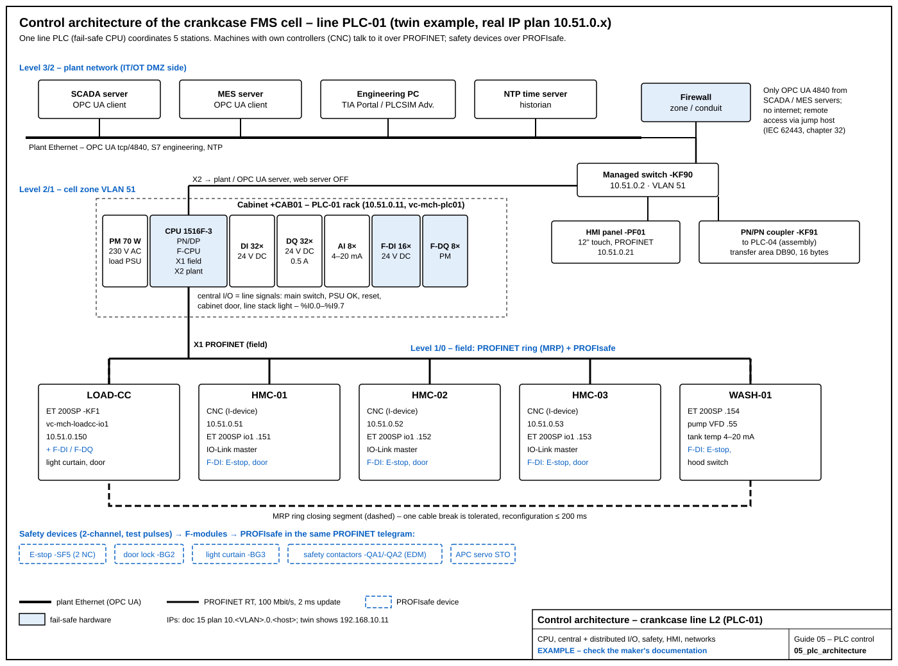
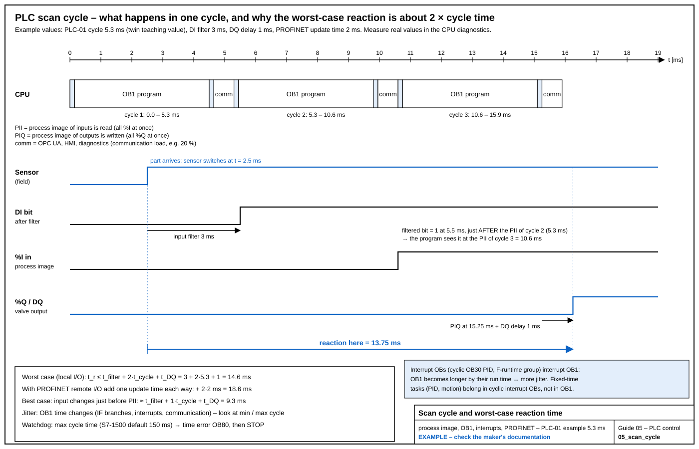
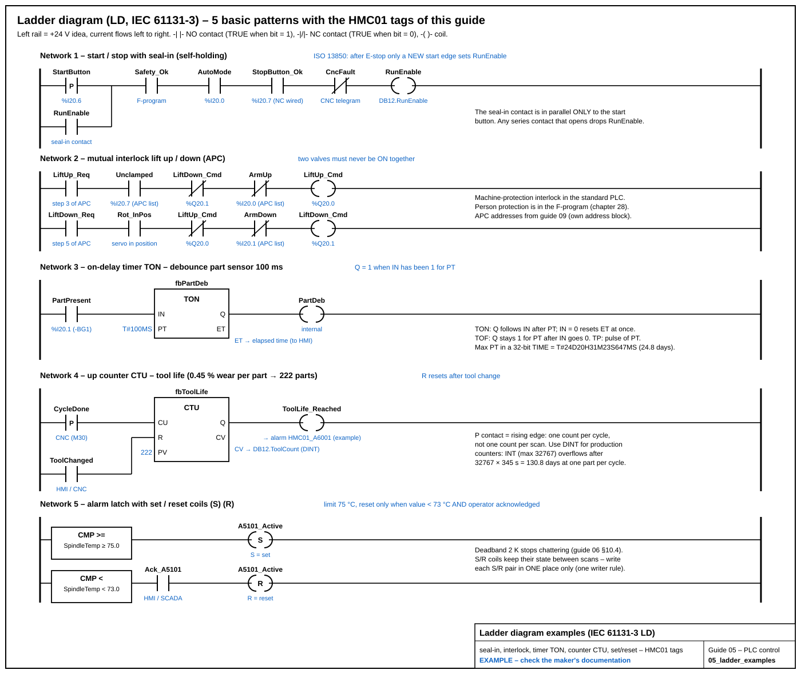
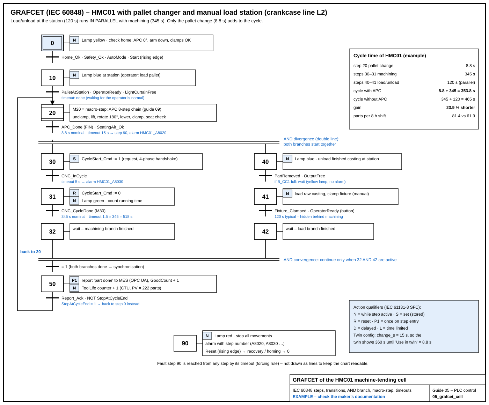
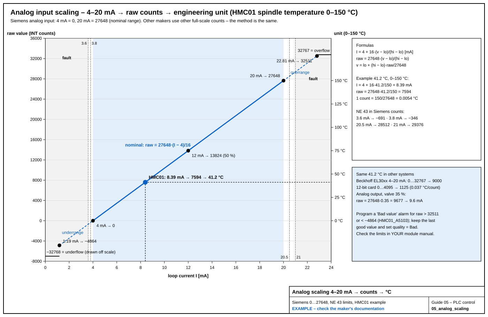
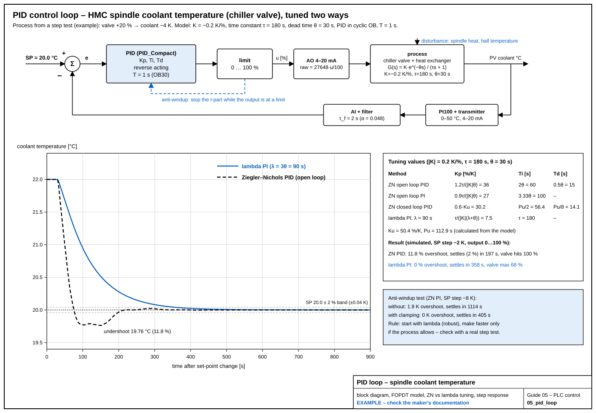
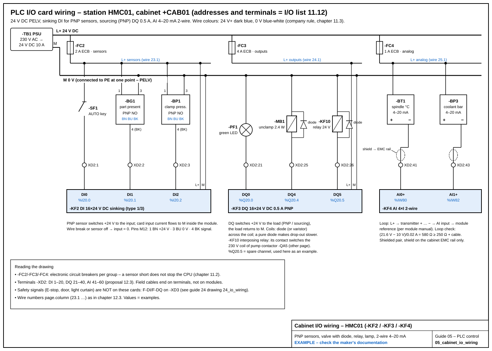
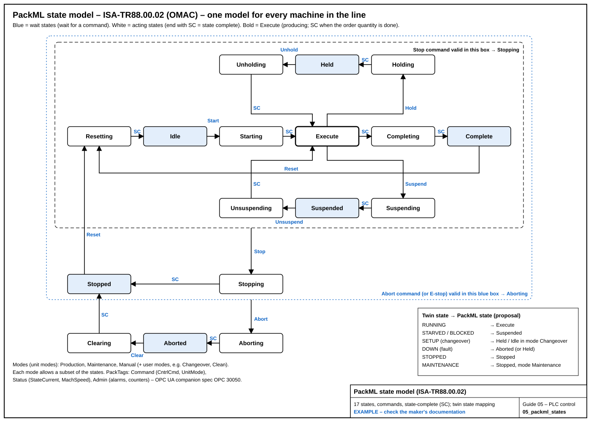

# 05 – PLC Control (Level 1)

Guide for the engineering team that will build the real V-compressor factory.
It explains the PLC layer of the digital twin, and how to do the same work correctly in the real factory.

> **Important:** every PLC type, IP address, I/O address, DB number, scan time and device name in this guide is an
> **example value** from the twin (Siemens S7-1500 style). Your real values come from your own I/O list and
> your own hardware configuration.

---

## Contents

1. Purpose
2. Where in the twin
3. Concepts – simply explained
4. The model in the twin + formulas
5. Implementing in the real factory – step by step
6. Checklists
7. Common mistakes
8. Limits of the twin
9. Engineering chapters – how to use chapters 10–15
10. Science principles – electrical and control basics
11. Detailed specification – cabinet, PLC, field devices, safety, network, I/O list, program
12. Identification and numbering (tags, devices, wires, addresses, drawings, versions)
13. Standards – requirements and verification
14. Complete worked example – station HMC01 end to end
15. Data you still need
16. Glossary

**Part B – controls engineering textbook and design reference (added)**

17. PLC hardware architecture – CPU, memory, I/O, distributed I/O, cycle time, redundancy
18. IEC 61131-3 – data types, standard blocks, the 4 languages for one cell, Siemens / CODESYS / Rockwell names
19. Program structure, coding standard, version control
20. State machines – PackML (ISA-TR88.00.02) states and modes
21. Sequence design with GRAFCET (IEC 60848) – the HMC01 cell
22. Interlocks, permissives, bypasses, first-out
23. Alarm handling in the PLC (ISA-18.2 basics)
24. Analog signals in depth – scaling, filters, Pt100, analog outputs
25. Counters, high-speed inputs, encoders
26. PID control in depth – identification, tuning, anti-windup, worked coolant loop
27. Motion control – PLCopen motion blocks, axis states, camming
28. Safety PLC programming – F-program, PROFIsafe, response time
29. Communication from the PLC – PROFINET, EtherNet/IP, EtherCAT, Modbus TCP, OPC UA server, MQTT
30. Simulation and virtual commissioning
31. Testing PLC software – unit tests, FAT/SAT test cases
32. Cyber security of the PLC (IEC 62443)
33. Diagnostics and troubleshooting
34. Documentation set for the control system
35. Buy list – catalogue examples + shopping list for the crankcase line controls
36. Formula sheet and new glossary terms

**Drawings in this guide** (files `docs/img/05_*.svg`, also in `web/img/`):

| Drawing | File | Section |
|---|---|---|
| Control architecture of the crankcase line (PLC-01) | `img/05_plc_architecture.svg` | 2.2, 17 |
| Scan cycle and worst-case reaction time | `img/05_scan_cycle.svg` | 3.2, 17.4 |
| Ladder examples: seal-in, interlock, TON, CTU, set/reset | `img/05_ladder_examples.svg` | 3.5, 18.3 |
| GRAFCET of the HMC01 machine-tending cell | `img/05_grafcet_cell.svg` | 3.6, 21 |
| Analog scaling 4–20 mA → counts → °C | `img/05_analog_scaling.svg` | 4.4, 24 |
| PID loop + step response with tuning values | `img/05_pid_loop.svg` | 10.7, 26 |
| Cabinet I/O wiring of HMC01 | `img/05_cabinet_io_wiring.svg` | 14.2 |
| PackML state model | `img/05_packml_states.svg` | 20 |

> **Binding rules for the real factory** (they replace the twin's example values where they differ):
> * E-stop: **release → reset (local, blue button) → separate start**. Never automatic restart (see 4.7, 5.8, 14.5).
> * One address scheme for all line PLCs: chapter 12.4 (= doc 15 §3.11, HMC01 = block 2: `%I20.x`, `%IW80`, DB12). SCADA reads PLC data **by symbol over OPC UA**
>   from the station interface DB, not by absolute `%IW` address (chapter 12.5).
> * One naming scheme: `<Area>_<Line>_<Machine>_<Signal>[_Suffix]`, e.g. `MCH_L2_HMC01_SpindleTemp`, alarm IDs
>   `HMC01_A5101`, IP plan `10.<VLAN>.0.<host>` (chapter 12, master document `docs/15_numbering_and_identification.md`).
> * Large generic tables (cable ampacity, sensor data, material values) are in
>   `docs/14_engineering_reference_data.md`.

---

## 1. Purpose

A **PLC** (Programmable Logic Controller) is the small industrial computer that controls the machines.
It reads sensors, runs a program every few milliseconds, and switches outputs (valves, motors, lamps, "cycle start").

This guide helps you to:

* understand **which PLC controls which station** in the planned factory, and why;
* understand the **scan cycle**, the **I/O image** (%I, %Q, %IW), **ladder logic** and **step chains**;
* design the **handshakes** between PLC and CNC, PLC and PLC, PLC and AGV, PLC and MES/SCADA;
* separate **safety functions** (E-stop, light curtain, door lock) from **standard functions**;
* write a correct **I/O list**, address scheme and naming rule;
* use the twin for **virtual commissioning** before the real machines arrive;
* plan **FAT/SAT**, program versioning and the **OPC UA server** on the PLC.

Why this matters: most commissioning delays in a new factory are not mechanical. They come from unclear
signals between suppliers ("who sends READY, and when?"), missing interlocks and late I/O lists.
If the PLC concept is clear on paper first, every supplier can build to the same interface.

---

## 2. Where in the twin

| What | File / place |
|---|---|
| PLC model (server side) | `twin/plc.py`, class `PLCNet` |
| PLC screen | **FMS tab → "PLC control"** section, code in `web/plc.js` |
| Data API | `GET /api/plc` (all PLCs, I/O, links, log, KPIs) · `POST /api/plc` `{"action":"estop","plc":"PLC-01","on":true,"user":"Anna"}` |
| Deep link | `/?plc=PLC-02#fms` opens the FMS tab with PLC-02 selected |
| Pallet changer step chain + I/O list | **Pallet changer (APC)** tab, `web/apc.js` |
| AGV drive control (CiA 402, Structured Text) | **AGV build – 2. servo drive control**, `web/agvdrive.js` (deep link `?avitem=2&adcode=st#agv`) |
| Interlocks AGV / cart ↔ APC station | **Mechanical elements – 1**, `web/mech.js` (guide section "PLC interlocks") |
| Interlocks load station ↔ APC | **Mechanical elements – 4**, `web/mech4.js` (tables "Interlocks – who may move when" and "Signals") |
| SCADA start interlock after E-stop | `twin/scada.py`, function `_machine()` (see guide 06) |

### 2.1 What you see on the PLC screen

1. **KPI tiles**: number of PLCs, I/O points, messages per minute, PLC↔PLC hand-overs, AGV docking hand-overs, safety state.
2. **Network diagram**: plant network (Ethernet, OPC UA port 4840) at the top with MES, SCADA and AGV fleet manager;
   the PLC boxes below; purple PN/PN coupler lines between PLCs; PROFINET lines down to the stations;
   the AGVs on Wi-Fi (MQTT / VDA 5050). Moving dashes = a message in the last minute.
3. **PLC detail** (click a PLC or a station): CPU type, IP, scan time (OB1), CPU load, I/O points,
   values sent to SCADA, status LEDs, and a red **EMERGENCY STOP** button (line PLCs only).
4. **Ladder logic – live**: 5 networks of the selected station, green = current flows.
5. **I/O image**: address, symbol, type (DI, DQ, AI, DB), value, raw value, signal.
6. **Field devices** of the station (CNC, sensors, safety devices, remote I/O, switch).
7. **Communication log**: every handshake, with a filter per PLC and per protocol. Click a line to see the data
   (signals, OPC UA node, MQTT topic).

### 2.2 The PLCs of the example factory

The twin creates one PLC per production line, and one PLC per AS/RS stacker crane. With the example
`config/factory.json` (16 stations, 5 lines, 2 AS/RS) you get **7 PLCs**:

| PLC (example) | Controls | CPU (example) | IP (example) | Why this CPU |
|---|---|---|---|---|
| PLC-01 | Crankcase FMS cell: LOAD-CC, HMC-01/02/03, WASH-01 | S7-1516F (fail-safe) | 192.168.10.11 | load station with operator + machines with tool magazines → safety functions |
| PLC-02 | Cylinder machining: VMC-01, HONE-01 | S7-1513-1 PN | 192.168.10.12 | standard CPU |
| PLC-03 | Crankshaft machining: LATHE-01, GRIND-01 | S7-1513-1 PN | 192.168.10.13 | standard CPU |
| PLC-04 | Assembly & test: ASSY-01, ROBOT-01, TEST-01, TEST-02, PAINT-01 | S7-1516F (fail-safe) | 192.168.10.14 | robot cell → safety functions |
| PLC-05 | Final assembly & packing: FINAL-01, PACK-01 | S7-1513-1 PN | 192.168.10.15 | standard CPU |
| PLC-ASRS-RAW | Raw material AS/RS stacker crane | S7-1515F-2 PN (fail-safe) | 192.168.10.31 | crane, own safety (rack door) |
| PLC-ASRS-FG | Finished goods AS/RS stacker crane | S7-1515F-2 PN (fail-safe) | 192.168.10.32 | same |

Rule in the code (`PLCNet.__init__`): a line PLC gets a **fail-safe CPU** if one of its stations is a robot,
a load station, or has a tool magazine. You can also force a station to a named PLC with a `"plc"` field in
the station config.

**PLC-to-PLC couplings** are found automatically: a buffer that is filled by one PLC's station and emptied by
another PLC's station. In the example:

| Buffer (example) | From → To | Meaning |
|---|---|---|
| B_CC | PLC-01 → PLC-04 | washed crankcases to pump assembly |
| B_CYL | PLC-02 → PLC-04 | cylinder supermarket (kanban) |
| B_CS | PLC-03 → PLC-04 | crankshaft supermarket (kanban) |
| B_P4 | PLC-04 → PLC-05 | tested, painted pumps to final assembly |

> **IP addresses**: the IPs in this table are the twin's examples. The real plan is `10.<VLAN>.0.<host>`
> (doc 15 §3.13, VLANs in guide 07): PLC-01 → `10.51.0.11`; the host number stays the same.



The drawing shows the real-factory form of PLC-01 (IP plan of doc 15). Hardware details: chapter 17.

**Buffer owner**: the PLC that "sees the sensors" of a buffer is the AS/RS PLC if the buffer is in an AS/RS,
else the PLC of the consuming line, else the producing line. This is the PLC that answers the AGV during docking.

---

## 3. Concepts – simply explained

### 3.1 The ISA-95 levels

| Level | System | Thinks in | Time scale |
|---|---|---|---|
| 4 | ERP | orders, money | days |
| 3 | MES | work orders, serial numbers | minutes–hours |
| 2 | SCADA | tags, alarms, trends | 0.1–1 s |
| **1** | **PLC / CNC / robot controller** | **signals, bits** | **1–10 ms** |
| 0 | sensors, actuators | voltage, current | – |

The PLC is the **last decision maker before the machine moves**. If MES or SCADA fail, the PLC must still
keep the machine safe and stop in a controlled way.

### 3.2 The scan cycle

The PLC repeats 4 steps without end:

1. **Read inputs** – copy all input signals into the *process image of inputs* (%I).
2. **Run the program** – all networks, from top to bottom (organisation block OB1 on Siemens).
3. **Write outputs** – copy the results from the *process image of outputs* (%Q) to the output cards.
4. **Communicate** – OPC UA, coupler data, diagnostics. Then start again.

Why a process image? During one scan all logic sees the **same** input values. A signal cannot change in
the middle of the program. This makes the logic predictable.



Cycle-time calculation, jitter and watchdog: chapter 17.4.

### 3.3 Addresses: %I, %Q, %IW, DB

Siemens style addressing (IEC 61131-3 uses the same `%` idea):

| Address | Meaning | Example |
|---|---|---|
| `%I1.3` | input byte 1, **bit 3** | CycleDone of the station in slot 1 |
| `%Q1.0` | output byte 1, bit 0 | CycleStart |
| `%IW80` | input **word** at byte 80 (16 bits, bytes 80 + 81) | temperature, analog |
| `%IW82` | next analog word (a word uses 2 bytes, so the next is +2) | power |
| `DB21.DBW0` | data block 21, word at byte 0 | program number |
| `DB21.DBD4` | data block 21, double word at byte 4 (32 bits) | good counter |

> **Rule: a byte has 8 bits, numbered .0 to .7.** `%I20.7` is the last bit of byte 20; the next bit is `%I21.0`.
> An address like `%I20.8` or `%I20.10` is **wrong** and will not compile on a Siemens PLC.
> Words: `%IW64`, `%IW66`, `%IW68` … (always +2). Double words: +4.

### 3.4 Digital and analog signals

* **Digital (DI / DQ)**: 0 or 1, normally 24 V DC. Example: proximity sensor "part present".
* **Analog (AI)**: a value, normally 4–20 mA. Example: temperature 0–150 °C.
  Why 4 mA and not 0 mA? A broken wire gives 0 mA. Because "zero value" is 4 mA, the PLC can see the difference
  between "value is zero" and "wire is broken".
* **IO-Link**: a digital point-to-point link to a smart sensor. It sends the value **and** diagnostics.
  In the twin the vibration sensor is IO-Link (raw × 0.1 = mm/s).
* **Fieldbus device data**: a CNC, robot or drive sends many values over PROFINET (no wire per signal).

### 3.5 Ladder logic and power flow

Ladder logic (LD) looks like an electrical drawing. Two vertical "rails"; current flows from left to right.

* `-| |-` **normally open contact**: closed (passes current) when the signal is 1.
* `-|/|-` **normally closed contact**: closed when the signal is 0.
* `( )` **coil**: becomes 1 when current reaches it.
* Contacts in a **row** = AND. Contacts **in parallel** = OR.

The twin draws the ladder **live**: green lines = current flows, from the real I/O values.



The same logic in FBD, ST and SFC: chapter 18.4.

### 3.6 Step chains (sequences)

Most machine work is a sequence: "unclamp → lift → rotate → lower → clamp". A **step chain** does one step at
a time. Each step:

* switches on its outputs,
* waits for a **transition condition** (a sensor: "arm is up"),
* then activates the next step.

Standards: **GRAFCET** (IEC 60848) is the drawing method. **SFC** (Sequential Function Chart, part of
IEC 61131-3) is the PLC language for it. You can also program a step chain in ST with a `CASE` statement.

Why a step chain and not free logic? You always know **which step** the machine is in. If it stops, the
operator sees "Step 4 – waiting for sensor 180°". Fault finding becomes easy.



GRAFCET rules and the full cell sequence with times: chapter 21.

### 3.7 Handshake

A **handshake** is a question and an answer with signals. Nothing moves until both sides agree.
Example (PLC → CNC):

1. PLC sets `CycleStart` – but only if DoorClosed, Clamped, no Fault, EStopOK.
2. CNC answers `InCycle`.
3. At the end the CNC reports `CycleDone` (M30).
4. PLC releases the part (`Unclamp`) – only if the next buffer has a free place (`OutputFree`).

If one answer is missing, the sequence waits. That is the protection a handshake gives.

### 3.8 Safety PLC vs standard PLC

| | Standard PLC | Safety PLC (fail-safe CPU, "F-CPU") |
|---|---|---|
| Job | production logic | protect people |
| Inputs | DI | F-DI (2 channels, test pulses) |
| Communication | PROFINET | PROFIsafe (safety telegram with counter + CRC over PROFINET) |
| If a fault is detected | depends on the program | goes to the **safe state** (outputs off) |
| Standard | IEC 61131-3 | plus ISO 13849-1 (PL) or IEC 62061 (SIL) |
| Who may change the program | maintenance engineer | only qualified + safety signature, change control |

A fail-safe CPU (e.g. Siemens "F" CPU) runs **both** programs: standard and safety, separated.
In the twin, PLC-01 and PLC-04 are fail-safe CPUs (S7-1516F), and the AS/RS PLCs are fail-safe CPUs
(S7-1515F-2 PN, +0.4 ms in the scan formula) because the stacker crane has a PROFIsafe light curtain and door switch.
(Older app versions showed the standard name `S7-1515-2 PN` – corrected 2026-11-12.) Alternative for a real crane:
standard CPU + a separate safety relay for the rack door.

### 3.9 E-stop and stop categories

IEC 60204-1 defines 3 stop categories:

| Category | What happens | Use |
|---|---|---|
| 0 | power off immediately (uncontrolled stop) | simple drives, E-stop allowed |
| 1 | controlled braking, then power off | servo axes, spindles, E-stop allowed |
| 2 | controlled stop, power stays on | normal operational stop, **not** for E-stop |

The E-stop function itself is described in ISO 13850. Two rules that you must keep:

1. The E-stop must work **without** software in the standard PLC (hard-wired, or through the safety PLC).
2. **Releasing the E-stop must not restart the machine.** Release + a separate **reset**, then a separate **start**.

### 3.10 Communication types used in the twin

| Connection | Between | Type | Typical cycle |
|---|---|---|---|
| PROFINET | PLC ↔ CNC, robot, drives, remote I/O | cyclic real-time I/O | 1–4 ms |
| PROFIsafe | E-stop, light curtain, door lock ↔ F-CPU | safety telegram on PROFINET | few ms |
| IO-Link / 4–20 mA | sensors | point to point | – |
| PN/PN coupler | PLC ↔ PLC of another line | a few bytes each cycle | ms |
| Optical I/O (E84 style) | AGV ↔ station during docking | 8 parallel bits, infrared | – |
| MQTT / VDA 5050 | fleet manager ↔ AGVs, Wi-Fi | publish/subscribe | events + state ~1 s |
| OPC UA (port 4840) | PLC ↔ MES / SCADA | subscription + read/write/method call | 0.1–1 s |

---

## 4. The model in the twin + formulas

### 4.1 How the twin builds the PLC view

`PLCNet` does **not** simulate a real PLC program. It **derives** what a real PLC would see and do from the
simulated machines (`twin/model.py`):

* The **I/O image** is calculated from the machine state each time `/api/plc` is read.
* The **handshakes** are detected from **state changes** between two simulation steps (`step(dt)`):
  the twin keeps the previous state, part flag and part counter of each machine (`self.prev`), each coupled
  buffer level (`self.prev_buf`), each crane's store/retrieve counters, and each AGV state.
  When something changes, a message is written to the communication log.

### 4.2 Handshakes detected from state changes

| Change in the twin | Message(s) written | Protocol | Example data |
|---|---|---|---|
| machine enters SETUP (model changeover) | MES → PLC "Recipe": download NC program + tool list; for CNC also PLC → CNC "Program select" | OPC UA, PROFINET | `ns=3;s=HONE-01.Recipe.ProgramNo = O0720`, method `LoadRecipe` |
| part counter increases | CNC → PLC "Cycle end" (M30) and PLC → MES "Part done" | PROFINET, OPC UA | `CycleDone=1, InCycle=0`; `GoodCount`, `ScrapCount` |
| new part in the machine | PLC → CNC "Cycle start" / robot "Robot start" / other "Start" | PROFINET | `CycleStart=1`, check `DoorClosed=1, Clamped=1, Fault=0` |
| machine goes DOWN | station → PLC "Fault", PLC → SCADA "Alarm" | PROFINET, OPC UA | `AlarmConditionType`, severity 900 |
| machine leaves DOWN / MAINTENANCE | PLC → SCADA "Alarm cleared" | OPC UA | `ActiveState: false` |
| coupled buffer level goes up | upstream PLC → downstream PLC "Part ready" | PN/PN coupler | `PartReady=1, Level=6` |
| coupled buffer level goes down | downstream PLC → upstream PLC "Part taken" | PN/PN coupler | `PartTaken=1, Level=5` |
| crane finishes a store | crane PLC → fleet manager "Stored" | OPC UA | `ns=4;s=ASRS-FG.Job.Done` |
| crane finishes a retrieval | crane PLC → fleet manager "Load ready" | OPC UA | `ns=4;s=ASRS-RAW.IO.LoadReady = true` |
| AGV gets a task | fleet manager → AGV "Order" | MQTT / VDA 5050 | topic `uagv/v2/plant/AGV-01/order` |
| AGV docked but crane busy | AGV → owner PLC "Wait" | Optical I/O (E84 style) | `TR_REQ=1`, station `READY=0` |
| AGV loading / unloading | AGV → owner PLC "Hand-over" | Optical I/O (E84 style) | `TR_REQ → READY → BUSY → COMPT` |
| AGV battery low | AGV → fleet manager "State" | MQTT / VDA 5050 | `batteryCharge` |

Program number rule (example): `O` + station number (2 digits) + model digits (2 digits).
Example: HONE-01 is station 7, model VC20 → `O0720`.

### 4.3 I/O image of one station

Every station gets 8 digital inputs, 6 digital outputs, analog values and 2 DB values.
`k` = position (slot) of the station inside its PLC (0, 1, 2 …).

**Digital inputs – byte k (`%Ik.0` … `%Ik.7`)**

| Address | Symbol | Value in the twin is 1 when … | Real device |
|---|---|---|---|
| %Ik.0 | DoorClosed | state is not DOWN / MAINTENANCE | door switch (PROFIsafe) |
| %Ik.1 | PartPresent | a part is in the station | proximity sensor |
| %Ik.2 | Clamped | part present AND RUNNING | clamp pressure switch |
| %Ik.3 | CycleDone | part done OR BLOCKED | from CNC / station |
| %Ik.4 | Fault | state DOWN | from CNC / drive |
| %Ik.5 | EStopOK | E-stop of this PLC not pressed | E-stop circuit (F-DI) |
| %Ik.6 | AutoMode | not STOPPED / MAINTENANCE | key switch AUTO |
| %Ik.7 | OutputFree | next buffer has a free place | from buffer sensors |

**Digital outputs – byte k (`%Qk.0` … `%Qk.5`)**

| Address | Symbol | 1 when … |
|---|---|---|
| %Qk.0 | CycleStart | RUNNING |
| %Qk.1 | Unclamp | part done AND OutputFree |
| %Qk.2 | LampGreen | RUNNING |
| %Qk.3 | LampYellow | STARVED, BLOCKED, SETUP or STOPPED |
| %Qk.4 | LampRed | DOWN, MAINTENANCE, or E-stop pressed |
| %Qk.5 | Motor | RUNNING (text per type: "Spindle enable", "Pump motor ON" …) |

All bit numbers are .0 to .7 – correct Siemens addressing.

**Analog and data values** – word address `w = 64 + 16·k`

| Address | Symbol | Scaling (example) |
|---|---|---|
| %IW(w) | Temperature | 4–20 mA = 0–150 °C, raw 0–27648 |
| IO-Link port 1 | Vibration | raw × 0.1 = mm/s |
| %IW(w+2) | Power | raw × 0.01 = kW |
| CNC / drive | SpindleSpeed | rpm (only machines with a spindle) |
| %IW(w+4) | AirFlow | 4–20 mA = 0–40 m³/h (test benches only) |
| %IW(w+6) | Pressure | 4–20 mA = 0–16 bar (test benches only) |
| DB(20+k).DBW0 | ProgramNo | program / recipe from the MES |
| DB(20+k).DBD4 | GoodCount | part counter |

Example: HMC-01 is slot k = 1 in PLC-01 → digital inputs `%I1.0…%I1.7`, outputs `%Q1.0…%Q1.5`,
temperature `%IW80` (64 + 16·1 = 80), power `%IW82`, data `DB21`.

**AS/RS crane PLC** (fixed example addresses): `%I0.0` CraneHome, `%I0.1` LoadOnIO (photo eye),
`%I0.2` EStopOK, `%Q0.0` TravelDrive, `%Q0.1` Fork, `%IW64` bay (laser distance, raw = bay × 1400 mm),
`%IW66` level (lift encoder, raw = level × 900 mm), `DB30.DBD0` jobs done. The crane runs a 5-step sequence:
job from fleet manager/MES → travel + lift to bay/level → fork out, take/put → back to I/O conveyor →
report "job done" (OPC UA).

### 4.4 Analog scaling formula (Siemens analog input card)

For a 4–20 mA signal with range `lo … hi`:

```
current        I   = 4 + 16 · (v − lo) / (hi − lo)          [mA]
PLC raw value  raw = 27648 · (v − lo) / (hi − lo)            (4 mA = 0, 20 mA = 27648)
back to unit   v   = lo + (hi − lo) · raw / 27648
```

Example from the twin: HMC-01 temperature 41.2 °C, range 0–150 °C

```
I   = 4 + 16 · 41.2 / 150 = 8.39 mA
raw = 27648 · 41.2 / 150 ≈ 7594   (the twin showed 7586 because it rounds the value first)
v   = 150 · 7594 / 27648 = 41.2 °C
```

On real Siemens modules, values above 27648 are the overrange area. Many modules report 32767 (7FFF hex)
for overflow or wire break – **check the manual of your module** and program a "bad value" alarm for it.
In TIA Portal you can use the `NORM_X` + `SCALE_X` instructions for this conversion.



More (other makers' counts, Pt100, analog outputs, filters): chapter 24.

### 4.5 Ladder logic of each station (5 networks)

| Network | Purpose | Logic |
|---|---|---|
| 1 | Cycle start: everything safe and part clamped | `AutoMode AND DoorClosed AND Clamped AND NOT Fault AND EStopOK → CycleStart` |
| 2 | Release finished part only if next buffer has space | `CycleDone AND OutputFree → Unclamp` |
| 3 | Motor runs only with cycle start AND safety OK | `CycleStart AND EStopOK → Motor` |
| 4 | Red lamp | `Fault OR NOT EStopOK OR NOT DoorClosed → LampRed` |
| 5 | Green lamp while producing | `CycleStart → LampGreen` |

The power flow in the drawing is calculated from the real I/O values in the browser (`ladder()` in `web/plc.js`).
The coil value shown is the real output value from the twin.

> Note: in network 3 the motor uses `EStopOK` from the standard program only to show the idea.
> In a real machine the motor power is removed by the **safety** circuit (STO, safety contactor),
> not by a standard ladder contact. See section 5.7 and the worked example in chapter 14.

### 4.6 Scan time and CPU load formula (twin estimate)

```
n_io     = number of I/O rows of all stations of the PLC
scan_ms  = 1.5 + 0.035 · n_io + (0.4 if safety CPU)
cpu_load = min(95 %, scan_ms / 10 ms · 100 % · 0.45)
```

Example values from the running twin:

| PLC | n_io | scan time | CPU load |
|---|---|---|---|
| PLC-01 (F-CPU, 5 stations) | 98 | 1.5 + 0.035·98 + 0.4 = **5.3 ms** | 5.3/10·100·0.45 ≈ **24 %** |
| PLC-02 (2 stations) | 40 | 1.5 + 1.4 = **2.9 ms** | ≈ 13 % |
| AS/RS PLC | 8 | 1.5 + 0.28 + 0.4 ≈ **2.2 ms** | ≈ 10 % |

This is a **teaching estimate**, not a manufacturer value. A real scan time depends on the program, not
on the I/O count only. Measure it in the real PLC (TIA Portal shows current / minimum / maximum cycle time).

**Reaction time** (shown on the PLC screen):

```
reaction time ≤ 2 × scan time + input delay + output delay
Example: 2 × 5 ms + 3 ms + 1 ms ≈ 14 ms
```

Why 2 × scan time? In the worst case the input changes just after the PLC read its inputs. It is seen only in
the next scan, and the output is written at the end of that scan.

### 4.7 E-stop in the twin

`POST /api/plc {"action":"estop","plc":"PLC-01","on":true,"user":"Anna"}` (or the red button):

1. All non-external stations of that PLC get the `stop` command; reason "E-stop pressed (PLC-01)".
2. Every simulation step, any station of that PLC that is not STOPPED or DOWN is stopped again (the interlock).
3. `factory.estop_machines` lists these stations. **SCADA reads this list** and refuses "start" with the text
   "refused: E-stop is pressed in its PLC – release and reset the E-stop first (interlock)".
4. The I/O image shows `EStopOK = 0` and `LampRed = 1`.
5. Log messages: Safety → PLC on PROFIsafe (`F-DI EStop_OK=0`, `F-DQ DrivesEnable=0`), PLC → SCADA alarm on
   OPC UA (`ns=3;s=PLC-01.Safety.EStop`), and a critical event with the user name.
6. Release (`"on": false`): the twin writes "released + reset" and **restarts the stopped stations automatically**.
   This is a simplification – see section 8. In a real factory this is not allowed.

> **Correct behaviour in the real factory** (ISO 13850, IEC 60204-1): releasing the E-stop button only makes a
> reset **possible**. The operator must press the local **Reset** button (blue) – the safety program reacts on
> the edge of the reset signal – and then a **separate Start** command (button or SCADA start request that the
> PLC checks). Until Start, all stations stay stopped and `RunEnable = 0`. The twin skips reset and start.
> The ladder/ST in chapter 14.5 shows the correct logic.

E-stop of an AS/RS crane PLC is not simulated (the API answers with an error).

### 4.8 PLC knowledge from other pages of the twin

#### a) Pallet changer step chain (`web/apc.js`)

Step chain of the 2-pallet rotary APC (example times; total = **8.8 s** pallet change, used by
**Use in twin** → `POST /api/command {"action":"pallet_change_s","value":8.8}`):

| Step | Action | PLC output / command | Step is done when | Interlock | Time (example) |
|---|---|---|---|---|---|
| 0 | NC calls the pallet change (e.g. M60) | NC → PLC M-code strobe | PLC reads the M code | spindle stopped, coolant off | – |
| 1 | Axes to change position, B = 0°, door open | NC moves X/Y/Z/B · %Q20.4 DoorOpen | NC "in position" + %I21.1 APCDoorOpen | load-station door closed, light curtain free | 1.5 s |
| 2 | Unclamp pallet in machine | %Q20.2 Unclamp valve | %I20.7 "unclamped" | arm down, both pallets present | 0.8 s |
| 3 | Lift arm with both pallets | %Q20.0 Lift-up valve | %I20.0 "arm up" | unclamped, operator outside (F-DI) | 0.8 s |
| 4 | Rotate 180° | servo enable + positioning order (PROFINET) | servo in position + %I20.3 "180°" | arm up, STO not active | 2.5 s |
| 5 | Lower arm | %Q20.1 Lift-down valve | %I20.1 "arm down" | position sensor OK | 0.8 s |
| 6 | Clamp new pallet | %Q20.2 off (springs clamp) | %I20.6 "clamped" | arm down | 0.8 s |
| 7 | Seating check with air | %Q20.3 seating air ON | %I21.0 air pressure switch | else ALARM "pallet seating" | 0.4 s |
| 8 | Close door, FIN to NC | %Q20.5 DoorClose · FIN | %I21.2 APCDoorClosed | → NC continues | 1.2 s |

```
t_change = 1.5 + 0.8 + 0.8 + 2.5 + 0.8 + 0.8 + 0.4 + 1.2 = 8.8 s
```

APC I/O list (example): DI `%I20.0`–`%I21.5` (ArmUp, ArmDown, Arm0deg, Arm180deg, PalletInMachine,
PalletAtStation, MachineClamped, MachineUnclamped, SeatingAirOK, APCDoorOpen, OperatorReady), F-DI
APCDoorClosed (guard locking), StationDoorClosed, LightCurtainFree (OSSD); DQ `%Q20.0`–`%Q20.5`, `%Q21.1`;
F-DQ `%Q21.0` ServoSTO; PROFINET servo telegram (PROFIdrive positioning); NC ↔ PLC M60 / FIN.
Note how the addresses go `%I20.7` → `%I21.0` (correct: bits .0–.7 only).

Safety notes on that page: light-curtain distance by ISO 13855, `S = K·(t_stop + t_response) + C`
with K = 2000 mm/s, C = 8·(d − 14); example d = 14 mm, t_stop = 0.3 s → `S = 2000·(0.3 + 0.02) + 0 = 640 mm`.
Arm rotation only with load-station door closed and light curtain free (F-DI, PL d per ISO 13849-1).
Servo stop with STO + brake; lift held by a pilot-operated check valve; zero-point modules clamp with springs.

#### b) AGV drive control – CiA 402 and Structured Text (`web/agvdrive.js`)

The AGV drives are commanded over **CANopen, CiA 402 profile** (example: 500 kbit/s, SYNC every 10 ms).
The vehicle controller writes the **controlword (0x6040)** and reads the **statusword (0x6041)**.

| Drive state | Statusword (masked) | Controlword to go on |
|---|---|---|
| Switch on disabled | 0x0040 | 0x0006 shutdown |
| Ready to switch on | 0x0021 | 0x0007 switch on |
| Switched on | 0x0023 | 0x000F enable operation |
| Operation enabled | 0x0027 | 0x000F (keep) – brake open, speed control |
| Quick stop active | 0x0007 | 0x0002 – wait |
| Fault | bit 3 (0x0008) | 0x0080 – **rising edge** of bit 7 resets |

The page shows this in IEC 61131-3 **Structured Text** (`FUNCTION_BLOCK FB_Cia402`): mask the state bits
(`wStatus AND 16#006F`), reset a fault with an `R_TRIG` edge, go to shutdown if `NOT xEnable OR NOT xSafetyOk`,
otherwise a `CASE` over the state. A second ST example is a **communication watchdog**: `TON` timers
(100 ms for navigation commands, 300 ms for drive heartbeats), following-error check, and low battery
(< 44 V → slow to charger). Lesson written in the code:

> "Software stops are COMFORT functions. The SAFETY stop is the safety controller → STO, wired, PL d."

#### c) Interlocks AGV / cart ↔ APC load station (`web/mech.js`)

E84-style signals: VALID, CS_0, L_REQ / U_REQ, TR_REQ, READY, BUSY, COMPT, HO_AVBL, ES.
PLC interlocks (safety-related parts per ISO 13849, PL d, as written on the page):

* APC may lift / rotate only if: station chains DOWN, stop DOWN, no transfer active (E84 BUSY off).
* Station chains may lift only if: APC lowered at 0°/180° + vehicle docked (B11) + E84 TR_REQ (AGV) or latch closed + button (cart).
* Chains run only if: chains UP, AGV/cart deck ready (READY / BUSY), light curtain clear or muted.
* Muting only while docked AND E84 VALID; any lost signal = chains stop + brake (muting per IEC 62046).
* Chains run only with "deck on the pins" (B13). The AGV may not drive while its lock pin is open (B14 off).
* AGV may leave only after COMPT.

#### d) Interlocks load station ↔ APC (`web/mech4.js`)

| Movement | Allowed only if | Signal type |
|---|---|---|
| APC lift / rotate | station chains DOWN · stop DOWN · no transfer · AGV not docked · station zone free · pallet seated or station empty · machine door open, spindle stopped | safety (F-DI, 2 channels) + standard |
| Station chains / stop | APC lowered AND at 0° or 180° AND standstill monitored | safety + standard |
| AGV docks / transfers | station not LOCKED · APC standstill · E84 handshake | E84 optical + standard |
| Person enters station zone | APC rotation stops (safe stop 1 → STO), lift held by valve | safety scanner → safety PLC |
| E-stop (any) | machine, APC and station stop together | hard-wired E-stop chain both ways |

The page says: "program them in the safety PLC, not only in the HMI". This is the correct rule.

---

## 5. Implementing in the real factory – step by step

### 5.1 Decide the PLC architecture

1. **One PLC per line** (as in the twin) is a good default. Why: a line can be commissioned, stopped and
   modified without touching other lines. A fault in one PLC stops one line, not the factory.
2. Machines with their own controller (CNC, robot, test bench, washer from a supplier) keep their own
   controller. The **line PLC coordinates** them through a defined interface.
3. Each **AS/RS** comes with the crane supplier's PLC. Define the interface (OPC UA or telegrams) in the order.
4. Decide **where the safety logic lives**: a fail-safe CPU per line where people work near hazards
   (load station, robot cell, APC). Use PROFIsafe for safety devices.
5. Decide **line-to-line coupling**: PN/PN coupler (two separate PROFINET networks exchange a transfer area),
   or I-device (one PLC is an I/O device of the other). Keep the coupling small: a few bytes.
6. Write this in a **control architecture document** with one drawing like the twin's network diagram.

### 5.2 Create the I/O list

The I/O list is the **single source of truth**. Electrical drawings, PLC program, SCADA tags and FAT tests
all come from it. Start it during basic design, not at commissioning.

Columns (minimum):

| Column | Example |
|---|---|
| Tag / symbol | `HMC01_DoorClosed` |
| Description | Machine door closed and locked |
| Station / area | HMC-01 |
| Signal type | DI / DQ / AI / AQ / F-DI / F-DQ / IO-Link / bus |
| Address | `%I1.0` (example) |
| Device + part number | safety switch with guard locking (type from design) |
| Electrical | 24 V DC, PNP, NO/NC, 4–20 mA 2-wire … |
| Range + unit (analog) | 0–150 °C |
| Alarm limits (if any) | H 75 °C |
| Safety relevant? PL? | yes, PL d |
| Cabinet / terminal | +CC1-X2:14 |
| Drawing page | =PLC01+CC1/23 |
| Status / revision | rev B, 2026-11-11 |

Steps:

1. List every **actuator** and **sensor** from the mechanical design (P&ID, hydraulic and pneumatic circuits,
   APC step chain, mech pages). One row per signal.
2. Add **bus devices** (CNC, robot, drives) with their data (telegrams, not single wires).
3. Mark **safety signals** (E-stop, doors, light curtains, scanners, STO). These go to F-modules.
4. Add **spare I/O**: plan 10–20 % spare per module and space in the cabinet. Why: there are always changes.
5. Assign addresses **only after** the hardware configuration is fixed (see 5.3).
6. Review the list with mechanical, electrical, software and each supplier. Freeze revision 1 before
   cabinet building.

### 5.3 Address scheme

Rules:

* Bits are `.0` to `.7` only. `%I20.7` → next is `%I21.0`.
* Analog words step by 2 (`%IW64`, `%IW66` …). Double words by 4.
* Give each station (or each remote I/O station) its **own byte range**, with a gap for spares.
  The twin does this: slot k uses `%Ik.x` / `%Qk.x` and `%IW(64 + 16·k)` upwards.
* Keep safety I/O in its own range (F-modules have their own addresses).
* Use the same scheme in every line PLC, so a technician recognises it.

**The binding scheme for the real factory is in chapter 12.4** (= doc 15 §3.11): station block b = 1 … 5 (b ≤ 5 per PLC),
digital bytes `10·b … 10·b+9`, analog words from `%IW(64 + 16·(b−1))`, fail-safe I/O in `%I200`–`%I299`,
interface DB `10 + b`. It replaces the twin's two different example schemes (PLC tab `%IW(64 + 16·k)` /
`DB(20+k)` and SCADA tab `%IW(64 + 8·i)` / `DB(10+i)`, see section 8). Short version:

| Range (per line PLC) | Use |
|---|---|
| `%I0.0`–`%I9.7` / `%Q0.0`–`%Q9.7` | main cabinet, line signals (main switch, PSU OK, reset, cabinet door, line stack light) |
| `%I(10·b).0`–`%I(10·b+9).7` / same for `%Q` | station block b = 1 … 5, 10 bytes each (HMC01, b = 2: `%I20.0`–`%I29.7`) |
| `%IW(64 + 16·(b−1))` … +14 | station block b, 8 analog inputs (HMC01: `%IW80`–`%IW94`) |
| `%I200.0`–`%I299.7` / `%Q200.0`–`%Q299.7` | fail-safe (F) I/O of the whole PLC |
| `DB10`–`DB29` | station interface DBs, `DB(10 + b)` (HMC01: DB12) – SCADA / MES read these by symbol |
| `DB90`–`DB99` | PLC-to-PLC coupler and MES/SCADA line interface DBs |
| bus devices (CNC telegram, IO-Link, meters) | `%I(300 + 20·(b−1))` … +19 / same for `%Q` (doc 15 §3.11, see 12.4) |

> In modern Siemens projects the program uses **symbols**, not absolute addresses. The address scheme is
> still important for wiring, diagnostics and FAT.

### 5.4 Naming rules

Write a short naming standard and use it everywhere (I/O list, PLC symbols, SCADA tags, drawings):

```
<Area>_<Line>_<Machine>_<Signal>     MCH_L2_HMC01_SpindleTemp, MCH_L2_HMC01_DoorLocked   (real factory, chapter 12)
<Station>.<Signal>  (twin only)      HMC-01.Temperature    (the twin's simplified SCADA name)
```

The project-wide rule is in `docs/15_numbering_and_identification.md`; chapter 12 of this guide applies it to
PLC symbols, devices, wires and addresses. The older example `HMC01_Door_Closed` is replaced by the full form.

Rules:

* English, no spaces, no special characters except `_` and `.`.
* Same station ID as in the layout, MES and SCADA (HMC-01, not "Machine 4").
* Positive logic in the name: `Door_Closed = 1` means closed. Avoid `Door_NotOpen`.
* Prefix for data types if your company uses it (`x` BOOL, `w` WORD, `di` DINT – as in the ST examples).

### 5.5 Design the step chains (GRAFCET / SFC)

1. Start from the **mechanical sequence** (e.g. APC: unclamp → lift → rotate → lower → clamp → seat check → door).
2. Draw it as GRAFCET: steps (boxes), actions (what is ON), transitions (sensor conditions).
3. For **every step** write: the output, the "done" sensor, the interlock, and a **timeout** (step time
   from the design × 1.5 to 2, example: lift 0.8 s → timeout 1.5 s). Timeout = alarm with the step number.
4. Add **initial step** (home position check), **stop at end of cycle**, **fault step**, and
   **manual mode** (jog each actuator, but still with safety interlocks).
5. Decide what happens after a **power loss or E-stop in the middle** of a step (e.g. the arm is half up):
   define a recovery / homing sequence. This is often forgotten.
6. Program it as SFC (GRAPH in TIA Portal) or as a `CASE` step number in ST. Show the step number on the HMI.

Template table (as on the APC page):

| Step | Action | Output | Done when | Interlock | Time | Timeout | Alarm text |
|---|---|---|---|---|---|---|---|

### 5.6 Design the handshakes

Rules for every handshake between two controllers:

1. **Request / acknowledge, 4 phases**: A sets REQ → B sets ACK → A resets REQ → B resets ACK.
   Why: both sides know the other side has seen the signal. A single pulse can be lost.
2. **Timeout on every wait**. Example: AGV sets TR_REQ, station must answer READY within a defined time
   (agree the value with the AGV supplier), else alarm.
3. **Heartbeat / life bit** on every bus interface (toggle bit or counter). If it stops changing for a defined
   time, the other side goes to a safe state. Example from the AGV page: 300 ms drive heartbeat.
4. **Data before strobe**: write the data (program number, pallet ID) first, then the strobe bit.
5. **Safety signals never through a standard handshake**. E-stop chain and safety door signals are hard-wired
   or PROFIsafe.
6. Write each handshake as a **signal-timing diagram** (like the E84 timeline on the mech page) in the
   **interface sheet** for the supplier.

Handshakes to define in this factory (from the twin):

| Interface | Signals (example) |
|---|---|
| Line PLC ↔ CNC | ProgNo, CycleStart, InCycle, CycleDone (M30), Fault, DoorClosed, Clamped, M60/FIN for APC |
| Line PLC ↔ robot | program number (e.g. 12 = "bolt heads"), Start, InPosition, safe stop (PROFIsafe) |
| Line PLC ↔ line PLC | PartReady, PartTaken, Level, heartbeat (PN/PN coupler transfer area) |
| Station PLC ↔ AGV | E84 style: VALID, CS_0, L_REQ/U_REQ, TR_REQ, READY, BUSY, COMPT, HO_AVBL, ES |
| Fleet manager ↔ AGV | VDA 5050: order, state, instantActions (MQTT) |
| AS/RS PLC ↔ fleet manager / WMS | job, job done, load ready on I/O conveyor |
| MES ↔ line PLC | recipe (program number, tool list) by OPC UA method, part done counters |
| Line PLC ↔ SCADA | states, values, alarms (OPC UA subscription), commands (OPC UA write / method) |

Note on VDA 5050 topics: the real topic structure is
`interfaceName/majorVersion/manufacturer/serialNumber/topic` (e.g. `uagv/v2/<manufacturer>/<serial>/order`).
The twin uses `uagv/v2/plant/AGV-01/order` as an example.

### 5.7 Safety PLC vs standard PLC – what goes where

| Function | Where | Why |
|---|---|---|
| E-stop | hard-wired chain and/or F-CPU + PROFIsafe, stop category 0 or 1 | must work if standard software fails |
| Guard locking of machine / APC door | F-CPU, F-DI 2 channels, ISO 14119 | person protection |
| Light curtain, safety scanner, muting | F-CPU, ISO 13855 distance, IEC 62046 | person protection |
| STO of servo drives (APC, AGV, crane) | F-DQ / safety controller, wired | safe torque off |
| Interlocks "APC may rotate only if…" (person-related parts) | F-CPU | mech4 page: "not only in the HMI" |
| Cycle start, step chain, lamps, counters | standard program | production logic |
| Machine-protection interlocks (e.g. don't unclamp while spindle runs) | standard program, plus machine builder's own logic | protects the machine |

Process for safety:

1. **Risk assessment** (ISO 12100) for every station and for the interfaces between suppliers.
2. Define each safety function and its required **PL (ISO 13849-1)** or **SIL (IEC 62061)**. The pages of the
   twin use PL d for door, light curtain and STO as an example – your risk assessment decides.
3. Design, then **validate** (ISO 13849-2): test every safety function, record the result.
4. Keep the safety program **separate and signed** (checksum / signature in the F-CPU). Changes only by
   qualified people with change control.

### 5.8 E-stop design

1. Decide **E-stop zones**. In the twin one E-stop stops all stations of one line PLC. In a real factory a zone
   follows the risk assessment: e.g. one zone per cell, plus "E-stop of APC also stops the load station and the
   machine" (mech4: "hard-wired E-stop chain both ways").
2. Choose stop category per drive: category 1 for spindles and servo axes (brake first, then STO);
   category 0 for simple motors.
3. **Reset concept**: E-stop released → operator presses **Reset** (blue button, located where the danger zone
   can be seen) → machine is ready but does **not** move → operator presses **Start**.
4. SCADA and MES must **not** be able to reset an E-stop. They may show it and block starts (as the twin's
   SCADA does), but the reset is local.
5. An E-stop on an AGV or crane must also stop the hand-over partner (ES signal in E84).

### 5.9 OPC UA server on the PLC

S7-1500 CPUs (and most modern PLCs) have a built-in OPC UA server. Check whether your CPU needs a runtime licence.

1. Create a dedicated **interface DB** per station for OPC UA (state, counters, values, alarm bits, recipe).
   Do **not** expose the whole program.
2. Mark only these DBs as "accessible from HMI/OPC UA"; make set points writable only where needed
   (e.g. `SpeedSetpoint`).
3. Use **methods** for commands (e.g. `LoadRecipe`, `ResetFault`) – the PLC checks the conditions and
   returns a status (the teaching page in the Communication tab shows `Bad_ConditionNotMet` when the machine is
   down). Methods are safer than writing command bits directly.
4. Security: user + password or certificates, security policy "Sign & Encrypt", disable anonymous access,
   port 4840 only from SCADA/MES servers (firewall). See guide 06 for IEC 62443 zones.
5. Use the node IDs consistently, e.g. `ns=3;s=HMC-01.Counters` as in the twin (example names).

### 5.10 Virtual commissioning with the twin

Use the twin as a **test partner** before the real machines exist.

1. Set the line structure in `config/factory.json` to match your real PLC split (`"plc"` field per station if
   needed). Check the network diagram in the FMS tab.
2. Use the twin's **communication log** as the list of handshakes every supplier must support.
   Export it to the interface sheets.
3. Compare your I/O list with the twin's I/O image: every symbol (DoorClosed, Clamped, CycleDone, OutputFree …)
   must exist in your real list.
4. When a real PLC is ready, connect it to the twin: set `"external": true` for that station and let a small
   gateway (OPC UA client) post the real state to `/api/ingest` (see README "Connect a real machine").
   The twin then runs the rest of the factory around the real PLC.
5. Test sequences, timeouts and line-to-line buffers before the machines are on the floor.
6. Test the E-stop concept on paper with the twin's E-stop button: which stations stop, which buffers fill,
   what SCADA shows. Then define the real zones.

Note: the twin does not run your PLC code. For a full virtual commissioning of a PLC program you need a PLC
simulator (e.g. PLCSIM / PLCSIM Advanced for Siemens) connected to a machine model. The twin gives the
factory-level behaviour around it.

### 5.11 FAT and SAT

**FAT** (Factory Acceptance Test) = at the supplier, before shipping. **SAT** (Site Acceptance Test) = in your factory.

FAT for a PLC-controlled station (minimum):

1. I/O check: every signal of the I/O list, wire by wire (force output → device moves; sensor → bit changes).
2. Every step chain step in automatic, with step times measured vs design (APC 8.8 s example).
3. Every timeout and every alarm text.
4. Every interlock, one by one: try the forbidden movement – it must refuse (mech4 table).
5. Every safety function with stop-time measurement (ISO 13855 distance check).
6. Handshakes with a simulator of the partner (AGV E84 simulator box, CNC simulator, or the twin).
7. OPC UA interface: browse all nodes, read values, write set point, call methods, check user rights.
8. Program backup and version number recorded in the FAT report.

SAT: repeat the safety tests and the interface tests with the **real** partners (real AGV, real MES/SCADA,
real line PLC next door), then a run-in (e.g. the mech page suggests 50 transfers each way and a 500-cycle
endurance test for the AGV ↔ APC interface).

### 5.12 Program versioning and change control

1. Every PLC program has a **version number** and a **change log** (who, when, what, why).
2. Store projects in a **version control** system or a dedicated automation change-management tool on the
   factory network (offline is fine). Keep the last FAT, SAT and current version.
3. Compare online vs offline regularly (TIA Portal "compare") – it detects undocumented changes.
4. **Backups** of all PLCs, drives, robots, CNC parameters after every change and on a schedule.
5. Safety program: separate approval, record the safety signature / checksum after each validation.
6. Contract with suppliers: you receive the **source code** with comments (not only the compiled program),
   or an escrow agreement.

---

## 6. Checklists

### 6.1 Architecture

- [ ] One PLC per line (or a documented reason for a different split)
- [ ] Fail-safe CPU where people work near hazards (load station, robot, APC, crane)
- [ ] Line-to-line coupling defined (PN/PN coupler or I-device), transfer area ≤ a few bytes + heartbeat
- [ ] AS/RS and AGV interfaces written in the purchase specification
- [ ] IP address plan per doc 15 (`10.<VLAN>.0.<host>`, e.g. PLC-01 → 10.51.0.11); the twin's 192.168.10.x values are only examples
- [ ] Network drawing like the twin's diagram

### 6.2 I/O list

- [ ] Every sensor and actuator from the mechanical design has a row
- [ ] Bit addresses only .0–.7; words step 2; no overlaps between stations
- [ ] Safety signals marked, on F-modules
- [ ] Analog ranges and units filled (e.g. 0–150 °C, 0–40 m³/h, 0–16 bar)
- [ ] 10–20 % spare I/O
- [ ] Names follow the naming standard; same station IDs as layout, MES and SCADA
- [ ] Revision frozen before cabinet build

### 6.3 Step chain

- [ ] GRAFCET drawn and reviewed with mechanical design
- [ ] Each step: output, done-sensor, interlock, timeout, alarm text
- [ ] Home / initial step, stop at end of cycle, fault step, manual mode
- [ ] Recovery after E-stop or power loss in the middle of a step
- [ ] Step number visible on HMI / SCADA

### 6.4 Handshakes

- [ ] 4-phase request / acknowledge
- [ ] Timeout on every wait, heartbeat on every bus link
- [ ] Data written before strobe
- [ ] Signal-timing diagram in each interface sheet, signed by both suppliers
- [ ] E84 signal set agreed with the AGV supplier (VALID, CS_0, L_REQ/U_REQ, TR_REQ, READY, BUSY, COMPT, HO_AVBL, ES)

### 6.5 Safety

- [ ] Risk assessment per station and per interface
- [ ] Required PL / SIL per safety function documented
- [ ] E-stop zones, stop categories, reset concept documented
- [ ] Release of E-stop does not start anything; reset is local
- [ ] Light curtain / scanner distances calculated (ISO 13855) and measured
- [ ] Validation report, safety signature recorded

### 6.6 Commissioning

- [ ] Virtual commissioning with the twin (external station + gateway) done
- [ ] FAT: I/O, sequences, interlocks, safety, interfaces, OPC UA
- [ ] SAT: repeat safety + interfaces with real partners, run-in
- [ ] Program version and backups stored; source code received

---

## 7. Common mistakes

| Mistake | Why it is bad | Do instead |
|---|---|---|
| Address `%I20.8` or `%I20.10` | bits are .0–.7; will not compile, shows the list was not checked | `%I20.7` → `%I21.0` |
| I/O list made at the end, from the program | drawings, SCADA and FAT have no common source | I/O list first, everything derived from it |
| E-stop as a software bit from SCADA or a web page | does not work when software/network fails | hard-wired / safety PLC; SCADA only shows and blocks start |
| E-stop release restarts the machine | ISO 13850: reset must not start | release → reset → separate start |
| Safety interlock only in the HMI | HMI is not a safety device | interlock in the safety PLC (mech4 rule) |
| Single pulse instead of handshake | pulse lost in one scan → line hangs | 4-phase handshake + timeout |
| No timeout in a step chain | machine waits forever, operator does not know why | timeout alarm with step number |
| Different station names in PLC, SCADA, MES | data cannot be linked, wrong machine commanded | one naming standard |
| Two pages / suppliers use the same address for different signals | wiring and program errors | one I/O list owner |
| Writing command bits directly from SCADA | no check of machine conditions | OPC UA method, PLC checks and answers |
| No plan for power loss mid-sequence | arm half up, nobody knows how to recover | recovery / homing sequence |
| No source code from supplier | you cannot change or fix the line later | source + comments in the contract |
| No heartbeat on PLC-to-PLC link | a dead partner looks like "no part ready" forever | heartbeat + communication alarm |

---

## 8. Limits of the twin

* **No real PLC program runs.** The I/O image and the ladder are **derived** from the simulated machine state.
  Example: `Clamped` is simply "part present and RUNNING".
* **Handshakes are detected after the fact** from state changes (counter up, state changed). The twin does not
  model timing inside a handshake (no real TR_REQ → READY delay, no timeouts).
* **Scan time and CPU load are a teaching formula** (1.5 + 0.035·n_io + 0.4 ms), not a manufacturer value.
* **E-stop release restarts stations automatically** in the twin. This is a simplification for the
  simulation – in a real factory it is forbidden (release → reset → start).
* The E-stop is a **software command** in the twin. A real E-stop is a hard-wired red mushroom button.
* E-stop of the AS/RS crane PLCs is not simulated.
* The AS/RS PLCs are fail-safe CPUs `S7-1515F-2 PN` (+0.4 ms in the scan formula; name corrected in the app
  2026-11-12, see 3.8).
* The twin's HMC pallet change uses `pallet_changer.change_s = 15` from `config/factory.json` (cycle 360 s) until
  the APC page value 8.8 s is sent with "Use in twin" (chapter 21.2).
* **Example addresses are not one consistent I/O list.** Examples:
  * The PLC tab numbers by slot inside the PLC (`%IW(64 + 16·k)`, `DB(20+k)`); the SCADA tag database numbers by
    machine index in the whole factory (`%IW(64 + 8·i)`, `DB(10+i)`). So HMC-01 temperature is `%IW80` in the PLC tab,
    and `%IW80` is HMC-02 temperature in the SCADA tab.
  * The "Program select" log message uses `DB(20 + factory index)` (HONE-01 → DB26), but the I/O image uses
    `DB(20 + slot)` (HONE-01 → DB21).
  * `ProgramNo` (e.g. "O0720") is shown in a word address `DBW0`. In a real PLC a word holds a number (INT);
    a text like O0720 needs a STRING or the number 720.
  * The APC page uses `%I20.x` / `%Q20.x`, which would overlap other modules if put in the same PLC.

  In a real project **one I/O list** is the single source, and these conflicts must not exist.
  The one scheme to use is chapter 12.4 (addresses) and 12.5 (SCADA access by symbol).
* The APC page's light-curtain example (S = 640 mm with K = 2000 mm/s) is on the safe side. ISO 13855 allows a
  recalculation with K = 1600 mm/s when the result is above 500 mm (→ 512 mm). See chapter 10.10.
* Field devices are a fixed list per station type, not your real devices.
* The motor contact in ladder network 3 uses the standard `EStopOK` bit. A real drive is switched off by the
  safety circuit (STO / safety contactor).
* Wi-Fi, MQTT latency, PROFINET jitter and network faults are not simulated.
* The VDA 5050 topic in the twin (`uagv/v2/plant/AGV-01/order`) is simplified.

---

## 9. Engineering chapters – how to use chapters 10–15

Chapters 1–8 explain the twin and the method. Chapters 10–15 give what you need to **build** the real control
system without other documents:

| Chapter | Use it when you … |
|---|---|
| 10 Science principles | size a 24 V line, choose PNP/NPN, check a 4–20 mA loop, set filter and scan time, calculate a PL or a safety distance |
| 11 Detailed specification | write the purchase specification for cabinets, PLCs, sensors, safety devices, network; fill the I/O list |
| 12 Identification and numbering | name a tag, a device, a terminal, a wire, an address, a drawing or a program version |
| 13 Standards | check which standard asks what, and how to prove it |
| 14 Worked example | want to see one station (HMC01) done completely: I/O, wiring, address, code, PL, SCADA |
| 15 Data you still need | plan which data you must still get from suppliers and your own design |

All numbers marked *example* are for teaching and must be replaced by data sheet / design values.
Large generic tables are in `docs/14_engineering_reference_data.md`; the numbering master is
`docs/15_numbering_and_identification.md`.

---

## 10. Science principles – electrical and control basics

### 10.1 Ohm's law and electrical power

```
U = R · I            U voltage [V], R resistance [Ω], I current [A]
P = U · I = I² · R   P power [W]
```

Example – solenoid valve coil, 24 V DC, 2.4 W (data sheet):

```
I = P / U = 2.4 / 24 = 0.1 A        R = U / I = 24 / 0.1 = 240 Ω
```

Why it matters: the sum of all currents sizes the power supply (11.2), the current sizes the wire and the
fuse, and P = I²·R is the heat in cables and in the cabinet (11.5).

### 10.2 Voltage drop on 24 V lines

The current flows to the device **and back** – so the cable length counts twice:

```
ΔU = 2 · L · I · ρ / A
L  one-way cable length [m]
I  current [A]
ρ  resistivity of copper ≈ 0.0178 Ω·mm²/m at 20 °C (about 0.021 at 60 °C – use the warm value for long hot cables)
A  conductor cross-section [mm²]
```

Example – valve terminal on the HMC, 50 m from the cabinet, 2 A:

| Cross-section | ΔU = 2·50·2·0.0178/A | Voltage at the valve (PSU 24.0 V) | OK? |
|---|---|---|---|
| 0.75 mm² | 4.75 V (19.8 %) | 19.3 V | **no** – below the 20.4 V lower limit |
| 1.5 mm² | 2.37 V (9.9 %) | 21.6 V | works, but above the 5 % design target |
| 2.5 mm² | 1.42 V (5.9 %) | 22.6 V | almost |
| 4 mm² | 0.89 V (3.7 %) | 23.1 V | **yes** |

Inverse formula (choose the section): `A = 2 · L · I · ρ / ΔU_max`.
With ΔU_max = 5 % of 24 V = 1.2 V: `A = 2·50·2·0.0178/1.2 = 2.97 mm²` → next standard size **4 mm²**.

Limits to respect:

* **Design target ≤ 5 % drop** (IEC 60204-1 limits the voltage drop from the supply point to the load to 5 % in
  normal operation – check the clause in your edition).
* **Device minimum voltage**: IEC 61131-2 gives 24 V DC −15 % / +20 % = **20.4 … 28.8 V** for PLC equipment;
  sensors and valves have their own range in the data sheet.
* Alternatives to a thick cable: a local 24 V supply on the machine, or set the PSU output a little higher
  (many PSUs adjust to 24–28 V) – but never above the device maximum.
* **4–20 mA signals are not affected by voltage drop**: the current is the same everywhere in a series loop.

### 10.3 PNP and NPN sensor logic

| | PNP ("sourcing" sensor) | NPN ("sinking" sensor) |
|---|---|---|
| Sensor output switches | **+24 V** to the input | **0 V** to the input |
| PLC input type needed | sinking input (current flows *into* the card to 0 V) | sourcing input |
| Common in | Europe, Siemens standard DI | Asia / USA, some machines |
| Wire-break result (NO sensor) | input = 0 | input = 0 (with sourcing card) |

Standard sensor cable, M12 A-coded connector: pin 1 **brown** = +24 V, pin 3 **blue** = 0 V,
pin 4 **black** = switching output, pin 2 white = second output / IO-Link function.

Rules:

* Use **PNP everywhere** in this factory (one sensor type in stock, Siemens DI are sinking inputs).
  Write it in every supplier specification.
* **NO vs NC**: an NO sensor gives 0 for "no object" *and* for "broken wire". For signals where a broken wire must
  lead to the safe side (stop, "pressure OK"), use an **NC contact or a "signal present = good" logic**
  (closed-circuit principle). Safety inputs always use F-DI with two channels (10.9).
* IEC 61131-2 defines input **types 1, 2, 3**. Type 1 is for mechanical contacts; types 2 and 3 accept 2-wire
  sensors with a small leakage current. Typical thresholds (check the card data sheet): ON ≥ 15 V (type 1) or
  ≥ 11 V (types 2/3); OFF ≤ 5 V. A 2-wire sensor's leakage current must be below the card's OFF current.

### 10.4 The 4–20 mA loop

* **Live zero**: 4 mA = range start. 0 mA means broken wire or dead transmitter → the PLC can detect it.
* NAMUR NE 43 (a recommendation, not a standard) defines: measuring range 3.8–20.5 mA, **fault** ≤ 3.6 mA or
  ≥ 21 mA. Configure the transmitter and the PLC alarm the same way.
* **2-wire transmitter**: the loop current also powers the transmitter. It needs a minimum voltage `U_min`
  (data sheet, e.g. 10–12 V).

Maximum loop resistance (at 20 mA = 0.02 A):

```
R_loop ≤ (U_supply − U_min) / 0.02 A
R_loop = R_input of the AI card + R_cable (2·L·ρ/A) + R of any loop indicator / barrier
```

Example: PSU 24 V, worst case −10 % = 21.6 V, transmitter U_min = 10 V:

```
R_loop ≤ (21.6 − 10) / 0.02 = 580 Ω
Cable 150 m, 0.5 mm²: 2·150·0.0178/0.5 = 10.7 Ω
AI card input resistance (example, take from data sheet): 250 Ω
Total 260.7 Ω ≤ 580 Ω  → OK, 319 Ω still free (e.g. for a loop-powered display)
```

### 10.5 Analog resolution and ADC counts (Siemens 27648)

Siemens analog cards map the **nominal range** to 0 … 27648 (4 mA = 0, 20 mA = 27648):

```
counts per mA      = 27648 / 16 = 1728
resolution in unit = (hi − lo) / 27648
v = lo + (hi − lo) · raw / 27648
```

| Range (example) | One count = |
|---|---|
| 0–150 °C | 150 / 27648 = 0.0054 °C |
| 0–16 bar | 16 / 27648 = 0.00058 bar |
| 0–40 m³/h | 0.0014 m³/h |

Siemens raw value areas for 4–20 mA (typical; **check the manual of your module**):

| Raw | Current | Meaning |
|---|---|---|
| 32767 (7FFF hex) | – | overflow / wire break (if diagnostics enabled) → value **Bad** |
| 27649 … 32511 | 20 … ≈ 22.8 mA | overrange – value usable but out of the nominal range |
| 0 … 27648 | 4 … 20 mA | nominal range |
| −1 … −4864 | 4 … ≈ 1.19 mA | underrange |
| −32768 (8000 hex) | – | underflow |

Notes:
* The card may have fewer real bits (e.g. 12 or 13 bits + sign). The raw value still goes to 27648 but jumps
  in bigger steps. Real resolution ≈ range / 2^bits.
* The **sensor accuracy** normally dominates: a 0–16 bar transmitter with ±0.5 % has ±0.08 bar error –
  far more than one count (0.00058 bar).

### 10.6 Sampling, scan time and response time

**Sampling (Nyquist idea):** to see a signal that changes with frequency f, you must sample at least 2·f.
In practice use **5–10 ×**. Consequences:

* A PLC with a 5 ms scan samples at 200 Hz → it can follow changes up to about 20–40 Hz, not more.
* Spindle vibration (bearing frequencies of hundreds or thousands of Hz) **cannot** be measured by the PLC
  scan. Use a vibration sensor that calculates the RMS value inside (IO-Link, as in the twin: raw × 0.1 = mm/s)
  and read only the result.

**Shortest pulse a standard DI can see reliably:**

```
t_pulse ≥ t_filter + t_scan            (pulse ON and pause OFF must each be that long)
f_max   ≈ 1 / (2 · (t_filter + t_scan))
Example: filter 3 ms, scan 5 ms → t_pulse ≥ 8 ms → f_max ≈ 1 / 16 ms ≈ 62 Hz
```

Faster signals (encoders, counting fast parts) → high-speed counter (HSC) module or hardware interrupt.

**Response time** (see 4.6):

```
t_response ≤ t_input_delay + 2 · t_scan + t_output_delay
Example: 3 ms + 2·5 ms + 1 ms = 14 ms   (+ bus cycle times if the I/O is on PROFINET: add 2 × bus cycle)
```

For safety functions the manufacturer gives a calculation tool for the **F-system response time**
(includes PROFIsafe watchdog times). Use that value in the ISO 13855 distance (10.10), not the formula above.

### 10.7 PID control basics

A PID controller keeps a value (e.g. coolant temperature) at a set point by changing an output (valve, fan, pump).

```
e(t) = SP − PV                                   error = set point − process value
u(t) = Kp·e + Ki·∫e dt + Kd·de/dt
Discrete (in the PLC, sample time T):
u_k = Kp·e_k + Ki·T·Σe + Kd·(e_k − e_(k−1)) / T
```

| Part | Does | Too much gives |
|---|---|---|
| P (Kp) | reacts to the present error | oscillation; P alone leaves a steady offset |
| I (Ki) | removes the steady offset over time | slow oscillation, overshoot, "wind-up" |
| D (Kd) | reacts to the speed of change, damps | noise amplification – often 0 for temperature |

Example – spindle coolant chiller, SP = 20 °C, PV = 22 °C, Kp = 5 %/K:
`e = −2 K` (cooling direction) → P part = 10 % more cooling valve opening.

Rules:
* Call the PID in a **cyclic interrupt OB** with a fixed time (e.g. 100 ms), not in OB1 (OB1 time varies).
* Sample time T ≤ 1/10 of the process time constant (temperature with τ = 300 s → T = 1 s is enough).
* Use **anti-wind-up** (stop integrating when the output is at 0 % or 100 %).
* Use the vendor's tested block (e.g. Siemens `PID_Compact`) and its auto-tuning, then check on the real plant.
* Machine-internal loops (spindle speed, axis position) are inside the CNC/drive – not your PLC job.



Step test, tuning formulas, worked numbers and ST code: chapter 26.

### 10.8 Debounce and signal filtering

Mechanical contacts **bounce** for about 1–10 ms when they close (several ON/OFF changes).
Moving parts can make a sensor flicker.

| Layer | Method | Typical value (example) |
|---|---|---|
| Input card | hardware input filter (configurable) | 3 ms (check card default) |
| PLC program | ON-delay: signal must be stable for t_db | 20 ms for buttons, 50–200 ms for "part present" on a moving carrier |
| Analog value | moving average / first-order filter `y += (x − y)·T/τ` | τ = 1–10 s for temperature (the twin uses τ = 60 s for vibration) |

Rule: a filter adds delay. **Never filter safety inputs in the standard program**; the F-system has its own
discrepancy and filter times.

### 10.9 Safety mathematics (ISO 13849-1)

Step 1 – **required PL (PLr)** from the risk graph (ISO 13849-1, Annex A):

| S severity | F frequency / time in hazard | P possibility to avoid | PLr |
|---|---|---|---|
| S1 slight | F1 seldom | P1 possible / P2 hardly | a / b |
| S1 slight | F2 frequent | P1 / P2 | b / c |
| S2 serious | F1 seldom | P1 / P2 | c / d |
| S2 serious | F2 frequent | P1 / P2 | d / e |

(F2 is normally chosen when the person is in the hazard zone more often than once per 15 min – check the
current edition; ISO 13849-1:2023 refined the parameters.)

Step 2 – **MTTFd** (mean time to dangerous failure) of each channel.
For electromechanical parts (contactors, switches, valves) from **B10d** (number of cycles until 10 % fail
dangerously, from the manufacturer; ISO 13849-1 Annex C gives typical values if none is available):

```
n_op  = d_op · h_op · 3600 / t_cycle         operations per year
MTTFd = B10d / (0.1 · n_op)                  [years]
T10d  = B10d / n_op                          replace the part before T10d years
Channel with several parts:  1/MTTFd = Σ 1/MTTFd_i
```

Example – safety contactor, B10d = 1 300 000 (example, use the data sheet), 220 days × 16 h,
one switching every 15 min (t_cycle = 900 s):

```
n_op  = 220 · 16 · 3600 / 900 = 14 080 per year
MTTFd = 1 300 000 / (0.1 · 14 080) = 923 years  → counts as "high"
T10d  = 1 300 000 / 14 080 = 92 years  (> 20-year mission time → no planned replacement)
```

| MTTFd per channel (ISO 13849-1:2023 – bands unchanged from 2015) | Rating |
|---|---|
| 3 ≤ MTTFd < 10 years | low |
| 10 ≤ MTTFd < 30 years | medium |
| 30 ≤ MTTFd ≤ 100 years | high (values above 100 are cut to 100 for categories B–3; ISO 13849-1:2015 allows up to 2500 years for category 4 – check edition; 2015 named here only as history) |

Step 3 – **DCavg** (diagnostic coverage – how many dangerous faults the system detects itself):

```
DCavg = (DC1/MTTFd1 + DC2/MTTFd2 + …) / (1/MTTFd1 + 1/MTTFd2 + …)
```

| DC | Rating | Example measure (ISO 13849-1 Annex E) |
|---|---|---|
| < 60 % | none | no monitoring |
| 60 … < 90 % | low | – |
| 90 … < 99 % | medium | cross-monitoring of two inputs with dynamic test (test pulses) |
| ≥ 99 % | high | direct monitoring of contactors with mirror contacts (EDM feedback) |

Step 4 – **category** (structure): B and 1 = single channel without test; 2 = single channel with test;
3 = two channels, a single fault does not lose the function; 4 = like 3 but faults are detected before they add up.
Categories 2, 3, 4 also need **CCF measures ≥ 65 points** (common cause failure, Annex F).

Step 5 – **PL from the simplified table** (ISO 13849-1, Figure 5 – verify with SISTEMA or Annex K):

| Category / DCavg | MTTFd low | MTTFd medium | MTTFd high |
|---|---|---|---|
| B / none | a | b | – |
| 1 / none | – | – | c |
| 2 / low | a | b | c |
| 2 / medium | b | c | d |
| 3 / low | b | c | d |
| 3 / medium | c | d | e |
| 4 / high | – | – | e |

Step 6 – **PFHd** (probability of dangerous failure per hour) and the PL bands:

| PL | PFHd [1/h] | SIL (IEC 62061, for comparison) |
|---|---|---|
| a | 10⁻⁵ … < 10⁻⁴ | – |
| b | 3·10⁻⁶ … < 10⁻⁵ | SIL 1 |
| c | 10⁻⁶ … < 3·10⁻⁶ | SIL 1 |
| d | 10⁻⁷ … < 10⁻⁶ | SIL 2 |
| e | 10⁻⁸ … < 10⁻⁷ | SIL 3 |

A safety function = input + logic + output in series: `PFHd_total = PFHd_input + PFHd_logic + PFHd_output`.
The PL reached must be **≥ PLr**. Certified devices (F-CPU, light curtain, drive STO) give their PFHd in the
data sheet. A complete example is in chapter 14.6.

### 10.10 Safety distance (ISO 13855)

A light curtain or scanner must be so far from the hazard that a person cannot reach it before the machine stops:

```
S = K · T + C
S  minimum distance from the detection zone to the hazard [mm]
K  approach speed: 2000 mm/s (hand/arm); 1600 mm/s (walking body)
T  total stopping time = machine stopping time + safety device response + safety PLC/F-system response [s]
C  extra distance for reaching through: for a light curtain with resolution d ≤ 40 mm: C = 8 · (d − 14) mm
```

Rules for a vertical light curtain, d ≤ 40 mm (values here from ISO 13855:2010; ISO 13855:2024 is current – check the formulas, K values and C values against the 2024 edition before final design; the worked example below uses the 2010 values):

1. Calculate with K = 2000 mm/s. If S ≤ 500 mm, use it (minimum 100 mm).
2. If S > 500 mm, you may recalculate with K = 1600 mm/s; then the minimum is 500 mm.

Example – APC load station (values from the APC page): d = 14 mm → C = 0; machine stopping 300 ms,
light curtain 15 ms, F-system 40 ms (examples) → T = 0.355 s.

```
K = 2000:  S = 2000 · 0.355 + 0 = 710 mm   > 500 → recalculate
K = 1600:  S = 1600 · 0.355 + 0 = 568 mm   ≥ 500 → S = 568 mm
```

Horizontal scanner field (body approach): `S = 1600 · T + (1200 − 0.4 · H)`, H = height of the scan plane
(mm), C not below 850 mm – check the edition. **Measure** the real stopping time with a stop-time meter at SAT
and add a margin for brake wear (company rule, e.g. +10 %).

### 10.11 Alarm system statistics (short)

`alarm rate = activations / time / operator`. Benchmark (ISA-18.2 / EEMUA 191): about 6 per hour per operator is
very likely acceptable, about 12 per hour is the maximum manageable; a flood is more than 10 alarms in 10 min.
Chattering = the same alarm 3 or more times in 1 min (common rule). The formulas, deadband sizing and
priority distribution are in guide 06, chapter 10.

### 10.12 Historian storage (short)

`storage per day = tags × 86 400 / interval × bytes per sample`. Example for one station with 12 tags at 1 s
and 16 B: 12 × 86 400 × 16 = 16.6 MB/day (before compression). Full method: guide 06, chapters 5.5 and 10.

---

## 11. Detailed specification

### 11.1 Control cabinet (IEC 60204-1, IEC 61439-1/-2)

| Item | Specification (this factory) | Why / source |
|---|---|---|
| Standards | IEC 60204-1 (electrical equipment of machines); cabinet built and verified as an assembly to IEC 61439-1 and -2 | design + routine verification report from the panel builder |
| Enclosure | sheet steel, painted, **IP54** (IEC 60529) | machining hall with coolant mist and dust; IEC 60204-1 minimum is IP22 |
| Ambient | electrical equipment rated for +5 … +40 °C air (IEC 60204-1 assumption); inside target ≤ 35 °C | electronics life |
| Supply | 400 V 3~ 50 Hz, TN-S, PE + N (check the site supply) | site |
| Main disconnect | lockable in OFF (padlock), handle on the door, door interlocked | IEC 60204-1 supply disconnecting device |
| Spare space | **≥ 20 %** free mounting plate and DIN rail, ≥ 20 % free terminals | changes during commissioning |
| Spare I/O | ≥ 20 % per signal type (DI, DQ, AI, F-DI) wired to terminals | same |
| Cable entry | gland plate at the bottom, EMC glands for shielded cables | EMC |
| Internal | cable ducts max 70 % full; separate ducts for 400 V power and 24 V / signal (≥ 100 mm or metal divider) | EMC, heat |
| Lighting / socket | cabinet lamp + 230 V service socket on own fuse, labelled | maintenance |
| Documentation | drawing pocket; wiring diagram, terminal plan, I/O list printed | IEC 60204-1 documentation |
| Labels | every device with its reference designation (chapter 12.2), every wire both ends (12.3) | fault finding |
| Cooling | by heat-loss calculation (11.5) | |

### 11.2 24 V DC power supply sizing and fusing

```
I_load  = Σ (I_device · simultaneity)
I_PSU   ≥ 1.25 · I_load                (25 % reserve)
```

Example – cabinet of station HMC01 (all currents are *examples*; take the real values from data sheets):

| Load | Qty | Current each | Total |
|---|---|---|---|
| CPU + I/O modules (backplane supply) | 1 | 2.0 A | 2.00 A |
| 3-wire sensors | 30 | 0.025 A | 0.75 A |
| Solenoid valves 2.4 W | 12 | 0.10 A | 1.20 A |
| Stack light (LED) | 1 | 0.30 A | 0.30 A |
| PROFINET switch | 1 | 0.50 A | 0.50 A |
| HMI panel | 1 | 1.00 A | 1.00 A |
| **Sum** | | | **5.75 A** |

`I_PSU ≥ 1.25 · 5.75 = 7.2 A` → choose a **10 A** supply (standard sizes 5 / 10 / 20 A).

Separate fused groups (each with its own protective device):

| Group | Example rating | Why separate |
|---|---|---|
| F1 – PLC CPU, network, HMI | 4 A | a sensor short circuit must not stop the CPU |
| F2 – input sensors | 2 A | |
| F3 – outputs (valves, lamps) | 4 A | |
| F4 – safety outputs supply | per F-module manual | |
| F5 – field supply to the machine (valve terminal) | by cable section | |

Fusing rules:
* The protective device protects the **wire**: its rating ≤ current capacity of the smallest wire it feeds.
* The PSU must deliver enough current to **trip** the device fast. A B-curve breaker trips magnetically at
  about 3–5 × I_n (AC values; check the DC trip value). A 10 A PSU often cannot trip a 4 A B-curve breaker fast →
  use **electronic circuit protection modules** (current-limited channels) or a PSU with boost current.
* Use a PSU with a **"DC OK" contact** wired to a PLC input (slot 0).

### 11.3 Wire colours and cross-sections

Colours (IEC 60204-1, conductor colour clause – recommended colours):

| Circuit | Colour |
|---|---|
| Protective earth PE | green-yellow (only for PE) |
| Neutral N | light blue |
| AC and DC power circuits | black |
| AC control circuits | red |
| DC control circuits | blue (doc 15: dark blue) |
| Interlocking circuits supplied from an external source (stay live when the main switch is OFF) | orange |

Company additions (*example* – decide and write in the cabinet specification): 24 V+ dark blue,
0 V blue-white, safety circuits with yellow marker sleeves.

Cross-sections (*practice values*; minimum values in IEC 60204-1, cross-section table – check):

| Use | Section (copper, flexible) |
|---|---|
| Control / signal inside the cabinet | 0.5–0.75 mm² |
| 24 V distribution in cabinet | 1.5–2.5 mm² |
| 24 V to field over long distance | by voltage drop (10.2) |
| 4–20 mA, shielded pair | 0.5 mm² |
| Power | by current, laying method and protective device – table in docs/14 |
| PE | per IEC 60204-1 PE table (depends on the phase conductor section) |

### 11.4 Terminals

* Field cables end on terminals (`-XD…`), never directly on PLC modules – except prefabricated system cables.
* Three-level terminals for 3-wire sensors (signal / +24 V / 0 V) save space and wiring errors.
* Terminal numbering per strip from 1 upwards; numbering rule in chapter 12.3.
* Spare terminals at the end of each strip (≥ 20 %).

### 11.5 Cabinet heat loss and cooling

```
P_loss          = Σ device losses (data sheets: PSU efficiency, drives, PLC, contactor coils)
P_through_wall  = k · A · ΔT        k ≈ 5.5 W/(m²·K) painted sheet steel
                                     A = free cabinet surface (not against wall / floor)
                                     ΔT = T_inside_max − T_ambient
P_cooling       = P_loss − P_through_wall
Fan volume flow V̇ = f · P_cooling / ΔT     f ≈ 3.1 m³·K/(W·h) at 0–100 m altitude
```

Example – cabinet 1200 × 2000 × 600 mm (W × H × D) against a wall; losses 600 W (example); hall 30 °C,
inside max 35 °C → ΔT = 5 K:

```
A = front 1.2·2.0 + 2 sides 2·0.6·2.0 + roof 1.2·0.6 = 2.40 + 2.40 + 0.72 = 5.52 m²
P_through_wall = 5.5 · 5.52 · 5 = 152 W
P_cooling      = 600 − 152 = 448 W
V̇ = 3.1 · 448 / 5 = 278 m³/h   → filter fan ≥ 278 m³/h (with filter mats; use the "with filter" flow value)
```

If the hall can be **hotter than the allowed inside temperature** (e.g. 40 °C summer, inside 35 °C), a fan cannot
cool → use a **cooling unit** (air conditioner) with ≥ 448 W + reserve, condensate drain, door switch.
The free surface rule above is simplified; IEC/TR 60890 gives the exact method (also in docs/14).

### 11.6 PLC hardware specification

| Item | Requirement (this factory) | Note |
|---|---|---|
| CPU family | one family in all lines (twin example: Siemens S7-1500) | spare parts, training |
| CPU type | fail-safe CPU (F-CPU) in lines with people near hazards; standard CPU elsewhere (rule in 2.2) | |
| Safety rating of F-CPU and F-modules | certified up to SIL 3 (IEC 61508/62061) / PL e (ISO 13849-1) | certificate in the documentation |
| Memory | ≥ 30 % free work memory after FAT (company rule, example) | changes |
| Cycle time | OB1 max cycle ≤ 20 ms at FAT (example); watchdog set | 10.6 |
| Ports | PROFINET for field (1 port / switch), separate interface or CP for the plant network | network separation (11.9) |
| OPC UA server | included, licence ordered, security Sign & Encrypt | 5.9 |
| Time | NTP client to the factory time server | time stamps |
| Protection | access protection levels with password; know-how protection only by agreement (you must receive the source) | 5.12 |
| Memory card | size for program + recipes + data logs; spare card in stock | |
| I/O modules | DI 16 × 24 V DC sinking (for PNP); DQ 16 × 24 V DC 0.5 A; AI 8 × 4–20 mA with wire-break diagnostics; F-DI with test pulse outputs; F-DQ PM-switching for contactors | |
| Reserve | **≥ 20 % spare channels** per type and ≥ 2 free module slots per rack | |
| Remote I/O | IP67 modules on the machine where cable runs are long; same address scheme (12.4) | |

### 11.7 Field device specification

| Device | Specification (default for this factory) | Typical use |
|---|---|---|
| Inductive proximity sensor | PNP, NO, 3-wire, 10–30 V DC, M12 or M18 body, flush where possible, IP67, M12 A-coded 4-pin connector | part present, end positions |
| Photoelectric sensor | PNP, light/dark switching selectable, IP67, M12 | part on conveyor, AS/RS I/O |
| Pressure switch | PNP output, adjustable set point + hysteresis, display | clamp pressure, air OK |
| Pressure transmitter | 4–20 mA 2-wire (or IO-Link), range 0–16 bar (example), accuracy ±0.5 % of span or better | coolant, hydraulic pressure |
| Temperature | Pt100 with head transmitter 4–20 mA (or IO-Link) | spindle housing, coolant |
| Vibration | sensor with internal RMS calculation (velocity mm/s, ISO 10816 / 20816 range), IO-Link | spindle bearing monitoring |
| Valve terminal | 24 V DC, PROFINET or IO-Link connection, manual override per valve | clamp, blow, APC |
| IO-Link master | PROFINET, IP67, 8 ports; port class A (pin 2 DI/DQ) or class B (extra power on pins 2/5) | smart sensors |
| Sensor cables | PUR jacket, drag-chain rated where moving, M12 A-coded | |
| Ethernet field connectors | M12 D-coded (100 Mbit/s) in the field, RJ45 in the cabinet | PROFINET |

IO-Link basics: point-to-point, 3-wire unshielded cable max **20 m**, speeds COM1 4.8 / COM2 38.4 /
COM3 230.4 kbit/s, device parameters are stored in the master and re-written after a sensor exchange.

### 11.8 Safety devices

| Device | Specification | Standard |
|---|---|---|
| E-stop button | red mushroom on yellow background, latching, direct (positive) opening NC contacts, 2 NC contacts to F-DI | ISO 13850, IEC 60947-5-5, IEC 60204-1 |
| Guard interlock with guard locking (machine / APC door) | coded actuator (type 2) or RFID (type 4); coding level by risk assessment; **spring-locked, power-to-unlock** for person protection; 2 channels + lock monitoring | ISO 14119 |
| Light curtain | **Type 4** (for PL d/e), resolution 14 mm (finger) or 30 mm (hand), 2 OSSD outputs, response time in data sheet | IEC 61496-1/-2; distance ISO 13855 |
| Safety laser scanner | Type 3, protective + warning fields, field switching via F-DI | IEC 61496-3 |
| Safety PLC | F-CPU + F-DI/F-DQ, PROFIsafe | IEC 61508 SIL 3 certificate |
| Safety contactors | mirror contacts (feedback for EDM) | IEC 60947-4-1 (mirror contact annex) |
| Drive safe stop | STO / SS1 via terminals or PROFIsafe | IEC 61800-5-2 |
| Reset button | blue, outside the danger zone with full view of it | IEC 60204-1 colours, ISO 13849-1 manual reset |

Type 2 light curtains are limited to lower PL (normally up to PL c) – do not use them for PL d functions.

### 11.9 Network specification

| Item | Specification |
|---|---|
| Field bus | PROFINET, one network per line PLC (the line is an own zone, guide 06 §5.7) |
| Copper cable | PROFINET cable, 4-wire (2 pairs) shielded, 100 Mbit/s, max **100 m** per segment; type A fixed, type B flexible, type C drag chain |
| Fibre | between buildings or > 100 m |
| Switches | managed PROFINET switches (conformance class B or higher) with diagnostics; no unmanaged office switches |
| Ring | MRP ring for critical lines: up to 50 devices per ring, reconfiguration ≤ 200 ms |
| Device names | PROFINET names lowercase letters, digits and hyphen, project form `vc-<area>-<device>`, e.g. `vc-mch-hmc01-io1` (chapter 12.6) |
| Plant network | separate subnet / VLAN; PLC → SCADA/MES only OPC UA 4840 through the firewall (guide 06) |
| Wi-Fi | AGVs only, own SSID/VLAN (guide 06 §5.7) |
| Test | every cable certified (link test) and documented at installation; PROFINET diagnostic tool at SAT |

### 11.10 SCADA server and clients

See guide 06, chapter 11 (server, client, historian, UPS, time server specification).

### 11.11 HMI and operator panel design rules

Push button colours (IEC 60204-1):

| Function | Colour |
|---|---|
| Emergency stop | red actuator on yellow background |
| Start / ON | white (preferred), grey, black or green – **not red** |
| Stop / OFF | black (preferred), grey, white or red – **not green** |
| Reset | blue (or white/grey/black) |

Indicator / stack light colours (IEC 60204-1):

| Colour | Meaning | In this factory (twin outputs) |
|---|---|---|
| Red | emergency / dangerous condition | LampRed – fault, E-stop |
| Yellow | abnormal, attention | LampYellow – starved, blocked, setup, stopped |
| Blue | mandatory action by the operator | e.g. reset required, load station "operator action" |
| Green | normal | LampGreen – running |
| White | neutral, other information | – |

Panel screens follow the SCADA style guide (guide 06 §5.4 and §11): grey background, colour only for abnormal,
alarm priorities with colour **and** shape.

### 11.12 I/O list – filled template for one station (HMC01, station block b = 2)

Station `MCH_L2_HMC01` (twin: HMC-01), line PLC `PLC-01` (tag form `MCH_L2_PLC01`), I/O in an ET 200SP style
remote station, devices in `+CAB01` / `+FLD`. Station block **b = 2** (b = 1 is LOAD-CC) → digital bytes
20–29, analog from `%IW80`, fail-safe I/O in the F range `%I200`–`%I299`, interface DB12 (scheme in 12.4,
same as doc 15 §3.11). The I/O list document is `VC-ELE-IOL-0001`. All devices and ranges are *examples*.

| Slot | Module | Device | Addresses |
|---|---|---|---|
| 1 | DI 16 × 24 V DC | -KF2 | %I20.0–%I21.7 |
| 2 | DQ 16 × 24 V DC 0.5 A | -KF3 | %Q20.0–%Q21.7 |
| 3 | AI 4 × 4–20 mA | -KF4 | %IW80, %IW82, %IW84, %IW86 |
| 4 | F-DI 8 × 24 V DC | -KF5 | %I200.0–%I200.7 (+ PROFIsafe bytes, see 12.4) |
| 5 | F-DQ 4 × 24 V DC PM | -KF6 | %Q200.0–%Q200.3 |
| – | head module (PROFINET) | -KF1 | device name `vc-mch-hmc01-io1` |
| spare | | | %I22.0–%I29.7, %Q22.0–%Q29.7, %IW88–%IW94 |

| Tag | Description | Type | Address | Device | Electrical | Range / logic | Alarm | Safety | Terminal |
|---|---|---|---|---|---|---|---|---|---|
| MCH_L2_HMC01_AutoMode | key switch AUTO | DI | %I20.0 | +OP01-SF1 | 24 V, contact | 1 = AUTO | – | no | -XD2:1 |
| MCH_L2_HMC01_PartPresent | pallet with part at station | DI | %I20.1 | +FLD-BG1 | PNP NO 3-wire | 1 = present | – | no | -XD2:2 |
| MCH_L2_HMC01_ClampPress_Ok | clamp pressure switch | DI | %I20.2 | +FLD-BP1 | PNP, NO | 1 = pressure OK | HMC01_A2105 | no | -XD2:3 |
| MCH_L2_HMC01_AirPress_Ok | compressed air OK | DI | %I20.3 | +FLD-BP2 | PNP, NO | 1 = OK | HMC01_A3002 | no | -XD2:4 |
| MCH_L2_HMC01_ResetButton | reset button (blue, with lamp) | DI | %I20.5 | +OP01-SF2 | contact NO | 1 = pressed | – | used by F-program | -XD2:6 |
| MCH_L2_HMC01_StartButton | start button | DI | %I20.6 | +OP01-SF3 | contact NO | 1 = pressed | – | no | -XD2:7 |
| MCH_L2_HMC01_StopButton_Ok | stop button | DI | %I20.7 | +OP01-SF4 | contact **NC** | 1 = not pressed | – | no | -XD2:8 |
| (spare) | | DI | %I20.4, %I21.0–%I21.7 | | | | | | -XD2:5, 9–16 |
| MCH_L2_HMC01_LampGreen_Cmd | stack light green | DQ | %Q20.0 | +FLD-PF1 | 24 V LED | | | no | -XD2:21 |
| MCH_L2_HMC01_LampYellow_Cmd | stack light yellow | DQ | %Q20.1 | +FLD-PF1 | 24 V LED | | | no | -XD2:22 |
| MCH_L2_HMC01_LampRed_Cmd | stack light red | DQ | %Q20.2 | +FLD-PF1 | 24 V LED | | | no | -XD2:23 |
| MCH_L2_HMC01_ResetLamp_Cmd | lamp in reset button ("reset required") | DQ | %Q20.3 | +OP01-SF2 | 24 V LED | flashing = reset needed | | no | -XD2:24 |
| MCH_L2_HMC01_Unclamp_Cmd | unclamp solenoid | DQ | %Q20.4 | +FLD-MB1 | 24 V, 2.4 W | 1 = unclamp | | no | -XD2:25 |
| MCH_L2_HMC01_SpindleTemp | spindle housing temperature | AI | %IW80 | +FLD-BT1 | 4–20 mA 2-wire | 0–150 °C | HMC01_A5101 / A5102 | no | -XD2:41/42 |
| MCH_L2_HMC01_CoolantPress | coolant pressure | AI | %IW82 | +FLD-BP3 | 4–20 mA 2-wire | 0–16 bar | HMC01_A5121 | no | -XD2:43/44 |
| MCH_L2_HMC01_EStop_Ok | E-stop chain, 2 channels | F-DI | %I200.0 (ch 0+4) | +OP01-SF5 | 2 × NC with test pulses | 1 = not pressed | HMC01_A1001 | **PL d** | -XD3:1–4 |
| MCH_L2_HMC01_DoorLocked | machine door closed + locked | F-DI | %I200.1 (ch 1+5) | +FLD-BG2 | 2 channels | 1 = locked | – | **PL d** | -XD3:5–8 |
| MCH_L2_HMC01_LightCurtainFree | load-station light curtain OSSD | F-DI | %I200.2 (ch 2+6) | +FLD-BG3 | 2 × OSSD | 1 = free | – | **PL d** | -XD3:9–12 |
| MCH_L2_HMC01_SafetyContactor_Fb | EDM feedback of -QA1/-QA2 | F-DI | %I200.3 | +CAB01-QA1/-QA2 | mirror contacts in series | 1 = both open | – | yes | -XD3:13 |
| MCH_L2_HMC01_SafetyContactor_Cmd | safety contactors (machine power enable) | F-DQ | %Q200.0 | +CAB01-QA1, -QA2 | PM-switching | 1 = power enabled | – | **PL d** | -XD3:20/21 |
| MCH_L2_HMC01_DoorUnlock_Cmd | guard locking: unlock solenoid | F-DQ | %Q200.1 | +FLD-BG2 | 24 V | 1 = unlock | – | yes | -XD3:22 |
| MCH_L2_HMC01_SpindleVib | spindle vibration RMS | IO-Link | via IO-Link master (address: see 12.4 note) | vibration sensor (code: verify) | IO-Link | raw × 0.1 mm/s | HMC01_A5111 / A5112 | no | M12 cable |
| MCH_L2_HMC01_CycleStart_Cmd, _InCycle, _CycleDone, _Fault, _ProgramNo, _SpindleSpeed | CNC handshake | bus | CNC PROFINET I-device telegram (address: see 12.4 note) | CNC | PROFINET | see 5.6 | HMC01_A4001 | no | – |

Codes `-PF` and `-MB` are on the "verify before use" list of doc 15 – confirm them in your E-CAD library.
The F-DI channel pairing (0+4, 1+5 …) depends on the module – check the manual.

### 11.13 PLC program structure (IEC 61131-3)

IEC 61131-3 defines the languages (LD, FBD, ST, SFC; IL – instruction list – was marked "deprecated" in edition 3 of 2013
and is removed in IEC 61131-3 ed. 4 (2025) – do not use it; state the edition your PLC tool supports) and the program organisation
units (programs, function blocks, functions). It does **not** define names – the naming below is a project rule
(similar to the PLCopen coding guidelines).

| Block (Siemens S7-1500) | Content |
|---|---|
| OB1 (program cycle) | calls `FB_Line` → one `FB_Station` instance per station, `FB_Interface` (MES/SCADA/PLC↔PLC) |
| OB30…OB38 (cyclic interrupt) | PID loops, fast fixed-time tasks (e.g. 100 ms) |
| OB100 (startup) | initialise: all step chains to step 0, RunEnable = 0, no automatic restart after power-up |
| OB80, OB82, OB83, OB86, OB121, OB122 | error OBs (time error, diagnostics, pull/plug, station failure, programming / I/O access error) → write diagnostic alarms; without them some CPUs go to STOP on such errors |
| F-runtime group | safety program (`Main_Safety`), called at a fixed cycle; E-stop, doors, light curtain, contactor control |
| `FB_Station` | station logic: modes, step chain, handshake, lamps, alarms (one type for all similar stations) |
| `FB_AnalogIn` | scaling 27648 → unit, wire break, limits with deadband |
| `FB_Alarm` | alarm bits → alarm messages with the alarm IDs of 12.1 |
| `UDT_StationIF` | data type of the station interface (same for every station) |
| `DB(10 + b)` "MCH_L2_HMC01_IF" | station interface DB (DB12 for HMC01) of type `UDT_StationIF`, OPC UA accessible |
| DB90 … DB99 | PLC-to-PLC coupler and MES/SCADA line interface DBs |

Name prefixes (project rule): `OB`, `FB_`, `FC_`, `UDT_`, `DB_` (global), `iDB_` (instance), variables
`x` BOOL, `i` INT, `di` DINT, `r` REAL, `s` STRING, `t` TIME, `fb` FB instance.

### 11.14 Alarm list – filled template (HMC01, PLC side)

Alarm IDs follow doc 15: `<Machine>_A<gnnn>` (g = group: 0 system, 1 safety, 2 hydraulics, 3 pneumatics,
4 drives, 5 process values, 6 tool/NC, 7 handling, **8 step-chain timeout with step number**, 9 maintenance).
The limit values are tag parameters with the suffixes `_Hi`, `_HiHi`, `_Lo`, `_LoLo`
(e.g. `MCH_L2_HMC01_SpindleTemp_Hi = 75`). Alarm list document: `VC-ITS-ALM-0001`.

| Alarm ID | Text (operator language) | Priority | Source / condition | Delay | Operator action |
|---|---|---|---|---|---|
| HMC01_A5101 | Spindle temperature high | 3 warning | SpindleTemp ≥ SpindleTemp_Hi (75 °C), off < 73 °C | 5 s | check coolant flow and chiller; inform maintenance |
| HMC01_A5102 | Spindle temperature very high – stop at cycle end | 2 serious | ≥ SpindleTemp_HiHi (85 °C), off < 83 °C | 2 s | stop at cycle end, call maintenance |
| HMC01_A5103 | Spindle temperature sensor fault (wire break) | 3 warning | raw > 32511 or < −4864 | 1 s | check sensor -BT1 and cable |
| HMC01_A5111 | Spindle vibration high | 3 warning | SpindleVib ≥ SpindleVib_Hi (4.5 mm/s, 1-min avg), off < 4.2 | 60 s avg | plan bearing check |
| HMC01_A5112 | Spindle vibration very high | 2 serious | ≥ SpindleVib_HiHi (7.1 mm/s), off < 6.8 | 60 s avg | stop, maintenance |
| HMC01_A5121 | Coolant pressure low | 3 warning | CoolantPress < CoolantPress_Lo (2.0 bar) | 15 s | check coolant pump and filter |
| HMC01_A2105 | Clamping pressure low – cycle start blocked | 2 serious | ClampPress_Ok = 0 while part clamped | 0.5 s | check hydraulic unit |
| HMC01_A3002 | Air pressure < 5 bar | 3 warning | AirPress_Ok = 0 | 2 s | check air supply |
| HMC01_A8030 | Timeout step 30 (CNC does not answer InCycle) | 2 serious | step 30 (21.2) longer than 5 s | – | check CNC mode / alarms, reset |
| HMC01_A8040 | Timeout step 40 (unload – part not removed) | 2 serious | step 40 (21.2) longer than 120 s | – | check handling / AGV, reset |
| HMC01_A4001 | CNC / drive fault (CNC alarm number in the text) | 1 critical | CNC Fault = 1 | – | read CNC alarm, repair |
| HMC01_A1001 | E-stop pressed – reset needed | 1 critical | EStop_Ok = 0 | – | remove cause, release, reset, start |

Tag database fields for SCADA: guide 06, chapter 11.

---

## 12. Identification and numbering

The project master is `docs/15_numbering_and_identification.md` (doc 15). **If this chapter and doc 15 differ,
doc 15 wins.** This chapter applies doc 15 to the control system and adds only what doc 15 does not cover
(the former proposals of 12.3 and 12.4 are now in doc 15 §3.11/§3.12, decision D-06).

### 12.1 Tags, PLC symbols and alarm IDs (doc 15 §3.10)

```
<Area>_<Line>_<Machine>_<Signal>[_Suffix]          MCH_L2_HMC01_SpindleTemp
```

| Part | Rule | Example |
|---|---|---|
| Area | 3-letter plant-area code | MCH, ASM, TST, PNT, FIN, LOG, UTL |
| Line | `L1`…`L9`, `L0` = serves the whole area. Machining: **L1 crankshaft, L2 crankcase FMS cell, L3 cylinder** | L2 |
| Machine | equipment ID without hyphen | HMC01, APCHMC01, PLC01, ASRSRAW |
| Signal | CamelCase English, positive logic, fixed words (`Temp`, `Press`, `Flow`, `Vib`, `Power`, `Speed`, `Pos`, `Level`, `Count`, `State`) | SpindleTemp |
| Suffix | `_Sp` set point · `_Cmd` command/output · `_Fb` feedback · `_Hi` `_HiHi` `_Lo` `_LoLo` alarm limit parameters · `_Ok` status OK · `_Cnt` counter | MCH_L2_HMC01_Speed_Sp, MCH_L2_HMC01_Good_Cnt |
| Alarm ID | `<Machine>_A<gnnn>` (groups in 11.14) | HMC01_A5101 |

The **same string** is the I/O list tag, PLC symbol, OPC UA variable name inside the interface DB and SCADA tag.
Unit, range, deadband and limits are attributes in the tag list `VC-ITS-TAG-0001`, not part of the name.
OPC UA browse path form: `MCH/L2/HMC01/SpindleTemp`; MQTT: `vc/MCH/L2/HMC01/SpindleTemp`.

### 12.2 Device reference designation (IEC 81346 style, doc 15 §3.12)

```
=MCH.L2.HMC01 +CAB01 -QA1
 │             │      └─ product "-": device = letter code + running number
 │             └─ location "+": +CAB01 cabinet, +JB01 junction box, +OP01 operator panel, +FLD field (+FLD.APC)
 └─ function "=": plant part
```

| Code | Device class | Examples in this guide | Status in doc 15 |
|---|---|---|---|
| BG | position / presence sensor (proximity, door interlock, light curtain) | -BG1 part present, -BG2 door | confirmed |
| BP | pressure sensor / switch | -BP1 clamp pressure | confirmed |
| BT | temperature sensor | -BT1 spindle temperature | confirmed |
| FC | overcurrent protection (fuse, MCB) | -FC1 | confirmed |
| KF | signal processing: PLC CPU, I/O module, safety relay | -KF1 head module, -KF2 DI module | confirmed |
| MA | electric motor | -MA1 coolant pump | confirmed |
| QA | switching power: contactor, circuit breaker | -QA1 safety contactor | confirmed |
| QB | disconnecting: main switch | -QB1 | confirmed |
| SF | manual operation: push button, selector, E-stop button | -SF1 key switch, -SF5 E-stop | confirmed |
| XD | terminal strip | -XD2, -XD3 | confirmed |
| MB, PF, TB, QM, BF, WD/WG, XG | solenoid, lamp, power supply, fluid valve, flow sensor, cables, plug | -MB1, -PF1, -TB1 | **verify before use** |

Numbering: running number per letter code inside one function (`-BG1`, `-BG2` …). The same designation is used
in schematic, I/O list, device label and hydraulic/pneumatic diagram (valve `-QM4` has coil `-MB4`).

### 12.3 Terminals, wires and cables (doc 15 §3.12)

* Terminal strips per voltage: **`-XD1` 400 V AC, `-XD2` 24 V DC signals, `-XD3` safety circuits**.
  Terminal `-XD2:7` = strip XD2, terminal 7. Project rule inside -XD2 (doc 15 §3.12): DI on
  terminals 1–20, DQ 21–40, AI 41–60, in channel order.
* **Wire numbers**: page/column of the schematic where the wire starts, plus a running letter if needed –
  `23.4`, `23.4a`. Sleeve markers on both ends. IEC 60204-1 requires every conductor to be identifiable at each
  termination in agreement with the documentation.
* **Cables**: `-W<nnnn>` with a cable list `VC-ELE-CBL-0001`. The label at both ends shows cable number and the
  destination: `-W0123 → +FLD.APC-BG12`.
* Conductor colours: see 11.3 (doc 15 uses dark blue for DC control circuits).

### 12.4 I/O address scheme (binding, doc 15 §3.11)

Station **block b** inside its line PLC: b = 0 is the main cabinet (`%I0.0`–`%I9.7`), b = 1 … 5 are stations.
**b ≤ 5 per PLC** (doc 15 §3.11): digital and analog addresses share one input image (`%IW80` = `%IB80` + `%IB81`),
so a digital block 6 (`%I60`–`%I69`) would overlap the analog words of block 1 (`%IW64`–`%IW78` = bytes 64–79).

| Area | Station block b | b = 2 (HMC01) | Rule |
|---|---|---|---|
| DI | `%I(10·b).0` … `%I(10·b+9).7` | %I20.0 … %I29.7 | 10 bytes = 80 inputs |
| DQ | `%Q(10·b).0` … `%Q(10·b+9).7` | %Q20.0 … %Q29.7 | |
| AI | `%IW(64 + 16·(b−1))` … +14 (8 words) | %IW80 … %IW94 | words step +2 |
| Fail-safe I/O | `%I200.0`–`%I299.7` / `%Q200.0`–`%Q299.7` for the whole PLC | HMC01 F-DI from %I200.0 | an F-module also uses bytes for the PROFIsafe frame – reserve them; keep a table "F-range per station" in the I/O list |
| Interface DB | `DB(10 + b)` (DB10–DB29) | DB12 "MCH_L2_HMC01_IF" | type `UDT_StationIF` |
| Line DBs | DB90–DB99 | DB90 PLC↔PLC coupler, DB91 MES, DB92 SCADA line commands | |

Inside a block the modules follow the slot order without gaps; spare at the end of the block.

Addresses for **bus devices** (doc 15 §3.11, decision D-06) (CNC I-device telegram,
IO-Link master process data, power meters): `%I300` upwards / `%Q300` upwards, 20 bytes per station
block: `%I(300 + 20·(b−1))` → HMC01 (b = 2): `%I320`–`%I339`. Also analog outputs (`%QW`): same formula as AI.

Rules: bits `.0`–`.7` only; words +2, double words +4; no address used twice (cross-reference check); fix the
start addresses in the hardware configuration – do not let the tool assign them automatically.

> Example: `MCH_L2_HMC01_SpindleTemp` → `%IW80` = the same address the twin's PLC tab shows for HMC-01
> (`64 + 16·1` with slot k = 1 equals `64 + 16·(2−1)` with block b = 2). The twin's SCADA tab (`%IW(64 + 8·i)`)
> does **not** follow the scheme.

### 12.5 How SCADA and MES address PLC data

* SCADA and MES **do not read `%IW` addresses**. They read the station interface DB **by symbol over OPC UA**.
  Siemens S7-1500 node ID form: `ns=3;s="MCH_L2_HMC01_IF"."SpindleTemp"` (check the namespace index when you
  browse the server). If the server is modelled with folders, the browse path is `MCH/L2/HMC01/SpindleTemp`.
* The PLC copies scaled values (°C, bar, mm/s) into the interface DB. Scaling happens **once, in the PLC**.
* Text values need a STRING: `ProgramNo` is stored as INT 2102 (shown as "O2102", doc 15 §3.14) or STRING[8].
* The interface itself is documented in the interface sheet `VC-IF-ITS-MCH-0001` (MES ↔ machining PLCs).

### 12.6 Network names, drawings, documents, versions (doc 15 §§3.2, 3.4, 3.13, 3.14)

| Object | Rule | Example |
|---|---|---|
| Line PLC ID / tag form | `PLC-<nn>` / `PLC<nn>` | PLC-01 / MCH_L2_PLC01_… |
| IP address | `10.<VLAN>.0.<host>`; PLCs host .10–.49, CNCs/drives .50–.99, I/O stations .150–.199 | PLC-01 → **10.51.0.11** (VLAN 51 = crankcase FMS cell); HMC-01 CNC → 10.51.0.51 |
| Host / PROFINET device name | `vc-<area>-<device>` lower case | `vc-mch-plc01`, `vc-mch-hmc01-cnc`, `vc-mch-hmc01-io1` |
| Electrical drawing | `VC-ELE-<group>-<nnnn>-<rev>`, groups SCH, CAB, TRM, CBL, PWR, GND | `VC-ELE-SCH-0901-D` (PLC-01 schematic) |
| Page reference | drawing + page.column | `VC-ELE-SCH-0901-D /23.4` |
| I/O list, cable list | `VC-ELE-IOL-0001`, `VC-ELE-CBL-0001` | |
| Safety documents | risk assessment `RA`, safety requirements `SRS`, calculation `CALC` | `VC-MCH-RA-0001-A`, `VC-MCH-SRS-0001-A`, `VC-MCH-CALC-0001-A` (examples) |
| PLC program version | semantic `MAJOR.MINOR.PATCH`: MAJOR = interface DB changed (MES/SCADA must change too), MINOR = new compatible function, PATCH = bug fix, `-rc1` = FAT/commissioning build | `PLC-01 v2.3.1` |
| Safety program | every change → new version + re-validation; record the **F-signature (collective checksum)** | `PLC-01 v2.4.0`, F-sig 1A2B3C4D (example) |

The twin's own example IPs (`192.168.10.11`–`.15`, `.31`–`.32` in 2.2) are **not** the real plan – the host
number stays the same (`.11` → `10.51.0.11`).

---

## 13. Standards – requirements and verification

Always use the **current edition**. Where this table says "check clause", the clause number is not given here
to avoid a wrong reference.

| Number | Title (short) | Requirement for this factory | Value / clause | Verification |
|---|---|---|---|---|
| IEC 61131-3 | PLC programming languages | program in LD, FBD, ST, SFC; structure with FB / FC / DB | IL deprecated since edition 3 (2013), removed in IEC 61131-3 ed. 4 (2025) – not to be used | code review |
| IEC 61131-2 | PLC equipment requirements | 24 V DC range, DI types | 24 V −15 %/+20 % (20.4–28.8 V); input types 1/2/3 | data sheets |
| IEC 61131-9 | IO-Link (SDCI) | smart sensors | max 20 m cable | commissioning |
| IEC 60204-1 | Electrical equipment of machines | stop categories 0/1/2; E-stop cat 0 or 1; wire colours; push-button and lamp colours; enclosure ≥ IP22; voltage drop ≤ 5 %; ambient 5–40 °C; documentation; conductor identification | check clause numbers in your edition | inspection, continuity of PE, insulation test, voltage test as required, functional test |
| IEC 61439-1 / -2 | Low-voltage switchgear and controlgear assemblies | cabinet design verification (temperature rise, short-circuit withstand, clearances) and routine verification of every cabinet | – | design verification report + routine verification report from the panel builder |
| IEC/TR 60890 | Temperature rise of assemblies by calculation | heat calculation of cabinets | – | calculation sheet |
| IEC 60529 | IP code | cabinets IP54, field devices IP65/IP67 | first digit dust, second water | data sheet / marking |
| IEC 60445 | Identification of terminals and conductors | conductor colours / marking basics | – | inspection |
| ISO 12100 | Risk assessment | for each station and each interface | – | risk assessment report |
| ISO 13849-1 | Safety-related parts of control systems – design | PLr per safety function; category, MTTFd, DCavg, CCF ≥ 65 | 10.9 | SISTEMA (or equal) report |
| ISO 13849-2 | – validation | test each safety function, fault exclusion list | – | validation report |
| IEC 62061 | Functional safety of machinery control systems | alternative to ISO 13849-1 with SIL | SIL 1–3 | calculation report |
| IEC 61508 | Functional safety (basic) | certificate of F-CPU, F-modules | SIL 3 | certificate |
| ISO 13850 | Emergency stop function | stop cat 0 or 1; latching; reset must not start; red/yellow actuator; PLr from risk assessment | check clause | functional test: press, try start, release, reset, start |
| IEC 60947-5-5 | E-stop devices | direct opening action, latching | – | data sheet |
| IEC 60947-5-1 | Control circuit devices | positive opening contacts of safety switches | – | data sheet |
| ISO 14119 | Interlocking devices with guards | types 1–4, coding level, guard locking, defeat prevention | – | inspection + defeat assessment |
| ISO 13855 | Positioning of safeguards | S = K·T + C | 10.10 | stopping time measurement, distance measured |
| ISO 13857 | Safety distances for upper and lower limbs | fence height and distance to hazard | tables in the standard | measurement |
| IEC 61496-1 / -2 / -3 | Electro-sensitive protective equipment | light curtain Type 4 / scanner Type 3 | – | certificate + test rod check |
| IEC 62046 (TS) | Application of protective equipment to detect persons | muting, blanking rules | – | functional test |
| IEC 61800-5-2 | Drive safety functions | STO, SS1 | – | certificate, functional test |
| IEC 60848 | GRAFCET | step chain drawings | – | review |
| IEC 61158 / IEC 61784 | Fieldbuses (PROFINET); IEC 61784-3-3 PROFIsafe | – | – | certified devices (PROFINET certificate) |
| IEC 62541 | OPC UA | PLC ↔ SCADA/MES | port 4840 | browse / read / write / method test |
| IEC 62443 | Industrial cyber security | zones and conduits (62443-3-2), system requirements and security levels (62443-3-3) | SL per zone | security risk assessment, firewall rule review |
| IEC 81346-1 / -2 | Reference designation | =function +location -product, letter codes | 12.2 | drawing check |
| ISA-18.2 / IEC 62682 | Alarm management | alarm philosophy, rationalization | guide 06 | alarm KPI report |
| ISA-101.01 | HMI for process automation | style guide, display hierarchy | guide 06 | review |
| NAMUR NE 43 (recommendation) | 4–20 mA failure levels | fault ≤ 3.6 mA / ≥ 21 mA | 10.4 | loop test |

EU note: for machines placed on the EU market the Machinery Directive 2006/42/EC is replaced by the Machinery
Regulation (EU) 2023/1230 (applies from January 2027); harmonised standards give presumption of conformity.
Check which law applies at your site.

---

## 14. Complete worked example – station HMC01 end to end

Station `MCH_L2_HMC01` (horizontal machining centre with its own CNC, pallet changer, load station with light
curtain) in the crankcase FMS cell (line L2), station block b = 2 in `PLC-01` (10.51.0.11), function
`=MCH.L2.HMC01`. All device data are *examples*.

### 14.1 I/O list

The filled I/O list is table 11.12. Summary: 7 DI used + 9 spare (DI 16, -KF2), 5 DQ + 11 spare (DQ 16, -KF3),
2 AI + 2 spare (AI 4, -KF4), 3 two-channel F-DI + EDM feedback (F-DI 8, -KF5), 2 F-DQ (-KF6), IO-Link master
(vibration), CNC handshake on PROFINET (I-device telegram).

Reserve check: DI 9/16 = 56 % spare, DQ 69 %, AI 2/4 = 50 % → ≥ 20 % rule fulfilled. The block still has
bytes 22–29 and %IW88–%IW94 free for more modules.

### 14.2 Wiring

**Proximity sensor +FLD-BG1 (PNP, NO, 3-wire) → %I20.1**, cable `-W0101` (example number)

| Sensor pin (M12 A) | Colour | Terminal (3-level) | Goes to |
|---|---|---|---|
| 1 | brown | -XD2:2 level "+" | +24 V group F2 |
| 3 | blue | -XD2:2 level "−" | 0 V |
| 4 | black | -XD2:2 level signal | -KF2 channel 1 (%I20.1) |

**Unclamp solenoid +FLD-MB1 (24 V, 2.4 W, 0.1 A) → %Q20.4**, cable 20 m, 0.75 mm²:
`ΔU = 2·20·0.1·0.0178/0.75 = 0.095 V` (0.4 %) → OK.

**Spindle temperature +FLD-BT1 (2-wire, 4–20 mA) → %IW80**: +24 V (fused) → transmitter + → transmitter − →
AI channel 0 input → module reference, as shown in the module manual. Shield on one side (cabinet) to the
EMC rail. Loop check as in 10.4: 260 Ω ≤ 580 Ω.

**E-stop +OP01-SF5 (2 NC) → F-DI %I200.0**: the F-DI module's **test-pulse outputs** feed the two NC
contacts; the contacts return to the two inputs of one channel pair (pairing per module manual) via `-XD3:1–4`.
The module checks that both channels open together (discrepancy time, e.g. 100 ms – example) and detects
short circuits between the channels with the test pulses (→ DC "medium" or better). Same principle for the
door switch -BG2 and the light curtain OSSDs -BG3 (OSSDs test themselves – then switch off the F-DI test pulses
for them, per manual).

**Safety contactors +CAB01-QA1 / -QA2 → F-DQ %Q200.0**: PM-switching output feeds both coils per manual; the
**NC mirror contacts** of -QA1 and -QA2 in series → `MCH_L2_HMC01_SafetyContactor_Fb` (EDM): before each
switch-on the feedback must be 1 (both open), else no switch-on (welded contact detected).

Wire numbers on the schematic `VC-ELE-SCH-0901` follow page.column (e.g. `23.4`), 12.3.



The fail-safe wiring (E-stop, door, light curtain, safety contactors) is drawn in guide 24 (`img/24_io_wiring.svg`,
`img/24_safety_circuit_cat3.svg`).

### 14.3 Addresses (from 12.4, b = 2)

DI %I20.x · DQ %Q20.x · AI %IW80 / %IW82 · F-DI %I200.x · F-DQ %Q200.x · interface DB12 ·
IO-Link and CNC telegram: bus range (12.4: %I320–%I339 / %Q320–%Q339, doc 15 §3.11).

### 14.4 Safety program (F-program) – function

| Safety function | Input | Logic | Output | PLr |
|---|---|---|---|---|
| SF1 E-stop | EStop_Ok (2 ch) | certified E-stop block with **acknowledge required** (e.g. Siemens `ESTOP1` with `ACK_NEC = TRUE`) | SafetyContactor_Cmd = 0 (stop category 0 here; category 1 if the CNC brakes first) | d |
| SF2 Door guard locking | DoorLocked | door may unlock only at spindle standstill (standstill signal from CNC safety); machine power only with door locked | SafetyContactor_Cmd, DoorUnlock_Cmd | d |
| SF3 Load-station light curtain | LightCurtainFree | interruption → APC rotation stops (STO), see guide 09 | APC STO | d |

Reset: `MCH_L2_HMC01_ResetButton` goes to the ACK input of the safety block. The block reacts on the **edge**, so
a stuck button cannot reset. Output `Safety_Ok` (safe → standard copy) goes to the standard program. **The
F-program never starts the machine** – it only allows. The functions and PLr are recorded in
`VC-MCH-SRS-0001` (example number).

### 14.5 Standard program – ladder and Structured Text

**Ladder – run enable with seal-in (no restart after E-stop release):**

```
     StartButton(P)  Safety_Ok  AutoMode   StopButton_Ok  CncFault             RunEnable
 |-----| P |----+-----| |--------| |--------| |-----------|/|------------------( )----|
 |  RunEnable   |
 |-----| |------+
```

After an E-stop: Safety_Ok = 0 → RunEnable drops. Release + reset → Safety_Ok = 1, but RunEnable stays 0 until a
**new** rising edge of StartButton. That is the correct ISO 13850 behaviour (the twin's auto restart is not).

**Structured Text – `FB_Station` (one instance per station):**

```
FUNCTION_BLOCK FB_Station
VAR_INPUT
    xAutoMode       : BOOL;   // %I20.0 MCH_L2_HMC01_AutoMode (-SF1)
    xPartPresent    : BOOL;   // %I20.1 MCH_L2_HMC01_PartPresent (-BG1)
    xClampPressOk   : BOOL;   // %I20.2 MCH_L2_HMC01_ClampPress_Ok (-BP1)
    xStartButton    : BOOL;   // %I20.6 MCH_L2_HMC01_StartButton (-SF3)
    xStopButtonOk   : BOOL;   // %I20.7 MCH_L2_HMC01_StopButton_Ok (-SF4, NC: 1 = not pressed)
    xSafetyOk       : BOOL;   // from F-program (E-stop, door, reset done)
    xCncInCycle     : BOOL;   // CNC telegram
    xCncCycleDone   : BOOL;
    xCncFault       : BOOL;
    xOutputFree     : BOOL;   // next buffer has a free place (PLC-PLC coupler DB90)
    iSpindleTempRaw : INT;    // %IW80, 4-20 mA = 0..27648
END_VAR
VAR_OUTPUT
    xCycleStartCmd : BOOL;    // to CNC
    xUnclampCmd    : BOOL;    // %Q20.4 (-MB1)
    xLampGreenCmd  : BOOL;    // %Q20.0
    xLampYellowCmd : BOOL;    // %Q20.1
    xLampRedCmd    : BOOL;    // %Q20.2
    rSpindleTemp   : REAL;    // degC, copied to DB12
    xA5101         : BOOL;    // HMC01_A5101 spindle temperature high
    xA5103         : BOOL;    // HMC01_A5103 sensor fault
    xA8030         : BOOL;    // HMC01_A8030 InCycle timeout (step 30 in 21.2, step 10 here)
    xA8040         : BOOL;    // HMC01_A8040 unload timeout (step 40)
    iStep          : INT;     // shown on HMI / SCADA
END_VAR
VAR
    fbStartEdge : R_TRIG;
    fbPartDeb   : TON;
    fbStepTimer : TON;
    xRunEnable  : BOOL;
    xPart       : BOOL;
    iLastStep   : INT;
    tTimeout    : TIME;
END_VAR

// 1. Debounce part sensor: must be stable 100 ms
fbPartDeb(IN := xPartPresent, PT := T#100MS);
xPart := fbPartDeb.Q;

// 2. Analog scaling 0..27648 -> 0..150 degC, wire break / overflow check (limits: see module manual)
IF (iSpindleTempRaw > 32511) OR (iSpindleTempRaw < -4864) THEN
    xA5103 := TRUE;                         // value is Bad: keep last value, raise alarm
ELSE
    xA5103 := FALSE;
    rSpindleTemp := INT_TO_REAL(iSpindleTempRaw) * 150.0 / 27648.0;
END_IF;

// 3. Limit with deadband: ON at SpindleTemp_Hi = 75.0, OFF below 73.0
IF rSpindleTemp >= 75.0 THEN
    xA5101 := TRUE;
ELSIF rSpindleTemp < 73.0 THEN
    xA5101 := FALSE;
END_IF;

// 4. Run enable: any stop condition clears it; only a NEW start edge sets it
fbStartEdge(CLK := xStartButton);
IF NOT xSafetyOk OR NOT xAutoMode OR NOT xStopButtonOk OR xCncFault OR xA8030 OR xA8040 THEN
    xRunEnable := FALSE;
ELSIF fbStartEdge.Q THEN
    xRunEnable := TRUE;
END_IF;

// 5. Step timeout (restarts at every step change)
CASE iStep OF
    10: tTimeout := T#5S;     // CNC must answer InCycle within 5 s (agree with CNC supplier)
    40: tTimeout := T#120S;   // part must be removed within 120 s after unclamp
ELSE
    tTimeout := T#0S;         // no timeout (waiting for part / cycle / free buffer is normal)
END_CASE;
fbStepTimer(IN := (iStep = iLastStep) AND (tTimeout > T#0S), PT := tTimeout);
IF fbStepTimer.Q THEN         // latched; cleared by reset in the fault step (not shown)
    IF iStep = 10 THEN xA8030 := TRUE; END_IF;
    IF iStep = 40 THEN xA8040 := TRUE; END_IF;
END_IF;
iLastStep := iStep;

// 6. Step chain with 4-phase handshake to the CNC
CASE iStep OF
    0:  // idle - wait for part, clamp pressure and run enable
        xCycleStartCmd := FALSE;
        xUnclampCmd := FALSE;
        IF xRunEnable AND xPart AND xClampPressOk THEN
            iStep := 10;
        END_IF;
    10: // request: CycleStart = 1, wait for acknowledge InCycle
        xCycleStartCmd := TRUE;
        IF NOT xRunEnable THEN
            xCycleStartCmd := FALSE;
            iStep := 0;
        ELSIF xCncInCycle THEN
            iStep := 20;
        END_IF;
    20: // remove request after acknowledge, wait for CycleDone (M30)
        xCycleStartCmd := FALSE;
        IF xCncCycleDone THEN
            iStep := 30;
        END_IF;
    30: // release the part only if the next buffer has space
        IF xOutputFree THEN
            xUnclampCmd := TRUE;
            iStep := 40;
        END_IF;
    40: // wait until the part has left
        IF NOT xPart THEN
            xUnclampCmd := FALSE;
            iStep := 0;
        END_IF;
END_CASE;

// 7. Stack light (IEC 60204-1 colours)
xLampRedCmd    := NOT xSafetyOk OR xCncFault OR xA8030 OR xA8040 OR xA5103;
xLampGreenCmd  := xRunEnable AND NOT xLampRedCmd;
xLampYellowCmd := NOT xRunEnable AND NOT xLampRedCmd;
END_FUNCTION_BLOCK
```

Not shown (write them in the real program): manual mode, fault step with reset of the timeout alarms,
recovery after power loss in steps 20–40 (5.5), copy of all values to DB12.

### 14.6 Safety calculation – SF2 door guard locking (PLr d)

**PLr**: S2 (serious injury by the spindle / axes), F2 (door opened about every 15 min), P1 (machine stops,
person can withdraw) → **PLr = d** (10.9 table).

**Structure: category 3** – two channels from switch to contactors; single fault does not lose the function.

| Subsystem | Part | Data (*examples* – use data sheets) | Result |
|---|---|---|---|
| Input | door switch with guard locking -BG2, 2 channels | B10d = 2 000 000; n_op = 14 080/year (220 d · 16 h · 4/h) | MTTFd = 2 000 000 / (0.1 · 14 080) = 1420 y → 100 y (high) |
| | diagnostics | cross-monitoring with test pulses in F-DI | DC 99 % |
| Logic | F-CPU + F-DI + F-DQ | PFHd from manufacturer, e.g. 1·10⁻⁹ /h each module (example) | use data sheet values |
| Output | -QA1, -QA2 safety contactors | B10d = 1 300 000; n_op = 14 080 | MTTFd = 923 y → 100 y (high) |
| | diagnostics | EDM with mirror contacts | DC 99 % |

```
DCavg input/output = 99 %  → "high" (≥ 99 %); category 3 is evaluated with DCavg ≥ 90 % ("medium" row)
Category 3, DCavg medium, MTTFd high → PL e possible (table 10.9)
CCF: separate channels, overvoltage protection, proven components, … ≥ 65 points (fill Annex F sheet)
```

PFHd of each electromechanical subsystem: read it from ISO 13849-1 Annex K (or SISTEMA) for category 3,
DCavg, MTTFd = 100 years. By the table above it lies in the PL e band, i.e. **< 10⁻⁷ /h**:

```
PFHd_total < 1·10⁻⁷ (input) + 3·10⁻⁹ (logic, 3 modules × 1·10⁻⁹ example) + 1·10⁻⁷ (output)
           < 2.03·10⁻⁷ /h   → inside PL d band (10⁻⁷ … < 10⁻⁶)  → PL ≥ d = PLr  ✓
```

T10d check: contactor 92 years, door switch 2 000 000 / 14 080 = 142 years → both > 20 years mission time.
**Important**: the contactors are shared by SF1 (E-stop) and SF2 (door) → use the **sum** of switching
operations of all functions for n_op.

SF1 E-stop: E-stop device B10d e.g. 100 000 (typical value), operated about once per week in tests → n_op = 52 →
MTTFd = 100 000 / (0.1 · 52) ≈ 19 000 years → 100 y; same F-logic and contactors → PL d reached.

Record the calculation as `VC-MCH-CALC-0001` (example number) with the SISTEMA file.

Validation (ISO 13849-2): open door in every step of the cycle → power off, no restart without reset + start;
bridge one channel → fault detected; weld simulation of a contactor (feedback stays 0) → no switch-on.

### 14.7 SCADA tags and alarms

From interface DB12 `"MCH_L2_HMC01_IF"` (OPC UA on 10.51.0.11:4840, subscription 1 s – example):

| SCADA tag | OPC UA node (Siemens form) | Unit | Historian | Alarm | Writable |
|---|---|---|---|---|---|
| MCH_L2_HMC01_State | `ns=3;s="MCH_L2_HMC01_IF"."State"` | code 0–7 | on change | – | no |
| MCH_L2_HMC01_SpindleTemp | `…"SpindleTemp"` | °C | exception ±0.5 °C, max 60 s | HMC01_A5101 / A5102 (_Hi 75, _HiHi 85, deadband 2 °C) | no |
| MCH_L2_HMC01_SpindleVib | `…"SpindleVib"` | mm/s | exception ±0.1, max 60 s | HMC01_A5111 / A5112 (_Hi 4.5, _HiHi 7.1, deadband 0.3) | no |
| MCH_L2_HMC01_CoolantPress | `…"CoolantPress"` | bar | exception ±0.2, max 60 s | HMC01_A5121 (_Lo 2.0) | no |
| MCH_L2_HMC01_Step | `…"Step"` | – | on change | HMC01_A8sss timeouts | no |
| MCH_L2_HMC01_Safety_Ok | `…"Safety_Ok"` | bool | on change | HMC01_A1001 | no |
| MCH_L2_HMC01_Good_Cnt | `…"Good_Cnt"` | pcs | on change | – | no |
| MCH_L2_HMC01_Speed_Sp | `…"Speed_Sp"` | % | on change + audit | – | yes, 50–130 %, role Operator |
| MCH_L2_HMC01_Start_Cmd | method `StartRequest()` | – | audit | – | method; PLC checks RunEnable conditions |

Alarms: the list 11.14 (generated in the PLC as program alarms, or in SCADA from the tag limits – **one place
only**, decided in the alarm philosophy, guide 06 §5.3). SCADA can request start; it can **never** reset the
E-stop.

### 14.8 Test list for this station (FAT/SAT)

1. Every row of table 11.12: force / actuate → correct bit, correct terminal, correct SCADA tag.
2. Inject 4 / 12 / 20 mA on %IW80 → 0 / 75 / 150 °C in PLC and SCADA; open the wire → HMC01_A5103.
3. Step chain: run 10 cycles; remove InCycle answer → HMC01_A8030 after 5 s.
4. E-stop: press in each step → stop; release → still stopped; press Start → refused; Reset → reset lamp off;
   Start → runs. Same from SCADA: start during E-stop refused.
5. SF2 / SF3 validation (14.6), stopping time measured for the light curtain distance (10.10).
6. Record program version (`PLC-01 v…`) and F-signature (12.6) in the FAT report.

---

## 15. Data you still need

This guide gives method, formulas and examples. The following real data are **not** in the twin and must come
from your design, suppliers or site:

| Data | From whom | Needed for |
|---|---|---|
| Address range for bus devices (CNC telegram, IO-Link, meters) and the -XD2 terminal ranges – decided in doc 15 §3.11/§3.12 (D-06), only confirm; confirmation of the "verify" letter codes (MB, PF, TB …) in your E-CAD library | numbering owner (doc 15), electrical design | chapter 12 |
| F-address table per station inside `%I200`–`%I299` | electrical design (after hardware configuration) | 12.4 |
| Real machine list and which machines have own controllers (CNC, robot, washer, test bench) | layout / purchasing | PLC split (5.1) |
| Real PLC family and CPU types; licence for OPC UA | your decision / vendor | 11.6 |
| Complete I/O list of every station (sensors, valves, motors) | mechanical, hydraulic, pneumatic design + suppliers | 11.12 |
| Device data sheets: currents, B10d, PFHd, response times, IP rating | device manufacturers | 10.2, 10.9, 11.2 |
| CNC / robot interface signals and telegram layout (PROFINET I-device or hard-wired) | machine suppliers | 5.6, 14.3 |
| Risk assessment per station and interface (S, F, P → PLr) | your safety team + suppliers | 10.9, 14.6 |
| Machine stopping times (measured) | machine supplier, SAT | 10.10 |
| Site supply: voltage, earthing system (TN-S?), short-circuit current | utility / site electrician | 11.1–11.3 |
| Hall temperature range (summer maximum), dust/coolant mist | site | 11.1, 11.5 |
| Cable routes and lengths | layout | 10.2 voltage drop |
| Power losses of drives and devices in each cabinet | suppliers | 11.5 |
| Alarm limits per machine (temperature, vibration, pressure) | machine suppliers + process engineering | 11.14, guide 06 |
| Safety library of the chosen PLC (block names, ACK behaviour) | PLC vendor | 14.4 |
| Which law and edition applies (EU Machinery Regulation, national rules) | legal / notified body | 13 |
| Current editions of ISO 13849-1, ISO 13855, IEC 60204-1 and their clause numbers | standards purchase | 10.9, 10.10, 13 |
| Spare-part and stock policy (sensor types, modules) | maintenance | 11.6, 11.7 |

---

## 16. Glossary

| Term | Meaning |
|---|---|
| PLC | Programmable Logic Controller – industrial computer controlling machines |
| F-CPU / safety PLC | fail-safe PLC that also runs the safety program |
| Scan cycle / OB1 | the repeating read-inputs → program → write-outputs loop; OB1 = main program block (Siemens) |
| Process image | copy of all inputs (%I) and outputs (%Q) used during one scan |
| %I / %Q / %IW | input bit / output bit / input word (Siemens addressing) |
| DB | data block – memory area in a Siemens PLC |
| DI / DQ / AI | digital input / digital output / analog input |
| F-DI / F-DQ | fail-safe digital input / output |
| 4–20 mA | analog current signal; 4 mA = range start, 20 mA = range end |
| 27648 | Siemens raw value for 20 mA (100 % of range) |
| IO-Link | point-to-point digital link to a smart sensor (IEC 61131-9) |
| PROFINET | industrial Ethernet for cyclic I/O |
| PROFIsafe | safety protocol on top of PROFINET |
| PN/PN coupler | device that connects two PROFINET networks and exchanges a transfer area |
| I-device | a PLC that acts as an I/O device for another PLC |
| OPC UA | standard protocol PLC ↔ SCADA/MES (port 4840), with subscriptions, methods and security |
| MQTT | publish/subscribe messaging protocol |
| VDA 5050 | standard interface between AGV fleet manager and AGVs (JSON over MQTT) |
| E84 (style) | parallel I/O handshake for load hand-over (from SEMI E84; used here as an example signal set) |
| CiA 402 | CANopen device profile for drives (controlword 0x6040, statusword 0x6041) |
| STO | Safe Torque Off – drive cannot produce torque |
| Ladder (LD) | graphic PLC language like a relay drawing |
| ST | Structured Text – text PLC language (IEC 61131-3) |
| SFC / GRAFCET | step chain language (IEC 61131-3) / drawing method (IEC 60848) |
| Handshake | request + answer with signals before an action |
| Heartbeat / life bit | value that changes regularly to show a partner is alive |
| Interlock | condition that must be true before a movement is allowed |
| Stop category 0/1/2 | IEC 60204-1 stop types (0 = power off, 1 = brake then off, 2 = stop with power on) |
| PL / SIL | Performance Level (ISO 13849-1) / Safety Integrity Level (IEC 62061) |
| FAT / SAT | Factory / Site Acceptance Test |
| Virtual commissioning | testing control logic against a simulation before the real machine |
| Recipe | set of parameters for a product model (program number, tool list) sent from MES |
| M30 / M60 / FIN | CNC: program end / pallet change call (example) / "function finished" answer |
| PNP / NPN | sensor output switching +24 V / 0 V to the PLC input |
| Live zero | 4 mA = range start, so 0 mA can be detected as a fault |
| NE 43 | NAMUR recommendation for 4–20 mA fault levels (≤ 3.6 mA, ≥ 21 mA) |
| Voltage drop ΔU | voltage lost in the cable, ΔU = 2·L·I·ρ/A |
| Debounce | ignore short signal changes until the signal is stable for a set time |
| PID | controller with proportional, integral and derivative parts |
| PLr | required Performance Level from the risk graph (S, F, P) |
| Category (B, 1–4) | structure of a safety function in ISO 13849-1 |
| MTTFd | mean time to dangerous failure of one channel (years) |
| B10d / T10d | cycles until 10 % fail dangerously / years until that number of cycles |
| DCavg | average diagnostic coverage (share of dangerous faults detected) |
| CCF | common cause failure; ISO 13849-1 needs ≥ 65 points of measures for categories 2–4 |
| PFHd | probability of dangerous failure per hour |
| EDM | external device monitoring – checking contactor feedback before switch-on |
| Mirror contact | NC auxiliary contact of a contactor that cannot be closed while a main contact is welded |
| OSSD | output signal switching device – the two safety outputs of a light curtain or scanner |
| ESPE | electro-sensitive protective equipment (light curtain, scanner), IEC 61496 |
| S = K·T + C | ISO 13855 minimum distance of a safeguard from the hazard |
| Seal-in (self-holding) | output that keeps itself on through its own contact until a stop condition opens it |
| Reference designation | IEC 81346 device name: =function +location -product (e.g. =MCH.L2.HMC01+CAB01-KF1) |
| Destination labelling | wire marking: each wire end shows where the other end goes |
| IP54 | IEC 60529 protection: dust protected (5), splashing water (4) |
| MRP | Media Redundancy Protocol – PROFINET ring redundancy |
| F-signature | checksum of the safety program, recorded at validation |
| Interface DB | data block with the values that SCADA / MES may read and write (OPC UA) |


---

# Part B – Controls engineering textbook and design reference

Part A (chapters 1–16) explains the twin and the method for the real factory. Part B adds what a controls engineer
needs to **design, program, buy, test and maintain** the PLC layer: hardware, languages with code, state machines,
sequences, alarms, analog and fast signals, PID, motion, safety programming, networks, simulation, tests, security,
diagnostics and buy lists. Where another guide already treats a subject in depth, this guide gives the PLC view and a
link: robot control and safety theory (guide 23), cabinet and safety circuits (guide 24), SCADA (guide 06),
networks, OPC UA and MQTT (guide 07), pallet changer sequence (guide 09).

All numbers in Part B were checked with a small Python script (standard library only). Device data are **examples**
– always take the real value from the current datasheet of the maker.

---

## 17. PLC hardware architecture

### 17.1 The parts of a PLC system

| Part | What it does | Example in PLC-01 (twin: S7-1500 style) |
|---|---|---|
| Load power supply (PM) | 230 V AC → 24 V DC for CPU and I/O | PM 70 W 120/230 V AC, or the cabinet 24 V PSU |
| System power supply (PS) | feeds the backplane bus when many modules are plugged | only if the CPU cannot feed all modules (power budget in the hardware configuration) |
| CPU | runs the program, holds the process image, communicates | CPU 1516F-3 PN/DP (fail-safe) |
| Memory card | load memory: program, recipes, logs; needed to start | SIMATIC memory card (size from program + logs; spare card in stock) |
| Central I/O | modules on the CPU rack | DI 32, DQ 32, AI 8, F-DI, F-DQ for line signals |
| Distributed (remote) I/O | I/O stations near the machine, on PROFINET | ET 200SP per station (IP20 in a small box) or IP67 blocks on the machine |
| Communication | PROFINET ports, plant network port, CPs | X1 field (PROFINET), X2 plant (OPC UA) |
| HMI | operator panel on PROFINET | 12″ touch panel at the line |

The architecture drawing of PLC-01 is in section 2.2 (`img/05_plc_architecture.svg`).

**Why separate X1 and X2?** The field network (PROFINET, real time) and the plant network (OPC UA, IT traffic)
are two zones (IEC 62443, chapter 32). A broadcast storm in the office network must not disturb the 2 ms
PROFINET cycle. Most S7-1500 CPUs have two or three separate interfaces for this.

### 17.2 Memory types (Siemens terms, other makers similar)

| Memory | Content | Lost at power off? | Sizing rule |
|---|---|---|---|
| Load memory (memory card) | complete project incl. comments, recipes, data logs | no | card ≥ 2 × project size + logs |
| Work memory – code | executable code blocks | reloaded from the card | ≤ 70 % used at FAT (company rule 11.6) |
| Work memory – data | DBs, process image, instance data | reloaded (start values) | ≤ 70 % used at FAT |
| Retentive memory | values that must survive power off (counters, set points) | no | mark only what is needed |

Typical class of an S7-1516F: about 1–2 MB code work memory and about 5 MB data work memory (see datasheet).
The station FB of chapter 14.5 needs a few kB per instance – memory is rarely the limit in a machining line;
**cycle time** and **communication resources** (number of OPC UA sessions and monitored items, HMI connections) are.

### 17.3 CPU sizing – a simple method

1. Count I/O (with 20 % reserve), stations, axes (motion), safety I/O, HMI and OPC UA clients.
2. Estimate the program: about 1 000–3 000 instructions per station FB (step chain, handshake, alarms, scaling).
3. Multiply with the instruction times from the catalogue and add overhead (block calls, instance data): factor 3.
4. Add the process-image transfer, the communication load and the interrupt OBs (F-runtime group, PID).
5. Choose a CPU so that the **maximum** cycle time is below 1/3 of the required reaction time and below 20 ms (11.6).

Catalogue instruction times (Siemens S7-1500, typical values – **check the current datasheet**):

| CPU | Bit operation | Word operation | Fixed-point | Floating-point |
|---|---|---|---|---|
| CPU 1513(F)-1 PN | 40 ns | 48 ns | 64 ns | 256 ns |
| CPU 1515(F)-2 PN | 30 ns | 36 ns | 48 ns | 192 ns |
| CPU 1516(F)-3 PN/DP | 10 ns | 12 ns | 16 ns | 64 ns |
| CPU 1517(F)-3 PN/DP | 2 ns | 3 ns | 3 ns | 12 ns |

### 17.4 Cycle time calculation – worked example PLC-01

Program estimate (example): 5 station FBs × 2 000 + line logic 3 000 + alarms 2 000 = **15 000 instructions**,
mix 50 % bit, 30 % word, 10 % fixed-point, 10 % floating-point, on a CPU 1516F:

```
t_instr = 7 500·10 ns + 4 500·12 ns + 1 500·16 ns + 1 500·64 ns
        = 75 + 54 + 24 + 96 µs = 249 µs
t_prog  = 3 · 249 µs ≈ 0.75 ms            (factor 3 for block calls, timers, instance data)
t_PI    ≈ 0.05 ms                         (process image of central + distributed I/O)

Shares of CPU time taken by interrupts and communication (examples):
  F-runtime group: 1.5 ms every 20 ms     → 7.5 %
  cyclic OB30 (PID): 0.3 ms every 100 ms  → 0.3 %
  communication load limit                → 20 %

t_cycle     ≈ (t_prog + t_PI) / (1 − 0.20 − 0.075 − 0.003) = 0.80 / 0.722 ≈ 1.1 ms   (typical)
t_cycle,max ≈ 1.1 + 1.5 (F-group interrupts OB1) + 0.3 (OB30) ≈ 2.9 ms              (worst case)
```

The twin's teaching formula gives 5.3 ms for PLC-01 (4.6) – on the safe side of this estimate. In the real CPU,
**measure** the current / minimum / maximum cycle time online (TIA Portal: Online & diagnostics → Cycle time).

**Jitter** = the change of the cycle time from one cycle to the next (IF branches, step changes, interrupts,
communication). Logic in OB1 sees this jitter. Everything that needs a **fixed** time (PID, motion, rate
calculations, filters) goes into a **cyclic interrupt OB** (OB30–OB38, e.g. 100 ms) – its jitter is very small.

**Watchdog**: the CPU monitors the maximum cycle time (S7-1500 default 150 ms – configurable). If OB1 is longer
(endless loop, too much code), the time-error OB80 is called; if the time is exceeded again the CPU goes to STOP.
Rule: set the maximum cycle time to about 3 × the measured maximum, and never write loops that wait for a signal.

**Reaction time with remote I/O** (PROFINET update time 2 ms each way, see the drawing in 3.2):

```
t_r,max = t_DI filter + t_PN in + 2·t_cycle + t_PN out + t_DQ
        = 3 + 2 + 2·5.3 + 2 + 1 = 18.6 ms        (twin cycle 5.3 ms)
        = 3 + 2 + 2·2.9 + 2 + 1 = 13.8 ms        (estimated real maximum 2.9 ms)
```

Isochronous mode (Siemens: IRT with synchronous cycle OB6x) aligns input reading, program and output writing to
the PROFINET clock – used for motion control and fast measuring, not needed for station logic.

### 17.5 Distributed I/O – design rules

| Rule | Why |
|---|---|
| One remote I/O station per machine / station, near the devices | short sensor cables, fewer terminals, one PROFINET cable to the cabinet |
| IP20 station in a small box on the machine, or IP67 blocks directly on the machine | IP67 blocks save the box but cost more per channel |
| Same module order and address block in every similar station (12.4) | technicians find signals fast; one FB type |
| Plan ≥ 20 % spare channels and 2 free slots (11.6) | changes during commissioning |
| F-modules in the same station for safety signals (PROFIsafe) | no separate safety wiring to the main cabinet |
| Check the station 24 V budget and the max number of modules per head module | heads have limits – see datasheet |
| Fixed PROFINET device name and IP per station (12.6) | device exchange without a programming device |

### 17.6 Redundancy – is it worth it?

```
Availability     A = MTBF / (MTBF + MTTR)
Downtime / year  = (8 760 h / MTBF) · MTTR
Two redundant CPUs (one is enough):  A_red = 1 − (1 − A)²
```

Example: PLC hardware MTBF 250 000 h (example – ask the maker for the value of your configuration).

| Case | MTTR | A | Downtime per year |
|---|---|---|---|
| Spare CPU + memory card in the store, backup ready | 2 h | 0.999992 | 0.07 h (4 min) |
| No spare, CPU must be delivered | 72 h | 0.99971 | 2.5 h |
| Redundant CPU pair (e.g. S7-1500R/H, ControlLogix redundancy) | – | > 0.9999999 | practically 0 (from the CPU) |

Conclusion for a machining line: **a spare CPU and a current backup** give about 4 min/year. A redundant system
doubles cost and engineering effort; it is used where a stop costs much more (central coolant system, compressed
air station, cooling water). Much more downtime comes from sensors, cables and mechanics – spend the money on
diagnostics (chapter 33) and spare parts.

---

## 18. IEC 61131-3 – data types, standard blocks and the four languages

### 18.1 Elementary data types

| Type | Size | Range | Use / warning |
|---|---|---|---|
| BOOL | 1 bit | 0 / 1 | signals, flags |
| BYTE / WORD / DWORD | 8 / 16 / 32 bit | bit strings | status words (CiA 402 statusword), alarm words |
| INT | 16 bit | −32 768 … 32 767 | analog raw values (27648) – **not for production counters** |
| DINT | 32 bit | −2 147 483 648 … 2 147 483 647 | counters, positions in increments |
| REAL | 32 bit IEEE 754 | ±3.4·10³⁸, about 7 digits | engineering values (°C, bar) |
| LREAL | 64 bit | about 15 digits | long sums (energy over years) |
| TIME | 32 bit (ms) | up to T#24D20H31M23S647MS | timers – longest PT ≈ 24.8 days |
| STRING[n] | n + 2 bytes | text | program names "O2102", serial numbers |
| DATE_AND_TIME / DTL | – | date + time | time stamps (from NTP) |

Worked overflow checks (HMC cycle 345 s, one count per part):

```
INT counter:  32 767 parts × 345 s = 11.3·10⁶ s = 130.8 days   → overflow within half a year!
DINT counter: 2 147 483 647 × 345 s → 23 477 years             → safe
TIME:         (2³¹ − 1) ms = 24.855 days                        → use DINT seconds for longer times
```

This is also why `ProgramNo` "O0720" cannot sit in a WORD (twin limit, chapter 8): use INT 720 or STRING[8].

### 18.2 Standard function blocks

| Block | Inputs → outputs | Behaviour | Typical use |
|---|---|---|---|
| TON | IN, PT → Q, ET | Q = 1 when IN was 1 for PT | debounce, timeout, "door open > 5 s" |
| TOF | IN, PT → Q, ET | Q stays 1 for PT after IN → 0 | fan run-on, stretch a pulse |
| TP | IN, PT → Q, ET | pulse of exactly PT on rising IN | lubrication pulse, horn |
| CTU / CTD / CTUD | CU, R, PV → Q, CV | count edges up / down | parts, tool life |
| R_TRIG / F_TRIG | CLK → Q | Q = 1 for one cycle on a rising / falling edge | start button, M30 |
| SR / RS | S1, R / S, R1 → Q1 | latch; SR = set dominant, RS = reset dominant | alarm latch (RS when reset must win) |

### 18.3 Ladder diagram (LD)

The drawing `img/05_ladder_examples.svg` (section 3.5) shows five patterns with HMC01 tags: start/stop seal-in,
mutual interlock, TON debounce, CTU tool-life counter (0.45 % wear per part → 100 / 0.45 = 222 parts) and a set/reset
alarm latch.

Rules for LD: one coil per address (no double coils), contacts in positive logic (the NC-wired stop button is read as
`StopButton_Ok` = 1 → NO contact in the program), a comment on every network. LD is the best language for
**interlocks and simple logic** because electricians can follow it online.

### 18.4 The same cell logic in FBD, ST and SFC

**Function block diagram (FBD)** – the cycle-start permissive of 4.5, text form of the graphic:

```
             +-------+
AutoMode ----|  AND  |
DoorLocked --|       |
ClampOk -----|       |---- CycleStart_Perm
EStop_Ok ----|       |
CncFault ---o|       |        (o = negated input)
             +-------+
```

FBD is good for **signal flow** (analog processing, interlock groups) and is the main language of many safety
editors (F-FBD).

**Structured text (ST)** – best for calculations, CASE step chains, arrays and strings (complete example:
`FB_Station` in 14.5):

```
CycleStart_Perm := AutoMode AND DoorLocked AND ClampPress_Ok AND EStop_Ok AND NOT CncFault;
rSpindleTemp    := INT_TO_REAL(iRaw) * 150.0 / 27648.0;
```

**Sequential function chart (SFC)** – the step chain of chapter 21 drawn in the editor (Siemens S7-GRAPH,
CODESYS SFC, Rockwell SFC routine). Each step has actions with qualifiers (N, S, R, P1, D, L), each transition a
Boolean condition. SFC shows the **active step online** – the best language for sequences that technicians follow.

| Language | Best for | Avoid for |
|---|---|---|
| LD | interlocks, simple Boolean logic, I/O mapping | maths, data handling |
| FBD | signal flow, analog chains, safety programs | long sequences |
| ST | maths, CASE step chains, arrays, strings, communication | logic that electricians must trace online |
| SFC | machine sequences with steps and parallel branches | continuous control |

### 18.5 Program organisation units – names in the three big ecosystems

| IEC 61131-3 idea | Siemens TIA Portal | CODESYS (Beckhoff TwinCAT, WAGO, Schneider M262 …) | Rockwell Studio 5000 |
|---|---|---|---|
| Cyclic task | OB1 program cycle | cyclic task (e.g. 10 ms) | continuous task |
| Periodic / interrupt task | OB30–OB38 cyclic interrupt, OB40 hardware interrupt | cyclic / event task with priority | periodic task / event task |
| Start-up code | OB100 | init code with a first-cycle flag, `FB_init` | first-scan bit `S:FS` |
| Program | OB + called FBs | PROGRAM (PRG) | program with routines |
| Function block with memory | FB + instance DB | FUNCTION_BLOCK + instance | Add-On Instruction (AOI) |
| Function without memory | FC | FUNCTION | routine / AOI without state |
| Global data | global DB, PLC tags | GVL (global variable list) | controller-scoped tags |
| User data type | PLC data type (UDT) | STRUCT (DUT) | user-defined type (UDT) |
| Fault handling | OB80–OB122 | exception handling, task watchdog | major / minor faults, fault routine |
| Safety program | F-runtime group (STEP 7 Safety) | TwinSAFE / CODESYS Safety editor | safety task (GuardLogix) |

---

## 19. Program structure, coding standard, version control

### 19.1 Layered structure (ISA-88 physical model idea)

```
Line (FB_Line, one per PLC)
 └─ Unit / station (FB_Station, one per station; PackML state machine, chapter 20)
     └─ Equipment module (FB_APC, FB_LoadStation – a group with its own sequence)
         └─ Control module / device (FB_Valve2Pos, FB_Motor, FB_AnalogIn, FB_Axis)
```

Each layer only commands the layer **below** and reports to the layer **above**. A device FB never decides about
the sequence; a station FB never writes an output address directly – it calls a device FB. Result: the same
`FB_Valve2Pos` is tested once and used 200 times.

### 19.2 Example device block – double-acting valve with end-position feedback

```
FUNCTION_BLOCK FB_Valve2Pos          // 5/2 or 5/3 valve, 2 end-position sensors, timeout alarm
VAR_INPUT
    xCmdWork, xCmdHome : BOOL;       // from the sequence
    xFbWork, xFbHome   : BOOL;       // end-position sensors (PNP)
    xPermWork          : BOOL;       // permissive from the station (chapter 22)
    xManual, xJogWork, xJogHome : BOOL;
    tMove              : TIME := T#2S;   // design time 0.8 s × 2 ... 2.5 (5.5)
    xReset             : BOOL;
END_VAR
VAR_OUTPUT
    xOutWork, xOutHome : BOOL;       // solenoids
    xAtWork, xAtHome   : BOOL;       // confirmed positions
    xAlarm             : BOOL;       // timeout or both sensors = 1
END_VAR
VAR
    fbT : TON;  xWantWork : BOOL;
END_VAR

IF xManual THEN
    IF xJogWork AND xPermWork THEN xWantWork := TRUE; ELSIF xJogHome THEN xWantWork := FALSE; END_IF;
ELSE
    IF xCmdWork AND xPermWork THEN xWantWork := TRUE; ELSIF xCmdHome THEN xWantWork := FALSE; END_IF;
END_IF;
xOutWork := xWantWork AND NOT xAlarm;
xOutHome := NOT xWantWork AND NOT xAlarm;
xAtWork  := xFbWork AND NOT xFbHome;
xAtHome  := xFbHome AND NOT xFbWork;
fbT(IN := (xWantWork AND NOT xAtWork) OR (NOT xWantWork AND NOT xAtHome), PT := tMove);
IF fbT.Q OR (xFbWork AND xFbHome) THEN xAlarm := TRUE; END_IF;
IF xReset AND NOT fbT.Q THEN xAlarm := FALSE; END_IF;
END_FUNCTION_BLOCK
```

Note: what the valve does when `xAlarm` = 1 (both coils off: a single-solenoid 5/2 valve springs back, a 5/3
closed-centre valve holds) is a **mechanical safety decision** – write it in the FB description.

### 19.3 Coding rules (idea of the PLCopen coding guidelines – make your own company standard)

| Rule | Why |
|---|---|
| Names per chapter 12 (tags) and 11.13 (prefixes `FB_`, `x`, `r`, `i` …), English, only fixed abbreviations | everybody reads the same |
| One writer per variable / output (one place in the program) | no "who switched it off?" hunting |
| No global variables or I/O addresses inside an FB – only its interface | FB can be reused and tested |
| No jumps and no loops that wait for signals | cycle time stays bounded, logic readable |
| Step chains: one CASE or SFC per sequence, step numbers in steps of 10 | room to insert steps later |
| Every timer value has a reason in the comment ("2 × design time 0.8 s") | values can be checked |
| Constants with names (`C_RAW_FULL : INT := 27648`) | one place to change |
| Never compare `REAL = REAL`; use limits with a tolerance | rounding errors |
| Comment every network / IF block: **why**, not what | maintenance |
| Static code analysis before FAT (e.g. TIA Portal Test Suite style-guide check, CODESYS Static Analysis) | finds rule violations automatically |

### 19.4 Version control and change management

| Tool / way | Ecosystem | Notes |
|---|---|---|
| Git on a server in the factory network | any project that can be exported as text | offline is fine; one repository per PLC, "release" tags |
| TIA Portal Version Control Interface (VCI), TIA Portal Openness, Multiuser Engineering / Project Server | Siemens | export blocks as text (SCL, XML) to Git; compare offline vs online |
| TwinCAT 3 | Beckhoff | project files are text (XML) – Git works directly in Visual Studio |
| CODESYS Git / SVN add-ons | CODESYS based | licensed add-ons – see the CODESYS store |
| L5X export, FactoryTalk AssetCentre | Rockwell | AssetCentre also does scheduled backups and compares |
| Multi-vendor change-management servers (e.g. versiondog / octoplant, Copia) | all | nightly upload and compare of PLCs, drives, robots |

Release rule: every program loaded to a production PLC has a version number (12.6), a change note and a backup on the
server, and the online/offline compare is clean. Safety program: record the F-signature (chapter 28).

---

## 20. State machines – PackML (ISA-TR88.00.02)

### 20.1 Why a standard state machine?

Every station of the line has the same questions: is it producing, waiting, stopped by the operator, held by an
internal problem, starved or blocked by the neighbours, aborted by a fault? If every supplier invents its own states,
SCADA, MES and OEE need one translation per machine. **PackML** (OMAC, standardised as ISA-TR88.00.02, current
edition 2022) defines **one** state model for all machines – useful far beyond packaging machines.



### 20.2 The 17 states

| State | Type | Meaning in the crankcase line |
|---|---|---|
| Stopped | wait | powered, safe, not running; Reset → Resetting |
| Resetting | acting | home positions, clear counters, check safety |
| Idle | wait | ready, waiting for Start |
| Starting | acting | spindle warm-up, coolant on, first pallet in |
| **Execute** | producing | machining cycles run (step chain of chapter 21) |
| Completing / Complete | acting / wait | order quantity done, last part out |
| Holding / Held / Unholding | acting / wait / acting | **internal** stop: tool life reached, chip conveyor full, operator pause |
| Suspending / Suspended / Unsuspending | acting / wait / acting | **external** wait: starved (no pallet) or blocked (B_CC1 full) |
| Stopping | acting | controlled stop after a Stop command (category 2 stop) |
| Aborting / Aborted | acting / wait | fast stop after a fault or E-stop |
| Clearing | acting | fault cleared by the operator → Stopped |

Commands: Reset, Start, Stop, Hold, Unhold, Suspend, Unsuspend, Abort, Clear. Acting states end themselves with
**SC** (state complete). **Unit modes** (Production, Maintenance, Manual, plus user modes such as Changeover) decide
which states are allowed. Link to OEE: Execute = run time; Suspended = starved/blocked (not the machine's fault);
Held = internal stop; Aborted = breakdown – exactly the split OEE needs (guide 01, guide 06).

### 20.3 PackML in ST – skeleton

```
TYPE E_PackState : (CLEARING := 1, STOPPED := 2, STARTING := 3, IDLE := 4, SUSPENDED := 5, EXECUTE := 6,
                    STOPPING := 7, ABORTING := 8, ABORTED := 9, HOLDING := 10, HELD := 11, UNHOLDING := 12,
                    SUSPENDING := 13, UNSUSPENDING := 14, RESETTING := 15, COMPLETING := 16, COMPLETE := 17);
END_TYPE      // numbering as used for PackTags "StateCurrent" – check the edition you follow

CASE eState OF
  STOPPED:      IF xCmdReset THEN eState := RESETTING; END_IF;
  RESETTING:    IF xHomeOk AND xSafety_Ok THEN eState := IDLE; END_IF;          // SC
  IDLE:         IF xCmdStart THEN eState := STARTING; END_IF;
  STARTING:     IF xWarmUpDone THEN eState := EXECUTE; END_IF;                  // SC
  EXECUTE:      IF xOrderDone THEN eState := COMPLETING;
                ELSIF xStarved OR xBlocked THEN eState := SUSPENDING;
                ELSIF xCmdHold OR xToolLife THEN eState := HOLDING; END_IF;
  SUSPENDING:   IF xAtCycleEnd THEN eState := SUSPENDED; END_IF;
  SUSPENDED:    IF NOT xStarved AND NOT xBlocked THEN eState := UNSUSPENDING; END_IF;
  UNSUSPENDING: eState := EXECUTE;
  HOLDING:      IF xAtCycleEnd THEN eState := HELD; END_IF;
  HELD:         IF xCmdUnhold THEN eState := UNHOLDING; END_IF;
  UNHOLDING:    eState := EXECUTE;
  COMPLETING:   IF xLastPartOut THEN eState := COMPLETE; END_IF;
  COMPLETE:     IF xCmdReset THEN eState := RESETTING; END_IF;
  STOPPING:     IF xAtSafePos THEN eState := STOPPED; END_IF;
  ABORTING:     IF xAllStopped THEN eState := ABORTED; END_IF;
  ABORTED:      IF xCmdClear AND xSafety_Ok THEN eState := CLEARING; END_IF;
  CLEARING:     IF xFaultsCleared THEN eState := STOPPED; END_IF;
END_CASE;
// envelopes – checked AFTER the CASE so they win
xStopAllowed  := NOT (eState = STOPPED OR eState = STOPPING OR eState = ABORTING OR eState = ABORTED OR eState = CLEARING);
xAbortAllowed := NOT (eState = ABORTING OR eState = ABORTED);
IF xCmdStop AND xStopAllowed THEN eState := STOPPING; END_IF;
IF (xFault OR NOT xSafety_Ok) AND xAbortAllowed THEN eState := ABORTING; END_IF;
```

The E-stop itself is handled by the F-program (chapter 28); `NOT xSafety_Ok` only moves the **state machine** to
Aborting so that the standard program matches reality.

**PackTags** (data for SCADA/MES; OPC UA companion specification OPC 30050 "PackML"): `Command.CntrlCmd`,
`Command.UnitMode`, `Status.StateCurrent`, `Status.UnitModeCurrent`, `Status.CurMachSpeed`,
`Admin.ProdProcessedCount`, `Admin.ProdDefectiveCount`, `Admin.Alarm[]`, `Admin.StopReason`. Put them in the station
interface DB (DB12 for HMC01) – then every station looks the same to SCADA.

### 20.4 Twin states and PackML

| Twin state (`twin/model.py`) | PackML state (proposal) | Twin stack light |
|---|---|---|
| RUNNING | Execute | green |
| STARVED / BLOCKED | Suspended | yellow |
| SETUP | Held (user mode Changeover) or Idle | yellow |
| DOWN | Aborted (machine fault) | red |
| STOPPED | Stopped | yellow |
| MAINTENANCE | Stopped in mode Maintenance | red |

---

## 21. Sequence design with GRAFCET (IEC 60848)

### 21.1 Elements and rules

| Element | Symbol | Meaning |
|---|---|---|
| Step | square with number | a state of the sequence; active or not |
| Initial step | double square | active at start (after homing) |
| Transition | short bar across the link, condition beside it | the condition to go on |
| Action | rectangle beside the step | what is done while the step is active (with qualifier) |
| Macro-step | square with double horizontal lines | a sub-chain drawn elsewhere (APC chain, guide 09) |
| AND divergence / convergence | double horizontal lines | parallel branches start / end together |
| OR divergence | single line, one transition per branch | choose one branch (e.g. model VC10 or VC20) |

**The five evolution rules (simplified):** (1) the initial steps are active at the start; (2) a transition is
*enabled* when all steps before it are active, and it *fires* when its condition is also true; (3) firing activates
all following steps and deactivates all preceding steps; (4) transitions that can fire at the same time fire
together; (5) if a step is activated and deactivated at the same time, it stays active.

Timer notation in GRAFCET: `5s/X30` = "5 s after step 30 became active" – this is how step timeouts are drawn.

### 21.2 The HMC01 cell sequence

The drawing `img/05_grafcet_cell.svg` is in section 3.6.

| Step | Action | Transition to the next step | Nominal time | Timeout / alarm |
|---|---|---|---|---|
| 0 | home check, lamp yellow | Home_Ok · Safety_Ok · AutoMode · Start (rising edge) | – | – |
| 10 | operator loads the first pallet (lamp blue) | PalletAtStation · OperatorReady · LightCurtainFree | – | none (waiting for a person is normal) |
| 20 | macro-step: APC change (8 steps, 4.8a / guide 09) | APC_Done (FIN) · SeatingAir_Ok | 8.8 s | 15 s → HMC01_A8020 |
| 30 ‖ 40 | AND divergence: machining branch and load branch start together | – | – | – |
| 30 | CycleStart_Cmd := 1 (S) | CNC_InCycle | < 1 s | 5 s → HMC01_A8030 |
| 31 | CycleStart_Cmd := 0 (R), lamp green | CNC_CycleDone (M30) | 345 s | 1.5 × 345 = 518 s |
| 40 | unload the finished casting at the station | PartRemoved · OutputFree | within 120 s | wait if B_CC1 full (yellow, no alarm) |
| 41 | load raw casting, clamp fixture | Fixture_Clamped · OperatorReady | | – |
| 32 / 42 | wait steps → AND convergence | = 1 | – | – |
| 50 | report part to MES (P1), GoodCount + 1, tool-life count | Report_Ack · NOT StopAtCycleEnd → back to 20 | < 1 s | 10 s → MES alarm |
| 90 | fault step: lamp red, stop movements, alarm with step number | Reset (rising edge) → recovery → 0 | – | – |

The step numbers here are the **sequence design** of the real station; the shorter example `FB_Station` in 14.5 uses
steps 0–40, but its timeout alarms carry the numbers of this sequence (A8030 InCycle, A8040 unload – doc 15 §3.10, D-08).

Cycle time (numbers from `config/factory.json`: cycle 345 s, load/unload 120 s; APC page 8.8 s):

```
with APC (load hidden in parallel):  t = 8.8 + 345 = 353.8 s → 28 800 / 353.8 = 81.4 parts per 8 h shift
without APC (load in series):        t = 345 + 120 = 465 s   → 61.9 parts per shift
gain = (465 − 353.8) / 465 = 23.9 %
```

The twin config has `pallet_changer.change_s = 15`, so the twin shows 345 + 15 = 360 s until you press
"Use in twin" on the APC page (8.8 s).

### 21.3 From GRAFCET to code

* **SFC editor** (S7-GRAPH, CODESYS SFC): draw it 1:1. Supervision times per step are built in.
* **ST with CASE** (14.5): one step variable, one `CASE`; parallel branches become two step variables
  (`iStepMach`, `iStepLoad`) and the convergence checks both (`iStepMach = 32 AND iStepLoad = 42`).
* Keep **outputs out of the CASE** where possible: the CASE sets "requests", a separate section calls the device
  FBs – then manual mode and interlocks are in one place.
* Every step: entry action (P1), body, exit condition, timeout, alarm number = 8000 + step (HMC01_A8030 = step 30).

---

## 22. Interlocks, permissives, bypasses, first-out

### 22.1 Words

| Term | Meaning | Example (HMC01 / APC) |
|---|---|---|
| Permissive (start condition) | must be true to **start** a movement; losing it later does not stop | coolant pressure OK before CycleStart |
| Interlock (running condition) | must stay true **during** the movement; losing it stops | APC rotation only while the light curtain is free |
| Machine-protection interlock | protects the machine (standard PLC) | no unclamp while the spindle turns |
| Safety interlock | protects people (F-program, e.g. PL d) | door lock, light curtain → STO |
| Bypass / override | temporary removal of an interlock | jog the APC with a key switch in setup mode |

### 22.2 Cause & effect matrix (small part, HMC01 + APC)

| Cause ↓ / effect → | CycleStart | Unclamp | APC lift | APC rotate | Chains at load station | Spindle |
|---|---|---|---|---|---|---|
| E-stop (F) | block | block | stop | stop (STO) | stop | stop cat. 1 |
| Machine door not locked (F) | block | – | stop | stop | – | stop |
| Light curtain interrupted (F) | – | – | – | stop (SS1 → STO) | stop | – |
| Clamp pressure low | block | – | – | – | – | – |
| Spindle not at standstill | – | block | block | block | – | – |
| Arm not up | – | – | – | block | – | – |
| Station chains not down | – | – | block | block | – | – |
| B_CC1 full (OutputFree = 0) | – | block | – | – | – | – |

(F) = safety function in the F-program; the standard program gets a copy only for display and sequencing.
The full interlock tables of the APC and the load station are in 4.8 c/d.

### 22.3 First-out indication

When a group of interlocks drops at once (e.g. an air pressure loss opens five switches), the operator must see the
**first** one. Code pattern:

```
// pack the interlock conditions into one word (1 = OK)
wIlk.%X0 := xAirOk;  wIlk.%X1 := xClampOk;  wIlk.%X2 := xCoolantOk;  wIlk.%X3 := xDoorLocked;  wIlk.%X4 := xSafety_Ok;
IF wIlk = 16#001F THEN                    // all OK
    xIlkOk := TRUE;
ELSE
    xIlkOk := FALSE;
    IF wFirstOut = 0 THEN                 // store only the FIRST pattern of missing bits
        wFirstOut := (NOT wIlk) AND 16#001F;
    END_IF;
END_IF;
IF xAck AND xIlkOk THEN wFirstOut := 0; END_IF;     // cleared by acknowledge when all OK again
```

(`wIlk.%X0` is the bit-access syntax of Siemens SCL; CODESYS writes `wIlk.0`.)

### 22.4 Bypass rules

1. Bypass only in a defined mode (Setup / Maintenance), with a key switch or user login (role) – **never** for the
   safety functions of the F-program (they have their own safe modes, e.g. reduced speed with an enabling device).
2. Time limit (e.g. 30 min), automatic removal at mode change, alarm "bypass active" (priority 3) and an audit-trail
   entry in SCADA (guide 06 §5.6).
3. A list of all possible bypasses in the functional specification, approved by the safety engineer.

---

## 23. Alarm handling in the PLC (ISA-18.2 basics)

### 23.1 Who makes the alarm?

Decide in the **alarm philosophy** (guide 06 §5.3) whether an alarm is generated in the PLC (program alarm with a time
stamp at the source – better for fast sequences and discrete faults) or in SCADA (from analog limits). Rule of this
project: **discrete machine faults and step timeouts in the PLC; analog limits in one place only** (11.14, 14.7).

### 23.2 Alarm states (ISA-18.2 / IEC 62682)

| State | Process condition | Acknowledged? | Display |
|---|---|---|---|
| Normal | OK | yes | – |
| Unacknowledged | abnormal | no | flashing |
| Acknowledged | abnormal | yes | steady |
| Returned to normal, unacknowledged | OK | no | flashing (or auto-clear, by philosophy) |
| Shelved | any | – | hidden for a time by an authorised operator |
| Suppressed by design | any | – | hidden by logic (e.g. "coolant pressure low" while the pump is off) |
| Out of service | any | – | removed for maintenance, with a permit |

### 23.3 Alarm FB with on-delay, deadband, latch and acknowledge

```
FUNCTION_BLOCK FB_AlarmHi
VAR_INPUT  rValue, rLimit, rDeadband : REAL;  tOnDelay : TIME;  xEnable, xAck, xLatch : BOOL;  END_VAR
VAR_OUTPUT xActive, xUnack : BOOL;  END_VAR
VAR        fbOn : TON;  xCond, xOnOld : BOOL;  END_VAR
IF rValue >= rLimit THEN xCond := TRUE;
ELSIF rValue < rLimit - rDeadband THEN xCond := FALSE; END_IF;     // deadband against chattering
fbOn(IN := xCond AND xEnable, PT := tOnDelay);                       // on-delay against short peaks
IF fbOn.Q AND NOT xOnOld THEN xUnack := TRUE; END_IF;                // new alarm → needs acknowledge
IF fbOn.Q THEN xActive := TRUE;
ELSIF NOT xLatch OR xAck THEN xActive := FALSE; END_IF;
IF xAck THEN xUnack := FALSE; END_IF;
xOnOld := fbOn.Q;
END_FUNCTION_BLOCK
```

HMC01_A5101: `rLimit = 75.0`, `rDeadband = 2.0`, `tOnDelay = T#5S` (values of table 11.14).

### 23.4 Sending alarms to SCADA

* **Program alarms** (Siemens `Program_Alarm`, Rockwell ALMD/ALMA instructions, CODESYS alarm manager, TwinCAT
  EventLogger): time stamp in the PLC, text and priority in the alarm list; SCADA receives them as OPC UA
  Alarms & Conditions events.
* **Alarm words**: pack 32 alarm bits into one DINT in the interface DB (`MCH_L2_HMC01_AlarmWord1`); SCADA decodes
  bit n → alarm ID. HMC01 has 12 alarms (11.14) → one DINT. Cheaper, but the time stamp comes from SCADA (± the
  subscription interval, e.g. 1 s).
* Do not send alarm **texts** as strings from the PLC – the text and its translations live in the alarm list.

---

## 24. Analog signals in depth – scaling, filters, Pt100, analog outputs

### 24.1 The general scaling formula

Every analog value goes through a straight line between two points (raw_lo → lo, raw_hi → hi):

```
v   = lo + (raw − raw_lo) · (hi − lo) / (raw_hi − raw_lo)        input:  counts → unit
raw = raw_lo + (v − lo) · (raw_hi − raw_lo) / (hi − lo)          output: unit → counts
```


| System (4–20 mA input) | raw_lo … raw_hi | 41.2 °C on a 0–150 °C transmitter |
|---|---|---|
| Siemens S7-1500 / ET 200SP | 0 … 27648 | 7594 |
| Beckhoff EL30xx (default representation) | 0 … 32767 | 9000 |
| Generic 12-bit card | 0 … 4095 | 1125 |
| Rockwell ControlLogix / CompactLogix 5000-series modules | scaled to engineering units in the module configuration (REAL) | 41.2 |
| Mitsubishi, Omron, WAGO, others | different ranges (check the module manual) | – |

Rule: write **one** scaling FB (`FB_AnalogIn`, 11.13) with raw_lo, raw_hi, lo, hi, limits and the "bad value"
check as parameters – never copy the formula into every network.

### 24.2 FB_AnalogIn – scaling, quality, limits

```
FUNCTION_BLOCK FB_AnalogIn
VAR_INPUT  iRaw : INT;  rLo, rHi : REAL;  iRawLo : INT := 0;  iRawHi : INT := 27648;
           iBadHi : INT := 32511;  iBadLo : INT := -4864;  rTau : REAL := 2.0;  rT : REAL := 0.1;  END_VAR
VAR_OUTPUT rValue : REAL;  xBad : BOOL;  END_VAR
VAR        rNew, rAlpha : REAL;  xInit : BOOL;  END_VAR
xBad := (iRaw > iBadHi) OR (iRaw < iBadLo);                     // wire break, overflow → keep last value
IF NOT xBad THEN
    rNew := rLo + (INT_TO_REAL(iRaw) - INT_TO_REAL(iRawLo)) * (rHi - rLo) / (INT_TO_REAL(iRawHi) - INT_TO_REAL(iRawLo));
    rAlpha := rT / (rTau + rT);                                 // first-order filter, called every rT seconds
    IF NOT xInit THEN rValue := rNew; xInit := TRUE; END_IF;
    rValue := rValue + rAlpha * (rNew - rValue);
END_IF;
END_FUNCTION_BLOCK
```

Call it in a cyclic interrupt OB (fixed rT). In TIA Portal the same can be done with `NORM_X` + `SCALE_X`.

### 24.3 Filters – how much delay do they add?

| Filter | Formula | Delay / response | Example |
|---|---|---|---|
| Card filter (integration time, e.g. 20 ms for 50 Hz suppression) | in the module | a few tens of ms | always on |
| First-order (PT1) | `y += α·(x − y)`, `α = T/(τ + T)` | 63 % after τ, 95 % after 3τ | T = 0.1 s, τ = 2 s → α = 0.048, 95 % after 6 s |
| Moving average over N samples | mean of the last N values | delay ≈ N·T/2 | N = 10, T = 0.1 s → 0.5 s |

A filter makes the value calmer **and later**. Never filter a value that is used for a fast trip, and never filter
safety values in the standard program (10.8).

### 24.4 Pt100 resistance thermometers

```
R(T) = R0 · (1 + A·T + B·T²)     for 0 … 850 °C (IEC 60751), R0 = 100 Ω
A = 3.9083·10⁻³ 1/K,  B = −5.775·10⁻⁷ 1/K²
Example: T = 41.2 °C → R = 100·(1 + 0.16102 − 0.00098) = 116.00 Ω
Sensitivity at 41 °C: dR/dT = 100·(A + 2·B·T) = 0.386 Ω/K
```

| Connection | Lead resistance error | Use |
|---|---|---|
| 2-wire | both leads add: 2 × 10 m of 0.5 mm² Cu = 2·10·0.0178/0.5 = 0.712 Ω → 0.712 / 0.386 = **+1.8 K** | only very short leads |
| 3-wire | lead resistance compensated (if both leads equal) | standard on RTD input cards |
| 4-wire | no lead error | test benches, accurate measurement |
| Head transmitter 4–20 mA | conversion in the sensor head, current loop to the PLC | long cables, machines (this factory, 11.7) |

RTD input cards often give the temperature directly in 0.1 °C per count (raw 412 = 41.2 °C) – check the manual.
Accuracy classes (IEC 60751): class A ±(0.15 + 0.002·|T|) K, class B ±(0.3 + 0.005·|T|) K → at 41.2 °C:
class A ±0.23 K, class B ±0.51 K – larger than any card resolution.

### 24.5 Analog outputs

```
raw = 27648 · u / 100 %        (Siemens 4–20 mA output: 0 = 4 mA, 27648 = 20 mA)
Example: chiller valve 35 % → raw = 9677 → I = 4 + 16·0.35 = 9.6 mA
```

Rules: define the output value at CPU STOP (substitute value 0 %, hold last value, or 4 mA) in the hardware
configuration – for a cooling valve "hold last" or "open" is safer than "close"; a 4–20 mA output detects a broken
wire (current cannot flow); 0–10 V outputs are cheaper but sensitive to voltage drop and noise on long cables.

---

## 25. Counters, high-speed inputs, encoders

### 25.1 What a normal DI can count

From 10.6: a standard DI with 3 ms filter and 5 ms scan sees pulses up to about **62 Hz**. Counting parts on a
conveyor (1 part per second) is fine with a normal DI + `CTU` + edge detection. Anything faster needs a
**high-speed counter (HSC)**: the counting is done in hardware on the module, the program only reads the result.

### 25.2 Incremental encoders – formulas

```
Signal frequency per channel   f = PPR · n / 60          [Hz]        PPR = pulses per revolution
Counts per revolution (×4)     N = 4 · PPR                           (quadrature A/B, both edges)
Resolution on a ball screw     Δx = lead / N
Speed from counts in window Tw n = Δcounts / (N · Tw) · 60  [rpm]
```

Worked example – axis with ball screw lead 10 mm, encoder 2500 PPR, motor 3000 rpm:

```
N  = 4 · 2500 = 10 000 counts/rev  → Δx = 10 mm / 10 000 = 1 µm per count
f  = 2500 · 3000 / 60 = 125 kHz per channel → counting rate 500 000 counts/s
→ an HSC module rated ≥ 125 kHz input frequency is needed (24 V HSC modules are often 100–200 kHz;
  RS-422 inputs go much higher – see datasheet)
32-bit counter: 2³¹ counts / 10 000 = 214 748 rev = 2 147 m of travel before overflow
Speed at 1 500 rpm in a 10 ms window: 25 rev/s · 10 000 · 0.01 s = 2 500 counts → 1 count = 0.6 rpm (0.04 %)
```

For low speeds use **period measurement** (time between pulses) instead of counting in a window.

### 25.3 HSC functions you can use without code

| Function | Use in the factory |
|---|---|
| Counting with gate (start/stop by input) | length measurement, part counting at > 62 Hz |
| Frequency / speed / period measurement | conveyor speed, fan speed, flow meter pulses |
| Compare values → fast output (µs reaction) | cam switching: glue, marking, cut at a position |
| Latch / capture (store the count at an input edge) | measure the position where a sensor switched (probe) |
| Hardware interrupt at a comparison value | start a program part exactly at a count |

### 25.4 Absolute encoders and position sensors

| Type | Interface | Typical data (check datasheet) | Use |
|---|---|---|---|
| Single-turn absolute | SSI, BiSS-C, EnDat, PROFINET (encoder profile), IO-Link | 12–25 bit per turn | rotary positions without homing |
| Multi-turn absolute | same, plus turn counter (gear or battery-free Wiegand) | e.g. 13 bit/turn + 12 bit turns | axes that must not be re-homed after power off |
| Laser distance sensor | PROFINET / SSI / 4–20 mA | mm resolution, up to 100+ m | AS/RS travel axis (twin: raw = bay × 1400 mm) |
| Linear magnetic tape / scale | SSI, sin/cos | µm range | long linear axes |

Servo drives read the motor encoder themselves; the PLC gets the position over the drive telegram
(PROFIdrive, CiA 402) – see chapter 27 and guide 23 §10.

---

## 26. PID control in depth – identification, tuning, anti-windup, worked coolant loop

The theory (Laplace, transfer functions, Bode, phase margin, cascade loops of servo axes) is in guide 23 §4–5. This
chapter is the **PLC practice**: slow process loops (temperature, pressure, level, flow) with a PID block.

### 26.1 Controller forms

```
Parallel (ideal) form used by most PLC blocks:
  u = Kp · [ e + (1/Ti)·∫e dt + Td · de/dt ]
Discrete (sample time T), with derivative on the measurement (no "kick" at a set-point step):
  P_k = Kp · e_k
  I_k = I_(k−1) + Kp · T / Ti · e_k                (frozen while the output is limited – anti-windup)
  D_k = −Kp · Td · (PV_k − PV_(k−1)) / T           (plus a low-pass filter, Td/N with N ≈ 10)
  u_k = limit(P_k + I_k + D_k, 0 … 100 %)
```

**Reverse / direct acting.** A cooling valve: more opening → lower temperature (process gain negative) → the
controller must be **reverse acting** (in PID_Compact: "invert control logic"). A wrong direction gives a loop that
runs away to 0 % or 100 % – the first thing to check at commissioning.

### 26.2 Process identification by step test (FOPDT model)

Put the loop in manual, make a step Δu (e.g. 40 → 60 %), record PV. Fit a first-order-plus-dead-time model:

```
G(s) = K · e^(−θ·s) / (τ·s + 1)
K = ΔPV / Δu          θ = dead time          τ = time constant
Two-point method (Smith): read t28 and t63 (time to 28.3 % and 63.2 % of the final change)
  τ = 1.5 · (t63 − t28)        θ = t63 − τ
```

Worked example – HMC spindle coolant (chiller valve, example data):

```
step Δu = +20 %, coolant falls by 4 K  → K = −4 / 20 = −0.2 K/%
t28 = 89 s, t63 = 210 s  → τ = 1.5 · (210 − 89) = 181 s ≈ 180 s,  θ = 210 − 181 = 29 s ≈ 30 s
sample time: T ≤ τ/10 = 18 s and ≤ θ/4 ≈ 7 s → choose T = 1 s (OB30 cyclic interrupt)
```

### 26.3 Tuning rules

| Method | Kp | Ti | Td | Character |
|---|---|---|---|---|
| Ziegler–Nichols open loop (reaction curve), PID | 1.2·τ / (\|K\|·θ) | 2·θ | 0.5·θ | fast, ~quarter-amplitude decay, aggressive |
| Ziegler–Nichols open loop, PI | 0.9·τ / (\|K\|·θ) | 3.33·θ | – | fast, oscillating |
| Ziegler–Nichols closed loop (Ku, Pu) | 0.6·Ku | Pu / 2 | Pu / 8 | needs the loop at its stability limit – not on a production machine |
| Lambda (IMC) PI | τ / (\|K\|·(λ + θ)) | τ | – | choose λ (closed-loop time constant): λ = 1…3·θ → robust, no overshoot |
| SIMC (Skogestad) PI | τ / (\|K\|·(τc + θ)) | min(τ, 4·(τc + θ)) | – | like lambda, better for slow disturbances |
| Vendor auto-tune (PID_Compact pre-tuning + fine tuning) | automatic | automatic | automatic | good start; check the result |

Worked numbers for the coolant loop (|K| = 0.2 K/%, τ = 180 s, θ = 30 s):

| Method | Kp [%/K] | Ti [s] | Td [s] |
|---|---|---|---|
| ZN open loop PID | 1.2·180/(0.2·30) = **36** | 60 | 15 |
| ZN open loop PI | 0.9·180/(0.2·30) = **27** | 100 | – |
| ZN closed loop PID (Ku = 50.4 %/K, Pu = 112.9 s from the model) | 30.2 | 56.4 | 14.1 |
| Lambda PI, λ = 3θ = 90 s | 180/(0.2·120) = **7.5** | 180 | – |

Simulated result (set point 22 → 20 °C, output limited 0–100 %, start at 50 %, T = 1 s):

| Tuning | Overshoot | Settling time (2 %) | Valve output |
|---|---|---|---|
| ZN PID (36 / 60 / 15) | 11.8 % (down to 19.76 °C) | 197 s | hits 100 % (saturates) |
| Lambda PI (7.5 / 180) | 0 % | 358 s | max 68 % |


Choose **lambda** for temperature loops of machines: no overshoot (the spindle is not over-cooled), calm valve,
robust when the process changes (summer/winter, number of spindles running). Make it faster only after a real
step test shows that the model is good.

### 26.4 Anti-windup and bumpless transfer

When the output sits at 0 % or 100 %, the integral keeps growing ("wind-up") and later causes a big overshoot.
Simulated test with ZN PI and a large set-point step of −8 K:

| | Overshoot | Settling time |
|---|---|---|
| without anti-windup | 1.9 K (24 %) | 1 114 s |
| with clamping (integration stopped while saturated) | 0 K | 405 s |

Methods: **clamping / conditional integration** (as in the code below), or **back-calculation** (feed the difference
between limited and unlimited output back to the integrator with gain 1/Tt, Tt ≈ Ti). **Bumpless transfer**:
when switching manual → auto, set the integral so that the output does not jump (I := u_manual − P).

```
FUNCTION_BLOCK FB_PI_AW      // reverse/direct acting PI with clamping anti-windup, called every rT seconds
VAR_INPUT  rSP, rPV, rKp, rTi, rT : REAL;  xReverse, xManual : BOOL;  rManOut : REAL;  END_VAR
VAR_OUTPUT rOut : REAL;  END_VAR
VAR        rE, rI, rU : REAL;  END_VAR
rE := rSP - rPV;
IF xReverse THEN rE := -rE; END_IF;
IF xManual THEN
    rOut := rManOut;  rI := rManOut - rKp * rE;          // bumpless: integral follows manual output
ELSE
    rU := rKp * rE + rI + rKp * rT / rTi * rE;
    IF (rU < 100.0 OR rE < 0.0) AND (rU > 0.0 OR rE > 0.0) THEN
        rI := rI + rKp * rT / rTi * rE;                  // integrate only when not pushing further into a limit
    END_IF;
    rOut := LIMIT(0.0, rKp * rE + rI, 100.0);
END_IF;
END_FUNCTION_BLOCK
```

### 26.5 Other loops in the factory (starting values – tune on site)

| Loop | Actuator | Typical structure | Starting values (rule of thumb) |
|---|---|---|---|
| Coolant supply pressure | pump VFD speed | PI, fast | Kp 0.5–2 %/%, Ti 0.5–3 s, T = 10–100 ms |
| Washer tank temperature (WASH-01) | heater (PWM / thyristor) | PI, slow, heating only | from a step test (lambda), T = 1 s |
| Hydraulic unit oil temperature | cooler fan / valve | on/off with hysteresis is often enough | ± 2 K hysteresis |
| Compressor test bench pressure (TEST-01/02) | proportional valve | PI, medium | from a step test; watch valve non-linearity |
| Spindle speed, axis position | inside the CNC / drive | cascade (guide 23) | not a PLC job |

---

## 27. Motion control – PLCopen motion blocks, axis states, camming

### 27.1 Where motion runs

| Motion | Controller | PLC job |
|---|---|---|
| Machine axes X/Y/Z/B of the HMC | CNC | handshake only (chapter 5.6) |
| Robot axes | robot controller | program number, start, safe zones (guide 23) |
| APC rotation 180° (servo) | PLC motion (technology object) or drive with integrated positioning | command + interlocks |
| AS/RS travel / lift / fork | crane PLC with motion or drives with positioning | job sequence |
| Conveyors, chain transfers | VFD (speed) | start/stop, speed set point |

Function blocks are standardised by **PLCopen Motion Control Part 1** (used by CODESYS SoftMotion, Beckhoff TwinCAT
NC, Omron, B&R, Schneider, Siemens S7-1500 technology objects with similar names). Rockwell uses its own motion
instructions (MSO, MAH, MAM, MAJ, MAS, MAG, MAPC).

### 27.2 Axis state diagram (PLCopen)

| State | Entered by | Left by |
|---|---|---|
| Disabled | power off (`MC_Power` Enable = 0) | `MC_Power` Enable = 1 → Standstill |
| Standstill | power on, motion done | any motion FB |
| Homing | `MC_Home` | done → Standstill |
| Discrete Motion | `MC_MoveAbsolute`, `MC_MoveRelative`, `MC_Halt` | done → Standstill |
| Continuous Motion | `MC_MoveVelocity` | another FB, `MC_Halt`, `MC_Stop` |
| Synchronized Motion | `MC_GearIn`, `MC_CamIn` | `MC_GearOut`, `MC_CamOut`, other motion FB |
| Stopping | `MC_Stop` (Execute = 1) | Execute = 0 after standstill → Standstill |
| ErrorStop | any axis error (from every state) | `MC_Reset` → Standstill (or Disabled) |

Every motion FB has the same interface: `Execute` (rising edge starts), `Done`, `Busy`, `Active`,
`CommandAborted`, `Error`, `ErrorID`, plus `BufferMode` (Aborting, Buffered, Blending…) for queueing moves.

### 27.3 Worked example – APC rotation 180° in 2.5 s

Trapezoid profile with 1/3 acceleration, 1/3 constant speed, 1/3 deceleration (motion laws in guide 09):

```
v_max = 1.5 · θ / t = 1.5 · 180° / 2.5 s = 108 °/s     (= 18 rpm at the table)
a     = 4.5 · θ / t² = 4.5 · 180 / 6.25  = 129.6 °/s²
t_acc = t / 3 = 0.83 s
Gearbox i = 100 → motor speed = 18 · 100 = 1 800 rpm
```

```
// APC rotation axis – PLCopen style (names may differ slightly per vendor)
fbPower(Axis := axApc, Enable := xDrivesOk AND xSafety_Ok);           // STO is handled by the F-program
fbHome (Axis := axApc, Execute := xHomeReq, Position := 0.0);          // absolute encoder: set position once
fbMove (Axis := axApc, Execute := xRotateReq AND xArmUp AND xPermRotate,
        Position := rTarget,            // 0.0 or 180.0 degrees
        Velocity := 108.0, Acceleration := 129.6, Deceleration := 129.6, Jerk := 0.0);
xRotDone := fbMove.Done;                // → APC step 4 "servo in position" (4.8a)
IF fbMove.Error OR fbPower.Error THEN xApcAlarm := TRUE; END_IF;
fbReset(Axis := axApc, Execute := xResetReq AND xApcAlarm);
```

Units: configure the axis in degrees at the table (360° per load revolution, gear 100:1, encoder resolution) – the
program then works in degrees, not in motor increments.

### 27.4 Gearing and camming

* **Electronic gear** (`MC_GearIn`, ratio numerator/denominator): a slave follows a master position with a fixed
  ratio, e.g. a transfer chain runs at 1:2 of a master conveyor.
* **Electronic cam** (`MC_CamIn` with a cam table): slave position = f(master position); used for flying saws,
  pick-and-place on a moving belt, and replacing mechanical cams (e.g. a cam indexer of the APC, guide 09).
* Siemens offers this in the "T" CPUs (e.g. S7-1500T), Beckhoff in TwinCAT NC (cam licence), CODESYS in SoftMotion.
* Motion cycle: the motion task runs isochronous with the bus (PROFINET IRT or EtherCAT, typically 1–4 ms for such
  axes); the drives close the current and speed loops much faster (guide 23 §2).

---

## 28. Safety PLC programming – F-program, PROFIsafe, response time

The safety theory (ISO 13849-1 PL, categories, MTTFd, DCavg, CCF, PFHd, IEC 62061 SIL) is in 10.9 and in guides 23
§14 and 24 §8; the worked PL calculation of HMC01 is in 14.6. This chapter is about **writing and checking the safety
program**.

### 28.1 Structure of an F-program (Siemens terms; others similar)

```
F-runtime group (called from a cyclic interrupt OB, e.g. every 20–100 ms – configure)
 └─ Main_Safety (F-FB)
     ├─ E-stop evaluation        → ESTOP1 (ACK_NEC = TRUE)                     SF1
     ├─ Door guard locking       → SFDOOR + lock control                        SF2
     ├─ Light curtain / muting   → MUTING / F-logic                             SF3
     ├─ Contactor control + EDM  → FDBACK (feedback monitoring)                 output
     ├─ Drive safety (STO/SS1)   → PROFIsafe telegram to the drive              output
     └─ Acknowledge / reintegration → ACK_GL (global ack of F-I/O after faults)
Data exchange: F-program → standard program only by copy (Safety_Ok, status bits for HMI)
               standard → F-program: only non-safety signals, checked (e.g. "request" bits, never "enable")
```

| Rule | Why |
|---|---|
| Use only the certified library blocks and the restricted language (F-LAD / F-FBD) | certified behaviour, no undefined code |
| The F-program **never starts** a machine – it only enables; start comes from the standard program (14.4) | ISO 13850 / restart behaviour |
| Reset/acknowledge on a rising edge, from a button in view of the hazard | a stuck button cannot reset (14.4) |
| No standard-program value may switch a safety output ON without a safety condition | a standard fault must not cause danger |
| Each change → new F-signature (collective checksum) + re-validation of the changed functions | change control (5.7, 12.6) |
| Safety password separate from the standard program password | only qualified people change safety |

Equivalent libraries: **PLCopen Safety** function blocks (`SF_EmergencyStop`, `SF_GuardMonitoring`, `SF_GuardLocking`,
`SF_ESPE`, `SF_EDM`, `SF_TwoHandControlTypeIII`, `SF_ModeSelector`, `SF_EnableSwitch`, `SF_SafetyRequest`,
`SF_OutControl`, `SF_MutingSeq`) used by Beckhoff TwinSAFE, CODESYS Safety, Omron, B&R and others; Rockwell
GuardLogix safety instructions (e.g. ESTOP, DCS dual-channel, CROUT contactor monitoring).

### 28.2 Passivation and reintegration

When an F-module detects a fault (discrepancy of two channels, short circuit found by test pulses, PROFIsafe
telegram error), its channels are **passivated** – the program sees the safe substitute value 0. After the fault
is repaired the channels are **reintegrated** only after an operator acknowledge (`ACK_REI` / global `ACK_GL`).
Show "F-I/O passivated – acknowledge needed" as an alarm with the module name (HMI text from the diagnostics).

### 28.3 PROFIsafe in short

PROFIsafe (IEC 61784-3-3) sends safety data in the normal PROFINET telegram (black channel). Each safety telegram
has an **F-address** (set on the device / module, unique in the network), a **consecutive number** and a **CRC**.
The receiver checks the telegram within the **F-monitoring time** (F_WD_Time). If no valid new telegram arrives in time
→ safe state. Rules: set unique F-addresses (write them in the I/O list), set F_WD_Time as short as possible but
above the worst communication time (the maker's tool calculates it), and never share the PROFINET network with
uncontrolled traffic (chapter 32).

### 28.4 Safety response time – worked example SF3 light curtain → APC STO

| Part of the chain | Fault-free time (example) | With one fault / watchdog (example) |
|---|---|---|
| Light curtain OSSD switch-off | 15 ms | 15 ms (in the ESPE time, separate) |
| F-DI input delay | 4 ms | 4 ms |
| PROFIsafe input transfer | 4 ms (2 × 2 ms update) | 50 ms (F_WD_Time of the input) |
| F-runtime group (2 × F-cycle 10 ms) | 20 ms | 20 ms |
| PROFIsafe output transfer to the drive | 4 ms | 4 ms |
| Drive STO reaction | 8 ms | 8 ms |
| **F-system total (without curtain)** | **40 ms** | **86 ms** |

```
APC stopping time 300 ms (measured), light curtain 15 ms
fault-free:  T = 0.300 + 0.015 + 0.040 = 0.355 s → S = 1600 · 0.355 = 568 mm      (10.10)
one fault:   T = 0.300 + 0.015 + 0.086 = 0.401 s → S = 2000 · 0.401 = 802 mm > 500 → recalc K = 1600:
             S = 1600 · 0.401 = 642 mm
```

ISO 13855 needs the **maximum** response time. The simple chain above is only to show the idea – use the value from
the maker's calculation tool (Siemens supplies an Excel tool for S7 F-systems; other makers have similar tools),
and set the F_WD_Time short, because it goes directly into the safety distance (here +74 mm for 46 ms).

### 28.5 Validation of the F-program (ISO 13849-2)

1. Review the F-program against the safety requirements specification (SRS, 12.6) – every function, every input.
2. Functional test of every safety function in every operating mode, with the stopping time measured.
3. Fault tests: open one channel (discrepancy → passivation), short the channels (test pulses), weld a contactor
   (EDM blocks restart), pull the PROFINET cable (F_WD_Time → safe state), power cycle (no restart).
4. Record the F-signature, the program version and the test results in the validation report; store it with the
   SISTEMA file (14.6).

---

## 29. Communication from the PLC

The network design (zones, VLANs, switches, IP plan, OPC UA node tree, MQTT topic tree, bandwidth) is in guide 07.
This chapter is the PLC side: which fieldbus for what, how to configure it, and the PLC as OPC UA server and MQTT
client.

### 29.1 Industrial Ethernet systems compared

| System | Main ecosystem | Cycle (typical) | Topology | Device description | Safety protocol | Ring redundancy |
|---|---|---|---|---|---|---|
| PROFINET RT / IRT | Siemens, many others (PI) | RT 1–10 ms; IRT 0.25–1 ms | line, star, ring | GSDML | PROFIsafe | MRP (≤ 200 ms), MRPD (bumpless, IRT) |
| EtherNet/IP | Rockwell, Omron, many (ODVA) | RPI 1–100 ms | star, line, DLR ring | EDS | CIP Safety | DLR |
| EtherCAT | Beckhoff, Omron, many (ETG) | 0.1–1 ms (maker examples) | line (processing on the fly), ring with cable redundancy | ESI (XML) | FSoE (Safety over EtherCAT) | cable redundancy |
| Modbus TCP | everybody (simple devices) | polling 10–100 ms per request | star | register map (PDF) | – | – |
| OPC UA (client/server) | vertical integration | 100 ms – 1 s subscriptions | any IP | information model | (OPC UA Safety – new) | network level |
| MQTT | IT / cloud / UNS | events, seconds | broker star | topic + payload schema | – | broker cluster |

Choice for this factory (guide 07 and 23 §18.5): **PROFINET + PROFIsafe** in the cells (one fieldbus family, one
engineering tool), **OPC UA** to SCADA/MES, **MQTT** for the Unified Namespace / analytics, **Modbus TCP** only for
simple bought-in devices (oven controller, power meters).

### 29.2 PROFINET – what you configure

| Item | Rule / example |
|---|---|
| Device name | lower case, unique: `vc-mch-hmc01-io1` (12.6) – the IP follows from the name |
| Send clock / update time | send clock 1 ms; update time 2 ms (reduction ratio 2) for station I/O; slow devices 8–32 ms |
| Watchdog | update time × accepted missing cycles (default 3) → 2 ms × 3 = 6 ms → device to safe state |
| Topology | configure the port neighbours → device replacement without programming device; topology diagnostics |
| Conformance class | CC-B (SNMP, topology, MRP) minimum for switches and devices; CC-C for IRT |
| MRP | one manager (PLC or switch), all ring devices clients; max 50 devices per ring |
| Shared device / I-device | one I/O station read by two controllers (e.g. safety from F-CPU, standard from another); a PLC acting as I/O device of another PLC (line coupling, 5.1) |

Network load example (12 devices, 2 ms update, minimum Ethernet frames of 84 bytes on the wire in each direction):

```
frames per second = 12 devices × 2 directions / 0.002 s = 12 000 /s
load = 12 000 × 84 byte × 8 bit = 8.06 Mbit/s → 8 % of 100 Mbit/s       (plenty of room; this adds BOTH directions – per direction it is ≈ 4.0–4.7 Mbit/s, see guide 07 §29)
```

### 29.3 EtherNet/IP and EtherCAT in short

* **EtherNet/IP**: CIP objects over TCP (explicit messages, port 44818) and UDP (implicit I/O, port 2222). The
  controller opens a connection with an RPI (requested packet interval, e.g. 10 ms). Rings with DLR. Safety with CIP
  Safety (GuardLogix). Device files: EDS.
* **EtherCAT**: one telegram passes through all slaves, each reads/writes its bytes "on the fly"; distributed clocks
  synchronise all devices to < 1 µs (guide 23 §18.3). Very fast and cheap per node; the master is usually a PC-based
  controller (TwinCAT, CODESYS). Safety with FSoE (TwinSAFE). Device files: ESI.

### 29.4 Modbus TCP – register maps and the float problem

The twin's paint oven temperature controller uses Modbus TCP (`twin/plc.py`, station type "paint"). Basics:

| Item | Value |
|---|---|
| Port | TCP 502 |
| Function codes | 03 read holding registers, 04 read input registers, 06 write single register, 16 write multiple registers |
| Register | 16 bit; manuals count from 40001 (= address 0) – the "off by one" trap |
| Request size | MBAP header 7 bytes + function 1 + start address 2 + quantity 2 = 12 bytes (read 10 registers) |
| Response | 7 + 1 + byte count 1 + 20 data bytes = 29 bytes |

**REAL values use two registers.** 41.2 as IEEE 754 = `16#4224CCCD` → register 40001 = `16#4224`, 40002 = `16#CCCD`
("big-endian, ABCD"). If the device uses the swapped word order ("CDAB") and the PLC does not swap, the PLC reads
`16#CCCD4224` = **−107 614 496** – a typical commissioning error. Check the word order with a known value first.

Polling time: each request/response takes roughly 5–20 ms on a local network (device-dependent); 5 devices polled
one after the other at 20 ms each → each value is updated every 100 ms. Good enough for an oven, not for interlocks.

### 29.5 OPC UA server on the PLC – information model

The interface DB of each station (DB12 for HMC01, chapter 12.5) is the only part visible to SCADA/MES. A good model:

```
Objects
 └─ MCH (folder) ─ L2 (folder) ─ HMC01 (object, type StationType)
     ├─ State            Int16   (PackML StateCurrent, chapter 20)       read
     ├─ Mode             Int16   (unit mode)                              read
     ├─ SpindleTemp      Float   °C   (EURange 0–150, EngineeringUnits)    read
     ├─ SpindleVib       Float   mm/s                                      read
     ├─ CoolantPress     Float   bar                                       read
     ├─ Good_Cnt         Int32   pcs                                       read
     ├─ Step             Int16                                             read
     ├─ AlarmWord1       UInt32  (32 alarm bits, 23.4)                     read
     ├─ Speed_Sp         Float   %    (50–130, role Operator)              read/write
     ├─ StartRequest()   Method  → returns status (Good / Bad_ConditionNotMet)
     └─ LoadRecipe(ProgramNo: Int16, ToolList: String) Method
```

Rules: same `StationType` for all stations (one SCADA faceplate for all), engineering units and ranges as OPC UA
properties, methods for commands (5.9), security "Sign & Encrypt" with certificates, no anonymous access.
Companion specifications that fit this factory: **OPC 30050 PackML**, **OPC 40001 Machinery** (identification,
state), **umati / OPC 40501 Machine Tools** (CNC machines), **OPC 40100 Machine Vision**. Ask machine suppliers to
deliver their OPC UA server according to these.

Load estimate: PLC-01 with 5 stations × 30 monitored items at 1 s sampling = 150 values/s worst case (fewer with
deadband) – check the OPC UA limits of the CPU (number of sessions, monitored items per second; see datasheet) and
whether a runtime licence is needed (5.9).

### 29.6 MQTT from the PLC

Many PLCs can publish MQTT directly (e.g. Siemens LMQTT library, Beckhoff TF6701 IoT Communication, CODESYS IIoT
libraries, WAGO PFC MQTT client). Rules for this project (topic tree in guide 07 §11.4):

| Item | Rule |
|---|---|
| Topic | `vc/MCH/L2/HMC01/SpindleTemp` (12.1) – one topic per value or one per station object |
| Payload | JSON `{"v": 41.2, "u": "degC", "q": "good", "t": "2026-11-12T08:15:02.120Z"}` |
| QoS | 1 for values and states (at least once); retained flag for the last state |
| Last will | `vc/MCH/L2/HMC01/Status = "offline"` – the broker publishes it if the PLC disappears |
| Security | TLS (port 8883), user/password or client certificate, broker in the OT DMZ (guide 07) |
| Direction | PLC publishes data; **commands do not come in by MQTT** – commands go by OPC UA methods (checked by the PLC) |

---

## 30. Simulation and virtual commissioning

### 30.1 Levels of simulation

| Level | What is real | What is simulated | Tools (examples) | Finds |
|---|---|---|---|---|
| Model-in-the-loop (MIL) | nothing | controller logic + plant model | the twin, Python, MATLAB | concept errors, buffer sizes, sequences on paper |
| Software-in-the-loop (SIL) | the real PLC program | the CPU (soft PLC) + plant model | Siemens PLCSIM / PLCSIM Advanced, TwinCAT runtime on the PC, CODESYS Control Win, Rockwell Logix Emulate / FactoryTalk Logix Echo | program logic, step chains, interlocks, HMI, OPC UA interface |
| Hardware-in-the-loop (HIL) | the real PLC (and HMI) | the machine (model on a PC, I/O over PROFINET) | simulation PC with PROFINET device simulation (e.g. SIMIT, other HIL tools) | timing, real I/O image, PROFINET configuration |
| Virtual commissioning with 3D | real program in a soft PLC or real PLC | 3D machine with physics (sensors, collisions) | e.g. NX Mechatronics Concept Designer, Process Simulate, Emulate3D, ISG-virtuos, other | sequences with real geometry, collisions, cycle time |

**PLCSIM vs PLCSIM Advanced** (Siemens): PLCSIM simulates one S7-1200/1500 CPU for logic tests, with limited
communication. PLCSIM Advanced runs a **virtual controller** with its own virtual Ethernet adapter – OPC UA server,
web server, S7 communication and an API for coupling to simulation tools; several instances at the same time.
It needs a licence (chapter 35.7). The F-program runs in simulation too, but **safety validation must be done on
the real hardware** (28.5).

### 30.2 Coupling the real (or simulated) PLC to the digital twin

The twin gives the **factory around** the PLC (5.10): other stations, buffers, AGVs, MES orders.

1. Run the PLC program in PLCSIM Advanced (or on the real CPU on a test bench).
2. Write a small gateway (OPC UA client) that reads the station interface DB (`MCH_L2_HMC01_IF`) and posts the state
   to the twin `/api/ingest`; set the station `"external": true` in `config/factory.json` (README "Connect a real
   machine").
3. Feed the twin's events back as inputs (part arrives, buffer free) – a few signals of the interface DB.
4. Test: step chains, timeouts, PackML states, buffer hand-over between PLC-01 and PLC-04, E-stop zones, recovery.
5. Measure **test coverage**: every step reached, every transition fired, every alarm raised at least once – keep a
   checklist (chapter 31).

Time scaling: the twin can run faster than real time; a soft PLC usually runs in real time – run the coupled test
in real time or make the PLC timers scalable (e.g. a test factor) only in the test build.

---

## 31. Testing PLC software – unit tests, FAT/SAT test cases

### 31.1 Test levels

| Level | Who | What | Tools |
|---|---|---|---|
| Unit test of FBs | programmer | each device FB (FB_Valve2Pos, FB_AnalogIn, FB_AlarmHi) alone with test inputs | TcUnit (open source, TwinCAT), CODESYS Test Manager, TIA Portal Test Suite (application test), or a test FB written by hand |
| Integration test (SIL) | programmer + process engineer | station logic in a soft PLC + simulation | chapter 30 |
| FAT | supplier + your engineer | real cabinet, real PLC, simulated or real machine | test list (5.11, 14.8) |
| SAT | your team + supplier | real machine and real partners | same test list + interfaces + run-in |
| Regression after a change | programmer | the tests affected by the change + a short standard set | the same test list (keep it in the repository) |

### 31.2 Test case template and examples (HMC01)

| ID | Function | Pre-condition | Action | Expected result | Pass criterion |
|---|---|---|---|---|---|
| T-HMC01-001 | I/O check DI | cabinet powered | actuate -BG1 | %I20.1 = 1, HMI tag PartPresent = 1 | correct bit + terminal -XD2:2 |
| T-HMC01-010 | analog scaling | loop calibrator on -XD2:41/42 | inject 4 / 12 / 20 mA | 0.0 / 75.0 / 150.0 °C in PLC and SCADA | ±0.2 °C |
| T-HMC01-011 | wire break | as 010 | open the loop | HMC01_A5103 within 1 s, value quality Bad | alarm text + priority |
| T-HMC01-020 | step timeout | AUTO, part present | block the InCycle answer | HMC01_A8030 after 5 s, lamp red | 5 s ± 0.2 s |
| T-HMC01-030 | interlock | spindle turning | command Unclamp | refused, message shown | no output |
| T-HMC01-040 | first-out | all OK | close air supply | first-out shows "air" | correct first bit |
| T-HMC01-050 | PackML | Idle | Start, then remove pallet supply | Execute → Suspending → Suspended; return supply → Execute | states on SCADA |
| T-HMC01-060 | E-stop | running, step 31 | press E-stop, release, press Start, Reset, Start | stop; still stopped; Start refused; reset lamp off; runs | ISO 13850 behaviour |
| T-HMC01-070 | PROFINET failure | running | pull the ET 200SP cable | station failure alarm (OB86), machine to safe state, recovery after plug-in + ack | no restart without Start |
| T-HMC01-080 | OPC UA method | Idle | call StartRequest() with door open | returns Bad_ConditionNotMet | no start |
| T-HMC01-090 | power loss mid-cycle | step 20 (APC rotating) | switch off cabinet, on again | no automatic movement; recovery sequence offered | operator decides |
| T-HMC01-100 | version | – | read version + F-signature | match the release note | recorded in report |

### 31.3 Punch list classes

| Class | Meaning | Rule |
|---|---|---|
| A | safety or production-stopping defect | FAT/SAT not passed |
| B | function missing or wrong, workaround exists | fix before hand-over, date agreed |
| C | cosmetic (text, colour) | fix in the next release |

---

## 32. Cyber security of the PLC (IEC 62443)

Guide 06 §5.7 and guide 07 (network plan, firewall rules) cover the network side. This chapter is the
**PLC / component** side.

### 32.1 Zones and conduits for the crankcase line

| Zone | Contains | Target security level (SL-T, proposal) | Conduit to |
|---|---|---|---|
| Cell zone L2 (VLAN 51) | PLC-01, ET 200SP stations, CNCs, HMI, switches | SL 2 | OT DMZ / SCADA zone through the firewall: OPC UA 4840 only |
| Safety sub-zone | F-CPU safety program, PROFIsafe devices | protected by the cell zone + safety password | – |
| SCADA / MES zone | servers, clients | SL 2 | cell zones (OPC UA), DMZ |
| OT DMZ | MQTT broker, jump host for remote access, patch server | SL 2–3 | IT network |

The seven foundational requirements of IEC 62443 (FR1 identification and authentication, FR2 use control, FR3 system
integrity, FR4 data confidentiality, FR5 restricted data flow, FR6 timely response to events, FR7 resource
availability) become concrete settings below.

### 32.2 PLC hardening checklist (Siemens names in brackets – other makers have equal settings)

- [ ] Access protection level set (e.g. "HMI access" or "No access"), strong passwords, separate safety password (FR1/FR2)
- [ ] Secure PG/HMI communication with certificates enabled (newer TIA Portal versions), legacy access off
- [ ] PUT/GET access from remote partners **off** unless needed (FR5)
- [ ] Web server off (or HTTPS only with users) (FR5)
- [ ] OPC UA server: security policy Basic256Sha256 Sign & Encrypt, anonymous off, users with roles, only interface DBs visible (5.9)
- [ ] Unused ports and interfaces disabled; DCP / LLDP only on the field side
- [ ] Firmware current and from the maker (signed), firmware update procedure written (FR3)
- [ ] Know-how protection only by agreement – you must have the source (5.12)
- [ ] Syslog / security events to the SCADA or a log server (FR6)
- [ ] Offline backups of all programs on the change-management server; USB use controlled (FR3/FR7)
- [ ] Remote access only through the jump host in the DMZ, with logging and the line owner's approval
- [ ] Ask suppliers for IEC 62443-4-2 component certificates and IEC 62443-4-1 development process evidence

---

## 33. Diagnostics and troubleshooting

### 33.1 Where to look

| Source | What it tells | How |
|---|---|---|
| CPU LEDs (RUN/STOP, ERROR, MAINT) | CPU state, a fault exists | first look at the cabinet |
| Diagnostic buffer of the CPU | last events with time stamp: STOP reason, module failure, cycle-time overrun | engineering tool online, CPU display, web server (read-only) |
| System diagnostics → HMI / SCADA alarms | module and channel faults as plain text (wire break channel 3) | enable "system diagnostics" in the project |
| PROFINET topology / port statistics | which device, which port, CRC errors, link down | engineering tool, switch web page, PROFINET diagnostic tools |
| Watch tables / online status of the program | live values, which network is active | engineering tool (read; force only with permit) |
| Trace (oscilloscope in the PLC) | fast signals and timing in ms | trace function of the CPU |
| Step number + first-out on the HMI | where the sequence waits and why | chapters 21–22 |

**Forcing rule**: forcing an output can move a machine. Only with the machine in a safe state, with a written
permit, and with "force active" shown on the HMI. Remove all forces before hand-over (the CPU shows a force LED).

### 33.2 Troubleshooting table

| Symptom | Likely cause | Check | Fix |
|---|---|---|---|
| CPU in STOP after start-up | missing OB (error OB not programmed), wrong memory card, configuration mismatch | diagnostic buffer | load OB80/82/83/86/121/122, correct hardware configuration |
| CPU STOP "cycle time exceeded" | endless loop, large FOR loop, waiting loop | diagnostic buffer, max cycle time | remove waiting loops; move work to steps |
| Station I/O all red, "device failure" | PROFINET cable, device name lost, power of the station | topology view, LEDs of the head | cable / connector, assign device name (or topology-based naming) |
| Sporadic PROFINET failures | EMC, bad shield, cable too long, switch not PROFINET-capable | port CRC statistics | guide 24 §12 / guide 27 EMC rules, replace connectors |
| Analog value 32767 or jumps | wire break, open shield, ground loop | measure mA at the terminal | repair wire, shield one side, isolated module |
| Analog value 1.8 K too high | 2-wire Pt100 lead resistance (24.4) | check connection type | 3/4-wire or head transmitter |
| Sensor works, PLC bit stays 0 | NPN sensor on sinking card, wrong terminal, input filter too long | measure 24 V at the input | PNP sensor (10.3), wiring per I/O list |
| Step chain stops without alarm | no timeout on that step | step number on HMI | add timeout (5.5) |
| Counter counts double | count on level instead of edge, contact bounce | trace | R_TRIG / P contact, debounce |
| Valve chattering | two places write the same output | cross-reference | one writer rule (19.3) |
| PID loop oscillates | gain too high, wrong direction, valve stick-slip | trend SP/PV/OUT | lambda tuning (26.3), check direction, valve |
| PID output stuck at 100 % after a long disturbance | wind-up | output and I-part | anti-windup (26.4) |
| F-I/O passivated | discrepancy, short circuit, PROFIsafe timeout | diagnostics of the F-module | repair, then acknowledge (28.2) |
| Modbus value huge / negative | word order of REAL (29.4), register off by one | compare with the device display | swap words, address − 40001 |
| OPC UA client cannot connect | certificate not trusted, security policy mismatch, firewall | server diagnostics, firewall log | trust certificate, same policy, open 4840 for that server only |
| Machine starts after E-stop release | wrong reset logic | test T-HMC01-060 | seal-in with new start edge (14.5) |

### 33.3 Measures that reduce MTTR

Step number and first-out on every HMI; plain-text system diagnostics; alarm texts with the device designation
(`-BG2`) and terminal; spare-part list per station; one-page "how to recover" per sequence; backups ready;
technicians trained on the online tools.

---

## 34. Documentation set for the control system

| Document | Content | When | Number (example, doc 15 style) |
|---|---|---|---|
| Control architecture | PLC split, networks, safety concept (drawing like 05_plc_architecture) | basic design | VC-ITS-ARC-0001 |
| Functional design specification (FDS) | modes, sequences (GRAFCET), interlocks (cause & effect), PackML mapping, alarms, HMI screens, interfaces | before programming | VC-MCH-FDS-0001 |
| Software design specification | program structure, FB list, data types, naming, task plan, cycle-time budget | before programming | VC-MCH-SDS-0001 |
| I/O list, cable list, terminal plans | 11.12, 12.3 | before cabinet build | VC-ELE-IOL-0001 |
| Interface sheets | signals, timing diagrams, data, timeouts per interface (5.6) | before ordering machines | VC-IF-ITS-MCH-0001 |
| Alarm list | 11.14 | before FAT | VC-ITS-ALM-0001 |
| Safety documents | risk assessment, SRS, PL calculation (SISTEMA), validation report with F-signature | design → SAT | VC-MCH-RA / SRS / CALC |
| Network documents | IP plan, VLANs, firewall rules, device names (guide 07) | before installation | VC-ITS-NET-0001 |
| Test documents | FAT/SAT test lists and reports, punch lists | FAT, SAT | VC-MCH-FAT-0001 |
| Operating and maintenance manual | operator steps, recovery, troubleshooting (33.2), spare parts | hand-over | – |
| Source code + backups | all PLC, HMI, drive, robot, CNC projects, with version list | every release | change-management server |

---

## 35. Buy list – catalogue examples

**How to read these tables.** "Spec it must meet" comes from this guide. Makers and series are **examples** from public
catalogues – models change, check the current catalogue. Key data are given only where they are well known; otherwise
**"see datasheet"**. Price classes are rough classes only – **estimate, ask for a quote**: € < 1 k€, €€ 1–5 k€,
€€€ 5–20 k€, €€€€ > 20 k€ (per item, without engineering). Choose **one PLC family** for the whole factory (11.6) –
these tables help you compare, not mix.

### 35.1 PLCs (standard CPUs)

| Spec it must meet (from this guide) | Maker + series (example) | Key catalogue data | Price class | What to check |
|---|---|---|---|---|
| Line PLC, 5 stations, ~15 000 instructions, PROFINET IO controller + 2nd interface for OPC UA, max cycle ≤ 20 ms (17.3) | Siemens **SIMATIC S7-1500** (CPU 1513-1 PN, 1515-2 PN, 1516-3 PN/DP) | bit op 40 / 30 / 10 ns (17.3); integrated PROFINET (RT/IRT); OPC UA server (licence by CPU size) | €€ – €€€ | number of interfaces, work memory, OPC UA licence, max IO devices |
| Small standalone station (washer, test bench, crane) | Siemens **S7-1200** (CPU 1214C / 1215C, new G2 generation) | compact, integrated I/O, PROFINET | € | memory, number of PROFINET devices, OPC UA support of the version |
| Controller inside a remote I/O station (machine-mounted) | Siemens **ET 200SP CPU** (CPU 1510SP / 1512SP, F versions) | S7-1500 performance class in ET 200SP format | € – €€ | interfaces, F version, BusAdapter |
| PC-based control with EtherCAT, motion + PLC in one device | Beckhoff **CX embedded PCs** (e.g. CX5100, CX7000 series) / **C60xx** IPCs + TwinCAT 3 | EtherCAT master; TwinCAT runtime licence per performance level | € – €€ | TwinCAT platform level, operating system, fanless / temperature range |
| Large controller in the Rockwell world, EtherNet/IP | Rockwell **ControlLogix 5580** (1756-L8x) | EtherNet/IP integrated, Studio 5000 | €€€ | memory size, number of EtherNet/IP nodes, redundancy option |
| Medium controller, Rockwell | Rockwell **CompactLogix 5380 / 5480** (5069-L3xx) | dual EtherNet/IP ports, DLR | €€ | node count, memory, CIP Safety version (Compact GuardLogix) |
| Mitsubishi-based machines | Mitsubishi **MELSEC iQ-R** (R04/R08/R16CPU …) / **iQ-F** (FX5U) | CC-Link IE TSN, GX Works3 | € – €€ | network module needed for PROFINET / EtherNet/IP |
| Machine controller with EtherCAT + EtherNet/IP | Omron **NX/NJ** (NX1P2, NX102, NJ501, NX701) | Sysmac Studio, motion + PLC | € – €€€ | number of axes, OPC UA server, safety CPU option (NX-SL) |
| Modular controller with POWERLINK / OPC UA | B&R **X20** CPUs (X20CP series – check current models) | Automation Studio, openSAFETY (X20SL SafeLOGIC) | € – €€ | interfaces, PROFINET/EtherNet/IP via interface modules |
| Schneider-based plant | Schneider **Modicon M580** (ePAC, Ethernet backplane) / **M262** (CODESYS-based Machine Expert) | EcoStruxure Control Expert / Machine Expert | €€ / € | safety version M580 Safety, Ethernet services |
| Cheap CODESYS controller for utilities | WAGO **PFC200** (750-82xx) / **CC100** | CODESYS V3 (e!COCKPIT / CODESYS), Modbus, MQTT, OPC UA | € | runtime included, PROFINET device/controller option, I/O 750 series |
| Open Linux-based PLC | Phoenix Contact **PLCnext Control** (e.g. AXC F 2152) | IEC 61131-3 + C++/Python, PROFINET | € | PLCnext Engineer licence, apps |

### 35.2 Safety PLCs and configurable safety controllers

| Spec it must meet | Maker + series (example) | Key catalogue data | Price class | What to check |
|---|---|---|---|---|
| PL e / SIL 3, PROFIsafe master, F-runtime ≤ 20 ms, ≥ 16 F-DI / 8 F-DQ per line (14.4, 28) | Siemens **S7-1500F** (CPU 1513F / 1515F / 1516F) + ET 200SP F-modules (F-DI 8×24VDC HF, F-DQ 4×24VDC PM HF) | STEP 7 Safety (Advanced) in TIA Portal; certified to SIL 3 / PL e | €€ – €€€ | safety licence, F-response time (maker tool), number of F-devices |
| Rockwell line | Rockwell **GuardLogix 5580** / **Compact GuardLogix 5380** | CIP Safety over EtherNet/IP, SIL 3 / PL e (see certificate) | €€ – €€€ | safety task period, safety I/O (1734/5069 Guard I/O) |
| Decentral safety, multi-vendor | Pilz **PSS 4000** (e.g. PSSu H PLC1 FS) + PSSu I/O | PAS4000 software, SafetyNET p, PL e / SIL CL 3 | €€ | fieldbus coupling to the line PLC (PROFINET device) |
| EtherCAT / PC-based | Beckhoff **TwinSAFE** (EL6910 logic, EL1904 / EL2904 safe I/O, EK1960 compact controller) | FSoE, SIL 3 / PL e, programmed in TwinCAT | € – €€ | logic capacity, FSoE to drives, response time |
| Small cell, configurable (no programming) | Pilz **PNOZmulti 2**, SICK **Flexi Soft**, Siemens **SIRIUS 3SK2** | graphical configuration, PL e, gateway to PROFINET for diagnostics | € – €€ | number of I/O, gateway, link between units |
| Omron / Mitsubishi machines | Omron **NX-SL** safety CPU; Mitsubishi **iQ-R safety** (R08SFCPU) | FSoE / CIP Safety (Omron); CC-Link IE safety (Mitsubishi) | €€ | compatibility with the line PLC |

### 35.3 Remote I/O

| Spec it must meet | Maker + series (example) | Key catalogue data | Price class | What to check |
|---|---|---|---|---|
| IP20 station per machine, PROFINET, DI sinking type 1/3, DQ 0.5 A, AI 4–20 mA with wire break, F-modules in the same station (17.5) | Siemens **ET 200SP** (IM 155-6 PN ST / HF / HS) | 8/16-channel modules, BaseUnits with integrated terminals, F-modules, shared device (HF) | € – €€ per station | max modules per head, update time, power budget, HF needed for shared device |
| IP67 on the machine, PROFINET | Siemens **ET 200eco PN**, **ET 200AL** | M12 connectors, IO-Link master versions | € | IP rating, connector type, current per port |
| EtherCAT I/O | Beckhoff **EK1100** + **EL** terminals; **EP** box modules (IP67); **EK9300** = PROFINET coupler for EL terminals | E-bus, distributed clocks | € | E-bus current, DC support |
| Modular IP20 multi-protocol | WAGO **750 / 753** (e.g. 750-375 PROFINET coupler, 750-352 Ethernet / Modbus TCP coupler) | many I/O types, PROFIsafe modules | € | coupler protocol, max modules, conformance class |
| High-density IP20 | Phoenix Contact **Axioline F** (e.g. AXL F BK PN bus coupler) | fast local bus, PROFINET / EtherNet/IP couplers | € | coupler version, update time |
| IP67 block I/O, multi-protocol | Turck **TBEN-S / TBEN-L** (also IO-Link master versions), **BL20** (IP20) | PROFINET / EtherNet/IP / Modbus TCP in one device | € | protocol selection, port current, IO-Link class |

### 35.4 IO-Link masters and devices

| Spec it must meet | Maker + series (example) | Key catalogue data | Price class | What to check |
|---|---|---|---|---|
| IO-Link master PROFINET, IP67, 8 ports, class A + some class B (11.7) | ifm **AL11xx** series (e.g. AL1102 – check protocol version) | 8 ports, IoT port for parallel data access | € | protocol (PROFINET / EtherNet/IP / EtherCAT version), class B ports |
| same | Balluff **BNI** IO-Link masters (PROFINET versions) | 8 ports, port class A/B | € | see datasheet |
| same, compact 4/8 ports | Turck **TBEN-S2-4IOL**, **TBEN-L…-8IOL** | multi-protocol, IP67 | € | port current, class B |
| IO-Link master in the ET 200SP station | Siemens **CM 4×IO-Link** (ET 200SP) | 4 ports in the same station as the DI/DQ | € | port class, PCT / IO-Link configuration tool |
| IO-Link master with REST / small systems | SICK **SIG200** (sensor integration gateway) | IO-Link master with REST API, PROFINET versions | € | protocol version |
| Spindle vibration sensor with internal RMS (twin: raw × 0.1 mm/s) | ifm **VVB001** (IO-Link vibration sensor), Balluff **BCM** condition monitoring sensor | v-RMS, a-peak, temperature (see datasheet) | € | measuring range and frequency range vs ISO 20816 class |
| Pressure / temperature sensors IO-Link | ifm PN / PI series, SICK PBS, Balluff BSP; temperature transmitters ifm TA, Endress+Hauser TMT | IO-Link + switching output | € | range, accuracy, process connection |

### 35.5 HMI panels

| Spec it must meet | Maker + series (example) | Key catalogue data | Price class | What to check |
|---|---|---|---|---|
| Line / station panel, 12″ touch, PROFINET, alarms, recipes, ISA-101 style (11.11) | Siemens **SIMATIC HMI Unified Comfort** (e.g. MTP1200 Unified Comfort) / **Comfort Panels** (e.g. TP1200 Comfort) | WinCC Unified / WinCC Comfort in TIA Portal | €€ | runtime options, number of tags, OPC UA, web clients |
| PC-based panel | Beckhoff **CP29xx / CP39xx** multi-touch panels (with or without built-in PC) | TwinCAT HMI (licence per client) | € – €€ | panel PC vs display only, TwinCAT HMI client licences |
| Rockwell line | Rockwell **PanelView 5000** (5310 / 5510) | FactoryTalk View ME / Optix | € – €€ | controller compatibility |
| Multi-vendor, low cost | Weintek **cMT X** series / **MT8000** series | EasyBuilder Pro (free), many PLC drivers incl. S7, Modbus, OPC UA | € | driver for your PLC, IP rating of the front |

### 35.6 Industrial switches (network design in guide 07)

| Spec it must meet | Maker + series (example) | Key catalogue data | Price class | What to check |
|---|---|---|---|---|
| Managed PROFINET switch, CC-B, MRP, VLAN, cabinet mounting (11.9) | Siemens **SCALANCE XC200 / XB200**, Phoenix Contact **FL SWITCH 2000**, Hirschmann **RSP / BOBCAT**, Moxa **EDS** series | PROFINET conformance class, MRP manager/client, port count | € | PROFINET certificate, MRP role, power supply redundancy |
| Cell firewall between zone L2 and SCADA zone (32.1) | Siemens **SCALANCE S** series, Phoenix **mGuard** / **FL mGuard**, other industrial firewalls | stateful firewall, VPN | € – €€ | throughput, rule management, IEC 62443-4-2 |

### 35.7 Engineering software and licences

| Need | Product (example) | Licence notes (check the current licence terms) | Price class |
|---|---|---|---|
| Program S7-1500 / S7-1200 / ET 200SP CPU | Siemens **TIA Portal STEP 7 Professional** | per seat (single or floating); activation with the Automation License Manager – offline activation possible; software update service yearly | €€ |
| F-program (S7-1500F) | **STEP 7 Safety Advanced** (TIA Portal option) | additional licence per seat | €€ |
| HMI configuration | **WinCC Unified / WinCC Comfort / Advanced** (engineering) + runtime licences on PC stations | engineering licence per seat; panel runtime included in the panel; PC runtime by tags/clients | € – €€€ |
| Simulation | **S7-PLCSIM** (included with STEP 7 Professional), **S7-PLCSIM Advanced** | PLCSIM Advanced: separate licence, virtual controllers with Ethernet + API | €€ |
| OPC UA server on the CPU | **SIMATIC OPC UA S7-1500** runtime licence (small / medium / large by CPU class) | per CPU – check your CPU class | € |
| Beckhoff | **TwinCAT 3 XAE** engineering (free download) + runtime licences per device (e.g. TC1200 PLC, TF6100 OPC UA server, TF6701 IoT/MQTT, NC PTP for motion) | 7-day trial licences can be renewed for tests; runtime licence bound to the device (or a licence dongle) | € per function |
| Rockwell | **Studio 5000 Logix Designer** (editions Lite / Standard / Professional …), FactoryTalk View, FactoryTalk Logix Echo (emulation) | FactoryTalk Activation – offline activation possible (host-ID / dongle); editions differ in features | €€ – €€€ |
| CODESYS-based controllers | **CODESYS Development System** (free); runtime licence per device (often included by the device maker, e.g. WAGO); add-ons (Git, Static Analysis, Test Manager) from the CODESYS store | runtime licence is on the device; add-ons per seat | free – € |
| Others | Mitsubishi **GX Works3**, Omron **Sysmac Studio**, B&R **Automation Studio**, Schneider **Control Expert / Machine Expert**, Pilz **PAS4000**, SICK **Safety Designer** | per seat; some free (safety configurators often free) | free – €€ |
| Safety calculation | **SISTEMA** (IFA, free) + maker libraries | free download; runs offline | free |
| Version control | Git server (free), change-management server (e.g. versiondog / octoplant) | server licence by number of devices | free – €€€ |

**Offline factory PC** (project rule): all tools must run without internet. Check before ordering that the licence can
be activated offline (licence file or USB dongle) and that the software update and the device description files
(GSDML, EDS, ESI, IODD) can be downloaded once and installed offline.

### 35.8 Consolidated shopping list – crankcase line controls (PLC-01, 5 stations, example)

| # | Item | Qty | Spec (from this guide) | Example | Price class (estimate – ask for a quote) |
|---|---|---|---|---|---|
| 1 | Fail-safe CPU | 1 (+1 spare) | PL e / SIL 3, 2 PROFINET interfaces + plant port, ~15 000 instructions, max cycle ≤ 20 ms | S7-1516F-3 PN/DP | €€€ each |
| 2 | Memory cards | 2 (+1 spare) | program + logs, ≥ 2 × project | SIMATIC memory card (size see datasheet) | € |
| 3 | Load power supply + rack | 1 | 230 V AC → 24 V, rail | PM 70 W + mounting rail | € |
| 4 | Central I/O (line signals) | 1 set | DI 32, DQ 32, AI 8 (main switch, PSU OK, reset, cabinet door, stack light) | S7-1500 I/O modules | € – €€ |
| 5 | Remote I/O stations | 5 | per station: head HF, DI 16, DQ 16, AI 4, F-DI 8, F-DQ 4, server module, 20 % spare (11.12) | ET 200SP | €€ per station |
| 6 | IO-Link masters | 4 | 3 HMC (vibration, temperature), 1 load station (RFID) | ifm / Balluff / Turck / Siemens CM 4×IO-Link | € each |
| 7 | Spindle vibration sensors | 3 | IO-Link, v-RMS mm/s, ISO 20816 range | ifm VVB001 or equal | € each |
| 8 | Temperature + pressure transmitters | 6 + 3 | 4–20 mA 2-wire or IO-Link, 0–150 °C / 0–16 bar, ±0.5 % | maker choice (11.7) | € each |
| 9 | Line HMI panel | 1 | 12″ touch, PROFINET, ISA-101 screens | Unified Comfort 12″ (or equal) | €€ |
| 10 | Load station operator panel | 1 | 7–9″ touch or push-button box with reset (blue), start, stop, E-stop | panel + buttons (guide 24 §17.6) | € – €€ |
| 11 | Managed switches | 6 | PROFINET CC-B, MRP, 8 ports (1 cabinet + 5 stations) | SCALANCE XC200 / FL SWITCH 2000 / equal | € each |
| 12 | PN/PN coupler | 1 | link to PLC-04, transfer area 16 bytes + heartbeat | PN/PN coupler (Siemens) or I-device | € |
| 13 | Cell firewall | 1 | zone L2 ↔ SCADA, OPC UA 4840 only (32.1) | industrial firewall (guide 07) | € – €€ |
| 14 | 24 V PSU + ECB modules + buffer | 1 set per cabinet | sized by 11.2 (10 A example), ECB per group | guide 24 §17.8 | € |
| 15 | Safety devices (E-stop, door locks, light curtain, safety contactors) | per station | PL d, ISO 13850 / 14119 / IEC 61496 (11.8) | guide 24 §17.6–17.7, guide 21 table 24.5 | € – €€ each |
| 16 | PROFINET cables + M12 connectors | as layout | type B/C, ≤ 100 m (11.9) | any certified | € |
| 17 | Software: STEP 7 Professional + Safety Advanced + WinCC (engineering) | 2 seats | offline activation | TIA Portal | €€ – €€€ |
| 18 | PLCSIM Advanced | 1 | virtual commissioning with the twin (30.2) | S7-PLCSIM Advanced | €€ |
| 19 | OPC UA runtime licence | 1 | per CPU | SIMATIC OPC UA S7-1500 (class of the CPU) | € |
| 20 | Loop calibrator + multimeter | 1 + 1 | inject/measure 4–20 mA, 24 V checks (31.2) | e.g. Fluke 709 / 789 class, Fluke 87V | € each |
| 21 | PROFINET diagnostic tool / network tester | 1 | topology, port statistics, cable test | maker tools / cable certifier (service) | € – €€ |
| 22 | Spare parts set | 1 | 1 CPU (item 1), 1 head module, 1 of each I/O module, 2 sensors of each type, fuses | from items above | €€ |

Prices depend strongly on region, volume and framework contract – get at least two quotes for the PLC family
decision and include engineering hours and training (often more than the hardware).

---

## 36. Formula sheet and new glossary terms

### 36.1 Formula sheet (Part A + Part B)

| Topic | Formula | Example (this guide) |
|---|---|---|
| Analog input | v = lo + (hi − lo)·raw/27648 ; I = 4 + 16·(v − lo)/(hi − lo) | 7594 → 41.2 °C, 8.39 mA |
| General scaling | v = lo + (raw − raw_lo)·(hi − lo)/(raw_hi − raw_lo) | Beckhoff 9000 / 32767 → 41.2 °C |
| Worst-case reaction | t ≤ t_filter + 2·t_cycle + t_DQ (+ 2·t_PN) | 3 + 10.6 + 1 = 14.6 ms (18.6 ms with PROFINET) |
| Cycle time estimate | t ≈ (3·Σnᵢ·tᵢ + t_PI) / (1 − u_comm − u_int) | 1.1 ms typical, 2.9 ms max |
| Availability | A = MTBF/(MTBF + MTTR) ; A_red = 1 − (1 − A)² | 4 min/year with spare CPU |
| Overflow time | t = N_max · t_per_count | INT: 130.8 days at 345 s/part |
| Filter | α = T/(τ + T) ; 95 % after 3τ | α = 0.048, 6 s |
| Pt100 | R = 100·(1 + A·T + B·T²) | 41.2 °C → 116.00 Ω, 0.386 Ω/K |
| Encoder | f = PPR·n/60 ; N = 4·PPR ; Δx = lead/N | 125 kHz, 1 µm |
| FOPDT identification | τ = 1.5·(t63 − t28) ; θ = t63 − τ | τ ≈ 180 s, θ ≈ 30 s |
| ZN open loop PID | Kp = 1.2τ/(\|K\|θ), Ti = 2θ, Td = 0.5θ | 36 %/K, 60 s, 15 s |
| Lambda PI | Kp = τ/(\|K\|(λ + θ)), Ti = τ | 7.5 %/K, 180 s |
| Trapezoid move (1/3) | v = 1.5·θ/t ; a = 4.5·θ/t² | 108 °/s, 129.6 °/s² |
| PROFINET load | frames/s = n·2/t_update ; load = frames/s · 84 B · 8 | 8.06 Mbit/s |
| PROFINET watchdog | t_WD = t_update · accepted missed cycles | 2 ms · 3 = 6 ms |
| Safety distance | S = K·T + C (ISO 13855) | 568 mm (fault-free), 642 mm (one fault) |
| Cell cycle with APC | t = t_APC + t_machining (load in parallel) | 353.8 s vs 465 s (−23.9 %) |

### 36.2 New glossary terms (Part B)

| Term | Meaning |
|---|---|
| Work memory / load memory | RAM where the code and data run / memory card with the complete project |
| Jitter | variation of the cycle time (or of a sampling instant) from cycle to cycle |
| Cyclic interrupt OB | program block called at a fixed time interval (e.g. OB30 every 100 ms) |
| Isochronous mode | program and I/O synchronised to the bus clock (motion, fast measuring) |
| MTBF / MTTR | mean time between failures / mean time to repair |
| POU | program organisation unit: program, function block, function (IEC 61131-3) |
| AOI | Add-On Instruction – Rockwell's function block |
| GVL / DUT | CODESYS global variable list / data unit type (structure) |
| PackML | standard machine state model (ISA-TR88.00.02) with 17 states, modes and PackTags |
| SC | state complete – end of an acting state in PackML |
| Unit mode | PackML operating mode (Production, Maintenance, Manual, user modes) |
| GRAFCET macro-step | step that stands for a sub-sequence drawn elsewhere |
| Permissive | condition needed to start a movement |
| First-out | indication of which interlock dropped first |
| Cause & effect matrix | table: which cause (sensor, fault) blocks or stops which effect (movement) |
| Shelving | temporary hiding of an alarm by an authorised operator (ISA-18.2) |
| HSC | high-speed counter module/function |
| PPR | pulses per revolution of an incremental encoder |
| SSI / BiSS / EnDat | serial interfaces of absolute encoders |
| FOPDT | first-order plus dead-time process model (K, τ, θ) |
| Lambda tuning | PI tuning by the chosen closed-loop time constant λ |
| Wind-up / anti-windup | integral growth while the output is limited / measures against it |
| Bumpless transfer | switching manual ↔ auto without a jump of the output |
| PLCopen motion | standard motion function blocks (MC_Power, MC_MoveAbsolute …) |
| Electronic cam / gear | slave axis follows a master by a table / fixed ratio |
| Passivation / reintegration | F-I/O switched to safe value after a fault / back to process value after acknowledge |
| F_WD_Time | PROFIsafe monitoring time – longest allowed time between valid safety telegrams |
| F-address | unique PROFIsafe address of a safety device / module |
| GSDML / EDS / ESI / IODD | device description files for PROFINET / EtherNet/IP / EtherCAT / IO-Link |
| RPI | requested packet interval (EtherNet/IP cycle) |
| DLR | device level ring (EtherNet/IP ring redundancy) |
| FSoE | Fail Safe over EtherCAT |
| MBAP | Modbus application protocol header (7 bytes) of Modbus TCP |
| Companion specification | OPC UA information model for a machine type (PackML, Machinery, Machine Tools) |
| Last will | MQTT message the broker publishes when a client disappears |
| MIL / SIL / HIL | model- / software- / hardware-in-the-loop simulation |
| PLCSIM Advanced | Siemens virtual S7-1500 controller with Ethernet and API |
| SL-T | target security level of a zone (IEC 62443) |
| Punch list | list of open defects after FAT/SAT, classes A/B/C |
| FDS / SDS | functional / software design specification |
