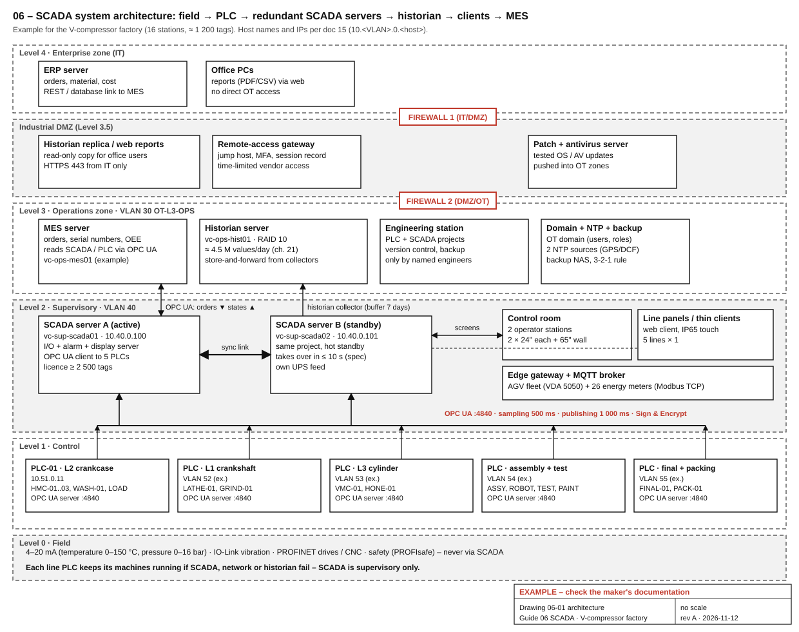
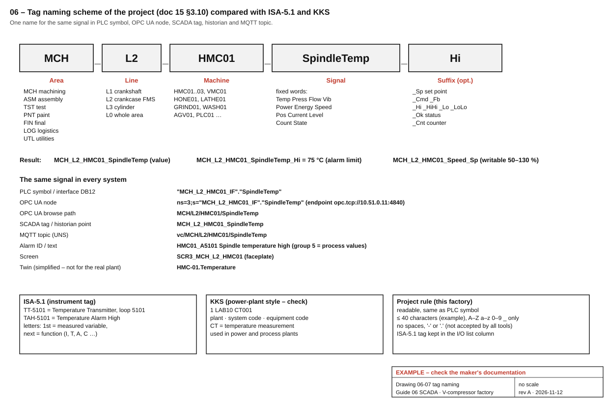
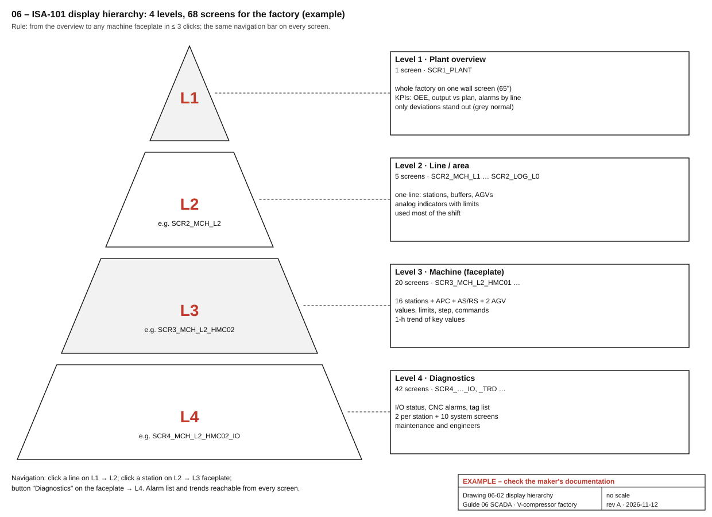
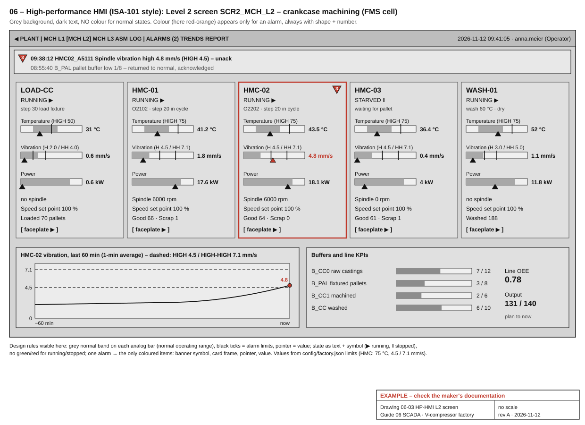
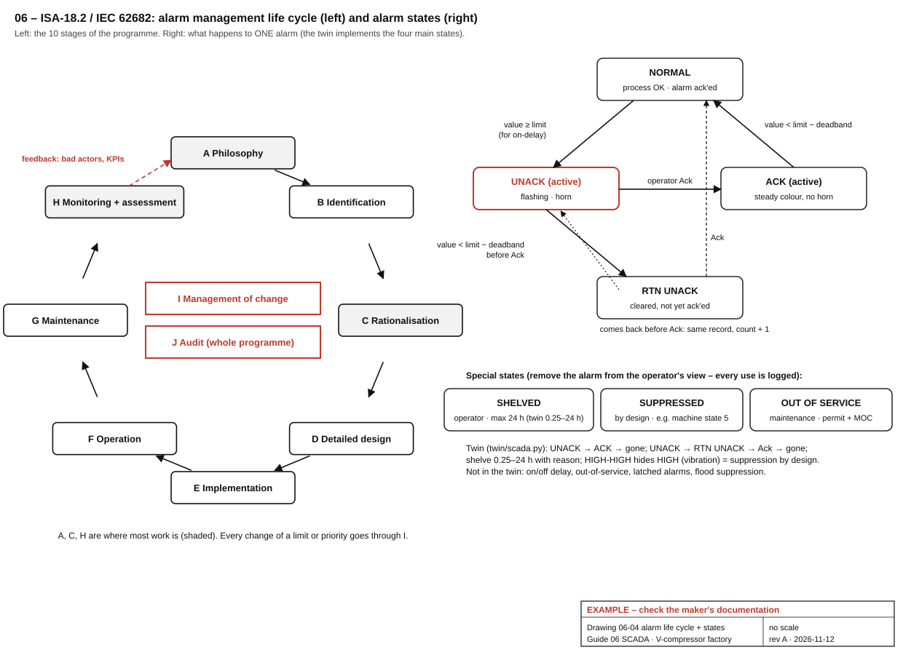
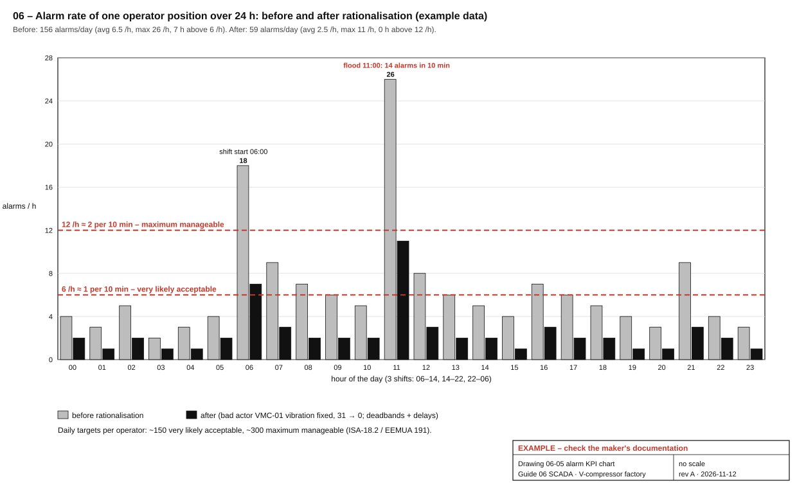
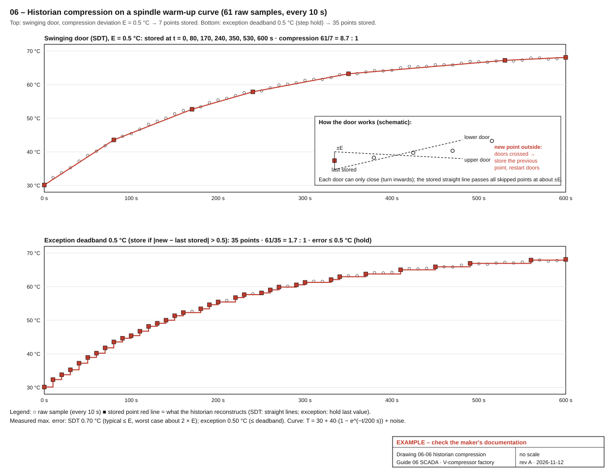
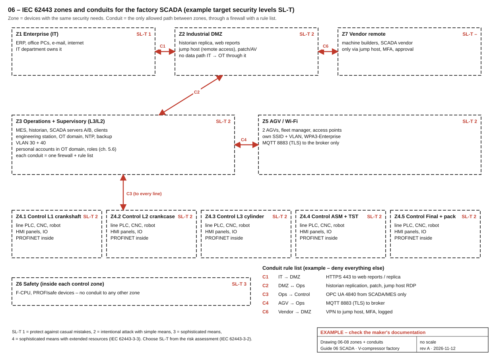

# 06 – SCADA (Level 2)

Guide for the engineering team that will build the real V-compressor factory.
It explains the SCADA layer of the digital twin, and how to plan, build and commission a real SCADA system.

> **Important:** every PLC address, signal range, alarm limit, deadband and time in this guide is an
> **example value** from the twin. Your real values come from your I/O list, your machine data sheets and your
> alarm philosophy document.

---

## Contents

1. Purpose
2. Where in the twin
3. Concepts – simply explained
4. The model in the twin + formulas
5. Implementing in the real factory – step by step
6. Checklists
7. Common mistakes
8. Limits of the twin
9. Engineering chapters – how to use chapters 10–15
10. Science principles – signals, sampling, alarm statistics, storage, availability
11. Detailed specification – servers, clients, historian, HMI rules, priorities, tag database, alarm list
12. Identification and numbering (tags, alarms, screens, nodes, hosts, accounts)
13. Standards – requirements and verification
14. Complete worked example – station HMC01 in SCADA end to end
15. Data you still need
16. Glossary

**Part B – textbook, design reference and buy lists**

17. SCADA system architecture – building blocks, types, redundancy, availability (drawing 06_scada_architecture)
18. Tag database design and licence counting – naming schemes, data types, update classes, tag count 1 202 (drawing 06_tag_naming)
19. HMI design in depth – high-performance HMI, colours and contrast, display hierarchy, text size (drawings 06_hmi_hierarchy, 06_hp_hmi_example)
20. Alarm management in depth – life cycle, priority matrix, noise/deadband/delay, KPI worked example, floods (drawings 06_alarm_lifecycle, 06_alarm_kpi_chart)
21. Historian in depth – data path, swinging-door compression, storage sizing, retention (drawing 06_historian_compression)
22. Trends, statistics and SPC on SCADA data – I-MR chart, Cpk, filters
23. Reports – shift, OEE from tags, energy
24. Audit trail and electronic records (ALCOA+, Part 11 ideas, hash chain)
25. Communication drivers – OPC UA, OPC DA, Modbus TCP, S7, EtherNet/IP, MQTT/Sparkplug, polling example
26. Performance and sizing – latency budget, PLC OPC UA load, clients
27. Cybersecurity (IEC 62443) – security levels, FR 1–7, conduit rules, remote access, hardening (drawing 06_network_zones)
28. Validation and testing – FAT, SAT, SIT, 14 test cases with acceptance criteria
29. Operation – training, maintenance plan, backups (3-2-1), life cycle
30. Buy list – catalogue examples (software, historians, OPC UA gateways, MQTT brokers, edge, servers, displays, UPS, security tools) + consolidated shopping list
31. Formula sheet and how the numbers were checked
32. Glossary additions

> **Binding rules for the real factory** (they replace the twin's example values where they differ):
> * Tag names: `<Area>_<Line>_<Machine>_<Signal>[_Suffix]`, e.g. `MCH_L2_HMC01_SpindleTemp`, `MCH_L2_HMC01_Speed_Sp`;
>   alarm IDs `<Machine>_A<gnnn>`, e.g. `HMC01_A5101`; IPs `10.<VLAN>.0.<host>` (chapter 12, master
>   `docs/15_numbering_and_identification.md`). The twin's `HMC-02.Temperature` is a simplified form.
> * SCADA reads the PLC **by symbol over OPC UA** from the station interface DB (`DB(10 + b)`, HMC01 = DB12), never by
>   absolute `%IW` address. The one PLC address scheme is in guide 05, chapter 12.4.
> * SCADA can request a start; it can **never reset an E-stop**. After an E-stop the sequence is
>   release → local reset → separate start (guide 05, 4.7 and 14.5). The twin restarts automatically – not allowed.
> * Large generic tables are in `docs/14_engineering_reference_data.md`.

---

## 1. Purpose

**SCADA** = Supervisory Control And Data Acquisition. It is the **control-room software**.

* It reads the values of all PLCs (tags).
* It shows the whole factory on screens (mimic, faceplates).
* It raises **alarms** and the operator must react.
* It stores history (historian) for trends and analysis.
* It lets the operator send **commands and set points** to the PLC.

The PLC controls the machine in milliseconds. SCADA supervises all machines in seconds.
**If SCADA stops, the machines keep running – you only become blind.** That is the correct design:
nothing safety-related depends on SCADA.

This guide helps you to:

* understand every function of the twin's SCADA tab and why it exists;
* write the **tag naming rule**, the **alarm philosophy document** (ISA-18.2) and the **HMI style guide** (ISA-101 idea);
* size the **historian**;
* set up **user roles and audit trail**;
* place SCADA in a secure network (**IEC 62443 zones**) with the right **redundancy**;
* commission SCADA step by step.

---

## 2. Where in the twin

| What | File / place |
|---|---|
| SCADA engine (server side) | `twin/scada.py`, class `SCADA` (runs inside the twin engine) |
| SCADA tab (operator screens) | **SCADA** tab, code in `web/scadatab.js` |
| Teaching view "SCADA explained" | **Communication** tab → mode SCADA, code in `web/scada.js`, deep link `/?cmmode=scada#comm` (`&sctest=1` starts the bearing-damage demo) |
| Data API | `GET /api/scada` · `POST /api/scada` · `GET /api/scada/trend?tags=HMC-02.Temperature,HMC-02.Vibration&hours=4` (max 4 tags) |
| Historian | `twin/historian.py`, SQLite file `data/history.db`, table `samples` |
| Deep link to a page | `/?scp=alarms#scada` (pages: `overview`, `alarms`, `tags`, `trends`, `audit`, `report`, `settings`) |
| E-stop interlock source | `twin/plc.py` writes `factory.estop_machines` (see guide 05) |

### 2.1 Pages of the SCADA tab

| Page | What you see / do |
|---|---|
| **KPI row** (always) | machines running, active alarms (not acknowledged), alarm rate last hour vs benchmark 6/h, standing / chattering / shelved, line OEE + power; scan counter and tag count |
| **Overview** | mimic of all lines (cards per machine with state, °C, mm/s, kW, pcs, speed if not 100 %, alarm badge), Start line / Stop line buttons, buffers and AGV batteries, **faceplate** of the selected machine |
| **Alarms** | alarm list with level, since, source, tag, value, limit, state, comment; buttons Ack, Shelve, Unshelve, Comment, Ack all; filter by level; show shelved; chart "new alarms per hour, last 12 h" with the 6/h benchmark line; standing and chattering lists; **bad actors** top 8; **journal** (last 150 activations) |
| **Tags** | tag database (161 tags in the example factory) with value, unit, quality, time stamp, PLC address, signal, alarm limits; writable `SpeedSetpoint` |
| **Trends** | 4 pens (machine + signal), one chart per pen (small multiples), range 30 min / 1 h / 2 h / 4 h / 8 h / 24 h, dashed SCADA alarm limits, crosshair tooltip |
| **Audit trail** | every operator action: time, operator, action, target, detail, result |
| **Shift report** | per machine: good, scrap, availability, performance, quality, OEE, running h, down + maintenance h, stopped h, alarms; total line; **CSV download** |
| **Alarm settings** | editable SCADA alarm limits per machine (vibration HIGH, HIGH-HIGH, temperature HIGH, tool wear HIGH) and the deadbands |

The operator name is typed in the field at the top of the SCADA tab. It is written to every action.

---

## 3. Concepts – simply explained

### 3.1 Where SCADA sits

```
L3  MES     work orders, serial numbers, quality
         ▼ orders, recipes                 ▲ machine states, counts, results
L2  SCADA   screens, alarms, trends, historian, operator commands
         ▼ commands, set points            ▲ tag values (OPC UA subscription, 0.1–1 s)
            (OPC UA Write / Call)
L1  PLC / CNC   controls the machine in milliseconds
         ▼ outputs: motor, valve            ▲ inputs: 4–20 mA, 24 V, IO-Link
L0  sensors and actuators
```

### 3.2 The 5 jobs of SCADA

| Job | Meaning | Example in the twin |
|---|---|---|
| 1 Acquire data | read every **tag** from every PLC | 161 tags |
| 2 Display | mimic diagram + one faceplate per machine | Overview page |
| 3 Alarm | compare values with limits; operator acknowledges | ISA-18.2 alarm list |
| 4 Record | store values with time stamp | historian `data/history.db` |
| 5 Supervisory control | commands and set points down to the PLC | Start, Stop, SpeedSetpoint |

### 3.3 Tag

A **tag** is one named value, for example `HMC-02.Temperature`. Each tag has:

* a **value** and a **unit** (41.2 °C),
* a **source address** in the PLC (`%IW80`, `DB12.DBW0` …),
* a **quality** (Good / Bad / Uncertain – is the value trustworthy?),
* a **time stamp** (when was the value measured?).

Why quality? If a PLC loses communication, the last value stays on screen. Without quality the operator
believes an old number. With quality "Bad – no communication" he knows the value is not live.

### 3.4 Signal scaling (4–20 mA → raw → engineering unit)

A sensor sends a current. The PLC analog card converts it to a number. SCADA (or the PLC) converts the number
back to °C, bar, m³/h.

```
current      I   = 4 + 16 · (v − lo) / (hi − lo)        [mA]
PLC raw      raw = 27648 · (v − lo) / (hi − lo)          (Siemens: 4 mA = 0, 20 mA = 27648)
engineering  v   = lo + (hi − lo) · raw / 27648
```

Example (temperature, range 0–150 °C, as shown live in the teaching view):

```
sensor 41.2 °C → I = 4 + 16 × 41.2/150 = 8.39 mA
              → raw = 27648 × 0.275 ≈ 7594
              → SCADA = 150 × 7594 / 27648 = 41.2 °C
```

Other example ranges in the twin: air flow 0–40 m³/h, pressure 0–16 bar (4–20 mA);
vibration IO-Link raw × 0.1 = mm/s; power raw × 0.01 = kW.

Rule: do the scaling **once**, in one place (normally the PLC, so all clients see the same engineering value).
Write the range in the I/O list.

### 3.5 Alarm, deadband, life cycle (ISA-18.2)

An **alarm** is a signal to the operator that **needs an action**. If no action is needed, it is not an alarm
(it may be an event or a message).

**Deadband (hysteresis):** the alarm switches **ON** at `value ≥ limit` and **OFF** only when
`value < limit − deadband`. Why: a noisy value near the limit would otherwise switch ON/OFF many times
("chattering").

**Life cycle:**

```
normal ──value ≥ limit──► ACTIVE, not acknowledged  (blinks)
   ACTIVE, not acknowledged ──operator Ack──► ACTIVE, acknowledged
   ACTIVE, acknowledged ──value < limit − deadband──► gone (normal)
   ACTIVE, not acknowledged ──value back to normal──► CLEARED, not acknowledged  (must still be acknowledged)
   CLEARED, not acknowledged ──operator Ack──► gone
```

Full ISA-18.2 life cycle and state diagram: chapter 20.1 (drawing `06_alarm_lifecycle.svg`).

Why "cleared but not acknowledged" stays on the list: the operator must **see** that something happened, even
if it is gone now (example: a short temperature peak).

**Shelve:** the operator hides an alarm for a limited time (e.g. a known sensor fault waiting for repair).
It must have a time limit and a reason. **Comment:** a note on the alarm for the next shift.

### 3.6 Alarm performance

| Metric | Meaning | Why |
|---|---|---|
| Alarm rate | new alarms per hour per operator | too many = operator ignores alarms |
| Benchmark | ISA-18.2 / EEMUA 191 guidance: about 6 alarms per hour (≈ 1 per 10 min, ≈ 150 per day) is "very likely acceptable" for one operator | target for the twin's KPI |
| Standing alarm | active for a long time | nobody reacts → it is not a real alarm, or the problem is ignored |
| Chattering alarm | ON/OFF many times in a short time | wrong deadband or delay |
| Bad actors | the few alarms that create most of the count | fix these first (often 10 alarms = most of the load) |
| Alarm flood | many alarms in a short time (e.g. after a breakdown) | operator cannot see the important one |

### 3.7 Faceplate and operator command

A **faceplate** is the small window of one machine: values, limits, state, alarms, and command buttons.
A command (Start, Stop, set point) goes **to the PLC**. **The PLC decides** if it is allowed (interlock), and
answers. SCADA only asks.

### 3.8 Historian

A database of values with time stamps. Used for trends, fault analysis, OEE, quality investigation.
Two common storage rules:

* **cyclic**: store every n seconds (the twin: every 15 s with the example config);
* **deadband / exception**: store only if `|new − last stored| > deadband` (saves space).

### 3.9 Audit trail

A list of **who did what, when, and with what result**. Every command, acknowledge, shelve, comment and limit
change. Why: after an incident you must know what happened; for quality you must prove who changed a limit.

### 3.10 Shift report and OEE

```
Availability = operating time / planned time
Performance  = ideal cycle time × count / operating time
Quality      = good parts / total parts
OEE          = Availability × Performance × Quality
```

---

## 4. The model in the twin + formulas

### 4.1 Scan

`SCADA.step(dt)` is called every simulation step. Every **2.0 simulated seconds** (`SCAN_S = 2.0`) it runs one
alarm scan (`_scan()`). The scan counter is shown at the top of the tab.

### 4.2 Alarm conditions

| Key (example) | Source | Level | Condition ON | Deadband (OFF below) |
|---|---|---|---|---|
| `HMC-02.DOWN` | machine | critical | state = DOWN (breakdown) | – (state) |
| `HMC-02.COMM` | machine | warning | state = OFFLINE ("Communication lost – no data from PLC") | – |
| `HMC-02.VIB_HH` | machine | serious | vibration (1-min average) ≥ HIGH-HIGH | 0.3 mm/s |
| `HMC-02.VIB_H` | machine | warning | vibration ≥ HIGH (only if not HIGH-HIGH) | 0.3 mm/s |
| `HMC-02.TEMP_H` | machine | serious | temperature ≥ HIGH | 2.0 °C |
| `HMC-02.WEAR_H` | machine | warning | tool wear ≥ 85 % (machines with tool wear only) | 2 % |
| `<buffer>.EMPTY` | purchased-parts store | serious | stock = 0 ("Stock-out – production will stop") | – |
| `AGV-01.BATT_L` | AGV | warning | battery < 15 % | – |

Deadbands can be set in `config/factory.json` under `"scada"`: `deadband_vib_mm_s`, `deadband_temp_c`,
`deadband_wear_pct`. The example config has no `scada` section, so the defaults 0.3 / 2.0 / 2.0 are used.

**Deadband formula** (in the code):

```
ON  if  value ≥ limit
stay ON  if  alarm already active AND value ≥ limit − deadband
OFF  if  value < limit − deadband
```

Example HMC-02 vibration (example limits from config: HIGH 4.5 mm/s, HIGH-HIGH 7.1 mm/s, deadband 0.3):

| Vibration (1-min avg) | Alarm |
|---|---|
| 4.4 mm/s | none |
| 4.5 mm/s | VIB_H ON (warning) |
| 4.3 mm/s | VIB_H still ON (4.3 ≥ 4.5 − 0.3 = 4.2) |
| 4.1 mm/s | VIB_H OFF |
| 7.1 mm/s | VIB_HH ON (serious), VIB_H goes off (only the higher one is shown) |

The vibration value is a 1-minute moving average (exponential, `vib_ewma += (vib − vib_ewma)·dt/60`).
Why: raw vibration jumps; an average gives fewer false alarms. The trend page shows the **raw** historian value,
so a trend can touch a limit without an alarm.

Example limits from `config/factory.json` (start values of the SCADA limits = machine data):

| Machine type (example) | Vib HIGH | Vib HIGH-HIGH | Temp HIGH |
|---|---|---|---|
| HMC, VMC, lathe | 4.5 mm/s | 7.1 mm/s | 75 °C |
| Honing, grinder | 3.5 / 3.0 | 6.0 / 5.5 | 70 °C |
| Test bench | 4.5 | 7.1 | 85 °C |
| Paint oven | 2.5 | 4.5 | 90 °C |
| Load, assembly | 2.0 | 4.0 | 50 °C |

### 4.3 Alarm record and life cycle in the code

Each alarm has: id, key, source, tag, level, text, value, limit, on time, off time, ack flag, ack by, ack time,
shelved until, shelved by, comment, count.

* New activation → a new record, written to the **journal** (keeps 400, shows 150) and as an event to the historian.
* Value back to normal → `off` time set. If already acknowledged → removed. If not → stays as
  "CLEARED · not acknowledged".
* Comes back **before** acknowledge → the same record becomes active again, count + 1 (shown as "(3×)").
* **Ack** (one or "all"): sets ack, user, time. A cleared alarm is removed at once.
* **Shelve**: 0.25–24 h (clamped), optional reason (saved as comment). The alarm is hidden from the list and
  from the "active" KPI. It comes back automatically when the time ends. **Unshelve** shows it again at once.
* **Comment**: up to 200 characters.

Every one of these actions is written to the audit trail.

### 4.4 Alarm performance formulas

```
rate_1h   = number of alarm activations in the last 3600 s
rate_avg  = total activations / run hours
benchmark = 6 per hour  (KPI turns red above 6; hour bars turn red above 6)
standing  = alarm active (not cleared) for more than 3600 s
chattering = 3 or more activations of the same alarm within 600 s
bad actors = 8 alarm keys with the highest activation count
per_hour  = activations in each of the last 12 hours (bar chart)
```

Notes:

* Shelved alarms are still counted in the rate. Correct: shelving hides, it does not remove the problem.
* The twin's thresholds (standing > 1 h, chattering 3 in 10 min) are the twin's own choices. In your alarm
  philosophy define your own. ISA-18.2 also uses "stale" for alarms active for a long time (often 24 h).
  A common chattering rule is 3 or more activations in 1 minute.
* The twin counts all alarms of the whole factory as if one operator watches everything. In a real factory
  measure the rate **per operator position**.

### 4.5 Operator commands (real, they change the simulation)

| Command | API body (example) | Interlock / check in `_machine()` |
|---|---|---|
| Start | `{"action":"machine","machine":"HMC-02","cmd":"start","user":"Anna"}` | refused if E-stop pressed in its PLC; refused if DOWN |
| Stop | `…"cmd":"stop"` | – (confirmation dialog in the browser) |
| Maintenance | `…"cmd":"maintenance"` | refused if already DOWN or MAINTENANCE |
| Speed set point | `…"cmd":"set_speed","value":110` | value required; limited to 50–130 % by the machine model |
| Training bearing fault | `…"cmd":"inject_bearing_fault"` | – (vibration rises slowly, then alarms come) |
| Start / stop line | `{"action":"line","line":"Cylinder machining","cmd":"stop"}` | each machine as above |
| Write tag | `{"action":"write","tag":"HMC-02.SpeedSetpoint","value":110}` | only `<machine>.SpeedSetpoint` is writable |
| Alarm limits | `{"action":"limits","machine":"HMC-02","vib_h":4.0,"vib_hh":6.5}` | > 0; vib HIGH < HIGH-HIGH, else refused and old values kept |

All commands are refused for **external** machines (real machines connected by `/api/ingest`):
"commands go to its own PLC/HMI".

**Speed set point effect** (from `twin/model.py`, written on the faceplate):

```
production rate   ∝ speed
tool wear / part  ∝ speed^1.5
breakdown ageing  ∝ speed²

Example 110 %:  output +10 %,  wear × 1.10^1.5 = × 1.15,  failure ageing × 1.10² = × 1.21
```

This teaches why "just run faster" is not free.

**E-stop interlock:** when an E-stop is pressed in the PLC tab, SCADA refuses "start" for those machines:
"refused: E-stop is pressed in its PLC – release and reset the E-stop first (interlock)". The result is written
to the audit trail.

Note: in the twin, releasing the E-stop restarts the stopped stations automatically (guide 05, 4.7), so a SCADA
start is not even needed. In the real factory the stations stay stopped after release and reset; a **new start**
(local button or a SCADA start request that the PLC checks) is required.

### 4.6 The rule about SCADA alarm limits

> **SCADA alarm limits are SCADA's own copy.** They start from the machine data (`vib_warn`, `vib_alarm`,
> `temp_limit`), but changing them on the Alarm settings page changes only `SCADA.limits`.
> They are **never written into `machine.vib_alarm`**, because `machine.vib_alarm` drives the bearing-failure
> physics of the simulated machine. Raising the SCADA limit does not make the machine stronger – it only
> makes the alarm come later.

This is exactly like a real factory: the alarm limit is a setting in SCADA (or in the PLC); the bearing breaks at
its physical limit whatever the screen says. Any limit change is in the audit trail as
`vib_h 4.5 -> 4 ...`.

### 4.7 Tag database

161 tags in the example factory:

| Tag name | Count | Example address (twin) | Signal |
|---|---|---|---|
| `<M>.State` | 16 | `DB(10+i).DBW0` | PLC logic, state code 0 = RUNNING, 1 SETUP, 2 STARVED, 3 BLOCKED, 4 DOWN, 5 MAINTENANCE, 6 STOPPED, 7 OFFLINE |
| `<M>.Temperature` | 16 | `%IW(64+8·i)` | 4–20 mA, 0–150 °C |
| `<M>.Vibration` | 16 | IO-Link port 1 | raw × 0.1 |
| `<M>.Power` | 16 | Modbus 40021 | power meter, raw × 0.01 |
| `<M>.SpindleSpeed` | 7 | CNC var #4119 | from CNC |
| `<M>.ToolWear` | 8 | CNC var #5001 | from CNC |
| `<M>.AirFlow` | 2 | `%IW(64+8·i+2)` | 4–20 mA, 0–40 m³/h |
| `<M>.Pressure` | 2 | `%IW(64+8·i+4)` | 4–20 mA, 0–16 bar |
| `<M>.SpeedSetpoint` | 16 | `DB(10+i).DBD12` | set point (operator), **writable** |
| `<M>.GoodCount` | 16 | `DB(10+i).DBD4` | PLC counter |
| `<M>.ScrapCount` | 16 | `DB(10+i).DBD8` | PLC counter |
| `<buffer>.Level` | 28 | `DB90.DBW(2·k)` | AS/RS / conveyor PLC |
| `<AGV>.Battery` | 2 | VDA 5050 state | MQTT |
| **Total** | **161** | | |

`i` = index of the machine in the whole factory (0 … 15). Example: HMC-02 is i = 2 → temperature `%IW80`,
state `DB12.DBW0`.

Quality: "Good", or "Bad – no communication" when the machine is OFFLINE. Time stamp: the simulation time of
the read.

> **Real factory:** the addresses in this table are twin examples and conflict with the PLC tab's scheme
> (see section 8). In the real system the "source" column of every tag is an **OPC UA node of the station
> interface DB**, e.g. `ns=3;s="MCH_L2_HMC01_IF"."SpindleTemp"`, generated from the I/O list (chapter 12.4–12.5
> and guide 05 chapter 12).

### 4.8 Historian trends

* The engine stores one row per machine every `history_interval_s` (15 s in the example config; 10 s is the
  default when the key is missing). *Corrected:* the SCADA tab trend page shows no interval; the text "every 10 s"
  is in the teaching view's mini-trend (`web/scada.js`), which reads the same historian and therefore really shows
  15-s samples. Columns: temperature, vibration, power,
  spindle rpm, tool wear, good, scrap, state.
* `GET /api/scada/trend` reads up to **4 tags**, for the chosen range, and thins each series to at most
  **300 points** (`step = ceil(rows / 300)`). Why: a screen cannot show more points than pixels.
* Trendable signals: Temperature, Vibration, Power, SpindleSpeed, ToolWear, GoodCount, ScrapCount.
* Dashed lines = current SCADA alarm limits.
* The faceplate shows the last hour of temperature and vibration.
* Pen choice is remembered in the browser.

### 4.9 Shift report

From `analytics.machine_oee()`:

```
planned   = total time − STOPPED − MAINTENANCE − OFFLINE
operating = planned − DOWN − SETUP
A = operating / planned
P = min(1, ideal time of the parts made / operating)
Q = good / total
OEE = A × P × Q
```

Example: planned 8.0 h, down 0.5 h, setup 0.3 h → operating 7.2 h, A = 0.90.
Ideal time of parts made 6.5 h → P = 6.5/7.2 = 0.90. Good 95 of 100 → Q = 0.95.
OEE = 0.90 × 0.90 × 0.95 = **0.77**.

CSV columns: `machine, name, good, scrap, availability, performance, quality, oee, running_h, down_maint_h,
stopped_h, alarms`. File name `shift_report_<time>.csv`. Note: the report covers the **whole run** since the
last reset, not a real 8-hour shift window.

### 4.10 The teaching view (`web/scada.js`)

In the Communication tab, mode SCADA:

* Explains the 5 jobs, the place between MES and PLC, and a comparison PLC / SCADA / MES.
* A **small SCADA screen** on live data: mimic, faceplate with **tag, PLC address, signal (mA), PLC raw, value,
  quality**, and the scaling line `I = 4 + 16 × T/150 → raw = 27648 × r → T = 150 × raw/27648`.
* Its own simple alarm engine **in the browser** (deadbands 0.3 mm/s and 2 °C; tool wear warning at ≥ 90 %),
  with acknowledge and a short history.
* Operator commands are **previews only**, never sent: `Write HMC-02.FeedOverride = 90 % ← Good`,
  `Call StopAtCycleEnd()`, `Call ResetFault()` → `Bad_ConditionNotMet` when the machine is DOWN
  ("the PLC refuses: repair first").
* An animated scan cycle: Read → Scale → Check limits → Update screen → Historian → Commands.
* A teaching switch adds fake bearing damage on the selected machine (vibration rises, alarms appear).
  This damage is **not** stored in the historian.

The **SCADA tab** is the real one (server alarms, real commands, audit). The teaching view is for learning.

---

## 5. Implementing in the real factory – step by step

### 5.1 Define the scope

1. List what SCADA must do: monitoring of all lines, alarms, historian, operator commands, reports, interface to MES.
2. List what SCADA must **not** do: no safety functions, no E-stop reset, no closed-loop control that needs
   fast reaction (that stays in the PLC).
3. Decide the operator positions (e.g. one control room + one panel per line) – this decides alarm rate targets
   and screen layout.
4. Choose the product (examples of SCADA products: WinCC, Ignition, AVEVA, FactoryTalk). Requirements: OPC UA
   client, alarm management with shelving and audit, historian, user management, redundancy option, offline
   operation (no cloud needed).

### 5.2 Tag naming and tag list

1. Use the same station IDs as the layout, PLC, MES (HMC-02, not "M4").
2. Structure (project rule, chapter 12): `<Area>_<Line>_<Machine>_<Signal>`.
   Example: `MCH_L2_HMC01_SpindleTemp`, `MCH_L2_HMC01_Speed_Sp` (suffixes `_Sp`, `_Cmd`, `_Fb`, `_Hi`/`_HiHi`, `_Ok`,
   `_Cnt` per doc 15). The twin uses the shorter
   `<Station>.<Signal>` (`HMC-02.Temperature`) – do not copy that into the real system.
3. Fixed signal names for the same thing on all machines (Temperature, Vibration, Power, State, GoodCount …).
   Why: one faceplate template works for all machines, and reports can sum them.
4. Generate the tag list **from the PLC I/O list and the OPC UA interface DBs** – not by hand.
5. Columns: tag, description, unit, range, source (PLC + node / address), data type, scan/subscription rate,
   historian yes/no + deadband, alarm limits + priority, writable yes/no + allowed range + role.
6. Naming schemes compared, data types, update classes, tag count and licence: chapter 18 (drawing `06_tag_naming.svg`).

### 5.3 Alarm philosophy document (ISA-18.2)

Write this **before** configuring any alarm. ISA-18.2 describes the alarm management life cycle:
philosophy → identification → rationalization → design → implementation → operation → maintenance →
monitoring and assessment, with management of change and audit around it.

Contents of the philosophy document:

1. **Definition**: an alarm needs an operator action. If not, make it an event or remove it.
2. **Priorities**: e.g. critical / serious / warning (the twin's levels), with the meaning of each and the
   expected reaction time. Common guidance for priority distribution is roughly 80 % low, 15 % medium, 5 % high.
3. **Rationalization**: for every alarm write cause, consequence, operator action, time to react, priority,
   limit, deadband, delay. Remove alarms without an action.
4. **Deadbands and delays** per signal type (e.g. vibration 0.3 mm/s, temperature 2 °C as in the twin;
   on-delay a few seconds for noisy signals).
5. **Shelving rules**: who may shelve, maximum time (twin: 24 h), reason required, shelved list reviewed each shift.
6. **Suppression** rules: e.g. when a machine is in maintenance, suppress its process alarms; when HIGH-HIGH is
   active, HIGH is not shown (the twin does this for vibration).
7. **Performance targets**: alarm rate per operator (≈ 6/h benchmark), max standing alarms, no chattering alarms,
   flood definition.
8. **Monitoring**: weekly bad-actor review (top 10), monthly KPI report.
9. **Management of change**: who approves new alarms and limit changes; all changes in the audit trail.
10. Roles and training.

### 5.4 HMI design (ISA-101 idea)

ISA-101 describes HMI design for process automation. Main ideas ("high-performance HMI"):

1. **Grey background, little colour.** Colour is used only for abnormal states and alarms. Then red really
   means something. (The twin's teaching view says the same.)
2. **Never use colour alone**: add shape or text (the twin uses ▲ for warning, ! for serious/critical, plus text).
3. **Display hierarchy**:
   * Level 1 – plant overview (the twin's Overview mimic + KPIs),
   * Level 2 – line / unit,
   * Level 3 – machine detail (faceplate),
   * Level 4 – diagnostics (tag database, I/O, trends).
4. **Show values with context**: limit next to the value (faceplate shows "HIGH 75"), small trends instead of
   numbers only.
5. **Consistent faceplates** from templates: same position for the same button on every machine.
6. **Confirmation for impactful commands** (the twin asks before Stop, Maintenance, Stop line, bearing fault).
7. Write an **HMI style guide** (colours, symbols, fonts, navigation) and give it to all suppliers.
8. Details, colour contrast, text size, the 68 screens of this factory and an example screen: chapter 19
   (drawings `06_hmi_hierarchy.svg`, `06_hp_hmi_example.svg`).

### 5.5 Historian sizing

Formula:

```
samples per day = number of tags × 86 400 s / sample interval
storage per day = samples per day × bytes per sample
```

Example (only an example; check your product's real bytes per sample and compression):

```
161 tags, every 1 s, 16 bytes per sample (time stamp + value + quality)
samples per day = 161 × 86 400 = 13 910 400
storage per day = 13 910 400 × 16 B ≈ 223 MB  →  about 81 GB per year without compression
```

With deadband / exception storage, slow signals (temperatures) store much less. Measure after commissioning.

The twin stores 16 machine rows every 15 s: `16 × 86 400 / 15 = 92 160 rows per day`.

Steps:

1. Decide per tag: interval or deadband, and **retention** (e.g. raw 1 year, aggregates 10 years – your decision).
2. Separate **fast data** (vibration spectra, test-bench curves) – often a different storage.
3. Plan **store-and-forward**: if the historian server is down, the collector buffers data locally.
4. Use the **source time stamp** from the PLC where possible, and synchronize all clocks (NTP on the
   OT network).
5. Backup and restore test.
6. Compression (swinging door), the full sizing for 1 202 tags and retention tiers: chapter 21
   (drawing `06_historian_compression.svg`).

### 5.6 User roles and audit trail

The twin has **no login** – the operator types a name. A real SCADA needs authentication.

| Role (example) | May |
|---|---|
| Viewer | see screens, trends, reports |
| Operator | acknowledge, comment, start/stop, set points within limits |
| Shift leader | + shelve alarms, start/stop lines |
| Maintenance | + maintenance mode, diagnostic screens |
| Process engineer | + change alarm limits (with reason), set-point ranges |
| Administrator | user management, configuration – not production commands |

Rules:

1. Personal accounts (no shared "operator" login); central user management where possible.
2. Every action → audit trail: time, user, workstation, action, target, old value → new value, result.
   The twin records time, user, action, target, detail, result, e.g. `vib_h 4.5 -> 4`.
3. Audit trail is read-only for users and kept for a defined time.
4. Automatic logout / screen lock on shared panels; quick user change at shift change.

### 5.7 Network security (IEC 62443)

IEC 62443 divides the system into **zones** (groups of devices with the same security needs) and **conduits**
(the controlled connections between zones), with target security levels.

Example zone model for this factory:

| Zone (example) | Contains | Conduit / rule |
|---|---|---|
| Office / IT | ERP, e-mail, internet | only to the DMZ |
| Industrial DMZ | historian replica, MES web, patch server, remote-access gateway | firewall on both sides; no direct IT → PLC traffic |
| Operations (Level 3/2) | MES server, SCADA servers, engineering station | OPC UA to PLCs only |
| Control – one zone per line | line PLC, CNC, robot, HMI panels | PROFINET inside; only OPC UA 4840 from SCADA/MES |
| Safety | F-CPU safety network, PROFIsafe devices | no external access |
| AGV / Wi-Fi | AGVs, fleet manager, access points | separate SSID/VLAN, WPA3-Enterprise or equivalent, MQTT to fleet manager only |

Rules:

1. No direct connection from the office network or internet to PLCs.
2. Remote access only through a controlled gateway in the DMZ, with approval and logging.
3. OPC UA with security policy Sign & Encrypt and user authentication; no anonymous write.
4. Harden SCADA PCs (no internet browsing, USB control, antivirus/whitelisting suitable for OT).
5. Patch process tested on a test system first.
6. The twin itself has no security – run it only on a trusted network (README).
7. Security levels, FR 1–7, conduit rule list, remote access procedure and hardening: chapter 27
   (drawing `06_network_zones.svg`).

### 5.8 Redundancy and availability

| Part | Option | Why |
|---|---|---|
| SCADA server | redundant pair (hot standby) | operators are not blind when one server fails |
| Historian | store-and-forward in collectors; backup | no data gap |
| Network | ring topology (e.g. PROFINET MRP, redundant switches for the plant network) | one cable break does not stop communication |
| Power | UPS for servers, switches, PLCs | controlled behaviour at power loss |
| Clients | at least 2 operator stations per control room | one PC failure is not a problem |
| Time | 2 NTP sources | correct time stamps in alarms and historian |

Remember: the PLCs keep the machines running without SCADA. Redundancy is about **visibility and data**, not safety.
Architecture types, hot/warm/cold standby and an availability calculation of the whole chain: chapter 17
(drawing `06_scada_architecture.svg`).

### 5.9 Commissioning SCADA

1. **Tag loop check**: for every tag, change the value at the source (sensor simulator, force in PLC) and check
   value, unit, scaling and quality on the screen. Example: inject 12 mA on a 0–150 °C input → screen must
   show 75 °C (4 + 16 × 75/150 = 12 mA).
2. **Bad quality test**: unplug the PLC network cable → tags go Bad, COMM alarm comes.
3. **Alarm test**: drive each alarm over the limit and back (deadband!), acknowledge, shelve, comment.
   Check priority and text against the rationalization list.
4. **Command test**: every command and set point, with the PLC refusing when interlocked
   (e.g. start during E-stop must be refused, as in the twin).
5. **Rights test**: each role can do only what it should.
6. **Historian test**: trends correct, retention set, store-and-forward test (stop server, restart, data complete).
7. **Redundancy test**: switch off the active server – clients continue.
8. **Reports**: OEE values compared with a hand calculation for one shift.
9. **Performance**: screen call-up time, CPU load of servers, alarm rate during first weeks of production.
10. Hand-over documents: tag list, alarm list, philosophy, style guide, user list, backup.

Use the twin before this: train operators on the SCADA tab (acknowledge, shelve, interlocks, shift report), and
discuss the alarm philosophy with the twin's bad-actor list and alarm rate chart.

---

## 6. Checklists

### 6.1 Design

- [ ] Scope: what SCADA does and does not do (no safety, no E-stop reset)
- [ ] Operator positions defined
- [ ] Tag naming rule written; station IDs same as PLC and MES
- [ ] Tag list generated from I/O list / OPC UA interface DBs
- [ ] Scaling done in one place, ranges in the list
- [ ] Alarm philosophy document approved
- [ ] HMI style guide (ISA-101 idea) given to all suppliers
- [ ] Historian sizing and retention decided
- [ ] User roles defined
- [ ] Zone / conduit drawing (IEC 62443)
- [ ] Redundancy concept

### 6.2 Alarm rationalization (per alarm)

- [ ] Cause, consequence, operator action, time to react
- [ ] Priority
- [ ] Limit, deadband, delay
- [ ] Suppression rule (maintenance, higher alarm active)
- [ ] Alarm limit is a SCADA/PLC setting – not changing machine protection

### 6.3 Commissioning

- [ ] Loop check of every tag (value, unit, quality)
- [ ] Communication loss → Bad quality + COMM alarm
- [ ] Every alarm tested ON/OFF with deadband
- [ ] Ack / shelve / comment / audit tested
- [ ] Every command tested, including PLC refusal
- [ ] Rights per role tested
- [ ] Historian, store-and-forward, backup/restore tested
- [ ] Redundancy switch-over tested
- [ ] OEE report checked against hand calculation

### 6.4 Operation (monthly)

- [ ] Alarm rate per operator vs target (≈ 6/h)
- [ ] Top-10 bad actors reviewed and fixed
- [ ] Standing and chattering alarms = 0 or justified
- [ ] Shelved list reviewed
- [ ] Audit trail spot check (limit changes justified)
- [ ] Backups OK

---

## 7. Common mistakes

| Mistake | Why it is bad | Do instead |
|---|---|---|
| Every signal becomes an alarm | alarm flood, operator ignores all | alarm only if an action is needed |
| No deadband | chattering alarms | deadband + delay per signal type |
| Raising an alarm limit to "stop the alarm" | hides a real problem; machine still breaks at its physical limit | find the cause; change limits only with MOC and audit |
| Writing SCADA limits into machine protection (in the twin: into `machine.vib_alarm`) | mixes alarm setting with physics/protection | keep SCADA limits separate |
| Shelving without time limit or reason | alarms disappear forever | max time, reason, review each shift |
| Colourful screens (green everywhere) | red alarm does not stand out | grey screens, colour only for abnormal |
| No quality shown | operator trusts an old value | show quality, grey/hatch bad values |
| SCADA command bits write directly to outputs | no interlock check | command to PLC; PLC checks and answers |
| E-stop reset possible from SCADA | unsafe | local reset only |
| Shared login "operator" | audit trail useless | personal accounts |
| Office network can reach PLCs | cyber risk | IEC 62443 zones, DMZ, firewall |
| Historian sized by guess | disk full, data lost | size with formula, monitor growth |
| Different time on each PC | alarms in wrong order | NTP for all OT devices |
| Tag list typed by hand | wrong addresses | generate from I/O list |

---

## 8. Limits of the twin

* **No login, no security.** The operator name is a free text field (stored in the browser). Anyone on the
  network can send commands. Run the twin only on a trusted network.
* **One "operator" for the whole factory.** The alarm rate is for all machines together, not per operator position.
* **Time stamps** in the tag database are the time of the read, not a source time stamp from the PLC.
* **Quality** is only Good or "Bad – no communication" (OFFLINE). No "Uncertain", no wire-break detection.
* **Alarm engine is simple**: fixed condition list, levels critical / serious / warning, no on-delay, no
  per-alarm deadband, no state-based suppression except "HIGH-HIGH hides HIGH" for vibration, no alarm flood
  detection. AGV battery and stock-out alarms have no deadband.
* **Thresholds** standing > 1 h and chattering 3 in 10 min are the twin's choices.
* **Writable tags**: only `SpeedSetpoint`. Alarm limits only for vibration, temperature and tool wear.
* **Shift report** covers the whole run since reset, not a real shift window or calendar.
* **Historian**: one sample every `history_interval_s` (15 s in the example config; the teaching view's mini-trend
  title in `web/scada.js` says "every 10 s" – wrong for this config);
  SQLite file; no compression, no store-and-forward, no redundancy. Trends are limited to 4 pens and
  300 points each.
* **Example addresses**: the SCADA tag address scheme (`%IW(64 + 8·i)`, `DB(10+i)`, by machine index in the factory)
  is different from the PLC tab scheme (`%IW(64 + 16·k)`, `DB(20+k)`, by slot in each PLC). The same address can mean
  different machines in the two views. Power is shown as "Modbus 40021" for every machine. In a real project
  all addresses come from one I/O list (guide 05, chapter 12.4) and SCADA reads by OPC UA symbol (chapter 12.4 here).
* **E-stop release** restarts machines automatically in the twin; real factory: release → reset → start.
* **Teaching view** (`web/scada.js`) runs its own browser alarm logic (tool wear at 90 % instead of 85 %, scan
  cycle text "1 s") and sends no commands. Use the SCADA tab for the real twin behaviour.
* No redundancy, no OPC UA server/client inside the twin – the twin reads its own simulated machines directly.

---

## 9. Engineering chapters – how to use chapters 10–15

| Chapter | Use it when you … |
|---|---|
| 10 Science principles | set sampling / deadbands, judge alarm statistics, size historian, network, UPS, availability |
| 11 Detailed specification | write the SCADA purchase specification, the HMI style guide, the tag database and the alarm list |
| 12 Identification and numbering | name tags, alarms, screens, OPC UA nodes, servers and accounts |
| 13 Standards | check which standard asks what, and how to prove it |
| 14 Worked example | see one station (HMC01) from PLC interface DB to screen, alarm, trend and audit |
| 15 Data you still need | plan the data still missing |
| 17–32 Part B | need deeper theory, worked numbers, drawings, test cases and the buy lists (architecture, tags, HMI, alarms, historian, SPC, reports, drivers, performance, security, FAT/SAT, operation) |

Electrical and PLC basics (Ohm's law, 4–20 mA loop, 27648 counts, PL calculation, cabinet) are in guide 05,
chapters 10–14. Large generic tables: `docs/14_engineering_reference_data.md`.

---

## 10. Science principles – signals, sampling, alarm statistics, storage, availability

### 10.1 From sensor to screen – where errors come from

```
sensor (accuracy ±a %) → 4–20 mA → AI card (27648 counts) → PLC scaling → interface DB → OPC UA → SCADA tag
```

| Step | Error / delay source | Typical size (example) |
|---|---|---|
| Sensor | accuracy class | ±0.5 % of span = ±0.75 °C on 0–150 °C |
| AI card | resolution 150/27648 = 0.0054 °C, card accuracy | ±0.1–0.3 % (data sheet) |
| PLC | scan + filter | ms … s (filter) |
| OPC UA | sampling + publishing interval | 0.1–1 s |
| SCADA | display refresh | 0.5–1 s |

Rule: the **number of decimals on the screen** should match the real accuracy. Show 41.2 °C, not 41.2371 °C.
Scaling details and Siemens raw ranges: guide 05, 10.4–10.5.

### 10.2 Quality and time stamp (OPC UA)

Every OPC UA value has a **StatusCode**. Its two top bits give the severity: `00` **Good**, `01` **Uncertain**,
`10` **Bad**. Examples of Bad: no communication, sensor failure (wire break), configuration error.
Two time stamps: **source** (when the PLC/server measured it) and **server** time. Use the source time stamp
for alarms and the historian.

### 10.3 Sampling, subscriptions and deadband

OPC UA subscription parameters (per monitored item / subscription):

| Parameter | Meaning | Start value (example) |
|---|---|---|
| Sampling interval | how often the server checks the value | 500 ms for process values, 100 ms for states |
| Publishing interval | how often changes are sent to SCADA | 1000 ms |
| Queue size | values kept if several changes happen in one publishing interval | 1 (process) / 10 (events, counters) |
| Deadband (absolute or percent) | send only if the change is larger | 0.1 °C, 0.05 mm/s |

Nyquist idea (guide 05, 10.6): to see a change that lasts t, sample at least every t/2 – better t/5.
A 200 ms pressure spike is **invisible** to a 1 s SCADA sampling. Fast events (spikes, trips) must be detected
**in the PLC** and sent as an alarm bit or counter with the source time stamp.

### 10.4 Alarm deadband and delay sizing

```
alarm ON   : value ≥ limit           (for at least t_on)
alarm OFF  : value < limit − deadband (for at least t_off)
deadband   ≥ peak-to-peak noise of the signal (measure it in the historian)
```

Starting values (ISA-18.2 guidance – adjust after measurement):

| Signal type | Deadband (% of range) | On / off delay |
|---|---|---|
| Flow | 5 % | 15 s |
| Level | 5 % | 60 s |
| Pressure | 2 % | 15 s |
| Temperature | 1 % | 60 s |

Example: temperature 0–150 °C → 1 % = 1.5 °C (the twin uses 2 °C). Vibration has no row – the twin uses
0.3 mm/s on a 1-min average; measure the noise and decide.

A delay prevents chattering but **delays the alarm**: check that `t_on + operator time to act` is still shorter
than the time until the consequence happens (rationalization, 11.9).

### 10.5 Alarm system statistics

```
alarm rate      = number of new activations / hours / operator position
chattering      = same alarm ≥ 3 activations in 1 min (common rule; the twin: 3 in 10 min)
fleeting        = alarm that clears again within a short time (e.g. < 5 s) – usually needs a delay
stale           = active > 24 h (the twin calls > 1 h "standing")
flood           = > 10 new alarms in 10 min per operator; ends when < 5 in 10 min
top-10 share    = activations of the 10 most frequent alarms / all activations
```

Performance targets (ISA-18.2 / EEMUA 191 guidance, per operator position):

| Metric | Very likely acceptable | Maximum manageable |
|---|---|---|
| Alarms per day | ~150 | ~300 |
| Alarms per hour | ~6 | ~12 |
| Alarms per 10 min | ~1 | ~2 |
| 10-min periods with > 10 alarms | < ~1 % | |
| Maximum alarms in any 10 min | ≤ 10 | |
| Time in flood | < ~1 % | |
| Top-10 share | ~1 % to 5 % maximum (with action plan) | |
| Chattering and fleeting alarms | zero (action plan for each) | |
| Stale alarms | < 5 present on any day | |
| Priority distribution (3 priorities) | ~80 % low / ~15 % medium / ~5 % high | |

Example: 16 machines, one control-room operator, each machine 0.3 alarms/h on average
→ `16 × 0.3 = 4.8 alarms/h` → OK (< 6). One chattering sensor with 20 activations/h → 24.8/h → fix it first
(it is the bad actor).

### 10.6 Historian storage

```
samples/day (cyclic)    = tags × 86 400 / interval
samples/day (exception) ≈ tags × change rate after deadband (measure; often 5–20 % of cyclic for slow values)
storage/day             = samples/day × bytes per sample / compression factor
disk                    = storage/day × 365 × retention years × 1.5 (index, growth, safety)
```

Example – whole factory (*estimate*): 16 machines × 40 tags + 360 line / AGV / store tags = 1000 tags,
16 bytes per sample:

| Method | Samples/day | Storage/day | Per year |
|---|---|---|---|
| Cyclic 1 s | 86.4 million | 1.38 GB | 505 GB |
| Exception with deadband (assume 10 % of cyclic) | 8.64 million | 138 MB | 50 GB |
| Disk for 2 years raw, factor 1.5 | | | **≈ 150 GB** (exception) |

The bytes per sample and compression differ per product – take the vendor's sizing tool and **measure after
4 weeks** of production. A detailed count (1 202 tags by class, 72.7 MB/day) is in chapter 21.4.

### 10.7 Network load

```
load [bit/s] ≈ notifications per second × bytes per notification × 8
```

Example: 1000 tags, 30 % change per second after deadband → 300 notifications/s × about 50 bytes
(value + status + time stamp + protocol overhead – rough) × 8 = **0.12 Mbit/s**. On a 100 Mbit/s or 1 Gbit/s
plant network this is small. The **real limits** are usually the PLC's OPC UA server (maximum monitored items,
sessions, minimum sampling interval – see the CPU data sheet) and the CPU load it causes.

### 10.8 Availability and redundancy

```
A = MTBF / (MTBF + MTTR)
downtime per year = (1 − A) × 8760 h
two servers in parallel (independent): A_pair = 1 − (1 − A)²
```

Example: one SCADA server MTBF 20 000 h, MTTR 8 h (restore from backup, example)

```
A = 20 000 / 20 008 = 0.9996     → (1 − 0.9996) × 8760 = 3.5 h blind per year (plus maintenance stops)
A_pair = 1 − 0.0004² = 0.99999984 → seconds per year in theory
```

In practice switch-over, common causes (same software bug, same power, same switch) dominate – so also make
power, network and time redundant (5.8) and **test** the switch-over.

### 10.9 UPS sizing

```
E_needed [Wh] = P_load [W] × t_backup [h]
E_battery    ≥ E_needed / η_inverter × ageing factor (e.g. 1.25)
S_UPS [VA]   ≥ P_load / power factor
```

Example: 2 servers × 250 W + 2 switches × 50 W + firewall 30 W + time server 10 W = 640 W; add 25 % → 800 W;
backup 15 min for a controlled shutdown:

```
E_needed  = 800 × 0.25 = 200 Wh
E_battery ≥ 200 / 0.9 × 1.25 = 278 Wh
S_UPS     ≥ 800 / 0.9 = 889 VA  → choose ≥ 1500 VA with ≥ 280 Wh battery
```

Connect the UPS signal to the servers for an automatic shutdown before the battery is empty.

### 10.10 Time synchronisation

* All PLCs, servers, clients, switches use **NTP** from the factory time server(s) (offline: GPS/DCF receiver
  or a domain controller as master). On a LAN NTP typically reaches a few milliseconds.
* Store time in **UTC**, display local time; format ISO 8601 (`2026-11-11T08:15:30.250Z`).
* Alarm time stamps should come from the **PLC** (source) – SCADA reception time can be late by the publishing
  interval and network delay. For sequence-of-events (which trip came first) you need millisecond time stamps
  in the PLC.

### 10.11 Human factors in numbers

* About 8 % of men have a red–green colour vision deficiency → never use colour alone (5.4).
* The operator can follow only a few important things at once → the overview should show **deviations**, not
  all numbers.
* Screen call-up time target ≤ 2 s (example – write it in the specification and test it).

---

## 11. Detailed specification

### 11.1 SCADA functional specification (summary table for the purchase order)

| Function | Requirement |
|---|---|
| Data acquisition | OPC UA client (IEC 62541), security Sign & Encrypt, certificate handling; ≥ 3000 tags licence (≥ 2 × the estimate) |
| Alarming | ISA-18.2 life cycle, priorities 1–3 (11.7), shelving with max time + reason, state-based suppression, alarm KPIs (10.5), source time stamps |
| Historian | exception + cyclic storage, store-and-forward, retention per tag class, export CSV, ≥ 2 years raw online |
| Displays | template faceplates, 4-level hierarchy (5.4), style guide (11.6) |
| Commands | OPC UA write with limits and roles; OPC UA method calls; confirmation dialogs; all actions in audit trail |
| Users | personal accounts, roles (5.6), central user management (works offline), auto logout |
| Reports | shift report with OEE, alarm KPI report, CSV/PDF |
| Redundancy | hot-standby server pair, automatic client switch-over |
| Offline | **no cloud, no internet licence check** at runtime; all help files local |
| Interfaces | to MES (OPC UA or database), to the twin (`/api/ingest` gateway for virtual commissioning) |
| Documentation | tag list, alarm list, style guide, user list, backup/restore procedure |

### 11.2 Server specification (*example* – the vendor's sizing tool decides)

| Item | SCADA server (×2, redundant) | Historian server |
|---|---|---|
| Type | industrial or rack server, redundant PSU | same |
| CPU / RAM | 8 cores / 32 GB | 8 cores / 32 GB |
| Disk | 2 × SSD in RAID 1 (system + project) | RAID 1 or RAID 10, size from 10.6 (e.g. ≥ 2 × 1 TB) |
| OS | vendor-approved server OS, hardened, no internet | same |
| Network | 2 ports: plant / OT network + redundancy link | plant network |
| Power | UPS (10.9) | UPS |
| Virtualisation | allowed if the vendor supports it; then host redundancy | |

### 11.3 Client / operator station

| Item | Specification (example) |
|---|---|
| Control room | ≥ 2 operator stations, each 2 × 24" full-HD (or larger) |
| Line panel | industrial panel PC or thin client, IP65 front, touch |
| Input | keyboard + mouse in control room; touch on the floor |
| Login | personal account, quick user change at shift change |
| Placement | screen visible without glare; alarm horn / sound per priority |

### 11.4 Historian specification

| Tag class | Storage | Example interval / deadband | Retention (your decision) |
|---|---|---|---|
| Analog process (temperature, pressure, vibration, power) | exception + max interval | deadband 0.5 % of range, max 60 s | 2 years raw, 10 years 1-min / 1-h aggregates |
| States, modes, steps | on change | – | 2 years |
| Counters | on change | – | 10 years (quality evidence) |
| Alarms and events, audit | every record | – | per quality / legal rule (e.g. 10 years) |
| Fast data (test-bench curves, vibration spectra) | separate store (files / database) linked by serial number | – | per product |

### 11.5 Network, time server and power (SCADA side)

* OT network per guide 05 11.9; SCADA servers in the Operations zone (5.7).
* Firewall rules: SCADA → PLC TCP 4840 only; MES ↔ SCADA defined ports; no internet.
* 2 NTP sources; switches with redundant power; UPS for servers, core switches, firewall (10.9).

### 11.6 HMI style guide – rules to give every supplier

| Element | Rule |
|---|---|
| Background | light or mid grey, no pictures |
| Normal values | dark grey / black text, no colour |
| Equipment state "running / stopped" | grey shades and text or symbol – **not** green / red (red is reserved for alarms) |
| Alarm priority colours | priority 1 red, priority 2 orange, priority 3 yellow – **always with shape and number** (e.g. square "1", triangle "2", inverted triangle "3"; define one set) |
| Bad quality | value replaced or crossed, magenta or hatched (choose one, never used for anything else) |
| Fonts | one sans-serif font; values ≥ 12 pt on control-room screens (example) |
| Units | always shown, SI units (°C, bar, mm/s, kW) |
| Decimals | match accuracy (10.1) |
| Navigation | same position on every screen; ≤ 3 clicks from overview to any faceplate |
| Faceplate | same layout for all machines of a type: values with limits, small trend, state, step number, alarms, commands at the bottom |
| Commands | confirmation for Stop, Maintenance, line commands, limit changes; disabled (greyed) when not allowed, with the reason |
| Language | one operator language; texts from the alarm list (no free texts in the PLC) |

Stack lights and push buttons on the machine follow IEC 60204-1 colours (guide 05, 11.11).

### 11.7 Alarm priorities (definition)

| Priority | Name (twin) | Consequence if no action | Max time to respond (example) | Sound | Expected share |
|---|---|---|---|---|---|
| 1 | critical | injury risk, machine damage, line stop | < 3 min | continuous horn | ~5 % |
| 2 | serious | production loss, quality risk | 3–10 min | intermittent | ~15 % |
| 3 | warning | small loss, maintenance needed soon | 10–30 min | single tone | ~80 % |
| – | event / message (no alarm) | no operator action required | – | none | – |

Priority = from the matrix "consequence severity × time to respond" in the alarm philosophy (5.3). E-stop
pressed is shown as priority 1 so everybody knows why the line stopped.

### 11.8 Tag database fields

The tag list is the document `VC-ITS-TAG-0001` (doc 15). Fields:

| Field | Example (HMC01 spindle temperature) |
|---|---|
| Tag name | MCH_L2_HMC01_SpindleTemp |
| Description | Spindle housing temperature |
| Area / line / machine / signal | MCH / L2 / HMC01 / SpindleTemp |
| Data type | REAL |
| Unit, decimals | °C, 1 |
| Engineering range lo / hi | 0 / 150 |
| Source PLC | PLC-01 (10.51.0.11) |
| Source node | `ns=3;s="MCH_L2_HMC01_IF"."SpindleTemp"` (interface DB12) |
| I/O list reference | `%IW80`, `+FLD-BT1`, 4–20 mA (guide 05, 11.12; `VC-ELE-IOL-0001`) |
| Sampling / publishing / deadband | 500 ms / 1000 ms / 0.1 °C |
| Access | read only (read/write only for `_Sp` tags) |
| Write limits, write role | – (e.g. `MCH_L2_HMC01_Speed_Sp` 50–130 %, Operator) |
| Historian | yes, exception, deadband 0.5 °C, max interval 60 s, class "analog process" |
| Alarm limits (parameters) | `MCH_L2_HMC01_SpindleTemp_Hi` = 75, `_HiHi` = 85 (no `_Lo` / `_LoLo`) |
| Alarm deadband, delays | 2.0 °C, on 5 s / off 5 s |
| Alarm IDs, priority | HMC01_A5101 (priority 3), HMC01_A5102 (priority 2) |
| Suppression group | machine HMC01 in maintenance (`MCH_L2_HMC01_State = 5`) |
| Owner, revision, date | process engineering, rev A, 2026-11-11 |

### 11.9 Alarm list – rationalization records (filled examples)

Alarm IDs follow doc 15 §3.10: `<Machine>_A<gnnn>` with group digit g: 0 system/communication, 1 safety,
2 hydraulics, 3 pneumatics, 4 drives/axes, 5 process values, 6 tool/NC, 7 material handling, **8 step-chain
timeout (sss = step number)**, 9 maintenance. Alarm list document: `VC-ITS-ALM-0001`.

| Alarm ID | Condition | Limit / deadband / delay | Priority | Cause | Consequence | Operator action | Time to respond | Suppression |
|---|---|---|---|---|---|---|---|---|
| HMC01_A5101 Spindle temperature high | SpindleTemp ≥ _Hi | 75 °C / 2 °C / 5 s | 3 | coolant low, chiller fault, bearing wear | spindle damage if it continues | check coolant flow, chiller; call maintenance | 30 min | machine in maintenance |
| HMC01_A5102 Spindle temperature very high | SpindleTemp ≥ _HiHi | 85 °C / 2 °C / 2 s | 2 | as above, advanced | spindle damage, scrap | stop at cycle end, call maintenance | 5 min | maintenance; hides A5101 |
| HMC01_A5103 Spindle temperature sensor fault | quality Bad | – / – / 1 s | 3 | wire break, sensor fault | temperature not monitored | call electrician | 30 min | maintenance |
| HMC01_A5111 Spindle vibration high | SpindleVib (1-min avg) ≥ _Hi | 4.5 mm/s / 0.3 / avg | 3 | bearing wear, unbalance | bearing failure in days–weeks | plan bearing check | shift | maintenance |
| HMC01_A5112 Spindle vibration very high | SpindleVib ≥ _HiHi | 7.1 mm/s / 0.3 / avg | 2 | bearing damage | breakdown | stop, maintenance | 10 min | hides A5111 |
| HMC01_A4001 CNC / drive fault | CNC Fault = 1 | – | 1 | CNC alarm (number in text) | machine stopped | read CNC alarm, repair | 3 min | – |
| HMC01_A1001 E-stop pressed | EStop_Ok = 0 | – | 1 | E-stop pressed | line stopped | find reason, release, local reset, start | 3 min | – |
| HMC01_A0011 OPC UA connection SCADA ↔ PLC lost | node status Bad / LifeCounter frozen | – / – / 10 s | 2 | network, PLC down | blind for this machine | check network / PLC | 10 min | – |
| HMC01_A8030 Timeout step 30 (InCycle) | step 30 > 5 s | – | 2 | CNC not in AUTO, CNC alarm | cell stops | check CNC, reset | 10 min | – |
| HMC01_A7003 AGV handshake timeout | E84 answer missing | agreed time | 2 | AGV / station signal | pallet not delivered | check AGV and docking | 10 min | – |
| AGV01_A9010 Battery low (example number) | battery < 15 % | 15 % / 3 % / 30 s | 3 | charging missed | AGV stops | check charging station | 30 min | AGV in maintenance |

The number ranges inside each group (e.g. A51xx for spindle values) are *examples* – keep the register of used
numbers in `VC-ITS-ALM-0001`. Store-empty alarms belong to the store or the consuming machine (e.g. group 7) –
define the owner in the alarm list.

### 11.10 User roles and security

As 5.6 and 5.7. Specification items: personal accounts, password rules or smart cards, role list approved by the
production manager, audit trail read-only, account review every 6 months (example), USB ports disabled on clients.

---

## 12. Identification and numbering

Master: `docs/15_numbering_and_identification.md` (doc 15). **If different, doc 15 wins.** The former proposals
of this chapter (screens, clients, accounts, report files) are now decided in doc 15 (§8b D-09, D-10).

### 12.1 Tags (doc 15 §3.10)

`<Area>_<Line>_<Machine>_<Signal>[_Suffix]`, e.g. `MCH_L2_HMC01_SpindleTemp` – identical to the PLC symbol and
the OPC UA variable name (guide 05, 12.1).

* Areas: MCH, ASM, TST, PNT, FIN, LOG, UTL. Machining lines: **L1 crankshaft, L2 crankcase FMS cell,
  L3 cylinder**; `L0` = equipment for the whole area (e.g. `LOG_L0_AGV01_…`).
* Fixed signal words: `Temp`, `Press`, `Flow`, `Vib`, `Power`, `Energy`, `Speed`, `Pos`, `Current`, `Level`,
  `Count`, `State`.
* Suffixes: `_Sp` set point (writable) · `_Cmd` command · `_Fb` feedback · `_Hi` `_HiHi` `_Lo` `_LoLo` alarm
  limit parameters · `_Ok` status OK · `_Cnt` counter. Examples: `MCH_L2_HMC01_Speed_Sp`,
  `MCH_L2_HMC01_Good_Cnt`, `MCH_L2_HMC01_SpindleVib_HiHi`.
* Other forms: OPC UA browse path `MCH/L2/HMC01/SpindleTemp`, MQTT `vc/MCH/L2/HMC01/SpindleTemp`,
  twin (simplified) `HMC-01.Temperature`.

### 12.2 Alarms (doc 15 §3.10)

`<Machine>_A<gnnn>`, e.g. `HMC01_A5101` "Spindle temperature high"; step-chain timeouts `A8sss` with the step
number, e.g. `APCHMC01_A8030` "Timeout step 30 (lift up)". One ID = one row in the alarm list = one
rationalization record. In SCADA the alarm is shown with its ID, machine, text and the tag it belongs to.

### 12.3 Screens (doc 15 §3.10)

| Level | ID | Example |
|---|---|---|
| 1 Plant overview | `SCR1_<Plant>` | SCR1_PLANT |
| 2 Line | `SCR2_<Area>_<Line>` | SCR2_MCH_L2 |
| 3 Machine / faceplate | `SCR3_<Area>_<Line>_<Machine>` | SCR3_MCH_L2_HMC01 |
| 4 Diagnostics | `SCR4_<Area>_<Line>_<Machine>_<Topic>` | SCR4_MCH_L2_HMC01_IO |

### 12.4 OPC UA nodes and PLC source

* Endpoint: `opc.tcp://<PLC IP>:4840`; IP plan `10.<VLAN>.0.<host>` (doc 15 §3.13): PLC-01 = `10.51.0.11`.
* Node of a value: `ns=<index>;s="<Area>_<Line>_<Machine>_IF"."<Signal>"` (Siemens S7-1500 form; the namespace
  index is read when browsing – often 3).
* The interface DB number is `DB(10 + b)`, b = station block (guide 05, 12.4; HMC01 = b 2 = DB12). SCADA does not
  need the number, but it helps diagnostics.
* Interface sheet: `VC-IF-ITS-MCH-0001` (MES/SCADA ↔ machining PLCs).

### 12.5 Servers, clients, accounts, files (doc 15 §3.13 where defined)

| Object | Rule | Example |
|---|---|---|
| SCADA server(s) | host name `vc-<area>-<device>`, VLAN 40 `OT-L2-SUP`, hosts .100–.149 | `vc-sup-scada01` = 10.40.0.100, `vc-sup-scada02` = 10.40.0.101 |
| Historian | VLAN 30 `OT-L3-OPS` | `vc-ops-hist01` = 10.30.0.103 |
| Operator clients | VLAN 40 | `vc-sup-cl01` = 10.40.0.120, `vc-sup-cl02` = .121 |
| Personal accounts | first name . last name | anna.meier (example) |
| Service accounts | `svc-<system>-<purpose>` | svc-opcua-scada |
| Report files | `<report>_<Area>_<Line>_<YYYYMMDD>_<shift>.csv` | shift_MCH_L2_20261111_A.csv |
| SCADA project version | `MAJOR.MINOR.PATCH` (doc 15 §3.14) + change log | SCADA v1.2.0 |
| Documents | tag list `VC-ITS-TAG-0001`, alarm list / philosophy `VC-ITS-ALM-0001`, network plan `VC-ITS-NET-0001` | |
| Time stamps | ISO 8601, UTC stored | 2026-11-11T08:15:30Z |

---

## 13. Standards – requirements and verification

Always use the current edition; where unsure, the clause is not given ("check clause").

| Number | Title (short) | Requirement for SCADA in this factory | Value / clause | Verification |
|---|---|---|---|---|
| ISA-18.2 / IEC 62682 | Management of alarm systems | alarm philosophy, rationalization, life cycle, KPIs, MOC | 10.5, 11.7, 11.9 | approved philosophy; monthly KPI report |
| EEMUA 191 (guide) | Alarm systems guide | benchmark alarm rates | ~6/h acceptable | KPI report |
| ISA-101.01 | HMI for process automation | style guide, display hierarchy, consistent faceplates | 5.4, 11.6 | style guide review, screen review |
| IEC 62443-3-2 | Security risk assessment, zones and conduits | zone / conduit model, target security level per zone | 5.7 | zone drawing, risk assessment |
| IEC 62443-3-3 | System security requirements and security levels | user identification, use control, audit, network segmentation | SL per zone | requirement checklist with the vendor |
| IEC 62443-2-4 | Requirements for service providers | integrator security practices | – | contract clause, audit |
| IEC 62541 | OPC UA | client/server, security Sign & Encrypt, subscriptions, methods | port 4840 | browse/read/write/method tests |
| IEC 60204-1 | Electrical equipment of machines | colours of lamps/buttons on panels; stop categories; SCADA is **not** a safety device | guide 05 §11.11 | inspection |
| ISO 13850 | Emergency stop | reset must not start; reset locally | guide 05 | test: SCADA cannot reset |
| ISO 13849-1 / IEC 62061 | Functional safety | no safety function in SCADA | – | design review |
| IEC 81346 | Reference designation | device names shown in diagnostics screens | guide 05 §12.2 | review |
| ISO 8601 | Date and time format | time stamps in reports and exports | – | check exports |
| ISA-95 / IEC 62264 | Enterprise–control integration | level model L0–L4; SCADA ↔ MES interface | 3.1 | interface specification |
| ISO 22400-2 | KPIs for manufacturing operations management | OEE and other KPI definitions | 3.10 | report check against hand calculation |

---

## 14. Complete worked example – station HMC01 in SCADA end to end

Station `MCH_L2_HMC01` (crankcase FMS cell, line L2), `PLC-01` at `10.51.0.11`, station block b = 2,
interface DB12. The PLC side (I/O, wiring, code, PL) is guide 05, chapter 14. All values are *examples*.

### 14.1 PLC interface data type (what SCADA may see)

```
TYPE UDT_StationIF :
STRUCT
    State        : INT;    // 0 RUNNING, 1 SETUP, 2 STARVED, 3 BLOCKED, 4 DOWN, 5 MAINTENANCE, 6 STOPPED, 7 OFFLINE
    Step         : INT;    // step chain number
    Safety_Ok    : BOOL;   // E-stop + door + reset OK
    RunEnable    : BOOL;
    SpindleTemp  : REAL;   // degC (scaled in the PLC)
    SpindleVib   : REAL;   // mm/s RMS
    CoolantPress : REAL;   // bar
    Power        : REAL;   // kW
    SpindleSpeed : REAL;   // 1/min
    ProgramNo    : INT;    // 2102 shown as "O2102" (doc 15 NC numbers)
    Good_Cnt     : DINT;
    Scrap_Cnt    : DINT;
    Speed_Sp     : REAL;   // %, written by SCADA, PLC limits to 50..130
    AlarmBits    : DWORD;  // bit 0 A5101, bit 1 A5102, bit 2 A5103, bit 3 A8030, bit 4 A4001, bit 5 A1001 ...
    LifeCounter  : INT;    // +1 every second - SCADA checks that it changes (heartbeat)
END_STRUCT
END_TYPE
```

Methods (OPC UA, in the PLC): `StartRequest()`, `StopAtCycleEnd()`, `ResetFault()` – each returns Good or
`Bad_ConditionNotMet` with the reason (e.g. "Safety_Ok = 0 – reset E-stop locally").

### 14.2 Connection

| Setting | Value (example) |
|---|---|
| Endpoint | `opc.tcp://10.51.0.11:4840` (firewall: only from the SCADA/MES servers in VLAN 40/30) |
| Security | Sign & Encrypt, policy Basic256Sha256 or newer; anonymous off |
| User | `svc-opcua-scada` (read + write `Speed_Sp` + call methods) |
| Subscription | publishing 1000 ms; sampling 500 ms; deadband 0.1 (absolute) for REAL values |
| Heartbeat | LifeCounter not changing for 10 s → tags Bad + alarm `HMC01_A0011` |

### 14.3 Tags

The table in guide 05, 14.7 plus the fields of 11.8. Result for this station: **15 tags** (State, Step,
Safety_Ok, RunEnable, SpindleTemp, SpindleVib, CoolantPress, Power, SpindleSpeed, ProgramNo, Good_Cnt, Scrap_Cnt,
Speed_Sp, AlarmBits, LifeCounter), each with the prefix `MCH_L2_HMC01_`, plus the limit parameters
`_Hi` / `_HiHi` / `_Lo` of the alarmed values.

### 14.4 Alarm: rationalization record of `HMC01_A5101` (spindle temperature high)

| Field | Value |
|---|---|
| Tag / condition | MCH_L2_HMC01_SpindleTemp ≥ MCH_L2_HMC01_SpindleTemp_Hi (75 °C) |
| Deadband / delay | 2 °C (OFF below 73 °C) / on 5 s, off 5 s |
| Why 75 °C | machine supplier: max spindle housing temperature e.g. 85 °C → `_HiHi` at 85, `_Hi` 10 K earlier (example – get the real value) |
| Time to consequence | rise 85 − 75 = 10 K at about 1 K/min (from historian) → ≈ 10 min |
| Operator time to act | check coolant and chiller: ≈ 5 min → 5 s delay + 5 min < 10 min ✓ |
| Priority | consequence "machine damage" but time 10–30 min → 3 (warning); HMC01_A5102 → 2 |
| Operator action | check coolant flow and chiller; call maintenance; note in alarm comment |
| Suppression | while `MCH_L2_HMC01_State = 5` (maintenance); hidden while HMC01_A5102 is active |
| Approved by / date | process engineering / production, rev A, recorded in `VC-ITS-ALM-0001` |

### 14.5 Faceplate `SCR3_MCH_L2_HMC01`

Top: name, state (text + grey symbol), step number with text ("Step 20 – in cycle"), program O2102.
Middle: SpindleTemp 41.2 °C with _Hi 75 / _HiHi 85 marks on a bar; SpindleVib 1.8 mm/s with 4.5 / 7.1; small
1-hour trend of both. Counters: good / scrap. Bottom: buttons Start request, Stop at cycle end, Reset fault,
Speed set point (50–130 %), each greyed out with the reason when the PLC would refuse (e.g. Safety_Ok = 0).

### 14.6 Historian for this station

| Tags | Mode | Samples/day (estimate) |
|---|---|---|
| SpindleTemp, SpindleVib, CoolantPress, Power, SpindleSpeed (5) | exception, deadband 0.5 % of range, max 60 s | ≥ 5 × 1440 = 7 200 minimum; with changes assume 5 × 8 640 (every 10 s) = 43 200 |
| State, Step, Safety_Ok, RunEnable, ProgramNo, AlarmBits (6) | on change | e.g. 2 000 |
| Good_Cnt, Scrap_Cnt (2) | on change | 2 × 400 parts = 800 |
| Speed_Sp (1) + audit | on change | < 50 |
| **Sum** | | ≈ 46 000 samples/day × 16 B ≈ **0.74 MB/day ≈ 270 MB/year** |

16 machines ≈ 4.3 GB/year – well inside the disk sizing of 10.6.

### 14.7 Command and audit example

Operator `anna.meier` sets speed 110 % on client `vc-sup-cl01`:

```
OPC UA Write  ns=3;s="MCH_L2_HMC01_IF"."Speed_Sp" = 110.0  → Good
Audit record: 2026-11-11T08:15:30Z | anna.meier | vc-sup-cl01 | write | MCH_L2_HMC01_Speed_Sp | 100 -> 110 | Good
```

Start request during E-stop:

```
OPC UA Call   StartRequest()  → Bad_ConditionNotMet "Safety_Ok = 0 – reset E-stop locally"
Audit record: … | anna.meier | vc-sup-cl01 | call | MCH_L2_HMC01 StartRequest | – | refused: Safety_Ok = 0
```

### 14.8 Tests (SCADA part)

1. Loop check: 12 mA on `%IW80` → faceplate 75.0 °C, `HMC01_A5101` comes after 5 s; lower the current to
   11.7 mA (≈ 72 °C, below 73 °C) → the alarm clears after 5 s.
2. Open the sensor wire → `HMC01_A5103`, value shown as Bad (11.6 rule).
3. Unplug the PLC network cable → after 10 s all 15 tags Bad + `HMC01_A0011`.
4. Write `Speed_Sp` 140 → PLC limits to 130 (or SCADA refuses above 130); audit shows old → new value.
5. Start request with Safety_Ok = 0 → refused with reason; after local reset → accepted.
6. Role test: viewer cannot write; operator cannot change alarm limits.
7. Historian: trend of the test values visible; restart historian → no gap (store-and-forward).

---

## 15. Data you still need

| Data | From whom | Needed for |
|---|---|---|
| Screen IDs, client host names, service-account and report-file rules (decided in doc 15 §8b D-09/D-10 – only confirm); register of used alarm numbers | numbering owner (doc 15), IT/OT | chapter 12 |
| Operator positions and which machines each one supervises | production management | alarm rate targets (10.5) |
| Chosen SCADA product, its licence model and sizing tool, bytes per sample and compression | vendor | 10.6, 11.1, 11.2 |
| PLC OPC UA server limits (max monitored items, sessions, min sampling) | PLC vendor data sheet | 10.7 |
| Real alarm limits and allowed temperatures / vibration per machine | machine suppliers, process engineering | 11.9, 14.4 |
| Process time constants (how fast temperature rises) | historian data after start-up, supplier | delays and priorities (10.4, 14.4) |
| Alarm philosophy decisions: priorities matrix, shelving times, suppression rules | your alarm team | 5.3, 11.7 |
| Retention rules (quality, customer, legal) | quality / legal | 11.4 |
| IEC 62443 target security level per zone; firewall rules | OT security / IT | 5.7, 13 |
| Server room, UPS, cooling, time source (GPS/DCF) | site / IT | 10.9, 10.10 |
| MES interface definition (which tags, which direction) | MES project (guide 04) | 11.1 |
| Operator language and texts | production | 11.6 |
| Measured signal noise for deadbands | historian after commissioning | 10.4 |

---

## 16. Glossary

| Term | Meaning |
|---|---|
| SCADA | Supervisory Control And Data Acquisition – control-room software (Level 2) |
| Tag | one named value with address, unit, quality, time stamp |
| Quality | trust level of a value: Good / Bad / Uncertain |
| Mimic | overview drawing of the plant with live values |
| Faceplate | small window of one machine with values, alarms, commands |
| Set point | target value written by the operator (e.g. speed 110 %) |
| Alarm | signal that needs an operator action |
| Event / message | information without required action |
| Limit HIGH / HIGH-HIGH | first and second alarm level of a value |
| Deadband (hysteresis) | value must go below limit − deadband before the alarm clears |
| Acknowledge (Ack) | operator confirms he has seen the alarm |
| Cleared, not acknowledged | alarm condition gone, but not yet seen by the operator |
| Shelve | hide an alarm for a limited time, with reason |
| Suppression | rule-based hiding of alarms (e.g. during maintenance) |
| Standing / stale alarm | alarm active for a long time |
| Chattering alarm | alarm that switches ON/OFF many times quickly |
| Bad actor | an alarm that creates a large share of all alarms |
| Alarm flood | many alarms in a short time |
| Alarm rate | new alarms per hour (per operator) |
| ISA-18.2 | standard for alarm management in process industries (also IEC 62682) |
| EEMUA 191 | guide for alarm systems (benchmark values) |
| ISA-101 | standard for HMI design |
| IEC 62443 | standard series for industrial cyber security (zones, conduits, security levels) |
| DMZ | demilitarized zone – network between IT and OT |
| Historian | time-series database of tag values |
| Store-and-forward | buffering data locally when the server is not reachable |
| Audit trail | record of who did what and when |
| OEE | Overall Equipment Effectiveness = Availability × Performance × Quality |
| OPC UA Write / Call | write a value / call a method in the PLC |
| MOC | Management of Change – controlled approval of changes |
| NTP | Network Time Protocol – clock synchronization |
| 27648 | Siemens raw value for 20 mA (100 % of range) |
| StatusCode | OPC UA quality of a value; top bits 00 Good, 01 Uncertain, 10 Bad |
| Sampling / publishing interval | how often the OPC UA server checks a value / sends changes to the client |
| Fleeting alarm | alarm that clears again within a few seconds |
| Stale alarm | alarm active for more than 24 h (common definition) |
| Rationalization | review of each alarm: cause, consequence, action, time to respond, priority, limit |
| Interface DB | PLC data block with the values SCADA / MES may use; `DB(10 + b)` in this project |
| LifeCounter | value the PLC increments every second so SCADA can detect a frozen connection |
| MTBF / MTTR | mean time between failures / mean time to repair; A = MTBF / (MTBF + MTTR) |
| UPS | uninterruptible power supply |
| Alarm ID | `<Machine>_A<gnnn>` – unique alarm number (doc 15), g = group digit |
| Tag suffix | `_Sp`, `_Cmd`, `_Fb`, `_Hi`, `_HiHi`, `_Lo`, `_LoLo`, `_Ok`, `_Cnt` (doc 15) |

---

# Part B – Textbook, design reference and buy lists (chapters 17–32)

Part A (chapters 1–16) explains the twin and the main rules. Part B gives the **deeper theory, design methods, worked
numbers, drawings and catalogue examples** that a SCADA engineer needs to specify, buy, build and run the real system.
All numbers are checked with a Python script (chapter 31). Values are *examples* – the real values come from your
vendor, your I/O list and your measurements.

Drawings in Part B (all in `docs/img/`, also copied to `web/img/`):

| Drawing | Shows | Chapter |
|---|---|---|
| `06_scada_architecture.svg` | field → PLC → redundant SCADA servers → historian → clients → MES, with network zones | 17 |
| `06_tag_naming.svg` | tag name structure, the same signal in every system, ISA-5.1 and KKS | 18 |
| `06_hmi_hierarchy.svg` | ISA-101 display levels 1–4 with the 68 screens of this factory | 19 |
| `06_hp_hmi_example.svg` | high-performance Level 2 screen of the crankcase line | 19 |
| `06_alarm_lifecycle.svg` | ISA-18.2 life cycle (stages A–J) and alarm state diagram | 20 |
| `06_alarm_kpi_chart.svg` | alarm rate per hour vs the 6 /h and 12 /h targets, before and after rationalisation | 20 |
| `06_historian_compression.svg` | swinging-door and exception compression on a warm-up curve | 21 |
| `06_network_zones.svg` | IEC 62443 zones, conduits, target security levels, firewall rule list | 27 |

---

## 17. SCADA system architecture

### 17.1 The building blocks

A SCADA system is not one program. It is a set of services. Small systems run all of them on one PC; a factory
system spreads them over several servers.

| Block | Job | In this factory (example) |
|---|---|---|
| I/O server / driver | talks to the PLCs (OPC UA client, Modbus, S7 …), keeps the tag values in memory | inside SCADA server A/B |
| Alarm server | checks limits, keeps alarm states, acknowledges, shelving, alarm journal | inside SCADA server A/B |
| Display (HMI) server | sends the screens and live values to the clients | inside SCADA server A/B |
| Historian | stores values with time stamps for years; trends, reports | own server `vc-ops-hist01` |
| Web server / thin-client server | screens in a browser (HTML5) – no software on the client PC | inside SCADA server or own |
| Report server | shift, day, energy, alarm KPI reports (PDF/CSV) | historian server or MES |
| Engineering station | changes the SCADA project; version control | own PC, only for named engineers |
| Edge gateway | reads devices with "small" protocols (Modbus meters, AGV MQTT) and gives them to SCADA by OPC UA / MQTT | 1 edge PC per area or 1 central |
| MQTT broker | message hub for publish/subscribe data (AGVs, energy, Unified Namespace) | 2-node cluster or 1 + cold spare |
| Domain, NTP, backup | user accounts, time, backups for all OT computers | Operations zone |

### 17.2 Architecture types

| Type | How it works | Good for | Limit |
|---|---|---|---|
| Single station | server + screen on one PC | one machine, one test bench | PC failure = blind |
| Client / server | 1 server, many clients | a small factory | server is a single point of failure |
| Redundant client / server | 2 servers (active + standby), clients switch automatically | **this factory** (16 stations, 1 control room) | 2 licences, sync to plan |
| Distributed | several server pairs (one per area), one common alarm list and navigation | large plants, > 50 000 tags | more engineering |
| Web / thin client | screens in the browser from the server | line panels, office viewers, tablets | browser and network security, licence per session |
| Hierarchical (site + central) | local SCADA per site, central view above | multi-site companies | WAN, not needed here |

The factory is **offline** (project rule: no cloud, no internet licence check at runtime – 11.1). So cloud SCADA
types are not used; the "web client" works inside the factory network only.



### 17.3 Redundancy – what it really means

| Scheme | Standby server state | Switch-over time (typical) | Data loss at failure |
|---|---|---|---|
| Cold standby | switched off or not running; started by hand | minutes – hours | alarm states, unacknowledged alarms, buffer |
| Warm standby | running, project loaded, **not** connected to the PLCs | 10 s – a few minutes | some values, alarm acknowledgements maybe |
| Hot standby | running and connected, alarm states and acknowledgements synchronised | 1 – 10 s | none if the sync link was OK |

What must be synchronised between server A and B (ask the vendor how each item is handled):

1. tag values (both servers read the PLCs, or B gets them from A);
2. **alarm states, acknowledgements, shelving, comments** – otherwise after the switch-over every alarm comes
   back as "unacknowledged" (an alarm flood made by the redundancy itself);
3. historian buffer (store-and-forward in both);
4. project version – A and B must run the same project version (deployment procedure);
5. user sessions (clients reconnect automatically to the active server).

Network redundancy: ring with **MRP** (IEC 62439-2, recovery time 200 ms class is common for up to 50 switches) or
two parallel networks with **PRP** (IEC 62439-3, zero recovery time). For SCADA (seconds) MRP is enough; PRP is used
where even a short gap is not allowed.

### 17.4 Availability seen from the operator (worked example)

The operator sees the plant only if **server AND network AND client** work. Parts in a chain multiply; parallel
parts (redundant) use `A_pair = 1 − (1 − A)²` (10.8).

```
example values: server A_s = 20 000 / 20 008 = 0.99960  (MTBF 20 000 h, MTTR 8 h, 10.8)
                core switch A_sw = 0.99995, operator client A_c = 0.999

single chain   A = A_s × A_sw × A_c = 0.99960 × 0.99995 × 0.999 = 0.998551
               blind time = (1 − 0.998551) × 8 760 h = 12.7 h per year

redundant      A = [1 − (1 − A_s)²] × [1 − (1 − A_sw)²] × [1 − (1 − A_c)²]
                 = 0.99999984 × 0.9999999975 × 0.999999 = 0.9999988
               blind time = 0.01 h per year (theory)
```

Lesson: the operator client (0.999) is the weakest single part – that is why the specification asks for **at least 2
operator stations** (11.3). In practice common causes (same software bug, same UPS, a wrong deployment) decide the
real availability. Test the switch-over at FAT and SAT (chapter 28) and every year.

### 17.5 Where the SCADA functions run in this factory

| Function | Host (example) | Zone / VLAN |
|---|---|---|
| SCADA server A (active) – I/O, alarms, display, web | `vc-sup-scada01` 10.40.0.100 | Supervisory, VLAN 40 |
| SCADA server B (hot standby) | `vc-sup-scada02` 10.40.0.101 | Supervisory, VLAN 40 |
| Historian | `vc-ops-hist01` 10.30.0.103 | Operations, VLAN 30 |
| MES | `vc-ops-mes01` 10.30.0.100 | Operations, VLAN 30 |
| 2 operator stations + 65" wall display | `vc-sup-cl01`, `vc-sup-cl02` | VLAN 40 |
| 5 line web clients (panel PC / thin client) | one per line | line VLAN, conduit to VLAN 40 |
| MQTT broker cluster | `vc-ops-mqtt01` / `vc-ops-mqtt02` 10.30.0.101 / .102 | Operations, VLAN 30 |
| Edge gateway (MQTT publisher, no broker) | `vc-sup-edge01` 10.40.0.104 | Supervisory, VLAN 40 |
| Historian replica + web reports | DMZ | Industrial DMZ |

---

## 18. Tag database design and licence counting

### 18.1 Naming schemes compared

| Scheme | Example | Where used | For this factory |
|---|---|---|---|
| ISA-5.1 instrument tag | `TT-5101` (Temperature Transmitter, loop 5101), `TAH-5101` (alarm high) | process plants, P&IDs | keep in the I/O list column "ISA tag" for the instruments |
| KKS (power-plant identification system) | `1 LAB10 CT001` (plant · system · equipment) | power and process plants | not used (check if a customer asks) |
| IEC 81346 reference designation | `=MCH.L2.HMC01+FLD-BT1` | electrical drawings, devices | in diagnostics screens (guide 05, 12.2) |
| ISA-95 hierarchical path | `Site/Area/Line/Cell/Signal` | MES, OPC UA browse path, MQTT UNS | browse path `MCH/L2/HMC01/SpindleTemp` |
| **Project rule** (doc 15 §3.10) | `MCH_L2_HMC01_SpindleTemp` | PLC symbol = OPC UA name = SCADA tag = historian point | **binding** (chapter 12) |

Rules that make a name work in every tool: only `A–Z a–z 0–9 _`, no spaces, no `-` or `.` (some SCADA and
historian products use `.` for structure members and refuse `-`), not longer than the shortest tool allows
(≤ 40 characters as an example – check every product in the chain), same signal word for the same thing on all
machines.



### 18.2 Data types

| PLC type (IEC 61131-3) | OPC UA type | Size | Use | Example tag |
|---|---|---|---|---|
| BOOL | Boolean | 1 bit (often 1 byte in a historian) | states, OK bits | `MCH_L2_HMC01_Safety_Ok` |
| INT | Int16 | 2 bytes | state code, step number | `MCH_L2_HMC01_State`, `_Step` |
| DINT | Int32 | 4 bytes | counters (no overflow for years) | `MCH_L2_HMC01_Good_Cnt` |
| REAL | Float | 4 bytes, ~7 digits | process values | `MCH_L2_HMC01_SpindleTemp` |
| LREAL | Double | 8 bytes, ~15 digits | energy counters in Wh, positions | `UTL_L0_EM01_Energy` |
| DWORD | UInt32 | 4 bytes | packed alarm bits | `MCH_L2_HMC01_AlarmBits` |
| STRING[n] | String | n + 2 bytes | program name, serial number | `MCH_L2_HMC01_SerialNo` |
| DTL / DATE_AND_TIME | DateTime | 8–12 bytes | time stamps from the PLC | `MCH_L2_HMC01_CycleEnd_Ts` |

Why DINT for counters: an INT counter overflows at 32 767. HMC-01 makes about 250 parts per day (86 400 s / 345 s),
so an INT part counter is full after about 131 days; a DINT (2 147 483 647) never overflows in the machine's life.
Why LREAL for energy in Wh: a REAL has only about 7 significant digits. Above 2²⁴ = 16 777 216 Wh (≈ 16.8 MWh) adding
1 Wh to a REAL does nothing any more (16 777 216 + 1 = 16 777 216 in REAL). An 18 kW machine reaches this after
16 777 216 / 18 000 = 932 running hours (about 39 days of 24 h running) – the energy counter would freeze.

### 18.3 Update classes (scan classes)

Do not read every tag at the fastest rate. Group the tags:

| Class | Sampling / publishing (example) | Tags | Why |
|---|---|---|---|
| Fast | 100–250 ms / 250–500 ms | states, alarm bits, LifeCounter | operator sees a stop at once |
| Normal | 500 ms / 1 000 ms | process values (°C, mm/s, kW, bar) | human reaction is in seconds |
| Slow | 5–60 s | energy counters, utility values, buffer levels | change slowly |
| On demand | only while a screen shows them | Level 4 diagnostics, I/O status | saves PLC load |

### 18.4 Tag deadband (OPC UA)

OPC UA offers two deadband types for analog items:

```
absolute deadband : send if |x_new − x_last_sent| > D_abs
percent deadband  : send if |x_new − x_last_sent| > (D_pct / 100) × (EU_high − EU_low)
example           : 0.1 % of 0–150 °C = 0.001 × 150 = 0.15 °C  (absolute 0.1 °C is used in 11.8)
```

The deadband here reduces **network and server load**. It is not the alarm deadband (10.4) and not the historian
deadband (chapter 21) – three different settings. Keep them in three columns of the tag list.

### 18.5 Tag count of the real factory and the licence

The twin has 161 tags (4.7). A real SCADA has more: each station gives states, values, counters, set points, alarm
bits and diagnostics. Estimate per station type (example – replace with the count from your I/O list):

| Group | Units | Tags each | Tags |
|---|---|---|---|
| CNC machines (HMC × 3, VMC, hone, lathe, grinder) | 7 | 45 | 315 |
| Washer, powder booth | 2 | 30 | 60 |
| Test benches | 2 | 60 | 120 |
| Load station, assembly × 2, robot, packing | 5 | 25 | 125 |
| Pallet pool / APC + AS/RS | 1 | 80 | 80 |
| Buffers (level + state) | 28 | 2 | 56 |
| AGVs (VDA 5050 state) | 2 | 20 | 40 |
| Utilities: compressed air, chiller, central coolant, HVAC | 1 | 150 | 150 |
| Energy meters (16 machines + 10 feeders) × 6 values | 26 | 6 | 156 |
| System health: PLC heartbeats, servers, switches, UPS | 1 | 100 | 100 |
| **Total (design count)** | | | **1 202** |
| × 2 for growth (phase 2, extra sensors, changes during engineering) | | | **2 404 → buy the next licence size (e.g. 2 500) or an unlimited licence** |

This is consistent with 11.1 ("≥ 3 000 tags licence, ≥ 2 × the estimate") – 3 000 covers the 2 404 with margin.
The rough estimate in 10.6 (1 000 tags) is about 20 % lower; storage and load scale linearly with the tag count.

**How vendors count tags – ask before you buy (this changes the price a lot):**

| Question | Why it matters |
|---|---|
| Are only **external** tags (from PLCs) counted, or also internal tags? | internal tags (calculations, screen variables) can be many |
| Does a structure / UDT count as **1 tag or as each element**? | the station interface UDT has 15 elements (14.1) – 1 or 15 licence tags |
| Are alarm limit parameters (`_Hi`, `_HiHi`) and alarm bits counted? | + 20–40 % |
| Is the **historian** licensed separately (per stored point)? | often yes |
| Are clients (operator / web) licensed per seat or per concurrent session? | 2 + 5 + office viewers |
| Is redundancy a separate licence (second server = full price or reduced)? | doubles or not |
| Does the licence need an internet activation? | **must work offline** – dongle or offline activation file |

Examples of models (check the current price list): some products license **by tag count steps** (e.g. WinCC
"PowerTags", AVEVA InTouch tag steps); Ignition is licensed **per server with unlimited tags and clients** (modules
priced separately); WinCC OA is licensed by data points and options. See the buy list (30.1).

### 18.6 Templates and faceplate types

One template per **machine type**, not per machine. Types in this factory: CNC machining centre (HMC, VMC, lathe,
grinder, hone – same template with options), washer, test bench, powder booth, assembly station, robot cell, load
station, packing, AGV, buffer / store, energy meter, utility skid → **12 templates** for 16 stations, 2 AGVs, 28
buffers and 26 meters. A template contains: the UDT (14.1), the tag list rows, the alarm rows, the faceplate, the
historian settings and the report columns. One correction in the template corrects all machines of that type.

### 18.7 Workflow – from I/O list to tag database

1. Electrical design makes the I/O list (guide 05, `VC-ELE-IOL-0001`).
2. PLC programmer creates the interface DB per station from the UDT (guide 05, 12.4).
3. A script exports the interface DBs (TIA Portal / OPC UA browse / CSV) → tag list `VC-ITS-TAG-0001` (11.8 fields).
4. Process engineering adds limits, deadbands, priorities, historian settings in the same file.
5. The SCADA import tool creates tags, alarms and historian points from the file (bulk import – never by hand).
6. A compare script checks after every PLC change: every interface element has exactly one tag, no tag without a
   source (orphan).

---

## 19. HMI design in depth – high-performance HMI (ISA-101)

### 19.1 Why "high-performance"

Old SCADA screens look like a colourful photo of the plant: green running motors, red stopped motors, 3D tanks,
moving pipes. Studies of control rooms (ASM Consortium, EEMUA 201, ISA-101) show that operators then **detect
abnormal situations late**, because everything is coloured and nothing stands out. A high-performance HMI shows
**information, not data**: is the value normal, how far from the limit, which way is it going.

| Principle | Rule | In the drawing 06_hp_hmi_example |
|---|---|---|
| Grey world | grey background, dark grey/black text, no colour for normal states | screen background #D4D4D4 |
| Colour = abnormal only | red/orange/yellow only for alarms (with shape + number), magenta (or hatching) only for bad quality | only HMC-02 has colour |
| Analog before digital | value as a pointer on a bar with the normal band and the limits | every card has 3 analog indicators |
| Trends in the screen | small trend next to the important value | HMC-02 vibration 60 min |
| Few numbers | show deviations, not 500 numbers | 3 values per station |
| State as text + symbol | "RUNNING ▶", "STARVED ‖" – not green/red lamps | state line on each card |
| Consistent | same place, same size, same symbols on every screen | 5 identical cards |
| No decoration | no 3D, no photos, no animation of normal states (rotating fans) | flat |

### 19.2 Colour palette and contrast (example – put it in the style guide 11.6)

Contrast ratio (WCAG 2.x formula) between two colours with relative luminance L1 (lighter) and L2 (darker):

```
CR = (L1 + 0.05) / (L2 + 0.05)          L = 0.2126 R + 0.7152 G + 0.0722 B   (R, G, B linearised 0…1)
target: text ≥ 4.5 : 1 (WCAG AA), large text and symbols ≥ 3 : 1
```

| Element | Colour (example) | Contrast on background #D4D4D4 | Verdict |
|---|---|---|---|
| Normal text, values | #111111 | 12.7 : 1 | very good |
| Labels, units | #333333 | 8.5 : 1 | good |
| Inactive / disabled | #8C8C8C | 2.3 : 1 | intentionally weak – only for "not available" |
| Priority 1 alarm | #E00000 (red) | 3.4 : 1 | OK for a filled symbol; put white text inside (white on red 5.0 : 1) |
| Priority 2 alarm | #FF8C00 (orange) | 1.6 : 1 | **too weak alone** → black outline + black number (black on orange 8.1 : 1) |
| Priority 3 alarm | #FFD700 (yellow) | 1.1 : 1 | **invisible on grey** → always black outline + black number (black on yellow 13.5 : 1) |
| Bad quality | #FF00FF (magenta) | 2.1 : 1 | use as fill/hatch with black text |

Lesson from the numbers: yellow on light grey is almost invisible (1.1 : 1). That is why alarm symbols always have a
**black outline and a number/shape** (11.6) – and why colour alone is never enough (8 % of men have a red–green colour
vision deficiency, 10.11).

### 19.3 Display hierarchy for this factory



| Level | Content | Screens | Screen IDs (12.3) |
|---|---|---|---|
| 1 Plant overview | whole factory, KPIs per line, alarm count per line, output vs plan | 1 | `SCR1_PLANT` |
| 2 Line / area | stations of one line with analog indicators, buffers, AGVs | 5 (MCH L1, L2, L3, ASM+TST, LOG) | `SCR2_MCH_L2` … |
| 3 Machine | faceplate: values with limits, step, program, counters, commands, 1-h trend | 20 (16 stations + APC + AS/RS + 2 AGV) | `SCR3_MCH_L2_HMC01` … |
| 4 Diagnostics | I/O status, CNC alarm list, tag list, detailed trends | 42 (2 per station + 10 system screens) | `SCR4_MCH_L2_HMC01_IO` … |
| **Total** | | **68** | |

Navigation rule: L1 → L2 → L3 = 2 clicks, L4 = 3 clicks (11.6 "≤ 3 clicks"). Alarm list, trend tool and report are
reachable from every screen (navigation bar). An alarm in the alarm list has a button "go to faceplate".

### 19.4 Analog indicator – how to draw it

```
 Vibration (H 4.5 / HH 7.1)
 |░░░░░░▓▓▓▓▓▓▓▓░░░░░░░░|░░░░░░░░░░░░|░░░░|      ▓ = normal operating band (0 … 2.8 mm/s)
                ▲                                 | = alarm limits 4.5 and 7.1
               1.8 mm/s                           ▲ = pointer (black; alarm colour only if the alarm is active)
```

* The **normal band** comes from the historian (e.g. 5th–95th percentile of good production) or from the supplier.
* The scale is fixed (0–10 mm/s), not auto-scaled – auto-scaling hides the size of a change.
* The number next to the pointer has the decimals of the real accuracy (10.1).



### 19.5 Text size from the viewing distance

Characters must be seen under a visual angle θ. ISO 9241-303 recommends about 20–22 arc minutes (minimum 16'):

```
h = d × tan(θ)                h = character (capital) height, d = viewing distance
desk screen  d = 700 mm, θ = 20'  → h = 700 × tan(0.333°) = 4.07 mm
24" full-HD  pixel pitch = 531.3 mm / 1 920 = 0.277 mm  → 4.07 / 0.277 = 14.7 px capital height
             font size ≈ capital height / 0.7 ≈ 21 px  (minimum at 16': h = 3.26 mm ≈ 17 px font)
wall screen  d = 4 000 mm, θ = 20' → h = 23.3 mm
65" full-HD  pixel pitch = 1 439 mm / 1 920 = 0.749 mm → 23.3 / 0.749 = 31 px capital ≈ 44 px font
```

So the Level 1 overview on the 65" wall needs **about twice the font size** of the desk screens, and fewer elements.
If the wall screen is 2.5 m away, h = 14.5 mm. Check the result with real operators in a mock-up before buying.

### 19.6 Control room and screen layout

| Item | Rule (example – ISO 11064 control-room ergonomics) |
|---|---|
| Operator desk screens | 2 × 24" per position, top edge at or below eye height, distance 600–800 mm |
| Wall screen | 65"–75" for Level 1, centre in front of the operators, 2.5–4 m away, readable from all positions |
| Lighting | no reflections on screens; dimmable, 200–500 lx at the desk (check ISO 11064-6) |
| Noise | alarm horn priority-coded (11.7), quiet room otherwise |
| Screen grid 1920 × 1080 | top 40 px navigation bar · 60 px alarm banner (3 newest alarms) · work area · 30 px status bar (user, time, server A/B, communication) |
| Dynamic objects per screen | keep low (e.g. ≤ 300) – call-up time ≤ 2 s (10.11); check with the vendor's guide |

### 19.7 Faceplate standard (all machine types)

1. Title: machine ID + name, state text + symbol, mode (AUTO / MANUAL / SETUP), step number with text.
2. Values: analog indicators with limits (temperature, vibration, power, specific values), quality indication.
3. Counters: good / scrap this shift, cycle time last / ideal.
4. Trend: last 1 h of the 2 key values with dashed limits.
5. Alarms of this machine (filtered list).
6. Commands at the bottom: Start request, Stop at cycle end, Reset fault, set points – greyed with the reason when
   the PLC would refuse (14.5). Confirmation dialog for Stop and Maintenance (twin does this).
7. Buttons: Diagnostics (L4), Trends, Documents (manual, circuit diagram, as read-only PDF from the local server).

---

## 20. Alarm management in depth (ISA-18.2 / IEC 62682, EEMUA 191)

### 20.1 Life cycle of the programme and states of one alarm



| Stage | Output document / activity | Who | In this factory |
|---|---|---|---|
| A Philosophy | alarm philosophy document (5.3) | alarm team, production manager | `VC-ITS-ALM-0001` part 1 |
| B Identification | list of candidate alarms (from HAZOP/FMEA, supplier lists, PLC alarm bits) | process + maintenance | machine supplier alarm lists |
| C Rationalisation | one record per alarm: cause, consequence, action, time, priority, limit (11.9, 14.4) | team meeting, 5–10 min per alarm | about 600 alarms (estimate) |
| D Detailed design | deadband, delays, suppression logic, HMI display | SCADA engineer | tag list columns |
| E Implementation | configuration, test, training | integrator | FAT / SAT (ch. 28) |
| F Operation | operator uses alarms, shelving, comments | operators | daily |
| G Maintenance | out-of-service with permit, sensor repair, re-test | maintenance | work order in MES |
| H Monitoring + assessment | KPIs (10.5), bad actors, floods – weekly / monthly | alarm owner | monthly report (20.8) |
| I Management of change | approve every new alarm, limit or priority change | MOC board | audit trail |
| J Audit | periodic check that the whole programme is followed | quality / external | every 1–2 years |

Rationalisation effort (example): 600 alarms × 7 min = 70 h of team time ≈ 2 weeks for a team of 3–4 people.
Plan it **before** the FAT.

### 20.2 Priority from a matrix

Priority = **severity of the consequence** × **time available to respond**. Example matrix (put your own in the
philosophy; the levels match 11.7):

| Severity (rows) / time to respond (columns) | > 30 min | 10–30 min | 3–10 min | < 3 min |
|---|---|---|---|---|
| Minor (small loss, < 1 h production) | no alarm (event) | 3 | 3 | 2 |
| Major (scrap, > 1 h stop, repair) | no alarm (event) | 3 | 2 | 1 |
| Severe (machine damage, injury risk, line stop > 1 shift) | 3 | 2 | 1 | 1 |

Example HMC01_A5101 spindle temperature HIGH 75 °C: major (spindle damage) and 10 min to consequence (14.4) → between
"10–30 min" and "3–10 min" → priority 3 with the 10-min estimate on the border; the team chose 3 because the
HIGH-HIGH alarm A5102 (priority 2) follows. A safety function is **never** an alarm – the PLC/safety system acts
alone; the alarm only tells the operator what happened.

### 20.3 Priority distribution – check of the twin

The twin has 8 alarm types (4.2). Configured alarms in the example factory:

| Level (twin) | Alarm types | Count | Share | ISA-18.2 guidance |
|---|---|---|---|---|
| critical (≈ priority 1) | DOWN × 16 | 16 | 16.7 % | ~5 % |
| serious (≈ priority 2) | VIB_HH × 16, TEMP_H × 16, EMPTY × 6 stores | 38 | 39.6 % | ~15 % |
| warning (≈ priority 3) | COMM × 16, VIB_H × 16, WEAR_H × 8, BATT_L × 2 | 42 | 43.8 % | ~80 % |
| **Total** | | **96** | | |

The twin is **top-heavy** (too many high priorities). That is normal for a teaching model with few alarm types, but a
real system must not copy it. Real factory: a breakdown (DOWN) is usually priority 2 (production loss, the machine is
already stopped and safe); temperature HIGH is priority 3 with HIGH-HIGH priority 2 (as in 11.9); priority 1 only for
things that need action in < 3 min (E-stop pressed, fire, coolant leak at a machine). Many more priority-3 alarms come
with the real 600 alarms (sensor faults, filters, lubrication).

### 20.4 Deadband and delay from the signal noise (worked example with the twin's numbers)

**Step 1 – measure the noise** in the historian at steady running: standard deviation σ of the signal.

**Step 2 – what does the alarm see?** The twin alarms on the 1-minute average (`vib_ewma`, 4.2), updated every
simulation step dt = 1 s with α = dt/τ = 1/60. For white noise a first-order filter reduces the variance:

```
σ_filtered² / σ_raw² = α / (2 − α) = (1/60) / (2 − 1/60) = 0.0084   →   σ_filtered = 0.0917 × σ_raw
example: raw vibration σ_raw = 0.6 mm/s  →  σ_filtered = 0.055 mm/s
```

**Step 3 – false-alarm probability** for a normal (Gaussian) signal with mean μ and limit L:

```
P(x ≥ L) = ½ · erfc( (L − μ) / (σ · √2) )

HMC running with μ = 3.8 mm/s, HIGH limit L = 4.5 mm/s:
raw value      z = (4.5 − 3.8) / 0.6   = 1.17  → P = 0.122 per scan
                 → 0.122 × 14 400 scans per 8-h shift (every 2 s) ≈ 1 752 limit crossings – chattering storm
1-min average  z = (4.5 − 3.8) / 0.055 = 12.7  → P ≈ 2 × 10⁻³⁷ – practically never
```

**Step 4 – deadband:** the signal seen by the alarm moves about ±3σ, i.e. peak-to-peak ≈ 6σ:

```
deadband ≥ 6 × σ_filtered = 6 × 0.055 = 0.33 mm/s   (the twin uses 0.3 mm/s – the right size)
```

Real vibration noise is not white (it has slow parts), so measure the peak-to-peak of the **filtered** value over a
shift and take the larger number.

**Step 5 – check that the filter does not make the alarm too late.** A first-order filter answers a step from x0 to
x1 with `x(t) = x1 − (x1 − x0) · e^(−t/τ)`, so the time to reach the limit L is:

```
t = −τ · ln(1 − (L − x0) / (x1 − x0))         τ = 60 s

bearing damage: vibration jumps 2.0 → 9.0 mm/s
  HIGH 4.5      t = −60 · ln(1 − 2.5/7.0) = 26.5 s
  HIGH-HIGH 7.1 t = −60 · ln(1 − 5.1/7.0) = 78.2 s   (+ up to 2 s scan)
smaller step 2.0 → 6.0 mm/s: HIGH after 58.8 s, HIGH-HIGH never (6.0 < 7.1)
```

A bearing that fails in hours or days is detected in time; a sudden crash is not an alarm problem – the machine's own
protection (PLC/CNC vibration monitor, fast) must stop it. Note: in the twin the average is updated only while the
machine is RUNNING (`twin/model.py`); in a stopped machine the last value stays.

**On-delay as an alternative** (for signals without a filter): the alarm comes only if k scans in a row are above the
limit. With p = probability of one noisy scan above the limit, the false-alarm chance is about p^k:

| p per scan | k = 1 | k = 3 | k = 5 |
|---|---|---|---|
| 0.12 | 0.12 | 0.0017 | 0.00002 |
| 0.30 | 0.30 | 0.027 | 0.0024 |

The price is a delay of (k − 1) × scan time (k = 5 with 2 s scans → 8 s). Check against the time to respond (14.4).

### 20.5 Alarm KPIs – worked example of one day



Example data, one operator position, one day (alarms per hour 00:00 … 23:00):

```
before: 4 3 5 2 3 4 18 9 7 6 5 26 8 6 5 4 7 6 5 4 3 9 4 3   = 156 alarms
after : 2 1 2 1 1 2  7 3 2 2 2 11 3 2 2 1 3 2 2 1 1 3 2 1   =  59 alarms
```

| KPI (10.5) | Before | After | Target |
|---|---|---|---|
| Alarms per day | 156 | 59 | ~150 acceptable, ~300 max |
| Average per hour | 6.5 | 2.5 | ~6 |
| Average per 10 min | 156 / 144 = 1.08 | 0.41 | ~1 |
| Maximum in one hour | 26 | 11 | – |
| Hours above 6 /h | 7 | 2 | few |
| Hours above 12 /h | 2 | 0 | 0 |
| 10-min periods in flood (> 10 alarms) | 1 of 144 = 0.69 % (11:00–11:10: 14 alarms) | 0 | < 1 % |
| Share of the top bad actor | VMC-01.VIB_H 31 of 156 = 19.9 % | 0 % | top-10 together ~1–5 % |

Reading: the day "before" is just above the average target, but has one flood (an HMC breakdown at 11:00 with all
follow-up alarms) and one bad actor (VMC-01 vibration HIGH chattering at a limit too close to normal running).
Fixing **one** sensor/limit removes 20 % of the load. That is why the bad-actor list (twin: top 8) is the most useful
tool.

### 20.6 Flood management

A flood comes after a big event: one breakdown → the machine alarm + starved/blocked alarms of all neighbours +
buffer alarms + AGV waiting alarms. Methods (ISA-18.2 "advanced alarming", add them in stage D):

| Method | Example in this factory |
|---|---|
| State-based suppression | machine in MAINTENANCE (state 5) → its process alarms suppressed (11.8 "suppression group") |
| First-out / root cause | line L2 stops because HMC-02 is DOWN → show HMC02 DOWN; suppress "starved" alarms of WASH-01 and downstream for the next 10 min |
| Higher alarm hides lower | HIGH-HIGH hides HIGH (twin does this for vibration) |
| Alarm groups | 5 fault alarms of one AGV → one group alarm "AGV01 fault (5)" |
| Flood mode on the screen | alarm list sorted by priority, then time; the banner shows priority 1 only |

### 20.7 Chattering and fleeting detection (formulas for the monthly report)

```
chattering : same alarm ≥ 3 activations within 60 s    (twin: ≥ 3 within 600 s)
fleeting   : alarm active for < 5 s                     → add an on-delay
stale      : active > 24 h                              (twin "standing": > 1 h)
top-10 %   : Σ activations of the 10 most frequent alarms / all activations × 100
```

### 20.8 Monthly alarm KPI report (template)

| Item | Value this month | Target | Action |
|---|---|---|---|
| Alarms per operator position per day (average / max day) | | ≤ 150 / ≤ 300 | |
| % of 10-min periods in flood | | < 1 % | |
| Top-10 bad actors (ID, count, % share) | | ~1–5 % in total | MOC for each |
| Chattering / fleeting alarms (list) | | 0 | delay / deadband |
| Stale alarms (> 24 h) | | < 5 on any day | |
| Shelved alarms (count, longest) | | reviewed each shift | |
| Priority distribution of activations | | ~80 / 15 / 5 % | |
| Alarms out of service (with permit numbers) | | each with a work order | |
| Limit changes (from audit trail) | | each with MOC | |

### 20.9 Operator response card (one per alarm, printed or in the faceplate)

```
HMC01_A5112  Spindle vibration very high (HIGH-HIGH 7.1 mm/s)     Priority 2 · respond in 10 min
Cause:        bearing damage, unbalance after a tool crash
Check:        trend of the last 24 h (slow rise = bearing, step = crash); spindle temperature
Action:       Stop at cycle end; call maintenance (MES work order type "spindle"); do not restart
Consequence:  spindle breakdown, scrap, 1–2 weeks repair if ignored
Reference:    rationalisation record VC-ITS-ALM-0001 rev A
```

---

## 21. Historian in depth

### 21.1 What a historian is (and is not)

| Kind | Examples | Strength | Weakness |
|---|---|---|---|
| Process historian | AVEVA PI, Canary, Proficy Historian, Ignition Tag Historian, WinCC historian | compression, store-and-forward, interpolation, aggregates, OPC/SCADA connectors | licence per point |
| Time-series database | InfluxDB, TimescaleDB | open source, SQL / query language, scales well | collectors, compression rules, buffering = own work |
| Relational database | SQLite (the twin), SQL Server, PostgreSQL | simple, known | big tables get slow; no compression; no time functions |

Data model of every historian: **tag (point) – time stamp – value – quality**. Plus events (alarms, audit) in a
separate table.

### 21.2 The data path

```
PLC value → OPC UA (deadband 18.4) → collector: exception test → buffer (store-and-forward)
          → historian server: compression test → archive file → queries (interpolate, aggregate)
```

* **Exception** (at the collector): send only if `|x − x_last_sent| > exception deviation` or the max time passed.
* **Compression** (at the server): store only the points needed to rebuild the curve within the compression
  deviation E (swinging door, 21.3).
* Common practice (PI style): exception deviation ≈ ½ × compression deviation; maximum time between stored values
  e.g. 600 s (so a flat value still shows "alive").

### 21.3 Swinging-door compression – step by step

1. Store a point A (the last archived point).
2. For every new point, draw an **upper door** from A to (value + E) and a **lower door** from A to (value − E).
   Each door can only close (the upper slope only falls, the lower slope only rises).
3. As long as the upper slope ≥ lower slope, a straight line from A exists that passes all skipped points within
   about ±E – nothing is stored.
4. When the doors cross, store the **previous** point, make it the new A, and start again.

```
reconstruction: straight line between stored points
error:          about E (typical); worst case up to about 2 × E
                (a random test with 3 000 noisy series gave 1.9 × E)
exception (hold last value): error ≤ deadband D
```



Worked example (the drawing): spindle warm-up `T = 30 + 40·(1 − e^(−t/200 s))` + noise, 61 samples every 10 s.

| Method | Setting | Points stored | Compression | Max error measured |
|---|---|---|---|---|
| Swinging door | E = 0.5 °C | 7 (t = 0, 80, 170, 240, 350, 530, 600 s) | 61 / 7 = 8.7 : 1 | 0.70 °C |
| Swinging door | E = 1.0 °C | 5 | 12.2 : 1 | 1.43 °C |
| Exception, hold | D = 0.5 °C | 35 | 1.7 : 1 | 0.50 °C |
| Exception, hold | D = 1.0 °C | 27 | 2.3 : 1 | 0.98 °C |

**How to choose E:** about the instrument accuracy. Spindle temperature sensor ±0.5 % of 150 °C = ±0.75 °C (10.1) →
E = 0.5–0.75 °C. Smaller E stores noise; larger E loses real information. For vibration (for trends, not spectra)
E ≈ 0.05–0.1 mm/s; for counters and states: no compression, store every change.

### 21.4 Storage sizing of the real factory (1 202 tags, 18.5)

| Tag class | Tags | Stored values per tag and day (example) | Values per day |
|---|---|---|---|
| Analog process (exception, average 1 value per 10 s) | 520 | 8 640 | 4 492 800 |
| Digital / states (on change) | 450 | 50 | 22 500 |
| Counters (on change, ≈ parts per day) | 80 | 300 | 24 000 |
| Set points, modes, strings (on change) | 152 | 10 | 1 520 |
| **Sum** | **1 202** | | **4 540 820** |

```
storage/day  = 4 540 820 × 16 B = 72.7 MB/day   → 26.5 GB/year (16 B per value, no extra compression)
disk (10.6)  = 26.5 GB × 2 years × 1.5          = 79.6 GB   (or 26.5 GB with 3 : 1 compression)
if cyclic 1 s for all tags: 1 202 × 86 400 = 103.9 million values/day = 1.66 GB/day → 22.9 × more
aggregates (520 analog tags, min/max/avg/count, 8 B each):
   1-min for 10 years = 520 × 1 440 × 365 × 10 × 4 × 8 B = 87.5 GB
   1-h   for 10 years = 1.46 GB
```

Result: a **2 × 1 TB RAID 1** (or 4 × 1 TB RAID 10) historian disk (11.2) is far more than enough for raw data and
aggregates. The bytes per value differ per product (some store 2–6 B per value after compression, some 20+ B) –
use the vendor's sizing tool and measure after 4 weeks.

**Store-and-forward buffer** at the collector: buffer = data rate × longest outage. 72.7 MB/day × 7 days = 509 MB →
give each collector ≥ 2 GB of local buffer.

**The twin's historian:** one SQLite row per machine every 15 s = 16 × 86 400 / 15 = 92 160 rows/day; with about
100 bytes per row (12 columns + index, estimate) ≈ 9.2 MB/day.

### 21.5 Retention tiers (example – decide with quality and legal)

| Tier | Resolution | Keep | Use |
|---|---|---|---|
| Raw (compressed) | every stored value | 2 years online | fault analysis, SPC |
| 1-min aggregates | min / max / avg / count | 10 years | long-term trends, energy |
| 1-h aggregates | min / max / avg | lifetime | reports, benchmarking |
| Events, alarms, audit | every record | 10 years (11.4) | evidence |
| Per-unit test data | curves per serial number | product life + 2 years | warranty (MES genealogy, guide 04) |

---

## 22. Trends, statistics and SPC on SCADA data

### 22.1 Good trends

| Rule | Why |
|---|---|
| ≤ 4–8 pens per chart; or small multiples (one chart per pen – the twin does this) | lines on top of each other cannot be read |
| Fixed scales per signal (e.g. vibration 0–10 mm/s) | auto-scale makes noise look like a fault |
| Limits as dashed lines (twin does this) | context |
| Time ranges 30 min … 24 h quick buttons, free range for analysis | |
| Show bad quality as a gap, not as a line to zero | 0 °C is a value, "no data" is not |
| For long ranges, reduce data with **min/max per pixel column** | every-n-th sampling can hide a short peak |

Note on the twin: `/api/scada/trend` thins long series with `step = ceil(rows / 300)` (every n-th row, 4.8). A short
vibration peak between two kept rows disappears from the 24-h trend. Real historians use "plot values"
(min, max, first, last per pixel interval) – put this in the specification.

### 22.2 SPC – individual and moving-range chart (I-MR) on a SCADA tag

Many SCADA values are **one value per part or per hour** (no subgroups). Use the I-MR chart:

```
x̄   = mean of the values                    MR_i = |x_i − x_(i−1)|      MR̄ = mean of MR
UCL = x̄ + 2.66 × MR̄       LCL = x̄ − 2.66 × MR̄       UCL_MR = 3.267 × MR̄
σ_est = MR̄ / 1.128        (2.66 = 3 / 1.128, d2 = 1.128 for n = 2)
```

Worked example – HMC-01 spindle temperature at steady running, one value per hour (20 hours):

```
41.2 41.8 40.9 41.5 42.0 41.3 41.1 41.7 42.2 41.6 41.0 41.4 41.9 41.3 41.8 42.1 41.5 41.2 41.6 41.4 °C
x̄ = 41.53 °C    MR̄ = 0.505 °C    σ_est = 0.448 °C
UCL = 41.53 + 2.66 × 0.505 = 42.87 °C      LCL = 40.18 °C      UCL_MR = 1.65 °C
```

All 20 values are inside 40.18–42.87 °C → the process is stable. A value of 43.5 °C (well below the 75 °C alarm) is
already a **statistical signal**: something changed (coolant, bearing preload, ambient). SPC finds changes long
before the alarm limit. Use the usual run rules too (e.g. 7 points in a row on one side of the mean, 6 points in a
row rising).

### 22.3 Process capability from SCADA / test-bench tags

Test bench flow: specification 20.0 m³/h ± 3 % (config `spec_flow_m3_h` 20.0, `flow_tolerance_pct` 3.0) →
LSL = 19.4, USL = 20.6 m³/h. Measured over the month: mean 20.08, standard deviation 0.15 m³/h.

```
Cp  = (USL − LSL) / (6σ)                 = 1.2 / 0.90         = 1.33
Cpk = min(USL − μ, μ − LSL) / (3σ)       = min(0.52, 0.68)/0.45 = 1.16
```

Cpk 1.16 < the common target 1.33 → the mean is shifted 0.08 above nominal; centring the process would give
Cpk = Cp = 1.33. More capability methods: guide 13 (quality system) and 28.

### 22.4 Filters and averages in SCADA

| Filter | Formula | Use |
|---|---|---|
| Exponential (EWMA), as in the twin | `y += (x − y) · dt/τ` | alarm on noisy values (τ = 60 s in the twin) |
| Moving average over n samples | `y = Σ x_i / n` | display smoothing |
| RMS over a window | `√(Σ x_i² / n)` | vibration, current |
| Rate of change | `(x_now − x_(t−Δt)) / Δt` | rate-of-rise alarm (e.g. spindle temperature > 2 K/min) |

The vibration limits of the machining centres (4.5 / 7.1 mm/s) are the zone boundaries B/C and C/D used in
ISO 20816-3:2022 (replaces ISO 10816-3) for medium machines on flexible supports – check the exact class in guides 20 and 26
and with the machine supplier.

---

## 23. Reports

### 23.1 Report types

| Report | Content | Period | Receiver |
|---|---|---|---|
| Shift report | good, scrap, OEE per machine, down time by reason, alarms, notes | per shift (real calendar) | shift leader, MES |
| Day report | shift reports + energy + top downtime reasons | per day | production manager |
| OEE week report | OEE trend, A/P/Q losses, Pareto of down time | weekly | management |
| Alarm KPI report | 20.8 | monthly | alarm owner |
| Energy report | kWh per machine, per part, per shift; idle energy; peak kW | daily / monthly | energy manager (ISO 50001) |
| Quality report | SPC charts, Cpk, test bench results | per lot / monthly | quality |

The twin's shift report covers the whole run since reset (4.9, chapter 8). A real report needs a **shift calendar**
(06–14, 14–22, 22–06 as an example) and breaks.

### 23.2 OEE from tags – worked example (HMC-01, one shift)

Tags used: `MCH_L2_HMC01_State` (time in each state from the state-change history), `_Good_Cnt`, `_Scrap_Cnt`
(difference end − start of shift), ideal cycle time 345 s (config `cycle_time_s`).

```
shift 480 min − break 30 min                     = planned 450 min
DOWN 25 min, SETUP (tool magazine load) 10 min   → operating = 450 − 25 − 10 = 415 min
parts: good 66, scrap 1 → total 67
ideal time = 67 × 345 s = 23 115 s = 385.25 min

A = 415 / 450          = 0.922
P = 385.25 / 415       = 0.928
Q = 66 / 67            = 0.985
OEE = 0.922 × 0.928 × 0.985 = 0.843
check: maximum possible in 450 min = 450 × 60 / 345 = 78.3 parts; 66 good → 66 / 78.3 = 0.843 ✓
```

The check line is a good habit: **OEE = good parts × ideal cycle time / planned time** – the same number with no
state data at all. Use it to test the report at SAT (5.9 point 8).

### 23.3 Energy report from power tags

```
E [kWh] = Σ ½ (P_i + P_(i−1)) × (t_i − t_(i−1)) / 3 600         (trapezoid rule, P in kW, t in s)
better: read the energy counter of the meter (Wh, LREAL 18.2) at start and end – no integration error
```

Example of the trapezoid rule (one HMC cycle, samples every 60 s):

```
t [s]:  0     60    120    180    240    300    360
P [kW]: 4.0   4.2   17.5   18.3   18.0   17.8   4.1      → E = 1.33 kWh
```

Shift energy of HMC-01 (config: run 18 kW, idle 4 kW; ideal running 385.25 min of 480 min):

```
E_run  = 18 kW × 385.25 / 60 h = 115.6 kWh
E_idle =  4 kW × (480 − 385.25) / 60 h = 6.3 kWh
E      = 121.9 kWh  → per good part 121.9 / 66 = 1.85 kWh  → at 0.15 per kWh (example tariff) = 0.28 per part
```

Whole factory (config sum): 151 kW installed running power, 33.2 kW idle power. Idle energy is a direct loss –
the energy report should show **idle kWh per machine** (machines waiting with spindle and coolant on). Energy KPI
(ISO 50001 "EnPI") example: kWh per compressor produced.

### 23.4 Report rules

1. Reports read the **historian**, not the live screen.
2. Time window, shift calendar and time zone in the report header; time stored in UTC, shown local (10.10).
3. Every report has: report ID (12.5 file rule), generated time, data quality note (gaps), version of the calculation.
4. Distribution: PDF/CSV to MES and to the DMZ report server (office reads there – never directly from OT).
5. Test each report against a hand calculation (23.2 check line) at SAT.

---

## 24. Audit trail and electronic records

### 24.1 Why and how much

A compressor factory is not a pharmaceutical plant, so **21 CFR Part 11** (USA, electronic records and signatures in
FDA-regulated industries) and **EU GMP Annex 11** do not apply by law. But their ideas are good practice for quality
evidence (ISO 9001, customer audits, pressure equipment documentation):

| Principle (ALCOA+) | Meaning | SCADA design |
|---|---|---|
| Attributable | who did it | personal login (5.6), no shared accounts |
| Legible | readable for years | export to CSV/PDF, documented format |
| Contemporaneous | recorded when it happened | server time stamp, NTP (10.10) |
| Original | first record kept | audit table append-only |
| Accurate | correct | old → new value, result from the PLC |
| + Complete, Consistent, Enduring, Available | nothing missing, same format, kept, findable | retention 10 years (11.4), backup (29.3) |

### 24.2 Audit record fields

| Field | Example | Twin has it? |
|---|---|---|
| Time stamp (UTC, ms) | 2026-11-11T08:15:30.250Z | sim time |
| User (personal) | anna.meier | free text name |
| Workstation | vc-sup-cl01 | no |
| Action | write / call / ack / shelve / limit change / login / logout / config change | yes (no login) |
| Object | MCH_L2_HMC01_Speed_Sp | yes ("target") |
| Old → new value | 100 → 110 | partly (limits: `vib_h 4.5 -> 4`; speed: "(was 100%)") |
| Reason / comment | "tool test, MOC-2026-031" | shelve reason, comment |
| Result | Good / refused + reason | yes |
| E-signature (optional) | re-enter password for limit changes | no |

### 24.3 Making the audit trail tamper-evident (idea)

```
h_n = SHA-256( h_(n−1) ‖ record_n )        (hash chain: every record includes the hash of the previous one)
```

Changing or deleting one old record breaks all later hashes – a check script finds it. Many SCADA products have a
built-in "audit" option; ask the vendor how they protect it. Size is small: 300 records/day × 200 B × 365 × 10 years
= 219 MB.

### 24.4 The twin

The twin keeps the last 300 audit records in memory (shows 150) and loses them at restart; anyone can type any name
(chapter 8). Good for training the idea, not for evidence.
---

## 25. Communication drivers

The protocols themselves (frames, bandwidth, OPC UA information model, MQTT topics, Sparkplug B) are explained in
guide 07 (chapters 3.4, 10, 11). Here: **which driver SCADA uses for which device, and what to check**.

| Driver / protocol | Port (default) | Model | Use in this factory | Check |
|---|---|---|---|---|
| **OPC UA client** (IEC 62541) | TCP 4840 | client/server, subscriptions, methods | **main path** to all line PLCs and CNCs (umati) | security policy, certificates, max monitored items/sessions of the PLC |
| OPC UA PubSub | UDP / MQTT | publish/subscribe | not needed now | product support |
| OPC DA (Classic) | DCOM (dynamic ports) | Windows COM | **legacy only** (old machine PC) – via an OPC DA → UA wrapper/tunneller on the same PC | never route DCOM through firewalls |
| Modbus TCP | TCP 502 | master polls registers (max 125 registers per read) | energy meters, chiller, compressor controller, UPS | register map, word order (big/little endian), scaling |
| Siemens S7 (ISO-on-TCP) | TCP 102 | PUT/GET, absolute addresses | only if a PLC has no OPC UA | PUT/GET must be enabled = weaker security; optimized DBs not readable |
| EtherNet/IP (CIP) | TCP 44818 / UDP 2222 | explicit messaging (tags) | Rockwell PLCs from machine suppliers (if any) | tag names, CIP connections limit |
| MQTT 3.1.1 / 5 | TCP 1883 / 8883 (TLS) | publish/subscribe via broker | AGV state (VDA 5050), Unified Namespace | TLS, client certificates, QoS, retained messages |
| Sparkplug B | over MQTT | birth/death certificates, report by exception | if chosen (guide 07, 11.5) | state of the edge node visible as quality |
| MTConnect | HTTP 5000 (agent, typical) | read-only XML/JSON | CNC data if no OPC UA | read-only |
| Fanuc FOCAS / vendor CNC libraries | TCP 8193 (FOCAS, typical) | vendor library | CNC program, alarms, overrides | licence, driver in the OPC UA server (e.g. Kepware) |
| SNMP | UDP 161 | polling of network devices | switch port status, UPS status | SNMPv3 (v1/v2c have no security) |

### 25.1 Polling vs subscription – worked example

**Subscription (OPC UA):** the server sends only changes → load ≈ number of changes (10.7).

**Polling (Modbus TCP):** SCADA asks every register block every cycle, also if nothing changed.

```
26 energy meters, 2 register blocks each, round-trip time 5 ms (example) per request
requests per cycle = 26 × 2 = 52          cycle time = 52 × 5 ms = 0.26 s  (if polled one after the other)
request frame  = MBAP header 7 + PDU 5 (function 03, start, quantity)          = 12 bytes
response frame = MBAP 7 + function 1 + byte count 1 + 2 × 60 registers          = 129 bytes
```

A 5 s poll cycle for energy values is enough; 0.26 s shows that one driver can poll all meters easily. If a meter does
not answer, the timeout (e.g. 1 s) × retries delays the whole cycle – put slow or unreliable devices on their own
driver channel.

### 25.2 Gateway rule

Convert "small" protocols **once** at the edge (Modbus, MQTT, FOCAS → OPC UA) – see 30.3 and 30.5. Then SCADA, MES and
historian all read the same OPC UA address space, with the same names (chapter 12).

---

## 26. Performance and sizing

### 26.1 Latency budget – how old is the value on the screen?

```
PLC scan (10 ms) + OPC UA sampling (500 ms) + publishing (1 000 ms) + client refresh (1 000 ms)
worst case ≈ 10 + 500 + 1 000 + 1 000 = 2 510 ms        average ≈ half = 1.3 s
```

This is fine for an operator (reaction in seconds). It is **not** fine for an interlock or a fast stop – those stay
in the PLC (chapter 1). For the alarm time stamp use the PLC source time stamp (10.2), so the order of events is right
even if the screen is 2 s late.

### 26.2 Load on the PLC's OPC UA server

The PLC is the bottleneck, not the network (10.7). Example L2 crankcase PLC (PLC-01):

```
monitored items = 3 HMC × 45 + washer 30 + load station 25 + APC/AS-RS 80 = 270 items per SCADA session
sessions: SCADA server A + B (if both read) + MES + historian collector + engineering = up to 5
```

Compare with the CPU data sheet: maximum number of sessions, monitored items, and the fastest sampling interval
(see the PLC datasheet; guide 05). If it is close, let **only the SCADA server** read the PLC and give the data to MES
and historian from SCADA (or from an OPC UA aggregating server).

### 26.3 Clients and network

```
web client: 200 dynamic values on the screen × 1 update/s × ≈ 60 B (value + protocol, rough) × 8 = 96 kbit/s
10 clients ≈ 0.96 Mbit/s  → negligible on 1 Gbit/s; on Wi-Fi tablets check coverage and roaming instead
```

### 26.4 Server sizing check-list (the vendor's tool decides)

| Input for the vendor sizing tool | Value from this guide |
|---|---|
| Tags (external) | 1 202 design, 2 404 with growth (18.5) |
| Alarms configured | about 600 (estimate, 20.1) |
| Historian values per day | 4.5 million (21.4) |
| Clients | 2 operator + 5 line + about 5 office viewers (via DMZ replica) |
| Screens | 68 (19.3) |
| Redundancy | hot standby pair (17.3) |
| Reports | shift (3/day), day, week, month |

---

## 27. Cybersecurity for SCADA (IEC 62443) – extension of 5.7

### 27.1 Security levels and foundational requirements

| Target security level | Protects against (IEC 62443-3-3) |
|---|---|
| SL 1 | casual or coincidental violation (mistakes) |
| SL 2 | intentional violation with simple means, low resources, generic skills |
| SL 3 | intentional violation with sophisticated means, moderate resources, IACS-specific skills |
| SL 4 | intentional violation with sophisticated means and extended resources |

The 7 foundational requirements (FR) – every requirement in IEC 62443-3-3 (system) and -4-2 (components) belongs to
one of them:

| FR | Name | SCADA examples |
|---|---|---|
| FR 1 | Identification and authentication control | personal accounts, OT domain, MFA for remote access, OPC UA user + certificates |
| FR 2 | Use control | roles (5.6), least privilege, session lock |
| FR 3 | System integrity | application whitelisting, signed updates, malware protection, USB control |
| FR 4 | Data confidentiality | OPC UA Sign & Encrypt, TLS for MQTT and web clients |
| FR 5 | Restricted data flow | zones and conduits, firewall rule lists |
| FR 6 | Timely response to events | central logs, OT intrusion detection, incident plan |
| FR 7 | Resource availability | redundancy, backups, DoS-tolerant design, UPS |



### 27.2 Firewall rule list (conduits – example, deny all else)

| Conduit | From → to | Protocol / port | Purpose |
|---|---|---|---|
| C1 | Enterprise → DMZ | HTTPS 443 | web reports, historian replica (read-only) |
| C2 | DMZ ↔ Operations | historian replication (vendor port), patch/AV distribution, RDP 3389 **only from the jump host** | replica, updates, remote work |
| C3 | Operations/Supervisory → each control zone | OPC UA 4840 (from SCADA A/B, MES, historian collector only); NTP 123 | data, time |
| C3 | Engineering station → control zone | PLC engineering ports (e.g. S7 102), only during a work order | programming |
| C4 | AGV zone → Supervisory | MQTT 8883 (TLS) to the broker | VDA 5050 |
| C6 | Vendor → DMZ | VPN to the jump host, MFA, time-limited, session recording | remote support |
| – | Control zone → anything outside | nothing except replies | no internet from PLCs |

### 27.3 Remote access procedure (vendor support)

1. Vendor requests access (ticket with reason, machine, time window).
2. Shift leader / OT owner approves; account enabled for the time window only.
3. Vendor connects VPN → jump host in the DMZ (MFA) → only the target machine/engineering VM.
4. Session is recorded; operator sees that remote access is active (status on the SCADA screen).
5. After the window the account is disabled automatically; the record is kept.

### 27.4 Hardening and operation checklist

| Item | Rule |
|---|---|
| Accounts | personal, OT domain separate from IT; admin accounts separate from daily accounts |
| Passwords / MFA | per policy; MFA for remote and admin access |
| Ports and services | close unused services, disable USB storage (11.10), no e-mail / internet on OT PCs |
| Malware | application whitelisting (preferred in OT) or OT-approved antivirus, updated through the DMZ |
| Patches | monthly review; test on a test system (twin + virtual SCADA) first; install in a planned stop |
| Logging | Windows, firewall, SCADA audit → central log server in Operations; keep 1 year (example) |
| OT intrusion detection | passive network monitoring at the core switch (SPAN port), alarms to the OT owner |
| Backups | offline copy (29.3) – the best defence against ransomware |
| Vendor laptops | scanned before connection, or use only the provided engineering VM |

---

## 28. Validation and testing – FAT, SAT, SIT

### 28.1 Definitions

| Test | Where | What | Who signs |
|---|---|---|---|
| FAT (factory acceptance test) | integrator's office, with PLC simulation or real PLCs | software complete, screens, alarms, historian, reports, redundancy, security | integrator + owner |
| SAT (site acceptance test) | in the factory, real machines | loop checks, real communication, performance, user rights | integrator + owner + production |
| SIT (system integration test) | in the factory | SCADA ↔ MES ↔ ERP ↔ historian end to end (one order) | all suppliers |

**Virtual commissioning with the twin:** before FAT, connect the SCADA to the twin's data through a gateway (the twin
accepts real machine data by `/api/ingest`, and gives data by `/api/scada`) – screens, alarms and reports can be
tested with realistic factory behaviour (breakdowns, starving, bearing fault demo).

### 28.2 Test cases with acceptance criteria (example – put them in the FAT/SAT protocol)

| No | Test | Method | Acceptance criterion |
|---|---|---|---|
| T1 | Tag loop check | 12 mA on `%IW80` (0–150 °C) | screen 75.0 °C ± 0.75 °C (sensor class, 10.1) |
| T2 | Bad quality | open the sensor wire / unplug the PLC | tag shows Bad within 10 s; alarm A5103 / A0011 |
| T3 | Alarm ON/OFF + deadband | drive to 75 °C, then to 72 °C | ON after 5 s at ≥ 75; OFF after 5 s below 73 °C (14.8) |
| T4 | Alarm time stamp | compare alarm time with PLC time | difference ≤ 1 s (source time stamp) |
| T5 | Commands and refusal | start with Safety_Ok = 0 | refused with reason; audit record |
| T6 | Write limits | write `Speed_Sp` = 140 | limited/refused at 130; audit old → new |
| T7 | Roles | each role tries each function | only allowed functions work |
| T8 | Redundancy | switch off server A | clients continue in ≤ 10 s; no alarm flood; no history gap |
| T9 | Store-and-forward | historian offline 1 h | after restart, no gap in the trends |
| T10 | Screen call-up | 10 calls of L1, L2, L3 screens | ≤ 2 s each |
| T11 | Reports | shift report vs hand calculation | OEE difference ≤ 0.005 (23.2 check line) |
| T12 | Security | port scan of SCADA servers; login without account | only documented ports open; access denied |
| T13 | Time | stop NTP source 1 | switch to source 2; time difference ≤ 100 ms |
| T14 | Backup/restore | restore SCADA server from the image on spare hardware | running in ≤ 4 h (RTO, 29.3) |

### 28.3 Test effort (estimate)

```
loop checks: 1 202 tags × 2 min = 40 h        alarm tests: about 600 alarms × 3 min = 30 h
+ screens (68 × 15 min = 17 h), commands, reports, redundancy, security → plan about 2 weeks SAT for 2 people
```

Punch list classes: A = must be fixed before acceptance (safety, data loss, wrong values), B = fix before handover
date, C = cosmetic, fix in the warranty period.

---

## 29. Operation – training, maintenance, backups, life cycle

### 29.1 Operator training (example curriculum)

| Group | Content | Hours (example) | Tool |
|---|---|---|---|
| Operators | screens, navigation, alarm response, acknowledge/shelve rules, commands, interlocks, shift report | 16 h + 8 h practice | the twin's SCADA tab + the real SCADA in training mode |
| Shift leaders | + shelving review, line commands, report check, MOC requests | + 8 h | |
| Maintenance | + diagnostics screens, out-of-service procedure, loop check, OPC UA basics | 24 h | |
| SCADA administrator | users/roles, backup/restore, patching, project deployment, redundancy | 40 h (vendor course) | vendor training |
| Process engineers | historian queries, SPC, alarm KPI report, rationalisation | 16 h | |

Refresh training every year; train with the twin's bearing-damage demo (`/?cmmode=scada&sctest=1#comm`) and a
breakdown flood.

### 29.2 Maintenance plan (example)

| Interval | Task |
|---|---|
| Each shift | review shelved and out-of-service alarms; check server A/B status on the status bar |
| Weekly | bad-actor review; backup job report; disk space of the historian |
| Monthly | alarm KPI report (20.8); patch review; audit trail spot check; user list changes |
| Every 6 months | account review (11.10); restore test of one server to spare hardware |
| Yearly | redundancy switch-over test; UPS battery test; NTP check; review of firewall rules; refresh training |
| 3–5 years | SCADA version upgrade; OS end-of-support check; server hardware replacement plan |

### 29.3 Backups – 3-2-1 rule and sizing

**3-2-1:** 3 copies of the data, on 2 different media, 1 copy offline / off-site (not reachable from the network →
safe against ransomware).

| Item | What is backed up | Size (example) |
|---|---|---|
| SCADA project + configuration | project file, tag list, alarm list, screens, users | ≈ 2 GB |
| Server images | full disk image of SCADA A/B, historian, engineering station | 50–100 GB each |
| Historian data | archive files | 53.0 GB for 2 years (21.4: 72.7 MB/day × 730 days) |
| PLC / CNC programs | from the engineering station (guide 05) | ≈ 0.5 GB |

```
full backup (historian + project + PLC) ≈ 53.0 + 2 + 0.5 = 55.5 GB
keep 4 weekly fulls + 24 daily incrementals (72.7 MB each) ≈ 4 × 55.5 + 24 × 0.073 = 223.9 GB
→ backup NAS ≥ 2 TB (RAID 1) + 2 rotating offline USB disks / tapes ≥ 1 TB (incl. server images)
restore of 55.5 GB at 100 MB/s ≈ 9.3 min (plus setup time)
```

**RPO** (recovery point objective – how much data may be lost): historian ≤ 1 day from backup, but no loss in normal
operation because of store-and-forward. **RTO** (recovery time objective – how long until running again): SCADA ≤ 4 h
with a spare PC and a tested image (T14). The machines run during this time (chapter 1).

### 29.4 Life cycle

* Keep a **spare** operator PC and one spare server (or a virtual host with capacity) – hardware delivery can take
  weeks.
* Record the versions of OS, SCADA, drivers, OPC UA server, firmware in the asset register (guide 07, 11.1).
* Plan the upgrade when the OS or SCADA version reaches end of support; test the upgrade with the twin first.
---

## 30. Buy list – catalogue examples

**How to use these tables:** the "spec" line comes from this guide's calculations. Makers and series are **examples
from public catalogues** to show the class of product – not a recommendation and not a complete market list.
Product names change often (companies are bought and renamed) – check the current name, version and licence model.
"See datasheet" means: read the value from the **current** datasheet or price list. Price class = **estimate – ask
for a quote** (depends on tag count, options, country, year, discounts). Every product must work **offline**
(no cloud account, no online licence check at runtime).

### 30.1 SCADA / HMI software

Spec: ≥ 2 500 external tags (2 404 with growth, 18.5) or unlimited; redundant server pair (hot standby); OPC UA client
with Sign & Encrypt; ISA-18.2 alarming (shelving with time + reason, suppression, alarm KPIs); audit trail;
web/thin clients; offline licence; Windows Server (or Linux) support.

| Maker + product (example) | Key points (check) | Licence model (check) | Price class | What to check |
|---|---|---|---|---|
| Siemens WinCC Unified (TIA Portal) | integrated with S7-1500 engineering, HTML5 web clients, redundancy option | PowerTags (external tags) in steps + options | estimate – ask for a quote | PowerTag step ≥ 2 500; redundancy and web client licences; audit option |
| Siemens WinCC OA | scalable, distributed, redundant, Windows + Linux, open API | data points + options | estimate – ask for a quote | engineering effort, local integrator support |
| AVEVA InTouch HMI / AVEVA System Platform (formerly Wonderware) | object templates (System Platform), redundancy (AppEngine) | tag steps / per platform + clients | estimate – ask for a quote | which edition; offline licence server |
| Inductive Automation Ignition | Java-based, Windows/Linux, Perspective (web) and Vision clients, built-in OPC UA, redundancy | per server, **unlimited tags and clients**, modules priced separately | estimate – ask for a quote | modules needed (Perspective, Tag Historian, Alarm Notification, Reporting); offline activation |
| GE Vernova Proficy iFIX | long history in process plants, redundancy | tag steps + clients | estimate – ask for a quote | current version and support |
| COPA-DATA zenon | strong in energy and manufacturing, redundancy, audit trail (pharma heritage) | by tag count + modules | estimate – ask for a quote | modules (Extended Trend, Alarm Analysis, Audit) |
| Rockwell FactoryTalk View SE (and FactoryTalk Optix) | best with Allen-Bradley PLCs (EtherNet/IP), redundancy | per server + display clients | estimate – ask for a quote | OPC UA client quality for Siemens PLCs |
| Rapid SCADA (open source – check) | free, Windows/Linux, web interface, Modbus/OPC drivers | open source (check licence and support) | free software; support/engineering cost | maturity of alarm management, redundancy, audit – may not meet 11.1 fully |

### 30.2 Historians

Spec: ≥ 1 202 points (2 500 with growth); exception + compression; store-and-forward collectors; aggregates
(1-min/1-h); 4.5 million values/day (21.4); offline; CSV/SQL export.

| Maker + product (example) | Key points (check) | Price class | What to check |
|---|---|---|---|
| AVEVA PI System (PI Data Archive, formerly OSIsoft PI) | swinging-door compression, very large installations, many interfaces | estimate – ask for a quote | point count licence; PI Vision / AF needed? |
| Ignition Tag Historian module | stores in an SQL database (e.g. SQL Server, PostgreSQL, MySQL), partitioning | module price (estimate – ask for a quote) | database server licence and sizing |
| Canary Labs Historian | process historian with store-and-forward collectors | estimate – ask for a quote | tag licence steps |
| Siemens WinCC / Proficy / COPA-DATA historians | come with the SCADA product | option price | retention, export, performance at 4.5 M values/day |
| InfluxDB (open source core) | time-series database | free core; enterprise paid | collectors, buffering, compression settings = own engineering |
| TimescaleDB (PostgreSQL extension) | SQL, compression of old chunks | free/community (check licence) | backup, retention jobs, own collectors |

### 30.3 OPC UA servers and gateways

Spec: convert Modbus TCP (26 energy meters, utilities), legacy OPC DA, CNC libraries (FOCAS) and MQTT into one OPC UA
address space with the project names (chapter 12); security Sign & Encrypt; redundancy option.

| Maker + product (example) | Key points (check) | Price class | What to check |
|---|---|---|---|
| PTC Kepware KEPServerEX | very many device drivers (Modbus, S7, EtherNet/IP, FOCAS …), OPC UA server, IoT gateway | per driver / suite (estimate – ask for a quote) | drivers needed; tag limits; offline licence |
| Softing dataFEED OPC Suite / edgeConnector | OPC UA server/client, protocol conversion, Siemens/Rockwell PLC access | estimate – ask for a quote | supported PLCs, MQTT output |
| Matrikon (Honeywell) OPC UA / OPC UA Tunneller | DA → UA wrapping and tunnelling of legacy servers | estimate – ask for a quote | OS support of the old machine PC |
| Unified Automation UaGateway / SDKs | DA ↔ UA gateway; SDKs for own OPC UA servers | estimate – ask for a quote | for own test-bench software |
| Moxa MGate series (hardware gateways) | Modbus RTU/TCP ↔ other fieldbus | hardware (estimate – ask for a quote) | protocol pair, mapping capacity — see datasheet |

### 30.4 MQTT brokers

Spec: TLS 8883 with client certificates; QoS 1; retained messages; 2-node cluster or one node + cold spare; offline;
small load (AGVs + UNS, guide 07 10.2 shows < 1 Mbit/s).

| Product (example) | Key points (check) | Licence | What to check |
|---|---|---|---|
| HiveMQ (Enterprise; Community Edition open source) | clustering, Sparkplug support, enterprise security extensions | community free / enterprise paid | clustering only in paid edition? |
| EMQX (open source + enterprise) | clustering, rule engine, MQTT 5 | open source / enterprise | current open-source licence terms |
| Eclipse Mosquitto | small, simple, widely used, single node | open source (EPL/EDL) | no built-in clustering – plan a cold spare |

### 30.5 Edge devices

Spec: industrial PC 24 V DC, DIN rail, fanless, −10…+50 °C (example), 2 Ethernet ports (OT + device network),
runs the gateway software (30.3) and maybe the broker (30.4); offline.

| Maker + series (example) | Key points (check) | Price class | What to check |
|---|---|---|---|
| Siemens Industrial Edge (on SIMATIC IPC / Edge devices) | app platform with Siemens apps (S7 connectors, OPC UA) | estimate – ask for a quote | Industrial Edge Management can run on-premise (offline)? |
| Advantech UNO series (box IPCs) | fanless DIN-rail PCs, Windows/Linux | estimate – ask for a quote | CPU, RAM, ports – see datasheet |
| Moxa UC series (Arm computers) / MGate | Linux Arm gateways, low power | estimate – ask for a quote | software support for the chosen gateway |
| Beckhoff C6015 / C6030 (ultra-compact IPCs) | small, fanless, TwinCAT or plain Windows | estimate – ask for a quote | OS licence, mounting |

### 30.6 Servers, industrial PCs, thin clients

Spec (11.2): SCADA server ×2 and historian ×1 – 8 cores / 32 GB RAM, RAID 1 SSD (historian RAID 1/10, ≥ 2 × 1 TB),
redundant power supply, 2+ network ports, vendor-approved OS; operator stations ×2 with 2 × 24" each; 5 line clients
IP65 front.

| Item | Maker + series (example) | Key points (check) | Price class | What to check |
|---|---|---|---|---|
| Rack server | Dell PowerEdge R660 / R760 | 1U / 2U, redundant PSU, iDRAC remote management | estimate – ask for a quote | SCADA vendor's hardware compatibility list |
| Rack server | HPE ProLiant DL360 / DL380 Gen11 | 1U / 2U, redundant PSU, iLO | estimate – ask for a quote | same |
| Industrial rack / box PC | Siemens SIMATIC IPC (rack and box series – check current model names) | 24/7 industrial, long availability | estimate – ask for a quote | availability years, spare parts |
| Industrial PC (cabinet) | Beckhoff C60xx (e.g. C6030) / C66xx | compact, industrial | estimate – ask for a quote | OS, performance for SCADA server role |
| Operator workstation | industrial or business workstation + 2 × 24" monitors | quiet, 24/7 | estimate – ask for a quote | GPU outputs for 2–3 screens |
| Thin client / panel PC (line) | Siemens SIMATIC ITC (industrial thin client), Beckhoff CP-series panels, Advantech TPC | IP65 front, touch, web client | estimate – ask for a quote | browser / RDP support, screen size 15–22" |

### 30.7 Large-screen displays

Spec (19.5): 65"–75" for Level 1 at 2.5–4 m; 24/7 rated; matte surface; full-HD minimum (4K gives sharper text);
fonts ≈ 44 px on 65" full-HD at 4 m.

| Maker + series (example) | Key points (check) | Price class | What to check |
|---|---|---|---|
| Samsung professional displays (e.g. QM / QB series) | 24/7 or 16/7 rating per model | estimate – ask for a quote | 24/7 rating, brightness, anti-glare |
| LG professional displays (e.g. UH5 / UL3 series) | signage-class panels | estimate – ask for a quote | same |
| Sharp/NEC MultiSync large-format displays | control-room use common | estimate – ask for a quote | same |
| EIZO (desk monitors for operator stations) | 24/7 monitors | estimate – ask for a quote | warranty hours |

### 30.8 UPS

Spec (10.9): servers + switches + firewall + time server ≈ 800 W → ≥ 1 500 VA, ≥ 280 Wh battery, 15 min, shutdown
signal (network card); online double-conversion preferred for the server rack.

| Maker + series (example) | Key points (check) | Price class | What to check |
|---|---|---|---|
| APC Smart-UPS SRT (online double conversion) | rack/tower, network management card option, extended battery packs | estimate – ask for a quote | VA/W rating, runtime at 800 W (runtime chart), shutdown software offline |
| APC Smart-UPS SMT / SMX (line-interactive) | for operator stations, small loads | estimate – ask for a quote | transfer time |
| Eaton 9PX / 9SX (online) | rack/tower, network card | estimate – ask for a quote | same |
| Eaton 5PX (line-interactive) | small racks, clients | estimate – ask for a quote | same |

### 30.9 Backup and cybersecurity tools (classes)

| Class | Purpose | Examples (check) | What to check |
|---|---|---|---|
| Backup / imaging software | server images, file backups, bare-metal restore | Veeam Backup & Replication, Acronis Cyber Protect, Windows Server Backup | works offline; restore to different hardware |
| Backup storage | NAS + offline disks/tapes (3-2-1, 29.3) | Synology / QNAP NAS class, LTO tape | ≥ 2 TB RAID 1 + offline rotation |
| Industrial firewall | conduits C1–C6 (27.2) | Fortinet FortiGate Rugged, Cisco ISA-3000 / Secure Firewall, Phoenix Contact mGuard, Hirschmann EAGLE40, Siemens SCALANCE S | deep packet inspection for OPC UA/Modbus; rule management offline |
| OT intrusion detection (passive) | asset inventory, anomaly detection on SPAN port | Nozomi Networks Guardian, Claroty, Dragos Platform, Cisco Cyber Vision | on-premise (offline) operation; protocol support (S7, OPC UA, Modbus, PROFINET) |
| Application whitelisting / endpoint protection | allow only known programs on SCADA PCs | Windows Defender Application Control / AppLocker, Trellix Application Control, OT-approved antivirus | SCADA vendor approval |
| Remote access gateway | jump host with MFA and recording (27.3) | Secomea, Siemens SINEMA Remote Connect (on-premise), Cisco Secure Equipment Access | self-hosted / offline server possible |
| Time server | 2 NTP sources (10.10) | Meinberg LANTIME, Microchip SyncServer (GPS) | GPS antenna on the roof; holdover |

### 30.10 Consolidated shopping list – factory SCADA (example quantities)

| Item | Qty | Spec from this guide | Chapter |
|---|---|---|---|
| SCADA software licence, server | 2 (A + B) | ≥ 2 500 external tags or unlimited; redundancy; offline activation | 18.5, 30.1 |
| SCADA clients | 2 operator + 5 line (web) | concurrent sessions ≥ 7 + 3 spare | 17.5 |
| Historian licence | 1 | ≥ 2 500 points, 4.5 M values/day, store-and-forward | 21.4, 30.2 |
| OPC UA gateway software | 1 (+ 1 on edge spare) | Modbus TCP (26 meters + utilities), DA → UA (legacy), FOCAS if needed | 25, 30.3 |
| MQTT broker | 1 + cold spare (or 2-node cluster) | TLS 8883, QoS 1 | 30.4 |
| Edge PC | 1–2 | DIN rail, fanless, 2 × Ethernet | 30.5 |
| Rack servers | 3 + 1 spare (or 2 virtual hosts) | 8 cores / 32 GB / RAID, redundant PSU | 11.2, 30.6 |
| Engineering station | 1 | workstation, SCADA + PLC engineering software | 17.1 |
| Operator stations | 2 + 1 spare | 2 × 24" each | 11.3 |
| Wall display | 1 | 65"–75", 24/7 | 19.5, 30.7 |
| Line panel PC / thin client | 5 + 1 spare | IP65 front, 15–22" touch | 30.6 |
| UPS server rack | 1 (or 2 for A/B separation) | ≥ 1 500 VA, ≥ 280 Wh, online, network card | 10.9, 30.8 |
| UPS control room | 1 | ≥ 1 000 VA for 2 operator PCs + switch (size like 10.9) | 30.8 |
| Firewalls | 2 (IT/DMZ, DMZ/OT) + per line zone (or 1 with VLAN interfaces) | industrial, rule list 27.2 | 30.9 |
| OT intrusion detection | 1 sensor | passive, on-premise | 30.9 |
| Backup NAS + offline disks | 1 NAS ≥ 2 TB RAID 1 + 2 disks ≥ 1 TB | 3-2-1 | 29.3 |
| NTP time servers | 2 (or 1 GPS + domain controller) | GPS, holdover | 10.10 |
| Remote access gateway | 1 | on-premise, MFA, recording | 27.3 |
| Training | operators, shift leaders, maintenance, admin | 29.1 hours | 29.1 |
| Integrator services | rationalisation ≈ 70 h, SAT ≈ 2 weeks × 2 persons, plus engineering | 20.1, 28.3 | |

---

## 31. Formula sheet and how the numbers were checked

| Formula | Where |
|---|---|
| `I = 4 + 16 (v − lo)/(hi − lo)`, `raw = 27648 (v − lo)/(hi − lo)` | 3.4 |
| alarm ON `x ≥ L`, OFF `x < L − DB` | 3.5, 4.2 |
| `samples/day = tags × 86 400 / interval`; `storage = samples × bytes / compression` | 5.5, 10.6, 21.4 |
| `A = MTBF/(MTBF + MTTR)`; `A_pair = 1 − (1 − A)²`; chain `A = Π A_i` | 10.8, 17.4 |
| `E = P × t`; `S ≥ P / pf` (UPS) | 10.9 |
| percent deadband `D = pct/100 × (EU_hi − EU_lo)` | 18.4 |
| `CR = (L1 + 0.05)/(L2 + 0.05)` contrast | 19.2 |
| `h = d × tan θ` character height | 19.5 |
| `σ_f/σ = √(α/(2 − α))`; `P = ½ erfc((L − μ)/(σ√2))`; `DB ≥ 6σ_f` | 20.4 |
| `t = −τ ln(1 − (L − x0)/(x1 − x0))` filter delay | 20.4 |
| `p^k` false alarm with k-scan on-delay | 20.4 |
| swinging door: error ≈ E (worst ≈ 2E); exception: error ≤ D | 21.3 |
| I-MR: `UCL = x̄ ± 2.66 MR̄`, `UCL_MR = 3.267 MR̄`; `Cp`, `Cpk` | 22.2, 22.3 |
| `OEE = A × P × Q = good × ideal cycle / planned time` | 23.2 |
| `E = Σ ½(P_i + P_i−1) Δt` trapezoid | 23.3 |
| Modbus frames: request 12 B, response 9 + 2n B | 25.1 |
| latency = scan + sampling + publishing + refresh | 26.1 |
| `h_n = SHA-256(h_n−1 ‖ record_n)` | 24.3 |

**How the numbers were checked:** every number in chapters 17–30 (and the existing numbers in 3.4, 4.5, 4.9, 5.5,
10.5–10.9, 14.6, 14.8) was recalculated with a Python script using only the standard library (`math`,
`statistics`, `json`, `struct`) and the example config `config/factory.json`:

| Check | Result |
|---|---|
| Twin tag count from the config (16 machines × 7 + 7 spindle + 8 tool-wear + 2 × 2 test bench + 28 buffers + 2 AGVs) | 161 ✓ (as 4.7) |
| Configured twin alarms and priority shares | 96; 16.7 / 39.6 / 43.8 % |
| Real tag estimate and licence | 1 202 → 2 404 |
| Availability single / redundant | 12.7 h / 0.01 h blind per year |
| REAL counter limit | 2²⁴ = 16 777 216 Wh; 932 h at 18 kW |
| Contrast ratios | 12.7, 8.5, 2.3, 3.4, 1.6, 1.1, 2.1 : 1 |
| Character height / font | 4.07 mm → 21 px (24" FHD, 0.7 m); 23.3 mm → 44 px (65" FHD, 4 m) |
| Screens | 1 + 5 + 20 + 42 = 68 |
| Alarm day before / after | 156 / 59; 6.5 / 2.5 per h; flood 0.69 %; bad actor 19.9 % |
| Noise and filter | σ ratio 0.0917; P = 0.122 → 1 752 crossings; z = 12.7; DB 0.33 mm/s; t = 26.5 s / 78.2 s / 58.8 s |
| Swinging door | 7 of 61 (E 0.5), 5 of 61 (E 1.0), error 0.70 / 1.43; random test worst 1.91 E; exception 35 / 27 points |
| Historian | 4 540 820 values/day; 72.7 MB/day; 26.5 GB/year; 79.6 GB disk; cyclic 22.9 × more; aggregates 87.5 / 1.46 GB |
| SPC | x̄ 41.53, MR̄ 0.505, UCL 42.87, LCL 40.18, UCL_MR 1.65; Cp 1.33, Cpk 1.16 |
| OEE | A 0.922, P 0.928, Q 0.985, OEE 0.843 (check line 66 × 345 / 27 000 = 0.843) |
| Energy | 1.33 kWh (trapezoid); 115.6 + 6.3 = 121.9 kWh; 1.85 kWh/part; factory 151 kW run / 33.2 kW idle |
| Modbus, latency, clients | 52 requests, 0.26 s; 12 / 129 B; 2 510 ms worst; 96 kbit/s per client |
| Audit, backup | 219 MB / 10 years; full 55.5 GB; 223.9 GB stored; restore 9.3 min |

The scripts are kept outside the project (scratch folder of the editing session); rerun them when the config changes.

---

## 32. Glossary additions (Part B)

| Term | Meaning |
|---|---|
| Hot / warm / cold standby | standby server running and synchronised / running but not connected / not running |
| MRP / PRP | Media Redundancy Protocol (ring, ~200 ms recovery class) / Parallel Redundancy Protocol (two networks, no gap) |
| Thin client / web client | screen device that shows SCADA screens from the server, no local project |
| Edge gateway | small industrial PC that converts device protocols to OPC UA / MQTT near the machines |
| Update (scan) class | group of tags with the same sampling / publishing rate |
| PowerTag | Siemens WinCC name for a licensed external tag |
| High-performance HMI | ISA-101 style: grey, analog indicators, colour only for abnormal situations |
| Analog indicator | bar with normal band, limits and a pointer for the value |
| Situational awareness | operator knows what happens, what it means and what will happen next |
| Contrast ratio | (L1 + 0.05)/(L2 + 0.05) between two colours; ≥ 4.5 : 1 for text |
| Priority matrix | table severity × time to respond → alarm priority |
| First-out | the first alarm of an event chain, shown as the root cause |
| Out of service | alarm removed for maintenance with a permit (not the same as shelving) |
| Exception deviation | collector sends a value only if it changed more than this |
| Compression deviation (E) | historian stores only the points needed to rebuild the curve within about ±E |
| Swinging door | compression algorithm with an upper and a lower "door" slope |
| Aggregate | min / max / average / count over a fixed interval (1 min, 1 h) |
| I-MR chart | SPC chart for single values and their moving range |
| Cp / Cpk | process capability: spread vs tolerance / including the position of the mean |
| EnPI | energy performance indicator (ISO 50001), e.g. kWh per compressor |
| ALCOA+ | attributable, legible, contemporaneous, original, accurate + complete, consistent, enduring, available |
| Hash chain | each record stores a hash of the previous one – changes become visible |
| SL-T | target security level of a zone (IEC 62443-3-2/-3-3) |
| FR 1–7 | the 7 foundational requirements of IEC 62443 |
| Jump host | the only computer in the DMZ through which remote users reach OT systems |
| FAT / SAT / SIT | factory / site acceptance test / system integration test |
| RPO / RTO | recovery point objective (data loss allowed) / recovery time objective (time to restore) |
| 3-2-1 rule | 3 copies, 2 media, 1 offline / off-site |
