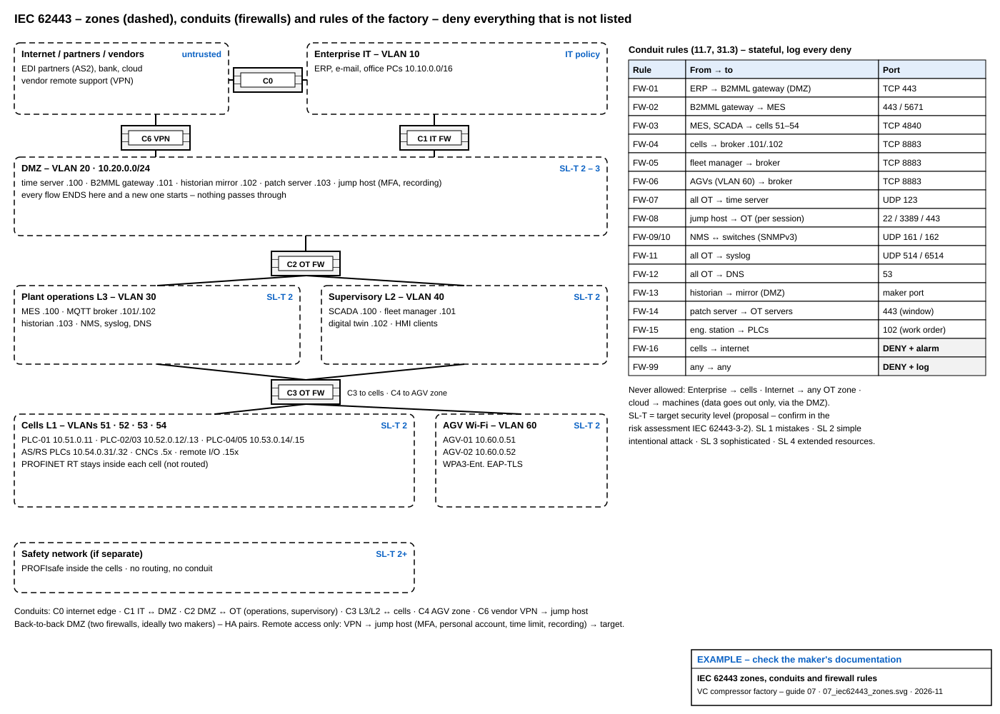
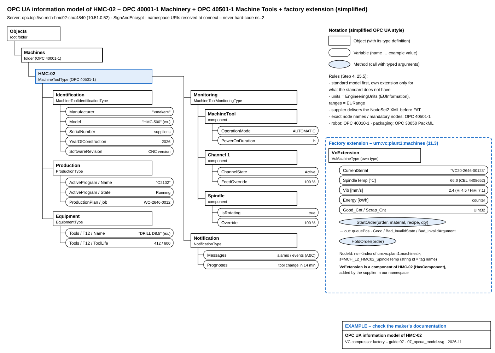
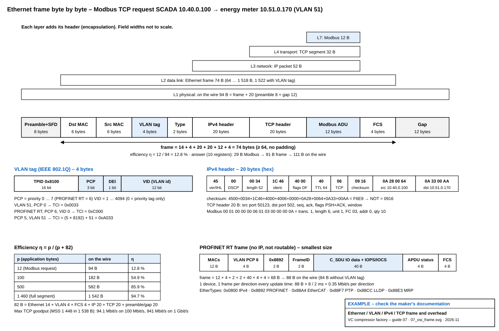
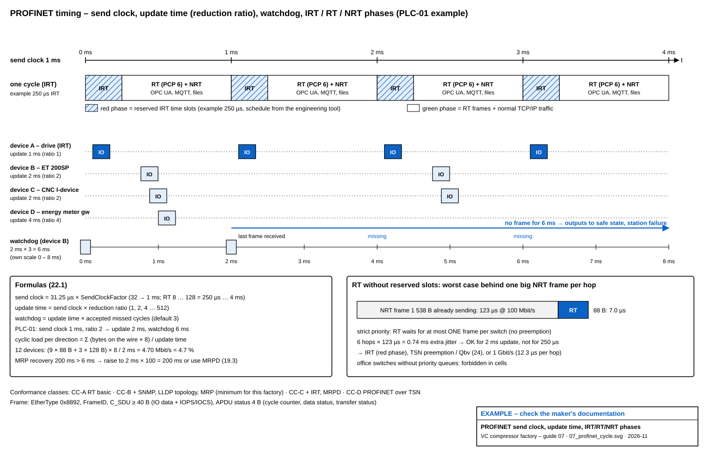
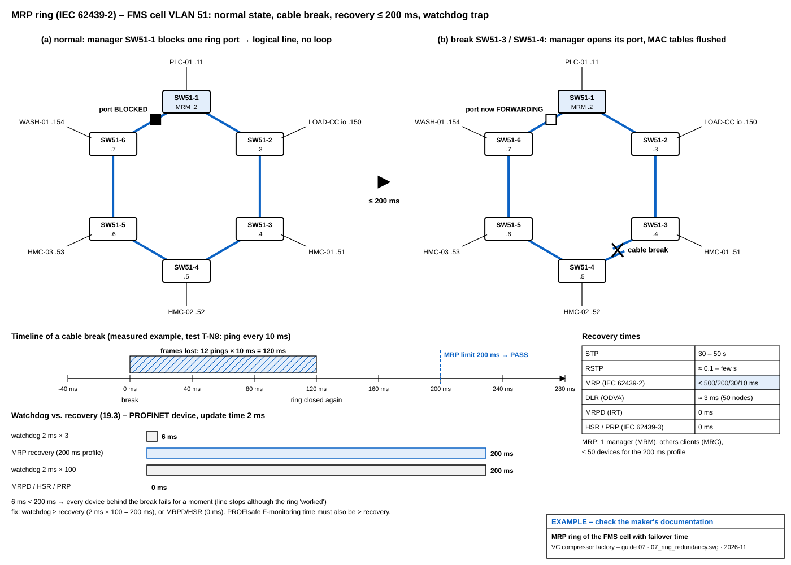
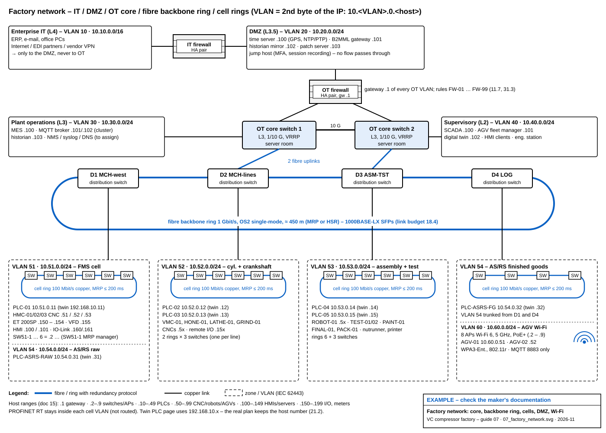
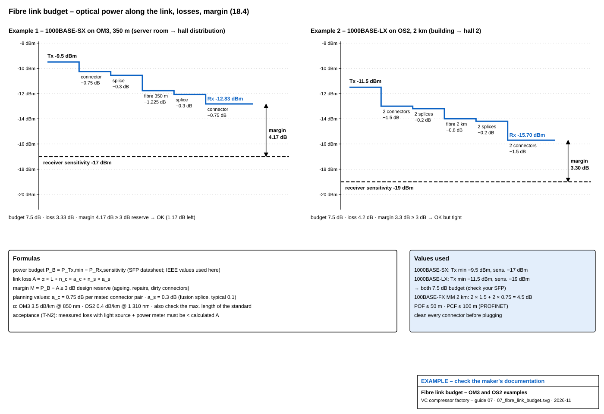
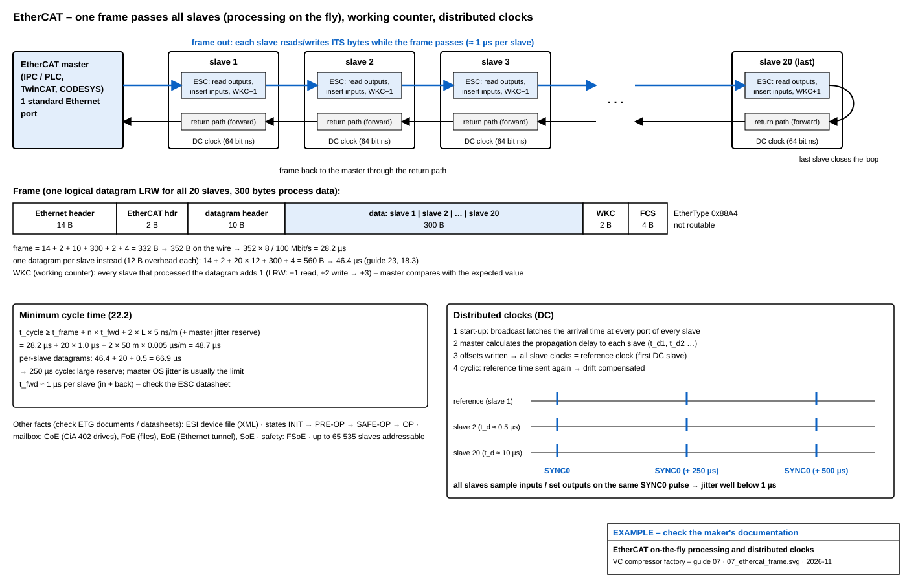

# 07 – Communication: How All Layers of the Factory Talk

> **All numbers, names, addresses, ports, order numbers and prices in this guide are example values.**
> They come from the digital twin. In the real factory you replace them with the values from your own
> suppliers, your own network plan and your own interface specifications.

## Contents

**Part A – messages, interfaces and the twin**

1. Purpose
2. Where in the twin
3. Concepts, simply
4. The model in the twin, with example messages
5. Implementing in the real factory, step by step
6. Checklists
7. Common mistakes
8. Limits of the twin
9. How to use chapters 10 – 15
10. Principles (pub/sub, bandwidth, latency, determinism, TCP/UDP, time, information models, reliability, security)
11. Detailed specification for implementation (asset register, OPC UA, MQTT, VDA 5050, network plan, sizing, supplier requirements)
12. Identification in communication
13. Standards
14. Complete worked example – the order as network traffic
15. Data you still need
16. Glossary

**Part B – factory network engineering: textbook, design reference and buy lists (added)**

17. The network stack – OSI/TCP-IP layers, Ethernet/VLAN/IP/TCP frames byte by byte, overhead
18. Physical layer – copper categories, PROFINET cable, connectors (RJ45, M12 D/X), fibre, link budget, PoE
19. Topologies and redundancy – star/line/ring, MRP/HSR/PRP/RSTP/DLR recovery times, watchdog trap, availability
20. Switching – managed switch features, delays, QoS, VLANs, IGMP snooping, example cell switch configuration
21. IP planning, DHCP/DCP/DNS, NTP and PTP (IEEE 1588) time synchronisation
22. Real-time Ethernet in depth – PROFINET, EtherCAT, EtherNet/IP, Modbus TCP, comparison with real numbers
23. Fieldbuses still in use – PROFIBUS DP, CANopen, IO-Link (with cycle time formula)
24. TSN – Time-Sensitive Networking basics
25. OPC UA in depth – stack, security, subscriptions, PubSub, companion specifications, HMC information model
26. MQTT and Sparkplug B in depth
27. MTConnect for CNCs
28. Wireless – Wi-Fi 6, radio link budget, roaming, private 5G, Bluetooth
29. Network load and latency – worked example for the crankcase line
30. Diagnostics and troubleshooting – Wireshark, SNMP, LLDP, typical faults
31. Network security design (IEC 62443) – SL-T per zone, DMZ rules, rule base, hardening
32. Commissioning and acceptance tests of the network
33. Network documentation set
34. Buy list – catalogue examples (switches, firewalls, Wi-Fi, 5G, cables, connectors, converters, gateways, OPC UA/MTConnect, time servers, test tools, network management)
35. Shopping list – factory network (example quantities)
36. Formula sheet and new glossary terms

**Drawings in this guide** (files `docs/img/07_*.svg`, also in `web/img/`):

| Drawing | File | Section |
|---|---|---|
| Factory network: core, distribution ring, cell rings, DMZ, Wi-Fi, VLANs and IP subnets | `img/07_factory_network.svg` | 11.7, 21 |
| Ethernet / VLAN / IPv4 / TCP frame with byte counts and overhead example | `img/07_osi_frame.svg` | 10.2, 17 |
| PROFINET send clock, update time, IRT / RT / NRT phases | `img/07_profinet_cycle.svg` | 10.4, 22.1 |
| EtherCAT on-the-fly processing and distributed clocks | `img/07_ethercat_frame.svg` | 22.2 |
| MRP ring of the FMS cell with failover time | `img/07_ring_redundancy.svg` | 10.8, 19 |
| OPC UA information model of HMC-02 (Machinery + Machine Tools + factory extension) | `img/07_opcua_model.svg` | Step 4, 25.6 |
| IEC 62443 zones, conduits and firewall rules | `img/07_iec62443_zones.svg` | Step 2, 31 |
| Fibre link budget (OM3 and OS2 examples) | `img/07_fibre_link_budget.svg` | 18.4 |

---

## 1. Purpose

A smart factory is many computers and controllers that must work together:

* the **customer's** purchasing system and the **supplier's** sales system,
* the **ERP** (business planning),
* the **MES** (manufacturing operations),
* **SCADA**, the HMIs, the historian, the AGV fleet manager and the digital twin,
* **PLCs**, **CNC controls**, robot controllers and AGV controllers,
* **sensors and actuators** on the machines.

Each of these systems has its own "language" (protocol). This guide explains:

1. **Who talks to whom** (the ISA-95 layers, also called the automation pyramid).
2. **Which protocol** is typical on each link, and **why**.
3. **What a real message looks like**, line by line, with its grammar.
4. **How to build the communication in the real factory**: network zones, security, OPC UA
   information model, MQTT topic scheme, VDA 5050 for AGVs, time synchronisation, IT/OT
   responsibilities, and how to test every interface before production starts.

Why this matters: most problems in new smart factories are **not** in the machines. They are in the
interfaces: a missing confirmation, a wrong unit (mm or µm?), a different time stamp, a firewall rule
nobody asked for, or two systems that both think they are the "master" of the work order.
If you plan the communication early, with a written interface specification for every link, you avoid
most of these problems.

---

## 2. Where in the twin

Open the twin (`python server.py`, then `http://localhost:8080`) and click the tab **Communication**.
At the top there is a switch with 4 views:

| View (button) | What it shows | Source file | Deep link |
|---|---|---|---|
| **Step-by-step simulation** | One customer order (23 × VC20-300) in 20 animated steps, with the real message text of every step | `web/commsim.js` | `/?csstep=13#comm` (opens step 13) |
| **Protocols by layer** | The 5 communication types and, for every pair of neighbour layers, 3–4 typical protocols with an example message | `web/commproto.js` | `/?cmmode=proto#comm` (`&cpopen=1` opens all examples) |
| **SCADA explained** | What SCADA is and a small working SCADA screen on live twin data | `web/scada.js` | `/?cmmode=scada#comm` |
| **Live monitor** | The ISA-95 layers with live message counts, the 14-step workflow as a swimlane, and a live message log of the running twin | `twin/comm.py` + `web/comm.js` | `/?cmmode=live#comm` |

The browser remembers the last view you used (in `localStorage`, only on your PC).

Server API for the live monitor:

```
GET /api/comm            -> layers, links, 14 steps with counts, last 80 log messages
GET /api/comm?since=120  -> only log messages with id > 120
```

> **Important (what-if):** The **what-if simulation** makes copies of the factory and runs them very fast.
> These copies have **no message bus**. The function `comm.send(...)` checks this and does nothing
> (a "no-op") when the factory has no bus. So what-if runs never appear in the live monitor, and they do
> not slow down because of message logging.

---

## 3. Concepts, simply

### 3.1 The layers (ISA-95 / automation pyramid)

ISA-95 (also published as IEC 62264) is the standard that describes the levels of a factory and the
information that flows between business systems and manufacturing systems. The twin uses these 6 layers:

| Layer id | Level | Systems | Typical time scale | In this twin |
|---|---|---|---|---|
| EXT | Outside | customer purchasing, supplier sales, carriers, banks | days | Order flow form, ERP tab (simulated customers and suppliers) |
| L4 | Level 4 | **ERP**: sales orders, MRP, purchasing, inventory, cost, invoices | days / hours | `twin/erp.py` – ERP tab |
| L3 | Level 3 | **MES**: work orders, dispatching rule, serial numbers, quality (SPC), maintenance, WMS | hours / minutes | `twin/mes.py` – MES, FMS and Order flow tabs |
| L2 | Level 2 | **SCADA / HMI / historian / digital twin**, AGV fleet manager, AS/RS control | seconds | Live factory tab, `data/history.db`, `twin/analytics.py` |
| L1 | Level 1 | **Control**: PLC, CNC, robot and AGV controllers | milliseconds | `twin/model.py` (simulated) or a real gateway → `POST /api/ingest` |
| L0 | Level 0 | **Field**: sensors and actuators (vibration, temperature, power meter, flow meter, motors, valves, barcode/RFID) | micro- to milliseconds | simulated signals in `twin/model.py` |

**Simple rule:** orders and commands go **down**; results, data and alarms go **up**.

```
customer --EDI--> ERP --B2MML--> MES --OPC UA--> PLC/CNC --IO-Link--> sensors
                     <--------------- confirmations, results, alarms ---------------
```

**Why layers?** Each layer works in a different time scale. The ERP plans in days; a PLC reacts in
milliseconds. If you connect the ERP directly to a PLC, the ERP must understand machine details and the
PLC must understand business documents. Layers keep each system simple and replaceable.

### 3.2 The 5 communication types

Every protocol in the factory belongs to one of these 5 types (from `web/commproto.js`):

| Type | How it works | Like … | Typical use |
|---|---|---|---|
| ⇄ **Request / response** | A client asks, the server answers. One question, one answer. | a phone call | read a value, start a job, ask for stock |
| ◎ **Publish / subscribe** | The sender publishes to a topic on a broker. Everybody who subscribed gets it. | a radio station | status, events, data that many systems need |
| ▤ **Document exchange** | A complete business document is sent at once and answered later. | a letter | orders, invoices, work orders (between companies, ERP ↔ MES) |
| ⟳ **Cyclic real-time I/O** | Small fixed data frames are exchanged in a strict cycle (every 0.25–10 ms), even if nothing changes. | a heartbeat | servo drives, remote I/O, valve islands, safety |
| ∿ **Signal on a wire** | The value is a current, a voltage or a simple serial line. No network address. | a thermometer | sensors and actuators on PLC input/output cards |

### 3.3 Every message has a grammar

The twin colours every example message with the same 6 colours. Learn them once and you can read
EDIFACT, XML, OPC UA, JSON and G-code in the same way:

| Colour class | Meaning | Example |
|---|---|---|
| **envelope / header** (`e`) | who sends, to whom, when, message number | `UNB+UNOC:3+DELTA001:ZZ+VCFACTORY:ZZ+...`, `<ApplicationArea>`, MQTT topic header |
| **verb** (`v`) | what to do | `ORDERS`, `Process`, `Call`, `POST`, `order`, `G81` |
| **object / field names** (`n`) | which thing, which field | `BGM`, `<MaterialDefinitionID>`, `ns=2;s=LOAD-CC.Orders`, `"nodes"` |
| **data values** (`d`) | the actual values | `PO-88231`, `VC20-300`, `23` |
| **answer / status / result** (`a`) | the reply | `StatusCode Good`, `201 Created`, `actionCode="Accepted"`, `PASS` |
| **comment** (`c`) | explanation only, **not sent** | `← 220 = order` |

**Key idea:** nearly every protocol is "**envelope + verb + noun + data**", and every request needs an
**answer**. If you remember this, a new protocol is not frightening.

### 3.4 The protocols in one sentence each

| Protocol | One sentence | Layer link |
|---|---|---|
| **EDI – EDIFACT / ANSI X12** | Strict text documents between companies (order, confirmation, delivery note, invoice). | EXT ↔ L4 |
| **ISA-95 B2MML** | XML (or JSON) messages with the ISA-95 vocabulary, grammar = VERB + NOUN. | L4 ↔ L3 |
| **REST** | HTTP method (verb) + URL (noun) + JSON body; answer = HTTP status code. | many links |
| **OPC UA** | Typed, secure client/server (and pub/sub) protocol for machines: read, write, call methods, subscribe, alarms. | L3 ↔ L2 ↔ L1 |
| **MQTT** | Light publish/subscribe through a broker; topics form a tree. | L2 ↔ L1, plant ↔ cloud |
| **Sparkplug B** | Rules on top of MQTT: fixed topic structure, birth/death messages, binary payload. | L2 ↔ L1 |
| **VDA 5050** | JSON messages over MQTT between the AGV fleet manager and the AGVs. | L2 ↔ AGVs |
| **MTConnect** | Read-only XML over HTTP for CNC machine data. | L2 ↔ CNC |
| **PROFINET / EtherCAT / EtherNet/IP** | Industrial Ethernet for cyclic real-time I/O. | L1 ↔ L0, L1 ↔ L1 |
| **IO-Link** | Point-to-point digital link to smart sensors on a 3-wire M12 cable. | L1 ↔ L0 |
| **4–20 mA** | Analog current signal; 4 mA = range start, 20 mA = range end. | L1 ↔ L0 |
| **G-code (ISO 6983)** | The language of the NC program inside the CNC (see guide 08). | file sent L3 → L1 |
| **GS1-128 barcode** | Label with Application Identifiers: (01) product GTIN, (10) lot, (21) serial; on pallets (00) SSCC, (02) contained GTIN, (37) count. | L0 → L3 |
| **ISO 20022 (camt.054)** | Bank XML: "money arrived on your account". | EXT → L4 |

---

## 4. The model in the twin, with example messages

### 4.1 Live monitor (`twin/comm.py` + `web/comm.js`)

**What it is.** The twin itself moves data with Python function calls and HTTP JSON. The module
`twin/comm.py` **records** every important event as the message it **would be** in a real factory, with the
protocol a real factory would typically use. This lets you see the real information flow of the running
factory.

**How it works.**

1. When the live engine starts, it creates one `Bus` object: `self.factory.bus = comm.Bus(self.factory)`.
2. Wherever something happens (a sales order arrives, the MES releases an order, an AGV gets a job …), the
   code calls `comm.send(factory, step_number, text, payload)`.
3. The bus:
   * increases the counter of that workflow step,
   * counts the message on **every link it crosses** (for example, MES L3 → PLC L1 crosses the links L3–L2
     and L2–L1), as "down" (towards the field) or "up" (towards the business),
   * stores it in a log (the last 300 messages; the browser shows the newest 80).
4. The browser asks `GET /api/comm` once per second while the Live monitor view is visible, and moves
   small dots along the links when the counters grow.

**Sensor data (step 10) is special.** Every sample period the engine sends "N machines × 4 signals →
historian". This is **counted** (4 × number of machines) but **not written to the log** one by one,
otherwise the log would be full of sensor values. Data from a **real gateway** (`POST /api/ingest`) is
logged as "Gateway data from …" with the full JSON.

**The 14 workflow steps** (from `STEPS` in `twin/comm.py`):

| # | From → to | Message | Typical protocol | What happens | Where in the twin code |
|---|---|---|---|---|---|
| 1 | EXT → L4 | Customer order | EDI ORDERS or web portal (REST) | ERP creates a sales order: customer, model, quantity, due date | `POST /api/erp {action: create_so}` |
| 2 | L4 → L4 | MRP run | inside the ERP | net = demand + safety stock − free stock − open work orders → new work orders and purchase orders | `erp.run_mrp()` every hour or "Run MRP now" |
| 3 | L4 → EXT | Purchase order | EDI ORDERS or supplier portal | material needed during the supplier lead time is ordered | `erp.create_po()` |
| 4 | EXT → L4 | Delivery and goods receipt | EDI DESADV + barcode / RFID scan | supplier delivers; lot number booked; AS/RS crane stores | `erp._receive()` → `handling.receive()` |
| 5 | L4 → L3 | Work order | ISA-95 B2MML ProductionSchedule | ERP tells MES what to make: model, quantity, due date | `mes.create_wo()` |
| 6 | L3 → L1 | Release and recipe | OPC UA method call (through SCADA) | dispatching rule (FIFO / EDD / SPT / SETUP) picks the order | `mes.wo_action(release)` |
| 7 | L3 → L1 | Transport order | VDA 5050 over MQTT (AGV fleet manager) | kanban signal: rack has room → AGV gets pick-up/drop-off order | `handling._assign()` |
| 8 | L1 → L3 | Unit started, serial number | OPC UA (PLC → MES) | load station clamps a casting, marks the serial number | `mes._on_start()` |
| 9 | L3 → L1 | Changeover / NC program | OPC UA file transfer or MTConnect | new model: CNC program, jaws, test limits or tool set change | `machine._changeover()` → state SETUP |
| 10 | L0 → L2 | Sensor data | IO-Link / 4–20 mA → PLC → OPC UA or MQTT | temperature, vibration, power, state of every machine, every `history_interval_s` (15 s in the example config; code default 10 s) | `engine._sample()` / `POST /api/ingest` |
| 11 | L1 → L3 | Test result | OPC UA or MQTT JSON | test bench sends measured air flow; MES checks spec, updates SPC | `mes._on_test()` |
| 12 | L1 → L3 | Alarm → maintenance order | OPC UA Alarms & Conditions | breakdown (PLC alarm) or rising vibration trend creates a maintenance order | `mes._new_mwo()` |
| 13 | L3 → L4 | Production confirmation | ISA-95 B2MML ProductionPerformance | each finished unit reported; ERP books finished-goods stock | `mes._on_fg()` |
| 14 | L4 → EXT | Shipment and invoice | EDI DESADV + INVOIC | AS/RS picks the units, truck leaves, customer gets delivery note + invoice | `erp._shipped()` |

Two details from the code:

* Step 5 comes from **L3** (not L4) when a planner types the work order directly into the MES
  (source "Manual").
* Step 12 starts at **L1** for a breakdown (corrective, severity 800) and at **L2** for a predictive
  order created by twin analytics (severity 500).

**Example payloads recorded by the live twin** (real structure from the code; values are examples):

Step 1 – customer order (`twin/erp.py`):
```json
{"EDI": "ORDERS", "BGM": "SO-0006", "NAD_BY": "Delta Compressors", "LIN": "VC20-300",
 "QTY": 23, "DTM_due_in_h": 48.0, "PRI_usd": 1450}
```

Step 6 – release to the load station (`twin/mes.py`):
```json
{"method": "StartOrder", "node": "ns=2;s=LOAD-CC.Orders", "order": "WO-0012",
 "material": "VC20-300", "recipe": "VC20_v1", "qty": 23, "rule": "EDD"}
```

Step 7 – AGV transport order (`twin/handling.py`):
```json
{"vda5050": "order", "serialNumber": "AGV-02", "orderId": "T00146",
 "nodes": ["<source store>", "<destination buffer>"], "load": {"type": "...", "qty": 1}, "battery_pct": 78}
```
(The node names are the names of the source and destination stores/buffers in `config/factory.json`.)

Step 9 – changeover (`twin/model.py`):
```json
{"machine": "HMC-02", "program": "OHMC02_VC20.nc", "from_model": "VC30", "to_model": "VC20",
 "setup_s": 600, "tools_loaded": ["VC20", "VC30"]}
```

Step 10 – sensor sample (`twin/engine.py`):
```json
{"topic": "plant/HMC-01/telemetry", "state": "RUNNING", "temp_c": 61.2,
 "vib_mm_s": 2.31, "power_kw": 17.4, "t": 36000}
```

Step 11 – test result (`twin/mes.py`):
```json
{"topic": "plant/TEST-01/test", "serial": "VC20-000112", "model": "VC20",
 "fad_m3_h": 20.31, "lsl_m3_h": 19.4, "result": "PASS"}
```

Step 12 – alarm → maintenance order:
```json
{"alarm": {"source": "HMC-02", "severity": 500, "message": "...", "condition": "RUNNING"},
 "maintenance_order": "MWO-0004", "type": "PREDICTIVE"}
```

Step 13 – production confirmation (one unit):
```json
{"ProductionPerformance": {"Order": "WO-0012", "Serial": "VC20-000112", "Material": "VC20-300",
                           "Qty": 1, "Location": "..."}}
```

**How to use the live monitor.**

1. Start the twin and let it run (or increase the time scale).
2. Open Communication → **Live monitor**.
3. Look at the layer stack: each link shows ↓ (down) and ↑ (up) counters and messages per hour.
4. Click a row of the **workflow swimlane**: the detail panel shows "What happens", "In this twin" and the
   latest real message with its JSON payload.
5. In the **message log**, filter by step, pause the log, and click a row to see that exact message.
6. If step 4 shows "not yet": suppliers need 12–20 h (example lead times). Run the factory faster or use
   *Deliver now* in the Order flow tab.

**Formula for the rates shown:**

```
messages per hour = count / simulated time [s] × 3600
example: 46 work-order releases after 10 h simulated time → 46 / 36 000 × 3600 = 4.6 per hour
```

### 4.2 Step-by-step simulation (`web/commsim.js`)

**What it is.** A teaching animation of **one** customer order: Delta Compressors orders **23 × VC20-300**.
The upper part of the picture is the **information world** (envelopes fly between Customer, Supplier, ERP,
MES, AGV fleet manager, SCADA and 6 controllers). The lower part is the **physical world** (truck, AS/RS
crane, AGV, conveyor, the part moving through load station → HMC-02 → assembly → test bench →
finished-goods AS/RS).

Controls: **▶ Play / ⏸ Pause**, **Next ▶**, **◀ Back**, **Replay** (this step), **Restart**, speed.
Click any step number to jump to it. An envelope ✉ is a message; ↩ is an answer. The envelope colour is the
protocol family:

| Colour family | Protocols |
|---|---|
| purple | EDI / EDIFACT (business documents) |
| blue | ISA-95 B2MML / REST (ERP ↔ MES) |
| teal | OPC UA (MES/SCADA ↔ PLC, CNC) |
| pink | MQTT publish / subscribe |
| brown | VDA 5050 (AGV over MQTT) |
| grey | Field: 4–20 mA, IO-Link, barcode |

A progress bar shows the order stage: Order › Planning › Material › Released › Production › Tested ›
In stock › Shipped › Paid.

**The 20 steps:**

| # | Step | From → to | Protocol |
|---|---|---|---|
| 1 | Customer sends a purchase order | Customer → ERP | EDIFACT ORDERS |
| 2 | ERP confirms the order | ERP → Customer | EDIFACT ORDRSP |
| 3 | MRP calculates what to make and what to buy | inside ERP | calculation, not a message |
| 4 | ERP sends a purchase order to the supplier | ERP → Supplier | EDIFACT ORDERS |
| 5 | Supplier announces the delivery, truck arrives | Supplier → ERP | EDIFACT DESADV |
| 6 | Goods receipt: scan, book, store | scanner → MES → ERP; MES → AS/RS PLC | GS1-128 barcode + OPC UA Call |
| 7 | ERP sends the work order to the MES | ERP → MES | B2MML ProcessProductionSchedule |
| 8 | MES acknowledges the work order | MES → ERP | B2MML AcknowledgeProductionSchedule |
| 9 | MES releases the order to the load station | MES → PLC load station | OPC UA Call + response |
| 10 | AGV brings castings to the load station | MES → fleet manager → AGV | VDA 5050 order (JSON over MQTT) |
| 11 | Unit started: serial number marked and reported | PLC load → MES | OPC UA DataChangeNotification |
| 12 | Changeover: new NC program for the machining center | MES → CNC | OPC UA FileTransfer + G-code |
| 13 | Machining: sensor data flows up all the time | sensor → CNC → SCADA | 4–20 mA + IO-Link + MQTT |
| 14 | Alarm: vibration too high → maintenance order | CNC → SCADA → MES | OPC UA Alarms & Conditions |
| 15 | Assembly: which parts went into this compressor? | PLC assembly → MES | OPC UA DataChange (components consumed) |
| 16 | Performance test: result to the MES | test PLC → MES | MQTT publish (JSON) |
| 17 | Packed and stored: production confirmation to ERP | MES → ERP | B2MML ProcessProductionPerformance |
| 18 | Shipping: ERP orders the delivery, crane picks | ERP → MES; MES → AS/RS PLC | REST + OPC UA Call |
| 19 | Delivery note and invoice to the customer | ERP → Customer | EDIFACT DESADV + INVOIC |
| 20 | Customer confirms receipt and pays | Customer → ERP | EDIFACT RECADV + ISO 20022 camt.054 |

In total, one customer order needs **about 30 messages in 6 protocol families**, from EDI between
companies down to 4–20 mA on a wire, and back up.

Below are the most important messages, copied from the code. Comments after `←` are **not sent**.

#### Step 1 – EDIFACT ORDERS (customer → our ERP)

```
UNB+UNOC:3+DELTA001:ZZ+VCFACTORY:ZZ+261109:0815+000123'   ← envelope: from, to, date, number
UNH+1+ORDERS:D:96A:UN'                                     ← message type = the verb
BGM+220+PO-88231+9'                                        ← 220 = order, 9 = original
DTM+2:20261111:102'                                        ← 2 = delivery date wanted
NAD+BY+DELTA001::92'                                       ← BY = buyer
LIN+1++VC20-300:SA'                                        ← line 1: article
QTY+21:23'                                                 ← 21 = ordered quantity
PRI+AAA:1450'                                              ← price per unit
UNT+8+1'                                                   ← end: 8 segments
UNZ+1+000123'
```

How to read it:
* Each line is a **segment** (one sentence). It ends with `'`.
* `+` separates the data elements (words); `:` separates parts of one element.
* The first 3 letters say what the segment is about: `BGM` document, `NAD` name/address, `QTY` quantity.
* Codes such as `220`, `21`, `BY` come from the UN/EDIFACT code lists, so every computer reads them the same way.
* Result in the twin: ERP creates sales order **SO-0006: 23 × VC20-300, due 11 Nov**.

#### Step 2 – EDIFACT ORDRSP (our answer)

```
UNH+1+ORDRSP:D:96A:UN'
BGM+231+SO-0006+29'          ← 29 = accepted without change
RFF+ON:PO-88231'             ← answers the customer's order
DTM+2:20261111:102'          ← we promise this date
LIN+1++VC20-300:SA'
QTY+21:23'
UNT+7+1'
```

**Why:** every request needs an answer. `RFF+ON` repeats the customer's own order number, so their
computer can match the answer.

#### Step 3 – MRP (a calculation inside the ERP)

```
Make-to-order: work order quantity = 23 × VC20-300

Material CC20-CAST (1 casting per compressor)
net = need + safety − on hand − on order
    = 23   + 20     − 15      − 0        = 28
→ purchase order, rounded up to the supplier lot size = 60
```

#### Step 5 – EDIFACT DESADV (supplier: "the truck is coming")

```
UNH+1+DESADV:D:96A:UN'
BGM+351+DN-55120+9'
RFF+ON:PO-0009'                 ← our purchase order number
DTM+17:202611100600:203'        ← arrives 10 Nov 06:00 (format 203 = date + time)
LIN+1++CC20-CAST:BP'
QTY+12:60'                      ← 12 = despatched quantity
GIN+BX+FA-L0009'                ← lot (batch) number – key for traceability
UNT+8+1'
```

#### Step 6 – Goods receipt: barcode + OPC UA method call

```
Pallet label, read by the scanner:
(02)04012345000017 (10)FA-L0009 (37)60
(02) = product GTIN   (10) = lot   (37) = quantity

MES/WMS → AS/RS PLC, through SCADA (OPC UA):
Call ns=2;s=ASRS-RAW.Store ( "FA-L0009", "CC20-CAST", 60 )
→ StatusCode Good · slot R04-C2
```

> **Correction (teaching view in `web/commsim.js` not changed):** the check digit of `0401234500001?` is
> **6**, not 7 → valid GTIN `04012345000016` (calculation: guide 04, 12.7). And in GS1 rules (02) =
> "GTIN of the items contained in a logistic unit" and (37) = "count" belong on a pallet label together
> with (00) SSCC, e.g. `(00)095212345000000773(02)09521234000204(37)60(10)FA-L0009` (GS1 demo prefix 952,
> never on real labels). Our own lot number would be `LOT-CC20-2646-003` (doc 15).

#### Step 7 – B2MML ProcessProductionSchedule (ERP → MES, shortened)

```xml
<ProcessProductionSchedule xmlns="http://www.mesa.org/xml/B2MML">
 <ApplicationArea>
   <Sender><LogicalID>ERP</LogicalID></Sender>
   <CreationDateTime>2026-11-09T08:20:00Z</CreationDateTime>
 </ApplicationArea>
 <DataArea>
   <Process/>                                   <!-- verb -->
   <ProductionSchedule><ProductionRequest>      <!-- noun -->
     <ID>WO-0012</ID>
     <Priority>3</Priority>
     <EndTime>2026-11-11T08:00:00Z</EndTime>
     <MaterialProducedRequirement>
       <MaterialDefinitionID>VC20-300</MaterialDefinitionID>
       <Quantity>23</Quantity>
     </MaterialProducedRequirement>
   </ProductionRequest></ProductionSchedule>
 </DataArea>
</ProcessProductionSchedule>
```

* Grammar = **verb + noun**: verb `Process` (do it), noun `ProductionSchedule`.
* `ApplicationArea` = envelope (who, when). `DataArea` = verb + noun + data.
* The ERP says **WHAT** and **WHEN**. **HOW** (route, machines, programs) is the MES's job.
* The message passes the firewall/DMZ between office network and plant network.

#### Step 8 – B2MML AcknowledgeProductionSchedule (MES → ERP)

```xml
<AcknowledgeProductionSchedule>
 <ApplicationArea><Sender><LogicalID>MES</LogicalID></Sender></ApplicationArea>
 <DataArea>
   <Acknowledge>
     <ResponseCriteria><ResponseExpression actionCode="Accepted"/></ResponseCriteria>
   </Acknowledge>
   <ProductionSchedule><ProductionRequest><ID>WO-0012</ID></ProductionRequest></ProductionSchedule>
 </DataArea>
</AcknowledgeProductionSchedule>
```

`actionCode` = Accepted, Modified or Rejected. Without this answer, the ERP would send the order again or
raise an alarm.

#### Step 9 – OPC UA Call StartOrder (MES → PLC load station)

```
MES (OPC UA client) → PLC load station (OPC UA server)
CallRequest
  ObjectId : ns=2;s=LOAD-CC.Orders
  MethodId : ns=2;s=LOAD-CC.Orders.StartOrder
  InputArguments:
    [0] String  "WO-0012"      ← order
    [1] String  "VC20-300"     ← material
    [2] String  "VC20_v1"      ← recipe
    [3] UInt32  23             ← quantity
CallResponse
  StatusCode      : Good (0x00000000)
  OutputArguments : [0] UInt32 1   ← position in the queue
```

* **NodeId** grammar: `ns=2;s=LOAD-CC.Orders` = namespace 2, string identifier "LOAD-CC.Orders".
* OPC UA services are the verbs: `Read`, `Write`, `Browse`, `Call`, `Subscribe`.
* Arguments have **data types** (String, UInt32 …), so the PLC cannot read a number as text.
* Status codes: Good, Uncertain, or Bad_… (for example `Bad_InvalidState` if the station is in maintenance).
* The MES chose WO-0012 first because of the dispatching rule **EDD** (earliest due date).

#### Step 10 – VDA 5050 order (fleet manager → AGV, JSON over MQTT)

```
Topic: uagv/v2/AcmeAGV/AGV-02/order        ← address + verb
{ "headerId": 3412, "timestamp": "2026-11-09T09:02:11Z", "version": "2.0.0",
  "manufacturer": "AcmeAGV", "serialNumber": "AGV-02",
  "orderId": "T00146", "orderUpdateId": 0,
  "nodes": [
    { "nodeId": "ASRS-RAW-OUT", "sequenceId": 0, "released": true,
      "actions": [{ "actionType": "pick", "actionId": "a1", "blockingType": "HARD" }] },
    { "nodeId": "LOAD-IN", "sequenceId": 2, "released": true,
      "actions": [{ "actionType": "drop", "actionId": "a2", "blockingType": "HARD" }] } ],
  "edges": [{ "edgeId": "e1", "sequenceId": 1, "released": true,
              "startNodeId": "ASRS-RAW-OUT", "endNodeId": "LOAD-IN" }] }

AGV → fleet manager, topic .../AGV-02/state:
{ "orderId": "T00146", "actionStates": [{ "actionId": "a2", "actionStatus": "FINISHED" }],
  "batteryState": { "batteryCharge": 78 } }
```

* Topic grammar: `interface / version / manufacturer / serial number / topic`. The last word is the verb:
  `order`, `state`, `instantActions`.
* An order is a path of **nodes** (even sequenceId 0, 2, 4 …) and **edges** (odd 1, 3 …).
* Actions at nodes: `pick`, `drop`. The AGV reports progress on its `state` topic.

#### Step 11 – OPC UA subscription: unit started

```
once, at start-up:
CreateMonitoredItems  ns=2;s=LOAD-CC.UnitStarted   SamplingInterval = 100 ms

PLC → MES, only when the value changes:
DataChangeNotification
  SequenceNumber  : 5821
  Value           : { "serial": "VC20-000112", "order": "WO-0012", "casting_lot": "FA-L0009" }
  StatusCode      : Good
  SourceTimestamp : 2026-11-09T09:14:37.120Z
```

* The MES **subscribes once**; the PLC sends **only when the value changes**: no polling, little network load.
* `SequenceNumber` lets the MES detect a lost message.
* `SourceTimestamp` = when it happened in the machine (not when it arrived).
* Result: the MES links serial ↔ work order ↔ customer order ↔ casting lot (traceability).

#### Step 12 – Changeover: NC program by OPC UA file transfer

```
MES → CNC (OPC UA FileType methods)
Call Open( mode = Write )                           → fileHandle 7
Call Write( fileHandle 7, data = <O1020_VC20.nc> )
Call Close( fileHandle 7 )
Write ns=2;s=HMC-02.ActiveProgram = "O1020"         → Good

First lines of the NC program:
O1020 (VC20 CRANKCASE OP10)
N10 G90 G54              ← absolute, work offset 1
N20 T12 M06              ← change to tool 12
N30 S1800 M03            ← spindle 1800 rpm, clockwise
N40 G81 Z-42 R2 F240     ← drilling cycle, depth 42 mm
```

HMC-02 shows state **SETUP** for about 10 min (example) while program and tools change.
G-code is explained in detail in guide `08_cnc_gcode.md`.

#### Step 13 – Sensor data: 4–20 mA, IO-Link, MQTT

```
(1) vibration sensor → controller, 4–20 mA, range 0–50 mm/s
value = min + (I − 4) / 16 × (max − min)
I = 4.77 mA  →  0 + (0.77 / 16) × 50 = 2.4 mm/s
I < 3.6 mA   →  wire broken

(2) temperature sensor → controller, IO-Link, 0.1 °C per bit
process data 0x02 0x9A = 666  →  66.6 °C

(3) controller → SCADA / twin, MQTT publish every 10 s
Topic: vcfactory/plant1/machining/fms/HMC-02/telemetry   QoS 1
{ "ts": "2026-11-09T09:20:00Z", "state": "RUN", "temp_c": 66.6,
  "vib_mm_s": 2.4, "power_kw": 14.8 }
broker → controller: PUBACK
```

* **4–20 mA:** the scale starts at 4 mA, so 0 mA means "wire broken". This is called a "live zero".
* **IO-Link:** digital bytes; the sensor's **IODD** file (device description) says what each byte means.
  `0x029A` hex = 2 × 256 + 154 = 666 → × 0.1 °C = 66.6 °C.
* **MQTT topic** = a tree `company/site/area/line/machine/...` (Unified Namespace). Anyone may subscribe:
  twin, historian, dashboard.
* **QoS 1** = delivered at least once (the broker answers PUBACK).

#### Step 14 – OPC UA Alarms & Conditions

```
EventNotification                              controller → SCADA → MES
  EventType   : OffNormalAlarmType
  SourceName  : HMC-02
  Severity    : 600                            ← 1 … 1000
  Message     : "Spindle vibration 7.3 mm/s > limit 7.1"
  ActiveState : TRUE
  AckedState  : FALSE

operator on the HMI:
Call Acknowledge( EventId, "bearing check planned" )   → AckedState = TRUE

MES: new maintenance order MWO-0004 (predictive)
```

Two separate states: `ActiveState` (is the problem still there?) and `AckedState` (has a person seen it?).
The limit 7.1 mm/s is the example `vibration_alarm_mm_s` of the HMCs in `config/factory.json`.

#### Step 15 – Components consumed (genealogy)

```
assembly PLC → MES
DataChangeNotification  ns=2;s=ASSY-01.Consumed
{ "serial": "VC20-000112",
  "components": [
     { "part": "CYL-CAST", "lot": "CY-L0201", "qty": 2 },
     { "part": "CS-FORG",  "lot": "CS-L0107", "qty": 1 } ] }
StatusCode : Good
```

If a cylinder lot is found bad later, the MES lists every compressor that contains it, in seconds.

#### Step 16 – Test result by MQTT

```
Topic: vcfactory/plant1/test/TEST-01/result   QoS 1
{ "serial": "VC20-000112", "model": "VC20",
  "fad_m3_h": 20.31, "lsl_m3_h": 19.40, "pressure_bar": 8.0,
  "result": "PASS", "ts": "2026-11-09T13:42:05Z" }
```

MES rule: PASS if FAD ≥ LSL. LSL = 97 % of nominal = 0.97 × 20 = **19.40 m³/h**. 20.31 ≥ 19.40 → PASS.
The value also goes into the SPC chart (UCL / LCL, Cpk).

#### Step 17 – B2MML ProcessProductionPerformance (MES → ERP, shortened)

```xml
<ProcessProductionPerformance>
 <DataArea>  <Process/>
  <ProductionResponse><ID>WO-0012</ID>
   <MaterialProducedActual>
     <MaterialDefinitionID>VC20-300</MaterialDefinitionID>
     <MaterialLotID>VC20-000112</MaterialLotID>        <!-- serial number -->
     <Quantity>1</Quantity>
     <StorageLocation>ASRS-FG</StorageLocation>
   </MaterialProducedActual>
   <MaterialConsumedActual>
     <MaterialDefinitionID>CC20-CAST</MaterialDefinitionID>
     <MaterialLotID>FA-L0009</MaterialLotID>
   </MaterialConsumedActual>
  </ProductionResponse>
 </DataArea>
</ProcessProductionPerformance>
```

ERP result: finished stock +1, casting stock −1 (backflush), cost booked. The other 22 units repeat steps 10–17.

#### Step 18 – REST + OPC UA (shipping)

```
ERP → MES/WMS (REST, JSON)
POST /api/deliveries
{ "delivery": "DN-0042", "order": "SO-0006", "sku": "VC20-300", "qty": 23, "dock": "OUT-1" }
→ 201 Created

MES/WMS → AS/RS PLC (OPC UA), once per unit:
Call ns=2;s=ASRS-FG.Retrieve( "VC20-000112", "OUT-1" )   → Good
```

REST grammar: method (verb) + URL (noun) + JSON body. `POST` = create, `GET` = read, `PUT` = change,
`DELETE` = remove. Answers: 2xx OK (201 = created), 4xx = error in the request, 5xx = server error.

#### Step 19 – DESADV + INVOIC (to the customer)

```
UNH+2+INVOIC:D:96A:UN'
BGM+380+INV-2026-0006+9'        ← 380 = commercial invoice
RFF+ON:PO-88231'                ← always the customer's own order number
LIN+1++VC20-300:SA'
QTY+47:23'                      ← 47 = invoiced quantity
PRI+AAA:1450'
MOA+77:33350'                   ← invoice amount = 23 × 1450
UNT+8+2'
```

The DESADV carries all serial numbers in `GIN+BN+VC20-000112+VC20-000113'` …

#### Step 20 – RECADV + bank camt.054 (loop closed)

```
UNH+1+RECADV:D:96A:UN'
BGM+632+GR-7781+9'
RFF+AAK:DN-0042'           ← our delivery note
LIN+1++VC20-300:SA'
QTY+48:23'                 ← 48 = received quantity
UNT+6+1'

Bank → ERP (camt.054, shortened):
<BkToCstmrDbtCdtNtfctn>
  <Amt Ccy="USD">33350.00</Amt> <CdtDbtInd>CRDT</CdtDbtInd>
  <Ustrd>INV-2026-0006</Ustrd>
</BkToCstmrDbtCdtNtfctn>
ERP: invoice paid → SO-0006 closed
```

### 4.3 Protocols by layer (`web/commproto.js`)

This view is a **reference card**. For each neighbour-layer link it shows 3–4 typical protocols with:
type, data format, transport/port, speed, use and an example message. The "main" protocol is marked.
Click a communication type at the top to highlight all protocols of that type.

| Link | Network (example) | Main protocol | Type | Speed | Other options |
|---|---|---|---|---|---|
| EXT ⇅ L4 | Internet, encrypted (TLS). Partners never reach the plant network. | EDI – EDIFACT / ANSI X12 (AS2 over HTTPS 443, SFTP or VAN) | document | minutes – hours | REST API (HTTPS 443, JSON); Bank ISO 20022 XML (EBICS or SFTP, daily) |
| L4 ⇅ L3 | Office IT network → firewall / DMZ → plant network | ISA-95 B2MML (HTTPS web service or message queue) | document | minutes | REST/SOAP (HTTPS 443); message queue AMQP (TCP 5672) / Kafka (TCP 9092) |
| L3 ⇅ L2 | Plant network (Ethernet), split into security zones (IEC 62443) | OPC UA client/server (TCP 4840, signed + encrypted) | request/response | 100 ms – 1 s | MQTT / Sparkplug B (1883, 8883 with TLS); SQL / historian API |
| L2 ⇅ L1 | Control network (industrial Ethernet); Wi-Fi or 5G for AGVs | OPC UA server inside PLC / CNC (TCP 4840) | request/response | 10 – 500 ms | MTConnect (HTTP, port 5000 typical, read-only); VDA 5050 over MQTT; S7 (TCP 102), EtherNet/IP CIP (44818), Modbus TCP (502) |
| L1 ⇅ L0 | Field cables and field buses | IO-Link (3-wire M12, point to point, 230 kbit/s, ≈ 2 ms cycle) | signal | ≈ 2 ms | 4–20 mA / 0–10 V; 24 V digital I/O (< 1 ms); PROFINET IO / EtherCAT (0.25–4 ms cycle) |

**Why these protocols?** (from the code):
* EXT–L4: different companies, different software → they need a strict, agreed document standard.
* L4–L3: ERP thinks in orders and days, MES in units and minutes. ISA-95 defines the common words.
* L3–L2: MES needs machine states and results within seconds and must send commands safely.
* L2–L1: every controller brand has its own protocol; OPC UA and MTConnect give one common view.
* L1–L0: sensors are simple and must be fast, cheap and robust.

**Selected example messages from this view:**

Message queue (AMQP / Kafka) between ERP and MES – messages are stored until the receiver is back online:
```
queue:   mes.workorders
message: { "verb": "Process", "wo": "WO-0012", "qty": 23 }
← ack (message removed from queue)
```

MQTT / Sparkplug B (Unified Namespace):
```
PUBLISH topic plant/line1/HMC-02/state
{ "state": "RUN", "serial": "VC20-000112", "oee": 0.82 }
QoS 1 = delivered at least once; retained = new subscribers get the last value
```

MTConnect (CNC, read-only):
```
GET /current
← <Execution>ACTIVE</Execution>
  <PartCount>112</PartCount>
  <SpindleSpeed>6000</SpindleSpeed>
```

Modbus TCP (older HMI / SCADA – you must know the register map):
```
Read Holding Register 40001   (Modbus function 03)
← 2350
register map: 40001 = air pressure × 100  →  23.50 bar
```

4–20 mA pressure transmitter:
```
value = min + (I − 4 mA) / 16 mA × (max − min)
I = 12 mA, range 0 … 10 bar  →  0 + (12 − 4)/16 × 10 = 5 bar
I < 3.6 mA = wire broken (that is why it starts at 4, not 0)
```

IO-Link vibration sensor:
```
process data 0x00 0x2D → 45
device description (IODD): value × 0.1 = mm/s  →  vibration 4.5 mm/s
```

PROFINET IO / EtherCAT (cyclic):
```
every 1 ms:
 PLC → drive  target position = 125.400 mm
 drive → PLC  actual position = 125.398 mm, status = OK
```

**Connections that skip a layer or stay inside one** (also in this view):

| Between | Title | Protocols | Note |
|---|---|---|---|
| L3 ⇄ L1 | MES directly to PLC / CNC | OPC UA, MTConnect | Modern plants often skip SCADA for orders and results; SCADA then only shows and alarms. |
| L1 ⇄ L1 | Machine to machine / robot handshake | PROFINET, EtherNet/IP; safety: PROFIsafe | "part ready" / "part taken"; safety signals use a safety protocol. |
| L0 ⇄ L1 | Identification: barcode and RFID | GS1-128, RFID (ISO 15693, UHF EPC) | Reader gives the text to the PLC (IO-Link or Ethernet). |
| L2 ⇄ EXT | Plant to cloud | MQTT over TLS (8883), HTTPS | Data goes **out only**, through the DMZ. The cloud never sends commands directly to machines. |
| L2 ⇄ L2 | Twin ↔ browser (this project) | HTTP JSON + Server-Sent Events | `/api/...` request/response, `/api/stream` pushes updates to the browser. |

### 4.4 SCADA explained (`web/scada.js`) – short

This view explains SCADA (Supervisory Control And Data Acquisition) as the **control-room software**:
the PLC controls the machine in milliseconds; SCADA watches all machines and supervises in seconds.
If SCADA stops, the machines keep running – you only become blind.

It shows the 5 jobs of SCADA (acquire, display, alarm, record, command), a line mimic, a machine
faceplate with tags and PLC addresses, an alarm list with an ISA-18.2 style life cycle, a trend, an animated
scan cycle, and **operator command previews** (the OPC UA Write / Call that would be sent – they are
**shown only, never sent**). A teaching switch adds simulated bearing damage on one machine.

Signal scaling used on the faceplate (example: temperature range 0–150 °C, Siemens-style analog card):

```
I   = 4 + 16 · (v − lo) / (hi − lo)          [mA]
raw = 27648 · (v − lo) / (hi − lo)           [PLC counts]

v = 66.6 °C:  I = 4 + 16 · 66.6/150 = 11.10 mA     raw = 27648 · 0.444 = 12 276
```

Everything about SCADA in detail (tags, alarm management, trends, audit trail, shift report) is in
guide **`06_scada.md`**.

---

## 5. Implementing in the real factory, step by step

This chapter is the main work for your team. Do the steps in this order.

### Step 1 – Make a list of all systems and all links

1. Write a **system list**: every computer, server, controller and smart device. For each: name, layer
   (EXT / L4 … L0), supplier, location, owner.
2. Draw the **link diagram** like the Live monitor: arrows between systems.
3. For each arrow write: what information, which direction, how often, how fast an answer is needed,
   what happens if the link is down.
4. Use the 14 workflow steps of the twin as a check list: every step must have a real link in your plan.

Example link list (shortened; example values):

| Link | Data | Direction | Rate | Max delay | If link down |
|---|---|---|---|---|---|
| ERP → MES | work orders | down | ~20 per day | 5 min | MES keeps working with released orders; queue stores new ones |
| MES → load station PLC | release, recipe | down | ~5 per hour | 2 s | operator cannot start new order; MES alarm |
| Load station PLC → MES | unit started, serial | up | ~1 per 6 min | 2 s | PLC buffers events (store-and-forward); MES catches up |
| CNC → historian | state, power, vibration | up | every 1–10 s | 10 s | gap in trend only |
| Test bench → MES | test result | up | 1 per unit | 5 s | **unit must not be released** without a result |
| Fleet manager ↔ AGV | VDA 5050 order/state | both | state ~1 s | 1 s | AGV stops at the next node |

### Step 2 – Design the network: levels, zones and conduits

Use the **zone and conduit** idea of **IEC 62443** (the standard series for security of industrial
automation and control systems):

* A **zone** = a group of systems with the same security needs (for example "FMS cell control").
* A **conduit** = the controlled path between two zones (a firewall with written rules).
* Traffic is allowed **only** through conduits, **only** with the protocols and ports in the rules.



(Network security design in depth – target levels per zone, DMZ rules, full rule base, hardening: chapter 31.)

Typical zone plan for this factory (example):

| Zone | Level | Systems | Example VLAN / subnet |
|---|---|---|---|
| Enterprise (office IT) | L4 | ERP, e-mail, office PCs | VLAN 10 – 10.10.0.0/16 |
| **DMZ** (between IT and OT) | "L3.5" | data replication server, ERP–MES gateway, patch server, remote-access jump host, historian mirror, time server | VLAN 20 – 10.20.0.0/24 |
| Plant operations | L3 | MES, WMS, MQTT broker, central historian | VLAN 30 – 10.30.0.0/24 |
| Supervisory | L2 | SCADA servers, HMI clients, AGV fleet manager, digital twin | VLAN 40 – 10.40.0.0/24 |
| Cell: FMS (load station, HMC-01…03, washer) | L1 | PLCs, CNCs | VLAN 51 – 10.51.0.0/24 |
| Cell: cylinder + crankshaft lines | L1 | PLCs, CNCs | VLAN 52 |
| Cell: assembly, robot, test benches | L1 | PLCs, robot controller, test PLCs | VLAN 53 |
| AS/RS | L1 | crane PLCs | VLAN 54 |
| AGV Wi-Fi | L1 | AGVs (own SSID) | VLAN 60 |
| Safety | L1/L0 | safety PLC network (if separate) | own network, no routing |

Example firewall (conduit) rules – **write them as a table and keep it under version control**:

| From zone | To zone | Protocol / port | Purpose |
|---|---|---|---|
| Enterprise | DMZ | HTTPS 443 | ERP → ERP–MES gateway (B2MML) |
| DMZ | Plant operations | HTTPS 443 or AMQP 5671 (TLS) | gateway → MES |
| Plant operations | Supervisory, cells | OPC UA 4840 | MES / SCADA → PLC, CNC |
| Cells | Plant operations | MQTT 8883 (TLS) | PLC / gateway → broker |
| Supervisory | AGV Wi-Fi | MQTT 8883 | fleet manager ↔ AGVs (VDA 5050) |
| Enterprise | Cells | **none** | office never talks directly to PLCs |
| Internet | any OT zone | **none** | remote service only via jump host in DMZ, with personal login, MFA, time limit, logging |

Rules to follow:

1. **No direct path from office IT or the internet to a PLC.** Everything passes the DMZ.
2. **Deny by default.** Open only what is in the table.
3. **One cell = one VLAN.** A virus or a broadcast storm stays in one cell.
4. **AGV Wi-Fi is its own zone.** Plan roaming and coverage (site survey) before the AGVs arrive.
5. **Cloud: data goes out only.** No commands from the cloud to machines.
6. **The twin** (this project has no login) belongs only in a trusted zone (Supervisory), never in the DMZ
   or the internet.

### Step 3 – Choose the protocol for each link

Use this decision table. It follows the twin; the choices are typical, not the only possible ones.

| Question | If yes, use … | Why |
|---|---|---|
| Between two companies? | EDI (EDIFACT / X12) via AS2 or a VAN; REST portal for small partners | strict, agreed documents; legal records |
| ERP ↔ MES business objects? | ISA-95 B2MML (XML/JSON) over HTTPS or a message queue | common vocabulary; queue = nothing lost during ERP updates |
| Command to a machine that needs a confirmed answer (start, release, write recipe)? | OPC UA method call / write | typed arguments, status code answer, security built in |
| Data that many systems need (state, counters, quality)? | MQTT (Unified Namespace) or OPC UA subscriptions | publish once, many readers; low load |
| CNC data, read-only, multi-brand? | OPC UA for Machine Tools or MTConnect | standard data model for CNCs |
| AGVs from one or several suppliers? | VDA 5050 over MQTT | one fleet manager for different AGV brands |
| Drive, servo, remote I/O, valve island? | PROFINET IO, EtherCAT or EtherNet/IP (follow your PLC brand) | deterministic cycle |
| Safety signals between machines? | PROFIsafe / FSoE / CIP Safety, or hard-wired safety | certified safety function |
| Smart sensor with diagnosis? | IO-Link | parameters + diagnosis + device name |
| Simple analog sensor? | 4–20 mA | robust, live zero detects wire break |

Practical rules:

* **Write the protocol AND the version** in the specification (for example "VDA 5050 2.x (current 2.1.0 – check; 3.0 announced)", "OPC UA
  1.04 or later", "EDIFACT D.96A").
* **Prefer one main protocol per layer link.** Every extra protocol is extra knowledge, extra gateways,
  extra failure points.
* For **old machines** without OPC UA: a gateway (PLC or industrial PC) reads the signals and publishes them
  (see README "Typical hardware paths": current clamp on the motor, proximity sensor for part count,
  accelerometer on the spindle).
* **Put it in the purchase order.** Every machine supplier must deliver the agreed interface (for example
  "OPC UA server with the information model in Annex X, security mode SignAndEncrypt"). Adding it later is
  expensive.

### Step 4 – Plan the OPC UA information model and namespace

An OPC UA server shows its data as a tree of **nodes** (objects, variables, methods). If every supplier
builds a different tree, your MES must be programmed again for every machine. So **you** define the model.

1. **Use companion specifications where they exist.** Examples: *OPC UA for Machinery* (common building
   blocks such as identification and machine state) and *OPC UA for Machine Tools* (CNC data). Ask each
   supplier which companion specifications they support.
2. **Define your own model for the rest** (factory standard), with the same structure on every machine.
3. **Identify nodes by namespace URI, not by the number.** `ns=2` is only an index; it can change when the
   server is updated. Your clients must look up the index from the URI (for example
   `urn:vcfactory:plant1:machines`) at connection time.
4. **Use clear string identifiers** like the twin: `<Asset>.<Group>.<Item>`.

Example factory standard (example names – adapt them; the same machine modelled with the Machinery and Machine
Tools companion specifications is shown in 25.6):



```
Objects
└── HMC-02                                  (asset id = same as in MES, SCADA, twin)
    ├── Identification   Manufacturer, Model, SerialNumber, SoftwareVersion
    ├── State            Mode (AUTO/MANUAL/SETUP), State (RUN/IDLE/SETUP/ALARM/OFF), Since
    ├── Counters         PartsGood (UInt32), PartsScrap (UInt32)
    ├── Program          ActiveProgram (String), ProgramFiles (FileType)
    ├── Process          SpindleSpeed_rpm, SpindlePower_kW, Vibration_mm_s, Temperature_C
    ├── Orders           (Object)
    │   ├── StartOrder(order:String, material:String, recipe:String, qty:UInt32) → queuePos:UInt32
    │   └── HoldOrder(order:String)
    ├── UnitStarted      { serial, order, casting_lot }  (structure, subscribed by the MES)
    └── Alarms           (Alarms & Conditions, Severity 1…1000)
```

Rules for the model:

* **Units in the name or in the EngineeringUnits property** (`Vibration_mm_s`). Never "vibration" alone.
* **Data types fixed** (UInt32 for counters, Double for measurements, String for ids).
* **Quality and time stamp** come with every value; the client must check `StatusCode` (Good / Uncertain / Bad).
* **Methods for actions** (StartOrder), not "write 1 to a bit and hope". A method gives a clear answer
  (`Good` or `Bad_InvalidState`).
* **Security:** use security mode **SignAndEncrypt**, user authentication, and a certificate plan (who
  creates, trusts and renews certificates – they expire).
* **Sampling and publishing intervals:** write them in the spec (for example state 500 ms, process values
  1 s, counters on change).

### Step 5 – Plan the MQTT topic scheme (Unified Namespace)

The twin uses topics like `vcfactory/plant1/machining/fms/HMC-02/telemetry`. Write a topic standard
before the first device publishes. (The project has now fixed it in doc 15, 3.10: `vc/<Area>/<Line>/<Machine>/…`,
e.g. `vc/MCH/L2/HMC02/telemetry` – see 11.4. The long form below shows the general ISA-95 idea.)

```
<enterprise>/<site>/<area>/<line>/<asset>/<class>[/<item>]

vcfactory/plant1/machining/fms/HMC-02/telemetry     every 10 s, QoS 1
vcfactory/plant1/machining/fms/HMC-02/state         on change, QoS 1, retained
vcfactory/plant1/test/TEST-01/result                one per unit, QoS 1
vcfactory/plant1/machining/fms/HMC-02/status        online/offline (last will), retained
```

Rules:

1. **Levels follow ISA-95** (enterprise / site / area / line / cell / asset), so everyone finds data the same way.
2. **Asset ids are the same** in MES, SCADA, OPC UA and MQTT (`HMC-02` everywhere).
3. **Fixed character set:** letters, digits, `-` and `_`. No spaces. Decide upper/lower case once.
4. **Payload standard (JSON):** always `ts` in ISO 8601 **UTC** (`2026-11-09T09:20:00Z`), unit in the field
   name (`temp_c`, `vib_mm_s`, `power_kw`, `fad_m3_h`), and the serial number when the data belongs to a unit.
5. **QoS:** QoS 1 for results and events; QoS 0 is acceptable for fast telemetry where a lost value does not matter.
   Remember QoS 1 means "at least once": the receiver must handle **duplicates** (use serial + ts as key).
6. **Retained** messages for the **last state** (new subscribers get it at once). Not for events.
7. **Last Will** (LWT) message for online/offline status of every device.
8. **Access control on the broker:** each device may publish only under its own topic branch.
9. **Commands:** prefer OPC UA methods for commands. If you use MQTT for commands, use separate `cmd`
   topics, a request id, and a reply topic.
10. If you use **Sparkplug B**, its topic structure is fixed: `spBv1.0/<group_id>/<message_type>/<edge_node_id>[/<device_id>]`,
    with birth and death certificates. Do not mix free topics and Sparkplug in the same branch.

### Step 6 – VDA 5050 for the AGVs

VDA 5050 is the interface between a fleet manager (VDA 5050 calls it *master control*) and AGVs, with JSON
messages over MQTT. It lets you use AGVs from different suppliers with one fleet manager.

1. **Fix the version** (the twin's example uses `"version": "2.0.0"`; specify VDA 5050 2.x (current 2.1.0 – check; 3.0 announced)). Fleet manager and all AGVs must
   support it.
2. **Topics** per AGV: `<interfaceName>/<majorVersion>/<manufacturer>/<serialNumber>/<topic>`, for example
   `uagv/v2/AcmeAGV/AGV-02/order`. Main topics: `order`, `instantActions`, `state`, `connection`,
   `visualization`, `factsheet`.
3. **Node map:** give every pick/drop station a fixed `nodeId` (`ASRS-RAW-OUT`, `LOAD-IN` …) and keep the
   list in the interface specification together with coordinates.
4. **Actions:** agree on the action types (`pick`, `drop`, charging …) and their parameters (load type,
   height).
5. **Station handshake:** VDA 5050 controls driving. The **transfer at the station** (conveyor running,
   station ready, load taken) needs a separate handshake between AGV and station PLC – for example optical
   I/O in the style of SEMI E84, as the mechanical interface guides of this project describe. Define who
   waits for whom and the time-outs.
6. **MES ↔ fleet manager** is not VDA 5050: it is a transport request (from, to, load, priority) – usually
   REST or OPC UA. Specify it like every other interface.
7. **Test** with one AGV first: order, state, battery, error states, connection lost, emergency stop,
   order cancel (`instantActions`).

### Step 7 – Time synchronisation (NTP / PTP)

Traceability and alarm analysis only work if **all clocks agree**. Example: the MES must know which unit was
in the machine when an alarm came. If the PLC clock is 3 minutes wrong, the alarm is linked to the wrong
serial number.

1. **One plant time source**, for example a time server in the DMZ (with GPS or synchronised to the
   IT time servers).
2. **NTP** (Network Time Protocol) for servers, MES, SCADA, HMIs, PLCs and gateways. Typical accuracy on a
   LAN: milliseconds. That is enough for MES and SCADA.
3. **PTP** (Precision Time Protocol, IEEE 1588) only where you need sub-microsecond accuracy (for example
   coordinated motion or precise sequence-of-events recording). It needs PTP-capable switches.
4. **Store all time stamps in UTC.** Convert to local time only on the screen. This avoids errors at the
   daylight-saving change.
5. **Use the source time stamp** (when it happened in the machine, `SourceTimestamp`), not the time the
   message arrived.
6. **Monitor the offset.** An alarm in SCADA if a device clock is more than, for example, 1 s wrong.

(PTP message exchange, clock types, accuracy values, profiles and holdover: chapter 21.4.)

### Step 8 – Decide IT/OT responsibilities

Write down **who owns what** before commissioning. Example responsibility table (R = responsible, A =
approves, C = consulted):

| Task | IT department | OT / automation team | Machine supplier | MES/ERP supplier |
|---|---|---|---|---|
| Office network, ERP servers | R | C | – | C |
| DMZ, firewalls between IT and OT | R (operates) | A (rules) | – | C |
| Plant / cell networks, switches, VLANs | C | R | C | – |
| PLC and CNC programs | – | A | R | – |
| OPC UA servers in machines | – | A (model) | R | C |
| MQTT broker, historian | C | R | – | C |
| MES, ERP interfaces (B2MML, REST) | C | C | – | R |
| Certificates, user accounts | R | R (OT accounts) | C | C |
| Patching servers and PCs | R | A (time window) | C | C |
| Backups of PLC/CNC programs | – | R | C | – |
| Remote access for suppliers | R (jump host) | A (each session) | user | user |
| Interface tests (FAT/SAT) | C | R | R | R |

**Why:** IT thinks "patch quickly"; OT thinks "never stop the line". Both are right. Agree on rules:
patch windows during planned stops, test patches first on a test system, and a written emergency procedure.

### Step 9 – Write an interface specification for every link

One document per link (or per interface type). Use this **template**:

```
INTERFACE SPECIFICATION  IF-07  MES → Load station PLC: order release      Version 1.2 (example)

1. Partners          Client: MES (L3)        Server: PLC LOAD-CC (L1)
2. Purpose           Release a work order and its recipe to the load station.
3. Protocol          OPC UA 1.04+, binary, TCP 4840, SignAndEncrypt, user "mes_svc"
4. Trigger           MES dispatching rule selects the next order (rule EDD).
5. Message           Method ns=<urn:vcfactory:plant1:machines>;s=LOAD-CC.Orders.StartOrder
                     IN : order String(16)  e.g. "WO-0012"
                          material String(16)  e.g. "VC20-300"
                          recipe String(16)  e.g. "VC20_v1"
                          qty UInt32 1…999  e.g. 23
                     OUT: queuePos UInt32
6. Answer            Good = accepted.  Bad_InvalidState = station in maintenance/E-stop.
                     Bad_InvalidArgument = unknown recipe.
7. Timing            Answer within 2 s. No answer → MES retries 3 × every 10 s, then alarm.
8. Duplicates        Same order sent twice → PLC answers Good and does not add it twice (idempotent).
9. Error handling    Link down → MES shows "station offline"; operator may start from HMI with
                     scanned work-order barcode (fallback).
10. Logging          MES logs request + answer with UTC time stamp; PLC keeps last 100 calls.
11. Test cases       T1 normal, T2 unknown recipe, T3 station in maintenance, T4 duplicate,
                     T5 network cable pulled, T6 qty = 0, T7 certificate expired.
12. Owner / contact  MES: … / PLC: …
```

Fill it for all 14 workflow steps of the twin plus all machine-specific links.

### Step 10 – Commission and test the interfaces

Test in stages. Never test an interface for the first time on the production line.

1. **Desk test (simulation).** Use simulators: an OPC UA test client, an MQTT client subscribed to `#`
   on a test broker, an EDI test partner. The twin itself is a useful "fake factory": it can produce
   the same messages (see the Live monitor) and real gateways can post to `/api/ingest`
   (try `python tools/gateway_example.py --machine LATHE-01`).
2. **FAT (Factory Acceptance Test)** at the machine supplier: test the OPC UA server against your
   information model, with your test client and your test cases.
3. **SIT (System Integration Test)** on site: MES + SCADA + PLCs together, cell by cell.
4. **SAT (Site Acceptance Test)**: complete order loop, like the 20-step simulation: one real customer
   order from EDI to invoice.

**Test messages.** Prepare a set of test messages with known results. Examples:

| Test | Message sent | Expected answer / result |
|---|---|---|
| Normal release | `Call LOAD-CC.Orders.StartOrder("WO-T001","VC20-300","VC20_v1",2)` | `Good`, queuePos 1; HMI shows "ready: WO-T001" |
| Unknown recipe | `... StartOrder("WO-T002","VC20-300","VC99_v1",2)` | `Bad_InvalidArgument`; MES alarm; nothing on HMI |
| Station in maintenance | same as normal, station in maintenance mode | `Bad_InvalidState` |
| Duplicate | normal release sent twice | second answer `Good`, order **not** doubled |
| Test result PASS | publish `{"serial":"VC20-T0001","fad_m3_h":20.31,"lsl_m3_h":19.40,"result":"PASS",...}` | MES: unit PASS, value in SPC chart |
| Test result at the limit | `fad_m3_h` = 19.40 | PASS (rule is ≥ LSL) |
| Test result FAIL | `fad_m3_h` = 19.39 | FAIL; unit blocked |
| Broker down | stop the broker during test results | gateway buffers, sends after restart; no result lost, no duplicate unit |
| Clock wrong | set PLC clock + 5 min | time monitoring alarm |
| 4–20 mA wire break | disconnect the sensor | value < 3.6 mA → "wire broken" alarm, not "0 mm/s" |
| B2MML reject | send ProductionSchedule with unknown material | `AcknowledgeProductionSchedule actionCode="Rejected"` + reason |
| EDI | test ORDERS from the partner | ORDRSP within agreed time; sales order correct |

Also measure: **message rate** and **network load** at full production (the Live monitor gives you rates per
link to start with), **answer times**, and **recovery time** after a network or server restart.

---

## 6. Checklists

### 6.1 Planning checklist

- [ ] System list complete (every system, layer, owner).
- [ ] Link diagram drawn; every one of the 14 workflow steps has a real link.
- [ ] For every link: data, direction, rate, max delay, behaviour when the link is down.
- [ ] Protocol **and version** chosen for every link.
- [ ] Zone/conduit plan (IEC 62443 idea) with VLANs and firewall rule table.
- [ ] DMZ between office IT and plant; no direct path from IT/internet to PLCs.
- [ ] Remote access concept (jump host, personal accounts, MFA, logging).
- [ ] OPC UA information model (factory standard) written; companion specifications requested.
- [ ] MQTT topic standard and payload standard written (UTC time, units in names).
- [ ] VDA 5050 version, node map and station handshake defined.
- [ ] Time concept: time server, NTP for all, PTP only where needed, UTC everywhere.
- [ ] IT/OT responsibility table signed by both sides.
- [ ] Interface requirements written into every machine purchase order.

### 6.2 Interface specification checklist (per link)

- [ ] Partners (client/server or publisher/subscriber) named.
- [ ] Trigger, message structure, data types, ranges, units.
- [ ] Every answer code and what the sender does with it.
- [ ] Time-out, retries, alarm.
- [ ] Duplicates handled (idempotent).
- [ ] Store-and-forward when the link is down.
- [ ] Security (encryption, user, certificate).
- [ ] Logging on both sides with UTC time stamps.
- [ ] Test cases including error cases.

### 6.3 Commissioning checklist

- [ ] Desk test with simulators passed.
- [ ] FAT of each machine interface against your model passed.
- [ ] Clocks synchronised; offset monitoring active.
- [ ] Firewall rules tested (allowed traffic works, everything else is blocked).
- [ ] All normal test messages passed.
- [ ] All error test messages passed (wrong data, timeout, duplicate, link down, wire break).
- [ ] Full order loop (EDI order → work order → units → test → confirmation → shipping → invoice) passed.
- [ ] Load test at full production rate.
- [ ] Backups of all PLC/CNC programs, OPC UA configurations, broker configuration and firewall rules.
- [ ] Certificates: expiry dates listed, renewal owner named.

---

## 7. Common mistakes

| Mistake | What happens | How to avoid it |
|---|---|---|
| No answer defined ("fire and forget" for commands) | ERP/MES does not know if the order arrived; orders lost or doubled | every request has an answer (ORDRSP, Acknowledge, StatusCode, 201 Created) |
| Units not defined | 2.4 is read as mm/s by one system and as in/s by another | unit in the field name or EngineeringUnits |
| Local time stamps | wrong order of events at daylight-saving change; wrong serial linked to an alarm | UTC everywhere, source time stamp |
| Polling everything fast | network and PLC overloaded | OPC UA subscriptions / MQTT publish on change |
| Using `ns=2` as a fixed number | client reads wrong nodes after a server update | look up namespace index from the URI |
| Different asset names in each system | MES "HMC2", SCADA "MC_02", MQTT "hmc-02" – data cannot be joined | one asset id list for all systems |
| Office network routed to PLCs "for convenience" | malware from IT reaches the machines | DMZ, deny by default |
| QoS 1 without duplicate handling | one test result counted twice | idempotent receiver (serial + ts as key) |
| 0–20 mA instead of 4–20 mA, or no wire-break check | broken wire shows "0" as a valid value | use 4–20 mA; alarm below 3.6 mA |
| Interface added after the machine was bought | expensive change, delays | write the interface into the purchase order |
| ERP sends HOW instead of WHAT | ERP must know machines and programs; MES role unclear | ERP: what and when; MES: how |
| Testing interfaces for the first time on the line | production stops during debugging | desk test, FAT, SIT before SAT |
| Expired certificates | OPC UA or MQTT connections suddenly fail | certificate list with expiry dates and owner |
| Cloud allowed to send commands | security and safety risk | data out only |

---

## 8. Limits of the twin

* The twin **does not speak** EDIFACT, B2MML, OPC UA, MQTT or VDA 5050 on the network. It moves data
  internally and **records** each event as the message it would be in a real factory. The messages in the
  simulation and in the protocol view are **teaching examples**, shortened, not complete valid messages for
  a certification test.
* All protocol choices, ports, speeds, NodeIds, topics and codes are **typical examples**, not the only
  possible choice.
* The live log keeps only the last 300 messages (the browser shows 80). Sensor values are counted, not logged.
* What-if copies have no bus: `comm.send` does nothing there.
* There is no network model: no delays, no lost messages, no bandwidth limits, no firewall.
* The step-by-step simulation is one fixed story (23 × VC20-300); it does not use live data.
* The SCADA explained view shows operator commands but never sends them.
* The twin has no login or security. Run it only on a trusted network.

---

## 9. How to use chapters 10 – 15

Chapters 1 – 8 explain how the twin shows communication. Chapters 10 – 15 are for building the **real**
networks and interfaces.

| Chapter | Content | Main reader |
|---|---|---|
| 10 Principles | Why protocols behave as they do: pub/sub, bandwidth, latency, determinism, TCP/UDP, time sync, information models, reliability, security – with numbers | automation and IT engineers |
| 11 Detailed specification | Asset register, OPC UA node tree with NodeIds and units, MQTT topics and JSON schema, VDA 5050 fields, network/VLAN/IP/port plan, server sizing, requirement tables for suppliers | engineers, buyer, suppliers |
| 12 Identification | How assets, tags, NodeIds, topics, host names, IP addresses and certificates are named | everybody who configures a device |
| 13 Standards | What each communication standard requires and how to verify it | engineers, buyer |
| 14 Complete worked example | The order of guide 04 chapter 14 as network messages with addresses, ports, payloads and sizes | training, commissioning |
| 15 Data you still need | What is missing, why, who delivers | project manager |

Related documents: `docs/15_numbering_and_identification.md` (numbering master – it wins if anything here
differs), `docs/14_engineering_reference_data.md` (general tables), `docs/16_standards_register.md` (all
standards with editions), guide 04 chapters 11 – 14 (business records and B2MML).

All values in chapters 10 – 15 (addresses, sizes, intervals, limits) are **examples or proposals**.

**Part B (chapters 17 – 36)** is the network engineering textbook: physical layer, frames, switches, redundancy, IP
and time, real-time Ethernet, fieldbuses, TSN, OPC UA / MQTT / MTConnect in depth, wireless, load and latency,
diagnostics, security design, acceptance tests, documentation, buy lists and the shopping list.

---

## 10. Principles

### 10.1 Client/server and publish/subscribe

| | Client/server (request/response) | Publish/subscribe (broker) |
|---|---|---|
| Who knows whom | client must know the server address | publisher and subscriber know only the broker and the topic |
| Typical | OPC UA client/server, REST, Modbus, MTConnect | MQTT, Sparkplug B, OPC UA PubSub, AMQP queues |
| Good for | commands with a confirmed answer, reading on demand | data that many systems need, events, telemetry |
| Weak point | many clients × many servers = many connections, polling load | no direct answer – a command needs an extra reply topic |

**Number of connections.** 5 consumers (MES, SCADA, historian, twin, dashboard) and 16 machines:

```
point to point:  5 × 16 = 80 sessions, every machine serves 5 clients
with a broker:   5 + 16 = 21 sessions, every machine publishes once
```

**Polling vs. report by exception.** 2 000 tags polled every 1 s = 2 000 reads/s. If only 5 % of the
values change per second, change-driven reporting (OPC UA subscription, MQTT publish on change) sends
100 values/s – 20 × less. A **deadband** (e.g. send temperature only if it changed by more than 0.5 °C)
reduces it further. The deadband is an attribute in the tag list (doc 15, 3.10).

Note: an OPC UA *subscription* is still client/server (the server pushes changes through the client's
session). OPC UA *PubSub* (IEC 62541-14) is real publish/subscribe over UDP or MQTT.

### 10.2 Bandwidth – how big is a message on the wire?

```
data rate [bit/s] = size on the wire [bytes] × 8 × messages per second
size on the wire  = payload + protocol headers of every layer
```

| Layer | Overhead per frame / packet | Note |
|---|---|---|
| Ethernet preamble + start delimiter | 8 bytes | on the wire only |
| Ethernet header (MAC addresses + type) | 14 bytes | |
| VLAN tag (IEEE 802.1Q) | 4 bytes | in tagged links |
| Ethernet frame check sequence (FCS) | 4 bytes | |
| Inter-frame gap | 12 bytes (time) | |
| IPv4 header | 20 bytes | without options |
| TCP header | 20 bytes + typically 12 bytes options (time stamps) | |
| UDP header | 8 bytes | |
| TLS 1.3 record (AES-GCM) | ≈ 22 bytes (5 header + 1 type + 16 tag) | per record |
| MQTT PUBLISH | 2 – 5 bytes fixed header + 2 + topic length + 2 packet id (QoS ≥ 1) | |

Ethernet payload is 46 – 1 500 bytes; the smallest frame is 64 bytes (header to FCS), the largest 1 518
(1 522 with VLAN tag). The frame byte by byte, with a real Modbus TCP example: chapter 17.



**Worked example – one telemetry message (MQTT, QoS 1, TLS):**

```
topic    vc/MCH/L2/HMC01/telemetry                                                  25 bytes
payload  {"ts":"2026-11-09T09:20:00.000Z","state":0,"SpindleTemp":66.6,"Vib":2.4,
          "Power":14.8,"Speed":1800}                                                  98 bytes
MQTT packet  = 3 (fixed header) + 2 + 25 (topic) + 2 (packet id) + 98       = 130 bytes
+ TLS 22 + TCP 32 + IPv4 20 + Ethernet 14 + VLAN 4 + FCS 4                 = 226 bytes frame
+ preamble 8 + gap 12                                                       = 246 bytes on the wire
PUBACK back: 4 (MQTT) + 22 + 32 + 20 + 22 + 20                             = 120 bytes
total per message ≈ 366 bytes ≈ 2 900 bit
```

| Case | Messages/s | Data rate | Share of 1 Gbit/s |
|---|---|---|---|
| Twin: 16 machines every 15 s | 1.07 | 3.1 kbit/s | 0.0003 % |
| Real plant: 200 assets every 1 s | 200 | 0.6 Mbit/s | 0.06 % |
| 2 000 tags, each its own message every 1 s | 2 000 | 6 Mbit/s | 0.6 % |

**Lesson:** for MES, SCADA and historian, bandwidth on wired Ethernet is almost never the problem.
Latency, Wi-Fi coverage and the number of sessions on a PLC are.

**Cyclic real-time I/O is different.** PROFINET RT sends a frame per device per direction every cycle,
even if nothing changes. The smallest frame on the wire is 64 + 8 + 12 = 84 bytes = 672 bit (88 bytes if the frame
carries a VLAN priority tag, as PROFINET RT frames usually do – 22.1):

```
1 device, 1 ms cycle:  672 bit × 1 000 /s = 0.67 Mbit/s per direction
20 devices in a line, 1 ms:  20 × 0.67 = 13.4 Mbit/s per direction on the link next to the PLC
→ 13 % of a 100 Mbit/s link
```

The PLC engineering tool calculates this exactly; check its network load report at FAT.

### 10.3 Latency and jitter

**Latency** = time from sending to receiving. **Jitter** = how much the latency varies.

| Part of the delay | Formula / typical value | Example |
|---|---|---|
| Serialisation (putting bits on the wire) | frame bits / link rate | 246 B at 100 Mbit/s = 1 968 / 10⁸ = 20 µs; 1 538 B (largest frame) = 123 µs; at 1 Gbit/s 10 × less |
| Propagation | ≈ 5 µs per km in copper or fibre | 100 m = 0.5 µs |
| Switch (store and forward) | ≈ serialisation time + a few µs per switch | 5 switches ≈ 0.1 – 0.6 ms |
| Queueing | 0 … many ms when a link is busy | the cause of jitter |
| Application processing | ms to tens of ms | OPC UA server in a PLC answers in its communication time slice |
| Sampling / publishing | up to one interval | see below |

**OPC UA subscription:** worst-case delay ≈ sampling interval + publishing interval. Example: sampling
100 ms + publishing 500 ms → up to **0.6 s** before the MES sees a change. Set the intervals to what
the receiver needs, not as fast as possible.

**Wi-Fi (AGVs):** the handover between access points (roaming) can take from tens of milliseconds to more
than one second, depending on equipment and security settings. Ask for fast roaming (IEEE 802.11r) and
**measure** it along the AGV routes. VDA 5050 tolerates short gaps (the AGV continues its released path);
station handshakes must not run over a roaming Wi-Fi link without time-outs.

### 10.4 Determinism and cycle times (PROFINET classes, conceptually)

**Deterministic** = the maximum delay is guaranteed. Normal Ethernet with TCP/IP is not deterministic:
frames wait in switch queues, and a lost TCP segment is repeated only after a time-out (typically
0.2 – 1 s).

| Class (PROFINET, conceptual) | How | Typical cycle | Use |
|---|---|---|---|
| NRT (non-real-time) | normal TCP/UDP/IP | ~100 ms | parameters, diagnostics, configuration |
| RT (real-time) | Ethernet frames without IP, high priority (VLAN priority), standard switches with priority queues | about 1 – 10 ms (shorter possible) | remote I/O, valve islands, most PLC I/O |
| IRT (isochronous real-time) | reserved time slots in every cycle, special IRT switches, synchronised clocks | down to well below 1 ms, jitter ≤ 1 µs | motion control, synchronised axes |

PROFINET devices are grouped in **conformance classes** (CC-A, CC-B, CC-C; IRT needs CC-C). EtherCAT
reaches similar cycle times differently: one frame passes all devices and each device reads/writes its
bytes "on the fly"; distributed clocks synchronise the devices. **TSN** (Time-Sensitive Networking, the
IEEE 802.1 TSN standards) adds scheduled traffic to standard Ethernet; it is coming into PLC and drive
products.



(PROFINET, EtherCAT, EtherNet/IP and Modbus TCP in depth, with a comparison in real numbers: chapter 22; TSN: chapter 24.)

**What this factory needs (example):** axis control stays inside the CNC/drive (machine supplier);
PLC I/O 2 – 10 ms (RT); MES and SCADA 100 ms – seconds (NRT, OPC UA/MQTT). IRT only where a machine
supplier needs it inside his machine.

### 10.5 TCP and UDP

| | TCP | UDP |
|---|---|---|
| Connection | yes (3-way handshake SYN, SYN-ACK, ACK) | no |
| Lost data | repeated automatically | lost (application must handle it) |
| Order | guaranteed | not guaranteed |
| Delay on loss | time-out, then repeat → jitter | none, but data missing |
| Used by | OPC UA binary (opc.tcp), MQTT, HTTP/HTTPS, Modbus TCP, S7, AMQP | NTP, PTP (also directly on Ethernet), OPC UA PubSub (UDP), SNMP, Syslog (UDP), DNS (mostly) |

**MQTT keep-alive:** the client sends at least one packet per keep-alive interval (PINGREQ if idle). The
broker treats the client as dead after **1.5 × keep-alive** without a packet and then publishes its Last
Will. Example keep-alive 10 s → device "offline" visible after at most **15 s**. A longer keep-alive saves
nothing important on Ethernet; use 10 – 30 s for machines (example).

**TLS:** a TLS 1.3 handshake adds one round trip and some milliseconds of CPU for the certificate check.
On a LAN with 0.5 ms round-trip time this is negligible – but after a broker restart **all** clients
reconnect at once. Ask for random reconnect delays (back-off) in devices and gateways.

### 10.6 Time synchronisation accuracy

**Why:** a quartz clock with 20 ppm error drifts 20 × 10⁻⁶ × 86 400 s = **1.7 s per day**. Without
synchronisation, after a month two PLCs can differ by nearly a minute.

**How NTP measures the offset** (4 time stamps: client sends t1, server receives t2, server sends t3,
client receives t4):

```
offset θ = ((t2 − t1) + (t3 − t4)) / 2          delay δ = (t4 − t1) − (t3 − t2)

example (client clock 100 ms behind):
t1 = 10:00:00.000  t2 = 10:00:00.105  t3 = 10:00:00.106  t4 = 10:00:00.011
θ = (0.105 + 0.095) / 2 = 0.100 s  → client adds 100 ms
δ = 0.011 − 0.001 = 0.010 s  (round trip)
```

NTP assumes the way there and back take the same time; the error is at most δ/2. On a good wired LAN
NTP reaches about 1 ms or better; over Wi-Fi and through busy routers it is worse. **PTP (IEEE 1588)**
time-stamps packets in the network hardware and corrects the switch delay; with PTP-capable switches it
reaches **below 1 µs**.

| Need in this factory | Accuracy needed | Method |
|---|---|---|
| Link an alarm or a measurement to the serial in the machine (a unit stays minutes) | ≤ 1 s | NTP |
| Order of alarms across machines (alarm flood analysis) | ≤ 10 ms | NTP on wired LAN, time stamp in the PLC |
| Sequence of events at 1 ms resolution | ≤ 1 ms | time stamp in the same PLC, or PTP |
| Synchronised motion | µs | IRT / EtherCAT distributed clocks / PTP – inside the machine |

### 10.7 Information modelling

**Data** is a number: `66.6`. **Information** is the number plus everything you need to use it safely:

| Part | Example |
|---|---|
| value + data type | `66.6`, Double |
| engineering unit | °C (UN/ECE code `CEL`) |
| range | 0 – 150 °C |
| quality | Good / Uncertain / Bad |
| time stamp | source time `2026-11-09T09:20:00.000Z` |
| context | which machine (HMC-01), which signal (spindle temperature), which unit was inside |

**OPC UA address space** (IEC 62541-3): everything is a **node**. There are 8 node classes: Object,
Variable, Method, ObjectType, VariableType, DataType, ReferenceType, View. Nodes are connected by
**references** (`HasComponent`, `HasProperty`, `Organizes`, `HasTypeDefinition` …).

**Types and instances:** define the type "HMC" once (which variables, methods, alarms), then create 3
instances HMC-01 … HMC-03. A client that understands the type understands every instance – also a
fourth HMC bought later. **Companion specifications** are agreed types for an industry (e.g. OPC UA for
Machinery, OPC UA for Machine Tools).

**Hierarchy:** the ISA-95 equipment hierarchy (enterprise → site → area → line/work centre → unit) is the
same skeleton for the OPC UA tree, the MQTT topic tree and the tag names: `MCH` / `L2` / `HMC01`
(doc 15, 3.10).

### 10.8 Reliability of delivery

**MQTT QoS:**

| QoS | Packets | Guarantee | Cost |
|---|---|---|---|
| 0 | PUBLISH | at most once – may be lost | 1 packet |
| 1 | PUBLISH → PUBACK | at least once – may be **duplicated** | 2 packets |
| 2 | PUBLISH → PUBREC → PUBREL → PUBCOMP | exactly once (between two partners) | 4 packets |

Important details:

* QoS is agreed **per hop**: publisher → broker, broker → subscriber. The subscriber gets
  min(publish QoS, subscription QoS).
* QoS 1/2 to a subscriber that was offline works only with a **persistent session** (MQTT 3.1.1: clean
  session = false; MQTT 5: clean start = 0 and a session expiry interval > 0).
* QoS does not protect against a device that loses power before sending. That needs **store-and-forward**
  in the device or gateway.
* Prefer **QoS 1 + idempotent receiver** (key = serial + time stamp, or a message id) over QoS 2: simpler,
  and it also handles duplicates created by a gateway restart.

**Store-and-forward buffer size:** messages/s × outage time × size. Example: test bench gateway with
4 messages/s × 8 h × 300 bytes = 4 × 28 800 × 300 = **35 MB** – easy for an industrial PC, too much for
some PLCs. State the required buffer time in the spec (11.9).

**Availability of a chain** (all parts needed = series; redundant parts = parallel):

```
series:    A = A1 × A2 × …          parallel (2 equal parts): A = 1 − (1 − A1)²
example:   switch 99.99 % × firewall 99.99 % × broker server 99.9 % × MES server 99.9 %
           = 0.9999 × 0.9999 × 0.999 × 0.999 = 0.9978  → 99.78 % → 0.0022 × 8 760 h = 19 h down per year
with 2 broker servers in a cluster: 1 − 0.001² = 99.9999 % for that part → chain ≈ 99.88 % → 10.5 h/year
```

Ring topologies with a redundancy protocol (e.g. MRP, IEC 62439-2) keep the cell network running when one
cable breaks; the switch-over time depends on the protocol profile (check the value in the device data,
e.g. "≤ 200 ms"). All redundancy protocols with recovery times, and the watchdog trap: chapter 19.



### 10.9 Security basics

**CIA triad:**

| Goal | Meaning | Example in this factory |
|---|---|---|
| **C**onfidentiality | only authorised people read the data | NC programs, prices, customer data |
| **I**ntegrity | data is not changed unnoticed | test limit 19.40 must not become 18.40; a work order quantity must not change |
| **A**vailability | systems work when needed | the line must not stop because of malware |

In office IT the order is often C > I > A. In OT it is usually **A and I first**, because a wrong value or
a stopped line can damage machines, products or people.

**Cryptography in two sentences each:**

* **Symmetric** (e.g. AES): the same secret key encrypts and decrypts. Fast; used for the data itself.
* **Asymmetric** (e.g. RSA, elliptic curves): a **public key** (everybody may know it) and a **private key**
  (kept secret). Used to agree on a symmetric key and to **sign** (prove who sent something).
* **Hash** (e.g. SHA-256): a fingerprint of data; any change gives a different fingerprint.

**Certificates and PKI.** An X.509 certificate is a signed document that says "this public key belongs to
`vc-mch-hmc01-cnc`" and is valid from … to …. It is signed by a **certificate authority (CA)**. If you trust
the CA, you trust every certificate it signed (chain of trust). A **CRL** (certificate revocation list)
lists certificates that are no longer valid before their end date.

| Item | OPC UA | MQTT (TLS) |
|---|---|---|
| Server identity | application instance certificate; the `ApplicationUri` must match the certificate's subject alternative name | broker server certificate; host name must match |
| Client identity | client application certificate (+ user: user name/password or user certificate) | client certificate, or user name/password inside TLS |
| Encryption | security mode **SignAndEncrypt** | TLS 1.2 or 1.3 on port 8883 |
| Trust | trust list of each application (or a global discovery server pushes certificates) | CA certificates in broker and clients |
| Weak settings to forbid | security mode None; deprecated policies Basic128Rsa15 and Basic256 | port 1883 without TLS outside the lab; anonymous access |

Current OPC UA security policies include `Basic256Sha256`, `Aes128_Sha256_RsaOaep` and
`Aes256_Sha256_RsaPss` – ask suppliers which they support and agree one minimum.

**Certificate workload (example):** 40 OPC UA/MQTT devices with 2-year certificates = 20 renewals per
year – about one every 2.5 weeks. Without a list of expiry dates and an owner, connections will suddenly
fail (common mistake, chapter 7).

**IEC 62443 in one table:**

| Idea | Meaning |
|---|---|
| Zones and conduits | group systems, control the paths between groups (5, Step 2) |
| Security levels SL 1 – 4 | protection against: SL 1 casual or accidental violation, SL 2 intentional attack with simple means, SL 3 sophisticated attack with moderate resources, SL 4 sophisticated attack with extended resources |
| 7 foundational requirements | identification and authentication control, use control, system integrity, data confidentiality, restricted data flow, timely response to events, resource availability |
| Target level per zone | you decide per zone (risk assessment, IEC 62443-3-2); the supplier proves what his component reaches (IEC 62443-4-2) |

---

## 11. Detailed specification for implementation

### 11.1 Asset register (one master list for all systems)

Every system (PLC, SCADA, MES, historian, broker, fleet manager, twin, firewall) takes names and addresses
from this list. Format and rules: doc 15 (3.9, 3.10, 3.13).

| Field | Example HMC-01 | Example LOAD-CC | Example TEST-01 | Example AGV-01 |
|---|---|---|---|---|
| Equipment ID (MES, twin) | `HMC-01` | `LOAD-CC` | `TEST-01` | `AGV-01` |
| Tag machine name | `HMC01` | `LOADCC` | `TEST01` | `AGV01` |
| Area / line | `MCH` / `L2` | `MCH` / `L2` | `TST` / `L1` | `LOG` / `L0` |
| Tag prefix | `MCH_L2_HMC01` | `MCH_L2_LOADCC` | `TST_L1_TEST01` | `LOG_L0_AGV01` |
| VLAN / IP | 51 / `10.51.0.51` (CNC) | 51 / `10.51.0.11` (PLC-01) | 53 / `10.53.0.14` (PLC-04) | 60 / `10.60.0.51` |
| Host name | `vc-mch-hmc01-cnc` | `vc-mch-plc01` | `vc-asm-plc04` | `vc-log-agv01` |
| OPC UA endpoint | `opc.tcp://vc-mch-hmc01-cnc:4840` | `opc.tcp://vc-mch-plc01:4840` | `opc.tcp://vc-asm-plc04:4840` | – (VDA 5050) |
| ApplicationUri | `urn:vc:plant1:MCH:L2:HMC01` | `urn:vc:plant1:MCH:L2:LOADCC` | `urn:vc:plant1:TST:L1:TEST01` | – |
| MQTT client id | `MCH_L2_HMC01` | `MCH_L2_LOADCC` | `TST_L1_TEST01` | `AGV-01` (VDA 5050 serialNumber, see 11.6) |
| Physical serial | supplier's serial | – | supplier's serial | `AGV-2546-00001` (own build, doc 15) |
| Supplier / model / firmware | from purchase order | | | |
| Owner | OT team | OT team | quality + OT | logistics + OT |

(All values are doc 15 values (3.13, master IP and host-name plan). `PLC-01` = `10.51.0.11`, `HMC-01` CNC =
`10.51.0.51`, `PLC-04` (controls TEST-01) = `10.53.0.14` and `AGV-01` = `10.60.0.51`.)

### 11.2 OPC UA server requirements (per machine / PLC)

| Item | Requirement (example values) |
|---|---|
| Protocol | OPC UA binary over TCP (`opc.tcp`), port **4840**, specification version 1.04 or later |
| Security | modes **SignAndEncrypt** only (None disabled in production); policy at least `Basic256Sha256` or `Aes128_Sha256_RsaOaep` |
| Users | user name/password or X.509; roles: `mes_svc` (read + methods), `scada_svc` (read + write set points), `viewer` (read) |
| Certificates | application instance certificate with `ApplicationUri` from 11.1; validity ≤ 2 years (example); import of our CA |
| Namespace | our model in namespace URI `urn:vc:plant1:machines` (example); clients resolve the index at connect time |
| Capacity | ≥ 5 sessions, ≥ 1 000 monitored items, minimum sampling interval ≤ 100 ms (example) |
| Time | NTP client to the plant time server; `SourceTimestamp` from the PLC clock |
| Companion specs | supplier states which ones (OPC UA for Machinery, Machine Tools …) |
| Documentation | node list (export as NodeSet2 XML file) delivered with the machine, before FAT |

### 11.3 OPC UA node tree with NodeIds, data types and units

**NodeId rule (proposal):** string identifiers; the identifier of a variable or method is the **tag name**
(doc 15, 3.10), objects use the tag prefix. Browse path = the same parts with `/`. So one name works in PLC,
SCADA, OPC UA and historian.

```
ns = index of "urn:vc:plant1:machines"   (resolved at connect, never hard-coded)
Objects
└── MCH                               s=MCH
    └── L2                            s=MCH_L2
        ├── HMC01                     s=MCH_L2_HMC01            (ObjectType: VcMachineType)
        └── LOADCC                    s=MCH_L2_LOADCC           (ObjectType: VcLoadStationType)
└── TST / L1 / TEST01                 s=TST_L1_TEST01           (ObjectType: VcTestBenchType)
```

**HMC01** (sampling interval = what the client should request):

| Browse path (below MCH/L2/HMC01) | NodeId `s=` | Class | DataType | Unit (UN/ECE code, UnitId) | Range | Access | Sampling |
|---|---|---|---|---|---|---|---|
| Identification/Manufacturer | `MCH_L2_HMC01_Manufacturer` | Variable | String | – | – | R | once |
| Identification/SerialNumber | `MCH_L2_HMC01_SerialNumber` | Variable | String | – | – | R | once |
| State | `MCH_L2_HMC01_State` | Variable | Int16 (enum: 0 RUNNING, 1 SETUP, 2 STARVED, 3 BLOCKED, 4 DOWN, 5 MAINTENANCE, 6 STOPPED, 7 OFFLINE – guide 06) | – | 0 – 7 | R | on change (100 ms) |
| CurrentSerial | `MCH_L2_HMC01_CurrentSerial` | Variable | String(20) | – | e.g. `VC20-2646-00123` | R | on change |
| ActiveProgram | `MCH_L2_HMC01_ActiveProgram` | Variable | String | – | e.g. `O2102` | R | on change |
| SpindleTemp | `MCH_L2_HMC01_SpindleTemp` | Variable | Double | °C (`CEL`, 4408652) | 0 – 150 | R | 1 000 ms, deadband 0.5 |
| SpindleSpeed | `MCH_L2_HMC01_SpindleSpeed` | Variable | Double | 1/min (`RPM`, 5394509) | 0 – 6 000 | R | 1 000 ms |
| SpindlePower | `MCH_L2_HMC01_SpindlePower` | Variable | Double | kW (`KWT`, 4937556) | 0 – 30 | R | 1 000 ms |
| Vib | `MCH_L2_HMC01_Vib` | Variable | Double | mm/s (`C16` – verify in Rec 20, UnitId 4403510) | 0 – 50 | R | 1 000 ms |
| Vib_Hi / Vib_HiHi | `MCH_L2_HMC01_Vib_Hi`, `_Vib_HiHi` | Variable | Double | mm/s | 4.5 / 7.1 (config) | R (W for engineer role) | once |
| ToolWear | `MCH_L2_HMC01_ToolWear` | Variable | Double | % (`P1`, 20529) | 0 – 100 | R | 10 s |
| Energy | `MCH_L2_HMC01_Energy` | Variable | Double | kWh (`KWH`, 4937544) | counter | R | 60 s |
| Good_Cnt / Scrap_Cnt | `MCH_L2_HMC01_Good_Cnt`, `_Scrap_Cnt` | Variable | UInt32 | – | counter | R | on change |
| StartOrder | `MCH_L2_HMC01_StartOrder` | Method | in: order String(14), material String(20), recipe String(16), qty UInt32; out: queuePos UInt32 | | | X (mes_svc) | – |
| HoldOrder | `MCH_L2_HMC01_HoldOrder` | Method | in: order String(14) | | | X | – |
| (alarms) | object `MCH_L2_HMC01` is EventNotifier | Events | OPC UA Alarms & Conditions, alarm ids `HMC01_A5101` … (doc 15) | | | | |

**Engineering unit** in OPC UA = property `EngineeringUnits` of type `EUInformation`: `NamespaceUri =
"http://www.opcfoundation.org/UA/units/un/cefact"`, `UnitId` (Int32), `DisplayName` (e.g. "°C"),
`Description`. For UN/ECE codes of up to 3 characters the UnitId is the code's ASCII bytes as one number:

```
"CEL" = C (67), E (69), L (76) → 67 × 65 536 + 69 × 256 + 76 = 4 390 912 + 17 664 + 76 = 4 408 652
```

Range = property `EURange` (low, high), used by SCADA for scaling and by the client for plausibility.

**LOADCC** (serial station):

| Browse path | NodeId `s=` | Class | DataType |
|---|---|---|---|
| StartOrder / HoldOrder | `MCH_L2_LOADCC_StartOrder` / `_HoldOrder` | Method | as HMC01 |
| UnitStarted | `MCH_L2_LOADCC_UnitStarted` | Variable | structure `VcUnitStarted` { serial String(20), wo String(14), castingLot String(20), seq UInt32, time DateTime } |
| ReleaseOk | `MCH_L2_LOADCC_ReleaseOk` | Variable | Boolean (MES gate: TRUE = a released order with material exists) |

**TEST01** (test bench):

| Browse path | NodeId `s=` | Class | DataType |
|---|---|---|---|
| Result | `TST_L1_TEST01_Result` | Variable | structure `VcTestResult` { testResultId String(20), serial String(20), wo String(14), model String(6), fad Double [m³/h, `MQH` 5067080], lsl Double [m³/h], press Double [bar, `BAR` 4342098], inletTemp Double [°C], result Int16 (0 FAIL, 1 PASS), attempt UInt16, seq UInt32, time DateTime } |
| Limits_Sp | `TST_L1_TEST01_Limits_Sp` | Variable | structure per model (written by MES only) |

The `seq` field (running number) lets the MES detect a lost result; the MES stores the last `seq` per
station.

**Method answers (StatusCode)** to put in the interface sheet `VC-IF-ITS-MCH-0001` (doc 15):

| Case | StatusCode |
|---|---|
| accepted | `Good` |
| station in maintenance / E-stop / not in AUTO | `Bad_InvalidState` |
| unknown recipe or qty = 0 | `Bad_InvalidArgument` |
| caller not allowed | `Bad_UserAccessDenied` |
| same order again | `Good`, not added twice (idempotent) |

### 11.4 MQTT topic tree and payload schema

**Topic rule (doc 15):** `vc/<Area>/<Line>/<Machine>/<class>[/<item>]`. The twin's topics
(`plant/HMC-01/telemetry`, `vcfactory/plant1/…`) are teaching examples; implement this one.

| Topic | Publisher | Content | QoS | Retained | Rate |
|---|---|---|---|---|---|
| `vc/MCH/L2/HMC01/telemetry` | PLC-01 gateway | process values (schema below) | 0 or 1 | no | every 1 – 15 s |
| `vc/MCH/L2/HMC01/state` | PLC-01 gateway | state code, since, current serial | 1 | **yes** | on change |
| `vc/MCH/L2/HMC01/status` | gateway (LWT) | `{"online":true}` / Last Will `{"online":false}` | 1 | yes | on connect / loss |
| `vc/TST/L1/TEST01/result` | test bench | test result per unit | 1 | no | per unit |
| `vc/MCH/L2/LOADCC/unitStarted` | PLC-01 | serial, WO, lot | 1 | no | per unit |
| `vc/MCH/L2/HMC01/SpindleTemp` | (optional single-tag form, doc 15) | `{"ts":…,"v":66.6,"q":"Good"}` | 0 | yes | on change |
| `vc/<…>/cmd/<name>` and `…/cmd/<name>/reply` | MES / device | only if commands must go over MQTT (prefer OPC UA) | 1 | no | on demand |

**Broker access control (ACL):** each client id may publish only below its own prefix (e.g.
`MCH_L2_HMC01` → `vc/MCH/L2/HMC01/#`); MES, historian, twin and SCADA may subscribe to `vc/#`; nobody but
the MES publishes `…/cmd/…`.

**Payload rules:** UTF-8 JSON; `ts` = ISO 8601 UTC with milliseconds; field names = the signal words of
doc 15 (`SpindleTemp`, `Vib`, `Power` …); the unit is defined in the tag list / schema, not repeated in
every message; numbers as numbers (not strings); `msgId` for events so receivers can drop duplicates.

**JSON Schema of the test result** (give it to the test bench supplier):

```json
{
  "$schema": "https://json-schema.org/draft/2020-12/schema",
  "$id": "urn:vc:plant1:schema:testResult:1",
  "type": "object",
  "required": ["ts", "msgId", "testResultId", "serial", "wo", "model", "fad", "lsl", "press", "result", "attempt"],
  "properties": {
    "ts":           { "type": "string", "format": "date-time" },
    "msgId":        { "type": "string", "maxLength": 32 },
    "testResultId": { "type": "string", "maxLength": 20 },
    "serial":       { "type": "string", "pattern": "^VC(10|20|30)-[0-9]{4}-[0-9]{5}(-[0-9])?$" },
    "wo":           { "type": "string", "pattern": "^WO-[0-9]{4}-[0-9]{4}$" },
    "model":        { "enum": ["VC10", "VC20", "VC30"] },
    "fad":          { "type": "number", "minimum": 0, "maximum": 100, "description": "m3/h at inlet conditions" },
    "lsl":          { "type": "number", "description": "m3/h, limit used for this test" },
    "press":        { "type": "number", "description": "bar (gauge)" },
    "inletTemp":    { "type": "number", "description": "degC" },
    "result":       { "enum": ["PASS", "FAIL"] },
    "attempt":      { "type": "integer", "minimum": 1 }
  },
  "additionalProperties": false
}
```

Telemetry schema: same style with `ts`, `state` (integer 0 – 7) and the process values of 11.3.

### 11.5 Sparkplug B (only if chosen instead of free JSON topics)

Topic `spBv1.0/<group_id>/<message_type>/<edge_node_id>[/<device_id>]`, e.g.
`spBv1.0/MCH_L2/DDATA/PLC01/HMC01`. Message types NBIRTH/NDEATH/DBIRTH/DDEATH/NDATA/DDATA/NCMD/DCMD/STATE.
Payload is binary (Protocol Buffers). Do not mix Sparkplug and free topics in the same branch (5, Step 5).

### 11.6 VDA 5050 – fields we use

Version: fix one (the twin example uses 2.0.0) for fleet manager and all AGVs; **validate messages
against the official JSON schemas of that version**. Topic:
`uagv/v2/<manufacturer>/<serialNumber>/<topic>`. Use the equipment ID as `serialNumber` (`AGV-01`) – or the
supplier's vehicle serial; decide once and write it in `VC-IF-AGV-ITS-0001` (doc 15).

**Header (in every message):** `headerId` (counter per topic), `timestamp` (ISO 8601 UTC), `version`,
`manufacturer`, `serialNumber`.

**order (fleet manager → AGV):**

| Field | Type | Our use / example |
|---|---|---|
| orderId | string | transport order id from the fleet manager, e.g. `T00146` |
| orderUpdateId | integer | 0, +1 for each extension of the same order |
| nodes[] | array | `nodeId` (station node name, 12.4), `sequenceId` (even 0, 2, 4 …), `released` (true = AGV may go there), `nodePosition` {x, y, theta, mapId} (from the map), `actions[]` |
| nodes[].actions[] | array | `actionType` (`pick`, `drop`, charging action as agreed), `actionId` (unique), `blockingType` (`NONE`, `SOFT`, `HARD`), `actionParameters` [{key, value}] e.g. load type `CRATE-CC`, height |
| edges[] | array | `edgeId`, `sequenceId` (odd 1, 3 …), `released`, `startNodeId`, `endNodeId`, optional `maxSpeed` (m/s) |

**state (AGV → fleet manager):**

| Field | Our use |
|---|---|
| orderId, orderUpdateId | which order the AGV is doing |
| lastNodeId, lastNodeSequenceId | where it is in the order |
| nodeStates[], edgeStates[] | what is still to do |
| driving | true/false |
| agvPosition {x, y, theta, mapId, positionInitialized} | for the twin and the map |
| actionStates[] {actionId, actionStatus} | `WAITING`, `INITIALIZING`, `RUNNING`, `PAUSED`, `FINISHED`, `FAILED` |
| batteryState {batteryCharge, charging} | % – fleet manager sends to charger below the limit (config `low_battery_pct` 25 %) |
| errors[] {errorType, errorLevel} | `WARNING` or `FATAL` → SCADA alarm |
| safetyState {eStop, fieldViolation} | E-stop and protective field → SCADA |
| operatingMode | `AUTOMATIC`, `SEMIAUTOMATIC`, `MANUAL`, `SERVICE`, `TEACHIN` |

State is sent on every change and periodically (check the maximum interval in the version you use).
**connection** topic: `ONLINE`, `OFFLINE`, `CONNECTIONBROKEN` (the last as MQTT Last Will).
**instantActions**: `cancelOrder`, `startPause`, `stopPause` (and others as agreed).
**factsheet**: AGV describes its capabilities (from version 2.0).

### 11.7 Network plan



**VLANs and subnets** (doc 15, 3.13 – the master; repeated here for the link plan). The twin's PLC page uses the
flat teaching addresses `192.168.10.x` (`twin/plc.py`); the mapping to this plan (same host number) and a filled IP
list of the FMS cell are in 21.2.

| VLAN | Name | Zone | Subnet | Gateway |
|---|---|---|---|---|
| 10 | `ENT-OFFICE` | enterprise IT | 10.10.0.0/16 | 10.10.0.1 |
| 20 | `DMZ` | IT/OT DMZ | 10.20.0.0/24 | 10.20.0.1 |
| 30 | `OT-L3-OPS` | MES, WMS, broker, historian | 10.30.0.0/24 | 10.30.0.1 |
| 40 | `OT-L2-SUP` | SCADA, HMIs, fleet manager, twin | 10.40.0.0/24 | 10.40.0.1 |
| 51 | `OT-L1-MCH-L2` | crankcase FMS cell | 10.51.0.0/24 | 10.51.0.1 |
| 52 | `OT-L1-MCH-L1L3` | cylinder + crankshaft lines | 10.52.0.0/24 | 10.52.0.1 |
| 53 | `OT-L1-ASM-TST` | assembly, robot, test benches | 10.53.0.0/24 | 10.53.0.1 |
| 54 | `OT-L1-LOG-ASRS` | AS/RS crane PLCs | 10.54.0.0/24 | 10.54.0.1 |
| 60 | `OT-L1-AGV-WIFI` | AGVs (own SSID) | 10.60.0.0/24 | 10.60.0.1 |

Host ranges in each /24 (doc 15): `.1` gateway, `.2–.9` switches/APs, `.10–.49` PLCs, `.50–.99` CNCs,
robots, drives, AGVs, `.100–.149` HMIs/IPCs/servers, `.150–.199` I/O, cameras, printers, scanners, meters.
No DHCP in OT cells.

**Servers (doc 15 3.13, master IP and host-name plan):** MES `10.30.0.100` (`vc-ops-mes01`), MQTT broker
`10.30.0.101`/`.102` (cluster), historian `10.30.0.103`, SCADA `10.40.0.100` (doc 15), fleet manager
`10.40.0.103`, twin `10.40.0.102`, time server and B2MML gateway in the DMZ `10.20.0.100`/`.101`.

**Ports and protocols:**

| Protocol | Transport / port | Where allowed (example) | Note |
|---|---|---|---|
| OPC UA binary | TCP 4840 | L3/L2 → L1 cells | IANA port; servers may use another port – write it in 11.1 |
| MQTT | TCP 1883 | **lab only** | no encryption |
| MQTT over TLS | TCP 8883 | cells → broker (L3); fleet manager ↔ AGVs | |
| HTTPS (REST, B2MML web service, web HMI) | TCP 443 | ENT ↔ DMZ ↔ L3; browsers → MES/SCADA | |
| HTTP | TCP 80 | redirect to 443 only | |
| AMQP over TLS | TCP 5671 | DMZ ↔ L3 (if a queue is used) | 5672 without TLS |
| Modbus TCP | TCP 502 | L2 → old devices only | no security – keep inside the cell |
| Siemens S7 | TCP 102 | engineering station → PLC | |
| EtherNet/IP | TCP 44818, UDP 2222 (I/O) | inside the cell | if used |
| PROFINET RT / IRT | Ethernet type 0x8892 (no IP) + UDP 34964 for connection set-up | inside the cell only | not routed |
| EtherCAT | Ethernet type 0x88A4 | inside the machine | not routed |
| MTConnect agent | TCP (often 5000) | L2 → CNC | read-only |
| NTP | UDP 123 | all → time server | |
| PTP (IEEE 1588) | UDP 319/320 or Ethernet | inside cells where needed | needs PTP switches |
| DNS | UDP/TCP 53 | all → DNS (L3 or DMZ) | |
| Syslog | UDP 514, TLS TCP 6514 | all → log server | |
| SNMP | UDP 161 (queries), 162 (traps) | network management → switches | use SNMPv3 |
| SSH | TCP 22 | jump host → devices | |
| RDP | TCP 3389 | jump host → HMIs/servers only | never from outside |

**Firewall rule table** (extends 5, Step 2 – give every rule an id and keep it in version control):

| Rule | From | To | Port | Purpose |
|---|---|---|---|---|
| FW-01 | ERP (VLAN 10) | B2MML gateway `10.20.0.101` | TCP 443 | work orders down, confirmations up |
| FW-02 | B2MML gateway | MES `10.30.0.100` | TCP 443 / 5671 | |
| FW-03 | MES, SCADA | cells 51–54 | TCP 4840 | OPC UA |
| FW-04 | cells 51–54 | broker `10.30.0.101/102` | TCP 8883 | MQTT |
| FW-05 | fleet manager `10.40.0.103` | broker | TCP 8883 | VDA 5050 |
| FW-06 | VLAN 60 (AGVs) | broker | TCP 8883 | VDA 5050 |
| FW-07 | all OT | time server `10.20.0.100` | UDP 123 | NTP |
| FW-08 | jump host (DMZ) | OT devices | TCP 22, 3389, 443 | remote service, per session approval |
| FW-99 | any | any | any | **deny and log** |

### 11.8 Server sizing (example – suppliers confirm)

**Historian storage:**

```
raw size = tags × samples per second × bytes per sample × seconds per year
2 000 tags × 1 /s × 16 B × 31 536 000 s = 1.0 TB per year uncompressed
with deadband/compression 10 : 1 (typical order of magnitude, depends on the signal) ≈ 100 GB per year
```

| Server | vCPU | RAM | Disk | Note |
|---|---|---|---|---|
| MQTT broker (×2, cluster) | 4 | 8 GB | 100 GB | 200 clients, < 5 000 msg/s is a small load for common brokers |
| Historian | 8 | 32 GB | 2 TB SSD | 10 years at the estimate above + reserve |
| SCADA server (×2, redundant) | 8 | 16 GB | 250 GB | supplier sizing rules |
| Fleet manager | 4 | 8 GB | 100 GB | AGV supplier |
| Time server | appliance or small VM | | | GPS antenna or IT time source |
| MES / ERP | see guide 04, 11.16 | | | |

### 11.9 Requirement tables for suppliers (with acceptance criteria)

**Machine suppliers (OPC UA interface)**

| ID | Requirement | Acceptance test | Pass criterion |
|---|---|---|---|
| COM-M01 | OPC UA server per 11.2, node tree per 11.3 (NodeSet2 file before FAT) | browse with our test client at FAT | all nodes, types, units, ranges as specified |
| COM-M02 | Methods StartOrder/HoldOrder with the StatusCodes of 11.3 | test cases T1–T7 (5, Step 9) | all answers as specified, answer < 2 s |
| COM-M03 | SignAndEncrypt, user roles, our CA certificates | connect with None / wrong certificate / right certificate | only the right certificate + user connects |
| COM-M04 | Source time stamps from NTP-synchronised clock | compare with time server | offset < 100 ms (example) |
| COM-M05 | Event buffer when the MES is offline | disconnect 8 h (example) during production | no lost events (`seq` continuous) |
| COM-M06 | No other open ports than documented | port scan at FAT | only the listed ports answer |

**Network supplier (switches, firewalls, Wi-Fi)**

| ID | Requirement | Acceptance test | Pass criterion |
|---|---|---|---|
| COM-N01 | VLANs and IP plan of 11.7, managed switches with port security | configuration review + test laptop in a wrong port | no access to other VLANs |
| COM-N02 | Firewall rules of 11.7, default deny with logging | allowed and forbidden connection from each zone | allowed works, forbidden blocked and logged |
| COM-N03 | Ring redundancy in cell networks | pull one ring cable during production | no PLC connection loss beyond the specified switch-over time |
| COM-N04 | AGV Wi-Fi coverage and roaming | drive all routes, measure signal and roaming time | signal and roaming within the AGV supplier's limits (e.g. ≥ −67 dBm, roaming < 100 ms – values from the AGV supplier) |
| COM-N05 | Time server, NTP for all devices | offset monitoring | all devices within 100 ms (example) |
| COM-N06 | Documentation: drawings, IP list `VC-ITS-NET-0001`, configuration backups | review | complete, matches the installed state |

**MQTT broker / UNS**

| ID | Requirement | Acceptance test | Pass criterion |
|---|---|---|---|
| COM-B01 | MQTT 3.1.1 and 5.0, TLS 8883, client certificates, ACL per 11.4 | client publishes outside its branch | rejected |
| COM-B02 | Persistent sessions, retained messages, Last Will | restart subscriber; kill a publisher | missed QoS 1 messages delivered; LWT within 1.5 × keep-alive |
| COM-B03 | Cluster / fail-over | stop one broker node | clients reconnect < 30 s (example), no lost QoS 1 message |
| COM-B04 | Load | 5 000 msg/s for 1 h | latency < 50 ms (example), no loss |

**AGV supplier (VDA 5050)**

| ID | Requirement | Acceptance test | Pass criterion |
|---|---|---|---|
| COM-A01 | VDA 5050 version as fixed, messages valid against official schemas | schema validation of recorded messages | 100 % valid |
| COM-A02 | order, instantActions (cancelOrder), state, connection, factsheet | test orders incl. cancel and order update | AGV behaves as specified; state shows correct actionStatus |
| COM-A03 | Wi-Fi loss behaviour | switch off AP on the route | AGV continues only on released path, stops safely, reports CONNECTIONBROKEN, resumes |
| COM-A04 | Station handshake with load station PLC (separate interface sheet) | 100 transfers | no failed transfer, time-outs work |

---

## 12. Identification in communication

The numbering master is doc 15. This chapter shows how one asset is named in every system.

### 12.1 One asset in all systems – example HMC-01

| System | Name of HMC-01 | Rule (doc 15) |
|---|---|---|
| MES, twin, config | `HMC-01` | equipment ID `<type>-<2 digits>` |
| PLC symbol / SCADA tag | `MCH_L2_HMC01_SpindleTemp` | `<Area>_<Line>_<Machine>_<Signal>`, hyphen dropped |
| OPC UA | NodeId `ns=<urn:vc:plant1:machines>;s=MCH_L2_HMC01_SpindleTemp`, browse path `MCH/L2/HMC01/SpindleTemp` | 11.3 |
| MQTT | `vc/MCH/L2/HMC01/telemetry`, single tag `vc/MCH/L2/HMC01/SpindleTemp` | 11.4 |
| Historian | tag `MCH_L2_HMC01_SpindleTemp` | same as SCADA |
| Alarm | `HMC01_A5101` "Spindle temperature high" | `<Machine>_A<gnnn>` |
| Host name (CNC) | `vc-mch-hmc01-cnc` | `vc-<area>-<device>`, lower case, ≤ 63 characters per DNS label |
| IP address (CNC) | `10.51.0.51` | `10.<VLAN>.0.<host>` |
| PROFINET device name | `vc-mch-hmc01-io1` | same text as host name |
| Certificate | subject CN `vc-mch-hmc01-cnc`, SAN URI `urn:vc:plant1:MCH:L2:HMC01`, SAN DNS `vc-mch-hmc01-cnc` | 11.2 |
| Device designation | `=MCH.L2.HMC01 +CAB01 -QA3` | IEC 81346 style |
| Physical serial | supplier's, or `HMC-2546-00001` for an own-built machine | serial ≠ equipment ID |

### 12.2 Rules

1. **One asset register** (11.1) feeds every system. Nobody types names by hand into a second system.
2. **Case:** tags and topics exactly as in doc 15 (`MCH_L2_HMC01`); host names lower case (DNS).
3. **Character set:** letters, digits, `_` (tags), `-` (IDs, host names), `/` (topic levels only).
   No spaces, no `#`, `+` (MQTT wildcards), no `.` inside a topic level.
4. **Length:** keep tag names ≤ 40 characters (example limit; check the smallest limit of your PLC, SCADA and
   historian products).
5. **Business IDs in messages:** serial `VC20-2646-00123`, work order `WO-2646-0012`, lot
   `LOT-CC20-2646-003` exactly as guide 04 chapter 12 – never shortened in a payload.
6. **Station node names for AGVs** (VDA 5050 `nodeId`): use the store / station ID plus side, e.g.
   `ASRS-RAW-OUT`, `LOAD-CC-IN` (examples; list them with coordinates in `VC-IF-AGV-ITS-0001`).
7. **Interface documents** are named `VC-IF-<side A>-<side B>-<nnnn>-<rev>` (e.g. `VC-IF-ITS-MCH-0001-A`
   for MES ↔ machining PLCs).

### 12.3 Labels as data carriers

Barcodes and DataMatrix codes are the "communication" between a physical part and the MES (L0 → L3). The
content (GS1 AIs, check digit) is in guide 04, 12.7 and doc 15, 3.16. For communication only this matters:
the scanner sends the decoded text (including the GS separator for variable fields) to the PLC or MES; the
receiver must **parse by AI**, not by position.

**Correction to chapter 4 (step 6):** the label `(02)04012345000017 (10)FA-L0009 (37)60` has a wrong check
digit (correct: `04012345000016`), and AIs (02) + (37) belong on a logistic unit together with (00) SSCC.
The twin's teaching view (`web/commsim.js`) still shows the old text.

---

## 13. Standards

Only standards we are sure of. Where a clause or version matters, **check it in the current edition**.
Full register with editions: `docs/16_standards_register.md`.

| Standard | Title (short) | What it requires / gives for us | How to verify |
|---|---|---|---|
| **IEC 62264** (ISA-95) | Enterprise-control system integration | level model, object names for ERP ↔ MES (see guide 04, 13) | interface spec uses ISA-95 objects |
| **IEC 62541** (= OPC 10000 series) | OPC Unified Architecture | Part 3 address space, Part 4 services, Part 5 information model, Part 6 mappings (binary, port 4840), Part 7 profiles, Part 8 data access (EngineeringUnits, EURange), Part 9 alarms & conditions, Part 14 PubSub, Part 2 security model | NodeSet2 review; test client; profile/certification statement of the supplier |
| **OPC 40001-1** | OPC UA for Machinery – basic building blocks | common machine identification and state nodes | supplier states support; browse check |
| **OPC 40501-1** | OPC UA for Machine Tools | CNC data model (production, monitoring, tools) | as above |
| **ISO/IEC 20922** | MQTT version 3.1.1 | packet formats, QoS 0/1/2, retained, Last Will, keep-alive 1.5 × | broker and client conformance tests (11.9) |
| **MQTT 5.0** (OASIS standard) | MQTT version 5 | adds session expiry, reason codes, user properties | as above |
| **Sparkplug** (Eclipse Foundation) | MQTT topic and payload rules | fixed topic namespace, birth/death, protobuf payload | only if chosen; check version |
| **VDA 5050** (VDA/VDMA) | Interface AGV ↔ master control | topics, order/state/instantActions/connection/factsheet messages, JSON schemas | schema validation; test orders (COM-A01…04); fix the version |
| **IEC 62443-2-1** | Security program requirements for asset owners | our security management (roles, patching, backups, remote access) | internal audit |
| **IEC 62443-3-2** | Security risk assessment, zones and conduits | zone/conduit model, target security level per zone | documented risk assessment |
| **IEC 62443-3-3** | System security requirements and security levels | technical requirements (FR 1–7) per SL for the system integrator | requirement checklist at SAT |
| **IEC 62443-4-1 / 4-2** | Secure product development / component requirements | what a supplier must prove for his product | supplier certificate or statement |
| **IEEE 1588** | Precision Time Protocol (PTP) | sub-µs synchronisation, needs PTP-capable switches | offset measurement |
| **RFC 5905** | NTP version 4 | NTP protocol, UDP 123 | offset monitoring |
| **ISO 8601** | Date and time format | UTC time stamps `…Z`, ISO weeks | payload validation |
| **IEC 61158 / IEC 61784** | Industrial communication networks – fieldbus specifications / profiles | PROFINET, EtherCAT, EtherNet/IP and others are defined here | supplier conformance certificate |
| **IEC 61131-9** | Single-drop digital communication interface (IO-Link) | IO-Link master/device, IODD | device certificate, IODD file |
| **IEC 62439-2** | Media Redundancy Protocol (MRP) | ring redundancy and recovery time | cable-pull test (COM-N03) |
| **IEEE 802.3 / 802.1Q / 802.11** | Ethernet / VLAN / Wi-Fi | physical network, VLAN tags, wireless | switch and Wi-Fi acceptance |
| **RFC 8446** | TLS 1.3 | encryption for MQTT, HTTPS | TLS scan (protocol versions, ciphers) |
| **RFC 5280** | X.509 certificate profile | certificate fields, validity, CRL | certificate review |
| **RFC 9110** | HTTP semantics | methods, status codes for REST | interface test |
| **NAMUR NE 43** | Signal levels for failure information of 4–20 mA transmitters | defined failure ranges below/above the 4–20 mA band (wire break detection) | wire-break test (5, Step 10) |
| **IEC 62682 / ISA-18.2** | Alarm management | alarm life cycle (guide 06) | alarm rationalisation review |
| **UN/EDIFACT** (syntax ISO 9735) | EDI messages | ORDERS, ORDRSP, DESADV, INVOIC, RECADV | partner tests |
| **ISO 20022** | Financial messages | camt.054 bank notification | bank test file |
| **GS1 General Specifications** | Barcodes, AIs | label content (guide 04, 12.7) | verifier, scanner test |
| **MTConnect** (MTConnect Institute) | CNC data, read-only HTTP/XML | agent, data items | check version supported by the CNC |

---

## 14. Complete worked example – the order as network traffic

The same order as guide 04 chapter 14: Delta Compressors, 23 × VC20-300, `SO-2646-0006`,
`WO-2646-0012`, first unit `VC20-2646-00123`. Addresses from 11.1/11.7. **All values are examples.**

### 14.1 Message list

| # | From (IP) → to (IP:port) | Protocol | Content (key fields) | Size on wire (approx.) |
|---|---|---|---|---|
| 1 | customer VAN → ERP (internet, AS2 over HTTPS 443) | EDIFACT ORDERS | `BGM+220+PO-88231`, `QTY+21:23`, `DTM+2:20261111` | ≈ 2 kB incl. AS2/MIME |
| 2 | ERP → customer | EDIFACT ORDRSP | `BGM+231+SO-2646-0006+29`, `RFF+ON:PO-88231` | ≈ 2 kB |
| 3 | ERP → Foundry A | EDIFACT ORDERS | `PO-2646-0009`, `CC20-CAST` × 120 | ≈ 2 kB |
| 4 | ERP 10.10.x.x → B2MML gateway 10.20.0.101:443 → MES 10.30.0.100:443 | B2MML ProcessProductionSchedule | `WO-2646-0012`, `VC20-300`, 23 EA, priority 3, EndTime `2026-11-11T08:00:00Z` | ≈ 2 – 3 kB XML |
| 5 | MES → ERP (same path back) | B2MML Acknowledge | `actionCode="Accepted"` | ≈ 1.5 kB |
| 6 | Foundry → ERP | EDIFACT DESADV | `RFF+ON:PO-2646-0009`, `GIN+BX+FA-L0009`, `QTY+12:120` | ≈ 2 kB |
| 7 | scanner 10.54.0.150 → MES (via PLC or directly, TCP) | GS1-128 text | `(00)095212345000000773(02)09521234000204(37)120(10)FA-L0009` | < 200 B |
| 8 | MES 10.30.0.100 → PLC-ASRS-RAW 10.54.0.31:4840 (host number .31 as in the twin, 21.2) | OPC UA Call `LOG_L0_ASRSRAW_Store` | `("LOT-CC20-2646-003","CC20-CAST",120)` → Good, slot `ASRS-RAW-A01-L4-S02` (format doc 15) | ≈ 0.4 kB each way |
| 9 | MES → PLC-01 10.51.0.11:4840 | OPC UA Call `MCH_L2_LOADCC_StartOrder` | `("WO-2646-0012","VC20-300","VC20_v1",23)` → Good, queuePos 1 | ≈ 0.4 kB each way |
| 10 | fleet manager 10.40.0.103 → broker 10.30.0.101:8883 → AGV-01 10.60.0.51 | VDA 5050 order, topic `uagv/v2/<manufacturer>/AGV-01/order` | nodes `ASRS-RAW-OUT` (pick) → `LOAD-CC-IN` (drop) | ≈ 1 – 2 kB |
| 11 | PLC-01 → MES (OPC UA DataChange of `MCH_L2_LOADCC_UnitStarted`) and → broker (`vc/MCH/L2/LOADCC/unitStarted`) | OPC UA + MQTT | `{"serial":"VC20-2646-00123","wo":"WO-2646-0012","castingLot":"LOT-CC20-2645-007","seq":5821,"time":"2026-11-10T07:02:10.120Z"}` | ≈ 0.3 kB |
| 12 | MES → HMC-02 CNC 10.51.0.52:4840 (example host) | OPC UA FileType Open/Write/Close + Write ActiveProgram | NC file `VC-PRD-CC-0020_OP20_HMC_C.nc` (name per doc 15), program `O2102` | file size + ≈ 1 kB |
| 13 | PLC-01 → broker | MQTT `vc/MCH/L2/HMC02/telemetry` every 15 s (twin) / 1 s (real) | see 10.2 | ≈ 366 B incl. PUBACK |
| 14 | HMC-02 CNC → SCADA/MES | OPC UA Alarms & Conditions | `HMC02_A5101`-type event, Severity 600, `Vib 7.3 > 7.1 mm/s` → `MWO-2646-0004` | ≈ 0.5 kB |
| 15 | PLC-ASSY → MES | OPC UA DataChange `ASM_L1_ASSY01_Consumed` | serial `VC20-2646-00123`, `CYL-CAST` lot `LOT-CYL-2646-002` × 2, `CS-FORG` lot `LOT-CS-2645-011` × 1 | ≈ 0.4 kB |
| 16 | test bench (PLC-04) 10.53.0.14 → broker → MES | MQTT `vc/TST/L1/TEST01/result`, QoS 1 | payload 14.2 | ≈ 490 B incl. PUBACK |
| 17 | MES → ERP (via DMZ) | B2MML ProcessProductionPerformance (unit) | `WO-2646-0012`, `MaterialLotID VC20-2646-00123`, 1 EA, `ASRS-FG` | ≈ 2 kB |
| 18 | ERP → MES (REST) and MES → PLC-ASRS-FG | HTTPS POST + OPC UA Call `LOG_L0_ASRSFG_Retrieve` | `{"shipment":"SHP-2646-0042","order":"SO-2646-0006","sku":"VC20-300","qty":23,"dock":"OUT-1"}` → 201 Created; 23 × Retrieve | ≈ 1 kB + 23 × 0.8 kB |
| 19 | ERP → customer | EDIFACT DESADV + INVOIC | 23 × `GIN+BN+VC20-2646-…`, `MOA+77:33350` | ≈ 4 kB |
| 20 | customer → ERP; bank → ERP | RECADV; ISO 20022 camt.054 | `RFF+AAK:SHP-2646-0042`; 33 350.00 USD | ≈ 2 kB + 3 kB |

### 14.2 Test result message in detail (message 16, first unit)

```
PUBLISH  topic  vc/TST/L1/TEST01/result   QoS 1   retain false   packet id 457
{"ts":"2026-11-10T08:44:05.000Z","msgId":"TEST01-000457","testResultId":"TR-000457",
 "serial":"VC20-2646-00123","wo":"WO-2646-0012","model":"VC20","fad":20.31,"lsl":19.40,
 "press":8.0,"inletTemp":21.5,"result":"PASS","attempt":1}
broker → test bench: PUBACK packet id 457
broker → MES (subscribed to vc/TST/#, QoS 1, persistent session): same PUBLISH, MES answers PUBACK
MES: validates against the schema (11.4), drops it if msgId already stored, checks 20.31 ≥ 19.40 → PASS,
     adds 20.31 to the SPC chart (guide 04, 14.4), stores TR-000457 with the serial
```

Size: topic 23 B, payload 227 B → MQTT packet 257 B → on the wire 373 B, plus PUBACK 120 B.

### 14.3 Totals for the order

| Item | Value |
|---|---|
| Business messages (EDI, B2MML, REST) | ≈ 10 + 24 unit confirmations + 1 order confirmation ≈ 35 |
| OPC UA calls and notifications (release, 24 unit starts, consumption, 23 retrieves, alarm) | ≈ 80 |
| Test results (24 units incl. the reject) | 24 MQTT messages |
| Telemetry during the 5.6 h (16 machines every 1 s in the real plant) | 16 × 20 160 s ≈ 322 000 messages ≈ 120 MB on the wire |
| Share of telemetry in the traffic | > 99 % – but still only ≈ 0.05 Mbit/s average |

**Lesson:** business messages are few but each one is critical (must not be lost or doubled); telemetry
is many but each single value is unimportant. Specify them differently: confirmed, idempotent, logged
(business) vs. QoS 0/1, compressed, sampled (telemetry).

---

## 15. Data you still need

| # | Data | Why | Who delivers |
|---|---|---|---|
| 1 | Final list of all devices (PLCs, CNCs, robots, scanners, printers, cameras, meters) with supplier and model | asset register, IP plan, licences | OT team, machine suppliers |
| 2 | Which OPC UA companion specifications each machine supports; NodeSet2 files | node tree 11.3 | machine suppliers |
| 3 | PLC and CNC brand decisions (PROFINET or EtherCAT or EtherNet/IP) | cell network design, switches | OT team |
| 4 | Number of tags per machine and required sampling rates | historian sizing, broker load | process and quality engineers |
| 5 | Building drawings with cable routes, cabinet locations, AGV routes | cabling, Wi-Fi site survey | civil / layout planner |
| 6 | Wi-Fi requirements of the AGV supplier (band, signal level, roaming time, max. latency) | Wi-Fi design and acceptance (COM-N04) | AGV supplier |
| 7 | VDA 5050 version and options supported by fleet manager and AGVs | interface sheet `VC-IF-AGV-ITS-0001` | AGV / fleet manager supplier |
| 8 | ERP and MES products and their interface options (B2MML version, REST, queues) | DMZ design, FW-01/02 | IT, ERP/MES suppliers |
| 9 | IT security policy of the company: CA/PKI, accounts, MFA, patch rules, log retention | certificates, remote access, IEC 62443 programme | IT department |
| 10 | Risk assessment and target security level per zone | firewall design, supplier requirements | OT + IT (IEC 62443-3-2) |
| 11 | Time source decision (GPS appliance or IT time servers) and PTP need | time concept | OT + IT |
| 12 | Availability targets per system (allowed downtime per year, RTO/RPO) | redundancy, server count | production management |
| 13 | Customer / supplier EDI partners, VAN or AS2 details, message guidelines | EDI set-up | sales, purchasing, partners |
| 14 | Store-and-forward needs per device (hours of buffer) | gateway/PLC selection | OT team |
| 15 | Missing host numbers in the IP plan (test benches, assembly PLCs, servers) and their entry in `VC-ITS-NET-0001` | 11.1, 11.7 | owner of doc 15 / OT team |
| 16 | Switch family decision (one family for all cells), ring protocol (MRP), watchdog setting per device class | 19.3, 20, 34.1 | OT team + network supplier |
| 17 | Cable routes and lengths between server room, field cabinets and machines; fibre type decision (OS2 proposed) | 18, 35 | layout planner, installer |
| 18 | Addresses of network services (NMS, syslog, DNS, engineering station, patch server, historian mirror) in doc 15 | 31.3 | owner of doc 15 / IT |
| 19 | Site survey results (Wi-Fi) and spectrum situation (neighbours, DFS) | 28 | Wi-Fi supplier |

---

## 16. Glossary

| Term | Simple meaning |
|---|---|
| **AS2** | A way to send EDI documents securely over HTTPS between companies. |
| **B2MML** | Business To Manufacturing Markup Language: XML schemas for the ISA-95 objects. |
| **Broker** | Server that receives MQTT messages and forwards them to the subscribers. |
| **Companion specification** | An agreed OPC UA information model for one type of machine or industry. |
| **Conduit** | Controlled communication path between two security zones (IEC 62443). |
| **DESADV / ORDERS / ORDRSP / INVOIC / RECADV** | EDIFACT messages: despatch advice, order, order response, invoice, receiving advice. |
| **DMZ** | Network zone between office IT and plant OT; no direct traffic passes it. |
| **EDD** | Earliest due date: dispatching rule, the order with the earliest due date goes first. |
| **EDI / EDIFACT** | Electronic Data Interchange; UN/EDIFACT is the international standard for the documents. |
| **FAT / SIT / SAT** | Factory, System Integration and Site Acceptance Test. |
| **GS1-128** | Barcode with Application Identifiers like (01) GTIN, (10) lot, (21) serial, (00) SSCC. |
| **IEC 62443** | Standard series for security of industrial automation systems (zones, conduits, security levels). |
| **IODD** | IO-Link Device Description: file that explains the bytes of an IO-Link sensor. |
| **IO-Link** | Point-to-point digital connection to smart sensors and actuators. |
| **ISA-95 (IEC 62264)** | Standard for the levels of a factory and the information between ERP and MES. |
| **ISA-18.2** | Standard for alarm management (see guide 06). |
| **LSL** | Lower specification limit (here 97 % of the nominal flow). |
| **LWT (Last Will)** | MQTT message the broker publishes when a device disconnects unexpectedly. |
| **MES** | Manufacturing Execution System: work orders, serials, quality, maintenance (Level 3). |
| **Method (OPC UA)** | A function in the server that a client can call with typed arguments. |
| **MQTT** | Light publish/subscribe protocol through a broker. |
| **MTConnect** | Read-only XML/HTTP standard for CNC machine data. |
| **NodeId** | Address of a node in an OPC UA server, e.g. `ns=2;s=LOAD-CC.Orders`. |
| **NTP / PTP** | Network Time Protocol (ms accuracy) / Precision Time Protocol IEEE 1588 (sub-µs). |
| **OPC UA** | Secure, typed client/server (and pub/sub) protocol for industrial data and commands. |
| **QoS** | MQTT Quality of Service: 0 = at most once, 1 = at least once, 2 = exactly once. |
| **REST** | HTTP method + URL + JSON body; answer = HTTP status code. |
| **Retained message** | MQTT message the broker keeps and gives to every new subscriber. |
| **SCADA** | Supervisory Control And Data Acquisition: control-room software (Level 2). |
| **Sparkplug B** | Rules on top of MQTT: fixed topics, birth/death messages, binary payload. |
| **StatusCode** | OPC UA answer: Good, Uncertain or Bad_… with the reason. |
| **Subscription** | OPC UA: the client asks once; the server sends values only when they change. |
| **Unified Namespace (UNS)** | One central topic tree where all systems publish their current data. |
| **VDA 5050** | JSON-over-MQTT interface between AGV fleet manager and AGVs. |
| **VLAN** | Virtual LAN: a separate logical network on the same switches. |
| **Zone** | Group of systems with the same security needs (IEC 62443). |
| **4–20 mA** | Analog current signal with a "live zero": below about 3.6 mA = wire broken. |
| **CIA triad** | Confidentiality, integrity, availability – the three goals of security. |
| **Deadband** | Send a value only when it changed by more than this amount. |
| **EUInformation** | OPC UA structure for the engineering unit (UN/ECE code as UnitId). |
| **Jitter** | Variation of the delay of messages. |
| **NodeSet2** | XML file that describes an OPC UA information model; suppliers deliver it with the machine. |
| **PKI / CA** | Public key infrastructure / certificate authority that signs certificates. |
| **RT / IRT** | PROFINET real-time / isochronous real-time communication classes. |
| **Store-and-forward** | A device keeps messages while the link is down and sends them later. |
| **TSN** | Time-Sensitive Networking: IEEE 802.1 extensions for deterministic Ethernet. |

---

# Part B – Factory network engineering: textbook, design reference and buy lists (added)

Part A (chapters 1 – 16) explains the messages and interfaces. Part B is the **network engineer's part**: the
wires, frames, switches, rings, addresses, clocks, real-time Ethernet, wireless, load and latency, diagnostics,
security design, acceptance tests, and what to buy.

**How Part B links to the other guides (read there, not repeated here):**

| Topic | Where it is explained in full |
|---|---|
| PLC side of PROFINET / EtherNet/IP / EtherCAT / Modbus, OPC UA server in the PLC, MQTT from the PLC | guide 05, chapter 29 |
| SCADA drivers, OPC UA server load, historian, SCADA security, OPC UA gateway products, MQTT brokers | guide 06, chapters 21, 25 – 27, 30 |
| EMC, cable segregation, shield earthing, cable trays, industrial Ethernet cable rules in the cabinet | guide 27, B.3 – B.4, D.5 – D.6, D.12.2 |
| Robot fieldbus, EtherCAT distributed clocks, safety over the bus ("black channel") | guide 23, chapter 18 |
| Names, IP plan, host names (master list) | doc 15, 3.13 |

All values in Part B are **examples or proposals**. Every number with a calculation was checked with a small
Python script. Maker data are examples from public catalogues – **check the current datasheet**.

---

## 17. The network stack – layers and real frames

### 17.1 OSI and TCP/IP layers

Every message in this factory is packed like a letter in several envelopes. Each layer adds its own envelope
(header) and the layer below does not look inside.

| OSI layer | Name | What it does | Factory examples | Address / unit |
|---|---|---|---|---|
| 7 | Application | the meaning of the message | OPC UA services, MQTT PUBLISH, HTTP/REST, Modbus function codes, PROFINET IO data | NodeId, topic, URL, register |
| 6 | Presentation | coding, encryption | UA Binary, JSON, XML, TLS encryption | – |
| 5 | Session | keep a conversation | OPC UA session, MQTT session, TLS session | session id |
| 4 | Transport | end-to-end delivery | TCP (reliable), UDP (fast, no repeat) | port (4840, 8883, 502 …) |
| 3 | Network | routing between subnets | IPv4 (IPv6 later) | IP address `10.51.0.11` |
| 2 | Data link | delivery inside one LAN / VLAN | Ethernet MAC frame, VLAN tag, PROFINET RT, EtherCAT | MAC address `00:1B:1B:xx:xx:xx` |
| 1 | Physical | bits as signals | copper 100BASE-TX / 1000BASE-T, fibre 1000BASE-SX/LX, Wi-Fi radio | port, cable |

The internet model (TCP/IP) merges layers 5 – 7 into one "application" layer. Important for automation:
**real-time protocols jump over layers 3 and 4**. PROFINET RT and EtherCAT put their data directly into the
Ethernet frame (layer 2). That is why they are fast and deterministic, and why **they cannot be routed** – they
stay inside one cell VLAN.

### 17.2 The Ethernet frame byte by byte


| Field | Bytes | Content / example | Note |
|---|---|---|---|
| Preamble + SFD | 7 + 1 | `55 55 55 55 55 55 55 D5` | only on the wire, not seen by Wireshark |
| Destination MAC | 6 | `00:1B:1B:4A:10:AA` (example) | `FF:FF:FF:FF:FF:FF` = broadcast; first byte odd = multicast |
| Source MAC | 6 | MAC of the sender | first 3 bytes = maker code (OUI) |
| VLAN tag (802.1Q) | 4 | TPID `0x8100` + TCI (16 bit) | optional; see 17.3 |
| EtherType | 2 | `0x0800` IPv4, `0x0806` ARP, `0x86DD` IPv6, `0x8892` PROFINET, `0x88A4` EtherCAT, `0x88F7` PTP, `0x88CC` LLDP, `0x88E3` MRP | tells the receiver which protocol follows |
| Payload | 46 – 1 500 | IP packet, or PROFINET / EtherCAT data | padded to 46 bytes (42 with VLAN tag) |
| FCS | 4 | CRC-32 | a wrong FCS = "CRC error" counter in the switch |
| Inter-frame gap | 12 (time) | silence | only on the wire |

**Size rules:** smallest frame 64 bytes (from destination MAC to FCS), largest 1 518 bytes (1 522 with VLAN tag).
On the wire add 8 (preamble) + 12 (gap) = **20 bytes** → smallest frame on the wire = 84 bytes (88 with VLAN tag).
"Jumbo frames" (up to ≈ 9 000 bytes) are not used in automation networks.

### 17.3 The VLAN tag and the priority bits

```
TPID 0x8100 (2 bytes) | TCI (2 bytes) = PCP (3 bit) | DEI (1 bit) | VID (12 bit)

PCP = priority 0 … 7 (IEEE 802.1p)      VID = VLAN number 1 … 4094 (0 = "priority tag only")

example 1: office-type frame in VLAN 51, priority 0  → TCI = (0 << 13) | 51        = 0x0033
example 2: PROFINET RT frame, priority 6, VID 0      → TCI = (6 << 13) | 0         = 0xC000
example 3: priority 5 in VLAN 51                     → TCI = (5 << 13) | 51        = 0xA033
```

A switch port is either an **access port** (one VLAN, frames leave untagged – for end devices) or a **trunk port**
(many VLANs, frames tagged – between switches and to the firewall). Details in chapter 20.

### 17.4 IPv4, TCP and UDP headers

| Header | Bytes | Main fields |
|---|---|---|
| IPv4 | 20 (no options) | version/IHL `0x45`, DSCP (priority, 6 bit), total length, identification, flags (DF = do not fragment), TTL (64 typical), protocol (6 = TCP, 17 = UDP, 1 = ICMP), header checksum, source IP, destination IP |
| TCP | 20 (+ options, often 12 for time stamps) | source port, destination port, sequence number, acknowledgement number, flags (SYN, ACK, FIN, RST, PSH), window size, checksum, urgent pointer |
| UDP | 8 | source port, destination port, length, checksum |

**Worked example – a real Modbus TCP request, all bytes.** SCADA `10.40.0.100` reads 10 registers from an energy
meter `10.51.0.170` (host range `.150 – .199` of doc 15) in VLAN 51:

```
Ethernet  dst MAC (6) src MAC (6)                                         12 bytes
VLAN      81 00  00 33                    TPID, PCP 0, VID 51              4 bytes
EtherType 08 00                           IPv4                             2 bytes
IPv4      45 00 00 34 1C 46 40 00 40 06 09 16 0A 28 00 64 0A 33 00 AA     20 bytes
          45 = IPv4, 20-byte header · 00 34 = total length 52 = 20 IP + 20 TCP + 12 Modbus
          40 00 = DF · 40 = TTL 64 · 06 = TCP · 09 16 = header checksum
          0A 28 00 64 = 10.40.0.100 · 0A 33 00 AA = 10.51.0.170
TCP       src port 50123, dst port 502, seq, ack, flags PSH+ACK, window   20 bytes
Modbus    00 01 00 00 00 06 01 03 00 00 00 0A                             12 bytes
          transaction 1 · protocol 0 · length 6 · unit 1 · function 03 · address 0 (= 40001) · quantity 10
FCS       CRC-32                                                           4 bytes
-------------------------------------------------------------------------------------
frame = 14 + 4 + 20 + 20 + 12 + 4 = 74 bytes   (≥ 64, no padding)
on the wire = 74 + 20 = 94 bytes
efficiency η = useful bytes / bytes on the wire = 12 / 94 = 12.8 %
answer (10 registers = 20 data bytes): Modbus 7 + 1 + 1 + 20 = 29 bytes → frame 91 → 111 bytes on the wire
```

**IPv4 header checksum** (how a receiver detects a damaged header): add all 16-bit words of the header with the
checksum field = 0, fold the carry back, invert.

```
4500 + 0034 + 1C46 + 4000 + 4006 + 0000 + 0A28 + 0064 + 0A33 + 00AA = F6E9 (no carry)
checksum = NOT F6E9 = 0916          check: sum including 0916 = FFFF → header OK
```

### 17.5 Efficiency formula – why small messages are expensive

```
overhead (TCP/IPv4, VLAN, no TCP options) = 14 + 4 + 4 (Ethernet + VLAN + FCS) + 20 (IP) + 20 (TCP) + 20 (preamble + gap)
                                          = 82 bytes per frame
η = p / (p + 82)          p = application bytes in the frame (p ≥ 2, otherwise padding)
```

| Application bytes p | Bytes on the wire | Efficiency η |
|---|---|---|
| 12 (Modbus request) | 94 | 12.8 % |
| 100 (small OPC UA notification) | 182 | 54.9 % |
| 500 | 582 | 85.9 % |
| 1 460 (full TCP segment) | 1 542 | 94.7 % |

**Maximum TCP throughput** (no VLAN, TCP time stamps on, MSS 1 448 bytes in a 1 538-byte wire frame):
1 448 / 1 538 = 94.1 % → **94.1 Mbit/s** on Fast Ethernet, **941 Mbit/s** on Gigabit. This is exactly what a
good throughput test (iperf3, chapter 32) shows – a useful acceptance value.

### 17.6 Encapsulation of every protocol used in the factory

| Protocol | Layer 2 | Layer 3/4 | Port / EtherType | Routable? |
|---|---|---|---|---|
| PROFINET RT / IRT (cyclic data, alarms) | Ethernet + VLAN prio | – | EtherType 0x8892 | no |
| PROFINET DCP (names, IP set) | Ethernet multicast | – | 0x8892 | no |
| PROFINET CM (connection set-up, records) | Ethernet | IP/UDP (DCE-RPC) | UDP 34964 | yes (but keep in cell) |
| EtherCAT | Ethernet | – (or UDP 34980 rarely) | 0x88A4 | no |
| EtherNet/IP implicit I/O | Ethernet | IP/UDP | UDP 2222 | yes (normally not) |
| EtherNet/IP explicit | Ethernet | IP/TCP | TCP 44818 | yes |
| Modbus TCP | Ethernet | IP/TCP | TCP 502 | yes |
| OPC UA binary | Ethernet | IP/TCP | TCP 4840 | yes |
| OPC UA PubSub UADP | Ethernet (or direct 0xB62C) | IP/UDP multicast | UDP 4840 | in VLAN / with multicast routing |
| MQTT (TLS) | Ethernet | IP/TCP | TCP 8883 (1883) | yes |
| PTP IEEE 1588 | Ethernet 0x88F7 or IP/UDP | UDP 319/320 | | depends on profile |
| NTP | Ethernet | IP/UDP | UDP 123 | yes |
| LLDP (topology) | Ethernet multicast `01:80:C2:00:00:0E` | – | 0x88CC | no |
| MRP (ring) | Ethernet multicast | – | 0x88E3 | no |

---

## 18. Physical layer – copper, fibre, connectors, PoE

### 18.1 Twisted-pair copper

| Category (TIA) / Class (ISO/IEC 11801) | Bandwidth | Ethernet speed on 100 m channel | Use in this factory |
|---|---|---|---|
| Cat 5e / Class D | 100 MHz | 1 Gbit/s (4 pairs); 100 Mbit/s (2 pairs) | PROFINET (2-pair, 100 Mbit/s) inside cells |
| Cat 6 / Class E | 250 MHz | 1 Gbit/s (10 Gbit/s only to about 55 m) | short Gigabit links |
| Cat 6A / Class EA | 500 MHz | 10 Gbit/s | building cabling, server room, Wi-Fi 6/6E access points |
| Cat 7 / Class F, Cat 7A / Class FA | 600 / 1 000 MHz | 10 Gbit/s | possible, but connectors not RJ45 (GG45, TERA) – avoid |
| Cat 8.1 / 8.2 | 2 000 MHz | 25 / 40 Gbit/s to 30 m | data centre only |

**The 100 m rule (ISO/IEC 11801 channel model):** maximum **90 m permanent link** (fixed cable) + **10 m patch cords**
in total. Flexible cords have higher loss: if you use more cord length, the fixed length must shrink (cable makers
give a de-rating factor, typically 1.2 – 1.5 for stranded cable – **see datasheet**). PROFINET allows **100 m
between two active devices** (switch port to switch port).

**PROFINET cable** (PROFINET Cabling and Interconnection Technology guideline): 4 wires (2 pairs, star-quad or
2 × 2), 100 Ω, AWG 22, shielded, green sheath.

| PROFINET type | Use | Example |
|---|---|---|
| Type A | fixed installation, solid conductors | cable tray between cabinets |
| Type B | flexible installation (occasional movement), stranded | machine wiring, cabinet doors |
| Type C | high-flex (drag chain, torsion), special designs | moving axes, robot dress pack, AS/RS crane |

**Wire colours and pins (100 Mbit/s, 2 pairs):**

| Signal | RJ45 pin (T568B) | M12 D-coded pin | PROFINET wire colour |
|---|---|---|---|
| TD+ (transmit +) | 1 | 1 | yellow |
| TD− | 2 | 3 | orange |
| RD+ (receive +) | 3 | 2 | white |
| RD− | 6 | 4 | blue |

All modern ports do **auto-MDI-X** (they swap TX/RX automatically), so crossover cables are not needed.

### 18.2 Industrial connectors

| Connector | Pins | Speed | Protection | Where |
|---|---|---|---|---|
| RJ45 (IP20), metal shell, field-assembly (IDC) | 8 (4 used for 100 Mbit/s) | up to 10 Gbit/s | IP20 | inside cabinets |
| RJ45 in IP65/67 housing (push-pull, "variant 14" of IEC 61076-3-117) | 8 | up to 10 Gbit/s | IP65/67 | cabinet wall, machine |
| **M12 D-coded** (IEC 61076-2-101) | 4 | 100 Mbit/s | IP65/67 | sensors, I/O blocks, PROFINET devices on the machine |
| **M12 X-coded** (IEC 61076-2-109) | 8 | 1 – 10 Gbit/s (Cat 6A) | IP65/67 | cameras, Gigabit devices, IP67 switches |
| M8 D-coded | 4 | 100 Mbit/s | IP65/67 | very small devices |
| Fibre LC duplex / SC duplex | – | 100 Mbit/s – 10 Gbit/s | IP20 (IP67 housings exist) | switches, patch panels |

Rules: **360° shield contact** in every connector; shield connected at **both ends** through the device housing, with a
good equipotential bonding system (guide 27, D.5); no unshielded patch cords in the plant; label both ends.

### 18.3 Optical fibre

| Fibre type | Core / cladding | Wavelength | Typical attenuation (cabled, max. used in planning) | Typical reach (example) |
|---|---|---|---|---|
| Multimode OM1 / OM2 (old) | 62.5 / 125 µm, 50 / 125 µm | 850 / 1 300 nm | 3.5 dB/km @ 850, 1.5 dB/km @ 1 300 | 100BASE-FX ≈ 2 km |
| Multimode **OM3** (aqua) | 50 / 125 µm | 850 nm | 3.5 dB/km | 1000BASE-SX ≈ 550 m (IEEE; makers often more), 10GBASE-SR 300 m |
| Multimode OM4 (aqua / violet) | 50 / 125 µm | 850 nm | 3.5 dB/km | 10GBASE-SR 400 m |
| Single-mode **OS2** (yellow) | 9 / 125 µm | 1 310 / 1 550 nm | 0.4 dB/km @ 1 310 (planning value) | 1000BASE-LX 5 – 10 km, longer with special optics |
| POF (plastic) | 980 / 1 000 µm | 650 nm | ≈ 160 – 230 dB/km | ≤ 50 m (PROFINET) |
| PCF / HCS (glass core, plastic cladding) | 200 / 230 µm | 650 / 850 nm | ≈ 6 – 10 dB/km | ≤ 100 m (PROFINET) |

**When fibre:** between buildings (different earth potentials, lightning), runs > 100 m, near large drives, welding,
induction heating, and for the backbone ring of the hall. **Recommendation for new backbones: OS2 single-mode** –
cheap cable, long reach, future speeds; SFP optics make the difference in price small.

### 18.4 Fibre link budget – formula and worked examples



```
power budget      P_B = P_Tx,min − P_Rx,sensitivity                                         [dB]
link loss         A   = α × L + n_c × a_c + n_s × a_s (+ other losses)                       [dB]
margin            M   = P_B − A        must be ≥ design reserve (typically 3 dB for ageing, repairs, dirt)

α  = fibre attenuation [dB/km]      L = length [km]
a_c = loss per mated connector pair (planning 0.75 dB, ISO/IEC 14763-3 style; good LC ≈ 0.3 dB)
a_s = loss per splice (fusion splice planning 0.3 dB, typical 0.1 dB)
```

**Example 1 – server room → hall distribution, 1000BASE-SX on OM3, 350 m** (transceiver values from IEEE 802.3
for 1000BASE-SX: P_Tx,min = −9.5 dBm, receiver sensitivity −17 dBm → **check your SFP datasheet**):

```
P_B = −9.5 − (−17)                         = 7.5 dB
A   = 0.35 km × 3.5 + 2 × 0.75 + 2 × 0.3   = 1.225 + 1.5 + 0.6 = 3.33 dB
M   = 7.5 − 3.33                           = 4.17 dB  ≥ 3 dB  → OK (1.17 dB left after the reserve)
also check the length limit of the standard (dispersion): 350 m ≤ 550 m → OK
```

**Example 2 – main building → hall 2, 1000BASE-LX on OS2, 2 km** (P_Tx,min −11.5 dBm, sensitivity −19 dBm –
check datasheet):

```
P_B = −11.5 − (−19)                         = 7.5 dB
A   = 2 × 0.4 + 4 × 0.75 + 4 × 0.1          = 0.8 + 3.0 + 0.4 = 4.2 dB
M   = 7.5 − 4.2                            = 3.3 dB  ≥ 3 dB  → OK but tight: use fewer patch points or
                                                    an "LX10" optic with a larger budget
```

**Example 3 – 100BASE-FX (1 300 nm) multimode for a PROFINET fibre link, 2 km:** A = 2 × 1.5 + 2 × 0.75 = **4.5 dB**.
Compare with the budget in the device datasheet (PROFINET devices state the allowed loss for their FO port).

The measured loss at acceptance (light source + power meter, "tier 1") must be **below the calculated A** – that is
the pass limit of the fibre test (chapter 32).

### 18.5 Power over Ethernet (PoE)

PoE feeds a device through the data cable: Wi-Fi access points, IP cameras, small displays, barcode scanners.

| Standard | Type | PSE output (at the switch) | PD input (at the device) | Pairs used | Classes |
|---|---|---|---|---|---|
| IEEE 802.3af | Type 1 | 15.4 W | 12.95 W | 2 | 0 – 3 |
| IEEE 802.3at ("PoE+") | Type 2 | 30 W | 25.5 W | 2 | 4 |
| IEEE 802.3bt | Type 3 | 60 W | 51 W | 4 | 5 – 6 |
| IEEE 802.3bt | Type 4 | 90 W | 71.3 W | 4 | 7 – 8 |

**Where the difference goes – cable loss** (worst-case channel loop resistance of the standard):

```
P_loss = I² × R_loop
Type 1: I = 0.35 A, R = 20 Ω     → 0.35² × 20   = 2.45 W → 15.4 − 2.45 = 12.95 W at the device
Type 2: I = 0.60 A, R = 12.5 Ω   → 0.60² × 12.5 = 4.5 W  → 30 − 4.5   = 25.5 W at the device
```

**PoE budget of a switch:** sum of all PD classes ≤ switch PoE budget (datasheet, e.g. "120 W total"). Example:
8 Wi-Fi 6 access points × 25.5 W (class 4) = 204 W at the devices → needs a switch with ≥ 240 W PSE budget
(8 × 30 W) plus reserve. Industrial PoE switches in a cabinet need the **24/48 V supply sized for it** (PoE needs
44 – 57 V; many DIN-rail switches boost from 24 V – check the input current).

---

## 19. Topologies and redundancy


### 19.1 Topologies

| Topology | How | + | − | Use in this factory |
|---|---|---|---|---|
| **Star** | every device to a central switch | one broken cable = one device; easy to find faults | many long cables | server room, office, Supervisory |
| **Line** (daisy chain) | devices with 2-port switches in a row | short cables, cheap | one break cuts all devices behind it; delay grows per device | small machines, inside a machine |
| **Ring** | line closed back to the start, plus a redundancy protocol | one break: no loss (after the recovery time) | needs a protocol and managed switches | **cell networks and the hall backbone** |
| **Tree** (star of stars) | core → distribution → access | scalable | core is critical (use 2) | the whole plant (chapter 21, drawing 21) |
| Parallel networks (PRP) | two separate LANs, devices on both | zero recovery time | double hardware | only if a loss of even one frame is not allowed |

**Line depth:** every switch adds delay (chapter 20.2). PROFINET engineering tools warn when a line is too long for the
chosen update time. Rule of thumb: keep lines/rings ≤ 50 devices (MRP limit) and check the tool's calculation.

### 19.2 Redundancy protocols – recovery times

| Protocol | Standard | Topology | Recovery time (value from the standard / maker) | Notes |
|---|---|---|---|---|
| STP | IEEE 802.1D (old) | any mesh | 30 – 50 s | too slow for automation – never in OT |
| RSTP | IEEE 802.1w / 802.1Q | any mesh | typically 100 ms – a few s, depends on network size and topology change | for core / office meshes; makers have faster ring variants |
| **MRP** | IEC 62439-2 | ring, ≤ 50 devices for the 200 ms class | **≤ 500 / 200 / 30 / 10 ms** (profile; 200 ms is the common one) | standard in PROFINET (CC-B); one manager (MRM), others clients (MRC) |
| MRPD | IEC 62439-2 + PROFINET IRT | ring | **0 ms** (frames sent both ways) | needs IRT (CC-C) |
| **HSR** | IEC 62439-3 | ring | **0 ms** (every frame sent both ways, duplicates removed) | half the ring bandwidth; for very critical links |
| **PRP** | IEC 62439-3 | two independent LANs | **0 ms** | double network; used in energy and process plants |
| DLR | ODVA (EtherNet/IP) | ring | ≈ 3 ms for 50 nodes (ODVA value) | Rockwell world |
| Maker rings (Moxa Turbo Ring, Hirschmann HIPER-Ring, …) | proprietary | ring | maker value (e.g. "< 20 ms" – check) | do not mix makers in one ring |
| EtherCAT cable redundancy | ETG | ring back to the master | maker value (a few cycles) | second master port needed |
| Link aggregation (LACP) | IEEE 802.1AX | 2+ parallel links | ms – s | core uplinks, more bandwidth |

### 19.3 Recovery time must be shorter than the watchdog – the classic trap

A PROFINET device switches its outputs to the safe state when it gets no frames for the **watchdog time**:

```
watchdog = update time × accepted missed cycles (default 3)
example: 2 ms × 3 = 6 ms
MRP recovery (200 ms profile) = up to 200 ms  >  6 ms
→ when a ring cable breaks, ALL devices behind the break fail for a moment and the line stops,
  although the ring "worked".
```

Solutions (choose per device class, check in the engineering tool):

| Solution | Effect | Cost |
|---|---|---|
| raise the accepted missed cycles so that watchdog ≥ recovery time: 2 ms × 100 = **200 ms** | ring break is bridged, outputs keep their last value up to 200 ms | a real device loss is also detected 200 ms later |
| use **MRPD** (IRT) or **HSR/PRP** | 0 ms, no frame lost | IRT/HSR hardware |
| accept the stop, but make restart automatic and safe | simple | short production loss per break |

The same applies to **safety**: the PROFIsafe **F-monitoring time** must be larger than the worst-case delay including
the ring recovery, otherwise the safety program stops the machine (safe, but unwanted) at every cable break.
F-monitoring time also enters the safety response time (guide 05, chapter 28) – coordinate both.

### 19.4 Worked example – availability of a line and a ring

Each switch and each cable segment: availability 99.99 % (example). The 5th device in a line depends on 5 switches
and 5 cables in series:

```
line:  A = 0.9999^10 = 0.99900       → unavailable 0.00100 × 8 760 h = 8.8 h per year
ring:  device lost only if BOTH paths fail (approx.), each path ≈ 10 elements
       U_path = 1 − 0.9999^10 = 0.0010 ;  U_ring ≈ U_path² = 1.0 × 10⁻⁶
       → 1.0 × 10⁻⁶ × 8 760 h × 3 600 s/h ≈ 32 s per year
```

Single points remain: the device itself, its own port, its power supply – the ring protects the **network**, not
the device.

---

## 20. Switching – managed switches, VLANs, QoS, multicast

### 20.1 How a switch works

A switch learns which MAC address is on which port (MAC table, entries age out after ≈ 300 s) and sends each frame
only to the right port. Unknown destinations, broadcasts and (without IGMP snooping) multicasts go to **all ports
of the VLAN** ("flooding").

| Mode | How | Delay per switch |
|---|---|---|
| Store-and-forward | receive the whole frame, check FCS, then send | frame time + ≈ 3 – 5 µs internal (see datasheet) |
| Cut-through | start sending after the header | ≈ a few µs, independent of frame size; used in PROFINET IRT switches and EtherCAT slaves |

### 20.2 Delay formulas and the "one big frame" problem

```
serialisation time  t_s = frame bytes on the wire × 8 / link rate

  84 B (smallest frame)   @ 100 Mbit/s = 6.72 µs     @ 1 Gbit/s = 0.67 µs
 128 B (PROFINET, 80 B data) @ 100 Mbit/s = 10.24 µs  @ 1 Gbit/s = 1.02 µs
1538 B (largest frame)    @ 100 Mbit/s = 123 µs      @ 1 Gbit/s = 12.3 µs
```

**Worst case for a real-time frame with strict priority:** in each switch it can wait behind **one** big frame that
has already started (a frame is never interrupted, unless TSN preemption, chapter 24). 6 switches in a row at
100 Mbit/s:

```
6 × 123 µs = 0.74 ms extra jitter in the worst case
```

For a 2 ms update time this is acceptable; for 250 µs it is not – then you need IRT (reserved time slots), TSN, or
Gigabit links (10 × smaller). **Without** priority queues, a PROFINET frame could wait behind many big frames (an NC
program download, a camera stream) – that is why office switches are forbidden in cells.

### 20.3 Managed switch features you need (and why)

| Feature | What it does | Why in this factory | Typical setting |
|---|---|---|---|
| VLAN (IEEE 802.1Q) | separate logical networks | one cell = one VLAN (5, Step 2) | access ports untagged in the cell VLAN; trunk to distribution |
| QoS / priority queues | frames with high PCP go first | PROFINET RT (PCP 6) before TCP traffic | ≥ 4 queues, strict priority for 6/7 |
| MRP (manager / client) | ring redundancy | cell rings | one manager per ring |
| LLDP | neighbours announce themselves | PROFINET topology, automatic device replacement, network maps | on |
| SNMP v3 | monitoring of counters and status | network management, PROFINET CC-B | v3 with auth + priv, v1/v2c off |
| IGMP snooping + querier | multicast only to ports that asked | EtherNet/IP multicast I/O, OPC UA PubSub, video | on, one querier per VLAN |
| Broadcast / multicast storm control | limits flooding | a looping cable or a faulty device cannot kill the cell | e.g. ≤ 1 000 frames/s per port (adjust) |
| Port security / 802.1X | only known devices | a laptop plugged into a cell port gets no access (COM-N01) | MAC sticky or 802.1X (MAB for PLCs) |
| Port mirroring (SPAN) | copy traffic to a monitor port | Wireshark, intrusion detection | off, enable on demand |
| DHCP option 82 / port-based IP | device on port X always gets IP Y | easy device replacement without DCP tool | optional |
| PROFINET device function | switch is itself a PROFINET device | diagnostics in the PLC, topology | for cell switches |
| PTP transparent / boundary clock | time stamps in hardware | PTP accuracy through the switch (21.6) | only where PTP is used |
| Fault relay contact | relay opens on power/link fault | wired to a PLC input → alarm | wire it |
| Redundant 24 V inputs | two supplies | availability | both connected |
| Configuration backup (SD card / file) | replace a switch in minutes | MTTR | keep the file in version control |

### 20.4 QoS classes – one table for the whole plant

| Traffic | PCP (layer 2) | DSCP (layer 3) | Queue |
|---|---|---|---|
| PTP time sync | 7 | – (or CS7 56) | highest |
| PROFINET RT, MRP | 6 | – | high (strict) |
| Safety (PROFIsafe rides in RT) | 6 | – | high |
| EtherNet/IP I/O | – | ODVA defaults: urgent 55, scheduled 47, high 43 (check the device) | high |
| OPC UA, MQTT (control and MES) | 3 – 4 | AF31 (26) / CS3 (24) | medium |
| Voice (if any) | 5 | EF (46) | medium-high |
| Engineering, file transfer, video | 0 – 1 | 0 / CS1 (8) | low |

### 20.5 Multicast – why IGMP snooping matters (worked example)

EtherNet/IP adapters often send their input data as **multicast**. Without IGMP snooping a switch floods every
multicast frame to **every port** of the VLAN:

```
20 I/O connections × 1 frame per 2 ms (RPI) = 10 000 frames/s
10 000 frames/s × 110 bytes × 8 = 8.8 Mbit/s flooded to EVERY port of the VLAN
```

8.8 Mbit/s is little for a 100 Mbit/s link, but every small device (barcode scanner, HMI, IO-Link master) must
**receive and throw away 10 000 frames per second** – its CPU can overload and it drops off the network.
With IGMP snooping + one querier per VLAN, the multicast goes only to the ports that joined it. Better still: configure
**unicast** connections where the scanner allows it.

### 20.6 Example configuration – cell switch of the FMS cell (VLAN 51)

| Port | Connected to | Mode | VLAN | Notes |
|---|---|---|---|---|
| P1 | ring port to next cell switch | trunk (tagged) | 51 (+ 1 native unused) | MRP ring port 1 |
| P2 | ring port to previous switch | trunk | 51 | MRP ring port 2 |
| P3 | PLC-01 X1 (`10.51.0.11`, twin example `192.168.10.11`) | access | 51 | |
| P4 | HMC-01 CNC (`10.51.0.51`) | access | 51 | |
| P5 | ET 200SP `vc-mch-hmc01-io1` (`10.51.0.151`) | access | 51 | PROFINET device |
| P6 | HMI LOAD-CC (`10.51.0.100`) | access | 51 | |
| P7 | spare | disabled | – | shut down unused ports |
| P8 | service port | access, disabled by default | 51 | enable only with work permit |

Switch itself: `10.51.0.2` (`vc-mch-sw51-1`), SNMPv3 to the network management server, syslog to `10.30.0.110`
(example), NTP from `10.20.0.100`, HTTPS only, default passwords changed, configuration file backed up.

---

## 21. IP planning, addressing services and time synchronisation


### 21.1 IPv4 addresses and subnets – the formulas

An IPv4 address has 32 bits, written as 4 bytes. The **prefix** (`/24`) says how many bits from the left are the
network part; the rest is the host part.

```
number of addresses in a subnet = 2^(32 − n)
usable host addresses           = 2^(32 − n) − 2        (first = network address, last = broadcast)
network address                 = IP AND mask
```

| Prefix | Mask | Usable hosts | Use |
|---|---|---|---|
| /16 | 255.255.0.0 | 65 534 | office VLAN 10 |
| /22 | 255.255.252.0 | 1 022 | large Wi-Fi client networks |
| /24 | 255.255.255.0 | 254 | **every OT VLAN of this plan** |
| /25 | 255.255.255.128 | 126 | half a cell |
| /26 | 255.255.255.192 | 62 | small sub-cell |
| /27 | 255.255.255.224 | 30 | |
| /28 | 255.255.255.240 | 14 | management of a few switches |
| /30 | 255.255.255.252 | 2 | point-to-point router links |

**Worked example – PLC-01 `10.51.0.11/24`:**

```
IP       10.51.0.11    = 00001010.00110011.00000000.00001011
mask     255.255.255.0 = 11111111.11111111.11111111.00000000
network  (AND)         = 10.51.0.0          broadcast = 10.51.0.255
hosts    10.51.0.1 … 10.51.0.254 = 254      gateway = 10.51.0.1 (firewall / L3 switch, doc 15)
```

A device in VLAN 51 talks **directly** (layer 2, ARP) to every address `10.51.0.x`, and through the gateway to all
other subnets. A **wrong mask** is a classic commissioning error: with `/16` by mistake, the PLC believes
`10.40.0.100` (SCADA) is local, sends ARP requests that nobody answers, and the connection fails.

**Splitting a /24 (example, if a cell grows):** `10.51.0.0/24` → 2 × `/25`: `10.51.0.0 – .127` and
`10.51.0.128 – .255`; or 4 × `/26`: `.0 – .63`, `.64 – .127`, `.128 – .191`, `.192 – .255`. Keep the doc 15 host ranges
inside the new pieces, or (simpler) give the new area its own VLAN/24.

### 21.2 The plan for this factory and the twin's addresses

Plan: `10.<VLAN>.0.<host>` (doc 15, 3.13; table in 11.7). The twin's PLC view (`twin/plc.py`, guide 05 2.2) shows a flat
teaching network `192.168.10.x`. **The host number stays the same** in the real plan (doc 15 rule):

| PLC (twin) | Twin address (`twin/plc.py`) | Real VLAN | Real address | Host name |
|---|---|---|---|---|
| PLC-01 crankcase FMS cell (S7-1516F) | 192.168.10.11 | 51 | **10.51.0.11** | `vc-mch-plc01` |
| PLC-02 cylinder machining (S7-1513-1 PN) | 192.168.10.12 | 52 | 10.52.0.12 | `vc-mch-plc02` |
| PLC-03 crankshaft machining (S7-1513-1 PN) | 192.168.10.13 | 52 | 10.52.0.13 | `vc-mch-plc03` |
| PLC-04 assembly & test (S7-1516F) | 192.168.10.14 | 53 | 10.53.0.14 | `vc-asm-plc04` |
| PLC-05 final assembly & packing (S7-1513-1 PN) | 192.168.10.15 | 53 | 10.53.0.15 | `vc-fin-plc05` |
| PLC-ASRS-RAW (S7-1515F-2 PN) | 192.168.10.31 | 54 | 10.54.0.31 | `vc-log-plcasrsraw` |
| PLC-ASRS-FG (S7-1515F-2 PN) | 192.168.10.32 | 54 | 10.54.0.32 | `vc-log-plcasrsfg` |

(Host names as doc 15 3.13, master IP and host-name plan; enter them in `VC-ITS-NET-0001`.)

**Filled IP list – VLAN 51, crankcase FMS cell (doc 15 3.13, master IP and host-name plan):**

| Host | Device | Host name | Note |
|---|---|---|---|
| .1 | gateway (OT firewall / L3 interface) | – | |
| .2 – .7 | cell switches SW51-1 … SW51-6 (MRP ring, one per cabinet, 35) | `vc-mch-sw51-1` … | SW51-1 = MRP manager |
| .11 | PLC-01 (twin 192.168.10.11) | `vc-mch-plc01` | PROFINET IO controller |
| .51 / .52 / .53 | HMC-01 / 02 / 03 CNC | `vc-mch-hmc01-cnc` … | OPC UA server 4840 |
| .100 | HMI LOAD-CC | `vc-mch-loadcc-hmi` | |
| .101 | HMI WASH-01 | `vc-mch-wash01-hmi` | |
| .150 | ET 200SP LOAD-CC | `vc-mch-loadcc-io1` | |
| .151 / .152 / .153 | ET 200SP pallet changer HMC-01 / 02 / 03 | `vc-mch-hmc01-io1` … | |
| .154 | ET 200SP WASH-01 | `vc-mch-wash01-io1` | |
| .155 | pump VFD WASH-01 | `vc-mch-wash01-fc1` | |
| .160 / .161 | IO-Link masters (coolant, vibration) | `vc-mch-iol1`, `-iol2` | |
| .170 – .175 | energy meters (Modbus TCP) | `vc-mch-em01` … | |
| .240 – .254 | service laptops (fixed, documented) | – | |

### 21.3 DHCP, static addresses, PROFINET DCP, DNS

| Method | How | Use in this factory |
|---|---|---|
| Static (typed in the device) | fixed IP in the device | servers, PLCs, CNCs, switches, firewalls |
| PROFINET DCP | the PLC finds the device by its **device name** (`vc-mch-hmc01-io1`) and gives it the IP from the project | all PROFINET IO devices – a replaced device only needs the name (or nothing, with topology-based automatic naming) |
| DHCP with reservation (option 82 / MAC) | central server, fixed lease per port or MAC | office, Wi-Fi clients, maybe HMIs – **not** in OT cells (doc 15) |
| BOOTP | old, simple | some older devices |

**DNS:** an internal DNS server (L3 or DMZ) with the host names of doc 15. OPC UA and TLS certificates check the
host name – without DNS (or a maintained hosts file) certificate checks fail. Plan one DNS zone as a
sub-domain of the company domain, e.g. `plant1.ot.<company domain>` (doc 15 3.13; do not use `.local` – it is
reserved for multicast DNS, RFC 6762).

### 21.4 Time synchronisation – NTP and PTP in depth

(Basics and the NTP offset formula are in 10.6 and Step 7. This section adds PTP and the hardware.)

**PTP message exchange (IEEE 1588, delay request-response):**

```
master → slave:  Sync           sent at t1 (master clock), received at t2 (slave clock)
slave → master:  Delay_Req      sent at t3 (slave clock),  received at t4 (master clock)

mean path delay  d = ((t2 − t1) + (t4 − t3)) / 2
offset           θ = ((t2 − t1) − (t4 − t3)) / 2         slave corrects its clock by −θ

example (ns after a full second):  t1 = 0   t2 = 850   t3 = 2 000   t4 = 2 650
d = (850 + 650) / 2 = 750 ns       θ = (850 − 650) / 2 = +100 ns  → slave clock is 100 ns ahead
```

The difference to NTP: PTP time-stamps the packet **in the network chip** (hardware time stamp), and PTP switches
correct their own delay:

| Clock type | What it does |
|---|---|
| Grandmaster (GM) | best clock in the network (GPS-locked time server); chosen by the Best Master Clock Algorithm |
| Ordinary clock (OC) | end device (slave) or the grandmaster |
| Boundary clock (BC) | switch that is slave on one port and master on the others |
| Transparent clock (TC) | switch that adds its own residence time into the message ("correction field") |

**Accuracy you can expect:**

| Method | Typical accuracy | Needs |
|---|---|---|
| NTP over the internet | 10 – 100 ms | nothing special |
| NTP on a wired LAN | 0.1 – 1 ms | a local time server |
| PTP with software time stamps | 10 – 100 µs | PTP software |
| PTP with hardware time stamps + BC/TC switches | < 1 µs (≈ 100 ns achievable) | PTP-capable devices and switches |
| GPS receiver at the grandmaster | ≈ 50 – 100 ns to UTC (datasheet) | roof antenna, cable, lightning protection |

**PTP profiles** (settings sets; devices must use the same): Default profile (IEEE 1588 annex), **IEEE 802.1AS (gPTP,
for TSN)**, power profile (IEC/IEEE 61850-9-3, IEEE C37.238), telecom profiles (ITU-T G.8275.x). PROFINET IRT uses its own
PTCP; PROFINET over TSN uses 802.1AS.

**Holdover – what if GPS fails?** The time server runs on its internal oscillator:

```
drift = frequency error × time
TCXO 1 ppm:   1 × 10⁻⁶ × 86 400 s = 86 ms per day
OCXO 0.01 ppm (1 × 10⁻⁸):          0.86 ms per day
```

For NTP-class needs (≤ 10 ms, table in 10.6) a TCXO time server bridges hours; an OCXO bridges weeks. Use 2 time
sources (GPS + IT's NTP servers) and alarm on loss.

---

## 22. Real-time Ethernet in depth

### 22.1 PROFINET IO


**Roles:** IO controller (the PLC), IO device (remote I/O, drive, CNC as I-device, IO-Link master), IO supervisor
(engineering PC / diagnostics tool).

**Timing words:**

```
send clock          = 31.25 µs × SendClockFactor        RT: factor 8 … 128 → 250 µs … 4 ms (1 ms common)
                                                        IRT: down to 31.25 µs (device dependent)
update time         = send clock × reduction ratio      reduction ratio 1, 2, 4, 8 … 512
watchdog time       = update time × accepted missed cycles (default 3)

example PLC-01: send clock 1 ms (factor 32), reduction ratio 2 → update 2 ms, watchdog 3 × 2 = 6 ms
slow devices (energy meter gateway): reduction ratio 16 → 16 ms
```

**RT frame structure:**

| Field | Bytes | Note |
|---|---|---|
| Ethernet header + VLAN tag | 14 + 4 | VLAN tag with PCP 6 (VID 0) |
| EtherType | (in header) `0x8892` | |
| FrameID | 2 | identifies the connection: RT class 1 cyclic data, IRT, alarms high/low, DCP – the exact ranges are in IEC 61158-6-10 |
| C_SDU (IO data + IOPS/IOCS status bytes) | 40 – 1 440 | padded to ≥ 40 bytes |
| APDU status | 4 | cycle counter (2), data status (1), transfer status (1) |
| FCS | 4 | |

Smallest RT frame = 14 + 4 + 2 + 40 + 4 + 4 = **68 bytes → 88 bytes on the wire** (84 without VLAN tag, as used in
10.2 and guide 05 29.2).

**Conformance classes (what a device/switch must support):**

| Class | Content | Typical use |
|---|---|---|
| CC-A | RT, alarms, basic diagnostics; certified devices, standard switches allowed with limits | simple I/O |
| CC-B | CC-A + **SNMP, LLDP topology, MRP**, automatic device replacement | **minimum for this factory** (guide 05 29.2) |
| CC-B (PA) | CC-B + system redundancy (S2) | process plants |
| CC-C | CC-B + **IRT** (bandwidth reservation, synchronisation), MRPD | motion |
| CC-D | PROFINET over **TSN** | new devices |

**IRT time phases** (one send clock cycle): **red phase** – reserved for planned IRT frames, no other frame may enter;
then the **green phase** – RT and normal TCP/IP traffic. The switches know the schedule, so the IRT frames never wait
(jitter < 1 µs). The engineering tool computes the schedule from the topology – the **real topology must match the
configured one**.

**Device description GSDML:** an XML file from the device maker, imported into the engineering tool. Name pattern:
`GSDML-<schema version>-<maker>-<device family>-<date yyyymmdd>.xml`. Keep every GSDML used in the project in the
project archive (a newer GSDML can change modules).

**Device names (DCP):** lower case, DNS-like (`vc-mch-hmc01-io1`, doc 15). The device stores the name; the controller
assigns the IP. **Topology-based automatic naming:** with LLDP the controller knows "the device on port 2 of switch
SW51-1 is `vc-mch-hmc01-io1`" – a replaced device gets its name without a laptop.

**Worked example – PROFINET load on the FMS cell ring (PLC-01, update 2 ms):**
9 small devices (≤ 40 bytes data → 68-byte frame) + 3 CNC I-devices (80 bytes C_SDU → 108-byte frame):

```
small:  68 + 20 = 88 bytes on the wire            CNC:  108 + 20 = 128 bytes on the wire
per direction:  (9 × 88 + 3 × 128) × 8 bit / 0.002 s = (792 + 384) × 8 / 0.002 = 4.70 Mbit/s
→ 4.7 % of 100 Mbit/s per direction (full duplex: each direction has its own 100 Mbit/s)
```

Guide 05 29.2 adds both directions (12 devices × 2 × 84 B → 8.06 Mbit/s) – the more conservative way of writing the
same result. Either way: **plenty of room**; PROFINET guidelines recommend keeping cyclic load well below ≈ 50 %
of the link (check the PI planning guideline value).

### 22.2 EtherCAT



**Principle:** the master sends one frame; it runs through **all** slaves and comes back. Each slave reads its
output data and inserts its input data **while the frame passes** ("on the fly", delay ≈ 1 µs per slave). The last
slave sends the frame back (the return path passes the slaves again without processing). One Ethernet port on the
master is enough.

**Frame:**

```
Ethernet header 14 (EtherType 0x88A4) | EtherCAT header 2 | datagram 1 | datagram 2 | … | FCS 4
datagram = header 10 bytes (command, index, address, length, IRQ) + data n bytes + working counter 2 bytes
```

The **working counter (WKC)** is increased by every slave that processed the datagram – the master compares it with
the expected value; a wrong WKC = a slave missing or not in OP state.

**Worked example – 20 slaves, 300 bytes of process data (compare guide 23 18.3):**

```
(a) one logical datagram (LRW) for all slaves:
    frame = 14 + 2 + 10 + 300 + 2 + 4 = 332 bytes → 352 bytes on the wire → 352 × 8 / 100 Mbit/s = 28.2 µs
(b) one datagram per slave (12 bytes overhead each):
    frame = 14 + 2 + 20 × 12 + 300 + 4 = 560 bytes → 580 on the wire → 46.4 µs   (guide 23 uses this case)

minimum cycle ≈ frame time + n × forwarding delay + 2 × cable length × 5 ns/m (+ master reserve)
(a): 28.2 + 20 × 1.0 + 2 × 50 m × 0.005 = 48.7 µs      (b): 46.4 + 20 + 0.5 = 66.9 µs
→ a 250 µs cycle has a large reserve; the master's own jitter (PC operating system) is usually the limit.
```

**Distributed clocks (DC):** every DC-capable slave has a 64-bit clock in ns. At start-up the master sends a broadcast
that latches the arrival time at every port; from these time stamps it calculates the **propagation delay** to each
slave, sets an offset in each slave, and then sends the reference time cyclically to compensate drift. All slaves
then sample inputs and set outputs on the same **SYNC0** pulse – jitter well below 1 µs (guide 23 18.3).

**Other facts (check the ETG documents / datasheets):** device description = ESI (XML); slave states INIT → PRE-OP →
SAFE-OP → OP; mailbox protocols CoE (CANopen over EtherCAT, drive profile CiA 402), FoE (files), EoE (Ethernet
tunnelling for a web page of a slave), SoE (servo profile); safety = FSoE; up to 65 535 slaves addressable.

### 22.3 EtherNet/IP (CIP)

* **CIP objects** (identity, assembly, connection manager …) carried over standard TCP/UDP/IP.
* **Explicit messages** (parameters, diagnostics): TCP 44818, request/response.
* **Implicit (I/O) messages**: UDP 2222, cyclic, each connection has an **RPI** (requested packet interval), e.g.
  2 – 20 ms. Input data from the adapter: unicast or multicast (→ IGMP snooping, 20.5).
* Ring: **DLR**; time: CIP Sync (IEEE 1588); motion: CIP Motion; safety: CIP Safety; device description: **EDS**.

**Packets per second – the real limit of an EtherNet/IP scanner:**

```
PPS = Σ over all connections of (2 / RPI)          (one frame each direction per RPI)
example: 20 adapters, RPI 2 ms → 20 × 2 / 0.002 = 20 000 packets/s
```

Compare with the PPS rating of the scanner module and of every adapter (datasheet; small adapters often a few
thousand PPS). Too many fast connections = connection time-outs, not a bandwidth problem.

**Frame size of an implicit I/O frame (8 bytes data):**
CPF overhead T→O = 2 (item count) + 12 (sequenced address item) + 4 (data item header) + 2 (CIP sequence count) = 20 bytes
(O→T adds a 4-byte run/idle header):

```
T→O: 14 + 20 (IP) + 8 (UDP) + 20 + 8 + 4 = 74 bytes → 94 on the wire
O→T: 14 + 20 + 8 + 24 + 8 + 4           = 78 bytes → 98 on the wire
```

### 22.4 Modbus TCP

Covered in guide 05 29.4 (register map, float word order) and the byte-exact frame in 17.4. For the network: Modbus
TCP is **polling, unprotected and not deterministic** – keep it inside the cell VLAN, poll at 100 ms or slower, and
never use it for interlocks.

### 22.5 Comparison with real numbers – same task, four protocols

Task: 20 devices, each **8 bytes in + 8 bytes out**, every **1 ms**, 100 Mbit/s links.

| | PROFINET RT | EtherCAT | EtherNet/IP | Modbus TCP |
|---|---|---|---|---|
| Frames per ms | 40 (1 per device per direction) | 1 (passes all) | 40 | 40+ (request + response per device, sequential) |
| Bytes on the wire per frame | 88 (minimum frame) | 372 (14 + 2 + 10 + 320 + 2 + 4 + 20) | 94 / 98 | 90 / 95 |
| Load | 28.2 Mbit/s in total (14.1 per direction) | 2.98 Mbit/s per direction | 30.7 Mbit/s in total; **40 000 PPS** | not reachable at 1 ms |
| Efficiency (user data / wire) | 2.56 / 28.2 = 9 % | 320 / 372 = 86 % | ≈ 8 % | ≈ 9 % per poll |
| Minimum cycle (typical, device dependent) | RT 250 µs – 1 ms; IRT 31.25 µs | 12.5 – 100 µs | ≈ 0.5 – 1 ms (RPI) | 10 – 100 ms |
| Sync jitter | RT ~ µs – 100 µs; IRT < 1 µs | < 1 µs (DC) | CIP Sync < 1 µs (PTP) | none |
| Topology | star, line, ring (MRP) | line, ring (cable redundancy), stubs with junctions | star, line, ring (DLR) | star |
| Max devices | depends on controller (hundreds) | 65 535 addressable | depends on scanner PPS | – |
| Safety | PROFIsafe | FSoE | CIP Safety | none |
| Device file | GSDML | ESI | EDS | PDF register map |

**Reading the table:** EtherCAT is the most efficient on the wire (one frame); PROFINET and EtherNet/IP spend more
bandwidth, but 28 Mbit/s is still only ≈ 28 % of a 100 Mbit/s link and they integrate more easily with standard IT
switches and cell-to-cell traffic. For this factory the choice is made by the **PLC family** (guide 05 29.1:
PROFINET), not by bandwidth.

---

## 23. Fieldbuses still in use – PROFIBUS, CANopen, IO-Link

Bought machines and older equipment still bring serial fieldbuses. Know their limits.

### 23.1 PROFIBUS DP (RS-485)

| Item | Value |
|---|---|
| Physics | RS-485, 2-wire twisted pair, shielded, cable type A (150 Ω), purple sheath |
| Addresses | 0 – 125 for stations (126 = default for commissioning, 127 = broadcast) |
| Stations per segment | 32 (including repeaters); more segments with repeaters |
| Termination | at both ends of each segment: 390 Ω to +5 V, 220 Ω between A and B, 390 Ω to 0 V (switch in the connector) |
| Character | 11 bits (start, 8 data, parity, stop) |
| Device file | GSD |

**Speed vs. segment length (cable type A):**

| Baud rate | Max segment length |
|---|---|
| 9.6 / 19.2 / 45.45 / 93.75 kbit/s | 1 200 m |
| 187.5 kbit/s | 1 000 m |
| 500 kbit/s | 400 m |
| 1.5 Mbit/s | 200 m |
| 3 / 6 / 12 Mbit/s | 100 m |

**Cycle estimate (approximation):** per slave, request and response with 8 data bytes each ≈ 17 characters each way
(9 header/trailer + 8 data) → 34 × 11 = 374 bits, plus ≈ 150 bit times for response and idle times:

```
per slave ≈ (374 + 150) bits / baud rate
12 Mbit/s:  524 / 12 × 10⁶  = 44 µs per slave → 10 slaves ≈ 0.44 ms
1.5 Mbit/s: 524 / 1.5 × 10⁶ = 349 µs per slave → 10 slaves ≈ 3.5 ms
```

**Coupling to PROFINET:** a PROFINET/PROFIBUS proxy (e.g. Siemens IE/PB LINK, or a DP master interface in the PLC) –
see buy list 34.8. Diagnose with a PROFIBUS tester (34.11) – most PROFIBUS faults are termination and shield faults.

### 23.2 CANopen (CAN bus)

| Item | Value |
|---|---|
| Physics | CAN (ISO 11898-2), 2-wire twisted pair + ground, **120 Ω termination at both ends** |
| Nodes | node-ID 1 – 127 |
| Data | PDO (process data objects, up to 8 bytes, cyclic or on event), SDO (parameter access), NMT, heartbeat, SYNC, EMCY |
| Profiles | CiA 301 (communication), CiA 402 (drives – also used in EtherCAT CoE, guide 05 4.8 b), CiA 401 (I/O) |
| Device file | EDS (CANopen variant) |

**Bit rate vs. bus length (CiA guidance – check the device):**

| Bit rate | Max bus length |
|---|---|
| 1 Mbit/s | 25 m |
| 500 kbit/s | 100 m |
| 250 kbit/s | 250 m |
| 125 kbit/s | 500 m |
| 50 kbit/s | 1 000 m |

**Frame time and bus load (8 data bytes, 11-bit identifier):**

```
bits without stuffing = 44 + 8 × 8 + 3 (inter-frame space) = 111 bits
worst-case stuff bits = (34 + 64 − 1) / 4 = 24 bits                      → 135 bits
at 500 kbit/s: 111 … 135 bits = 222 … 270 µs per frame
bus load: 10 nodes × 2 PDOs every 10 ms = 2 000 frames/s × 135 bits = 270 kbit/s = 54 % of 500 kbit/s
→ keep below ≈ 50 – 70 %; here: slow the PDOs or raise the bit rate (shorter bus)
```

CANopen appears in AGVs (drives, batteries) and some robot tools. The PLC sees it through a gateway (34.8).

### 23.3 IO-Link (IEC 61131-9)

| Item | Value |
|---|---|
| Connection | point to point, master port → device, standard 3-wire unshielded sensor cable (M12 or M8), **max 20 m** |
| Port classes | class A (pin 2 free / extra DI/DO), class B (pin 2/5 = extra actuator supply, galvanically separated) |
| Speeds | COM1 4.8 kbit/s, COM2 38.4 kbit/s, COM3 230.4 kbit/s (device decides) |
| Data | process data (cyclic, up to 32 bytes each way), on-request data (parameters, events), ISDU |
| Device description | **IODD** (XML) – values, scaling, units; the master/PLC tool imports it |
| Data storage | the master keeps a copy of the device parameters → a replaced sensor is set up automatically |

**Cycle time formula (simplified):** each cycle the master sends a message and the device answers; one UART character
= 11 bits.

```
t_cycle ≥ (n_master + n_device) × 11 × T_bit + t_A          T_bit = 1 / baud rate,  t_A = device response delay

example: 2 octets from the master, 4 octets from the device (1 on-request + 2 process data + 1 checksum)
         = 6 × 11 = 66 bits, t_A = 10 bit times → 76 bits
COM3: T_bit = 4.34 µs → 76 × 4.34 = 0.33 ms   (the device's MinCycleTime in the IODD is the real limit, often 1 – 2 ms)
COM2: T_bit = 26 µs   → 76 × 26   = 1.98 ms
COM1: T_bit = 208 µs  → 76 × 208  = 15.8 ms
```

The master then copies the data to PROFINET at the PROFINET update time – total delay ≈ IO-Link cycle +
PROFINET update + PLC scan. For the vibration and temperature sensors of the HMCs (seconds-scale signals) any speed
works; for a fast switching signal use a normal 24 V input.

---

## 24. TSN – Time-Sensitive Networking (basics)

TSN is a set of IEEE 802.1 standards that make **standard Ethernet deterministic**, so that real-time traffic and IT
traffic can share one network without special hardware per fieldbus.

| Standard | Name | What it does |
|---|---|---|
| IEEE 802.1AS | gPTP | time synchronisation (a PTP profile) for all TSN devices |
| IEEE 802.1Qbv | time-aware shaper | a **gate control list** opens and closes each queue at planned times → reserved time windows |
| IEEE 802.1Qbu + 802.3br | frame preemption | an urgent frame interrupts a big frame; the rest is sent afterwards |
| IEEE 802.1CB | FRER (frame replication and elimination) | frames sent on two paths, duplicates removed → seamless redundancy (like PRP/HSR) |
| IEEE 802.1Qcc | configuration | central network configuration (CNC) and user configuration (CUC) |
| IEEE 802.1Qci | per-stream filtering and policing | protects the schedule against faulty devices |
| IEC/IEEE 60802 | TSN profile for industrial automation | which options an industrial TSN device must support |

**Guard band (why preemption helps):** before a reserved window starts, the port must be idle – otherwise a big
frame that started just before would delay the real-time frame.

```
guard band without preemption = time of the largest frame = 1 542 bytes × 8 / link rate
  1 Gbit/s:  12.3 µs          100 Mbit/s: 123 µs
with preemption (worst remaining fragment ≈ 155 bytes, check the device): ≈ 1.2 µs at 1 Gbit/s
```

**Status for this factory:** PROFINET over TSN (CC-D), OPC UA FX (field exchange, OPC UA PubSub over TSN) and
CC-Link IE TSN exist in products, but the ecosystem is still growing. **Decision:** do not require TSN now; buy
backbone switches that are **TSN-ready (firmware upgradable)** where the price difference is small, and keep 1 Gbit/s
fibre in the backbone.

---

## 25. OPC UA in depth

(Part A has the factory node tree (11.3), server requirements (11.2) and security basics (10.9). Guide 05 29.5 has
the PLC side, guide 06 26.2 the server load from SCADA.)

### 25.1 The stack and the connection sequence

| Layer | OPC UA binary (`opc.tcp`) | Alternative mappings |
|---|---|---|
| Services | Read, Write, Browse, Call, CreateSubscription, Publish, HistoryRead … | same |
| Encoding | UA Binary | UA JSON, XML |
| Security | UA SecureConversation (sign / encrypt each message) | TLS (HTTPS, WebSockets) |
| Transport | UA TCP on TCP 4840 | HTTPS 443, WSS; PubSub: UDP (UADP), MQTT, AMQP |

**What happens when the MES connects to PLC-01** (each line = one request/response):

```
1  TCP connect           10.30.0.100:50211 → 10.51.0.11:4840
2  Hello / Acknowledge   buffer sizes, max message size
3  GetEndpoints          server lists endpoints + security policies + its certificate
4  OpenSecureChannel     asymmetric (RSA/ECC) key exchange, certificates checked both ways
5  CreateSession         session parameters, server nonce
6  ActivateSession       user identity (user name + password, or X.509 user certificate)
7  Read NamespaceArray   find the index of "urn:vc:plant1:machines" (never hard-code ns=2, Step 4)
8  CreateSubscription + CreateMonitoredItems                   → then Publish requests run cyclically
```

Steps 3 – 6 cost tens to hundreds of milliseconds of CPU on a PLC. **After a network or MES restart, all clients
reconnect at once** – stagger the reconnects (random back-off), same rule as for MQTT (10.5).

**Message overhead (binary, SignAndEncrypt):** message header 8 bytes + secure channel id 4 + token id 4 + sequence
header 8 = **24 bytes**, + signature (32 bytes with SHA-256) + padding up to the AES block (16 bytes). A Read
response with a few values is typically 100 – 200 bytes – small.

### 25.2 Security modes, policies and user tokens

| Security mode | Messages are | Use |
|---|---|---|
| None | neither signed nor encrypted | **forbidden in production** (only for a first lab test) |
| Sign | signed (integrity) | if encryption costs too much CPU on an old device |
| **SignAndEncrypt** | signed + encrypted | **required** (11.2) |

| Security policy | Status | Algorithms (short) |
|---|---|---|
| Basic128Rsa15, Basic256 | **deprecated** – do not allow | SHA-1 based |
| Basic256Sha256 | allowed (widely supported) | RSA 2048 – 4096, SHA-256, AES-256-CBC |
| Aes128_Sha256_RsaOaep | allowed | AES-128-CBC, RSA-OAEP |
| Aes256_Sha256_RsaPss | allowed | AES-256, RSA-PSS |
| ECC policies (nistP256, nistP384, brainpool …) | newer (spec 1.05) – check support | elliptic curves, faster on small devices |

User tokens: Anonymous (**disable**), UserName/password, X.509 user certificate, issued token (e.g. from an identity
server). Roles (OPC UA role model): give each client only what it needs (11.2: `mes_svc`, `scada_svc`, `viewer`).

**Certificate management:** each application has an **application instance certificate**. Either every server keeps a
trust list filled by hand, or a **Global Discovery Server (GDS)** with certificate manager pushes certificates and trust
lists (OPC 10000-12) – recommended above ≈ 20 servers. Renewal plan: 10.9 (one renewal every ≈ 2.6 weeks for 40
devices with 2-year certificates).

### 25.3 Subscriptions – the parameters and formulas

| Parameter | Meaning | Example (MES → PLC-01) |
|---|---|---|
| SamplingInterval | how often the server checks a value | 1 000 ms (process values), 100 ms (state) |
| Deadband (absolute / percent) | ignore small changes | 0.5 °C for SpindleTemp (11.3) |
| QueueSize | values kept between two publishes | 1 (last value) or 10 (all changes) |
| PublishingInterval | how often the server sends a notification message | 500 ms |
| MaxKeepAliveCount | send an empty "I am alive" after this many empty intervals | 10 |
| LifetimeCount | subscription dies after this many intervals without a Publish request | 30 (≥ 3 × keep-alive count) |

```
keep-alive time  = PublishingInterval × MaxKeepAliveCount = 500 ms × 10 = 5 s
lifetime         = PublishingInterval × LifetimeCount     = 500 ms × 30 = 15 s
worst-case delay of a change ≈ SamplingInterval + PublishingInterval (10.3)
```

**Load on PLC-01:** 5 stations × 30 monitored items at 1 s sampling = 150 samples/s per client; 3 clients (SCADA A,
SCADA B, MES) = **450 samples/s** before deadband. Check the PLC datasheet limit "monitored items / sampling per
second" and the number of sessions. A gateway/aggregating server (guide 06 30.3) reduces the PLC load: the PLC serves
one client, the gateway serves many.

### 25.4 OPC UA PubSub

* **UADP over UDP multicast** (or directly on Ethernet, EtherType 0xB62C): publisher sends cyclically to a multicast
  group; very fast, for controller-to-controller. Needs IGMP snooping (20.5); with TSN this is **OPC UA FX**.
* **JSON over MQTT**: publisher sends to a broker – the same idea as the Unified Namespace (11.4), but with the OPC UA
  meta data (DataSetMetaData) so subscribers know types and units.
* Security for PubSub: message signing/encryption with keys from a **Security Key Server (SKS)**.

### 25.5 Companion specifications

| Number | Name | Use in this factory |
|---|---|---|
| OPC 10000-100 | Devices (DI) | base for device identification and many companion specs |
| **OPC 40001-1** | Machinery – basic building blocks | identification (manufacturer, serial, year), machine state, "Machines" folder – ask for it from **every** machine supplier |
| **OPC 40501-1** | Machine Tools (the "umati" model for metal cutting) | HMC-01 … 03, VMC, lathe, grinder: monitoring, production jobs, tools, prognoses |
| OPC 40502 | CNC Systems | CNC-internal data (axes, spindles, channels) – CNC makers |
| **OPC 40010-1** | Robotics | ROBOT-01: motion device system, axes, controllers, safety states, maintenance |
| OPC 40100-1 | Machine Vision | camera systems (inspection, code reading) |
| OPC 30050 | PackML | state machine for packaging (PACK-01) and as station state model (guide 05 chapter 20) |
| OPC 30070-1 | MTConnect (mapping MTConnect model into OPC UA) – check the current edition | CNCs that speak MTConnect |

**umati** ("universal machine technology interface", VDW/VDMA initiative) = the marketing and test name of the
Machine Tools / Machinery companion specifications, with a public demonstrator and a test tool. In the purchase
order write the **specification number and version**, not only "umati".

### 25.6 Information model example – HMC-02 according to Machine Tools


```
Objects
└─ Machines                                   (folder, OPC 40001-1)
   └─ HMC-02                                  MachineToolType (OPC 40501-1)
      ├─ Identification                       Manufacturer, Model, SerialNumber, YearOfConstruction,
      │                                        SoftwareRevision, ProductInstanceUri, Location
      ├─ Monitoring
      │  ├─ MachineTool                       OperationMode, PowerOnDuration
      │  ├─ Channel 1                         ChannelState, ChannelMode, FeedOverride
      │  └─ Spindle                           IsRotating, Override  (+ factory: SpindleTemp, Vib)
      ├─ Production
      │  ├─ ActiveProgram                     Name "O2102", State
      │  └─ ProductionPlan / jobs             job WO-2646-0012, part counts
      ├─ Equipment
      │  └─ Tools                             T12 … : Name, ToolLife (used / limit)
      ├─ Notification
      │  ├─ Messages                          alarms/events (A&C)
      │  └─ Prognoses                         e.g. tool change in 14 min, part unload, maintenance
      └─ VcExtension (urn:vc:plant1:machines) StartOrder(), HoldOrder(), CurrentSerial, Energy  (11.3)
```

(Structure simplified – the exact node names and which nodes are mandatory are in OPC 40501-1; the supplier's
NodeSet2 file is the reference.) The rule from Step 4 still applies: **standard model first, own extension only for
what the standard does not have** (here: our order methods and serial number).

---

## 26. MQTT and Sparkplug B in depth

### 26.1 Packet types and the fixed header

| Type | Name | Direction | Note |
|---|---|---|---|
| 1 / 2 | CONNECT / CONNACK | client → broker / back | client id, keep-alive, clean start, will message, user, password |
| 3 | PUBLISH | both | topic, QoS, retain, payload |
| 4 – 7 | PUBACK, PUBREC, PUBREL, PUBCOMP | both | QoS 1 / QoS 2 hand-shakes (10.8) |
| 8 / 9 | SUBSCRIBE / SUBACK | client → broker / back | topic filters with `+` (one level) and `#` (rest) |
| 10 / 11 | UNSUBSCRIBE / UNSUBACK | | |
| 12 / 13 | PINGREQ / PINGRESP | | keep-alive |
| 14 | DISCONNECT | | MQTT 5: with reason code |
| 15 | AUTH | | MQTT 5 only (enhanced authentication) |

**Fixed header:** byte 1 = packet type (4 bits) + flags (DUP, QoS 2 bits, RETAIN); then the **remaining length** as a
variable-byte integer (7 bits per byte, top bit = "more bytes follow"):

```
PUBLISH, QoS 1, retain 0 → byte 1 = 0011 0010 = 0x32
remaining length 254 → 254 = 126 + 1 × 128 → bytes 0xFE 0x01        (2 bytes → fixed header = 3 bytes)
remaining length 321 → 321 =  65 + 2 × 128 → bytes 0xC1 0x02
up to 127 → 1 byte; up to 16 383 → 2 bytes; up to 2 097 151 → 3 bytes
```

That is why the test-result message (14.2, remaining length 254) has a 3-byte fixed header.

### 26.2 MQTT 5 features worth using

| Feature | Use |
|---|---|
| Session expiry interval | keep QoS 1 messages for a subscriber that is offline for up to e.g. 8 h (store-and-forward at the broker) |
| Reason codes | the client sees **why** a publish or connect was refused (e.g. "not authorized") |
| Message expiry | telemetry older than e.g. 60 s is not delivered after a long outage |
| User properties | meta data (e.g. schema version) without changing the payload |
| Response topic + correlation data | request/response over MQTT (only if commands must go over MQTT – prefer OPC UA) |
| Shared subscriptions (`$share/group/topic`) | load sharing between several MES/analytics instances |
| Topic alias | shorter packets for long topics on slow links (cellular) |

### 26.3 Sparkplug B

Sparkplug (Eclipse Foundation, version 3.0 is the current main version – check) adds **state management** to MQTT:

| Element | Rule |
|---|---|
| Topic | `spBv1.0/<group_id>/<message_type>/<edge_node_id>[/<device_id>]` (11.5) |
| NBIRTH / DBIRTH | sent at connect: **all** metrics with name, data type, alias number, current value |
| NDATA / DDATA | later only changed metrics, by **alias** (a number instead of the name – smaller) |
| NDEATH | registered as MQTT Last Will; contains `bdSeq` so the host knows which birth it belongs to |
| `seq` | 0 – 255 per edge node, wraps around; a gap = lost message → host asks for a rebirth (NCMD "Node Control/Rebirth") |
| STATE | the primary host application publishes its online state (Sparkplug 3.0: `spBv1.0/STATE/<host_id>`); edge nodes wait for it before sending |
| Payload | Google Protocol Buffers (binary) – typically several times smaller than the same JSON (depends on the data) |

**When Sparkplug, when free JSON (11.4)?** Sparkplug if your SCADA/historian product is a Sparkplug host (plug-and-play
discovery of all tags, state awareness). Free JSON + schema if many different IT consumers read the data. Decide once
(Part A Step 5).

### 26.4 Broker sizing check (example)

```
telemetry: 200 assets × 1 msg/s = 200 msg/s in; 4 subscribers (historian, MES, twin, dashboard) = 800 msg/s out
events: 50 msg/s;  total ≈ 1 000 msg/s, average 300 bytes → 1 000 × 300 × 8 = 2.4 Mbit/s
```

Common brokers handle tens of thousands of messages per second on a small server (guide 06 30.4) – size the broker for
**connections, TLS handshakes after restart and persistence**, not for bandwidth.

---

## 27. MTConnect for CNCs

MTConnect (ANSI/MTC1.4 – check the current version, 2.x) is a **read-only** standard for machine tool data over HTTP.

### 27.1 Architecture

```
CNC ──(maker library: FOCAS, OPC UA, …)──► adapter ──SHDR text, TCP 7878──► agent ──HTTP (often 5000)──► clients
                                                                          (buffer of the last N observations)
```

| Part | What it does |
|---|---|
| Adapter | reads the CNC (maker API) and sends changes as simple SHDR lines: `2026-11-10T08:44:05.000Z\|execution\|ACTIVE\|partcount\|112` |
| Agent | keeps a ring buffer (e.g. 131 072 observations – configuration "BufferSize 17" = 2¹⁷, check your agent), gives every observation a **sequence number**, answers HTTP requests in XML (or JSON) |
| Client | MES, historian, twin: reads `/probe`, then `/current`, then `/sample?from=<next sequence>` |

### 27.2 Requests and data

| Request | Answer |
|---|---|
| `GET /probe` | the device model: components (Controller, Path, Axes, Linear X/Y/Z, Rotary B, Spindle) and their data items with ids, types, units |
| `GET /current` | the latest value of every data item + `nextSequence` |
| `GET /sample?from=5821&count=1000` | all changes since sequence 5821 – no data lost if the client is faster than the buffer runs over |
| `GET /assets` | cutting tools, files (asset documents) |

Data item categories: **SAMPLE** (numbers with units – SpindleSpeed, Load, Position), **EVENT** (states and texts –
Execution, ControllerMode, Program, PartCount), **CONDITION** (Normal / Warning / Fault with alarm code).

**Example `/current` (shortened) for HMC-02:**

```xml
<MTConnectStreams>
 <Header creationTime="2026-11-10T08:44:05Z" nextSequence="5822" firstSequence="1" lastSequence="5821"/>
 <Streams><DeviceStream name="HMC-02" uuid="vc-mch-hmc02">
  <ComponentStream component="Path" name="path1">
   <Events>
    <Execution dataItemId="exec" sequence="5810" timestamp="2026-11-10T08:43:58Z">ACTIVE</Execution>
    <Program dataItemId="pgm" sequence="5402">O2102</Program>
    <PartCount dataItemId="pc" sequence="5821">112</PartCount>
   </Events></ComponentStream>
  <ComponentStream component="Rotary" name="C1">
   <Samples><RotaryVelocity dataItemId="Sspeed" sequence="5819" subType="ACTUAL">1800</RotaryVelocity></Samples>
  </ComponentStream>
 </DeviceStream></Streams>
</MTConnectStreams>
```

**Buffer check:** if the CNC produces 50 observations per second and the buffer holds 131 072, a client may be offline
131 072 / 50 = 2 621 s ≈ **44 min** before data are lost. Size buffer or polling accordingly.

**MTConnect or OPC UA?** OPC UA (Machine Tools) can also **write and call methods** (orders, programs); MTConnect is
read-only and simpler. For this factory: OPC UA as main (Part A), MTConnect accepted for monitoring of machines whose
maker offers only MTConnect (guide 06 30.3 for gateways).

---

## 28. Wireless – Wi-Fi, private 5G, Bluetooth

### 28.1 Wi-Fi generations

| Standard | Name | Bands | Max PHY rate (theoretical) | Note |
|---|---|---|---|---|
| 802.11n | Wi-Fi 4 | 2.4 / 5 GHz | 600 Mbit/s | still in many industrial clients |
| 802.11ac | Wi-Fi 5 | 5 GHz | 6.9 Gbit/s | |
| **802.11ax** | **Wi-Fi 6 / 6E** | 2.4 / 5 (/ 6 GHz for 6E) | 9.6 Gbit/s | OFDMA, target wake time, better with many clients – **choose for new installations** |
| 802.11be | Wi-Fi 7 | 2.4 / 5 / 6 GHz | ≈ 46 Gbit/s | multi-link operation; industrial products starting |

Real throughput for one client is a **fraction** of the PHY rate (often 30 – 60 %). AGVs need little bandwidth (VDA 5050
state ≈ 1 – 2 kB/s) but **low latency and fast roaming**.

### 28.2 Radio link budget – free-space path loss

```
FSPL [dB] = 20 log10(d [m]) + 20 log10(f [MHz]) − 27.55
received power P_Rx = P_Tx + G_Tx − FSPL + G_Rx − margins          [dBm, dBi, dB]
```

| Distance | FSPL at 5 500 MHz | FSPL at 2 440 MHz |
|---|---|---|
| 10 m | 67.3 dB | 60.2 dB |
| 30 m | 76.8 dB | 69.7 dB |
| 50 m | 81.2 dB | 74.2 dB |

**Worked example – AP on the hall ceiling → AGV at 30 m, 5 GHz:** AP transmit power 17 dBm + antenna 5 dBi = 22 dBm EIRP
(stay within the national EIRP limit of the channel), AGV antenna 3 dBi, margin for machines, racks and people 15 dB:

```
P_Rx = 22 − 76.8 + 3 − 15 = −66.8 dBm   ≈ −67 dBm  → just meets the usual design target (COM-N04, AGV supplier value)
```

Metal halls reflect a lot; real loss follows `PL = PL(1 m) + 10 · n · log10(d)` with **n ≈ 2 – 3.5**. With n = 3, 30 m gives
≈ 91.6 dB instead of 76.8 dB – this is why a **site survey with measurements** is mandatory before ordering.

**Access point count (first estimate):** cell radius for −67 dBm with overlap ≈ 18 m (example) → hexagon area
2.6 × r² = 2.6 × 18² ≈ 842 m². Hall 96 m × 50 m = 4 800 m² → 4 800 / 842 = 5.7 → **6 APs**; with racks (AS/RS aisles)
and redundancy plan **8 APs**, confirmed by the survey.

### 28.3 Roaming and AGV rules

| Item | Rule / typical value |
|---|---|
| Fast roaming | IEEE 802.11r (fast BSS transition), 802.11k (neighbour reports), 802.11v (BSS transition management) |
| Roaming time | with 802.11r typically < 50 ms; full 802.1X re-authentication can take hundreds of ms to seconds (measure) |
| Maker features | Siemens iPCF, Moxa Turbo Roaming, Cisco URWB (fluidity) – proprietary, very fast; client and AP from the same maker |
| Band | 5 GHz (more channels, less interference); 2.4 GHz only 3 non-overlapping channels (1, 6, 11) |
| Channel width | 20 MHz for industrial reliability (more channels, less interference); DFS channels: radar detection can force a channel change – avoid for AGVs if possible |
| Security | WPA3-Enterprise (802.1X, EAP-TLS with certificates) – not a shared password |
| Safety over Wi-Fi | possible with PROFIsafe/FSoE ("black channel"), but the safety watchdog must be longer than the roaming time |

### 28.4 Private 5G

| Item | Value / note |
|---|---|
| Spectrum | local licences, e.g. Germany 3.7 – 3.8 GHz (band n78), USA CBRS 3.55 – 3.7 GHz (n48); other countries other rules – **check national regulator** |
| Latency (real private 5G today) | typically 5 – 20 ms user plane; the 1 ms URLLC target needs special network and device features |
| Strengths | wide coverage with few radios, managed mobility (no Wi-Fi roaming gaps), SIM-based security, outdoor yard |
| Weaknesses | cost (core + radios + licence + operation), device choice (industrial 5G modems/routers), skills |
| Decision for this factory | **Wi-Fi 6 for the 2 AGVs** (small hall, few clients). Re-check 5G if the AGV fleet grows strongly or the yard needs coverage |

### 28.5 Bluetooth and other radios

| Radio | Use | Not for |
|---|---|---|
| Bluetooth Low Energy (2.4 GHz, 1 – 2 Mbit/s PHY, ≈ 10 – 50 m) | commissioning apps for drives, IO-Link masters, sensors; asset tags | control, interlocks |
| WirelessHART (IEC 62591), ISA100.11a (IEC 62734) | process instruments, slow monitoring | discrete manufacturing control |
| IO-Link Wireless | rotating tables, tool changers (sensors without slip rings) | long distance |
| UWB / RTLS | locating AGVs, carts, tools | |

---

## 29. Network load and latency – worked example for the crankcase line

The FMS cell (PLC-01, VLAN 51) as a complete example. All values are **examples**; the engineering tool and
measurements at SAT give the real values.

### 29.1 Traffic on the cell ring (100 Mbit/s copper, 6 cell switches, MRP)

| Traffic | Calculation | Load (per direction) |
|---|---|---|
| PROFINET RT, 12 devices, 2 ms | 22.1: (9 × 88 + 3 × 128) × 8 / 0.002 | 4.70 Mbit/s |
| OPC UA subscriptions (3 clients × 150 items/s, ≈ 60 bytes per item incl. share of overhead) | 450 × 60 × 8 | 0.22 Mbit/s |
| MQTT telemetry (5 assets × 1 msg/s × 2 928 bit, 10.2) | 5 × 2 928 | 0.015 Mbit/s |
| NC program download to HMC-02 (2 MB, occasional) | burst: 2 × 10⁶ × 8 / (100 × 10⁶ × 0.941) = **0.17 s** at full link speed | burst up to the free capacity |
| **Steady sum** | | **≈ 5 Mbit/s = 5 %** |

Steady load is small. The **burst** (NC file, a laptop backup, a camera stream) is the risk for PROFINET jitter →
QoS with strict priority (20.4) keeps PROFINET first; worst-case added jitter 6 hops × 123 µs = 0.74 ms (20.2) – below
the 2 ms update time and far below the 6 ms watchdog.

### 29.2 Uplink from the cell to the plant network

```
OPC UA (≈ 0.22 Mbit/s) + MQTT (≈ 0.015) + occasional files → steady ≈ 0.23 Mbit/s on a 1 Gbit/s uplink = 0.02 %
```

PROFINET RT does not leave the cell (not routed). The uplink is sized for **file transfers and future cameras**, not
for today's control data.

### 29.3 Latency budget – MES calls StartOrder on PLC-01 (requirement: answer < 2 s, Step 9)

| Part | Value (example) |
|---|---|
| Serialisation: ≈ 500-byte request on 4 Gigabit hops (core, firewall, distribution) + 3 Fast Ethernet hops (cell ring) | 4 × 4.0 µs + 3 × 40 µs ≈ 0.14 ms |
| Switch internal delay (7 switches × ≈ 5 µs) | 0.035 ms |
| Firewall (stateful, with OPC UA deep packet inspection more) | 0.05 – 1 ms |
| Propagation (≈ 300 m × 5 ns/m) | 0.0015 ms |
| PLC OPC UA server: waits for its communication time slice + method execution | 10 – 100 ms (check comm. load setting, guide 05) |
| Answer back (same path) | ≈ same as the network parts above |
| **Total** | **≈ 10 – 100 ms ≪ 2 s** |

**Lesson:** the network adds well under 1 ms; the **application** (PLC communication load, MES processing, database)
dominates. When a "network problem" is reported, measure first (Wireshark time stamps, chapter 30) – it is usually an
application, a time-out setting or a name/certificate problem.

### 29.4 Where the real limits are

| Limit | Value to check | Where |
|---|---|---|
| PROFINET jitter with large frames | hops × 123 µs at 100 Mbit/s | 20.2 |
| Watchdog vs. ring recovery | watchdog ≥ 200 ms or MRPD | 19.3 |
| OPC UA sessions / monitored items of the PLC | datasheet | 25.3 |
| EtherNet/IP PPS of scanner/adapters | datasheet | 22.3 |
| Multicast flooding | IGMP snooping | 20.5 |
| Wi-Fi roaming of AGVs | measured < AGV supplier limit | 28.3 |
| Firewall throughput with DPI | datasheet "throughput with IPS/DPI", not the plain value | 34.2 |

---

## 30. Diagnostics and troubleshooting

### 30.1 Method – go up the layers

| Step | Question | Tool | Typical finding |
|---|---|---|---|
| 1 Physical | link LED on? speed/duplex right? errors counting up? | switch port status, SNMP, cable tester | CRC errors = cable, connector, shield, EMC (guide 27 D.5) |
| 2 Data link | right VLAN? MAC learned? loop? | switch MAC table, LLDP neighbours, storm counters | wrong access VLAN, ring not closed / closed twice |
| 3 Network | right IP, mask, gateway? reachable? | `ping`, `arp -a`, `tracert` | wrong mask (21.1), duplicate IP |
| 4 Transport | port open? firewall? | `Test-NetConnection 10.51.0.11 -Port 4840` (PowerShell), firewall log | rule missing, service not running |
| 5 – 7 Application | session, certificate, user, NodeId? | OPC UA client (UaExpert), MQTT client, server logs, Wireshark | certificate not trusted, namespace index changed, ACL refused |

### 30.2 Capturing traffic

| Method | + | − |
|---|---|---|
| **Network TAP** (passive, in the cable) | sees everything incl. errors; no influence on the network | must be inserted (short interruption); needs 2 capture ports or an aggregating TAP |
| **Port mirroring (SPAN)** on a managed switch | no interruption | mirrored traffic > monitor port speed → frames lost; time stamps less exact; may hide bad frames |
| PROFINET diagnostic switch / capture device with hardware time stamps (34.11) | ns time stamps, permanent monitoring | cost |

**Wireshark display filters for this factory:**

| Filter | Shows |
|---|---|
| `pn_rt` / `pn_dcp` / `pn_io` | PROFINET cyclic frames / naming and IP set / alarms and records |
| `lldp` | topology neighbours |
| `ecat` | EtherCAT frames |
| `enip` / `cip` | EtherNet/IP encapsulation / CIP |
| `mbtcp` | Modbus TCP |
| `opcua` | OPC UA binary (encrypted bodies are not readable – debug on a test endpoint) |
| `mqtt` | MQTT (port 1883; with TLS on 8883 only TLS records) |
| `ptp` / `ntp` | time synchronisation |
| `tcp.analysis.retransmission` | lost TCP segments (a strong hint for overload or bad links) |
| `arp.duplicate-address-detected` | duplicate IP address |

**Cycle jitter of a PROFINET device:** filter `pn_rt && eth.src == <device MAC>`, add the column
`frame.time_delta_displayed` – the values should be the update time (e.g. 2.000 ms) with small spread. Large outliers
= queueing (20.2) or a device problem.

### 30.3 SNMP and port statistics

| Object (MIB-II / IF-MIB) | OID | Use |
|---|---|---|
| sysUpTime | 1.3.6.1.2.1.1.3.0 | unexpected restart of a switch |
| ifOperStatus | 1.3.6.1.2.1.2.2.1.8 | port up/down |
| ifInErrors | 1.3.6.1.2.1.2.2.1.14 | received bad frames (CRC …) |
| ifOutDiscards | 1.3.6.1.2.1.2.2.1.19 | frames dropped because the queue was full (overload) |
| ifHCInOctets | 1.3.6.1.2.1.31.1.1.1.6 | 64-bit byte counter for load |

```
port load [%] = Δoctets × 8 / (Δt × link speed) × 100
example: ifHCInOctets 912 345 678 → 987 654 321 in 300 s on a 1 Gbit/s uplink
         Δ = 75 308 643 bytes → 75 308 643 × 8 / (300 × 10⁹) × 100 = 0.20 %
```

**Alarm thresholds (proposal):** any **increasing** CRC/ifInErrors counter on an OT port → maintenance ticket (a
good copper link has 0); ifOutDiscards increasing → overload or wrong QoS; port load > 50 % average over 5 min → review.

**LLDP topology:** the network management tool (34.12) or Siemens PRONETA reads the LLDP neighbour tables and draws the
real topology. **Compare it with the planned topology drawing** at SAT and after every change.

### 30.4 Typical faults (symptom → cause → remedy)

| Symptom | Likely cause | Remedy |
|---|---|---|
| PROFINET station failures now and then, CRC errors on one port | bad connector / shield, cable near a motor cable, bent radius | re-terminate, segregate cables (guide 27 B.3), certify the link |
| All stations behind one point fail for ≈ 0.2 s when a cable is touched | ring recovery > watchdog (19.3) | raise watchdog or MRPD; fix the loose cable |
| Device names lost after replacement | topology not configured / LLDP off | configure port neighbours, enable automatic device replacement |
| Whole cell slow, many broadcasts | loop (cable plugged in twice, no ring protocol), faulty device | storm control, MRP correctly configured, LLDP to find the loop |
| HMIs and scanners drop off when a new EtherNet/IP machine starts | multicast flooding | IGMP snooping + querier (20.5) |
| OPC UA connects in the lab, not in the plant | firewall rule, DNS/host name vs certificate, clock wrong (certificate "not yet valid") | 30.1 steps 4 – 7; NTP |
| MQTT device "offline" every few minutes | keep-alive too short over Wi-Fi, NAT/firewall idle time-out | keep-alive 30 s, firewall idle time-out > keep-alive |
| AGV stops at the same place | Wi-Fi coverage hole or slow roaming there | survey along the route, AP position, 802.11r |
| Time stamps 1 h wrong | local time instead of UTC, daylight saving | UTC everywhere (Step 7) |

---

## 31. Network security design (IEC 62443) – applied

(Part A: zones, conduits and rules 5 Step 2, 10.9, 11.7. Guide 06 chapter 27: security levels, foundational
requirements, remote access, hardening for SCADA. This chapter adds the network design rules.)


### 31.1 Target security level per zone (proposal – confirm in the risk assessment, IEC 62443-3-2)

| Zone | VLAN | SL-T (proposal) | Main threats | Key measures |
|---|---|---|---|---|
| Enterprise | 10 | IT policy | phishing, ransomware | IT security programme |
| DMZ | 20 | SL 2 – 3 | attacker from IT or internet stepping into OT | two firewalls, no direct flows, hardened servers, jump host with MFA |
| Plant operations (MES, broker, historian) | 30 | SL 2 | malware spread, misuse of accounts | AD/accounts for OT, patching in windows, backups, logging |
| Supervisory (SCADA, twin) | 40 | SL 2 | unauthorised operation | roles, application whitelisting, no internet |
| Cells | 51 – 54 | SL 2 | unauthorised PLC changes, DoS | conduit rules, PLC protection levels, port security, no direct engineering from outside |
| Safety network (if separate) | – | SL 2+ | manipulation of safety | own network, PROFIsafe, no routing |
| AGV Wi-Fi | 60 | SL 2 | radio access by outsiders | WPA3-Enterprise EAP-TLS, own zone, only MQTT 8883 to the broker |

### 31.2 DMZ design rules

1. **Two firewalls** (back-to-back: IT firewall – DMZ – OT firewall) or one firewall with three legs. Back-to-back with
   firewalls from two different makers gives more protection; three-legged is cheaper. Proposal: back-to-back, HA pairs.
2. **No traffic passes through the DMZ.** Every flow ends in a DMZ server and a new connection starts there
   (B2MML gateway, historian mirror, patch server, jump host). A rule "ERP → MES direct" is not allowed.
3. **Inbound from IT to OT: nothing.** OT pulls or pushes to the DMZ.
4. **Remote access** only: VPN → jump host in the DMZ (MFA, personal account, time-limited, session recording) →
   target (guide 06 27.3).
5. **No internet from OT zones**; updates via the patch server in the DMZ.

### 31.3 Rule base format and additional rules

Every rule has: **ID, conduit, source (zone + IP/group), destination, service/port, action, logging, reason,
owner, review date**. Rules FW-01 … FW-08 and FW-99 are in 11.7. Additional rules for network services (addresses
as doc 15 3.13, master IP and host-name plan):

| Rule | Conduit | From | To | Service | Action / log | Reason |
|---|---|---|---|---|---|---|
| FW-09 | L3 → cells | network management server `10.30.0.111` | switches `.2 – .9` of every VLAN | SNMPv3 UDP 161 | allow / log | monitoring (30.3) |
| FW-10 | cells → L3 | switches | NMS `10.30.0.111` | SNMP traps UDP 162 | allow | alarms |
| FW-11 | all OT → L3 | all OT devices | syslog server `10.30.0.110` | UDP 514, TLS TCP 6514 | allow | central logs (FR 6) |
| FW-12 | all OT → L3 | all OT devices | DNS `10.30.0.112` | UDP/TCP 53 | allow | names for certificates (21.3) |
| FW-13 | L3 → DMZ | historian `10.30.0.103` | historian mirror in DMZ `10.20.0.102` | maker replication port | allow / log | reports for IT read from the mirror |
| FW-14 | DMZ → L3/L2 | patch server `10.20.0.103` | OT Windows servers and HMIs | HTTPS 443 | allow in patch window | updates |
| FW-15 | L2 → cells | engineering station `10.40.0.110` | PLCs of one cell | S7 TCP 102, PROFINET CM UDP 34964, HTTPS 443 | **disabled**; enabled per work order | programming (guide 06 27.2) |
| FW-16 | cells → anything outside OT | any | internet | any | deny / log + alarm | indicator of compromise |

### 31.4 Switch and network hardening checklist

- [ ] Default passwords changed; personal admin accounts (RADIUS/TACACS+ if available); HTTPS/SSH only, Telnet/HTTP off.
- [ ] SNMPv3 with authentication and encryption; v1/v2c off (or read-only with a strong community in a management VLAN).
- [ ] Unused ports disabled and in an unused VLAN; port security or 802.1X/MAB on access ports.
- [ ] Management interfaces only from the management VLAN / NMS.
- [ ] Storm control on all access ports; BPDU guard where no switch is expected.
- [ ] Firmware signed and at the released version; firmware list with versions in the documentation.
- [ ] Configuration backed up after every change (file in version control, 33).
- [ ] Syslog and NTP configured; logs kept as per IT policy.
- [ ] Passive OT intrusion detection on SPAN/TAP of the core and the cell uplinks (34.2) – it learns the normal
      traffic (which device talks to which, with which protocol) and alarms on new flows, PLC program downloads,
      scans.

---

## 32. Commissioning and acceptance tests of the network

Extends Part A Step 10 and 6.3 and the supplier requirements COM-N01 … N06 (11.9).

### 32.1 Test list

| Test | Method | Pass criterion (example) |
|---|---|---|
| T-N1 copper cable certification | certification tester (34.11), limit set e.g. "ISO/IEC 11801 Class D (or EA) permanent link" or the PROFINET limit set if the tester has one; parameters: wire map, length, insertion loss, NEXT, PS NEXT, ACR-F, return loss, DC loop resistance, delay skew, shield continuity | **PASS** for every link (no "PASS*" marginal results in the plant); report stored in `VC-ITS-NET-0006` |
| T-N2 fibre loss (tier 1) | light source + power meter, 1-jumper reference, both wavelengths, both directions | measured loss < calculated link loss A (18.4) |
| T-N3 fibre OTDR (tier 2, backbone) | OTDR trace with launch and tail cords | no event > planning value (connector 0.75 dB, splice 0.3 dB), length as planned |
| T-N4 VLAN / port security | test laptop in each access port type | only the planned VLAN; wrong MAC → port blocked (COM-N01) |
| T-N5 ping | `ping -n 1000 10.51.0.11` (Windows) from L3 and inside the cell | 0 % loss; RTT < 1 ms inside the cell, < 2 ms through the firewall |
| T-N6 throughput | iperf3 between two test PCs over the path | ≥ 94 Mbit/s on 100 Mbit/s, ≥ 940 Mbit/s on 1 Gbit/s (17.5) |
| T-N7 PROFINET health | engineering tool / PRONETA / diagnostic switch, 24 h in production | 0 station failures, 0 CRC errors, cyclic load below the planning limit, real topology = planned topology |
| T-N8 ring failover | pull each ring cable one after the other during production; measure the interruption | no station failure (watchdog sized, 19.3) **and** measured recovery ≤ 200 ms; reconnect: no second interruption beyond the limit; MRP alarm visible in SCADA |
| T-N9 time | read the offset of every NTP/PTP client | NTP ≤ 100 ms (COM-N05; typically < 1 ms), PTP ≤ 1 µs where used |
| T-N10 firewall | allowed and forbidden connection from each zone (rule by rule) | allowed works; forbidden blocked **and logged** (COM-N02) |
| T-N11 port scan | nmap from each zone against each device class | only documented ports open (COM-M06) |
| T-N12 Wi-Fi | survey along all AGV routes after installation; roaming test while driving | signal ≥ −67 dBm (or AGV supplier value), roaming < AGV limit, no VDA 5050 connection breaks (COM-N04) |
| T-N13 switch replacement | replace one cell switch with a spare, load the backup | cell running again in < 15 min (example MTTR target) |
| T-N14 monitoring | pull a cable, restart a switch | trap/syslog/alarm arrives at the NMS and SCADA |

### 32.2 How to measure the ring recovery time (T-N8)

```
1 test PC in the cell sends a ping (or small UDP frames) to a PLC on the far side of the ring every 10 ms
  (tool that supports 10 ms intervals, or a traffic generator / the diagnostic switch)
2 pull the ring cable between SW51-2 and SW51-3
3 count the lost answers
recovery time ≈ lost answers × interval        example: 12 lost × 10 ms = 120 ms ≤ 200 ms → PASS
4 repeat for every ring segment and for "cable plugged back in"
```

At the same time watch the PLC diagnostic buffer: **no** "station failure" entries if the watchdog is sized for the
ring (19.3).

### 32.3 Acceptance protocol (one sheet per test)

```
VC-ITS-NET-0009  Network acceptance – test T-N8 ring failover – cell VLAN 51        (example)
Date / time (UTC)      2026-11-20T09:30Z
Equipment              PLC-01 v2.3.1, SW51-1 … 4 firmware x.y (list), MRP manager SW51-1, profile 200 ms
Test set-up            ping 10 ms from 10.51.0.241 to 10.51.0.155; production running (WO-2646-0012)
Results                segment 1–2: 11 lost (110 ms) · 2–3: 12 (120 ms) · 3–4: 10 (100 ms) · 4–1: 12 (120 ms)
                       PLC diagnostic buffer: no station failures; SCADA alarm "MRP ring open" shown
Criterion              ≤ 200 ms and no station failure → PASS
Signatures             network supplier / OT team / witness
```

---

## 33. Network documentation set

| Document (proposal, doc 15 style) | Content | Owner |
|---|---|---|
| `VC-ITS-NET-0001` IP list | every device: VLAN, IP, host name, MAC, switch + port, PROFINET name (21.2) | OT team |
| `VC-ITS-NET-0002` topology drawing | core / distribution / cells / Wi-Fi / DMZ (like drawing 07_factory_network), ring members, MRP manager | network supplier |
| `VC-ITS-NET-0003` network standard | VLAN, QoS (20.4), naming, port settings, hardening (31.4) | OT + IT |
| `VC-ITS-NET-0004` switch configurations | exported files per switch, firmware version, in version control | network supplier → OT |
| `VC-ITS-NET-0005` firewall rule base | 11.7 + 31.3 with IDs, reasons, review dates | IT (operates) + OT (approves) |
| `VC-ITS-NET-0006` cable list + test reports | cable ID, type, length, from/to (cabinet, device, port), certification report | installer |
| `VC-ITS-NET-0007` Wi-Fi design + survey | AP positions, channels, power, measured heat maps before/after | Wi-Fi supplier |
| `VC-ITS-NET-0008` time concept | sources, NTP/PTP clients, accuracy targets, monitoring | OT |
| `VC-ITS-NET-0009` acceptance protocols | T-N1 … T-N14 (32) | all |
| Cabinet / rack layouts | switch positions, patch panels, power supply, UPS | electrical design (guide 27) |

**Cable and port labels** (TIA-606 / IEC 81346 style, both ends): `+CAB51-SW51-1:P3 / +CAB01-PLC01:X1P1` – from
cabinet, device and port to cabinet, device and port. The same ID appears in the cable list, on the label and in the
test report.

**Change rule:** no switch, firewall or cabling change without updating the documents and the backup in the same work
order – an outdated topology drawing is worse than none.

---

## 34. Buy list – catalogue examples

**How to read these tables.** "Spec it must meet" comes from this guide. Makers and series are **examples** from public
catalogues – product ranges change; check the current catalogue and datasheet. Key data are given only where they are
well known; otherwise **"see datasheet"**. Price classes are rough classes only – **estimate, ask for a quote**:
€ < 1 k€, €€ 1 – 5 k€, €€€ 5 – 20 k€, €€€€ > 20 k€ (per item, without engineering). Prefer **one switch family** in
all cells (one configuration tool, one spare part stock, no mixed ring protocols).

### 34.1 Industrial managed switches

| Spec it must meet (from this guide) | Maker + series (example) | Key catalogue data | Price class | What to check |
|---|---|---|---|---|
| **Cell switch**: 8 × 100 Mbit/s or Gbit RJ45, DIN rail, 24 V redundant, PROFINET CC-B device, MRP client/manager, LLDP, SNMPv3, IGMP snooping, storm control, fault relay (20.3) | Siemens **SCALANCE XC-200** (e.g. XC208, XC216, XC224) | managed L2, PROFINET diagnostics, MRP – see datasheet | € | PROFINET conformance class, MRP manager capability, ports (2 SFP versions for fibre), temperature range |
| Same, newer generation / more Gigabit | Siemens **SCALANCE XC-300** (e.g. XC316-8) | Gigabit, SINEC OS – see datasheet | € – €€ | L3 licence option, TSN readiness (check) |
| **Distribution switch**: Gigabit, 4 – 8 SFP for the fibre ring, L3 option, MRP/HSR, PTP boundary clock (19, 21.4) | Siemens **SCALANCE XR-500** (19", e.g. XR524-8C) / **XM-400** (modular DIN, e.g. XM408-8C) | modular media modules, L3 with licence – see datasheet | €€ – €€€ | number of SFP slots, L3 licence, PTP, redundant power |
| Cell / distribution, Hirschmann family | Hirschmann (Belden) **RSP** (rail, PRP/HSR/PTP versions), **BOBCAT** (compact managed, TSN-capable versions), **MSP** (modular rail, L3) | HiOS firmware; PRP/HSR on RSP versions – see datasheet | € – €€€ | which firmware level (L2S/L2A/L3), redundancy protocols included, PROFINET support |
| 19" core / backbone, Hirschmann | Hirschmann **GREYHOUND** (GRS), **DRAGON MACH4500** | 10 G uplinks, L3 – see datasheet | €€€ – €€€€ | 10 G ports, power supplies, L3 routing protocols |
| Cell switches, Moxa family | Moxa **EDS-500E / EDS-G500E** (managed DIN), **EDS-2000** (unmanaged – not for cells) | Turbo Ring/Chain, MRP on PROFINET versions – see datasheet | € | PROFINET version (EDS-…-PN?), MRP vs Turbo Ring, IEC 62443-4-2 certificate |
| Rackmount, Moxa | Moxa **ICS-G7000**, **IKS-G6824A**; TSN: **TSN-G5000** | L3 options, 10 G uplinks – see datasheet | €€ – €€€ | L3, redundancy, TSN features |
| Phoenix Contact family | Phoenix Contact **FL SWITCH 2000** (managed, e.g. 2200/2300 series), TSN range (check current) | PROFINET CC-B versions, MRP – see datasheet | € | PROFINET/EtherNet/IP profile, PoE versions |
| IT-integrated plants (Cisco core) | Cisco **Catalyst IE3100 / IE3200 / IE3300 / IE3400** (DIN), **IE9300** (rack) | IE3400: PROFINET, MRP, CIP; IE9300 = rack backbone – see datasheet | € – €€€ | licence (Network Essentials/Advantage), PROFINET/MRP support per model, DNA/IOS-XE skills in the team |
| **Core (OT server room)**: 2 × L3, 24+ Gigabit, 4 × 10 G SFP+, VRRP, redundant power | any of: SCALANCE XR-500/XR-300, Hirschmann GREYHOUND/DRAGON, Cisco IE9300 or Catalyst 9300 (IT-grade in the server room) | see datasheet | €€€ | stacking/VRRP, 10 G, firmware lifecycle |
| IP67 switch on a machine | Siemens **SCALANCE XB-000 / X-200 IP65 versions**, Hirschmann **OCTOPUS**, Phoenix FL SWITCH IP67, Murrelektronik (check) | M12 D/X-coded ports | € – €€ | M12 coding, managed vs unmanaged, 24 V via 7/8" or M12 L-coded |
| Unmanaged (only inside a supplier's machine, never in our cells) | Siemens **SCALANCE XB005**, Phoenix **FL SWITCH 1000**, Moxa **EDS-2000** | – | € | QoS priority support (PROFINET needs it), CC-A only |

### 34.2 Firewalls and security appliances

| Spec it must meet | Maker + series (example) | Key catalogue data | Price class | What to check |
|---|---|---|---|---|
| **Cell / conduit firewall**: stateful, DIN rail, 24 V, ≥ 2 zones, VPN, IEC 62443-4-2 certified, logging (31) | Siemens **SCALANCE SC-600** (e.g. SC632-2C, SC636-2C, SC646-2C) | firewall + NAT, VPN versions – see datasheet | € – €€ | number of ports, VPN, throughput **with** firewall rules, certificate |
| Same + remote access router | Siemens **SCALANCE S615**, **SCALANCE M** (4G/5G routers) | VPN, firewall – see datasheet | € | SINEC RM (remote management) integration |
| Hirschmann | Hirschmann (Belden) **EAGLE40** (EAGLE40-03, -07), EAGLE20/30 | firewall, VPN, DPI options (Modbus, OPC) on some versions – see datasheet | € – €€ | DPI for which protocols, throughput |
| Moxa | Moxa **EDR** secure routers (EDR-810, EDR-G9010), **EDF-G1002-BP** (industrial firewall with DPI) | DPI for Modbus/others on some models – see datasheet | € | IEC 62443-4-2 certificate, DPI protocols |
| Phoenix Contact | Phoenix Contact **mGuard** (FL MGUARD 2000 / 4000 series) | firewall, VPN, mGuard device manager – see datasheet | € | throughput, central management |
| **DMZ firewall pair (HA)**: high throughput, IPS, central management, 1/10 G | Fortinet **FortiGate** (rugged: **FortiGate Rugged** FGR-60F/70F for the field; rack models for the DMZ), Cisco **Secure Firewall** (rack), Cisco **ISA-3000** (industrial) | IPS, OT application signatures – see datasheet | €€ – €€€€ | throughput with IPS on, OT protocol signatures (OPC UA, S7, Modbus), licence per year |
| Passive **OT intrusion detection / asset inventory** (31.4) | Claroty, Nozomi Networks Guardian, Dragos Platform, Cisco Cyber Vision, Microsoft Defender for IoT, Siemens SINEC Security Monitor (check) | listens on SPAN/TAP; protocol decoding – see datasheet | €€€ – €€€€ (licence) | offline operation (no cloud!), supported protocols, sensor count |

### 34.3 Industrial Wi-Fi (access points and AGV clients)

| Spec it must meet | Maker + series (example) | Key catalogue data | Price class | What to check |
|---|---|---|---|---|
| AP: Wi-Fi 6 (802.11ax), 5 GHz, 802.11r/k/v, WPA3-Enterprise, PoE+, ceiling/mast mount, external antennas for halls (28) | Siemens **SCALANCE W1700** (e.g. W1788 AP, W1748 client); older **W700** (W761/W774/W786 AP, W734 client) with **iPCF** fast roaming | iPCF (proprietary fast roaming) on W700 – see datasheet | € – €€ | Wi-Fi 6 vs iPCF availability per model, antenna options, national approvals |
| Moxa family | Moxa **AWK** series (e.g. AWK-1137C client, AWK-3252A / AWK-4252A AP) with Turbo Roaming | see datasheet | € | 802.11ax availability, roaming time stated by maker |
| Phoenix Contact | Phoenix Contact **FL WLAN** (e.g. FL WLAN 1100 / 1101, 5100 series) | see datasheet | € | standard (n/ac/ax), client mode for AGV |
| Cisco | Cisco **Catalyst IW9165 / IW9167** (Wi-Fi 6/6E, URWB mode), **IW6300** heavy-duty AP | URWB = very fast handover for vehicles – see datasheet | €€ | controller/licence model, URWB vs Wi-Fi mode |
| Hirschmann | Hirschmann (Belden) **BAT** series (check current) | see datasheet | € | |
| AGV client | normally **specified by the AGV supplier** (built into the vehicle) | – | – | must match the AP family for proprietary fast roaming |
| Site survey tool / service | Ekahau (AI Pro + Sidekick), NetAlly AirCheck – or as a service | – | €€ (tool) | before and after installation (T-N12) |

### 34.4 Private 5G (only if chosen later – 28.4)

| Spec | Maker / offer (example) | Key data | Price class | What to check |
|---|---|---|---|---|
| Complete private network (core + radios + management), on-premises, local spectrum | Ericsson **Private 5G**, Nokia **DAC / MX Industrial Edge**, Siemens private 5G infrastructure (check availability) | see offer | €€€€ (plus licence, operation) | offline operation of the core, spectrum licence, SLA, latency measured on site |
| 5G router / modem for AGV, machine | Siemens **SCALANCE MUM856-1** (5G router – check), Moxa / Phoenix 5G routers (check) | see datasheet | € – €€ | bands (n78 etc.), SIM/eSIM, industrial temperature |

### 34.5 Cables

| Spec it must meet | Maker + series (example) | Key catalogue data | Price class | What to check |
|---|---|---|---|---|
| PROFINET type A/B, 2 × 2 AWG 22, shielded, green, oil-resistant, halogen-free (18.1) | Lapp **ETHERLINE PN** (Cat.5 / Cat.5e, fixed and FD flexible versions) | PROFINET certified versions – see datasheet | € per 100 m | PROFINET type, sheath material (PUR for oil), bending radius |
| PROFINET type C (drag chain, torsion – APC, AS/RS crane) | Lapp **ETHERLINE FD / TORSION**, Igus **chainflex** CFBUS (Ethernet), Siemens IE FC **Trailing Cable** | cycles / bending radius – see datasheet | € – €€ per 100 m | number of bending cycles, minimum bending radius in the chain, torsion angle |
| Siemens Fast Connect system (strip tool, no crimping) | Siemens **IE FC TP Standard Cable GP 2×2**, IE FC Flexible, Marine; **IE FC RJ45 Plug 180** | type A/B; FC stripping tool – see catalogue | € | fits only FC connectors; plug angle (90°/145°/180°) |
| Cat 6A building / server room, shielded (S/FTP), LSZH | Helukabel **HELUKAT** (Cat 6A / Cat 7 installation cable), Belden **DataTuff** industrial (Cat 5e/6/6A), Lapp ETHERLINE Cat.6A | see datasheet | € per 100 m | fire class (EN 50575 CPR, e.g. Cca), shielding, AWG |
| Fibre backbone, OS2 single-mode, 12 fibres, armoured or rodent-protected, LSZH | Lapp **HITRONIC**, Corning, R&M, Belden/Hirschmann fibre cables, Siemens **FO Standard Cable** (GP / Trailing) | see datasheet | € – €€ per 100 m | fibre count, tight vs loose tube, indoor/outdoor, minimum bend radius |
| POF / PCF for short PROFINET fibre links in high-EMC areas | Siemens **POF / PCF FO cables**, Lapp HITRONIC POF | ≤ 50 m POF / ≤ 100 m PCF (PROFINET) | € | connector system (SC RJ), device port type |

### 34.6 Connectors, patch and fibre accessories

| Spec | Maker + series (example) | Key data | Price class | What to check |
|---|---|---|---|---|
| RJ45 field-assembly, metal, 360° shield, IP20, PROFINET | Harting **preLink / RJ Industrial**, Phoenix Contact **VS-08-RJ45** (check), Siemens IE FC RJ45 Plug, Murrelektronik RJ45 field plugs | see datasheet | € | cable diameter range, AWG 22 solid/stranded, tool needed |
| RJ45 IP65/67 push-pull (variant 14) for cabinet walls | Harting **RJ Industrial PushPull**, Phoenix, Siemens IE RJ45 Plug PRO | see datasheet | € | matching panel feed-through |
| M12 D-coded (100 Mbit/s) / X-coded (Gbit) cordsets and field plugs | Phoenix Contact **SAC/SACC M12** (check), Murrelektronik **M12 Ethernet**, Harting **M12**, Lapp **ETHERLINE** cordsets, Binder | see datasheet | € | coding (D vs X), straight/angled, cable type (PUR), shield on the coupling nut |
| Patch cords shielded, 0.5 – 3 m, Cat 6A, LSZH, coloured per VLAN function | any quality brand (Belden, Lapp, Harting, Phoenix, R&M) | – | € | shield (S/FTP), length, colour code agreed |
| Fibre patch panel DIN rail (splice box) for field cabinets | Phoenix Contact **FDX 20** (check), Lapp, Siemens, R&M DIN-rail boxes | LC/SC duplex, splice cassettes | € | number of ports, splice cassettes, LC vs SC |
| Fibre patch cords LC–LC duplex OS2 / OM3, 1 – 5 m | any quality brand | insertion loss ≤ 0.3 dB (good LC – datasheet) | € | polarity A-B, end-face (UPC), dust caps; **clean before plugging** (inspection scope) |

### 34.7 Media converters and SFP transceivers

| Spec | Maker + series (example) | Key data | Price class | What to check |
|---|---|---|---|---|
| Copper ↔ fibre converter, DIN, 24 V, 100 Mbit/s or 1 Gbit/s | Moxa **IMC-21A** (100 Mbit/s) / **IMC-21GA** (Gbit, SFP), Phoenix Contact **FL MC** series (check), Siemens **SCALANCE X101-1** (check) | see datasheet | € | link-fault pass-through, SFP slot vs fixed optic, temperature |
| SFP 1000BASE-LX (OS2, 1 310 nm) / 1000BASE-SX (OM3, 850 nm), industrial temperature | switch maker's own SFPs (Siemens **SFP99x** family, Hirschmann **M-SFP**, Moxa **SFP-1G**, Cisco GLC/ SFP) | Tx power / sensitivity – datasheet (link budget 18.4) | € | **use the switch maker's SFP** (compatibility, support), temperature range, DDM (digital diagnostics) |

### 34.8 Gateways and protocol converters

| Spec | Maker + series (example) | Key data | Price class | What to check |
|---|---|---|---|---|
| PROFINET ↔ EtherNet/IP / EtherCAT / Modbus TCP / PROFIBUS / CANopen (machine with a foreign fieldbus) | HMS **Anybus X-gateway**, **Anybus Communicator** (serial/Modbus RTU ↔ PROFINET etc.) | many protocol pairs – see datasheet | € | I/O data size per direction, cycle time, configuration tool |
| Same, Hilscher | Hilscher **netTAP NT 151** (check current), netTAP family | protocol pairs by firmware – see datasheet | € | firmware for the needed pair |
| PROFINET ↔ PROFINET between two PLCs (line coupling) | Siemens **PN/PN coupler** | two separate PROFINET networks, I/O exchange – see datasheet | € | data size, MRP on both sides |
| PROFIBUS DP under PROFINET | Siemens **IE/PB LINK PN IO**, or DP master in the PLC | proxy function – see datasheet | € | number of DP slaves, baud rate |
| CANopen under PROFINET | Siemens **PN/CAN LINK**, HMS Anybus | see datasheet | € | CANopen master/slave mode |
| IO-Link master (PROFINET, IP67, class A/B ports) | ifm (AL1xxx series – check), Balluff **BNI** IO-Link masters, Siemens **ET 200eco PN IO-Link**, Murrelektronik, Pepperl+Fuchs | 4 – 8 ports, IODD support – see datasheet | € | port class A/B, current per port, data storage, PROFINET CC-B |
| Edge gateway to OPC UA / MQTT (protocol conversion on site, offline) | Softing **uaGate** (SI for Siemens, MB for Modbus), Softing **dataFEED edgeConnector**, Hilscher **netFIELD**, HMS **Anybus Edge** (check), Siemens **SIMATIC IOT2050** / Industrial Edge | see datasheet | € – €€ | runs fully offline, security updates, supported PLCs |

### 34.9 OPC UA servers, MTConnect adapters (machine side)

Software gateways (Kepware, Softing, Matrikon, Unified Automation) and MQTT brokers: **guide 06, 30.3 – 30.4**.
Machine-side options to order with the machine:

| Spec | Maker / option (example) | What to check |
|---|---|---|
| OPC UA server on Siemens CNC per OPC 40501-1 | Siemens **SINUMERIK** OPC UA option ("Access MyMachine / OPC UA" – check name and umati support for your version) | licence per machine, companion spec version |
| OPC UA server on FANUC CNC | FANUC **OPC UA server function** (option for 0i-F / 30i-B series – check) | option number, model support, umati |
| OPC UA on HEIDENHAIN | HEIDENHAIN **OPC UA NC Server** option (TNC 640 etc. – check) | licence, security |
| MTConnect | MTConnect **cppagent** (open source, MTConnect Institute) + maker adapter; many CNCs have native MTConnect (e.g. Mazak, Okuma – check) | MTConnect version, data items supported |
| OPC UA on robot controller per OPC 40010-1 | robot maker option (check per maker) | Robotics companion spec support |

### 34.10 Time servers

| Spec | Maker + series (example) | Key data | Price class | What to check |
|---|---|---|---|---|
| GPS-locked NTP + PTP grandmaster, 1U or DIN, 2 network ports, OCXO for holdover (21.4) | Meinberg **LANTIME** (M300, M600, M1000 …), Meinberg **microSync** (compact) | NTP + PTP (profiles by licence), oscillator options – see datasheet | €€ – €€€ | PTP profile licence (default, power, 802.1AS), oscillator (TCXO/OCXO), antenna + lightning protection |
| Siemens world (SIMATIC clocks) | Siemens **SICLOCK TC100 / TC400** | NTP / SIMATIC time – see datasheet | € – €€ | PTP support, redundancy |
| Network time appliance (IT style) | Microchip **SyncServer** (S600 / S650) | NTP + PTP – see datasheet | €€ – €€€ | |
| PTP in a PC (test bench DAQ with µs time) | Oregano **syn1588** NIC, Intel NICs with hardware time stamps | hardware time stamping | € | driver support |

### 34.11 Test and diagnostic tools

| Spec | Maker + product (example) | Key data | Price class | What to check |
|---|---|---|---|---|
| Copper certification ISO/IEC 11801 / TIA, Cat 5e – 8 (T-N1) | Fluke Networks **DSX CableAnalyzer** (DSX-5000 / DSX-8000, Versiv platform) | certification to Class EA/FA etc. – see datasheet | €€€ – €€€€ (or rent / installer's tool) | limit sets incl. industrial/PROFINET, M12 adapters, calibration date |
| Fibre loss (tier 1) and OTDR (tier 2) (T-N2, T-N3) | Fluke Networks **CertiFiber Pro**, **OptiFiber Pro** (Versiv modules); EXFO, VIAVI | see datasheet | €€€ | SM + MM modules, reference cords |
| Qualification / troubleshooting (link, PoE, switch port, VLAN) | Fluke Networks **LinkIQ** (cable + network tester), **LinkRunner** (NetAlly), MicroScanner | not a certification | € – €€ | PoE load test, LLDP/CDP display |
| PROFINET diagnostics, permanent | Indu-Sol **PROmesh** (diagnostic switches), **PROFINET-INspektor NT** | permanent monitoring, alarms, load, jitter | €€ | integration in SCADA (OPC UA/SNMP), number of ports |
| PROFINET topology, naming, quick check | Siemens **PRONETA** (free) | topology scan, device names, I/O test | free | offline download, version |
| Capture with hardware time stamps | Hilscher **netANALYZER**, Profitap TAPs | ns time stamps, full duplex | € – €€ | interface (USB/PCIe), speed |
| Protocol analysis | **Wireshark** (free, with PROFINET, EtherCAT, EtherNet/IP, OPC UA, MQTT dissectors) | – | free | install the offline installer on the service laptop |
| PROFIBUS diagnostics | PROCENTEC **ProfiTrace**, Indu-Sol **PROFIBUS-INspektor**, Softing (check) | oscilloscope + bus monitor | €€ | |
| Throughput, ping, port scan | iperf3, fping, nmap (free) | – | free | approved by IT for OT use |

### 34.12 Network management software (offline, on premises)

| Maker + product (example) | Use | What to check |
|---|---|---|
| Siemens **SINEC NMS** | topology (LLDP), monitoring, firmware and configuration management for SCALANCE (and others via SNMP) | licence by node count |
| Hirschmann (Belden) **Industrial HiVision** | same for Hirschmann (and SNMP devices) | licence |
| Moxa **MXview** (One) | same for Moxa | licence |
| Generic: Zabbix, LibreNMS, PRTG (SNMP) | multi-vendor monitoring | IT support, offline install |

---

## 35. Shopping list – factory network (example quantities)

Basis: hall 96 m × 50 m (`config/factory.json`), 16 stations, 7 PLCs, 2 AS/RS, 2 AGVs, ≈ 100 network devices in the
cells (PLCs 7, CNCs 7, robot 1, test PCs 2, HMIs ≈ 10, remote I/O ≈ 20, drives ≈ 10, IO-Link masters ≈ 16, cameras 4,
scanners 6, printers 2, energy meters ≈ 16). **Example quantities – the network design and the supplier's offer give
the final list.**

| # | Item | Spec (chapter) | Qty | Example series (34) | Price class each |
|---|---|---|---|---|---|
| 1 | OT core switch, L3, 24 × 1 G + 4 × 10 G SFP+, redundant PSU | 34.1, VRRP pair | 2 | SCALANCE XR-500 / GREYHOUND / IE9300 | €€€ |
| 2 | DMZ firewall pair (IT side) | 31.2 | 2 | FortiGate / Cisco Secure Firewall | €€ – €€€ |
| 3 | OT firewall pair (DMZ ↔ OT, inter-zone routing) | 31.2 | 2 | FortiGate / Cisco / SCALANCE SC-600 class (throughput!) | €€ – €€€ |
| 4 | DMZ switch | 31.2 | 1 | managed L2 | € |
| 5 | Distribution switch in field cabinet, 4 – 8 SFP, MRP/HSR, PTP BC | 19, 21.4 | 4 (MCH-west, MCH-lines, ASM-TST, LOG) | XM-400 / MSP / IKS-G6824A | €€ |
| 6 | Cell switch 8-port managed, CC-B, MRP | 20.6 | 25 (FMS 6, cylinder 3, crankshaft 3, assembly/test 6, final/pack 3, AS/RS 4) | XC-200 / RSP / EDS-500E / FL SWITCH 2000 | € |
| 7 | Spare cell switch + spare distribution switch | MTTR (T-N13) | 2 + 1 | as 5/6 | € / €€ |
| 8 | PoE+ switch for access points (or PoE ports on distribution) | 18.5: 8 × 30 W = 240 W | 2 × 8-port, ≥ 240 W total | XC-200 PoE / RSP PoE / EDS PoE | € |
| 9 | Wi-Fi 6 access points, industrial, external antennas | 28.2 | 8 | SCALANCE W1700 / AWK / IW9165 | € – €€ |
| 10 | AGV Wi-Fi clients (if not supplied with the AGV) + 1 spare | 28.3 | 3 | same family as APs | € |
| 11 | Time server GPS, NTP + PTP, OCXO, antenna kit + surge protector | 21.4 | 1 (+1 optional) | LANTIME / SICLOCK | €€ |
| 12 | Network management software | 34.12 | 1 licence (≈ 40 nodes) | SINEC NMS / HiVision / MXview | €€ |
| 13 | OT intrusion detection sensor + licence (phase 2) | 31.4 | 1 – 2 sensors | Claroty / Nozomi / Cyber Vision | €€€ |
| 14 | Fibre OS2 12-fibre backbone cable | ring ≈ 2 × (96 + 50) = 292 m + drops + server-room links | ≈ 450 m | HITRONIC / Corning | € per 100 m |
| 15 | DIN fibre splice/patch boxes + server room fibre panel | 34.6 | 4 + 2 | FDX / R&M | € |
| 16 | SFP 1000BASE-LX (industrial temperature) | ring 4 × 2 + core links 4 × 2 | 16 + 2 spare | switch maker SFP | € |
| 17 | LC–LC OS2 patch cords 2 m | | 24 | | € |
| 18 | PROFINET cable type B (green, PUR) | ≈ 100 devices × 20 m × 1.2 | ≈ 2 500 m | ETHERLINE PN / IE FC | € per 100 m |
| 19 | PROFINET type C high-flex (APC, AS/RS crane chains) | 34.5 | ≈ 200 m | ETHERLINE FD / chainflex | € – €€ per 100 m |
| 20 | Cat 6A S/FTP installation cable (server room, offices, APs) | 18.1 | ≈ 900 m | HELUKAT / DataTuff | € per 100 m |
| 21 | RJ45 field plugs, metal, IP20 | 2 per link + 15 % | ≈ 300 | preLink / IE FC Plug / VS-08 | € (each small) |
| 22 | M12 D-coded cordsets / plugs | machine-mounted devices | ≈ 80 | Murrelektronik / Phoenix / Harting | € |
| 23 | M12 X-coded cordsets (cameras, Gbit) | | ≈ 10 | | € |
| 24 | Shielded patch cords 0.5 – 3 m | | ≈ 150 | | € |
| 25 | 42U server racks (OT core, DMZ) with PDU | | 2 | | €€ |
| 26 | Field network cabinets IP54 with 24 V PSU + DC-UPS | 4 distribution points | 4 | Rittal / similar + PSU/UPS | €€ |
| 27 | Cable certifier (rent) + fibre test (installer) | 32 | rent / service | DSX / CertiFiber | (service) |
| 28 | PROFINET diagnostic switch for the FMS cell | 34.11 | 1 | PROmesh | €€ |
| 29 | Service laptop with Wireshark, PRONETA, iperf3, nmap, OPC UA client, MQTT client (offline installers) | 30 | 1 – 2 | | € |
| 30 | Site survey (before and after) | 28.2, T-N12 | 1 + 1 | service | €€ |

**Port count check – FMS cell (VLAN 51, 21.2):** 2 ring ports per cell switch + devices: PLC 1, CNC 3, HMI 2,
ET 200SP 5, VFD 1, IO-Link masters 2, energy meters ≈ 6 → 20 device ports. 4 switches × 6 free ports = 24 ≥ 20 → OK
with 4 switches; the list above uses **6 in the FMS cell** (one per machine cabinet: LOAD-CC, HMC-01/02/03, WASH-01,
PLC-01 main cabinet) because short cables and "one switch per cabinet" make service easier.

---

## 36. Formula sheet and new glossary terms

### 36.1 Formula sheet

| Quantity | Formula | Chapter |
|---|---|---|
| Bytes on the wire | frame + 20 (preamble 8 + gap 12) | 17.2 |
| Frame efficiency (TCP/IPv4, VLAN) | η = p / (p + 82) | 17.5 |
| Max TCP goodput | 1 448 / 1 538 × link rate (94.1 % ) | 17.5 |
| VLAN TCI | PCP × 8 192 + DEI × 4 096 + VID | 17.3 |
| Serialisation time | t = bytes × 8 / rate | 20.2 |
| Worst-case RT jitter with priority | hops × largest frame time | 20.2 |
| Fibre link loss | A = α L + n_c a_c + n_s a_s | 18.4 |
| Fibre margin | M = (P_Tx,min − P_Rx,sens) − A ≥ 3 dB | 18.4 |
| PoE cable loss | P = I² R_loop | 18.5 |
| Ring availability (approx.) | U_ring ≈ U_path² | 19.4 |
| PROFINET update / watchdog | send clock × reduction ratio; update × accepted missed cycles | 22.1, 19.3 |
| Cyclic load | Σ (bytes on the wire × 8) / update time | 22.1 |
| EtherCAT cycle | frame time + n × t_fwd + 2 L × 5 ns/m | 22.2 |
| EtherNet/IP PPS | Σ 2 / RPI | 22.3 |
| Usable hosts | 2^(32 − n) − 2 | 21.1 |
| PTP delay / offset | d = ((t2−t1)+(t4−t3))/2, θ = ((t2−t1)−(t4−t3))/2 | 21.4 |
| Oscillator drift | frequency error × time | 21.4 |
| CAN frame (8 bytes) | 111 … 135 bits | 23.2 |
| IO-Link cycle | (n_M + n_D) × 11 × T_bit + t_A | 23.3 |
| PROFIBUS per slave (approx.) | (34 × 11 + 150) / baud | 23.1 |
| TSN guard band | largest frame × 8 / rate | 24 |
| OPC UA keep-alive / lifetime | PublishingInterval × count | 25.3 |
| MQTT remaining length | 7 bits per byte, top bit = continue | 26.1 |
| MTConnect buffer time | buffer size / observations per second | 27.2 |
| Free-space path loss | 20 log d[m] + 20 log f[MHz] − 27.55 | 28.2 |
| AP count (first estimate) | area / (2.6 r²) | 28.2 |
| Port load from SNMP | Δoctets × 8 / (Δt × speed) | 30.3 |
| Ring recovery measured | lost answers × interval | 32.2 |

### 36.2 New glossary terms (Part B)

| Term | Simple meaning |
|---|---|
| **Auto-MDI-X** | A port that swaps transmit and receive pairs automatically – no crossover cable needed. |
| **Boundary / transparent clock** | PTP switch that re-times (BC) or corrects for its own delay (TC). |
| **CC-A / B / C / D** | PROFINET conformance classes: basic, + diagnostics/MRP, + IRT, + TSN. |
| **Cut-through / store-and-forward** | A switch sends a frame after the header / after the whole frame. |
| **DCP** | PROFINET Discovery and Configuration Protocol: sets device names and IP addresses. |
| **DLR** | Device Level Ring – ring redundancy of EtherNet/IP. |
| **DMZ (back-to-back)** | DMZ between two separate firewalls. |
| **DSCP / PCP** | Priority values in the IP header (6 bit) / in the VLAN tag (3 bit). |
| **EIRP** | Effective radiated power of a radio = transmit power + antenna gain. |
| **ESI / EDS / GSDML / IODD** | Device description files of EtherCAT / EtherNet/IP (and CANopen) / PROFINET / IO-Link. |
| **FCS** | Frame check sequence – the CRC-32 at the end of every Ethernet frame. |
| **FSPL** | Free-space path loss of a radio signal. |
| **gPTP** | The PTP profile of TSN (IEEE 802.1AS). |
| **HSR / PRP** | Seamless redundancy (IEC 62439-3): every frame sent twice, 0 ms recovery. |
| **IGMP snooping** | Switch sends multicast only to ports that asked for it. |
| **IRT** | PROFINET isochronous real-time: reserved time slots, jitter < 1 µs. |
| **LLDP** | Link Layer Discovery Protocol – devices tell their neighbours who they are (topology). |
| **Link budget** | Allowed loss of a link (fibre or radio) minus the real loss = margin. |
| **MRP / MRPD** | Media Redundancy Protocol for rings (≤ 200 ms) / its 0 ms IRT variant. |
| **OM3 / OS2** | Multimode (50 µm) / single-mode (9 µm) fibre categories. |
| **OTDR** | Optical time-domain reflectometer – shows every connector and splice along a fibre. |
| **PoE (Type 1 – 4)** | Power over the Ethernet cable: 15.4 / 30 / 60 / 90 W at the switch. |
| **PPS** | Packets per second – the real capacity limit of EtherNet/IP devices. |
| **Reduction ratio** | PROFINET: update time = send clock × reduction ratio. |
| **RPI** | Requested packet interval – the cycle time of an EtherNet/IP connection. |
| **SFP** | Small form-factor pluggable – exchangeable fibre (or copper) transceiver module. |
| **SL-T** | Target security level of a zone (IEC 62443-3-2). |
| **SPAN / TAP** | Port mirroring on a switch / passive device in the cable – both for capturing traffic. |
| **TCI** | The 16-bit tag control information of a VLAN tag (priority + VLAN id). |
| **umati** | Name of the OPC UA Machinery / Machine Tools interface initiative of the machine-tool industry. |
| **Watchdog time** | PROFINET device goes to the safe state when no frame came for this time. |
| **Working counter** | EtherCAT counter that every slave increments – shows if all slaves processed the frame. |
| **802.11r / k / v** | Wi-Fi fast roaming / neighbour reports / transition management. |
