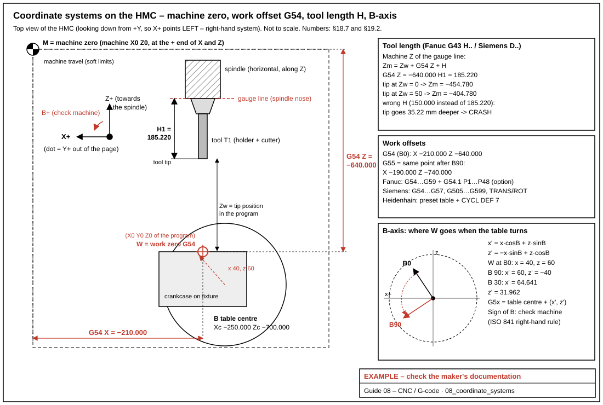
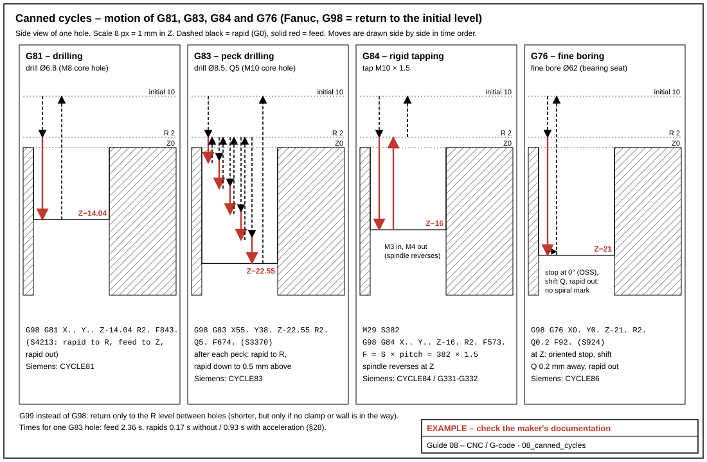
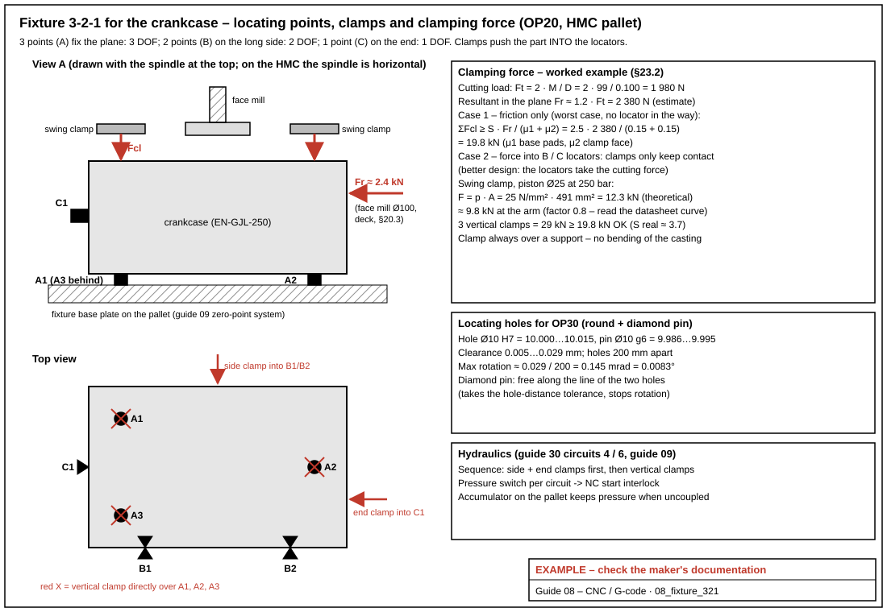

# 08 – CNC and G-code: From the Part to a Safe NC Program

> **All machine data, tool data, cutting data, programs and times in this guide are example values.**
> They come from the digital twin (`web/gcode.js`). Real cutting data comes from your tool supplier's
> catalogue. **A real NC program must always be checked by a qualified CNC programmer and proved out on the
> machine before it runs in production.**

## Contents

**Part A – the twin's CNC tab and the basic workflow**

1. Purpose
2. Where in the twin
3. Concepts, simply (G-code, modal codes, main G/M codes, offsets, CAM chain, safe start block)
4. The model in the twin: formulas and examples (machines, materials, operations, cutting data, generated programs, simulator alarms, height map, cycle time)
5. Implementing in the real factory, step by step (process chain, programming standard, presetting, post-processor, release, DNC, prove-out, tool life, MES)
6. Checklists
7. Common mistakes
8. Limits of the twin's CNC tab
10. Science principles (chip thickness, Kienzle, power, Taylor, roughness, heat, deflection and chatter, error budget)
11. Detailed manufacturing specification (materials, cutting parameters, crankcase OP20, cylinder OP10, fixture, drawing notes)
12. Identification and numbering
13. Standards
14. Complete worked example: crankcase VC20 OP20
15. Data you still need
16. Glossary

**Part B – textbook, technical reference and design guide (added Nov 2026)**

17. Design data check – spindle data (decided 2026-11-12: 10 000 rpm / 18 kW, torque curve), training vs real parts
18. G-code reference in depth (dialects Fanuc / Siemens / Heidenhain, modal groups, arcs, planes, feed modes, G41/G42 geometry, G43, work offsets G54–G59 / G54.1 / G10, canned cycles G73–G89, lathe cycles G71 / G76, macro B and R parameters, subprograms, G05.1 / CYCLE832, HMC program template)
19. The 4th axis B and tool centre point (indexing, work offset per face with worked numbers, TCP / RTCP / TRAORI, rotary feed, G93)
20. Cutting technology – formula sheet and worked examples (deck face milling, bearing seat boring, aluminium, drilling / tapping, thread milling, helical entry)
21. Tool selection (ISO 513 groups, coatings, milling cutters, drills, taps, boring tools, reamers, holders, run-out, balancing, real tool list)
22. Tool life and wear monitoring (wear forms, Taylor from two tests, economic tool life and cost per part, monitoring)
23. Fixturing (3-2-1, clamping force calculation, hydraulic fixtures, locating pins, tombstones)
24. CAM workflow, G-code simulation, DNC and program management, programming standard
25. Machining strategies (adaptive / trochoidal worked comparison, HSM, entry, climb), chatter and stability lobes
26. Probing, in-process measurement and tool setting (Renishaw / Siemens cycles, feedback calculation)
27. Surface finish and achievable tolerances
28. Cycle time from the program – worked example with acceleration, real crankcase estimate
29. Coolant, MQL and chips
30. NC program verification, first-article inspection, capability (Cpk)
31. Buy list – catalogue examples (controls, CAM, NC simulation, DNC, cutting tools, holders, presetters, probes, workholding, coolant)
32. Consolidated shopping list – tooling and software for the crankcase cell
33. Errors found and open points for the lead
34. Standards and glossary – additions for Part B

Drawings: `img/08_coordinate_systems.svg`, `08_cutter_compensation.svg`, `08_canned_cycles.svg`,
`08_cutting_forces.svg`, `08_taylor_tool_life.svg`, `08_fixture_321.svg`, `08_cam_workflow.svg`,
`08_surface_finish.svg` (embedded in Part B).

---

## 1. Purpose

The machining centres are the heart of the compressor factory: HMC-01…03 machine the crankcases, VMC-01
bores the cylinders. Each part needs an **NC program** (G-code). This guide explains:

1. **What G-code is** and how a CNC controller reads it, line by line.
2. **How the CNC tab of the twin works**: a small CAM system (you describe the part, it writes the program),
   a simulated CNC controller (it checks the program and raises alarms like a real control), and a 3D
   preview that cuts a virtual block of material.
3. **The cutting-data formulas** (spindle speed, feed, metal removal rate, cutting power) with the example
   numbers of the twin.
4. **How to do it in the real factory**: CAM → post-processor → DNC transfer → program release and
   versioning → prove-out on the machine → tool presetting → tool life management.
5. **The science and the specification** (chapters 10–15): cutting physics with numbers, a detailed
   manufacturing specification of the example parts, numbering, standards, a complete worked example from
   drawing to first-part inspection, and the list of data you still need. (Chapter 9 is not used – the
   numbering follows the common chapter plan in `00_INDEX.md`; the Glossary is chapter 16.)

Why this matters: a wrong NC program can **break a tool, scrap a casting, damage the spindle or hurt
a person**. Most crashes come from a few simple mistakes (a rapid move into the part, a wrong tool length,
a missing decimal point). If your team understands these mistakes, it can find them before the machine does.

---

## 2. Where in the twin

Tab **CNC / G-code** (`#cnc`). File: `web/gcode.js`. Everything runs in the browser; nothing is sent to the
twin server. The only server call is `GET /api/config` to read the spindle power and the twin cycle time of
the selected machine (the tab also works without it).

Screen parts:

| Part | What you do there |
|---|---|
| **Example** | Load a template: *Cylinder VC20 – OP10* (VMC-01), *Crankcase VC20 – OP20* (HMC), *Empty program* |
| **Machine / Controller / Material** | Machine VMC-01, HMC-01, HMC-02, HMC-03; controller *Fanuc / Haas (ISO)* or *Siemens Sinumerik 840D*; material GG25, AlSi9Cu3, C45 |
| **Program no. / Name / line numbers N** | Program number (O-number on Fanuc), name, N-numbers on or off |
| **1. Stock** | Raw part size W × L × H and top allowance. X0 Y0 = centre, Z0 = finished top face |
| **Tool table** | Tool number T, type, diameter D, number of teeth z, thread pitch (taps) |
| **Operations** | Face milling, rectangular pocket, circular pocket (helical), outside contour, holes (drill / tap / bore) – each with its own fields and a calculation line |
| **Cutting-data formula box** | n, F, Q, Pc and time of the selected operation, with the numbers filled in |
| **G-code listing** | Coloured program; click a line to see what every word means; edit by hand; download `.nc` / `.MPF`; copy |
| **Controller messages** | ALARM, CRASH, WARNING, INFO with line number |
| **KPIs** | Cycle time, cutting time, rapid + tool change, program size, controller check, twin cycle time |
| **3D preview** | Play / pause, step line by line, scrub bar, speed, show tool path, X-ray, fit; DRO (position display) |

Your last setup is stored in the browser (`localStorage`), only on your PC.

**Deep links** (useful for training and for screenshots):

| Parameter | Meaning | Example |
|---|---|---|
| `gctpl=cc \| cyl \| empty` | load a template | `/?gctpl=cc#cnc` |
| `gcctrl=siemens \| fanuc` | controller dialect | `/?gctpl=cc&gcctrl=siemens#cnc` |
| `gcmach=HMC-01` (VMC-01, HMC-02, HMC-03) | machine | `/?gctpl=cc&gcmach=HMC-02#cnc` |
| `gct=55` | jump to 55 % of the program time | `/?gctpl=cc&gct=55#cnc` |
| `gcline=N` | select line N and explain it | `/?gctpl=cc&gcline=12#cnc` |
| `gcplay=20` | start playing at speed 20 | `/?gctpl=cyl&gcplay=20#cnc` |

Full example: `/?gctpl=cc&gcctrl=siemens&gcmach=HMC-01&gct=55&gcline=12#cnc`

Related: in the Communication tab (guide 07), step 12 of the simulation shows how the MES sends an NC
program to HMC-02 by OPC UA file transfer.

---

## 3. Concepts, simply

### 3.1 What is G-code?

G-code (standardised as ISO 6983, with many controller dialects) is a list of **blocks** (lines). Each block
has **words**: one letter (the *address*) and a number.

```
N30 G0 G90 G54 X-114.5 Y-37.95 S1010 M3
│   │  │   │   │       │       │     └ M3  = spindle on, clockwise
│   │  │   │   │       │       └ S1010    = spindle speed 1010 rpm
│   │  │   │   └───────┴ X, Y            = target position in mm from work zero
│   │  │   └ G54                         = use work offset no. 1
│   │  └ G90                             = absolute coordinates
│   └ G0                                 = rapid move (not cutting)
└ N30                                    = line number (only a label)
```

| Address | Meaning |
|---|---|
| **N** | line number (label only) |
| **O** | program number (Fanuc); the MES / DNC calls the program by it |
| **G** | preparatory function: motion type, plane, units, offsets, cycles |
| **M** | machine function: spindle, coolant, tool change, program end |
| **X Y Z** | target position (G90) or distance (G91) |
| **I J** | arc centre, measured from the arc start point |
| **R** | arc radius, or the R level in a drilling cycle |
| **Q** | peck depth (G83) |
| **F** | feed rate in mm/min |
| **S** | spindle speed in rpm |
| **T** | tool number; **M6** puts it in the spindle |
| **H** | tool length offset number (Fanuc, with G43) |
| **D** | tool offset number (Siemens: length and radius) |
| **K** | thread pitch (Siemens G331/G332) |

### 3.2 "Modal" – the controller remembers

Most codes are **modal**: they stay active until another code of the same group changes them. That is why
many lines are short:

```
N60 G1 X114.5 F758.     ← G1 and F758 are now active
N70 Y0.                 ← still G1, still F758: straight cut to Y0
N80 X-114.5             ← still G1, still F758
```

The simulator shows, after every line, the **controller state**: motion code (G0/G1/G2/G3/G80), plane
G17, G90/G91, work offset G54, tool length G43/G49 (Siemens: D1/D0), active cycle, return level
G98/G99, F, S, T, spindle direction, coolant.

**Danger of modal codes:** if a code from an earlier program (or from manual MDI input) is still active,
your program behaves differently. That is why every program starts with a **safe start block** (3.6).

### 3.3 The most important G and M codes (as explained in the twin)

| Code | Meaning |
|---|---|
| G0 | Rapid move at full machine speed, NOT cutting. Modal. |
| G1 | Linear feed: cut in a straight line at feed F. Modal. |
| G2 / G3 | Arc clockwise / counter-clockwise. I, J = centre from the start point. With Z = helix. |
| G4 | Dwell (wait). |
| G17 | XY plane for arcs (normal for milling). |
| G21 / G71 | Millimetres (Fanuc / Siemens). |
| G28 | Return to machine home. `G91 G28 Z0.` = straight up to home. |
| G40 | Cancel cutter radius compensation. |
| G41 / G42 | Cutter radius compensation left / right (not simulated). |
| G43 H.. | Tool length compensation on: Z now means the tool **tip**. |
| G49 | Cancel tool length compensation. |
| G54 | Work offset no. 1 (the operator measures it with a probe). |
| G80 | Cancel canned (drilling) cycle. |
| G81 | Drilling: rapid to R, feed to Z, rapid out. |
| G83 | Peck drilling: drill Q mm, pull out to R, go back, repeat until Z. |
| G84 | Tapping: feed in with F = S × pitch, spindle reverses at the bottom, feed out. |
| G85 | Boring: feed in and feed out again (good bore surface). |
| G90 / G91 | Absolute / incremental coordinates. |
| G98 / G99 | After each hole return to the initial level / only to R. |
| G331 / G332 | Siemens rigid tapping in / out (K = pitch). |
| M3 / M4 / M5 | Spindle CW / CCW / stop. |
| M6 | Tool change. |
| M8 / M9 | Coolant on / off. |
| M29 | Rigid tapping mode (Fanuc, before G84). |
| M30 | Program end, rewind. |

### 3.4 Coordinates, work zero and offsets

* **Machine zero** is fixed by the machine builder.
* **Work zero (G54)** is where the program's X0 Y0 Z0 is on the part. In the twin: X0 Y0 = **centre of the
  stock**, Z0 = **finished top face**. The stock top is above Z0 by the top allowance (for example +1 mm).
* **Tool length offset (H on Fanuc, D on Siemens)**: every tool has a different length. The control adds
  the measured length, so Z in the program means the **tool tip**. Wrong or missing offset = crash or air cut.

Drawing with real numbers (machine zero, G54, tool length H, B-axis): `08_coordinate_systems.svg` in chapters
18.7 and 19.2. The full G/M-code reference (with cutter compensation, drawing `08_cutter_compensation.svg`) is
chapter 18.

### 3.5 CAM, post-processor, controller

```
Part drawing / 3D model
   → CAM: choose operations, tools, cutting data → tool path (neutral)
   → Post-processor: translate the tool path into the dialect of ONE controller (Fanuc, Siemens …)
   → NC program file (.nc, .MPF)
   → DNC transfer to the machine
   → CNC controller reads block by block, moves the axes
```

The twin's CNC tab contains a **mini version of every step**: the operation cards are the CAM, the
Fanuc/Siemens switch is the post-processor, the simulator is the controller.
The real chain with its feedback loops (probing → offsets, errors → new revision, times → MES / twin) is
chapter 24 with drawing `08_cam_workflow.svg`.

### 3.6 The safe start block

Fanuc output of the twin: `G21 G17 G40 G49 G80 G90` – mm, XY plane, no cutter compensation, no length
compensation, no cycle, absolute. Siemens output: `G17 G40 G90 G71`.

**Why:** these lines put the controller into a known state, whatever the previous program or the operator
left active. Then the tool change, then the first move with work offset, spindle and tool length:

```
N20 T1 M6
N30 G0 G90 G54 X-114.5 Y-37.95 S1010 M3      ← go to start position in XY first (high above the part)
N40 G43 H1 Z50. M8                            ← then length compensation and Z to safe height
```

---

## 4. The model in the twin: formulas and examples

### 4.1 Example machines (from `web/gcode.js`)

| Machine | Type | Max spindle | Rapid | Max feed | Spindle power | Tool change | Travel from work zero (X / Y / Z) |
|---|---|---|---|---|---|---|---|
| VMC-01 Cylinder Boring Center | vertical | 8 000 rpm | 30 m/min | 12 000 mm/min | 11 kW | 3 s | ±300 / ±200 / −350…+150 mm |
| HMC-01…03 Crankcase Machining Centers | horizontal | 10 000 rpm | 50 m/min | 20 000 mm/min | 18 kW | 2.5 s | ±365 / ±365 / −450…+200 mm |

(The spindle power is read from `run_power_kw` in `config/factory.json` when the server runs: 18 kW for the HMCs,
11 kW for VMC-01.) In the 3D view an HMC is shown with a horizontal tool axis, a VMC with a vertical one.

> **Decided 2026-11-12: one HMC spindle in all guides and in the twin – 10 000 rpm / 18 kW S1** (example values):
> constant torque **115 N·m S1** up to the base speed **1 500 rpm**, then constant power 18 kW up to 10 000 rpm;
> S6-40 % (short duty): 22 kW / 140 N·m. `web/gcode.js` now uses this torque curve for the power warning:
> P_available = min(18 kW, 115 N·m · n / 9 550). At 700 rpm only 115 · 700 / 9 550 = **8.4 kW** are available
> (chapter 17.1).

### 4.2 Example materials

| Material | kc (N/mm²) | Vc face / end mill / drill / tap / bore (m/min) | fz face / end / drill / bore (mm) |
|---|---|---|---|
| Cast iron GG25 (EN-GJL-250) | 1100 | 200 / 150 / 90 / 12 / 150 | 0.15 / 0.08 / 0.20 / 0.15 |
| Aluminium AlSi9Cu3 (die-cast) | 700 | 600 / 400 / 150 / 20 / 300 | 0.12 / 0.07 / 0.15 / 0.12 |
| Steel C45 (crankshaft steel) | 2000 | 180 / 120 / 70 / 10 / 140 | 0.12 / 0.06 / 0.12 / 0.10 |

kc = specific cutting force. These are example values for carbide tools. You can type your own Vc and fz in
each operation card; they override the table.

**Correction / warning about kc.** The twin uses **one fixed kc per material**. In reality kc depends on the
chip thickness h (Kienzle law, chapter 10.2): thin chips need a much higher kc. For the GG25 face-milling
example (h ≈ 0.1 mm) the Kienzle value is about 2 100 N/mm², not 1 100 – the twin's cutting power is
therefore **about 2 times too low** for typical finishing chip thicknesses. Use the twin's Pc only as a
lower bound and check the spindle power with chapter 10.

### 4.3 The operations (the small CAM)

| Operation | Tools allowed | Inputs | How the tool path is made |
|---|---|---|---|
| **Face milling** | face mill, end mill | depth per pass ap, step-over % of Ø | zig-zag passes over the whole stock, starting outside the part; levels from stock top down to Z0 |
| **Rectangular pocket** | end mill | centre, width, length, corner radius, top, depth, ap, ae % | plunge in the centre (plunge feed), then rounded-rectangle rings from inside to outside, level by level |
| **Circular pocket (helical)** | end mill | centre, Ø, top, depth, helix pitch = ap, ae % | enter with a **helix** (G3 with Z), one flat turn at the bottom of each level, then bigger circles outwards |
| **Outside contour** | end mill | rectangle (W, L, corner radius) or circle (Ø), top, depth, ap | lead-in from outside, climb-milling path around the part (tool centre = contour + tool radius), lead-out |
| **Holes** | twist drill, tap, boring bar | bolt circle (Ø, number, start angle) or point list, top, depth, peck Q | **G81** drill, **G83** peck drill (Q > 0), **G84** tap, **G85** bore |

Warnings the generator gives (examples from the code): wrong tool type for the operation; pocket too small
for the tool; corner radius smaller than the tool radius ("the corners will get radius R"); depth ≤ 0; stock
top allowance 0 ("nothing to face"); spindle speed limited by the machine; feed above the machine maximum;
cutting power above 80 % of the spindle power.

Drill depth includes the drill point: `tip = 0.3 × D` (118° point), so `Z = top − depth − tip`.

### 4.4 Cutting-data formulas with the twin's numbers

All examples: template **Crankcase VC20 – OP20** on **HMC-01**, material **GG25**.

**Spindle speed**

```
n = 1000 · Vc / (π · D)          [rpm]       Vc in m/min, D in mm

T1 face mill D63:  n = 1000 · 200 / (π · 63) = 1010 rpm
T2 end mill  D16:  n = 1000 · 150 / (π · 16) = 2984 rpm
T3 end mill  D12:  n = 1000 · 150 / (π · 12) = 3979 rpm
T4 drill    D8.5:  n = 1000 ·  90 / (π · 8.5) = 3370 rpm
T5 tap  M10×1.5:   n = 1000 ·  12 / (π · 10) =  382 rpm
```
If n is above the machine maximum, the twin uses the maximum and shows the real Vc = π · D · n / 1000.

**Feed**

```
Milling:  F = n · z · fz          T1: 1010 · 5 · 0.15 = 758 mm/min
                                  T2: 2984 · 4 · 0.08 = 955 mm/min
                                  T3: 3979 · 3 · 0.08 = 955 mm/min
Drilling: F = n · f               T4: 3370 · 0.20     = 674 mm/min
Tapping:  F = n · pitch           T5:  382 · 1.5      = 573 mm/min   (must be exact: 1 turn = 1 pitch)
Plunge (pockets, contour):  F_plunge = max(20, 0.3 · F)   T3: 0.3 · 955 = 287 mm/min
```

**Metal removal rate and cutting power (milling)**

```
Q  = ap · ae · F / 1000           [cm³/min]   ap, ae in mm, F in mm/min
Pc = Q · kc / 60 000              [kW]        kc in N/mm²

T1 face milling: ap = 1, ae = 0.70 · 63 = 44.1
   Q  = 1 · 44.1 · 758 / 1000   = 33.4 cm³/min
   Pc = 33.4 · 1100 / 60 000    = 0.61 kW
T2 contour (twin assumes ae = tool radius = 8): ap = 4
   Q  = 4 · 8 · 955 / 1000      = 30.6 cm³/min
   Pc = 30.6 · 1100 / 60 000    = 0.56 kW
T3 pocket: ap = 2.5, ae = 0.40 · 12 = 4.8
   Q  = 2.5 · 4.8 · 955 / 1000  = 11.5 cm³/min
   Pc = 11.5 · 1100 / 60 000    = 0.21 kW
```

**Drilling**

```
Q  = (π · D² / 4) · F / 1000      = (π · 8.5² / 4) · 674 / 1000 = 38.2 cm³/min
Pc = f · Vc · D · kc / 240 000    = 0.20 · 90 · 8.5 · 1100 / 240 000 = 0.70 kW
```

**Power check:** the twin warns if `Pc > 0.8 × available spindle power at this speed` (HMC above 1 500 rpm:
0.8 × 18 = 14.4 kW; below 1 500 rpm: 0.8 × 115 · n / 9 550). Here all
operations are far below – the example is a light finishing part. (With the Kienzle correction of chapter
10.2 the powers roughly double – T1 1.18 kW, T2 1.27 kW, drilling 1.39 kW – still far below.) Note: Pc is the power **at the cutting
edge**; the motor must also cover the losses of the spindle drive.

**Time of one operation**

```
t = (path length at feed / F) · 60  +  rapid length / rapid speed · 60  +  tool changes

Example T1 face milling: 3 passes of 229 mm (X −114.5 → +114.5) + 2 step-overs of 37.95 mm
   cutting path = 3 · 229 + 2 · 37.95 = 762.9 mm
   t_cut = 762.9 / 758 · 60 = 60.4 s
```

Second example, template **Cylinder VC20 – OP10** on VMC-01 (GG25): face mill D63 n = 1010 rpm,
F = 758 mm/min; rough bore D51.5 at Vc 120, f 0.25 → n = 742 rpm, F = 186 mm/min; finish bore D52 at Vc 180,
f 0.12 → n = 1102 rpm, F = 132 mm/min; drill D6.8 → n = 4213 rpm, F = 843 mm/min; tap M8×1.25 → n = 477 rpm,
F = 477 × 1.25 = 596.25 mm/min.

### 4.5 Generated program – Fanuc / Haas (first lines, template *cc*)

```
%
O2001 (CC VC20 OP20)
(GENERATED BY THE DIGITAL TWIN - EXAMPLE VALUES, CHECK BEFORE USE)
(MACHINE HMC-01, MATERIAL CAST IRON GG25 EN-GJL-250)
(STOCK 160 X 120 X 60 MM - WORK ZERO: X0 Y0 = STOCK CENTRE, Z0 = FINISHED TOP FACE)
N10 G21 G17 G40 G49 G80 G90               ← safe start block
(OP1 FACE MILLING TOP SURFACE - T1 FACE MILL D63)
(T1 = FACE MILL D63)
N20 T1 M6                                 ← tool change
N30 G0 G90 G54 X-114.5 Y-37.95 S1010 M3   ← start point outside the part, spindle on
N40 G43 H1 Z50. M8                        ← length offset 1, safe height Z50, coolant on
N50 Z0.                                   ← rapid down to Z0 – still OUTSIDE the part in X
N60 G1 X114.5 F758.                       ← first face pass
N70 Y0.
N80 X-114.5
N90 Y37.95
N100 X114.5
N110 G0 Z3.
(OP2 OUTSIDE CONTOUR - T2 END MILL D16)
N120 Z50.
N130 M9
N140 M5
N150 G91 G28 Z0.                          ← Z home for the tool change
N160 G90
(T2 = END MILL D16)
N170 T2 M6
N180 G0 G90 G54 X88. Y0. S2984 M3
N190 G43 H2 Z50. M8
...
```

Note how every number has a decimal point (`Z50.`, `Y0.`) – see the decimal-point alarm in 4.7.

Holes in Fanuc are canned cycles (one line per hole, from the same template):

```
N... G98 G83 X-55. Y-38. Z-22.55 R2. Q5. F674.    ← peck drill: depth 20 + tip 2.55, peck 5 mm
N... X55. Y-38.
N... X55. Y38.
N... X-55. Y38.
N... G80
...
N... M29 S382                                      ← rigid tapping mode
N... G98 G84 X-55. Y-38. Z-16. R2. F573.           ← F = S × pitch = 382 × 1.5
```

End of program: `M9`, `M5`, `G91 G28 Z0.`, `G90`, `M30`, `%`.

### 4.6 Generated program – Siemens 840D (same part)

```
%_N_CC_VC20_OP20_MPF
;$PATH=/_N_MPF_DIR
; Generated by the digital twin - EXAMPLE values, check before use
; Machine HMC-01, material Cast iron GG25 (EN-GJL-250)
; Stock 160 x 120 x 60 mm - work zero: X0 Y0 = stock centre, Z0 = finished top face
N10 G17 G40 G90 G71
; OP1 Face milling (top surface) - T1 Face mill D63
; T1 = Face mill D63
N20 T1 M6
N30 G0 G90 G54 D1 X-114.5 Y-37.95 S1010 M3        ← D1 = tool offset (instead of G43 H1)
N40 Z50 M8
...
```

Differences Fanuc ↔ Siemens in the generated code:

| Item | Fanuc / Haas | Siemens 840D (in the twin) |
|---|---|---|
| File header | `%` + `O2001 (NAME)` | `%_N_NAME_MPF` + `;$PATH=/_N_MPF_DIR` |
| File name on download | `O2001.nc` | `CC_VC20_OP20.MPF` |
| Comments | `( ... )`, upper case | `; ...` |
| Units | G21 | G71 |
| Tool length | `G43 H1` | `D1` |
| Decimal point | always written (`Z50.`) | not needed (`Z50`) |
| Tool change home | `G91 G28 Z0.` | (not written) |
| Drilling cycles | G81 / G83 / G84 / G85 canned cycles | written out **move by move**, with the comment *"a real 840D would use CYCLE81/83/84/85 here"* |
| Tapping | `M29 S..` + `G84` | `SPOS=0`, `G331 Z.. K1.5 S382`, `G332 Z.. K1.5`, then `M3 S..` |

On a real 840D a CNC programmer would normally use the Siemens standard cycles (CYCLE81, CYCLE83, CYCLE84,
CYCLE85 …) and the tool management of the machine (tool names, `T="..."`). The twin writes the moves out so
that the simulator can show every single move.

### 4.7 The simulated controller and its alarms

The simulator (`interpret()`) reads the program block by block like a real control:

1. Removes comments, reads the words (address + number).
2. Executes the non-motion words in order: F, S, T, M6 (tool change: Z goes up to home first, takes
   2.5 s or 3 s), spindle, coolant, offsets, G codes.
3. Executes the motion: rapid, feed, arc (I/J or R), canned cycle at each XY position, Siemens tapping.
4. Checks every move against the machine travel and the **height-map stock**.
5. On an **ALARM** or **CRASH** it stops: *"Program stopped at line N by the alarm above. Lines after it
   were not executed."* Lines after it are greyed.

Message levels: **ALARM** (program stops), **CRASH** (program stops – on a real machine this is damage),
**WARNING** (runs, but check), **INFO**.

Below each alarm: a small **broken example** and the message text the simulator shows. To try them, load the
template **Empty program** (VMC-01, stock 100 × 80 × 40 mm, top allowance 1 mm, tool T1 = end mill D10),
click *Edit*, replace the code with the test header below plus the broken lines, then click *Run edited code*.

```
%
O1000 (TEST)
N10 G21 G17 G40 G49 G80 G90
N20 T1 M6
N30 G0 G90 G54 X0. Y0. S3000 M3
N40 G43 H1 Z50. M8
```

**1. Feed zero** – a cutting move without F

```
N50 Z2.
N60 G1 Z-2.              ← no F programmed in this program
```
> ALARM: *PS0011 FEED ZERO: a cutting move (G1/G2/G3) needs a feed rate F. Without F the control stops
> (Fanuc-style alarm number).*

**2. Spindle off while cutting**

```
N50 M5
N60 Z2.
N70 G1 Z-2. F300.        ← cuts 3 mm of material with the spindle stopped
```
> ALARM: *The tool cuts material but the spindle is NOT turning (M3 missing or M5 active). On a real machine
> the tool breaks.*

**3. Rapid into material (crash)**

```
N50 Z-5.                 ← G0 (still modal from N30) straight down into the stock (stock top is Z+1)
```
> CRASH: *rapid move (G0) into the material. Rapid moves must stay in the air - cut with G1 and a feed, or go
> up first.*

**Important – how the simulator checks this, and why the order matters.** For every rapid move the
simulator first checks the whole path against the material **left by the earlier moves**, and only
**after** that check does it "stamp" the cutter footprint into the height map (remove material).
If it stamped first, the rapid move would remove the material along its own path, and then the check would
find no material – the crash would be invisible. The check uses small tolerances so that a tool sliding past
an already-cut edge is not a false alarm (material must be more than 0.3 mm above the tool tip, below the stock
top, inside slightly less than the tool radius).

Real-factory lesson: the same logic applies in CAM verification software – a rapid move must be checked
against the **stock at that moment**, not against the finished part.

**4. Below the part bottom**

```
N50 Z2.
N60 G1 Z-42. F200.       ← stock is 40 mm high, bottom = 1 − 40 = Z−39
```
> CRASH: *the tool goes below the bottom of the part (Z-39) into the fixture / machine table.*

**5. Over-travel**

```
N50 G0 X400.             ← VMC-01 travel X is −300 … +300 mm from work zero (example)
```
> ALARM: *Over-travel X+: X400 is outside the machine travel (-300 … 300 mm from work zero, example). The axis
> stops at the soft limit.*

**6. Arc radius error**

```
N50 Z2.
N60 G1 Z-1. F300.
N70 G2 X10. Y0. I3. J0.  ← centre (3, 0): start radius 3 mm, end radius 7 mm
```
> ALARM: *PS0020 OVER TOLERANCE OF RADIUS: start radius 3 ≠ end radius 7. Check X/Y and I/J.*

With R instead of I/J the simulator also alarms if R is too small for the distance
(*"R… is too small for this arc"*) or if R is used for a full circle (*"use I/J"*).

**7. Missing decimal point (Fanuc)**

```
N50 G1 X100 F500.
```
> WARNING: *X100 has no decimal point. Many Fanuc controls read it as X0.1 (= 0.1 mm)! Write X100. to mean
> 100 mm.*

This is a warning in the simulator because the real behaviour depends on a controller parameter. On the
real machine it is one of the most common causes of wrong positions. **Rule: on Fanuc-type controls always
write the decimal point.**

**Other warnings and alarms in the simulator** (from the code):

| Message | Why it matters |
|---|---|
| Cutting without `G43 H` (Fanuc) | control does not know the tool length: crash or air cut |
| `G43 H2` used with tool T3 | wrong H = wrong tool length = crash |
| No tool in the spindle (T.. M6 missing) | the move cuts air |
| Spindle started without S | spindle at speed 0 or the last speed |
| Tapping: F should be S × pitch | otherwise the thread is damaged |
| Rigid tapping normally needs `M29 S..` before G84 (info) | Fanuc rigid tapping |
| G83 needs Q; cycles need Z and R | cycle cannot run |
| Drilling cycle with the spindle stopped | tool breaks |
| Axis move without an active motion code (after G80) | write G0 or G1 |
| F or S above the machine maximum – limited | program not as planned |
| G18/G19, inch (G20/G70), unsupported cycles (G73, G76, G82, G86–G89) | not simulated → alarm |
| G41/G42, G95 | not simulated → warning (preview shows the programmed path) |
| G55…G59 | treated like G54 (one work zero in the simulator) |
| Same address twice in one block | the last one is used |
| No M30 at the end | control stops at the last line without rewinding |

### 4.8 The 3D height-map stock

The stock is a grid of points; each point stores the **height of the material** there. When the tool moves,
the simulator stamps a circle (flat tool bottom, radius = tool radius) at the tool tip height: every grid
point inside the circle that is higher than the tool tip is lowered to the tip height.

* Grid cell for the checks: `max(0.8 mm, max(W, L) / 150)` – for the 160 × 120 stock: 1.07 mm.
* Grid cell for the picture: `max(0.35 mm, max(W, L) / 220)` – for the 160 × 120 stock: 0.73 mm.
* Colours: dark grey = raw material, light = machined surface; blue lines = feed moves still to come, grey =
  done; dashed orange = rapid moves.
* Tool shapes: face mill, end mill, drill with 118° cone, boring bar with insert, tap, all with holder.

Limits of this method: one height per XY point – no undercuts, no side holes in an HMC part, no fixture
model, the drill cone is not cut into the material (the depth includes the tip, but the picture shows a
flat bottom).

### 4.9 Program cycle time vs twin cycle time

The KPI row shows:

| KPI | Meaning |
|---|---|
| Cycle time (program) | sum of all moves: cutting at F, rapid at the machine rapid speed (HMC 50 m/min, VMC 30 m/min) **without acceleration**, tool changes (HMC 2.5 s, VMC 3 s each), dwells |
| Cutting time | time and path length at feed |
| Rapid + tool change | non-cutting time |
| Program | number of lines and operations, dialect |
| Controller check | OK / warnings / alarms |
| Twin cycle time (MES) | the cycle time the factory twin uses for this machine and model VC20, and the program time as % of it |

Twin values (from `config/factory.json`, example): VC20 has no model-specific times, so the station times are
used: **HMC 345 s**, **VMC-01 100 s**.

```
program share = program cycle time / twin cycle time · 100 %
```

**How to read it.** The templates are **simplified** parts (one operation group). The real crankcase needs
many more operations on several sides (the HMC rotary table turns the part). If the program share is small,
that is expected. In the real project use this comparison the other way round: when the real CAM programs
exist, put their **real** cycle times (from the prove-out, see chapter 5) into the twin configuration, and the
twin will show if the FMS cell still reaches the planned output. Remember that real cycle times are longer
than "no acceleration" calculations – typically by several percent, more for programs with many short moves.

---

## 5. Implementing in the real factory, step by step

### Step 1 – Decide the CNC process chain

```
3D model + drawing (with tolerances)
  → process plan (operations, clamping, tools)          [manufacturing engineer]
  → CAM programming + simulation with machine model     [CNC programmer]
  → post-processor (one per machine/controller type)    [CAM supplier / machine builder]
  → NC program file
  → program release (PDM / DNC server)                  [CNC programmer + quality]
  → DNC transfer to the machine                          [automatic, MES-triggered]
  → prove-out on the machine                             [setter + programmer]
  → series production with tool life management          [operator + tool room]
```

Points to decide early:

1. **One CAM system** for all machines, if possible.
2. **A verified post-processor per machine type** (HMC with controller X, VMC with controller Y). A
   post-processor must know the machine: axes, rotary table, tool change position, cycles, options.
   Buy it from the CAM supplier or the machine builder and **test it** (Step 4).
3. **Machine simulation in CAM** with the real machine model, fixture and clamps. The twin simulator checks
   only the stock; real collisions with fixtures, the spindle nose, the rotary table and the pallet are the
   most expensive crashes.
4. **Same controller family on the same machine type** keeps programs, training and spare parts simple.

### Step 2 – Write a programming standard

A written standard makes every program look the same, so every setter can read it. Example content:

* **Program number scheme**, e.g. `O2001` = crankcase VC20 OP20 in the twin. The project scheme of guide 15
  is `O<product><part><op/10>` → the same program is **`O2102`** in the real factory (chapter 12).
  Program name in the first comment.
* **Header comment**: part number, drawing revision, operation, machine, material, fixture, programmer, date,
  program revision.
* **Work zero definition** (where is G54 on the part, which probe cycle sets it).
* **Safe start block** at program start **and after every tool change** (the twin writes the start block once;
  many companies repeat the modal resets with each tool).
* **Tool change sequence**: retract Z, M9, M5, home, T.. M6, first XY move with G54, spindle, then G43 H.. Z
  safe height, coolant.
* **H number = T number** (the twin warns when they differ).
* **Clearance heights**: safe height (twin: 50 mm, or stock top + 20 mm), R level (twin: top + 2 mm), initial
  level for G98 (twin: top + 10 mm).
* **Decimal point always** on Fanuc-type controls.
* **Optional stop (M1)** after each tool for prove-out; **M30** at the end.
* **No hand-edited code in production** without a new revision (Step 5).

### Step 3 – Tool presetting

Every tool is measured **outside the machine** on a tool presetter (length and radius). Steps:

1. Assemble tool + holder; check run-out.
2. Measure length (and radius for milling cutters, boring bars) on the presetter.
3. Transfer the values to the machine: by network (presetter → DNC/tool server → controller), by an
   ID chip/RFID on the holder, or (least preferred) by typing. **Typing errors are a common crash cause**, so
   automatic transfer is strongly recommended.
4. On the machine the values go into the tool offset table: **H** (length) and **D** (radius) for Fanuc;
   **D** (tool edge data) for Siemens.
5. Verify the first time: touch-off or tool-setter probe in the machine, compare with the preset value.

Tool list per program: tool number, description, holder, length range, preset values, magazine pocket.
In the twin each HMC magazine holds the tool sets of **2 models**; the third model costs a **10-minute
tool-set exchange** (example, `tool_magazine.load_s = 600`). Plan presetting so that the next tool set is
ready **before** the changeover starts.

### Step 4 – Verify the post-processor

Before the first real part, test the post-processor with a **test program**:

1. Simple moves in all axes (+ and −), check direction and sign on the machine (dry run, in the air).
2. Arcs G2/G3 in all quadrants, helix.
3. Every canned cycle you use (drill, peck, tap, bore) – check R level, depth and return level.
4. Tool change, tool length offset, work offsets.
5. Rotary table moves (HMC) – direction and angle.
6. Compare the post output with your programming standard line by line.

Keep the test program; repeat it after every post-processor or controller software update.

### Step 5 – Program release and versioning

An NC program is a **controlled document**, like a drawing.

| Status | Who | Where | May run in production? |
|---|---|---|---|
| Draft | CNC programmer | CAM / DNC "work" folder | no |
| Prove-out | programmer + setter | DNC "test" folder, sent to one machine | only under prove-out rules (Step 6) |
| Released | programmer + quality approve | DNC "released" folder, read-only | yes |
| Blocked / obsolete | quality | archive | no |

Rules:

1. **Every change = new revision** (number in the file header comment and in the DNC database), with a reason.
2. **Changes made at the machine** (e.g. a feed change during prove-out) must be **sent back** to the DNC
   server and to the CAM model. Otherwise the next download overwrites the correction – or the CAM program
   is different from what runs.
3. **Compare** the program in the machine with the released file regularly (DNC "compare" function or a
   checksum).
4. **Link** program revision ↔ part number ↔ drawing revision ↔ fixture. The MES can then record which program
   revision made which serial number (traceability).

### Step 6 – DNC transfer

DNC (Distributed Numerical Control) = the server that stores programs and sends them to the machines.

| Method | When | Notes |
|---|---|---|
| Ethernet file transfer to the controller memory (FTP / shared folder / controller software) | modern controls | most common |
| OPC UA file transfer (FileType: Open → Write → Close) | when the controller supports it | the twin's Communication step 12 shows the messages |
| Drip-feed over RS-232 | very old controls, very long programs | slow; cable and baud settings must match |
| USB stick / memory card | emergency only | no version control; avoid in production |

MES integration (as in the twin): the MES knows which model comes next; it requests the right program
**revision** from the DNC server, sends it to the machine and sets the active program
(example: `Write HMC-02.ActiveProgram = "O1020"`). The machine reports back the active program and
revision, and the MES checks it before the part starts.

### Step 7 – Prove-out on the real machine

Use this sequence for **every new program and every changed program**. The twin simulator is a good first
check (Step 0), but it does **not** replace the prove-out.

0. **Desk check:** CAM machine simulation without collisions; simulator in the twin (or the controller's own
   graphic simulation) without alarms; programming standard checked; tool list complete.
1. **Setup check:** fixture correct, part clamped, **work offset G54 measured** (probe), all tools preset and
   offsets loaded, H/D numbers match the tool list, coolant, chips cleared.
2. **Graphic simulation on the control** (if available), with the real offsets.
3. **Dry run in the air:** shift the work offset in Z upwards (for example +50 mm, in a way your company
   defines and the setter documents) or run with no part, rapid override low (for example 25 %).
   Watch every tool change and every approach.
4. **Single block:** run the first part with **single block** on, the hand on **feed hold**, rapid override
   and feed override low. Before pressing Cycle Start for each block, read the **distance-to-go** display:
   does the remaining move match what you expect?
5. **First approach to the material:** slow down near the surface (feed override 10–25 %), check the real
   position against the program.
6. **First cut:** increase feed override step by step to 100 % while listening (chatter) and watching the
   spindle load.
7. **First-part inspection:** measure the first part completely (CMM or gauges) against the drawing. Correct
   wear offsets (not the program) for small size errors. Only change the program for real errors – and then
   go back to Step 5 (new revision).
8. **Record the real cycle time**, spindle load per tool, and any changes. Update the twin configuration
   with the real cycle time.
9. **Release:** quality signs the first-part report; the program status becomes *Released*.

Safety rules during prove-out:

* Only trained setters. Doors closed. Nobody inside the machine guard.
* **Never bypass** door interlocks or safety functions for a prove-out.
* Know where the **emergency stop** and **feed hold** are – hand near them.
* One person at the control, one person responsible for the decision to continue.

### Step 8 – Tool life management

1. **Define tool life** for each tool: number of parts, minutes in cut, or metres of path (start values from
   the tool supplier, then from your own experience).
2. **Use the controller's tool life function** (counter per tool, pre-warning, end of life).
3. **Sister tools:** a second identical tool in the magazine; at end of life the control switches
   automatically.
4. **Breakage detection:** tool-setter probe or laser after critical small tools (drills, taps), or spindle
   load monitoring.
5. **Feedback to the twin / MES:** report tool changes and tool life to the MES. Example from the twin:
   `tool_wear_per_part_pct = 0.45` for the HMCs means one tool reaches 100 % wear after about
   `100 / 0.45 ≈ 222` parts (example value).
6. **Tool room planning:** tools to regrind or replace per shift = parts per shift / tool life.

### Step 9 – Connect the machines to MES and twin

* Machine state, active program, part counter, spindle load, alarms: OPC UA (for example OPC UA for Machine
  Tools) or MTConnect, see guide 07.
* Program download: DNC / OPC UA file transfer, triggered by the MES.
* Feed the real cycle times and tool life data back into the twin to keep the capacity model correct.

---

## 6. Checklists

### 6.1 Program checklist (before the first run)

- [ ] Correct part number, drawing revision, operation, machine in the header.
- [ ] Safe start block (G21/G71, G17, G40, G49, G80, G90 or the company standard).
- [ ] Every tool change: retract, M9, M5, home, T.. M6, G54 XY, S.. M3, G43 H.. (H = T) / D1, safe Z, M8.
- [ ] All tools in the tool list with preset values; H/D numbers match.
- [ ] Spindle speed and feed within the machine limits; tapping F = S × pitch.
- [ ] Cutting power below about 80 % of the spindle power (twin warning rule).
- [ ] Rapid moves only in the air; approach heights correct (safe height, R level, initial level).
- [ ] Deepest Z above the fixture / table; all positions inside the travel.
- [ ] Arcs checked (start radius = end radius).
- [ ] Decimal points on all coordinates (Fanuc-type controls).
- [ ] M30 at the end.
- [ ] CAM machine simulation and controller/twin simulation without alarms.

### 6.2 Prove-out checklist

- [ ] Fixture and part clamped, G54 measured and recorded.
- [ ] Tool offsets loaded and checked (first tool touch-off or probe).
- [ ] Graphic simulation on the control.
- [ ] Dry run in the air with low rapid override.
- [ ] Single block, feed hold ready, distance-to-go checked.
- [ ] Feed override increased step by step.
- [ ] First part measured completely; report signed.
- [ ] Real cycle time and spindle loads recorded.
- [ ] Changes sent back to DNC/CAM, new revision, released.

### 6.3 Factory setup checklist

- [ ] Programming standard written and trained.
- [ ] Post-processor per machine type tested with the test program.
- [ ] DNC server with folders Draft / Test / Released / Archive and access rights.
- [ ] Tool presetter with automatic data transfer.
- [ ] Tool life limits and sister tools defined.
- [ ] MES ↔ DNC ↔ machine program selection tested (right revision for the right model).
- [ ] Backups of all controller parameters and programs.

---

## 7. Common mistakes

| Mistake | What happens | How to avoid it |
|---|---|---|
| Rapid move (G0) into the part | crash, broken tool, spindle damage | approach above the part, then G1; CAM/twin simulation |
| Missing decimal point on Fanuc (`X100`) | axis goes to 0.1 mm instead of 100 mm | always write `X100.`; post-processor setting |
| No G43 H or wrong H number | control uses wrong tool length → crash or air cut | H = T rule; check the tool list |
| Spindle off (M5) or no M3 before cutting | tool breaks | start block per tool; simulator alarm |
| Feed F missing in the first G1 | alarm (or last feed from an old program!) | feed in the first cutting block of every tool |
| Tapping feed not equal to S × pitch | thread damaged, tap breaks | F = n · pitch; rigid tapping (M29 / G331) |
| Old modal state from MDI or previous program | unexpected incremental move, active cycle | safe start block |
| Z deeper than the part bottom | tool cuts fixture / table | check deepest Z; drill tip 0.3 × D included |
| Arc end point does not match centre | radius alarm on the control | let CAM write arcs; check I/J |
| Corrections made at the machine but not returned to DNC | next download brings the old error back | revision rule; DNC compare |
| Typing tool offsets by hand | wrong length/radius | automatic presetter transfer |
| Wrong program revision for the model | scrap series | MES checks program + revision before start |
| Prove-out at 100 % feed and rapid | no time to react | single block, low overrides |
| Cycle time from CAM without acceleration | capacity too optimistic | measure real cycle time; update the twin |
| Trusting a simulator that has no fixture model | collision with clamps | full machine simulation in CAM |

---

## 8. Limits of the twin's CNC tab

* **Example data only:** machines, tools, materials (Vc, fz, kc) and limits are examples.
* **3 axes, XY plane only.** No rotary table (B-axis) of the HMC, no multi-side machining, no G18/G19.
* **No cutter radius compensation** (G41/G42 are only warned; the preview shows the programmed path).
* **One work offset** (G55–G59 treated like G54); no inch programs; G95 feed per revolution not simulated.
* **Canned cycles:** only G81, G83, G84, G85 (Fanuc). On Siemens the cycles are written out move by move;
  real Siemens CYCLE81…85 and tool management are not used.
* **Height-map stock:** one height per XY point – no undercuts, no side features, flat tool bottom, no drill
  cone in the material. No fixture, clamp, spindle-nose or machine collision check.
* **Times without acceleration and jerk**; tool change time fixed; no pallet change, no probing time.
* **Cutting power** is a simple estimate (no tool wear, no edge geometry, no spindle efficiency).
* **The generator is not a real CAM system:** no rest machining, no adaptive/trochoidal paths, no
  finishing allowance strategy, no tool deflection check.
* **The simulator is not a real controller:** real controls have many more alarms, parameters and options.
  A program without alarms in the twin can still be wrong on the machine.
* **Physics not modelled:** one fixed kc (no Kienzle chip-thickness effect, power about 2 × too low for thin
  chips), no tool life (Taylor), no surface roughness, no tool deflection, no chatter, no thermal growth.
  Chapter 10 shows how to check these by hand.

---

## 10. Science principles

The formulas of chapter 4 (n, F, Q, Pc) are bookkeeping. This chapter explains the **physics** behind
cutting, so you can judge cutting data, tools, fixtures and accuracy yourself. Generic tables are in
`14_engineering_reference_data.md`; values for our parts are given here.

### 10.1 Chip formation and chip thickness

The cutting edge pushes the material until it **shears** off along a thin shear plane and slides up the
rake face as a chip. Almost all cutting energy becomes **heat** (shear zone + friction on the rake face).

| Material | Chip type | What it means |
|---|---|---|
| Steel C45, 16MnCr5, 42CrMo4 | continuous (long) chip | needs a chip breaker geometry and feed high enough to break chips |
| Hardened / high-strength steel | segmented chip | high, pulsing forces |
| Grey cast iron EN-GJL | discontinuous (short, crumbly) – graphite flakes break the chip | easy chips, but dust; abrasive wear |
| Aluminium AlSi | continuous, sticky | built-up edge at low vc → use high vc, sharp positive edges, polished tools |

The **chip thickness h** decides the force per mm of edge. It is not the feed:

| Process | Formula | Example |
|---|---|---|
| Turning, face milling (cutter centred, ae ≥ ≈ 0.5·D) | h ≈ f · sin κ (turning) / h ≈ fz · sin κ | face mill κ = 45°, fz = 0.15 → h ≈ 0.106 mm |
| Side milling with small ae (exact mean value) | hm = 360 · sin κ · ae · fz / (π · D · φs), φs = arccos(1 − 2·ae/D) in degrees | end mill D16, κ 90°, ae 1.6 (10 %), fz 0.08: φs = 36.9°, hm = 46.08 / 1 853 = **0.025 mm** |
| Approximation for ae/D ≤ 0.3 | hm ≈ fz · √(ae/D) | 0.08 · √0.1 = 0.025 mm |

**Chip thinning:** with small ae the chip is much thinner than fz. If h becomes smaller than the edge
radius (≈ 0.02–0.05 mm for coated carbide) the edge **rubs** instead of cutting → heat, wear, bad surface.
Rule: for small ae increase fz so that hm reaches the value the supplier recommends (example: hm 0.05 mm
at ae 10 % → fz ≈ 0.16 mm).

### 10.2 Specific cutting force – the Kienzle law

```
kc = kc1.1 · h^(−mc)        [N/mm²]     h in mm
Fc = kc · b · h = kc1.1 · b · h^(1 − mc)   b = width of cut (turning: b = ap / sin κ, so b·h = ap·f)
```

kc1.1 = specific cutting force at h = 1 mm and b = 1 mm; mc = slope (thin chips need more force per mm²).

| Material | kc1.1 (N/mm²) | mc | kc at h = 0.1 mm | kc at h = 0.3 mm |
|---|---|---|---|---|
| C45 (normalised, ≈ 600–650 MPa) | ≈ 1 450–1 500 | ≈ 0.25–0.27 | ≈ 2 600–2 800 | ≈ 2 000 |
| 42CrMo4 (QT, ≈ 1 000 MPa) | ≈ 1 550–1 800 | ≈ 0.21–0.26 | ≈ 2 800–3 200 | ≈ 2 200–2 400 |
| 16MnCr5 (+FP) | ≈ 1 400 | ≈ 0.30 | ≈ 2 800 | ≈ 2 000 |
| EN-GJL-250 (GG25) | ≈ 1 100–1 150 | ≈ 0.25–0.28 | ≈ 2 000–2 100 | ≈ 1 500–1 600 |
| AlSi9Cu3 (die cast) | ≈ 650–800 | ≈ 0.25 | ≈ 1 150–1 400 | ≈ 900–1 000 |

These are **typical textbook / catalogue values** (sources differ by about ±15 %). Corrections: about
−1 to −1.5 % per degree more rake angle; worn tool **+20 to +40 %**; low vc higher. Use the tool supplier's
values when you have them.

### 10.3 Cutting force, power and torque

| Quantity | Formula | Units |
|---|---|---|
| Cutting force (turning) | Fc = kc · ap · f | N |
| Cutting power | Pc = Fc · vc / 60 000 | kW (Fc in N, vc in m/min) |
| Milling power | Pc = ap · ae · vf · kc / (60 · 10⁶) = Q · kc / 60 000 | kW (Q in cm³/min) |
| Spindle torque | M = Pc · 9 550 / n | N·m (Pc in kW, n in rpm) |
| Motor power needed | P_motor = Pc / η, η ≈ 0.75–0.85 | kW |
| Feed force / passive force | roughly 0.3–0.6 · Fc (depends on κ, wear) | N – needed for fixture design |

The twin's crankcase OP20 with Kienzle (GG25, kc1.1 = 1 150, mc = 0.26):

| Tool | Chip thickness | kc | Q (from 4.4) | Pc Kienzle | Pc twin | Torque |
|---|---|---|---|---|---|---|
| T1 face mill D63, κ 45°, ae 44.1, fz 0.15 | φs = 2·arcsin(44.1/63) = 88.9° → hm = 360·0.707·44.1·0.15 / (π·63·88.9) = 0.096 mm | 2 116 N/mm² | 33.4 cm³/min | **1.18 kW** | 0.61 kW | 1.18 · 9 550 / 1 010 = **11.2 N·m** |
| T2 end mill D16 contour, ae 8, fz 0.08 | φs = 90° → hm = 360·8·0.08 / (π·16·90) = 0.051 mm | 2 494 N/mm² | 30.6 | **1.27 kW** | 0.56 kW | 4.1 N·m |
| T3 end mill D12 pocket, ae 4.8 | φs = 78.5° → hm = 0.047 mm | 2 551 N/mm² | 11.5 | **0.49 kW** | 0.21 kW | 1.2 N·m |
| T4 drill D8.5, f 0.20, point 118° | h = f/2 · sin 59° = 0.086 mm | 2 178 N/mm² | – | Pc = f·vc·D·kc / 240 000 = **1.39 kW** | 0.70 kW | **3.9 N·m** |

Example turning (worm, guide 12, 14.3): 16MnCr5, ap 2, f 0.3, vc 200, κ 95° → h = 0.299 mm,
kc = 1 400 · 0.299^−0.30 = 2 010 N/mm², Fc = 2 010 · 2 · 0.3 = 1 206 N, Pc = 4.0 kW, torque at Ø65 = 39 N·m.

### 10.4 Tool life – Taylor's law v · T^n = C

Tool wear grows much faster than the cutting speed. Taylor found a straight line in a log–log plot:

```
vc · T^n = C        T = tool life in minutes in cut
```

| Tool material | n (typical) |
|---|---|
| HSS | 0.10–0.15 |
| Carbide (coated) | 0.20–0.30 |
| Ceramics, CBN | ≈ 0.4–0.7 |

Example (carbide, n = 0.25): a test gives T = 15 min at vc = 200 m/min → C = 200 · 15^0.25 = **393.6**.

| vc (m/min) | T = (C / vc)^(1/n) | Change |
|---|---|---|
| 160 | (393.6/160)⁴ = **36.6 min** | −20 % speed → 2.4 × life |
| 200 | 15 min | reference |
| 250 | (393.6/250)⁴ = **6.1 min** | +25 % speed → only 41 % of the life |

**Economic tool life** (classic Taylor economics): T_econ = (1/n − 1) · (t_change + K_edge / K_machine).
Example: n = 0.25, edge change 1 min, edge cost 6 $, machine rate 1.5 $/min (90 $/h, example) →
T_econ = 3 · (1 + 4) = **15 min**. Expensive machine → shorter tool life (faster cutting) pays; expensive
tools → slower cutting. In production you then set the tool life counter (chapter 5, Step 8) in parts:
T / cutting time per part. (Corrected Nov 2026: the old text said "guide 08 Step 8" although this is guide 08.
Worked example with test data, economic speed and a cost table: chapter 22, drawing `08_taylor_tool_life.svg`.)

### 10.5 Surface roughness – Rth = f² / (8 · r)

A turning or boring insert with corner radius r leaves scallops with the height:

```
Rth = f² / (8 · r)        (theoretical peak-to-valley, ≈ Rz)        Ra ≈ Rth / 4
```

| Rth in µm | f = 0.10 | f = 0.15 | f = 0.20 | f = 0.30 mm |
|---|---|---|---|---|
| r = 0.4 mm | 3.1 | 7.0 | 12.5 | 28.1 |
| r = 0.8 mm | 1.6 | 3.5 | 6.3 | 14.1 |
| r = 1.2 mm | 1.0 | 2.3 | 4.2 | 9.4 |

Inverse use: required Ra 0.8 → Rth ≈ 3.2 µm → with r = 0.8: f = √(8 · r · Rth) = √(8 · 0.8 · 0.0032)
= **0.14 mm**. Example cylinder bore (11.4): fine boring f = 0.12, r = 0.8 → Rth = 2.25 µm, Ra ≈ 0.56 µm ✓;
with r = 0.4 → Ra ≈ 1.1 µm ✗. Real roughness is higher than Rth with vibration, built-up edge, worn
edges or too small feeds (rubbing). Wiper inserts allow about 2 × feed for the same Ra.
Ball-nose scallops, achievable Ra / IT per operation and drawing `08_surface_finish.svg`: chapter 27.

### 10.6 Heat and thermal effects

In dry steel turning roughly 75–80 % of the heat leaves with the chip, 10–20 % goes into the tool and
5–10 % into the part (typical figures). Rake face temperatures of 600–1 000 °C are normal at high vc –
this drives crater and diffusion wear (Taylor). For accuracy the **part, machine and tool growth** matter:

| Example | ΔL = α · L · ΔT | Result |
|---|---|---|
| Cast iron crankcase 160 mm, 8 K warm after dry machining | 10.5·10⁻⁶ · 160 · 8 | **13 µm** |
| Aluminium part 300 mm, 5 K warm | 23·10⁻⁶ · 300 · 5 | **35 µm** |
| Spindle growth during warm-up (typical, measure your machine) | – | 10–30 µm in Z |

Consequences: measure at 20 °C (ISO 1) or correct for temperature; warm-up programme before precision
work; constant coolant temperature; for tight tolerances finish after the part has cooled, or probe
in-process.

### 10.7 Stiffness, deflection and chatter

**Static deflection** of an end mill (cantilever): δ = F · L³ / (3 · E · I), I = π · d_e⁴ / 64 with the
effective core diameter d_e ≈ 0.8 · D for a fluted cutter.

Example: D16 solid carbide (E ≈ 600 000 N/mm²), d_e = 12.8 mm → I = 1 318 mm⁴; overhang L = 50 mm;
radial force F ≈ 500 N (contour T2, from Pc: Fc = 1 270 · 60 / 150 ≈ 510 N):
δ = 500 · 50³ / (3 · 600 000 · 1 318) = **0.026 mm**. Overhang 60 mm → (60/50)³ = 1.73 × → 0.046 mm.
A steel extension (E = 210 000) would bend 2.9 × more. **Overhang is cubed – keep it short.** In
climb milling of an outside contour the tool bends away from the wall → the part becomes **too big**
(worked example 14.6).

**Chatter (regenerative vibration):** the tool vibrates, leaves a wavy surface, and the next tooth cuts
that wave again → the vibration grows. For one dominant vibration mode (stiffness k, damping ratio ζ),
the depth of cut that is stable at **every** spindle speed is approximately

```
b_lim ≈ 2 · k · ζ · (1 + ζ) / Ks          Ks = specific cutting force ≈ kc
```

Example: k = 20 N/µm = 2·10⁷ N/m, ζ = 0.03, Ks = 2 000 N/mm² = 2·10⁹ N/m² →
b_lim = 2 · 2·10⁷ · 0.03 · 1.03 / 2·10⁹ = 6.2·10⁻⁴ m ≈ **0.6 mm** (single edge, simple orientation).
Above this, chatter appears at some speeds; between the "stability lobes" (when the tooth-passing frequency
is close to the natural frequency divided by an integer) much larger depths are stable.
Practical cures: shorter overhang, stiffer holder (shrink-fit, HSK), change the spindle speed by 10–20 %
(towards a stable lobe), smaller ap/ae, variable-pitch cutters, better clamping / damping.

### 10.8 Accuracy chain (error budget)

A feature position on the part is the sum of many small errors. If they are independent, add them by
**root-sum-square (RSS)**; the worst case is the plain sum.

Example: position tolerance Ø0.02 (radius 10 µm) for the M10 holes relative to the bore on an HMC:

| Error source | µm (example) |
|---|---|
| Machine positioning (ISO 230-2 A value over the short distance) | 4 |
| Thermal drift of machine and part | 4 |
| Pallet / zero-point repeatability (guide 09) | 3 |
| Fixture + clamping deformation | 3 |
| Tool deflection + wear | 3 |
| Work-offset probing (G54) | 2 |
| **RSS** = √(16 + 16 + 9 + 9 + 9 + 4) | **7.9 µm** ≤ 10 ✓ |
| Worst case sum | 19 µm ✗ |

Meaning: the process normally meets the tolerance, but not with all errors at the limit at the same time
→ first-part inspection and SPC are needed. Measuring rules (10:1 rule, gauge R&R, decision rules with
uncertainty, Abbe principle) are explained in guide 12, chapter 10.9–10.10; the same rules apply to CNC
parts. Example: Ø52 H7 bore (T = 30 µm) → gauge resolution ≤ 3 µm (bore gauge 1 µm or air plug).

---

## 11. Detailed manufacturing specification

The two twin templates are **simplified** compressor parts. Below they are written as an **example
specification** that you can transfer to a drawing. The compressor designer must approve every value
(gasket faces, bore finish and the piston/ring design decide the real numbers). General tolerances:
ISO 2768-mK (example). Large generic tables: `14_engineering_reference_data.md`.

### 11.1 Materials of the machined compressor parts

| Part | Material | No. | Standard | Rm (MPa) | Rp0.2 (MPa) | Hardness | Note |
|---|---|---|---|---|---|---|---|
| Crankcase, cylinder (twin "GG25") | EN-GJL-250 | EN-JL1040 | EN 1561 | ≥ 250 (separately cast test bar; lower in thick walls) | – (no yield) | ≈ 180–230 HB, depends on wall thickness – agree with foundry | good damping, short chips |
| Alternative die-cast part | EN AC-AlSi9Cu3(Fe) | EN AC-46000 | EN 1706 | ≈ 240 (die cast, typical min.) | ≈ 140 | ≈ 80 HB | check the EN 1706 table |
| Crankshaft (twin "C45") | C45+QT | 1.0503 | EN 10083-2 | 650–800 (16 < d ≤ 40) | ≥ 430 | ≈ 200–240 HB | or 42CrMo4+QT for higher load |
| Crankshaft, high load | 42CrMo4+QT | 1.7225 | EN 10083-3 | 1 000–1 200 (16 < d ≤ 40) | ≥ 750 | ≈ 300–360 HB | |
| Fixture plates | S355J2 or C45 | 1.0577 / 1.0503 | EN 10025-2 / EN 10083-2 | ≥ 470 / see above | ≥ 355 | – | stress relieve welded fixtures |
| Locating pins / rest pads | 16MnCr5 case hardened or 100Cr6 | 1.7131 / 1.3505 | EN 10084 / ISO 683-17 | – | – | 58–62 HRC | replaceable wear parts |

Order castings and bars with a 3.1 certificate (EN 10204).

### 11.2 Machining parameters (example starting values, coated carbide; your tool supplier decides)

| Material (ISO group) | Face milling vc / fz / ap | End milling (side) vc / fz / ae | Drilling (carbide) vc / f | Tapping vc | Fine boring vc / f / ap |
|---|---|---|---|---|---|
| EN-GJL-250 (K) | 200–250 / 0.15–0.25 / 1–4 (finish 0.3–0.5) | 150–200 / 0.06–0.10 / ≤ 0.5·D | 80–110 / 0.20–0.30 | 10–15 | 150–200 / 0.08–0.15 / 0.1–0.3 |
| AlSi9Cu3 (N) | 500–1 500 / 0.10–0.20 / 1–4 | 300–800 / 0.05–0.12 | 150–250 / 0.15–0.30 | 15–25 | 300–600 / 0.05–0.12 / 0.1–0.3 |
| C45+N / 16MnCr5+FP (P) | 180–250 / 0.12–0.20 / 1–3 | 120–180 / 0.05–0.08 | 70–100 / 0.12–0.20 | 8–12 | 140–200 / 0.06–0.12 / 0.1–0.3 |
| 42CrMo4+QT ≈ 1 000 MPa (P) | 120–180 / 0.10–0.18 / 1–3 | 90–140 / 0.04–0.07 | 50–80 / 0.10–0.18 | 5–8 | 100–150 / 0.05–0.10 / 0.1–0.2 |

The twin's values (4.2) are inside these ranges. Remember chip thinning (10.1): the fz values are for
ae ≥ 0.5·D; with smaller ae raise fz.

### 11.3 Crankcase VC20 – OP20 (template *cc*): drawing VC-PRD-CC-0020-C, program O2102

Features as in the twin template (stock 160 × 120 × 60, work zero = stock centre, Z0 = finished top face):

| No. | Feature | Specification (example) | Numeric limits | Method / gauge | Frequency |
|---|---|---|---|---|---|
| 1 | Top face (datum A) | flatness 0.03; Ra ≤ 3.2 (gasket face: Ra per gasket maker, often 1.6–3.2) | – | CMM or surface plate + dial gauge; roughness tester | first part, then 1/shift |
| 2 | Outside contour 140 × 100, R10 | 140 ±0.05 / 100 ±0.05; depth 12 ±0.1 | 139.95–140.05 / 99.95–100.05 | micrometer / caliper 0.01 (10:1 rule: T = 0.10 → resolution ≤ 0.01) | first part, 1/20 |
| 3 | Pocket 80 × 50, R8 | 80 +0.1/0, 50 +0.1/0; depth 10 ±0.05 | 80.00–80.10 / 50.00–50.10 | inside micrometer / CMM; depth gauge | first part, 1/20 |
| 4 | Bore Ø36 (helical milled), datum B | Ø36 H8; ⟂ to A 0.02 | 36.000–36.039 | bore gauge 0.001 / air plug | first part, 1/10 |
| 5 | 4 × M10 at (±55, ±38) | M10-6H, full thread depth ≥ 16; drill Ø8.5 depth 20 + point; position Ø0.2 to A, B | – | thread plug gauge GO/NO-GO (ISO 1502 gauges); CMM for position | GO/NO-GO 100 % first lot, then 1/10 |
| 6 | Edges | ISO 13715: external −0.2…−0.5, no burrs; thread entry countersink 90° × Ø11 | – | visual | 100 % |
| 7 | Cleanliness | no chips in threads / pockets | – | visual, washer | 100 % |

Machining parameters for this part = the twin values (4.4) with the Kienzle powers of 10.3.

**Tool list – O2102 (tool numbers per guide 15, `T<family><nnn>`; examples):**

| Pocket in program | Tool no. | Description | Holder (HMC: check your spindle interface, e.g. HSK-A63 or SK40) | Ø / z | vc / fz |
|---|---|---|---|---|---|
| T1 | T3063 | Face mill Ø63, 45°, 5 inserts, K grade (ISO 513 K10–K20) | arbor | 63 / 5 | 200 / 0.15 |
| T2 | T2016 | Solid carbide end mill Ø16, 4 flutes | shrink-fit chuck, overhang ≤ 50 mm | 16 / 4 | 150 / 0.08 |
| T3 | T2012 | Solid carbide end mill Ø12, 3 flutes | shrink-fit chuck | 12 / 3 | 150 / 0.08 |
| T4 | T1085 | Carbide drill Ø8.5, internal coolant | hydraulic / shrink chuck | 8.5 / 2 | 90 / 0.20 |
| T5 | T4010 | Machine tap M10 – 6H, for cast iron (straight flute) | tapping chuck / rigid | 10 / – | 12 / pitch 1.5 |

In the program the **pocket / T word** is a magazine position; the **tool number** (T3063 …) is the
identity in tool management (random tool change, guide 15).

### 11.4 Cylinder VC20 – OP10 (template *cyl*): drawing VC-PRD-CYL-0020-A (example), program O2201

> **Note:** Ø52 is a simplified training bore of the twin's CNC template. The thermodynamic sizing in
> [guide 13 §4](13_real_factory_roadmap.md) gives a real VC20 bore of about **Ø75 mm** (stroke 50 mm, 2 cylinders, 1150 rpm, 20.3 m³/h).
> The method below (tolerances, cutting data, gauges) is the same – scale the tools and gauges to the real bore.

| No. | Feature | Specification (example) | Numeric limits | Method / gauge |
|---|---|---|---|---|
| 1 | Top face (datum A) | flatness 0.02; Ra ≤ 1.6 | – | CMM / surface plate; roughness tester |
| 2 | Cylinder bore Ø52 (datum B) | Ø52 H7 after fine boring; cylindricity 0.010; ⟂ to A 0.02; Ra ≤ 0.8 (if the design asks for honing: honing allowance and plateau-honed profile per piston/ring supplier) | 52.000–52.030 | air plug or bore gauge 0.001 with setting ring; GO/NO-GO plug GA-PLG-0045 (Ø52 H7); CMM for form |
| 3 | Bore entry | chamfer 1 × 30° (piston rings slide in without damage) | – | visual / gauge |
| 4 | 4 × M8 on PCD 80, start 45° | M8-6H, full thread ≥ 12; drill Ø6.8 depth 16 + point; position Ø0.2 to A, B | – | thread plug gauge; CMM |

Cutting data cylinder (twin): rough bore Ø51.5 vc 120, f 0.25; finish bore Ø52 vc 180, f 0.12 with
**r = 0.8 insert** (10.5 → Ra ≈ 0.56 µm); finish allowance 0.25 mm on the radius.

Tool list O2201: T3063 face mill Ø63 · T5051 rough boring bar Ø51.5 · T5052 fine boring head Ø52 (guide
15 example number) · T1068 drill Ø6.8 · T4008 tap M8.

### 11.5 Fixture concept (crankcase on the HMC)

* **3-2-1 location:** 3 points on the bottom (primary datum), 2 on a long side, 1 on the end. For the raw
  casting use **datum targets** on cast pads agreed with the foundry (ISO 5459); from OP20 on, use the
  machined face + 2 holes (one round pin, one diamond pin, holes Ø10 H7 = 10.000–10.015).
* **Clamp towards the locators**, directly above the supports, so the cutting force pushes the part into
  the locators and the clamp does not bend the part.
* Clamp force if only friction holds (worst case): F_clamp ≥ S · F_cut / μ. Example face milling:
  F_cut = 2 · M / D = 2 · 11.2 / 0.063 = 355 N; S = 2.5; μ = 0.15 → F_clamp ≥ **5 900 N** (total).
* Hydraulic clamping on the pallet (guide 09), pressure monitored; fixture drawing VC-MCH-FIX-0014-A
  (guide 15 example).
* Fixture bolts ISO 4762 10.9/12.9, torques for μ = 0.12 in guide 12, 11.9 (e.g. M10-10.9: 73 N·m,
  M12-10.9: 125 N·m).
* Full fixture chapter (3-2-1 rules, clamping force with real deck-milling force, swing clamp sizing, pins,
  tombstones): chapter 23 with drawing `08_fixture_321.svg`.

### 11.6 Drawing notes – template for machined castings (copy, then adapt)

```
1  General tolerances ISO 2768-mK. Tolerancing ISO 8015.               [example]
2  Dimensions in mm at 20 °C (ISO 1).
3  Surface texture ISO 21920-1; unspecified machined surfaces Ra 6.3.
4  Edges ISO 13715: external −0.2…−0.5, internal +0.2; free of burrs and chips.
5  Material EN-GJL-250 (EN 1561), hardness 180–230 HB at position X. Certificate EN 10204-3.1.
6  Threads ISO 965-1, 6H; usable full thread length as dimensioned.
7  Casting datums: datum targets A1–A3, B1–B2, C1 (ISO 5459) – see view Y.
8  No porosity > 0.5 mm on sealing surfaces and in bores (agree with foundry).
9  Part clean: residual dirt per cleanliness specification (to be defined).
10 Mark serial (Data Matrix + plain text) at position Z.
```

---

## 12. Identification and numbering

The project scheme is in `15_numbering_and_identification.md` (guide 15 wins if anything differs). Applied
to CNC parts and programs:

| Object | Format | Example | Note |
|---|---|---|---|
| Drawing | `VC-<area>-<group>-<4 digits>-<rev>` | VC-PRD-CC-0020-C (crankcase VC20, machined) | area PRD = product; revisions skip I, O, Q, S, X, Z |
| MAKE part number | drawing number without revision | VC-PRD-CC-0020 | revision is a separate ERP field |
| Bought casting | ERP item | CC20-CAST | from `config/factory.json` |
| Own lot of castings | `LOT-<item prefix>-<YYWW>-<3 digits>` | LOT-CC20-2546-003 | + foundry batch / heat as on the 3.1 certificate |
| Product serial (on the crankcase) | `<type>-<YYWW>-<5 digits>`, sequence restarts every ISO week | VC20-2546-00123 | marked at the load station, Data Matrix + text |
| NC program | `O<product><part><op/10>` | **O2102** = VC20 · crankcase · OP20; O2201 = VC20 · cylinder · OP10 | twin uses O2001 / O1001 – same programs, old numbers |
| NC file on the DNC server | `<part number>_<OP>_<machine type>_<drawing rev>.nc` | VC-PRD-CC-0020_OP20_HMC_C.nc | Siemens: `.MPF`, underscores |
| Program version | MAJOR.MINOR.PATCH in the header | `(PROGRAM V1.4.0  AUTHOR XY  2026-11-11)` | every change = new version (Step 5) |
| Tool | `T<family><nnn>`, assembly `-nn` | T3063 face mill Ø63; T2016-02 = second Ø16 end mill (sister tool) | family 1 drills, 2 end mills, 3 face mills, 4 taps, 5 boring, 6 reamers, 7 turning, 8 grinding, 9 probes/special |
| Gauge | `GA-<type>-<4 digits>` | GA-PLG-0045 plug Ø52 H7; GA-THR-0020 thread plug M10-6H; GA-CMM-0001 | calibration due date on label + MES |
| Fixture | drawing number | VC-MCH-FIX-0014-A | fixture ID linked to program + pallet |
| Work order | `WO-<YYWW>-<4 digits>` | WO-2546-0001 | |

Header of the real program (Fanuc-type):

```
%
O2102 (VC-PRD-CC-0020 REV C OP20 HMC)
(PROGRAM V1.4.0  AUTHOR XY  2026-11-11)
(FIXTURE VC-MCH-FIX-0014-A  MATERIAL EN-GJL-250)
(T1=T3063 FACE MILL D63  T2=T2016 EM D16  T3=T2012 EM D12  T4=T1085 DR 8.5  T5=T4010 TAP M10)
```

Work offsets (example convention, write it in the programming standard): G54 = fixture position 1 on
pallet side A, G55 = position 2 … one table in the setup sheet. The MES records per serial: program number +
version, tool numbers + assembly numbers used, gauge IDs, measured values.

---

## 13. Standards

Full register: `16_standards_register.md`. Read the **current edition** before use.

| Standard | Title (short) | What it requires (simplified) | Value used here | Verification |
|---|---|---|---|---|
| ISO 6983-1 | Numerical control of machines – program format and definitions of address words | block format, address letters (N, G, X, F, S, T, M …), basic G/M meanings | programs of 4.5 (controller dialects add more) | post-processor test (Step 4) |
| ISO 841 | Numerical control – coordinate system and motion nomenclature | right-hand system, axis names X Y Z, A B C | HMC: B = rotary table | dry run, sign check |
| ISO 1 | Standard reference temperature | dimensions at 20 °C | measuring | room temperature log |
| ISO 286-1 / -2 | ISO code system for tolerances on linear sizes | IT grades, deviations, fits | Ø36 H8 = 0/+0.039; Ø52 H7 = 0/+0.030; Ø10 H7 = 0/+0.015 | gauges 11.3/11.4 |
| ISO 1101 | Geometrical tolerancing | form, orientation, location, run-out | flatness 0.02–0.03; ⟂ 0.02; position Ø0.2 | CMM |
| ISO 5459 | Datums and datum systems | datums, datum targets | casting datum targets, A/B datums | fixture design |
| ISO 2768-1 / -2 | General tolerances | linear/angular (f, m, c, v) and geometric (H, K, L) | ISO 2768-mK (example) | drawing check |
| ISO 21920-1 / -2 / -3 | Surface texture: profile | indication on drawings, parameters (Ra, Rz …), specification operators; replaced ISO 1302, ISO 4287, ISO 4288 | Ra 0.8 / 1.6 / 3.2 | stylus roughness tester |
| ISO 13715 | Edges of undefined shape | edge break / burr notation | −0.2…−0.5 | visual |
| ISO 965-1 | Metric threads – tolerances | 6H nut thread class | M8/M10-6H | thread plug gauges |
| ISO 1502 | Metric threads – gauges and gauging | GO / NO-GO thread gauges | M10-6H gauges | calibration |
| EN 1561 | Grey cast iron | grades by Rm (or HB) | EN-GJL-250 | test bar, hardness |
| EN 1706 | Aluminium castings – composition and mechanical properties | grades, e.g. EN AC-46000 | alternative material | certificate |
| EN 10083-2 / -3 | Steels for quenching and tempering | composition, Rm by section | C45, 42CrMo4 | 3.1 certificate |
| EN 10204 | Inspection documents | 3.1 certificate | all castings, bars | goods receipt |
| ISO 513 | Classification of hard cutting materials | groups P, M, K, N, S, H and application numbers | K10–K20 for GJL, P15–P25 for steel | tool data |
| ISO 1832 | Indexable inserts – designation | insert code (e.g. CNMG 120408) | tool lists | – |
| ISO 3685 / ISO 8688-1, -2 | Tool-life testing (single-point turning / face milling, end milling) | test conditions for tool life (VB criterion) | Taylor tests (10.4) | own trials |
| ISO 13399 | Cutting tool data representation | exchange format for tool data | presetter / CAM data | – |
| ISO 230-1 / -2 | Test code for machine tools – geometric accuracy / positioning of NC axes | measurement + evaluation (A, R, B) | accuracy budget 10.8 | laser interferometer acceptance |
| ISO 10791-1 / -4 / -7 | Test conditions for machining centres – geometry (horizontal spindle) / positioning of linear and rotary axes / finished test piece | acceptance tests of HMC/VMC | machine acceptance | FAT / SAT |
| ISO 16090-1 | Machine tools safety – machining centres, milling machines, transfer machines | safety requirements (guards, modes, speeds) | prove-out rules (Step 7) | CE / risk assessment |
| ISO 4762 / ISO 898-1 | Socket head cap screws / property classes | dimensions / Rm, Rp0.2 of 10.9, 12.9 | fixture bolts | certificate, torque |
| ISO 14253-1 | Decision rules for conformity | guard band with measurement uncertainty | first-part inspection | measuring plan |

---

## 14. Complete worked example: crankcase VC20 OP20 – from drawing to program to first part

Example numbers; the part is the twin template *cc* (HMC-01, EN-GJL-250).

### 14.1 Read the drawing (VC-PRD-CC-0020-C, extract = 11.3)

Critical features: contour 140 ±0.05 (T = 0.10), Ø36 H8 (T = 0.039), pocket depth 10 ±0.05, M10-6H
position Ø0.2. Datums: A = top face (machined first in this op), B = Ø36 bore.

### 14.2 Process decisions

| Decision | Choice | Reason |
|---|---|---|
| Machine | HMC-01 (10 000 rpm, 18 kW S1, 115 N·m up to 1 500 rpm – decided 2026-11-12, see 17.1) | crankcase family on HMCs (twin config) |
| Work zero | X0 Y0 = stock centre, Z0 = finished top face, measured with spindle probe | as twin |
| Fixture | VC-MCH-FIX-0014-A, 3-2-1 on cast datum targets, hydraulic clamps above the supports | 11.5 |
| Sequence | face (T1) → contour (T2) → pocket (T3) → Ø36 helical (T2) → drill (T4) → tap (T5) | face first creates datum A |
| Tools | T3063, T2016, T2012, T1085, T4010 | 11.3 |

### 14.3 Cutting data and checks

| Tool | n (rpm) | F (mm/min) | Pc Kienzle (kW) | Check |
|---|---|---|---|---|
| T1 face mill | 1 010 | 758 | 1.18 | ≤ 0.8 · 18 = 14.4 ✓ |
| T2 end mill D16 | 2 984 | 955 | 1.27 | ✓; deflection 0.026 mm at 50 mm overhang (10.7) – **close to half the contour tolerance** → plan a finishing pass |
| T3 end mill D12 | 3 979 | 955 | 0.49 | ✓; hm 0.047 mm > edge radius ✓ |
| T4 drill D8.5 | 3 370 | 674 | 1.39 (3.9 N·m) | ✓ |
| T5 tap M10 | 382 | 573 (= 382 · 1.5 exactly) | small | rigid tapping M29 |

Surface of the top face (face mill, fz 0.15 with wiper insert) expected Ra ≈ 1–2 µm ✓ (≤ 3.2).
Tool life (Taylor, example C for this insert from supplier data): face-mill edge ≈ 45 min in cut;
cut time per part 1.0 min (4.4) → tool life counter **≈ 45 parts per edge** (start value, adjust from wear).

### 14.4 Program

Generated in the twin (`/?gctpl=cc#cnc`), listing in 4.5. Changes for the real factory: O-number
**O2102**, header as in chapter 12, tool numbers in comments, **M1** optional stop after each tool, and
an added **finishing pass** for the contour (T2, ae 0.2 mm, same path, to remove the deflection error):

```
(OP2B CONTOUR FINISH - T2 = T2016 END MILL D16, AE 0.2)
N... G0 G90 G54 X88.2 Y0. S2984 M3
N... G43 H2 Z50. M8
...                                   (same contour, radius offset D2 controls the size)
```

Desk check: twin simulator without alarms; CAM machine simulation with the fixture; programming standard
checklist 6.1 ✓.

### 14.5 Prove-out (Step 7)

Dry run 50 mm above the part, rapid override 25 % → no collision. Single block for the first part, feed
override 25 % → 100 %. Spindle load seen: T1 9 %, T2 8 %, T4 10 % (1.2–1.8 kW of 18 kW – consistent with
the Kienzle estimate, not with the twin's 0.6 kW). Real cycle time 6 min 40 s (twin program time without
acceleration was shorter) → entered in the twin configuration.

### 14.6 First-part inspection (after 2 h at 20 °C; gauge IDs recorded)

| Feature | Limit | Measured | Gauge | Result / action |
|---|---|---|---|---|
| Top face flatness | 0.03 | 0.012 | GA-CMM-0001 | ✓ |
| Top face Ra | ≤ 3.2 | 1.4 µm | roughness tester | ✓ |
| Contour X 140 ±0.05 | 139.95–140.05 | **140.056** | GA-MIC-0012 | ✗ +6 µm → tool deflection (10.7): wear offset D2 −0.028 (radius) → second part 140.004 ✓ |
| Contour Y 100 ±0.05 | 99.95–100.05 | 100.052 → 100.000 after the same correction | GA-MIC-0012 | ✓ after correction |
| Pocket 80 × 50 | +0.1 / 0 | 80.04 × 50.03 | CMM | ✓ |
| Pocket depth 10 ±0.05 | 9.95–10.05 | 10.02 | depth gauge | ✓ |
| Ø36 H8 | 36.000–36.039 | 36.018 | bore gauge 0.001 | ✓ |
| ⟂ Ø36 to A | 0.02 | 0.008 | CMM | ✓ |
| M10-6H (4×) | GO enters full depth, NO-GO max 2 turns | ✓ | GA-THR-0020 | ✓ |
| Position M10 | Ø0.2 | max Ø0.06 | CMM | ✓ |
| Edges / burrs | ISO 13715 | ok | visual | ✓ |

Decision: correct **offsets**, not the program (Step 7.7). Program version stays V1.4.0, offset change
recorded on the setup sheet. Quality signs the first-part report → status **Released**. SPC from now on:
contour X every 20th part (with D2 wear compensation when the trend reaches half the tolerance).

---

## 15. Data you still need

| # | Data | From whom | Why |
|---|---|---|---|
| 1 | Real part drawings of crankcase, cylinder, crankshaft (all operations, all sides) | compressor design | the twin templates are simplified single-side parts |
| 2 | Cutting data, kc1.1/mc and tool-life data for the chosen tools and your castings | tool supplier, own trials | values in 10.2/11.2 are typical only |
| 3 | Casting data: real hardness range, porosity limits, casting datums, machining allowances | foundry | decides tool life, datums and fixture |
| 4 | Gasket face and bore finish requirements (Ra / Rz, honing yes/no, plateau profile) | compressor design, gasket and piston-ring suppliers | 11.3/11.4 examples |
| 5 | Machine data: spindle power/torque curve, interface (HSK/SK), magazine, accuracy (ISO 230-2 report), thermal behaviour | machine builder | power checks, accuracy chain 10.8 |
| 6 | Post-processor for each machine + controller options (cycles, tool management, probing) | CAM supplier / machine builder | Step 4 |
| 7 | Fixture designs with clamping force calculation and collision models | fixture designer | 11.5, CAM simulation |
| 8 | Gauge list with capability (%GRR) for Ø52 H7, Ø36 H8, contour | quality, MSA studies | 10:1 rule, guard bands |
| 9 | Cleanliness specification for the compressor parts | compressor design / quality | drawing note 9 |
| 10 | Real cycle times from prove-out | prove-out | twin capacity model |
| 11 | O-number, tool-number and gauge-number allocations in the guide 15 registers | guide 15 owner | chapter 12 numbers are examples |
| 12 | Current editions of the standards in chapter 13 | standards purchase | |

---

## 16. Glossary

| Term | Simple meaning |
|---|---|
| **ae** | radial depth of cut (step-over), mm |
| **ap** | axial depth of cut (depth per pass), mm |
| **CAM** | Computer-Aided Manufacturing: software that creates tool paths from the 3D model |
| **Canned cycle** | one G-code that does a whole drilling/tapping/boring sequence (G81, G83, G84, G85) |
| **Climb milling** | cutter rotation and feed in the same direction at the contact point; better surface, less wear |
| **DNC** | Distributed Numerical Control: server that stores NC programs and sends them to machines |
| **Dry run** | running the program without cutting (in the air) to check the moves |
| **DRO** | Digital Read-Out: position display |
| **Distance-to-go** | remaining distance of the current block, shown on the control |
| **F** | feed rate, mm/min |
| **Feed hold** | button that stops the axis motion immediately (spindle keeps turning) |
| **Feed / rapid override** | knob that scales feed or rapid speed (e.g. 0–150 %) |
| **First-part inspection** | complete measurement of the first part of a new or changed program |
| **fz** | feed per tooth, mm |
| **G54** | work offset no. 1: the position of the work zero in machine coordinates |
| **G-code** | the NC programming language (ISO 6983 and controller dialects) |
| **H / D offset** | tool length (H, Fanuc) / tool edge data (D) stored in the control |
| **Height map** | grid of material heights used by the twin to show the cut stock |
| **HMC / VMC** | Horizontal / Vertical Machining Centre |
| **kc** | specific cutting force of the material, N/mm² |
| **MDI** | Manual Data Input: typing single blocks at the control |
| **Modal** | a code that stays active until another code of its group replaces it |
| **n** | spindle speed, rpm |
| **Pc** | cutting power at the tool edge, kW |
| **Peck drilling** | drilling in steps of Q mm with retracts to break and clear chips (G83) |
| **Post-processor** | translator from the CAM tool path to the G-code dialect of one machine |
| **Prove-out** | controlled first run of a new program on the machine |
| **Q** | metal removal rate, cm³/min (also: peck depth in G83) |
| **R level** | height where a drilling cycle changes from rapid to feed |
| **Rigid tapping** | spindle rotation and Z feed are synchronised (M29 / G84, Siemens G331/G332) |
| **Safe start block** | first line that resets all important modal states |
| **Single block** | the control stops after every block; Cycle Start for the next |
| **Sister tool** | identical spare tool in the magazine, used when the first reaches end of life |
| **Tool presetter** | device that measures tool length and radius outside the machine |
| **Vc** | cutting speed at the tool edge, m/min |
| **Work zero** | the origin X0 Y0 Z0 of the program on the part |
| **Abbe error** | measuring error = offset from the scale line × tilt angle |
| **Accuracy chain / error budget** | list of all error sources of a feature, added by root-sum-square |
| **Chatter** | self-excited (regenerative) vibration in cutting; wavy surface, noise |
| **Chip thinning** | with small ae the real chip thickness hm is smaller than fz |
| **hm** | mean chip thickness, mm |
| **kc1.1, mc** | Kienzle constants: specific cutting force at h = 1 mm, and slope of kc over h |
| **Kienzle law** | kc = kc1.1 · h^−mc: thin chips need more force per mm² |
| **κ (kappa)** | entering (lead) angle of the cutting edge |
| **Rth** | theoretical roughness of a turned/bored surface = f² / (8 · r) |
| **RSS** | root-sum-square: √(a² + b² + …), used to add independent errors |
| **Taylor law** | vc · T^n = C: tool life T falls fast when the cutting speed rises |
| **Tool number vs pocket** | tool number (T3063) = identity in tool management; T word in the program = magazine pocket |
| **O2102** | project NC program number: product 2 (VC20), part 1 (crankcase), OP20 (guide 15) |

---

# Part B – textbook, technical reference and design guide (added Nov 2026)

Part A (chapters 1–16) explains the twin's CNC tab and the basic workflow. Part B is the **reference a CNC programmer
and process engineer needs for the real crankcase cell**: the G-code language in depth, the B-axis, cutting
technology with worked numbers, tools, tool life, fixtures, CAM and simulation, probing, surface finish, cycle time,
coolant, verification, and buy lists with catalogue examples. All numbers are **example values**, checked with a
small Python script (stdlib only). Catalogue data of real products is given only where we are sure; otherwise
"see datasheet". Your tool, machine and control suppliers decide the real values.

**Drawings in Part B** (files in `docs/img/`, copies in `web/img/`):

| Drawing | Shows | Chapter |
|---|---|---|
| `08_coordinate_systems.svg` | machine zero, work offset G54, tool length H, B-axis rotation of the work zero | 18.7, 19.2 |
| `08_cutter_compensation.svg` | G41 path geometry for the contour 140 × 100, program, size by wear offset | 18.6 |
| `08_canned_cycles.svg` | motion of G81, G83, G84, G76 | 18.9 |
| `08_cutting_forces.svg` | face milling and drilling forces, power, torque; spindle power curve | 20.3 |
| `08_taylor_tool_life.svg` | Taylor log-log chart from two tests, economic tool life, cost per part | 22.3 |
| `08_fixture_321.svg` | 3-2-1 locating and clamping force for the crankcase | 23.2 |
| `08_cam_workflow.svg` | CAD → CAM → post → simulation → release → DNC → machine → probe feedback | 24.1 |
| `08_surface_finish.svg` | Rth from feed and nose radius, ball-nose scallop, achievable Ra / IT | 27.1 |

---

## 17. Design data check – open points before programming

### 17.1 Spindle data – decided 2026-11-12: 10 000 rpm / 18 kW

Until November 2026 the project had two different spindle data sets: the twin (`web/gcode.js`, this guide) used
10 000 rpm / 18 kW with a **flat** power, guides 12, 18, 19 and 20 used 12 000 rpm / 15 kW S1 / 120 N·m S6. The
decision: **one spindle for all documents and the twin** (example values – the spindle maker's datasheet decides):

| Item | Value | Formula / note |
|---|---|---|
| Max. speed n_max | **10 000 rpm** | `MACHINES["HMC-01"].maxRpm` |
| Base speed n_b | **1 500 rpm** | end of the constant-torque range |
| Power S1 (continuous) | **18 kW** from 1 500 to 10 000 rpm | `powerKw` (from `run_power_kw` in `config/factory.json`) |
| Torque S1 | **115 N·m** up to 1 500 rpm | M = 9 550 · P / n = 9 550 · 18 / 1 500 = 114.6 N·m; `torqueNm: 115` |
| Power / torque S6-40 % | **22 kW / 140 N·m** | short duty only (40 % of a 10 min cycle) |
| Interface | HSK-A63, 18 kN clamping force | guide 18 / 19 |

**Power available at speed n (S1):**

```
P_available = min( P_S1 ,  M_S1 · n / 9 550 )          [kW, N·m, rpm]

n =   700 rpm:  115 ·   700 / 9 550 =  8.4 kW   (torque-limited)
n = 1 000 rpm:  115 · 1 000 / 9 550 = 12.0 kW   (torque-limited)
n = 1 500 rpm:  115 · 1 500 / 9 550 = 18.1 → 18 kW (base speed)
n ≥ 1 500 rpm:  18 kW                             (power-limited)
```

What the torque curve changes in the checks:

| Check | Flat 18 kW (old twin) | HMC spindle with torque curve (now) |
|---|---|---|
| 80 % power rule (4.4) | 0.8 · 18 = **14.4 kW** at every speed | **14.4 kW** above 1 500 rpm; below: 0.8 · 115 · n / 9 550 |
| Power at 700 rpm | 18 kW (not real) | 115 · 700 / 9 550 = **8.4 kW** (S1), 10.3 kW (S6-40 %) |
| AlSi9Cu3, end mill Ø12 at vc 400 | n = 10 610 rpm → **limited to 10 000** (real vc 377 m/min) | same |
| Stability lobe N = 0 of a 4-tooth cutter at 12 000 rpm (25.5) | not reachable | not reachable → 5 teeth (9 600 rpm) or N = 1 lobe |
| Deck face mill Ø100, ap 3 (20.3): Pc 7.26 kW at 700 rpm | 40 % of 18 kW – "OK" | **86 % of 8.4 kW – above the 80 % rule** |

**Lesson:** a flat power value hides the torque limit at low speed. Large face mills and boring heads run at low
speed, where a motor spindle has only its constant torque. Always check `Pc ≤ 0.8 · M_S1 · n / 9 550` below the
base speed (drawing `08_cutting_forces.svg`, part C). Since 2026-11-12 the twin's CNC tab does this check
(`availKw()` in `web/gcode.js`); the VMC-01 still uses a flat 11 kW because no torque value is given for it.

### 17.2 Training parts vs real parts

| Twin template | Real part (guide 13 §5 table, example design values) |
|---|---|
| *cyl*: bore Ø52 H7 on VMC-01 | cylinder bore **Ø75 H7** (75.000–75.030), cylindricity 0.010, then plateau honing (guide 13) |
| *cc*: 160 × 120 block, contour, pocket, Ø36, 4 × M10 | crankcase: **bearing seats Ø62 K7** (61.979–62.009, coaxial Ø0.02), cylinder decks ⟂ bearing axis 0.03, deck height ±0.05, flatness 0.03, Ra 1.6–3.2 at gasket faces, M8 threads for the cylinders |

Part B uses the **real** features where the physics matters (deck face milling, bearing seats, Ø75 bore) and the twin
templates where the program text matters (so you can try them in the CNC tab).

### 17.3 Other data to confirm before programming

| Data | Why | From |
|---|---|---|
| Spindle torque curve (S1 / S6), max tool weight and length, tool interface (HSK-A63 or BT40) | power checks, tool list | machine builder |
| Rapid speed, acceleration (guide 12: 50 m/min, 0.6 g = 5.89 m/s²), B-index time | cycle time (28) | machine builder |
| Control options: G05.1 / CYCLE832, G54.1, macro B, G43.4 / TRAORI, probing cycles, tool life management | which program features you may use | control supplier |
| Casting allowances, datum targets, hardness range | tools, fixture, tool life | foundry |

---

## 18. G-code reference in depth

### 18.1 Block format and the main dialects

ISO 6983-1 defines the basic block format (addresses N, G, X, Y, Z, F, S, T, M …). Every control maker adds its own
codes. Most CNC programmers in a compressor factory meet four families:

| Function | ISO / Fanuc (also Haas, Mitsubishi, Okuma-ISO mode) | Siemens SINUMERIK 840D sl / ONE / 828D | Heidenhain TNC 640 / TNC7 (Klartext) |
|---|---|---|---|
| Program start | `%` + `O2102 (NAME)` | `%_N_NAME_MPF` (file) | `BEGIN PGM NAME MM` |
| Comment | `( … )` | `; …` | `; …` |
| Rapid / feed | `G0` / `G1` | `G0` / `G1` | `L … FMAX` / `L … F…` |
| Arc | `G2/G3 X Y I J` or `R` | `G2/G3 X Y I J`, `CR=`, `CIP`, `CT` | `CC` (centre) + `C`, or `CR` |
| Tool call | `T5 M6` + `G43 H5` | `T="FACEMILL_D100"` `M6` + `D1` | `TOOL CALL 5 Z S700 F980` |
| Work offset | `G54 … G59`, `G54.1 P1…P48` | `G54 … G57`, `G505 … G599` | preset table, `CYCL DEF 247` |
| Drilling cycle | `G81 … G89`, `G73`, `G76` | `CYCLE81 … CYCLE89` | `CYCL DEF 200 … 209` |
| Mm / inch | `G21` / `G20` | `G71` / `G70` (also `G710`/`G700`) | `MM` / `INCH` in BEGIN PGM |
| Variables | `#1 … #33`, `#100 …`, `#500 …` (macro B) | `R0 …`, `DEF REAL …`, system `$…` | `Q1 …`, `QL`, `QR`, `QS` |
| Subprogram | `M98 P…` / `M99`, `G65 P…` | `L123`, name call, `.SPF` | `CALL LBL`, `CALL PGM` |
| High-speed smoothing | `G05.1 Q1` (AI contour control) | `CYCLE832(…)` | `CYCL DEF 32 TOLERANCE` |
| Tool centre point (TCP) | `G43.4 H…` (5-axis option) | `TRAORI` | `M128` / `FUNCTION TCPM` |

**Warning – same letter, different meaning:** on a **Fanuc lathe** `G71` is the rough-turning cycle, on Siemens
`G71` means millimetres. `G76` is fine boring on a Fanuc mill but threading on a Fanuc lathe. A post-processor is
always for **one** control type.

### 18.2 Modal groups (Fanuc mill, the most used ones)

Only one code of each group is active. The safe start block (3.6) sets the important groups.

| Group | Codes | Meaning |
|---|---|---|
| 01 | G0, G1, G2, G3 (G33) | motion |
| 02 | G17, G18, G19 | plane |
| 03 | G90, G91 | absolute / incremental |
| 05 | G94, G95 (G93) | feed per minute / per revolution (inverse time) |
| 06 | G20, G21 | inch / mm |
| 07 | G40, G41, G42 | cutter radius compensation |
| 08 | G43, G44, G49 (G43.4) | tool length compensation |
| 09 | G73, G74, G76, G80–G89 | canned cycles |
| 10 | G98, G99 | return level in cycles |
| 12 | G66, G67 | modal macro call |
| 14 | G54–G59, G54.1 | work offset |
| 00 (non-modal) | G4, G10, G28, G53, G65 | only in this block |

### 18.3 Motion: G0, G1, G2, G3

* **G0 – rapid.** On many controls the axes move **each at its own maximum speed** ("dog-leg" path), not on a straight
  line. A rapid that looks safe in the CAM picture can hit a clamp. Fanuc has a parameter for linear rapid
  interpolation – check the setting and simulate with the **real** setting.
* **G1 – feed.** Straight line at F (mm/min with G94).
* **G2 / G3 – arc** clockwise / counter-clockwise, seen from the **positive** end of the axis that is perpendicular
  to the plane (G17: look from +Z down).
  * `I J K` = vector from the arc **start point** to the centre (Fanuc: always incremental).
  * `R` = radius; R > 0 for arcs ≤ 180°, R < 0 for arcs > 180°; R cannot make a full circle (use I/J).
  * Check: start radius = end radius (the twin alarms `PS0020` if not, 4.7).

Worked arc check (corner of the contour, 18.6): `G2 X60. Y-50. I-10. J0.` from the start (70, −40):
centre = (70 − 10, −40 + 0) = (60, −40); start radius = √(10² + 0²) = 10.000, end radius = √(0² + 10²) = 10.000 ✓.
The same arc with R: `G2 X60. Y-50. R10.`

### 18.4 Planes and helix

| Plane | Arc axes | HMC use (spindle = Z) |
|---|---|---|
| G17 | X Y (I, J) | face of the part that looks at the spindle – most programs |
| G18 | Z X (K, I) | profile in the Z-X plane, e.g. a cam profile with B (19) |
| G19 | Y Z (J, K) | profile in the Y-Z plane |

**Helix** = G2/G3 with a third axis move: `G3 X.. Y.. Z.. I.. J..` – used for helical entry into pockets and bores
(20.8) and for thread milling (20.7). The twin simulates G17 helices only.

### 18.5 Feed modes and spindle modes

| Code | Meaning | Example |
|---|---|---|
| G94 | feed per minute (mm/min) – milling default | `G94 G1 X10. F955.` |
| G95 | feed per revolution (mm/rev) – drilling, boring, turning | `G95 G1 Z-20. F0.2` = 0.2 mm/rev |
| G93 | inverse time: F = 1 / time in minutes; used for simultaneous rotary + linear moves (19.4) | `G93 G1 X.. B.. F17.19` |
| G96 / G97 | lathe: constant cutting speed (m/min) / constant rpm | `G96 S200` → at Ø20: 3 183 rpm, at Ø60: 1 061 rpm |
| G50 S… (Fanuc lathe) / `LIMS=` (Siemens) | maximum rpm limit with G96 | `G50 S3000` – **always** before G96 (small diameters → very high rpm) |

The twin supports only G94 (G95 gives a warning).

### 18.6 Cutter radius compensation G41 / G42 – geometry and rules


With compensation the program describes the **part edge**; the control moves the tool centre one radius away
(register D). Advantages: the same program works with a reground (smaller) cutter, and the size is corrected with
the **wear offset**, not by editing coordinates.

| Code | Tool position (looking in the direction of motion) | With M3 (clockwise spindle) |
|---|---|---|
| G41 | tool **left** of the path | **climb** milling (normal choice) |
| G42 | tool **right** of the path | conventional milling |
| G40 | compensation off | – |

Program (Fanuc, contour 140 × 100 R10 of template *cc*, Z−4 pass):

```
N10 G0 G90 G54 X90. Y60. S2984 M3
N20 G43 H2 Z50. M8
N30 Z-4.
N40 G1 G41 D2 X70. Y40. F955.     ← compensation switches on in a straight line (length 28 mm > R 8)
N50 Y-40.                          ← right side, moving -Y: part is on the right, tool on the left = climb
N60 G2 X60. Y-50. R10.             ← corner: tool centre runs on R10 + 8 = R18
N70 G1 X-60.
N80 G2 X-70. Y-40. R10.
N90 G1 Y40.
N100 G2 X-60. Y50. R10.
N110 G1 X60.
N120 G2 X70. Y40. R10.
N130 G1 Y30.                       ← overlap 10 mm, no witness mark
N140 G40 X90. Y10.                 ← compensation off while leaving in a line
N150 G0 Z50.
```

Rules:

1. Switch G41/G42 **on and off only in a G0/G1 block**, never in an arc. The move must be longer than the tool radius.
2. **Outside** contour with G41: clockwise; **inside** contour (pocket) with G41: counter-clockwise.
3. **Inside corners** need a radius ≥ tool radius, otherwise the control alarms (or the tool gouges). Pocket R8
   with Ø12 (R6) is OK; R5 would need Ø10 or smaller.
4. Small steps shorter than the tool radius on an inside contour cause "interference" alarms – let CAM smooth them.
5. **Size by offset:** first part 140.056 (tool deflection, 10.7) → D2 wear −0.028 → effective R = 7.972 →
   140.056 − 2 · 0.028 = **140.000** (as in 14.6).
6. **CAM "wear mode":** CAM writes the tool **centre** path and still outputs G41/D; register D holds only the wear
   (e.g. −0.028). This is the most common modern method – the operator never types the full radius.
7. Siemens: `G41 D1` with smooth approach `G147 / G247 / G347` (approach codes, check the manual) or `NORM / KONT`.
   Heidenhain: `RL` / `RR` / `R0` in the L block, `APPR / DEP` for approach.

The twin only warns for G41/G42 and shows the programmed path.

### 18.7 Tool length compensation G43 / G44 / G49



The tool length **H** is measured from the **gauge line** (spindle nose face, HSK contact face) to the tool tip –
on the presetter (Step 3) or with the tool setter in the machine (26.5). With G43 the control adds H, so the program
Z means the **tool tip**.

```
Machine Z of the gauge line:   Zm = Zw + G54 Z + H        (Fanuc G43, H positive)

Example: G54 Z = −640.000, H1 = 185.220
  tip at Zw = 0    →  Zm = 0  − 640.000 + 185.220 = −454.780
  tip at Zw = 50   →  Zm = 50 − 640.000 + 185.220 = −404.780
  wrong H = 150.000 (H of another tool) → the gauge line goes to −490.000 → tip 35.22 mm deeper → CRASH
```

| Control | Length on | Length off | Note |
|---|---|---|---|
| Fanuc | `G43 H..` (G44 = minus, rarely used) | `G49` (or `G28`, M30 depending on parameters) | rule **H = T** (twin warns) |
| Siemens | `D1` (edge 1 of the active tool) | `D0` | length + radius in one register |
| Heidenhain | `TOOL CALL 5 Z` | – | tool table TOOL.T |

**Wear offsets:** length wear (Fanuc H-wear, Siemens `$TC_DP12` – check) corrects small depth errors after
measurement. Keep geometry (from the presetter) and wear (from measurement) separate.

### 18.8 Work offsets – G54…G59, G54.1, G52, G10

| Code | What it does | Example |
|---|---|---|
| G54…G59 | 6 standard work offsets | G54 = fixture position 1 on pallet A (12) |
| G54.1 P1…P48 (Fanuc option, up to P300) | additional work offsets | one per crankcase face / tombstone position |
| G52 X.. Y.. | local shift on top of G54 (cancel with `G52 X0 Y0`) | repeat a feature pattern |
| G92 | sets the current position as a value – **avoid** (old method, causes crashes after reset) | – |
| G10 L2 P1 X.. Y.. Z.. B.. | writes G54 from the program (L2 = G54–G59, P1 = G54) | after probing (26) |
| G10 L20 P1 … | writes G54.1 P1 | – |
| G53 X.. Z.. | move in **machine** coordinates, one block only | `G53 Z0.` = Z to machine home before B rotation |
| Siemens `G54…G57`, `G505…G599`, `TRANS / ATRANS`, `ROT / AROT` | settable frames + programmable shifts / rotations | `TRANS X10` |
| Heidenhain preset table, `CYCL DEF 7` (datum shift), `CYCL DEF 10` (rotation) | – | – |

The twin uses only one work offset (G55–G59 are treated like G54).

### 18.9 Canned cycles for drilling, tapping and boring



Fanuc format: `G98/G99 G8x X.. Y.. Z.. R.. Q.. P.. F.. K..` – X/Y position, Z bottom, R = rapid-to-feed level,
Q = peck (or shift for G76/G87), P = dwell in ms, K = repeat count; G98 = back to the initial level, G99 = back to R.

| Code | Name | Motion | Use in the compressor parts | Siemens / Heidenhain |
|---|---|---|---|---|
| G73 | high-speed peck | short pecks, small retract (chip break, not chip clear) | steel, deep holes in C45 | CYCLE83 (chip break) / CYCL 203 |
| G74 | left-hand tapping | like G84 with M4 | left-hand threads (rare) | CYCLE84 |
| G76 | fine boring | feed in, **oriented spindle stop**, shift Q away from the wall, rapid out | bearing seats Ø62, cylinder bore Ø75 | CYCLE86 / CYCL 202 |
| G80 | cancel | – | after each hole group | – |
| G81 | drilling | rapid to R, feed to Z, rapid out | spot, short holes | CYCLE81 / CYCL 200 |
| G82 | drilling with dwell | as G81 + dwell P at the bottom | spot / counterbore with clean bottom | CYCLE82 |
| G83 | peck drilling | peck Q, rapid out to R, back to 0.5 mm above (parameter) | holes > 3 × D in cast iron | CYCLE83 / CYCL 203 |
| G84 | tapping (rigid with M29) | feed in, spindle reverses, feed out | M8, M10 threads | CYCLE84 (rigid) / CYCL 207 |
| G85 | boring | feed in, feed out | reaming, semi-finish boring | CYCLE85 / CYCL 201 |
| G86 | boring, spindle stop | feed in, spindle stops, rapid out (leaves a line) | rough boring | CYCLE86 variant |
| G87 | back boring | oriented stop, shift, rapid through, cut upward | back spot faces | CYCLE87 / CYCL 204 |
| G88 | boring, dwell + manual | dwell, stop, manual retract | rarely used | CYCLE88 |
| G89 | boring with dwell | as G85 + dwell | counterbore bottom | CYCLE89 |

**G76 worked line** (bearing seat Ø62, fine boring head with r 0.8 insert, 20.4):

```
N... G0 G90 G54 X0. Y0. S924 M3        ← n = 1000 · 180 / (π · 62) = 924 rpm
N... G43 H6 Z50. M8
N... G98 G76 X0. Y0. Z-21. R2. Q0.2 F92.   ← F = 924 · 0.10 = 92 mm/min; Q = shift 0.2 mm away from the wall
N... G80
```

**Danger with G76 and G87:** the shift direction (parameter) must point **away** from the wall. If it is set
wrong, the insert moves into the bore wall – scrap and broken insert. Check the direction on the first part at low
rapid override and mark the spindle orientation on the setup sheet.

Siemens: `MCALL CYCLE81(10, 0, 2, -14.04)` + position blocks or a pattern cycle (`HOLES2`) + `MCALL` (cancel).
Parameter lists of Siemens cycles change between software versions – use the cycle screen (ShopMill / programGUIDE)
to create the call.

### 18.10 Lathe cycles (crankshaft, hubs – Fanuc lathe dialect)

The crankshaft and similar parts are turned (guide 13 route). The Fanuc **lathe** codes differ from the mill:

| Code (lathe, G-code system A) | Meaning |
|---|---|
| G71 / G70 | rough turning along Z (stock removal) / finishing with the same contour |
| G72 | rough facing along X |
| G73 | pattern repeat (castings, forgings) |
| G76 | multi-pass threading cycle |
| G32 | single thread cut |
| G96 / G97 / G50 S | constant surface speed / constant rpm / max rpm |
| G28 U0 W0 | home (U, W = incremental X, Z) |

Rough turning (two-block format):

```
G0 X62. Z2.
G71 U2. R0.5                       ← depth of cut 2 mm (radius), retract 0.5
G71 P100 Q200 U0.4 W0.1 F0.3       ← contour N100…N200, allowance X 0.4 (on Ø), Z 0.1, f 0.3 mm/rev
N100 G0 X26.
...                                 (finished contour)
N200 G1 X62.
G70 P100 Q200 F0.12                ← finishing pass
```

Threading M20 × 1.5 external (e.g. a shaft-end thread, example):

```
thread height h = 0.6134 · P = 0.6134 · 1.5 = 0.920 mm     minor Ø = 20 − 2 · 0.920 = 18.16 mm
G76 P020060 Q50 R0.02              ← 02 finish passes, 00 chamfer, 60° profile; min. cut 0.05 mm; finish allowance 0.02
G76 X18.16 Z-25. P920 Q350 F1.5    ← minor Ø, end Z, height 0.920 mm (in µm), first cut 0.35 mm, pitch 1.5
```

Fanuc G76 keeps the chip area constant: depth after pass n = Δd · √n → 0.350, 0.495, 0.606, 0.700, 0.783, 0.857,
0.920 mm → **7 passes** (n = (0.920 / 0.35)² = 6.9) + 2 finishing passes. Siemens: `CYCLE99`; Heidenhain lathe
cycles on TNC 640 mill-turn only.

### 18.11 Variables and parametric programs (macro B, R parameters, Q parameters)

**Fanuc macro B** (option "Custom Macro B" – check it is enabled):

| Variables | Use |
|---|---|
| #1…#33 | local (arguments of G65) |
| #100…#199, #500…#999 | common (lost at power off / kept) |
| #3000 = n (TEXT) | alarm with message – stops the program |
| #3006 = n (TEXT) | stop with message (operator presses Cycle Start) |
| #5021…#5023 / #5041…#5043 | machine / work position X, Y, Z |
| #5221…#5223 | G54 X, Y, Z (G55 = #5241…) |
| #2001… (tool offsets, memory C, ≤ 200 offsets) | H wear, H geometry, D wear, D geometry in blocks of 200 – **check the parameter manual of your control** |

Bolt circle as a macro (positions = the 4 × M8 of the cylinder template: PCD 80, start 45°):

```
O9010 (BOLT CIRCLE G81 - CALL: G65 P9010 X0 Y0 D80. H4. A45. Z-14.04 R2. F843.)
#30 = 0
WHILE [#30 LT #11] DO1
  #31 = #1 + #30 * 360 / #11           (angle: A + i * 360 / H)
  #32 = #24 + #7 / 2 * COS[#31]        (X = centre + PCD/2 · cos)
  #33 = #25 + #7 / 2 * SIN[#31]
  G98 G81 X#32 Y#33 Z#26 R#18 F#9
  #30 = #30 + 1
END1
G80
M99
```

G65 argument letters: A→#1, B→#2, C→#3, I→#4, J→#5, K→#6, D→#7, E→#8, F→#9, H→#11, M→#13, Q→#17, R→#18, S→#19,
T→#20, U→#21, V→#22, W→#23, X→#24, Y→#25, Z→#26. Result: (28.284, 28.284), (−28.284, 28.284), (−28.284, −28.284),
(28.284, −28.284) – the same points as the twin's template.

**Siemens** (R parameters `R0…R99` or named variables):

```
DEF INT _I
DEF REAL _A
MCALL CYCLE81(10, 0, 2, -14.04)        ; drill at every position until MCALL is cancelled
FOR _I = 0 TO 3
  _A = 45 + _I * 90
  G0 X=40*COS(_A) Y=40*SIN(_A)
ENDFOR
MCALL
; shorter: MCALL CYCLE81(…)  HOLES2(0, 0, 40, 45, 90, 4)  MCALL
```

**Heidenhain:** `Q` parameters, `FN` functions, `PATTERN DEF CIRCLE` + `CYCL CALL PAT`.

**Rules for macros in production:** write-protect them (program number range O9000–O9999 is often protected by a
parameter), document every variable in the programming standard, and never use common variables that another
macro (e.g. the probe software, 26) also uses.

### 18.12 Subprograms

| Control | Call | Return | Example |
|---|---|---|---|
| Fanuc | `M98 P1234` (L = repeat) or `G65 P1234` with arguments | `M99` | `M98 P5010 L4` = 4 × the same pocket |
| Siemens | `L1234` or `NAME` (file `.SPF`), `CALL`, `MCALL` (modal) | `M17` / `RET` | `POCKET_A P4` |
| Heidenhain | `CALL LBL 1` (label in the program), `CALL PGM NAME` | `LBL 0` | – |

Use subprograms for **repeated features** (the 2 cylinder decks, 4 tombstone positions) – one correction then
fixes all copies. Use one **main program per pallet/part** that calls the operations; the MES selects only the main
program (Step 6).

### 18.13 High-speed machining functions (look-ahead, smoothing)

| Control | Code (option names vary – check) | What it does |
|---|---|---|
| Fanuc | `G05.1 Q1` … `G05.1 Q0` (AI contour control / AICC II); `G08 P1` (advanced preview, older) | reads many blocks ahead, slows down before corners, keeps the contour inside the tolerance |
| Siemens | `CYCLE832(0.01, …)` (tolerance + machining type: roughing / finishing); inside: `G642`, `COMPCAD`, `SOFT`, `FFWON` | tolerance band, spline compressor, jerk limit, feed-forward |
| Heidenhain | `CYCL DEF 32 TOLERANCE T0.01` | path tolerance for smoothing |

Rules: switch smoothing **on** for many short CAM blocks (3D surfaces, adaptive paths), **off** for drilling and
tapping; use a larger tolerance for roughing (0.05–0.1 mm) and a small one for finishing (0.005–0.01 mm). Without
look-ahead a CAM program with 0.1 mm segments runs far below the programmed feed – the cycle time is wrong.

### 18.14 Complete program template – HMC with B-axis (Fanuc dialect, company standard example)

```
%
O2102 (VC-PRD-CC-0020 REV C OP20 HMC)
(PROGRAM V1.5.0  AUTHOR XY  2026-11-12)
(FIXTURE VC-MCH-FIX-0014-A  PALLET A  MATERIAL EN-GJL-250)
(T1=T3100 FM D100  T6=T5062 FINE BORE D62  T7=T1068 DR 6.8  T8=T4008 TAP M8  T20=T9001 PROBE)
N10 G21 G17 G40 G49 G80 G90 G94           (safe start block)
N20 G91 G28 Z0.                          (Z home)
N30 G90
(--- T1 FACE MILL D100: DECKS AT B0 AND B180 ---)
N100 T1 M6
N110 G0 G90 G53 Z0.                      (Z at machine home before any B move)
N120 B0.                                 (index B - clamping by M10/M11 or automatic: maker-specific)
N130 G54.1 P1 X-120. Y0. S700 M3         (face 1 offset)
N140 G43 H1 Z50. M8
N150 G05.1 Q1                             (smoothing on - option, check)
N160 ...                                  (face milling passes, ap 2, F980)
N170 G05.1 Q0
N180 G0 Z50.
N190 G53 Z0.
N200 B180.
N210 G54.1 P2 X-120. Y0.
N220 G43 H1 Z50.
N230 ...
N290 M9
N295 M5
N298 M1                                   (optional stop after each tool during prove-out)
(--- next tools in the same structure ---)
...
N9000 G91 G28 Z0.
N9010 G90 G53 B0.
N9020 M30
%
```

Standard elements (add them to the programming standard of Step 2): header with drawing revision and tool list,
safe start block, **Z to machine home before every B move**, one work offset per face, G43 H = T, smoothing only
in milling, M1 after each tool, end position defined (B0, Z home) so that the pallet changer can work.

---

## 19. The 4th axis (B) on the HMC and tool centre point (TCP)

### 19.1 Indexing vs continuous B

| Type | What it does | Typical HMC 500 data | Program |
|---|---|---|---|
| **Indexing** (positioning, then clamp) | turns to the angle, clamps (hydraulic/brake), then cutting | 0.001° resolution, index 90° ≈ 1.5–3 s incl. clamp (check the builder) | `B90.` (+ clamp M-codes if not automatic) |
| **Continuous** (simultaneous 4th axis) | B moves together with X/Y/Z while cutting | needs a stiff worm/DD drive and no clamp during the cut | `G1 X.. B.. F..` (+ G93 / TCP) |

Crankcase work on our HMCs is **3+1 indexing**: B turns, clamps, then 3-axis cutting on that face. This is accurate
because the clamped table is stiff. Continuous B is only needed for special shapes (e.g. cam profiles, helical
grooves).

**Direction:** ISO 841 – B is a rotation around Y; positive B by the right-hand rule around +Y (thumb on +Y). Many
machine builders define the table direction so that the **part** turns in the opposite sense to the "tool" view –
check B+ on the machine with a dry run (Step 4 of chapter 5).

### 19.2 Work offsets for each face – where the work zero moves when B turns

Drawing `08_coordinate_systems.svg` (inset). Let (x, z) be the work zero relative to the **table centre** at B0.
After the table turns by B:

```
x' = x · cos B + z · sin B
z' = −x · sin B + z · cos B           (sign of B: check the machine)
G5x = table centre + (x', z')
```

Worked example: table centre Xc = −250.000, Zc = −700.000 (machine coordinates, gauge-line reference);
W at B0: x = 40, z = 60 → G54 X −210.000, Z −640.000.

| B | x' | z' | Work offset X | Work offset Z |
|---|---|---|---|---|
| 0° | 40.000 | 60.000 | −210.000 | −640.000 |
| 30° | 64.641 | 31.962 | −185.359 | −668.038 |
| 90° | 60.000 | −40.000 | −190.000 | −740.000 |
| 180° | −40.000 | −60.000 | −290.000 | −760.000 |
| 270° | −60.000 | 40.000 | −310.000 | −660.000 |

(Y does not change with B.) In practice:

1. **Measure the table centre** once (probe a ring on the table at B0 and B180, middle = centre) – repeat after a crash
   or a service on the table. An error e in the centre position becomes up to **2 · e** between opposite faces.
2. **One work offset per face** (G54.1 P1…P4), calculated with the formula above from one probed G54 – or probe each
   face (slower, but it includes the fixture errors).
3. Or use the control function: Fanuc "rotary table dynamic fixture offset" (`G54.2`, option), Siemens frames with the
   kinematic chain / `CYCLE800`, Heidenhain presets with `PLANE` functions. Then the control computes the offsets.

### 19.3 Tool centre point control (TCP, RTCP, TRAORI)

When a rotary axis moves **during** a cut, the point on the part moves on a circle. Without TCP, CAM must output
machine positions for one exact set-up (table centre, tool length) – any change means re-posting. **With TCP**
the program describes the tool tip in part coordinates, and the control computes the linear compensation moves in
real time.

| Control | TCP on / off | Note |
|---|---|---|
| Fanuc | `G43.4 H..` (type 1), `G43.5` (type 2, tool vector) / `G49` | 5-axis option |
| Siemens | `TRAORI` / `TRAFOOF` | kinematics in machine data (`$MC_TRAFO…`) – measured with CYCLE996 |
| Heidenhain | `M128` or `FUNCTION TCPM` / `M129` | kinematics table, KinematicsOpt |

Size of the effect: a point at radius 100 mm from the B centre moves 100 · 10° · π / 180 = **17.453 mm** (arc) when B
turns 10°. Without TCP and with a wrong centre position, this becomes a contour error.

### 19.4 Feed for rotary moves

* Pure B move with G94: F is in **degrees per minute**. For a surface speed of 300 mm/min at radius 100 mm:
  ω = 300 / 100 = 3 rad/min = 3 · 180 / π = **171.9 °/min**.
* Simultaneous linear + rotary move: use **G93 inverse time**: F = 1 / t (t in minutes). Path 17.453 mm at
  300 mm/min → t = 0.05818 min → **F = 17.19**. CAM post-processors calculate this per block.

### 19.5 B-axis checks before the first run

- [ ] Z (and X if needed) at a safe position **before every B move** (`G53 Z0.`); the tool must not swing through the
  part or the fixture.
- [ ] Clamp / unclamp M-codes and the "B clamped" signal in the program (or automatic, by parameter).
- [ ] B direction checked (dry run); B end position for the pallet change defined.
- [ ] Work offset of each face from the formula (19.2) or probed; table centre value up to date.
- [ ] CAM machine simulation with the rotary table, fixture and tombstone.

---

## 20. Cutting technology – formula sheet and worked examples

### 20.1 Formula sheet

| Quantity | Formula | Unit |
|---|---|---|
| Spindle speed | n = 1000 · vc / (π · D) | rpm (vc m/min, D mm) |
| Cutting speed | vc = π · D · n / 1000 | m/min |
| Feed rate milling | vf = n · z · fz | mm/min |
| Feed rate drilling / boring / turning | vf = n · f | mm/min |
| Tapping feed | vf = n · P (exactly) | mm/min |
| Metal removal rate milling | Q = ap · ae · vf / 1000 | cm³/min |
| Engagement angle (cutter centred, face milling) | φs = 2 · arcsin(ae / D) | ° |
| Engagement angle (side milling) | φs = arccos(1 − 2 · ae / D) | ° |
| Mean chip thickness | hm = 360 · sin κ · ae · fz / (π · D · φs) | mm |
| Max chip thickness (side milling, ae < D/2) | hex = fz · 2 · √(ae/D − (ae/D)²) · sin κ | mm |
| Round insert | κ = arccos((iC/2 − ap) / (iC/2)), hex = fz · sin κ | – |
| Ball nose effective Ø | Deff = 2 · √(ap · (D − ap)) | mm |
| Specific cutting force (Kienzle) | kc = kc1.1 · h^(−mc) | N/mm² |
| Cutting power milling | Pc = Q · kc / 60 000 | kW |
| Cutting power drilling | Pc = f · vc · D · kc / 240 000 | kW |
| Spindle torque | M = 9 550 · Pc / n | N·m |
| Tangential force (cutter) | Ft = 2 · M / D (D in m) | N |
| Drill feed force (estimate) | Ff ≈ 0.5 · kc · (D/2) · f · sin κ | N |
| Tapping torque (estimate, ±50 %) | M ≈ kc · P² · D / 8 000 | N·m |
| Spindle power available | P(n) = min(P_S1, M_max · n / 9 550) | kW |
| Motor power | P_motor = Pc / η, η ≈ 0.8 | kW |

### 20.2 Chip thickness for round inserts and ball-nose cutters

* **Round insert** iC 12, ap 1.5: κ = arccos((6 − 1.5) / 6) = **41.4°**, sin κ = 0.661. To get hex = 0.15 mm the feed
  must be fz = 0.15 / 0.661 = **0.227 mm**. Round inserts and high-feed cutters need a **higher fz** than the
  catalogue "chip thickness".
* **Ball nose** Ø10 at ap 1: Deff = 2 · √(1 · 9) = **6.0 mm** → at 10 000 rpm the real vc is only
  π · 6 · 10 000 / 1000 = **188 m/min**, not 314. Calculate n with Deff.

### 20.3 Worked example A – face milling the cylinder deck (real crankcase, EN-GJL-250)


Tool: face mill Ø100, z = 7, κ 45°, K-grade inserts. Data: vc 220 m/min, fz 0.20 mm, ae 75 mm (cutter centred), ap 3 mm.

```
n  = 1000 · 220 / (π · 100)                  = 700 rpm
vf = 700 · 7 · 0.20                           = 980 mm/min
Q  = 3 · 75 · 980 / 1000                      = 220.5 cm³/min
φs = 2 · arcsin(75 / 100)                     = 97.2°
hm = 360 · sin45° · 75 · 0.20 / (π · 100 · 97.2) = 0.125 mm
kc = 1 150 · 0.125^−0.26                      = 1 974 N/mm²
Pc = 220.5 · 1 974 / 60 000                   = 7.26 kW      (motor ≈ 7.26 / 0.8 = 9.1 kW)
M  = 9 550 · 7.26 / 700                       = 99 N·m
Ft = 2 · 99 / 0.100                           = 1 980 N
```

Spindle check (17.1): at 700 rpm the HMC spindle (S1 115 N·m) gives 115 · 700 / 9 550 = **8.4 kW** → 7.26 / 8.4 =
**86 %** → above the 80 % rule (limit 0.8 · 8.4 = 6.7 kW). The torque says the same: M = 99 N·m is 86 % of 115 N·m.
The S6-40 % torque (140 N·m → 10.3 kW, 71 %) is only allowed for short cuts, not for a whole deck face.
**Solution:** ap 2 mm (two passes) → Q 147 cm³/min, Pc **4.84 kW** (57 %), M 66 N·m; or a smaller cutter at a
higher speed. With a flat 18 kW (no torque curve) the same cut would look like 40 % – this is why the torque curve
matters. The twin's CNC tab now warns for this cut.

### 20.4 Worked example B – bearing seat Ø62 K7 (rough + fine boring)

Cored hole Ø58 → rough bore Ø61.5 with a twin-edge boring head (2 inserts, κ 90°) → fine bore Ø62 K7 with a fine
boring head (1 insert, r 0.8).

```
Rough:  ap = (61.5 − 58) / 2 = 1.75 mm;  vc 150 → n = 1000 · 150 / (π · 61.5) = 776 rpm
        f = 0.30 mm/rev (fz = 0.15 per edge) → vf = 776 · 0.30 = 233 mm/min
        h = fz · sin 90° = 0.15 → kc = 1 150 · 0.15^−0.26 = 1 883 N/mm²
        Fc per edge = kc · ap · fz = 1 883 · 1.75 · 0.15 = 494 N
        Pc = 2 · 494 · 150 / 60 000 = 2.47 kW;   M = 2 · 494 · 0.03075 = 30.4 N·m
Fine:   vc 180 → n = 924 rpm; f 0.10 → vf = 92 mm/min (G76, 18.9)
        Rth = 0.10² / (8 · 0.8) = 1.56 µm → Ra ≈ 0.40 µm (seat needs Ra ≤ 1.6 ✓)
Size:   Ø62 K7 = 61.979 … 62.009 (ISO 286, 50–65 mm: IT7 = 30 µm) → set the head to the middle 61.994
```

Coaxiality Ø0.02 of two seats on opposite walls: bore **both seats from one side with a long bar** (line boring) or
from both sides with B180 – then the table centre accuracy (19.2) and the B repeatability enter the error budget
(10.8). For Ø0.02 the one-side method with a guided bar is safer (ask the tool supplier for a line boring bar).

### 20.5 Worked example C – the aluminium variant (AlSi9Cu3) and the speed limit

| Tool | vc (catalogue range 11.2) | n needed = 1000 · vc / (π · D) | HMC spindle (n_max 10 000 rpm) |
|---|---|---|---|
| Face mill Ø63 | 600 | 3 032 rpm | OK |
| End mill Ø12 | 400 | 10 610 rpm | **limited to 10 000** → vc = π · 12 · 10 000 / 1000 = 377 m/min (−6 %) |
| Drill Ø8.5 | 150 | 5 617 rpm | OK |

In aluminium the spindle speed, not the power, limits the output. PCD or polished uncoated carbide tools, sharp
positive edges and emulsion or MQL (29) prevent built-up edge.

### 20.6 Drilling and tapping – torque and thrust

Drill Ø8.5 (T4, GG25, f 0.20, vc 90): Pc **1.39 kW**, M **3.9 N·m** (10.3), feed force Ff ≈ 0.5 · 2 178 · 4.25 · 0.20 ·
sin 59° ≈ **790 N** (pushes on the part → fixture, 23).

Tapping M10 × 1.5 in GG25: M ≈ kc · P² · D / 8 000 = 2 000 · 1.5² · 10 / 8 000 ≈ **5.6 N·m** (estimate; a worn tap or
chips in a blind hole can double it). Tap drill sizes: D_drill = d − P → M8 × 1.25: 6.75 (use 6.8), M10 × 1.5: **8.5**,
M12 × 1.75: 10.25 (use 10.2). Thread **forming** taps need a larger hole (≈ d − 0.45 · P → M10: 9.3 mm, check the
tap catalogue) and do **not** work in grey cast iron (brittle) – use them in aluminium and steel.

### 20.7 Thread milling M10 × 1.5 (internal, right-hand, climb, bottom-up)

Thread mill Ø7.5, z 3, vc 100 m/min, fz 0.05 mm:

```
n          = 1000 · 100 / (π · 7.5)                 = 4 244 rpm
vf (edge)  = 4 244 · 3 · 0.05                        = 637 mm/min   (at the thread diameter)
vf (centre)= vf · (D − d) / D = 637 · (10 − 7.5) / 10 = 159 mm/min   ← program this when you program the tool centre
centre circle radius = (10 − 7.5) / 2 = 1.25 mm; length per turn = 2 · π · 1.25 = 7.854 mm
time per 360° = 7.854 / 159 · 60                    = 3.0 s
```

```
N10 G0 G90 X55. Y38.                       (hole centre, core hole Ø8.5 already drilled)
N20 Z2.
N30 G1 Z-17.5 F800.                        (down inside the hole, no contact)
N40 G3 X56.25 Y38. Z-17.125 I0.625 J0. F80.   (half-circle lead-in, rises 1/4 pitch)
N50 G3 X56.25 Y38. Z-15.625 I-1.25 J0. F159.  (one full helix: Z rises one pitch 1.5)
N60 G3 X55. Y38. Z-15.25 I-0.625 J0.          (half-circle lead-out to the centre)
N70 G0 Z2.
```

Advantages of thread milling: one tool for many sizes, size adjusted by the D wear offset, no broken tap stuck in a
casting, short chips. Disadvantage: longer time than a tap (3 s per turn vs ≈ 4 s for the whole tapped hole, 28).
Use it for large threads, expensive parts, or when taps break often.

### 20.8 Helical entry – ramp angle

Twin circular pocket Ø36 with end mill Ø16, helix pitch = ap = 2.5 mm: centre circle Ø20 → length per turn
π · 20 = 62.8 mm → ramp angle = arctan(2.5 / 62.8) = **2.3°**. Typical limits for solid carbide end mills: 2–5° in cast
iron and steel (check the catalogue – centre-cutting geometry needed). Never plunge straight down with an end mill that
is not centre-cutting.

---

## 21. Tool selection

### 21.1 Cutting materials – ISO 513 groups

| ISO group | Colour | Workpiece | Our parts | Typical grade choice |
|---|---|---|---|---|
| **P** | blue | steel | crankshaft C45 / 42CrMo4, fixture parts | coated carbide P15–P30 |
| **M** | yellow | stainless steel | valve parts, reed steel (if made) | coated carbide M20–M30 |
| **K** | red | cast iron | **crankcase, cylinder, head (EN-GJL-250)** | CVD Al₂O₃-coated carbide K10–K20; ceramics / CBN for high speed |
| **N** | green | aluminium, non-ferrous | Al variant AlSi9Cu3, Al pistons (bought) | uncoated polished carbide, DLC, **PCD** for high-Si alloys |
| **S** | orange / brown | heat-resistant alloys, titanium | – | – |
| **H** | grey | hardened steel | hard turning of crankshaft pins (option) | CBN, ceramics |

Application number (01 … 50): **small = harder, more wear resistant, for finishing and high speed; large = tougher,
for roughing and interrupted cuts.** A cast crankcase with sand inclusions and interrupted cuts usually needs a
tougher grade (K20–K25) than a clean bar.

### 21.2 Coatings and cutting materials

| Material / coating | Process | Good for | Note |
|---|---|---|---|
| CVD TiCN + Al₂O₃ (multilayer) | chemical vapour deposition, thick (5–20 µm) | cast iron and steel turning / milling at high speed | heat barrier; edge slightly rounded |
| PVD TiAlN / AlTiN / AlCrN | physical vapour deposition, thin (2–5 µm) | solid carbide end mills and drills, sharp edges, interrupted cuts | most universal for drills |
| Uncoated fine-grain carbide, polished | – | aluminium | no built-up edge |
| DLC / diamond coating | PVD / CVD | aluminium with Si, graphite | not for steel (carbon diffuses into iron) |
| PCD (polycrystalline diamond) | brazed tip | AlSi die castings in series | very long life in Al; not for iron |
| Ceramics (Si₃N₄, Al₂O₃) | – | grey cast iron roughing at vc 600–1 000 m/min | brittle, needs stable set-up, dry |
| CBN (cubic boron nitride) | – | fine boring of grey cast iron at high vc, hardened steel | expensive; good bore finish in GJL |

### 21.3 Milling cutters

| Type | Use | Choice rule |
|---|---|---|
| Face mill 45° (square inserts, 4–8 edges) | decks, mounting faces | D ≈ 1.3–1.5 × ae; 45° gives thin chips and low radial force |
| Face mill 90° / shoulder mill | faces with a shoulder | radial force higher, can bend thin walls |
| Round insert / high-feed cutter | roughing, deep pockets | low κ → high fz (20.2) |
| Solid carbide end mill, 4–6 flutes (cast iron, steel) / 2–3 flutes (aluminium) | contours, pockets, adaptive paths | short overhang (10.7); variable helix / pitch against chatter |
| Chamfer mill / spot drill 90° | edge breaks, thread entry chamfers | one tool for all chamfers (ISO 13715 notes, 11.6) |
| Ball nose, torus (corner radius) end mills | 3D surfaces, fillets | scallop height (27.1) |
| Wiper inserts | finish faces | about 2 × feed for the same Ra |

**Insert designation (ISO 1832), example `CNMG 120408-PM`:** C = 80° rhombic, N = 0° clearance, M = tolerance
class, G = hole + chip breaker on both sides, 12 = edge length ≈ 12.9 mm, 04 = thickness 4.76 mm, 08 = nose radius
0.8 mm, -PM = maker's chip breaker (P = steel, M = medium).

### 21.4 Drills

| Type | Diameter range | Hole quality | Note |
|---|---|---|---|
| Solid carbide drill, internal coolant, 140° point | Ø3–20 | IT8–IT9, Ra 1.6–3.2 | first choice for M8/M10 core holes; lengths 3 × D, 5 × D, 8 × D, longer as special |
| Step drill (drill + chamfer in one) | Ø3–20 | as above | saves the chamfer tool |
| Indexable insert drill (2 inserts) | Ø12–60 | IT10–IT12 | cheap per hole, needs high power and stiffness |
| Exchangeable-tip drill (head on a steel body) | Ø8–33 | IT8–IT9 | change the head, not the body |
| Deep-hole / gun drill | L/D > 20 | straight holes | oil holes in crankshaft (guide 18 for the spindle) |

**Point length** for the depth calculation: 118° → 0.30 · D (the twin uses this); 140° → 0.18 · D. Check which
point the real drill has – otherwise the depth of a blind hole is wrong.

### 21.5 Taps and thread tools

| Tool | Holes | Material | Note |
|---|---|---|---|
| Straight-flute tap | blind and through | **grey cast iron** (short chips) | standard for the crankcase |
| Spiral-point tap (gun nose) | through holes | steel, Al | pushes chips forward |
| Spiral-flute tap (35–45°) | blind holes | steel, Al | lifts chips out |
| Thread-forming tap | blind and through | steel, Al (not GJL) | no chips, stronger thread, larger core hole |
| Thread mill (20.7) | blind and through | all | size by offset, no broken taps |

Tap tolerance class **6H** (ISO 965-1) for normal nut threads; class 6HX / 6GX taps for harder materials (maker
definition – check). Rigid tapping (M29 / G331) needs a synchronised spindle; a floating tap holder compensates small
synchronisation errors and gives longer tap life.

### 21.6 Boring tools

| Tool | Use | Adjustment |
|---|---|---|
| Twin-edge rough boring head | Ø25–200, roughing with 2 inserts (balanced forces) | ±0.05 mm by scale |
| Fine boring head | finishing H6–H7, Ø3–200 | 1–2 µm on Ø (digital heads show the value) |
| Boring bar, steel shank | L/D ≤ 4 | – |
| Boring bar, carbide shank | L/D ≤ 6–7 | – |
| Damped (anti-vibration) boring bar | L/D up to 10–14 | tuned damper inside |

Bearing seat at 100 mm depth with a Ø40 shank: L/D = 100 / 40 = 2.5 → a steel bar is enough. For the line-boring
method (20.4) the bar is longer and needs a guide or a damped design.

### 21.7 Reamers (Ø10 H7 locating holes for OP30)

* Allowance on the diameter: about **0.1–0.3 mm** (small holes the lower value) – too little rubs, too much tears.
* Reamer (multi-edge carbide or brazed) gives IT6–IT7 and Ra 0.4–1.6, but **follows the pre-drilled hole** – it does
  not correct the position. For position errors use a boring tool.
* vc and f: from the reamer catalogue (typically lower vc than drilling, higher f).

### 21.8 Tool holders – interface, run-out, balance

| Holder | Run-out at 3 × D (typical) | Clamping torque | Use |
|---|---|---|---|
| Shrink-fit chuck | ≤ 3 µm | very high | solid carbide end mills, drills – first choice |
| Hydraulic chuck | ≤ 3 µm | medium-high | reamers, drills, finishing; damps vibration |
| Polygon chuck (e.g. TRIBOS) | ≤ 3 µm | high | small tools, slim contour |
| Milling chuck (roller lock) | ≤ 10 µm | very high | heavy roughing |
| ER collet chuck | 5–15 µm (quality of collet) | medium | general purpose, taps (with tap collets) |
| Weldon side lock | 10–20 µm | high, positive | heavy roughing, older practice |
| Shell mill arbor | – | – | face mills |

Spindle interface (guide 12 M7): **HSK-A63** (taper + face contact, good at high speed) or **BT40 / SK40** (7:24
taper; with face contact versions, e.g. "BIG-PLUS" type). Buy holders for **one** interface.

**Run-out effect:** with run-out e one tooth takes a larger chip: fz_max ≈ fz + e. Example fz 0.08 + e 0.01 mm →
0.09 mm = **+12.5 %** load on that tooth; the tool life of small solid carbide tools drops strongly (supplier rule of
thumb: every 10 µm run-out can cost a large part of the tool life – measure on the presetter).

**Balance (ISO 21940-11):** permissible residual unbalance e_per = 9 549 · G / n (g·mm/kg). Grade **G2.5 at 10 000
rpm** (n_max of the HMC spindle) → e = 9 549 · 2.5 / 10 000 = **2.39 g·mm/kg**; tool + holder 1.5 kg → **U = 3.6 g·mm**.
(A 12 000 rpm spindle would need 1.99 g·mm/kg → U = 3.0 g·mm: higher speed = tighter limit.) Many shops balance all holders used above 8 000 rpm.

### 21.9 Tool list – real crankcase OP20/OP30 (example, numbers per guide 15 `T<family><nnn>`)

| Pocket | Tool no. | Description | Holder | Data (GG25) | Feature |
|---|---|---|---|---|---|
| T1 | T3100 | Face mill Ø100, 45°, z 7, K15–K20 CVD | shell mill arbor HSK-A63 | vc 220, fz 0.20, ap 2 | cylinder decks, foot face |
| T2 | T2016 | Solid carbide end mill Ø16, 4 flutes | shrink-fit, overhang ≤ 50 | vc 150, fz 0.08 | contours, spot faces |
| T3 | T1012 | Spot / chamfer drill Ø12, 90° | shrink-fit | vc 80, f 0.08 | chamfers of all holes |
| T4 | T1068 | Carbide drill Ø6.8, 140°, internal coolant | hydraulic | vc 90, f 0.20 | M8 core holes (decks) |
| T5 | T4008 | Tap M8-6H, straight flute (cast iron) | tap holder (rigid) | vc 12 | cylinder bolts |
| T6 | T1085 | Carbide drill Ø8.5, internal coolant | hydraulic | vc 90, f 0.20 | M10 core holes |
| T7 | T4010 | Tap M10-6H, straight flute | tap holder | vc 12 | foot threads |
| T8 | T5061 | Twin-edge rough boring head Ø61.5 | modular boring system | vc 150, fz 0.15 | bearing seats rough |
| T9 | T5062 | Fine boring head Ø62, r 0.8 | modular boring system | vc 180, f 0.10 | bearing seats Ø62 K7 |
| T10 | T6010 | Reamer Ø10 H7 | hydraulic | catalogue | locating holes for OP30 |
| T20 | T9001 | Spindle probe (26) | – | – | G54, in-process gauging |

Sister tools (Step 8): T4, T5, T6, T7 (small drills and taps break first) → `T1068-02`, `T4008-02` …

---

## 22. Tool life and tool wear monitoring

### 22.1 Wear forms – what you see and what to do

| Wear form | Looks like | Main cause | Cure |
|---|---|---|---|
| Flank wear VB | even land on the clearance face | abrasion (normal) – cast iron is abrasive | normal end-of-life criterion; harder grade if too fast |
| Crater wear KT | hollow on the rake face | heat, diffusion (steel at high vc) | lower vc, Al₂O₃ coating |
| Notch wear | notch at the depth-of-cut line | casting skin, work hardening | vary ap, round inserts, tougher grade |
| Built-up edge (BUE) | material welded on the edge | low vc, sticky material (Al, low-carbon steel) | higher vc, sharp polished edge, coolant |
| Chipping | small pieces broken from the edge | interrupted cut, vibration, sand inclusions | tougher grade, edge hone, stable set-up |
| Thermal cracks | cracks across the edge | changing temperature (interrupted cut with coolant) | dry milling in cast iron or constant coolant |
| Plastic deformation | edge pushed down | too high temperature + force | lower vc / f, harder grade |
| Fracture | edge or tool broken | overload, wrong data, crash | check data, tool breakage detection (26.5) |

### 22.2 Tool life criterion

ISO 3685 (turning) and ISO 8688-1/-2 (milling) use **flank wear VB = 0.3 mm (average) or VB_max = 0.5–0.6 mm** as the
end of tool life in tests. In production the real criterion is usually **the part**: size drift, roughness, burr,
spindle load. Define it per tool in the tool list.

### 22.3 Taylor constants from two tests


Two tests with the deck face mill (own trials, VB 0.3 mm): 180 m/min → 30 min, 250 m/min → 8 min.

```
n = ln(v2 / v1) / ln(T1 / T2) = ln(250 / 180) / ln(30 / 8) = 0.3285 / 1.3218 = 0.249
C = v1 · T1^n = 180 · 30^0.249 = 419
T at 220 m/min = (419 / 220)^(1 / 0.249) = 13.4 min
```

Extended Taylor law (feed also matters): vc · T^n · f^a = C' – needs tests at two feeds as well. For production
the simple form is enough; re-test when the insert grade, the casting supplier or the hardness changes.

### 22.4 Economic tool life and cost per part

```
T_econ = (1/n − 1) · (t_ch + K_edge / K_M)     minimum cost per part
T_prod = (1/n − 1) · t_ch                       maximum output (minimum time per part)

n = 0.249 → 1/n − 1 = 3.02;  t_ch = 3 min (change 5 inserts); K_edge = 5 · 3.75 € = 18.75 € per edge set;
K_M = 90 €/h = 1.5 €/min (example machine rate)
T_econ = 3.02 · (3 + 18.75 / 1.5) = 46.9 min  → v_econ = 419 / 46.9^0.249 = 161 m/min
T_prod = 3.02 · 3                 = 9.1 min   → v_prod = 419 / 9.1^0.249  = 242 m/min
```

Cost per part (cut time 0.8 min per part at 220 m/min, scales with 220 / vc):

| vc (m/min) | T (min) | Parts per edge set | Tool € / part | Machine € / part (cut + change share) | Total € / part | Time / part (min) |
|---|---|---|---|---|---|---|
| 161 | 46.9 | 42.9 | 0.44 | 1.74 | **2.18** | 1.16 |
| 200 | 19.6 | 22.3 | 0.84 | 1.52 | 2.36 | 1.01 |
| 220 | 13.4 | 16.7 | 1.12 | 1.47 | 2.59 | 0.98 |
| 242 | 9.1 | 12.5 | 1.50 | 1.45 | 2.95 | **0.97** |

Meaning: if the HMC line is the **bottleneck** (twin capacity model), run near v_prod; if it has spare capacity, run
near v_econ. The tool life counter in the control = T / cut time per part (Step 8), e.g. 46.9 / 1.09 = **42 parts**.

### 22.5 Tool wear and breakage monitoring

| Method | Detects | Example products (31.8) | Note |
|---|---|---|---|
| Tool life counter in the control | planned end of life | standard function (Fanuc tool life management, Siemens tool management) | parts, minutes or metres |
| Spindle power / torque monitoring | wear trend, overload, missing tool | Marposs ARTIS / Genior Modular, Nordmann, control built-in (e.g. Siemens / Fanuc load monitoring) | teach per tool: alarm at ≈ 120–150 % of the taught power, "missing tool" below ≈ 50 % (example thresholds) |
| Contact tool setter / laser after the cut | broken drill or tap | Renishaw TS27R / OTS / NC4 / TRS2, Blum LaserControl / TC | 2–5 s per check – only after critical small tools |
| Acoustic emission / vibration | breakage of small tools, collision | sensor at the spindle | needs tuning |
| Measuring the part (probe, 26) | size drift = wear | spindle probe | also corrects the offset |

### 22.6 Tool life in the control and in the MES

1. Define a **tool life value** per tool (parts or minutes) and a **pre-warning** (e.g. 90 %).
2. **Sister tools**: same tool group, the control changes to the next tool automatically at end of life.
3. Report to the MES: tool number, assembly number, life used, reason for change (worn / broken / planned).
4. The twin uses `tool_wear_per_part_pct` (Step 8) – feed it from the real counters.

---

## 23. Fixturing – locating, clamping, hydraulics

### 23.1 3-2-1 principle and rules



A rigid part has 6 degrees of freedom (3 translations, 3 rotations). **3** points on the primary datum (A) remove 3,
**2** on the secondary (B) remove 2, **1** on the tertiary (C) removes the last one. More fixed points = over-constraint
→ the casting rocks or is bent by the clamps.

Rules:

1. **Primary datum = largest, most stable surface**; spread A1–A3 as far apart as possible (triangle).
2. **Same datums as the drawing** (raw casting: datum targets on cast pads, ISO 5459, agreed with the foundry; from
   OP30: machined face + 2 holes).
3. **Clamp directly over a support** and **towards the locators**.
4. The **cutting force should push the part into the locators**, not away from them (then friction is not needed).
5. Extra supports (work supports, hydraulic, "floating" then locked) only **after** clamping – they stop vibration
   without adding a locating point.
6. Chips and coolant must flow away – no pockets on locating faces; air blast or coolant flush on locators.

### 23.2 Clamping force – worked example

Load: deck face mill (20.3), Ft = 1 980 N; resultant in the plane Fr ≈ 1.2 · Ft = **2 380 N** (estimate including
the radial component).

**Case 1 – friction only (worst case, no locator behind the force):**

```
ΣF_clamp · (μ1 + μ2) ≥ S · Fr       μ1 = support pads, μ2 = clamp face (steel on cast iron ≈ 0.15 each, dry – example)
ΣF_clamp ≥ 2.5 · 2 380 / (0.15 + 0.15) = 19.8 kN
```

**Case 2 – locators take the force** (the force points into B1/B2 or C1): the clamps only have to keep the part in
contact and resist tilting – much smaller clamps are enough. **Design for case 2**, check case 1 for the direction
changes (a face mill pushes in all directions during one revolution as the engagement changes).

**Tilting check:** if the force acts at height h above the supports and the supports are a apart, the moment
Fr · h must be smaller than ΣF_clamp · a / 2 (with safety). Keep h small (cut low, support high).

**Hydraulic swing clamp:** piston Ø25 at 250 bar → F = p · A = 25 N/mm² · 491 mm² = **12.3 kN** (theoretical
piston force). At the clamping arm the force is smaller (lever and friction, arm length – read the maker's
diagram); with a factor 0.8: **≈ 9.8 kN** per clamp. **3 vertical clamps = 29 kN ≥ 19.8 kN** → real safety
29.5 / 7.9 ≈ **3.7** in case 1.

**Part deformation:** clamp force over a support does not bend the wall. Clamping on an unsupported wall bends it;
after unclamping it springs back and the machined face is **not flat**. Check the flatness on the first part
(11.3: flatness 0.03).

### 23.3 Hydraulic fixtures on the pallet

| Element | Function | Check |
|---|---|---|
| Swing clamps, link clamps, block cylinders | clamp the part | force diagram, stroke, swing direction |
| Work supports (spring or hydraulic advance) | extra support after clamping | load capacity at the operating pressure |
| Sequence valves | clamp side/end first, then vertical (guide 30 circuit 4) | set pressure difference |
| Pressure switch per circuit | "clamped" signal to the NC – no start without pressure | wired to the PLC interlock |
| Pallet coupling + accumulator (guide 30 circuit 6, guide 09 zero-point) | keeps pressure when the pallet leaves the hydraulic supply | leakage test: pressure drop over 8 h |
| Rotary union (on a rotating tombstone) | oil through the B axis | maker data |

### 23.4 Locating pins – round + diamond

Holes Ø10 H7 (10.000–10.015), pins Ø10 g6 (9.986–9.995): clearance 0.005 … 0.029 mm. Holes 200 mm apart:
maximum rotation ≈ 0.029 / 200 = **0.145 mrad = 0.0083°** → at a feature 150 mm from the round pin ≈ 0.022 mm. A
second **round** pin would jam when the hole distance varies → the second pin is a **diamond (relieved) pin**, free
along the line between the holes.

### 23.5 Tombstones and parts per pallet

| Layout | Parts per pallet | Effect |
|---|---|---|
| 1 crankcase on a fixture plate | 1 | simple, long tool-change share |
| 2-sided tombstone, 1 part per side | 2 | tool changes shared by 2 parts |
| 4-sided tombstone, 1–2 parts per side | 4–8 | each tool cuts all parts → tool change time per part ÷ 4–8; long unmanned runs |

Example: 9 tool changes × 2.5 s = 22.5 s per pallet (28.3) → with 4 parts per tombstone **5.6 s per part**. Check
the maximum pallet load and the tombstone height against the HMC travel and the tool length (collision!).

---

## 24. CAM workflow, simulation and program management

### 24.1 The chain and the feedback loops


Loops (red in the drawing): **A** offsets corrected at the machine in seconds (probe → wear offset); **B** real program
errors go back to CAM as a new revision (Step 5); **C** measured values, times and tool life go to the MES; **D** real
times are used to optimise the CAM program and update the twin's cycle times.

### 24.2 Model preparation

1. **Design model + PMI** (STEP AP242 carries tolerances and datums) – the CAM programmer reads tolerances from the
   model, not only from the PDF drawing.
2. **Stock model** = casting model with machining allowance (ISO 8062-3 gives tolerance grades DCTG and
   allowances RMAG for castings – agree the real allowance with the foundry, typically 2–3 mm per side on GJL
   faces of this size; check). A scanned casting (3D scan) shows the real allowance of the first lot.
3. **Fixture and machine model** (STEP from the fixture designer and the machine builder).
4. **Tool library** with holder geometry (ISO 13399 data from the tool supplier, presetter values).

### 24.3 CAM strategies – which one for which feature

| Feature | Roughing | Finishing |
|---|---|---|
| Decks, faces | face milling, one direction, climb | same tool, wiper, ap 0.3–0.5 |
| Pockets, open areas | adaptive / trochoidal (25.1) | contour pass with G41 (18.6) or CAM wear mode |
| Bores ≥ Ø30 | helical / circular milling or rough boring head | fine boring head (G76) |
| Holes ≤ Ø20 | spot / drill / peck (cycles) | ream or bore if IT7 |
| Threads | tap (G84) | thread mill for large or critical threads |
| 3D surfaces | adaptive with a bull-nose cutter | ball nose, constant scallop (27.1) |
| Rest material | rest machining with a smaller tool, based on the in-process stock | – |

### 24.4 The post-processor

Contains: control dialect, machine kinematics (B direction, table centre handling), tool change sequence, cycles
(use the control's cycles or write moves out), safe moves before B, work offset numbering, smoothing codes (18.13),
line numbers, header with tool list, file name rules (chapter 12). **Rules:** one maintained post per machine
type; changes only by the responsible person; every change → test program again (Step 4).

### 24.5 NC simulation and collision checking

**Simulate the G-code, not only the CAM tool path.** The post-processor can add errors (wrong B direction, wrong
offset number, wrong cycle parameter). G-code simulation reads the real NC file:

| Check | What it finds |
|---|---|
| Machine kinematics + table + tombstone + fixture + clamps | collisions of holder, spindle nose, tool with the fixture or the part |
| Material removal on the in-process stock | rapid moves into material (as the twin does, 4.7), gouges |
| Comparison with the design model | rest material, over-cut, wrong depths (tolerance colour map) |
| Axis limits | over-travel, especially after B rotation |
| Control emulation (cycles, macros, variables) | errors in cycles and macros; real feed with acceleration → realistic time |
| Optional optimisation (constant chip load) | shorter cycle time without higher peak force |

Products: 31.3. The twin's simulator (4.7) is a training version of the material-removal check: it checks rapid moves
against the stock **at that moment** – the same principle as the commercial tools – but it has no fixture or machine
model.

### 24.6 DNC and program management

| Function | Why |
|---|---|
| Folder / status model Draft → Test → Released → Archive (Step 5) | only released programs run in production |
| Revision, author, date, reason in the database and in the program header | traceability per serial number (MES) |
| **Compare** machine program vs released file (byte compare or checksum, e.g. SHA-256) | finds edits at the machine |
| Receive edits from the machine into a "returned" folder, not over the released file | no silent overwrite |
| Link program ↔ drawing revision ↔ fixture ↔ tool list ↔ setup sheet | correct set-up for each model |
| Transfer by Ethernet / OPC UA file transfer (Step 6) | no USB sticks in production |
| User rights (programmer, setter, quality) and audit trail | who changed what |

### 24.7 Contents of the NC programming standard (template)

1. Scope, machines, controls, post-processor versions.
2. Program numbers and file names (chapter 12), program header (18.14).
3. Work offsets per pallet / face / tombstone position (19.2), probing cycles for setting them (26).
4. Tool numbers, H = T, D, sister tools, tool list format.
5. Safe start block, tool change sequence, safe positions before B moves, end position.
6. Clearance heights (safe Z, R level, initial level), approach and retract rules, cutter compensation rules (18.6).
7. Allowed G/M codes and macros; forbidden codes (e.g. G92, inch).
8. Smoothing settings (18.13), feed and speed limits, coolant rules (29).
9. Simulation requirement (24.5), checklist 6.1 + review form (30.1), prove-out (Step 7), first-article (30.2).
10. Revision and release rules (Step 5), change at the machine, archive.

---

## 25. Machining strategies, chatter and stability

### 25.1 Adaptive / trochoidal milling – worked comparison (GG25, end mill Ø16, z 4)

| | Slotting (full width) | Adaptive (constant engagement) |
|---|---|---|
| ap / ae | 8 mm (0.5 · D) / 16 mm (100 %) | 32 mm (2 · D) / 1.6 mm (10 %) |
| Engagement φs | 180° | 36.9° |
| vc, n | 150 m/min, 2 984 rpm | 200 m/min (less heat per tooth), 3 979 rpm |
| fz | 0.06 mm → hm = 0.038 mm | for hm = 0.040 mm: fz = 0.040 / 0.3108 = **0.129 mm** |
| vf | 716 mm/min | 2 048 mm/min |
| Q | 8 · 16 · 716 / 1000 = **91.6 cm³/min** | 32 · 1.6 · 2 048 / 1000 = **104.9 cm³/min** (≈ 79 with 75 % cutting time in the loops) |
| Pc (Kienzle) | 4.1 kW | 4.6 kW |
| Flute length used | 8 mm (wear on a short zone) | 32 mm (wear spread, longer life) |
| Radial force, heat | high, chips trapped in the slot | low, chips leave freely |

The metal removal rate is **similar**; the gain is **tool life, process safety and lower radial force** (less
deflection, less chatter). (0.3108 = 360 · ae / (π · D · φs) for ae 1.6, D 16, φs 36.9°.)

### 25.2 High-speed machining (HSM) rules

1. Keep the **chip load constant**: no full-width cuts in corners – pocket corners with radius ≥ 1.2–1.5 × tool radius
   (twin pocket R8 with Ø12 tool: 8 / 6 = 1.33 ✓).
2. Smooth tool paths (arcs instead of sharp corners) + control smoothing (18.13).
3. Climb milling, short overhang, balanced holders (21.8).
4. Light finishing passes with **constant allowance** (rest machining first).
5. Program the feed that the axes can really reach (acceleration, 28) – otherwise the time is wrong.

### 25.3 Entry strategies

| Entry | When | Rule |
|---|---|---|
| Helix (20.8) | closed pockets, bores | ramp 2–5°, helix Ø ≥ 1.2 × tool Ø (core must not remain) |
| Ramp (zig-zag) | slots | angle from the catalogue |
| Pre-drilled hole | tools that cannot plunge | drill Ø > tool Ø |
| From outside | open pockets, contours | always preferred |
| Straight plunge | only drills and centre-cutting tools with low feed | twin: plunge feed = 0.3 · F |

### 25.4 Climb vs conventional milling

**Climb** (cutter rotation and feed in the same direction at the contact point; G41 with M3): chip starts thick and
ends thin → less rubbing, better surface, longer life, force pulls the part **into** the table on face milling.
Needs a backlash-free machine (all modern CNCs). **Conventional:** only for hard casting skin with sand (the edge
starts under the skin) or very weak set-ups – rare.

### 25.5 Chatter and stability lobes – applied to our machines

Theory: 10.7 (limit depth) and guide 20 §25.4 (lobes, tap test). Best speeds near the lobes:

```
n_best ≈ 60 · f_n / (z · (N + 1)),  N = 0, 1, 2 …

Example: tool/holder natural frequency f_n = 800 Hz (from a tap test), z = 4:
N = 0 → 12 000 rpm,  N = 1 → 6 000 rpm,  N = 2 → 4 000 rpm,  N = 3 → 3 000 rpm
Same tool with z = 5 teeth:
N = 0 →  9 600 rpm,  N = 1 → 4 800 rpm,  N = 2 → 3 200 rpm,  N = 3 → 2 400 rpm
```

The N = 0 lobe (the largest stable area) of the 4-tooth cutter is at 12 000 rpm – **not reachable** with the HMC
spindle (n_max 10 000 rpm, 17.1). Two ways out: use the N = 1 lobe at 6 000 rpm (smaller stable area), or take a
cutter with **5 teeth**: its N = 0 lobe moves to 60 · 800 / 5 = 9 600 rpm, which the spindle can run. Practical procedure: tap test of the tool in the holder (guide 20 §25.3) → lobe speeds → try
the cut at these speeds with rising ap → note the stable ap in the tool list. If no tap test: change the speed by
10–20 % when chatter appears, use variable-pitch cutters, shorten the overhang.

---

## 26. Probing, in-process measurement and tool setting

### 26.1 Hardware

| Device | Transmission / type | Use | Note |
|---|---|---|---|
| Spindle probe (touch trigger) | optical (line of sight, small machines) or radio (large HMCs, tombstones) | work offset setting, in-process gauging, B-centre measurement | repeatability sub-µm to ≈ 1 µm (see datasheet), strain-gauge types for 3D accuracy |
| Contact tool setter | cable or wireless, on the table | tool length / radius, breakage | 2–5 s per tool |
| Laser tool setter | non-contact beam | length, radius, run-out, breakage of small tools at speed | needs clean air (coolant mist) |
| Breakage detector (beam or contact) | fast yes/no | drills and taps after the cut | < 1–2 s |

Products: 31.8.

### 26.2 Probe cycles

| Task | Renishaw Inspection Plus (Fanuc macro, typical numbers – check your software) | Siemens measuring cycles | Heidenhain |
|---|---|---|---|
| Protected positioning (stops on unexpected contact) | `G65 P9810 X.. Y.. Z.. F..` | – (measuring cycles include it) | – |
| Single surface (Z face, X/Y wall) | `G65 P9811 Z.. S..` | `CYCLE978` | touch probe cycles 4xx |
| Web / pocket width | `G65 P9812 X.. (or Y..) Z..` | `CYCLE977` | 4xx |
| Bore / boss centre and size | `G65 P9814 D.. Z..` | `CYCLE977` (hole) / `CYCLE979` (on a circle segment) | 4xx |
| Angle / alignment | – (other macros) | `CYCLE998` | 4xx |
| Probe calibration (length, XY offset, ball radius) | `P9801`, `P9802`, `P9803` | calibration in the cycles | calibration cycles |
| Tool measuring | tool-setter macros (maker software) | `CYCLE971` / `CYCLE982` | TT cycles |
| Machine kinematics (B centre) | maker software | `CYCLE996` | KinematicsOpt |

Typical letters in Inspection Plus calls (check the manual): `D` = nominal diameter, `Z` = probing depth (absolute),
`S` = work offset number to update (S1 = G54), `T` = tool offset number to update, `H` = size tolerance, `M` =
position tolerance, `Q` = over-travel.

### 26.3 Program examples (Fanuc, Renishaw macros – illustrative)

```
(--- SET G54 FROM THE BEARING SEAT AND THE DECK FACE ---)
T20 M6                                   (probe)
G0 G90 G54 X0. Y0.
G43 H20 Z50.
M19 (or the probe "on" macro, e.g. G65 P9832)  (switch the probe on - maker specific)
G65 P9810 Z10. F3000.                    (protected move down)
G65 P9814 D58. Z-10. S1.                 (cored bore Ø58: centre -> G54 X, Y)
G65 P9810 X-60. Y0.
G65 P9811 Z0. S1.                        (deck face -> G54 Z)
G65 P9810 Z50.

(--- IN-PROCESS: MEASURE Ø36 AFTER HELICAL MILLING, CORRECT D2 ---)
G65 P9814 D36.0195 Z-15. T2. H0.019      (nominal = middle of Ø36 H8; update tool 2 radius wear)
```

### 26.4 Feedback calculation (what the macro does)

Ø36 H8 helical milled (template *cc*): tolerance 36.000–36.039 → aim at the middle **36.0195**. Measured **36.006**.

```
error on Ø = 36.006 − 36.0195 = −0.0135 mm (bore too small)
error on radius = −0.00675 mm → the tool must cut 0.00675 mm further out
apply 70 % (damping against measurement noise): wear D2 −0.0047 mm (the control thinks the tool is smaller → path moves out)
dead band: no correction if |error on Ø| < 0.003 mm; alarm (#3000) if the correction is larger than a limit (e.g. 0.05 mm)
```

Rules: measure **after** the finishing cut and before the part leaves the machine; correct with **wear** offsets,
never geometry; limit the correction; log every correction (MES) – a rising trend shows tool wear (22.5).

### 26.5 Tool setting in the machine

* **Length:** tool touches the setter (contact) or breaks the beam (laser) at low speed → H geometry = measured value
  (or H wear = difference to the presetter value).
* **Radius / run-out:** laser with the spindle turning – measures the largest tooth (effective radius).
* **Breakage check:** after small drills and taps, before the next tool → no broken tap left in a crankcase.
* Presetter (Step 3) for all tools + in-machine check for critical tools is the common combination.

### 26.6 Calibration and time

* Calibrate the probe **ball diameter** in a ring gauge (e.g. Ø50 setting ring, certified) and the **length** on a
  gauge block or the tool setter; repeat after a stylus change, a crash, and periodically.
* Warm machine and part (10.6) – measuring a warm part and correcting the offset to "nominal at 20 °C" needs a
  temperature correction or a waiting time.
* **Time:** each touch about 2–6 s (approach, touch, retract – example); a G54 set-up with 4–6 touches 20–40 s; plan
  probing in the cycle time (28.3: 30 s per pallet).

---

## 27. Surface finish and achievable tolerances

### 27.1 Formulas with examples


| Process | Formula | Example |
|---|---|---|
| Turning / boring (nose radius r, feed f per rev) | Rth = f² / (8 · r); Ra ≈ 0.032 · f² / r ≈ Rth / 4 | bearing seat f 0.10, r 0.8 → Rth 1.56 µm, Ra ≈ 0.40 µm |
| Inverse | f = √(8 · r · Rth) | Ra 0.8 → Rth ≈ 3.2 µm → f = 0.14 mm (10.5) |
| Ball nose step-over ae, radius R | h = R − √(R² − (ae/2)²) ≈ ae² / (8 · R) | R 5, ae 0.5 → h = 6.25 µm; for h = 2 µm: ae = √(8 · 5 · 0.002) = 0.283 mm |
| Side milling feed mark | h ≈ fz² / (4 · D) | D16, fz 0.08 → 0.1 µm (negligible – run-out and vibration decide) |
| Face milling | each tooth leaves a mark; run-out between inserts dominates | use a wiper insert; Ra 0.8–1.6 possible |

Rz (ISO 21920-2) ≈ 4…7 · Ra for machined surfaces – never convert exactly; specify the parameter the gasket or
bearing supplier asks for.

### 27.2 What each operation reaches (typical, good machine and tools)

| Operation | Ra (µm) | Size grade | Position / form |
|---|---|---|---|
| Face milling (wiper) | 0.8–3.2 | – | flatness 0.01–0.03 per 100 mm |
| Side / contour milling | 0.8–3.2 | IT7–IT9 | depends on deflection (10.7) |
| Drilling, carbide | 1.6–6.3 | IT8–IT10 | position ±0.02–0.05 (spot first for small tolerances) |
| Reaming | 0.4–1.6 | IT6–IT7 | follows the drilled hole |
| Fine boring | 0.4–1.6 | IT6–IT7 | corrects position; roundness 0.002–0.005 |
| Helical / circular milling | 1.6–3.2 | IT7–IT9 | size by D offset |
| Thread milling | – | 6H (or 4H with offset) | – |
| Honing (cylinder bore, guide 13) | 0.1–0.4 (plateau) | IT5–IT6 | cylindricity 0.005–0.010 |

### 27.3 Numbers for our critical features

| Feature | Tolerance | Limits | Process | Gauge (10:1 rule) |
|---|---|---|---|---|
| Bearing seat Ø62 K7 (crankcase) | IT7 = 30 µm | 61.979–62.009 | rough + fine bore (20.4), in-process probe | air plug or bore gauge 0.001 |
| Cylinder bore Ø75 H7 (cylinder, VMC + hone) | IT7 = 30 µm | 75.000–75.030 | rough + fine bore, plateau honing (guide 13) | air gauge |
| Twin training bore Ø52 H7 | IT7 = 30 µm | 52.000–52.030 | fine bore (11.4) | bore gauge 0.001 |
| Ø36 H8 (twin *cc*) | IT8 = 39 µm | 36.000–36.039 | helical milling + D offset (26.4) | bore gauge 0.001 |

---

## 28. Cycle time from the program – worked example

### 28.1 Move time with acceleration

The twin uses **constant speed** (no acceleration). A real axis accelerates with a (guide 12: 0.6 g = 5.89 m/s²):

```
v = rapid 50 m/min = 833 mm/s;  a = 5 890 mm/s²;  distance to reach full speed and stop: v² / a = 117.9 mm
L ≥ v² / a :  t = L / v + v / a          (trapezoid profile)
L <  v² / a :  t = 2 · √(L / a)           (triangle profile, full speed never reached)
Example L = 110 mm:  no acceleration 110 / 833 = 0.132 s;  with acceleration 2 · √(110 / 5 890) = 0.273 s (2.1 ×)
```

Most rapid moves inside a part are **shorter than 118 mm** → acceleration, not rapid speed, decides their time.
(Jerk limits make it a little longer again – the control's simulation or the NC simulation software gives the
real value.)

### 28.2 Worked example – the 4 × M10 of template *cc* (drill G83 + tap G84)

| Element | No acceleration (twin method) | With acceleration (a = 5.89 m/s²) |
|---|---|---|
| G83 hole: feed 26.55 mm (24.55 + 4 re-entries of 0.5 mm) at 674 mm/min | 2.36 s | 2.36 s |
| G83 hole: 10 rapid moves, total 138.55 mm (8 + 5 + 4.5 + 10 + 9.5 + 15 + 14.5 + 20 + 19.5 + 32.55) | 0.17 s | 0.93 s |
| **One drilled hole** | **2.53 s** | **3.29 s** |
| G84 hole: 2 × 18 mm at 573 mm/min + 2 × 0.2 s spindle reversal (example) | 3.77 s (+ 0.02 s rapid) | 4.17 s + 0.15 s rapid = **4.32 s** |
| XY moves between the 4 holes (110 + 76 + 110 mm), per tool | 0.36 s | 0.77 s |
| 2 tool changes (2.5 s each) | 5.0 s | 5.0 s |
| **Total drill + tap 4 holes** | **31.0 s** | **37.0 s (+19 %)** |

Rule: for programs with many short moves (holes, small pockets) the real time is **15–25 % longer** than a
constant-speed calculation; for long face-milling passes the difference is small. Use the measured prove-out time
(Step 7.8) in the twin.

### 28.3 Estimate for the real crankcase OP20 (one part per pallet, example)

| Element | Calculation (example data of chapters 20–26) | Time (s) |
|---|---|---|
| Face 2 decks, Ø100 | 2 × 230 mm at 980 mm/min | 28.2 |
| Face mounting foot | 260 mm at 980 mm/min | 15.9 |
| Rough bore Ø61.5, 2 seats | 2 × 21 mm at 233 mm/min | 10.8 |
| Fine bore Ø62 K7, 2 seats | 2 × 21 mm at 92 mm/min | 27.4 |
| Drill Ø6.8 × 8 (G81, 20 deep) | 8 × (24.04 mm at 843 mm/min + 0.8 s) | 20.1 |
| Tap M8 × 8 (14 deep) | 8 × (2 × 16 mm at 596 mm/min + 0.4 s) | 29.0 |
| Drill Ø8.5 × 4 (G83) | 4 × 3.29 s (28.2) | 13.2 |
| Tap M10 × 4 | 4 × 4.32 s (28.2) | 17.3 |
| Chamfer / spot 12 holes | 12 × 1.0 s | 12.0 |
| Probing (G54 + 2 in-process bores) | 26.6 | 30.0 |
| Tool changes | 9 × 2.5 s | 22.5 |
| B indexing | 14 × 2.0 s (unclamp – turn – clamp, check the builder) | 28.0 |
| Positioning, approach, acceleration | + 15 % of the cutting time (162 s) | 24.3 |
| **Total (chip-to-chip, without pallet change)** | | **≈ 279 s = 4.6 min** |

Compare: twin HMC station time **345 s** (4.9) → the estimate uses **81 %** of it. The rest is the pallet change
(guide 09), loading and margin. This shows how the twin number can be checked **before** CAM exists – and must be
replaced by the prove-out time later. With a 4-part tombstone (23.5) the tool change and B indexing times are shared.

---

## 29. Coolant, MQL and chips

| Topic | Rule / value (typical – check the supplier) |
|---|---|
| Grey cast iron | dry milling is common (graphite lubricates, no thermal cracks); emulsion for drilling/tapping/boring and to bind dust; **dust extraction** if dry |
| Steel (crankshaft) | emulsion 5–8 %; through-tool coolant for drills |
| Aluminium | emulsion or **MQL** (minimum quantity lubrication, ≈ 10–100 ml/h oil aerosol through the tool) |
| Emulsion concentration | measure with a refractometer: concentration = Brix reading × refractometer factor of the product (e.g. 4.0 × 1.2 = **4.8 %**) |
| pH, bacteria | pH ≈ 8.5–9.5 (product sheet); dip slides weekly; skim tramp oil |
| Through-spindle coolant | 20–70 bar for drills ≥ 3 × D; check spindle rotary union limits |
| Flow through a drill | Q = Cd · A · √(2 · Δp / ρ): 2 holes Ø1.0, 40 bar, Cd 0.7 → v = √(2 · 40·10⁵ / 1 000) = 89 m/s, Q ≈ **5.9 L/min** |
| Filtration | 20–50 µm for through-tool coolant (band filter, magnetic separator for GJL chips) |
| Chips | crankcase per part: (casting mass − part mass); GJL chips are short – chip conveyor (scraper type), chip container per material |
| Health and environment | mist extraction on each machine; skin protection; waste emulsion = hazardous waste (local law) |

---

## 30. NC program verification, first-article inspection and capability

### 30.1 Program review form (second person, before the prove-out)

| # | Check | OK |
|---|---|---|
| 1 | Header: part number, drawing revision, OP, machine, fixture, program version, tool list | ☐ |
| 2 | Safe start block, tool change sequence, `G53 Z0.` before each B move | ☐ |
| 3 | Work offsets per face match the setup sheet (19.2) | ☐ |
| 4 | H = T, D numbers, sister tools in the tool list | ☐ |
| 5 | n, F within machine limits; power below 80 % of the **available** power at that speed (17.1) | ☐ |
| 6 | Tapping F = S × P; G76/G87 shift direction away from the wall | ☐ |
| 7 | Cutter compensation on/off in lines; inside corner radii ≥ tool radius | ☐ |
| 8 | Smoothing on only for milling; tolerance correct | ☐ |
| 9 | Probing calls: correct nominal, tolerance, offset numbers; correction limits | ☐ |
| 10 | G-code simulation with machine + fixture: no collision; stock compare OK; time recorded | ☐ |
| 11 | Twin simulator without alarms (for the parts it can check) | ☐ |
| 12 | End position for pallet change, M30 | ☐ |

### 30.2 First-article inspection (FAI)

* **Ballooned drawing**: every characteristic numbered (dimensions, GD&T, roughness, notes).
* **Report**: nominal, tolerance, measured value, gauge ID, result for **every** balloon (like 14.6) – the format of
  the customer or of IATF 16949 PPAP / AS9102-style forms.
* Material certificate (EN 10204 3.1), program version, tool list, fixture ID, operator, date.
* Repeat the FAI after: new program revision, new fixture, new machine, new casting supplier, long stop.

### 30.3 Process capability – worked example

Bearing seat Ø62 K7 (61.979–62.009), 25 parts measured: mean x̄ = 61.996, standard deviation s = 0.0022 mm.

```
Cp  = (USL − LSL) / (6 · s) = 0.030 / 0.0132 = 2.27
Cpk = min((USL − x̄) / (3 · s), (x̄ − LSL) / (3 · s))
    = min((62.009 − 61.996) / 0.0066, (61.996 − 61.979) / 0.0066) = min(1.97, 2.58) = 1.97
```

Typical requirement: Cpk ≥ 1.33 (running process) or ≥ 1.67 (new process, short study) – ✓. If Cpk is low but Cp is
high, the process is **off centre** → correct the offset (26.4); if Cp is low, the spread is too big → machine,
tool, fixture or measurement (gauge R&R, guide 12 §10.10).

### 30.4 Change control

Any change to program, tool, cutting data, fixture or machine = revision + reason + approval (Step 5). Small offset
corrections are **not** program changes (they are logged on the setup sheet / MES). A change of the cutting data
inside the program is a program change.

---

## 31. Buy list – catalogue examples

How to read the tables (same rules as guide 12 M16): **Spec** = what this guide asks for. **Maker + series** =
examples of products that exist in this class – **not a recommendation** and not complete. **Key data** only where
we are confident; otherwise "see datasheet". **Price class** = rough **estimate – ask for a quote**: € < 1 000 €,
€€ 1 000–10 000 €, €€€ 10 000–50 000 €, €€€€ > 50 000 € (per item or per licence, 2025–2026 level). Product names
change – entries marked **(check)** must be confirmed with the supplier.

### 31.1 CNC controls (details: guide 12 M12 / M16.4)

| Spec | Maker + series | Key data | Price class | What to check |
|---|---|---|---|---|
| HMC 4 axes (X, Y, Z, B) + spindle, macro B / R parameters, look-ahead smoothing, probing cycles, OPC UA | Siemens SINUMERIK ONE / 828D | see datasheet | €€€ (with the machine) | options: measuring cycles, CYCLE800/TRAORI, tool management, OPC UA, Run MyVirtual Machine |
| same | Fanuc 0i-F Plus / 31i-B5 | see datasheet | €€€ | options: Custom Macro, AICC II (G05.1), G54.1 P48/P300, dynamic fixture offset, tool life management |
| same | Heidenhain TNC7 / TNC 640 | see datasheet | €€€ | Klartext + ISO, KinematicsOpt, touch probe cycles |
| same | Mitsubishi M80 / M800 | see datasheet | €€ – €€€ | ISO dialect options, macro, probing |

### 31.2 CAM software

| Spec | Maker + series | Key data | Price class | What to check |
|---|---|---|---|---|
| 2.5D + 3D + 4-axis indexing (3+1) milling, adaptive roughing, drilling cycles, machine simulation, post for our HMC + VMC | Siemens **NX CAM** | integrated with NX CAD; machine-tool simulation module | €€€ per seat | post-processor for your exact control, simulation module included?, licence type |
| same | Autodesk **Fusion** (Manufacturing Extension) / **PowerMill** | Fusion: cloud-based licence; PowerMill: strong 3D / 5-axis | €€ – €€€ | offline use on the factory PC (offline rule!), post availability |
| same | **Mastercam** (CNC Software) | Dynamic Motion (adaptive) | €€ – €€€ | reseller support in your country, post quality |
| same | **hyperMILL** (OPEN MIND) | strong 5-axis, feature technology | €€€ | post + "VIRTUAL Machining" option |
| same | **ESPRIT** (ESPRIT EDGE, Hexagon) **(check)** | machine-specific posts, mill-turn | €€€ | post for your control |
| same | **SolidCAM** (iMachining) | integrated in SOLIDWORKS / Inventor | €€ – €€€ | needs the CAD host |
| Free / training | **FreeCAD CAM workbench** (formerly "Path") **(check)** | open source, offline | free | not for production without a validated post and simulation |

### 31.3 NC simulation and verification (G-code based)

| Spec | Maker + series | Key data | Price class | What to check |
|---|---|---|---|---|
| G-code simulation with machine kinematics, control emulation (Fanuc / Siemens cycles and macros), collision, stock compare, optimisation | CGTech **VERICUT** | machine model + control file per machine; optional force-based feed optimisation | €€€ | machine model available from the builder? control emulation for your options |
| same | **NCSIMUL** (Hexagon) **(check)** | G-code simulation, optimisation | €€€ | as above |
| CAM-integrated simulation (often ModuleWorks-based kernels) | inside NX / hyperMILL / Mastercam / Fusion | simulates CAM output; some read the G-code | (in the CAM licence or option) | does it simulate the **post output** or only the tool path? |
| Virtual control (real NC kernel on a PC) | Siemens SINUMERIK **Run MyVirtual Machine / Create MyVirtual Machine** **(check)**; Fanuc **NCGuide** **(check)** | real control software → exact cycles and times | €€ – €€€ | licence, machine data from the builder |
| Training | the twin's CNC tab (`web/gcode.js`) | material-removal check, alarms, no fixture | free (in house) | see chapter 8 limits |

### 31.4 DNC, program management and tool data management

| Spec | Maker + series | Key data | Price class | What to check |
|---|---|---|---|---|
| DNC server for ≈ 8 machines (3 HMC, VMC, hone, lathe …): Ethernet + RS-232, revision control, compare, release workflow | **CIMCO DNC-Max** (+ **CIMCO NC-Base** for program management, **CIMCO MDC-Max** for machine data) | see datasheet | €€ | interfaces to your controls, user rights, MES interface |
| same | Siemens SINUMERIK Integrate – **Manage MyPrograms** **(check – product line changes)** | for SINUMERIK fleets | €€ – €€€ | current product name and support |
| same | **Predator** DNC / PDM | see datasheet | €€ | as above |
| Tool data management (tool library, assemblies, ISO 13399 import, presetter link, CAM link) | **TDM Systems** (Sandvik) TDM; **Zoller TMS** tool management | see datasheet | €€ – €€€ | CAM interface, presetter interface, MES interface |

### 31.5 Cutting tools (for the crankcase and cylinder in GJL)

| Spec (chapter) | Maker + series | Key data | Price class | What to check |
|---|---|---|---|---|
| Face mill Ø100, 45°, K-grade inserts, wiper option (21.3) | Sandvik Coromant **CoroMill 345**; Seco **Double Octomill**; Iscar **HELIDO** / **S845** family **(check)**; Walter, Kennametal, Mitsubishi Materials 45° face mills | inserts and grades: see catalogue | €€ body, € inserts | grade for GJL (K15–K25), pitch (coarse/close), wiper |
| Solid carbide end mills Ø12/Ø16, 4–6 flutes, variable helix (21.3) | Sandvik **CoroMill Plura**; Seco **Jabro**; Kennametal **HARVI**; Walter, Iscar, Mitsubishi Materials, Guhring | see catalogue | € | corner radius, flute length for adaptive (2 × D), coating |
| Solid carbide drills Ø6.8 / Ø8.5, internal coolant, 5 × D (21.4) | Sandvik **CoroDrill 860**; Guhring **RT 100** family; Walter (Xtreme family); Kennametal, Seco, Mitsubishi Materials, Iscar | see catalogue | € | point angle (depth calculation!), coolant holes, length |
| Exchangeable-tip / indexable drills Ø12–40 (21.4) | Sandvik **CoroDrill 870 / 880**; Iscar **SUMOCHAM / CHAMDRILL**; Kennametal KenTIP | see catalogue | €€ body | stiffness / power needed |
| Taps M8 / M10 straight flute for GJL (21.5) | Emuge (**Rekord**, **Enorm** families); Walter Prototyp; Guhring; OSG; Sandvik CoroTap | see catalogue | € | tolerance 6H, coating, blind/through |
| Thread mills M8–M12 (20.7) | Emuge, Sandvik CoroMill Plura thread mills, Walter Prototyp, Seco, Guhring | see catalogue | € – €€ | min. hole Ø, thread length per pass |
| Rough boring heads Ø25–200, twin edge; fine boring heads with digital adjustment (21.6) | **BIG KAISER** (EWN / EWD fine boring heads, rough boring heads); Sandvik **CoroBore 820 / 825**; Seco (EPB system); Kennametal (Romicron) **(check)** | adjustment 1–2 µm on Ø | €€ per head | modular connection (one system), range, balancing |
| Damped boring bars (21.6) | Sandvik **Silent Tools**; Seco Steadyline; Kennametal | L/D up to 10–14 (see catalogue) | €€ | interface, length |
| PCD tools for the Al variant (21.2) | most makers above + specialist PCD grinders | see quote | €€ | tool life vs carbide, regrind service |

### 31.6 Tool holders (HSK-A63 or BT40 – one interface!)

| Spec | Maker + series | Key data | Price class | What to check |
|---|---|---|---|---|
| Shrink-fit chucks HSK-A63, Ø6–20, run-out ≤ 3 µm, balanced G2.5 @ 25 000 rpm-class | **Haimer** (Power Shrink Chuck, Safe-Lock), **Schunk CELSIO**, **BIG KAISER**, Kennametal, Sandvik, Rego-Fix | see catalogue | € each | coolant (through / along the tool), length variants, balance grade |
| Hydraulic chucks | **Schunk TENDO**, BIG KAISER, Kennametal, Sandvik CoroChuck 930 | run-out ≤ 3 µm (see catalogue) | € each | min. clamping length, torque |
| Polygon chucks | **Schunk TRIBOS** | see catalogue | € each | needs the polygon press |
| Milling chucks / high-torque | BIG KAISER (Mega / HMC chucks) **(check)**, Haimer Power Mill Chuck **(check)** | see catalogue | € each | – |
| ER collet chucks, tap collets | **Rego-Fix** (ER, powRgrip), Schunk, BIG KAISER | collet quality class | € | collet class (run-out) |
| Shell mill arbors for Ø100 face mill | all makers | – | € | balancing, coolant |
| Shrink machine (induction) | **Haimer Power Clamp**, Zoller **»redomatic«**, Schunk, BIG KAISER | see datasheet | €€ – €€€ | cooling, length presetting combined |
| Holder balancing machine | **Haimer Tool Dynamic**, Schenck, Zoller **(check)** | see datasheet | €€€ | needed if > 8 000 rpm and long tools |

### 31.7 Tool presetting

| Spec | Maker + series | Key data | Price class | What to check |
|---|---|---|---|---|
| Presetter for HSK-A63 / BT40, Ø up to ≈ 400, length ≈ 400–600, camera, label / RFID / network output to the controls | **Zoller smile** (entry/mid), **Zoller venturion** (high end) | see datasheet | €€ – €€€ | spindle adapters, post-processor to the control (offset file format), RFID (Balluff) |
| same | **Haimer Microset** (UNO, VIO) | see datasheet | €€ | – |
| same | **Speroni** presetters | see datasheet | €€ – €€€ | – |
| same | Kelch (Kenova) **(check)** | see datasheet | €€ | – |

### 31.8 Probes and tool setters

| Spec | Maker + series | Key data | Price class | What to check |
|---|---|---|---|---|
| Spindle probe, radio, strain gauge (HMC with tombstone – no line of sight) | **Renishaw RMP600** | repeatability: see datasheet | €€ | receiver (RMI-QE), control interface, macro software (Inspection Plus / Productivity+) |
| Spindle probe, optical (VMC) | **Renishaw OMP400** / OMP60 | see datasheet | €€ | receiver (OMI-2), line of sight |
| Spindle probe (other makers) | **Blum** TC series (e.g. TC50/TC52/TC60) **(check)**; **Marposs** WRP / VOP series **(check)**; **Heidenhain** TS 460 / TS 760 | see datasheet | €€ | interface to your control |
| Contact tool setter | **Renishaw OTS** (wireless) / **TS27R** (cable); Blum Z-Nano **(check)**; Heidenhain TT 460 | see datasheet | € – €€ | mounting on the HMC table (chips!), stylus |
| Laser tool setter / breakage | **Renishaw NC4**, **TRS2** (breakage); **Blum LaserControl** (NT / Nano NT); Marposs Mida Laser **(check)** | see datasheet | €€ | air supply, protection against coolant, cycle software |
| Ring gauges for probe calibration | certified setting rings (e.g. Ø50) from gauge makers (Mahr, Bowers, …) | certificate | € | calibration interval |

### 31.9 Fixtures and workholding

| Spec (chapter 23) | Maker + series | Key data | Price class | What to check |
|---|---|---|---|---|
| Hydraulic swing clamps, work supports, sequence valves, pressure switches, rotary unions | **Roemheld** (with Hilma / Stark in the group); **AMF** (Andreas Maier); **Kosmek**; **Enerpac** (workholding) | force diagrams in the catalogue | € each | force at the arm vs pressure, stroke, swing direction, mounting type |
| Zero-point clamping for fixture bases (guide 09) | **Schunk VERO-S**; **AMF** Zero Point System; **Lang Quick-Point**; Roemheld Stark | holding force: see datasheet | € – €€ per module | repeatability, pull-in force, pneumatic / hydraulic release |
| Tombstones (2- / 4-sided) for HMC 500 pallets | **Gerardi**; Schunk; AMF; local fixture makers | see datasheet | €€ – €€€ | pallet interface, height vs HMC travel, mass |
| Vices, modular fixtures (prototypes, small lots) | **Lang Makro-Grip**; Schunk (KONTEC / TANDEM); Gerardi; Kurt | see datasheet | € – €€ | jaw types, zero-point base |
| Custom hydraulic fixture for the crankcase (3-2-1, 23.2) | fixture builders (Roemheld / AMF engineering service, local builders) | design to your calculation | €€€ per fixture | clamping force calculation, collision model (STEP), FAT with first casting |
| Hydraulic power unit / pallet coupling | Roemheld, AMF, Hydac | see datasheet | €€ | pressure, accumulator, guide 30 circuits |

### 31.10 Coolant, MQL and monitoring

| Spec | Maker + series | Key data | Price class | What to check |
|---|---|---|---|---|
| Emulsion concentrate for GJL + steel + Al | **Blaser Swisslube**, **Fuchs** (Ecocool), **Castrol** (Hysol / Alusol), Houghton (Quaker Houghton) | refractometer factor on the product sheet | € per drum | approvals of the machine builder, skin compatibility |
| Refractometer (digital) | gauge makers (e.g. Atago) **(check)** | Brix scale | € | factor of the product |
| MQL system (Al variant) | **SKF LubriLean**; **Bielomatik** **(check)**; Unist | see datasheet | €€ | one- or two-channel, through spindle |
| Tool / process monitoring (spindle power) | **Marposs ARTIS / Genior Modular**; Nordmann; control built-in functions | see datasheet | €€ per machine | sensor type, teach-in, PLC interface |

---

## 32. Consolidated shopping list – tooling and software for the crankcase machining cell

Cell: 3 HMCs (HMC-01…03), plus the VMC for cylinders; 3 models, 2 tool sets per HMC magazine (Step 3). Quantities are
examples for planning; price classes as in chapter 31.

| # | Item | Spec (chapter) | Qty | Price class | Note |
|---|---|---|---|---|---|
| 1 | CAM seats with 3+1 milling, adaptive, machine simulation | 31.2 | 2 (programmer + backup) | €€€ each | must run **offline** on the factory network |
| 2 | Post-processors, verified (HMC type, VMC type) | 24.4 | 2 | €€ each | test program (Step 4) included in the order |
| 3 | G-code simulation seat with HMC + VMC models | 31.3 | 1 | €€€ | machine models from the builder |
| 4 | DNC / program management server licence (≈ 8 machines) | 31.4 | 1 | €€ | release workflow, compare |
| 5 | Tool data management | 31.4 | 1 | €€ – €€€ | link presetter ↔ CAM ↔ controls |
| 6 | Presetter with network output + RFID option | 31.7 | 1 | €€€ | in the tool room |
| 7 | Induction shrink machine | 31.6 | 1 | €€ | – |
| 8 | Holder balancing machine (optional) | 31.6 | 0–1 | €€€ | if > 8 000 rpm tools |
| 9 | Spindle probes (radio for HMCs, optical for VMC) + receivers + macro software | 31.8 | 3 + 1 | €€ each | include probing training |
| 10 | Tool setters (laser or contact) incl. breakage check | 31.8 | 4 | €€ each | one per machine |
| 11 | HSK-A63 holders (shrink, hydraulic, arbors, tap holders) | 31.6 | ≈ 105 (3 machines × ≈ 32 incl. sister tools + 10 % spare) | € each | 12 tools × 2 models × 1.3 sister factor ≈ 31–32 per HMC |
| 12 | Cutting tools first fill (21.9 list × 2 models × 3 machines) + 3 months consumption | 31.5 | per tool list | €€ – €€€ total | blanket order with the tool supplier, consignment stock |
| 13 | Fine boring heads + rough boring heads (bearing seats) | 31.5 | 3 + 3 (one set per HMC) + 1 spare | €€ each | digital fine boring heads |
| 14 | Hydraulic crankcase fixtures (3-2-1) per model | 31.9 | 2 pallets × 3 HMC = 6 bases for stand-alone HMCs; with the linear pallet storage of the FMS cell every pallet needs a base → ≈ 21 bases (guide 02 §18.3) + model-specific locator sets | €€€ each | clamping calculation 23.2, FAT with castings |
| 15 | Zero-point modules on pallets | 31.9 | per fixture (guide 09) | € – €€ each | – |
| 16 | Hydraulic power units / pallet couplings | 31.9 | per guide 09 / 30 | €€ | pressure switches to the PLC |
| 17 | Setting rings, thread plug gauges M8 / M10 6H, bore gauges, air gauge Ø62 K7 | 27.3 | per gauge list | € – €€ each | calibration labels (chapter 12) |
| 18 | Coolant concentrate first fill, refractometer, dip slides | 31.10 | 1 set | € – €€ | – |
| 19 | Tool / process monitoring (optional) | 31.10 | 0–3 | €€ each | start with the control's load monitoring |
| 20 | Training: CAM, post, probing macros, simulation | – | 1 package | €€ | before the first prove-out |

---

## 33. Errors found and open points for the lead

| # | Where | Finding | Action taken / proposed |
|---|---|---|---|
| 1 | 10.4, last sentence | referred to "guide 08 Step 8" inside guide 08 | corrected to "chapter 5, Step 8" |
| 2 | 4.1, 14.2 vs guides 12/18/19/20 | spindle 10 000 rpm / 18 kW (twin) vs 12 000 rpm / 15 kW S1, 120 N·m S6 | **Decided 2026-11-12: 10 000 rpm / 18 kW S1, 115 N·m S1 up to 1 500 rpm, 22 kW / 140 N·m S6-40 %** – guides 08/12/18/19/20 aligned (17.1) |
| 3 | `web/gcode.js` power check | flat power (`Pc > 0.8 · powerKw`) hid the low-speed torque limit (20.3: 86 % instead of 40 %) | **done 2026-11-12:** `torqueNm: 115` for HMC-01…03, warning uses P = min(18 kW, 115 · n / 9 550) |
| 4 | 11.4 / templates | Ø52 training bore vs real Ø75 (already noted in 11.4) | real features used in Part B (17.2) |
| 5 | all existing numbers of chapters 4, 10, 11, 14 | re-calculated (n, F, Q, Pc, Kienzle, Taylor, Rth, deflection, chatter limit, clamp force, RSS) | **no numeric errors found** |

---

## 34. Standards and glossary – additions for Part B

### 34.1 Standards (add to chapter 13; full list in `16_standards_register.md`)

| Standard | Title (short) | Used in |
|---|---|---|
| ISO 6983-1 | NC program format (already in 13) | 18 |
| ISO 841 | axis and motion nomenclature (already in 13) | 19 |
| ISO 513 | classification of cutting materials (already in 13) | 21.1 |
| ISO 1832 | indexable insert designation (already in 13) | 21.3 |
| ISO 3685 / ISO 8688-1, -2 | tool-life testing (already in 13) | 22.2 |
| ISO 13399 | cutting tool data representation (already in 13) | 24.2 |
| ISO 21940-11 | rotor balancing – balance quality grades G (replaces ISO 1940-1) | 21.8 |
| ISO 965-1 / ISO 1502 | metric threads tolerances / gauges (already in 13) | 21.5 |
| ISO 286-1 / -2 | tolerances (already in 13) | 27.3 |
| ISO 21920-1/-2/-3 | surface texture (already in 13) | 27.1 |
| ISO 8062-3 | castings – dimensional and geometrical tolerances, machining allowances (DCTG, RMAG) | 24.2 |
| ISO 5459 | datums and datum targets (already in 13) | 23.1 |
| ISO 10303-242 (STEP AP242) | product data with PMI (tolerances in the 3D model) | 24.2 |
| ISO 16090-1 | safety of machining centres (already in 13) | prove-out |
| ISO 22514-2 (and IATF 16949 / AIAG PPAP practice) | process capability, Cp / Cpk | 30.3 |

### 34.2 Glossary additions

| Term | Simple meaning |
|---|---|
| **Adaptive / trochoidal milling** | tool path that keeps the tool engagement constant (small ae, large ap) |
| **AICC / G05.1** | Fanuc look-ahead + smoothing function for many short blocks |
| **B-axis (HMC)** | rotary table around the Y axis; 3+1 = turn, clamp, then cut |
| **Ballooned drawing** | drawing with a number at every characteristic, for the first-article report |
| **CYCLE832** | Siemens high-speed settings (tolerance, smoothing) |
| **Cpk** | process capability index: distance of the mean to the nearer limit in units of 3 s |
| **Diamond pin** | relieved locating pin that stops rotation only (free along the hole line) |
| **Dog-leg rapid** | G0 path where each axis runs at its own speed – not a straight line |
| **Dynamic fixture offset (G54.2)** | Fanuc function that recalculates the work offset for each B angle |
| **G-code simulation** | simulation of the post-processor output (real NC file) with machine model |
| **G93 inverse time** | F = 1 / time (min) of the block; for rotary + linear moves |
| **G76 (mill)** | fine boring cycle with oriented spindle stop and shift away from the wall |
| **Gauge line** | spindle reference face from which the tool length is measured |
| **hex** | maximum chip thickness |
| **Macro B** | Fanuc variables, arithmetic, IF/WHILE in NC programs |
| **MQL** | minimum quantity lubrication: a little oil as aerosol instead of flood coolant |
| **Post-processor** | translator CAM → G-code of one machine/control |
| **Presetter** | device that measures tool length and radius outside the machine |
| **Run-out** | radial error of a rotating tool; one tooth cuts more |
| **Stability lobes** | spindle speeds where much deeper cuts are free of chatter |
| **TCP / RTCP / TRAORI** | tool centre point control: the control keeps the tool tip on the path while rotary axes move |
| **Tombstone** | vertical fixture block on an HMC pallet with parts on 2 or 4 sides |
| **v_econ / v_prod** | cutting speed for lowest cost / highest output (Taylor economics) |
| **Wear mode (CAM)** | CAM writes the tool centre path; the D register holds only the wear value |
| **Work support** | extra support that locks after clamping – stops vibration without locating |
