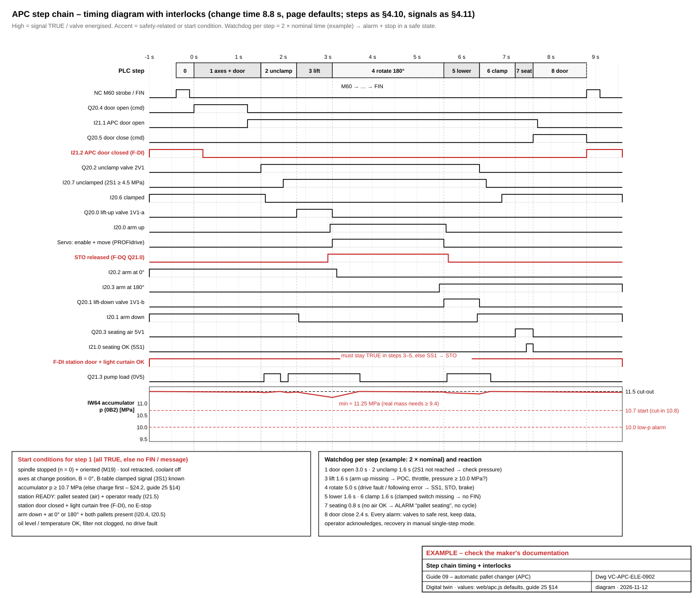
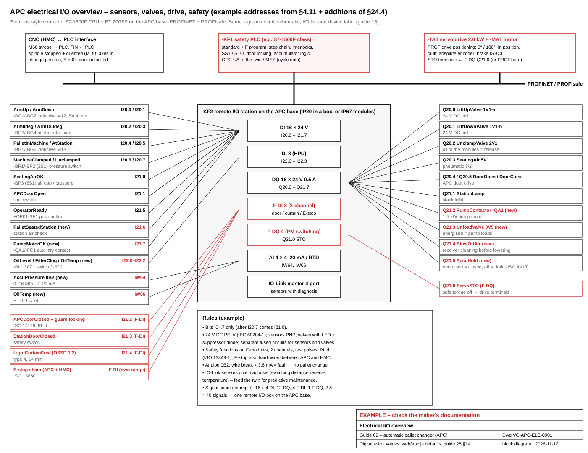
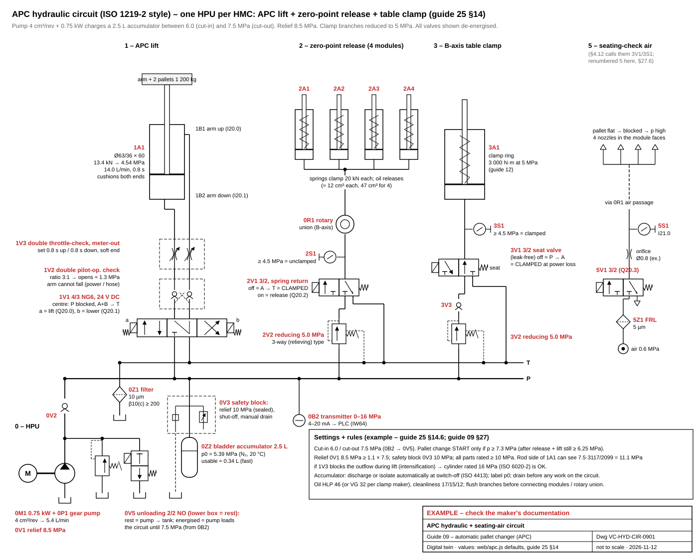
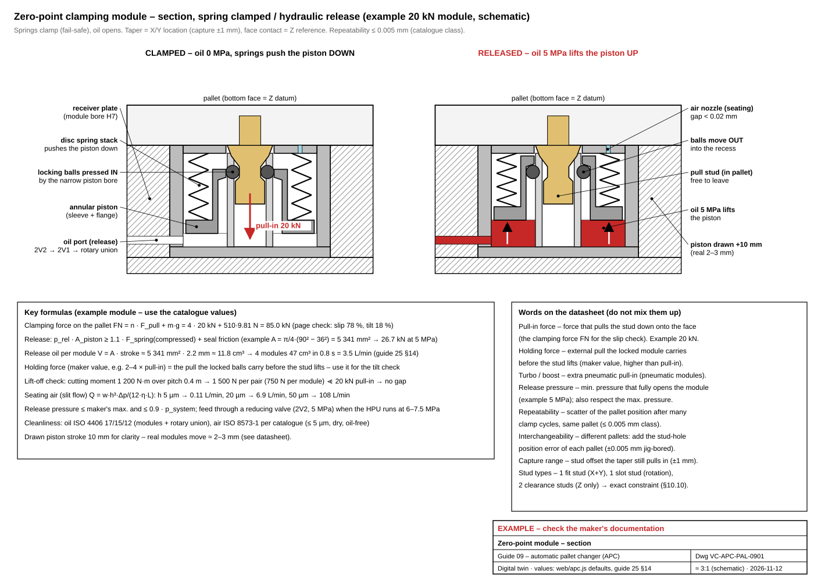
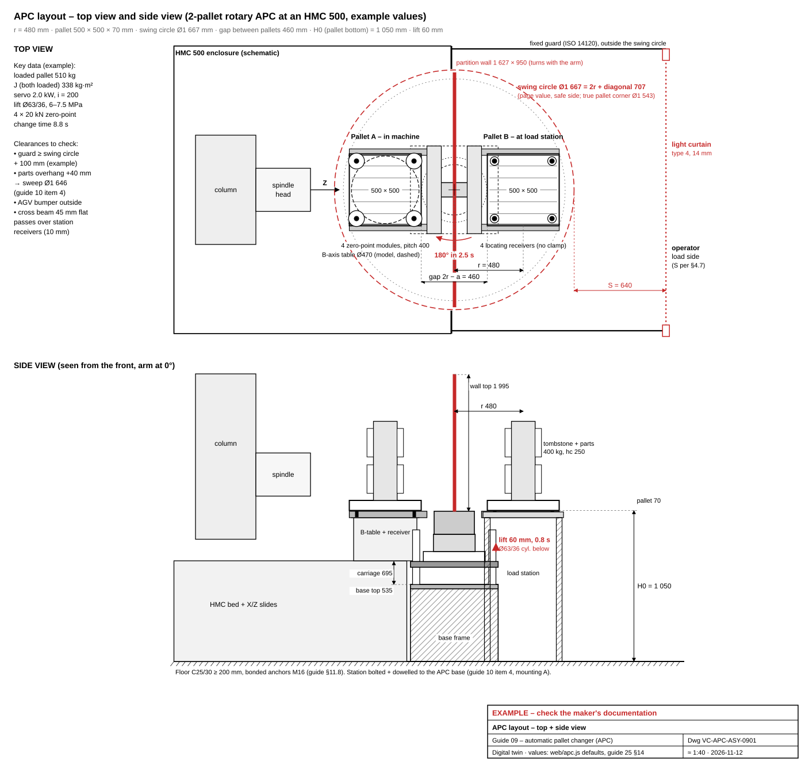
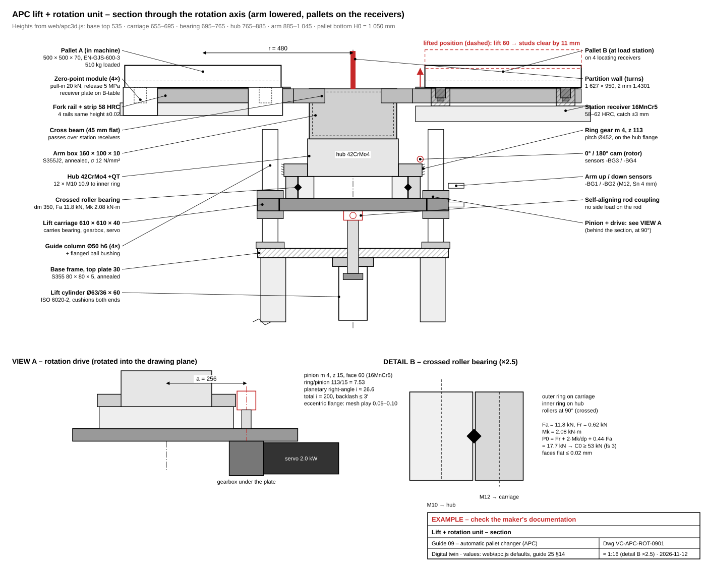
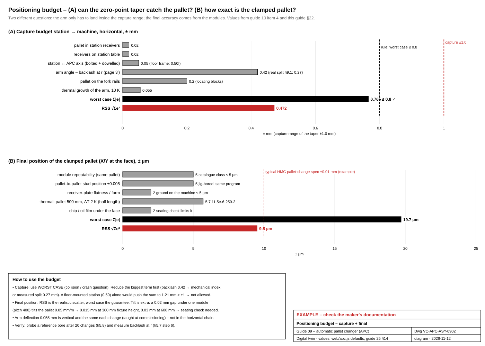
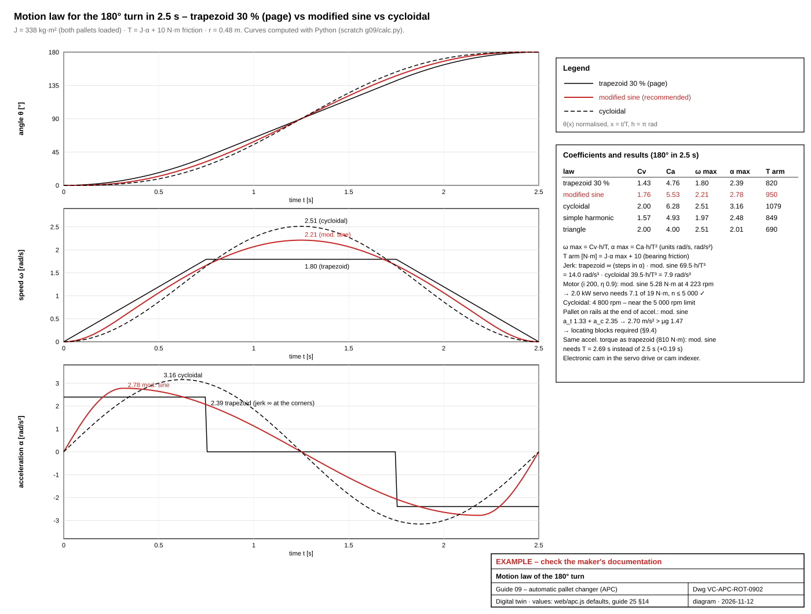

# 09 – Automatic pallet changer (APC): design, manufacturing, commissioning

> **Important – all numbers in this guide are EXAMPLES.**
> They are the default values of the twin page (a typical 500 mm pallet class horizontal machining centre, HMC).
> Before you make or buy anything, replace every number with data from **your machine builder, your catalogues and your suppliers**.
> The page always shows the formulas with your own numbers, so you can repeat every calculation.

Source files: `web/apc.js` (calculation page, animation, PLC, BOM, safety) and `web/apc3d.js` (3D structure, part data, zero-point section, hydraulic circuit).

---

## Contents

1. Purpose
2. Where in the twin (tab, files, deep links, how to use)
3. Concepts in simple words
4. Design calculations (formulas + example numbers)
5. Manufacturing, installation, commissioning, acceptance tests
6. Checklists
7. Common mistakes and lessons
8. Limits of the page
9. Corrections and clarifications
10. Science principles (statics, strength, bolts, welds, friction, Hertz, hydraulics, pneumatics, gears, kinematic coupling, tolerances, thermal, vibration, impact)
11. Detailed manufacturing specification (materials, fits, tolerances, welding, bolts, protection, hydraulics, anchors, measuring plan, alignment)
12. Identification and numbering
13. Standards table
14. Complete worked example (lift circuit, hub bolted joint)
15. Data you still need
16. Glossary

**Part B – design reference (added 2026-11-12):**

17. APC types, pallet standards and pallet systems (change times, ISO 8526, sizes, T-slots, pallet ID)
18. Zero-point clamping in depth (mechanism, pull-in / holding force, release oil, stud types, checks)
19. Rotation drive design (drive options, inertia breakdown, motion laws, cam indexer, rack-pinion, stiffness)
20. Lift design (cylinder vs cam vs screw, real lifted mass, end cushioning E = ½·m·v², guides)
21. Slewing bearing selection and structure stiffness (THK / INA formula, life, bolts, frequencies)
22. Positioning accuracy and repeatability budget (capture budget, final position budget)
23. Sensors and the air-gap seating check (inductive, pressure, air gap, encoder, RFID)
24. PLC step chain – timing, start conditions, watchdogs, extended I/O, code skeleton
25. Safety design (ISO 16090-1, ISO 13849 safety functions, stop distance, stored hydraulic energy)
26. Maintenance, failure modes and diagnostics (FMEA table, condition monitoring with the twin)
27. Hydraulic circuit with accumulator and the app preset "apc" (Ø50/28 at 10 MPa vs Ø63/36 at 6–7.5 MPa)
28. Buy list – catalogue examples + shopping list for one APC
29. Drawings of this guide (index)

---

## 1. Purpose

While the HMC machines the parts on **pallet A**, the operator clamps the next parts on **pallet B** at the load station.
Then the APC does: **unclamp → lift → turn 180° → lower → clamp**. The spindle waits only a few seconds (example: 8.8 s) instead of minutes (example: 120 s when the operator loads inside the machine).

The page sizes every element of a **2-pallet rotary APC** (the most common type on HMCs):

- moment of inertia and motion profile of the turning arm,
- torque, servo motor and gearbox (with the inertia ratio check),
- position error from the gear backlash,
- hydraulic lift cylinder, oil flow, pump power, accumulator,
- zero-point clamping in the machine (slip and tilt checks),
- arm stress and deflection, slewing bearing loads, swing circle,
- light curtain distance (ISO 13855),
- change time and cell output,
- PLC step chain, PLC I/O list, bill of materials (BOM), safety notes.

Other APC types (not calculated here): *shuttle APC* (pallets slide sideways – for very heavy pallets) and *pallet pool* (many pallets).

Why this matters for you as a manufacturer: the APC is a precision machine. The arm itself is **not** precise (it only brings the pallet near its place); the **zero-point modules** give the final accuracy (≈ 0.002–0.005 mm). Everything you design must respect this split: the arm error must stay inside the **capture range** of the modules (example ±1 mm).

---

## 2. Where in the twin

### 2.1 Open the page

1. Start the twin (see `README.md`: `start.bat` or the Python server) and open the browser page of the twin.
2. Click the tab **"Pallet changer"** (tab id `apc`, URL hash `#apc`).

### 2.2 What you see (top to bottom)

| Area | Content |
|---|---|
| KPI tiles | pallet change time, rotation servo, lift cylinder, hydraulic pump, clamping use, cell output |
| Checks | green ✓ = ok, orange ! = warning, red ✕ = not ok |
| Inputs | 7 groups of input fields (changed values are marked); **Example values** button resets |
| Calculations | 6 blocks with every formula and your numbers |
| Animation | top view + side view + Gantt bar chart of the steps; Play, speed, time slider |
| Step chain | PLC sequence table, the active step is highlighted during the animation |
| PLC I/O list | addresses, symbols, signal types |
| BOM | elements with specifications from the calculation; **CSV** download (`APC_design_BOM.csv`, contains BOM + all inputs) |
| Safety | ISO 13855 distance + safety rules |
| Use in twin | button "Use X s in the twin" |
| 3D structure | parametric 3D model, views, exploded / cut view, guards, labels, click a part for data |
| Zero-point section | live 2D section through one clamping module |
| Hydraulic circuit | ISO 1219 style circuit, lines change colour with the step |

The inputs are saved in the browser (`localStorage` key `apcState`). Other tabs (Mechanical elements 1–4) read the APC values live from this page, so **change the pallet data here first**.

### 2.3 Deep links (open a defined view directly)

Add the parameters before `#apc`, for example `/?apcview=clamp&apcpart=module#apc`.

| Parameter | Values | Effect |
|---|---|---|
| `apct` | 0–100 | animation time in % of the change time |
| `apcview` | `overview`, `clamp`, `drive`, `hpu`, `station` | 3D camera view (clamp = exploded view, drive = cut view) |
| `apcexp` | 1 | exploded view on |
| `apccut` | 1 | cut view on |
| `apcpart` | part key, e.g. `module`, `arm`, `bearing`, `cylinder`, `accu`, `vlift` | shows the part data card |

Part keys: `pallet, ledge, stud, fixture, module, receiver, btable, union, arm, cross, fork, wall, hub, ring, pinion, gearbox, servo, bearing, carriage, column, bush, cylinder, base, station, cone, curtain, panel, door, tank, pump, accu, manifold, vlift, vclamp, vair, filter, gauge, pswitch, prox, pipe, guard, machine`.

### 2.4 "Use in twin"

The button sends the calculated change time to the running simulation:
`POST /api/command {"action":"pallet_change_s","value":8.8}`.
The HMCs in the twin then lose 8.8 s per pallet change. This lasts **until reset**. For a permanent change edit `config/factory.json`: `"pallet_changer": {"change_s": 8.8}` and restart the server. The card "Use in twin" shows the value the twin uses now and the cell output before / after.

### 2.5 How to use the page (work order)

1. Enter the pallet size, pallet mass, load and load centre (from your fixture design).
2. Enter the arm radius and arm section. Check "Gap between the pallets" and "Swing circle".
3. Enter rotation time, gear ratio, backlash. Look at the chosen servo and the inertia ratio.
4. Enter the lift stroke, lift time, oil pressure. Look at the cylinder bore and pump.
5. Enter the zero-point module data **from the catalogue**. Check slip and tilt.
6. Enter the sequence times and the measured stop time. Look at the light-curtain distance.
7. All checks green? Download the CSV, give it to purchasing / design. Then press "Use in twin".

---

## 3. Concepts in simple words

| Concept | Simple explanation | Why it matters |
|---|---|---|
| Rotary APC | One arm with two pallet places turns 180°. One pallet goes in, the other comes out at the same time. | Short change time, one drive. |
| Lift before turn | The arm lifts both pallets by their **lifting ledges** (stroke example 60 mm) so the pull studs leave the modules and the station receivers. | Without lift, the studs would crash. |
| Zero-point module | Clamping unit in the machine table. **Springs clamp**, **oil pressure opens**. A taper + face contact locates the pull stud. | Fail-safe (stays clamped without oil) and very repeatable (≈ 0.002–0.005 mm). |
| Capture range | How far off (example ±1 mm) the pull stud may land and the taper still pulls it into place. | All arm errors together must be smaller. |
| Trapezoid motion | Accelerate – constant speed – decelerate. Example: 30 % of the time to accelerate, 30 % to brake. | Gives the peak acceleration and so the torque. |
| Inertia ratio | Load inertia (seen at the motor) ÷ motor inertia. Aim ≤ 10 : 1. | A large ratio makes the servo control unstable (overshoot, vibration). |
| Backlash | Play in the gearbox. At the arm end it becomes a position error. | Must be inside the capture range. |
| Seating check | Air blows through nozzles in the receiver. If the pallet lies flat, the air is blocked → pressure switch. | Finds a chip under the pallet before the cut (scrap / crash). |
| Swing circle | Circle the pallets sweep when turning: Ø = 2r + pallet diagonal. | Guards, machine column, AGV and station parts must stay outside (or below / above). |
| Partition wall | Wall on the arm that turns with it. | Separates chips / coolant (machine side) from the operator. |
| STO | Safe Torque Off: the drive removes torque in a safe way. | Required safety function for the turning arm. |

---

## 4. Design calculations

All values below are **examples** (page defaults). g = 9.81 m/s².

### 4.1 Inputs (example values)

| Group | Input | Example | Note from the page |
|---|---|---|---|
| Pallet and load | Pallet size a × b | 500 × 500 mm | HMC classes 400 / 500 / 630 |
| | Pallet mass mp | 110 kg | 500 mm pallet ≈ 100–150 kg |
| | Workpiece + fixture mw | 400 kg | 500-class rating 500–700 kg |
| | Load centre offset e | 50 mm | worst case, horizontal |
| | Load centre height hc | 250 mm | tombstone with crankcases |
| Arm + bearing | Arm radius r | 480 mm | ≥ pallet diagonal ÷ 2 + clearance |
| | Arm + wall mass marm | 180 kg | |
| | Box section H × B × t | 160 × 100 × 10 mm | welded S355 |
| | Bearing mean Ø dm | 350 mm | crossed roller bearing |
| | Bearing friction μb | 0.005 | 0.002–0.005 |
| Rotation drive | Rotation time 180° | 2.5 s | typ. 1.5–3 s |
| | Acceleration share | 30 % | |
| | Gear ratio i | 200 | e.g. planetary 20 × ring 10 |
| | Gear efficiency η | 0.9 | |
| | Backlash | 3 arcmin | precision planetary ≤ 3′ |
| Lift | Stroke s | 60 mm | clear cones + studs |
| | Lift time (= lower time) | 0.8 s | |
| | System pressure p | 6 MPa | HMC typ. 3.5–7 MPa |
| | Pump efficiency | 0.85 | |
| Clamping | Modules per pallet n | 4 | |
| | Pull-in force per module | 20 kN | catalogue |
| | Release pressure | 5 MPa | catalogue |
| | Module pitch | 400 mm | square pattern |
| | Capture range | ±1 mm | catalogue |
| | Max cutting side force Fc | 4000 N | face mill Ø63, cast iron |
| | Height of Fc above pallet | 300 mm | |
| | Axis acceleration (rapid) | 5 m/s² | |
| | Friction pallet ↔ receiver μ | 0.15 | steel/steel, oily |
| | Safety factor S | 2.5 | |
| Sequence | Axes to change pos. + door open | 1.5 s | parallel |
| | Unclamp / clamp / seating check / door close | 0.8 / 0.8 / 0.4 / 1.2 s | |
| | Stop time of the arm after safety signal | 0.3 s | **measure on the real machine** |
| | Light curtain resolution d | 14 mm | finger protection |
| Production | Machining time per pallet | 343.5 s | FMS product mix |
| | Number of machines | 3 | |
| | Change time without APC | 120 s | |

### 4.2 Masses and moment of inertia (worst case: both pallets loaded)

Loaded pallet: m = mp + mw = 110 + 400 = **510 kg**

Pallet (point mass at r plus its own plate inertia):
J_p = mp·(r² + (a² + b²)/12) = 110·(0.48² + (0.5² + 0.5²)/12) = **29.9 kg·m²**

Load (with the offset e, worst case outward):
J_w = mw·((r + e)² + (a² + b²)/12) = 400·(0.53² + 0.5/12) = **129.0 kg·m²**

Arm (bar of length L = 2r + 200 mm = 1.16 m, width B = 0.1 m):
J_a = marm·(L² + B²)/12 = 180·(1.16² + 0.1²)/12 = **20.3 kg·m²**

Total: J = 2·(J_p + J_w) + J_a = 2·(29.9 + 129.0) + 20.3 = **338.2 kg·m²**

Why worst case: if the arm is sized for two full pallets, it also works for one full and one empty.

### 4.3 Rotation drive: motion, torque, servo, gearbox

Motion profile (trapezoid): θ = 180° = π rad, t = 2.5 s, t_a = 30 % · 2.5 = 0.75 s

| Step | Formula | Example |
|---|---|---|
| Max speed | ω = θ / (t − t_a) = π / 1.75 | 1.80 rad/s (17.1 rpm at the arm) |
| Acceleration | α = ω / t_a = 1.80 / 0.75 | 2.39 rad/s² |
| Acceleration torque | T_acc = J·α = 338.2 · 2.39 | 810 N·m |
| Bearing friction | T_fr = μb·F·dm/2 = 0.005 · 11 772 N · 0.175 m | 10.3 N·m |
| (axial load F) | F = (2·510 + 180)·g | 11 772 N |
| Torque at the arm | T = 810 + 10.3 | **820 N·m** |
| Peak power | P = T·ω = 820 · 1.80 | 1.47 kW |
| Motor torque | T_m = T / (i·η) = 820 / (200·0.9) | **4.56 N·m** |
| Motor speed | n = ω·60/(2π)·i = 1.80·60/(2π)·200 | **3429 rpm** |
| Load inertia at motor | J/i² = 338.2 / 200² | 84.6 kg·cm² |

**Servo choice rule (as coded):** take the smallest servo of the example list where
(1) T_max ≥ 1.2·(T_m + J_motor·α·i) (motor must also accelerate its own rotor, +20 % reserve),
(2) n_max ≥ n, and
(3) inertia ratio (J/i²) / J_motor ≤ 10.
If no servo meets (3), the page takes the smallest one that meets (1) and (2) and shows a warning.

Example servo list (generic values, **not** a real catalogue):

| Class | Tn N·m | Tmax N·m | n max rpm | J motor kg·cm² | Needed N·m | Ratio | Result |
|---|---|---|---|---|---|---|---|
| 0.4 kW | 1.3 | 3.8 | 6000 | 0.5 | 5.49 | 169 : 1 | too weak |
| 0.75 kW | 2.4 | 7.2 | 6000 | 1.5 | 5.55 | 56 : 1 | ratio too high |
| 1.5 kW | 4.8 | 14.3 | 5000 | 6 | 5.81 | 14.1 : 1 | ratio too high |
| **2.0 kW** | 6.4 | 19 | 5000 | 12 | **6.16** | **7.0 : 1** | **chosen** |
| 3.0 kW | 9.6 | 29 | 4500 | 20 | 6.62 | 4.2 : 1 | ok, bigger |

Lesson: the **torque** would allow a 0.75 kW motor. The **inertia ratio** decides: 2.0 kW. This is typical for APCs (large load inertia, short moves).

Gearbox (from the 3D part data): ring gear m = 4, pitch radius Rg = dm/2 + 50 = 225 mm → z_ring = round(2·225/4) = 113 teeth; pinion z = 15 → ring/pinion ratio 113/15 = 7.53. Planetary ratio i_plan = 200 / 7.53 ≈ **26.6**. Gearbox torque at the arm: design ≥ 1.5 · 820 = **1230 N·m** (×1.5 shock).

**Backlash → position error at the pallet:**
Δ = r · backlash = 480 mm · (3/60)° · π/180 = **0.42 mm**
Check: ≤ 50 % of the capture range (±1 mm) → ok. Why 50 %: other errors (deflection, station position, thermal) also need part of the ±1 mm – see doc 10, item 4.

Note: the servo only brings the pallet **near** its place. The final position (≈ 0.002–0.005 mm) comes from the taper and face contact of the zero-point modules.

### 4.4 Lift cylinder and hydraulic unit

| Step | Formula | Example |
|---|---|---|
| Lifted mass | m = 2·510 + 180 | 1200 kg |
| Lift acceleration | a = 4·s/t² = 4·0.06/0.8² | 0.375 m/s² |
| Force | F = m·g·(1 + a/g)·1.1 (1.1 = guide friction) | **13.4 kN** |
| With 25 % margin | F_req = 1.25·F | 16.8 kN |
| Minimum bore | D = √(4·F_req/(π·p)) = √(4·16 805/(π·6)) | 59.7 mm |
| Standard bore | next of 25/32/40/50/63/80/100/125/160/200 | **Ø63 mm, rod Ø36** |
| Real force | F = p·A = 6 · 3117 mm² | 18.7 kN (90 % used → just "ok") |
| Speed | v = s / t = 60 / 0.8 | 75 mm/s |
| Oil flow | Q = A·v = 3117 · 75 · 60/10⁶ | **14.0 L/min** |
| Pump power | P = p·Q/(60·η) = 6·14.0/(60·0.85) | **1.65 kW** |
| Motor in BOM | max(0.75, 1.3·P) | ≈ 2.15 kW |

Accumulator (from `apc3d.js`, isothermal, for one lift stroke):
ΔV = A·s = 3117 mm² · 60 mm = 0.187 L; p1 = 6 MPa, p2 = 1.25·p1 = 7.5 MPa, gas pre-charge p0 = 0.9·p1 = 5.4 MPa
V0 = ΔV / (p0/p1 − p0/p2) = 0.187 / (0.9 − 0.72) = **1.04 L → standard 1.4 L**.
With an accumulator a smaller pump is enough (the APC moves are short).
**Correction (§9.2):** the lift is fast, so use the adiabatic law → V0 = 1.39 L → choose ≥ 1.75 L; and the relief valve must be set above p2 = 7.5 MPa if an accumulator is used.
Tank: ≈ max(30, 4·Q) = **56 L** (3–5 × pump flow per minute), oil HLP 46.

The same hydraulic unit releases the zero-point modules and can clamp the fixtures.

### 4.5 Clamping the pallet in the machine (zero-point modules)

| Step | Formula | Example |
|---|---|---|
| Clamp force | FN = n·F_module + weight = 4·20 kN + 510·g | **85.0 kN** |
| Side load | F = max(Fc, mw·a_rapid) = max(4000, 400·5) | 4000 N |
| No slipping | S·F/μ ≤ FN → 2.5·4000/0.15 = 66.7 kN ≤ 85.0 kN | **78 % used** (ok ≤ 100 %) |
| Tilting moment | M = max(Fc·h_cut, mw·a·hc) = max(4000·0.3, 400·5·0.25) | 1200 N·m |
| Holding moment | M_hold = (n/2)·F_module·pitch + weight·pitch/2 = 2·20 000·0.4 + 5003·0.2 | 17 001 N·m |
| No tilting | S·M ≤ M_hold → 2.5·1200 = 3000 ≤ 17 001 | **18 % used** |
| Release pressure | p_release ≤ 0.9·p_system → 5 ≤ 5.4 MPa | ok |

Why friction only: the taper also carries side load, so the friction check is **on the safe side**.
Fail-safe: springs clamp → the pallet stays clamped if oil pressure is lost.

### 4.6 Arm and slewing bearing

| Step | Formula | Example |
|---|---|---|
| Load at arm end | F = 510·g | 5003 N at r = 480 mm |
| Box section | I = (B·H³ − (B−2t)·(H−2t)³)/12 = (100·160³ − 80·140³)/12 | 1584 cm⁴ |
| Bending stress | σ = F·r·(H/2)/I | **12 N/mm²** (aim ≤ 80 for S355 with fatigue) |
| Deflection | δ = F·r³/(3·E·I), E = 210 000 N/mm² | **0.055 mm** (aim ≤ 0.3 · capture) |
| Bearing axial | Fa = (2·510 + 180)·g | 11.8 kN |
| Bearing tilting | Mk = mw·g·(r + e) (one full, one empty) = 400·g·0.53 | **2.08 kN·m** |
| Static rating | M0 ≥ 2·Mk | ≥ 4.16 kN·m |
| Swing circle | Ø = 2r + √(a² + b²) = 960 + 707 | **Ø1667 mm** |
| Gap between pallets | 2r − a = 960 − 500 | 460 mm (aim ≥ 150 for the wall) |

Why low stress (12 N/mm²) is good: the arm is sized by **stiffness** (deflection must not use the capture range) and fatigue (millions of cycles), not by strength.

### 4.7 Light curtain safety distance (ISO 13855)

S = K·(t_stop + t_response) + C
K = 2000 mm/s (hand speed), t_response = 0.02 s (light curtain), C = 8·(d − 14) for resolution d
S = 2000·(0.3 + 0.02) + 8·(14 − 14) = **640 mm**

Notes:
- t_stop (0.3 s) is an example. **Measure the real stop time** of the arm (stop-time meter) after commissioning and recalculate.
- ISO 13855 also has a rule for using K = 1600 mm/s when the result with K = 2000 is above 500 mm (then S = 1600·T + C, minimum 500 mm). The page always uses K = 2000 (safe side). Check the current standard text with your safety engineer.

### 4.8 Change time and cell output

| Step | Time (example) |
|---|---|
| 1 Axes to change position, door open | 1.5 s |
| 2 Unclamp pallet in the machine | 0.8 s |
| 3 Lift arm | 0.8 s |
| 4 Rotate 180° | 2.5 s |
| 5 Lower arm | 0.8 s |
| 6 Clamp pallet | 0.8 s |
| 7 Seating check (air) | 0.4 s |
| 8 Door close | 1.2 s |
| **Change time t = Σ** | **8.8 s** |

Cell output = n·3600/(t_machining + t_change) = 3·3600/(343.5 + 8.8) = **30.7 pallets/h**
Without APC = 3·3600/(343.5 + 120) = 23.3 pallets/h → **APC gives +32 %**
Spindle time share = 343.5/(343.5 + 8.8) = **97.5 %**

### 4.9 Summary of the checks on the page

| Check | Rule (ok / warning) | Example result |
|---|---|---|
| Servo found | a servo in the list fits | 2.0 kW, needs 6.2 of 19 N·m |
| Inertia ratio | ≤ 10 ok, ≤ 20 warning | 7.0 : 1 |
| Backlash error | ≤ 0.5·capture ok, ≤ capture warning | 0.42 mm vs ±1 |
| Lift cylinder | F_req/F_real ≤ 0.9 ok | Ø63, 90 % |
| No slipping | ≤ 100 % ok, ≤ 120 % warning | 78 % |
| No tilting | ≤ 100 % ok, ≤ 120 % warning | 18 % |
| Release pressure | ≤ 0.9·p ok, ≤ p warning | 5 vs 6 MPa |
| Arm stress | ≤ 80 ok, ≤ 120 N/mm² warning | 12 N/mm² |
| Arm deflection | ≤ 0.3·capture ok, ≤ capture warning | 0.055 mm |
| Gap between pallets | ≥ 150 ok, ≥ 80 warning | 460 mm |
| Swing circle | information | Ø1667 mm |

### 4.10 PLC step chain



Timing diagram of the 8.8 s change with all signals, the start conditions, the watchdog times and the accumulator
pressure (details and the code skeleton in §24).

| Step | Action | PLC output / command | Step done when | Interlock |
|---|---|---|---|---|
| 0 | NC calls the pallet change (e.g. M60) | NC → PLC: M-code strobe | PLC reads the M code | spindle stopped, coolant off |
| 1 | Axes to change position, B = 0°, door open | NC moves X/Y/Z/B · %Q20.4 DoorOpen | NC "in position" + %I21.1 APCDoorOpen | load-station door closed, light curtain free |
| 2 | Unclamp the pallet in the machine | %Q20.2 Unclamp valve (oil → modules) | %I20.7 pressure switch "unclamped" | arm down, both pallets present |
| 3 | Lift the arm with both pallets | %Q20.0 Lift-up valve | %I20.0 "arm up" | unclamped, operator outside (F-DI) |
| 4 | Rotate 180° | servo enable + positioning order (PROFINET) | servo "in position" + %I20.3 "180°" | arm up, STO not active |
| 5 | Lower the arm | %Q20.1 Lift-down valve | %I20.1 "arm down" | position sensor OK |
| 6 | Clamp the new pallet | %Q20.2 off (oil out → springs clamp) | %I20.6 pressure switch "clamped" | arm down |
| 7 | Seating check: air through receiver nozzles | %Q20.3 seating air ON | %I21.0 air pressure switch (gap < 0.02 mm) | else ALARM "pallet seating" |
| 8 | Close the door, FIN to the NC | %Q20.5 DoorClose · FIN | %I21.2 APCDoorClosed | NC continues with the next part |

Note: in step 4 the 180° sensor is shown; on the way back the 0° sensor (%I20.2) is used.

Missing start conditions in this table (added in §24.2): spindle oriented (M19) and tool retracted, B-table clamp state known,
**accumulator pressure ≥ 7.3 MPa** (§9.2 item 4), station READY, oil level / temperature / filter OK. Every step also
needs a watchdog time (§24.3).

### 4.11 PLC I/O list (example addresses, Siemens style)

Rule: bit addresses use **.0 to .7 only** (a byte has 8 bits). After %I20.7 comes %I21.0 – never %I20.8.



The drawing also shows the I/O that the hydraulic unit with accumulator needs (pump contactor, unloading valve,
accumulator pressure transmitter, oil level / temperature / filter, accumulator hold valve) – the extended list is in §24.4.

| Address | Symbol | Type | Device |
|---|---|---|---|
| %I20.0 | ArmUp | DI | inductive sensor |
| %I20.1 | ArmDown | DI | inductive sensor |
| %I20.2 | Arm0deg | DI | inductive sensor |
| %I20.3 | Arm180deg | DI | inductive sensor |
| %I20.4 | PalletInMachine | DI | inductive sensor |
| %I20.5 | PalletAtStation | DI | inductive sensor |
| %I20.6 | MachineClamped | DI | pressure switch |
| %I20.7 | MachineUnclamped | DI | pressure switch |
| %I21.0 | SeatingAirOK | DI | air pressure switch |
| %I21.1 | APCDoorOpen | DI | limit switch |
| %I21.2 | APCDoorClosed | F-DI | safety switch with guard locking |
| %I21.3 | StationDoorClosed | F-DI | safety switch |
| %I21.4 | LightCurtainFree | F-DI | OSSD of the light curtain |
| %I21.5 | OperatorReady | DI | push button |
| %Q20.0 | LiftUpValve | DQ | solenoid 24 V |
| %Q20.1 | LiftDownValve | DQ | solenoid 24 V |
| %Q20.2 | UnclampValve | DQ | solenoid (oil to the modules) |
| %Q20.3 | SeatingAir | DQ | pneumatic valve |
| %Q20.4 | DoorOpen | DQ | door drive |
| %Q20.5 | DoorClose | DQ | door drive |
| %Q21.0 | ServoSTO | F-DQ | safe torque off of the servo drive |
| %Q21.1 | StationLamp | DQ | stack light |
| PROFINET | Servo drive | telegram | PROFIdrive positioning: target 0°/180°, in position, fault |
| NC ↔ PLC | M60 / FIN | signals | M-code strobe from the NC, FIN back when the change is done |

All addresses are examples. In a real project F-DI / F-DQ sit on fail-safe I/O modules with their own address ranges.

### 4.12 Hydraulic circuit (ISO 1219 style, from `apc3d.js`)

The table below describes the simple circuit of the page (`apc3d.js`, 6 MPa, without the table clamp). The **recommended
circuit with accumulator** – one HPU per HMC for APC lift, zero-point release and B-table clamp, consistent with guide 25
§14 – is drawn here and explained in §27:



| Code | Element | Function |
|---|---|---|
| 0P1 + M | pump + motor | builds the pressure |
| 0V1 | relief valve | limits the pressure (set p + 10 %) |
| check, filter 10 µm | check valve, return filter | protect pump, keep oil clean |
| 0Z2 | bladder accumulator (page: 1.4 L – **too small**, use 2.5 L, see §9.2 and §27) | oil for the fast lift, holds release pressure |
| gauge | 0–10 MPa | shows system pressure (example 6 MPa) |
| **1V1** | 4/3 solenoid valve, NG6, centre position **A and B to tank, P blocked** (corrected, §9.3 – a closed centre can keep the check valves 1V2 open) | lift up / down / hold |
| **1V2** | pilot-operated check valves (in A and B) | arm cannot sink when the valve is in centre or the power fails |
| **1V3** | meter-out throttles | set lift and lower speed |
| 1A1 | lift cylinder Ø63/36 × 60 | lifts carriage, rotor and both pallets |
| **2V1** | 3/2 solenoid valve (or 4/2 with plugged port) | energized = oil to the modules (open); not energized = oil to tank, springs clamp |
| **2S1** | pressure switch after 2V1 | confirms "unclamped" |
| rotary union | 2 passages | oil + air into the turning B-axis table |
| 2A1–2A4 | zero-point modules 20 kN | clamp the pallet |
| **3V1** | pneumatic 3/2 valve + FRL | seating-check air 0.3–0.6 MPa (example drawing: 0.6 MPa supply) |
| **3S1** | air pressure switch | switches when the pallet lies flat (gap < 0.02 mm) |

Line colours in the twin: red = pressure, dark red = pressure held, blue = to tank, cyan = air, grey = no flow.

Step → valve state in the animation: step 2 unclamp: 2V1 on; step 3 lift: 1V1 position "up"; step 4 rotate: 1V1 centre (pressure held by 1V2), modules still open; step 5 lower: 1V1 "down"; step 6 clamp: 2V1 off (oil to tank); step 7 seating: 3V1 on.

### 4.13 Zero-point module – how it works (live section)



- **Clamped** (no oil): disc springs push the piston down; the piston taper presses the locking balls inward against the pull stud; the stud is pulled down (example 20 kN) onto the reference face.
- **Open**: oil (example 5 MPa) enters the chamber below the piston, the piston moves up against the springs, the balls are free, the stud can leave.
- **Lifted**: the APC lifts the pallet; the stud leaves the module.
- Air nozzle in the face: seating check "gap < 0.02 mm?".

---

## 5. Manufacturing, installation, commissioning

### 5.1 Main dimensions of the 3D model (example)





| Item | Value |
|---|---|
| Pallet height above floor (receiver top) H0 | 1050 mm |
| Swing circle | Ø1667 mm |
| Total height (top of partition wall) | ≈ 1995 mm |
| Arm radius r | 480 mm |
| Lift stroke | 60 mm |
| Base / carriage footprint | (dm + 260) = 610 × 610 mm |
| Ring gear / pinion | m 4, z 113 / 15 |
| Planetary gearbox | i ≈ 26.6 |
| Lift cylinder | Ø63 / 36 × 60 |
| Zero-point modules | 4 × 20 kN, pitch 400 mm |
| Pallet thickness | max(50, 0.14·min(a,b)) = 70 mm |
| B-axis table Ø (model) | 470 mm |

Structure (from bottom to top): base frame → 4 guide columns + lift cylinder → lift carriage (servo, gearbox, pinion, bearing outer ring) → rotor (bearing inner ring, ring gear, hub, arm, cross beams, fork rails, partition wall) → pallets with lifting ledges and pull studs. Machine side: B-axis table + receiver plate with zero-point modules, rotary union. Load station: locating receivers, light curtain, operator panel. Hydraulic power unit (HPU).

Why the carriage carries servo + gearbox + bearing: the **gear mesh does not change** during the lift.

### 5.2 Parts list – MAKE (you manufacture)

| Part | Material | Function | Manufacturing notes and tolerances (examples) |
|---|---|---|---|
| Pallet | EN-GJS-600-3 (old name GGG-60) nodular cast iron or C45, stress relieved | carries fixture + parts | 500 × 500 × 70 mm, 110 kg. Grind top and bottom: flatness ≤ 0.01 mm, parallel ≤ 0.01 mm. Jig-bore pull-stud holes on pitch ±0.005 mm. M16 grid or T-slots 18H8. RFID tag pocket. |
| Lifting ledge | 42CrMo4, induction hardened 52–56 HRC, screwed + pinned | fork rails lift under them | 2 per pallet, 25 mm wide, full length. Same height both sides ±0.02 mm. Replaceable. |
| Tombstone fixture | EN-GJL-250 (old GG25) cast + hydraulic workholding | holds 2–4 faces of parts | Not part of the APC, but its mass (400 kg) and centre height (250 mm) size the APC. |
| Receiver plate (B-table) | S355 or EN-GJL-250, stress relieved | carries modules, oil + air channels | 460 × 460 × 40 mm. Module bores H7 per catalogue. Grind top **after mounting** on the table: flatness ≤ 0.005 mm. Plug channels, pressure test 1.5 × p. |
| APC arm | S355J2 welded box, stress-relief annealed | carries both pallets | Box 160 × 100 × 10. Weld → anneal 580–620 °C → machine hub flange and cross-beam faces in **one setup**: both ends same height ±0.05 mm. |
| Cross beam | S355, welded to the arm | carries fork rails | Length b + 110 = 610 mm, **flat 45 mm** (passes over the station receivers when the arm turns). Machined with the arm. |
| Fork rail + wear strip | S355 rail + 90MnCrV8 strip 58 HRC | lifts the pallet under its ledges | Length a + 40 = 540 mm. Shim the strips so all 4 rails are at the same height ±0.02 mm. Lead-in chamfers. |
| Partition wall | 2–3 mm stainless sheet on steel frame, rubber wipers | separates machine and operator | ≈ 1627 × 950 mm. Wipers on all edges. Keep it light (it is part of J). |
| Hub | 42CrMo4 quenched + tempered | connects bearing inner ring and arm | Ø ≈ dm − 60 = 290 mm, torque 820 N·m (×1.5 = 1230 N·m). Centring fit H7/g6, bolt circle from the bearing catalogue. |
| Lift carriage | S355 thick plate or EN-GJL-250 | lifted plate with bearing, gearbox, servo | 610 × 610 × 40 mm. Bore the 4 bushing holes in one setup (±0.02 mm, parallel). |
| Base frame | S355 tube 80×80×5 welded, top plate 30 mm | carries everything | Weld → anneal → machine top plate (column holes, cylinder flange). Levelling feet + chemical anchors M16. Align to the machine change position ±0.1 mm. |
| Load station stand | S355 welded | holds the waiting pallet | Pallet height 1050 mm (ergonomic 900–1100). Must match machine receiver height ±0.2 mm. Detailed design: doc 10. |
| Locating receiver (station) | case-hardened 16MnCr5, 58–62 HRC | centres the pallet at the station, no clamping | 4 on pitch 400, face at 1050 mm. 1 round bore, 1 slot, 2 with clearance (not over-determined). |
| APC door (sliding shutter) | sheet steel with seals | closes the machine above the wall | Opens before the arm turns. Door switch with guard locking (ISO 14119). |
| Pipes | precision steel tube 12×1.5 (E235+N) or 2SN hose; air PU 8 mm | connect HPU, cylinder, modules | Clamp every 1 m, **flush before start-up**. |
| Guard / enclosure | sheet steel + polycarbonate | keeps people out, chips in | Outside the swing circle Ø1667. Fixed guards need tools to open (ISO 14120). |
| Valve manifold (MAKE or BUY) | steel block, drilled | carries NG6 valves | Pressure test 1.5 × p, mark every port (P, T, A, B). |

### 5.3 Parts list – BUY (catalogue)

| Part | Specification (example) | Mounting notes |
|---|---|---|
| Zero-point modules (4) | pull-in 20 kN, spring clamp, release 5 MPa, repeatability ≤ 0.005 mm, air seating check | Bore H7, depth / face per catalogue, O-rings for oil and air. Fail-safe clamped. |
| Pull studs (4 per pallet) | case-hardened 58 HRC, from the module supplier | Torque per catalogue, thread locker. One stud = reference fit, others with radial play. |
| Slewing bearing (crossed roller) | Fa 11.8 kN, Mk 2.08 kN·m, M0 ≥ 4.16 kN·m, dm ≈ 350 | Mounting faces flat ≤ 0.02 mm, bolts crosswise with torque wrench, grease nipple reachable. |
| Ring gear | 42CrMo4, teeth induction hardened, m 4, z 113, face 40 mm | Backlash 0.05–0.1 mm with eccentric pinion mount. Grease. |
| Pinion | 16MnCr5 case hardened, m 4, z 15, face 60 mm | Wider than the ring gear; shrink disc on gearbox shaft. |
| Planetary gearbox | i ≈ 26.6, backlash ≤ 3 arcmin | Flange with eccentric ring to set the gear backlash. |
| Servo motor + drive | 2.0 kW class, Tmax 19 N·m, absolute encoder, holding brake, STO | PROFINET (PROFIdrive positioning), STO wired to the safety PLC. |
| Guide columns (4) + ball bushings | Ø50 h6 induction hardened, ground; flanged bushings with wipers | In H7 bores with bolted shaft clamp flanges (or press fit P7, see §11.3 part 11); parallel ≤ 0.02 mm over the stroke. |
| Lift cylinder | ISO 6020/6022, Ø63/36 × 60, double acting, end cushioning both sides | Flange on the base; rod end with a **self-aligning coupling** (no side load on the rod). |
| Rotary union | 2 passages: oil 10 MPa, air 0.6 MPa | Below the table centre, flexible hoses to fixed pipes. |
| HPU: tank, motor-pump, filter | ≈ 56 L, internal gear pump + IE3 motor, return filter 10 µm with clogging indicator | Bell housing + flexible coupling, relief valve p + 10 %. |
| Bladder accumulator | page value 1.4 L / 5.4 MPa is too small – **2.5 L, pre-charge 5.39 MPa** (with the zero-point release oil, §9.2 item 4, guide 25 §14), with safety block | Safety block with relief + drain valve (pressure equipment rules). |
| Valves | 1V1 4/3 NG6, centre **P blocked, A + B → T** (corrected – a closed centre keeps the pilot checks 1V2 partly open, §9.3), 24 V DC; 2V1 3/2 NG6; 3V1 pneumatic 3/2 + FRL (filter 5 µm) | Manual override for service. |
| Pressure switches | electronic, IO-Link | switch points set in the PLC |
| Inductive sensors M12 (6) | PNP, IO-Link: arm up, down, 0°, 180°, pallet in machine, pallet at station | Adjustable bracket, switching distance 4 mm. |
| Safety light curtain | type 4, 14 mm resolution, OSSD | ≥ 640 mm from the danger zone (example), OSSDs to F-DI. |
| Door switches with guard locking (2) | ISO 14119, PL d | APC door + load-station door. |
| Gauge | glycerin 0–10 MPa + test point | |

### 5.4 Bill of materials (as the page generates it)

| Element | Qty | Specification (example) |
|---|---|---|
| Pallet | 3 | 500 × 500 mm, 110 kg, flatness ≤ 0.01 mm, 4 pull studs (2 on the APC + 1 spare for fixture setting) |
| Zero-point clamping module | 4 | 20 kN, spring clamp, release 5 MPa, ≤ 0.005 mm, air seating check |
| Locating cones (load station) | 4 | taper cones, no clamping |
| APC arm with partition wall | 1 | S355 box 160×100×10, r = 480, 180 kg; σ = 12 N/mm², δ = 0.055 mm; stress relieved, machined after welding |
| Slewing bearing | 1 | Fa 11.8 kN, Mk 2.08 kN·m, M0 ≥ 4.16 kN·m, dm ≈ 350; integrated ring gear if possible |
| Servo motor + drive (STO) | 1 | 2.0 kW class, Tn 6.4 / Tmax 19 N·m, 5000 rpm, absolute encoder, brake |
| Planetary gearbox + pinion | 1 | i = 200 total, backlash ≤ 3′, ≥ 1230 N·m at the arm, 4.56 N·m at the motor |
| Lift cylinder + guide column | 1 | Ø63/36, stroke 60, 6 MPa, end cushioning |
| Hydraulic power unit | 1 | 6 MPa, 14.0 L/min (or smaller pump + accumulator), motor ≈ 2.15 kW, oil cooler |
| Solenoid valves | 3 | lift, clamp/unclamp, seating air |
| Pressure switches | 2 + 1 | unclamped / clamped (hydraulic), 1 air |
| Inductive sensors M12 | 6 | see above |
| Door switches with guard locking | 2 | ISO 14119, PL d |
| Safety light curtain type 4 | 1 | 14 mm, ≥ 640 mm from the danger zone |
| Guard around the APC | 1 | outside Ø1667 + load-station door |
| Operator panel | 1 | "pallet ready" button, E-stop, stack light |

### 5.5 Manufacturing sequence (recommended)

1. **Order long-lead BUY parts first**: slewing bearing with ring gear, zero-point modules + studs, servo + gearbox, HPU. Get the catalogue drawings – your machined interfaces depend on them.
2. **Pallets**: rough machine → stress relieve → finish machine → grind both faces (≤ 0.01 mm) → jig-bore stud holes (±0.005 mm) → fit studs (1 reference, 3 with radial play). Machine all 3 pallets with the **same program and fixture**: they must be interchangeable.
3. **Arm assembly**: weld arm, cross beams (45 mm flat) and rail supports in a jig → anneal 580–620 °C → machine all interfaces in one setup (hub flange, cross-beam faces, rail seats) → ends same height ±0.05 mm.
4. **Fork rails**: fit hardened strips with shims, all 4 rails same height ±0.02 mm; chamfer the ends.
5. **Base + carriage**: weld → anneal → machine column holes and bushing holes in one setup (±0.02 mm) → press in columns → check parallelism ≤ 0.02 mm over the stroke.
6. **Receiver plate**: drill and plug channels → pressure test 1.5 × p → mount on the B-table → grind top face on the machine (≤ 0.005 mm) → fit modules.
7. **Hydraulics**: manifold pressure test 1.5 × p; mark ports; flush all pipes before connecting the modules (modules and valves are sensitive to dirt).
8. **Paint** non-functional surfaces only; machined faces oiled.

### 5.6 Installation

1. The machine builder sets and levels the HMC. The B-axis goes to the change position (B = 0°).
2. Set the APC base: levelling feet, align to the machine change position **±0.1 mm** (position and height), chemical anchors M16, grout, tighten after curing.
3. Mount the bearing (faces flat ≤ 0.02 mm, bolts crosswise with torque wrench), hub, arm, partition wall.
4. Mount gearbox + pinion; set the gear backlash 0.05–0.1 mm with the eccentric.
5. Mount the lift cylinder with the self-aligning rod coupling.
6. Set the load station (see doc 10, item 4: align to the APC axis, not to the floor; same height as the machine receiver).
7. Install HPU, pipes (clamp every 1 m), rotary union. Flush.
8. Wire sensors, valves, servo, safety devices. Check addresses against the I/O list.
9. Install guards outside the swing circle, door with guard locking, light curtain at ≥ the calculated distance.

### 5.7 Commissioning (step by step)

1. **Hydraulics without load**: set relief valve (p + 10 %, example 6.6 MPa – circuit without accumulator; with accumulator see §9.2), check for leaks, pre-charge accumulator (example 5.4 MPa, with nitrogen only), check filter indicator.
2. **Valves by manual override**: lift up / down, unclamp / clamp. Check 2S1 switches when the modules are open. Set the throttles 1V3 for a soft lift and lower (no impact at the end).
3. **Hold test**: lift the arm with load, switch off the HPU / valve in centre: the arm must not sink (1V2 pilot check). Mark and measure after 10 min.
4. **Sensors**: arm up / down / 0° / 180°, pallet present, pressure switches, seating air switch (test with a 0.05 mm shim under one corner → must NOT switch).
5. **Servo**: commission in slow speed, set 0° and 180° positions (absolute encoder), tune the controller with the real load inertia; check overshoot. Check that the brake holds.
6. **Backlash measurement**: dial gauge at the pallet edge at r, move the arm by hand both ways → measured play at r must be ≤ 0.5 × capture range (example ≤ 0.5 mm; calculated 0.42 mm).
7. **Alignment with master pallet**: see doc 10, item 4 (studs drop into the modules without force, seating check OK).
8. **Step chain in single-step mode**, then automatic with empty pallets, then with full load.
9. **Safety**: measure the real stop time of the arm with a stop-time meter → recalculate S = 2000·(t_stop + t_response) + C → move the light curtain if needed. Test every interlock and STO.
10. Enter the measured change time with "Use in twin".

### 5.8 Acceptance tests (examples)

| Test | How | Pass if |
|---|---|---|
| Change time | 20 changes with full pallets, stopwatch / PLC log | ≤ calculated time (example 8.8 s) |
| Repeatability | 100 changes with full load | seating check OK every time, no alarm |
| Position in machine | probe a reference bore on the pallet after 20 changes | scatter within module spec (example ≤ 0.005 mm) |
| Arm hold | arm up with full load, power off, 10 min | no visible sinking |
| Power loss | cut oil pressure while clamped | pallet stays clamped (springs) |
| Seating check | 0.05 mm shim / chip under one corner | alarm "pallet seating", no cycle start |
| Interlocks | station door open, light curtain broken, during each step | arm does not move / stops |
| Stop time | stop-time meter at max speed, full load | ≤ value used in the ISO 13855 calculation |
| Slip test (optional) | test cut with the max cutting force | no movement (probe before / after) |
| Endurance | 500 changes in automatic | no wear marks, no leaks, bolts tight |

### 5.9 Safety (from the page)

- Arm rotation only when the **load-station door is closed** and the **light curtain is free** (F-DI, PL d per ISO 13849-1).
- Servo stop with **STO** + holding brake; hydraulic lift with a **pilot-operated check valve** so the arm cannot fall.
- Zero-point modules clamp with **springs**: the pallet stays clamped if oil pressure is lost.
- Machine door with **guard locking** (ISO 14119); machining-centre safety rules: ISO 16090-1.
- **Seating check** with air: no cycle start if a chip lies under the pallet.
- Chip protection: covers over the cones, air blow-off of the receiver before clamping.
- The complete risk assessment and validation is done by the responsible integrator / machine builder.

### 5.10 Maintenance (examples)

| Interval | Work |
|---|---|
| Daily | blow receivers and cones clean, visual check for leaks |
| Weekly | seating-check function test (shim test) |
| Monthly | grease ring gear and pinion, check filter indicator, accumulator pre-charge (with the system depressurised) |
| 6 months | bearing bolts torque, gear backlash, wear strips on fork rails, ledges |
| Yearly | oil analysis / change, stop-time measurement, all safety functions |

---

## 6. Checklists

### 6.1 Design checklist

- [ ] Pallet size, masses and load centre come from the **real fixture design**.
- [ ] Gap between pallets 2r − a ≥ 150 mm (partition wall fits).
- [ ] Swing circle drawn on the layout; guards, machine column, AGV and station parts outside or clearly above / below.
- [ ] Servo: torque, speed **and** inertia ratio ≤ 10 checked with **catalogue** values.
- [ ] Backlash error at r ≤ 50 % of the module capture range.
- [ ] Arm deflection ≤ 30 % of the capture range.
- [ ] Lift cylinder ≤ 90 % used; pilot-operated check valve in the circuit.
- [ ] Module release pressure ≤ 0.9 × system pressure.
- [ ] Slip and tilt ≤ 100 % with S = 2.5.
- [ ] Bearing static rating M0 ≥ 2 × Mk.
- [ ] Light curtain distance with the **measured** stop time.
- [ ] I/O addresses only .0–.7.
- [ ] CSV / BOM sent to purchasing; long-lead items ordered.

### 6.2 Manufacturing checklist

- [ ] Welded parts annealed before final machining.
- [ ] Arm interfaces machined in one setup (ends ±0.05 mm).
- [ ] 4 fork rails same height ±0.02 mm.
- [ ] Pallets interchangeable: flatness ≤ 0.01, stud pitch ±0.005 mm.
- [ ] Receiver plate ground on the machine (≤ 0.005 mm).
- [ ] Manifold and receiver channels pressure-tested 1.5 × p.
- [ ] Pipes flushed; all ports marked.

### 6.3 Commissioning checklist

- [ ] Relief valve set, accumulator pre-charged, no leaks.
- [ ] Hold test of the lift passed.
- [ ] All sensors and pressure switches checked; seating shim test passed.
- [ ] Servo tuned with real load; 0° / 180° set; brake checked.
- [ ] Backlash measured at r.
- [ ] Master pallet test passed (machine + station).
- [ ] Stop time measured; light curtain distance confirmed.
- [ ] All interlocks and STO tested and documented.
- [ ] Change time measured and entered in the twin.

---

## 7. Common mistakes and lessons

1. **Choosing the servo by torque only.** The torque allowed 0.75 kW; the inertia ratio needed 2.0 kW. Always check J_load/i² ÷ J_motor.
2. **Expecting the arm to position the pallet.** The arm is only ±0.4 mm (backlash) + deflection. The zero-point taper gives the accuracy. Never "fix" a seating problem by tuning the servo; check the error chain.
3. **Using all of the capture range for one error.** Backlash, deflection, station position, thermal growth and pallet-on-rail play all add up (see doc 10, item 4). Keep each one small.
4. **No pilot-operated check valve.** A 4/3 closed-centre valve alone leaks; the arm with 1200 kg can sink. Use 1V2 – and give 1V1 a centre position with A and B to tank, so the check valves close fully (§9.3).
5. **Rigid cylinder rod connection.** Side load kills the rod seal. Use a self-aligning coupling; the guide columns take the side forces.
6. **Machining the arm before annealing.** Welding stress relaxes later and the ends move. Anneal first.
7. **Estimated stop time in the safety calculation.** Always measure it on the real machine and recalculate the light-curtain distance.
8. **Forgetting the parts on the pallet in the swing circle.** The page's swing circle is pallet only. The tombstone and parts can stick out (doc 10, item 4: +40 mm overhang → the parts reached ~8 mm into a docked AGV bumper).
9. **Pallet only held by friction on the fork rails.** Centripetal + tangential acceleration = 1.93 m/s² > μ·g = 1.47 m/s² → locating blocks are required (§9.4).
10. **Cross beam too high.** The cross beams sweep over the station receivers; in the model they are flattened to 45 mm so they pass over (clearance 10 mm when lifted with the example stroke). Check this whenever you change r, stroke or receiver height.
11. **Wrong PLC bit addresses** like %I20.8. Siemens bits go .0–.7 only.
12. **Dirty oil.** Zero-point modules and NG6 valves fail with dirt. Flush pipes, 10 µm return filter, watch the indicator.

---

## 8. Limits of the page

- Example servo list (7 generic classes) – not a real catalogue. Use the supplier's sizing tool for the final choice.
- Inertia uses simple shapes (point mass + plate, bar for the arm). Add the partition wall, hub, ring gear, cross beams in detail for the final design.
- Lift force uses a constant acceleration (4·s/t²) and a flat 1.1 guide factor; no cushioning or pressure losses in pipes.
- Clamping: friction-only slip check (safe side); no dynamic cutting forces, no stiffness / chatter analysis.
- Arm: static bending with the full loaded pallet at r; no dynamic factor from acceleration, no fatigue calculation (only a low stress aim of 80 N/mm²).
- Bearing: only the static tilting moment; no life calculation.
- Light curtain: K = 2000 mm/s always, response time fixed at 0.02 s; check the standard and your device data.
- Change time is a simple sum; no overlap of steps (real machines often overlap door and axis moves).
- The 3D model dimensions (module m, tube sizes, sheet thickness, H0 = 1050 mm) are typical examples, not a drawing.
- No prices; no CE / risk assessment. The page is a design aid, not a certified calculation.

---

## 9. Corrections and clarifications to chapters 4–8

These points were found while writing chapters 10–15. The page code is not changed; the guide text above is corrected where marked.

### 9.1 Backlash input = total backlash referred to the ARM

The page multiplies the input "backlash" directly by r. So the input must be the **total** play of the whole drive, seen at the arm – not the catalogue backlash of the planetary gearbox alone.
Split of the example drive (planetary i ≈ 26.6, then pinion z 15 → ring gear z 113, ratio 7.53, ring pitch radius Rg = m·z/2 = 4·113/2 = 226 mm):

| Source | Formula | Example at r = 480 mm |
|---|---|---|
| Planetary 3′ at its output, reduced by the ring/pinion ratio | r · (3′/7.53) · π/(180·60) | 0.056 mm |
| Gear mesh, circumferential play j_t = 0.1 mm (upper value of 0.05–0.1) | j_t · r / Rg = 0.1 · 480 / 226 | 0.212 mm |
| **Total** | sum | **0.27 mm** |

So the page value 0.42 mm (3′ directly at the arm) is **on the safe side** for this drive. If you buy a slewing drive with only one gear stage, enter its catalogue backlash directly. Always confirm by the measurement in §5.7 step 6.

### 9.2 Accumulator: absolute pressure, fast (adiabatic) discharge, relief valve setting

1. Gas laws need **absolute** pressure (gauge + 0.1 MPa). Example: p0 = 5.5, p1 = 6.1, p2 = 7.6 MPa abs → isothermal V0 = 1.05 L (page: 1.04 L – small difference).
2. A lift of 0.8 s is **fast**: the gas has no time to exchange heat → use the adiabatic law p·V^1.4 = const:
   V0 = ΔV / ((p0/p1)^(1/1.4) − (p0/p2)^(1/1.4)) = 0.187 / (0.9016^0.714 − 0.7237^0.714) = 0.187 / (0.929 − 0.794) = **1.39 L**.
   The 1.4 L accumulator has **no margin** → choose the next catalogue size ≥ 1.25 · 1.39 ≈ **1.75 L** (often 2 or 2.5 L).
3. The accumulator must be charged to p2 = 7.5 MPa, but §5.7 sets the relief valve to p + 10 % = 6.6 MPa. **Both cannot be true.** Choose one:
   - **With accumulator:** pump stops / unloads at p2 = 7.5 MPa (pressure switch or unloading valve), relief valve **above** p2 (example 8.3 MPa), all parts rated ≥ 10 MPa, zero-point modules fed through a **pressure-reducing valve** set to the release pressure (5 MPa, never above the module's maximum).
   - **Without accumulator:** pump 14 L/min, relief 6.6 MPa, no accumulator (simpler; motor 2.2 kW).
   - (Accumulator charged only to 6.6 MPa would need V0 = 3.1 L adiabatic.)
4. **Charging logic (added 2026-11-12, from guide 25 §14):** with the zero-point release oil added, the accumulator becomes
   **2.5 L** (V0 1.74 L adiabatic → next size), which matches the app preset "apc" in the Hydraulics tab. A plain pressure
   switch (cut-in / cut-out) can leave the accumulator half-empty when the next movement starts. The PLC must **recharge to
   cut-out after every movement**, and the step chain must start a pallet change only when the accumulator pressure is
   **≥ about 7.3 MPa** – otherwise the oil runs out before the lift reaches the top. Add this interlock to the step chain
   (§4.10 – corrected from "§5"; worked out in §24.2) and to the functional description. See guide 25 §14 and guide 30
   (circuit 6, accumulator clamping). Check of the number (§24.2): starting at 7.3 MPa, release + lift (0.234 L) without
   pump help leave **6.25 MPa** (≥ 6.0 cut-in); with the pump helping, the minimum is ≈ 6.9 MPa.

### 9.3 Valve 1V1 centre position with pilot-operated check valves

With pilot-operated check valves (1V2) the centre position of 1V1 must **connect A and B to tank, P blocked** (often called "float" or "A,B→T" centre). With a **closed** centre, pilot pressure can stay trapped, the check valves stay partly open and the arm creeps down. The table in §4.12 is corrected.

### 9.4 Pallet on the fork rails – centripetal acceleration was missing

Doc 10 item 4 checks only the tangential acceleration a_t = α·r = 1.15 m/s². At the end of the acceleration the arm also turns at ω = 1.80 rad/s, so the pallet feels the **centripetal** acceleration a_c = ω²·r = 1.795²·0.48 = **1.55 m/s²** – along the fork rails (radial).
Resultant a = √(1.15² + 1.55²) = **1.93 m/s²** > friction μ·g = 0.15·9.81 = 1.47 m/s² → factor **0.76** (not 1.3). Without locating blocks the pallet **will slide** outward. Locating blocks on the fork rails are therefore **required**, not optional (design load in §11.3, part 7). The code `web/mech4.js` still shows ×1.3.

### 9.5 Other clarifications

| Place | Old | Correct / clearer |
|---|---|---|
| §5.2 pallet, tombstone, receiver, carriage | GGG-60, GG25 | modern EN names: **EN-GJS-600-3** (5.3201, old GGG-60), **EN-GJL-250** (5.1301, old GG25) |
| §5.3 guide columns | "pressed into the base" | a ground h6 column in an H7 bore is a clearance fit (0 … 0.041 mm). Use an H7 bore + bolted shaft clamp flange, or a press-fit bore P7 – see §11.3 part 11 |
| §4.7 ISO 13855 | – | the standard was revised (new edition about 2024). Check the formula and the K = 1600 rule in the edition you use |
| §5.9 Machinery Directive | – | the EU Machinery Regulation (EU) 2023/1230 replaces Directive 2006/42/EC from **20 January 2027** – a machine placed on the market after that date follows the Regulation |
| §5.7 step 1 | relief p + 10 % | only for the circuit without accumulator (see 9.2) |

### 9.6 Swing circle "2r + diagonal" is an upper limit, not the real circle (added 2026-11-12)

The page (and §4.6) uses Ø = 2r + √(a² + b²) = 960 + 707 = **Ø1 667 mm**. This assumes the pallet diagonal points
radially outward, which it never does. The real outer corner of a pallet at radius r is at
R = √((r + a/2)² + (b/2)²) = √(730² + 250²) = **771.6 mm → Ø1 543 mm** (pallet only).
With 40 mm fixture / part overhang (guide 10 item 4): √(770² + 290²) = 823 mm → Ø1 646 mm.
So the page value is **on the safe side** by 62 mm in radius for the bare pallet – keep it for guards, but use the real
formula (plus the largest part outline) when space is tight. No code change needed; the page label "= 2r + diagonal" is
correct as a formula, only the word "swing circle" should be read as "safe envelope".

### 9.7 Lifted mass: carriage and rotor are missing (added 2026-11-12)

§4.4 and §14.1 lift 1 200 kg (2 pallets + arm). The carriage plate (117 kg), bearing rings (52 kg), hub (≈ 40 kg),
ring gear (27 kg), gearbox + servo (≈ 30 kg) and bushings / rod (≈ 13 kg) are lifted too → **≈ 1 480 kg**.
Then F = 1 480·9.81·(1 + 0.375/9.81)·1.1 = **16.6 kN** (not 13.4 kN) and the cylinder needs 5.59 MPa + 0.68 MPa losses
= **6.27 MPa at the supply**. Ø63 still works without the 25 % reserve (89 % used at 6 MPa constant pressure), and with the
accumulator only because the start rule ≥ 7.3 MPa keeps the supply ≥ 6.9 MPa during the lift. Full check and options
(Ø80, higher cut-in) in §20.2. The page code is not changed.

### 9.8 Same tag, two meanings: 3V1 / 3S1 (added 2026-11-12)

This guide (§4.12, §12.2) uses **3V1 / 3S1** for the seating-check air. Guide 25 §14 uses **3V1 / 3S1** for the B-table
clamp valve and its pressure switch. When one HPU feeds both (§27), keep guide 25's numbers for the table clamp and
renumber the seating air to circuit **5** (5V1, 5S1, 5Z1) – circuit 4 is already the station lift (§12.2). The drawing in
§4.12 / §27 uses this numbering. Tag lists, I/O list and labels must be changed together (guide 15 rule).

---

## 10. Science principles (why the formulas work)

Units used: force N (kN), length mm or m, stress and pressure **MPa = N/mm²** (1 MPa = 10 bar), mass kg, g = 9.81 m/s².

### 10.1 Statics and dynamics

| Law | Formula | APC example |
|---|---|---|
| Newton (straight line) | F = m·a | lift: F = m·(g + a) = 1200·(9.81 + 0.375) = 12 222 N; ×1.1 guide friction = 13.4 kN |
| Newton (rotation) | τ = J·α | T_acc = 338.2·2.39 = 810 N·m |
| Inertia of a point mass | J = m·r² | load at 0.53 m: 400·0.53² = 112.4 kg·m² |
| Parallel-axis rule | J = J_own + m·r² | plate J_own = m·(a² + b²)/12 → J_p = 110·(0.0417 + 0.2304) = 29.9 kg·m² |
| Inertia seen by the motor | J_m = J / i² | 338.2 / 200² = 0.00846 kg·m² = 84.6 kg·cm² |
| Kinetic energy | E = ½·J·ω² | ½·338.2·1.795² = **545 J** (the drive must brake this every move → braking resistor / regenerative drive) |
| Centripetal acceleration | a_c = ω²·r | 1.795²·0.48 = 1.55 m/s² (see §9.4) |

**Trapezoid motion (derived).** The angle is the area under the speed–time graph. Accelerate for t_a, run at ω, brake for t_a:
θ = ½·ω·t_a + ω·(t − 2·t_a) + ½·ω·t_a = ω·(t − t_a) → ω = θ/(t − t_a), α = ω/t_a.
Example: ω = π/(2.5 − 0.75) = 1.80 rad/s, α = 1.80/0.75 = 2.39 rad/s².
Compare the **triangle** profile (t_a = t/2): ω = 2θ/t = 2.51 rad/s, α = 4θ/t² = 2.01 rad/s². Lower torque, but higher speed and centripetal load (ω²·r = 3.03 m/s²). 30–33 % acceleration share is a good compromise.

### 10.2 Strength of materials

| Topic | Formula | Example |
|---|---|---|
| Bending stress | σ = M/W, W = I/(H/2) | arm: M = 5003·480 = 2.40·10⁶ N·mm, W = 15.84·10⁶/80 = 198 000 mm³ → σ = 12.1 N/mm² |
| Shear stress | τ = F/A (double shear: A = 2·πd²/4) | cylinder rod-end pin Ø20, F = 18.7 kN: τ = 18 700/(2·314) = 29.8 N/mm² |
| Combined (von Mises) | σ_v = √(σ² + 3·τ²) ≤ Re/S | S = 1.5 static (example) |
| Deflection (cantilever) | f = F·L³/(3·E·I), E = 210 000 N/mm² steel | arm: 5003·480³/(3·210 000·15.84·10⁶) = 0.055 mm |
| Stiffness | k = 3·E·I/L³ | arm: 90 200 N/mm |
| Buckling (Euler) | F_k = π²·E·I/L_k², valid only if slenderness λ = L_k/i > ≈ 90–105 (steel), i = d/4 for a round rod | lift rod Ø36: I = π·36⁴/64 = 82 450 mm⁴, L_k = 300 mm (guided both ends) → λ = 300/9 = 33 < 90 → **no buckling**, only compression σ = 18 700/1018 = 18 N/mm² |

Euler cases for cylinders: both ends guided/pinned L_k = L; one end fixed, the other free (rod not guided) L_k = 2·L – this is the dangerous case for long-stroke cylinders. Use the cylinder supplier's buckling chart for the final check.

**Stress concentration.** At a shoulder, a hole or a groove the local stress is K_t times higher. With a fillet radius r ≥ 0.1·d K_t is about 1.5–2; a sharp corner can give 3 or more. Rule: generous radii on all load-carrying shoulders (pins, hub, rails).

**Fatigue (many load cycles).** The APC makes ≈ 3600/352 = 10.2 changes per hour; at 6000 h/year this is ≈ **61 000 cycles per year**, ≈ 0.6 million in 10 years. That is fatigue territory.
- Endurance limit of polished steel in bending: σ_W ≈ 0.4–0.5·Rm. Reduce for surface (as-rolled ≈ 0.7), size (≈ 0.9) and notch (÷ K_f).
- Example S355 (Rm ≈ 490): 0.5·490·0.7·0.9 / K_f 2 ≈ **77 N/mm²** allowed stress amplitude.
- **Goodman idea:** mean stress σ_m reduces the allowed amplitude σ_a: σ_a/σ_A + σ_m/Rm ≤ 1/S.
  Arm: stress goes 0 → 12 → 0 at each lift → σ_m = 6, σ_a = 6 → 6/77 + 6/490 = 0.090 → S = 11. This is why the page aims at σ ≤ 80 N/mm²: stiffness and fatigue rule, not strength.
- **Welds are weaker in fatigue** than the base metal (see 10.4).

### 10.3 Bolted joints (VDI 2230 idea)

A preloaded bolt is a stiff spring that clamps the parts. The **friction** between the parts carries the side load; the bolt shank does not touch the hole.

| Item | Formula / rule | Example |
|---|---|---|
| Tightening torque | M_A = F_M·(0.16·P + 0.58·μ_G·d₂ + μ_K·D_Km/2) | M16 10.9 (P = 2, d₂ = 14.70, D_Km ≈ 20.8 mm, μ = 0.12), F_M = 121.7 kN → M_A ≈ 315 N·m (table ≈ 302) |
| Scatter of the torque wrench | F_M,min = F_M,max/α_A, α_A ≈ 1.6 (example; VDI 2230 gives the range) | M16 10.9: 121.7/1.6 = **76 kN** minimum → this is why doc 10 uses ≈ 80 kN |
| Friction grip | F_slip = μ·F_V,min·n / S | 4 × M16, μ = 0.2 (dry machined steel; use 0.15 if oily), 76 kN: 4·0.2·76 = 61 kN |
| Bolt force from a moment (bolt circle radius R, n bolts) | F_max = 2·M/(n·R) | must stay well below F_V,min → joint does not open |
| Embedding loss | a few µm per interface | use few, flat, machined interfaces; re-check torque after the run-in (§5.10) |
| Thread engagement (rule of thumb) | steel Rm ≥ 400: 1.0–1.25·d (8.8), 1.25–1.5·d (10.9); grey cast iron 1.25–1.5·d; aluminium ≈ 2·d | M16 10.9 in S355: ≥ 20–24 mm |
| Surface pressure | under the head of 10.9 bolts on S355 use a hardened washer (ISO 7089, 300 HV) | |

Approximate assembly preload F_M and torque M_A (μ_G = μ_K = 0.12, 90 % of yield in the thread, VDI 2230 table values; full table in doc 14 §8.3 – check with your bolt supplier):

| Size | 8.8: F_M kN / M_A N·m | 10.9: F_M kN / M_A N·m |
|---|---|---|
| M6 | 10.4 / 10.1 | 15.3 / 14.9 |
| M8 | 19.1 / 24.6 | 28.0 / 36.1 |
| M10 | 30.3 / 48 | 44.6 / 71 |
| M12 | 44.1 / 84 | 64.8 / 123 |
| M16 | 82.9 / 206 | 121.7 / 302 |
| M20 | 134 / 415 | 190 / 592 |

### 10.4 Welds

- **Throat a** of a fillet weld = height of the largest triangle inside the weld. Rule: a ≥ 3 mm and a ≤ 0.7·t_min; typical a ≈ 0.5·t for full strength in S355.
- Simple stress: σ_w = F/(Σ a·l) or σ_w = M/W_w (W_w of the weld throat ring).
- Static design value (EN 1993-1-8 simplified method, S355, fu ≈ 470 N/mm², β_w = 0.9, γ_M2 = 1.25): f_vw,d = fu/(√3·β_w·γ_M2) = 470/(1.732·0.9·1.25) = **241 N/mm²**.
- **Fatigue** (IIW recommendations, check the current document): a load-carrying fillet weld judged on the throat has FAT 36 = 36 N/mm² stress **range** at 2 million cycles. At N cycles: Δσ = FAT·(2·10⁶/N)^(1/3). Example N = 0.6·10⁶: 36·1.49 = 53 N/mm²; with partial factor 1.35 → **≈ 40 N/mm²**.
- Example arm to central hub plate, fillet a = 5 around the 160 × 100 box: W_w ≈ ((110·170³ − 100·160³)/12)/85 = 128 000 mm³; M = 2.40·10⁶ N·mm → σ_w = **19 N/mm²** stress range per lift ≤ 40 → ok.

### 10.5 Friction, wedge, cone self-centring and self-locking

- Friction angle φ = atan μ. Example μ = 0.15 → φ = 8.5°.
- A part slides down an inclined face (and so centres itself) only if the face angle from the horizontal θ > φ. Doc 10 item 2: 47.5° > 8.5°.
- Force on a cone (half-angle β from the axis) when a lateral force F must be created by an axial push: F_axial = F·tan(β + φ). For β = 15°, μ = 0.15: tan(23.5°) = 0.435 (doc 10 uses the equivalent form (tanβ + μ)/(1 − μ·tanβ)).
- **Self-locking** is the opposite: if β < φ, the cone stays stuck after pressing (Morse taper, half-angle ≈ 1.5°). A zero-point module or a docking cone must **not** self-lock → steep cones (≥ 7–15°) and a flat face for the height.

### 10.6 Contact pressure (Hertz)

When curved parts touch, the contact area is tiny and the pressure is high.
- Equivalent modulus: 1/E* = (1 − ν₁²)/E₁ + (1 − ν₂²)/E₂ → steel/steel E* = 115 400 N/mm².
- **Line contact** (cylinder radius R, length L, force F): p_max = √(F·E*/(π·L·R)).
- **Point contact** (ball radius R on a flat): p_max = (1/π)·(6·F·E*²/R²)^(1/3).
- First plastic dent starts at about p_max ≈ 1.6–1.8·Re. S355 (Re 355): ≈ 600 N/mm². Hardened 58–62 HRC: several thousand N/mm² (bearing standards use ≈ 4000 N/mm² as static limit).
- APC example: lifting ledge edge (R = 1 mm chamfer edge) carries half a pallet (2500 N) over 25 mm if the fork rails are not level: p_max = √(2500·115 400/(π·25·1)) = **1915 N/mm²** → an unhardened ledge dents. That is why ledges are hardened 52–56 HRC, edges get a radius and the 4 rails are level ±0.02 mm (then the contact is flat, p ≈ 0.2 N/mm²).

### 10.7 Hydraulics

| Principle | Formula | Example |
|---|---|---|
| Pascal | p = F/A, F = p·A | Ø63: A = 3117 mm², 6 MPa → 18.7 kN |
| Ring area (rod side) | A_r = π·(D² − d²)/4 | Ø63/36: 3117 − 1018 = 2099 mm² |
| Flow and speed | Q = v·A | 75 mm/s · 3117 mm² = 0.234 L/s = 14.0 L/min |
| Power | P = p·Q/η (MPa·L/min/60 = kW) | 6·14/60/0.85 = 1.65 kW |
| Pump displacement | V = Q/(n·η_v) | 14 L/min/(1450 rpm·0.9) = 10.7 cm³/rev |
| Pipe velocity guide (practice) | pressure 3–5 m/s, return 2–3 m/s, suction 0.5–1.5 m/s | 12×1.5 tube (d_i 9 mm): 3.7 m/s |
| Reynolds number | Re = v·d/ν (laminar < ≈ 2300) | 3.7·0.009/46·10⁻⁶ = 718 (ISO VG 46 at 40 °C) |
| Pressure drop (laminar) | Δp = (64/Re)·(L/d)·ρ·v²/2 | 5 m of 12×1.5: 0.29 MPa warm; at 10 °C (ν ≈ 200 mm²/s) **1.26 MPa** → warm the oil before production |
| Orifice / throttle | Q = C_d·A·√(2·Δp/ρ), C_d ≈ 0.6–0.7 | lowering: Δp 3.8 MPa, 14 L/min → A = 4.0 mm² (≈ Ø2.3 mm) |
| Oil compressibility | ΔV = V·Δp/K, K ≈ 1.4–1.6 GPa (less with air in the oil) | why bleeding the air matters |
| Pressure intensification | a meter-out throttle on the **rod** side can create p_rod = p·A/A_r (+load) | 6 MPa·3117/2099 = 8.9 MPa → rate the rod side for it |
| Pilot-operated check valve | opens when p_pilot ≥ (p_load − …)/pilot ratio (ratio ≈ 1:3 … 1:4, catalogue) | load pressure 1200·9.81/3117 = 3.8 MPa → pilot ≥ ≈ 1 MPa + spring |
| Accumulator | isothermal p·V = const (slow); adiabatic p·V^1.4 = const (fast); always **absolute** pressures; bladder rule p0 ≈ 0.9·p1 and p2/p0 ≤ 4 (catalogue) | §9.2 |
| Energy lost when lowering | E = m·g·s | 1200·9.81·0.06 = 706 J per lowering → heat (small) |

### 10.8 Pneumatics

| Principle | Formula | Example |
|---|---|---|
| Cylinder force | F = p·A·η (η ≈ 0.9) | Ø50, 0.6 MPa: 0.6·1963·0.9 = 1060 N |
| Free-air consumption per stroke | V = A·s·(p + 0.1)/0.1 (p gauge in MPa) | Ø50, s = 104 mm, double stroke: 2·1963·104·7 = 2.9 L free air |
| Seating check (slit flow) | Q = w·h³·Δp/(12·η·L) – flow grows with **gap³** | nozzle land L = 3 mm, w = 31 mm, Δp 0.3 MPa, air η = 1.8·10⁻⁵ Pa·s: h = 5 µm → 0.11 L/min; h = 20 µm → 7 L/min; h = 50 µm → 109 L/min |

The h³ law explains why the seating check can see a chip of 0.02–0.05 mm: 4 × more gap gives 64 × more flow, the back pressure falls, the pressure switch drops. (Simple incompressible estimate; set the real switch point with shims, §5.7.)
Compressed air quality: give the class to the supplier as ISO 8573-1 [particles : water : oil]; the module catalogue states what it needs (typically filtered ≤ 5 µm, dry, oil-free).

### 10.9 Gears and backlash geometry

| Item | Formula | Example |
|---|---|---|
| Pitch diameter | d = m·z | ring 4·113 = 452 mm, pinion 4·15 = 60 mm |
| Centre distance (external gears) | a = m·(z₁ + z₂)/2 | 4·128/2 = 256 mm |
| Ratio | i = z₂/z₁ | 113/15 = 7.53 |
| Backlash from centre distance | j_n ≈ 2·Δa·sin α (α = 20°) | Δa = 0.10 mm → j_n ≈ 0.068 mm (this is what the eccentric adjusts) |
| Circumferential ↔ normal backlash | j_n = j_t·cos α (spur gear) | |
| Play at the arm end | Δ = j_t·r/R_g | 0.1·480/226 = 0.21 mm |
| Tooth force | F_t = T/R_g | 1230 N·m / 0.226 m = 5440 N |
| Tooth root stress (Lewis estimate) | σ = F_t/(b·m·Y), Y ≈ 0.29 for z = 15 | 5440/(40·4·0.29) = 117 N/mm² (final check per ISO 6336 by the gear supplier) |

### 10.10 Kinematic coupling – exact constraint

A rigid body has **6 degrees of freedom** (3 moves, 3 rotations). To fix it exactly you need exactly 6 independent contacts.
- **Kelvin coupling:** ball in a cone (3) + ball in a V (2) + ball on a flat (1) = 6.
- **Maxwell coupling:** 3 balls in 3 V-grooves at 120° (3 × 2 = 6).
- **Machine practice:** flat face (3: height + 2 tilts) + round pin (2: x, y) + diamond pin or slot (1: rotation) = 6.
- More contacts than 6 = **over-determined**: the part is forced, it jams or bends, the position depends on manufacturing errors. That is why one stud is the reference, one locates in a slot and the others have radial play (§5.3, doc 10 item 1).
- The zero-point module is a controlled exception: taper **and** face touch at the same time; this works because the taper is elastic/sprung and the clamp force is high. Follow the module maker's rules for stud fits.

### 10.11 Tolerance stack-up

- **Worst case:** e_wc = Σ|e_i| – all errors add in the same direction. Safe; use it for collision and capture checks.
- **RSS (statistical):** e_rss = √(Σ e_i²) – realistic when the errors are independent and centred.
- Example (doc 10 item 4, mounting A): 0.02, 0.02, 0.05, 0.42, 0.20, 0.055 → worst case 0.765 mm, RSS = √(0.0004 + 0.0004 + 0.0025 + 0.1764 + 0.04 + 0.0030) = 0.47 mm.
- Rule used here: worst case ≤ 0.8 × capture range. One big term (backlash 0.42) dominates – reduce the biggest term first.



The second budget (final position of the clamped pallet, in µm) is explained in §22.

### 10.12 Thermal expansion

ΔL = α·L·ΔT. α: steel 11.5·10⁻⁶/K, cast iron ≈ 10·10⁻⁶/K, aluminium ≈ 23·10⁻⁶/K.
Example: arm r = 480 mm, 10 K warmer → 0.055 mm. A 500 mm aluminium part warmed by 5 K grows 0.058 mm.
All drawing dimensions are valid at **20 °C** (ISO 1). Measure precision parts (pallets, receivers) only after they have the room temperature (hours for big parts).

### 10.13 Vibration and natural frequency

f = (1/2π)·√(k/m). Arm with the loaded pallet at its end: k = 90 200 N/mm = 9.02·10⁷ N/m, m = 510 kg → f = (1/6.283)·√(176 900) = **67 Hz**.
Quick check from the static deflection: f ≈ 15.8/√δ[mm] = 15.8/√0.055 = 67 Hz. Same result.
Rules: keep structural frequencies well above the servo control bandwidth and away from motor/gear excitation frequencies; a stiff arm settles fast after the move (shorter change time).

### 10.14 Impact energy and absorbers

E = ½·m·v² (straight) or ½·J·ω² (rotation). Absorber peak force ≈ E/(η·s), η ≈ 0.85 for a good hydraulic absorber, s = stroke.
- Pallet landing on the modules at 20 mm/s (throttled): ½·510·0.02² = 0.1 J – negligible.
- Arm hitting a mechanical over-travel stop at full speed: **545 J** at the arm. If you fit such a stop, size the absorber and the stop bracket for it (and the gear teeth, which are between the motor and the arm).
- Doc 10 item 1: AGV fault 52 J into 2 absorbers.

---

## 11. Detailed manufacturing specification

All values are **examples** for the 500-class APC of this guide. Your drawings, the catalogues of the BUY parts and your supplier's data overrule them.

### 11.1 General drawing notes (put them on every drawing)

| Note | Value |
|---|---|
| General tolerances, machined | ISO 2768-mK (example: 30–120 mm ±0.3; 120–400 mm ±0.5; flatness K over 100–300 mm 0.4 mm) |
| General tolerances, weldments | ISO 13920-BF (then machine the functional faces) |
| Reference temperature | 20 °C (ISO 1) |
| Surface texture | general Ra 3.2 µm unless stated (indication per ISO 21920-1, formerly ISO 1302) |
| Edges | ISO 13715: external edges −0.3 … −0.5 (burr-free), internal edges +0.3 max |
| Material certificate | EN 10204 **3.1** for all load-carrying parts (arm, hub, carriage, base, pallet, pins) |
| Weld symbols | ISO 2553; weld quality per §11.4 |
| Fits | ISO 286 (numeric limits written next to the fit on functional diameters) |
| Geometric tolerances | ISO 1101; datums A (main face), B (main bore / axis), C (orientation) |

### 11.2 Materials used

| Material (EN name) | Number | Standard | Main properties (typical minimum) | Used for |
|---|---|---|---|---|
| S355J2+N | 1.0577 | EN 10025-2 | Re 355 (t ≤ 16), 345 (16–40) N/mm²; Rm 470–630 | arm, cross beams, base, carriage, station |
| S235JR | 1.0038 | EN 10025-2 | Re 235, Rm 360–510 | guards, wall frame, brackets with low load |
| C45+QT | 1.0503 | ISO 683-1 | d 16–40: Re 430, Rm 650–800; induction hardenable 52–56 HRC | pallet (alternative), wear parts |
| 42CrMo4+QT | 1.7225 | ISO 683-1 | d 16–40: Re 750, Rm 1000–1200; d 40–100: Re 650, Rm 900–1100 | hub, lifting ledges, ring gear |
| 16MnCr5 (case hardened) | 1.7131 | ISO 683-3 | surface 58–62 HRC, CHD 0.8–1.2 mm, tough core | receivers, pins, bushes, pinion, locating blocks |
| 100Cr6 | 1.3505 | ISO 683-17 | through hardened 60–64 HRC, brittle core | only small precision parts without shock (ball, gauge pins). **Not** for docking pins (impacts) – use 16MnCr5 |
| 90MnCrV8 | 1.2842 | ISO 4957 | hardened 58–62 HRC | wear strips on fork rails |
| EN-GJS-600-3 | 5.3201 | EN 1563 | Rm 600, Rp0.2 370, A 3 % | pallet (cast) |
| EN-GJL-250 | 5.1301 | EN 1561 | Rm 250, good damping | tombstone, carriage (alternative) |
| EN AW-6082 T6 | 3.2315 | EN 573-3 / EN 755-2 | Rp0.2 ≈ 250, Rm ≈ 290–310 (check EN 755-2 for your section), E 70 000, α 23·10⁻⁶ | light covers, manifold (if p ≤ supplier limit) |
| X5CrNi18-10 | 1.4301 | EN 10088-2 | stainless, Re ≈ 230 | partition wall sheet, drip tray |
| E235+N tube | 1.0308 | EN 10305-4 | precision seamless hydraulic tube | pipes |

Hardness tests: Rockwell ISO 6508-1 (HRC), Vickers ISO 6507-1 (HV); case depth CHD (at 550 HV) and surface hardening depth SHD per ISO 18203.

### 11.3 Specification per MAKE part

Fit limits below are from ISO 286 for the size shown (deviations in mm; full tables in doc 14 §5).

**1 · Pallet (VC-APC-PAL-0010)**
- Material: EN-GJS-600-3 or C45+N, stress relieved before finishing (cast: 550–600 °C; steel: 580–620 °C).
- Functional: 500 × 500 × 70 mm. Bottom face = datum A, ground, flatness 0.01, Ra 0.8. Top face ground, flatness 0.01, parallel 0.01 to A, Ra 0.8.
- Pull-stud bores: diameter, depth and thread **from the module/stud catalogue** (usually H6 or H7). Position Ø0.01 to A|B|C (= ±0.005 mm), all pallets with the same program and fixture.
- T-slots 18H8 (+0.027/0) or M16 grid (6H). Lifting-ledge seats: parallel 0.02 to A.
- Edges under the pallet chamfered 5 × 30° (doc 10). RFID pocket per tag datasheet.
- Protection: functional faces oiled (no paint), other faces painted or black oxide.
- Inspection: CMM for stud positions, surface plate + dial gauge for flatness/parallelism, roughness tester.

**2 · Lifting ledge (VC-APC-PAL-0011)**
- 42CrMo4+QT, induction hardened 52–56 HRC, SHD 1.5–2.5 mm, edges radius R1 before hardening.
- 25 mm wide × full length; lower contact face ground Ra 0.8; height from pallet datum A: both ledges ±0.02 mm.
- Fixing: screws ISO 4762 M8 10.9 (36 N·m) + 2 dowels ISO 8734 Ø8 m6 (+0.006/+0.015) in H7 (+0.015/0) holes. Replaceable.

**3 · Receiver plate on the B-table (VC-APC-PAL-0020)**
- S355J2+N (or EN-GJL-250), stress relieved after rough machining.
- 460 × 460 × 40 mm. Module bores per module catalogue (diameter, depth, O-ring seat Ra 0.8–1.6 for static seals). Bore positions Ø0.01 to A|B|C.
- Oil and air channels drilled, plugged with screw plugs with seal or expander plugs; **pressure test 1.5 × max working pressure, 10 min, no pressure drop, no leak**.
- Top face ground **after mounting on the table**: flatness 0.005, Ra 0.4.

**4 · APC arm (VC-APC-ARM-0510, weldment)**
- S355J2+N; prefer a hot-finished hollow section 160 × 100 × 10 (EN 10210) – fewer long seams. Otherwise 4 plates with fillet welds a = 5.
- Welding per §11.4, quality ISO 5817 **C** (arm-to-hub-plate welds **B**, fatigue loaded), ISO 13920-BF.
- Stress-relief anneal 580–620 °C (§11.4), then machine **in one setup**: hub flange face (datum A) flatness 0.02, Ra 1.6; centring spigot Ø120 g6 (−0.012/−0.034) to fit the hub bore Ø120 H7 (+0.035/0) (example size); both cross-beam seats parallel 0.05 to A and at the same height ±0.05 mm.
- Bolt holes to the hub: position Ø0.2 (clearance holes) to A|B.
- Protection: paint system §11.6 on non-machined faces.

**5 · Cross beams (VC-APC-ARM-0511, weld part)** – S355, flat 45 mm high (passes over the station receivers), welded to the arm before annealing, machined with the arm (seats for the fork rails flatness 0.03, height ±0.02 after shimming).

**6 · Fork rail + wear strip (VC-APC-ARM-0021 / -0022)**
- Rail S355, strip 90MnCrV8 hardened 58–62 HRC, ground Ra 0.8, length 540 mm, lead-in chamfers 2 × 30° at both ends.
- Strips fixed with countersunk screws ISO 10642 M6 10.9, heads 0.5–1 mm below the surface; stainless shims 1.4301 to set all 4 rails **same height ±0.02 mm** (measure on a surface plate or with the arm on the machine).

**7 · Locating block on the fork rail (VC-APC-ARM-0023, 4 off – new, see §9.4)**
- 16MnCr5 case hardened 58–62 HRC (or 90MnCrV8).
- Design load: m·a = 510·1.93 = 985 N, × 1.5 = **1.5 kN** per pallet (taken by the outer blocks; friction ignored because the rails are oily).
- Fixing: 2 × ISO 4762 M8 10.9 (36 N·m) + 2 × ISO 8734 Ø8 m6. Friction grip 2·0.15·17.5 kN (= 28.0/1.6) = 5.3 kN ≥ 1.5 kN.
- Clearance to the ledge ends 0.1 mm per side (example); replace at 0.2 mm.

**8 · Partition wall (VC-APC-ARM-0520, welded frame)** – sheet X5CrNi18-10 2 mm on S235 tube frame 30 × 30 × 2; process 141 (TIG) or 135; ISO 5817 D, ISO 13920-CG; rubber/PU wipers on all edges; mass as low as possible (it is part of J).

**9 · Hub (VC-APC-ROT-0010)**
- 42CrMo4+QT (Rm 900–1100 for d 40–100), 28–34 HRC.
- Centring to the bearing inner ring: fit **from the bearing catalogue** (example Ø290 g6: −0.017/−0.049 in H7 +0.052/0). Centring to the arm: Ø120 H7 (+0.035/0).
- Both flange faces parallel 0.01, perpendicular to the axis 0.01, Ra 1.6; bolt circles position Ø0.1.
- Torque capacity ≥ 1230 N·m (×1.5 shock) by friction of the bolts – see worked example §14.2.
- Protection: black oxide + oil.

**10 · Lift carriage (VC-APC-LFT-0010)**
- S355J2+N plate 40 mm (or EN-GJL-250). Stress relieved after flame cutting / rough machining.
- 4 bores for flanged ball bushings: diameter per bushing catalogue (H7), position Ø0.04 to each other (= ±0.02), axes perpendicular to the top face 0.02/100 mm.
- Bearing seat: flatness ≤ catalogue value (example 0.02), Ra 1.6. Gearbox flange bore with eccentric ring: H7 per gearbox catalogue.

**11 · Base frame (VC-APC-FRM-0510, weldment)**
- S355 tube 80 × 80 × 5 (EN 10219 or EN 10210) + top plate 30 mm; ISO 5817 C; ISO 13920-BF; stress-relief anneal.
- Machine top plate after annealing: flatness 0.05 over 610 mm; 4 column bores Ø50 H7 (+0.025/0), position Ø0.04, perpendicular 0.02/100 mm to the top.
- Columns Ø50 h6 (0/−0.016) are clamped by bolted shaft flanges (an h6 column in an H7 bore is a clearance fit 0 … 0.041 mm). Alternative press fit: bore Ø50 P7 (−0.017/−0.042) gives 0.001 … 0.042 mm interference – check the press force and the column maker's recommendation.
- Levelling screws M20, anchor holes for M16 bonded anchors (§11.8).

**12 · Load-station locating receivers (VC-MEC-TRF-0020, 4 off – drawing belongs to doc 10)** – see doc 10 §11 (same specification as the station receivers of item 1).

**13 · Valve manifold (VC-HYD-MAN-0010, if MAKE)**
- Steel (C45 or S355) or EN AW-6082 T6 only if the maker allows it for the pressure.
- Valve interface ISO 4401-03 (NG6 / CETOP 3): flatness 0.01, Ra 0.8 (or the valve maker's value). Port threads ISO 1179-1 (G) or ISO 6149-1 (metric with O-ring).
- Deburr all cross drillings, clean (no chips!), **pressure test 1.5 × max working pressure**, mark every port P, T, A, B, X, MP.

### 11.4 Welding specification (all weldments of the APC)

| Item | Requirement (example) |
|---|---|
| Process (ISO 4063) | 135 MAG solid wire (136 flux-cored allowed), 141 TIG for stainless sheet |
| Filler / gas | ISO 14341-A G 42 4 M21 3Si1 (for S355); gas ISO 14175 M21 (Ar + 15–25 % CO₂) |
| Quality system | ISO 3834-3 (standard requirements) |
| Welder / procedure | welders qualified to ISO 9606-1; WPS per ISO 15609-1 based on a WPQR (ISO 15614-1) |
| Quality level (ISO 5817) | B: arm-to-hub-plate welds (fatigue); C: all other load-carrying welds; D: guards, covers |
| Fillet throat | a ≥ 3 mm, a ≈ 0.5·t, a ≤ 0.7·t_min. Arm box (t 10): a = 5; base tube (t 5): a = 3–4; top plate to tubes: a = 4 |
| Preheat | usually not needed for S355 up to ≈ 25–30 mm with low-hydrogen MAG; check with EN 1011-2 (carbon equivalent, heat input); never weld below +5 °C part temperature |
| Weld sequence | tack all, weld crosswise and symmetric, in a jig |
| Post-weld stress relief | 580–620 °C, hold ≈ 1 h per 25 mm of the thickest part (min. 1 h), heat/cool ≤ 100 °C/h above 300 °C, furnace cool to 300 °C; record the furnace chart |
| Dimensional tolerance | ISO 13920-BF before machining; leave 3–5 mm machining allowance on functional faces |
| Inspection | VT 100 % (ISO 17637); MT (ISO 17638) on 20 % of the B/C load-carrying welds (100 % of arm-to-hub welds); acceptance level per ISO 17635 for the chosen ISO 5817 level |
| EN 1090 | not normally applied to machine frames (machinery rules apply); applies to building steelwork such as platforms and mezzanines |

### 11.5 Bolt list (examples – use the catalogue values of bought parts first)

| Joint | Bolt (standard, grade) | Qty | Torque μ = 0.12 | Locking / note |
|---|---|---|---|---|
| Bearing outer ring → carriage | ISO 4762 M12 10.9 | per bearing catalogue (example 12) | 123 N·m | crosswise, 3 steps 30/70/100 %; torque paint mark |
| Bearing inner ring → hub | ISO 4762 M10 10.9 | example 12 on Ø270 | 71 N·m | see §14.2 |
| Hub → arm | ISO 4762 M12 10.9 | 8 | 123 N·m | + centring Ø120 H7/g6 |
| Gearbox flange → carriage | ISO 4762 M8 10.9 | per gearbox | 36 N·m | after setting the backlash |
| Lifting ledge → pallet | ISO 4762 M8 10.9 | 6 per ledge | 36 N·m | medium-strength anaerobic thread locker (removable) |
| Locating block → rail | ISO 4762 M8 10.9 | 2 per block | 36 N·m | + 2 dowels |
| Wear strip → rail | ISO 10642 M6 10.9 | 5 per strip | from screw supplier (countersunk heads need less) | thread locker |
| Cylinder flange → base | per cylinder drawing (ISO 6020-2) | 4 | per supplier | |
| Station bracket → APC base | ISO 4017 M16 10.9 + ISO 7089 300 HV washer | 4 | 302 N·m | doc 10 item 4 |
| Base → floor | bonded anchor M16 8.8 | 6 | per anchor ETA | §11.8 |

Rules: no spring washers (they do not lock high-strength bolts); preloaded joints need no locker against loosening if the preload is right, use thread locker on small screws (≤ M8) under vibration or shock; lubricate the thread only if the torque table is for lubricated bolts.

Dowel pins: **ISO 8734** (hardened, m6) – e.g. Ø8 m6 (+0.006/+0.015), Ø12 m6 (+0.007/+0.018); holes drilled and reamed H7 **through both parts together** after alignment; engagement ≥ 1.5·d in each part; in blind holes use ISO 8735 (internal thread for extraction) or vent the hole.

### 11.6 Surface protection

| Surface | Protection (example) |
|---|---|
| Frames, base, guards (indoor, coolant mist → corrosivity C3 per ISO 12944-2) | blast Sa 2½ (ISO 8501-1), epoxy primer + polyurethane top coat, ≈ 160 µm nominal dry film (check the system table in ISO 12944-5 for C3, durability "M" or "H"); colour e.g. RAL 5010, moving parts / stops yellow-black (ISO 3864-1) |
| Machined functional faces | no paint; corrosion-protection oil or wax; protect during transport |
| Hub, shafts, small machined parts | black oxide + oil, or gas nitriding (42CrMo4: hard surface ≈ 500–650 HV, small distortion) |
| Screws | zinc flake (ISO 10683) or black oxide + oil; electroplated zinc (ISO 4042) only with hydrogen-embrittlement control for 10.9 |
| Partition wall, drip tray | stainless 1.4301, no coating |
| Inside oil channels | hydraulic oil after cleaning |

Measure paint thickness with a magnetic gauge (ISO 2808 / ISO 19840).

### 11.7 Hydraulic specification

| Item | Requirement (example, without accumulator: 6 MPa, 14 L/min) |
|---|---|
| Max working pressure | 6 MPa (relief 6.6 MPa); with accumulator see §9.2 |
| Pressure pipes | EN 10305-4 E235+N, **12 × 1.5** (d_i 9 mm, 3.7 m/s at 14 L/min) |
| Return pipes | **15 × 1.5** (d_i 12 mm, 2.1 m/s) |
| Suction | ≥ 25 × 2 or hose DN 20 (≤ 1 m/s), short, no filter finer than the pump maker allows |
| Wall-thickness check (Barlow) | p_allow = 2·σ·s/D with σ = Re/1.5: 12 × 1.5 E235: 2·157·1.5/12 = 39 MPa ≫ 6.6 → ok (use the supplier's pressure table) |
| Fittings | 24° cone fittings ISO 8434-1 (former DIN 2353), series L, with elastomer seal; ports ISO 1179-1 or ISO 6149-1 |
| Hoses | EN 853 2SN (or ISO 18752) – working pressure from the catalogue well above 6.6 MPa; respect min. bend radius, no twist, crimped by a qualified shop, date on the ferrule |
| Oil | HLP 46 (DIN 51524-2), viscosity class ISO VG 46 (ISO 3448) |
| Cleanliness | target ISO 4406 **18/16/13** or better; use the stricter value of the module or valve catalogue (often 17/15/12) |
| Filter | return filter 10 µm, β₁₀(c) ≥ 200 (ISO 16889), with clogging indicator; breather filter on the tank |
| Flushing | before connecting modules and valves: flush with bridges, turbulent flow, until the target ISO 4406 class is measured with a particle counter |
| Pressure test | 1.5 × max working pressure (relief setting), but not above the rated pressure of any part; 10 min, no leak; record |
| Accumulator | bought with the documents required by the Pressure Equipment Directive 2014/68/EU; safety and shut-off block with relief valve and manual drain; must discharge or be isolated automatically when the machine is switched off (ISO 4413 – check the clause); label the pre-charge pressure; national periodic inspection rules apply |
| Labels | every pipe end and port coded as in §12 (1V1-A, …) |
| Safety | ISO 4413: hose whip restraint where a burst can hit people, gauge test points, no pressure on lines being opened (drain first) |

### 11.8 Anchors and grouting

| Item | Requirement |
|---|---|
| Concrete | ≥ C25/30, slab ≥ 200 mm, no joint under the APC base |
| Anchors | bonded anchors M16 8.8 with a European Technical Assessment (ETA); design per EN 1992-4; drill Ø, depth, cleaning (blow–brush–blow), edge distance, spacing, curing time and torque **from the ETA** (each anchor product differs – do not use generic values) |
| Levelling | levelling screws M20 on steel pads; level 0.02 mm/m with a precision level |
| Grout | non-shrink grout (cementitious or epoxy) per supplier, typically 20–50 mm; fill without air pockets; tighten the anchors only after curing (often 24 h) |

### 11.9 Measuring plan (per characteristic)

| Part | Characteristic | Limit | Method / gauge | Frequency |
|---|---|---|---|---|
| Pallet | flatness top / bottom | 0.01 | surface plate + dial gauge 0.001 or CMM | 100 % |
| Pallet | stud bore position | Ø0.01 | CMM (20 °C) | 100 % |
| Pallet | stud bore diameter | per catalogue H6/H7 | plug gauge Go/NoGo or bore gauge | 100 % |
| Ledge | hardness | 52–56 HRC | Rockwell (ISO 6508-1) on a test zone | each batch |
| Arm | end heights | ±0.05 | on the boring mill after machining, dial gauge | 100 % |
| Fork rails | 4 rails same height | ±0.02 | surface plate / height gauge | 100 % |
| Locating block | clearance to ledge | 0.1 ± 0.05 | feeler gauge | 100 %, every 6 months |
| Hub | centring diameter | per fit | micrometer / plug gauge | 100 % |
| Carriage | bushing bore positions | Ø0.04 | CMM | 100 % |
| Base | flatness of top plate | 0.05 | precision level / straightedge | 100 % |
| Base | columns parallel over the stroke | ≤ 0.02 | dial gauge on the carriage | 100 % |
| Welds | throat a, visual | per drawing, ISO 5817 | weld gauge, VT (ISO 17637) | 100 % |
| Welds | surface cracks | ISO 5817 level | MT (ISO 17638) | per §11.4 |
| Receiver plate | flatness after grinding | 0.005 | dial gauge on the spindle / electronic level | 100 % |
| Manifold / channels | pressure test | 1.5 × p, 10 min | test pump + calibrated gauge | 100 % |
| Paint | dry film thickness | ≥ nominal (e.g. 160 µm) | magnetic gauge (ISO 19840) | spot check |
| Oil | cleanliness | ISO 4406 18/16/13 | particle counter | at commissioning, yearly |
| Bolts | torque | per §11.5 | calibrated torque wrench, paint mark | 100 % |

Keep the measured values in the machine file under the part serial number (§12).

### 11.10 Installation and alignment – numeric limits

| Step | What | Limit | Tool |
|---|---|---|---|
| 1 | Machine set and levelled by the machine builder, B = 0° (change position) | builder's values | – |
| 2 | APC base: position and height to the machine change position | ±0.1 mm | laser tracker, or gauge bar + dial gauge from the machine table |
| 3 | Base level | 0.02 mm/m | precision level |
| 4 | Anchors, grout, tighten after curing; re-check step 2–3 | as above | torque wrench |
| 5 | Guide columns parallel over the stroke | ≤ 0.02 mm | dial gauge |
| 6 | Bearing mounting faces | flatness ≤ catalogue (example 0.02) | dial gauge |
| 7 | Bearing bolts crosswise 30/70/100 % | §11.5 | torque wrench |
| 8 | Gear backlash at the mesh | 0.05–0.10 mm | feeler gauge or dial gauge at the pinion pitch circle |
| 9 | Arm ends same height (arm mounted) | ±0.05 mm | dial gauge |
| 10 | Fork rails same height | ±0.02 mm | dial gauge / shims |
| 11 | Cylinder rod coupling: no side load | coupling can move freely by hand at both end positions | by hand |
| 12 | Load station to the APC axis (doc 10 item 4) | ±0.05 mm position, ±0.1 mm height | master pallet + dial gauge |
| 13 | Measured total backlash at r | ≤ 0.5 × capture (example ≤ 0.5 mm) | dial gauge at the pallet edge |
| 14 | Master pallet into the machine modules | drops in without force, seating check OK | – |
| 15 | Light curtain distance with the measured stop time | ≥ calculated S | stop-time meter |

---

## 12. Identification and numbering

This chapter applies the project scheme of **doc 15 (numbering and identification)** to the APC. If anything here differs from doc 15, doc 15 wins.

### 12.1 Drawing numbers

Format: **VC-‹area›-‹group›-‹nnnn›-‹rev›**. Area `APC`; groups (doc 15): `ASY` general assembly · `ARM` arm and cross beam · `LFT` lift unit · `ROT` rotary drive · `FRM` base frame · `PAL` pallet and clamping · `GRD` guards. Hydraulics use area `HYD` (`CIR` circuit, `PWR` power unit, `MAN` manifold, `PIP` piping), electrics area `ELE`.
Number ranges (doc 15, a help only – the number has no meaning): 0001–0009 main assemblies · 0010–0499 sub-assemblies and parts · 0500–0899 welded assemblies · 0900–0999 diagrams and lists.

| Drawing / part number | Content (used in §11) |
|---|---|
| VC-APC-ASY-0001 | APC complete (BOM level 0) |
| VC-APC-ARM-0001 | arm assembly (level 1) |
| VC-APC-ARM-0510 | arm, welded (S355J2) |
| VC-APC-ARM-0511 | cross beam (weld part) |
| VC-APC-ARM-0520 | partition wall, welded frame + sheet |
| VC-APC-ARM-0021 / -0022 / -0023 | fork rail / wear strip / locating block |
| VC-APC-ROT-0001 / -0010 | rotary drive assembly / hub |
| VC-APC-LFT-0001 / -0010 | lift unit assembly / lift carriage |
| VC-APC-FRM-0510 | base frame, welded |
| VC-APC-PAL-0010 / -0011 / -0020 / -0030 | pallet / lifting ledge / receiver plate on the B-table / master pallet |
| VC-APC-GRD-0001 | guards and APC door |
| VC-HYD-CIR-0901 | APC hydraulic circuit diagram (ISO 1219) |
| VC-HYD-MAN-0010 | valve manifold |
| VC-HYD-PIP-0001 | piping plan |
| VC-MEC-TRF-0020 | load-station locating receiver (doc 10) |

Write the revision letter after the number on the drawing and in the file name: VC-APC-ARM-0021-A.pdf.
Rules from doc 15:
- **MAKE part number = drawing number without revision** (VC-APC-ARM-0021); the revision (A, B, …) is a separate field in the BOM/ERP.
- Revision letters **skip I, O, Q, S, X, Z** (A, B, C, D, E, F, G, H, J, K, …).
- If a changed part is **no longer interchangeable** with the old one, it gets a **new number**, not only a new letter.
- **BUY** catalogue parts: `B-<class>-<5 digits>`, e.g. B-BRG-… slewing bearing, B-GBX-… gearbox, B-MOT-… servo, B-CYL-… lift cylinder, B-VLV-… valves, B-SEN-… sensors, B-SCR-… screws (description e.g. "SCREW, SOCKET HEAD, M12x40, ISO 4762, 10.9"), B-PIN-… dowels ("PIN, PARALLEL, 8m6x24, ISO 8734").
- **Raw material:** `R-<class>-<5 digits>`, e.g. R-TUB-… tube 160 × 100 × 10 S355J2, R-PLT-… plate 30 mm S355J2, R-BAR-… bar 16MnCr5.
- Documents: VC-APC-SPEC-0001 (specification), VC-APC-RA-0001 (risk assessment), VC-APC-SRS-0001 (safety requirements), VC-APC-SAT-0001 (site acceptance test). Interface sheet APC ↔ HMC: VC-IF-APC-HMC-0001; AGV ↔ APC load station: VC-IF-AGV-APC-0001.

### 12.2 Hydraulic and pneumatic component codes

On the circuit diagram (ISO 1219-2 style) each component gets **circuit number + letter + counter**: P pump, M motor, A actuator, V valve, S sensor/switch, Z other (filter, accumulator). Check the full format of the current ISO 1219-2 edition.

| Code | Component | Device tag in the electrical schematic (doc 15, IEC 81346) |
|---|---|---|
| 0M1 / 0P1 | pump motor / pump | -MA (motor) |
| 0V1, 0V2 | relief valve, check valve after the pump | – |
| 0Z1 | return filter (with clogging switch) | switch: -BG or -BP (verify) |
| 0Z2 (+ 0V3 safety block) | accumulator | – |
| 0S1 | system pressure switch / transmitter | -BP |
| 1A1 | APC lift cylinder | – |
| 1V1 | lift valve 4/3 | valve -QM, coils -MB (**verify** codes) |
| 1V2 / 1V3 | pilot-operated check valves / throttles | – |
| 2V1 (2V2) | clamp valve (pressure-reducing valve, §9.2) | -QM / -MB (verify) |
| 2S1 | pressure switch "unclamped" | -BP |
| 2A1–2A4 | zero-point modules | – |
| 3V1, 3S1, 3Z1 | seating-air valve, air pressure switch, FRL unit | -QM/-MB (verify), -BP |
| 4A1, 4V1 … | station lift (doc 10 item 1) | as above |

Write the code on a tag at the component **and** on both pipe ends ("1V1-A → 1A1"). Use the **same** designation in the circuit diagram, the electrical schematic, the I/O list and on the device label (doc 15 rule).

### 12.3 Device tags and PLC symbols

Full reference designation (doc 15): function `=MCH.L2.APCHMC01`, location `+FLD.APC` (field, on the APC) or `+CAB01`, device `-BG1`.
Codes confirmed in doc 15: **-BG** position/presence sensor (arm up/down/0°/180°, pallet present), **-BP** pressure switch (clamped, unclamped, seating air), **-BT** temperature sensor (oil), **-FC** fuse/breaker, **-KF** PLC, I/O, safety relay, **-MA** motor (servo, pump motor), **-QA** contactor, **-QB** main switch, **-SF** push-button (operator ready, E-stop), **-XD** terminals. Codes **to verify** before use: -QM valve, -MB valve coil, -PF stack light, -BF flow sensor.

| PLC symbol (§4.11) | Address | Device tag (example) | PLC/SCADA tag (doc 15 style) |
|---|---|---|---|
| ArmUp | %I20.0 | +FLD.APC-BG1 | MCH_L2_APCHMC01_ArmUp_Fb |
| ArmDown | %I20.1 | +FLD.APC-BG2 | MCH_L2_APCHMC01_ArmDown_Fb |
| Arm0deg / Arm180deg | %I20.2 / %I20.3 | -BG3 / -BG4 | … |
| MachineClamped / Unclamped | %I20.6 / %I20.7 | -BP1 / -BP2 | … |
| SeatingAirOK | %I21.0 | -BP3 | … |
| LiftUpValve | %Q20.0 | coil of 1V1 (-MB1, verify) | MCH_L2_APCHMC01_ArmLift_Cmd |
| OperatorReady | %I21.5 | +OP01-SF1 | … |

The numbering of BG1, BG2 … is an example; run the counters as doc 15 says (per letter code inside one function).

### 12.4 Serial numbers and load-carrier IDs

| Item | Format (doc 15) | Example | Where marked |
|---|---|---|---|
| APC assembly | `APC-<YYWW>-<nnnnn>`; YYWW = ISO year + ISO week of assignment, nnnnn restarts at 00001 every ISO week per type | **APC-2546-00001** (2025, week 46, first APC of that week) | type plate (maker, address, designation, serial, year – required for CE marking) |
| Equipment ID (role in the factory) | `APC-HMC01` | the APC on HMC-01 | config, SCADA; ≠ serial number |
| Machining pallet | `PAL-<4 digits>` | **PAL-0007** | engraved + HF RFID tag in the pallet pocket |
| Fixture on the pallet | `FIX-<4 digits>` | FIX-0003 | engraved |
| Crate (doc 10) | `CRT-<6 digits>` | **CRT-000123** | barcode both sides or UHF RFID |
| Traceable parts (hub, arm, pins, pallets) | part number + heat number from the EN 10204 3.1 certificate (doc 15 §3.7) | VC-APC-ROT-0010 / heat 123456 | stamped / engraved in a non-functional area |

Keep the measured values of §11.9 under the APC serial and the pallet IDs.

---

## 13. Standards used for the APC (table)

"Check" = read the clause in the edition you use; standards are revised. The project-wide list with editions and status is doc 16 (standards register).

| Standard | Title (short) | Requirement used here | Value / example | Verification |
|---|---|---|---|---|
| ISO 1 | GPS reference temperature | dimensions valid at 20 °C | 20 °C | measure at room temp |
| ISO 286-1/-2 | ISO code system for tolerances and fits | fits on functional diameters | g6, H7, m6, k6, r6 … | gauges, micrometer |
| ISO 1101 | geometrical tolerancing | form, orientation, position | flatness 0.01 pallet | CMM, dial gauge |
| ISO 2768-1/-2 | general tolerances | unless stated | mK | random check |
| ISO 21920-1 | surface texture indication (replaces ISO 1302) | Ra on drawings | Ra 0.4–3.2 | roughness tester |
| ISO 13715 | edges of undefined shape | burr-free edges | −0.3 | visual |
| ISO 2553 | welding symbols | weld drawing | – | drawing check |
| ISO 4063 | welding process numbers | process | 135, 136, 141 | WPS |
| ISO 3834-3 | welding quality requirements | workshop quality system | part 3 | audit |
| ISO 9606-1 | welder qualification (steel) | qualified welders | valid certificate | certificate |
| ISO 15609-1 / ISO 15614-1 | WPS / procedure test | written procedures | – | WPS, WPQR |
| ISO 5817 | weld imperfections – quality levels | acceptance | B / C / D | VT, MT |
| ISO 13920 | general tolerances for welded constructions | weldment tolerances | BF | measure |
| ISO 17637 / ISO 17638 / ISO 17635 | VT / MT / NDT general rules | weld inspection | 100 % VT, MT % | report |
| EN 1011-2 | welding of ferritic steels | preheat | check CE | WPS |
| EN 1090-2 | execution of steel structures | **not** for the APC frame; for buildings/platforms | EXC class | – |
| EN 10025-2 | non-alloy structural steels | S355J2 | Re 355 | 3.1 certificate |
| EN 10204 | inspection documents | certificate type | 3.1 | file |
| ISO 683-1 / -3 / -17 | heat-treatable / case-hardening / bearing steels | 42CrMo4, C45, 16MnCr5, 100Cr6 | §11.2 | 3.1 certificate, hardness |
| ISO 4957 | tool steels | 90MnCrV8 | 58–62 HRC | hardness |
| EN 1563 / EN 1561 | ductile / grey cast iron | GJS-600-3 / GJL-250 | Rm 600 / 250 | certificate |
| EN 10305-4 | seamless tubes for hydraulics | pipes | E235+N | certificate |
| ISO 6508-1 / ISO 6507-1 / ISO 18203 | Rockwell / Vickers / hardening depth | hardness and depth | 58–62 HRC, CHD 0.8–1.2 | test report |
| ISO 4762 / ISO 4017 / ISO 10642 | socket head / hex head / countersunk screws | fasteners | §11.5 | delivery note |
| ISO 898-1 / ISO 898-2 | property classes bolts / nuts | 8.8, 10.9 | marking on the head | visual |
| ISO 7089 | plain washers | under 10.9 heads | 300 HV | delivery note |
| ISO 8734 / ISO 8735 | hardened dowel pins / with internal thread | dowels | m6 | – |
| VDI 2230 (guideline, not a standard) | bolted joint calculation | preload, torque | α_A, μ | calculation |
| ISO 1219-1 / -2 | fluid power symbols / circuit diagrams | diagram and codes | 1V1 … | drawing check |
| ISO 4401 | valve mounting surfaces | NG6 interface | size 03 | flatness check |
| ISO 6020-2 | 16 MPa compact cylinders | lift cylinder | Ø63/36 | supplier data |
| ISO 8434-1 | 24° cone connectors | fittings | series L | assembly check |
| ISO 1179-1 / ISO 6149-1 | port threads | ports | G / M with O-ring | – |
| EN 853 / ISO 18752 | hydraulic hoses | hose type | 2SN | marking |
| ISO 4413 | hydraulics – safety | circuit safety, accumulator, hoses | check clauses | design review, test |
| ISO 4414 | pneumatics – safety | air circuit | exhaust, energy isolation | design review |
| ISO 4406 | oil cleanliness code | target class | 18/16/13 | particle counter |
| ISO 16889 | filter multi-pass test | filter rating | β₁₀(c) ≥ 200 | filter data sheet |
| ISO 3448 / DIN 51524-2 | viscosity grades / HLP oils | oil | VG 46 HLP | oil data sheet |
| ISO 8573-1 | compressed air quality classes | seating air | per module catalogue | dew-point / filter check |
| 2014/68/EU (PED) | pressure equipment | accumulator documents | category per supplier | documents |
| ISO 12100 | risk assessment | whole APC + station | – | risk assessment file |
| ISO 13849-1 / -2 | safety-related control parts | PL of each safety function | PL d (example) | SISTEMA-type calculation, validation |
| ISO 13855 | positioning of safeguards (approach speed) | light-curtain distance | S = K·T + C, 640 mm | stop-time measurement |
| ISO 13857 | safety distances (reach) | guard openings, heights | per tables | measure |
| ISO 14119 | interlocking devices | door switches, guard locking | – | function test |
| ISO 14120 | guards | fixed guards need a tool | – | inspection |
| ISO 13850 | emergency stop | E-stop function | – | test |
| ISO 14118 | prevention of unexpected start-up | energy isolation, LOTO | – | procedure |
| IEC 60204-1 | electrical equipment of machines | wiring, E-stop category | – | inspection, tests |
| IEC 61496-1/-2 | electro-sensitive protective equipment | light curtain | type 4 | device certificate |
| ISO 16090-1 | machining centres – safety | machine side | – | builder |
| ISO 12944-2 / -5 | corrosion protection by paint | category, system | C3 | DFT measurement |
| ISO 8501-1 | surface preparation grades | blasting | Sa 2½ | visual comparison |
| ISO 10683 / ISO 4042 | zinc flake / electroplated coatings on fasteners | screw coating | – | supplier |
| ISO 3864-1 | safety colours | yellow/black | – | visual |
| ISO 1328-1 / ISO 6336 | gear accuracy / gear load capacity | ring gear and pinion | grade ≈ 8 (example) | supplier |
| EN 1992-4 | anchoring to concrete | anchor design | per ETA | ETA, torque |
| (EU) 2023/1230 | Machinery Regulation | CE marking from 20 Jan 2027 (before: 2006/42/EC) | – | technical file |

---

## 14. Complete worked example

### 14.1 APC lift circuit – from load to test

**Step 1 – Load.** Lifted mass m = 2 pallets × 510 + arm 180 = 1200 kg (carriage, rotor, gearbox and servo are not in the page value – **add them** for your design; here kept at 1200 kg to match the page).
Static weight W = 1200·9.81 = 11 772 N.

**Step 2 – Motion.** Stroke s = 60 mm in t = 0.8 s with half the time accelerating, half braking (triangle): a = 4·s/t² = 4·0.06/0.64 = 0.375 m/s²; peak speed v_max = 2·s/t = 150 mm/s; mean speed 75 mm/s.

**Step 3 – Force.** F = m·(g + a)·1.1 = 1200·10.185·1.1 = 13 444 N. With 25 % reserve: F_req = 16 805 N.

**Step 4 – Cylinder.** D_min = √(4·F_req/(π·p)) = √(4·16 805/(π·6)) = 59.7 mm → **Ø63/36** (ISO 6020-2 compact), A = 3117 mm², A_r = 2099 mm². F_real = 6·3117 = 18 702 N (90 % used). Hold pressure without motion: 11 772/3117 = **3.8 MPa**.

**Step 5 – Rod.** Compression σ = 18 702/1018 = 18 N/mm². Slenderness λ = 300/9 = 33 → no buckling (§10.2). Rod-end pin Ø20 double shear 30 N/mm².

**Step 6 – Flow.** Using the mean speed (the page): Q = 3117·75·60/10⁶ = 14.0 L/min. (At the peak speed 150 mm/s the cylinder would need 28 L/min; a pump of 14 L/min gives a constant 75 mm/s instead, which also lifts in 0.8 s. With an accumulator the peak can be delivered.)

**Step 7 – Pump and motor (no accumulator).** V = 14/(1450·0.9) = 10.7 cm³/rev → 11 cm³ internal gear pump. P = 6·14/(60·0.85) = 1.65 kW → **2.2 kW IE3 motor** (next standard size).

**Step 8 – Valves.** 1V1: 4/3 NG6 (ISO 4401-03), centre **A, B → T, P blocked** (§9.3), 24 V DC; read the pressure drop at 14 L/min from its Δp–Q curve. 1V2: double pilot-operated check valve (sandwich NG6), pilot ratio from the catalogue: pilot needed ≥ 3.8/ratio + spring. 1V3: double throttle-check sandwich, meter-out.

**Step 9 – Lowering throttle.** Load pressure 3.8 MPa drives the oil out of the piston side; to limit the speed to 75 mm/s (14 L/min): A = Q/(C_d·√(2Δp/ρ)) = 2.333·10⁻⁴/(0.62·√(2·3.8·10⁶/870)) = 4.0 mm² → start with the throttle nearly closed and open it until the lowering takes 0.8 s.

**Step 10 – Pipes.** Pressure line 12 × 1.5 (3.7 m/s), return 15 × 1.5 (2.1 m/s), suction DN 20. Pressure drop for 5 m pressure line: 0.29 MPa warm, 1.26 MPa cold → the pump must deliver 6 + losses; set the relief at 6.6 MPa only after checking the cylinder gets ≥ 5.4 MPa (F_req/A) with warm oil.

**Step 11 – Tank and cooling.** Tank ≈ 4 × 14 = 56 L. Heat: lowering 706 J and throttling losses per cycle, each ≈ 352 s – very low mean heat; a cooler is only needed if the same unit also feeds other consumers.

**Step 12 – Accumulator option.** p1 = 6, p2 = 7.5, p0 = 5.4 MPa (gauge): adiabatic V0 = 1.39 L → choose ≥ 1.75 L (next catalogue size). Pump: refill 0.187 L in, say, 10 s → 1.1 L/min → small pump 1.5 cm³/rev, motor 0.37–0.55 kW. Relief 8.3 MPa, modules through a pressure-reducing valve at 5 MPa. All parts rated ≥ 10 MPa.

**Step 13 – Manufacture.** Manifold per §11.3 part 13; pipes bent cold, de-burred, pickled or flushed; fittings ISO 8434-1 assembled to the maker's instructions; pressure test 1.5 × 6.6 = **9.9 MPa** (without accumulator; check all part ratings), 10 min.

**Step 14 – Commission and test.** Flush to ISO 4406 18/16/13; bleed the cylinder; set relief 6.6 MPa; set throttles for 0.8 s up / 0.8 s down without impact; hold test: full load up, valve in centre, HPU off, 10 min → sinking ≤ 0.1 mm (example limit, dial gauge on the carriage); measure the lift time with the PLC log.

### 14.2 Hub to bearing inner ring – bolted joint

Data (example, use the bearing catalogue): 12 × M10 10.9 on bolt circle D = 270 mm (R = 0.135 m), μ = 0.15 between the faces (clean, dry), α_A = 1.6.
- Preload: F_M = 44.6 kN (table, μ 0.12) → F_V,min = 44.6/1.6 = **27.9 kN** per bolt. Torque 71 N·m.
- Torque to transmit: 1230 N·m (incl. ×1.5 shock) → tangential force at the bolt circle F_t = 1230/0.135 = **9.1 kN**.
- Friction capacity: n·μ·F_V,min = 12·0.15·27.9 = **50.2 kN** → safety 50.2/9.1 = **5.5** (aim ≥ 2) ✓.
- Tilting moment: Mk = 2.08 kN·m × 1.5 = 3.12 kN·m → max extra bolt force F = 2·M/(n·R) = 2·3120/(12·0.135) = **3.85 kN** ≪ 27.9 kN → the joint does not open ✓. (Axial load 11.8 kN presses the joint – it helps.)
- Thread engagement in 42CrMo4 hub: ≥ 1.0·d = 10 mm, take 15 mm.
- Manufacture: hub faces parallel 0.01, Ra 1.6, holes position Ø0.1; tighten crosswise 30/70/100 % and a final 100 % round; paint mark; re-check after 500 changes (embedding).

---

## 15. Data you still need (honest list)

Nothing below can be found in this guide or in the twin; get it before releasing drawings.

| # | Data | From whom | Why |
|---|---|---|---|
| 1 | Real pallet, fixture and part masses, centre of gravity, largest part outline | your fixture design | J, lift force, sweep circle |
| 2 | Machine change position, B-axis table interface, receiver height, rotary union space, door opening | machine builder | all APC interfaces |
| 3 | Zero-point module data: pull-in force, release pressure (min/max), capture range, stud fits and bores, oil and air quality, cleanliness class | module supplier | receiver plate, pallet, circuit |
| 4 | Slewing bearing: drawing, bolt pattern and torque, mounting-face flatness, fits, static/dynamic ratings, lubrication | bearing supplier | carriage, hub |
| 5 | Gearbox and servo: real torque, inertia, backlash, brake torque, safety functions (STO/SS1/SBC), sizing tool result | drive supplier | servo choice, backlash, safety |
| 6 | Masses of carriage, rotor, gearbox, servo, wall (from CAD) | your CAD | lift force, J |
| 7 | Real stop time of the arm (measured) | commissioning | ISO 13855 distance |
| 8 | Risk assessment and required PL of each safety function | integrator / safety engineer | ISO 13849 design |
| 9 | Floor: concrete class, thickness, flatness, joints | building / civil engineer | anchors, base |
| 10 | Anchor ETA (drill, depth, torque, edge distances) | anchor supplier | installation |
| 11 | Accumulator decision (with / without) and component pressure ratings | you + hydraulic supplier | §9.2 |
| 12 | Paint system data sheet and corrosivity decision | paint supplier | §11.6 |
| 13 | Gear calculation (ISO 6336) for ring gear and pinion | gear supplier | ring gear life |
| 14 | Bearing life calculation with the duty cycle | bearing supplier | §8 limit "no life calculation" |
| 15 | Fatigue check of the arm-to-hub welds with the real geometry (FEM or hand calculation) | you / FEM | 0.6 million cycles |
| 16 | Workshop capability: largest annealing furnace, boring mill size, CMM, grinding | your workshop | manufacturing route |
| 17 | Free numbers in each group and the BUY/raw-material numbers from the ERP (doc 15) | project / ERP | §12 |
| 18 | Current editions of the standards in §13 | standards shop | clauses may change |

---

## 16. Glossary

| Term | Meaning |
|---|---|
| APC | Automatic Pallet Changer |
| HMC | Horizontal Machining Centre |
| B-axis | rotary table axis of the HMC |
| Zero-point module | clamping unit: spring clamp, hydraulic release, taper location |
| Pull stud | pin under the pallet that the module grips |
| Capture range | how far off the stud may land and still be pulled into place |
| Lifting ledge | hardened strip on the pallet side; the fork rails lift here |
| Fork rail | rail on the APC arm that lifts the pallet |
| Partition wall | wall on the arm between machine and operator side |
| Swing circle | circle swept by the pallets: Ø = 2r + diagonal |
| Trapezoid profile | accelerate – constant speed – decelerate |
| Inertia ratio | load inertia at the motor ÷ motor inertia |
| Backlash | play in the gears, here in arcmin (1′ = 1/60 °) |
| Slewing bearing | large bearing that carries axial load and tilting moment |
| Crossed roller bearing | slewing bearing type with rollers at 90° to each other |
| STO | Safe Torque Off (drive safety function) |
| F-DI / F-DQ | fail-safe digital input / output |
| OSSD | safety output of a light curtain |
| PL d | Performance Level d (ISO 13849-1) |
| HPU | Hydraulic Power Unit |
| NG6 / CETOP 3 | valve size / mounting pattern |
| 4/3, 3/2 valve | number of ports / number of positions |
| Pilot-operated check valve | check valve that is opened by pilot pressure; holds the load |
| Meter-out throttle | throttles the oil leaving the cylinder (controls speed) |
| Accumulator pre-charge p0 | nitrogen pressure in the bladder without oil |
| HLP 46 | hydraulic oil type / viscosity class |
| M60 / FIN | NC M-code that calls the change / finish signal back to the NC |
| PROFIdrive | drive profile on PROFINET |
| IO-Link | point-to-point sensor communication with diagnostics |
| MAKE / BUY | you manufacture / buy from a catalogue |
| Re / Rp0.2 / Rm | yield strength / 0.2 % proof strength / tensile strength (N/mm²) |
| HRC / HV | Rockwell C / Vickers hardness |
| CHD / SHD | case hardening depth / surface hardening depth (ISO 18203) |
| +N / +QT | normalised / quenched and tempered |
| IT grade, H7, g6 | ISO 286 tolerance grade and fit symbols (capital = hole, small = shaft) |
| Ra | arithmetic mean roughness in µm |
| Datum A, B, C | reference features for geometric tolerances (ISO 1101) |
| Throat a | thickness of a fillet weld (height of the inner triangle) |
| WPS / WPQR | welding procedure specification / its qualification record |
| FAT (weld) | fatigue class: allowed stress range at 2 million cycles (IIW) – not the same as FAT = factory acceptance test |
| Preload F_V, α_A | clamping force of a bolt / scatter factor of the tightening method |
| Worst case / RSS | sum of all errors / root of the sum of squares |
| Adiabatic / isothermal | gas change without / with heat exchange (fast / slow) |
| Exact constraint | exactly 6 contacts for 6 degrees of freedom (kinematic coupling) |
| ETA | European Technical Assessment (approval of an anchor) |
| EN 10204 3.1 | material inspection certificate with test values, signed by the producer's inspector |
| ISO 4406 code | oil cleanliness: particle classes ≥ 4 / 6 / 14 µm(c) |
| B- / R- numbers | BUY part and raw-material numbers (doc 15) |

**Terms added with Part B (§17–29):**

| Term | Meaning |
|---|---|
| Shuttle APC / pallet pool | linear pallet changer / rack with many pallets and a loader (§17.1) |
| ISO 8526 | standard for workholding pallets of machine tools (§17.3) |
| Pull-in force / holding force | force that pulls the stud down / external pull the locked module carries (§18) |
| Fit stud / slot stud / clearance stud | stud that locates X+Y / rotation / only Z (§18.4) |
| Turbo (zero-point) | extra pneumatic pull-in force |
| Motion law | shape of θ(t) – trapezoid, modified sine, cycloidal (§19.3) |
| Cv, Ca, Cj | dimensionless speed, acceleration, jerk coefficients of a motion law |
| Jerk | rate of change of acceleration (rad/s³) |
| Cam indexer | cam-driven unit that turns between fixed stops with a built-in motion law (§19.5) |
| Rack-pinion rotary actuator | hydraulic cylinders with a rack turning a pinion (§19.6) |
| Torsional stiffness | torque per twist angle (N·m/rad or N·m/arcmin) |
| Emergency-stop torque | highest torque a gearbox may see a limited number of times (E-stop) (§25.3) |
| Cushioning | braking of the piston in the last millimetres by trapped oil (§20.3) |
| Intensification | pressure rise on the rod side when it is blocked: p·A/A_r (§20.3) |
| Equivalent load P0 | single load that has the same effect on a bearing as Fa + Fr + Mk (§21.2) |
| Capture budget / final-position budget | error chains for "does it catch?" and "how exact is it?" (§22) |
| Air-gap sensor | back-pressure / flow sensor that measures a small gap at a nozzle (§23.3) |
| Watchdog | step timer – alarm if a step takes too long (§24.3) |
| SS1 / SOS / SBC | safe stop 1 / safe operating stop / safe brake control (drive safety functions) |
| Unloading valve | valve that sends the pump flow to tank at low pressure when the accumulator is full (§27) |
| AccuHold | solenoid valve that keeps the accumulator closed while powered and drains it at switch-off |

---

# Part B – Design reference (added 2026-11-12)

Part B adds what a real APC designer and builder needs beyond the page: the types on the market, the clamping
technology, the drive and lift design with motion laws, bearing and structure checks, the accuracy budget, sensors,
the full step chain, safety, maintenance, the hydraulic circuit with accumulator and a buy list with catalogue examples.
All numbers are **examples** for the 500-class APC of this guide. Every number was recalculated with Python (stdlib) –
scripts `calc.py`, `calc2.py`, `calc3.py` in the scratch folder `g09` of this work session. Use your catalogues and
suppliers for the final design.

**Gap list – what Part A did not cover (and where it is now):**

| # | Gap in Part A | Why a builder needs it | New section |
|---|---|---|---|
| 1 | APC types (rotary, shuttle, pool) only named, no change times or selection rules | choose the concept before any calculation | §17.1–17.2 |
| 2 | pallet standard, sizes, T-slots, pallet masses, pallet ID | buy / make pallets, plan fixtures | §17.3–17.5 |
| 3 | zero-point mechanism, pull-in vs holding force, release oil, stud types | correct module choice and checks | §18 |
| 4 | only the trapezoid profile; no cam laws, no jerk, no cam indexer / rack-pinion option | smoother, faster turn; alternative drives | §19.3–19.6 |
| 5 | inertia from simple shapes only | confirm J before buying the servo | §19.2 |
| 6 | torsional stiffness, natural frequency, emergency-stop torque on the gear | gear can break in an E-stop | §19.7, §25.3 |
| 7 | lift: no cam / screw option, carriage + rotor mass missing, no cushioning energy | real lift force, soft end positions | §20 |
| 8 | bearing: only M0 ≥ 2·Mk; no equivalent load, no life, no guide-column stiffness | correct bearing + guide design | §21 |
| 9 | accuracy: only the capture chain; no final-position budget | promise a pallet-change accuracy | §22 |
| 10 | sensors: list only; no switching distances, no air-gap design | reliable signals | §23 |
| 11 | step chain: no start conditions (spindle orient, accumulator ≥ 7.3 MPa), no watchdogs, no timing | safe, diagnosable sequence | §24 |
| 12 | safety: rules only; no safety-function table, no stop-distance / E-stop calculation, no stored-energy rules | CE / ISO 16090-1 design | §25 |
| 13 | maintenance: intervals only; no failure modes | fast fault finding, twin KPIs | §26 |
| 14 | accumulator circuit not drawn; app preset "apc" (Ø50/28, 10 MPa) not explained | one consistent HPU design | §27 |
| 15 | no catalogue examples / shopping list | purchasing | §28 |
| 16 | no drawings | manufacturing, discussion with suppliers | §29 + figures |

---

## 17. APC types, pallet standards and pallet systems

### 17.1 The main APC types

| Type | How it works | Typical change time (pallet-to-pallet, market range, check the maker) | Typical use | + | − |
|---|---|---|---|---|---|
| **Rotary swing APC (2 pallets)** – this guide | arm with 2 places lifts, turns 180°, lowers | ≈ 6–15 s (this example 8.8 s) | HMC 400–800, pallets up to ≈ 1–1.5 t | short time, one drive, parallel loading | swing circle needs space; one waiting pallet only |
| Rotary APC with 4 places / turntable | turntable at the machine with 2–4 stations | ≈ 10–20 s | small HMC / VMC cells | more buffer | larger diameter |
| **Shuttle APC (linear)** | pallets slide sideways on rails, a push-pull drive moves them in / out | ≈ 15–40 s | heavy pallets (1–5 t), large HMC / boring mills | no swing circle, very heavy loads | longer time, 2 load positions or a shuttle carriage |
| **Pallet pool / rack (linear pallet system)** | rack with 6–40+ pallets, a stacker crane or loader brings any pallet to the machine APC | APC time like above + 20–60 s fetch (done while machining) | unmanned shifts, high mix, 1–8 machines | long unmanned time, flexible order | cost, floor space, software (cell control) |
| Robot / gantry pallet handling | robot changes small pallets (≤ 100–300 kg) | ≈ 10–30 s | 5-axis machines, small parts | flexible, also parts handling | payload limit, guarding |
| AGV-fed station (this factory) | AGV brings the pallet to the load station, the rotary APC changes | APC time + AGV transfer (guide 10 item 1) | FMS with central fixture setup | flexible routing | interfaces, interlocks (guide 10 item 4) |

**Change-time model (use it to compare concepts):**
t_change = t_door + t_unclamp + 2·t_lift + t_move + t_clamp + t_check, where t_move is the turn (rotary) or the travel
(shuttle). For a linear move with speed v and acceleration a: t = s/v + v/a (if s ≥ v²/a), else t = 2·√(s/a).
Example shuttle: s = 1.2 m, v = 0.4 m/s, a = 0.4 m/s² → t_move = 1.2/0.4 + 0.4/0.4 = **4.0 s** – and two moves (out + in)
are needed, so the rotary APC (one 2.5 s turn for both pallets) is faster.

**Selection rule (simple):** pallet + load ≤ ≈ 1.5 t and space for the swing circle → rotary APC. Heavier, or no space
for the swing → shuttle. More than ≈ 1 shift unmanned, or > 3–4 different fixtures per machine → pallet pool / AGV system.

### 17.2 Pallet classes and typical data

| Pallet nominal size | Typical HMC class | Typical pallet mass (cast / steel, with T-slots) | Typical max. load on the pallet (machine catalogue) | Solid plate estimate (cast iron, 7.2 kg/dm³) |
|---|---|---|---|---|
| 400 × 400 | HMC 400 | ≈ 60–90 kg | ≈ 300–400 kg | 400·400·60 mm → 69 kg |
| 500 × 500 | HMC 500 (this guide) | ≈ 100–150 kg (page 110 kg) | ≈ 500–700 kg (page 400 kg) | 500·500·70 → 126 kg |
| 630 × 630 | HMC 630 | ≈ 180–260 kg | ≈ 1 000–1 500 kg | 630·630·80 → 229 kg |
| 800 × 800 | HMC 800 | ≈ 350–500 kg | ≈ 2 000–3 000 kg | 800·800·100 → 461 kg |

The solid-plate estimate is an upper value; T-slots and pockets reduce it by ≈ 10–20 %.

### 17.3 Pallet standard ISO 8526

- **ISO 8526-1** (modular units for machine tools – workholding pallets – part 1: pallets up to 800 mm nominal size) and
  **ISO 8526-2** (larger pallets) define the pallet sizes, the top face (T-slots or tapped holes), the centre bore and the
  locating / clamping interface families. **Check the current edition** – many machine builders use their own
  (non-ISO) bottom interface with zero-point studs, so the pallets of two makers are usually **not** interchangeable.
- T-slots to **ISO 299** (slot width with H8 or H12 tolerance). Typical: **18 mm** slots on 500 / 630 pallets (as §5.2:
  18H8), 14 mm on smaller pallets – check the machine builder's pallet drawing.
- Tapped-hole grid alternative: M16 (or M12) on a regular grid with a centre bore (fixture location by bore + slot).
- Practice for this project: define **one pallet drawing** (VC-APC-PAL-0010) for all HMCs of the FMS, with the same stud
  pattern (pitch 400 mm) and the same top face → any pallet fits any machine and any station (guide 10).

### 17.4 Pallet top: T-slots vs grid vs subplate

| Top design | + | − | Use |
|---|---|---|---|
| T-slots 18H8 | flexible, standard clamps | chips collect in slots, lower stiffness | general machining |
| Tapped grid M16 + bores | clean, accurate fixture location (bore + slot) | holes must be protected (plugs) | fixed tombstones |
| Zero-point **subplate** on the pallet (second zero-point level) | fixtures change in seconds | more height, cost | high-mix fixture change (Lang, Schunk, AMF …) |

### 17.5 Pallet identification

Each pallet carries an ID (format of §12.4, e.g. `PAL-0007`) in an **HF RFID tag** (13.56 MHz, ISO 15693) in a pocket on the
side. The station reads it, the cell controller selects the NC program and the twin tracks the pallet. Read distance
of HF tags is short (≈ 10–100 mm, metal-mount tags) → mount the reader head close to the tag at the load station
(buy list §28.7).

---

## 18. Zero-point clamping in depth

The section drawing of a module (clamped / released) is in §4.13.

### 18.1 How a spring-clamp / hydraulic-release module works

1. **Clamped (no oil):** a disc-spring stack pushes the annular piston down. The narrow bore of the piston presses the
   locking balls (or slides) inward onto the upper slope of the stud groove. The slope turns the radial ball force into an
   axial **pull-in force** (example 20 kN): the stud is pulled down until the pallet face sits on the module face.
2. **Released (oil 5 MPa):** oil under the piston flange lifts the piston against the springs; the recess comes to the
   ball height, the balls move out, the stud is free.
3. **Location:** the stud taper (or the module taper) centres X/Y; the **face contact** gives Z and the two tilt angles.
   The capture range (example ±1 mm) is how far off the stud may land and still be pulled in.
4. **Self-locking:** in the clamped state the ball/slope angle is so flat that an external pull on the pallet cannot push
   the balls out – this gives the **holding force**, which is higher than the pull-in force (maker value).

### 18.2 Mechanism types on the market

| Type | Principle | Release | Typical use |
|---|---|---|---|
| Ball lock, spring clamp | balls in a groove of the stud | hydraulic or pneumatic | most APC / pallet systems |
| Slide (wedge) lock, spring clamp | 2–3 slides grip the stud head | hydraulic or pneumatic | higher holding force per size |
| With "turbo" / boost | extra air pressure on the piston increases the pull-in | pneumatic | pneumatic systems (e.g. SCHUNK VERO-S NSE plus) |
| Hydraulic clamp, spring release | oil clamps | spring | rare for pallets (not fail-safe at oil loss) |
| Manual (mechanical) zero-point | screw / cam actuation | by hand | fixture change on manual machines (e.g. Lang Quick•Point) – **not for automatic APC** |

For an APC in an HMC the usual choice is **spring clamp + hydraulic release** (compact, high force, fail-safe) or
**spring clamp + pneumatic release** (no oil in the table, but larger modules and turbo air needed).

### 18.3 Forces and checks (example 4 × 20 kN, page values)

| Check | Formula | Example |
|---|---|---|
| Clamping force on the pallet | FN = n·F_pull + m·g | 4·20 kN + 510·9.81 N = **85.0 kN** |
| No slipping (page) | S·F_side/μ ≤ FN | 2.5·4 000/0.15 = 66.7 kN → **78 %** |
| No tilting (page, with pull-in) | S·M ≤ (n/2)·F_pull·pitch + m·g·pitch/2 | 3 000 ≤ 17 001 N·m → **18 %** |
| Tilting with the **holding** force (example 50 kN per module – see datasheet) | M_hold = 2·50 kN·0.4 m + 5 003·0.2 | 41 000 N·m (the real safety against lifting) |
| No face gap from the cutting moment | F_lift = M/(pitch) per module pair | 1 200/0.4 = 1 500 N per pair (750 N per module) ≪ 20 kN → the face stays closed |
| Release force (example module) | p·A_piston ≥ 1.1·F_spring + seal friction; A = π/4·(90² − 36²) | 5 343 mm² · 5 MPa = **26.7 kN** |
| Release oil per module | V = A·stroke | 5 343 mm² · 2.2 mm ≈ **11.8 cm³** (guide 25 value) |
| Release oil for 4 modules | 4·V; Q = V/t | 47 cm³ in 0.8 s → **3.5 L/min** |
| Release pressure | p_rel,min ≤ p_supply after the reducing valve ≤ p_max of the module | 5.0 MPa (2V2) – never the full 7.5 MPa accumulator pressure |

Why the face must stay closed: a face gap of only 0.02 mm under one module (pitch 400) tilts the pallet by
0.05 mm/m → **0.015 mm** at 300 mm fixture height (§22). The pull-in force must always be much larger than the lift-off
force from cutting.

### 18.4 Stud types and arrangement (exact constraint)

| Stud | Function | Fit in the module |
|---|---|---|
| 1 × **fit stud** (reference) | X and Y | taper fully active |
| 1 × **slot / sword stud** | rotation about Z (one direction free, towards the fit stud) | flats or narrow taper in one direction |
| 2 × **clearance studs** | only Z and pull-in force | radial play (e.g. ±0.5 mm, see datasheet) |

This is the 6-contact idea of §10.10: the face gives Z + 2 tilts, the fit stud X + Y, the slot stud the rotation. Four
fully fitting studs would be over-determined: thermal growth or a pitch error would jam the pallet. Put the fit stud and the
slot stud on a diagonal or on one axis as the maker shows, and mark the reference corner on the pallet.

### 18.5 Module selection procedure

1. Pallet + load mass, centre of gravity, cutting force and moment (from the process) → required FN and M.
2. Choose module size and number: FN ≥ S·F_side/μ, holding moment ≥ S·M (with the holding force), pitch as large as the
   pallet allows (here 400 mm for a 500 pallet).
3. Release medium (oil / air) and pressure; check p_min ≤ supply after the reducing valve ≤ p_max.
4. Capture range ≥ worst case of the capture budget / 0.8 (§22).
5. Air seating check built in? (most APC modules have an air port) – plan the air passage in the rotary union.
6. Cleanliness class (oil ISO 4406, air ISO 8573-1), cleaning air blow-off before lowering, chip covers.
7. Stud fits and pallet bore tolerances from the module drawing (§11.3 part 1).

---

## 19. Rotation drive design

### 19.1 Drive options for the 180° turn

| Drive | How it positions | Accuracy at r = 480 (example) | + | − |
|---|---|---|---|---|
| **Servo + planetary + pinion / ring gear** (page) | absolute encoder + backlash | 0.27–0.42 mm (backlash, §9.1) | free motion law, 0°/180° by software, diagnosis | inertia ratio, E-stop torque on the gear (§25.3) |
| Servo + **cam indexer** (barrel / globoid cam) | the cam profile and its dwell | ±(15–30)″ class at the output (catalogue) → ≈ ±0.04–0.07 mm | very repeatable, motion law in the steel, can also do lift-turn-lower in one cam | fixed angle and law, cost, size |
| **Hydraulic rack-pinion rotary actuator** | adjustable end stops + cushions | end stops ≈ ±0.05–0.1 mm | simple, uses the HPU, high torque | speed set by throttles, hard end impact if badly cushioned |
| Worm slewing drive | motor + encoder | backlash of the worm | compact, self-locking | low efficiency, wear, backlash |
| Direct-drive torque motor | high-resolution encoder | very high | no backlash, no gear | expensive, large motor for 820 N·m, brake needed |

**Mechanical index for any drive:** a spring-loaded or hydraulic index bolt at 0° / 180° (or a hard stop with a damper)
removes the backlash term (0.42 mm) from the capture budget. Many APCs combine a servo with an index stop.

### 19.2 Inertia – detailed check of the page value

The page uses the arm as a bar of 180 kg over 1.16 m (J_a = 20.3 kg·m²). A part-by-part estimate of the rotating parts
(example sizes from the 3D model, steel ρ = 7 850 kg/m³):

| Part | Mass kg | Formula | J kg·m² |
|---|---|---|---|
| arm box 160 × 100 × 10, 0.28 m long | 10.6 | m·L²/12 | 0.07 |
| 2 cross beams (hollow ≈ 50 %) at r = 0.14 m | 21.5 | m·r² | 0.42 |
| 4 fork rails 45 × 45 × 540 at r = 0.46 m | 34.3 | m·(r² + L²/12) | **8.10** |
| 4 wear strips 30 × 6 × 520 | 2.9 | as above | 0.69 |
| partition wall + frame, 1 627 mm wide | 40 | m·W²/12 | **8.82** |
| hub (hollow), Ø290 | 40 | ½·m·r² | 0.42 |
| ring gear on hub flange, r 145–221 | 27.4 | ½·m·(r₁² + r₂²) | 0.96 |
| bearing inner ring, r 125–175 | 25.9 | ½·m·(r₁² + r₂²) | 0.60 |
| **Total** | **203** | | **20.1** |

Result: 20.1 kg·m² ≈ page 20.3 kg·m² → the page estimate is good. Note: the big items are the **fork rails and the wall**
(far from the axis) – keep them light. The pallets with load (2 × 158.96 = 317.9 kg·m²) are 94 % of J.

### 19.3 Motion laws for the 180° turn



A motion law is the shape of θ(t). With h = π rad, T = 2.5 s and the normalised time x = t/T:
ω_max = Cv·h/T, α_max = Ca·h/T², jerk_max = Cj·h/T³.

| Law | Cv | Ca | ω max rad/s | α max rad/s² | T at the arm N·m (J·α + 10) | Jerk | Remark |
|---|---|---|---|---|---|---|---|
| trapezoid 30 % (page) | 1.43 | 4.76 | 1.80 | 2.39 | **820** | infinite (steps) | lowest torque of the common laws, but shocks at 4 corners |
| modified sine | 1.76 | 5.53 | 2.21 | 2.78 | **950** | 69.5·h/T³ = 14.0 rad/s³ | standard for indexers: smooth, moderate torque |
| cycloidal | 2.00 | 6.28 | 2.51 | 3.16 | **1 079** | 39.5·h/T³ = 7.9 rad/s³ | smoothest start / stop, highest torque and speed |
| simple harmonic | 1.57 | 4.93 | 1.97 | 2.48 | 849 | infinite at start / end | not for dwell-to-dwell |
| triangle (constant acceleration) | 2.00 | 4.00 | 2.51 | 2.01 | 690 | infinite | highest speed and centripetal load |

Formulas of the two smooth laws (x = t/T, s = θ/h):
- **Cycloidal:** s = x − sin(2πx)/(2π)
- **Modified sine** (3 segments 1/8 – 6/8 – 1/8, k = 1/(4 + π) = 0.1400):
  0 ≤ x ≤ 1/8: s = k·(πx − ¼·sin 4πx); 1/8 ≤ x ≤ 7/8: s = k·(2 + πx − 9/4·sin(π/3 + 4πx/3)); 7/8 ≤ x ≤ 1: s = k·(4 + πx − ¼·sin 4πx).

**What this means for the design (example):**
- Modified sine needs 950 N·m (+16 %) and 2.21 rad/s; the motor needs 5.28 N·m at 4 223 rpm → the chosen 2.0 kW
  servo (Tmax 19 N·m, 5 000 rpm) still fits: required 1.2·(5.28 + 0.0012·2.78·200) = **7.1 N·m**.
- Cycloidal needs 4 800 rpm – close to the 5 000 rpm limit of the example servo → modified sine is the better choice.
- For the same acceleration torque as the trapezoid (810 N·m) the modified sine needs T = √(5.53·π·338.2/810) = **2.69 s**
  (+0.19 s). Usually the smoother law **wins back** this time because the arm settles faster (no residual vibration at
  the end) and the in-position window is reached earlier.
- Pallet on the fork rails at the end of the acceleration, modified sine: a_t = 2.78·0.48 = 1.33 m/s², a_c = 2.21²·0.48 =
  2.35 m/s² → resultant **2.70 m/s²** ≫ μ·g = 1.47 → the locating blocks of §9.4 / §11.3 part 7 must be sized for
  510·2.70·1.5 = **2.1 kN** if the modified sine is used (1.5 kN with the trapezoid).
- In a servo drive the law is an "electronic cam" or a jerk-limited profile (S-curve); in a cam indexer it is cut into the cam.

### 19.4 Servo thermal check (RMS torque)

Motor torque in the trapezoid move (J_motor 12 kg·cm², i = 200, η = 0.9):
- accelerate (0.75 s): T = J·α/(i·η) + J_m·α·i + T_fr/(i·η) = 4.50 + 0.57 + 0.06 = **5.13 N·m**
- constant speed (1.0 s): T = 10.3/(200·0.9) = 0.06 N·m
- brake (0.75 s, the load drives, η helps): T = J·α·η/i + J_m·α·i − T_fr·η/i = 3.64 + 0.57 − 0.05 = **4.17 N·m**
- RMS over the move: √((5.13²·0.75 + 0.06²·1.0 + 4.17²·0.75)/2.5) = **3.62 N·m** < Tn 6.4 N·m ✓
- RMS over a pallet cycle (one move per 352.3 s): **0.31 N·m** – the motor is thermally almost idle.
- Braking energy per move: E = ½·J·ω² = **545 J** (mean braking power 545/0.75 = 727 W, peak ≈ 1.45 kW) → small brake
  resistor or a regenerative supply shared with the machine.

### 19.5 Cam indexer option – sizing example

Indexer with 2 stops (0° / 180°), modified sine, index time 2.5 s:
- Inertia torque at the output: T_i = J·α_max = 338.2·2.78 = **940 N·m**; friction 10 N·m.
- Output design torque with service factor 1.5: T_t = (940 + 10)·1.5 = **1 425 N·m** → choose an indexer size with
  rated output torque ≥ 1 425 N·m at the index time (catalogue table).
- Input: if the cam indexes during 180° of one input turn and the input turns once per change, the input speed for 2.5 s is
  (180/360)/2.5 s = 0.2 rev/s = **12 rpm**.
- Peak power of the inertia: P = J·Q_m·h²/T³ with Q_m = 5.46 (modified sine) → 338.2·5.46·π²/2.5³ = **1 166 W**.
- Peak input torque ≈ (1 166 + 10·2.21)·1.5 / (1.257 rad/s · 0.8) ≈ **1 770 N·m** at 12 rpm → gear motor with a ratio of
  ≈ 120 and a brake; the maker's sizing program gives the final motor (often 1.1–2.2 kW with a flywheel effect).
- Lift-turn-lower in one unit: some makers offer a "pallet changer" cam unit where one cam lifts and a second cam turns.
  Then the hydraulic lift cylinder is not needed – but the stroke and times are fixed by the cam.

### 19.6 Hydraulic rack-pinion rotary actuator option – sizing example

Torque T = n_racks·p·A·r_p·η. Required 820 N·m × 1.25 = 1 025 N·m at 6 MPa, pinion pitch radius r_p = 40 mm, η = 0.9:
- single rack: A = 1 025/(6·10⁶·0.04·0.9) = 4 745 mm² → Ø78 → Ø80;
- **double rack**: A = 2 373 mm² each → Ø55 → **Ø63** (gives 2·3 117·6·0.04·0.9 = 1 347 N·m).
- Rack travel for 180° = π·r_p = 125.7 mm; oil per turn with two Ø63 racks: 2·3 117 mm²·125.7 mm = **0.78 L**
  → 18.8 L/min for 2.5 s → this does **not** fit the 2.5 L accumulator of §27 without a
  bigger pump or accumulator. Positioning by adjustable end stops + cushions; the speed profile is set by throttles
  (not a clean motion law). Good for simple, robust APCs; less flexible than the servo.

### 19.7 Torsional stiffness and natural frequency of the turning arm

- Gear mesh stiffness (ISO 6336 idea): c_γ ≈ 14 N/(mm·µm) per mm face width → 14·40 = 560 N/µm → torsional at the ring
  gear k_mesh = 5.6·10⁸·0.226² = **2.86·10⁷ N·m/rad**.
- Planetary gearbox torsional stiffness (example **25 N·m/arcmin** – see datasheet) = 85 900 N·m/rad at its output →
  at the arm × (113/15)² = **4.88·10⁶ N·m/rad**.
- In series: k = 1/(1/2.86·10⁷ + 1/4.88·10⁶) = **4.17·10⁶ N·m/rad** → f = √(k/J)/(2π) = √(4.17·10⁶/338.2)/(2π) = **17.7 Hz**
  (period 0.057 s).
- Twist under the acceleration torque 810 N·m: 810/4.17·10⁶ = 0.19 mrad → **0.093 mm** at r (elastic, disappears at rest).
- Rules: the acceleration time (0.75 s) is ≫ the period (0.057 s) → little residual vibration; the speed-controller
  bandwidth must stay well below 17.7 Hz (e.g. ≤ 5–8 Hz); the gearbox stiffness is the weak member – a stiffer gearbox
  (higher N·m/arcmin) or a larger ring gear ratio helps more than a stiffer arm (arm bending 67 Hz, §10.13).

---

## 20. Lift design

### 20.1 Lift options

| Lift | Force / control | + | − |
|---|---|---|---|
| **Hydraulic cylinder** (page) | p·A, speed by throttles, holding by pilot check | high force in a small space, HPU exists anyway | needs cushioning, leakage, oil |
| Cam lift (in a cam unit) | cam profile | exact motion law, no oil | fixed stroke and timing, big unit |
| Servo + ball screw / toggle | servo force, any profile | programmable, clean | screw load + brake, cost, extra axis |
| Pneumatic cylinder | p·A at 0.6 MPa | simple | Ø ≥ 200 for 16.6 kN, soft (compressible), not for 1.5 t |

### 20.2 Real lifted mass (correction §9.7) and cylinder check

| Item | Mass kg |
|---|---|
| 2 pallets + load (2 × 510) | 1 020 |
| arm + wall (page) | 180 |
| carriage plate 610 × 610 × 40 S355 | 116.8 |
| bearing outer + inner ring (r 177–215 / 125–175, h 70) | 25.7 + 25.9 |
| hub (hollow) | ≈ 40 |
| ring gear on hub flange | 27.4 |
| gearbox + servo | ≈ 30 |
| ball bushings, rod, piston | ≈ 13 |
| **Total lifted** | **≈ 1 480** |

- F = 1 480·9.81·(1 + 0.375/9.81)·1.1 = **16.6 kN**; with 25 % reserve 20.7 kN → D_min at 6 MPa = √(4·20 711/(π·6)) =
  66.3 mm → **Ø80** would be the page rule.
- Ø63/36 at 6 MPa constant pressure: 18.7 kN → 89 % used (works, no reserve).
- With the accumulator (§27): needed at the cylinder 16 569/(3 117·0.95) = 5.59 MPa + 0.68 MPa losses = **6.27 MPa at the
  supply**. The start rule ≥ 7.3 MPa keeps the supply ≥ 6.9 MPa during the lift (pump helping) → 18.4 kN (+11 %) ✓.
  Starting at the cut-in 6.0 MPa would **not** lift the real mass.
- Options: (a) keep Ø63 and the start interlock ≥ 7.3 MPa (and an alarm < 6.3 MPa); (b) Ø80/45: 30.2 kN at 6 MPa, but
  0.30 L per stroke and 22.6 L/min at 75 mm/s → accumulator ≈ 3.5–4 L; (c) cut-in 6.5 MPa / cut-out 8.0 MPa (all parts
  ≥ 10 MPa, relief 9 MPa). The lead designer must decide with the real CAD masses (§15 item 6).

### 20.3 End-position cushioning – energy E = ½·m·v²

Kinetic energy at the end of the stroke:
- constant speed 75 mm/s (pump-fed, page): E = ½·1 200·0.075² = **3.4 J**;
- peak 150 mm/s (accumulator, triangle profile): E = ½·1 200·0.15² = **13.5 J**.

These are small. **When lowering, the weight works too:** over a cushion length l_c = 20 mm the cushion must also absorb
m·g·l_c = 11 772·0.02 = 235 J → total ≈ **239–249 J**. That is why the cylinder cushion (or the throttle) at the **bottom**
end matters most.

Cushion pressure (force balance on the piston during braking, deceleration a = v²/(2·l_c)):
- Bottom cushion (lowering, cap side trapped, rod side ≈ 1.26 MPa pilot pressure):
  p_c = (m·g + p_rod·A_r + m·a)/A = (11 772 + 1.26·2 099 + 1 200·0.141)/3 117 = **4.68 MPa** (75 mm/s) / 4.84 MPa (150 mm/s).
- Top cushion (lifting, rod side trapped, supply 7.5 MPa): p_c = (p·A − m·g + m·a)/A_r = (7.5·3 117 − 11 772 + 169)/2 099
  = **5.61 MPa** (5.85 MPa at 150 mm/s).
- If the throttle 1V3 or a blocked cushion closes the rod side completely while 7.5 MPa acts on the piston, the rod side
  can reach 7.5·3 117/2 099 = **11.1 MPa** (intensification) → cylinder rated 16 MPa (ISO 6020-2) ✓, rod-side hose and
  fittings ≥ 16 MPa.
- Practice: adjustable cushions both ends, cushion length from the catalogue (it states the allowed energy per cushion);
  set throttles so that the landing on the receivers is soft (≈ 20 mm/s in the last 5 mm → 0.1 J per pallet, §10.14).

### 20.4 Guides of the carriage

- Side forces on the guide columns: drive reaction 1 230 N·m / (4 columns · 0.375 m) = **821 N** per column (tangential),
  plus the tilting moment of §21.3.
- The cylinder rod must not take side load → self-aligning coupling (§5.3).
- Lift sensors (arm up / down) on a flag of the carriage, not on the cylinder (the coupling has play).

---

## 21. Slewing bearing selection and structure stiffness

### 21.1 Loads on the bearing (worst case: one pallet full, one empty, during the turn)

- axial Fa = (2·510 + 180)·g = **11.8 kN** (both full – the larger axial load);
- tilting Mk = 400·g·0.53 = **2.08 kN·m** (one full, one empty);
- radial Fr from the unbalanced centripetal force: 400·1.795²·0.48 = **0.62 kN**.

### 21.2 Static and dynamic check (crossed roller bearing, THK / INA style formula)

For crossed roller rings the makers use (THK "cross-roller ring" method – check the formula of your maker):
- static equivalent load P0 = X0·(Fr + 2·Mk/dp) + Y0·Fa with X0 = 1, Y0 = 0.44:
  P0 = (0.62 + 2·2.08/0.35) + 0.44·11.77 = **17.7 kN**;
- static safety f_s = C0/P0 ≥ 2 (normal) … 3 (shock / precision) → **C0 ≥ 35–53 kN**;
- dynamic equivalent load P = X·(Fr + 2·Mk/dp) + Y·Fa with X = 1, Y = 0.45 if Fa/(Fr + 2·Mk/dp) ≤ 1.5 (here 0.94):
  P = 17.8 kN;
- life L10 = (C/(f_w·P))^(10/3) revolutions; the APC turns 0.5 rev per change → 0.5·3 600/352.3·6 000 h = **30 700 rev/year**.
  Example C = 150 kN (see datasheet), f_w = 1.5: L10 = 3.2·10⁸ rev → thousands of years.

**Result:** a crossed roller bearing of dp ≈ 350 mm has much more capacity than needed (C0 is usually several hundred kN).
It is chosen for **stiffness, accuracy and the mounting interface**, not for load. Ask the maker for the tilting stiffness
(N·m/arcmin) and the mounting-face flatness (example ≤ 0.02 mm).

### 21.3 Guide columns and bushings – the weak point for the tilting moment

The tilting moment Mk (one full, one empty pallet) goes from the bearing into the carriage and then into the 4 guide
columns. The ball bushings can only carry it as **radial force couples** over their length.
- moment per column M = 2 080/4 = **520 N·m**;
- one bushing of 90 mm length: force pair ≈ 520/0.09 = **5.8 kN** – too high for a Ø50 linear ball bushing (check C);
  two bushings 200 mm apart: 520/0.2 = **2.6 kN** each;
- column bending (Ø50, I = π·50⁴/64 = 306 800 mm⁴), clamped at the base, moment at the bushing (lever L):
  θ = M·L/(E·I) = 520·0.14/(2.1·10¹¹·3.07·10⁻⁷) = **1.1 mrad** (L 140 mm, arm down) → **0.54 mm** height error at r;
  at the top of the stroke (L 200 mm): 1.6 mrad → **0.78 mm**.
- With a **top tie plate** joining the 4 column tops (both ends fixed) the tilt drops to about ¼: **0.14–0.19 mm**.

**Design rules from this check:** tie the column tops with a plate (or use a box-type guide frame), use 2 bushings per
column (tandem) or one long bush, or use one large central guide (e.g. Ø120 hollow column with long bushes) or profile
rails on a stiff column. Check the pallet height at r with one full and one empty pallet during commissioning (dial gauge
under the fork rail, lifted position).

### 21.4 Other stiffness checks (example)

| Item | Formula | Example | Comment |
|---|---|---|---|
| arm bending at r | f = F·r³/(3·E·I) | 0.055 mm, 67 Hz (§10.13) | fine |
| arm torsion from the load offset e = 50 mm sideways | φ = T·L/(G·J_t), J_t = 4·A_m²·t/U (thin box) | T = 400·9.81·50 = 196 N·m, J_t = 15.2·10⁶ mm⁴ → φ = 7.7·10⁻⁵ rad → 0.019 mm at the pallet edge | fine |
| drive torsion | §19.7 | 17.7 Hz, 0.093 mm elastic at r during accel. | gearbox is the weak member |
| lift (oil column) | guide 25 §4.10 | 40.9 Hz | on/off control OK |
| bearing ring bolts (outer ring → carriage) 12 × M12 10.9 on Ø400 | F = 2·M/(n·R) | 2·3 120/(12·0.2) = **2.6 kN** ≪ F_V,min 64.8/1.6 = 40.5 kN | joint does not open |
| base frame / anchors | static + AGV docking (guide 10) | – | stiff base, 6 anchors M16 |

---

## 22. Positioning accuracy and repeatability budget

The budget drawing is in §10.11 (`img/09_positioning_budget.svg`).

There are **two different questions**:

**(A) Capture – does the pallet land inside the capture range of the zero-point taper?** (horizontal, worst case)

| Contributor (guide 10 item 4, mounting A) | ± mm |
|---|---|
| pallet in the station receivers | 0.02 |
| receivers on the station table | 0.02 |
| station ↔ APC axis (bolted + dowelled) | 0.05 |
| arm angle – backlash at r (page 3′; real split §9.1 = 0.27) | 0.42 |
| pallet on the fork rails (locating blocks) | 0.20 |
| thermal growth of the arm, 10 K | 0.055 |
| **Worst case Σ** | **0.765** ≤ 0.8 (80 % of ±1) ✓ |
| RSS √Σe² | 0.472 |
| with the real backlash split 0.27 | worst 0.615 / RSS 0.345 |

**(B) Final position – how exact is the clamped pallet?** (X/Y at the face, µm)

| Contributor | ± µm | Source |
|---|---|---|
| module repeatability (same pallet) | 5 | catalogue class ≤ 5 µm |
| pallet-to-pallet stud position | 5 | jig-bored ±0.005 mm, same program (§5.5) |
| receiver-plate form | 2 | ground on the machine ≤ 5 µm |
| thermal: pallet 500 mm, ΔT 2 K, half length | 5.7 | 11.5·10⁻⁶·250·2 |
| chip / oil film under the face | 2 | limited by the seating check |
| **Worst case** | **19.7** | |
| **RSS** | **9.5** | realistic scatter |

Plus tilt: a 0.02 mm gap under one module tilts the pallet 0.05 mm/m → 15 µm at 300 mm fixture height, 30 µm at 600 mm
(this is why the seating check limit 0.02 mm is important; for tighter work set it to 0.01 mm).

**What to promise:** a pallet-change position scatter of about ±0.01 mm (RSS) is realistic for this design; the
worst-case value is ≈ ±0.02 mm. For bores that must line up between pallets, use probing (measure the pallet / part
position after the change and shift the work offset – guide 08).

**Measure it:** acceptance test §5.8 "Position in machine" (probe a reference bore after 20 changes) and the ISO 230-2
style statistics (as for the B-axis acceptance in guide 12): mean, range and 2σ of the 20 values.

---

## 23. Sensors and the air-gap seating check

### 23.1 Inductive position sensors

| Item | Rule / value (example) |
|---|---|
| Rated switching distance Sn | M12 flush ≈ 2 mm, M12 non-flush ≈ 4 mm, M18 flush ≈ 5 mm, M18 non-flush ≈ 8 mm (see datasheet) |
| Assured operating distance | Sa ≤ 0.81·Sn → M12 non-flush: set the target at ≤ 3.2 mm (example: 2 mm gap) |
| Correction factor for the target material | mild steel 1.0, stainless ≈ 0.6–0.8, aluminium ≈ 0.3–0.5, brass ≈ 0.4–0.5 (typical – see datasheet) |
| Target size | ≥ sensing face (≥ 12 × 12 mm for M12) or 3·Sn, whichever is larger |
| Hysteresis | ≈ 5–15 % of Sn → the flag must move clearly past the sensor |
| Mounting | adjustable bracket, protected from chips, cables in a drag chain or fixed; IO-Link versions report the distance reserve |
| Use on the APC | arm up / down (carriage flag), 0° / 180° (cam on the rotor), pallet present (machine + station, M18) |

**Pressure-rated inductive sensors** (up to tens of MPa, built into the cylinder end cap) can detect the piston end
position directly – useful for the lift cylinder if there is no space for a flag.

### 23.2 Pressure switches and transmitters

- 2S1 "unclamped" (≥ 4.5 MPa rising) and "clamped / vented" (≤ 0.5 MPa falling) – electronic switch with two outputs or
  two switches (§4.11 I20.6 / I20.7). Hysteresis ≥ 0.3 MPa so that pressure ripple does not flicker the signal.
- 0B2 accumulator transmitter 0–16 MPa, 4–20 mA → PLC thresholds (6.0 / 7.3 / 7.5 MPa, alarm < 5.5) and diagnosis
  (pump on-time per hour → leakage trend, guide 25 §16). Wire break < 3.6 mA = fault.
- Range rule: working pressure in the middle third of the range (7.5 MPa on a 16 MPa sensor ✓; a 0–10 MPa gauge is at 75 %
  – acceptable, a 0–16 MPa gauge is better).

### 23.3 Air-gap seating check – how to design it

Principle: air flows through a nozzle in the module (or receiver) face. If the pallet lies flat, the nozzle is blocked,
the pressure behind an upstream orifice rises to the supply pressure and the switch / sensor says "seated". A gap
lets air escape, the pressure falls.

Slit-flow estimate (§10.8): Q = w·h³·Δp/(12·η·L) – the flow grows with **h³**:

| Gap h | 5 µm | 10 µm | 20 µm | 30 µm | 50 µm |
|---|---|---|---|---|---|
| Q (w 31 mm, L 3 mm, Δp 0.3 MPa) | 0.11 L/min | 0.86 L/min | 6.9 L/min | 23 L/min | 108 L/min |

Design steps:
1. Supply 0.15–0.3 MPa from a precision regulator (the result depends on the supply pressure – keep it constant).
2. One upstream orifice per circuit (example Ø0.8 mm) so that the nozzle flow at the limit gap makes a clear pressure drop.
3. Sensor: a dedicated air-gap sensor (back-pressure or flow type, e.g. SMC ISA3, Festo SOPA – buy list §28.7) gives an
   analog value and switch points; a simple pressure switch works but is less sensitive.
4. Set the switch point with **feeler shims** (0.02 mm must give "not seated", §5.7 step 4), at the working temperature.
5. One circuit per module (best diagnosis) or all 4 nozzles in parallel (cheaper, but one leaking nozzle hides a gap).
6. Clean, dry air (ISO 8573-1 class from the module maker); blow the faces clean **before** lowering (Q21.4).

### 23.4 Rotation position and pallet ID

- Absolute multi-turn encoder on the servo (no homing after power loss); 0° / 180° cam sensors as a plausibility check
  and for the safety function "arm in end position" (if required by the risk assessment).
- RFID HF reader at the load station (and optionally in the machine): reads `PAL-xxxx` → NC program, twin tracking.

---

## 24. PLC step chain – timing, start conditions, watchdogs, extended I/O

The timing diagram (all signals, start conditions, watchdogs, accumulator pressure) is in §4.10
(`img/09_step_chain_timing.svg`); the I/O drawing is in §4.11.

### 24.1 Structure

- One **sequence block** (S7-GRAPH or a CASE state machine in SCL / ST) with steps 0–8 of §4.10, a step timer and an
  alarm word. The safety functions (door locking, light curtain, SS1 / STO, E-stop) are in the **F program**, not in the
  sequence – the sequence only reads their status.
- Modes: automatic (M60 from the NC), single step (button per step, for commissioning and recovery), manual jog (each
  actuator alone, with the interlocks of §24.2 still active), and "home" (bring the APC to arm down + 0° / 180° + clamped).

### 24.2 Start conditions for step 1 (all TRUE, else no start and a clear message)

| # | Condition | Signal | Why |
|---|---|---|---|
| 1 | spindle stopped and **oriented** (M19), tool retracted, coolant off | NC interface | the pallet / fixture must not hit the tool |
| 2 | axes at change position, **B = 0°** | NC "in position" | arm meets the table at the right place |
| 3 | B-table clamp state known (3S1) | I/O | table must not turn during the change |
| 4 | **accumulator p ≥ 7.3 MPa** (else charge first) | IW64 (0B2) | release + lift must not empty the accumulator (§9.2, §20.2) |
| 5 | station READY: pallet seated (air) + operator ready | I21.6, I21.5 | no half-loaded pallet goes into the machine |
| 6 | station door closed + light curtain free, no E-stop | F-DI | people protection |
| 7 | arm down, at 0° or 180°, both pallets present | I20.1, I20.2/3, I20.4/5 | known start position |
| 8 | oil level, oil temperature (e.g. 15–55 °C), filter OK, pump motor OK, no drive fault | I21.7, I22.0–I22.2, IW66 | avoid a stop in the middle of the change |

Accumulator numbers (adiabatic, p0 5.49 MPa abs, 2.5 L): starting at 7.5 MPa, release + lift (0.234 L) without pump help
end at **6.40 MPa**; starting at 7.3 MPa → **6.25 MPa**; at 7.0 → 6.02; at 6.5 → 5.63; at 6.0 → **empty** (gas would need
2.55 L > 2.5 L). With the pump loading during the change the minimum is ≈ **6.9 MPa** (diagram above).

### 24.3 Watchdog times and reactions (example: 2 × nominal)

| Step | Nominal | Watchdog | Typical cause if it trips | Reaction |
|---|---|---|---|---|
| 1 axes + door | 1.5 s | 3.0 s | door drive, NC not in position | stop, message |
| 2 unclamp | 0.8 s | 1.6 s | low pressure, 2V2 setting, 2S1 fault, leak at the rotary union | 2V1 off (clamp again), message |
| 3 lift | 0.8 s | 1.6 s | pressure < 6.3 MPa, throttle closed, POC, sensor flag | valve centre (POC holds), message |
| 4 rotate | 2.5 s | 5.0 s | drive fault, following error, collision | SS1 → STO + brake, message |
| 5 lower | 0.8 s | 1.6 s | pilot pressure for the POC missing, throttle | valve centre, message |
| 6 clamp | 0.8 s | 1.6 s | stud not seated, 2V1 stuck | no FIN, message "not clamped" |
| 7 seating | 0.4 s | 0.8 s | chip, dirt, worn face | ALARM "pallet seating", no FIN – unclamp, lift, blow, retry once, then operator |
| 8 door close | 1.2 s | 2.4 s | door blocked | stop, message |

### 24.4 Extended I/O list (additions to §4.11 for the accumulator HPU and diagnosis)

| Address | Symbol | Type | Device |
|---|---|---|---|
| %I21.6 | PalletSeatedStation | DI | station air check |
| %I21.7 | PumpMotorOK | DI | auxiliary contact of -QA1 / motor protection |
| %I22.0 | OilLevelOK | DI | level switch -BL1 |
| %I22.1 | FilterClogged | DI | 0Z1 clogging switch |
| %I22.2 | OilTempOK | DI | thermostat -BT1 (or use IW66) |
| %IW64 | AccuPressure | AI 4–20 mA | 0B2 transmitter 0–16 MPa |
| %IW66 | OilTemp | AI (RTD) | PT100 in the tank |
| %Q21.2 | PumpContactor | DQ | -QA1 0.75 kW motor |
| %Q21.3 | UnloadValve | DQ | 0V5: energised = pump loads the circuit |
| %Q21.4 | BlowOffAir | DQ | receiver / face cleaning before lowering |
| %Q21.5 | AccuHold | DQ | solenoid drain of the accumulator: energised = closed, de-energised = drains (ISO 4413 – automatic discharge at switch-off) |

The 3V1/3S1 names of the seating air become 5V1/5S1 when the table clamp is on the same HPU (§9.8).

### 24.5 Code skeleton (Structured Text, IEC 61131-3 – example, not tested on a PLC)

```
CASE Step OF
  0:  IF M60 AND StartOK THEN Step := 1; END_IF          (* StartOK = all §24.2 conditions *)
  1:  DoorOpen := TRUE;
      IF APCDoorOpen AND NcInPos THEN DoorOpen := FALSE; Step := 2; END_IF
  2:  UnclampValve := TRUE;
      IF MachineUnclamped THEN Step := 3; END_IF
  3:  LiftUpValve := TRUE;
      IF ArmUp THEN LiftUpValve := FALSE; Step := 4; END_IF
  4:  ServoStart := TRUE; ServoTarget := SEL(Arm0deg, 0.0, 180.0);
      IF ServoInPos AND (Arm0deg OR Arm180deg) THEN ServoStart := FALSE; Step := 5; END_IF
  5:  LiftDownValve := TRUE;
      IF ArmDown THEN LiftDownValve := FALSE; Step := 6; END_IF
  6:  UnclampValve := FALSE;
      IF MachineClamped THEN Step := 7; END_IF
  7:  SeatingAir := TRUE;
      IF SeatingAirOK THEN SeatingAir := FALSE; Step := 8; END_IF
  8:  DoorClose := TRUE;
      IF APCDoorClosed THEN DoorClose := FALSE; FIN := TRUE; Step := 0; END_IF
END_CASE;
(* watchdog *)
StepTimer(IN := (Step = StepOld), PT := Watchdog[Step]);
IF StepTimer.Q THEN Alarm := Step; ToSafeRest(); END_IF   (* valves to rest, servo stop *)
StepOld := Step;
(* accumulator charging rule, §9.2 item 4 *)
UnloadValve := (AccuPressure < 7.45) OR (UnloadValve AND AccuPressure < 7.5);
```

### 24.6 Data for the twin

Log per change: start time, each step duration, accumulator pressure at start / minimum, servo peak torque, seating
result, pallet ID. The twin uses the mean change time ("Use in twin", §2.4) and the trends for maintenance (§26.2).

---

## 25. Safety design

### 25.1 Standards and the main hazards

- **ISO 16090-1** (machine tools safety – machining centres, milling machines, transfer machines) is the type-C standard
  for the HMC **including its workpiece / pallet changing devices** – check the clauses for pallet changers, load stations
  and guards in the edition you use. Together with ISO 12100 (risk assessment), ISO 13849-1/-2 (control system),
  ISO 13855 / ISO 13857 (distances), ISO 14119 / ISO 14120 (interlocks, guards), ISO 4413 / ISO 4414 (fluid power) and
  IEC 60204-1 (electrics).
- Hazards: crushing / shearing between the turning arm, pallets and fixed parts (swing circle, partition wall, station);
  impact by the turning pallet (1.4 m/s at the pallet corner with the trapezoid, 1.7 m/s with the modified sine);
  falling arm (gravity, 1 480 kg); stored hydraulic energy (accumulator 2.5 L at 7.5 MPa); high-pressure oil jet;
  unexpected start; ejection of a badly clamped pallet / part in the machine.

### 25.2 Safety functions (example – the PL comes from your risk assessment)

| SF | Safety function | Input → logic → output | PL r (example) |
|---|---|---|---|
| SF1 | No arm movement while the station door is open or the light curtain is interrupted; stop if it happens during motion | F-DI I21.3 / I21.4 → F-PLC → SS1 → STO (Q21.0) + lift valve to centre | d |
| SF2 | Machine (APC) door locked while the APC can move | guard locking ISO 14119 (I21.2) | d |
| SF3 | Arm cannot fall (power loss, hose burst at the valve) | pilot-operated check valve 1V2 at the cylinder (mechanical / hydraulic measure, ISO 4413) + hose-burst valve option | – (design measure, validate by test) |
| SF4 | Safe standstill of the turn during loading / maintenance | STO + brake (SBC) + monitored standstill (SOS) | c–d |
| SF5 | No spindle start unless the pallet is clamped and seated | 2S1 / 5S1 → PLC → NC interlock | per risk assessment (often b–c) |
| SF6 | E-stop of HMC + APC + station together | hard-wired, stop category 0 or 1 (IEC 60204-1) | d |
| SF7 | Stored energy: accumulator discharges / isolates at switch-off and before maintenance | AccuHold valve (Q21.5) de-energised = drain + manual valve in 0V3 + gauge | per risk assessment |

### 25.3 Stop distance, light-curtain distance and the E-stop torque on the gear

- Highest arm speed (trapezoid) 1.795 rad/s; real pallet corner radius 0.772 m → **1.39 m/s**.
- Fastest stop with the full servo torque: T_arm = Tmax·i = 19·200 = 3 800 N·m; the motor must also brake its own rotor
  (J_m·i² = 12·10⁻⁴·200² = 48 kg·m²) → α = 3 800/(338.2 + 48) = **9.84 rad/s²** → braking 0.18 s, 9.4°; with 0.1 s
  reaction **t_stop ≈ 0.28 s**, corner travel ≈ 265 mm → S = 2 000·(0.28 + 0.02) = **604 mm** (page 640 mm with 0.3 s ✓).
- But then the gear and the arm see **≈ 3 800 N·m – 3.1 × the design value 1 230 N·m**. The planetary gearbox, the
  pinion / ring gear and the hub bolts must be rated for this **emergency-stop torque** (gearbox catalogues give an
  "emergency stop torque", often 2–3 × the nominal torque – see datasheet), **or**
- limit the stop with an SS1 ramp, e.g. α = 5 rad/s² → T = 386·5 = **1 930 N·m**, t_stop = 1.795/5 + 0.1 = 0.46 s →
  S = 2 000·(0.46 + 0.02) = **958 mm** → the light curtain moves 320 mm further out. This is a real trade-off: gear rating
  vs. guard distance. Decide with the drive supplier and measure the stop time (§5.7 step 9).

### 25.4 Stored hydraulic energy and gravity

- At 7.5 MPa the accumulator holds ≈ 0.52 L of oil (gas 1.98 L of 2.5 L). This oil can move the lift or open the
  modules **after the pump is off**. ISO 4413: the accumulator must discharge or be isolated
  automatically at switch-off, show its pressure and carry a label with p0 and the warning. Maintenance procedure:
  pump off → AccuHold de-energised (drain) → open the manual drain in 0V3 → gauge reads 0 → then open lines.
- Gravity: before working under the lifted arm, put **mechanical props** (two blocks under the carriage) – never rely on the
  pilot check alone. Lockout / tagout per ISO 14118 (electrical isolator, hydraulic drain, air shut-off valve with exhaust).
- Hoses with whip restraints where a burst could hit people; pressure test points with caps.

### 25.5 Guards and distances (examples)

| Item | Rule | Example |
|---|---|---|
| fixed guard around the swing circle | outside Ø1 667 + clearance (e.g. 100 mm) | guard line ≥ 934 mm from the axis |
| openings in guards | ISO 13857 tables (opening size vs distance) | e.g. 20 mm slot → reach distance from the table |
| light curtain | ISO 13855: S = K·T + C, measured stop time | 640 mm (page) / 604 mm / 958 mm (§25.3) |
| station door alternative | interlocked door with guard locking instead of the curtain when the reach to the pallet is too long | I21.3 |
| stack light / sound | warn before the turn | Q21.1 |

---

## 26. Maintenance, failure modes and diagnostics

### 26.1 Failure modes (symptom → cause → check → fix)

| Symptom | Likely cause | Check / measurement | Fix |
|---|---|---|---|
| ALARM "pallet seating" | chip or dirt on the face, worn face, nozzle blocked, air pressure changed | look + clean, shim test 0.02 mm, regulator value | blow-off before lowering, chip covers, regrind / replace face rings |
| "not unclamped" (step 2 watchdog) | release pressure low (2V2), accumulator low, rotary union leak, 2S1 fault | 2V2 test point, IW64, leak oil at the union | set 2V2, replace union seals, start rule ≥ 7.3 MPa |
| lift slow / does not reach "arm up" | supply < 6.3 MPa, throttle too closed, POC not opening, real mass higher | IW64 during lift, throttle setting, cylinder pressures | charge first, open throttle, check pilot line, §20.2 |
| arm sinks when lifted | POC seat leaking, closed-centre valve (§9.3), cylinder seal | hold test 10 min with dial gauge | replace POC / valve centre A,B→T / seals |
| hard landing / noise at the end | cushion or throttle mis-set, air in the oil | listen, pressure peaks, foam in the tank | bleed, set cushions, check oil level |
| position error at 0° / 180° (studs hit the taper edge) | backlash grew (gear wear), encoder offset, station moved | dial gauge backlash test at r, master pallet | reset backlash (eccentric), re-teach, re-align station |
| turn trips with following error | load heavier than designed, brake not released, mechanical block | servo torque trend, brake signal | check masses, brake, collision |
| accumulator charges very often | leakage grows (valves, union), p0 lost | pump on-time per hour, p0 check (oil side at 0) | replace leaking valve / seals, recharge N₂ |
| pallet slides on the fork rails | locating blocks missing / worn | clearance 0.1 mm → replace at 0.2 mm (§11.3 part 7) | blocks, §9.4 |
| oil hot / dirty | cooler missing, clogged filter, wrong oil | temperature, filter indicator, particle count | filter change, flushing, ISO 4406 target |
| bearing noise / rough turn | lubrication missing, bolts loose, contamination | grease, bolt torque marks | grease, re-torque, seals |

### 26.2 Condition monitoring with the twin (KPIs)

| KPI | Source | Alarm idea (example) |
|---|---|---|
| change time per step | PLC step timer | +20 % over the 30-day mean |
| lift up / down time | steps 3 / 5 | +15 % → throttles, pressure, leakage |
| accumulator minimum pressure per change | IW64 | < 6.5 MPa |
| pump on-time per hour (leakage) | Q21.3 | doubled vs. commissioning value |
| servo peak torque in step 4 | drive | +15 % → friction, bearing, masses |
| seating-check value (analog sensor) | 5S1 | trend towards the switch point → clean / regrind |
| number of seating alarms per week | alarm log | > 2 |
| backlash at r (6-monthly measurement) | manual entry | > 0.5·capture |

### 26.3 Spare parts (keep in stock – example)

1 zero-point module + 4 studs + seal kits; 1 set of fork-rail wear strips + locating blocks; 1 NG6 valve of each type
(4/3, 3/2, POC sandwich); 1 pressure switch + 1 transmitter; 2 inductive sensors M12 + 1 M18; 1 set of cylinder seals;
filter elements; 1 bladder for the accumulator; air-gap sensor; one door switch.

---

## 27. Hydraulic circuit with accumulator and the app preset "apc"

The circuit is drawn in §4.12 (`img/09_hydraulic_circuit.svg`). It is the same design as guide 25 §14 (example 2):
**one HPU per HMC** for the APC lift, the zero-point release and the B-table clamp.

### 27.1 Why an accumulator

Per pallet the circuit needs ≈ 1.62 L in 343.5 s (change 0.397 L + 10 table clamps 0.368 L + leakage 0.86 L) → mean
0.28 L/min, but the lift needs 14 L/min for 0.8 s. Peak / mean ≈ 50 → a small pump (4 cm³/rev, 5.4 L/min, 0.75 kW)
charges a 2.5 L accumulator, instead of a 14 L/min pump with a 2.2 kW motor running all the time (page variant, §11.7).

### 27.2 Elements and settings (tags as in the drawing)

| Tag | Element | Setting / size (example) | Function |
|---|---|---|---|
| 0M1 + 0P1 | motor 0.75 kW, 4-pole + external gear pump 4 cm³/rev | 5.39 L/min at 1 450 rpm | charges the accumulator |
| 0V1 | pilot-operated relief valve | **8.5 MPa** (≥ 1.1 × 7.5) | protects pump and circuit |
| 0V5 | 2/2 solenoid unloading valve, NO | rest = pump to tank; energised < 6.0 MPa (and after every movement, §9.2 item 4) until 7.5 MPa | pump idles without load in the pauses |
| 0V2 | check valve | 0.05 MPa | holds the accumulator when the pump unloads |
| 0V3 | accumulator safety + shut-off block | relief 10 MPa sealed, manual drain, shut-off | ISO 4413, PED |
| 0Z2 | bladder accumulator | **2.5 L**, p0 = 5.39 MPa (N₂, 20 °C) | stores ≈ 0.34 L usable (fast) |
| 0B2 | pressure transmitter 0–16 MPa, 4–20 mA | 6.0 / 7.3 / 7.5 MPa, alarm < 5.5 | control + diagnosis |
| 0Z1 | return filter 10 µm, β10(c) ≥ 200, clogging switch | – | cleanliness 17/15/12 |
| 1V1 | 4/3 solenoid valve NG6, **centre P blocked, A + B → T** | 24 V DC | lift / lower / hold |
| 1V2 | double pilot-operated check valve (sandwich) | ratio 3:1 → opens at ≈ 1.3 MPa | arm cannot fall |
| 1V3 | double throttle-check (sandwich), meter-out | 0.8 s up / 0.8 s down | speed + soft end |
| 1A1 | lift cylinder Ø63/36 × 60, ISO 6020-2, cushions | 13.4 kN (page mass) / 16.6 kN (real mass) | lift |
| 2V2 | pressure reducing valve, 3-way (relieving) | **5.0 MPa** | module release pressure |
| 2V1 | 3/2 solenoid valve, spring return | off = A → T = clamped | release / clamp |
| 2S1 | pressure switch (2 outputs) | ≥ 4.5 MPa unclamped / ≤ 0.5 MPa vented | step-chain signals I20.7 / I20.6 |
| 0R1 | rotary union (B-axis) | oil 10 MPa + air passages | media into the turning table |
| 2A1–2A4 | zero-point modules | 20 kN, ≈ 12 cm³ each | clamp the pallet |
| 3V2 / 3V3 | reducing valve / check valve (table clamp) | 5.0 MPa / – | clamp pressure, holds if the header drops |
| 3V1 | 3/2 **seat** valve (leak-free), spring return | off = P → A = clamped | clamps at power loss without leakage |
| 3S1 | pressure switch | ≥ 4.5 MPa = clamped (2 700 N·m) | no cutting below it |
| 3A1 | B-table clamp ring | 3 000 N·m at 5 MPa (guide 12) | holds the table |
| 5Z1 / 5V1 / 5S1 | FRL 5 µm / 3/2 air valve / air-gap switch (old names 3Z1 / 3V1 / 3S1, §9.8) | 0.15–0.3 MPa at the nozzles | seating check |

### 27.3 Comparison: page variant vs accumulator circuit

| Item | Page / §11.7 (no accumulator) | Accumulator circuit (this section = guide 25 §14) |
|---|---|---|
| pressure | 6 MPa, relief 6.6 MPa | 6.0–7.5 MPa, relief 8.5 MPa, safety block 10 MPa |
| pump / motor | 14 L/min, 2.2 kW, runs all the time | 4 cm³/rev (5.4 L/min), 0.75 kW, unloads in the pauses |
| accumulator | none (page shows 1.4 L – too small) | 2.5 L, p0 5.39 MPa |
| tank / cooler | 56 L, cooler listed | 25 L, no cooler (ΔT ≈ 10 K) |
| zero-point supply | direct 6 MPa (≤ module max?) | through 2V2 at 5.0 MPa |
| start interlock | – | p ≥ 7.3 MPa |
| parts rating | ≥ 6.6 MPa (better 10) | ≥ 10 MPa; cylinder rod side up to 11.1 MPa → 16 MPa cylinder |

### 27.4 The app preset "apc" (Ø50/28 at 10 MPa) vs this guide (Ø63/36 at 6–7.5 MPa)

The Hydraulics tab of the app (`web/hydckt_size.js`, preset "apc", guide 30 §6) sizes the same lift with **p_sys =
10 MPa** and a load of **15 kN** (≈ 13.4 kN page force × 1.1, rounded). This guide and guide 25 §14 use **6.0–7.5 MPa**.
Both are correct for their own pressure – but **the bore and the pressure belong together; never mix them**:

| | App preset "apc" | This guide / guide 25 §14 |
|---|---|---|
| system pressure | 10 MPa (fixed in the preset) | 6.0 (cut-in) – 7.5 MPa (cut-out) |
| design load | 15 kN | 13.4 kN (page mass 1 200 kg); real ≈ 16.6 kN (1 480 kg, §20.2) |
| bore / rod | **Ø50/28**: A = 1 963 mm², A_r = 1 348 mm² | **Ø63/36**: A = 3 117 mm², A_r = 2 099 mm² |
| force at its pressure | 10 · 1 963 = 19.6 kN | 6.0 · 3 117 = 18.7 kN |
| pressure needed for the load | 15 000/1 963 = 7.64 MPa | 13 444/(3 117·0.95) = 4.54 MPa (5.59 MPa real mass) |
| oil per stroke / flow at 75 mm/s | 0.118 L / 8.8 L/min | 0.187 L / 14.0 L/min |
| why chosen | demonstrates the sizing method at a common industrial pressure; smaller cylinder and less oil | same pressure level as the machine-tool clamps (5 MPa modules + table clamp), less leakage and noise, one HPU for all |

**What happens if you mix them:**
- Ø50 in the 6.0–7.5 MPa accumulator circuit: needs 13 444/(1 963·0.95) = **7.21 MPa + 0.68 MPa losses = 7.89 MPa**
  at the supply → more than the cut-out 7.5 MPa → the arm would **not lift** even with the page mass.
- Ø63 in a 10 MPa circuit: 31 kN – twice the needed force (higher crash energy if something blocks) and 59 % more oil per
  stroke than Ø50.

**Recommendation:** for the real machine follow this guide (6.0–7.5 MPa, Ø63/36, start interlock ≥ 7.3 MPa, or Ø80 if the
real mass needs the 25 % reserve, §20.2). Use the app preset to learn the method or to size a 10 MPa variant. The app code
is not changed.

### 27.5 Commissioning order (short – full list in guide 25 §15)

Flush the branches (modules and rotary union bypassed) → fill oil through a filter → pre-charge 0Z2 to 5.39 MPa (oil side
at 0) → jog the pump, vent all lines → set 0V1 8.5 MPa (flow blocked) → set 0B2 thresholds 6.0 / 7.5 → set 2V2 and 3V2 to
5.0 MPa (test points) → set 1V3 for 0.8 s and soft ends → hold test 10 min (arm up, pump off) → seating shim test → stop
time of the arm.

---

## 28. Buy list – catalogue examples

How to read the tables (same rules as guide 29 §17):
- **Spec** = what this guide calculated. **Example makers + series** are well-known examples, **not** a recommendation;
  ask 2–3 suppliers. Series names change – use the current catalogue. "(check)" = name / scope not fully sure – confirm
  with the supplier before writing it into a specification.
- **Key data** only where we are confident; otherwise "see datasheet". Never order from this table.
- **Price class** (estimate – ask for a quote), single unit, order of magnitude: low < ≈ 300 € · medium ≈ 300–1 500 € ·
  high ≈ 1 500–8 000 € · very high > 8 000 €.
- Hydraulic elements in general (pumps, valves, accumulators, filters, hoses): guide 29 §17 (all families) and guide 25 §18
  (the HPU of example 2). Below only the APC-specific parts.

### 28.1 Zero-point clamping systems

Spec (this guide): 4 modules per pallet position, pull-in ≥ 20 kN each, spring clamp, release **hydraulic ≤ 5 MPa** (or
pneumatic), capture ≥ ±1 mm, repeatability ≤ 0.005 mm, air seating port, studs: 1 fit + 1 slot + 2 clearance.

| Maker + series | Type | Key data | Price class | What to check |
|---|---|---|---|---|
| **SCHUNK VERO-S NSE plus** (and automation / hydraulic variants – check) | ball/slide lock, spring clamp, pneumatic release with turbo | repeatability < 0.005 mm (maker claim); pull-in with turbo, holding force – see datasheet | medium per module | release medium (air vs oil in the B-table), pull-in **without** turbo, air seating option, module height |
| **AMF Zero Point system K10 / K20 / K40** (number ≈ pull-in class in kN – check) | spring clamp, hydraulic or pneumatic opening | pull-in, holding force, opening pressure – see datasheet | medium | opening pressure range vs 2V2 (5 MPa), max pressure, flush or surface mounting, seating check port |
| **Stark Speedy** (Roemheld group; e.g. "classic", "metec", "airtec" – check) | spring clamp, hydraulic / pneumatic release | see datasheet | medium–high | automation version with seating check and position monitoring, stud types |
| **Roemheld** (sells the Stark zero-point range; also pallet clamping elements) | as Stark | see datasheet | medium–high | one supplier for modules + fixture clamping |
| **Lang Quick•Point** (52 / 96 grid) | manual mechanical zero-point | see datasheet | low–medium | **not for automatic APC change** – use for fixture / subplate change on the pallet |
| **EROWA MTS** (check) | zero-point chucks for machining, pneumatic | see datasheet | medium–high | automation chuck version, pull-in force, compatibility with EROWA pallets |

### 28.2 Pallets and pallet systems

| Item | Spec | Example source | Price class | What to check |
|---|---|---|---|---|
| machining pallet 500 × 500 for the HMC | ISO 8526-style top (18H8 T-slots or M16 grid), stud pattern 400, 110 kg class | the **HMC builder's spare pallet** (exact match to its APC and receivers) | high (per pallet) | stud fits, top face, RFID pocket, interchangeability certificate |
| custom pallet (MAKE, §11.3 part 1) | EN-GJS-600-3 or C45, ground ±0.01 | local foundry + own machining / grinding | medium–high | casting quality, stress relief, jig-boring capacity |
| pallet subplate with zero-point level | 2nd zero-point level for fixture change | Lang, SCHUNK, AMF zero-point plates | medium–high | added height (Z travel, swing circle), clamping force |
| small pallet systems (5-axis, EDM, robot loading) | 50–320 mm pallets | **EROWA** (UPC, ITS – check), **System 3R** (Delphin, Dynafix, GPS – check) | medium–high | not for 500 mm HMC pallets; good for robot cells |
| master pallet (VC-APC-PAL-0030) | ground studs + dial-gauge seats | MAKE or the pallet supplier | high | yearly calibration |

### 28.3 Hydraulic clamping elements (fixtures on the pallet)

| Maker | Elements | Key data | Price class | What to check |
|---|---|---|---|---|
| **Roemheld** | swing clamps, block cylinders, work supports, rotary couplings for pallets | many series for 5–50 MPa – see datasheet | low–medium each | operating pressure vs the 5 MPa branch (low-pressure series or an intensifier), position monitoring |
| **AMF** (Andreas Maier) | swing clamps, block cylinders, pallet couplings | see datasheet | low–medium | same as above |
| **Hilma** (Roemheld group) | machine-tool / die clamping elements (check scope) | see datasheet | medium | use for heavy fixtures / tombstones |

Note: fixture clamping on the pallet needs oil **through the pallet** (automatic couplings at the station / in the
machine) or the fixture is clamped once at the station and holds pressure with a check valve + accumulator on the pallet
– decide early (guide 10, guide 12).

### 28.4 Lift cylinder and end-position sensing

| Maker + series | Spec | Key data | Price class | What to check |
|---|---|---|---|---|
| **Bosch Rexroth CDT3** (tie-rod, ISO 6020-2) | Ø63/36 × 60, cushions both ends, 16 MPa | 16 MPa nominal (series) – see datasheet | medium | cushion type + length (energy), inductive end switches option, mounting MF / MT, rod end for the self-aligning coupling |
| **Parker HMI** (ISO 6020-2 compact) | same | 16 MPa series – see datasheet | medium | as above, proximity switch option |
| **Roemheld block cylinders** | compact, short stroke, position monitoring | see datasheet | low–medium | for short strokes; check side load = 0 |
| **Balluff** pressure-rated inductive sensors (BES … pressure rated – check type) | piston end position through the end cap | see datasheet | low | pressure rating, thread, switching distance |

### 28.5 Rotation drives

| Option | Maker + series (examples) | Spec | Price class | What to check |
|---|---|---|---|---|
| servo motor + drive with STO / SS1 / SBC | **Siemens** SIMOTICS S-1FK2 + SINAMICS S210; **Beckhoff** AM8000 + AX8000; **Bosch Rexroth** MS2N + ctrlX DRIVE (check) | 2.0 kW class, Tmax ≥ 7.1 N·m (mod. sine) – example 19 N·m, n ≥ 4 223 rpm, J motor ≥ 8.5 kg·cm² for ratio ≤ 10, absolute encoder, brake | high | inertia ratio with the catalogue J, brake torque, safety functions, regenerative energy |
| planetary gearbox (inline or right angle) | **WITTENSTEIN alpha** SP+ / TP+ (inline), SPK+ / TPK+ / HG+ (right angle); **Neugart** PLE / PLN (inline), WPLE / WPLN (right angle) | i ≈ 26.6, backlash ≤ 3′ (better ≤ 1′), output ≥ 1 230 N·m ÷ 7.53 ≈ 163 N·m nominal, **emergency-stop torque ≥ 3 800 ÷ 7.53 ≈ 505 N·m** (§25.3), torsional stiffness | medium–high | E-stop torque, torsional stiffness (N·m/arcmin), radial load on the output (pinion), lubrication for life |
| cam indexer (2 stops, modified sine) | **Sankyo** (indexers / roller drives – check series), **Colombo Filippetti** (indexers, also pallet-changer cam units – check), **Weiss** (TC rotary indexing tables – check) | output ≥ 1 425 N·m at 2.5 s index, J = 338 kg·m², 2 stops | high – very high | index accuracy (″), lift-turn combination, input motor sizing by the maker |
| hydraulic rack-pinion rotary actuator | **Parker HTR** (hydraulic rack & pinion – check), Helac (helical – check) | ≥ 1 025 N·m at 6 MPa, 180°, adjustable stops + cushions | medium–high | oil per turn (0.78 L for double Ø63) vs accumulator, end-stop repeatability, backlash |

### 28.6 Slewing / crossed-roller bearings

Spec: dp ≈ 350 mm, Fa 11.8 kN, Mk 2.08 kN·m, Fr 0.62 kN → P0 = 17.7 kN, **C0 ≥ 53 kN** (f_s 3), mounting holes in both
rings, tilting stiffness from the maker, optionally with gear (m 4).

| Maker + series | Type | Price class | What to check |
|---|---|---|---|
| **INA (Schaeffler) XU** | crossed roller bearing with mounting holes, compact | high | C0, tilting stiffness, bolt pattern, preload class, seals |
| **INA (Schaeffler) SX** | thin-section crossed roller bearing (needs a housing / clamping ring) | medium–high | housing design, fits |
| **THK RU** | cross-roller ring with mounting holes in inner + outer ring | medium–high | sizes near Ø350, C0, rotation accuracy class |
| **IMO** (slewing rings, with gear – check series) | slewing ring / crossed roller with external gear | high | integrated ring gear m 4 (saves the separate ring gear), gear quality |
| **Rothe Erde (thyssenkrupp rothe erde)** | slewing rings with gear (larger sizes) | high – very high | minimum size / lead time; limit-load diagram method |

### 28.7 Sensors and identification

| Function | Maker + series (examples) | Spec | Price class | What to check |
|---|---|---|---|---|
| arm up / down, 0° / 180°, pallet present | **Balluff** BES (M12 / M18, IO-Link versions); **ifm** IF / IG (check codes); **Pepperl+Fuchs** NBB / NBN | PNP, Sn 4 mm (M12 non-flush) / 8 mm (M18), IP67/IP68, coolant resistant | low | Sn, flush / non-flush, cable vs connector, IO-Link |
| hydraulic pressure switch (2S1, 3S1) | **Hydac EDS 3000** (electronic switch); **ifm PN7** (check) | 0–10 / 0–16 MPa, 2 switch points, hysteresis adjustable | low–medium | range, switch points, IO-Link, port thread |
| accumulator transmitter 0B2 | **Hydac HDA 4000**; **WIKA** S-20 / A-10 | 0–16 MPa, 4–20 mA | low | accuracy, overpressure range |
| air-gap seating check (5S1) | **SMC ISA3** (air catch sensor / gap checker); **Festo SOPA** (air gap sensor) | gap detection ≈ 0.01–0.03 mm class – see datasheet | low–medium | supply pressure, nozzle size, analog output, number of channels |
| pallet ID (RFID HF) | **Balluff BIS** (HF); **ifm** DTE (check); **Pepperl+Fuchs** IDENTControl (check); **SICK** RFH (check) | 13.56 MHz, ISO 15693, metal-mount tags | medium | read distance on metal, tag temperature / coolant resistance |

### 28.8 Hydraulic power unit and valves (APC-specific – general list in guides 25 §18 and 29 §17–18)

| Tag | Example (Bosch Rexroth names; HAWE, Parker, Atos, Duplomatic, Yuken similar) | Price class |
|---|---|---|
| 0P1 | external gear pump AZPF size 4 (check smallest size) | low |
| 0Z2 + 0V3 | **Hydac SB330** bladder accumulator 2.5 L + **Hydac SAF** safety & shut-off block (with solenoid drain = AccuHold) | medium |
| 1V1 | 4WE 6 (NG6) 4/3 with the A,B→T centre (spool code from the catalogue – check) | low–medium |
| 1V2 | Z2S 6 double pilot-operated check sandwich | low |
| 1V3 | Z2FS 6 double throttle-check sandwich | low |
| 2V2 / 3V2 | ZDR 6 DP sandwich pressure reducing valve (3-way) | low–medium |
| 2V1 | 4WE 6 used as 3/2 (port plugged) or a 3/2 spool valve | low |
| 3V1 | M-3SEW 6 3/2 seat valve (leak-free) | medium |
| 0V5 | 2/2 solenoid poppet (cartridge) NO | low |
| 0R1 | rotary union – see §28.10 | medium–high |

### 28.9 PLC and safety

| Item | Maker + series (examples) | Spec | Price class |
|---|---|---|---|
| safety PLC | **Siemens S7-1500F** (e.g. CPU 1513F / 1516F) + **ET 200SP** with F-DI / F-DQ | PROFINET + PROFIsafe, ≈ 40 I/O + 4 F-DI + 1 F-DQ | high |
| alternative safety logic | **Pilz** PNOZmulti 2 (configurable safety relay) or PSS 4000 | for a separate APC control | medium–high |
| light curtain type 4 | **SICK deTec4**; **Pilz PSENopt II**; (others) | 14 mm resolution, height to cover the opening, response time ≤ 20 ms (as §4.7) | medium–high |
| guard locking switch | **Euchner** MGB / CTM; **Pilz PSENmlock**; **Schmersal** AZM 300 (check) | ISO 14119, PL d / e, locking force for the door | medium |
| E-stop, enabling device, stack light | Siemens, Schneider, Eaton, Pilz | IEC 60947-5-5 | low |

### 28.10 Rotary unions for pallet media (B-axis table)

| Maker | Spec | Price class | What to check |
|---|---|---|---|
| **Deublin** (multi-passage rotary unions – check series) | 3–4 passages: release oil 10 MPa, table-clamp oil (if not separate), seating air 0.6 MPa, cleaning air | medium–high | leakage per passage, drain / leak port to tank, rotation speed (B-axis), friction torque, passage size for 3.5 L/min |
| **OTT-JAKOB** (rotary unions for machine tools – check) | as above | medium–high | same |
| GAT, Christian Maier (check) | as above | medium–high | same |

### 28.11 Shopping list for one APC (consolidated example)

| # | Qty | Item | Spec (from this guide) | Example maker / series | Price class |
|---|---|---|---|---|---|
| 1 | 4 | zero-point modules (machine) | 20 kN pull-in, spring clamp, hydraulic release ≤ 5 MPa, air seating | SCHUNK / AMF / Stark | 4 × medium |
| 2 | 12 | pull studs (3 pallets × 4) | 1 fit + 1 slot + 2 clearance per pallet | module maker | 12 × low |
| 3 | 3 | pallets 500 × 500 | §11.3 part 1, RFID pocket | HMC builder or MAKE | 3 × high |
| 4 | 4 | station locating receivers | 16MnCr5, 58–62 HRC | MAKE (guide 10) | 4 × low |
| 5 | 1 | crossed roller bearing | dp ≈ 350, C0 ≥ 53 kN | INA XU / THK RU / IMO | high |
| 6 | 1 | ring gear + pinion | m 4, z 113 / 15 | gear shop (or bearing with gear) | medium–high |
| 7 | 1 | planetary gearbox, right angle | i ≈ 26.6, ≤ 3′, E-stop torque ≥ 505 N·m output | WITTENSTEIN / Neugart | medium–high |
| 8 | 1 | servo motor + drive | 2.0 kW class, STO / SS1 / SBC, abs. encoder, brake | Siemens / Beckhoff / Rexroth | high |
| 9 | 1 | lift cylinder | Ø63/36 × 60, ISO 6020-2, 16 MPa, cushions (Ø80 if §20.2 decides) | Rexroth CDT3 / Parker HMI | medium |
| 10 | 4 + 4 | guide columns Ø50 h6 + flanged ball bushings (or tandem) | §21.3 | linear-motion suppliers (e.g. Schaeffler, Bosch Rexroth, Misumi) | 8 × low–medium |
| 11 | 1 | HPU | 0.75 kW, 4 cm³/rev, 25 L, 0V1 8.5 MPa, filter 10 µm | Rexroth / HAWE / Hydac / local builder | high |
| 12 | 1 | accumulator + safety block | 2.5 L, p0 5.39 MPa, SAF with solenoid drain | Hydac SB330 + SAF | medium |
| 13 | 1 set | NG6 valves 1V1, 1V2, 1V3, 2V1, 2V2 (+ 3V1–3V3 for the table clamp), manifold | §28.8 | Rexroth / HAWE / Parker | medium–high |
| 14 | 1 | rotary union | 3–4 passages | Deublin / OTT-JAKOB | medium–high |
| 15 | 3 | pressure switches + 1 transmitter | §28.7 | Hydac / ifm / WIKA | 4 × low |
| 16 | 1 | air-gap sensor + FRL + 3/2 valve | §23.3 | SMC ISA3 / Festo SOPA | medium |
| 17 | 6 | inductive sensors (4 × M12, 2 × M18) | §23.1 | Balluff / ifm / Pepperl+Fuchs | 6 × low |
| 18 | 1 | RFID reader + 3 tags | HF 13.56 MHz | Balluff / ifm / Pepperl+Fuchs | medium |
| 19 | 1 | safety PLC / remote I/O share | §24.4 | Siemens S7-1500F + ET 200SP | high |
| 20 | 1 | light curtain type 4, 14 mm | S ≥ 640 mm (or 958 mm with SS1 ramp) | SICK / Pilz | medium–high |
| 21 | 2 | door switches with guard locking | ISO 14119 | Euchner / Pilz / Schmersal | 2 × medium |
| 22 | 1 | guards + APC door + partition wall | §5.2 | MAKE / guarding supplier | high |
| 23 | 1 | arm, cross beams, fork rails, locating blocks, hub, carriage, base | §11.3 | MAKE | high – very high (workshop hours) |
| 24 | 1 set | hoses, tubes, fittings, cables, drag chain | §11.7 | Parker / Rexroth / igus | medium |

---

## 29. Drawings of this guide (index)

All drawings are **examples** (title block "EXAMPLE – check the maker's documentation"), offline SVG files in `docs/img/`
(copies in `web/img/`), values from `web/apc.js` defaults, `web/apc3d.js` geometry and guide 25 §14.

| File | Drawing no. | Shows | Embedded in |
|---|---|---|---|
| `img/09_apc_layout.svg` | VC-APC-ASY-0901 | top + side view with the HMC, pallet positions, swing circle Ø1 667 (real corner Ø1 543), partition wall, guard, light curtain S = 640 mm, heights H0 1 050 / wall 1 995 | §5.1 |
| `img/09_lift_rotate_section.svg` | VC-APC-ROT-0901 | section: base, cylinder Ø63/36, columns, carriage, crossed roller bearing, ring gear, hub, arm, fork rails, pallets, sensors; view A drive; detail B bearing with P0 | §5.1 |
| `img/09_zero_point_module.svg` | VC-APC-PAL-0901 | zero-point module clamped / released, springs, balls, piston, oil 5 MPa, air nozzle, formulas | §4.13 (§18) |
| `img/09_hydraulic_circuit.svg` | VC-HYD-CIR-0901 | ISO 1219-2 circuit: pump, unloading valve, relief 8.5 MPa, accumulator 2.5 L + safety block, 0B2, lift, zero-point release, table clamp, seating air | §4.12 (§27) |
| `img/09_motion_law.svg` | VC-APC-ROT-0902 | θ, ω, α of the 180° turn: trapezoid / modified sine / cycloidal, coefficients | §19.3 |
| `img/09_step_chain_timing.svg` | VC-APC-ELE-0902 | timing diagram of the 8.8 s change, interlocks, start conditions, watchdogs, accumulator pressure | §4.10 (§24) |
| `img/09_positioning_budget.svg` | VC-APC-ASY-0902 | capture budget (mm) and final-position budget (µm), worst case and RSS | §10.11 (§22) |
| `img/09_electrical_io.svg` | VC-APC-ELE-0901 | PLC, remote I/O, sensors, valves, safety inputs, STO, HPU signals | §4.11 (§24.4) |
