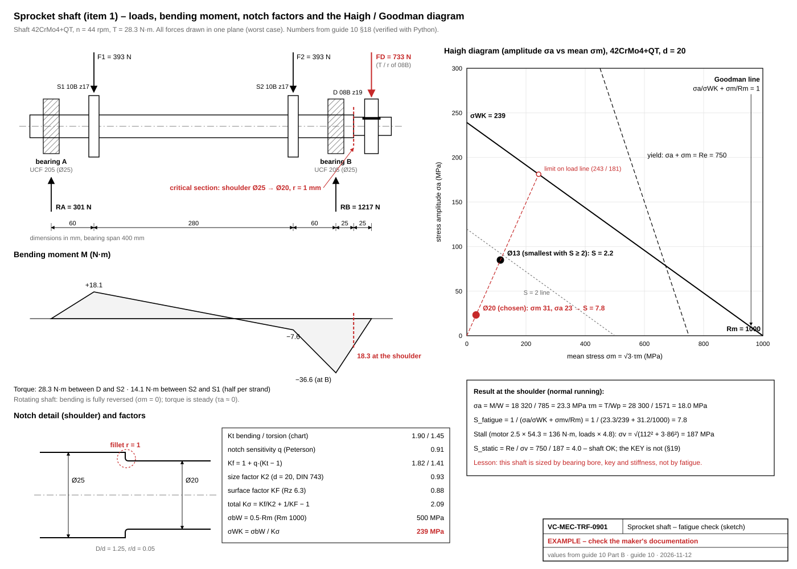
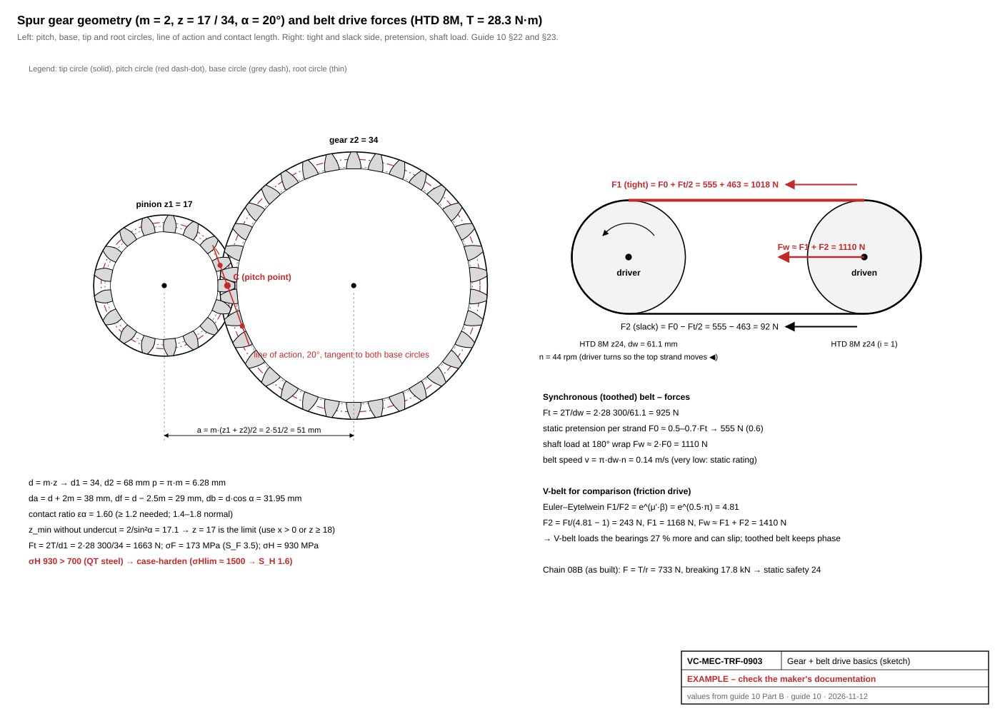
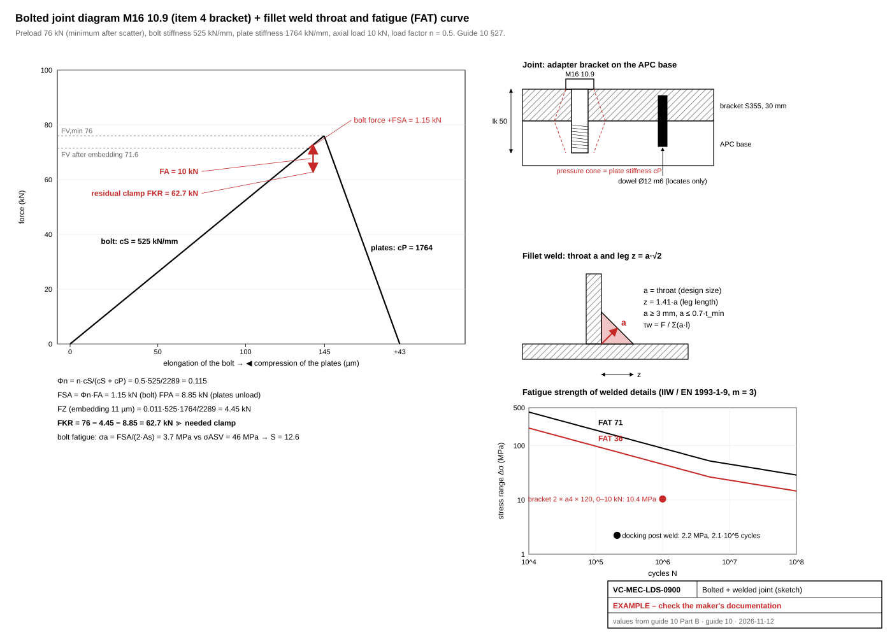
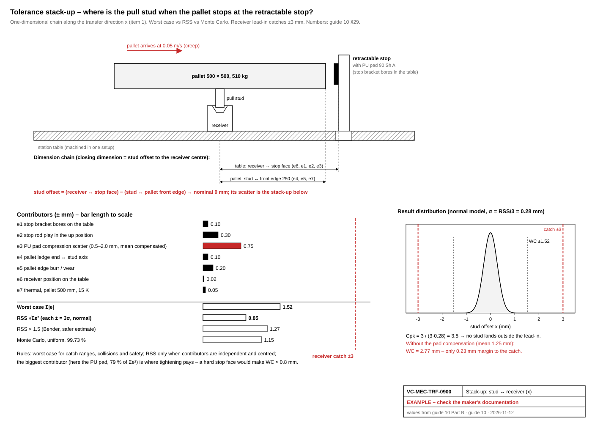
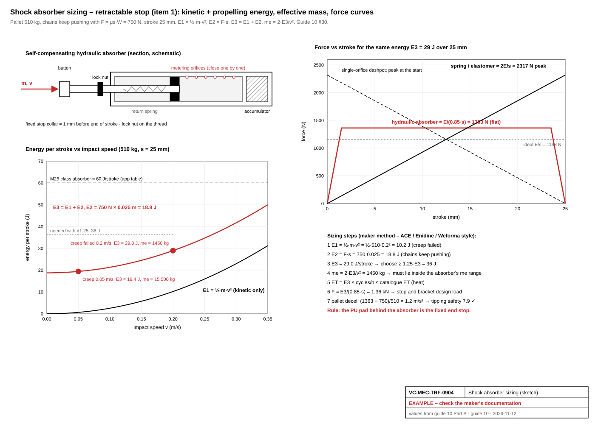
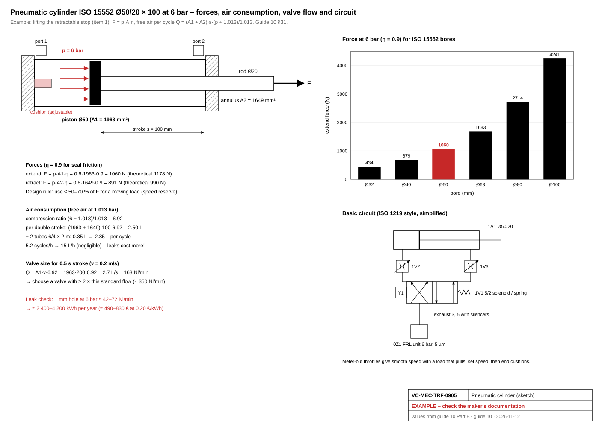
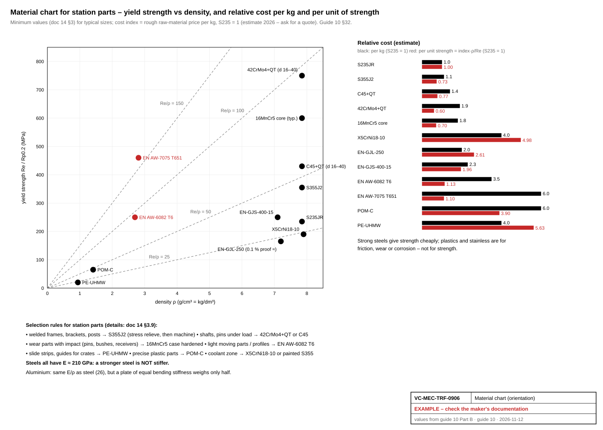
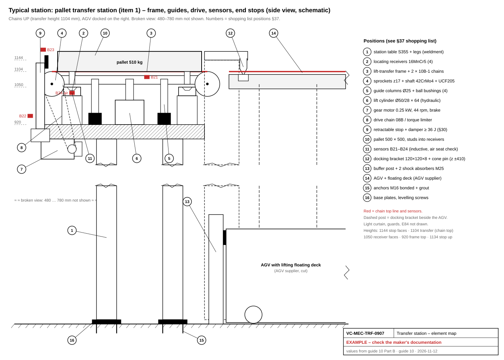

# 10 – Mechanical interfaces: AGV, crate stand, AS/RS front end, load station ↔ APC

> **Important – all numbers in this guide are EXAMPLES.**
> They are the default values of the twin pages. Before you make or buy anything, replace every number with data
> from **your AGV supplier, AS/RS supplier, machine builder, catalogues and your own measurements**.
> The pages show every formula with your numbers, so you can repeat each calculation.

Source files: `web/mech.js` (item 1), `web/mech2.js` (item 2), `web/mech3.js` (item 3), `web/mech4.js` (item 4).
The pallet data (size, masses, module pitch, APC radius, stroke, oil pressure, times, backlash, capture range) come **live** from the Pallet changer tab (`web/apc.js`, doc 09). Change them there first.

---

## Contents

- Part 0 – Overview, where in the twin, the key lessons (read this first)
- Item 1 – Pallet transfer AGV / manual cart ↔ APC load station
- Item 2 – Crate docking stand (underride AGV + forklift, V-guides, jib crane)
- Item 3 – AS/RS ↔ AGV front end (I/O conveyors, fence, light curtain, contour check)
- Item 4 – Load station ↔ APC (mounting, accuracy chains, interlocks, alignment)
- 9 – Corrections and clarifications
- 10 – Science principles for the interfaces
- 11 – Detailed manufacturing specification (interface parts)
- 12 – Identification and numbering
- 13 – Standards table
- 14 – Complete worked example: one cone-pin docking unit
- 15 – Data you still need
- 16 – Glossary (all items)

**Part B – Machine element design reference for the station builder (added 2026-11-12, 8 SVG drawings `docs/img/10_*`)**

- 17 – Gap list: what Part B adds, how to use it
- 18 – Design method for machine elements: load cases, safety factors, static and fatigue strength, Haigh / Goodman, notch, size and surface factors, worked shaft example (DIN 743 simplified) – drawing 10_shaft_fatigue
- 19 – Shaft–hub connections: keys, splines, interference fits, clamping elements (taper locking), set screws
- 20 – Rolling bearings: types, ISO 281 life, equivalent load, static safety, arrangements, lubrication, mounting
- 21 – Linear guides, guide columns and ball screws (short; details guide 12 Part 4)
- 22 – Gears and gear motors: involute basics, ISO 6336 simplified, worm gears, service factor, inertia factor – drawing 10_gear_belt_drive
- 23 – Belts and chains: toothed belt, V-belt, roller chain – forces, pretension, shaft load
- 24 – Couplings and torque limiters: types, misalignment, selection
- 25 – Brakes and clutches: braking torque, stopping time, pallet slip, energy per stop
- 26 – Springs: helical compression spring design (EN 13906-1), disc and gas springs
- 27 – Bolted and welded structures: joint diagram, bolt fatigue, weld throat, FAT classes – drawing 10_bolted_welded_joint
- 28 – Locating and indexing elements: dowels, cones, index plungers, zero-point
- 29 – Positioning accuracy chains: worst case, RSS, Monte Carlo, worked stack-up – drawing 10_tolerance_stackup
- 30 – Dampers and end stops: E1, E2, E3, effective mass, shock absorber sizing – drawing 10_shock_absorber
- 31 – Pneumatics basics: cylinder force, air consumption, valve flow, circuit, leaks – drawing 10_pneumatic_cylinder
- 32 – Material selection: property table, indices, cost – drawing 10_material_chart
- 33 – Surface treatments
- 34 – Design for manufacturing and assembly (DFM / DFA) rules
- 35 – A typical station from top to bottom: design sequence and element map – drawing 10_station_assembly
- 36 – Buy list – catalogue examples (14 tables)
- 37 – Consolidated shopping list – pallet transfer station (item 1)
- 38 – Formula sheet (Part B)
- 39 – Drawings of this guide (index)
- 40 – Glossary – Part B terms

Each item has: 1 Purpose · 2 Where in the twin · 3 Concepts · 4 Calculations · 5 Manufacturing, installation, commissioning, tests · 6 Checklists · 7 Mistakes / lessons · 8 Limits.

---

# Part 0 – Overview

## 0.1 What the four items are

| Item | Interface | Accuracy needed | Main solution |
|---|---|---|---|
| 1 | machining pallet (510 kg) AGV / cart → APC load station | ±0.02 mm in the receivers (±0.005 mm later in the machine) | floating AGV deck + lift docking on 2 cone pins + machined stop faces, chain transfer, receivers with lead-in |
| 2 | crate with castings (203 kg) AGV / forklift → stand beside the station | ±5 mm (operator guides the casting with a crane) | 4 passive self-centring V-guides |
| 3 | crate AS/RS ↔ AGV | crane fork and AGV must fit; safety at the fence | 2 chain conveyors through a fence opening with muting light curtain, side V-flare at the AGV position |
| 4 | load station ↔ APC ↔ machine | new pallet into zero-point modules ±1 mm; finished pallet onto receivers ±3 mm | station bolted + dowelled to the APC base, error chain, interlocks, master pallet alignment |

## 0.2 Where in the twin

1. Start the twin (`README.md`) and open the browser page.
2. Click the tab **"Mechanical elements"** (hash `#mech`).
3. Choose the item with the 4 buttons at the top: "1 · Pallet transfer AGV / cart ↔ APC load station", "2 · Crate docking stand", "3 · AS/RS ↔ AGV interface", "4 · Load station ↔ pallet changer (APC) connection".
4. Item 1–3: 3D view (click a part → function, specification, material, MAKE/BUY, manufacturing notes), animation with Play and time slider, inputs, checks, calculations, BOM, guide. Item 4: 2D animation (top view + side section), tables, checks, calculations, BOM, guide.
5. "Example values" resets the inputs. Inputs are saved in the browser (`mechState`, `mech2State`, `mech3State`, `mech4State`).

Deep links (put before `#mech`):

| Item | Parameters | Example |
|---|---|---|
| select item | `mxitem=1…4` | `/?mxitem=3#mech` |
| 1 | `mxveh=agv|cart`, `mxtask=deliver|pickup`, `mxview=overview|dock|transfer|side|top`, `mxt=<s>`, `mxpart=<key>` | `/?mxveh=cart&mxtask=pickup&mxview=dock&mxt=6&mxpart=cpin#mech` |
| 2 | `cxveh=agv|fork`, `cxtask=deliver|pickup`, `cxview=overview|stand|jib|side`, `cxt`, `cxpart` | `/?mxitem=2&cxveh=fork&cxview=stand#mech` |
| 3 | `axtask=out|in`, `axview=overview|pd|fence|agv|top`, `axt`, `axpart` | `/?mxitem=3&axtask=in&axview=agv#mech` |
| 4 | `m4mount=base|floor`, `m4t=<s>` | `/?mxitem=4&m4mount=floor&m4t=6#mech` |

Related page: AGV tab, item 4 "docking accuracy" (`web/agvdock.js`) animates the error chains of items 1–3 step by step.

## 0.3 The key lessons (apply them to every interface)

1. **First ask: "What accuracy does the real vehicle / machine have?"** – before you design any interface. Get the number from the supplier in writing (stop accuracy x, y and angle; repeatability; under which floor conditions). An AGV typically stops only **±5–10 mm** and **±0.3–1°**. A forklift driver: **±30–50 mm**. A stacker crane: ±3 mm. A machine zero-point: ±0.005 mm after catching ±1 mm.
2. **Never push a vehicle sideways into position.** An AGV with differential drive cannot slide sideways. To push the loaded AGV (1160 kg) sideways you need F = μ_tyre·m·g = 0.6·1160·9.81 ≈ **6.8 kN** – the AGV jams, tyres scrub, the pin bends. A rigid pin + funnel on the AGV body is **wrong** (it is fine for a manual cart, whose castors move sideways).
3. **Move only a light part, with low friction, and let fixed parts decide the position.** Item 1: floating deck on ball transfer units (≈ 195 N instead of 6.8 kN = 35 × less), lift docking on 2 cone pins (1 round + 1 diamond), height from machined stop faces.
4. **Coarse-to-fine catching.** Each stage must fit into the catch range of the next stage: AGV ±13 mm → cone pins catch ±16 mm → deck ±0.4 mm → receivers catch ±3 mm → ±0.02 mm → zero-point catches ±1 mm → ±0.005 mm.
   - Catch range of a male cone in a chamfered bore: **K = r_b + c − r_t** (r_b = bore radius, c = 45° chamfer of the bore, r_t = tip radius of the cone). Example: Ø25 bore (r_b = 12.5 mm), chamfer c = 5.5 mm, tip r_t = 2 mm → K = 12.5 + 5.5 − 2 = **16 mm**.
   - A V-flare only centres if the part slides down it: the face angle from horizontal must be steeper than the friction angle, **θ > atan μ**. Example item 2: θ = atan(60/55) = 47.5°, atan 0.15 = 8.5° → margin 39° (page aims ≥ 20°).
5. **Not over-determined.** One round locator + one diamond / slot locator + the rest with clearance (receivers, pull studs, cone pins).
6. **Check every moving envelope in plan and height** – the APC swing circle, the APC base, the cross beams, the parts on the pallet, the AGV bumper. Lessons found in the twin:
   - APC base occupies x = −r ± (dm + 260)/2 = −480 ± 305 → **x = −785 … −175 mm** (station centre = 0). Station legs must be outside (they are at x = −80 and +150).
   - The APC cross beams sweep a radius of **≈ 360 mm** (√(190² + 305²) = 359 mm) and pass over the station receivers → cross beams **flattened to 45 mm**; clearance over the receivers when lifted = 10 mm.
   - With module pitch 400 mm on a 500 mm pallet there is no room for the chain strands outside the studs → strands run **between the studs** (z = ±140 mm).
   - Pallet + parts sweep circle (overhang 40 mm) reaches **≈ 8 mm into the docked AGV bumper** → the AGV must stop further away (+38 mm) or leave before every change.
7. **Error chains decide the mounting.** A floor frame (B) gives **1.21 mm > ±1 mm** zero-point catch → bolt and dowel the station to the APC base (A): 0.76 mm.
8. **Do the dynamics check.** The pallet on the APC fork rails: friction holds only **× 1.3** of the tangential arm acceleration – and only **× 0.76** when the centripetal acceleration ω²·r is included (§9.1) → **locating blocks** on the rails are required.

---

# Item 1 – Pallet transfer AGV / manual cart ↔ APC load station

## 1.1 Purpose

Bring a **500 kg class machining pallet** (example 110 + 400 = 510 kg) from an AGV with a lifting chain deck – or from a manual cart – onto the 4 locating receivers of the APC load station, exactly enough that the APC forks can pick it up and the zero-point modules can clamp it. And the same in reverse (pick up the finished pallet). A forklift is **not** used for machining pallets.

Principle (lift-and-transfer chain unit in the station):
AGV stops (±10 mm) → E84 handshake → deck lock pin opens, deck floats → deck lifts: 2 cone pins centre it, stop faces set its height → station chains rise (studs clear the receivers) → both chain conveyors run → pallet hits the retractable stop → station chains lower, studs drop into the receivers, seat check → E84 complete, AGV deck lowers, lock pin re-centres, AGV leaves.

## 1.2 Where in the twin

Tab **Mechanical elements → item 1**. Buttons: AGV / Manual cart; Deliver new pallet / Pick up finished pallet; views Overview, Docking, Transfer unit, Side (heights), Top; light curtain on/off; labels. Sections: 3D, step table, handshake signal diagram (E84 + sensors), floating-deck front view (AGV offset drawn 5 × larger), concept comparison table, interface drawings (side + plan), calculations, tolerance chains, checks, BOM, guide (interface sheet, make, install, tests, PLC interlocks, maintenance).

Part keys for `mxpart`: `tframe, anchor, post, receiver, liftframe, guide, liftcyl, chain, sprocket, gearmotor, stop, dpost, pin, dbracket, cpin, float, darm, shock, funnel, curtain, e84, panel, agv, deck, vchain, vguide, pawl, bush, groller, cart, latch, castor, pallet, ledge, stud, fixture, apc, wall`.

## 1.3 Concepts

| Concept | Explanation |
|---|---|
| Floating deck | Upper deck of the AGV on ball transfer units: moves ±20 mm in x and z and ±1° with very low force. 4 centring springs + a conical lock pin keep it centred while driving. |
| Lift docking | While the deck lifts, 2 cone pins hanging from station brackets enter 2 bushes on the deck and push the deck into position. |
| Stop faces | Machined underside of the station brackets. The deck pushes up against them (example 600 N, motor torque limit) → deck chain height = station chain height, without a sensor. |
| Retractable stop | Stops the pallet over the receivers; goes **down** before the APC turns. |
| Locating receivers | Hardened bushes with 15° lead-in (catch ±3 mm); 1 round, 1 slot, 2 with clearance. Centre to ±0.02 mm, no clamping. |
| Protective guide rails | Do **not** centre the AGV. Only stop an AGV far off its path and guide the manual cart. |
| E84 / PIO | Optical 8-bit parallel I/O handshake between AGV and station (VALID, CS_0, L_REQ/U_REQ, TR_REQ, READY, BUSY, COMPT, HO_AVBL, ES). |
| Manual cart | Back-up when no AGV: fixed deck at transfer height, free rollers, docking pin + over-centre latch. Its castors move sideways, so a rigid pin works here. |

Concept comparison (from the page, correcting ±13 mm):

| Concept | Force | Result | Verdict |
|---|---|---|---|
| Rigid pin on the AGV body | 6.8 kN; Ø30 pin bending 116 N/mm²; wheels cannot slide | ±0.3 mm only if it works | ✕ – kept only for the manual cart |
| Better AGV navigation (fine positioning, omni wheels) | – | ±1–3 mm | ! expensive, dirt-sensitive, still not ±0.5 mm |
| Camera + servo X-Y table on the deck | small | ±0.3–0.5 mm | ! 2 axes, sensors, software, power on every AGV |
| **Floating deck + lift docking on 2 cone pins (chosen)** | 195 N sideways, 85 N push-up on the cones | ±0.4 mm sideways, ±1.1 mm height | ✓ passive, no sensor, common practice |
| Floating transfer unit on the station | small | good | ! station must stay exact to the APC – not chosen |

## 1.4 Design calculations (example values)

### Inputs

| Group | Input | Example |
|---|---|---|
| AGV | empty mass / slow-zone speed / docking speed | 650 kg / 0.3 m/s / 0.05 m/s |
| | deck height driving / deck lift speed / E-stop deceleration | 650 mm / 80 mm/s / 1.0 m/s² |
| | stop accuracy / angle accuracy | ±10 mm / ±0.5° |
| Floating deck | float range / deck mass / ball friction / spring rate | ±20 mm / 150 kg / 0.01 / 10 N/mm |
| | cone pin Ø / push-up force / tyre friction | 25 mm / 600 N / 0.6 |
| Chains | speed / acceleration / running resistance / static friction | 0.2 m/s / 0.3 m/s² / 0.1 / 0.15 |
| | sprocket teeth / gap station ↔ AGV chain | 17 / 60 mm |
| Station lift | frame mass / lift time / clearance under studs | 120 kg / 1.0 s / 10 mm |
| Docking + floor | shock absorber stroke / buffer height / cart pin Ø | 25 mm / 300 mm / 30 mm |
| | anchors / allowed per anchor / allowed height step | 6 / 8 kN / ±3 mm |
| Manual cart | mass / wheelbase / worst stop | 160 kg / 900 mm / 1.5 m/s² |
| Cell timing | pool distance / AGV speed / hand-over at pool / machining | 35 m / 1.2 m/s / 20 s / 1380 s |
| From APC tab | pallet 500 × 500, 110 + 400 kg, hc 250, pitch 400, r 480, stroke 60, 6 MPa | |

Constants in the code: receiver top H0 = 1050 mm, pull stud length below the pallet LS = 44 mm, receiver radius 30 mm, pallet thickness 70 mm.

### Heights

| | Formula | Example |
|---|---|---|
| Transfer height (chain top) | Ht = H0 + LS + clearance = 1050 + 44 + 10 | **1104 mm** |
| Chains lowered | H0 − 10 | 1040 mm |
| Station lift stroke | 1104 − 1040 | **64 mm** |
| Pallet CoG above pallet bottom | h = (mp·tp/2 + mw·(tp + hc))/m = (110·35 + 400·320)/510 | **259 mm** |

### Chain strands – where?

Outside the studs needs z_o − z_i ≥ 40 mm with z_i = pitch/2 + 30 + 10 = 240 and z_o = b/2 − 25 = 225 → no room. → **Between the studs** at z = ±(200 − 30 − 10 − 20) = **±140 mm**.

### Chain and drive

| | Formula | Example |
|---|---|---|
| Pull | F = m·(μ·g + a) (+ chain mass) = 510·(0.1·9.81 + 0.3) | **654 N** |
| Per strand | F/2·1.2 (uneven) | 393 N |
| Chain choice | start at 10B for pallets > 300 kg; safety on breaking load ≥ 10 (service factor 1.5); roller load ×2 impact ≤ allowed | **10B-1 (5/8")**: safety 22 200/(393·1.5) = **38**; 31 rollers under the pallet, 161 N each (allowed 350 N) |
| Sprocket | d0 = p/sin(180°/z) = 15.875/sin(10.6°) | 86.4 mm |
| Output speed | n = v·60/(π·d0) | **44 rpm** |
| Torque | T = F·d0/2 | **28.3 N·m** |
| Motor | P = F·v/η = 654·0.2/0.8 = 164 W; ×1.3 | **0.25 kW** gear motor, i ≈ 1400/44 = 32 |

### Transfer

| | Formula | Example |
|---|---|---|
| Travel | L = a + 40 + gap = 500 + 40 + 60 | 600 mm |
| Time | t = L/v + v/a + creep (0.02 m at 0.05 m/s) | **4.0 s** |
| No slip | μs·g/a = 0.15·9.81/0.3 | **4.9** (≥ 2) |
| No tipping | (a/2 ÷ h)/(acc/g) = (250/259)/(0.3/9.81) | **32** (≥ 3) |
| Stop force | m·v²/(2·3 mm) + μs·W = 510·0.05²/0.006 + 0.15·5003 | **963 N** → design ×1.5 = 1.44 kN |

### Station lift cylinder (oil from the APC unit)

F = (510 + 120)·9.81·1.25 = **7.73 kN**; D = √(4F/(π·p)) = √(4·7725/(π·6)) = 40.5 mm → **Ø50/28**, stroke 64 mm (real force 11.8 kN).
Flow Q = A·s/t = 1963·64/1.0 → **7.5 L/min** (APC pump 14.0 L/min – not at the same time as the APC lift).
Lowering: throttle to ≤ 20 mm/s in the last 10 mm so the pallet lands softly (average 64 mm/s). Mechanical end stops set the 2 heights, not the cylinder.

### Safety buffers, anchors, cart pin

| | Formula | Example |
|---|---|---|
| Total mass | AGV 650 + pallet 510 | 1160 kg |
| Normal creep energy | ½·m·v² = ½·1160·0.05² | 1.45 J |
| Fault (AGV at slow-zone speed) | ½·1160·0.3² | **52 J** → per absorber 52/2·1.25 = 33 J → 2 × **M25** (60 J/stroke) |
| Peak force | (E/2)/(0.85·stroke) = 26.1/(0.85·0.025) | 1.23 kN per absorber |
| Anchors | N = F·h/(lever·n/3) = 2456·300/(415·2) ; V = F/n | 0.89 kN tension, 0.41 kN shear → **11 %** of 8 kN |
| Cart pin side load | 0.15·m·g = 0.15·1160·9.81 | 1.71 kN |
| Cart pin bending | σ = 32·F·l/(π·d³), l = 1.5·d = 45 mm | **29 N/mm²** (allowed ~200) |

The AGV normally stops 40 mm before the buffers and never touches them (nominal bumper position 375 mm from the station centre; docked bumper face 335 mm).

### Stability

| | Formula | Example |
|---|---|---|
| AGV CoG at driving height | (650·250 + 510·(650 + 259))/1160 | 540 mm |
| Lever to front wheels | (650·810 + 510·600)/1160 − 445 | 273 mm |
| AGV tipping safety at E-stop | (lever/h·g)/a_brake | **5.0** (≥ 2) |
| Pallet on the AGV | (a/2 ÷ h)/(a_brake/g) = (250/259)/(1/9.81) | **9.5**; retention pawl 510·1.0·1.5 = 765 N |
| Manual cart CoG | (160·450 + 510·(1104 + 259))/670 | 1145 mm |
| Cart tipping safety | (lc/2 ÷ h·g)/a = (450/1145·9.81)/1.5 | **2.6** (≥ 2) |
| Manual push force | 0.03·W | 150 N (ergonomic ≤ 200 N) |

### AGV stop error → floating deck (the core calculation)

| | Formula | Example |
|---|---|---|
| Error at the pins | e = nav + z_pin·sin(yaw) = 10 + 350·sin 0.5° | **13.1 mm** |
| Cone lead-in | r ≥ e + 2 → ±16 mm; length = r/tan 15° | **60 mm** cone length (upper value – real cone 39 mm + 5.5 mm bush chamfer, and 264 N push-up on the chamfer, see §9.2) |
| Rigid pin (no!) | F = μ_tyre·m·g = 0.6·1160·9.81 | **6.8 kN** |
| Floating deck | F = μ_ball·(m_deck + m)·g + k·e = 0.01·660·9.81 + 10·13.1 | **195 N** (35 × less) |
| Push-up on the cone | Fv = F·(tan15° + μ)/(1 − μ·tan15°), μ = 0.15 | **85 N** (deck pushes 600 N; check: ≤ 50 % ok) |
| Spring return | x = F_friction/k = 64.7/10 | **6.5 mm** → springs alone do not centre → **conical lock pin**, lead-in ≥ ±20 mm |
| Float range check | float ≥ e + 2 → 20 ≥ 15.1 | ok |

### Tolerance chains

Height step between AGV chain and station chain (± mm):

| Contributor | Fixed deck | Height sensor | Deck on stop faces (chosen) |
|---|---|---|---|
| Floor flatness under AGV wheels | 2 | 0.5 | 0 |
| Tyre deflection empty ↔ loaded | 1.5 | 0 | 0 |
| AGV deck lift repeatability | 1 | 0.5 | 0 |
| Deck chain top ↔ deck reference | 0.5 | 0.3 | 0.2 |
| Height sensor + reference plate | 0 | 0.5 | 0 |
| Bracket stop faces (machined with station) | 0 | 0 | 0.1 |
| Station chain top (end stop) | 0.3 | 0.3 | 0.3 |
| Chain + guide wear | 1 | 0.5 | 0.5 |
| **Worst case (sum)** | **6.3** | **2.6** | **1.1** |
| Statistical RSS = √Σt² | 2.9 | 1.1 | 0.6 |

Allowed ±3 mm (with 5 mm × 30° chamfer on the pallet edges). Fixed deck fails, sensor is borderline, stop faces give ±1.1 mm mechanically.

Lateral (z), each stage catches the one before:

| Stage | ± mm | Caught by |
|---|---|---|
| AGV stop accuracy | 10 | floating deck (±20) |
| AGV angle ±0.5° at the pins | 3.05 | 2 pins (round + diamond) |
| Cone pin Ø25 g6 in bush H7, diamond pin | 0.05 | after docking |
| Pin position on bracket (machined) | 0.05 | |
| Bush ↔ deck chains (one setup) | 0.1 | |
| Deck chain guides | 0.2 | |
| **Deck chains to station chains** | **0.40** | receiver lead-in ±3 |
| Pallet seated in receivers | 0.02 | final ±0.005 by the zero-point modules |

### Clearances to the APC

| Check | Formula | Example |
|---|---|---|
| APC rails over receivers (turning, lifted) | rail bottom H0 − 50 + stroke − H0 = 1000 + 60 − 1050 | **10 mm** (ok ≥ 5) |
| APC rails over lowered station chains | 1060 − 1040 | **20 mm** |
| Studs leave the receivers when APC lifts | stroke − 5 − LS = 60 − 5 − 44 | **11 mm** (forks touch the ledges after 5 mm) |
| AGV deck side guides outside APC swing circle | √((r + a/2 + 20 + gap)² + (b/2 + 50)²) − Ø/2 = √(810² + 300²) − 833.6 | **30 mm** |
| Docking brackets outside swing circle | √((r + x_post − 30)² + (z_post − 30)²) − 833.6 | **25 mm** |

### Timing

Docking cycle (AGV, deliver): drive in 4.8 s + E84 1.5 s + deck lift 6.7 s + station lift 1.0 s + transfer 4.0 s + lower + seat 2.0 s + leave 3.5 s = **23.4 s**. Manual cart: 19.3 s.
Exchange per pallet = 2 dockings + 2 × 35 m / 1.2 m/s + 2 × 20 s = **145 s** vs machining 1380 s → AGV busy ≈ 10.5 % for this cell.

### Checks on the page (all green with the example)

Chain strength 38 · roller load 161/350 N · strands ±140 · no slip 4.9 · no tip 32 · float ±20 ≥ 13.1 · cone length 60 ≤ 80 · cone push 85 ≤ 300 N · lock pin re-centres (6.5 < 20) · height step ±1.1 ≤ 3 · brackets 25 mm outside swing circle · guide rails 20 mm per side · receivers catch ±0.40 ≤ 3 · rails over receivers 10 · over chains 20 · studs lift 11 · AGV deck 30 mm outside · AGV stable 5.0 · pallet on AGV 9.5 · anchors 11 % · cart pin 29 N/mm² · cart 2.6 · push 150 N · oil 7.5 ≤ 14.0 L/min · exchange 145 s ≤ 690 s.

## 1.5 Manufacturing, installation, commissioning

### Interface sheet – agree with the AGV supplier BEFORE any part is made

| Item | Value (example) |
|---|---|
| Pallet | 500 × 500 mm, 510 kg with load, CoG 259 mm above the pallet bottom, pull studs 44 mm below |
| Transfer direction | along the pallet ledges (x), AGV comes head-on to the load station |
| Transfer height (chain top) | 1104 mm (deck pushed against the station stop faces) |
| Driving height (chain top) | ≤ 650 mm |
| Chain strands | 2 × 10B-1, centre distance 280 mm, length 540 mm, 0.2 m/s, ramps 0.67 s |
| Free space under the pallet | 240 mm between the strands free up to 1050 mm (studs) |
| Pallet guides on the deck | side rails over the ledges, inner width 554 mm, retention pawl at the station end |
| AGV stop | bumper at 375 mm from the station centre, ±10 mm in x and z, ±0.5° – no contact with the station |
| Floating deck | ±20 mm (x, z) and ±1° on ball transfer units, 4 centring springs, conical lock pin closed while driving |
| Lift docking | 2 arms with bushes Ø25 H7 at z = ±350 mm, x = 395 mm; top faces = deck chain top + 40 mm; push-up 600 N (torque limit), creep for the last 50 mm |
| Speeds | slow zone ≤ 0.3 m/s, docking ≤ 0.05 m/s; shock absorbers take 52 J |
| Handshake | E84 optical I/O (VALID, CS_0, L_REQ/U_REQ, TR_REQ, READY, BUSY, COMPT, HO_AVBL, ES); transceiver at 760 mm, left side |
| Guide rollers | 4 × Ø60 at 200 mm (protection only – rails 760 mm apart) |

Note: the page's interface sheet text says "±0.5 (closed loop with the height sensor)" for the transfer height, while the chosen concept uses the stop faces (±1.1 mm worst case, no sensor). Agree the final wording with the AGV supplier.

### Main parts (MAKE / BUY) with notes

| Part | M/B | Material / spec (example) | Manufacturing / mounting |
|---|---|---|---|
| Station table | MAKE | S355J2 tube 60×50×4 and 70×70×5, stress relieved; top frame 870–920 mm; legs at x = −80 / +150 mm (outside the APC base), cantilever to x = −280 mm | Weld in a jig, anneal 580–620 °C, machine the 4 receiver pads + guide-column holes in ONE setup (flatness ≤ 0.05, holes ±0.02 mm, perpendicular 0.03/100). |
| Receiver pedestal (4) | MAKE | tube 70×70 + plate 20 mm, top at 1020 mm | Machine all 4 tops in one setup: same height ±0.02 mm. |
| Locating receiver (4) | MAKE/BUY | 16MnCr5 case-hardened 0.8–1.2 mm, 58–62 HRC, ground; Ø60, face at 1050 mm, 15° lead-in (catches ±3 mm) | 1 round bore (reference), 1 slot along x, 2 with +0.5 mm clearance. Air channel for the seat check. |
| Lift-transfer frame | MAKE | S355 C-profile 50×40 + cross beams; strands at ±140 mm | Machine both chain-guide seats in one setup: height ±0.1, parallel ±0.2 mm. |
| Chain guide strips (4) | MAKE | C45 induction hardened, 540 mm | Screw + pin; chamfer strip ends 2 × 30°. |
| Roller chain (4) | BUY | 10B-1 ISO 606, ≈ 1.28 m per strand | Sag 1–2 % of the free length; conveyor-chain oil. |
| Sprockets + shaft | BUY/MAKE | 4 × z17 C45 hardened teeth, shaft 42CrMo4, UCF bearings, tensioner | One shaft drives both strands (pallet cannot twist). Mark tooth phase; align ±0.2 mm. |
| Gear motor + brake + inverter | BUY | 0.25 kW, 44 rpm, 28 N·m, encoder, helical-bevel IE3 | Drives the shaft with a short 08B chain; ramp 0.67 s, creep 0.05 m/s at the end. |
| Guide columns + bushings (4) | BUY | Ø25 h6 hardened, flanged ball bushings | Press-fit; parallel ≤ 0.05 mm over the stroke. |
| Lift cylinder | BUY | ISO 6020-2 compact, Ø50/28 × 64, cushioning | + 4/3 valve + throttle on the APC manifold. |
| Retractable stop | BUY | heavy-duty conveyor stop with damper, 1.44 kN (for creep speed; if creep can fail: damper ≥ 36 J per stroke with 25 mm stroke or ≥ 22 J with 10 mm stroke, because the running chains keep pushing – corrected in §9.5 / §30), stroke 104 mm (up top 1134, down 1030 mm), PU 90 Sh A, 2 sensors | PLC: APC rotation only with the stop DOWN. |
| Buffer post + front plate | MAKE | S355 tube 60×60 + plate 15 mm; front face at x = 315 mm; posts z = ±280 mm, own anchors | Machine pin bore + absorber threads after welding; align to the station axis ±0.5 mm. |
| Docking bracket (2) | MAKE | S355 post 60×60 (**too soft – use 120×120×8 or tie to the station frame, §9.3**) + arm 80×30; posts at z = ±410 mm; stop faces at 1144 mm | Machine stop faces + pin bores **with the station chains UP**: faces at chain top + 40 ±0.1 mm, pins ±0.05 mm to the station axis. Then dowel. Load 300 N each. |
| Cone docking pin (2) | MAKE | 16MnCr5 58–62 HRC, ground g6, Ø25, cone 15°, lead-in ±16 mm, cone length 60 mm; 1 round (z = +350), 1 diamond (z = −350) | Polish cone Ra 0.4, light grease, replaceable. |
| Floating deck unit | BUY (AGV supplier)/MAKE | ball transfer units 0.5–1 kN each (hardened counter surface, §10.4), 4 springs 10 N/mm, conical lock pin; ±20 mm / ±1°, 660 kg | Lock pin needs a cone with lead-in ≥ ±20 mm. |
| Docking arms + bushes (on deck) | MAKE (AGV supplier builds in) | S355 + bush 16MnCr5 H7 Ø25 at z = ±350 | Bush bores, top faces and deck chain guide seats in ONE setup ±0.1 mm. |
| Shock absorbers (2) + PU pads | BUY | M25 self-compensating, 60 J, stroke 25; pads 90×90×20, 90 Sh A | At z = ±190 mm. The fixed stop is the PU pads. |
| Protective guide rails (2) | MAKE | S355 flat 15 mm + UHMW-PE 10 mm; 1300 mm long, inner 760 mm, entry +50/side | Countersunk screws 2 mm below surface; slotted floor brackets ±5 mm; chamfered ends. |
| Cart docking pin + bush | MAKE | pin 16MnCr5 hardened f7 Ø30 × 60, cone 15°, height 300 mm; bush H8 with 15° lead-in | Flange 4 × M8 + 2 dowels; bush adjustable ±3 mm then dowelled. |
| Light curtain + muting | BUY | type 4, 300–1800 mm, outside the swing circle | ISO 13855 distance; muting per IEC 62046 (2 independent signals: docked + E84 VALID). |
| E84 optical I/O pair | BUY | IR 8 bit | face to face 0.1–1 m; keep the window clean. |
| Sensors (≈ 12) | BUY | docked, latch, chains up/down, stop up/down, pallet at stop, 4 × seat, deck pallet present | |
| Anchors | BUY | M16 bonded 8.8 + M20 levelling screws + non-shrink grout | Concrete ≥ C25/30, ≥ 200 mm, edge ≥ 100 mm; level 0.2 mm/m, grout 20–30 mm, tighten after 24 h. |
| Manual cart | MAKE | S355 frame, 4 × Ø160 PU castors (2 swivel with brake), 160 kg, deck fixed at 1104 mm ±1 | Shims under the roller tracks. Floor in the cart path ±2 mm, no steps. |
| Pallet (APC tab) | – | chamfer all bottom edges 5 mm × 30°; keep strand tracks free of burrs | |

### Make the parts (order)

1. Station table: tack all, weld crosswise (keeps it flat), anneal, machine in one setup on a boring mill.
2. Receivers: turn, case-harden, grind face and bore.
3. Lift frame: weld, anneal, machine chain-guide seats, fit hardened strips.
4. Shaft + sprockets: keyways or clamping bushes; both sprockets in phase.
5. Docking post: weld, machine pin bore + absorber threads in one setup.
6. Guide rails: flat bar + UHMW-PE, slotted brackets.
7. Paint: frames RAL 5010 (or your standard); rail ends and stop yellow/black (ISO 3864); machined faces oiled.

### Install at the machine

1. Floor: concrete ≥ C25/30, ≥ 200 mm; AGV lane flatness ±2 mm over 2 m; no joints under the docking area.
2. Mark the station centre **from the APC axis**: r = 480 mm along the change direction (tape + plumb line or laser tracker) ±0.5 mm.
3. Set the table: receiver faces at the machine receiver height 1050 mm ±0.1 (precision level 0.02 mm/m), centred to the APC fork rails ±0.5 mm. (For the final mounting choice see item 4.)
4. Drill and set the anchors, grout, tighten after curing.
5. Turn the APC by hand (slow mode) with a pallet: clearance of the fork rails over the receivers (≥ 8 mm, example) and over the lowered chains.
6. Buffer post on the station axis ±1 mm, front face at x = 315 mm; guide rails symmetric ±2 mm.
7. Docking brackets: posts at z = ±410 mm. With the station chains UP, shim the stop faces to chain top + 40 ±0.1 mm and the pins to the station axis ±0.05 mm (gauge block + dial gauge), drill and dowel.

### Commissioning tests

| Test | How | Accept |
|---|---|---|
| AGV offset test | stop the AGV on purpose 12 mm off in x and z and 0.7° turned (both directions) | deck docks, transfer works every time |
| Deck position after docking | 20 dockings, dial gauge deck chain guide vs station chain guide | ±0.4 mm |
| Height step | dial gauge across the chain gap, empty and with a 1.25 × load test pallet | ±1.1 mm (allowed ±3) |
| Lock pin | after 20 offset dockings | closes every time |
| Transfer | 50 transfers each way with test pallet 1.25 × 510 kg | no stop error, seat check OK |
| Stop + overrun | creep speed disabled (test mode) | pallet stops at the hard stop, no damage, ±1 mm |
| Interlocks | try to rotate the APC with chains up / stop up / transfer active | APC does not move |
| Safety | light curtain with and without AGV (muting), E-stop at panel and AGV | stop in the calculated time |
| Endurance | 500 exchange cycles in automatic | no wear marks, chain tension OK |

### PLC interlocks (safety-related parts per ISO 13849, PL d)

- APC may lift / rotate only if: station chains DOWN (B21 off), stop DOWN, no transfer active (E84 BUSY off).
- Station chains may lift only if: APC lowered at 0° / 180° + vehicle docked (B11) + E84 TR_REQ (AGV) or latch closed + button (cart).
- Chains run only if: chains UP, AGV / cart deck chains ready (READY / BUSY), light curtain clear or muted.
- Muting only while docked AND E84 VALID; any lost signal = chains stop + brake.
- Chains run only with B13 "deck on the pins". The AGV may not drive while its lock pin is open (B14 off).
- AGV may leave only after COMPT; the deck lowers only after leaving the docking post (pawl up first).

Sensor names used: B11 vehicle in position / cart docked, B12 latch closed, B13 deck on the pins, B14 deck lock pin closed, B21 chains up, B22 stop up, B23 pallet at stop, B24 pallet seated (4×), M1 chains run.

### Maintenance

| Interval | Work |
|---|---|
| Weekly | clean chips from receivers and strand tracks; check seat-check air |
| Monthly | chain tension (sag 1–2 %), lubricate, check PU pads and guide strips |
| 6 months | shock absorbers, cone pins + bushes, ball transfer units, springs, lock pin, anchor torque, height step re-check |
| Yearly | chain elongation (replace at 2 %), guide strips, guide bushings, receivers |

## 1.6 Checklist (item 1)

- [ ] Stop accuracy (x, z, angle) of the real AGV received in writing.
- [ ] Float range ≥ error at the pins + 2 mm.
- [ ] Cone lead-in ≥ error + 2 mm; cone length ≤ 80 mm.
- [ ] Push-up force ≥ 2 × vertical cone force.
- [ ] Conical lock pin (springs alone leave ±6.5 mm).
- [ ] Height step worst case ≤ allowed step (pallet chamfer 5 × 30°).
- [ ] Strand position (between / outside studs) agreed with the AGV supplier.
- [ ] Station legs outside the APC base; cross beams pass over receivers; brackets and AGV guides outside the swing circle.
- [ ] Interface sheet signed by the AGV supplier.
- [ ] Brackets machined with the chains UP, then dowelled.
- [ ] All commissioning tests passed and recorded.

## 1.7 Mistakes / lessons (item 1)

- A rigid pin / funnel that centres the AGV body: needs 6.8 kN, the AGV jams. Use the floating deck.
- Guide rails that touch the AGV in normal operation: they wear and push the AGV. Keep 20 mm per side.
- Height by sensor + AGV lift control only: ±2.6 mm, borderline. Push against machined stop faces.
- Two round pins (over-determined): the deck jams. One round + one diamond.
- Strands outside the studs on a 500 mm pallet with pitch 400: no room → strands between the studs.
- Forgetting that the retractable stop must be DOWN before the APC turns.

## 1.8 Limits (item 1)

Typical catalogue values for chains, shock absorbers, motors; simple static stability (no dynamics of the lift, no floor slope); docking forces with simple friction; tolerance values are examples; the floating deck is the AGV supplier's design – the page only defines the interface. No prices, no CE assessment.

---

# Item 2 – Crate docking stand (castings in / empty crates out)

## 2.1 Purpose

Castings arrive in a **crate** (steel box pallet with nests, Euro footprint 1200 × 800) and empty crates go back. One simple stand beside the load station serves both an **underride AGV** (drives under the stand and lowers the crate) and a **forklift** (sets the crate down). Both are inaccurate (AGV ±10 mm, forklift driver ±50 mm): **4 self-centring V-guides** at the crate corners centre the crate while it is lowered. The operator lifts each casting (32 kg > 23 kg) with a **jib crane** onto the fixture.

Why simpler than item 1: the crate only needs **±5 mm** – the operator guides the casting with the crane. No floating deck, no pins.

## 2.2 Where in the twin

Mechanical elements → item 2. Buttons: Underride AGV / Forklift; Deliver full crate / Pick up empty crate; views Overview, Stand + guides, Jib crane, Side. Sections: 3D, step table, guide section (live), plan view, calculations, tolerances, checks, BOM, guide.
Part keys (`cxpart`): `stand, vguide, pad, anchor, bollard, sensor, crate, nest, casting, uagv, uplate, fork, jib, hoist, gripper, station, operator`.

## 2.3 Concepts

- **V-guide with flare:** the crate corner lands on an inclined UHMW-PE face (flare 55 mm per side over 60 mm height), slides down into a straight part (40 mm) with 5 mm clearance. The crate **weight** does the centring.
- **The crate must be able to move** on the vehicle: AGV plate with a retaining rim with ±25 mm play and **no locating pins**; forks in the tunnels have ±60 mm play.
- **Open frame:** no low cross members – the AGV drives under it.
- **Crate rests on its long edges** (rails) – same principle as rack and conveyor (item 3).

## 2.4 Calculations (example values)

Inputs: crate 1200 × 800 × 600 mm, 75 kg empty, 4 castings × 32 kg; AGV height 300, width 560, stroke 150, lift 40 mm/s, 0.3 m/s under the stand, ±10 mm / ±0.5°, rim play ±25; forklift ±50 mm, lowering 0.3 m/s; guide height 100, flare 55, clearance 5, friction 0.15, PU pad deflection 3 mm, anchor 8 kN; gripper 15 kg, jib radius 1600, arm 60 kg, 45 s per casting, machining 1380 s. Stand centre at (750, −1750) mm, jib column at (150, −1250) mm from the station centre.

| Topic | Formula | Example |
|---|---|---|
| Crate mass | 75 + 4·32 | **203 kg**, W = 1991 N |
| Rail top | Hs = AGV height + 20 | **320 mm**; crate top 920 mm |
| Carry height | Hs + guide 100 + 15 | 435 mm |
| AGV stroke needed | 435 − 300 | **135 mm** (AGV has 150) |
| Grip height | Hs + base 130 + 150 | 600 mm (good 600–1100) |
| AGV error | e = nav + (L/2)·sin(yaw) = 10 + 600·sin 0.5° | **15.2 mm** |
| Leg clearance | 800 − 160 = 640 ≥ 560 + 2·(15.2 + 15) | 640 ≥ 620 mm ✓ |
| Guide angle | θ = atan(60/55) | 47.5° from horizontal |
| Friction angle | φ = atan 0.15 | 8.5° → margin θ − φ = **39°** (≥ 20°) |
| Centring force | F = W·tan(θ − φ) | **1610 N** |
| Forklift impact | E = ½·m·v² = ½·203·0.3² = 9.1 J; F = 2E/s (s = 3 mm) | **6.1 kN** total → 1.52 kN per pad |
| Rail (tube 100×50×4, L = 1120) | F = (W + F_imp)/2 = 4041 N; M = F·L/8 = 566 N·m | σ = **20 N/mm²**, δ = 5FL³/(384EI) = **0.24 mm** |
| Anchors | (W + F_imp)/4 per leg, /2 per anchor | **1.0 kN** (allowed 8) |
| Jib load | 32 + 15 = 47 kg; ×1.2 = 56 → standard | **SWL 63 kg** |
| Jib foot moment | SWL·1.25·g·R + m_arm·g·R/2 = 63·1.25·9.81·1.6 + 60·9.81·0.8 | **1707 N·m** |
| Column tube 168.3 × 6.3 | σ = M/W | **14 N/mm²** |
| Jib anchors (8 on Ø400) | T = 4M/(n·D) | **2.1 kN** each |
| Reach | crate 781 mm, fixture 1259 mm ≤ 1600 − 100 | ✓ |
| Loading time | 4 × 45 s | **180 s** of 1380 s |
| AGV trips | 3600/1380·2 | 5.2 per hour (full in + empty out) |
| Stand outside APC swing circle | nearest corner to APC axis − Ø/2 | **656 mm** (≥ 300) |

Tolerances: AGV stop ±10, angle ±5.2 (over half the crate), forklift ±50 → all caught by the 55 mm flare → seated ±5 mm.

Steps (AGV, deliver): drive in 8.0 s, lower 3.4 s, drive out 8.0 s, operator loads 4 castings (animation 9 s). Forklift: in 6 s, lower 3 s, out 5 s.

## 2.5 Manufacturing, installation, tests

Interface sheet:

| Item | Value (example) |
|---|---|
| Crate | 1200 × 800 × 600 mm, 203 kg full; bottom plate closed and flat ±2 mm; corners square ±2 mm; 2 fork tunnels 220 × 100 mm at z = ±200 mm |
| Stand | rail top 320 mm, clear width 640 mm, open at the entry, guides 100 mm high with 55 mm flare |
| Underride AGV | height ≤ 300, width ≤ 580 mm, stroke ≥ 135 mm, lift plate with rim (±25 mm), **no locating pins**, 0.3 m/s under the stand |
| Forklift | enters from the AGV side, lowers ≤ 0.3 m/s, forks fully in the tunnels |
| Signals | B1 crate present, B2 crate seated, RFID crate number → MES; AGV orders from the fleet manager |

Parts:

| Part | M/B | Spec (example) | Notes |
|---|---|---|---|
| Crate stand | MAKE | S355: legs 80×80×5, rails 100×50×4 × 1200, base plates 15 mm | Weld 2 side frames flat in a jig, join with top end beams – nothing below 270 mm between the legs. 2 anchors per leg. |
| V-guide (4) | MAKE | S355 angle 8 mm + UHMW-PE 10 mm | Flare 55 mm over 60 mm; countersunk screws 2 mm below the face; slotted holes ±5 mm; strips are wear parts. |
| PU pads (4) | BUY | 90 Sh A, 100 × 80 × 20 | replaceable |
| Base plates + anchors | BUY | 150 × 150 × 15, M12/M16 bonded (4 + 8) | level rails ±1 mm with shims, grout |
| Bollards (2) | BUY | Ø114 concrete-filled, yellow/black, 4 × M16 | forklift protection |
| Sensors B1, B2 + RFID | BUY | diffuse + inductive + reader | B2 at the bottom of a guide: switches only when fully down |
| Crate | MAKE | S235 welded, closed bottom, 2 tunnels, mesh walls, stackable corner cones | All crates same outer size ±2 mm (weld in a jig); nests same position ±5 mm. |
| Nest | MAKE | PE-HD or wood with PU lining | |
| Underride AGV + lift plate | BUY | UHMW-PE top + rim, no pins | AGV supplier |
| Column jib crane | BUY | SWL 63 kg, R 1600, 270° slewing, column 168.3 × 6.3 | foundation per supplier |
| Chain hoist / balancer | BUY | ≥ 63 kg | balancer makes the part "weightless" |
| Casting gripper | MAKE | expanding mandrel in the cylinder bores, 15 kg, self-locking | proof test 2 × load |

Install:
1. Stand position: outside the APC swing circle (≥ 300 mm), operator walkway ≥ 800 mm to the load station.
2. Rails level ±1 mm, parallel ±2 mm; anchor every leg; set the 4 guides **with a master crate** (5 mm clearance all round).
3. Bollards; paint AGV lane and forklift zone; teach the AGV stop point (stand centre).
4. Jib crane: column vertical ±1 mm/m; slewing stop so the arm cannot reach into the APC swing circle above the pallet changer.

Tests:

| Test | How | Accept |
|---|---|---|
| AGV offset | AGV stopped 18 mm off both ways, 20 cycles | crate seated (B2) every time |
| Forklift | 3 drivers × 10 placements | seated without correction |
| Load test | 1.25 × full crate, forklift lowering at 0.3 m/s | no permanent deformation |
| Jib crane | proof load 1.25 × SWL (supplier certificate) | OK, slewing stops work |

Maintenance: monthly guide strips, PU pads, sensors; 6-monthly anchor torque, crate corners (bent crates out of service), gripper; yearly jib crane inspection by a competent person.

## 2.6 Checklist (item 2)

- [ ] Flare ≥ forklift error + 5 mm and ≥ AGV error + 5 mm.
- [ ] θ − atan μ ≥ 20°.
- [ ] AGV plate rim play ≥ AGV error + 5 mm, no pins on the plate.
- [ ] Clear width ≥ AGV width + 2·(error + 15).
- [ ] AGV stroke ≥ guide height + 35 mm.
- [ ] All crates checked with a gauge (±2 mm).
- [ ] Jib reach, SWL, slewing stop; lifting aid for castings > 23 kg.

## 2.7 Mistakes / lessons (item 2)

- Locating pins on the AGV plate: the crate cannot shift, the guides fight the pins. Use a rim with play.
- Flare too flat (angle near the friction angle): the crate stops on the flare. Keep θ well above atan μ.
- Low cross members "for stiffness": the AGV cannot drive under. Stiffen with end beams at rail height.
- Crates of different size: one crate jams in the guides. Make all crates in one jig.
- Manual lifting of 32 kg castings: not allowed by ergonomics rules – use the jib crane.

## 2.8 Limits (item 2)

Static stand check with a simple impact model (3 mm pad deflection); jib crane values by simple formulas (the supplier designs the foundation); grip height is approximate; no fatigue check.

---

# Item 3 – AS/RS ↔ AGV front end

## 3.1 Purpose

Where the raw-material **AS/RS** (stacker crane in a fenced area) hands crates to the **AGVs**. Two I/O chain conveyors (IN / OUT) leave the crane area sideways:
P&D position (crane fork) → buffer inside the fence → **fence opening with muting light curtain** → contour check (IN lane: size, overhang, height, weight, barcode/RFID) → **AGV transfer position** (open below for the underride AGV, side V-guides, end stop).

The ISO 13855 **safety distance** decides where the fence is and how many positions are inside. The crate always rests on its **two long edges** – in the rack (2 support angles), on the conveyor (2 chains), on the AGV stand – so both the crane fork and the AGV can go under it.

## 3.2 Where in the twin

Mechanical elements → item 3. Buttons: OUT (AS/RS → AGV) / IN (AGV → AS/RS); views Overview, Crane P&D, Fence opening, AGV transfer, Top. Sections: 3D, steps, signal timeline (WMS, AS/RS PLC, conveyor, safety, fleet manager, AGV), example messages, plan view, real-environment requirements, calculations, checks, BOM, responsibilities + FAT/SAT.
Part keys (`axpart`): `rack, crane, fork, rail, conv, motor, sensor, guide, stop, contour, fence, door, curtain, cabinet, agv, crate`.

## 3.3 Concepts

- **P&D position:** pick-up and drop-off place of the crane fork on the conveyor.
- **Safety distance S = K·T + C (ISO 13855)**, here for reaching through / over the beams: K = 1600 mm/s, C = 850 mm.
- **No stop position in the fence opening:** a waiting crate must never stand in the light curtain. The conveyor through the opening is a **bridge section** with no stop.
- **Muting:** the light curtain is bridged only while muting sensors see a crate shape in the right order and for a limited time (IEC 62046).
- **Zero-pressure accumulation:** one drive per position, crates can wait without touching.
- **Contour check before storage:** a bad crate (overhang, part sticking up, overweight, no ID) can jam or crash the crane.

## 3.4 Calculations (example values)

Inputs: crate 1200 (across the aisle) × 800 × 600 mm, 203 kg full; rated AS/RS load 250 kg; crane double cycle 50 s, stop time near P&D 0.5 s, fork width 500 mm, P&D accuracy ±3 mm; 12 in + 12 out per hour; conveyor 0.2 m/s, 0.3 m/s², resistance 0.1, gap 200 mm, light-curtain response 0.02 s; AGV 300 high, 560 wide, ±10 mm / ±0.5°, 0.3 m/s, lift 40 mm/s, side flare 40 mm; contour: overhang 20 mm, height +30 mm.

| Topic | Formula | Example |
|---|---|---|
| Stop time | T = light curtain 0.02 + crane 0.5 | 0.52 s |
| Safety distance | S = 1600·T + 850 = 1600·0.52 + 850 | **1682 mm** |
| Aisle width | crate length + 200 | 1400 mm |
| Fence line | aisle edge 700 + S, rounded up to 50 | **2400 mm** from the aisle centre |
| P&D centre | aisle/2 + crate/2 + 50 | 1350 mm |
| Position pitch | 1200 + 200 | 1400 mm |
| Positions | inside: P&D at 1350 (ends 1950 ≤ 2300); outside start ≥ fence + 100 + 600 = 3100; transfer at 4500 | **3 per lane, 1 inside** |
| Bridge (no stop in the opening) | 2500 − 1950 | **550 mm** (≥ 200) |
| Lane length | | ≈ 4.4 m |
| Chain top | AGV height + 20 | **320 mm** |
| Clear width | 2·(xc − 20), xc = 800/2 − 40 = 360 | **680 mm** |
| Fork needs | 500 + 2·30 | 560 ≤ 680 ✓; P&D ±3 vs fork clearance ±90 ✓ |
| AGV error | 10 + 600·sin 0.5° | 15.2 mm → needs 560 + 2·(15.2 + 15) = 620 ≤ 680 ✓; flare 40 ≥ 20.2 ✓ |
| Conveyor force / power | F = m·(μ·g + a) = 203·(0.981 + 0.3) = 260 N; P = F·v/0.8 = 65 W ×1.5 | **0.12 kW** per position |
| Time per position | p/v + v/a = 1.4/0.2 + 0.67 | 7.7 s |
| Crane utilisation | (12·50 + 0·…)/3600 | **17 %** (ok ≤ 70 %) |
| Buffer OUT | (3 − 1)·3600/12 | AGV may be **10 min** late |
| Buffer IN | (3 − 1)·3600/12 | crane may be busy 10 min |
| AGV lift stroke | 320 + 100 + 15 − 300 | ≥ 135 mm; one transfer ≈ 19 s |
| AGV visits | 12 + 12 | 24 per hour |
| Fence opening | (800 + 200) × (320 + 600 + 150) | 1000 × 1070 mm |

Faster stopping crane axes (smaller T) = shorter conveyors.

Steps OUT: crane fetches 10 s → puts on P&D 8 s → conveyor to transfer 16.4 s → AGV picks 19.4 s. Steps IN: AGV drops 19.4 s → contour check 9.7 s → conveyor to P&D 9.4 s → crane stores 14 s.

## 3.5 Manufacturing, installation, tests

Responsibilities (write into the contracts):

| Item | AS/RS supplier | Conveyor (you / integrator) | AGV supplier |
|---|---|---|---|
| P&D position | teach fork ±3 mm, interlock "fork in P&D" | chains + frames 680 mm clear, "P&D occupied" | – |
| Transfer position | – | side guides, end stop, "load ready / position free" | stop ±10 mm, lift ≥ 135 mm, E84 / VDA 5050 actions |
| Safety | crane, door locking, EN 528 | fence, light curtain + muting, safety PLC, EN 619 | scanners, ISO 3691-4, speed in the lanes |
| Software | WMS ↔ PLC telegrams | conveyor PLC, contour check, HMI | fleet manager ↔ WMS (VDA 5050) |
| CE marking | **one** responsible integrator for the complete system – decide before ordering | | |

Parts (BOM, example quantities): stacker crane + racks + rails (BUY, 1); I/O conveyor sections 1400 mm (MAKE, 6 = 3 per lane × 2); 3/4" roller chains + UHMW-PE guides + sprockets (BUY, 12, ≈ 3.1 m per strand); gear motor + brake + inverter 0.12 kW (BUY, 6); retro-reflective position sensors (BUY, 12); chain guards (MAKE, 6, EN 619); side guides + V-flare 40 mm (MAKE, 2); end stop with PU buffer (MAKE, 2); contour check – 2 light grids 5 mm, load cells, barcode/RFID (BUY, 1, IN lane); type 4 light curtain + 4 muting sensors (BUY, 2); safety fence 2 m (≈ 17 m); door with guard locking + LOTO (ISO 14119); control cabinet with safety PLC + HMI; E84 optical I/O or VDA 5050 via the fleet (2); floor marking + anchors.

Make the conveyors:
1. Side frames S355 tube 120 × 40, weld in a jig; chain-guide seats machined or shimmed ±0.5 mm.
2. Connect the 2 side frames **only with floor ties ≤ 100 mm high** – the fork and the AGV need the middle free. At the AGV transfer position: no floor tie, each frame anchored separately.
3. Chains 3/4" on UHMW-PE strips, tensioner per section, guards on the return strand and every sprocket (no reachable nip points).
4. One gear motor + inverter per position; 2 sensors per position (slow-down, stop).
5. Paint frames RAL 5010, guards yellow; label positions like in the WMS (IN-1-P1 …).

Install:
1. Floor survey before the rack; take all conveyor positions from the aisle axis set out by the AS/RS supplier.
2. P&D sections on the crane axis ±2 mm, chain top 320 mm ±1; other sections in line ±2 mm.
3. Side fence at 2400 mm from the aisle axis, gap to the floor ≤ 200 mm (mesh ≤ 40 mm at ≥ 200 mm from moving parts, ISO 13857); light curtains centred in the openings; muting sensors per the muting plan.
4. Cabinet outside the fence; no cables in the AGV lanes.
5. Teach crane P&D positions and AGV stop points (with an offset test).

Real-environment requirements (from the page): crane rail strip flat ±2 mm, concrete ≥ C25/30; AGV lanes ±2 mm over 2 m, steps ≤ 3 mm, slope < 1 %; building height AS/RS 9.5 m + 0.5 m; in-rack sprinklers per insurer, fire shutter where a conveyor crosses a fire wall; +5…+40 °C, castings below 50 °C before storage; foundry dust → chain conveyors (not rollers), wipers, cleaning plan; lighting ≥ 200 lx (≥ 300 lx at HMI), no glare into light curtains; 400 V separate feeder, lockable main switch; Wi-Fi roaming over the whole AGV route (VDA 5050 over MQTT); risk assessment, safety PLC PL d, CE; walkways ≥ 800 mm outside the fence. Standards named on the page: EN 528, EN 619, ISO 3691-4, ISO 13855 / 13857, IEC 62046, EN 15620, EN 15512, EN 15635, ISO 14119, ISO 14120, EN 12464-1, VDA 5050.

Example messages (OUT): MES → WMS transport order; WMS → AS/RS PLC telegram (job, source location, target OUT-1-P1); PLC → WMS job done; conveyor → fleet manager LOAD_READY; fleet manager → AGV VDA 5050 order with "pick" action; AGV ↔ conveyor E84 VALID → U_REQ → TR_REQ → READY → BUSY → COMPT. IN: drop order, L_REQ (position free), contour OK + weight + RFID to WMS, store job; NOK → crate back to the AGV position, HMI shows the reason.

Acceptance tests (FAT at the supplier, SAT on site):

| Test | How | Accept |
|---|---|---|
| P&D interlock | run P&D chains with the fork in; put a crate on an occupied P&D | blocked every time |
| Contour check | test crates: +25 mm offset, part 40 mm too high, 10 % overweight, no label | all rejected, correct reason |
| Muting | crate passes; person / test rod with and without crate; muting time-out | crate passes, person stops the system |
| Door | open request while the crane moves | stays locked until safe |
| AGV transfer | AGV ±12 mm off, 20 transfers per lane | no fault |
| Throughput | 12 in + 12 out per hour for 4 h | no AGV waiting > 2 min |
| Communication loss | Wi-Fi off during transfer; WMS link off | safe stop, recovery without manual handling |

Maintenance: weekly clean light grids / sensors / curtains, check guards; monthly chain tension + lube, guide strips, end-stop buffers, muting test; yearly crane inspection (EN 528), rack inspection (EN 15635), safety validation.

## 3.6 Checklist (item 3)

- [ ] Crane stop time T from the supplier (not estimated); S recalculated.
- [ ] Fence at aisle edge + S; no stop position in the opening (bridge ≥ 200 mm).
- [ ] Clear width fits fork (+2·30) and AGV (+2·(error + 15)).
- [ ] Crate on its 2 long edges everywhere (rack angles, chains, rails).
- [ ] Contour check on the IN lane before the crane.
- [ ] One CE integrator named in the contracts.
- [ ] Buffer times OK for AGV delay and crane delay.

## 3.7 Mistakes / lessons (item 3)

- A stop position inside the fence opening: a waiting crate blocks the light curtain (or muting stays active too long). Use a bridge section.
- Cross members between the conveyor frames: the crane fork and the AGV cannot get under the crate.
- No contour check: one overhanging part can crash the stacker crane.
- Roller conveyors in foundry dust: use chains.
- Responsibility gaps between three suppliers: name one integrator for CE.

## 3.8 Limits (item 3)

Simple crane utilisation (single cycle = 0.6 × double cycle); conveyor force for one crate; fence position from one formula (the real safeguarding design follows the risk assessment); the rack in the 3D view shows 4 levels only (real: 7 levels, 9.5 m).

---

# Item 4 – Load station ↔ APC connection

## 4.1 Purpose

Make sure the APC arm takes the pallet from the station receivers and sets it into the machine **zero-point modules (catch ±1 mm)** – and brings the finished pallet back onto the **receivers (catch ±3 mm)**. Key points: the station is aligned to the **APC axis, not to the floor** (bolted + dowelled to the APC base), both sides at the **same height**, the error chain station → machine stays inside ±1 mm, and **interlocks** decide who may move when (APC, station chains, AGV, people).

## 4.2 Where in the twin

Mechanical elements → item 4 (2D SVG, no 3D). Top: KPIs; animation of one pallet change (top view + side section along the arm, times from the Pallet changer tab), Play / slider, mounting switch **A "bolted + dowelled to the APC base"** / **B "separate floor frame"**; step table (click a step to jump); mounting comparison; two accuracy chains; interlocks; signals; inputs; checks; calculations; BOM; guide.
Deep links: `/?mxitem=4&m4mount=base|floor&m4t=6#mech`.

## 4.3 Concepts

- **Accuracy chain:** list of all errors between two places. **Worst case** = all add up in the same direction (design with this). **RSS** = √Σe² = realistic statistical value.
- **Dowel locates, bolts hold:** the preloaded bolts carry the force by friction; dowels only fix the position (they must not carry load).
- **Master pallet:** a pallet with ground studs and dial-gauge seats, used to align the station and for yearly checks.
- **Station LOCKED:** while the APC lifts / turns / lowers, nothing at the station may move and nobody may be in the zone.

## 4.4 Calculations (example values)

Inputs: dowelled position error ±0.05 mm; floor frame ±0.3 mm when set + drift ±0.2 mm/year, 1 year to re-alignment; height difference ±0.1 mm; pallet in receivers ±0.02; receivers on table ±0.02; pallet on fork rails ±0.2; machine zero-point ↔ APC axis ±0.05; ΔT 10 K; receiver catch ±3; friction ledge ↔ rail 0.15; station mass 260 kg; 4 bolts M16 10.9, preload 80 kN, joint friction 0.2; fixture / part overhang 40 mm; AGV bumper 335 mm from the station centre. From the APC tab: r = 480, stroke 60, backlash 3′, capture ±1 mm, α = 2.39 rad/s².

Arm angle error: e = r·backlash = 480·(3/60)·π/180 = **0.42 mm** (often the biggest part – a smaller backlash or a mechanical index at 0° / 180° reduces it).
Thermal growth: Δ = 11.5·10⁻⁶·r·ΔT = 11.5·10⁻⁶·480·10 = **0.055 mm**.

Accuracy chain station → machine (new pallet into the zero-point modules), ± mm:

| Contributor | A: bolted + dowelled | B: floor frame |
|---|---|---|
| Pallet in the station receivers | 0.02 | 0.02 |
| Receivers on the station table | 0.02 | 0.02 |
| Station ↔ APC axis | 0.05 | 0.3 + 0.2·1 = 0.50 |
| APC arm angle (backlash) | 0.42 | 0.42 |
| Pallet on the fork rails | 0.20 | 0.20 |
| Thermal growth | 0.055 | 0.055 |
| **Worst case** | **0.76** | **1.21** |
| RSS | 0.47 | 0.69 |
| Zero-point catches | ±1 | ±1 |
| Result | ok (≤ 0.8 = 80 %) | **not ok – 1.21 > 1** |

Accuracy chain machine → station (finished pallet onto the receivers): 0.005 (zero-point) + 0.05 + 0.42 + 0.20 + station (0.05 or 0.50) + 0.055 = **0.78 mm (A)** / **1.23 mm (B)** vs catch ±3 → ok in both cases.

Other calculations:

| Topic | Formula | Example | Check |
|---|---|---|---|
| Pallet on the rails during rotation | a = α·r = 2.39·0.48 = 1.15 m/s²; friction holds μ·g = 0.15·9.81 = 1.47 m/s² | **× 1.3** | warning (aim ≥ 1.5) → **add locating blocks**. Correction §9.1: with centripetal ω²·r = 1.55 m/s² the resultant is 1.93 m/s² → **× 0.76**, blocks required |
| Studs free when lifted | stroke − 5 − stud = 60 − 5 − 44 | 11 mm | ok ≥ 5 |
| Sweep radius (pallet + parts) | √((r + a/2 + ovh)² + (b/2 + ovh)²) = √(770² + 290²) | **823 mm** (Ø1646) | |
| AGV bumper | r + 335 = 815 mm → clearance 815 − 823 | **−8 mm** | **bad: parts reach ≈ 8 mm into the AGV bumper** → AGV must stop ≈ 38 mm further away (for 30 mm clearance) or leave before every change |
| Bolted joint (A) | stop force F = m·v²/(2·s) + μ·m·g = 510·0.05²/0.006 + 0.1·510·9.81 = 713 N; ×1.5 = 1.07 kN; grip = n·μ·Fv = 4·0.2·80 = 64 kN | **1.7 %** used | ok |
| Floor frame (B) | ±0.3 + 0.2·1 = ±0.50 mm vs 0.4·capture | | warning: re-align more often or dowel to the APC base |
| Levelling feet (A) | (260 + 510)·9.81/2 | 3.8 kN each (2 feet carry the weight, the bracket only locates) | |
| Thermal | 0.055 ≤ 0.1·capture | | ok |
| Arm angle | 0.42 ≤ 0.5·capture | | ok |
| Height | ±0.1 mm | | ok (aim ±0.1) |

Note: item 1 checks the **AGV deck side guides** against the pallet-only swing circle (30 mm clearance). Item 4 adds the **fixture / part overhang** (40 mm) and the **AGV bumper** position → collision. Always check with the biggest fixture and parts.

Pallet change steps (times from the APC tab): axes + door 1.5 s → machine unclamps 0.8 s → station reports READY 0.8 s → APC lifts 60 mm 0.8 s → turns 180° 2.5 s (station LOCKED) → lowers 0.8 s (new pallet into the modules ±1, finished pallet onto receivers ±3) → clamp + seat checks 1.2 s → door closes 1.2 s = **9.6 s** (the 0.8 s station READY check is extra compared with the 8.8 s of the APC tab).

### Mounting comparison

| | A · bolted + dowelled to the APC base | B · separate floor frame |
|---|---|---|
| Position to the APC axis | ±0.05 mm – dowels keep it | ±0.3 mm when set, ±0.50 mm after 1 year |
| Who carries the weight | 2 levelling feet under the outer end (3.8 kN each); bracket only locates | 4 feet + anchors |
| AGV docking shocks | go into the separate buffer posts on the floor (item 1) – never into the station or the APC | same |
| Machine moved / re-levelled | station moves with the APC – no re-alignment | re-align every time |
| Effort | bracket machined, dowel holes reamed on site after alignment | simple, but alignment check every year |

**Recommendation: A.** The station and the APC become one rigid unit; the floor does not matter any more.

### Interlocks – who may move when (program in the safety PLC, not only in the HMI)

| Movement | Allowed only if | Signal type |
|---|---|---|
| APC lift / rotate | station chains DOWN · stop DOWN · no transfer running · AGV not docked · station zone free · pallet at station seated (air) or station empty · machine door open, spindle stopped | safety (F-DI, 2 channels) + standard |
| Station chains / stop | APC lowered AND at 0° or 180° AND standstill monitored | safety + standard |
| AGV docks / transfers | station not LOCKED · APC standstill · E84 handshake | E84 optical + standard |
| Person enters the station zone | APC rotation stops (safe stop 1 → STO), lift held by the valve | safety scanner → safety PLC |
| E-stop (any) | machine, APC and station stop together | hard-wired E-stop chain both ways |

### Signals station PLC ↔ machine / APC

| Signal | From → to | Type |
|---|---|---|
| Station READY for APC (chains + stop down, no transfer, seated) | station → APC | Profinet + hard-wired |
| Station zone free (scanner, AGV out) | station → APC | safety, 2 channels |
| Pallet seated at station (air check) | station → APC | Profinet |
| Pallet ID (RFID) → NC program | station → CNC | Profinet / OPC UA |
| APC lowered + at 0° / 180°, standstill | APC → station | safety + standard |
| APC moving → station LOCKED | APC → station | safety |
| Change done – finished pallet at station | APC → station → fleet manager | Profinet → MES / AGV |
| E-stop chain | both ways | hard-wired |

## 4.5 Manufacturing, installation, alignment, tests

BOM (connection parts, examples):

| Part | M/B | Qty | Specification |
|---|---|---|---|
| Adapter bracket station ↔ APC base | MAKE | 2 | S355 30 mm, faces machined, slotted holes ±3 mm (A only) |
| Dowel pins Ø12 m6 + hardened bushes | BUY | 4 | reamed on site after alignment (A only) |
| Bolts M16 10.9 + washers | BUY | 4 | preload 80 kN, torque from the table |
| Levelling feet M24 with lock nut + pad | BUY | 2 (A) / 4 (B) | 3.8 kN each |
| Chemical anchors M12 | BUY | 2 (A) / 4 (B) | fix the feet sideways |
| Stainless shims 0.05–1 mm | BUY | set | height to ±0.1 mm |
| **Locating blocks on the APC fork rails** | MAKE | 4 | hardened, 0.1 mm clearance to the ledges – keep the pallet during rotation |
| Air blow nozzles at the receivers | BUY | 4 | clean studs + faces before seating |
| Air seat check (4 nozzles → pressure switch) | BUY | 1 | "pallet seated" at the station |
| Drip tray + chip guard under the station | MAKE | 1 | stainless, slope to drain (finished pallet brings coolant + chips) |
| RFID reader + tag per pallet | BUY | 1 | pallet ID → NC program |
| Sensors chains down, stop down | BUY | 4 | inductive, 2 per function |
| Safety laser scanner for the station zone | BUY | 1 | PL d (or light curtain with muting) |
| Interface cable station ↔ machine | BUY | 1 | Profinet + safety + E-stop |
| Master pallet (ground studs, dial-gauge seats) | BUY/MAKE | 1 | alignment + yearly checks |

Who does what: the machine / APC builder gives the reference (APC axis, zero-point height H0 = 1050 mm, end positions 0° / 180°), a bolting face + 2 dowel holes on the APC base, and the interface signals. You give the bracket, station, sensors, scanner, PLC program, and align the receivers to the APC.

Installation + alignment with a master pallet (step by step):
1. Machine and APC are installed and levelled first (machine builder). **Never align the station to the floor – always to the APC.**
2. (A) Bolt the brackets to the APC base (slotted holes, bolts hand-tight); set the 2 levelling feet under the outer end. (B) Set the frame on 4 feet, anchors not yet tight.
3. **Height:** precision level (0.02 mm/m) across the 4 receiver faces, then dial gauge on the APC fork rail: receiver faces at the same height as the machine zero-point faces ±0.1 mm → shims.
4. **Position:** clamp the master pallet in the machine. Lift, turn 180° and lower in slow manual mode until the studs are 2 mm above the receivers. Measure stud ↔ receiver bore in x and y (dial gauge / feeler). Move the station to ±0.05 mm.
5. (A) Tighten the bolts (torque wrench), then **drill + ream the dowel holes through bracket and APC base** and insert the dowels – the position can no longer change. (B) Tighten anchors, check again, mark the feet, write values in the machine log.
6. Turn back with the master pallet: it must drop into the zero-point modules **without force** (air seat check OK, no scratch on the taper).
7. Set the safety scanner field; test every interlock (try to start the APC with chains up, stop up, AGV docked, person in the zone – it must refuse).

Acceptance tests:

| Test | How | Pass if |
|---|---|---|
| Repeatability | 100 pallet changes with a loaded pallet | seat check OK every time (station and machine) |
| Position | master pallet: dial gauge on the stud at the station after 10 changes | scatter ≤ 0.05 mm |
| Interlocks | each condition of the interlock table, one by one | APC / station refuse to move |
| Clearance | turn slowly with the biggest fixture + parts | ≥ 30 mm to the AGV, stop and brackets |

Maintenance: daily blow receivers clean, check the drip tray; weekly seat-check function; every 6 months master-pallet check of height + position (floor frame: every 3 months); after any crash full alignment check before production; replace fork-rail locating blocks at 0.2 mm clearance.

## 4.6 Checklist (item 4)

- [ ] Station aligned to the APC axis (not the floor).
- [ ] Mounting A (bolted + dowelled) chosen, or B with a documented re-alignment interval.
- [ ] Worst-case chain station → machine ≤ 0.8 × zero-point catch.
- [ ] Chain machine → station ≤ receiver catch.
- [ ] Height difference station / machine ≤ ±0.1 mm.
- [ ] Pallet-on-rail friction factor ≥ 1.5 – else locating blocks on the rails.
- [ ] Sweep circle with the biggest fixture + parts vs AGV bumper, stop, brackets (≥ 30 mm).
- [ ] Interlocks in the safety PLC; E-stop chain both ways.
- [ ] Master pallet available; alignment values recorded.

## 4.7 Mistakes / lessons (item 4)

- Floor frame (B): 1.21 mm > ±1 mm catch. Floor drift eats the catch range. Dowel to the APC base.
- Dowels carrying load: they wear and the position is lost. Bolts (friction) carry, dowels locate.
- AGV docking forces into the station or APC: they must go into separate buffer posts.
- Forgetting the parts on the pallet: −8 mm collision with the docked AGV bumper.
- Relying on friction on the fork rails (× 1.3, really × 0.76 with the centripetal part): the pallet slides during rotation → locating blocks.
- Interlocks only in the HMI: must be in the safety PLC.

## 4.8 Limits (item 4)

Linear sum and RSS of errors only (no direction, no tilt); thermal growth only over r with steel α; the bolted-joint check covers only the stop force; times come from the APC tab plus a fixed 0.8 s READY check; the 2D drawing is schematic.

---

# 9. Corrections and clarifications (items 1–4)

Found while writing chapters 10–15. The page code is not changed; where the text above is affected, a short note was added there.

## 9.1 Item 4 – pallet on the APC fork rails: centripetal acceleration missing

The page compares friction μ·g = 1.47 m/s² only with the tangential acceleration α·r = 1.15 m/s² (× 1.3). At the end of the acceleration the arm also turns at ω = 1.80 rad/s → centripetal a_c = ω²·r = 1.795²·0.48 = **1.55 m/s²**, along the rails.
Resultant √(1.15² + 1.55²) = **1.93 m/s²** → friction factor 1.47/1.93 = **0.76 < 1**. The pallet slides without locating blocks. **Locating blocks on the fork rails are required.** Design load 510·1.93·1.5 = 1.5 kN; specification in doc 09 §11.3 part 7. (`web/mech4.js` still shows × 1.3.)

## 9.2 Item 1 – cone geometry and push-up force on the bush chamfer

- The catch range K = r_b + c − r_t = 12.5 + 5.5 − 2 = 16 mm is correct. But the 16 mm is made of **two parts**: the 15° cone (from tip radius 2 to 12.5 mm) and the 45° chamfer of the bush (5.5 mm).
- Real cone length = (12.5 − 2)/tan 15° = **39 mm**. Vertical travel for full centring ≈ 39 + 5.5 = 45 mm. The page value "r/tan 15° = 60 mm" is an upper value (it treats all 16 mm as 15° cone). Use 39 mm cone on the drawing and ≥ 50 mm docking stroke above first contact.
- When the offset is more than 10.5 mm, the cone touches the **45° chamfer**. There the push-up force is F_v = F·tan(45° + 8.5°) = 195·1.353 = **264 N** (not 85 N). Check: 264 N ≤ 300 N (50 % of 600 N) → still ok, but with little margin. Do not make the chamfer steeper than 45° or the friction higher (keep the cone polished and greased).

## 9.3 Item 1 – docking posts 60 × 60 are too soft

The posts carry the pins 1144 mm above the floor. Free cantilever 60 × 60 × 5 (I = 0.559·10⁶ mm⁴):
- residual lateral force after docking (spring 131 N): f = F·L³/(3EI) = 131·1144³/(3·210 000·0.559·10⁶) = **0.56 mm** in z;
- chain-transfer reaction 654 N shared by 2 pins (327 N each, along x): **1.39 mm** in x.
This is much more than the 0.05 mm "pin position" in the lateral chain (§1.4), and the commissioning test "deck ±0.4 mm" would fail. Fix: post **120 × 120 × 8** (I = 7.53·10⁶ mm⁴ → 0.04 mm and 0.10 mm) **or** tie both posts with a cross beam to the station table frame. Worked out in §14.

## 9.4 Item 1 – the lateral force on a pin is limited by the push-up force

The cone is a wedge: with the deck pushing up with at most F_v = 600 N, the largest lateral force it can create is F = F_v·(1 − μ·tan 15°)/(tan 15° + μ) = 600·0.960/0.418 = **1378 N** (on the 45° chamfer only 443 N). The "rigid pin 6.8 kN" case can therefore only happen if the AGV deck pushes harder than 600 N. → Write the **maximum deck lift force including motor stall** into the interface sheet; design the pin and post for 1.4 kN (× safety).

## 9.5 Item 1 – retractable stop: energy if the creep speed fails

The stop force 1.44 kN is for creep speed 0.05 m/s. The commissioning test "creep speed disabled" means the pallet arrives at the conveyor speed 0.2 m/s: E = ½·510·0.2² = **10.2 J**. On a 3 mm PU pad that is F = 2E/s = 6.8 kN; with a 10 mm hydraulic damper F ≈ E/(0.85·s) = 1.2 kN. → Specify the stop **with damper, ≥ 10 J per stroke (with margin, e.g. 15 J)**, or do not run that test.

**Correction (review 2026-11-12):** the 10.2 J above is only the kinetic energy. While the damper strokes, the chains keep running under the stopped pallet and push it with the sliding friction μs·W = 0.15·5003 = 750 N (the page uses the same 750 N in its stop force). This adds E2 = F·s: with a 25 mm damper E2 = 18.8 J → E3 = 29.0 J → specify **≥ 36 J per stroke** (×1.25); with a 10 mm damper E2 = 7.5 J → E3 = 17.7 J → **≥ 22 J**, peak force ≈ 2.1 kN. Also switch the chain motor off with B23 "pallet at stop" at once. Full sizing method in §30.

## 9.6 Other clarifications

| Place | Clarification |
|---|---|
| Item 4, bolts M16 10.9 "preload 80 kN" | ≈ the **minimum** preload after torque-wrench scatter: 121.7 kN/α_A 1.6 = 76 kN (doc 09 §10.3). Torque 302 N·m (μ 0.12). μ = 0.2 only for clean, dry, machined faces – 0.15 if oily |
| Item 1, diamond pin | a diamond pin cannot use g6: it needs extra clearance in the relieved direction (§10.3, §14). Alternative: second bush as a **slot** 25H7 × 27 mm |
| Item 1, ball transfer units | the counter surface must be hardened or follow the BTU catalogue (Hertz pressure 2370 N/mm², §10.4) |
| Item 1/3, light curtains, ISO 13855 | new edition about 2024 – check formula and C values in your edition (doc 09 §9.5) |
| All items, CE | EU Machinery Regulation (EU) 2023/1230 applies from 20 January 2027 |
| Item 4, `web/mech4.js` – **fixed 2026-11-12** | the page now uses the resultant √((α·r)² + (ω²·r)²) = 1.93 m/s² and shows **× 0.76** with a red check "add locating blocks" (older versions showed × 1.3). The true factor with the centripetal part is **× 0.76** (§9.1). Read the page value as "not OK – locating blocks required". Code fix proposed to the lead: a_res = √((α·r)² + (ω²·r)²) |
| §9.1 rounding | "ω = 1.80 rad/s" and "1.795²" are the same value (1.795 rounded to 1.80); a_c = 1.795²·0.48 = 1.55 m/s² |
| Item 1, retractable stop energy | 10.2 J was kinetic energy only; with the chains pushing during the damper stroke the stop needs ≥ 36 J (25 mm) or ≥ 22 J (10 mm) – see the correction in §9.5 and §30 |

---

# 10. Science principles for the interfaces

The general derivations (Newton, bending, buckling, fatigue, bolts, welds, hydraulics, Hertz formulas, tolerance stacks) are in **doc 09 §10**. Here: the principles that decide the interfaces, with the interface numbers.

## 10.1 Friction, wedge and cone – why passive centring works

- Friction angle φ = atan μ; μ = 0.15 → 8.5°.
- **Self-centring condition:** the guide face must be steeper than the friction angle. V-guide (item 2): θ = 47.5° from horizontal > 8.5° → the crate slides into place under its own weight. Centring force F = W·tan(θ − φ) = 1991·tan 39° = 1610 N.
- **Cone pin (item 1)**, half-angle β from the vertical axis. To create the lateral force F the deck must push up with F_v = F·tan(β + φ):
  - 15° cone: tan 23.5° = 0.435 → F_v = 195·0.435 = 85 N;
  - 45° bush chamfer: tan 53.5° = 1.353 → F_v = 264 N.
- **Reverse view (limit):** with push-up limited to 600 N, the lateral force can never exceed 600/tan 23.5° = 1378 N (§9.4). A force limit on the active side protects every passive part.
- **Self-locking** if β < φ (Morse taper ≈ 1.5°): never use such small angles for docking, the parts would stick.

## 10.2 Exact constraint (6 degrees of freedom) at each interface

| Interface | Constraints | Count |
|---|---|---|
| Floating deck docked | round pin (x, z) 2 + diamond pin (rotation about the vertical) 1 + 2 stop faces (height, roll) 2 + AGV lift mechanism (pitch) 1 | 6 |
| Pallet on station receivers | 3 faces of the receivers act as a plane (height + 2 tilts) 3 + round receiver (x, z) 2 + slot receiver (rotation) 1; 2 receivers with +0.5 mm clearance carry weight only | 6 |
| Crate in V-guides | not exact – ±5 mm play is wanted; the guides only centre | – |
| Station on APC base (item 4, mounting A) | machined face + 2 dowels (1 in a round hole, 1 effectively free in one direction by hole tolerance) | 6 |

More than 6 → over-determined → forcing, jamming, wear (two round pins on the deck jam).

## 10.3 Diamond pin geometry

A diamond (relieved) pin of diameter D keeps two narrow cylindrical lands of width b. It tolerates a centre-distance error δ in the relieved direction if its diametral clearance c satisfies (derived from the circle geometry, small values):
**δ ≈ c·D/(2·b)  →  c_min = 2·b·δ/D**
Example (pins 700 mm apart): pin positions ±0.05 each and bushes ±0.1 → distance error ±0.2; thermal 700·11.5·10⁻⁶·10 K = 0.08 → δ = 0.28 mm. Land b = 2.5 mm, D = 25 → c_min = 2·2.5·0.28/25 = **0.056 mm** → diamond pin Ø25 **d9** (−0.065/−0.117) in H7 (+0.021/0): clearance 0.065–0.138 ✓. The lands point in x (transfer direction), so the lateral z position is fixed only by the round pin (g6/H7, clearance 0.007–0.041).

## 10.4 Contact pressure (Hertz) at the docking parts

Formulas: doc 09 §10.6 (steel/steel E* = 115 400 N/mm²).
- **Ball transfer unit** (ball Ø25, deck 660 kg on 8 units → F = 809 N): point contact p_max = (1/π)·(6·809·115 400²/12.5²)^(1/3) = **2370 N/mm²**. On unhardened S355 (first dent ≈ 600 N/mm²) the balls make tracks → hardened wear plate (≥ 50 HRC) or the catalogue's counter-surface rule, or more/larger balls.
- **Cone pin on the bush edge** (normal force N = 195/(cos 15° − 0.15·sin 15°) = 210 N, local radius ≈ 8 mm, contact length ≈ 5 mm): line contact p_max = √(210·115 400/(π·5·8)) = **440 N/mm²** → fine for case-hardened parts (58–62 HRC); edges must be rounded (R ≥ 0.5) and polished.

## 10.5 Stiffness – a passive locator is only as good as its support

The pin positions the deck only as accurately as the post holding the pin stays in place under load: f = F·L³/(3·E·I).
Required I for f ≤ 0.05 mm with 131 N at L = 1144 mm: I ≥ 131·1144³/(3·210 000·0.05) = **6.2·10⁶ mm⁴** → 120 × 120 × 8 (7.5·10⁶) or a braced post. Rule: **every locating part must be checked for deflection, not only for stress** (the 60 × 60 post has only 85 N/mm² even at 1.4 kN – strong enough, but far too soft).

## 10.6 Tolerance stack-up

Worst case Σ|e| for catch and collision checks; RSS √Σe² for the expected scatter (doc 09 §10.11). Example item 1 lateral chain with the post deflection added (60 × 60 posts): 0.40 + 0.56 = 0.96 mm worst case – still inside the receiver catch ±3 but outside the ±0.4 acceptance; with 120 × 120 × 8: 0.40 + 0.04 = 0.44 mm.

## 10.7 Impact energy and absorbers

E = ½·m·v²; absorber force ≈ E/(η·s), η ≈ 0.85; elastomer pad F ≈ 2E/s.
| Case | Energy | Result |
|---|---|---|
| AGV fault at 0.3 m/s, 1160 kg | 52 J | 2 absorbers M25 (60 J), 1.23 kN each |
| Pallet at stop, creep 0.05 m/s | 0.64 J | 963 N incl. friction |
| Pallet at stop, creep failed 0.2 m/s | 10.2 J kinetic + 18.8 J chain push (25 mm stroke) | damper ≥ 36 J (§9.5 correction, §30) |
| Forklift lowering crate 0.3 m/s, 203 kg | 9.1 J | 6.1 kN on 3 mm PU (item 2) |

## 10.8 Vibration – why the deck needs a lock pin

Floating deck with load (660 kg) on centring springs k = 10 N/mm: f = (1/2π)·√(10 000/660) = **0.62 Hz**. Such a slow, weakly damped spring-mass would sway several millimetres every time the AGV brakes (1 m/s² → static deflection 660·1/10 000 = 66 mm, limited only by the float stops). → Lock pin closed while driving; open only when docked.

## 10.9 Stability against tipping

Safety = restoring moment / tipping moment = (lever·m·g)/(m·a·h) = (lever/h)/(a/g). Examples: pallet on the chain during transfer 32; AGV at E-stop 5.0; manual cart 2.6. Use the **highest** centre of gravity (largest fixture and parts).

## 10.10 Bolted joint and dowels (item 4)

Bolts carry by friction: F_slip = n·μ·F_V,min = 4·0.2·76 = 61 kN ≫ 1.07 kN stop force. Dowels (ISO 8734, Ø12 m6) only fix the position after alignment; they must never be the load path – if the bolts are loose, the dowels wear and the position is lost.

## 10.11 Thermal expansion

ΔL = α·L·ΔT. Pin distance 700 mm, 10 K between AGV deck and station: 0.08 mm (in the diamond-pin clearance). Station ↔ APC axis (r = 480 mm): 0.055 mm (in the item 4 chain).

## 10.12 Chain drive (item 1, item 3)

- Sprocket pitch diameter d₀ = p/sin(180°/z) = 15.875/sin 10.59° = 86.4 mm (z = 17).
- **Polygon effect:** the chain speed varies by 1 − cos(180°/z) = 1 − cos 10.59° = **1.7 %** at z = 17 – acceptable; with z < 13 it becomes jerky. Use z ≥ 17 for transfers.
- Pull F = m·(μ·g + a); safety on breaking load ≥ 10 with service factor (§1.4).

## 10.13 Station lift cylinder (hydraulics)

Pascal: F = p·A = 6·1963 = 11.8 kN for Ø50 (needed 7.73 kN). Rod Ø28 guided by the frame columns: L_k ≈ 350 mm, i = 7 mm, λ = 50 < 90 → no buckling. Flow Q = A·s/t = 1963·64/1.0 s = 7.5 L/min. Same oil rules as doc 09 §11.7.

---

# 11. Detailed manufacturing specification (interface parts)

General drawing notes, welding (process 135, ISO 5817 C, ISO 13920-BF, stress relief 580–620 °C), bolt torques, dowel rules, paint (ISO 12944 C3), hydraulics, anchors and grouting: **as doc 09 §11.1 and §11.4–§11.8.** ISO 286 limits: doc 14 §5. Values below are examples.

## 11.1 Item 1 – pallet transfer station

| Part (drawing no., §12) | Material + heat treatment | Functional dimensions, fits (limits in mm) | Geometric tolerances | Ra | Protection / note |
|---|---|---|---|---|---|
| Station table weldment (VC-MEC-TRF-0510) | S355J2+N tube 60×50×4 / 70×70×5; weld a = 3–4; stress relieved | 4 receiver pads, guide-column bores Ø25 H7 (+0.021/0) | pads flat 0.05 and same height ±0.02 (one setup); bores position Ø0.04, perpendicular 0.03/100 | pads 1.6 | paint C3 except pads |
| Locating receiver, 4 off (VC-MEC-TRF-0020) | 16MnCr5, case hardened CHD 0.8–1.2 mm, 58–62 HRC, ground | Ø60 body in pedestal bore Ø60 H7 (+0.030/0) with Ø60 k6 (+0.002/+0.021); stud bore = stud Ø (catalogue) H7 for the round one; slot H7 wide along x for the second; +0.5 mm for 2 clearance ones; 15° lead-in, catch ±3 mm (lead-in length 3/tan 15° = 11.2 mm); air channel Ø3 | face perpendicular to bore 0.01; all 4 faces at 1050 ±0.02 after mounting | face 0.4, bore 0.8 | oiled; part no. engraved |
| Lift-transfer frame (VC-MEC-TRF-0520) | S355 C 50×40, stress relieved | strands at z = ±140 | chain-guide seats height ±0.1, parallel 0.2 | 3.2 | paint |
| Chain guide strip, 4 off (VC-MEC-TRF-0021) | C45+N, induction hardened 52–56 HRC | 540 long; ends chamfered 2 × 30° | straight 0.1/540 | 1.6 | screw M6 + 2 dowels ISO 8734 Ø6 m6 (+0.004/+0.012) |
| Sprocket shaft (VC-MEC-TRF-0030) | 42CrMo4+QT 28–34 HRC | bearing seats per UCF unit (often h7/h8 with locking collar – catalogue); sprocket seats k6 or clamping bush | runout 0.03 | 0.8 seats | both sprockets in tooth phase |
| Docking bracket, 2 off (VC-MEC-TRF-0530) | S355J2+N; **post 120×120×8** (corrected §9.3) + arm 80×30 flat; base plate 250×250×20; weld a = 5 all round; stress relieved | pin bore Ø20 H7 (+0.021/0); stop face 30 × 60 | stop face at chain top + 40 ±0.1 (shimmed); pin bore position ±0.05 to the station axis (after alignment, then dowelled) | stop face 1.6 | paint; stop face oiled |
| Cone docking pin, 1 round + 1 diamond (VC-MEC-TRF-0031 / -0032) | 16MnCr5, CHD 0.8–1.2, 58–62 HRC | see worked example §14 | coaxiality Ø0.01 | 0.4 | grease |
| Deck bush, 2 off (on AGV deck – AGV supplier builds in) (VC-MEC-TRF-0033) | 16MnCr5, CHD 0.8–1.2, 58–62 HRC | bore Ø25 H7 (+0.021/0), chamfer 5.5 × 45°; flange OD Ø35 k6 (+0.002/+0.018) in housing Ø35 H7 (+0.025/0) + 3 × M6; 2nd bush as diamond partner or slot 25H7 × 27 | bore to OD coaxial Ø0.01 | bore 0.4, chamfer 0.8 | §14 |
| Buffer post + front plate (VC-MEC-TRF-0540) | S355 tube 60×60 + plate 15; own anchors | absorber threads M25×1.5 (per absorber catalogue), cart pin bore | front face at x = 315 ±0.5 | 3.2 | yellow/black (ISO 3864-1) |
| Cart docking pin (VC-MEC-TRF-0034) / bush (-0035) | 16MnCr5 hardened 58–62 HRC | pin Ø30 f7 (−0.020/−0.041), bush Ø30 H8 (+0.033/0): clearance 0.020–0.074; 15° lead-in | coaxial 0.02 | 0.8 | flange 4 × M8 + 2 dowels Ø8 m6 |
| Protective guide rails (VC-MEC-TRF-0550) | S355 flat 15 + UHMW-PE 10 | 1300 long, inner 760, entry +50 per side | straight ±2 | – | countersunk screws 2 mm below |
| BTU counter plate (if MAKE) | C45 induction hardened ≥ 50 HRC or per BTU catalogue | | flat 0.2 | 1.6 | §10.4 |

## 11.2 Item 2 – crate docking stand

| Part | Material | Key specification |
|---|---|---|
| Stand weldment (VC-MEC-DCK-0510) | S355J2+N, legs 80×80×5, rails 100×50×4 | ISO 13920-BF; rails level ±1, parallel ±2 mm; nothing below 270 mm between the legs; weld a = 3–4, ISO 5817 C; no stress relief needed (±5 mm interface) |
| V-guide, 4 off (VC-MEC-DCK-0020) | S355 angle 8 mm + UHMW-PE 10 mm | flare 55 over 60 mm (θ = 47.5°); PE strips with countersunk screws 2 mm below; slotted holes ±5 mm; set with a master crate (5 mm clearance) |
| PU pads | BUY 90 Sh A, 100×80×20 | replaceable |
| Crate (VC-MEC-DCK-0530) | S235JR welded in a jig | outer size ±2 mm, diagonal difference ≤ 3 mm (example), bottom flat ±2 mm, tunnels 220×100; ISO 5817 D; paint or hot-dip galvanised |
| Casting gripper (VC-MEC-DCK-0040) | 42CrMo4+QT for the expanding parts | proof test 2 × load, marked with SWL |

## 11.3 Item 3 – AS/RS front end (conveyors you make)

| Part | Key specification |
|---|---|
| Conveyor side frames (VC-MEC-ASR-0510) | S355 tube 120×40, weld in a jig; chain-guide seats ±0.5 mm (machined or shimmed); P&D section on the crane axis ±2 mm, chain top 320 ±1 mm |
| Chain guides | UHMW-PE strips, countersunk screws, chamfered joints |
| Chains / sprockets | 3/4" roller chain ISO 606, sprockets z ≥ 17 hardened teeth; sprocket alignment ±0.2 mm |
| Guards | EN 619 / ISO 13857: no reachable nip points at sprockets and return strand |
| Side guides + V-flare 40 mm, end stop with PU buffer | S355 + UHMW-PE; end stop sized with E = ½·m·v² for the conveyor speed (203 kg at 0.2 m/s = 4.1 J) |

## 11.4 Item 4 – station ↔ APC connection

| Part | Material | Specification |
|---|---|---|
| Adapter bracket, 2 off (VC-MEC-LDS-0020) | S355J2+N 30 mm plate | contact faces flat 0.02, Ra 1.6; slotted holes ±3 mm for M16; 2 dowel holes reamed **on site** after alignment |
| Bolts | ISO 4017 M16 10.9 + ISO 7089 300 HV | 302 N·m (μ 0.12), F_V,min ≈ 76 kN |
| Dowels | ISO 8734 Ø12 m6 (+0.007/+0.018) | holes Ø12 H7 (0/+0.018) reamed through bracket and APC base together; hardened bushes if the APC base is soft; ISO 8735 (internal thread) for removal |
| Shims | stainless 1.4301, 0.05–1 mm | height ±0.1 |
| Levelling feet | M24 + lock nut + pad | 3.8 kN each |
| Locating blocks on fork rails | doc 09 §11.3 part 7 | now required (§9.1) |
| Drip tray (VC-MEC-LDS-0510) | X5CrNi18-10, 1.5 mm, TIG 141 | slope ≥ 2 % to drain, ISO 5817 D, leak test with water |
| Master pallet (VC-APC-PAL-0030) | as pallet, plus ground studs and dial-gauge seats | stud positions Ø0.005 (twice tighter than production pallets), certificate kept |

## 11.5 Measuring plan (interface parts)

| Characteristic | Limit | Method / gauge |
|---|---|---|
| Receiver faces, same height | ±0.02 | height gauge or dial gauge from a reference |
| Receiver bores | H7 | plug gauge Go/NoGo |
| Receiver / pin hardness | 58–62 HRC, CHD 0.8–1.2 | Rockwell on part or test piece; CHD on a cut test piece (Vickers, ISO 18203) |
| Pin Ø25 g6 / d9 | per §14 | micrometer 0.001 |
| Cone angle 15° | ±0.1° | sine bar or profile projector / CMM |
| Stop faces | chain top + 40 ±0.1 | gauge block + dial gauge |
| Pin position to station axis | ±0.05 | dial gauge from the station axis reference |
| Deck position after docking | ±0.4 (20 dockings) | dial gauge |
| Height step chain-to-chain | ±1.1 | dial gauge across the gap |
| Crate size | ±2 mm, diagonals | gauge frame |
| V-guide clearance | 5 mm | master crate + feeler / ruler |
| Bolts | torque | calibrated wrench, paint mark |
| Anchors | ETA torque | torque wrench |

## 11.6 Installation – numeric limits (summary)

| Step | Limit |
|---|---|
| Floor in AGV lane | ±2 mm over 2 m; steps ≤ 3 mm |
| Station centre from the APC axis | r = 480 ±0.5 mm (item 1), final ±0.05 mm with master pallet (item 4) |
| Receiver faces = machine zero-point faces | ±0.1 mm |
| Level | 0.02 mm/m |
| Buffer post on station axis | ±1 mm |
| Docking pins to station axis | ±0.05 mm, stop faces ±0.1 mm, then dowel |
| Guide rails symmetric | ±2 mm, 20 mm free per side to the AGV |
| Crate stand rails | level ±1 mm, parallel ±2 mm |
| P&D conveyor | crane axis ±2 mm, chain top ±1 mm |
| Clearances to the APC sweep (biggest fixture) | ≥ 30 mm |

---

# 12. Identification and numbering (interfaces)

Project rules: **doc 15**; APC parts: doc 09 §12. Doc 15 wins if anything differs.

## 12.1 Drawing and part numbers

Area **MEC**, groups (doc 15): **TRF** pallet transfer AGV/cart ↔ APC station (item 1) · **DCK** crate docking stand (item 2) · **ASR** AS/RS ↔ AGV (item 3) · **LDS** load station ↔ APC (item 4). Ranges: 0001–0009 assemblies, 0010–0499 parts, 0500–0899 weldments, 0900–0999 diagrams/lists.

| Number | Content |
|---|---|
| VC-MEC-TRF-0001 | transfer station, general assembly |
| VC-MEC-TRF-0510 / -0520 / -0530 / -0540 / -0550 | station table / lift-transfer frame / docking bracket / buffer post / guide rail (weldments) |
| VC-MEC-TRF-0020 / -0021 | locating receiver / chain guide strip |
| VC-MEC-TRF-0030 … -0035 | sprocket shaft, cone pin round, cone pin diamond, deck bush, cart pin, cart bush |
| VC-MEC-DCK-0001 / -0510 / -0020 / -0530 / -0040 | crate stand assembly / stand weldment / V-guide / crate / gripper |
| VC-MEC-ASR-0001 / -0510 | AS/RS front-end layout / conveyor side frame |
| VC-MEC-LDS-0001 / -0020 / -0510 | station ↔ APC connection / adapter bracket / drip tray |
| VC-IF-AGV-APC-0001 | interface sheet AGV ↔ APC load station (item 1, §1.5) |
| VC-IF-AGV-ASR… | interface sheet AGV ↔ AS/RS – check the exact area code for the AS/RS in doc 15 |

- MAKE part number = drawing number without revision; revision letters skip I, O, Q, S, X, Z; non-interchangeable change → new number.
- BUY parts `B-<class>-nnnnn` (e.g. B-CYL station cylinder, B-SEN sensors, B-PNE…, chains and absorbers in the class doc 15 assigns); raw material `R-<class>-nnnnn`.

## 12.2 Fluid-power codes and device tags

- Station lift circuit (fed from the APC unit): circuit 4 – **4A1** station lift cylinder, **4V1** 4/3 valve, **4V2** pilot-operated check valve, **4V3** throttle (continues the APC codes 0…3 of doc 09 §12.2).
- Sensors of item 1 keep their names B11…B24 in the guide; in the schematics use the doc 15 tags: position sensors **-BG** (B11 vehicle docked → e.g. +FLD.TRF-BG11), pressure switches **-BP** (B24 seat check), motors **-MA** (M1 chain motor → -MA1), push-buttons **-SF**. Valve codes -QM/-MB: verify (doc 15).

## 12.3 Serials and load carriers

- Pallets **PAL-0007** (engraved + HF RFID), crates **CRT-000123** (barcode both sides or UHF RFID), fixtures FIX-nnnn – the RFID at the station reads PAL-…, the stand reader reads CRT-… (doc 15 §3.9).
- Own-built assemblies with a type plate get a serial `<type>-YYWW-nnnnn` (restarts every ISO week). Doc 15 lists no type code for transfer stations – if you want one, add it there first (do not invent it locally).

---

# 13. Standards for the interfaces (table)

Manufacturing, welding, fasteners, hydraulics, paint and general safety standards: **doc 09 §13**. Project-wide register with editions: **doc 16**. "Check" = read the clause in the current edition.

| Standard | Title (short) | Requirement used here | Value / example | Verification |
|---|---|---|---|---|
| ISO 12100 | risk assessment | for station, AGV docking, stand, AS/RS front end | one integrator for the whole system | risk assessment file |
| ISO 13849-1 / -2 | safety-related control | interlocks of §1.5 and §4.4 | PL d (example from the page) | calculation, validation test |
| ISO 13855 | approach speeds → safety distance | light curtains item 1 and 3 | S = 1600·T + 850 = 1682 mm (item 3) | stop-time measurement |
| ISO 13857 | reach distances | fence openings, mesh, gap at the floor | square mesh 30–40 mm → ≥ 200 mm from the hazard | measure |
| IEC 61496-1/-2 | light curtains (ESPE) | type 4 devices | type 4 | device certificate |
| IEC 62046 | application of protective equipment (presence detection) | muting with 2 independent signals, time limit | docked + E84 VALID | function test |
| ISO 14119 / ISO 14120 | interlocks / guards | doors with guard locking, fixed guards | – | test, inspection |
| ISO 3691-4 | driverless industrial trucks – safety | AGV supplier side: personnel detection, speeds at stations | – | supplier declaration |
| EN 619 | continuous handling of unit loads | chain conveyors, guards, nip points | – | inspection |
| EN 528 | rail-dependent storage and retrieval equipment | stacker crane safety | – | AS/RS supplier |
| EN 15512 / EN 15620 / EN 15635 | racks: design / tolerances / use and inspection | AS/RS racks | yearly rack inspection | inspection report |
| SEMI E84 | parallel I/O handover (PIO) | E84 handshake signals | VALID, CS_0, L_REQ … | signal test |
| VDA 5050 (VDA recommendation, not ISO/EN) | AGV ↔ fleet manager interface | orders, actions | – | integration test |
| ISO 606 | short-pitch roller chains | 10B-1, 3/4" chains | breaking load from catalogue | delivery note |
| ISO 286 / ISO 1101 / ISO 2768 | fits / GD&T / general tolerances | pins, bushes, receivers | g6, H7, d9, k6 | gauges |
| ISO 8734 / ISO 8735 | hardened dowel pins | brackets, stations | Ø12 m6 | – |
| ISO 4017 / ISO 4762 / ISO 898-1 | bolts | M16 10.9 etc. | 302 N·m | torque wrench |
| ISO 5817 / ISO 13920 | weld quality / weldment tolerances | stand, brackets | C / BF | VT |
| ISO 3864-1 | safety colours | yellow/black stops, posts | – | visual |
| EN 1992-4 + anchor ETA | anchors in concrete | posts, stand, station feet | per ETA | torque |
| EN 14985 (check) | slewing jib cranes | jib crane item 2 | SWL 63 kg, proof load per supplier | supplier certificate |
| ISO 11228-1 (check) | manual handling – lifting | 32 kg castings → lifting aid | reference mass in the standard | ergonomic assessment |
| EN 12464-1 | lighting of work places | ≥ 300 lx at the HMI (page value) | – | lux meter |

---

# 14. Complete worked example – one cone-pin docking unit (item 1)

One docking unit = station bracket (post + arm + stop face) + hanging cone pin + deck bush on the AGV. Two units per station (round pin z = +350, diamond pin z = −350).

## 14.1 Requirements (from §1.4 and the interface sheet)

| Item | Value |
|---|---|
| AGV error at the pin | e = 10 + 350·sin 0.5° = 13.1 mm → catch ≥ e + 2 → **±16 mm** |
| Lateral force to move the deck | 195 N (friction 65 N + springs 131 N) |
| Deck push-up | 600 N (torque limit) – fault maximum to be confirmed by the AGV supplier |
| Transfer reaction along x | 654 N (2 pins → 327 N each) |
| Final lateral accuracy of the deck | ±0.4 mm (chain to the receivers) |
| Stop face height | deck chain top + 40 = station chain top + 40 mm → 1144 mm |

## 14.2 Geometry

- Pin Ø25 (r_b = 12.5 mm bush), tip radius r_t = 2 mm, cone half-angle β = 15°, bush chamfer c = 5.5 × 45°.
- Catch K = r_b + c − r_t = 12.5 + 5.5 − 2 = **16 mm** ✓.
- Cone length (12.5 − 2)/tan 15° = **39.2 mm** → 40 mm on the drawing; cylindrical Ø25 part 20 mm above the cone (engages the bush at the end of the docking stroke).
- Docking stroke after first contact ≥ 39 + 5.5 + 20 = 65 mm → deck lift creep zone 80 mm (example).

## 14.3 Forces

| Case | Formula | Result |
|---|---|---|
| On the 15° cone | F_v = 195·tan(15° + 8.5°) | 85 N |
| On the 45° chamfer (offset > 10.5 mm) | F_v = 195·tan(45° + 8.5°) | **264 N** ≤ 300 N (50 % of 600) ✓ |
| Max lateral force (wedge limit, deck pushes 600 N) | 600·(1 − 0.15·tan 15°)/(tan 15° + 0.15) | **1378 N** → design load for pin and post |
| Stop face (2 brackets) | 600/2 | 300 N each |

## 14.4 Pin strength and contact

- Lever from bracket face to cone contact ≈ 60 mm, root Ø25: σ = 32·F·l/(π·d³).
  Normal 195 N: 32·195·60/(π·25³) = **7.6 N/mm²**; wedge limit 1378 N: **54 N/mm²**. Core of case-hardened 16MnCr5 Re > 600 N/mm² (check the certificate) → large reserve; fatigue no issue.
- Hertz on the bush edge: **440 N/mm²** (§10.4) ✓ for 58–62 HRC.
- Spigot Ø20 (shear at 1378 N): τ = 1378/314 = 4.4 N/mm² ✓.

## 14.5 Pin mounting to the bracket arm

- Flange Ø60 × 10, spigot **Ø20 k6 (+0.002/+0.015)** in bracket bore **Ø20 H7 (+0.021/0)** → from 0.015 interference to 0.019 clearance (location, removable).
- 3 × ISO 4762 **M8 10.9** on bolt circle Ø44 (R = 22 mm), torque 36 N·m, F_V,min = 28.0/1.6 = 17.5 kN each.
- Moment at the flange in the wedge-limit case M = 1378·0.060 = 82.7 N·m → bolt force F = 2·M/(n·R) = 2·82.7/(3·0.022) = **2.5 kN** ≪ 17.5 kN → the flange never lifts ✓.
- Diamond pin only: orientation dowel ISO 8734 **Ø5 m6 (+0.004/+0.012)** in the flange so the lands point along x.

## 14.6 Fits pin ↔ deck bush

| Pin | Pin limits | Bush | Clearance | Effect |
|---|---|---|---|---|
| Round Ø25 **g6** | −0.007/−0.020 | Ø25 **H7** (+0.021/0) | 0.007–0.041 | lateral position ±0.02 |
| Diamond Ø25 **d9**, lands b = 2.5 mm along x | −0.065/−0.117 | Ø25 H7 | 0.065–0.138 | tolerates distance error δ = c·D/(2b) = 0.065·25/5 = 0.33 mm ≥ 0.28 needed ✓ |

Deck bush: flanged, OD **Ø35 k6 (+0.002/+0.018)** in housing **Ø35 H7 (+0.025/0)**, fixed by 3 × M6; the bore does not shrink. (A plain press-fit bush H7/r6, interference 0.009–0.050, shrinks the 5 mm wall bore → bore must be finished after pressing.)

## 14.7 Bracket post (stiffness decides)

| Section | I (mm⁴) | f at 131 N (z) | f at 327 N (x) | σ at 1378 N |
|---|---|---|---|---|
| 60 × 60 × 5 (page) | 0.56·10⁶ | 0.56 mm ✕ | 1.39 mm ✕ | 85 N/mm² |
| 100 × 100 × 6.3 | 3.47·10⁶ | 0.09 mm ! | 0.22 mm ! | 23 N/mm² |
| **120 × 120 × 8 (chosen example)** | 7.53·10⁶ | **0.04 mm ✓** | **0.10 mm** (x is less critical) | 13 N/mm² |

L = 1144 mm, E = 210 000 N/mm², f = F·L³/(3EI). Better still (and cheaper): connect the two posts by a cross beam at the top and bolt it to the station table frame – then the pins are supported by the stiff station.
- Post-to-base-plate weld: fillet a = 5 all round; W_w ≈ ((130⁴ − 120⁴)/12)/65 = 100 300 mm³; M = 1378·1.144 = 1576 N·m → σ_w = **15.7 N/mm²** ✓ (doc 09 §10.4).
- Base plate 250 × 250 × 20, 4 bonded anchors M12 on 180 × 180: tension ≈ M/(0.18 m)/2 = 1576/0.18/2 = **4.4 kN** per anchor (only in the wedge-limit case) → check against the anchor ETA (page example allows 8 kN).

## 14.8 Materials, heat treatment, drawing callouts – cone pin (VC-MEC-TRF-0031 round / -0032 diamond)

| Feature | Callout |
|---|---|
| Material | 16MnCr5 (1.7131), EN 10204 3.1 |
| Heat treatment | case hardened, CHD 0.8–1.2 mm (550 HV), surface 58–62 HRC; spigot thread-free, no soft zones needed |
| Ø25 g6 (−0.007/−0.020) | ground, Ra 0.4, cylindricity 0.005 |
| Cone 15° ±0.1° (half-angle), length 40 | ground and polished, Ra 0.4, tip R2 |
| Spigot Ø20 k6 (+0.002/+0.015) = datum A | ground, Ra 0.8 |
| Flange face = datum B | perpendicular 0.01 to A, Ra 1.6 |
| Ø25 and cone | coaxial Ø0.01 to A |
| Bolt holes 3 × Ø9 on Ø44 | position Ø0.2 |
| Diamond pin lands | width 2.5 ±0.1, symmetric 0.05 to A; dowel hole Ø5 H7 at 0° ±0.1° |
| Edges | ISO 13715 −0.3; all cone/cylinder edges R0.5 polished |
| Marking | part no. + rev + "R" or "D" on the flange (electro-etched) |

Manufacturing route: saw bar R-BAR (16MnCr5) → turn with 0.3 mm grinding allowance on Ø25, cone and spigot → drill flange → (diamond: mill flats) → carburise, harden, temper (test piece in the same batch for CHD) → grind spigot, Ø25, cone between centres in one setup → polish cone → measure → etch number → oil.

## 14.9 Inspection of the pin (example plan)

| Characteristic | Gauge | Accept |
|---|---|---|
| Ø25 g6 | micrometer 0.001 | 24.980–24.993 |
| Ø25 d9 (diamond) | micrometer | 24.883–24.935 |
| Spigot Ø20 k6 | micrometer | 20.002–20.015 |
| Cone angle | sine bar + dial gauge or CMM | 15° ±0.1° |
| Coaxiality | V-block/centres + dial gauge | ≤ 0.01 TIR |
| Hardness | Rockwell on the flange | 58–62 HRC |
| CHD | Vickers traverse on test piece | 0.8–1.2 mm |
| Ra | roughness tester | ≤ 0.4 |

## 14.10 Installation, alignment and test

1. Set the brackets at z = ±410 mm, anchors finger-tight; (better) bolt the top cross beam to the station table.
2. Raise the station chains to the UP stop. Shim the stop faces to chain top + 40 ±0.1 mm (gauge block + dial gauge).
3. Fit the pins; with a dial gauge from the station axis reference set each pin to ±0.05 mm (z) and the two pins 700 ±0.1 mm apart; tighten; ream Ø8 H7 and fit 2 dowels ISO 8734 Ø8 m6 per bracket arm.
4. Tighten anchors per ETA after the grout has cured; re-check step 2–3.
5. Test with the AGV: 12 mm offset in x and z and 0.7° turned, both directions → docks every time; measure the deck position after 20 dockings: **±0.4 mm**; push 200 N sideways on the docked deck → movement ≤ 0.05 mm (checks the post stiffness).
6. Record values under the station drawing number and the AGV serial.

---

# 15. Data you still need (honest list)

| # | Data | From whom | Needed for |
|---|---|---|---|
| 1 | Real AGV stop accuracy (x, z, angle) under your floor conditions, in writing | AGV supplier | catch ranges, float range |
| 2 | Maximum deck lift force **including stall / fault**, lift speed, deck design (BTU rating, counter surface, springs, lock pin) | AGV supplier | pin and post design load (§9.4) |
| 3 | Pull-stud diameter and fits, zero-point face height | module supplier / machine builder | receiver bores, H0 |
| 4 | APC base bolting face, dowel position and material | APC/machine builder | item 4 bracket |
| 5 | Largest fixture and part envelope | fixture design | sweep circle vs AGV, brackets |
| 6 | Chain, sprocket, absorber, retractable-stop data (energy per stroke ≥ 36 J with 25 mm stroke incl. chain push, §30; effective-mass range) | catalogues | item 1 parts |
| 7 | Crane stop time near the P&D, P&D accuracy, rated load | AS/RS supplier | ISO 13855, conveyor layout |
| 8 | Crate drawing and tolerances of the real crates in circulation | crate maker | V-guides, contour check |
| 9 | Floor survey (flatness, joints, concrete class/thickness) | civil engineer | anchors, AGV lane |
| 10 | Anchor ETA data | anchor supplier | installation |
| 11 | Risk assessment + required PL per safety function | integrator | interlocks, muting |
| 12 | Jib crane foundation data | crane supplier | item 2 |
| 13 | AS/RS area code and interface sheet numbers, BUY classes for chains/absorbers | doc 15 owner | §12 |
| 14 | Current editions of ISO 13855, ISO 13857, ISO 3691-4, EN 619, EN 528 | standards shop | clauses may change |

---

# 16. Glossary (all items)

| Term | Meaning |
|---|---|
| AGV | Automated Guided Vehicle |
| Underride (latent) AGV | low AGV that drives under a load and lifts it |
| AS/RS | Automated Storage and Retrieval System (racks + stacker crane) |
| WMS | Warehouse Management System |
| P&D | Pick-up and Drop-off position of the crane |
| APC | Automatic Pallet Changer (doc 09) |
| Load station | place where the operator loads / unloads the pallet; APC takes the pallet from here |
| Locating receiver | hardened bush that centres a pull stud (no clamping) |
| Zero-point module | clamping unit in the machine (catch ±1 mm, repeatability ±0.005 mm) |
| Floating deck | AGV deck on ball transfer units that can move freely ±20 mm |
| Ball transfer unit | ball in a housing; lets a plate roll in all directions with very low friction |
| Lock pin | conical pin that centres and locks the floating deck while driving |
| Cone pin / diamond pin | round locating pin / pin with 2 flats (locates in one direction only) |
| Stop face | machined face that sets a height by contact |
| Catch range (K) | how far off a part may arrive and still be guided into place; cone: K = r_b + c − r_t |
| V-flare / V-guide | inclined guide face that centres a load while it is lowered; needs θ > atan μ |
| Friction angle | φ = atan μ |
| Over-determined | more locating features than needed → jams; use 1 round + 1 diamond / slot |
| Worst case / RSS | sum of all errors / √(sum of squares) |
| Retractable stop | stop that moves up to stop the pallet and down to let the APC turn |
| Retention pawl | latch that holds the pallet on the AGV deck while driving |
| E84 / PIO | optical parallel I/O handshake (VALID, CS_0, L_REQ, U_REQ, TR_REQ, READY, BUSY, COMPT, HO_AVBL, ES) |
| VDA 5050 | communication standard fleet manager ↔ AGV (over MQTT) |
| Muting | temporary, controlled bridging of a light curtain for material (IEC 62046) |
| Safety distance S | S = K·T + C (ISO 13855) |
| Bridge section | conveyor through the fence opening without a stop position |
| Contour check | light grids + scale + ID reader before the AS/RS |
| Jib crane / SWL | column crane with slewing arm / safe working load |
| Master pallet | reference pallet for alignment and checks |
| Dowel pin | precision pin that fixes position after alignment |
| Preload | clamping force of a tightened bolt |
| FAT / SAT | Factory / Site Acceptance Test |
| LOTO | Lock-Out Tag-Out |
| CE marking | EU conformity marking of the complete machine system |
| MAKE / BUY | you manufacture / buy from a catalogue or supplier |
| Diamond pin land b | narrow cylindrical part left on a relieved pin; clearance rule δ ≈ c·D/(2·b) |
| Wedge limit | largest lateral force a cone can create from a limited push: F = F_v/tan(β + φ) |
| Centripetal acceleration | ω²·r – pushes a load outward on a turning arm |
| Polygon effect | speed variation of a chain on a sprocket, 1 − cos(180°/z) |
| Hertz pressure | contact pressure between curved parts (doc 09 §10.6) |
| CHD | case hardening depth (ISO 18203) |
| g6, H7, d9, k6 | ISO 286 fit symbols (capital = hole, small = shaft) |
| ETA | European Technical Assessment of an anchor |
| SEMI E84 | the standard behind the E84 parallel I/O handshake |

---

# Part B – Machine element design reference for the station builder (added 2026-11-12)

Part A (items 1–4, chapters 0–16) explains the **interfaces**. Part B is the **machine-element textbook** behind them: how you size a shaft, a key, a bearing, a chain, a coupling, a brake, a spring, a bolt, a weld, a damper or a pneumatic cylinder for a station in this factory – with formulas, real design values, worked examples with the numbers of the twin, catalogue examples and drawings.

> All numbers are **examples**. Every new number was recalculated with a Python (stdlib) script. Values marked "typical" or "see datasheet" must be taken from the maker's catalogue of the part you really buy.

Where another guide already has the full theory, Part B gives the short version and links to it:

| Topic | Full treatment in |
|---|---|
| Material tables, heat treatment, ISO 286 fits, roughness, bolt torques, weld rules, key tables, bearing life table, spring and friction tables | guide 14 (§3–§13) |
| Bolted joints VDI 2230 in depth, interference fits (Lamé), press force, bearing mounting, DFA | guide 17 Part B (§17–§20) |
| Bearing life ISO 281 in depth, n·dm, lubrication, friction torque | guide 20 Part B (§20–§22) |
| Disc springs DIN EN 16983, shrink fit of rotors, bearing preload | guide 19 Part B (§20, §23, §24) |
| Linear guides, ball screws, servo sizing, worm gears | guide 12 Part 4 (M3–M6) and Parts 1–3 |
| Zero-point clamping, rotation drive, cam laws, slewing bearing, positioning budget | guide 09 Part B (§18–§22) |
| Hydraulic cylinders, valves, circuits | guides 25, 29, 30 |
| AGV drive, wheels, docking budget | guide 11 Part B |

---

## 17. Gap list – what a machine designer still needed (and where Part B fills it)

Review of chapters 0–16 against what a designer of station mechanics must calculate and specify:

| # | Needed for real design | State in Part A | Now in |
|---|---|---|---|
| 1 | Load assumptions, load cases (normal, start, stall, crash, test), application factor K_A | single load cases only | §18.1–18.3 |
| 2 | Static and fatigue strength method, Haigh / Goodman, notch factors Kt / Kf, size and surface factors | "fatigue no issue" statements only | §18.4–18.6 |
| 3 | Shaft design (sprocket shaft of item 1) including the stall torque | material + fit only | §18.7 |
| 4 | Keys, splines, interference fits, clamping elements with torque formula | "keyway or clamping bush" | §19 |
| 5 | Bearings: life, static safety, arrangement, lubrication | "UCF bearings" | §20 |
| 6 | Linear guides / guide columns life | "flanged ball bushings" | §21 (+ guide 12) |
| 7 | Gears (involute, module, strength), worm self-locking, gear motor service factor | not covered | §22 |
| 8 | Belts and chains: pretension, shaft load, chain at stall | chain pull only | §23 |
| 9 | Couplings, torque limiters, misalignment | not covered | §24 |
| 10 | Brakes and clutches: torque, stopping, pallet slip | not covered | §25 |
| 11 | Springs: centring springs of the floating deck | spring rate only | §26 |
| 12 | Bolted joint diagram, bolt fatigue, weld fatigue (FAT) | friction grip + static weld only | §27 |
| 13 | Locating and indexing elements (index plungers, cones, zero-point) | cone pins only | §28 |
| 14 | Tolerance stack-up method with worked example, Monte Carlo | worst case / RSS tables | §29 |
| 15 | Shock absorber sizing with propelling force and effective mass | kinetic energy only (**error found, §9.5**) | §30 |
| 16 | Pneumatic cylinder force, air consumption, valve size, leak cost | not covered | §31 |
| 17 | Material selection with properties and cost | material names only | §32 |
| 18 | Surface treatments | "paint C3" only | §33 |
| 19 | DFM / DFA rules | scattered | §34 |
| 20 | Typical station element map, buy lists with makers, shopping list | BOM without makers | §35–§37 |

---

## 18. Design method for machine elements

### 18.1 The design loop (do it for every load-carrying part)

1. **Function and interfaces** – what must the part do, what touches it (draw the neighbours).
2. **Load cases** – list every situation, not only normal running (§18.2).
3. **Free-body diagram** – forces, moments, reactions (like the shaft in §18.7).
4. **Stresses** at the critical sections – where the moment is high AND there is a notch.
5. **Strength check** – static (yield, rare peak loads) and fatigue (many cycles).
6. **Stiffness check** – deflection, slope, twist (§10.5: a locator is only as good as its support).
7. **Wear, contact, temperature, corrosion** – Hertz (§10.4), p·v value, lubrication.
8. **Manufacture and assembly** – can it be made, measured and mounted (§34)?
9. **Document** – drawing, calculation sheet with the load-case table, inspection plan.

### 18.2 Load cases and the application factor K_A

The nominal load is rarely the design load. Multiply it by the **application factor K_A** (also called service factor) for the shocks of the driver and the driven machine, and check rare **peak cases** separately as static cases.

| Driver (rows) / driven machine (columns) | uniform (light conveyor) | moderate shocks (chain transfer with stops) | heavy shocks (crusher, press) |
|---|---|---|---|
| electric motor on inverter, soft start | 1.0 | 1.25 | 1.75 |
| electric motor, direct on line | 1.1 | 1.35 | 1.85 |
| hydraulic / pneumatic actuator | 1.25 | 1.5 | 2.0 |

(Orientation values in the style of the ISO 6336-1 / DIN 3990 tables. Gear, coupling and chain makers publish their own tables – use the table of the part you buy.)

Load-case table for the item 1 chain drive (example):

| Case | What happens | Torque on the sprocket shaft | Check |
|---|---|---|---|
| L1 normal transfer | pallet accelerates 0.3 m/s², runs at 0.2 m/s | T = 28.3 N·m | fatigue (millions of revolutions) |
| L2 start with K_A | inverter start, moderate shocks | 1.25 · 28.3 = 35.4 N·m | fatigue, gear service factor |
| L3 jam / stall | pallet blocked, motor gives its breakdown torque | 2.5 · 54.3 = **136 N·m** (§18.7) | static (yield), key, chain |
| L4 inverter current limit 150 % | jam with the torque limit active | 1.5 · 54.3 = 81 N·m | static |
| L5 overrun | stop hit at 0.2 m/s (creep failed) | stop force 1.36 kN (§30) | static, bolts of the stop |
| L6 test load | commissioning with 1.25 × pallet mass | 1.25 · L1 | static |

54.3 N·m = rated output torque of a 0.25 kW gear motor at 44 rpm: M = 9550·P/n = 9550·0.25/44.
Rule: **the part must survive the largest force the drive can produce** – or you limit that force with an inverter torque limit, a slip clutch (§24) or a shear pin. Here the stall case L3 decides the key (§19), not the normal load.

### 18.3 Safety factors (orientation)

| Check | Minimum safety S | Against |
|---|---|---|
| static, ductile steel, loads well known | 1.5 – 2.0 | yield Re / Rp0.2 |
| static, rare peak (stall, crash) with a known maximum | 1.2 – 1.5 | yield |
| fatigue, steel shafts (DIN 743) | 1.2 (DIN 743 minimum) – 2.0 (normal design) | component fatigue strength |
| welded details, fatigue | partial factor γ_Mf = 1.15 – 1.35 (EN 1993-1-9) | FAT class |
| brittle cast iron (GJL) | 2.5 – 4 | Rm |
| buckling | 3 – 5 | Euler load |
| lifting parts | per EN 13155 / product standard | – |

More: guide 14 §1.2.

### 18.4 Static strength

- Bending σ_b = M/W with W = π·d³/32 (solid round). Torsion τ_t = T/W_p with W_p = π·d³/16. Tension σ = F/A. Shear τ = F/A (mean) or 4F/(3A) (maximum, round).
- **Equivalent stress (von Mises):** σ_v = √(σ² + 3·τ²). Static safety S = Re / σ_v.
- For ductile steel the **notch is ignored** in a static check (the material yields locally and spreads the load). For cast iron and hardened parts it is not ignored.

### 18.5 Fatigue strength – the basics

A part that is loaded again and again breaks at a much lower stress than Rm. Each stress cycle has two parts:
- **amplitude σa** = (σmax − σmin)/2 (the changing part),
- **mean σm** = (σmax + σmin)/2 (the constant part).

A rotating shaft with a constant bending moment sees **fully reversed bending** (σm = 0, σa = M/W): every revolution is one cycle. A constant torque gives **τm only**.

**S–N curve (Wöhler curve):** steel has a knee at about N ≈ 10⁶ – 10⁷ cycles; below its fatigue limit σ_W the part lives "for ever". Aluminium and welded joints have no real fatigue limit.

Fatigue limits of a polished test bar (DIN 743-3 rule of thumb for steel):

| Load | Fatigue limit | 42CrMo4+QT (Rm = 1000 MPa) |
|---|---|---|
| rotating bending σ_bW | 0.5 · Rm | 500 MPa |
| tension–compression σ_zdW | 0.4 · Rm | 400 MPa |
| torsion τ_tW | 0.3 · Rm | 300 MPa |

**The real part is weaker than the test bar.** DIN 743 reduces the fatigue limit with a total factor K:

**K_σ = (β_σ / K₂(d) + 1/K_F,σ − 1) · 1/K_V**  and  **σ_WK = σ_bW / K_σ** (component fatigue limit)

| Factor | Meaning | How to get it |
|---|---|---|
| Kt (α_σ) | theoretical stress concentration of the notch (shoulder, groove, hole) | charts (Peterson, DIN 743-2, FKM guideline): shoulder D/d = 1.25, r/d = 0.05 → bending ≈ 1.9, torsion ≈ 1.45 |
| q, Kf (β_σ) | notch sensitivity; real fatigue notch factor Kf = 1 + q·(Kt − 1) | Peterson q = 1/(1 + a/r), a = 0.0254·(2070/Rm)^1.8 mm; high-strength steel is MORE notch sensitive |
| K₂(d) | size factor (bigger parts are weaker in fatigue) | K₂ = 1 − 0.2·lg(d/7.5)/lg 20 for 7.5 ≤ d < 150 mm |
| K_F | surface roughness factor | K_F,σ = 1 − 0.22·lg(Rz)·(lg(Rm/20) − 1); K_F,τ = 0.575·K_F,σ + 0.425 |
| K_V | surface hardening factor (rolling, nitriding, induction hardening) | 1.0 (none) … 1.1–1.5 (nitrided / rolled), table in DIN 743-2 |
| keyway (feather key) | fatigue notch factor given directly | DIN 743-2: β_σ ≈ 3.0·(Rm/1000)^0.38 at the key end – much worse than a shoulder |

Typical notch values (orientation – read the chart for your geometry):

| Notch | Kt bending | Kt torsion |
|---|---|---|
| shoulder D/d = 1.25, r/d = 0.05 | 1.9 | 1.45 |
| shoulder D/d = 1.25, r/d = 0.1 | 1.6 | 1.3 |
| circlip groove | 2.5 – 4 | 2 – 3 |
| transverse hole d_h/d = 0.1 | 2.2 | 1.8 |
| keyway end (form A) | Kf ≈ 2.5 – 3 | Kf ≈ 1.8 |
| press-fit hub edge | Kf ≈ 2 – 2.5 | Kf ≈ 1.5 |

### 18.6 Mean stress – Haigh diagram and Goodman line

With a mean stress the allowed amplitude falls. The **Haigh diagram** plots σa against σm:
- **Goodman line** (simple, safe for steel): σa/σ_WK + σm/Rm = 1/S.
- **Yield line (Langer):** σa + σm = Re – the part must not yield in the first cycle.
- DIN 743 uses the mean-stress sensitivity ψ = σ_WK/(2·Rm − σ_WK): σ_ADK = σ_WK − ψ·σ_mv (case "mean stress constant"). It gives a little more than Goodman.
- With bending + torsion use the equivalent mean stress σ_mv = √(σm² + 3·τm²).

### 18.7 Worked example – sprocket shaft of the transfer station (item 1)

**Geometry (example design):** bearings A and B (UCF 205, Ø25) 400 mm apart; sprockets S1 and S2 (10B, z17) 60 mm inside each bearing (chain strands at z = ±140 mm); drive sprocket D (08B, z19, d₀ = 12.7/sin(180°/19) = **77.2 mm**) overhung 50 mm outside B. Shoulder Ø25 → Ø20 with fillet r = 1 mm, 25 mm from D. Material 42CrMo4+QT from bar Ø30 → Rm = 1000 MPa, Re = 750 MPa (guide 14 §3.2). Surface fine turned, Rz 6.3.

**Loads (L1, normal):** T = 28.3 N·m (page value). Strand pull per sprocket 393 N (654/2 × 1.2 uneven). Drive chain pull F_D = T/(d₀/2) = 28.3/0.0386 = **733 N**. All forces drawn in one plane and in the same direction (worst case).

| Step | Formula | Result |
|---|---|---|
| reaction B | R_B = (393·60 + 393·340 + 733·450)/400 | **1217 N** |
| reaction A | R_A = 393 + 393 + 733 − 1217 | 301 N |
| moment at S1 | R_A·60 | 18.1 N·m |
| moment at S2 | R_A·340 − 393·280 | −7.6 N·m |
| moment at B | 733·50 | −36.6 N·m (Ø25 seat) |
| moment at the shoulder | 733·25 | **18.3 N·m** (Ø20) |
| W, W_p (d = 20) | π·20³/32, π·20³/16 | 785 mm³, 1571 mm³ |
| amplitude (rotating bending) | σa = 18 320/785 | **23.3 MPa** |
| mean torsion | τm = 28 300/1571 | **18.0 MPa** → σ_mv = √3·18.0 = 31.2 MPa |
| notch | Kt = 1.9 / 1.45; a = 0.094 mm, q = 1/(1 + 0.094/1) = 0.91 | Kf = 1.82 / 1.41 |
| size, surface | K₂(20) = 0.93; K_F,σ = 0.88 | |
| total factor | K_σ = 1.82/0.93 + 1/0.88 − 1 | **2.09** |
| component fatigue limit | σ_WK = 500/2.09 | **239 MPa** |
| fatigue safety (Goodman) | S = 1/(23.3/239 + 31.2/1000) | **7.8** (DIN 743 ψ method: 10.1) |
| stall L3 | T = 136 N·m, all forces × 4.8: σ = 112 MPa, τ = 86 MPa, σ_v = √(112² + 3·86²) | **187 MPa → S_static = 750/187 = 4.0** |

Also check section B (Ø25, M = 36.6 N·m): σa = 36 630/1534 = 23.9 MPa – similar. Insert bearings are locked with **set screws** that mark the shaft (a local notch) – fine at these low stresses; for higher loads use an eccentric collar or an adapter sleeve.

**Smallest possible diameter** (same factors, L1 loads): d = 13 mm gives S = 2.2, d = 12 mm gives S = 1.7. So the Ø20 / Ø25 shaft has a large reserve – it is **sized by the bearing bore, the key (§19) and the stiffness**, which is normal for slow conveyor shafts.

**Stiffness:** twist between D and the far sprocket (T over 310 mm, Ø25, G = 81 000 MPa): φ = T·L/(G·I_p) = 0.16° → 0.12 mm at the sprocket pitch radius; between the two sprockets (T/2 over 280 mm) 0.07° → only **0.06 mm** difference between the two chain strands – the pallet does not twist (§1.5 "one shaft drives both strands").

Lessons: (1) find the section where **moment and notch** meet; (2) the stall case decides the keys, the fatigue case decides fast-running shafts; (3) a fillet r = 1 mm instead of a sharp corner (r = 0.2 mm) roughly halves the notch effect.

---

## 19. Shaft–hub connections

### 19.1 Which connection for which job

| Connection | Torque capacity | Position accuracy, runout | Mount / dismount | Use in the stations |
|---|---|---|---|---|
| parallel key DIN 6885 | medium; notch in the shaft | play in rotation (hub can rock) | easy | sprockets, pulleys, gear motor output |
| splined shaft ISO 14 / DIN 5480 | high, axial sliding possible | good (DIN 5480 centres on the flanks) | easy | sliding hubs, couplings |
| interference fit (H7/s6, H7/u6) | high, no keyway – but fretting at the hub edge | very good | press or heat, hard to remove | gears, bushes, rotor sleeves (guide 19 §23) |
| clamping element (taper locking) | high, phase free | good (0.02–0.05 mm runout with good elements) | easy, any angle | **two sprockets that must be in tooth phase**, cams, pulleys |
| set screw | low, marks the shaft | poor | easy | insert bearings, light collars only |
| polygon P3G / P4C | high | very good | easy | high-end machine tools |

### 19.2 Parallel key – check on the sprocket seat (item 1)

Key 6 × 6 for Ø20 (DIN 6885, t₁ = 3.5 mm), length 20 mm, form A → l_eff = l − b = 14 mm. Surface pressure on the weaker (hub) side, guide 14 §11.2:

**p = 2·T / (d·(h − t₁)·l_eff)**

| Case | Torque | p | Allowed (steel hub) | Result |
|---|---|---|---|---|
| L1 normal | 28.3 N·m | 2·28 300/(20·2.5·14) = **81 MPa** | 100 – 150 MPa | OK |
| L4 inverter limit 150 % | 81.4 N·m | 233 MPa | ≈ 0.9·Re of the hub (C45+N ≈ 275 MPa) | plastic marks |
| L3 stall | 136 N·m | **388 MPa** | – | key and keyway deform |

→ Two choices: **limit the torque** (inverter torque limit ≈ 1.2 × needed, plus a slip clutch, §24) or use a **clamping element** (§19.4). For the 150 % case at p ≤ 120 MPa the key would need l_eff = 27 mm (l = 36 mm) – longer than the hub.

### 19.3 Interference fit (press fit or shrink fit)

Contact pressure for a solid shaft in a steel hub (same E), outer hub diameter D_h:

**p = (E·δ_eff / (2·d))·(1 − (d/D_h)²)**, transmissible torque **T = μ·p·π·d²·L/2**

δ_eff = δ − smoothing loss; DIN 7190 loss ≈ 0.8·(Rz_shaft + Rz_hub). μ ≈ 0.12 (oiled, pressed) … 0.15–0.2 (shrunk, dry, degreased). Full theory, press force and heating temperature: guide 17 §18, guide 19 §23.

Worked example – sprocket hub on Ø20, hub Ø40 × 25, **H7/s6** (hole 0/+21 µm, shaft +35/+48 µm → δ = 14 … 48 µm), Rz 3.2 + 6.3 → loss 7.6 µm:

| | δ_eff | p | T (μ = 0.12) |
|---|---|---|---|
| minimum fit | 6.4 µm | 25 MPa | **47 N·m** (> 1.5 · 28.3 = 42 N·m) |
| maximum fit | 40.4 µm | 159 MPa | 300 N·m; hub stress σ_t = p·(1 + Q²)/(1 − Q²) = 265 MPa (Q = d/D_h = 0.5) → check against hub yield |

Always design with the **minimum** fit for the torque and the **maximum** fit for the hub stress.

### 19.4 Clamping elements (taper locking: Ringfeder, Tollok, KTR CLAMPEX type)

Screws pull two conical rings together; the cones press radially on the shaft and the hub.

| Step | Formula | Example (generic element on Ø20) |
|---|---|---|
| axial screw force | F_ax = n·F_V | 6 × M5 12.9 with F_V ≈ 10 kN → 60 kN |
| radial force (cone half-angle α, cone friction ρ = atan μ_k) | F_N = F_ax / tan(α + ρ) | α = 14°, μ_k = 0.12 (ρ = 6.8°): 60/tan 20.8° = **158 kN** |
| torque | T = μ·F_N·d/2 | 0.12·158 000·0.010 = **189 N·m** |
| axial force capacity | F_a = μ·F_N | 19 kN |
| pressure on the shaft (width L = 20 mm) | p = F_N/(π·d·L) | 125 MPa → check shaft and hub (Lamé) |
| combined load | √(T² + (F_a·d/2)²) ≤ T_catalogue | – |

The catalogue gives T, F_a, p_shaft, p_hub and the screw torque for the exact element – **use the catalogue values**; the formula only explains them. Rules: shaft h8 / hub H8 are typical (see datasheet); clean, lightly oiled faces – never MoS₂ or grease unless the maker says so; tighten in several rounds crosswise; re-check the torque after the first run. Ideal for the 2 transfer sprockets: set the tooth phase in any angle, then clamp (no keyway notch, no phase error from key play).

### 19.5 Rules

- End keyways ≥ 0.5·d away from shoulders and bearing seats; use a sled-runner (form B) end where fatigue matters.
- Two keys at 180° carry only about 1.5 × one key (factor 0.75 each) – better change to a clamping element.
- Set screws only on a flat and with thread locker; never for sprockets that transmit torque.
- Fretting corrosion (red dust) at the hub edge = micro-slip → tighter fit or a clamping element.

---

## 20. Rolling bearings for station shafts

### 20.1 Bearing types – what to choose

| Type | Loads | Speed | Misalignment | Typical use here |
|---|---|---|---|---|
| deep groove ball bearing (e.g. 6205) | radial + medium axial | high | small (a few angular minutes) | rollers, idlers, small gear shafts |
| insert (Y) bearing in a housing (UCF 205 / SKF FY 25 TF) | radial + light axial | medium | housing seat self-aligning (initial alignment only) | **conveyor and sprocket shafts** – sealed, easy mounting |
| angular contact ball bearing (72.., pairs) | radial + high axial one way | high | very small | spindles, ball screw supports |
| tapered roller bearing (302.., pairs) | high radial + axial | medium | very small | wheel hubs, heavy pivots |
| spherical roller bearing (222..) | very high radial | medium | ≈ 1.5–2° | heavy rollers with shaft deflection |
| needle / track roller (cam follower) | radial, compact | medium | small | guide rollers, cam followers |
| crossed roller / slewing bearing | moment + radial + axial | low | none | APC arm (guide 09 §21), rotary tables |
| plain bush (bronze, PTFE composite) | radial, p·v limited | low | small | pivots, lift levers |

### 20.2 Life and static safety (ISO 281 – formulas in guide 14 §11.1, in depth in guide 20 §20)

- **L₁₀ = (C/P)^p** in 10⁶ revolutions, p = 3 (ball), 10/3 (roller); **L₁₀h = 10⁶·L₁₀/(60·n)**.
- Equivalent load **P = X·F_r + Y·F_a** (X, Y from the catalogue).
- Modified life L_nm = a₁·a_ISO·L₁₀ (a_ISO from the viscosity ratio κ and the contamination – in foundry dust a_ISO can fall below 0.5).
- Static safety **s₀ = C₀/P₀** ≥ 1 (smooth), ≥ 1.5–2 (shocks), ≥ 2–4 (precision).

Worked example – bearing B of the sprocket shaft (§18.7): R_B = 1217 N, n = 44 rpm, insert bearing type YAR 205-2F (SKF catalogue: C = 14 kN, C₀ = 7.8 kN – check your datasheet).

| | Formula | Result |
|---|---|---|
| L₁₀ | (14 000/1217)³ | 1523·10⁶ revolutions |
| L₁₀h | 10⁶·1523/(60·44) | **≈ 577 000 h** (needed 20 000 – 30 000 h) |
| stall P₀ | 1217·4.8 | 5840 N |
| s₀ | 7800/5840 | **1.34** ≥ 1 ✓ (rare peak) |

→ Life is never the problem at 44 rpm. The **static load at stall, the sealing against chips and coolant, and the shaft size** decide. A bearing that is "too big for life" is normal for slow conveyors.

### 20.3 Arrangements

| Arrangement | How | When |
|---|---|---|
| locating / non-locating | one bearing fixes the shaft axially, the other can slide (loose outer ring or NU roller bearing) | long shafts, temperature differences |
| adjusted (X or O, tapered / angular contact) | two bearings set against each other with play or preload | stiff, precise shafts, gear shafts |
| floating | both bearings with a small axial play | short shafts, simple conveyors |
| two insert bearings, both locked | both rings fixed with set screws or collars | short shafts with small temperature differences – **item 1 sprocket shaft**: 400 mm × 11.5·10⁻⁶ × 10 K = 0.046 mm, taken by the internal clearance |

O-arrangement (back-to-back) gives high tilting stiffness (spindles, guide 19 §19); X-arrangement (face-to-face) tolerates misalignment better.

### 20.4 Fits, lubrication, mounting (short)

- Rotating inner ring, fixed load direction: inner ring **tight** (k5/m5 on solid shafts), outer ring loose (H7/J7). Insert bearings: shaft h7–h9 per maker (the set screw or collar fixes the ring).
- Grease: lithium-complex or polyurea, NLGI 2, fill 30–50 % of the free space; relubrication interval from the maker's diagram (slow conveyors: 6–12 months; dusty: more often and purge with fresh grease). n·dm limits and oil lubrication: guide 20 §21.
- Mount by pressing **only on the ring with the tight fit**, never through the rolling elements. Heat to ≤ 110 °C with an induction heater. Guide 17 §19.
- Seals: in foundry or chip areas use bearings with contact seals (-2RS / -2F) plus a flinger or labyrinth; stainless housings near coolant.

---

## 21. Linear guides, guide columns and ball screws (short – details in guide 12 Part 4 M3/M4)

| Element | Load capacity | Accuracy | Friction | Use |
|---|---|---|---|---|
| round column + linear ball bushing (Ø25) | low – medium, no moments on one bushing | ±0.01–0.03 mm | μ ≈ 0.002–0.004 | **station lift frame (4 columns)** |
| round column + plain bush (bronze, PTFE composite) | medium, shock resistant | play 0.02–0.1 mm | μ ≈ 0.05–0.2 | dirty areas, slow strokes |
| profile rail ball guide (size 25) | high, all directions + moments | ±0.005–0.01 mm | μ ≈ 0.002–0.005 | axes, transfer slides |
| profile rail roller guide | very high, stiff | high | low | machine tools |
| cam-roller guide on flat bars | medium | ±0.1 mm | low | long, simple travels |
| ball screw | high axial | ±0.005–0.05 mm per 300 mm | η ≈ 0.9 | servo axes |
| trapezoidal screw | medium, can be self-locking | play | η ≈ 0.3–0.4 | manual adjusters |

**Life formula (ball elements):** L = (C/P)³ · 50 km (makers that state C for 100 km: C₁₀₀ ≈ C₅₀/1.26), with the catalogue factors for hardness, temperature and shocks.

Example – lift-frame columns: assume P = 300 N per bushing (transfer reaction 654 N plus a moment share, example) and a bushing with C = 1.5 kN (example – see datasheet): L = (1500/300)³ · 50 km = **6250 km**; one lift cycle = 2 × 64 mm → 4.9·10⁷ cycles; at 5.2 lift cycles per hour this is far beyond the machine life. → choose the bushing by **shaft diameter, sealing and stiffness**, not by life. Mount the 4 columns parallel ≤ 0.05 mm (otherwise the bushings fight, §1.5); use closed bushings on 2 columns and give the other 2 some radial freedom (exact constraint idea, §10.2).

Ball screws (critical speed, buckling, DN value, life iteration, support bearings): guide 12 M4.

---

## 22. Gears and gear motors

### 22.1 Involute spur gear – the geometry you need

| Quantity | Formula | Example m = 2, z₁ = 17, z₂ = 34, α = 20° |
|---|---|---|
| module m (ISO 54 series: 1, 1.25, 1.5, 2, 2.5, 3, 4, 5, 6, 8, 10) | m = d/z = p/π | 2 mm |
| pitch diameter | d = m·z | d₁ = 34, d₂ = 68 mm |
| circular pitch | p = π·m | 6.28 mm |
| tip / root diameter (x = 0) | d_a = d + 2m, d_f = d − 2.5m | 38 / 29 mm (pinion) |
| base diameter | d_b = d·cos α | 31.95 mm |
| centre distance | a = m·(z₁ + z₂)/2 | 51 mm |
| ratio | i = z₂/z₁ | 2 |
| transverse contact ratio | ε_α = [√(r_a1² − r_b1²) + √(r_a2² − r_b2²) − a·sin α] / (π·m·cos α) | **1.60** (≥ 1.2 needed; 1.4–1.8 normal) |
| fewest teeth without undercut | z_min = 2/sin²α | 17.1 → z = 17 is at the limit; use profile shift x > 0 or z ≥ 18 |
| helical gear (β = 15–25°) | axial force F_a = F_t·tan β | at 15°: 446 N for F_t = 1663 N – the bearings must take it |

The **involute** is the curve a point of a tight string draws when it unwinds from the base circle. Its big advantage: the ratio stays exact even if the centre distance changes a little (only the backlash changes). The contact point always moves on the **line of action**, tangent to both base circles, at the pressure angle α = 20° (ISO 53).

### 22.2 Strength – ISO 6336 simplified

Tangential force F_t = 2·T₁/d₁. Two failure modes:

- **Tooth root bending (breakage):** σ_F = F_t/(b·m) · Y_FS · Y_ε · K_A · K_V · K_Fβ · K_Fα, with Y_FS ≈ 4.4 for z = 17, x = 0 (combined form + stress-correction factor, chart ISO 6336-3), Y_ε = 0.25 + 0.75/ε_α. Allowed σ_FP = σ_Flim·Y_ST/S_F,min (Y_ST = 2, S_F,min ≈ 1.4).
- **Flank pitting (contact):** σ_H = Z_E·Z_H·Z_ε·√(F_t/(b·d₁) · (u + 1)/u · K_A·K_V·K_Hβ·K_Hα), with Z_E = 189.8 √MPa (steel/steel), Z_H = 2.495 (α = 20°, x = 0, spur), Z_ε = √((4 − ε_α)/3), u = z₂/z₁. Allowed σ_HP = σ_Hlim/S_H,min (S_H,min ≈ 1.0–1.2).

Worked example – a gear pair instead of the 08B drive chain: T₁ = 28.3 N·m, b = 20 mm (b/d₁ = 0.59), K_A = 1.25, K_V = 1.05, K_β = K_α = 1 (assumed):

| | Formula | Result |
|---|---|---|
| F_t | 2·28 300/34 | **1663 N** |
| σ_F | 1663/(20·2)·4.4·0.72·1.25·1.05 | **173 MPa** |
| σ_H | 189.8·2.495·0.895·√(1663/(20·34)·1.5·1.3125) | **930 MPa** |

| Material (ISO 6336-5, orientation) | σ_Flim | σ_Hlim | S_F | S_H | Verdict |
|---|---|---|---|---|---|
| 42CrMo4 through-hardened (QT) | ≈ 300 MPa | ≈ 700 MPa | 3.5 | **0.75 ✕** | flanks pit |
| 16MnCr5 / 20MnCr5 case-hardened | ≈ 430 MPa | ≈ 1500 MPa | 5.0 | **1.61 ✓** | OK |

Stall (L3, × 4.8 torque): σ_F = 829 MPa < static limit ≈ 2.5·430 = 1075 MPa (life factor Y_NT ≈ 2.5 for case-hardened steel at very few cycles) and σ_H = 2037 MPa < 1.6·1500 = 2400 MPa (Z_NT ≈ 1.6) – the case-hardened pair survives a stall; the QT pair would not.
**Lesson: small, slow, highly loaded gears are decided by the contact stress → case-harden and grind, or make them wider / bigger.** Gear quality: ISO 1328 grade 6–8 for conveyor drives, 4–5 for indexing tables.

### 22.3 Worm gears – efficiency and self-locking

Efficiency (worm driving): **η = tan γ / tan(γ + ρ′)**; back-driving (wheel driving): **η′ = tan(γ − ρ′) / tan γ**; ρ′ = atan μ (with the normal pressure angle: μ′ = μ/cos α_n).

| Example | Value |
|---|---|
| 1-start worm, diameter factor q = 10 → lead angle γ = atan(1/10) | 5.71° |
| running friction μ = 0.05 (ρ′ = 2.86°) | η = **0.66**, back-driving η′ = **0.50** → NOT self-locking while running |
| static friction μ = 0.10 (ρ′ = 5.71°) | η′ = 0 → exactly at the limit |

**Rule: never trust a worm gear to hold a load (vibration releases it). A lift or a vertical axis needs a brake or a check valve.** Duplex worm drive, contact pattern, materials: guide 12 Parts 1–3, guide 17 §21.

### 22.4 Selecting a gear motor (item 1 chain drive)

| Step | Formula / rule | Example |
|---|---|---|
| output speed | n₂ = v·60/(π·d₀) | 44 rpm |
| output torque needed | T = F·d₀/2 | 28.3 N·m |
| power | P = F·v/η | 164 W → motor 0.25 kW (×1.3 reserve) |
| ratio | i = n_motor/n₂ | 1400/44 ≈ 32 → n₂ = 43.8 rpm |
| rated output torque | M_a = 9550·P_motor/n₂ | 54 N·m (the motor CAN deliver it – size the gear unit for it) |
| mass acceleration factor | f_a = J_ext,reduced/J_motor; J_ext = m·(v/ω_motor)² = 511·(0.2/146.6)² | 9.5·10⁻⁴ kg·m² / ≈ 8·10⁻⁴ (motor, typical – see datasheet) = **1.19** → load class II (moderate shocks) |
| service factor | f_B from the maker's chart (hours/day, starts/h, load class) | e.g. f_B ≈ 1.2 (16 h, class II, few starts – read your maker's chart) → gear unit rating ≥ 1.2·54 = 65 N·m |
| overhung load on the output shaft | F_R = M/(d₀/2)·f_Z, f_Z ≈ 1.25 for a chain sprocket z 14–20 (SEW-style factor) | 28.3/0.0386·1.25 = 917 N ≤ catalogue F_Ra (at the shaft centre) |
| type | helical-bevel (right angle, η ≈ 0.95), helical, worm (cheap, η 0.5–0.8) | helical-bevel, IE3, brake, encoder (§1.5) |

---

## 23. Belts and chains

### 23.1 Forces in a belt drive

- **Toothed (synchronous) belt:** F_t = 2·T/d_w. Static pretension per strand F₀ ≈ 0.5–0.7·F_t (maker's method). Tight side F₁ = F₀ + F_t/2, slack side F₂ = F₀ − F_t/2 (must stay > 0). Shaft load F_w ≈ F₁ + F₂ = 2·F₀ (180° wrap).
- **V-belt (friction):** Euler–Eytelwein **F₁/F₂ = e^(μ′·β)** (β = wrap angle in rad, μ′ = effective friction of the V-groove ≈ 0.5). F₂ = F_t/(e^(μ′β) − 1).
- **Pretension check on site:** span frequency f = (1/(2·L_span))·√(F₀/m′) (m′ = belt mass per metre). Example: F₀ = 555 N, m′ = 0.12 kg/m (example), L_span = 0.3 m → **113 Hz** – measure with a sonic tension meter.

Worked example – replace the 08B drive chain by a toothed belt HTD 8M, z = 24 both pulleys (d_w = 24·8/π = 61.1 mm), T = 28.3 N·m, n = 44 rpm:

| | Toothed belt HTD 8M | V-belt (comparison) | Roller chain 08B (as built) |
|---|---|---|---|
| F_t | 2·28 300/61.1 = 925 N | 925 N | 733 N (d₀ 77.2 mm) |
| strand forces | F₁ = 555 + 463 = 1018 N, F₂ = 92 N | F₁ = 1168 N, F₂ = 243 N | slack side ≈ 0 |
| shaft load | **1110 N** | **1410 N** (+27 %) | ≈ 733 N |
| speed | v = π·d_w·n = 0.14 m/s → static / low-speed rating | can slip, loses phase | 0.18 m/s; polygon effect 1 − cos(180°/19) = 1.4 % |
| strength | width from the maker's table (allowed tooth shear / tension per mm) | – | breaking 17.8 kN: static safety 24 (normal), **5.1 at stall** |
| maintenance | no lubrication, no elongation, needs exact alignment (< 0.25°) | re-tension | lubricate, elongation check (replace at 2–3 %) |

### 23.2 Roller chain rules (ISO 606, DIN ISO 10823)

- At low speed (< 0.6 m/s) select by **static safety** on the breaking force: ≥ 7–10 with the service factor (item 1: 38 for 10B, §1.4). At higher speed use the power-rating diagram of the maker.
- Sprockets z ≥ 17 for transfers (polygon effect, §10.12), hardened teeth, wrap ≥ 120°, centre distance 30–50 pitches, even number of links (no cranked link).
- Sag 1–2 % of the free span; tensioner on the slack side; lubricate (conveyor chain oil) or use lube-free chains (sintered bushes) in dusty areas.
- **Replace at 2 % elongation** (measure over 10+ links); always replace the sprockets with the chain when the teeth are hooked.
- Guards per EN ISO 13857 at every sprocket and the return strand (item 3, §3.5).

---

## 24. Couplings and torque limiters

### 24.1 Types (misalignment values are typical – take the exact values for the size from the datasheet)

| Type | Torsional | Radial misalignment | Angular | Axial | Backlash | Use |
|---|---|---|---|---|---|---|
| rigid (flange, sleeve) | very stiff | none | none | none | 0 | aligned shafts in one housing |
| jaw coupling with elastomer spider (e.g. ROTEX) | elastic, damps shocks | ≈ 0.1–0.4 mm | ≈ 0.5–1° | ≈ 1–2 mm | 0 (preloaded spider) or small | **gear motor ↔ shaft**, pumps |
| metal bellows | stiff | ≈ 0.1–0.3 mm | ≈ 1–2° | ≈ 0.5–1 mm | 0 | servo axes, encoders |
| disc pack (single / double) | stiff | double only: ≈ 0.5–1 mm | ≈ 0.5–1° per pack | ≈ 1–2 mm | 0 | high torque, high temperature |
| gear coupling | stiff | via angle | ≈ 1–1.5° per hub | large | small | heavy industry |
| Oldham | medium | large (1–2 mm) | small | small | small (wear) | simple, cheap |
| chain coupling | medium | ≈ 0.5 mm | ≈ 1° | ≈ 1 mm | yes | slow conveyors |

Misalignment creates **restoring forces** on the bearings – align to about 25–50 % of the catalogue limit (laser or dial gauge, guide 26) and the coupling and bearings live long.

### 24.2 Selection (jaw-coupling method, KTR / Mayr style)

- **T_KN ≥ T_N · S_t** (nominal torque × temperature factor; S_t ≈ 1.0 up to 30 °C, higher for hot motors – see the maker).
- **T_K,max ≥ T_S · S_A · S_Z · S_t** (peak torque × shock factor S_A ≈ 1.4 light / 1.8 medium / 2.5 heavy × start factor S_Z = 1.0 up to about 120 starts per hour).

| Item 1 drive (if the gear motor is coupled directly) | Result |
|---|---|
| T_N = 28.3 N·m | T_KN ≥ 28.3 N·m |
| without a torque limiter: T_S = stall 136 N·m | T_K,max ≥ 136·1.4 = **190 N·m** → big coupling |
| with a slip hub set to 42 N·m (§24.3) | T_K,max ≥ 42·1.4 = **59 N·m** → small coupling |

### 24.3 Torque limiters and safety clutches

| Type | How | After overload |
|---|---|---|
| friction slip hub (e.g. ROBA-slip hub) | spring-loaded friction linings | slips while the overload lasts – heat |
| ball-detent safety clutch (EAS, R+W SK, KTR SYNTEX) | balls in detents, disengages | stops transmitting, sensor signal, re-engages in a defined angle |
| shear pin | pin breaks | replace the pin |
| inverter torque limit | electronic | fastest, but no protection against mechanical blocking at a standstill |

Setting: **T_slip ≈ 1.2–1.5 × the largest operating torque** (here 1.2 × L2 35.4 = 42.4 N·m = 1.5 × 28.3). Slip power P = T·ω = 42.4 · 4.61 rad/s = 195 W → 98 J if the sensor stops the motor within 0.5 s – fine for a slip hub. Add a **slip / speed monitor** (proximity switch on the sprocket) so the PLC stops the drive.

---

## 25. Brakes and clutches

### 25.1 Basics

- Spring-applied, electromagnetically released brake (fail-safe, "power off = brake on") – standard on gear motors and servo motors. Permanent-magnet brakes: zero backlash, servo motors.
- Braking time: **t = J_total·ω / (M_B + M_L)** (load torque M_L helps when it acts against the motion); deceleration a = v/t; stopping distance s = v·t₁ + v·t/2 (t₁ = brake engagement time, 10–50 ms).
- Energy per stop **W = ½·J_total·ω²·M_B/(M_B + M_L)** → compare with the catalogue "max. friction work per stop" and per hour (heat, lining wear).
- Vertical axes: holding torque ≥ 1.5–2 × the static load torque, brake test function in the safety PLC (guide 23).

### 25.2 Worked example – brake motor on the item 1 transfer chain

Motor 0.25 kW, 1400 rpm (ω = 146.6 rad/s), J_motor ≈ 8·10⁻⁴ kg·m² (typical), load reduced to the motor J_L = 9.5·10⁻⁴ kg·m² (§22.4), brake 2.5 N·m (example), running resistance 510·0.1·9.81 = 500 N → M_L = 500·0.2/146.6 = 0.68 N·m:

| | Formula | Result |
|---|---|---|
| J_total | 8·10⁻⁴ + 9.5·10⁻⁴ | 1.75·10⁻³ kg·m² |
| braking time | 1.75·10⁻³·146.6/(2.5 + 0.68) | **0.081 s** |
| chain deceleration | 0.2/0.081 | **2.48 m/s²** |
| friction can transmit | μ_s·g = 0.15·9.81 | 1.47 m/s² → **the pallet slides on the chains** |
| pallet stopping distance | v²/(2·1.47) = 13.6 mm vs chain 8.1 mm | relative slip ≈ 5.5 mm |
| energy per stop | ½·1.75·10⁻³·146.6²·2.5/3.18 | 14.8 J |
| brake torque for no slip (a ≤ 0.98 m/s², safety 1.5) | J·ω/t − M_L with t = 0.2/0.98 | ≤ 0.58 N·m – smaller than the load friction alone |

→ **Stop the transfer with the inverter ramp (SS1, ≈ 0.3 m/s²) and use the brake only to hold.** In an emergency stop the pallet slides about 5 mm on the chains – acceptable here (no collision, the receivers catch ±3 mm only after the chains lower, the retractable stop is ahead). Write this into the risk assessment.

### 25.3 Clutches (short)

Electromagnetic single-face clutch: M = μ·F_N·r_m·z (z = friction faces). Used to couple / uncouple a drive without stopping the motor (rare in these stations; indexing tables use servo motors instead). Selection by torque, switching work per operation and per hour, and engagement time – maker's catalogue.

---

## 26. Springs

### 26.1 Helical compression spring (EN 13906-1)

| Quantity | Formula |
|---|---|
| spring rate | c = G·d⁴ / (8·D³·n) (d wire, D mean coil diameter, n active coils, G = 81 500 MPa spring steel EN 10270-1) |
| shear stress (corrected) | τ_k = k·8·F·D / (π·d³), k ≈ (w + 0.5)/(w − 0.75), spring index w = D/d (good: 4–12) |
| solid length (ground ends) | L_c ≈ n_t·d, n_t = n + 2 |
| sum of minimum gaps | S_a = (0.0015·D²/d + 0.1·d)·n |
| free length | L₀ ≥ L_c + s_max + S_a |
| buckling | safe without guide if L₀/D < 2.6 (ends hinged) … 5.2 (both ends on parallel plates) – else guide on a mandrel or in a sleeve |
| allowed stress (static) | τ ≤ 0.5·Rm (at the working force), ≤ 0.56·Rm at the solid length; fatigue: Goodman diagram of EN 13906-1 for the wire grade |

### 26.2 Worked example – centring spring of the floating deck (item 1, k = 10 N/mm)

Wire d = 4 mm (EN 10270-1 grade DH, Rm ≈ 1700 MPa for d = 4 – check the wire certificate), D = 32 mm, n = 8 (same as the example in guide 14 §12.1).

| | Formula | Result |
|---|---|---|
| rate | 81 500·4⁴/(8·32³·8) | **9.95 N/mm** ✓ |
| preload 10 mm + float 20 mm → s_max = 30 mm | F = 9.95·30 | 298.5 N |
| index, factor | w = 8, k = 8.5/7.25 | 1.172 |
| stress at s_max | 1.172·8·298.5·32/(π·64) | **446 MPa** ≤ 0.5·1700 = 850 ✓ |
| solid length | (8 + 2)·4 | 40 mm |
| gaps | (0.0015·32²/4 + 0.4)·8 | 6.3 mm |
| free length | 40 + 30 + 6.3 | 76.3 → **L₀ = 77 mm** |
| at solid length (s = 37 mm) | F = 368 N, τ = 549 MPa | ≤ 0.56·1700 = 952 ✓ – the spring can go solid without damage |
| buckling | L₀/D = 77/32 = 2.4 | < 2.6 ✓ even with hinged ends |
| fatigue | τ between 148 (preload) and 446 MPa, ≈ 2·10⁵ dockings in 10 years | finite-life range – check in the EN 13906-1 diagram (usually OK; shot-peened wire gives more margin) |

Remember §1.4: springs alone leave ±6.5 mm (friction) – the conical lock pin does the final centring.

### 26.3 Other springs

| Spring | Use | Key point |
|---|---|---|
| disc springs (DIN EN 16983 / 16979) | high force, small stroke: drawbar packs, zero-point modules, clamps | stacking in series (more stroke) / parallel (more force), hysteresis – guide 19 §24 |
| gas springs | counterbalance of covers, hatches | force rises ≈ 0.35 %/K with temperature, progression F₂/F₁ ≈ 1.2–1.5; mount rod down |
| extension springs | return of levers | hooks are the weak point – avoid where safety depends on them |
| elastomer springs / buffers | end stops, damping | non-linear, heat build-up, temperature dependent (§30) |
| wave springs | small axial preload (bearings) | short installed height |

---

## 27. Bolted and welded structures

### 27.1 The bolted joint diagram (VDI 2230 idea – full method in guide 17 §20)

A preloaded bolt is a stiff **spring in tension** (bolt) clamping a stiffer **spring in compression** (the plates). An axial working load F_A only partly reaches the bolt:

| Quantity | Formula |
|---|---|
| bolt stiffness (simplified) | c_S ≈ E·A_s/(l_k + 0.8·d) |
| plate stiffness (simplified pressure cylinder) | c_P ≈ E·A_ers/l_k, A_ers = π/4·((d_w + l_k/10)² − d_h²) for a large plate |
| load factor | Φ_n = n·c_S/(c_S + c_P), n = load-introduction factor 0.3–0.7 (0.5 typical) |
| extra bolt force | F_SA = Φ_n·F_A |
| plate relief | F_PA = (1 − Φ_n)·F_A |
| embedding loss | F_Z = f_Z·c_S·c_P/(c_S + c_P), f_Z ≈ 8–15 µm for 2–3 interfaces with Rz < 10 |
| residual clamp force | F_KR = F_V,min − F_Z − F_PA ≥ needed clamp (friction, sealing, no opening) |
| bolt fatigue | σ_a = F_SA/(2·A_s) ≤ σ_ASV/S; rolled before heat treatment: σ_ASV ≈ 0.85·(150/d + 45) MPa |

Worked example – adapter bracket M16 10.9 on the APC base (item 4, mounting A), grip l_k = 50 mm, d_w = 24, d_h = 17.5, A_s = 157 mm², F_V,min = 76 kN (§9.6), assumed axial load 0 ↔ 10 kN per bolt (e.g. a tilting load – example):

| | Result |
|---|---|
| c_S = 210 000·157/(50 + 12.8) | 525 kN/mm |
| A_ers = π/4·((24 + 5)² − 17.5²) = 420 mm² → c_P | 1764 kN/mm |
| Φ_n = 0.5·525/2289 | **0.115** |
| F_SA / F_PA | **1.15 kN** / 8.85 kN |
| F_Z (f_Z = 11 µm) | 4.45 kN |
| F_KR = 76 − 4.45 − 8.85 | **62.7 kN** |
| σ_a = 1147/(2·157) | 3.7 MPa vs σ_ASV = 46 MPa → **S_D = 12.6** |
| joint opens only at F_A ≈ (76 − 4.45)/(1 − 0.115) | ≈ 81 kN |

**Lessons:** a well-preloaded bolt hardly feels the working load (only 11 % here) – that is why preload and a long, thin (elastic) bolt protect against fatigue. Loss of preload (no torque control, soft washers, paint under the head) is the main cause of bolt failures. Thread locking: guide 17 §22. Torques: guide 14 §8.3.

### 27.2 Fillet welds – static check

Throat **a** = height of the largest isosceles triangle in the weld; leg z = a·√2 ≈ 1.41·a. Rules: a ≥ 3 mm, a ≤ 0.7·t_min, effective length ≥ 6·a and ≥ 30 mm.
Simplified method (EN 1993-1-8, guide 14 §9.2): τ_w = F_d/Σ(a·l) ≤ f_vw,d (S355: 241 MPa) with factored loads F_d = 1.35–1.5·F.
Weld under bending (ring weld around a tube): σ_w = M/W_w, W_w of the throat ring.

Example (from §14.7): docking post 120 × 120 on its base plate, a = 5 all round, W_w ≈ 100 300 mm³, wedge-limit moment 1576 N·m → σ_w = **15.7 MPa**; ×1.5 = 23.6 MPa ≪ 241 MPa ✓.

### 27.3 Weld fatigue – FAT classes (IIW recommendations / EN 1993-1-9)

For welded steel the fatigue strength depends on the **detail**, not on the steel grade (S235 and S355 are the same). Each detail has a FAT class = allowed **stress range** Δσ at 2·10⁶ cycles (95 % survival):

| Detail (orientation – look up the exact detail in IIW / EN 1993-1-9 tables) | FAT (MPa) |
|---|---|
| plain rolled plate, machined edges | 160 |
| butt weld ground flush, NDT | 112 |
| butt weld as welded, transverse | 80 – 90 |
| non-load-carrying fillet weld (attachment), toe failure | 71 – 80 |
| cruciform load-carrying fillet weld, toe failure | 63 – 71 |
| load-carrying fillet weld, **root failure, stress on the throat** | **36** – 45 |
| fillet weld in shear on the throat | 80 (m = 5) |

Life: **N = 2·10⁶·(FAT/(γ_Mf·Δσ))^m**, m = 3 for normal stresses (m = 5 below the constant-amplitude limit at 5·10⁶ cycles; constant-amplitude fatigue limit ≈ 0.74·FAT).

| Worked example | Δσ | Cycles | Result |
|---|---|---|---|
| docking post weld, each docking 195 N at 1144 mm (M = 223 N·m): 223 000/100 300 | 2.2 MPa | 2·2.6 exchanges/h × 40 000 h = 2.1·10⁵ | Δσ_R at 2.1·10⁵ for FAT 71 = 151 MPa, /1.35 = 112 MPa → S ≈ 50 ✓ |
| bracket with 2 fillet welds a4 × 120, load 0 ↔ 10 kN, root (FAT 36) | 10 000/(2·4·120) = 10.4 MPa | – | N = 2·10⁶·(36/(1.35·10.4))³ = **3.4·10⁷** cycles; 10.4 MPa < 0.74·36 = 26.5 MPa → below the fatigue limit for constant amplitude ✓ |

**Rules:** put welds into low-stress zones; never end a weld at a corner or a notch (wrap around); avoid load-carrying fillet welds across the main stress (use full-penetration welds there); stress relieve weldments that are machined afterwards (dimensional stability, not fatigue); grind weld toes or use TIG dressing to raise FAT where needed.

### 27.4 Frame design rules (station tables, brackets, posts)

- **Stiffness first:** rectangular tubes resist bending AND torsion; open sections (U, I) are weak in torsion – close them or add diagonals.
- Deflection limits (orientation): locating parts ≤ 0.05 mm at the locating force (§10.5); conveyor frames L/1000; covers L/300.
- Weld in a jig, crosswise; stress relieve 580–620 °C; machine all functional faces in **one setup** (§1.5).
- Use bolted + doweled connections where parts must be exchanged or aligned on site (item 4).
- Aluminium profiles (40/45 series) for guards, light frames, sensor brackets – not for locating parts that carry the pallet (creep of the T-nut joints, low E).

---

## 28. Locating and indexing elements

| Element | Typical repeatability | Catch range | Holding force / stiffness | Use in this factory |
|---|---|---|---|---|
| dowel pin in reamed holes (ISO 8734, m6/H7) | ±0.005–0.01 mm | 0 (needs alignment) | does not carry load (bolts do) | brackets, item 4 station on APC base |
| cone (taper) pin in bush | ±0.002–0.02 mm | large (lead-in) | high in the cone direction | docking pins (item 1), zero-point |
| diamond (relieved) pin | ±0.01–0.02 mm in one direction | = round pin | – | 2nd locator against over-determination (§10.3) |
| index plunger (spring-loaded pin) | ±0.02–0.05 mm (with clearance) | small (chamfer) | low – medium (pin shear) | manual turntables, carts, fixtures |
| ball / spring plunger | ±0.05–0.1 mm | small | low (detent) | soft detents, positions for operators |
| V-block, V-guide | ±0.01 mm (machined) … ±5 mm (crate guides) | large | depends on weight | crates (item 2), shafts |
| zero-point clamping module | ±0.002–0.005 mm | ±1 mm (taper) | very high (clamping 10–40 kN per module) | machine pallets (guide 09 §18) |
| kinematic coupling (3 balls in 3 V-grooves) | < 0.001 mm | small | medium | gauges, metrology fixtures |

Index plunger check (example: lock a manual cart or turntable against 1.5 kN): pin Ø12, single shear τ = F/A = 1500/113 = **13 MPa**; with 8 mm lever to the plunger body σ_b = 32·F·l/(π·d³) = **71 MPa** – OK for a hardened pin; the plunger **thread and body** are usually the weak point → check the catalogue lateral load, or use a separate fixed locking pin and the plunger only to engage it.
Fork-rail locating blocks (§9.1): design load 510·1.93·1.5 = **1.48 kN** per block set.

Rules: one round + one diamond / slot locator, the rest with clearance (§10.2); hardened locators (≥ 55 HRC) against hardened or bronze counter parts; chamfers or lead-ins ≥ the incoming error; keep locators clean (air blow, §4.5).

---

## 29. Positioning accuracy chains – worst case, RSS, Monte Carlo

### 29.1 Method

1. Define the **closing dimension** (the result you care about: a gap, an offset, a clearance).
2. Draw the **chain**: every dimension from the closing element round the loop back to it (each part appears once).
3. Give each contributor its nominal value, tolerance ±t and – if known – its distribution (normal for machined dimensions, uniform for "anywhere in the play").
4. Combine:
   - **Worst case:** T_WC = Σ|t_i| – for catch ranges, collisions, safety, small quantities.
   - **RSS (statistical):** T_RSS = √Σt_i² – if the contributors are independent, centred and each ±t = 3σ. Probability of exceeding: 0.27 %.
   - **Bender / inflated RSS:** 1.5·T_RSS – a safer statistical value when distributions are not known.
   - **Monte Carlo:** random samples of each contributor (any distribution) – best when there are non-linear or one-sided effects.
5. Look at the **biggest contributors** (share of Σt²) – tighten those, not the small ones.
6. Remove **mean shifts** by design (e.g. offset the stop by the mean pad compression).

### 29.2 Worked example – where is the stud when the pallet stops? (item 1, transfer direction x)

The pallet arrives at creep speed and stops at the retractable stop; the stud must land inside the receiver lead-in (catch ±3 mm, §11.1):

| Contributor | ± mm | Share of Σt² |
|---|---|---|
| e1 stop bracket bores on the table (machined in one setup) | 0.10 | 1.4 % |
| e2 stop rod play in the up position | 0.30 | 12.6 % |
| e3 PU pad compression 0.5–2.0 mm (mean 1.25 compensated by design) | 0.75 | **78.6 %** |
| e4 pallet ledge end ↔ stud axis (pallet drawing) | 0.10 | 1.4 % |
| e5 pallet edge burr / wear | 0.20 | 5.6 % |
| e6 receiver position on the table | 0.02 | 0.1 % |
| e7 thermal, pallet 500 mm, 15 K (500·11.5·10⁻⁶·15 = 0.086 → ±0.05) | 0.05 | 0.3 % |
| **Worst case** | **1.52** | |
| **RSS** | **0.85** | |
| RSS × 1.5 | 1.27 | |
| Monte Carlo, all uniform, 99.73 % (200 000 samples) | 1.15 | |

Result: worst case 1.52 mm ≤ catch 3 mm ✓; normal model σ = 0.28 mm → Cpk = 3/(3·0.28) = 3.5. **Without** the pad compensation the mean shift of 1.25 mm adds directly: 2.77 mm worst case – only 0.23 mm margin. A hard stop face behind a short damper would remove e3: worst case ≈ 0.8 mm.

### 29.3 Rules

- Use worst case for anything that can crash or must always catch; RSS only for many (≥ 4) independent contributors.
- Check both **directions** and the **angle** errors (lever arm × angle), and temperature.
- A chain with one dominant contributor gives RSS ≈ worst case – no statistical gain.
- Write the chain on the drawing or in the calculation file; re-check it when a supplier changes a part.
- More examples: §1.4 (height and lateral chains), §4.4 (station → machine), guide 09 §22, guide 11 §27.

---

## 30. Dampers and end stops

### 30.1 Energy, effective mass and force

| Quantity | Formula |
|---|---|
| kinetic energy | E₁ = ½·m·v² |
| propelling (drive) energy during the stroke | E₂ = F_D·s (F_D = force that keeps pushing: chain friction, cylinder force, gravity m·g·sin α) |
| energy per stroke | E₃ = E₁ + E₂ |
| energy per hour (heat) | E₄ = E₃·c (c = cycles per hour) |
| effective mass | m_e = 2·E₃/v² (must lie inside the absorber's m_e range) |
| peak force, hydraulic absorber | F ≈ E₃/(η·s), η ≈ 0.85 (flat curve) |
| peak force, elastomer / spring | F ≈ 2·E₃/s (triangle) |
| deceleration | a = (F − F_D)/m |

### 30.2 Choosing the type

| Type | Force curve | Energy per size | Typical use |
|---|---|---|---|
| PU / rubber buffer | rising (triangle), high peak, rebound | low | fixed end stops, low speed, behind absorbers |
| spring buffer | linear, full rebound | low | rarely – rebound is unwanted |
| hydraulic shock absorber, self-compensating | nearly flat, no rebound | high | **conveyor stops, AGV buffers, linear axes** |
| hydraulic, adjustable | flat after setting | high | when m and v change a lot |
| gas spring damper / rotary damper | – | – | covers, doors |

### 30.3 Worked example – retractable stop of item 1 (corrects §9.5)

Pallet 510 kg; the chains keep running under the stopped pallet and push with the sliding friction F_D = μ_s·W = 0.15·5003 = **750 N** (same value as the page's stop force).

| Case | E₁ | E₂ = 750 N × s | E₃ | m_e | Choose |
|---|---|---|---|---|---|
| creep 0.05 m/s, damper 25 mm | 0.64 J | 18.8 J | 19.4 J | 15 500 kg | – |
| creep failed 0.2 m/s, damper 25 mm | 10.2 J | 18.8 J | **29.0 J** | **1450 kg** | ≥ 1.25·29 = **36 J/stroke**, F ≈ 29/(0.85·0.025) = **1.36 kN** |
| creep failed 0.2 m/s, damper 10 mm | 10.2 J | 7.5 J | 17.7 J | 885 kg | ≥ 22 J/stroke, F ≈ 2.1 kN |
| only PU pad 3 mm (no damper), 0.2 m/s | 10.2 J | – | – | – | F ≈ 2·10.2/0.003 = **6.8 kN** ✕ |

Further checks: pallet deceleration (1363 − 750)/510 = 1.2 m/s² → tipping safety (250/259)/(1.2/9.81) = 7.9 ✓; energy per hour with one hit per exchange 29 J × 2.6 = 76 J/h – far below any catalogue limit; the bracket and its bolts carry 1.36 kN × 1.5. The **PU pad behind the absorber is the fixed end stop** (never let the absorber bottom out). Switch the chain motor off with B23 immediately – that reduces E₂.

The AGV buffer (§1.4): E₁ = ½·1160·0.3² = 52 J (no drive force because the AGV brakes) → 2 absorbers ≥ 33 J each (×1.25) → M25 class 60 J, 1.23 kN each.

### 30.4 Mounting rules

- Absorber axis in the direction of motion (side load ≤ the catalogue angle, typically ≤ 2–3°; use a side-load adapter otherwise).
- Fixed stop collar ≈ 1 mm before the end of the stroke; lock nut; thread in a machined plate.
- Temperature: E₄ heats the oil – check with the maker above 30 °C ambient.
- Replace at the first oil leak or when the rod does not return.

---

## 31. Pneumatics basics (station actuators)

### 31.1 Formulas

| Quantity | Formula |
|---|---|
| extend force | F = p·A₁·η, A₁ = π·D²/4, η ≈ 0.85–0.95 (seal friction) |
| retract force | F = p·A₂·η, A₂ = π·(D² − d²)/4 |
| free air per double stroke | Q = (A₁ + A₂)·s·(p + 1.013)/1.013 (p gauge in bar) |
| air flow for a speed v | Q = A₁·v·(p + 1.013)/1.013 |
| kinetic energy to cushion | E = ½·m·v² ≤ catalogue cushion energy |
| standard sizes | ISO 15552 profile cylinders Ø32–Ø125; ISO 21287 compact Ø20–Ø100; ISO 6432 round Ø8–Ø25 |

### 31.2 Worked example – a Ø50/20 × 100 cylinder at 6 bar (e.g. lifting the retractable stop)

| | Formula | Result |
|---|---|---|
| A₁ / A₂ | π·50²/4, A₁ − π·20²/4 | 1963 / 1649 mm² |
| extend force | 0.6·1963·0.9 | **1060 N** (theoretical 1178 N) |
| retract force | 0.6·1649·0.9 | **891 N** |
| compression ratio | (6 + 1.013)/1.013 | 6.92 |
| free air per cycle | (1963 + 1649)·100·6.92 | 2.50 L + 2 tubes 6/4 × 2 m 0.35 L = **2.85 L** |
| consumption | 5.2 cycles/h | 15 L/h – negligible |
| flow for a 0.5 s stroke | 1963·200 mm/s·6.92 | 2.7 L/s = **163 Nl/min** → valve with ≥ ≈ 350 Nl/min standard flow |
| lock-pin cylinder Ø32 (deck lock, §1.3) | 0.6·804·0.9 | 434 N |

Design rule: use ≤ 50–70 % of the cylinder force for a moving load (speed reserve); for holding / clamping up to ≈ 85 %.

Forces at 6 bar, η = 0.9: Ø32 434 N · Ø40 679 N · Ø50 1060 N · Ø63 1683 N · Ø80 2714 N · Ø100 4241 N.

### 31.3 Leaks cost more than the cylinders

A 1 mm hole at 6 bar loses ≈ 42–72 Nl/min (depends on the hole shape). At about 0.11 kWh per m³ of free air this is ≈ **2 400–4 200 kWh per year** (≈ 490–830 € at 0.20 €/kWh) if the air is on all year. Leak survey with an ultrasonic detector every 6 months; switch the station air off with a soft-start / dump valve when the station is idle.

### 31.4 Circuit and components (basic station)

FRL unit (filter 5 µm, regulator, lubricator only if the whole system was lubricated from the start) → soft-start / dump valve (safety function, guide 24) → valve terminal (5/2 single solenoid with spring = defined rest position; 5/3 closed centre for holding) → one-way flow controls **meter-out** at the cylinder → cylinder with end-position sensors and adjustable cushions. Air quality: ISO 8573-1 class [7:4:4] or better for normal actuators (guide 14 §13.5). Pipe sizes: 6/4 tubes up to Ø32, 8/6 up to Ø63, 10/8 above (orientation).
Safety: a pneumatic cylinder stores energy – after the dump valve the cylinder may still move (trapped air, gravity). Use spring-return or locking cylinders where a movement after power-off is dangerous.

---

## 32. Material selection for station parts

### 32.1 Property table (minimum values for typical sizes – full tables with size ranges in guide 14 §3)

| Material | ρ (kg/dm³) | E (GPa) | Re / Rp0.2 min (MPa) | Rm (MPa) | σ_bW ≈ (MPa) | α (10⁻⁶/K) | Weldable | Cost index per kg (estimate, S235 = 1) | Typical use here |
|---|---|---|---|---|---|---|---|---|---|
| S235JR (t ≤ 16) | 7.85 | 210 | 235 | 360–510 | ≈ 180 | 12 | very good | 1.0 | guards, light brackets |
| S355J2 (t ≤ 16) | 7.85 | 210 | 355 | 470–630 | ≈ 235 | 12 | very good | 1.1 | **frames, posts, brackets, base plates** |
| C45+QT (d 16–40) | 7.85 | 210 | 430 | 650–800 | ≈ 325 | 11.5 | limited (preheat) | 1.4 | pins, simple shafts, levers |
| 42CrMo4+QT (d 16–40) | 7.85 | 210 | 750 | 1000–1200 | ≈ 500 | 11.5 | poor – do not weld | 1.9 | **loaded shafts**, pull studs, highly loaded pins |
| 16MnCr5 case hardened (core typical) | 7.85 | 210 | ≈ 600 (core) | 800–1100 (core) | surface 58–62 HRC | 11.5 | no | 1.8 | **cone pins, receivers, bushes**, small gears |
| 100Cr6 hardened | 7.85 | 210 | – | – (58–64 HRC) | – | 11.5 | no | 2.2 | wear strips, rollers, gauge pins |
| X5CrNi18-10 (1.4301) | 7.9 | 200 | 190 (bar) | 500–700 | ≈ 240 | 16 | good (TIG) | 4.0 | drip trays, coolant-zone parts |
| EN-GJL-250 | 7.2 | 103–118 | Rp0.1 ≈ 165 | 250–350 | ≈ 110 | 10 | no | ≈ 2 (casting, varies) | machine beds, housings (damping) |
| EN-GJS-400-15 | 7.1 | 169 | 250 | ≥ 400 | ≈ 200 | 12.5 | limited | ≈ 2.3 | tough housings, levers |
| EN AW-6082 T6 | 2.7 | 70 | 250 | 295 | ≈ 90 (no true fatigue limit) | 23 | good (heat zone −40 %) | 3.5 | profiles, light moving parts, AGV parts |
| EN AW-7075 T651 | 2.81 | 72 | 420–480 | 500–545 | ≈ 150 | 23 | not fusion weldable | 6.0 | gripper fingers, light highly loaded parts |
| POM-C | 1.41 | 2.8 | ≈ 65 (tensile) | – | – | ≈ 110 | – | 6.0 | precise plastic parts, slide blocks |
| PE-UHMW | 0.94 | 0.7 | ≈ 20 | 20–40 | – | ≈ 150–200 | – | 4.0 | slide strips, crate guides |

σ_bW for steels ≈ 0.5·Rm (polished bar) – the part value is lower (§18.5). Cost indices are rough raw-material prices per kg (2026) for comparison only – **ask for a quote**; machining, heat treatment and certificates often cost more than the material.

### 32.2 Material indices – which material is best for the job

| Job (minimum mass) | Index (larger = better) | Steel S355 | EN AW-6082 T6 | EN-GJL-250 |
|---|---|---|---|---|
| tie rod, given strength | Re/ρ | 45 | 93 | 23 |
| tie rod, given stiffness | E/ρ | 26.8 | 25.9 | 15.3 |
| beam in bending, given stiffness | √E/ρ | 1.85 | 3.10 | 1.46 |
| plate in bending, given stiffness | ∛E/ρ | 0.76 | 1.53 | 0.67 |

Meaning: for **stiffness per kg** aluminium wins only when the part can be made thicker (beams, plates: a plate of equal stiffness weighs ≈ 0.5 × the steel plate); for a given space (cross-section fixed) steel is 3 × stiffer. All steels have the same E – a stronger steel is **not** stiffer (§10.5).

### 32.3 Selection rules (this project)

- Accuracy parts that are welded → S355J2, stress relieved, then machined.
- Parts with high local pressure or wear → case hardened or induction hardened steel; never soft aluminium (steel inserts, thread inserts).
- Coolant zone → stainless or well painted / coated steel; avoid galvanic couples (aluminium touching stainless in wet areas).
- Order load-carrying material with an EN 10204 3.1 certificate (traceability, guide 15).
- Quick table of parts → materials: guide 14 §3.9.

---

## 33. Surface treatments

| Treatment | Layer (typical) | Hardness | Corrosion protection | Dimension change | Use in the stations |
|---|---|---|---|---|---|
| paint system ISO 12944, C3 medium | ≈ 160–200 µm (primer + top) | – | good indoors | mask fits and machined faces | frames, posts (RAL 5010 / safety colours) |
| powder coating | 60–120 µm | – | good | mask | guards, covers, profiles |
| zinc plating + passivation (ISO 2081, ISO 19598) | 5–12 µm | – | medium (indoor) | small – use for threads with care | small steel parts, brackets |
| zinc-nickel (ISO 19598) | 8–12 µm | – | very good | small | fasteners near coolant |
| hot-dip galvanizing (ISO 1461) | 45–85 µm | – | very good | large, distortion | crates, outdoor frames |
| black oxide | ≈ 1 µm | – | low (needs oil) | none | precision parts, tools |
| manganese phosphate + oil | 5–15 µm | – | low – medium | small | running-in of gears, sliding parts |
| nitrocarburizing (QPQ / salt bath / gas) | compound layer 10–20 µm | ≈ 600–700 HV (steel dependent) | good after post-oxidation | ≈ +5–10 µm | pins, small shafts, guide rods |
| gas nitriding (31CrMoV9, 42CrMo4) | 0.2–0.6 mm diffusion zone | 700–850 HV (nitriding steel) | some | minimal distortion | precise wear parts (guide 18) |
| induction hardening | 1–3 mm | 52–58 HRC (C45, 42CrMo4) | – | some distortion → grind | guide strips, shaft seats, columns |
| case hardening (carburising) | CHD 0.5–1.5 mm | 58–62 HRC | – | distortion → grind | cone pins, receivers, gears |
| hard chrome | 20–50 µm (ground) | 800–1000 HV | good | grind to size | piston rods, columns |
| electroless nickel (Ni-P) | 10–25 µm, uniform | 500–600 HV (≈ 900 HV heat treated) | very good | uniform – include in the tolerance | precise parts in coolant |
| anodising (aluminium) type II / hard (type III) | 10–25 / 25–50 µm | – / 300–500 HV | good | half grows outward | profiles, aluminium parts, slide faces (hard) |

Rules: write the treatment, the layer thickness and whether the tolerance applies **before or after** coating on the drawing; hydrogen embrittlement risk for electroplated parts above ≈ 1000 MPa (bake after plating, or use zinc flake coating); mask threads, fits and electrical contact faces.

---

## 34. Design for manufacturing and assembly (DFM / DFA) – station parts

DFA theory and the assembly-efficiency index: guide 17 §17. Rules for the station builder:

| Rule | Why / value |
|---|---|
| Use standard parts first (catalogue pins, plungers, bushes, profiles) | cheaper, faster, known quality – make only interface parts |
| Tolerances only where the function needs them; general tolerances ISO 2768-mK / ISO 13920-BF elsewhere | IT6 costs several times IT11; every tight tolerance must be in a tolerance chain (§29) |
| Machine all functional faces of a weldment in **one setup** after stress relief | flatness ≤ 0.05, positions ±0.02 mm (§1.5) |
| Inner corners: radius ≥ cutter radius + 0.5 mm; pocket depth ≤ 4 × cutter diameter | standard end mills, no special tools |
| Tapped holes: thread depth ≥ 1.0·d (steel), 1.25·d (cast iron), 2·d (aluminium) – or thread inserts | guide 14 §8.5 |
| Avoid deep small holes; drill depth ≤ 5–8·d with standard drills | cost, breakage |
| Weldments: equal plate thickness steps, access for the torch, no weld across machined faces | distortion, quality |
| Same screw size and head type per station (e.g. M8 and M12 ISO 4762 only) | fewer tools, fewer errors |
| Parts that look symmetric but are not → make them truly symmetric or add a poka-yoke (pin, chamfer) | no wrong mounting |
| Locate by dowels / shoulders, not by "align with the eyes"; leave adjustment only where it is needed (slots + dowel after alignment) | repeatable assembly, item 4 method |
| Design for access: grease nipples, sensor adjustment and chain tension reachable without removing guards | maintenance time |
| Lifting points (M12 eyebolt holes, DIN 580) on every part > 23 kg | ergonomics, guide 17 §29 |
| Mark parts with drawing number + revision (guide 15) | traceability, spare parts |
| Make heavy parts in two pieces if handling or machining is easier, bolted + doweled | machine size, transport |

---

## 35. A typical station from top to bottom – design sequence and element map

Design sequence for any new station (example: the item 1 pallet transfer station):

| Step | Work | Result / where |
|---|---|---|
| 1 | Requirement: load, cycle, accuracy, neighbours, safety | interface sheet (§1.5) |
| 2 | Concept: how is the load moved and located (coarse-to-fine) | concept table (§1.3) |
| 3 | Load cases incl. stall, crash, test | §18.2 |
| 4 | Frame: layout, stiffness, legs outside moving envelopes | §1.4, §27.4 |
| 5 | Drive: force, speed, gear motor, chain / belt, shaft, bearings, keys | §1.4, §18–§23 |
| 6 | Guides and lift: columns, cylinder, end stops | §21, §10.13 |
| 7 | Locators: receivers, pins, stops, dampers | §10, §28, §30 |
| 8 | Overload protection: torque limit, slip clutch, brake strategy | §24, §25 |
| 9 | Accuracy chains: height, lateral, transfer direction | §1.4, §29 |
| 10 | Sensors and interlocks | §1.5, §4.4 |
| 11 | Safety: risk assessment, guards, light curtain, PL | §13, guide 24 |
| 12 | Materials, treatments, drawings, BOM, buy list | §32–§37 |
| 13 | FMEA, test plan, FAT / SAT | §1.5, guide 13 / 28 |

---

## 36. Buy list – catalogue examples

How to read the tables: **spec** = what this guide requires; **maker + series** = examples of real catalogue series (not a recommendation – compare at least 2 makers); **key data** = catalogue values only where we are confident, otherwise "see datasheet"; **price class** per piece: € < 50 €, €€ 50–500 €, €€€ 500–5 000 €, €€€€ > 5 000 € – **estimate, ask for a quote**; **check** = what to verify before ordering.

### 36.1 Rolling bearings and housed units (§20)

| Spec | Maker + series | Key data | Price | Check |
|---|---|---|---|---|
| housed insert bearing Ø25, square flange, sealed (sprocket shaft) | SKF FY 25 TF (insert YAR 205-2F) | YAR 205-2F: C = 14 kN, C₀ = 7.8 kN (SKF catalogue) | € – €€ | locking (set screw vs eccentric collar), seals for dust, relubrication |
| same, alternative makers | NSK UCF205, NTN UCF205, Schaeffler (INA) flanged units RCJ / PCJ 25, Timken (Fafnir) housed units | see datasheet | € – €€ | interchangeability of housings (UCF hole pattern) |
| deep groove ball bearing 25 × 52 × 15 | SKF / Schaeffler (FAG) / NSK / NTN 6205-2RS | 6205: C = 14.8 kN, C₀ = 7.8 kN (SKF) | € | seal type, clearance C3 if hot |
| tapered roller pair for heavy pivots | Timken, SKF, Schaeffler 302.. / 322.. series | see datasheet | € – €€ | adjustment method, preload |
| stainless housed units near coolant | SKF Food Line, NSK Molded-Line, NTN stainless UC | see datasheet | €€ | grease, IP rating |
| track rollers / cam followers | Schaeffler (INA) KR / NUTR, McGill, THK CF | see datasheet | € – €€ | counter-surface hardness |

### 36.2 Linear guides, guide columns, ball screws (§21, full list guide 12 M16)

| Spec | Maker + series | Key data | Price | Check |
|---|---|---|---|---|
| linear ball bushing Ø25, flanged, sealed (lift frame) | Bosch Rexroth linear bushings, Ewellix (ex SKF linear) LBCR / LBBR, NB, Misumi flanged linear bushings | see datasheet (C, C₀, seals) | € – €€ | shaft hardness ≥ 60 HRC, h6 shaft, seals |
| hardened shaft Ø25 h6 | Bosch Rexroth, Ewellix, Misumi, HIWIN | 60 HRC typical | € – €€ | straightness, chrome option |
| profile rail size 25 | THK HSR25, HIWIN HGH25, Bosch Rexroth ball rail size 25, Schaeffler KUVE25, NSK NH25 | see datasheet | €€ – €€€ | preload class, accuracy class, C₅₀ vs C₁₀₀ |
| plain bush (dirty areas) | igus iglidur, GGB (DU / DX), Schaeffler ELGES | see datasheet | € | p·v value, shaft surface |
| ball screw | link guide 12 M16 | – | – | – |

### 36.3 Gear motors and gearboxes (§22)

| Spec | Maker + series | Key data | Price | Check |
|---|---|---|---|---|
| helical-bevel gear motor 0.25 kW, ≈ 44 rpm, brake, IE3 | SEW-EURODRIVE K series (helical-bevel), NORD UNICASE helical-bevel, Bonfiglioli A series, Siemens SIMOGEAR | see datasheet | €€ – €€€ | service factor f_B ≥ 1.2, overhung load F_Ra, brake torque, IP65 |
| helical in-line / parallel shaft | SEW R / F series, NORD SK helical, Bonfiglioli C / F series | see datasheet | €€ – €€€ | mounting position, oil quantity |
| worm gear motor (cheap, low duty) | SEW S series, NORD SMI universal worm, Bonfiglioli VF / W | see datasheet | €€ | efficiency 0.5–0.8, NOT a brake (§22.3) |
| large industrial gear units | Flender (FLENDER ONE, planetary), SEW X series | see datasheet | €€€€ | – |
| low-backlash planetary for servo axes | WITTENSTEIN alpha SP+ / TP+ / NP / CP, Neugart PLE / PLN / PLFE | backlash classes from ≈ 1 arcmin (premium) to ≈ 8–15 arcmin (economy) – see datasheet | €€ – €€€ | input speed, torsional stiffness, motor adapter |

### 36.4 Couplings and torque limiters (§24)

| Spec | Maker + series | Key data | Price | Check |
|---|---|---|---|---|
| jaw coupling gear motor ↔ shaft, T_KN ≥ 28 N·m | KTR ROTEX (spider 92 / 98 Sh A), R+W EK, Mayr ROBA-ES | see datasheet | € – €€ | T_KN, T_K,max, bores + clamping hubs, misalignment |
| bellows coupling (servo) | R+W BK, KTR TOOLFLEX, Mayr ROBA-DS (disc) | see datasheet | €€ | torsional stiffness, moment of inertia |
| disc pack coupling (high torque) | Mayr ROBA-DS, Rexnord (Regal Rexnord) Thomas disc couplings, KTR RADEX-N | see datasheet | €€ – €€€ | misalignment per pack, spacer length |
| elastomer tyre / Omega coupling | Rexnord Omega, Fenner (Regal) tyre couplings | see datasheet | €€ | radial split for service |
| friction slip hub 42 N·m | Mayr ROBA-slip hub, KTR SYNTEX FC (friction) | see datasheet (setting range) | €€ | setting, wear, slip monitor |
| ball-detent safety clutch | Mayr EAS-compact, R+W SK, KTR SYNTEX | see datasheet | €€ – €€€ | re-engagement angle, switch |

### 36.5 Clamping elements (§19.4)

| Spec | Maker + series | Key data | Price | Check |
|---|---|---|---|---|
| taper locking element Ø20–Ø40 (sprockets in phase) | Ringfeder RfN 7012 / 7013 / 7015, Tollok TLK series, KTR CLAMPEX (KTR 100 … 250 types), Fenner B-LOC | T, F_a, p_shaft, p_hub, screw torque – see datasheet | € – €€ | hub wall thickness (p_hub vs hub yield), centring (self-centring type?), shaft/hub tolerance |
| shrink disc (hollow shaft gear motors) | Ringfeder RfN 4071, Stüwe, Tollok | see datasheet | €€ | torque, hollow-shaft tolerance |

### 36.6 Belts, chains, sprockets (§23)

| Spec | Maker + series | Key data | Price | Check |
|---|---|---|---|---|
| roller chain 10B-1 / 08B-1 ISO 606 | iwis (e.g. MEGALIFE lube-free), Renold Synergy / Syno, Tsubaki, Rexnord | 10B-1 breaking force ≈ 22.2 kN, 08B-1 ≈ 17.8 kN (ISO 606 minimum) | € (per m) | breaking force of the exact chain, lube-free option for dust |
| sprockets z17 / z19 hardened teeth | iwis, Renold, Tsubaki, Misumi, Mädler | see datasheet | € | hub type (pilot bore / taper bush), tooth hardening |
| toothed belt HTD 8M / GT | Gates PowerGrip HTD / GT3 / Poly Chain GT Carbon, ContiTech CONTI SYNCHROBELT HTD, Optibelt OMEGA | see datasheet (power and tension tables) | € – €€ | width from the maker's program, pretension value, pulley flanges |
| V-belts | Gates, ContiTech, Optibelt SK | see datasheet | € | tension, pulley groove |
| chain guide strips UHMW-PE | Murtfeldt, Röchling, igus | – | € | profile for the chain size |
| chain tensioners | Rosta (rubber tensioners), SKF, Misumi | see datasheet | € | force, range |

### 36.7 Brakes and clutches (§25)

| Spec | Maker + series | Key data | Price | Check |
|---|---|---|---|---|
| spring-applied brake on the gear motor | built-in brake of the gear motor maker (SEW BE, NORD BRE) | see datasheet | (option) | torque, release monitoring, manual release |
| separate spring-applied brake | Mayr ROBA-stop-M, Kendrion spring-applied brakes, Warner Electric | see datasheet | €€ | friction work per stop and per hour, voltage, IP |
| safety brake for vertical axes (with test) | Mayr ROBA-stop-silenzio / ROBA-linearstop, Kendrion | see datasheet | €€ – €€€ | certified for safety function, brake test |
| electromagnetic clutch / clutch-brake | Warner Electric, Kendrion, Mayr ROBA-quick | see datasheet | €€ | switching work, response time |

### 36.8 Springs (§26)

| Spec | Maker + series | Key data | Price | Check |
|---|---|---|---|---|
| compression spring d 4, D 32, n 8, L₀ 77 (deck centring) | Lesjöfors stock springs, Gutekunst Federn (catalogue + online calculator), Associated Spring Raymond | rate, L₀, solid length – see datasheet | € | wire grade (EN 10270-1 DH / stainless), ends ground, shot peening |
| disc springs | Schnorr (DIN EN 16983 / 16979), Mubea | see datasheet | € | stacking, guide clearance, coating |
| gas springs | Stabilus, Bansbach, SUSPA | see datasheet | € – €€ | force at 20 °C, end fittings |
| spring plungers / ball plungers | Kipp, Ganter, norelem, Misumi | see datasheet | € | end force, locking thread |

### 36.9 Shock absorbers and buffers (§30)

| Spec | Maker + series | Key data | Price | Check |
|---|---|---|---|---|
| self-compensating absorber ≥ 36 J/stroke, m_e ≥ 1450 kg, stroke 25 (retractable stop) | ACE (MC / magnum series), Enidine (ECO / OEM series), Weforma (WE series) | energy per stroke, energy per hour, m_e range – see datasheet | € – €€ | m_e range covers both creep and fault cases, side load, stop collar |
| AGV buffer absorbers 2 × ≥ 33 J | same makers, larger thread | see datasheet | €€ | mounting thread M25 / M33, PU pad behind |
| PU / elastomer buffers | ACE TUBUS, Enidine, Misumi urethane stoppers | see datasheet | € | energy, compression set |
| heavy-duty stop for pallet conveyors | Bosch Rexroth stop gates VE (transfer systems), Asutec heavy-duty stoppers, Festo stopper cylinders DFST | see datasheet (permitted impact mass × speed) | €€ | impact energy incl. chain push, sensors |

### 36.10 Index and locating elements (§28)

| Spec | Maker + series | Key data | Price | Check |
|---|---|---|---|---|
| index plunger Ø8–Ø12 | Ganter GN 617 (indexing plunger), Kipp indexing plungers, Halder indexing plungers, norelem indexing plungers | see datasheet (lateral load) | € | lateral load of the body, rest position, locking |
| locating pins, diamond pins, bushes | Halder, norelem, Kipp, Misumi, Jergens | see datasheet | € | tolerance class, hardness |
| dowel pins ISO 8734 m6, ISO 8735 (internal thread) | Würth, Bossard, Misumi, Fabory | – | € | m6 vs h6, hardened |
| zero-point modules, pallets | link guide 09 §28 (SCHUNK, AMF, Stark, Röhm, Erowa) | – | – | – |
| ball transfer units (floating deck) | Alwayse, Omnitrack, Misumi | see datasheet (load per unit, counter surface) | € | counter-surface hardness (§10.4) |

### 36.11 Pneumatics (§31)

| Spec | Maker + series | Key data | Price | Check |
|---|---|---|---|---|
| ISO 15552 cylinder Ø50 × 100 with cushions and sensor slots | Festo DSBC, SMC CP96, Parker P1F, AVENTICS (Emerson) PRA | see datasheet | €€ | cushion energy, sensor type, rod end |
| compact cylinder ISO 21287 (lock pin Ø32) | Festo ADN, SMC C55, Parker P1P, AVENTICS CCI | see datasheet | € – €€ | stroke, guided version if side load |
| 5/2 valves / valve terminal | Festo VUVG / VTUG, SMC SY / JSY, Parker Moduflex, AVENTICS ES05 / AV03 | standard flow ≥ 350 Nl/min for Ø50 at 0.5 s | €€ – €€€ | fieldbus / IO-Link, manual override |
| one-way flow control (meter-out) | Festo GRLA, SMC AS, Parker, AVENTICS | see datasheet | € | thread, adjustment lock |
| FRL + soft-start / dump valve | Festo MS series (MS6-SV safety dump valve), SMC AC + VP/VG safety valves, Parker Global, AVENTICS AS series | see datasheet | €€ – €€€ | safety-rated dump valve (PL), filter 5 µm |
| tubing PU / PA 6/4, 8/6 | Festo, SMC, Parker, Legris | – | € | colour code, bend radius |

### 36.12 Standard machine parts (make less, buy more)

| Spec | Maker | Key data | Price | Check |
|---|---|---|---|---|
| shafts, collars, pins, bushes, plates (configurable) | Misumi (configurable "economy" and standard lines), norelem, Ganter, Kipp | – | € | lead time, tolerance options |
| levelling feet, handles, clamps, toggle clamps | Ganter, Kipp, norelem, Elesa, DESTACO (toggle) | see datasheet | € | load rating, thread |
| hinges, latches, locks for guards | Elesa+Ganter, Kipp, Pizzato, Schmersal (safety switches) | – | € | guard-locking per ISO 14119 |
| fasteners ISO 4762 / 4017, washers, thread inserts | Bossard, Würth, Fabory, Böllhoff (HELICOIL) | – | € | property class 8.8 / 10.9, coating |

### 36.13 Aluminium profiles (guards, light frames, sensor brackets)

| Spec | Maker + series | Key data | Price | Check |
|---|---|---|---|---|
| profile 40 × 40 / 45 × 45, T-slot | item Profile 8 40×40, Bosch Rexroth strut profiles 45×45, MiniTec Profile 45 | I_x from the catalogue (see datasheet) | € per m | system compatibility (slot 8 vs 10), connectors |
| guard panels + doors | item, Bosch Rexroth, MiniTec, Axelent / Troax (mesh guards) | – | €€ | mesh size vs distance (ISO 13857), guard locking |
| profile connectors, feet, hinges | same system maker | – | € | stiffness of the joint (use gussets) |

### 36.14 Conveyor-specific parts

| Spec | Maker + series | Key data | Price | Check |
|---|---|---|---|---|
| chain conveyor modules for pallets (alternative to MAKE) | Bosch Rexroth TS 5 / TS 7 transfer systems, Montech, mk Technology Group | see datasheet (load per pallet) | €€€ – €€€€ | 510 kg pallet mass is heavy for standard modules – ask |
| inductive sensors M18 / M30, pressure switch (seat check) | ifm, SICK, Balluff, Pepperl+Fuchs, Festo / SMC pressure switches | see datasheet | € | IO-Link, switching distance, coolant resistance |
| UHMW-PE strips and guides | Murtfeldt, Röchling, igus | – | € | profile, fixing method |

---

## 37. Consolidated shopping list – pallet transfer station (item 1)

Positions match the element map (§35 drawing). Quantities for one station; prices are classes (estimate – ask for a quote).

| Pos | Qty | Item | Spec (from this guide) | Example makers | M/B | Price | Check before ordering |
|---|---|---|---|---|---|---|---|
| 1 | 1 | station table weldment | S355J2 tubes 60×50×4 / 70×70×5, stress relieved, machined in one setup (§1.5, §11.1) | own workshop / local fabricator | MAKE | €€€ | flatness 0.05, pads ±0.02, legs outside the APC base |
| 2 | 4 | locating receivers | 16MnCr5 CHD 0.8–1.2, 58–62 HRC, Ø60 k6, 15° lead-in (§11.1) | own / Halder / norelem (similar) | MAKE/BUY | € – €€ | stud diameter from the module maker |
| 3 | 1 | lift-transfer frame | S355 C 50×40, strands at ±140 (§11.1) | own | MAKE | €€ | chain-guide seats ±0.1 |
| 3a | ≈ 5.2 m | roller chain 10B-1 | ISO 606, breaking ≥ 22.2 kN (§1.4) | iwis, Renold, Tsubaki | BUY | € – €€ | lube-free option, attachments |
| 3b | 4 | chain guide strips | C45 induction hardened or UHMW-PE (§11.1) | own / Murtfeldt | MAKE/BUY | € | – |
| 4 | 4 + 1 | sprockets 10B z17 + drive sprocket 08B z19 | hardened teeth; clamping elements for phase (§19.4) | iwis, Renold, Misumi | BUY | € | bore / hub type |
| 4a | 1 | sprocket shaft | 42CrMo4+QT, Ø25 / Ø20, r = 1 fillets (§18.7) | own | MAKE | € – €€ | runout 0.03 |
| 4b | 2 | housed insert bearings Ø25 | FY 25 TF / UCF205 (§20.2) | SKF, NSK, NTN, Schaeffler | BUY | € – €€ | seals, locking |
| 4c | 4 | clamping elements Ø20–25 | T ≥ 50 N·m each (generous) (§19.4) | Ringfeder, Tollok, KTR CLAMPEX | BUY | € – €€ | hub wall thickness |
| 5 | 4 + 4 | guide columns Ø25 h6 + flanged ball bushings | sealed, parallel ≤ 0.05 (§21) | Bosch Rexroth, Ewellix, Misumi | BUY | € – €€ | column hardness, mounting |
| 6 | 1 | lift cylinder | ISO 6020-2 compact Ø50/28 × 64, cushioning (§1.4) | Bosch Rexroth, Parker, HYDAC, Hänchen | BUY | €€ | pressure 6 MPa, ports, sensors |
| 6a | 1 set | 4/3 valve + pilot check + throttle (circuit 4) | on the APC manifold (§12.2, guide 30) | Bosch Rexroth, HAWE, Parker | BUY | €€ | lowering speed ≤ 20 mm/s at the end |
| 7 | 1 | helical-bevel gear motor 0.25 kW, 44 rpm, brake, encoder | f_B ≥ 1.2, F_Ra ≥ 920 N (§22.4) | SEW, NORD, Bonfiglioli, Siemens | BUY | €€ – €€€ | brake strategy §25 (ramp stop) |
| 7a | 1 | inverter 0.37 kW with STO, torque limit | ramp 0.67 s, creep 0.05 m/s (§1.4) | SEW MOVITRAC, Danfoss, Siemens, Lenze | BUY | €€ | torque limit, STO wiring (guide 24) |
| 8 | 1 | drive chain 08B + slip hub 42 N·m (or toothed belt HTD 8M) | §23, §24.3 | iwis / Gates + Mayr ROBA-slip hub | BUY | € – €€ | slip monitor sensor |
| 9 | 1 | retractable heavy-duty stop + damper | ≥ 36 J/stroke (25 mm) incl. chain push, m_e range 1 450–15 500 kg (25 mm stroke), 1.36 kN, 2 sensors (§30) | Bosch Rexroth VE, Asutec, ACE / Weforma damper | BUY | €€ – €€€ | stop DOWN before APC turns (interlock) |
| 10 | – | pallet (from the APC tab) | chamfer 5 × 30° on the bottom edges | guide 09 | – | – | – |
| 11 | ≈ 12 | sensors B11–B24 (inductive), pressure switch (seat check), air nozzles | §1.5, §4.5 | ifm, SICK, Balluff, Festo / SMC | BUY | € each | coolant resistance, IO-Link |
| 12 | 2 | docking brackets (post 120×120×8 + arm) + cone pins (1 round, 1 diamond) | §9.3, §14 | own | MAKE | €€ | stiffness test 200 N → ≤ 0.05 mm |
| 13 | 1 + 2 | buffer post + shock absorbers M25 class ≥ 33 J + PU pads | §1.4, §30 | own + ACE / Enidine / Weforma | MAKE + BUY | € – €€ | thread, stop collar |
| 14 | – | AGV floating deck with bushes, lock pin, springs | §1.5 interface sheet, §26 | AGV supplier (+ Lesjöfors / Gutekunst springs, Alwayse BTUs) | BUY | – | maximum deck lift force incl. stall (§15 #2) |
| 15 | 6 + 8 | bonded anchors M16 (+ M12 for brackets) + grout | ETA, C25/30 (§1.5) | Hilti, Fischer, Würth | BUY | € | edge distance, torque |
| 16 | 4 | base plates + M20 levelling screws, stainless shims | §1.5, §11.6 | own / Ganter levelling elements | MAKE/BUY | € | – |
| 17 | 1 | protective guide rails (UHMW-PE faced) | §1.5 | own + Murtfeldt | MAKE | € – €€ | 20 mm free per side |
| 18 | 1 | light curtain type 4 + muting sensors | ISO 13855, IEC 62046 (§1.5) | SICK, Pilz, Leuze, Keyence, Banner | BUY | €€ – €€€ | resolution, muting time-out |
| 19 | 1 pair | E84 optical PIO | §1.3 | Hokuyo, Funken, others (see AGV supplier) | BUY | €€ | match the AGV supplier |
| 20 | 1 | control box: safety PLC I/O, panel, cabling | §1.5, guides 05 / 24 | Siemens, Pilz, Rockwell, Beckhoff | BUY | €€€ | PL d validation |
| 21 | 1 set | guards (aluminium profile + mesh), chain guards | ISO 13857, ISO 14120 | item, Bosch Rexroth, MiniTec, Troax | BUY | €€ | no reachable nip points |
| 22 | 1 set | fasteners, dowels ISO 8734, thread locker | §11, guide 14 §8 | Bossard, Würth | BUY | € | 10.9 where preload matters |
| 23 | 1 | paint system C3 + safety marking | ISO 12944, ISO 3864 (§33) | local | BUY | € | mask machined faces |
| 24 | 1 | drip tray + chip guard (stainless) | §4.5 (item 4) | own | MAKE | € – €€ | slope ≥ 2 % |

---

## 38. Formula sheet (Part B)

| Topic | Formula |
|---|---|
| stresses | σ_b = M/W, W = π·d³/32; τ_t = T/W_p, W_p = π·d³/16; σ_v = √(σ² + 3τ²) |
| fatigue notch factor | Kf = 1 + q·(Kt − 1), q = 1/(1 + a/r), a = 0.0254·(2070/Rm)^1.8 mm |
| DIN 743 factors | K₂ = 1 − 0.2·lg(d/7.5)/lg 20; K_F,σ = 1 − 0.22·lg Rz·(lg(Rm/20) − 1); K_σ = Kf/K₂ + 1/K_F − 1; σ_WK = σ_bW/K_σ |
| Goodman | 1/S = σa/σ_WK + σm/Rm; σ_mv = √(σm² + 3τm²) |
| key | p = 2T/(d·(h − t₁)·l_eff) |
| interference fit | p = (E·δ_eff/(2d))·(1 − (d/D_h)²); T = μ·p·π·d²·L/2 |
| clamping element | F_N = F_ax/tan(α + ρ); T = μ·F_N·d/2 |
| bearing life | L₁₀ = (C/P)^p; L₁₀h = 10⁶·L₁₀/(60n); s₀ = C₀/P₀ |
| linear guide life | L = (C/P)³·50 km |
| gears | d = m·z; a = m(z₁ + z₂)/2; F_t = 2T/d₁; σ_F = F_t/(b·m)·Y_FS·Y_ε·K_A·K_V; σ_H = Z_E·Z_H·Z_ε·√(F_t/(b·d₁)·(u + 1)/u·K_A·K_V) |
| worm | η = tan γ/tan(γ + ρ′); η′ = tan(γ − ρ′)/tan γ |
| gear motor | M = 9550·P/n; f_a = J_ext/J_motor; J_ext = m·(v/ω)² |
| belts | F_t = 2T/d; F₁ = F₀ + F_t/2; F₂ = F₀ − F_t/2; F₁/F₂ = e^(μ′β); f_span = (1/2L)·√(F₀/m′) |
| couplings | T_KN ≥ T_N·S_t; T_K,max ≥ T_S·S_A·S_Z·S_t |
| brake | t = J·ω/(M_B + M_L); W = ½Jω²·M_B/(M_B + M_L) |
| spring | c = G·d⁴/(8D³n); τ = k·8FD/(πd³); k = (w + 0.5)/(w − 0.75); L₀ ≥ n_t·d + s + S_a |
| bolted joint | Φ_n = n·c_S/(c_S + c_P); F_SA = Φ_n·F_A; F_KR = F_V − F_Z − (1 − Φ_n)·F_A; σ_ASV = 0.85·(150/d + 45) |
| weld | τ_w = F/Σ(a·l); N = 2·10⁶·(FAT/(γ_Mf·Δσ))³ |
| stack-up | T_WC = Σ|t_i|; T_RSS = √Σt_i²; Cpk = (catch − |mean|)/(3σ) |
| damper | E₁ = ½mv²; E₂ = F_D·s; m_e = 2E₃/v²; F ≈ E₃/(0.85·s) |
| pneumatics | F = p·A·η; Q = (A₁ + A₂)·s·(p + 1.013)/1.013 |
| material indices | Re/ρ; E/ρ; √E/ρ; ∛E/ρ |

---

## 39. Drawings of this guide (index)

All drawings are standalone SVG files (offline, no external fonts), also copied to `web/img/`. They are **examples – check the maker's documentation**.

| File | Content | Used in |
|---|---|---|
| `img/10_shaft_fatigue.svg` | sprocket shaft loads, bending moment, notch detail, factor table, Haigh / Goodman diagram with the worked points | §18 |
| `img/10_gear_belt_drive.svg` | involute spur gear pair (m = 2, z 17 / 34) with line of action; toothed belt forces vs V-belt vs chain | §22, §23 |
| `img/10_bolted_welded_joint.svg` | bolted joint diagram M16 10.9 with embedding and working load; bracket section; fillet weld throat; FAT curves with 2 worked points | §27 |
| `img/10_tolerance_stackup.svg` | stud position chain at the retractable stop: contributors, worst case, RSS, Monte Carlo, distribution vs catch range | §29 |
| `img/10_shock_absorber.svg` | absorber section; energy vs impact speed (E₁, E₃); force vs stroke for hydraulic / elastomer / dashpot; sizing steps | §30 |
| `img/10_pneumatic_cylinder.svg` | ISO 15552 cylinder Ø50/20 section; forces, air consumption, valve flow, leak cost; force vs bore; basic circuit | §31 |
| `img/10_material_chart.svg` | yield strength vs density with Re/ρ lines; relative cost per kg and per unit strength | §32 |
| `img/10_station_assembly.svg` | element map of the item 1 transfer station (frame, guides, drive, sensors, end stops) with shopping-list positions | §35, §37 |

---

## 40. Glossary – Part B terms

| Term | Meaning |
|---|---|
| application factor K_A | multiplier on the nominal load for shocks of driver and driven machine |
| load case | one defined situation (normal, start, stall, crash, test) with its loads |
| stall torque | torque the motor gives when the load is blocked (≈ 2–3 × rated without a limit) |
| amplitude / mean stress | changing part / constant part of a cyclic stress |
| fatigue limit σ_W | stress amplitude a polished test bar survives "for ever" |
| component fatigue limit σ_WK | fatigue limit of the real part (notch, size, surface included) |
| Kt / Kf | theoretical stress concentration / real fatigue notch factor |
| notch sensitivity q | how much of Kt the material really feels (0…1) |
| Haigh diagram | plot of allowed amplitude vs mean stress |
| Goodman line | straight line from σ_WK (σm = 0) to Rm (σa = 0) |
| DIN 743 | German standard for the strength calculation of shafts and axles |
| parallel key | feather key in a keyway (DIN 6885) |
| clamping element | conical rings tightened by screws that clamp a hub on a shaft without a keyway |
| interference fit | shaft bigger than the hole, pressed or shrunk together |
| insert (Y) bearing | sealed ball bearing with a wide inner ring and set screws or collar, in a housing |
| L₁₀ | life that 90 % of a bearing group reaches |
| C / C₀ | dynamic / static load rating of a bearing |
| involute | tooth curve made by unwinding a string from the base circle |
| module m | tooth size: m = d/z |
| contact ratio ε_α | average number of tooth pairs in contact |
| pitting | small craters on gear flanks from contact fatigue |
| service factor f_B | gear unit rating divided by the needed torque (maker's chart) |
| mass acceleration factor f_a | external inertia / motor inertia – classifies the load (I, II, III) |
| self-locking | the load cannot drive the gear backwards (γ < ρ′) |
| pretension F₀ | static force in each belt strand before load |
| Euler–Eytelwein | F₁/F₂ = e^(μβ), limit of a friction belt |
| torque limiter / slip hub | coupling that slips or disengages above a set torque |
| spring-applied brake | brake closed by springs, opened by a magnet (fail-safe) |
| spring index w | D/d of a coil spring |
| solid length | length of a spring with all coils touching |
| joint diagram | force–deformation picture of a preloaded bolt and the clamped parts |
| load factor Φ | share of the working load that reaches the bolt |
| embedding | loss of preload when surface roughness flattens |
| FAT class | stress range a welded detail survives 2·10⁶ times |
| throat a | design thickness of a fillet weld |
| index plunger | spring-loaded pin that drops into a hole to lock a position |
| kinematic coupling | 3 balls in 3 V-grooves – exact 6-point location |
| closing dimension | the result dimension of a tolerance chain |
| Monte Carlo | random sampling of all contributors to get the result distribution |
| effective mass m_e | the mass that would carry the total energy at the impact speed: 2E/v² |
| propelling force | a force that keeps pushing during the damper stroke (drive, friction, gravity) |
| self-compensating absorber | hydraulic absorber with orifices that adapt to different masses |
| meter-out | throttling the air that leaves a cylinder (smooth speed) |
| free air | air volume at atmospheric pressure (1.013 bar) |
| material index | property combination (Re/ρ, √E/ρ …) that ranks materials for a job |
| DFM / DFA | design for manufacturing / design for assembly |
| QPQ / nitrocarburizing | salt-bath or gas surface treatment: hard, wear and corrosion resistant layer |
