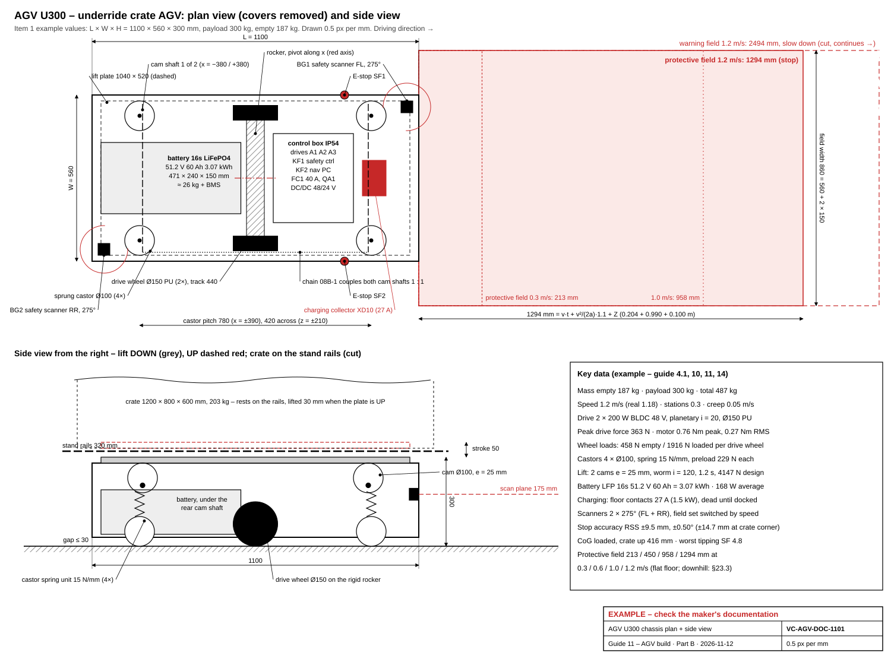
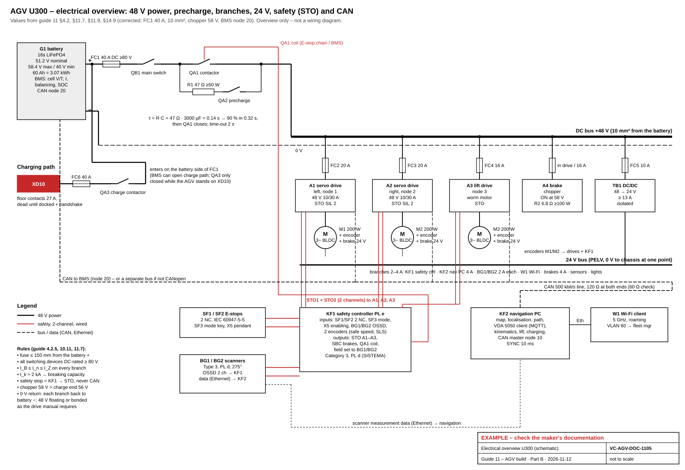
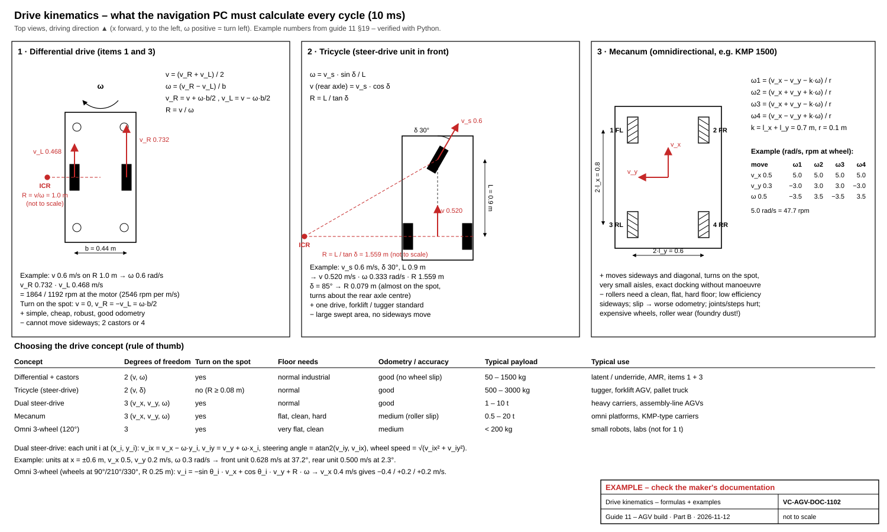
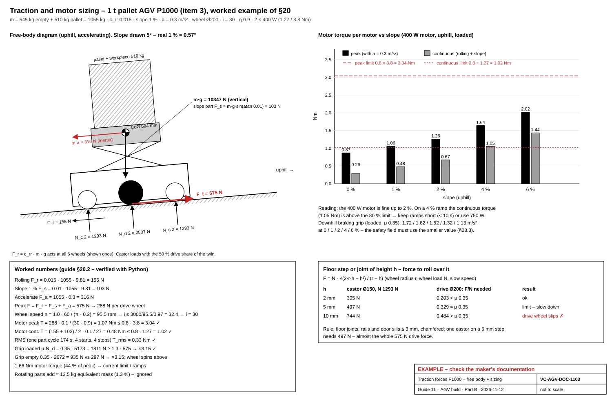
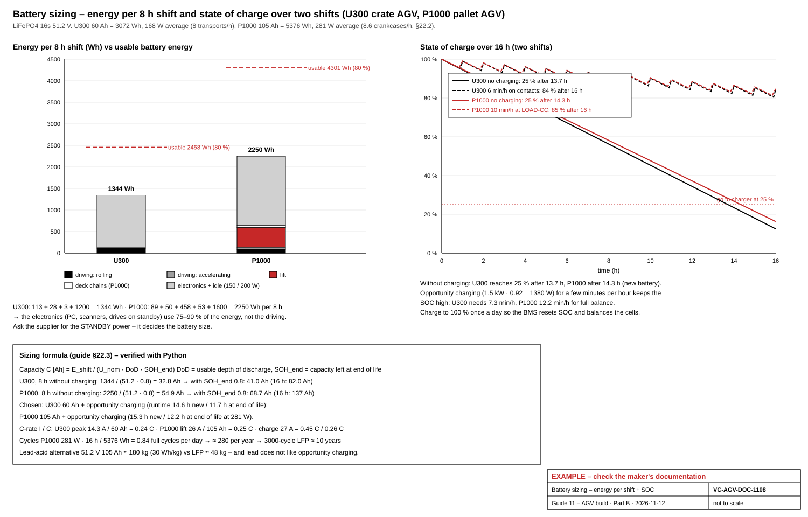
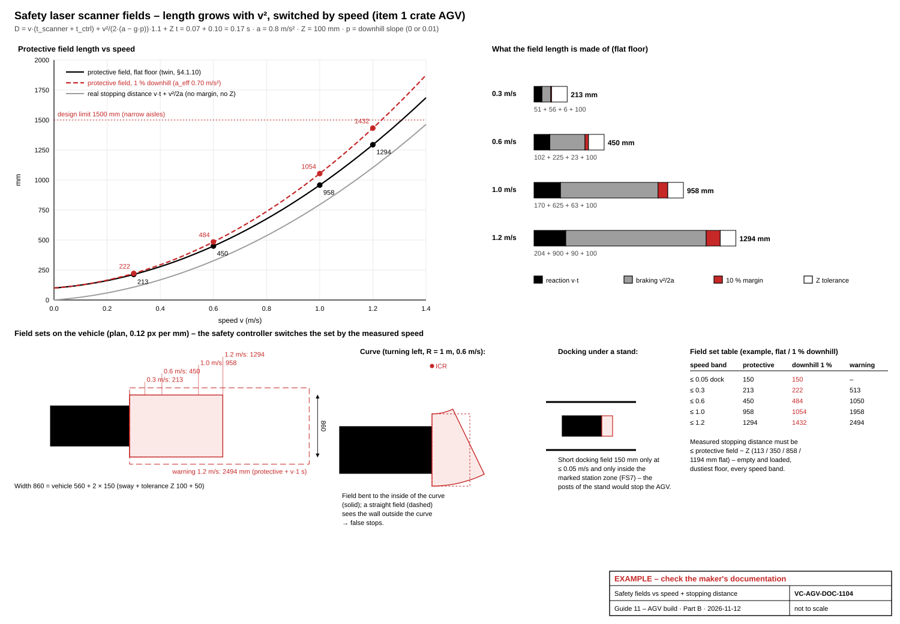
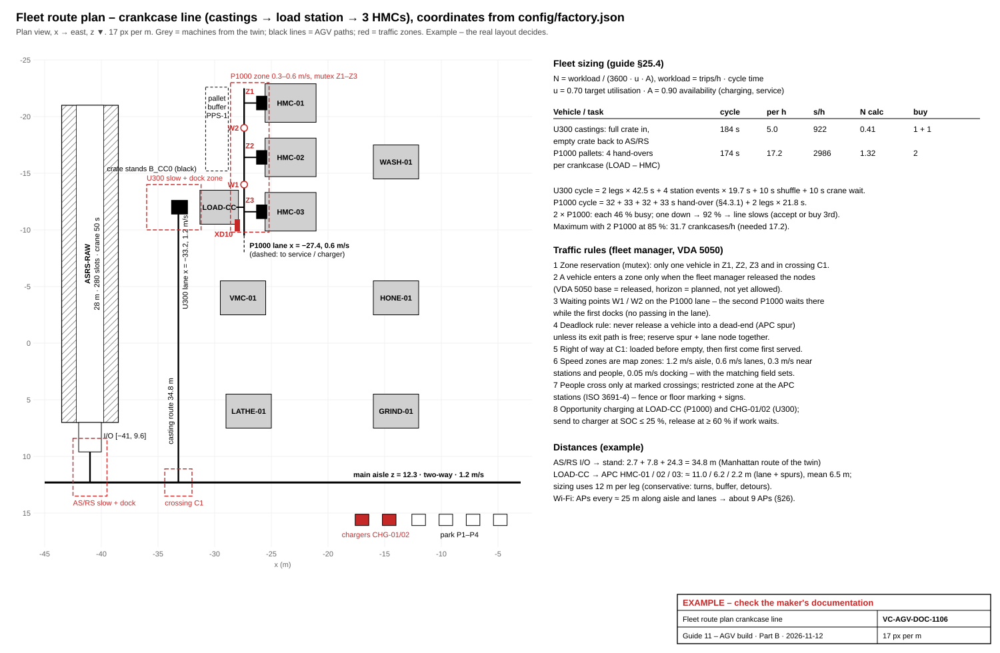
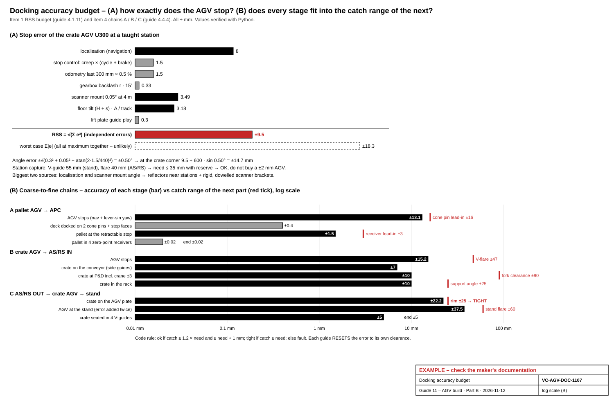

# 11 – AGV Build: Underride Crate AGV, Servo Drive Control, 1 t Pallet AGV, Docking Accuracy

> **All numbers in this guide are example values.** They are the default inputs of the twin pages
> (button "Example values") and the results the pages calculate from them. Before you order, make or
> program anything, put your real catalogue data, drawings and measurements into the page and check
> the results again. Prices are not given on purpose.
>
> **Build data:** chapters 10–15 hold the physics (10), detailed specification (11), numbering (12),
> standards (13), a complete worked example (14) and the data you still need (15). Corrections to the twin
> values are marked **Correction** (castor spring model 3.2/4.1.5, battery voltage, brake chopper, main fuse,
> CAN length, quick-stop state, crushing gaps, weight-share test).

## Contents

**Part A – the twin pages and the build data of item 1**

1. Purpose
2. Where in the twin
3. Concepts in simple words
4. Design calculations per item (4.1 crate AGV · 4.2 servo drive control · 4.3 1 t pallet AGV · 4.4 docking accuracy)
5. Build step by step (manufacturing, wiring, programming, commissioning, acceptance, maintenance, faults)
6. Checklists
7. Common mistakes and lessons learned
8. Limits of the twin pages
9. Note on chapters 10–15
10. Science principles (vehicle dynamics, kinematics, stability, PU wheels, BLDC motor, gearbox, control, CAN, LiFePO4, charging, wiring, scissor, cam/screw, springs, safety field, localisation)
11. Detailed specification of item 1 (chassis, drive module, castor unit, lift, fasteners, electrical, battery sheet, safety, CiA 402 objects, navigation parameters, measuring plan, commissioning sheet)
12. Identification and numbering
13. Standards
14. Complete worked example AGV-01 (crate AGV U300)
15. Data you still need
16. Glossary

**Part B – design reference: types, technologies, sizing, buying (added 2026-11-12)**

17. AGV and AMR types, market overview and make-or-buy
18. Navigation and localisation technologies (tape, wire, QR grid, reflectors, natural contour, accuracy values)
19. Drive kinematics: differential, tricycle, dual steer-drive, mecanum, omni (drawing `11_kinematics.svg`)
20. Traction, motor and gearbox sizing – worked example for the 1 t pallet AGV (drawing `11_traction_forces.svg`)
21. Wheels, floor and suspension (PU types, load rating, floor pressure, joints, rocker / bogie)
22. Battery technology, sizing and charging (LFP / NMC / LTO / lead, Ah formula, opportunity and inductive charging, BMS) (drawing `11_battery_sizing.svg`)
23. Safety design in depth (ISO 3691-4 zones, field sizing incl. slopes, width, curves, bumpers, PL, stop categories) (drawing `11_safety_fields.svg`)
24. Electrical architecture – overview schematic (drawing `11_electrical_schematic.svg`)
25. Fleet management, VDA 5050, traffic control and fleet size for the crankcase line (drawing `11_fleet_layout.svg`)
26. Communication: Wi-Fi roaming, network design, private 5G
27. Station integration: handshakes, time-outs and the docking accuracy budget (drawing `11_docking_budget.svg`)
28. Commissioning additions, maintenance plan, spare parts and KPIs
29. Buy list – catalogue examples + shopping list for the crankcase-line fleet
30. Corrections found in the review of 2026-11-12
31. Drawings of this guide (index)

---

## 1. Purpose

This guide helps you and your team **build the AGVs of the factory yourself, one by one**:

| Item | AGV / topic | What it does in the factory |
|---|---|---|
| 1 | **Underride (latent) lifting AGV** | Drives under a crate stand, lifts the crate (about 203 kg, castings) about 50 mm and carries it. Used at mechanical items 2 (crate docking stand) and 3 (AS/RS ↔ AGV interface). |
| 2 | **Servo drive control** | How the two drive motors of item 1 are controlled: from the fleet manager down to the motor current. Wiring, CANopen, tuning, code. |
| 3 | **1 t pallet AGV** | Brings the machining pallet (500 × 500 mm, 510 kg with workpiece) to the APC load station (mechanical item 1). Scissor lift + floating chain deck. |
| 4 | **Docking accuracy** | Explains how an AGV that stops only ±10 mm accurately can still hand over a load to ±0.02 mm (APC) or into an AS/RS. |

After reading you should be able to:

1. Understand **why** each design choice was made (not only what).
2. Repeat every calculation with your own numbers.
3. Manufacture, wire, program and commission the AGV in a fixed order.
4. Run the acceptance tests and know the pass criteria.
5. Avoid the mistakes that were found while designing these AGVs in the twin.

**Important:** if you build an AGV yourself, **you are the manufacturer**. The risk assessment,
ISO 3691-4 (driverless industrial trucks), safety functions validated to PL d (ISO 13849),
CE marking and the operating manual are your job. This guide does not replace them.
Machines placed on the market / put into service from 20 Jan 2027 – including own-built ones – follow Machinery Regulation (EU) 2023/1230; harmonised standards listed under the Directive do not automatically carry over (guide 16 §10).

---

## 2. Where in the twin

Browser tab **"AGV build"**. At the top are 4 buttons (item 1–4). A 5th button "Safety program +
complete wiring" is shown but disabled (planned, not built).

| Item | Source file | Technology | What you find on the page |
|---|---|---|---|
| 1 | `web/agv.js` | Three.js 3D (offline, from `web/vendor`) | 3D model with drive-under / lift / drive-away animation, exploded view, covers and safety field toggles, click a part for its data; lift type selector (cam / screw jack / scissor / hydraulic); stop-accuracy budget + navigation methods table + 30-run procedure; lift drawing + comparison table; steps; mass budget; control system diagram + I/O list; safety fields table; inputs, 19 checks, calculations, BOM, guide |
| 2 | `web/agvdrive.js` | plain SVG, no library | Control layers, cascade, tunable control simulator, power + signal wiring with parts list, CiA 402 state machine (clickable), 6 code examples, object dictionary, 14 checks, calculations, guide + fault table |
| 3 | `web/agvpallet.js` | Three.js 3D | Deliver / pick-up animation at the APC station, scissor force curve, steps, height stack, concept comparison, signal list, interface sheet, inputs, 18 checks, calculations, BOM, guide + acceptance tests |
| 4 | `web/agvdock.js` | 2D SVG animation | Cases A / B / C, overview + real-scale magnifier + error ladder, stop-error slider with "random run", "worst case", "too big (fault)", accuracy chain, 7 rules, comparison, checks, formulas, acceptance tests |

**How the pages are linked:**

- Item 2 takes motor, gear ratio, wheel, speed, acceleration and mass **from item 1**
  (`window.AGV = { M, R }`). Change these in item 1, not in item 2.
- Item 3 takes pallet size, pallet mass, workpiece mass, load-centre height and stud pitch **from the
  "Pallet changer" tab** (defaults: 500 × 500 mm, 110 kg + 400 kg, 250 mm, pitch 400 mm).
- Item 4 uses the same example values as item 3 and mechanical items 1–3, but has its **own inputs**.
  If you change item 3, update item 4 by hand.
- Your inputs are kept in the browser (localStorage keys `agvState`, `agvDriveState`, `agvPalState`,
  `agvDockState`). "Example values" resets them.

**Deep links** (open the page directly in a state):

| Link | Opens |
|---|---|
| `/?avlift=screw&avview=lift&avt=9&avex=60&avpart=jack#agv` | Item 1, screw jack, lift view, time 9 s, 60 % exploded, part "jack" selected |
| `/?avitem=2&adcode=st#agv` | Item 2, Structured Text code tab |
| `/?avitem=3&aptask=pickup&apview=dock&apt=12#agv` | Item 3, pick-up, docking view, t = 12 s |
| `/?avitem=4&dkscn=A&dke=6&dkt=8#agv` | Item 4, case A (or B, C), stop error 6 mm, t = 8 s |

---

## 3. Concepts in simple words

### 3.1 Underride (latent) AGV

A flat vehicle (here 300 mm high) that **drives under** the load, lifts it a little and carries it.
The station (crate stand) is **passive**: just steel rails, guides and sensors – no motor. All
movement is on the AGV. This keeps the stations cheap; you need many stations but few AGVs.

### 3.2 Differential drive on a rocker + sprung castors

- Two drive wheels in the middle of the AGV, one motor each. Same speed = straight. Different
  speed = turning. Opposite speed = turning on the spot.
- Both drive modules sit on **one rocker** with a pivot along the driving direction (x). So both drive
  wheels always touch the floor, even on an uneven floor.
- Four **castors** (swivel wheels) at the corners carry the rest of the weight. **The castors have the
  springs, not the drive wheels.**

**Why the springs are in the castors (lesson learned):**
The drive wheels need grip (normal force) to accelerate and to brake. If you put a fixed spring on each
drive wheel, the spring force is the same empty and loaded. A spring strong enough for good grip with
300 kg payload **lifts the empty AGV off its castors**. A spring weak enough for the empty AGV gives
too little grip when loaded. With sprung castors and a rigid drive rocker, more load = more grip, automatically.

> **Correction (physics, see 10.1.4):** the twin calculates with a **fixed share** (50 % empty and loaded).
> The real behaviour is different: the rigid drive wheels fix the chassis height, so each castor spring is
> compressed by a fixed amount and carries an almost **fixed force** (its preload). The castors carry about the
> same force empty and loaded, and the drive wheels carry **all the extra payload**. The 50 % is therefore set
> for the **empty** AGV with the spring preload. Loaded, the drive wheels carry about 80 % (item 1 example).
> This is better for grip, but (a) the drive wheel load is higher than the twin shows and (b) a floor dip under
> the drive wheels moves load to the castors – that is why the castor spring rate must be **low** (10.1.4).

### 3.3 Stop accuracy, accuracy vs repeatability

- **Accuracy** = how close the AGV stops to the wanted point on average and in scatter together.
- The AGV has a **constant offset** (for example always 6 mm too far) **plus a random scatter**.
- The offset is removed by **teaching**: drive to the station, measure, correct the station coordinate.
- What stays is the scatter = **repeatability**, normally given as ±3σ. Supplier data like "±10 mm"
  usually mean repeatability at taught points.
- Independent errors add as **RSS** (root of the sum of squares), not as a simple sum. The simple sum
  is the worst case if all errors are at maximum at the same time – very unlikely.

### 3.4 Coarse-to-fine docking

The AGV only brings the load **close** (about ±10 mm). Mechanical parts on the **station** do the fine
positioning in steps. Each step reduces the error about 10–100 ×:

```
AGV navigation  ±10 mm
   → floating deck + cone pins + stop faces   ±0.2 … 0.4 mm
      → receivers (zero-point type)           ±0.02 mm
```

For crates you need much less: one V-guide step is enough (AS/RS rack allows ±25 mm).

### 3.5 Safety fields

Two safety laser scanners (front-left and rear-right corner) see 360° around the AGV. In front of the AGV
there is a **protective field** (object inside = stop) and a bigger **warning field** (slow down). The
field length depends on the speed (it must be longer than the stopping distance), so the safety controller
**switches the field set by speed**. Under a crate stand the scanners would see the posts, so a short
**docking field** is used there – only at creep speed and only inside the marked station area.

### 3.6 Servo drive cascade

The servo drive closes three loops, one inside the other:

```
position loop (slowest)  →  speed loop  →  current (torque) loop (fastest)  →  PWM  →  motor
```

Each outer loop gives the set value to the next inner loop. The outer loop must be about 5–10 × slower
than the inner loop, otherwise they fight each other. **Feed-forward** sends the known speed and
acceleration directly to the inner loops, so the position loop only corrects small errors.

### 3.7 CANopen CiA 402

CANopen is the bus between the navigation PC and the drives. CiA 402 is the standard drive profile: a
**state machine** inside every drive, commanded with the **controlword** (object 0x6040) and reported with
the **statusword** (0x6041). The PC sends a **SYNC** message every cycle (here 10 ms); all drives take
their new set value at the same moment.

### 3.8 STO – Safe Torque Off

STO (IEC 61800-5-2) is a wired, 2-channel input on the servo drive. When it is active, the drive cannot
make torque, whatever the software says. The **safety stop is always the safety controller → STO**,
wired, PL d. Software stops (quick stop over CAN, watchdog) are **comfort functions**, not safety.

### 3.9 Floating deck

On the pallet AGV the chain deck is not fixed to the AGV body. It rests on **ball transfer units** and can
move ±20 mm sideways and lengthwise (and about ±1°). Centring springs and a conical **lock pin** hold it in
the middle while driving. At the station the lock pin opens, the deck is lifted, and two **cone pins** on
the station pull the deck into the exact position. The heavy AGV body stays where it stopped.
**Why:** pushing the whole 1 t AGV sideways would need several kN against the tyre grip. Moving only the
floating deck needs about 200 N.

---

## 4. Design calculations per item

All formulas are written the way the code calculates them. g = 9.81 m/s².

### 4.1 Item 1 – Underride lifting AGV (`web/agv.js`)

#### 4.1.1 Inputs (example values)

| Group | Input | Example | Note |
|---|---|---|---|
| Vehicle | Length L × width W × height H (lift plate down) | 1100 × 560 × 300 mm | items 2/3: 680 mm clear between the rails; crate rails at H + 20 = 320 mm |
| | Rated payload m_p | 300 kg | crate 203 kg + reserve |
| | Crate mass full | 203 kg | |
| | Crate L × W × H | 1200 × 800 × 600 mm | |
| | Crate CoG above crate bottom / off-centre | 250 mm / 50 mm | |
| Drive | Max. speed / near stations | 1.2 / 0.3 m/s | |
| | Acceleration / emergency deceleration | 0.5 / 0.8 m/s² | deceleration limited by grip |
| | Drive wheel Ø (PU) | 150 mm | |
| | Rolling resistance c_rr | 0.015 | PU on concrete + castors |
| | Max. slope | 1 % | |
| | Grip μ PU ↔ floor (dusty) | 0.35 | clean 0.5–0.6, foundry dust about 0.3 |
| | Weight share on drive wheels | 50 % | set by the castor springs |
| | Spring rate per sprung castor k_c | 40 N/mm | |
| | Floor unevenness + castor wear Δ | ±4 mm | |
| | Curve speed / radius | 0.6 m/s / 1 m | |
| Lift | Stroke s / lift time | 50 mm / 1.3 s | crate must rise ≥ 15 mm off the rails |
| | Dynamic / off-centre factor k_dyn | 1.3 | |
| | Cam: worm gear efficiency | 0.6 | |
| | Screw jack: pitch / efficiency | 6 mm (Tr 30 × 6) / 0.3 | ball screw ≈ 0.75 |
| | Scissor: arm length / closed height | 500 / 90 mm | |
| | Hydraulic: max. pressure / cylinders | 100 bar / 4 | |
| Battery | LiFePO4 voltage / capacity | 48 V / 60 Ah | |
| | Transports per hour / route per transport / stops | 8 / 120 m / 6 | |
| | Electronics + idle losses | 150 W | |
| | Charger / usable capacity | 1.5 kW / 0.8 | floor contacts about 30 A |
| Safety | Scanner response / safety ctrl + STO + brake | 0.07 s / 0.1 s | |
| | Scanner tolerance + reserve Z | 100 mm | |
| Accuracy | Localisation ±8 mm, ±0.3°; creep 0.05 m/s; cycle 0.02 s; last 300 mm on encoders; wheel Ø tolerance 0.5 %; backlash 15 arcmin; scanner mount 0.05°; contour distance 4 m; lift plate guide play 0.3 mm | | |

#### 4.1.2 Geometry derived from the inputs

| Item | Formula | Example |
|---|---|---|
| Lift plate | (L − 60) × (W − 40) | 1040 × 520 mm, Al 15 mm + 5 mm PU = 25.1 kg |
| Drive wheel track | 2 × (W/2 − 60) | 440 mm |
| Castor position | x = ±(L/2 − 160), z = ±(W/2 − 70) | ±390 mm, ±210 mm |
| Battery energy | U × Ah | 48 × 60 = 2.88 kWh |
| Battery length (170 Wh/L, 240 × 150 mm section) | kWh·1000/170 / (0.24·0.15) | 471 mm (space ≈ L/2 + 10 = 560 mm → fits) |



*Drawing `11_agv_layout.svg`: one possible arrangement of item 1 with the example values (L 1100, W 560, H 300 mm,
track 440, castors ±390 / ±210 mm, battery 471 × 240 × 150 mm under the rear cam shaft, scanners FL + RR,
protective fields 213 … 1294 mm). The battery sits in the middle (z = ±120 mm) and the castors outside
(z = ±210 mm), so they do not touch, even if the side view shows them on top of each other.*

#### 4.1.3 Mass budget

| Part | Formula / value | kg |
|---|---|---|
| Chassis frame, tube 80×40×3 (5.4 kg/m) | (2L + 2W + 600)/1000 × 5.4 | 21.2 |
| Floor plate 8 mm | L × 360 × 8 × 7.85e-6 | 24.9 |
| Covers 2 mm | 2(L+W)(H−40) × 2 × 7.85e-6 | 13.6 |
| Lift plate + PU pad | | 25.1 |
| Lift mechanism (cam) | | 18 |
| Drive modules 2 × | | 32 |
| Castors 4 × | | 10 |
| Battery 2.88 kWh + BMS | 9 kg/kWh | 25.9 |
| Electronics, scanners, cables | | 16 |
| **Empty AGV m_e** | | **187** |
| + payload | | 300 |
| **Total m** | | **487** |

#### 4.1.4 Drive force and motor

```
Rolling     F_r = c_rr · m · g      = 0.015 · 487 · 9.81 =  72 N
Slope       F_s = m · g · 1 %       =                      48 N
Accel.      F_a = m · a = 487 · 0.5 =                     243 N
Peak        F   = 72 + 48 + 243     =                     363 N  → 181 N per wheel

Wheel speed n = v · 60 / (π · D) = 1.2 · 60 / (π · 0.15) = 153 rpm
Ratio       i ≤ 3000 / 153 = 19.6  → pick the largest standard ratio that still gives ≥ 97 % of v_max → i = 20
Real speed  3000/20 · π · 0.15 / 60 = 1.18 m/s
Motor       T = F/2 · r / (i · 0.9) = 181 · 0.075 / (20 · 0.9) = 0.76 Nm peak
            T_cont = (F_r + F_s)/2 · r / (i · 0.9)            = 0.25 Nm
```

Motor list in the code (48 V BLDC, 3000 rpm): 100 / 200 / 400 / 750 / 1000 W. Rule: peak ≤ 80 % of motor
peak torque, continuous ≤ 80 % of rated torque, continuous power ≤ 60 % of rated power.
**Result: 2 × 200 W** (0.64 Nm rated, 1.9 Nm peak), gearbox i = 20.

#### 4.1.5 Grip, braking and castors

```
Floor-step force   ΔN = k_c · Δ = 40 · 4 = 160 N     (a 4 mm step under one castor shifts this much)
Wheel load empty   N_e = 50 % · 187 · 9.81 / 2 = 458 N per drive wheel
Wheel load loaded  N_l = 50 % · 487 · 9.81 / 2 = 1194 N per drive wheel
Weakest            N_min = 458 − 160 = 298 N

Grip safety        μ · (N − ΔN) / (F/2), worst of empty and loaded  = ×1.50   (need ≥ 1.3)
Max. braking       a = 2 · μ · (N − ΔN) / m, worst case            = 1.12 m/s²  (need 0.8 ≤ 0.9 · 1.12)
Castor load        (m · g · 50 % / 4 · 1.25 + ΔN) / g               = 92 kg → castor Ø100, 150 kg
Drive wheel load   (N_l + ΔN) / g = 138 kg ≤ 350 kg (Ø150 PU rating)
```

**Why only the drive wheels count for braking:** the castors are free wheels; they cannot brake.
So the empty AGV (less weight on the drive wheels) is often the weakest case for braking.

> **Correction (see 10.1.4 and 14.4):** the twin uses N_l = 50 % · m · g / 2 for the loaded drive wheel. With a
> rigid rocker and sprung castors the loaded drive wheel really carries about 1916 N (195 kg), not 1194 N – still
> ≤ 350 kg. A floor **dip** under the drive line (all 4 castors 4 mm higher than the drive wheels) takes
> 4 · k_c · 4 mm from the drive wheels: with k_c = 40 N/mm that is 640 N, which leaves the **empty** AGV only
> 0.52 m/s² braking grip (< 0.8 needed). With k_c = 15 N/mm (recommended, chapter 14) the loss is 240 N and the
> worst braking is 1.27 m/s² – ok. Enter 15 N/mm in the twin.

#### 4.1.6 Stability

```
CoG height    h = (m_e · 120 + m_p · (H + s + h_cg)) / m = (187·120 + 300·600) / 487 = 416 mm
Forward       SF = g · x_castor / (a_dec · h) = 9.81 · 390 / (0.8 · 416) = ×11.5   (need ≥ 2)
Sideways      a_lat = v²/R = 0.6²/1 = 0.36 m/s²
              SF = (z_castor − e_cg · m_p/m) · g / (a_lat · h) = ×11.7       (need ≥ 2)
Crate on pad  SF = μ_pad / (a_dec/g) = 0.5 / (0.8/9.81) = ×6.1             (PU pad μ ≈ 0.5)
```

#### 4.1.7 Lift – the four types

Common values:

```
Design lift force  F = (m_p + plate) · g · k_dyn = (300 + 25.1) · 9.81 · 1.3 = 4147 N
Real weight lifted (energy) = (203 + 25.1) · 9.81 = 2238 N
Average speed v = s / t = 50 / 1.3 = 38.5 mm/s;  peak (soft start/stop) = π/2 · v = 60.4 mm/s
```

**A – Eccentric cam (default, recommended for this AGV)**

Two cam shafts (front + rear) with eccentric discs, under 4 follower rollers on the lift plate. A chain
couples the shafts 1:1. A worm gear motor turns them half a turn (0° = down, 180° = up).

```
Eccentricity   e = s/2 = 25 mm               cam disc Ø = 2·(e + 25) = 100 mm
Torque         T = F · e · sin θ  → max at 90°: 4147 · 0.025 = 104 Nm (both shafts)
Ratio          ½ turn in 1.3 s → i_req = 3000 / (30/1.3) = 130 → nearest worm ratio i = 120 → 1.2 s
Motor torque   T_m = 104 / (120 · 0.6) = 1.44 Nm      peak power = T · ω / η = 452 W (short, at 90°)
Motor          200 W (1.44 ≤ 0.8 · 1.9 Nm, 452 ≤ 2.5 · 200 W)
Rollers        F/4 = 1037 N each → track roller KR 22 (C ≈ 3.3 kN ≥ 3 × 1.04 kN)
```

**Why the cam is good here:** at 180° (dead centre) the load force goes straight through the shaft centre →
**zero torque**, the plate holds itself without a brake. The self-locking worm gear is a second safety.

**B – Screw jack**

Two worm screw jacks (front + rear) on one cross shaft, one motor.

```
Screw speed   n = v_peak / P · 60 = 60.4 / 6 · 60 = 604 rpm → total ratio 3000/604 = 5.0
Torque/jack   T = (F/2) · P / (2π · η) = 2073 · 0.006 / (2π · 0.3) = 6.6 Nm
Motor         T_m = 2 · T / (i · 0.95) = 2.80 Nm, peak F · v / η = 835 W → 400 W motor
Self-locking  η = 0.3 ≤ 0.35 → trapezoidal screw holds the load; a ball screw (η ≈ 0.75) needs a brake
```

**C – Scissor (bad for a small stroke)**

Two scissor pairs; a horizontal actuator pushes the rolling foot.

```
Angles        α = asin(h / L): asin(90/500) = 10.4° → asin(140/500) = 16.3°
Force         F_act = F / tan α = 4147 / tan 10.4° = 22.7 kN at the start (5.5 × the load!), 14.2 kN at the end
Act. stroke   L · (cos α0 − cos α1) = 11.8 mm only
Actuator      40 kN (≥ 1.2 × 22.7 kN), motor 200 W (peak F·v/0.8 = 313 W)
```

The check "Scissor lever at the start" gives a **warning** (5.5 × > 3 ×). A scissor nearly closed is a bad
lever. Scissors are good for big strokes (150–1000 mm), as in item 3.

**D – Hydraulic**

Single-acting cylinders + 48 V mini power unit (pump, tank, check valve, lowering valve, relief valve).

```
Bore          d ≥ √(4F / (n · π · p)) = √(4 · 4147 / (4 · π · 10 N/mm²)) = 11.5 mm → 4 × Ø20
Pressure      p = F / (n · A) = 33 bar (max 100 bar)
Flow          Q = n · A · v = 2.9 L/min
Power         p · Q / 0.55 = 290 W → 500 W power unit;  oil ≈ 0.6 L incl. tank
```

Two checks are always flagged: **oil on the floor** (oil under a drive wheel = no braking → drip tray +
leak sensor) and **load sinks slowly by leakage** (automatic re-lift + height sensor).

**Comparison table (example values, from the page)**

| | Cam ✓ | Screw jack | Scissor | Hydraulic |
|---|---|---|---|---|
| Positions | 2 (down / up) | any height (motor encoder) | any height (encoder) | 2 (any with a proportional valve) |
| Holds load without power | yes – dead centre + self-locking worm | yes – trapezoidal screw self-locking | yes – actuator self-locking or brake | check valve – sinks slowly by leakage |
| Peak power | 452 W | 835 W | 313 W | 290 W |
| Lift motor | 200 W | 400 W | 200 W | 500 W |
| Energy per lift | 187 J | 373 J | 155 J | 203 J |
| Lift time | 1.2 s | 1.3 s | 1.3 s | 1.3 s |
| Mass (approx.) | 18 kg | 24 kg | 42 kg | 26 kg |
| Maintenance | low – grease cams + rollers | medium – grease screws, nut wear | medium – many pivots | high – oil, seals, hoses, leaks |
| Cost | low | medium | medium | medium–high |
| Best for | fixed stroke 30–60 mm, fast, simple | different heights, lift + turn units | large strokes > 150 mm | heavy AGVs ≥ 1.5 t, forklift AGVs |

**Rule from this comparison:** small latent AGVs are **electric** (cam or screw). Hydraulic only for heavy
AGVs (≥ 1.5 t) and forklift AGVs. The station stays passive in all cases.

#### 4.1.8 Height checks

```
Crate lifts off the rails   s − 20 = 50 − 20 = 30 mm   (need ≥ 15 mm)
AGV drives under the crate  20 − Δ = 20 − 4  = 16 mm   (need ≥ 10 mm)
```

The crate rails are 20 mm above the AGV top (H + 20 = 320 mm).

#### 4.1.9 Battery and energy

```
Average mass       m_avg = m_e + m_crate/2 = 187 + 101.5 = 288 kg   (half the trips empty)
Rolling energy     c_rr · m_avg · g · d = 0.015 · 288 · 9.81 · 120 = 5.1 kJ
Accel. energy      stops · ½ · m_avg · v² = 6 · ½ · 288 · 1.2² = 1.2 kJ
Per transport      (5.1 + 1.2)/0.8 + lift 0.19 kJ = 8.1 kJ
Average power      8 /h · 8.1 kJ / 3600 + 150 W = 168 W
Battery            48 V · 60 Ah · 0.8 = 2304 Wh → 13.7 h runtime
Charger 1.5 kW     on charger 168 / (1500 · 0.92) = 12 % of the time; full charge 1.7 h
Peak current       (2 · P_peak/0.9 + P_el) / U = 14.3 A = 0.24 C   (LiFePO4 ≤ 2 C)
Utilisation        trip time ≈ d/(0.7 v) + stops · v/a + 2 · t_lift + 20 s = 180 s → 8 · 180/3600 + 12 % = 52 %
```

Note: the electronics (150 W) use most of the energy, not the driving. Opportunity charging on floor
contacts at the stations keeps the battery small.

#### 4.1.10 Speed-dependent safety fields (ISO 3691-4)

```
Reaction time   t = t_scanner + t_safety = 0.07 + 0.1 = 0.17 s
Protective field D = v · t + v² / (2 · a_dec) · 1.1 + Z
Warning field    D_w = D + v · 1000 mm
Example 1.2 m/s: 1.2 · 0.17 · 1000 + 1.2²/(2 · 0.8) · 1000 · 1.1 + 100 = 204 + 990 + 100 = 1294 mm
```

| Speed | Protective field | Warning field | Where |
|---|---|---|---|
| 0.3 m/s | 213 mm | 513 mm | stations, lanes near people |
| 0.6 m/s | 450 mm | 1050 mm | aisles, crossings |
| 1.0 m/s | 958 mm | 1958 mm | aisles, crossings |
| 1.2 m/s | 1294 mm | 2494 mm | free main route |
| ≤ 0.05 m/s | 150 mm | – | docking field under the stand |

Check: protective field at full speed ≤ 1500 mm (ok) – long fields mean many stops in narrow aisles.
The docking field under the stand must be part of the **risk assessment**; the station area must be marked
and people kept out by the layout (ISO 3691-4 restricted zone).

> **Correction (slope, added 2026-11-12):** the formula above used a = 0.8 m/s² on a **flat** floor. **The app now uses a_eff = a − g·slope (downhill on the allowed slope), so its fields are the downhill values (1.2 m/s → 1 432 mm).**
> The input "max. slope 1 %" means the AGV can also brake **downhill**; then the usable deceleration is
> a − g · p = 0.8 − 0.098 = 0.70 m/s² and the fields get longer: 222 / 484 / 1054 / **1432 mm** at 0.3 / 0.6 / 1.0 /
> 1.2 m/s (still ≤ 1500 mm). Use the downhill fields on sloped route parts (or limit the speed there). See 23.3 and
> drawing `11_safety_fields.svg`.

#### 4.1.11 Stop accuracy budget (RSS)

| Error source | Formula | Example ± mm |
|---|---|---|
| Localisation (navigation) | input | 8.0 |
| Stop control: creep × cycle | v_creep · (t_cycle + 0.01 s brake scatter) = 0.05 · 0.03 | 1.5 |
| Odometry on the last metres | 300 mm × 0.5 % | 1.5 |
| Gearbox backlash | r · 15′ = 75 · (15/60 · π/180) | 0.3 |
| Scanner mount angle | 0.05° · π/180 · 4000 mm | 3.5 |
| Floor tilt (plate top moves) | (H + s) · Δ / track = 350 · 4 / 440 | 3.2 |
| Lift plate guide play | input | 0.3 |
| **RSS = √(Σ e²)** | | **±9.5** |
| Worst case (simple sum, very unlikely) | | ±18.3 |

```
Angle error   ±√(0.3² + 0.05² + atan(2 · 1.5 / 440)²) = ±0.50°
At the crate corner   9.5 + 600 · sin 0.50° = ±14.7 mm
Station capture: flare 40 mm (mechanical item 3), V-guide 55 mm (item 2)  → enough
```

**Conclusion on the page:** this AGV stops about ±10 mm / ±0.5°. Items 2 and 3 catch ±40–55 mm
mechanically – **do not pay for a ±2 mm AGV**. The two biggest sources are localisation and the scanner
mount angle → rigid, pinned scanner brackets are cheap and effective. Drawing of this budget and of the
item 4 chains: `11_docking_budget.svg` (chapter 27).

**Navigation methods (from the page, typical values):**

| Method | How it works | Stop accuracy (typ.) | Needs in the factory | Cost |
|---|---|---|---|---|
| Lidar contour (SLAM) | scanners compare walls / columns / machines with the map | ±10 mm, ±0.5° | enough fixed contour in view; clean windows | lowest (software) |
| Lidar + reflectors | reflector strips, ≥ 3 in view | ±3–5 mm, ±0.2° | reflectors at scanner height (~175 mm), clean | low |
| Floor codes + camera | camera reads codes every ~1 m | ±3–5 mm, ±0.2° at a code | clean floor – foundry sand and forklift tyres wear codes | medium |
| Magnetic tape + RFID | follows tape, RFID tags for stops | ±5 sideways, ±10 along | tape in the floor; changes = new tape | low, fixed routes |
| Fine positioning at the station | camera / laser on a target, last 100 mm | ±1–2 mm | target + extra sensor per station | medium, only where needed |
| Mechanical docking (items 1–3) | V-guides, cones, floating deck | station decides (±0.1 mm possible) | your stations | cheapest overall ✓ |

#### 4.1.12 Control box and I/O list

Structure (control system diagram on the page):

- **Fleet manager (server)** → VDA 5050 over MQTT → Wi-Fi 5 GHz with roaming.
- **Navigation / vehicle PC:** map, path, VDA 5050 client, localisation, motion control, lift + charging logic.
- **Safety controller (PL d):** field switching by speed, safe speed (SLS), STO, brakes, E-stop stop category 0/1.
- **Power:** battery 48 V → fuse → main switch → precharge → 48 V bus (drives, lift); DC/DC 48/24 V (PC, scanners, safety, I/O).
- Red lines = safety, wired, 2 channels. Blue = bus. Grey = monitoring.

| Tag | Device | Signal / connection |
|---|---|---|
| -B1, -B2 | Safety laser scanners FL / RR | OSSD 2 ch → safety ctrl; field set ← safety ctrl; Ethernet → nav PC |
| -S1, -S2 | E-stop left / right | 2 NC → safety ctrl (stop cat. 0 / 1) |
| -S3 | Mode key AUTO / MANUAL | → safety ctrl |
| -X5 | Manual pendant (3-position enable, joystick) | enable → safety ctrl, joystick → nav PC |
| -B10, -B11 | Lift DOWN (0°) / UP (180°), inductive M12 | → nav PC I/O |
| -B12 | Cam angle encoder (absolute) | → nav PC (plausibility with B10/B11) |
| -B13 | Crate on plate (diffuse sensor, upward) | → nav PC |
| -A1, -A2 / -M1, -M2 | Servo drives / drive motors | CANopen ← nav PC; STO 2 ch ← safety ctrl; encoder → safety ctrl (safe speed) |
| -Y1, -Y2 | Motor holding brakes | safe brake control ← safety ctrl |
| -A3 / -M3 | Lift driver / worm gear motor | enable ← safety ctrl (lift only at standstill) |
| -G1 | Battery + BMS | CAN → nav PC (SoC, temperature, alarms) |
| -K1, -X10 | Charging contactor + floor contacts | ← nav PC / BMS |
| -P1…-P3 | LED strip, buzzer, display | ← nav PC |
| -W1 | Wi-Fi client 5 GHz | Ethernet ↔ nav PC; VDA 5050 / MQTT to the fleet manager |
| -Q1, -F1 | Main switch + main fuse + precharge | battery → 48 V bus |

LED colours: blue = driving, orange = lifting / turning, red = fault, green = charging.

#### 4.1.13 Cycle at the stand (animation steps)

| # | Step | Time (example) |
|---|---|---|
| 1 | Drive under the stand at 0.3 m/s – field switches to the short docking field | 7.6 s |
| 2 | Final stop at creep 0.05 m/s – stop error ±9.5 mm | 1.2 s |
| 3 | Lift: cams turn 0 → 180°, crate rises 30 mm off the rails | 1.2 s |
| 4 | Drive away with the crate – normal fields again after the stand | 7.7 s |

#### 4.1.14 The 19 checks of item 1 (with example result)

| Check | Example | Status |
|---|---|---|
| Drive motor | 200 W: 0.76 ≤ 1.52 Nm peak, 0.25 ≤ 0.51 Nm cont. | ok |
| Gear ratio reaches the speed | i = 20 → 1.18 m/s (need 1.2, ≥ 97 %) | ok |
| Grip when accelerating (empty, loaded, floor step) | ×1.50 | ok |
| Emergency braking possible with the grip | need 0.8, allows 1.12 m/s² | ok |
| Drive wheel load ≤ PU rating | 138 ≤ 350 kg | ok |
| Castor load | 92 ≤ 150 kg | ok |
| No tipping forward | ×11.5 | ok |
| No tipping sideways | ×11.7 | ok |
| Crate does not slide on the pad | ×6.1 | ok |
| Lift motor (cam) | 1.44 ≤ 1.52 Nm | ok (tight) |
| Follower roller rating (cam) | KR 22: 3.3 kN ≥ 3 × 1.04 kN | ok |
| Crate lifts off the rails | 30 mm | ok |
| AGV drives under the crate | 16 mm | ok |
| Battery fits in the chassis | 471 mm ≤ 560 mm | ok |
| Battery runtime (8 h shift) | 13.7 h | ok |
| Battery peak current | 0.24 C ≤ 2 C | ok |
| AGV busy | 52 % (≤ 75 %) | ok |
| Stop accuracy vs station capture | ±14.7 mm ≤ 35 mm | ok |
| Protective field at full speed | 1294 ≤ 1500 mm | ok |

(With another lift type the 2 cam checks are replaced by that type's checks, see 4.1.7.)

#### 4.1.15 Bill of materials (item 1, cam lift)

| # | Part | Make/buy | Qty | Specification (example) |
|---|---|---|---|---|
| 1 | Chassis frame, welded + machined | MAKE | 1 | S355 tube 80×40×3, 1100 × 560 mm, mounting faces ±0.2 mm (welding jig) |
| 2 | Floor plate | MAKE | 1 | S235 8 mm laser cut |
| 3 | Drive rocker (pivot along x) + gearbox flanges | MAKE | 1 | carries both drive modules (or BUY a complete drive unit) |
| 4 | Castor spring unit (spring + guide + preload screw) | MAKE/BUY | 4 | 40 N/mm, share 50 % on the drive wheels |
| 5 | Drive wheel PU | BUY | 2 | Ø150, 92–95 ShA, Al hub |
| 6 | BLDC servo motor 48 V + brake + encoder + planetary gearbox | BUY | 2 | 200 W, i = 20 |
| 7 | Servo drive 48 V, CANopen, STO | BUY | 2 | |
| 8 | Castor PU, ball-bearing swivel | BUY | 4 | Ø100, 150 kg |
| 9 | Lift plate Al 5083 + PU pad | MAKE | 1 | 1040 × 520 × 15 mm + 5 mm PU 80 ShA |
| 10 | Cam shaft with 2 eccentric discs | MAKE | 2 | Ø30 C45, e = 25 mm, cam Ø100 hardened |
| 11 | Follower roller (track roller) | BUY | 4 | KR 22, eccentric-bolt type |
| 12 | Bearing blocks Ø30 | BUY | 4 | UCP / UCF |
| 13 | Worm gear motor 48 V BLDC | BUY | 1 | 200 W, i = 120, hollow shaft Ø30 |
| 14 | Roller chain 08B-1 + 2 sprockets + tensioner | BUY | 1 | chain guard MAKE |
| 15 | Lift sensors M12 inductive + absolute encoder | BUY | 3 | DOWN 0°, UP 180° |
| 16 | Guide pins Ø20 h6 + bushes | MAKE/BUY | 4 | play ≤ 0.3 mm |
| 17 | Battery LiFePO4 with BMS (CAN) | BUY | 1 | 48 V 60 Ah |
| 18 | Main switch, main fuse, precharge, contactor, DC/DC 48/24 V | BUY | 1 | |
| 19 | Floor charging contacts + charger | BUY | 1 | 1.5 kW, 1 charger per charging station |
| 20 | Safety laser scanner with measurement data | BUY | 2 | PL d, 275° |
| 21 | Safety controller | BUY | 1 | PL d, safe speed inputs |
| 22 | Navigation controller / industrial PC + navigation software | BUY | 1 | VDA 5050 client, offline map – "the hardest part – buy it" |
| 23 | Wi-Fi client, industrial, 5 GHz roaming | BUY | 1 | |
| 24 | E-stops, mode key, pendant socket | BUY | 1 set | E-stop 2 NC, IEC 60947-5-5 |
| 25 | LED strip, buzzer, display | BUY | 1 set | |
| 26 | Covers 2 mm, powder coated, scanner windows | MAKE | 1 set | |
| 27 | Cable harness + control box | MAKE | 1 | to the wiring diagram, IP54 |

**Make or buy for a first AGV (from the page guide):**

| Part | Recommendation | Why |
|---|---|---|
| Frame, lift plate, cam shafts, covers, drive arms | MAKE | normal machine shop work |
| Drive wheels, motors, gearboxes, drives, castors, battery | BUY | catalogue parts; ask for a matched "AGV drive kit" (motor + gearbox + drive + wheel) |
| Safety scanners + safety controller | BUY (certified) | never self-made; the configuration is your job |
| Navigation software + fleet manager | BUY | localisation, path planning, VDA 5050 – years of work to make yourself |

---

### 4.2 Item 2 – Servo drive control (`web/agvdrive.js`)

#### 4.2.1 Control layers

| Layer | Job | How often (example) |
|---|---|---|
| Fleet manager | VDA 5050 order, e.g. "drive to station OUT-1-T" | seconds |
| Navigation PC | localisation + path following → v (m/s), ω (rad/s) | every 10 ms |
| Kinematics | v, ω → left / right wheel speed → motor rpm | every 10 ms |
| CANopen CiA 402 | SYNC → RPDO target velocity, TPDO actual position / speed, 500 kbit/s | every 10 ms |
| Servo drive | position loop → speed loop → current loop → PWM | 2 kHz · 4 kHz · 16 kHz |
| Motor + gearbox + wheel | BLDC 200 W, encoder 131072 counts, brake, i = 20, Ø150 | – |

Feedback: encoder counts → odometry on the navigation PC; the localisation (scanner + map) corrects it.

#### 4.2.2 Inputs (example values)

| Input | Example | Note |
|---|---|---|
| Encoder counts per motor turn | 131072 | 17-bit absolute; incremental 2500 ppr = 10000 |
| Speed loop bandwidth | 15 Hz | AGV (high inertia ratio): 10–20 Hz |
| Kv factor (Kv = 2π·f_speed / factor) | 5 | 4–8 |
| Current loop bandwidth (in the drive) | 1000 Hz | |
| Command cycle PC → drives (SYNC) | 10 ms | |
| CAN bit rate | 500 kbit/s | ≤ 100 m bus length (40 m is the limit for 1 Mbit/s); on the AGV < 5 m |
| DC bus capacitance per drive | 1000 µF | drive data sheet |
| Precharge resistor | 47 Ω | |
| BMS max. charge current (regeneration) | 30 A | battery data sheet |
| Brake chopper switch-on voltage | 56 V | LiFePO4 16 s: max 58.4 V – **see correction below 4.2.3: use ≈ 58 V with charge end 56 V** |
| Cable length battery → drives | 1.5 m | |

#### 4.2.3 Calculations

```
1 Motor current
  Rated   I = P / (U · 0.8) = 200 / (48 · 0.8) = 5.2 A
  Peak    I_pk = I · T_pk / T = 5.2 · 1.9 / 0.64 = 15.5 A
  Torque constant K_t = T / I = 0.64 / 5.2 = 0.123 Nm/A

2 Inertia
  Motor + gearbox  J_m = 2.0e-5 + 0.5e-5 = 2.5e-5 kg·m²
  AGV at the motor J_l = (m/2) · r² / i² = 243 · 0.075² / 20² = 3.42e-3 kg·m²
  Ratio  J_l / J_m = 137 : 1

3 Gains (recommended)
  Speed     K_p = J · 2π · f = 3.45e-3 · 2π · 15 = 0.325 Nm/(rad/s)
            K_i = K_p · 2π · f / 4 = 7.65
  Position  K_v = 2π · f / 5 = 18.8 1/s
  Following error without feed-forward = v / K_v = 1178 / 18.8 = 62.5 mm at top speed

4 Regeneration + brake chopper
  Peak power  P = m · a · v · 0.8 = 487 · 0.8 · 1.2 · 0.8 = 374 W → 7.8 A into the battery (BMS allows 30 A)
  Energy      ½ · m · v² · 0.8 = 280 J per emergency stop
  Resistor    R ≤ U² / P = 56² / 374 = 8.4 Ω → 6.8 Ω (from 3.3 / 4.7 / 6.8 / 10 / 15 / 22 / 33)

5 Precharge
  DC bus   C = 3 drives × 1000 µF = 3000 µF
  Time     5 · R · C = 5 · 47 · 0.003 = 0.71 s, max current 48/47 = 1.0 A
  Energy   ½ · C · U² = 3.5 J in the resistor

6 Fuse + cable
  Continuous  2 · 5.2 + 0.3 · 5.2 (lift) + 150/48 = 15.1 A → × 1.25 = 18.9 → fuse 20 A
  Cable       2.5 mm² (22 A, short run, 90 °C insulation)
  Peak        2 · 15.5 + 3.1 = 34 A;  drop 2 · L · I · ρ / A = 2 · 1.5 · 34 · 0.0175 / 2.5 = 0.72 V (1.5 %)

7 CAN bus load
  Frames / cycle = 1 SYNC + 2 drives × 3 PDOs + 2 lift + heartbeats/BMS (5 · 10/100) = 9.5 × ~130 bit
  Load = 9.5 · 130 / (0.010 s · 500 000 bit/s) = 25 %   (need ≤ 40 %)

Other values
  Motor rpm per m/s  60 · i / (π · D) = 2546 rpm/(m/s)  → 0.5 m/s = 1273 rpm
  Encoder at wheel   π · D / (cpr · i) = 0.18 µm per count;  counts per metre = 5 562 868
  Accel ramp 0x6083  0.5 m/s² → 1273 rpm/s;  quick stop 0x6085  0.8 m/s² → 2037 rpm/s
  Drive size         10 A rated / 30 A peak (from 10/30, 20/60, 30/90, 45/135)
```

**Corrections to the calculation above (check with your real data):**

| Item in the twin | Problem | Correct value / action |
|---|---|---|
| Battery "48 V" | A 16-cell LiFePO4 pack is **51.2 V nominal** (16 × 3.2 V), 58.4 V max (16 × 3.65 V), 40 V min (16 × 2.5 V). It is often sold as "48 V". | Calculations with 48 V are conservative for current. Energy is 51.2 × 60 = 3.07 kWh, not 2.88 kWh. |
| Brake chopper 56 V | 56 V is **below** the 58.4 V maximum charge voltage. With a full battery the chopper would burn battery energy all the time. | Set the charger end voltage to 3.50 V/cell = **56.0 V** (better battery life), chopper ON at **≈ 58 V**, drive over-voltage trip above that (buy drives rated for a DC bus ≥ 70 V). R ≤ 58²/374 = 9.0 Ω → 6.8 Ω still ok. |
| Main fuse 20 A | Floor-contact charging needs ≈ 27–30 A (1.5 kW / 56 V). If the charge current flows through F1, a 20 A fuse is too small. | Main fuse **40 A** (≥ 1.25 × 30 A), battery cable **10 mm²**; each drive gets its own branch fuse (chapter 11.7). |
| Precharge energy | 3.5 J is at 48 V. At 58.4 V: ½ · 0.003 · 58.4² = 5.1 J, peak power 58.4²/47 = 73 W. | Resistor ≥ 50 W, pulse-rated wire-wound; precharge time-out 2 s (if the bus does not reach 90 %, open K2: short circuit on the bus). |
| Watchdog "battery < 44 V" | LiFePO4 voltage is almost flat from 20 to 80 % SOC; voltage is a bad SOC signal. | Use **SOC from the BMS** (go to charger at SOC ≤ 25 %); keep 44 V (2.75 V/cell under load) only as a back-up. |

**Why the inertia ratio matters:** the AGV mass seen at the motor shaft is divided by i². 137:1 is normal for
AGVs (the page gives a warning only, not a failure, up to 250:1). Keep the speed loop at 10–20 Hz, or use a
bigger gear ratio (easier tuning, but lower top speed).

**Note on the battery cable:** the item 2 calculation gives 2.5 mm² from the 20 A fuse. The item 1 guide says
"≥ 16 mm² for the battery line". The bigger cable gives less voltage drop and margin for a bigger motor later.
Decide with the real drive data, peak currents and the fuse; the cable must always be protected by the fuse.

#### 4.2.4 Control simulator (one drive wheel)

The page simulates the move 0 → 1.18 m/s → 0 (acceleration 0.5 m/s², 1.2 s at constant speed) with the real
motor, gear and AGV mass, a 4 % floor-step disturbance for 0.15 s, encoder quantisation and the current loop.
With the example values (my re-calculation of the same model):

| Setting | Max. following error | Peak current | RMS current |
|---|---|---|---|
| Recommended (15 Hz, Kv factor 5, feed-forward ON) | ≈ 0.4 mm | ≈ 6.4 A (limit 15.5 A) | ≈ 3.7 A (rated 5.2 A) |
| Feed-forward OFF | ≈ 62 mm | ≈ 5.9 A | ≈ 3.7 A |

Try on the page: feed-forward off → the wheel lags ~62 mm at full speed. Bandwidth up → faster correction of the
floor step, but more current noise from the encoder steps and, on a real AGV, vibration. Bandwidth too low →
big error at the floor step. Button "Recommended tuning" resets 15 Hz / factor 5 / feed-forward on.

#### 4.2.5 Power and signal wiring

```
Battery 48 V LiFePO4 + BMS
  → F1 main fuse 20 A (close to the battery terminal)
  → Q1 main switch (lockable, LOTO)
  → precharge: R1 47 Ω + relay K2  ║  K1 main contactor (closes after precharge)
  → DC bus +48 V / 0 V
       → A1 servo drive left (CAN node 1) → M1 200 W BLDC (U V W + PE, encoder, brake 24 V)
       → A2 servo drive right (node 2)    → M2
       → A3 lift drive (node 3)           → M3 lift motor
       → brake chopper A4 + resistor R2 6.8 Ω
       → U1 DC/DC 48 → 24 V (logic, brakes, sensors) → safety controller, navigation PC
STO 1 + STO 2 (2 channels): safety controller → A1, A2, A3
CAN 500 kbit/s as a line: PC (A10) → A1 → A2 → A3 → BMS, 120 Ω at both ends
```

Note on node IDs: the page uses node 10 for the PC (heartbeat 0x70A, parts list) and also labels the BMS
"node 10" in the wiring drawing. On a real bus every node needs its **own** ID – the project plan in **12.5** gives the BMS
**node 20** (heartbeat 0x714) and keeps the PC on node 10 (heartbeat 0x70A).

Parts list (sized with the example values):

| Part | Tag | Specification | Note |
|---|---|---|---|
| Battery + BMS | G1 | LiFePO4 48 V 60 Ah, charge ≤ 30 A, CAN | BMS can open charge / discharge path |
| Main fuse | F1 | 20 A, DC rated ≥ 80 V | close to the battery terminal |
| Main switch | Q1 | ≥ 20 A DC, lockable | service / LOTO |
| Precharge resistor + relay | R1, K2 | 47 Ω, ≥ 10 W pulse (3.5 J) | 0.71 s before K1 closes |
| Main contactor | K1 | ≥ 20 A DC, 24 V coil | opened by E-stop chain / BMS |
| Servo drive (2×) | A1, A2 | 48 V, 10 A / 30 A peak, CANopen CiA 402, STO (SIL 2 / PL d), encoder input, brake output | node 1 left, node 2 right |
| Lift drive | A3 | 48 V, for 200 W | node 3 |
| Brake chopper + resistor | A4, R2 | switch-on 56 V, 6.8 Ω, ≥ 100 W cont. | often built into the drive |
| DC/DC 48 → 24 V | U1 | ≥ 13 A | logic, brakes, sensors |
| Drive motor (2×) | M1, M2 | 200 W BLDC, 0.64/1.9 Nm, 131072-count encoder, 24 V brake | |
| Motor cable | W1, W2 | 4 × 1.5 mm² shielded, shield 360° both ends | EMC |
| Encoder cable | W3, W4 | twisted pairs, shielded, separate from motor cable | |
| Battery cable | W0 | 2.5 mm² (calc.), 1.5 m | drop 0.72 V – see the note in 4.2.3 |
| CAN interface (PC) | A10 | USB / PCIe CAN, galvanically isolated | 120 Ω on, node 10 |
| CAN cable | W10 | twisted pair 120 Ω, shielded, M12 A-coded | 500 kbit/s |

**Why each power part is there:**

- **Fuse at the battery:** protects the cable over its whole length. A fuse far from the battery leaves the first part of the cable unprotected.
- **Precharge:** without it the empty DC bus capacitors short-circuit the battery for a moment (hundreds of A): the contactor welds, the fuse blows.
- **Brake chopper:** when the battery is full or the BMS opens the charge path, braking energy pumps up the DC bus voltage → the chopper burns it in the resistor. Without it: over-voltage fault while braking.
- **STO wired:** the only stop that counts for safety.

#### 4.2.6 CiA 402 state machine

| State | Statusword (masked) | Controlword to go on | Power stage / brake |
|---|---|---|---|
| Not ready to switch on | 0x0000 | (automatic) | off / closed |
| Switch on disabled | 0x0040 | 0x0006 Shutdown | off / closed |
| Ready to switch on | 0x0021 | 0x0007 Switch on | off / closed |
| Switched on | 0x0023 | 0x000F Enable operation | off / closed |
| **Operation enabled** | 0x0027 | keep 0x000F | **on / open – motor follows target velocity** |
| Quick stop active | 0x0007 | with 0x605A = 6: drive **stays** here after standstill; 0x0000 → switch on disabled (some drives allow 0x000F → back to operation enabled) | brakes on the 0x6085 ramp (with 0x605A = 1…3 the drive goes to "switch on disabled" by itself) |
| Fault | 0x0008 | 0x0080 Fault reset (rising edge of bit 7) | off / closed – read error code 0x603F first |

Other commands: 0x0002 = quick stop, 0x0000 = disable voltage (from any state back to "switch on disabled").
A fault (over-current, encoder, following error, voltage) jumps from **any** state to "Fault".

Example CAN frames (0.5 m/s straight, both drives enabled):

```
0x201  0F 00 F9 04 00 00    left:  controlword 0x000F + 1273 rpm   (LSB first)
0x202  0F 00 07 FB FF FF    right: controlword 0x000F − 1273 rpm   (mirrored motor)
0x080                       SYNC
0x181  27 06 ...            left statusword 0x0627 (operation enabled, target reached) + speed
```

#### 4.2.7 Object dictionary (set once at commissioning)

| Index | Name | Value (example) | Note |
|---|---|---|---|
| 0x6040 | Controlword | from PC every cycle | commands the state machine |
| 0x6041 | Statusword | to PC | state + warnings |
| 0x6060 | Modes of operation | 9 (CSV) or 3 (profile velocity) | speed control |
| 0x60FF | Target velocity | rpm (check unit in the drive manual) | from the kinematics |
| 0x606C | Velocity actual | rpm | monitoring |
| 0x6064 | Position actual | counts | odometry |
| 0x6083 / 0x6084 | Acceleration / deceleration | 1273 rpm/s | 0.5 m/s² – used in profile velocity mode (3). In CSV mode (9) the drive follows the set value of each cycle, so the **PC must make the ramp** |
| 0x6085 | Quick-stop deceleration | 2037 rpm/s | 0.8 m/s² |
| 0x605A | Quick-stop option code | 6 | stop on QS ramp, stay |
| 0x6075 | Motor rated current | 5208 mA | |
| 0x6073 | Max. current | 2969 ‰ of rated | = peak |
| 0x607F | Max. profile velocity | 3000 rpm | top speed + 10 %, max. motor 3000 rpm |
| 0x6065 | Following error window | ≈ 173 840 counts | ≈ 31 mm at the wheel |
| 0x1006 | Communication cycle (SYNC) | 10 000 µs | |
| 0x1017 / 0x1016 | Heartbeat producer / consumer | 100 ms / 300 ms | detects a dead node |
| 0x1600 / 0x1A00 | PDO mapping | RPDO1: 6040+60FF · TPDO1: 6041+606C | TPDO2: 6064 |

#### 4.2.8 Example code (short key parts – full code on the page, values filled from your AGV)

The page has 6 code tabs: Kinematics (Python), CANopen setup + frames (Python), Enable sequence (Structured
Text), Cascade controller (C, inside the drive), Odometry (C), Watchdog + faults (Structured Text).
Adapt every object and unit to your drive manual.

**Kinematics (Python, navigation PC, every 10 ms):**

```python
WHEEL_D = 0.15; TRACK = 0.44; GEAR_I = 20; V_MAX = 1.18

def wheel_speeds(v, w):
    v_l = v - w * TRACK / 2
    v_r = v + w * TRACK / 2
    k = max(abs(v_l), abs(v_r)) / V_MAX        # keep the curve shape if one wheel is too fast
    if k > 1.0:
        v_l, v_r = v_l / k, v_r / k
    return motor_rpm(v_l), -motor_rpm(v_r)      # right motor is mounted mirrored -> sign flipped
```

Why scale both wheels: if only the fast wheel is limited, the AGV leaves its path in a curve.

**CANopen setup (Python, extract):**

```python
sdo_write(node, 0x6060, 0, 9, 1)               # mode: 9 = cyclic synchronous velocity (CSV)
sdo_write(node, 0x6085, 0, 2037, 4)            # quick-stop deceleration 0.8 m/s2
sdo_write(node, 0x605A, 0, 6, 2)               # quick stop: brake on the quick-stop ramp, stay stopped
sdo_write(node, 0x1006, 0, 10000, 4)           # SYNC period in microseconds
sdo_write(node, 0x1016, 1, (10 << 16) | 300, 4)  # watch the PC heartbeat (node 10), timeout 300 ms
```

On an offline PC: install `python-can` from a wheel file, or use the C library of your CAN adapter.

**Enable sequence (Structured Text, extract of FB_Cia402):**

```
wState := wStatus AND 16#006F;              (* mask the state bits *)
IF xFault THEN
    IF rtReset.Q THEN wControl := 16#0080;  (* fault reset needs a rising edge of bit 7 *)
    ELSE wControl := 16#0000; END_IF;
ELSIF NOT xEnable OR NOT xSafetyOk THEN
    wControl := 16#0006;                    (* shutdown: power stage off, brake closes *)
ELSE
    CASE wState OF
        16#0040, 16#0060: wControl := 16#0006;
        16#0021:          wControl := 16#0007;
        16#0023:          wControl := 16#000F;
        16#0027:          wControl := 16#000F; xReady := TRUE; diVelCmd := diTargetRpm;
        16#0007:          wControl := 16#0002;
    END_CASE;
END_IF;
```

**Cascade inside the drive (C, every 250 µs):**

```c
float vel_cmd = vel_ref + KV * (pos_ref - pos);      /* position loop + velocity feed-forward */
float trq     = pi_step(&speed, vel_cmd - vel, 250e-6f)
              + J_TOTAL * acc_ref;                   /* + acceleration feed-forward */
current_ref(trq / KT);                               /* -> current loop -> PWM -> motor U V W */
```

`pi_step` integrates only when the output is not limited (**anti-windup**).

**Odometry (C, from TPDO2 position actual):**

```c
double dl =  (int32_t)(cnt_l - last_l) / COUNTS_PER_M;  /* int32 difference works over the overflow */
double dr = -(int32_t)(cnt_r - last_r) / COUNTS_PER_M;  /* right motor mirrored */
double ds = (dl + dr) / 2.0,  dth = (dr - dl) / TRACK;
x += ds * cos(th + dth / 2.0);  y += ds * sin(th + dth / 2.0);  th += dth;
```

**Watchdog (Structured Text, extract):**

```
tonNoCmd(IN := NOT xNewCmdFromNav, PT := T#100MS);   (* navigation PC alive? *)
tonHbL(IN := NOT xHeartbeatLeft,  PT := T#300MS);
IF tonNoCmd.Q THEN eMode := E_MODE.QUICK_STOP; END_IF;
IF ABS(diFollowErrL) > FOLLOW_MAX ... THEN eMode := E_MODE.QUICK_STOP; END_IF;   (* limit 31 mm *)
IF rBatteryV < 44.0 THEN eMode := E_MODE.SLOW_TO_CHARGER; END_IF;
```

Remember the comment in this code: **software stops are comfort functions; the safety stop is the safety
controller → STO, wired, PL d.**

#### 4.2.9 The 14 checks of item 2 (example)

| Check | Example result | Status |
|---|---|---|
| Servo drive size | 10 A / 30 A for 5.2 / 15.5 A | ok |
| Inertia ratio | 137 : 1 | warning (normal for AGVs) |
| Encoder resolution at the wheel | 0.18 µm per count | ok |
| Motor speed at top speed | 3000 rpm at 1.18 m/s | ok |
| Following error (simulation) | ≈ 0.4 mm | ok |
| Peak current (simulation) | ≈ 6.4 ≤ 15.5 A | ok |
| Motor temperature (RMS current) | ≈ 3.7 ≤ 5.2 A | ok |
| Current loop ≫ speed loop | 1000 Hz ≥ 10 × 15 Hz | ok |
| Regeneration into the battery | 7.8 ≤ 30 A | ok |
| Brake chopper (battery full / BMS open) | R ≤ 8.4 Ω → 6.8 Ω, 374 W, 280 J | ok (always shown as sizing info) |
| Precharge time | 0.71 s | ok |
| Main fuse protects the cable | 20 A ≤ 2.5 mm² (22 A) | ok |
| Voltage drop at peak current | 0.72 V (1.5 %) | ok |
| CAN bus load | 25 % | ok |

---

### 4.3 Item 3 – 1 t pallet AGV (`web/agvpallet.js`)

#### 4.3.1 Sequence at the APC load station (deliver)

| # | Step | Time (example) |
|---|---|---|
| 1 | Drive into the slow zone and stop – only ±10 mm / ±0.5° accurate | 7.7 s |
| 2 | Lock pin opens – the deck can float ±20 mm on the ball transfer units | 0.6 s |
| 3 | Scissor lifts the deck 444 mm (80 mm/s) | 5.6 s |
| 4 | Last 10 mm slowly: 2 cone pins centre the deck, it pushes 600 N against the stop faces | 1.6 s |
| 5 | E84 handshake: VALID → TR_REQ → READY → BUSY | 1.0 s |
| 6 | Chains (AGV + station) move the pallet onto the station | 3.7 s |
| 7 | Station chains lower – pull studs drop into the receivers | 1.0 s |
| 8 | Deck goes down to drive height, COMPT | 5.7 s |
| 9 | Lock pin closes and re-centres the deck | 0.6 s |
| 10 | Drive away | 5.0 s |
| | **Total one hand-over** | **≈ 32 s** (pick-up ≈ 33 s) |

Pick-up is the same, but the station chains first lift the pallet off the receivers, and a retention pawl
closes on the AGV after the transfer.

#### 4.3.2 Inputs (example values)

| Group | Input | Example |
|---|---|---|
| Vehicle | Deck height while driving (chain top) | 650 mm |
| | Max. speed loaded / slow zone / docking creep (last 60 mm) | 1.0 / 0.3 / 0.05 m/s |
| | Acceleration / emergency deceleration | 0.3 / 0.8 m/s² |
| | Drive wheel Ø PU / weight share on drive wheels | 200 mm / 50 % (sprung castors) |
| | Grip μ (dusty) / curve speed / radius | 0.35 / 0.5 m/s / 1.2 m |
| Scissor | Arm length / closed height | 800 / 170 mm |
| | Deck lift speed / actuators / dynamic factor | 80 mm/s / 2 / 1.25 |
| Floating deck | AGV stop accuracy / angle | ±10 mm / ±0.5° |
| | Float range / deck mass (deck, chains, drive) | ±20 mm / 150 kg |
| | Ball transfer unit friction / number | 0.01 / 8 |
| | Centring spring rate (per axis) | 10 N/mm |
| | Push-up force against the stop faces | 600 N (actuator current limit) |
| Chains | Transfer speed / acceleration | 0.2 m/s / 0.3 m/s² |
| | Running resistance / static friction pallet ↔ chain | 0.1 / 0.15 |
| | Gap station chain ↔ AGV chain | 60 mm |
| Battery | 48 V, 105 Ah; 6 transports/h; 80 m route; 200 W electronics | |
| From Pallet changer tab | Pallet 500 × 500 mm, 110 kg; workpiece + fixture 400 kg; load centre 250 mm; stud pitch 400 mm | |

#### 4.3.3 Heights

```
Transfer height   H_t = H0 + stud + 10 = 1050 + 44 + 10 = 1104 mm   (chain top at the station)
Pallet low (on receivers)  H0 − 10 = 1040 mm
Stroke            S = 1104 − 650 = 454 mm
Scissor           top (closed) = 650 − 150 (platform + ball units + deck + chain beams) = 500 mm
                  base = 500 − 170 = 330 mm   (above the chassis frame top 300 mm → fits)
Stop faces        H_t + 40 = 1144 mm
```

#### 4.3.4 Scissor force by virtual work and actuator mounting

The actuator does not push horizontally on the foot. It is mounted **low in the chassis**: base pivot at
0.3 × L from the fixed foot and **80 mm below the scissor base**, attached on the arm at 0.55 × L.

**Virtual work:** the work of the actuator equals the work of lifting the load:

```
F_act · dℓ = W · dh    →    F_act = W · (dh/dα) / (dℓ/dα)

W  = (pallet 510 + floating deck 150 + platform 40) · g · 1.25 = 8.58 kN
h  = L · sin α  → dh/dα = L · cos α
ℓ  = actuator length = √((d·cos α − Bx)² + (d·sin α − By)²),  d = 0.55 L, Bx = 0.3 L, By = −80 mm
α  = asin(170/800) = 12.3° (closed)  →  asin(624/800) = 51.3° (top)
```

The page evaluates this at 41 points (numerical derivative). Results:

| Value | Example |
|---|---|
| Max. force (at the start, scissor nearly closed) | **30.4 kN = 3.5 × the load** |
| Force at mid stroke / at the top | 23.7 kN / 17.5 kN |
| Per actuator (2) | 15.2 kN → actuator **25 kN** (≥ 1.2 × 15.2) |
| Actuator stroke / speed | 167 mm / 29.5 mm/s (lift 454 mm in 5.7 s) |
| Lift power W · v / 0.65 | 1056 W → 2 × 750 W |
| Scissor foot length L · cos α0 | 782 mm (+ 80 ≤ AGV length 960 mm → fits) |
| End angle | 51.3° (≤ 55° = stable platform) |

**Why the mounting matters (lesson):** the scissor start force depends strongly on where the actuator is
mounted. For comparison with the same arm and load (my check with the same formula, not shown on the page):
pivot **level with the scissor base** (By = 0) gives about **7.4 × the load**; a horizontal push on the rolling
foot gives W / tan α0 ≈ 4.6 × the load. The low mounting (80 mm below the base) gives 3.5 ×. A higher factor
means a bigger actuator, more current and a heavier frame. **Never let the scissor close fully** – the force
goes to infinity at α → 0. That is why the closed height (170 mm) is kept as room under the deck.

#### 4.3.5 Floating deck, docking bushes on cone pins

```
Error at the pins   e = nav + z_pin · sin(yaw) = 10 + 350 · sin 0.5° = 10 + 3.1 = ±13.1 mm
Cone lead-in        ceil(13.1 + 2) = 16 mm;  cone length = 16 / tan 15° = 60 mm
Float force         μ · m · g + k · e = 0.01 · (150 + 510) · 9.81 + 10 · 13.1 = 65 + 131 = 195 N
On the 15° cone     F_v = F · (tan 15° + 0.15) / (1 − 0.15 · tan 15°) = 85 N vertical
Springs leave       x = F_friction / k = 65 / 10 = 6.5 mm  → lock-pin cone with ceil(6.5 + 2) = 9 mm lead-in
Ball transfer units (150 + 510) · g / 8 · 1.5 = 1214 N each → 8 × 1.5 kN
```

- **Docking bushes (2×):** hardened 16MnCr5, Ø25 H7 + 15° lead-in, on arms of the deck, at z = ±350 mm.
  They take the 2 cone pins of the station: **1 round + 1 diamond pin** (never fix one direction twice).
  Inductive sensor "docked".
- **Lock pin + centring springs:** electric lock pin (solenoid or mini actuator), conical; 4 springs 10 N/mm.
  Holds the deck centred while driving; open only when the AGV stands at the station. Sensors locked / unlocked.

#### 4.3.6 Push-up against stop faces with current limit

After the cone pins have centred the deck, the scissor pushes the deck **up against machined stop faces** on
the station (underside at 1144 mm, flat ±0.05 mm) with **600 N**, set by the **actuator current limit**.

Why: the height and position are then set **steel on steel by the station**, not by the AGV encoder, tyres or
floor. Check: 600 N must be ≥ 300 N (sits firmly) and ≤ 20 % of the lift force (8.58 kN × 0.2 = 1.7 kN), so the
station is not lifted and the actuators are not overloaded. The step "stop faces reached" is detected by the
actuator current + a switch (-B27).

#### 4.3.7 Deck chains, pallet holding, transfer

```
Chain force   F_t = (m_pallet + m_chain/2) · μ_run · g + m_pallet · a = 654 N (both strands)
Selection     first chain with safety ≥ 10 and roller load OK; with > 300 kg the 08B is skipped
              → 2 × 10B-1 at z = ±140 mm, safety ×38, roller load 161 N
Chain motor   F_t · v / 0.7 = 187 W → × 1.3 → 300 W gear motor 48 V
Transfer      600 mm (pallet + 40 + gap 60) at 0.2 m/s → 3.7 s
Pallet hold   friction μ_s · g / a_dec = 0.15 · 9.81 / 0.8 = ×1.84  (holds)
Pawl          m · a · 1.5 = 510 · 0.8 · 1.5 = 612 N   (retention pawl still in the design)
```

The pawl is in the BOM and interlocked (no driving without pawl closed + pallet). The code text says chain
friction alone is not enough at an emergency stop; with the example values the check shows friction ×1.84, so
the pawl is an extra safety here – keep it.

#### 4.3.8 Drive, stability, concept choice

```
Masses        chassis 131 + drives 70 + castors 28 + battery 45 + scissor 90 + deck 150 + electronics 30 = 545 kg empty
              + pallet 510 = 1055 kg total
Peak force    m · (0.015 g + 0.01 g + a) = 575 N
Ratio         i = 30 → top speed 1.0 m/s;  motor 1.06 Nm peak → 2 × 400 W
Grip          ×3.15;  max. braking 1.72 m/s² (need 0.8)
Wheel load    264 kg ≤ 500 kg (Ø200);  castor 165 kg incl. ×1.25 (Ø150 sprung)
CoG driving   (545 · 300 + 510 · (650 + 259)) / 1055 = 594 mm
Forward       g · 360 / (0.8 · 594) = ×7.4;  sideways (0.21 m/s²) ×22
Deck up       driving is not allowed above drive height + 20 mm (interlock), only creep is safe
Battery       16 h at 252 W
```

Concept comparison on the page:

| | A · low deck + scissor ✓ | B · fixed high deck |
|---|---|---|
| Deck height while driving | 650 mm | 1104 mm |
| Lift stroke | 454 mm (scissor) | 40 mm (docking only) |
| CoG height (loaded) | 594 mm | 814 mm |
| Tipping safety at 0.8 m/s² | ×7.4 | ×5.4 |
| Max. braking for safety ×1.5 | 3.96 m/s² | 2.89 m/s² |
| Braking distance from 1.0 m/s | 625 mm | 625 mm |
| Sideways safety | ×22 | ×16 |
| Lift mass / cost | high (scissor, 2 actuators) | low |
| Pallet at people height | low while driving | at chest height – more risk |

With these example values **B is possible** and simpler. A is still chosen in mechanical item 1 because of
more reserve, the heavy pallet does not travel at chest height past people, and a heavier workpiece later (or a
smaller AGV) does not make B unsafe. Decide with your real pallet weight and route.

#### 4.3.9 Signals (in addition to item 1)

| Tag | Device | Signal |
|---|---|---|
| -B20 | Deck height (actuator encoders, 2×) | → vehicle PC; synchronise both actuators |
| -B21, -B22 | Deck DOWN / UP end switches | → safety ctrl: driving only with DOWN |
| -B23, -B24 | Lock pin locked / unlocked | → vehicle PC |
| -B25, -B26 | Docked: bush on cone (inductive, left / right) | → vehicle PC + E84 |
| -B27 | Stop faces reached (actuator current + switch) | → vehicle PC |
| -B28, -B29 | Pallet present front / rear on the deck | → vehicle PC |
| -B30 | Retention pawl closed | → safety ctrl (no driving without pawl closed + pallet) |
| -M20, -M21 | Scissor actuators (servo, CANopen node 4 / 5) | STO from the safety ctrl |
| -M22 | Deck chain gear motor (48 V, node 6) | run fwd / rev with the station (BUSY) |
| -Y20 / -Y21 | Lock pin / pawl solenoids | ← vehicle PC |
| -A20 | E84 optical I/O | VALID, CS_0, TR_REQ, BUSY, COMPT ↔ L_REQ, U_REQ, READY, HO_AVBL, ES |

**E84** is the optical parallel I/O hand-over (SEMI E84 style): the AGV (active side) and the station
(passive side) exchange the signals above. Sequence in the twin: VALID → TR_REQ → READY → BUSY → transfer →
COMPT. The station also has HO_AVBL (hand-over available) and ES (emergency stop).

#### 4.3.10 Interface sheet AGV ↔ station (give it to both builders)

| Item | Value (example) | Who |
|---|---|---|
| Transfer height (chain top) | 1104 mm | station + AGV |
| Stop faces (underside) | 1144 mm, flat ±0.05 | station |
| Cone pins | Ø25 g6, 15°, at x = 395, z = ±350 (round + diamond) | station |
| Docking bushes | Ø25 H7, lead-in ≥ 16 mm | AGV |
| Chain strands | 10B-1 at z = ±140, same pitch line | both |
| Gap station ↔ AGV chain | 60 mm | both |
| AGV stop | ±10 mm / ±0.5°, deck float ±20 mm | AGV |
| Push-up force | 600 N (current limit) | AGV |
| Handshake | E84 optical, sensor at the docking post | both |
| Transfer speed | 0.2 m/s, start / stop together | both |

#### 4.3.11 The 18 checks of item 3 (example)

Drive motor ok · grip ×3.15 ok · braking 0.8 ≤ 1.72 ok · drive wheel load 264 ≤ 425 kg ok (425 = 0.85 × the
500 kg rating of 4.3.8 – the "ok" limit of the code) · tipping forward
×7.4 ok · sideways ×22 ok · deck up → no driving (interlock, ×14.5 at 0.3 m/s²) · pallet on the deck at
emergency stop ×1.84 ok · scissor fits under the deck (base 330 ≥ 300) ok · end angle 51.3° ok · scissor fits
in the AGV length ok · actuator 2 × 25 kN ok · float range ±20 ≥ ±13.1 + 5 ok · ball transfer units ok · lock
pin re-centres (6.5 mm ≤ 8) ok · push-up force 600 N ok · deck chains 10B-1 ok · battery 16 h ok.

Note: the check "Deck up → no driving" shows green when the tipping safety with the deck up is ≥ 1.5 at
0.3 m/s² – but its real message is that the **interlock must exist** (speed = 0 above drive height + 20 mm).

#### 4.3.12 BOM (item 3)

| Part | Make/buy | Qty | Specification (example) |
|---|---|---|---|
| Chassis frame + floor plate + covers | MAKE | 1 | 960 × 720 mm |
| Drive module (rocker, BLDC + gearbox, PU wheel) | BUY/MAKE | 2 | 400 W, i = 30, Ø200 |
| Sprung castor | BUY | 4 | Ø150 PU |
| Battery LiFePO4 + BMS | BUY | 1 | 48 V 105 Ah |
| Scissor arms (2 pairs) + pins + bushes | MAKE | 1 | L = 800 mm, S355 |
| Scissor base + C-rails + rollers | MAKE | 1 | |
| Electric actuator 48 V, encoder, brake | BUY | 2 | 25 kN, stroke ≥ 187 mm, 750 W, servo, CANopen |
| Top platform | MAKE | 1 | S355 10 mm + stiffeners |
| Ball transfer units | BUY | 8 | 1.5 kN |
| Floating deck frame + chain beams | MAKE | 1 | 560 × 560 mm |
| Roller chain + sprockets + guides | BUY | 2 | 10B-1 |
| Chain gear motor 48 V | BUY | 1 | 300 W |
| Centring springs + electric lock pin | BUY | 1 | 10 N/mm |
| Docking arms + hardened bushes | MAKE | 2 | Ø25 H7, lead-in 16 mm |
| Retention pawl + solenoid | MAKE/BUY | 1 | 612 N |
| Side guides UHMW-PE | MAKE | 2 | |
| Safety scanners, safety ctrl, navigation PC, drives | BUY | 1 | as item 1 / item 2 |
| E84 optical I/O | BUY | 1 | |
| Sensors (deck, lock, docked, pallet, pawl) | BUY | 11 | M12 inductive / diffuse |

---

### 4.4 Item 4 – Docking accuracy (`web/agvdock.js`)

#### 4.4.1 The three cases

| Case | From → to | Catching parts | Needed at the end |
|---|---|---|---|
| A | Pallet AGV → APC load station | floating deck, 2 cone pins, stop faces, retractable stop, 4 receivers (zero-point type) | ±0.02 mm |
| B | Crate AGV → AS/RS IN conveyor | V-flare side guides at the transfer position, conveyor stop, crane fork clearance, rack support angles | ±25 mm in the rack |
| C | AS/RS OUT → crate AGV → crate stand | rim on the AGV plate, 4 V-guides of the stand | ±5 mm at the stand |

#### 4.4.2 Inputs (example values)

| Group | Input | Example |
|---|---|---|
| AGV | Stop accuracy / angle | ±10 mm / ±0.5° |
| A | Lever AGV centre → cone pin | 355 mm |
| | Cone pin catch range (lead-in) / float range | ±16 / ±20 mm |
| | Floating mass / ball unit friction / spring rate | 663 kg / 0.01 / 10 N/mm |
| | Lock-pin catch / deck position docked | ±9 mm / ±0.4 mm (pin H7/g6 + machining) |
| | Pallet at the retractable stop / receiver catch / receiver accuracy | ±1.5 / ±3 / ±0.02 mm |
| B | Lever half crate length | 600 mm |
| | V-flare per side / flare height / guide clearance | 40 / 70 / 7 mm |
| | Friction crate ↔ PE guide | 0.25 |
| | Conveyor stop / fork clearance per side / crane P&D / rack | ±5 / ±90 / ±3 / ±25 mm |
| C | Crate play on the AGV plate (rim) | ±25 mm |
| | V-flare at the stand / guide clearance at the stand | 55 / 5 mm |

#### 4.4.3 Formulas

**1 – Worst AGV error at the docking point**

```
e = stop error + lever · sin(angle)
A: e = 10 + 355 · sin 0.5° = 10 + 3.1 = ±13.1 mm
B: e = 10 + 600 · sin 0.5° = 10 + 5.2 = ±15.2 mm
```

The angle error matters: 0.5° over a long lever adds several mm.

**2 – Catch range of a cone: K = r_b + c − r_t**

A male cone (pin or stud) enters a bore of radius r_b with a 45° chamfer c. The tip radius is r_t.

```
Cone pin Ø25:  K = 12.5 + 5.5 − 2.0 = ±16.0 mm
Cone length    (12.5 − 2.0) / tan 15° = 39 mm
Per mm of lift the deck moves sideways tan 15° = 0.27 mm
```

**3 – Forces at the cone (A)**

```
friction   F = μ · m · g = 0.01 · 663 · 9.81 = 65 N
+ springs  k · e = 10 · 13.1 = 131 N           → 196 N sideways
vertical   F_v = F · (tan 15° + μ) / (1 − μ · tan 15°) = 85 N   (the lift has kN)
springs leave x = F_friction / k = 6.5 mm → lock pin catches ±9 mm
```

That is why the deck must **float**: pushing the whole AGV sideways would need several kN against the tyre grip.

**4 – V-flare (B, C): catch = gcl + gfl, and θ > atan μ**

```
catch    = guide clearance + flare = 7 + 40 = ±47 mm
angle    θ = atan(70 / 40) = 60° from horizontal
friction φ = atan 0.25 = 14°
θ > φ → the crate slides down the flare, it does not stick
Stand:   θ_S = atan(60 / 55) = 47° > 14°
```

**5 – Errors add up while nothing re-centres (C)**

```
on the AGV plate: 15.2 + 7 = 22.2 mm      (rim allows ±25 → only 2.8 mm reserve: "tight")
at the crate stand: 15.2 + 22.2 = 37.5 mm  (stand flare catches ±55 + 5 = ±60)
after the stand guides: ±5 mm – reset
```

While the crate rides on the AGV, nothing centres it, so the AGV error is added **twice** (once at pick-up,
once at set-down). Every V-guide **resets** the error to its small clearance.

#### 4.4.4 Accuracy chains (each stage must fit into the catch range of the next part)

**Case A – pallet AGV → APC station**

| Stage | Set by | Accuracy | Next part catches | Status |
|---|---|---|---|---|
| 1 AGV stops | navigation | ±13.1 mm | cone pin lead-in ±16 | ok |
| 2 Deck docked | 2 cone pins (round + diamond) + stop faces | ±0.4 mm | carried on to the pallet | |
| 3 Pallet at the stop | station chains + retractable stop | ±1.5 mm (sideways ±0.4) | receiver lead-in ±3 | ok |
| 4 Pallet in receivers | 4 hardened receivers (zero-point type) | ±0.02 mm | end – the APC takes it | |

**Case B – crate AGV → AS/RS IN**

| Stage | Set by | Accuracy | Next part catches | Status |
|---|---|---|---|---|
| 1 AGV stops | navigation | ±15.2 mm | V-flare ±47 | ok |
| 2 Crate on the conveyor | side guides | ±7 mm | guided on the way in | |
| 3 Crate at the P&D | guides + stop sensor | ±7 / ±5 mm, + crane ±3 → needs ±10 | fork clearance ±90 | ok |
| 4 Crate in the rack | crane positioning | ±10 mm | support angle overlap ±25 | ok |

**Case C – AS/RS OUT → crate AGV → crate stand**

| Stage | Set by | Accuracy | Next part catches | Status |
|---|---|---|---|---|
| 1 Crate at the OUT transfer | side guides | ±7 mm | AGV drives under it | |
| 2 Crate on the AGV plate | AGV error + crate position | ±22.2 mm | rim play ±25 | **tight** |
| 3 AGV at the crate stand | AGV error again + offset on plate | ±37.5 mm | V-flare of the stand ±60 | ok |
| 4 Crate seated in the stand | 4 corner V-guides | ±5 mm | end | |

Status rule in the code: ok if catch ≥ 1.2 × need **and** catch ≥ need + 1 mm; "tight" if catch ≥ need; else fault.

#### 4.4.5 The 12 checks of item 4 (example)

| Check | Example | Status |
|---|---|---|
| A · Cone pin catches the AGV | ±16 ≥ ±13.1 + 2 | ok |
| A · Deck float ≥ AGV error | ±20 ≥ ±13.1 + 5 | ok |
| A · Lock pin re-centres the deck | 6.5 mm ≤ 9 − 2 | ok |
| A · Receivers catch the pallet | ±3 ≥ 1.5 × ±1.5 | ok |
| A · Cone force small | 85 N ≤ 300 N | ok |
| B · V-flare catches the AGV | ±47 ≥ ±15.2 + 5 | ok |
| B · Flare steep enough | 60° > 14° + 20° | ok |
| B · Fork clearance | ±90 ≥ ±8 + 20 | ok |
| B · Crate rests safely in the rack | ±25 ≥ 1.5 × ±10 | ok |
| C · Rim holds the off-centre crate | ±25 ≥ ±22.2 + 3 | **warning (tight)** |
| C · Stand flare catches both errors | ±60 ≥ ±37.5 + 5 | ok |
| C · Stand flare steep enough | 47° > 14° + 20° | ok |

**Fix for the tight rim** (choose one): more rim play on the AGV plate, a smaller AGV angle error, or a
shorter lever (the crate length is fixed, so usually more rim play or better navigation near the AS/RS OUT).

#### 4.4.6 Fault behaviour (what the animation shows)

| Case | Fault | Reaction |
|---|---|---|
| A | Stop error ≥ cone catch (±16 mm): cone tip hits the bush face | motor current rises too early (deck too low) → deck down, AGV re-positions, tries again; after 2 tries it calls the operator |
| B | Stop error ≥ flare catch (±47 mm): crate lands on top of the guide | "crate seated" sensor missing → AGV lifts again, re-positions, tries again |
| C | Crate offset > rim play | load sensor on the plate stops the AGV. Fix: more rim play or less AGV error |
| C | Two errors added > stand flare | crate on top of a V-guide → AGV lifts again and re-positions |

#### 4.4.7 The 7 rules for every docking point (from the page)

1. **The AGV only brings the load close (±10 mm).** Never ask the navigation for the fine position – mechanical parts do that.
2. **The part that must move must be free to move:** floating deck (A), crate sliding on the PE plate (B, C). A rigid AGV cannot be pushed sideways.
3. **Catch range ≥ worst error + reserve.** Worst error = stop error + lever · sin(angle). Reserve 2–5 mm.
4. **Guide faces steeper than the friction angle** (θ > φ = atan μ), hardened or PE, with a chamfer – then it slides, it does not jam.
5. **The reference is on the STATION, not on the AGV:** cone pins, stop faces, receivers, guides. Floor, tyres and AGV wear then do not matter.
6. **Never fix one direction twice:** 1 round + 1 diamond pin, receivers round + slot + clearance. Over-determined parts jam.
7. **Confirm with a sensor before the next step** ("docked", "seated", "pallet present"). If missing: back off and retry, never force.

**Why APC ±0.02 mm but AS/RS only ±10 mm:** the accuracy needed at the **end** decides how many catching steps
you build. APC: 3 steps (cone pins → stop → receivers), precision machining. AS/RS / crate stand: 1 step
(V-flare, then just clearance), bent steel + PE strips. Do not build precision where a crane only needs clearance.

---

## 5. Build step by step

Order for every AGV: **manufacture → assemble → wire → first power-on on blocks → safety functions →
manual driving → tuning → mapping + teaching → accuracy and docking tests → fleet manager → validation.**
Never let an AGV drive in AUTO before its safety functions are tested.

### 5.1 Manufacturing – item 1 (crate AGV)

**Chassis**

1. Cut tubes 80 × 40 × 3 S355. Weld the frame in a **jig**. Symmetric welding sequence. Check the diagonal (±1 mm).
2. Weld the bridge tubes over the drive wheels (pockets), the castor brackets and the bearing brackets.
3. **Machine after welding, in one set-up:** castor mounting faces (all 4 in one plane ±0.2 mm), drive-arm pivot
   bores (in line ±0.05 mm), cam bearing brackets (in line ±0.1 mm), guide bush seats.
   *Why one set-up:* welding distorts the frame; only machining after welding gives the alignment.
4. Floor plate S235 8 mm: laser cut with cut-outs for drive wheels, castors and charging contacts; screw + bond to
   the frame (shear stiffness). Zinc-rich primer, powder coat (the page names RAL 5010).

**Drive modules**

1. Rocker with a central pivot along x (2 bronze bushes). Both drive modules (wheel + gearbox + motor) on it.
2. Castors on spring units (40 N/mm). Shim all 4 to the same height ±0.5 mm.

**Lift (cam)**

1. Cam shafts Ø30 C45, cam discs S355 / 42CrMo4, cam surface induction hardened 50 HRC and ground.
2. Lift plate Al 5083, 15 mm, milled; PU pad 5 mm 80 ShA bonded on top. Guide pin holes reamed H7 in one set-up
   with the follower-roller brackets. Guide pins Ø20 h6 hardened, pressed into the plate; bushes bronze or polymer.
3. Turn both cam shafts to 0° (marks down), then put the chain on – both shafts must have the same angle.
4. Mount the plate; adjust the 4 eccentric follower rollers so all 4 touch the cams (feeler gauge 0.05 mm).
5. Set the sensors: DOWN at 0°, UP at 180° (±3°).
6. Check that the plate stays up when motor power is switched off at 180°.

(Other lift types: see the guide lines in 4.1.7 and the page – e.g. screw jacks: align the cross shaft ±0.1 mm,
same screw height before coupling, bellows; scissor: ream pivot bores in pairs H7, never close fully;
hydraulic: cylinders vertical ±0.5°, hose-burst valve per cylinder, drip trays + leak sensor.)

**Covers:** sheet steel 2 mm (or Al 3 mm), powder coated, windows for the scanners, carry E-stops and the LED
strip. Gap to the floor ≤ 30 mm. No crushing points between cover and lift plate: gap ≥ 25 mm or ≤ 8 mm (the code
cites ISO 13854 – check the current standard). Removable; side cover with quick release for the battery.
**Correction:** in ISO 13854 25 mm is the minimum gap for **fingers** only. Where a hand can enter, the minimum gap
is 100 mm (arm 120 mm, foot 120 mm) – check the table in the current edition. If you cannot reach these gaps, close
the gap with a cover or brush strip, or make the gap too small for a finger to enter (ISO 13857).

### 5.2 Manufacturing – item 3 (pallet AGV)

1. Scissor arms: weld in a jig, **ream the pivot bores of the two arms of a pair together (H7)**. Pins hardened,
   bronze bushes, grease nipples. Fixed foot with pins, rolling feet on rollers in C-rails.
2. Top platform: machine the ball-unit seats in one set-up (±0.1 mm).
3. Floating deck: chain beams parallel ±0.2 mm; docking bushes at x = −205 mm from the deck centre, z = ±350 mm
   (bore in one set-up with the chain-beam seats).
4. Lock pin: conical, the hole in the deck with the same cone; centring springs pre-loaded equally on all 4 sides.
5. Chassis: machine the scissor base seats and castor faces after welding.

### 5.3 Wiring (items 1 and 2; item 3 uses the same structure with more nodes)

1. **Mounting plate layout:** battery side (F1, Q1, K1, K2, R1) top left, DC bus bars, drives A1–A3 in a row,
   DC/DC and 24 V terminals, safety controller, PC. Control box IP54, cooled through the floor plate.
2. **48 V power** from the battery to the bus bar with ring terminals, tightened to data-sheet torque.
   Fuse F1 and main switch directly at the battery. Cable size: see note in 4.2.3.
3. 24 V and signal cables in **separate ducts** from 48 V power.
4. **Motor cables shielded**, shield clamped 360° at the drive and at the motor. Encoder cables separate. Ferrite on
   the CAN line at the PC.
5. **CAN as a line (no star):** PC → A1 → A2 → A3 → BMS. 120 Ω only at the two ends.
   **Test:** with power off, measure **60 Ω** between CAN_H and CAN_L (two 120 Ω in parallel).
6. **STO:** 2 channels from the safety controller to every drive. Test pulses only if the drive accepts them (data sheet).
7. Brake control from the safety controller (safe brake control). E-stop = stop category 0 or 1 (decide in the risk assessment).
8. **All safety signals 2-channel** (OSSD, E-stop, enable switch, STO).
9. **Label every wire and terminal** like the I/O list (-B1, -S1 …).
10. Item 3 adds: actuators as CANopen nodes 4 / 5 (with STO), chain motor node 6, deck DOWN/UP switches and pawl
    switch to the safety controller, E84 sensor at the docking side.

### 5.4 Programming

1. **Navigation PC:** bought navigation software (map, localisation, path, VDA 5050 client). Your part: station
   coordinates, docking field areas, lift and charging logic, E84 for item 3.
2. **Kinematics + CANopen:** as in 4.2.8. Right motor mirrored – invert **in one place only** (drive OR kinematics).
3. **Drive enable** as FB_Cia402: only with `xSafetyOk` (STO off, E-stop released) and `xEnable`.
4. **Watchdog:** quick stop on no command for 100 ms, missing drive heartbeat for 300 ms, following error > limit.
   Battery < 44 V → slow to charger.
5. **Safety controller configuration:** field sets per speed band (table 4.1.10), docking field ≤ 0.05 m/s only in the
   marked station areas, safe speed from the encoders, lift enable only at standstill, item 3: driving only with deck
   DOWN, lock pin closed, pawl closed with pallet.
6. **Lift logic (item 1, cam):** DOWN sensor at 0°, UP at 180°, absolute encoder for plausibility; "crate on plate"
   sensor.
7. **Item 3 sequence:** stop → unlock → lift → last 10 mm slow → current limit 600 N → "docked" both sides →
   E84 → chains with the station → (pawl) → down → lock → leave. Retry rule: on early current rise, go down,
   re-position, try again; after 2 tries call the operator.

### 5.5 Commissioning – in this order

**A. On blocks (wheels free)**

1. Check polarity. Switch Q1: K2 precharges (0.71 s), then K1 closes. DC bus = battery voltage ±0.5 V.
   K1 must close only after DC bus ≥ 90 % of battery voltage.
2. Set node IDs and bit rate (500 kbit/s) on each drive; check heartbeats on the bus.
3. Motor data into the drive: rated 5.2 A, peak 15.5 A, poles, encoder 131072 counts; run the commutation / phasing test.
4. Brake test: brake released only in "Operation enabled"; with STO active the brake must close.
5. Jog the drives: direction, encoder; lift up/down.
6. **Safety first:** E-stops, mode key, pendant enable switch, STO test – before the AGV touches the floor in AUTO.

**B. Tune the drives (on the floor, loaded)**

1. **Current loop:** drive auto-tune (1000 Hz). Usually once with the motor data.
2. **Direction:** +rpm on both drives must move the AGV forward.
3. **Speed loop:** start at 10 Hz, step 0.1 → 0.3 m/s; increase until a little overshoot, then go back 20 %. Use the
   drive oscilloscope.
4. **Position loop / feed-forward:** Kv ≈ 18.8 1/s, velocity + acceleration feed-forward ON; following error at
   1.2 m/s must be < 3 mm.
5. **Quick stop:** from 1.2 m/s loaded, measure the stopping distance; it must match the safety field table.
6. **Odometry:** drive 10 m straight, compare with a tape → correct the wheel Ø; turn 10 × 360° → correct the track width.

**C. Weight share (item 1 and 3)**

Put the AGV on **6 scales** (2 drive wheels + 4 castors), all scale tops at the same height (±0.5 mm). Adjust the
castor spring preload until the drive wheels carry **50 % of the EMPTY AGV** (item 1: 93.5 kg on the two drive
wheels together, castors ≈ 23.4 kg each). **Loaded** (300 kg) the castors stay at about 24 kg each and the drive
wheels carry about 390 kg together (see 10.1.4) – this is correct, not a fault. Then:
- put a 4 mm plate under **one** castor: each drive wheel (empty) must still carry ≥ 398 N (458 − 60 N, with k_c = 15 N/mm – conservative: the whole
60 N taken from one wheel; *corrected 2026-11-12, the text said 390 N*);
- put 4 mm plates under **all four** castors (= dip under the drive line): the two drive wheels (empty) must still
  carry ≥ 677 N together (69 kg). If not, the castor springs are too stiff.

**D. Vehicle**

1. Manual driving with the pendant; calibrate the wheel Ø (drive 10 m, measure).
2. Configure the scanner fields; **measure the real stopping distance at every speed band, empty and loaded, on the
   dustiest floor area.**
3. Map the hall, teach the stations, set the docking field areas.
4. Accuracy test (30 runs per station, 5.6), correct the offsets.
5. Connect to the fleet manager (VDA 5050): test orders, charging, Wi-Fi loss.
6. Validation of all safety functions, documentation, CE.

**E. Item 3 additionally**

1. Actuators: set both encoders to zero at DOWN; test synchronous running (difference ≤ 2 mm), then limit switches.
2. Current limit for the push-up: increase slowly until the deck sits on the stop faces with 600 N (load cell under one face).
3. Teach the station: drive in 10 ×; check that the cones always catch (offset test ±12 mm by teaching wrong positions on purpose).
4. Transfer: run AGV and station chains together; the pallet must cross the 60 mm gap without a step > 3 mm.
5. Interlocks: try to drive with the deck up, with the lock pin open, with the pawl open → all blocked by the safety controller.

### 5.6 The 30-run stop accuracy measurement (item 1, do this at SAT)

1. Fix a steel ruler or a dial gauge stand at the station. Stick a target mark on the lift plate, **front and rear**
   (the difference gives the angle).
2. Drive to the station **30 times**: from different directions, empty and loaded, at different battery levels.
3. Write down x, z and the angle every time.
4. **Mean = offset** → correct it in the map (teaching).
5. **Spread σ → repeatability = ±3σ.** Accept if ±3σ ≤ 11 mm (= 1.2 × the RSS budget 9.5 mm) and angle ≤ ±0.6°.

Example evaluation (fill your own numbers):

```
x values: x1 … x30   → mean x̄ = Σx / 30            (offset, correct in the map)
σ = √( Σ (x − x̄)² / (30 − 1) )                       (sample standard deviation)
repeatability = ±3σ   → must be ≤ ±11 mm
```

What makes it better (cheap → expensive): rigid, pinned scanner brackets · slow final creep (0.05 m/s) ·
reflectors near the stations · re-calibrate the wheel Ø after wear · a fine-positioning sensor at the station.

### 5.7 Acceptance tests

**Item 1 – crate AGV**

| Test | How | Accept |
|---|---|---|
| Stopping distance | test body (Ø200 cylinder) in the path at 1.2 m/s, loaded | stops before contact, distance ≤ 1194 mm |
| Field switching | drive through all speed bands, check the active field | always the field for the real speed |
| Stop accuracy | 30 runs per station | ±3σ ≤ 11 mm, angle ≤ ±0.6° |
| Lift | rated load 300 kg, 100 mm off-centre, power off at 180° | level ±2 mm, stays up |
| Lift endurance | 200 lift cycles with rated load, also 100 mm off-centre | plate level ±2 mm |
| Grip | emergency stop on the dustiest floor, loaded | no sliding of the crate, distance as calculated |
| Battery | 8 h normal operation with opportunity charging | SoC never below 20 % |
| Communication loss | Wi-Fi off while driving | AGV finishes the released path segment and stops safely |

**Item 3 – pallet AGV**

| Test | How | Accept |
|---|---|---|
| Docking | 50 deliveries + 50 pick-ups, AGV stops anywhere within ±10 mm | no fault, pallet clamped every time |
| Height | dial gauge on the deck chain top when docked | 1104 ±0.2 mm |
| Emergency stop loaded | 1.0 m/s, E-stop | pallet stays, no tipping, distance ≤ calculated |
| Power loss with the deck up | switch off at the top | deck holds (actuator brakes), lowers only by command |

**Item 4 – docking points**

| Case | Test | How | Pass if |
|---|---|---|---|
| A | Catch range | teach the stop 15 mm wrong on purpose (all 4 directions) and ±0.5° | cones still catch, no hard hit, "docked" ON |
| A | Repeatability | 50 deliveries + 50 pick-ups | no fault, studs seated every time (air check) |
| A | Height | dial gauge on the deck chain top when docked | transfer height ±0.2 mm |
| A | Re-centring | after each hand-over: feeler gauge at the lock pin | deck locked, 0 mm offset |
| A | Fault test | teach the stop 19 mm wrong | deck stops early → fault + retry, no damage |
| B | Catch range | AGV stopped ±17 mm off, 20 transfers per lane | crate seated, no tilt, "seated" ON |
| B | Fork | 100 crane cycles at the P&D | fork never touches crate or chains |
| B | Rack | store / retrieve 50 crates, measure edge overlap | ≥ 15 mm on both angles |
| B | Fault test | AGV 52 mm off | crate tilt detected, AGV lifts and retries |
| C | Rim | pick up 20 crates with the AGV taught 10 mm off | crate always inside the rim, no tilt |
| C | Stand | deliver with stop error left / right / angle | crate seated in all 4 V-guides |
| C | Chain of errors | pick at the AS/RS, deliver to the stand 30 × | ±5 mm at the stand every time |

### 5.8 Maintenance (item 1, from the page)

- **Daily:** clean the scanner windows (foundry dust!), E-stop function check.
- **Monthly:** wheel wear (Ø), castor bearings, chain tension, cam surfaces + rollers (grease), spring preload.
- **Every 6 months:** stopping distance test, accuracy check at 2 stations, battery health from the BMS.
- **Yearly:** validation of the safety functions (documented); replace drive wheels when Ø −2 mm and recalibrate.
  Change both drive wheels together and recalibrate the wheel Ø in the software.

### 5.9 Typical drive faults (item 2)

| Symptom | Likely cause | Fix |
|---|---|---|
| AGV drives in a circle | one motor direction wrong | invert in the drive OR the kinematics (not both) |
| Following-error fault when starting loaded | accel too high, current limit, brake not released | check 0x6083, 0x6073, brake output |
| Over-voltage fault when braking | battery full / BMS open, no chopper | brake chopper 6.8 Ω, threshold ≈ 58 V (above charge end 56 V, below the drive trip) |
| Wheel buzzes / vibrates at standstill | speed loop gain too high, encoder noise | lower bandwidth, speed filter 0.5–1 ms |
| Random CAN errors | missing / double termination, shield not connected | 60 Ω check, shield at one point to PE |
| Fuse blows at switch-on | precharge missing / K1 closes too early | K1 only after DC bus ≥ 90 % battery voltage |

---

## 6. Checklists

### 6.1 Design review (before ordering)

- [ ] All inputs replaced with real catalogue data (motor, gearbox, wheel, castor, battery, scanner, actuator).
- [ ] All checks on the item pages green, or every warning explained in writing.
- [ ] Drive wheel share set by **sprung castors**, drive wheels on a rigid rocker (no springs on the drive wheels).
- [ ] Grip checked **empty and loaded** with a floor step, μ for the **dustiest** floor.
- [ ] Lift type chosen with the comparison table; holds the load without power.
- [ ] Scissor (if used): start force factor known, actuator mounting low, never closes fully.
- [ ] Safety fields per speed band; docking field area in the risk assessment.
- [ ] Stop accuracy budget (RSS + angle × lever) ≤ catch range of every station − reserve.
- [ ] Accuracy chain for every docking point: each stage ≤ catch of the next part.
- [ ] Reference on the station (cone pins, stop faces, guides), not on the AGV.
- [ ] One round + one diamond pin; no direction fixed twice.
- [ ] Interface sheet signed by station builder and AGV builder.
- [ ] Battery cable size decided against fuse, peak current and voltage drop.
- [ ] Risk assessment, ISO 3691-4, PL d plan started.

### 6.2 Manufacturing

- [ ] Frame welded in a jig; diagonal ±1 mm.
- [ ] Mounting faces, pivot bores, bearing brackets machined after welding in one set-up.
- [ ] Scissor pivot bores reamed in pairs (H7).
- [ ] Cam surfaces hardened and ground; both cam shafts at 0° before the chain goes on.
- [ ] Guide pin play ≤ 0.3 mm (it goes directly into the crate position).
- [ ] Scanner brackets rigid and pinned.
- [ ] Covers: crushing gaps checked, gap to floor ≤ 30 mm.

### 6.3 Wiring

- [ ] Fuse and main switch at the battery.
- [ ] Precharge works; K1 closes only at ≥ 90 % bus voltage.
- [ ] Brake chopper fitted and threshold set (≈ 58 V with charge end 56 V, see 4.2.3 corrections).
- [ ] STO 2-channel to every drive; brake closes with STO.
- [ ] CAN line topology; 60 Ω measured with power off.
- [ ] Motor cable shields 360° at both ends; encoder cables separate.
- [ ] All wires labelled per I/O list.

### 6.4 Commissioning

- [ ] Safety functions tested before AUTO.
- [ ] Motor direction correct, inverted in one place only.
- [ ] Speed loop tuned loaded; following error < 3 mm at top speed.
- [ ] Wheel Ø and track width calibrated.
- [ ] 6-scale weight share 50 % empty and loaded; floor-step test.
- [ ] Real stopping distance measured per speed band, empty + loaded, dusty floor.
- [ ] 30-run accuracy test per station; offsets corrected; ±3σ within limit.
- [ ] Item 3: actuators synchronous ≤ 2 mm; push-up 600 N with load cell; cone catch with taught offsets; interlocks.
- [ ] Wi-Fi loss test; charging test; VDA 5050 orders.
- [ ] Safety validation documented; CE file.

---

## 7. Common mistakes and lessons learned

| Mistake | What happens | Do this instead |
|---|---|---|
| Fixed springs on the drive wheels | Strong enough for grip when loaded = lifts the empty AGV off its castors; weak enough for empty = no grip loaded | Rigid drive rocker + **sprung castors** → constant weight share |
| Grip checked only loaded | Empty AGV slips or cannot brake (less weight on drive wheels) | Check the worst of empty / loaded with a floor step |
| Hydraulic lift on a small AGV | Oil leaks onto the floor (no braking), load sinks, more service | Small latent AGVs: **electric** (cam or screw). Hydraulic only ≥ 1.5 t or forklift AGVs |
| Putting motors on the station | Many stations become expensive and complex | Keep the station **passive**; all movement on the AGV |
| Scissor for a 50 mm stroke | 5.5 × load at the start, big actuator | Cam or screw for small strokes; scissor for > 150 mm |
| Scissor actuator mounted high / at base level | Start force rises strongly (≈ 7.4 × instead of 3.5 × in the item 3 example) | Mount the actuator pivot low in the chassis; never close the scissor fully |
| Buying a ±2 mm AGV | High cost for nothing | ±10 mm AGV + mechanical catching at the station |
| Rigid deck on the pallet AGV | Cone pins must push the whole AGV → kN, wear, faults | Floating deck (≈ 200 N) |
| Height set by the AGV encoder | Floor, tyres, wear change the height | Push-up against station stop faces with a current limit |
| Two round pins | Over-determined, jams | 1 round + 1 diamond pin |
| Forgetting the angle error | 0.5° × 600 mm lever = 5.2 mm extra | e = nav + lever · sin(yaw) |
| Assuming errors cancel on the AGV | Pick-up and set-down errors add up (case C: 37.5 mm) | Bigger flare at the next set-down; every V-guide resets |
| Rim play just enough | Case C: 25 mm vs 22.2 mm needed → tight | Add margin (≥ need + 3 mm) |
| Flare too flat | Crate sticks on the guide | θ > atan μ, with margin (code wants +20°) |
| Software stop treated as safety | Not PL d; fails with software | Safety controller → STO, wired, 2 channels |
| No precharge | Contactor welds, fuse blows | Precharge resistor + relay, K1 after 90 % |
| No brake chopper | Over-voltage fault when braking with a full battery | Chopper + resistor sized R ≤ U²/P |
| CAN as a star / wrong termination | Random CAN errors | Line, 120 Ω at both ends, 60 Ω check |
| Motor direction inverted twice | AGV drives in a circle or backwards | Invert in one place only |
| Speed loop gain too high | Wheel buzzes at standstill | Lower bandwidth, speed filter 0.5–1 ms |
| Scanner bracket not rigid | 0.05° = 3.5 mm stop error | Rigid, pinned brackets |
| Not recalibrating after wheel wear | Odometry error grows | Recalibrate wheel Ø after each wheel change |

---

## 8. Limits of the twin pages

1. **Example values only.** Motor, castor, roller, chain, actuator, ball-unit and fuse/cable lists in the code are
   short typical lists, not catalogues.
2. **Simplified physics.** Rolling resistance, efficiencies (0.9 gearbox, 0.65 scissor, 0.55 hydraulic …) and factors
   (×1.25, ×1.3, ×1.5) are fixed assumptions. Stability uses simple static tipping formulas.
3. **Masses** are estimated with simple formulas (e.g. chassis = area × 190 kg/m² in item 3).
4. **Stop accuracy** is an RSS budget from assumed error sources – only the 30-run test gives the real value.
5. **Control simulator** models one wheel, a rigid drive train, a simple speed filter and the current loop as a
   first-order lag. No gearbox elasticity, no tyre slip, no backlash in the loop. Use it to understand tuning, not to
   predict the exact current.
6. **CAN bus load** uses about 130 bit per frame and a rough frame count.
7. **Cable table** is for short runs with 90 °C insulation; check the real standard and the installation.
8. **Safety:** the field formula is a design estimate. Real fields come from the scanner and safety-controller tools,
   the measured stopping distance and the risk assessment. PL d validation is not done by the twin.
9. **Item 4 inputs are separate** from item 3 (e.g. cone-pin lever 355 mm in item 4 vs 350 mm calculated in item 3;
   floating mass 663 kg vs 660 kg). Keep them in line by hand.
10. **Item 3 concept B** is shown possible with the example values; the page explains why A is still chosen.
11. **Not covered yet:** the complete safety program and full wiring diagram (planned item 5), navigation software,
    fleet manager configuration, charging station design, CE documentation.
12. **Battery cable:** item 1 text (≥ 16 mm²) and item 2 calculation (2.5 mm²) differ. Resolved in 11.7: 40 A main fuse (charging current), 10 mm² battery cable, branch fuses per drive.

---

## 9. Note on chapters 10–15

Chapters 1–8 describe the twin pages. Chapters 10–15 are the **build data**: the physics behind every
formula (10), the detailed specification for manufacturing, wiring and software (11), numbering (12), the
standards (13), one complete worked example (14) and the honest list of data you still need (15).
All numbers are **example values for item 1 (crate AGV, 300 kg)** unless written otherwise. Big generic tables
(all ISO fits, all bolt torques, cable ampacity tables, material tables) are in
**`docs/14_engineering_reference_data.md`**; here only the AGV values are given.

---

## 10. Science principles (the physics behind the numbers)

g = 9.81 m/s². Item 1 example: m_e = 187 kg empty, m = 487 kg loaded, wheel Ø 150 mm (r = 0.075 m),
track b = 0.44 m, i = 20, 200 W motors.

### 10.1 Vehicle dynamics

#### 10.1.1 Driving resistance

A wheel on a floor needs a force to keep rolling, because the tyre and the floor deform a little (energy lost
as heat in the PU). We write it as a **rolling resistance coefficient** c_r:

```
Rolling     F_r = m · g · c_r                     = 487 · 9.81 · 0.015          =  72 N
Slope       F_s = m · g · sin(atan(p))  ≈ m·g·p   = 487 · 9.81 · 0.01           =  48 N   (p = 1 % = 0.01)
Accelerate  F_a = m · a                           = 487 · 0.5                   = 244 N
Total peak  F   = F_r + F_s + F_a                 =                               363 N
```

| Pair | c_r typical | Note |
|---|---|---|
| PU 92–95 ShA on smooth concrete | 0.010–0.015 | harder PU = lower c_r but less grip |
| PU castor with swivel | 0.015–0.02 | dirt in the swivel raises it |
| Rubber | 0.02–0.03 | not used here |

The twin uses 0.015 for the whole AGV. Rotating parts (motor, gearbox, wheels) also need torque to accelerate:
J_motor · i² / r² is an "extra mass": 2 · 2.5e-5 · 20² / 0.075² = 3.6 kg (< 1 % of 487 kg – ignored).

#### 10.1.2 Traction limit (grip)

A wheel can only push or brake with a force up to **μ · N** (N = normal force on that wheel). Only the **two
drive wheels** count; castors roll freely.

```
F_max = μ · N_drive                    a_max = μ · N_drive / m

Empty, flat floor:   N_drive = 917 N (50 % of 187 kg)   → F_max = 0.35 · 917 = 321 N  → a_max = 321 / 187 = 1.72 m/s²
Loaded (real, 10.1.4): N_drive = 3832 N               → F_max = 1341 N             → a_max = 1341 / 487 = 2.75 m/s²
```

μ values: clean dry concrete with PU 0.5–0.6; dusty (foundry) 0.3–0.35; wet or oily 0.1–0.2 (**not allowed** –
oil on the floor is a hazard for every AGV; that is why hydraulic lifts need drip trays).

#### 10.1.3 Braking distance

The AGV first drives on during the **reaction time** t_r (scanner + safety controller + STO + brake), then it
decelerates with a:

```
s = v · t_r + v² / (2 · a)
1.2 m/s, t_r = 0.17 s, a = 0.8 m/s²:   s = 1.2 · 0.17 + 1.2² / (2 · 0.8) = 0.204 + 0.900 = 1.104 m
```

Note the **square**: at 0.6 m/s the braking part is only 0.225 m (¼ of 0.9 m). Slow speed near people is the
most effective safety measure. The deceleration must be possible with the grip of the **weakest case** (empty,
dusty floor, floor dip – see 10.1.4), with a reserve: a_needed ≤ 0.9 · a_max.

#### 10.1.4 Wheel loads with a rigid drive rocker and sprung castors (important)

The drive rocker is rigid in the vertical direction (PU tyre stiffness only, about 3000 N/mm per wheel –
assumed, ask the wheel maker). The castors have springs (k_c). So:

1. The drive wheels fix the **height** of the chassis.
2. Each castor spring is compressed by a fixed amount x₀ → it carries a fixed force F_c = k_c · x₀ (the **preload**).
3. The drive wheels carry the rest: N_drive = m · g − 4 · F_c.

```
Set for the empty AGV: 4 · F_c = 50 % · 187 · 9.81 = 917 N → F_c = 229 N per castor
                        k_c = 15 N/mm → preload x₀ = 229 / 15 = 15.3 mm

Loaded (+300 kg = 2943 N): chassis sinks only by the tyre deflection 2943 / (2·3000 + 4·15) = 0.49 mm
                        castors gain 4 · 15 · 0.49 = 29 N  → castors 946 N total (24 kg each)
                        drive wheels 487 · 9.81 − 946 = 3832 N → 1916 N = 195 kg per wheel  (80 % share)
```

**Floor unevenness** (Δ = 4 mm):

| Case | Change of drive load | Empty drive load (2 wheels) with k_c = 40 N/mm | with k_c = 15 N/mm |
|---|---|---|---|
| Flat | 0 | 917 N | 917 N |
| Step under one castor | −k_c · Δ (one castor) | 917 − 160 = 757 N | 917 − 60 = 857 N |
| Dip under the drive line (all 4 castors higher) | −4 · k_c · Δ | 917 − 640 = **277 N** | 917 − 240 = **677 N** |
| Braking possible (μ = 0.35, empty) | a = μ · N / m | 0.52 m/s² ✗ (< 0.89 needed) | 1.27 m/s² ✓ |

**Rule:** the **preload** sets the drive load, the **spring rate** sets the sensitivity to the floor. Use a
**low rate with a long preload** (10–15 N/mm, 15–25 mm preload) and an end stop. The price: the AGV pitches more
when braking (10.3.3). The twin input "spring rate 40 N/mm" should be changed to 15 N/mm.

### 10.2 Differential-drive kinematics and odometry

#### 10.2.1 Kinematics

Two wheels at distance b (track). v_R, v_L = wheel speeds.

```
Forward speed     v = (v_R + v_L) / 2
Turn rate         ω = (v_R − v_L) / b             (rad/s, positive = left turn)
Inverse (what the PC sends):   v_R = v + ω · b/2     v_L = v − ω · b/2
Curve radius      R = v / ω
```

Example curve 0.6 m/s on R = 1 m: ω = 0.6 rad/s → v_R = 0.6 + 0.6 · 0.22 = 0.732 m/s, v_L = 0.468 m/s.
Turn on the spot at 0.5 rad/s: v_R = +0.11, v_L = −0.11 m/s. Motor speed = v · 60 · i / (π · D) = 2546 rpm per m/s.

#### 10.2.2 Odometry error growth

Odometry adds up the wheel movements. Its errors **grow** with distance:

| Error | Formula | Example | Growth |
|---|---|---|---|
| Wheel Ø wrong (both) by δ | Δs = δ · s | δ = 0.5 % → 5 mm per metre | linear – calibrate (10 m test) |
| Wheels unequal by ε | heading θ = ε · s / b; side error y ≈ ε · s² / (2 b) | ε = 0.1 %: after 1 m y = 1.1 mm, 3 m → 10 mm, 5 m → 28 mm | **quadratic** |
| Track b wrong by δb | heading error = turn angle · δb / b | 1 mm on 440 mm: 0.82° per 360° turn | per turn |
| Random (slip, floor) | σ ∝ √s | – | slow |

This is why the localisation (scanner + map) corrects the position **every cycle**, and odometry alone is only
used for the **last 300 mm** (error 300 mm · 0.5 % = 1.5 mm, side error ≈ 0.1 mm). Encoder resolution
(0.18 µm per count) is never the limit.

### 10.3 Stability

#### 10.3.1 Static tipping

The AGV tips over an edge (tipping line) when the moment of the inertia force about that line is bigger than
the moment of the weight. With CoG height h and horizontal distance c from the CoG to the tipping line:

```
Tipping when   a · h > g · c      →  safety factor SF = g · c / (a · h)
Slope of angle β (static):           SF = c / (h · tan β)
```

Item 1: tipping lines = lines through the castors (x_c = 390 mm forward, z_c = 210 mm sideways), h = 416 mm
loaded with the crate up:

```
Braking 0.8 m/s²:    SF = 9.81 · 390 / (0.8 · 416) = 11.5
Curve 0.36 m/s²:     SF = 9.81 · (210 − 31) / (0.36 · 416) = 11.7     (31 mm = crate off-centre 50 · 300/487)
Both together:       a = √(0.8² + 0.36²) = 0.88 m/s², worst line (side) → SF = 9.81 · 179 / (0.88 · 416) = 4.8
1 % slope sideways:  SF = 179 / (416 · 0.01) = 43
```

Require SF ≥ 2 with the worst combination (design choice; ISO 3691-4 asks for stability verification – check the
clause and test method in the current edition).

#### 10.3.2 Load on the lift plate

The crate does not slide while μ_pad · g ≥ a: SF = 0.5 · 9.81 / 0.8 = 6.1. The crate itself can tip on the pad
if its own CoG is high: SF = g · (half of the crate base) / (a · CoG above pad) = 9.81 · 400 / (0.8 · 250) = 19.6
(400 mm = half of the 800 mm crate width – conservative; along the 1200 mm length it is 600 mm).

#### 10.3.3 Pitch with sprung castors

When braking, the moment m · a · h is taken by the castor springs (front more, rear less):

```
Moment balance   m · a · h = 4 · ΔF · x_c   (2 front castors +ΔF, 2 rear castors −ΔF, lever x_c each)
ΔF = m · a · h / (4 · x_c) = 487 · 0.8 · 416 / (4 · 390) = 104 N
Pitch angle   φ = ΔF / (k_c · x_c) = 104 / (15 · 390) = 0.018 rad = 1.0°   (with 40 N/mm: 0.38°)
```

The rear castors keep 229 − 104 = 125 N > 0 → they stay on the floor. 1.0° pitch moves the scanner beam 1294 ·
0.018 = 23 mm down at the end of the field – check that the field does not see the floor (mount height ≥ 150 mm).

### 10.4 PU wheel load capacity and heat

- PU (polyurethane) tyres have **hysteresis**: each turn the tyre is pressed and released, part of the energy
  becomes heat inside the tyre. Heat ∝ load × speed. Too much heat softens the PU and breaks the bond to the hub.
- Catalogue load ratings are given **at a speed** (often 4 or 6 km/h; check) and at room temperature.
  1.2 m/s = 4.3 km/h. Use the rating at your speed, reduce for ambient > 30 °C (catalogue curve).
- A wheel standing loaded for a long time gets a **flat spot** – park AGVs empty or on the charger.
- To compare wheels use the catalogue's own specific load k = rating / (D · b). For a Ø150 × 50 wheel rated
  350 kg: k = 3434 / (150 · 50) = 0.46 N/mm². A wider tread gives more load, more grip and less heat.
- Item 1 real loads (10.1.4): drive wheel 1916 N static, + 120 N on a crest = 2036 N = 208 kg ≤ 350 kg (59 %).
  Keep ≤ 70 % for continuous duty.
- Hardness: 92–95 Shore A for drive wheels (grip + low c_r); softer (≈ 85 ShA) gives more grip but more heat.

### 10.5 BLDC / PMSM motor physics

A brushless motor has permanent magnets on the rotor and three windings (U V W) in the stator. The drive
switches the current so the stator field is always 90° ahead of the rotor field → maximum torque per ampere.

| Law | Formula | Item 1 value |
|---|---|---|
| Torque constant | T = k_t · I | k_t = 0.64 / 5.2 = 0.123 Nm/A (twin estimate; use the data sheet) |
| Back-EMF (voltage made by turning) | U_emf = k_e · ω | k_e ≈ k_t in SI units (V·s/rad = Nm/A) → at 3000 rpm (314 rad/s): 0.123 · 314 = 38.6 V |
| Voltage limit | U_dc ≥ U_emf + I · R + I · ω · L (margin) | 48 V bus > 38.6 V → speed 3000 rpm reachable with load |
| Copper loss | P_cu = 3 · I_ph² · R_ph | R_ph = 0.25 Ω (assumed), I = 3.7 A rms → 10 W |
| Power | P = T · ω | 0.64 Nm · 314 rad/s = 201 W |

Note: data sheets define k_t and k_e with RMS or peak current, phase or line voltage – the numbers then differ
by √2 or √3. **Always use the data-sheet torque constant together with the data-sheet current definition.**

**Torque-speed curve:** continuous zone (limited by heat: T_rated, 0.64 Nm) and peak zone (limited by drive
current and magnet: T_peak, 1.9 Nm for a few seconds). Near maximum speed the available torque falls because
the back-EMF uses up the voltage.

**Thermal check = RMS torque** over one cycle (heat ∝ I² ∝ T²):

```
T_rms = √( Σ T_k² · t_k / Σ t_k )
Transport 120 m: accelerate 2.4 s at 0.76 Nm, drive 100 s at 0.25 Nm, brake 2.4 s at 0.25 Nm
T_rms = √( (0.76² · 2.4 + 0.25² · 100 + 0.25² · 2.4) / 104.8 ) = √(7.79 / 104.8) = 0.27 Nm  ≤ 0.64 Nm ✓
```

### 10.6 Gearbox: efficiency, inertia reflection, backlash

```
Output torque    T_out = T_motor · i · η          1.9 · 20 · 0.94 = 35.7 Nm peak at the wheel
Speed            n_out = n_motor / i
Inertia seen at the motor   J_reflected = J_load / i²        J_l = (m/2) · r² / i² = 243.5 · 0.075² / 400 = 3.42e-3 kg·m²
Backlash at the wheel rim   x = r · backlash(rad) = 75 · (15/60 · π/180) = 0.33 mm
```

| Gear type | Efficiency (typical) | Self-locking | Use |
|---|---|---|---|
| Planetary, 1 stage (i ≤ 10) | 0.97 | no | drive |
| Planetary, 2 stages (i = 16…100) | 0.94 | no | drive (twin uses 0.9 – conservative) |
| Worm, i = 120, single start | 0.4–0.6 (starting lower) | usually yes (lead angle < friction angle) | cam lift |

**Grip vs motor:** the wheel can transmit μ · N · r. Empty: 0.35 · 458 · 0.075 = 12 Nm < 35.7 Nm → the motor
**can spin the wheel** when the AGV is empty. So acceleration ramps and current limits must stay below the grip
limit (empty AGV with the 0.5 m/s² ramp: (0.025 · 187 · 9.81 + 187 · 0.5) / 2 · 0.075 = 5.2 Nm needed per wheel
< 12 Nm grip, ok; loaded 13.6 Nm needed < 0.35 · 1916 · 0.075 = 50 Nm grip, ok. *Corrected 2026-11-12: the text said
"9 Nm" – that is only the acceleration part of the loaded AGV and was compared with the empty grip.*). The gearbox catalogue must also give the
**emergency-stop torque** (often 2 × nominal) and the **permitted radial load** on the output shaft if the wheel
sits directly on it.

### 10.7 Control theory (cascade, bandwidth, PI tuning)

A control loop with **bandwidth f** corrects an error in about 1/(2π·f) seconds (15 Hz → ≈ 11 ms).
Inner loops must be faster than outer loops (factor 5–10), otherwise they fight.

| Loop | Plant | PI rule (pole–zero / symmetric) | Item 1 value |
|---|---|---|---|
| Current | R–L winding, τ_e = L/R | K_p = L · ω_c, K_i = R · ω_c (cancels the L/R pole) | L = 0.5 mH, R = 0.25 Ω (assumed), f = 1000 Hz → K_p = 3.14 V/A, K_i = 1571 V/(A·s), τ_e = 2 ms |
| Speed | inertia J (integrator) | K_p = J · ω_c, K_i = K_p · ω_c / 4 (T_i = 4/ω_c) | J = 3.45e-3 kg·m², 15 Hz → K_p = 0.325 Nm/(rad/s) = 2.64 A/(rad/s) = 0.276 A/rpm, K_i = 7.65, T_i = 42 ms |
| Position | integrator of speed | K_v = ω_c,speed / 4…8 | 94.2 / 5 = 18.8 1/s |

ω_c = 2π·f. **Following error** without feed-forward = v / K_v = 1.178 / 18.8 = 62.7 mm; with velocity and
acceleration feed-forward it falls to < 1 mm, because the loops only correct the small remainder.
**Sampling:** the loop must run ≥ 10–20 × faster than its bandwidth (speed loop 4 kHz ≫ 15 Hz ✓).
**Stability margin:** aim for phase margin 45–60°; the step response then overshoots 5–20 %. Tune so: increase
K_p until a small overshoot, then reduce 20 % (5.5 B). Mechanical resonances (long shafts, belts) need a notch
filter in the drive.

### 10.8 CAN bus timing

```
Bit time         t_bit = 1 / 500 000 = 2 µs
Frame length     standard frame (11-bit ID) = 47 + 8 · n bits  (n = data bytes, 0…8)
Stuff bits       after 5 equal bits the sender adds 1: worst case ≈ (34 + 8n − 1) / 4
                 8 bytes: 111 bits + 24 stuff = 135 bits = 270 µs
Bus load         Σ (bits per frame × frames per second) / bit rate
```

Item 1 frames per 10 ms cycle (exact count): SYNC 0 B (55 bit) + 2 RPDO 6 B (2 × 115) + 2 TPDO1 6 B (2 × 115) +
2 TPDO2 4 B (2 × 95) + lift 2 × 115 + heartbeats 5 nodes / 100 ms (0.5 × 63) + BMS 2 × 8 B / 100 ms (0.2 × 135):
≈ 994 bit per 10 ms → **20 % load** (twin estimate 25 %). Keep ≤ 40 % (room for SDO and EMCY bursts).

**Bus length:** a signal needs ≈ 5 ns/m; the bit must reach the far end and back before the sample point. CiA
recommends about 100 m at 500 kbit/s and 40 m at 1 Mbit/s. Sample point 87.5 % (CiA recommendation – set the same
in every node). Stubs (T-branches) < 0.3 m. Termination 120 Ω at both ends only.

### 10.9 LiFePO4 battery electrochemistry

Lithium ions move between the graphite anode and the iron-phosphate cathode. LiFePO4 is chosen for AGVs because
it is thermally stable (no oxygen release like NMC), has long cycle life and a flat voltage.

| Value | Cell | 16 cells in series (16s) |
|---|---|---|
| Nominal voltage | 3.2 V | 51.2 V |
| Max charge voltage (absolute) | 3.65 V | 58.4 V |
| Recommended charge end (longer life) | 3.45–3.50 V | 55.2–56.0 V |
| Discharge cut-off (absolute min) | 2.5 V | 40 V |
| Recommended low limit in use | 2.8–3.0 V | 44.8–48 V |
| Charge temperature | 0…45 °C (typ.) – **never charge below 0 °C** (lithium plating) | |
| Discharge temperature | −20…55 °C (typ.) | |
| Cycle life | 2000–6000 cycles at 80 % DoD (data sheet decides) | |

```
Energy        E = U · C = 51.2 V · 60 Ah = 3072 Wh;  usable 80 % = 2458 Wh
C-rate        I / C:  14.3 A / 60 Ah = 0.24 C (peak);  charge 27 A = 0.45 C
Runtime       2458 Wh / 168 W = 14.6 h  (twin with 48 V: 13.7 h)
Cycles/year   168 W · 16 h/day = 2.7 kWh/day = 0.88 full cycles/day → ≈ 290/year (330 days)
              3000-cycle cells → ≈ 10 years by cycles; calendar ageing often ends life earlier (data sheet)
Voltage sag   ΔU = I · R_i = 14.3 A · 0.02 Ω (assumed pack) = 0.29 V
Short circuit I_k ≈ U / (R_i + R_cable) = 51.2 / (0.02 + 0.005) ≈ 2 kA  → fuse breaking capacity ≥ this
```

**SOC (state of charge):** the voltage is almost flat between 20 and 80 % SOC (≈ 3.25–3.35 V/cell), so the BMS
counts ampere-hours (coulomb counting) and resets to 100 % at full charge. Charge to full regularly (e.g. once a
day) so the SOC stays correct and the cells balance.

**BMS (battery management system):** measures every cell voltage and temperature, the current, and opens the
pack (MOSFETs or contactor) at over-voltage, under-voltage, over-current, short circuit, over/under temperature.
It balances the cells at the top of charge and reports SOC, SOH, alarms over CAN.

### 10.10 Charging

- **CC/CV:** constant current (e.g. 27 A) until the pack reaches the end voltage (56.0 V), then constant voltage
  until the current falls below ≈ 0.05 C (3 A). Time 20 → 90 % SOC: 0.7 · 60 / 27 = 1.56 h, plus 0.3–0.5 h CV.
- Charger power at the end of CC: 56 V · 27 A = 1.5 kW.
- **Floor contacts:** current 27 A; contact resistance 1 mΩ → 0.7 W heat per contact (ok). The contacts must be
  **dead** until the AGV stands on them and the handshake is done (BMS/charger communication or a pilot contact),
  and must be switched off **before** the AGV drives away (no arcing). Even though 58 V DC is below 60 V, keep
  them dead – metal parts and swarf can short them.
- Charging current flows through the main fuse unless it has its own path → main fuse ≥ 1.25 · 30 = 37.5 → 40 A.

### 10.11 Wiring physics

```
Current density  J = I / A                 15 A in 2.5 mm² = 6 A/mm²;  30 A in 10 mm² = 3 A/mm²
Resistance       R = ρ · L / A            ρ_Cu = 0.0175 Ω·mm²/m at 20 °C (≈ 0.022 at 80 °C)
Voltage drop     ΔU = 2 · L · I · ρ / A    (2 = there and back)
                 battery line 1.5 m, 34 A, 10 mm²: 2 · 1.5 · 34 · 0.0175 / 10 = 0.18 V (0.4 %)
Heat in cable    P = I² · R per metre      30² · 0.0175 / 10 = 1.6 W/m
Protection       I_B ≤ I_n ≤ I_Z           (load current ≤ fuse rating ≤ cable capacity)
Short circuit    cable survives t = (k · S / I)²     k = 115 (Cu/PVC), 143 (Cu/XLPE or EPR) – IEC 60364-4-43
                 10 mm² PVC, 2 kA: t = (115 · 10 / 2000)² = 0.33 s; a 40 A fuse clears 2 kA in ≪ 10 ms ✓
                 (compare the fuse's clearing I²t with k²S² = 1.32e6 A²s)
Precharge        U_C(t) = U · (1 − e^(−t/τ)),  τ = R · C = 47 Ω · 3000 µF = 0.141 s
                 90 % after 2.3 τ = 0.32 s;  99 % after 4.6 τ = 0.65 s
                 without precharge: I ≈ 51.2 V / (R_i 0.02 + cable 0.005 + capacitor ESR 0.01) ≈ 1.5 kA → contactor welds
```

DC is harder to switch than AC (no zero crossing → arc). **Every fuse, switch and contactor in the 48 V circuit
must be DC-rated for ≥ 60 V (better ≥ 80 V)** at the current it must break.

### 10.12 Scissor – virtual work

If friction is ignored, the work of the actuator equals the work of lifting: F_act · dℓ = W · dh.
For a scissor arm of length L at angle α pushed horizontally at the rolling foot:

```
h = L · sin α  → dh = L · cos α · dα
x = L · cos α  → dx = −L · sin α · dα
F_act = W · |dh / dx| = W / tan α
Item 1 type C: α₀ = 10.4°  → F_act = 4147 / tan 10.4° = 22.6 kN = 5.5 × W
Item 3 (low pivot, 4.3.4): 3.5 × W   (the mounting geometry changes ℓ(α))
```

When α → 0, tan α → 0 and the force → ∞. **Never let a scissor close fully.**

### 10.13 Cam and screw mechanics

**Eccentric cam:** the lift height is y = e · (1 − cos θ); the torque is T = F · e · sin θ. At θ = 180° the force
goes through the shaft centre → T = 0 (dead centre, holds without a brake). Add roller friction (rolling
friction ≈ 0.005–0.01 of F on the cam radius) and the bearing friction – small against 104 Nm.

**Screw (trapezoidal Tr 30 × 6, single start):**

```
Pitch diameter     d₂ ≈ d − P/2 = 30 − 3 = 27 mm
Lead angle         φ = atan( P / (π · d₂) ) = atan( 6 / (π · 27) ) = 4.05°
Friction angle     ρ' = atan( μ / cos 15° ),  μ = 0.1 (steel/bronze, greased) → ρ' = 5.91°   (15° = half flank angle)
Self-locking       φ < ρ'  → 4.05° < 5.91° ✓ (statically – vibration can still make it creep)
Efficiency (lift)  η = tan φ / tan(φ + ρ') = 0.0708 / tan 9.96° = 0.40
Torque             T = F · d₂/2 · tan(φ + ρ') = 2073 · 0.0135 · 0.1756 = 4.9 Nm  (twin with jack η = 0.3: 6.6 Nm)
```

Ball screw: η ≈ 0.9 → **not** self-locking, needs a brake. Worm gear: same rule with the worm lead angle.

### 10.14 Springs

```
Spring force          F = F₀ + k · x
Rate (helical)        k = G · d⁴ / (8 · D³ · n)      G = 81 500 N/mm² (spring steel), d wire, D mean coil Ø, n active coils
Shear stress          τ = 8 · F · D / (π · d³) · k_w,   k_w = (4w − 1)/(4w − 4) + 0.615/w,  w = D/d
```

Castor spring example (k = 15 N/mm): d = 5 mm, D = 36 mm, n = 9.1 → k = 81 500 · 625 / (8 · 46 656 · 9.1) = 15.0 N/mm.
F_max ≈ 229 + 104 (braking) + 60 (step) + reserve = 450 N → τ = 8 · 450 · 36 / (π · 125) · 1.21 = 399 N/mm².
Solid length ≈ (n + 2) · d = 56 mm; preload 15.3 mm; working travel ±10 mm; free length ≈ 100 mm; guided on a rod
(L₀/D = 2.8). Check fatigue with the wire maker's data and EN 13906-1 (design of helical compression springs).

### 10.15 Safety field and stopping distance

```
Protective field   D = v · (t_scanner + t_ctrl) + v²/(2 · a) · 1.1 + Z
1.2 m/s:           D = 1.2 · 0.17 + 0.9 · 1.1 + 0.1 = 1.294 m
```

The 1.1 covers brake wear and floor scatter. Z covers scanner measurement tolerance (data sheet, often 50–100 mm)
plus reserve. The real stopping distance must be **measured** (5.5 D) and the field set from the measurement.
The scanner sees the obstacle only after its response time, and the AGV keeps moving until the brakes act –
both are in t.

### 10.16 Localisation (LiDAR / SLAM)

- A safety scanner measures distances to the walls with a noise of about ±(10–30) mm per beam (data sheet). The
  localisation fits hundreds of beams to the map, so the position scatter is smaller (±5–10 mm) if there is
  enough **fixed contour** (walls, columns, machines) in view. Moving objects (pallets, crates, people) do not help.
- **Angle errors grow with distance:** a 0.05° scanner mounting error makes 4000 · 0.05 · π/180 = 3.5 mm at a wall
  4 m away. Rigid, pinned brackets.
- Errors from independent sources add by **RSS** (3.3, 4.1.11). Reflectors (≥ 3 in view) give ±3–5 mm.

---

## 11. Detailed specification (item 1, crate AGV – example design)

All dimensions and choices here are **one possible design** that fits the item 1 example values. Drawing
numbers follow chapter 12. Fit limits are from ISO 286-2 (µm = 0.001 mm); the full fit tables are in doc 14.

### 11.1 Chassis (VC-AGV-CHS-0501 welded, VC-AGV-CHS-0010 machined)

| Item | Specification |
|---|---|
| Material, tubes | 80 × 40 × 3 hollow section, **S355J2H (1.0576)** to EN 10219 (cold formed) – the hollow-section grade of S355J2 |
| Material, plates / brackets | **S355J2+N (1.0577)** to EN 10025-2; floor plate S235JR 8 mm |
| Strength | S355: R_eH ≥ 355 N/mm² (t ≤ 16 mm), R_m 470–630 N/mm² |
| Welding process | 135 (MAG, solid wire); filler ISO 14341-A G 42 4 M21 3Si1; gas ISO 14175 M21 (Ar + CO₂) |
| Weld size | fillet a = 3 mm (= tube wall; rule a ≤ 0.7 · t_min is for the thinner part – check) all round; no intermittent welds on the frame |
| Weld quality | **ISO 5817 level C** for the frame and drive/castor brackets; level D for covers and cable brackets |
| Welder / procedure | welder qualified to ISO 9606-1; WPS to ISO 15609-1 (for a few AGVs a WPS based on a qualified procedure is enough – check with your welding coordinator) |
| Weld inspection | 100 % visual (ISO 17637); magnetic particle (ISO 17638) on the drive-rocker and castor brackets of the first frame |
| General tolerances, welded | **ISO 13920-BF** (lengths class B, flatness/straightness class F) |
| General tolerances, machined | **ISO 2768-mK** |
| Diagonal of the frame | ±1 mm (measure before machining) |
| Distortion control | welding jig, tack all joints first, weld symmetric (opposite corners in turn), cool in the jig |
| Machining after welding (one set-up, on a horizontal or large vertical mill) | see table 11.1.1 |
| Surface protection | blast Sa 2½ (ISO 8501-1), zinc-rich primer, powder coat ≥ 80 µm total (indoor, corrosivity C2 to ISO 12944-2); machined faces and threads masked, then oiled |

#### 11.1.1 Machined features of the chassis (datum A = the 4 castor faces)

| Feature | Size / fit | Geometric tolerance | Ra |
|---|---|---|---|
| 4 castor mounting faces | – | flatness **0.2 mm** as one common zone (= datum A) | 3.2 |
| Castor holes M10 (4 per castor) | 6H | position Ø0.3 to A/B/C | – |
| Rocker pivot bush seats, front + rear | **Ø32 H7 (0 / +25 µm)** | coaxial Ø0.05; axis parallel to A within 0.1 | 1.6 |
| Cam bearing faces (4) | – | coplanar 0.1; parallel to A 0.1 | 3.2 |
| Cam bearing holes | M12 6H or Ø13 through | position Ø0.2 | – |
| The two cam shaft axes (from the faces/holes) | – | parallel 0.1 over 780 mm | – |
| Lift guide bush seats (4) | Ø26 H7 (0 / +21 µm) for the polymer bush (bush maker's housing fit) | position Ø0.1 to the cam bearing pattern | 1.6 |
| Scanner bracket faces (2) | – | flatness 0.05 | 1.6 |
| Scanner bracket dowel holes (2 per bracket) | **Ø6 H7 (0 / +12 µm)** for ISO 8734 dowels m6 | position Ø0.05 | 1.6 |
| Charging contact plate seat | – | parallel to A 0.5 | 6.3 |

**Why:** 0.05° scanner error = 3.5 mm stop error (4.1.11). On a 60 mm dowel distance 0.05° = 0.05 mm – hence
position Ø0.05.

### 11.2 Drive module (VC-AGV-DRV-0001, 2 per AGV)

Design: the wheel runs on its own shaft in two bearings in the rocker; the gearbox only gives torque (no wheel load
on the gearbox bearings). If you **buy** a complete AGV drive unit, use its data sheet instead and skip 11.2.

| No. | Part | Material / type | Key data |
|---|---|---|---|
| VC-AGV-DRV-0011 | Wheel shaft | **42CrMo4+QT (1.7225)**, EN ISO 683-2 (former EN 10083-3); for 16 < d ≤ 40 mm: R_e ≥ 750, R_m 1000–1200 N/mm² | Ø30 bearing seats **k6 (+2 / +15 µm)**, Ra 0.8; wheel seat Ø30 k6 + key; gearbox end Ø20 H7 bore + key (or as gearbox output requires) |
| – | Bearings (2) | deep groove ball bearing 6206-2RS (30 × 62 × 16) | C ≈ 19.5–20.3 kN (maker), C₀ ≈ 11 kN |
| (in VC-AGV-DRV-0501) | Bearing housing in the rocker | S355J2+N, welded then machined | 2 × **Ø62 H7 (0 / +30 µm)** coaxial Ø0.02, one set-up; Ra 1.6 |
| – | Retaining rings | DIN 471 Ø30 (shaft), DIN 472 Ø62 (bore) | |
| – | Key, wheel hub | DIN 6885-1 A 8 × 7, shaft groove width **8 N9 (0 / −36 µm)**, depth t₁ = 4.0 (+0.2); hub groove **8 JS9 (±18 µm)**, t₂ = 3.3 (+0.2) | wheel hub bore Ø30 H7 (0 / +21 µm) |
| – | Key, gearbox coupling (if output shaft Ø20) | DIN 6885-1 A 6 × 6, shaft groove **6 N9 (0 / −30 µm)**, t₁ = 3.5 (+0.1); hub **6 JS9 (±15 µm)**, t₂ = 2.8 (+0.1) | coupling bore Ø20 H7, output shaft Ø20 k6 (+2 / +15 µm) |
| – | Gearbox | planetary, 2 stages, i = 20, backlash ≤ 15 arcmin, IP65 | T_2N ≥ 25 Nm, emergency torque ≥ 40 Nm (catalogue) |
| – | Motor | BLDC/PMSM 48 V, 200 W, 3000 rpm, 0.64 / 1.9 Nm, 17-bit absolute encoder, 24 V holding brake ≥ 1 Nm | flange to gearbox per gearbox kit |
| – (hub VC-AGV-DRV-0021 if made) | Wheel | PU 92–95 ShA on Al hub, Ø150 × 50, rating ≥ 350 kg at 4–6 km/h | |
| VC-AGV-DRV-0012 | Rocker pivot pin | 42CrMo4+QT or C45+QT, **Ø25 f7 (−20 / −41 µm)**, Ra 0.8 | in 2 bronze bushes CuSn8 Ø25 × 32 × 25, OD in Ø32 H7 with **r6 (+34 / +50 µm)**; ream bush ID to Ø25 H7 after pressing (clearance 20–62 µm) |
| VC-AGV-DRV-0501 | Rocker beam, welded | S355J2+N welded, machined after welding | both bearing housings in one set-up: wheel axes coaxial Ø0.1 |

**Shaft check (example):** wheel load 2036 N (with crest), overhang 40 mm → M = 81 Nm; W = π · 30³ / 32 = 2651 mm³
→ σ_b = 31 N/mm². Peak torque 35.7 Nm → τ = 35 700 / (π · 30³ / 16) = 6.7 N/mm². With keyway notch factor ≈ 2.5
the stress is ≈ 80 N/mm², far below the fatigue strength of 42CrMo4 (≈ 400–500 N/mm² polished). The shaft is
stiff and safe; a cheaper C45+QT would also pass – 42CrMo4 is kept for wear on the bearing seats.
**Bearing life:** P ≈ 2.0 kN, C = 19.5 kN → L₁₀ = (19.5/2.0)³ = 927 million rev = 437 000 km (wheel 2122 rev/km).

### 11.3 Castor spring unit (VC-AGV-CHS-0020, 4 per AGV)

| Item | Specification |
|---|---|
| Castor | PU Ø100, ball-bearing swivel, ≥ 150 kg (real max ≈ 52 kg incl. step and braking) |
| Spring | helical compression, EN 10270-1 wire, d = 5 mm, D = 36 mm, n = 9.1 active, **k = 15 N/mm**, L₀ ≈ 100 mm (10.14) |
| Preload | 229 N = 15.3 mm compression, set with a preload nut M16 × 1.5 + lock nut |
| Guide | castor plate on 2 guide pins Ø16 h7 in polymer bushes; end stop at +12 mm (prevents rocking) |
| Height adjust | shims 0.5 mm under the unit: all 4 castors same height ±0.5 mm (5.1) |

### 11.4 Lift unit – cam type (VC-AGV-LFT-0001)

| No. | Part | Specification |
|---|---|---|
| VC-AGV-LFT-0011 | Cam shaft (2) | C45+QT or 42CrMo4+QT, Ø30; bearing seats **h7 (0 / −21 µm)** for UC206 insert bearings with set screws; disc seats Ø30 k6 + key 8 × 7 (both keyways milled in **one set-up** → phase ±0.2°) |
| VC-AGV-LFT-0012 | Cam disc (4) | 42CrMo4+QT, Ø100, eccentricity **e = 25 ±0.05 mm**, bore Ø30 H7, induction hardened **50–55 HRC, depth 1.5–2.5 mm**, ground Ra 0.8, width 20 |
| – | Bearing units (4) | UCP206 / UCF206 (Ø30) |
| – | Follower rollers (4) | track roller KR 22 (stud type, eccentric bolt for adjustment), C ≈ 3.3 kN; nut torque per catalogue |
| – | Worm gear motor | 48 V BLDC 200 W, i = 120, hollow shaft Ø30 H7 + key 8 × 7, torque arm |
| – | Chain coupling | roller chain 08B-1 (ISO 606), 2 equal sprockets (e.g. z = 19), bore Ø30 H7 + key; tensioner; chain guard |
| VC-AGV-LFT-0013 | Lift plate | EN AW-5083 H111, 15 mm (R_p0.2 ≥ 125 N/mm²), milled flat 0.3 mm; PU pad 5 mm 80 ShA bonded |
| VC-AGV-LFT-0014 | Guide pins (4) | Ø20 **h6 (0 / −13 µm)**, hardened ≥ 58 HRC, ground Ra 0.4; fixed in the plate with a Ø16 m6 shoulder in an H7 bore + M8 screw |
| – | Guide bushes (4) | flanged polymer bushes Ø20 (bush maker's clearance after press-fit ≈ 0.05–0.15 mm; limit 0.3 mm) |
| – | Sensors | 2 × inductive M12 (DOWN 0°, UP 180°, ±3°), absolute encoder on the cam shaft |

### 11.5 Lift unit – other types (short)

| Type | Main specification items |
|---|---|
| Screw jack (item 1 B) | 2 worm screw jacks Tr 30 × 6, ≥ 5 kN each, cross shaft aligned ±0.1 mm, couplings with angular play compensation, bellows, end switches + motor encoder; trapezoidal self-locking (10.13) |
| Scissor (item 3) | arms S355J2+N, L = 800 mm; pivot bores **Ø36 H7** reamed in pairs with bronze bushes OD Ø36 **r6**, ID Ø30 H7 after pressing; pins Ø30 **f7**, hardened, grease nipple; rolling feet on rollers in C-rails; 2 electric actuators 25 kN with brake and encoder; never closes below 170 mm (mechanical stop) |
| Hydraulic (item 1 D) | 4 single-acting cylinders Ø20, 48 V power unit with check valve, lowering valve, relief valve set 100 bar, **hose-burst valve per cylinder**, drip tray + leak sensor, height sensor |

### 11.6 Fasteners

| Rule | Value |
|---|---|
| Steel joints | ISO 4762 (socket head) or ISO 4017 (hex), **property class 8.8** (ISO 898-1: R_m 800, R_p0.2 640 N/mm²); 10.9 for the drive rocker pivot clamp and wheel hub end plate |
| Washers | ISO 7089, hardness 200 HV with 8.8; 300 HV with 10.9 |
| Surface | zinc flake (no hydrogen embrittlement risk for 10.9) |
| Tightening (μ_G = μ_K = 0.12, 90 % yield use, approx. VDI 2230 table values – exact table in doc 14) | 8.8: M5 5.7 · M6 9.9 · M8 24 · M10 48 · M12 84 Nm; 10.9: M6 14.5 · M8 35 · M10 71 · M12 123 Nm |
| Thread locking | medium-strength anaerobic thread locker (removable) on: drive module, rocker pivot, castor units, scanner brackets, cam disc set screws; then a **torque stripe** (paint mark) |
| Into aluminium (lift plate) | engagement ≥ 2 · d or wire thread inserts; use the insert maker's torque |
| Cover screws | A2-70 stainless or 8.8 zinc, captive where possible |

### 11.7 Electrical power circuit (item 1)



*Drawing `11_electrical_schematic.svg`: overview of 11.7 + 11.9 in one picture (not a wiring diagram – the real
schematic `VC-ELE-SCH-09xx` is drawn in your E-CAD with the drive and battery manuals). Explanation per block: chapter 24.*

#### 11.7.1 Fuses, cables, switching devices

| Tag | Circuit | Cable (Cu, flexible class 5, ≥ 90 °C) | Protection | Note |
|---|---|---|---|---|
| W0 | Battery + / − → F1 → Q1 → K1 → DC bus | **10 mm²** | **F1 40 A DC fuse**, ≥ 80 V DC, breaking capacity ≥ prospective short-circuit current (≈ 2 kA example – battery data) | F1 ≤ 150 mm from the battery terminal |
| Q1 | main switch | – | ≥ 40 A DC, ≥ 80 V, lockable (LOTO) | |
| K1 | main contactor | – | ≥ 40 A DC thermal, DC breaking at 80 A / 80 V, 24 V coil with suppressor (diode + Zener, not diode alone – it slows opening) | opened by E-stop chain / BMS |
| K2 + R1 | precharge | 1.5 mm² | R1 **47 Ω, ≥ 50 W** wire-wound, pulse 5.1 J; K2 ≥ 2 A DC, 80 V | time-out 2 s |
| W1/W2 | DC bus → A1 / A2 | 2.5 mm² | F2 / F3 **20 A** DC | per drive |
| W3 | DC bus → A3 lift drive | 2.5 mm² | F4 **16 A** DC | |
| W5 | DC bus → U1 DC/DC 48/24 V (≥ 13 A out) | 1.5 mm² | F5 **10 A** DC | |
| W6 | Floor contacts X10 → F6 → K3 → battery side | **10 mm²** | F6 **40 A** DC | charging ≈ 27 A |
| W7 | Brake resistor R2 6.8 Ω | 2.5 mm², heat-resistant | in the drive or 16 A | resistor ≥ 100 W cont., mounted on metal |
| – | 24 V branches | PC 1.5 mm² / 4 A; scanners 0.75 mm² / 2 A each; safety controller 2 A; brakes 4 A; sensors 0.5 mm² / 2 A | electronic circuit protection or miniature DC fuses | |
| W11/W12 | Motor cables | 4 × 1.5 mm² + brake pair, shielded | – | shield 360° both ends |

**Fuse rule:** I_B ≤ I_n ≤ I_Z (10.11). Check also: fuse does not blow at the motor peak (34 A for < 3 s on the
40 A fuse ✓; 15.5 A on a 20 A branch fuse ✓). The cable ampacity values (I_Z) for your installation are in doc 14.

#### 11.7.2 Wire colours (project rule of doc 15, 3.12 – IEC 60204-1 practice, verify in the standard)

| Conductor | Colour | Marking |
|---|---|---|
| Battery / DC bus +48 V | **black** (power circuit) | red sleeve "+48V" at both ends |
| Battery / DC bus 0 V | **black** | blue or black sleeve "0V48" at both ends |
| +24 V DC control | dark blue | wire number |
| 0 V of 24 V | dark blue | sleeve "0V24" (some builders use dark blue/white – write it in the legend) |
| Protective bonding (chassis) | green-yellow | **only** for protective bonding |
| Live with Q1 OFF (battery side of Q1, charging contacts) | orange | label "live – battery" |

Many vehicle builders use red (+) / black (−) battery cables. For this project use the doc 15 rule (black + sleeves)
so AGV and machine cabinets look the same; the polarity sleeves are mandatory. Wire numbers per doc 15 3.12.

#### 11.7.3 Connectors

| Use | Type |
|---|---|
| Sensors (24 V PNP) | M12 A-coded, 4/5-pin (IEC 61076-2-101); pin 1 +24 V (brown), 3 0 V (blue), 4 signal (black), 2 signal 2 (white) |
| CAN | M12 A-coded 5-pin, pin assignment **CiA 303-1**: 1 shield, 2 CAN_V+, 3 CAN_GND, 4 CAN_H, 5 CAN_L |
| Ethernet (scanners, PC, Wi-Fi) | M12 D-coded (100 Mbit/s) or X-coded (1 Gbit/s) |
| 24 V power distribution | M12 L-coded (16 A, 63 V DC) |
| Motor / encoder | motor maker's connectors (M17 / M23) |
| Battery | keyed high-current DC connector, ≥ 50 A, ≥ 80 V, touch-safe, with a **pilot contact** that opens K1 before the main pins separate |
| Charging | floor contacts ≥ 50 A, spring-loaded collectors on the AGV, dead until docked (10.10) |

#### 11.7.4 IP rating (IEC 60529)

AGV body and control box **IP54** (5 = dust protected, 4 = splashing water). Connectors IP67 when mated. Scanners
and encoders IP65 or better. In the foundry-dust area keep vents filtered and check the box once a year.

#### 11.7.5 EMC rules

1. Motor cables shielded, shield clamped **360° at both ends** (drive and motor) – no pigtails.
2. Encoder and CAN cables shielded, separate from motor cables by ≥ 100 mm or a metal separator; cross at 90°.
3. CAN: twisted pair, 120 Ω cable, termination at both ends only; shield to the chassis at the PC (or both ends if
   the chassis is one bonded metal body – choose one rule and keep it).
4. All metal parts bonded (chassis, mounting plate, covers) with short flat straps.
5. 24 V 0 V connected to the chassis at **one** point (PELV-style); 48 V circuit as the drive maker requires
   (many keep it floating – check the drive manual and decide in the risk assessment).
6. Ferrite on the CAN and USB lines at the PC; filter at the DC/DC input if the data sheet asks for it.
7. Verify by the EMC test of the vehicle against IEC 61000-6-2 (immunity) and IEC 61000-6-4 (emission) – or the
   product standard your notified body names.

### 11.8 Battery specification sheet (send to the supplier)

| Item | Requirement |
|---|---|
| Chemistry / configuration | LiFePO4, **16s** (prismatic cells, e.g. 16s1p 60 Ah or 16s2p 30 Ah) |
| Voltage | 51.2 V nominal; 58.4 V max; 40 V cut-off |
| Capacity / energy | ≥ 60 Ah / ≥ 3.07 kWh at 0.2 C, 25 °C |
| Discharge current | ≥ 60 A continuous (1 C), ≥ 120 A for 10 s |
| Charge current | ≤ 30 A (0.5 C), CC/CV, end voltage 56.0 V settable |
| Regeneration | accepts ≥ 30 A for 2 s at any SOC < 95 % |
| Internal resistance | state value (needed for I_k and voltage sag) |
| BMS – protection | cell over-voltage (3.65 V), under-voltage (2.5 V), charge/discharge over-current, short-circuit (µs reaction), over/under temperature (no charge < 0 °C), separate charge and discharge switching |
| BMS – functions | cell balancing (≥ 50 mA), SOC (coulomb counting), SOH, cycle counter, event log, CAN 500 kbit/s (CANopen or documented protocol), node ID **20** settable, heartbeat |
| Mechanical | IP54 or better, dimensions ≤ 470 × 240 × 150 mm (check space 560 mm), mass ≤ 30 kg, fixing points for 1 g vertical / 2 g horizontal (ask the supplier for the shock spec) |
| Certificates | **IEC 62619** (industrial lithium batteries – safety); **UN 38.3 test summary** (transport); CE/EU Battery Regulation (EU) 2023/1542 documents as required |
| Cycle life | ≥ 3000 cycles to 80 % capacity at 80 % DoD, 25 °C (data sheet) |

### 11.9 Safety components and architecture

| Safety function (example list – your risk assessment decides) | Input → logic → output | PL_r (check ISO 3691-4 table) |
|---|---|---|
| FS1 Personnel detection in travel direction | scanners B1/B2 (OSSD) → safety ctrl → STO A1/A2 + brakes | d |
| FS2 Speed monitoring + field switching by speed (SLS) | wheel encoders → safety ctrl → field set / STO | d |
| FS3 Emergency stop (ISO 13850), stop cat. 0 or 1 | S1/S2 2 NC → safety ctrl → STO + K1 | d |
| FS4 Lift only at standstill | safe standstill → enable of A3 (STO) | c or d |
| FS5 Mode AUTO / MANUAL + enabling device | S3 + X5 → safety ctrl | d |
| FS6 Safe brake control | safety ctrl → Y1/Y2 | d |
| FS7 Docking field only in the station zone at ≤ 0.05 m/s | position + speed → field set | d |
| (Battery protection – BMS, IEC 62619, not an ISO 13849 function) | | |

**Architecture: Category 3** (ISO 13849-1): every safety function has **two channels**; a single fault does not
lose the function; most faults are detected (DC_avg ≥ 60 %). PL d with Category 3 needs MTTF_D "high" (30–100 years)
with DC low, or MTTF_D "medium" (10–30 years) with DC medium (90–99 %), plus CCF ≥ 65 points.
PFH_D for PL d: 10⁻⁷ ≤ PFH_D < 10⁻⁶ per hour.

```
Example sum (use the real data-sheet values, these are only orders of magnitude):
  scanner 8e-8 + safety controller 1e-8 + 2 drives STO 2 · 5e-9  = 1.0e-7 /h  → PL d range ✓
```

Calculate with **SISTEMA** (free software from IFA – download once, runs offline on the factory PC).

| Component | Requirement |
|---|---|
| Safety laser scanner (2) | **Type 3 to IEC 61496-3**, PL d (ISO 13849-1), SIL 2 (IEC 61508); ≥ 16 switchable field sets; measurement data on Ethernet for navigation |
| Safety controller | PL e / SIL 3 rated, ≥ 2 encoder inputs for safe speed, ≥ 4 safe outputs (OSSD with test pulses) |
| Servo drives | STO to IEC 61800-5-2, SIL 2/3, PL d/e, Cat 3; STO status output |
| E-stop | IEC 60947-5-5, 2 NC with direct opening action, red/yellow, latching |
| Enabling device (pendant) | 3-position (IEC 60947-5-8) |
| Bumper (optional) | ISO 13856-3 (bumpers) if used as a personnel detection device |
| Brakes | spring-applied holding brakes; B10_D value from the maker |

**STO wiring rules:** two separate cores per drive (STO1, STO2) from two different safety outputs; route in a
separate sheathed cable or protected duct (fault exclusion for a short between channels per ISO 13849-2), or use
test pulses if the drive accepts them; read the STO status back into the safety controller; no other loads on STO
wires; 0 V of STO common with the safety controller.

### 11.10 Software configuration – CiA 402 objects (drives A1, A2; values for item 1)

Scaling: 1 m/s = 2546 rpm; 1273 rpm = 1273 · 131 072 / 60 ≈ 2 780 911 inc/s (if the drive uses increments).
**Check the unit of every object in the drive manual** (rpm, inc/s or user units via the factor group).

| Index | Sub | Name | Value (example) | Note |
|---|---|---|---|---|
| 0x1005 | 0 | COB-ID SYNC | 0x80 | |
| 0x1006 | 0 | Communication cycle period | 10 000 µs | |
| 0x1016 | 1 | Consumer heartbeat | 0x000A012C | node 10 (PC), 300 ms |
| 0x1017 | 0 | Producer heartbeat | 100 ms | |
| 0x1018 | 1…4 | Identity (vendor, product, revision, serial) | read only | write into the vehicle file (12.6) |
| 0x100A | 0 | Manufacturer software version | read only | firmware record |
| 0x1400 / 0x1600 | – | RPDO1 communication / mapping | COB-ID 0x200 + node, transmission type 1 (each SYNC); map 0x6040 (16 bit) + 0x60FF (32 bit) | |
| 0x1800 / 0x1A00 | – | TPDO1 communication / mapping | COB-ID 0x180 + node, type 1; map 0x6041 + 0x606C | |
| 0x1801 / 0x1A01 | – | TPDO2 | COB-ID 0x280 + node, type 1; map 0x6064 | odometry |
| 0x6007 | 0 | Abort connection option code | 3 (quick stop) | on heartbeat / communication loss |
| 0x603F | 0 | Error code | read | read before fault reset |
| 0x6040 | 0 | Controlword | cyclic | |
| 0x6041 | 0 | Statusword | cyclic | |
| 0x605A | 0 | Quick-stop option code | 6 | stays in quick stop active |
| 0x6060 | 0 | Modes of operation | 9 (CSV) | lift drive A3: 1 (profile position) |
| 0x6061 | 0 | Modes of operation display | read = 9 | check after setting |
| 0x6064 | 0 | Position actual value | counts | |
| 0x6065 | 0 | Following error window | 173 840 counts (≈ 31 mm) | |
| 0x6066 | 0 | Following error time-out | 50 ms (example) | |
| 0x606C | 0 | Velocity actual value | rpm | |
| 0x6072 | 0 | Max. torque | 2969 ‰ of rated | = 1.9 / 0.64 |
| 0x6073 | 0 | Max. current | 2969 ‰ of rated | |
| 0x6075 | 0 | Motor rated current | 5208 mA | use motor data sheet |
| 0x607A | 0 | Target position | lift drive A3: cam 180° = 0.5 · 120 · 131 072 = **7 864 320** counts | 0 = DOWN |
| 0x607F | 0 | Max. profile velocity | 3000 rpm | |
| 0x6081 | 0 | Profile velocity (A3) | 3000 rpm | half cam turn ≈ 1.2 s |
| 0x6083 / 0x6084 | 0 | Profile acceleration / deceleration | 1273 rpm/s | PP/PV only |
| 0x6085 | 0 | Quick-stop deceleration | 2037 rpm/s (0.8 m/s²) | |
| 0x608F | 1/2 | Position encoder resolution | 131 072 inc / 1 rev | |
| 0x6091 | 1/2 | Gear ratio | 20 motor rev / 1 shaft rev | if factor group used |
| 0x6092 | 1/2 | Feed constant | 471.24 mm per wheel rev (π · 150) – e.g. 47 124 / 100 | if factor group used |
| 0x60C2 | 1/2 | Interpolation time period | 10 / −3 (= 10 · 10⁻³ s) | for CSV/CSP |
| 0x60FF | 0 | Target velocity | cyclic | |
| 0x6502 | 0 | Supported drive modes | read | must include CSV |

Lift drive A3 (node 3): mode 1, 0x607A = 0 (DOWN) / 7 864 320 (UP), plausibility with B10/B11 and the cam encoder.

### 11.11 Navigation parameters (example – names depend on the software you buy)

| Parameter | Value (example) |
|---|---|
| Map resolution | 20 mm (≤ 50 mm) |
| Localisation: max. allowed uncertainty before stop | 15 mm / 0.5° (1σ) |
| Speed limits per zone | 1.2 m/s main route · 0.6 m/s aisles/crossings · 0.3 m/s stations and near people · 0.05 m/s docking |
| Acceleration / normal deceleration | 0.5 / 0.5 m/s² (emergency 0.8 m/s² via quick stop / safety) |
| Max. turn rate on the spot | 0.5 rad/s |
| Path follower look-ahead | 0.3–0.6 m (speed dependent) |
| Final approach | last 300 mm on odometry at 0.05 m/s |
| Goal tolerance | ±10 mm, ±0.5° |
| Wheel Ø / track (calibrated) | 150.0 mm / 440.0 mm (enter measured values) |
| Battery: go to charger | SOC ≤ 25 %; release from charger SOC ≥ 80 % or by order |
| VDA 5050 | MQTT broker address, manufacturer, serialNumber (12.7), state topic on every change + cyclic (interval per spec / fleet manager), connection topic with last will "CONNECTIONBROKEN" |
| Wi-Fi | 5 GHz, roaming threshold per AP survey; behaviour on loss: finish released path, then stop |

### 11.12 Measuring plan (first article + each AGV)

| # | Feature | Nominal / limit | Instrument | When | Record |
|---|---|---|---|---|---|
| M1 | Frame diagonal | ±1 mm | tape / laser | after welding | FAT sheet |
| M2 | Castor faces flatness (common) | 0.2 mm | CMM or height gauge on surface plate / laser tracker | after machining | report |
| M3 | Rocker bush seats Ø32 H7, coaxial | 32.000–32.025, Ø0.05 | bore gauge, CMM | after machining | report |
| M4 | Cam shaft axes parallel | 0.1 / 780 mm | CMM or dial gauge | after machining | report |
| M5 | Scanner bracket dowel holes | Ø6 H7, pos Ø0.05 | plug gauge, CMM | after machining | report |
| M6 | Wheel shaft bearing seats | Ø30 k6 (30.002–30.015) | micrometer | each part | sheet |
| M7 | Cam eccentricity / hardness | 25 ±0.05 mm / 50–55 HRC | dial gauge on V-block / hardness tester | each disc | sheet |
| M8 | Guide pin play | ≤ 0.3 mm | feeler / dial gauge | assembly | sheet |
| M9 | Castor heights | ±0.5 mm | surface plate / scales | assembly | sheet |
| M10 | Wheel loads (6 scales) | 5.5 C | 6 platform scales ±1 kg | commissioning | sheet |
| M11 | Bolt torques (critical joints) | 11.6 | calibrated torque wrench | assembly | torque stripe + sheet |
| M12 | CAN termination | 60 Ω ±5 | multimeter, power off | wiring | sheet |
| M13 | Insulation 48 V to chassis | ≥ 1 MΩ at 500 V DC (example – check drive/battery limits, disconnect electronics) | insulation tester | wiring | sheet |
| M14 | Protective bonding resistance | ≤ 0.1 Ω (example) chassis parts | low-ohm meter | wiring | sheet |
| M15 | Stopping distance per speed band | ≤ protective field − Z | tape + test body, video | commissioning | safety report |
| M16 | Stop accuracy | ±3σ ≤ 11 mm, ≤ ±0.6° | 5.6 | SAT | report |

### 11.13 Commissioning parameter sheet (fill one per AGV, keep in the vehicle file)

| Parameter | Where | Example | Set / measured | Sign |
|---|---|---|---|---|
| Node IDs A1/A2/A3/PC/BMS | drives / PC / BMS | 1 / 2 / 3 / 10 / 20 | | |
| Bit rate, sample point | all nodes | 500 kbit/s, 87.5 % | | |
| Motor data (rated / peak current, poles, encoder) | drive | 5.2 A / 15.5 A / per motor / 131 072 | | |
| Current loop bandwidth | drive auto-tune | 1000 Hz | | |
| Speed loop Kp / Ti | drive | 0.276 A/rpm / 42 ms (start value) | | |
| Position loop Kv, feed-forward | drive | 18.8 1/s, FF 100 % | | |
| Quick stop 0x6085, 0x605A | drive | 2037 rpm/s, 6 | | |
| Following error window / time | drive | 173 840 counts / 50 ms | | |
| Brake chopper threshold | drive / chopper | 58 V | | |
| Charger end voltage / current | charger | 56.0 V / 27 A | | |
| Precharge time measured | scope | 0.3–0.7 s to 90 % | | |
| Wheel Ø calibrated left / right | navigation | 150.0 / 150.0 mm | | |
| Track calibrated | navigation | 440.0 mm | | |
| Castor preload (each) | spring nut | 229 N (15.3 mm) | | |
| Drive wheel load empty L / R | 6 scales | 46.7 / 46.7 kg | | |
| Scanner field sets + checksum | safety tool | table 4.1.10 + CRC | | |
| Safety controller program checksum | safety tool | CRC | | |
| Stopping distance 0.3 / 0.6 / 1.0 / 1.2 m/s | measured | ≤ 113 / 350 / 858 / 1194 mm | | |
| Station offsets after teaching | navigation | per station | | |

---

## 12. Identification and numbering

The project rules are in **`docs/15_numbering_and_identification.md`** (doc 15 wins if anything here differs).
This chapter applies them to the AGVs.

### 12.1 What gets which identifier

| Thing | Identifier | Example | Where it is written |
|---|---|---|---|
| Drawing | `VC-AGV-<group>-<nnnn>-<rev>` | `VC-AGV-DRV-0011-A` | title block, file name `VC-AGV-DRV-0011-A.pdf` / `.step` |
| MAKE part number | drawing number **without** revision | `VC-AGV-DRV-0011` (revision A in a separate BOM field) | ERP, BOM, part marking |
| BUY part number | `B-<class>-<nnnnn>` | `B-BRG-nnnnn` (bearing 6206-2RS), `B-SCR-nnnnn` (screw), `B-MOT-nnnnn` (motor) | ERP (manufacturer + order code stored there) |
| Document | `VC-AGV-<doc type>-<nnnn>-<rev>` | `VC-AGV-CALC-0001-A`, `VC-AGV-RA-0001-A`, `VC-AGV-SRS-0001-A`, `VC-AGV-MAN-0001-A`, `VC-AGV-TP-0002-A` | document header |
| Interface sheet | `VC-IF-<A>-<B>-<nnnn>-<rev>` (areas in alphabetical order) | `VC-IF-AGV-APC-0001-A` (4.3.10), `VC-IF-AGV-ITS-0001-A` (VDA 5050), `VC-IF-AGV-MEC-0001-A` (crate stands) | both builders sign |
| Vehicle serial | `AGV-<YYWW>-<nnnnn>` | `AGV-2546-00001` = first AGV serial assigned in ISO week 46 of 2025; the sequence starts at 00001 every week | type plate, VDA 5050 `serialNumber`, vehicle file |
| Equipment ID (the "job") | `AGV-<2 digits>` | `AGV-01` | fleet manager, layout, MES; stays when a vehicle is replaced |
| Host name / IP | `vc-<area>-<device>` / `10.<VLAN>.0.<host>` | `vc-log-agv01` / `10.60.0.51` (VLAN 60 `OT-L1-AGV-WIFI`, AGVs in host range .50–.99) | Wi-Fi client, nav PC |
| Device designation | `=<function> +<location> -<product>` | `=LOG.AGV01 +CAB01 -QA1` (main contactor in the AGV control box) | schematic, labels |
| Software version | `MAJOR.MINOR.PATCH` | `AGV-01 v1.2.0` | version list (12.6) |

**Revision letters:** A, B, C … but never I, O, Q, S, X, Z (doc 15). Before release: 0.1, 0.2 …
**Number ranges in a group:** 0001–0009 main assemblies · 0010–0499 parts and sub-assemblies · 0500–0899 welded
assemblies · 0900–0999 schematics and lists.

### 12.2 Drawing tree for item 1 (proposal)

| Level | Number | Title |
|---|---|---|
| 0 | `VC-AGV-CHS-0001` | AGV U300 (crate AGV) – general assembly |
| 1 | `VC-AGV-CHS-0010` | Chassis, machined (from `VC-AGV-CHS-0501` chassis, welded) |
| 2 | `VC-AGV-CHS-0011` | Floor plate |
| 1 | `VC-AGV-CHS-0020` | Castor spring unit (4×) |
| 1 | `VC-AGV-DRV-0001` | Drive module (2×) |
| 2 | `VC-AGV-DRV-0501` | Rocker beam, welded |
| 2 | `VC-AGV-DRV-0011` / `-0012` / `-0021` | Wheel shaft / rocker pivot pin / wheel hub (if made) |
| 1 | `VC-AGV-LFT-0001` | Lift unit, cam |
| 2 | `VC-AGV-LFT-0011` … `-0014` | Cam shaft, cam disc, lift plate, guide pin |
| 1 | `VC-AGV-BAT-0001` | Battery mounting + battery (BUY) |
| 1 | `VC-AGV-SAF-0011` | Scanner bracket (2×, pinned) |
| 1 | `VC-AGV-BDY-0001` | Covers |
| 1 | `VC-AGV-CHG-0001` | Charging collector (AGV side) – the floor station is a separate equipment `CHG-01` |
| – | `VC-AGV-DRV-0901` / `VC-ELE-SCH-09xx` | AGV schematic (choose one place and keep it; doc 15 keeps schematics in `ELE-SCH`) |

The type name "AGV U300" (underride, 300 kg) and "AGV P1000" (pallet, 1 t) are proposals.

### 12.3 Type plate (each vehicle)

Manufacturer name and address, designation and type (AGV U300), **serial `AGV-2546-00001`**, year of construction,
rated capacity 300 kg, empty mass 187 kg, battery 51.2 V / 60 Ah LiFePO4, CE marking (when the conformity
assessment is complete). ISO 3691-4 and the Machinery Directive / Regulation list the required content – check the
clause in the current edition. DataMatrix with the serial (doc 15).

### 12.4 Device designations (twin tags → project tags)

The twin pages use short tags (-B1, -K1 …). For the real schematic use the doc 15 letter codes. Codes marked
"verify" are not confirmed in doc 15 – check the current IEC 81346-2 edition and your E-CAD library.

| Twin tag | Device | Project tag | Status |
|---|---|---|---|
| -F1, F2…F6 | fuses | **-FC1 … -FC6** | confirmed |
| -Q1 | main switch | **-QB1** | confirmed |
| -K1 / K2 / K3 | main contactor / precharge relay / charge contactor | **-QA1 / -QA2 / -QA3** | confirmed (switching of power) |
| -M1, -M2, -M3 | drive motors, lift motor | **-MA1, -MA2, -MA3** | confirmed |
| -S1, -S2, -S3 | E-stops, mode key | **-SF1, -SF2, -SF3** | confirmed |
| -B10, -B11, -B12, -B13 | lift DOWN / UP / cam encoder / crate present | **-BG10 … -BG13** | confirmed |
| – | battery / motor temperature | **-BT1 …** | confirmed |
| safety controller, nav PC, I/O | | **-KF1** (safety ctrl), **-KF2** (nav PC), **-KF3…** (I/O) | confirmed |
| -X10, terminals | floor contacts, terminal strips | **-XD10**, -XD1 (48 V), -XD2 (24 V), -XD3 (safety) | confirmed |
| -B1, -B2 | safety laser scanners | -BG1, -BG2 (presence detection) | verify |
| -A1, -A2, -A3 | servo drives | keep -A1… until checked (often a converter class) | verify |
| -U1 | DC/DC 48/24 V | -TB1 | verify |
| -G1 | battery + BMS | keep -G1 | verify |
| -R1, -R2 | precharge / brake resistor | keep -R1, -R2 | verify |
| -Y1, -Y2 | motor brakes | -MB1, -MB2 | verify |
| -P1…P3 | LED strip, buzzer, display | -PF1… | verify |
| -W… | cables | `-W<nnnn>` with cable list `VC-ELE-CBL-…` | confirmed (doc 15) |

Location codes for the AGV: `+CAB01` = AGV control box, `+FLD` = on the vehicle body (e.g. `+FLD.FL` front-left).

### 12.5 CAN node ID plan (fixes the double node 10 of the twin)

Every node needs its **own** ID (1…127). CANopen COB-IDs = function code + node ID, so unique node IDs give unique
COB-IDs – **if all devices are CANopen**. A BMS with its own (non-CANopen) CAN protocol must go on a **separate CAN
bus** (second CAN port on the PC), because its fixed IDs can collide with PDOs.

| Node | Device | Heartbeat COB-ID | TPDO1 / RPDO1 | EMCY | Note |
|---|---|---|---|---|---|
| 1 | -A1 drive left | 0x701 | 0x181 / 0x201 | 0x081 | |
| 2 | -A2 drive right | 0x702 | 0x182 / 0x202 | 0x082 | |
| 3 | -A3 lift drive | 0x703 | 0x183 / 0x203 | 0x083 | |
| 4, 5 | item 3: scissor actuators | 0x704, 0x705 | | | |
| 6 | item 3: chain motor | 0x706 | | | |
| 7–9 | reserve motion | | | | |
| **10** | **-KF2 navigation PC (NMT master, SYNC 0x080)** | 0x70A | | | as in the twin code |
| 11–19 | reserve I/O modules | | | | |
| **20** | **-G1 BMS** | 0x714 | 0x194 (if CANopen) | 0x094 | **changed from 10** |
| 21–29 | reserve energy / charging | | | | |
| 127 | factory default of many devices | – | – | – | **set the ID before connecting the device to the bus** |

Drive consumer heartbeat 0x1016 sub 1 = 0x000A012C (watch the PC, 300 ms). The PC watches 0x701, 0x702, 0x703,
0x714.

### 12.6 Software, firmware and configuration record (vehicle file)

| Item | Version / identifier (example) | Source |
|---|---|---|
| AGV application (your code: lift logic, watchdog, E84) | v1.2.0 + repository commit | your release |
| Navigation software | as supplier gives it | supplier |
| Drive firmware A1/A2/A3 | 0x100A, identity 0x1018 | read over SDO |
| BMS firmware | from BMS | read over CAN |
| Safety controller program | version + **checksum/CRC** | safety tool |
| Scanner configuration | version + **checksum/CRC** per scanner | scanner tool |
| Charger firmware | from charger | |

A **safety program or scanner field change** always needs a new version **and** re-validation (doc 15).

### 12.7 VDA 5050 identity

| Field | Value (example) | Rule |
|---|---|---|
| `manufacturer` | `VC` (or the company name fixed in doc 15 / the fleet manager) | same for all own-built AGVs |
| `serialNumber` | `AGV-2546-00001` | = vehicle serial, never the equipment ID |
| MQTT topic | `uagv/v2/VC/AGV-2546-00001/order` (`state`, `instantActions`, `visualization`, `connection`, `factsheet`) | `interfaceName/majorVersion/manufacturer/serialNumber/topic` |
| `version` | the VDA 5050 version used: VDA 5050 2.x (current 2.1.0 – check; 3.0 announced); the example messages use 2.0.0 | must match the fleet manager – verify |
| factsheet | seriesName "AGV U300", agvKinematic DIFF, agvClass CARRIER, maxLoadMass 300, speedMax 1.2 … | from chapter 14 |

The fleet manager maps `AGV-01` (equipment) → `AGV-2546-00001` (vehicle). When a vehicle is replaced, only this map
changes.

---

## 13. Standards – what they require for these AGVs

The full project register is **`docs/16_standards_register.md`**. Editions change – **always check the clause in
the current edition** before you sign a test record. "Verify" = I am not sure of the exact clause or value.

| Number | Title (short) | Requirement for this AGV | Value / limit | Verification |
|---|---|---|---|---|
| ISO 12100 | Risk assessment and risk reduction | risk assessment of the AGV **and** its stations, routes, charging; 3-step risk reduction | record `VC-AGV-RA-0001` | review, signed |
| ISO 3691-4 | Driverless industrial trucks and their systems (edition 2023 – verify) | personnel detection, speed and braking, operating zones (e.g. restricted / confined / hazard zones), warning devices, load handling, battery, stability, information for use, verification tests | required PL per safety function in its table (mostly PL d – verify); test pieces for detection (e.g. Ø200 mm standing cylinder – check dimensions) | functional tests 5.7, stopping distance test, stability test |
| ISO 13849-1 | Safety-related parts of control systems – design (edition 2023) | PL per safety function: Category, MTTF_D, DC_avg, CCF | PL d: PFH_D 10⁻⁷…10⁻⁶ /h; Cat 3; CCF ≥ 65 | SISTEMA calculation `VC-AGV-CALC-…` |
| ISO 13849-2 | Validation | validation plan, fault lists, fault exclusions, tests | – | validation report |
| ISO 13850 | Emergency stop function | E-stop stop category 0 or 1, latching, reset does not restart | – | test each E-stop |
| ISO 13854 / ISO 13857 | Minimum gaps / safety distances | crushing gaps at the lift plate and covers | finger 25, hand 100, arm/foot 120 mm (5.1) | measure |
| IEC 61800-5-2 | Drives – functional safety | STO (and SLS/SS1 if used in the drive) certified | SIL 2+ / PL d+ | data sheet, STO test |
| IEC 61496-3 | ESPE – AOPDDR (laser scanners) | scanners Type 3 | Type 3, PL d | certificate |
| IEC 60947-5-5 | E-stop devices | direct opening, latching | 2 NC | certificate |
| IEC 60204-1 | Electrical equipment of machines | applicability to a battery truck – **verify** (ISO 3691-4 refers to electrical requirements; EN 1175 may be the relevant one); colours, bonding, documentation are good practice anyway | – | design review |
| EN 1175 | Industrial trucks – electrical / electronic requirements | check whether your driverless truck is in scope and which edition is harmonised – **verify** | – | – |
| IEC 62619 | Lithium cells and batteries for industrial applications – safety | the battery (bought) must comply | certificate | supplier document |
| IEC 62133-2 | Lithium batteries for **portable** applications | **not** the right standard for an AGV traction battery – do not accept it instead of IEC 62619 | – | – |
| UN 38.3 | UN Manual of Tests and Criteria, sub-section 38.3 | transport of lithium batteries: tests T1–T8; test summary must be available | test summary | supplier document; shipping as UN 3480 (battery alone) / UN 3481 (in equipment) – ask the forwarder for the vehicle entry |
| (EU) 2023/1542 | EU Battery Regulation | labelling, documentation of industrial batteries | – | supplier |
| 2006/42/EC → (EU) 2023/1230 | Machinery Directive → Machinery Regulation (applies from 20 Jan 2027) | CE marking, technical file, declaration of conformity; check which applies on your placing-on-market date | – | technical file |
| 2014/30/EU, IEC 61000-6-2 / -6-4 | EMC | immunity / emission in industry | – | EMC test or assessment |
| CiA 301 / CiA 402 | CANopen communication / drive profile | object dictionary, NMT, heartbeat, CiA 402 state machine | 11.10 | bus test |
| CiA 303-1 | CANopen cabling and pin assignment | M12 pinout, cable | 11.7.3 | check |
| ISO 11898-2 | CAN high-speed physical layer | 120 Ω termination, twisted pair | 60 Ω check | measure |
| VDA 5050 | AGV ↔ fleet manager | topics, JSON messages, manufacturer/serialNumber | version 2.x – verify with the fleet manager | order / state test |
| ISO 5817 | Weld quality levels | frame level C | – | VT ISO 17637 |
| ISO 13920 | General tolerances for welded constructions | class BF | – | measure |
| ISO 3834-3 / ISO 9606-1 / ISO 15609-1 | Welding quality / welder / WPS | qualified welder, WPS | – | certificates |
| ISO 286-1/-2 | Limits and fits | fits in 11.1–11.4 | – | gauges |
| ISO 2768-1/-2 | General tolerances (machined) | mK | – | – |
| ISO 4762 / ISO 4017 / ISO 898-1 | Screws / property classes | 8.8, 10.9 | – | certificates (3.1 for critical joints optional) |
| ISO 281 | Bearing rating life | L₁₀ = (C/P)³ | 11.2 | calculation |
| EN 13906-1 / EN 10270-1 | Compression spring design / spring wire | castor springs | 10.14 | calculation |
| IEC 60529 | IP code | IP54 body | – | data sheets |
| ISO 13856-3 | Bumpers (only if used as personnel detection) | – | – | – |

---

## 14. Complete worked example – AGV-01 (crate AGV U300) from requirement to acceptance

One vehicle, every number. Values from the twin (chapter 4) **with the corrections of this guide** (castor
springs 15 N/mm, 51.2 V battery, 40 A main fuse, chopper 58 V, BMS node 20). Measured values in 14.12 are
**blank** – you fill them; the targets are given.

### 14.1 Requirements (`VC-AGV-SPEC-0001-A`)

| # | Requirement | Value |
|---|---|---|
| R1 | Load | crate 1200 × 800 × 600 mm, 203 kg full; rated payload 300 kg; CoG 250 mm above crate bottom, ≤ 50 mm off-centre |
| R2 | Stations | crate docking stands (mech. item 2) and AS/RS IN/OUT (item 3); crate rails at 320 mm; passive stations |
| R3 | Throughput | 8 transports/h, 120 m per transport, 6 stops, 2 shifts (16 h) |
| R4 | Speed | 1.2 m/s main route, 0.3 m/s at stations, creep 0.05 m/s |
| R5 | Floor | concrete, dusty (μ = 0.35), slope ≤ 1 %, unevenness ±4 mm |
| R6 | Accuracy | crate within station capture: ±35 mm at the crate corner |
| R7 | Safety | ISO 3691-4, safety functions PL d (risk assessment decides), CE |
| R8 | Energy | opportunity charging on floor contacts, no battery change |
| R9 | IT | VDA 5050 over MQTT, Wi-Fi 5 GHz VLAN 60, offline factory network |
| R10 | Size | L × W × H = 1100 × 560 × 300 mm (fits under the stand, 680 mm between rails) |

### 14.2 Concept

Underride AGV · differential drive on a rigid rocker · 4 sprung castors (15 N/mm) · cam lift 50 mm ·
LiFePO4 16s 60 Ah · 2 safety scanners FL/RR · CANopen drives with STO · bought navigation software.

### 14.3 Mass

Empty m_e = 187 kg (table 4.1.3), loaded m = 487 kg. CoG loaded, crate up: h = 416 mm.

### 14.4 Wheel loads and grip (10.1.4)

| Case | Drive wheels (2) | Per wheel | Castor each |
|---|---|---|---|
| Empty, flat | 917 N | 458 N | 229 N |
| Empty, dip 4 mm under the drive line | 677 N | 338 N | 289 N |
| Loaded, flat | 3832 N | 1916 N (195 kg) | 236 N |
| Loaded, crest 4 mm | 4072 N | 2036 N (208 kg) | 176 N |

```
Accelerate, empty worst:   F = (0.015 + 0.01) · 187 · 9.81 + 187 · 0.5 = 139 N;  μ·N/F = 0.35 · 677 / 139 = 1.70 ≥ 1.3 ✓
Accelerate, loaded worst:  F = 363 N;  0.35 · (3832 − 240) / 363 = 3.46 ✓
Emergency braking possible: empty worst a = 0.35 · 677 / 187 = 1.27 m/s²;  need 0.8 ≤ 0.9 · 1.27 = 1.14 ✓
Drive wheel 208 kg ≤ 350 kg (59 %) ✓     Castor max ≈ (289 + 104 + 60) / 9.81 = 46 kg ≤ 150 kg ✓
```

### 14.5 Drive

```
F peak = 72 + 48 + 244 = 363 N → 182 N per wheel
n_wheel = 1.2 · 60 / (π · 0.15) = 153 rpm → i = 20 → v_max = 1.18 m/s
T_peak  = 182 · 0.075 / (20 · 0.9) = 0.76 Nm ≤ 0.8 · 1.9 = 1.52 ✓
T_rms   = 0.27 Nm ≤ 0.8 · 0.64 = 0.51 ✓ (10.5)
→ 2 × 200 W BLDC 48 V, i = 20 planetary, Ø150 PU
Drive 10 A / 30 A peak (motor 5.2 / 15.5 A)
```

### 14.6 Stability (10.3)

Braking SF 11.5 · curve SF 11.7 · braking + curve together SF 4.8 · crate sliding SF 6.1 – all ≥ 2 ✓.
Pitch when braking loaded 1.0°; rear castors keep 125 N ✓.

### 14.7 Lift (cam)

```
F = (300 + 25.1) · 9.81 · 1.3 = 4147 N;  e = 25 mm;  T_max = 104 Nm
Worm i = 120, η = 0.6 → T_motor = 1.44 Nm ≤ 1.52 (tight) → 200 W worm gear motor; 1.2 s per lift
Rollers 4 × KR 22 (3.3 kN ≥ 3 × 1.04 kN); dead centre at 180° holds the load
Heights: crate lifts 30 mm off the rails (≥ 15 ✓); drive-under clearance 16 mm (≥ 10 ✓)
```

### 14.8 Battery and charging

```
16s LiFePO4 60 Ah: 51.2 V, 3072 Wh, usable 80 % = 2458 Wh
Energy per transport 8.1 kJ; average power 168 W → runtime 14.6 h (≥ 8 h ✓)
Charger 1.5 kW, CC 27 A (0.45 C) to 56.0 V → 12 % of the time on the charger
Peak current 14.3 A = 0.24 C ✓;  regeneration 7.8 A ≤ 30 A ✓
Go to charger at SOC 25 %
```

### 14.9 Electrical

| Item | Value | Reason |
|---|---|---|
| Main fuse -FC1 | 40 A DC, ≥ 80 V, breaking ≥ 2 kA | charging 27 A × 1.25 = 34 → 40 A |
| Battery cable | 10 mm², 1.5 m | I_Z ≥ 40 A; drop at 34 A = 0.18 V |
| Branch fuses | drives 2 × 20 A (2.5 mm²), lift 16 A (2.5 mm²), DC/DC 10 A (1.5 mm²), charge 40 A (10 mm²) | 11.7.1 |
| Precharge | 47 Ω ≥ 50 W, τ = 0.141 s, 90 % at 0.32 s; time-out 2 s | 10.11 |
| Main contactor -QA1 | ≥ 40 A DC, 80 V | |
| Brake chopper | ON at 58 V, 6.8 Ω, ≥ 100 W | 374 W peak, 280 J per stop |
| DC/DC | 48/24 V, ≥ 13 A | |
| Short-circuit | I_k ≈ 2 kA; 10 mm² PVC withstands 0.33 s; fuse clears ≪ 10 ms ✓ | |

### 14.10 Communication

CAN 500 kbit/s, line PC (10) → A1 (1) → A2 (2) → A3 (3) → BMS (20), 120 Ω at PC and BMS ends; 60 Ω check;
bus load ≈ 20 %. SYNC 10 ms, heartbeat 100 ms, consumer time-out 300 ms. Wi-Fi: `vc-log-agv01`, 10.60.0.51.
VDA 5050: manufacturer `VC`, serialNumber `AGV-2546-00001`.

### 14.11 Safety

| Speed band | Protective field | Warning field | Max. allowed measured stopping distance (field − Z) |
|---|---|---|---|
| ≤ 0.05 m/s (docking, station zone only) | 150 mm | – | per risk assessment |
| 0.3 m/s | 213 mm | 513 mm | 113 mm |
| 0.6 m/s | 450 mm | 1050 mm | 350 mm |
| 1.0 m/s | 958 mm | 1958 mm | 858 mm |
| 1.2 m/s | 1294 mm | 2494 mm | 1194 mm |

Safety functions FS1–FS7 (11.9), Category 3, PFH_D (example) ≈ 1.0e-7 /h → PL d. Documents: `VC-AGV-RA-0001`,
`VC-AGV-SRS-0001`, SISTEMA file `VC-AGV-CALC-0002`, validation report `VC-AGV-REP-0001`.

### 14.12 Accuracy

RSS ±9.5 mm, ±0.50° → at the crate corner ±14.7 mm ≤ 35 mm ✓ (4.1.11). Acceptance: ±3σ ≤ 11 mm, ≤ ±0.6°.

### 14.13 Manufacturing data (key items)

| Part | Key requirement |
|---|---|
| Chassis `VC-AGV-CHS-0501/-0010` | S355J2H/S355J2+N, ISO 5817 C, ISO 13920-BF, diagonal ±1, castor faces flat 0.2, pivot seats Ø32 H7 coaxial Ø0.05, scanner dowels Ø6 H7 pos Ø0.05 |
| Drive module `VC-AGV-DRV-0001` | shaft 42CrMo4+QT, Ø30 k6, 6206-2RS in Ø62 H7, keys 8 × 7 N9/JS9, pivot Ø25 f7 in CuSn8 bushes |
| Castor unit `VC-AGV-CHS-0020` | spring k = 15 N/mm, preload 229 N (15.3 mm), end stop +12 mm |
| Lift `VC-AGV-LFT-0001` | cams e = 25 ±0.05, 50–55 HRC ground; keyways in one set-up; guide play ≤ 0.3 mm |
| Fasteners | 8.8 / 10.9, μ = 0.12 torques (11.6), thread locker + torque stripe |

### 14.14 Commissioning sequence with set values

1. Insulation + bonding check (M13, M14). Node IDs set **before** connecting each device (12.5).
2. Q1 ON: precharge reaches 90 % in ≈ 0.32 s; -QA1 closes; bus = battery ±0.5 V.
3. Drives: motor data 5.2 / 15.5 A, encoder 131 072, mode 9, 0x6085 = 2037, 0x605A = 6, 0x6007 = 3, heartbeat 100 ms,
   consumer 0x000A012C. Current loop auto-tune 1000 Hz.
4. Safety: E-stops, mode key, enabling device, STO test, brake with STO – **before** floor driving in AUTO.
5. 6-scale test: empty drive wheels 93.5 kg total (preload adjust); 4 mm under all castors → drive wheels ≥ 69 kg.
6. Speed loop start Kp 0.276 A/rpm, Ti 42 ms, 15 Hz; Kv 18.8 1/s, feed-forward 100 %; following error < 3 mm at 1.18 m/s.
7. Odometry: 10 m straight → wheel Ø; 10 × 360° → track.
8. Scanner field sets (table 14.11), checksum recorded; stopping distances measured per band, empty + loaded, dusty area.
9. Mapping, teaching, docking field zones; 30-run accuracy per station.
10. VDA 5050 orders, charging, Wi-Fi loss test; validation; CE.

### 14.15 Acceptance record (`VC-AGV-SAT-0001-A`, one per vehicle)

| # | Test | Target | Measured | OK |
|---|---|---|---|---|
| A1 | Serial / type plate | AGV-2546-00001, data per 12.3 | | |
| A2 | Empty mass / drive wheel load empty | 187 kg ±5 % / 93.5 kg ±5 kg | | |
| A3 | Drive wheel load, 4 mm dip | ≥ 69 kg | | |
| A4 | Stopping distance 1.2 m/s loaded | ≤ 1194 mm | | |
| A5 | Stopping distance 0.3 / 0.6 / 1.0 m/s | ≤ 113 / 350 / 858 mm | | |
| A6 | Field switching by speed | correct set in every band | | |
| A7 | E-stops -SF1/-SF2, enabling device, mode key | stop cat. as RA, no restart on reset | | |
| A8 | Lift 300 kg 100 mm off-centre, power off at 180° | stays up, level ±2 mm | | |
| A9 | Lift time | ≤ 1.3 s | | |
| A10 | Stop accuracy 30 runs per station | ±3σ ≤ 11 mm, ≤ ±0.6° | | |
| A11 | Following error at 1.18 m/s | < 3 mm | | |
| A12 | Battery 8 h operation | SOC never < 20 % | | |
| A13 | Wi-Fi loss | finishes released segment, stops safely | | |
| A14 | VDA 5050 state / order / instantActions | correct serialNumber, all actions | | |
| A15 | Safety validation report + checksums | signed, CRCs match 12.6 | | |
| A16 | Documents | RA, SRS, CALC, MAN, schematic, BOM, declaration of conformity | | |

Accepted when A1–A16 are OK and signed by the builder, the safety responsible person and the operator.

---

## 15. Data you still need (honest list)

This guide uses example and typical values. Before you order or sign anything, get these real data:

| # | Data | From whom | What depends on it |
|---|---|---|---|
| 1 | Motor data sheet: k_t (with current definition), R_ph, L_ph, J, rated/peak current, brake torque, encoder type | motor supplier | 4.2.3, 10.5, 10.7, 11.10 |
| 2 | Gearbox: efficiency, backlash, rated and emergency-stop torque, permitted radial load, J | gearbox supplier | 10.6, 11.2 |
| 3 | Drive: DC bus max voltage and over-voltage trip, built-in chopper, STO certificate (SIL/PL/Cat), units of 0x60FF etc., supported modes | drive supplier | 4.2.3 corrections, 11.9, 11.10 |
| 4 | Wheel: load rating at your speed, temperature derating, tyre stiffness, c_r, μ on **your** floor | wheel supplier + your test | 10.1, 10.4, 14.4 |
| 5 | Floor survey: flatness (dips/crests over 0.4–1 m), joints, slope, dust/oil level | floor contractor / your measurement | castor spring rate, grip, stop accuracy |
| 6 | Battery: internal resistance, short-circuit current, cycle life curve, BMS protocol and node ID setting, IEC 62619 + UN 38.3 documents | battery supplier | fuse breaking capacity, 10.9, 12.5 |
| 7 | Charger + floor contacts: current, end voltage setting, handshake method | charger supplier | 10.10, 11.7 |
| 8 | Scanner: response time, tolerance Z, field set count, PFH_D | scanner supplier | 4.1.10, 11.9 |
| 9 | Safety controller: encoder inputs, safe speed method, response time, PFH_D | supplier | 11.9, SISTEMA |
| 10 | Navigation software: parameter names, localisation accuracy on your map, VDA 5050 version | navigation supplier | 11.11, 12.7 |
| 11 | Fleet manager: VDA 5050 version, manufacturer string, MQTT broker | IT / supplier | 12.7 |
| 12 | Real crate data: mass, CoG, rim and stand dimensions | logistics | 4.1, 4.4 |
| 13 | Measured stopping distances, real weight shares, 30-run accuracy | your commissioning | safety fields, acceptance |
| 14 | Current editions of ISO 3691-4, ISO 13849-1, EN 1175 (applicability), IEC 60204-1 (applicability) | standards shop (doc 16) | chapter 13, required PL table |
| 15 | Cable ampacity for your cable type and installation | cable data sheet / doc 14 | 11.7.1 |
| 16 | Spring fatigue data for the chosen wire | spring maker | 10.14 |
| 17 | Bolt friction of your screws/surface (if not μ ≈ 0.12) | screw supplier | 11.6 torques |
| 18 | Notified body / conformity route (Directive or Regulation (EU) 2023/1230 by date of placing on the market) | your CE consultant | chapter 13 |
| 19 | Item 3 (pallet AGV): the same list again – this guide's chapters 11 and 14 are written for item 1 only | – | item 3 |

**Known simplifications in this guide:** the wheel-load model of 10.1.4 assumes a tyre stiffness of 3000 N/mm;
PFH_D numbers are orders of magnitude; the castor spring example is not fatigue-checked; IEC 81346 codes marked
"verify" are not confirmed.

---

## 16. Glossary

| Term | Meaning |
|---|---|
| AGV | Automated guided vehicle (driverless transport vehicle) |
| Underride / latent AGV | Flat AGV that drives under the load and lifts it |
| Differential drive | Two driven wheels; speed difference = turning |
| Rocker | Beam with a central pivot carrying both drive modules so both wheels touch the floor |
| Castor | Free swivel wheel; here spring-loaded |
| Weight share | Part of the total weight carried by the drive wheels (here 50 %) |
| μ (mu) | Friction coefficient (grip) |
| CoG | Centre of gravity |
| RSS | Root sum of squares: √(e1² + e2² + …), used to add independent errors |
| σ, ±3σ | Standard deviation; ±3σ = repeatability (about 99.7 % of runs inside) |
| Accuracy / repeatability | Offset + scatter / scatter only (after teaching) |
| Teaching | Driving to a station, measuring and correcting its stored coordinate |
| Odometry | Position from wheel encoder counts |
| SLAM / lidar contour | Navigation by comparing scanner data with a map |
| Protective / warning field | Scanner zone that stops / slows the AGV |
| Docking field | Short protective field used only at creep speed in the station area |
| ISO 3691-4 | Safety standard for driverless industrial trucks |
| PL d (ISO 13849) | Performance level of a safety function |
| OSSD | Safe 2-channel output of a safety sensor (scanner) |
| STO | Safe Torque Off (IEC 61800-5-2): drive cannot make torque |
| SLS | Safely limited speed |
| Stop category 0 / 1 | Stop by removing power at once / controlled stop then remove power |
| LiFePO4 | Lithium iron phosphate battery chemistry; cell 3.2 V nominal; 16 cells in series = 51.2 V nominal (sold as "48 V"), 58.4 V max, 40 V min |
| BMS | Battery management system |
| C-rate | Current divided by capacity (14.3 A / 60 Ah = 0.24 C) |
| Precharge | Slow charging of DC bus capacitors through a resistor before the main contactor closes |
| Brake chopper | Switch + resistor that burns regenerated energy when the DC bus voltage gets too high |
| DC bus | Common 48 V supply rail of the drives |
| Cascade control | Position → speed → current loops, one inside the other |
| Bandwidth | How fast a control loop reacts (Hz) |
| Kp, Ki, Kv | Proportional and integral gain of the speed loop; position loop gain |
| Feed-forward | Known speed / acceleration sent directly to inner loops |
| Following error | Difference between commanded and actual position |
| Inertia ratio | Load inertia seen at the motor / motor inertia |
| Anti-windup | Stop integrating while the output is at its limit |
| CANopen | Field bus protocol on CAN |
| CiA 402 | CANopen device profile for drives (state machine, objects 0x6040, 0x6041 …) |
| SDO / PDO | Service data object (parameter access) / process data object (cyclic data) |
| RPDO / TPDO | PDO received by / transmitted by the drive |
| SYNC | CANopen message that makes all nodes take data at the same moment |
| Heartbeat | Cyclic "I am alive" message of a CAN node |
| NMT | CANopen network management (pre-operational, operational) |
| CSV | Cyclic synchronous velocity mode (0x6060 = 9) |
| Controlword / statusword | Command to / state from the drive (0x6040 / 0x6041) |
| VDA 5050 | Standard interface between fleet manager and AGVs (over MQTT) |
| Fleet manager | Server that gives transport orders to the AGVs |
| E84 | Optical parallel I/O hand-over handshake (VALID, TR_REQ, READY, BUSY, COMPT …) |
| Floating deck | Deck that can move freely on ball transfer units so pins can centre it |
| Ball transfer unit | Ball in a housing; lets a part roll in every direction |
| Cone pin / diamond pin | Locating pin with a conical tip; diamond pin locates in one direction only |
| Catch range K | Largest offset a cone or flare can still pull into position; K = r_b + c − r_t |
| V-flare | Angled lead-in guide that centres a crate as it is lowered |
| Friction angle φ | atan μ; a guide must be steeper than this |
| Stop faces | Machined faces on the station that the deck is pushed against to set height |
| Receiver / zero-point | Precision clamping bush that locates the pallet pull stud (±0.02 mm) |
| P&D | Pick-up and drop-off position of the AS/RS |
| AS/RS | Automated storage and retrieval system (high-bay warehouse with stacker crane) |
| APC | Automatic pallet changer of the machining centre |
| Virtual work | F_act · dℓ = W · dh: actuator work equals lifting work (used for the scissor force) |
| Retention pawl | Latch that holds the pallet on the AGV deck while driving |
| SAT / FAT | Site / factory acceptance test |
| LOTO | Lock-out tag-out (lockable main switch for service) |
| MAKE / BUY | You manufacture / you buy from a catalogue or supplier |
| Rolling resistance c_r | Force to keep a wheel rolling divided by its load (PU on concrete ≈ 0.01–0.015) |
| Traction limit | Largest drive or brake force a wheel can transmit: μ · N |
| Preload (spring) | Spring force at the installed length; with a rigid drive rocker it sets the castor force |
| k_t / k_e | Motor torque constant (Nm/A) / back-EMF constant (V·s/rad) |
| RMS torque | Root-mean-square torque over a cycle; decides motor heating |
| Reflected inertia | Load inertia seen at the motor: J / i² |
| Bit time | Duration of one CAN bit (2 µs at 500 kbit/s) |
| Bus load | Share of time the CAN bus is busy (keep ≤ 40 %) |
| SOC / SOH | State of charge / state of health of the battery |
| CC/CV | Constant current, then constant voltage charging |
| I²t | Energy measure of a fuse or cable during a short circuit (A²s) |
| τ = R · C | Time constant of the precharge circuit |
| Lead angle / friction angle | Thread slope angle / atan μ; screw is self-locking when lead angle < friction angle |
| Category 3 | ISO 13849-1 architecture: two channels, single fault does not lose the safety function |
| PFH_D | Probability of dangerous failure per hour (PL d: 10⁻⁷…10⁻⁶) |
| MTTF_D / DC / CCF | Mean time to dangerous failure / diagnostic coverage / common cause failure |
| IEC 81346 designation | `=function +location -product`, e.g. `-QA1` main contactor (doc 15) |
| Equipment ID / serial | `AGV-01` = the job in the factory / `AGV-2546-00001` = the physical vehicle |
| COB-ID | CAN identifier of a CANopen message = function code + node ID |
| UN 38.3 | Transport tests T1–T8 for lithium batteries |
| IEC 62619 | Safety standard for industrial lithium batteries (AGV traction batteries) |

---

# Part B – design reference: types, technologies, sizing, buying (added 2026-11-12)

Part B is the "textbook + catalogue" part. It does not change chapters 1–16; it adds what a designer, buyer or
integrator of AGVs/AMRs needs on top of them. All numbers are again **example values**, calculated with the same
inputs as chapters 4 and 14 and checked with a small Python (standard library) script. Two vehicles are used:

- **U300** = item 1, underride crate AGV (empty 187 kg, payload 300 kg, 1.2 m/s, 16s LFP 60 Ah).
- **P1000** = item 3, 1 t pallet AGV (empty 545 kg, pallet 510 kg, total 1055 kg, 1.0 m/s, 16s LFP 105 Ah).

---

## 17. AGV and AMR types, market overview and make-or-buy

### 17.1 AGV or AMR – what is the difference?

| | AGV (automated guided vehicle) | AMR (autonomous mobile robot) |
|---|---|---|
| Path | fixed virtual or physical paths (tape, wire, codes, or lines in the map) | free path planning in a map, goes around obstacles |
| Obstacle in the path | stops and waits (safety field) | stops, then plans a way around it (if allowed in that zone) |
| Navigation | tape, wire, QR grid, reflectors, contour | natural contour (SLAM) + 3D cameras |
| Repeatability at stations | high (±3–10 mm) | ±10–50 mm without help, better with markers / docking aids |
| Typical payload | 100 kg … 60 t | 50 … 1500 kg (some more) |
| Fleet control | central fleet manager, traffic zones | fleet manager + local decisions |
| Strength | predictable cycle time, heavy loads, exact docking | quick to install and change, mixed traffic with people |
| Weak point | route change = work by the supplier | cycle time less predictable, path not exactly repeatable |

The border is not sharp: many modern "AGVs" use contour navigation and many "AMRs" can be told to follow fixed
paths. **For this factory** (fixed stations, passive docking, people only at marked crossings) a vehicle that drives
**fixed virtual paths** in a contour map is the right choice – items 1 and 3 of this guide are such vehicles.

### 17.2 Vehicle classes

| Class | How the load is handled | Typical payload / speed | Use in this factory | Market examples (check the current range) |
|---|---|---|---|---|
| Underride / latent lifting | drives under a rack, crate stand or shelf, lifts 30–60 mm | 300 kg … 3 t, 1–2 m/s | **crates** to load station / AS/RS (item 1) | Geek+ P-series, Hikrobot latent robots, MiR600/MiR1350 with lift top module, OMRON HD with top module |
| Unit-load carrier with conveyor / lift deck | roller, chain or belt deck, often with lift | 100 kg … 2 t | **pallets to the APC**, crates to conveyors (item 3) | KUKA KMP 1500 (with deck), SAFELOG, custom builders |
| Tugger (tow tractor) | pulls a train of trailers | 1 … 10 t towed, 1.5–2 m/s | milk-run of small parts to final assembly | Linde P-MATIC (check), Jungheinrich EZS a (check), MiR hook |
| Forklift AGV (pallet stacker / counterbalance) | forks, lifts up to several metres | 1 … 2 t, 1–2 m/s | floor-stored pallets, trucks, block storage | Linde L-MATIC / R-MATIC, Jungheinrich EKS 215a / ERC 215a / ERE 225a (check), AGILOX ONE / OCF (check) |
| Assembly-line platform | low platform carrying the product through stations | 0.5 … 10 t, slow | compressor final assembly line (optional) | SAFELOG, custom |
| Heavy-load carrier | dual steer-drive or mecanum, hydraulic lift | 5 … 60 t | not needed here | KUKA omniMove (check), special builders |
| Small AMR | top box / shelf / cart hook | 50 … 250 kg | tools, documents, small parts | MiR250, OMRON LD-90 / LD-250 |

### 17.3 Make or buy (how to decide)

| Question | Build yourself (as items 1 and 3) | Buy a series vehicle |
|---|---|---|
| Is there a series vehicle that fits the load and the station? | no – special crate stand, floating deck, 1104 mm transfer height | yes – standard pallet, shelf, cart |
| Who is the manufacturer (CE, ISO 3691-4, risk assessment, PL d validation)? | **you** | the supplier (you still do the **system** risk assessment of routes, stations, charging) |
| Navigation + fleet software | must be bought anyway (chapters 18, 25) | included |
| Time to the first vehicle | 9–18 months for a first team | 2–6 months |
| Changes later | you can change everything | depends on the supplier's options |
| Spare parts | your own BOM, standard catalogue parts | supplier; ask for 10-year availability |
| Number of vehicles | 2–5 similar vehicles: building pays only if no series vehicle fits | many vehicles: series vehicle usually cheaper per unit |

**Recommendation for the crankcase line:** buy the **navigation controller, safety components, drives and fleet
manager** in any case. Build the **chassis, lift and deck** yourself only for the special loads (crate on stand rails,
pallet with floating deck to the APC). Ask two series suppliers (17.2) for an offer first – if one has a lift or
conveyor top module that fits the station interface sheet (4.3.10), buying is faster and the CE work is smaller.

---

## 18. Navigation and localisation technologies

### 18.1 Overview with typical values

| Method | Principle | Position accuracy (typ., at stations) | Infrastructure | Route change | Good for | Weak points |
|---|---|---|---|---|---|---|
| Inductive wire | wire in a floor slot carries AC current; coils on the AGV measure the field | ±5–10 mm sideways | slot + wire + generator | very hard (new slot) | old heavy systems, outdoor | expensive change, floor damage |
| Magnetic tape + RFID / magnets | magnetic line sensor (e.g. 16 Hall sensors, ≈ 1 mm resolution) follows tape; RFID tags or magnets for stops | ±5 sideways, ±10 along (RFID stop); ±2–5 with a magnet stop point | tape glued or cut into the floor | easy but manual | simple loops, low cost | tape wear by forklifts, swarf sticks to it |
| Optical line | camera / optical sensor follows a painted or taped line | ±5 mm | coloured tape | easy | clean areas | dirt, wear, light |
| QR / Data-Matrix grid | downward camera reads a code every ≈ 1 m; odometry between codes | ±5–10 mm, ±0.5–1° (maker claims ±10 mm – check) | codes on the floor in a grid | add codes | dense warehouses, latent robots | foundry sand, forklift tyres and cleaning machines wear the codes |
| Laser + reflectors (triangulation) | rotating laser measures angle and distance to ≥ 3 reflectors whose positions are in a map | ±3–5 mm, ±0.1–0.2° | reflector strips on columns / walls at scanner height | add reflectors + map | high accuracy, changing contour | reflectors must stay visible and clean |
| Natural contour (SLAM / contour localisation) | 2D lidar (often the safety scanners) compares walls, columns, machines with the map | ±10 mm, ±0.5° with good contour; worse in empty halls or with many moving objects | none (map recording) | software only | most AMRs and modern AGVs | needs about 1/3 fixed contour in view; open areas, mirrors, glass |
| 3D camera / ceiling features | camera sees ceiling lights / structure or 3D features | ±10–30 mm | none | software | as a supplement | light changes, high halls |
| Fine positioning at the station | extra sensor on a target (camera on a marker, 2D laser on a V-shape, magnet) for the last 100 mm | ±1–2 mm | one target per station | per station | precise docking without mechanics | cost per station |

The values are typical orders of magnitude from supplier data and practice – **ask for the guaranteed value at your
station, with your floor and contour, as ±3σ**, and test it with the 30-run test (5.6).

### 18.2 Reflector triangulation in one formula

With two or more reflectors the position is the intersection of measured distance circles (or bearing lines). The
error is smallest when the lines cross at a good angle γ (60–120°):

```
σ_pos ≈ σ_r / sin γ        (σ_r = distance noise after filtering, γ = crossing angle)
Example: σ_r = 4 mm, γ = 60°  →  σ_pos = 4 / 0.866 = 4.6 mm (1σ)
         γ = 20° (reflectors almost in one line) → 4 / 0.342 = 11.7 mm
```

**Rule:** at least 3 reflectors in view at every station, spread around the vehicle, not all on one wall; at
scanner height (here ≈ 175 mm); on fixed columns, not on racks that move with forklift impacts.

### 18.3 QR grid – why odometry matters between the codes

The camera gives a very good fix only above a code. Between codes the vehicle drives on odometry and the error
grows (10.2.2): with 0.5 % wheel error and codes every 1 m the along-error reaches 5 mm before the next code.
Clean floors are a must – in the casting area (sand, swarf) QR grids are a poor choice.

### 18.4 Natural contour – what makes it work

1. **Fixed contour in view**: walls, columns, machine bases. Pallets, crates and people do not count.
2. **Map quality**: record the map with the machines in their final positions; record again after layout changes.
3. **Scanner mounting**: rigid, dowelled, known height; 0.05° = 3.5 mm at 4 m (10.16).
4. **Localisation confidence**: the vehicle must stop (or slow down) when the confidence is low (11.11: 15 mm / 0.5° 1σ).
5. **Hybrid**: contour for driving + reflectors near the critical stations (APC, AS/RS) is a cheap and strong mix.

### 18.5 Which method for which part of this factory

| Area | Recommended | Why |
|---|---|---|
| Main aisle, machining hall | natural contour | many columns and machines, no infrastructure |
| AS/RS I/O, crate stands | contour + reflectors at the station, mechanical V-guides | ±10 mm is enough (V-guides catch ±47–60 mm) |
| APC load stations (P1000) | contour + reflectors, floating deck + cone pins | navigation ±10 mm, mechanics give ±0.02 mm (4.4) |
| Casting store / foundry dust | contour (no floor codes, no tape) | sand wears codes and tape |

---

## 19. Drive kinematics: differential, tricycle, dual steer-drive, mecanum, omni



### 19.1 Differential drive (items 1 and 3)

Formulas in 10.2.1. Example (item 1): v = 0.6 m/s on R = 1.0 m, track b = 0.44 m → ω = 0.6 rad/s,
v_R = 0.732 m/s, v_L = 0.468 m/s = 1864 / 1192 rpm at the motor (2546 rpm per m/s).
The castors must swivel freely; their **swivel offset** (trail, often 30–50 mm) gives a short sideways push when the
direction reverses – one reason for the ±0.5° angle error at stations.

### 19.2 Tricycle (one steer-drive unit in front, fixed rear axle)

```
ω = v_s · sin δ / L          v (rear axle centre) = v_s · cos δ          R = L / tan δ
Example: v_s = 0.6 m/s, δ = 30°, L = 0.9 m  →  v = 0.520 m/s, ω = 0.333 rad/s, R = 1.559 m
δ = 85° → R = 0.079 m (it turns almost on the spot about the rear axle centre)
```

Standard for tuggers and forklift AGVs: one drive, simple, robust. Needs a large swept area in curves.

### 19.3 Dual steer-drive (two steer-drive units, e.g. front and rear on the long axis)

Each unit i at (x_i, y_i) must point in the direction of its own velocity:

```
v_ix = v_x − ω · y_i          v_iy = v_y + ω · x_i
steering angle θ_i = atan2(v_iy, v_ix)          wheel speed = √(v_ix² + v_iy²)
Example: units at x = ±0.6 m, v_x = 0.5, v_y = 0.2 m/s, ω = 0.3 rad/s
         front unit: 0.628 m/s at 37.2° · rear unit: 0.500 m/s at 2.3°
```

Full omnidirectional motion with normal PU wheels (good on industrial floors, good odometry). Two servo axes per
unit (drive + steer) – more cost and software.

### 19.4 Mecanum (4 wheels with 45° rollers)

```
ω1 (FL) = (v_x − v_y − k·ω) / r        ω2 (FR) = (v_x + v_y + k·ω) / r
ω3 (RL) = (v_x + v_y − k·ω) / r        ω4 (RR) = (v_x − v_y + k·ω) / r          k = l_x + l_y
Example r = 0.1 m, l_x = 0.4 m, l_y = 0.3 m (k = 0.7 m):
  v_x 0.5 m/s → all 5.0 rad/s (47.7 rpm) · v_y 0.3 m/s → −3 / +3 / +3 / −3 rad/s · ω 0.5 rad/s → −3.5 / +3.5 / −3.5 / +3.5
```

Moves sideways and diagonally – good for very narrow places and docking without manoeuvring. Price: the rollers need
a **flat, clean, hard floor**; efficiency sideways is low; rollers slip so odometry is worse; floor joints and foundry
dust wear the rollers. Payload per wheel is limited by the small roller contact.

### 19.5 Omni wheels (3 wheels at 120°)

`v_i = −sin θ_i · v_x + cos θ_i · v_y + R · ω` (wheels at θ = 90°/210°/330°, R = 0.25 m): v_x = 0.4 m/s gives wheel
speeds −0.4 / +0.2 / +0.2 m/s. Only for small, light robots on very good floors – not for 1 t.

### 19.6 Choice for this factory

Items 1 and 3 keep **differential drive on a rocker + sprung castors**: lowest cost, good odometry, turns on the
spot, and the stations need no sideways move because the **mechanics catch** the stop error (4.4). Choose dual
steer-drive or mecanum only when the layout forces sideways docking (e.g. a station that can only be approached
from the side in a 1.2 m aisle).

---

## 20. Traction, motor and gearbox sizing – worked example for the 1 t pallet AGV



### 20.1 The four forces

```
F = F_r + F_s + F_a (+ F_step)
F_r = c_rr · m · g                rolling (PU on concrete 0.010–0.015; castors included in 0.015)
F_s = m · g · sin(atan p)         slope p (1 % → 0.01)
F_a = m · a (· 1.01–1.05)         acceleration (+ rotating parts, usually 1–5 %)
F_step = N · √(2·r·h − h²)/(r − h) extra force at a step h for a wheel of radius r with load N
```

### 20.2 Worked example P1000 (values of item 3, see 4.3.8)

| Step | Formula | Result |
|---|---|---|
| Mass | 545 kg empty + 510 kg pallet | m = 1055 kg (1054.7) |
| Rolling | 0.015 · 1055 · 9.81 | 155 N |
| Slope 1 % | 0.01 · 1055 · 9.81 | 103 N |
| Acceleration 0.3 m/s² | 1055 · 0.3 | 316 N |
| Peak force | 155 + 103 + 316 | **575 N** → 288 N per drive wheel |
| Rotating parts | 2 · J · i² / r² with J ≈ 7.5e-5 kg·m² (motor + gearbox, assumed) | ≈ 13.5 kg = 1.3 % → ignored |
| Wheel speed | 1.0 · 60 / (π · 0.2) | 95.5 rpm |
| Gear ratio | i ≤ 3000 / 95.5 / 0.97 = 32.4 → standard ratio | **i = 30** (top speed 1.05 m/s, limited to 1.0) |
| Motor peak torque | 288 · 0.1 / (30 · 0.9) | **1.07 Nm** ≤ 0.8 · 3.8 = 3.04 Nm (400 W) ✓ |
| Motor continuous torque | (155 + 103) / 2 · 0.1 / 27 | **0.48 Nm** ≤ 0.8 · 1.27 = 1.02 Nm ✓ |
| Continuous power per motor | 1055 · 0.025 · 9.81 · 1.0 / 0.9 / 2 | 144 W ≤ 0.6 · 400 W = 240 W ✓ (200 W fails: 144 > 120 W) |
| RMS torque over one part cycle (174 s: 4 × 3.3 s accelerating at 1.07 Nm, 17.3 s cruising at 0.48 Nm, 4 × 3.3 s braking at −0.10 Nm, 130 s standing at hand-overs) | √(Σ T² · t / Σ t) | **0.33 Nm** ≤ 1.02 Nm ✓ |
| Grip loaded (50 % share, μ 0.35) | 0.35 · 5173 N = 1811 N vs 575 N | ×3.15 ✓ |
| Grip empty | 0.35 · 2672 N = 935 N vs 297 N | ×3.15 ✓ |
| Wheel spin when empty | grip torque per wheel 0.35 · 1336 · 0.1 = 46.8 Nm; motor peak gives 3.8 · 30 · 0.94 = 107 Nm | limit the motor torque to **≈ 1.66 Nm (44 % of peak)** when empty, or ramp |

**Result:** 2 × 400 W, i = 30, Ø200 – the same as the twin (4.3.8). The motor is chosen by the **continuous power
rule**, not by the peak torque.

### 20.3 Slopes and ramps (uphill, loaded)

| Slope | Peak force | Motor peak | Motor continuous | Downhill braking grip available (μ 0.35, loaded) |
|---|---|---|---|---|
| 0 % | 472 N | 0.87 Nm | 0.29 Nm | 1.72 m/s² |
| 1 % | 575 N | 1.06 Nm | 0.48 Nm | 1.62 m/s² |
| 2 % | 678 N | 1.26 Nm | 0.67 Nm | 1.52 m/s² |
| 4 % | 885 N | 1.64 Nm | **1.05 Nm > 1.02** | 1.32 m/s² |
| 6 % | 1091 N | 2.02 Nm | **1.44 Nm** | 1.13 m/s² |

Reading: the 400 W motor is fine up to 2 %. On a 4 % ramp it is above its continuous limit – acceptable only for a
short ramp (< 10 s; check the motor's thermal time constant) – otherwise use 750 W. Downhill the available braking
falls (a − g · p) and the safety fields must be longer (23.3).

### 20.4 Steps, joints and door sills

```
F_step = N · √(2·r·h − h²) / (r − h)
Castor Ø150 (r = 75 mm), load N = 1293 N:  h = 2 mm → 305 N · h = 5 mm → 497 N · h = 10 mm → 744 N
Drive wheel Ø200 (r = 100 mm): needed F/N = 0.203 (2 mm) · 0.329 (5 mm) · 0.484 (10 mm) vs μ = 0.35
```

A drive wheel cannot climb a 10 mm step by its own grip (0.484 > 0.35), and one castor on a 5 mm step needs almost
the whole 575 N drive force. **Floor rule:** joints, rails and sills ≤ 3 mm and chamfered; cross them slowly and
straight.

### 20.5 Gearbox and brake selection

| Item | Rule | P1000 value |
|---|---|---|
| Gearbox rated output torque T_2N | ≥ continuous wheel torque × service factor 1.5 | 0.48 · 30 · 0.9 · 1.5 ≈ 19.4 Nm → T_2N ≥ 20 Nm |
| Emergency-stop torque | ≥ the peak torque the motor can give (current limit) × i × η | 3.8 · 30 · 0.94 = 107 Nm (or limit the current) |
| Radial load on the output | wheel on its own bearings (11.2) or gearbox rated for the wheel load | 2587 N per wheel – use own bearings |
| Backlash | ≤ 15 arcmin (odometry and stop accuracy) | 100 mm · 15′ = 0.44 mm at the rim |
| Holding brake | static torque ≥ 1.5 × the torque to hold the loaded AGV on the max. slope, at the motor | (103 N / 2) · 0.1 / 30 = 0.17 Nm → ≥ 0.26 Nm; take ≥ 1 Nm (also parking on 4 %) |
| Brake as safety function (SBC) | B10_D from the maker; monthly brake test (28.2) | – |

---

## 21. Wheels, floor and suspension

### 21.1 Wheel and tyre materials

| Tread | Hardness | c_rr (typ.) | Grip | Load per width | Notes |
|---|---|---|---|---|---|
| Cast PU (polyurethane elastomer, e.g. Vulkollan-type, "high-grade" PU) | 92–95 Shore A | 0.010–0.015 | good (μ 0.5–0.6 clean, 0.3–0.35 dusty) | highest | standard AGV drive wheel; heat limits speed × load |
| Cast PU soft | 75–85 Shore A | 0.015–0.02 | very good | lower | quieter, better on joints, more heat |
| Thermoplastic PU (TPU) | 92–98 Shore A | 0.010–0.015 | medium | medium | cheap castors; lower load and heat resistance |
| Elastic rubber | 65–75 Shore A | 0.02–0.03 | very good | low | outdoor, rough floor; more energy |
| Nylon / PA | – | 0.005–0.01 | poor | high | castors on clean floors only; noisy, hard on the floor and on joints |

**Rule:** drive wheels cast PU 92–95 ShA on an Al or steel hub; castors PU 92–95 ShA with ball-bearing swivel. Keep
loads ≤ 70 % of the catalogue rating at your speed for continuous duty (10.4).

### 21.2 Load rating, specific load, floor pressure

```
Specific load (to compare wheels)  k = F / (D · b)
  P1000 drive wheel Ø200 × 60, 2587 N  → k = 0.216 N/mm²
  U300 drive wheel Ø150 × 50, 1916 N   → k = 0.255 N/mm²   (catalogue Ø150 × 50, 350 kg ≈ 0.46 N/mm² → 56 %)
Contact pressure (rough estimate; contact length l = 2·√(r·δ), δ = tyre deflection – assumed, ask the maker)
  Ø200, δ ≈ 1.0 mm → l ≈ 20 mm   → p ≈ 2587 / (60 · 20)   ≈ 2.2 N/mm²
  Ø150, δ ≈ 0.8 mm → l ≈ 15.5 mm → p ≈ 1916 / (50 · 15.5) ≈ 2.5 N/mm²
```

Concrete floors (C25/30 and better) take this easily. **Floor coatings** (epoxy, PU screed), tiles and expansion
joints have their own limits – ask the floor maker for the allowed wheel pressure, and avoid coatings that become
slippery with oil mist.

### 21.3 Floor requirements (give them to the floor contractor)

| Item | Requirement (example – check with the AGV supplier) |
|---|---|
| Flatness | as for high-quality industrial floors (e.g. DIN 18202 table 3, increased requirements – verify line and edition); the AGV needs ≤ ±4 mm over its wheel base (input Δ of item 1) |
| Slope | ≤ 1 % on routes; stations level (≤ 0.2 %) |
| Joints, rails, sills | ≤ 3 mm high, ≤ 10 mm wide, chamfered (20.4) |
| Friction | μ ≥ 0.35 with PU (dusty); no oil – drip trays at machines along the route |
| Cleaning | daily on the AGV routes in the casting area (sand reduces grip, wears wheels and scanner windows) |
| Conductivity | only if ESD / static charging is a topic (conductive wheels and floor) – usually not needed here |

### 21.4 Suspension concepts

| Concept | How it works | + | − | Where |
|---|---|---|---|---|
| Rigid 4 wheels | chassis with 4 fixed wheels | simple | statically indeterminate – one wheel lifts on an uneven floor | tiny AGVs on very flat floors |
| **Rigid drive rocker + sprung castors** (items 1, 3) | rocker pivot along x equalises the two drive wheels; castor springs carry a constant preload | drive load grows with payload (good grip), simple | castor spring rate must be low (10.1.4); pitch when braking | most latent AGVs, this guide |
| Spring-loaded drive units | each drive unit pressed down by its own spring | castors rigid; good for bought drive units | spring force fixed – lifts the empty AGV or slips when loaded (lesson 3.2), unless the preload fits the whole load range | many bought AMRs – check the spring data |
| Bogie / pendulum axle | 2 wheels on a pivoting beam | equal loads on both wheels | more parts | 6-wheel platforms, tricycle rear axle |
| Fully sprung + dampers | all wheels sprung | gentle for fragile loads | complex, height changes with load | heavy or outdoor vehicles |

For the rocker of item 1 the key numbers are in 10.1.4 and 14.4: spring 15 N/mm, preload 229 N (15.3 mm), a 4 mm
dip leaves 677 N on the drive wheels (empty) → braking 1.27 m/s² ✓.

---

## 22. Battery technology, sizing and charging



### 22.1 Chemistries compared

| Chemistry | Cell voltage | Energy (cell) | Cycle life (80 % DoD, typ.) | Charge rate | Safety / thermal | Use in AGVs |
|---|---|---|---|---|---|---|
| **LFP (LiFePO4)** | 3.2 V nominal | 90–160 Wh/kg | 2000–6000 | 0.5–1 C (some 2 C) | very stable, no oxygen release | **standard for AGVs**, opportunity charging |
| NMC (Li-NiMnCo) | 3.6–3.7 V | 150–250 Wh/kg | 1000–2000 | 0.5–1 C | thermal runaway starts at a lower temperature than LFP | where mass and volume are critical |
| LTO (lithium titanate) | 2.3–2.4 V | 60–90 Wh/kg | 10 000–20 000 | up to 5–10 C | very safe, works in the cold | very fast charging in short stops, high cost |
| Lead-acid (flooded / AGM / gel) | 2.0 V | 30–40 Wh/kg | 500–1500 | 0.1–0.2 C | gassing (flooded), acid | old trucks; poor with opportunity charging |
| NiMH / NiCd | 1.2 V | 40–80 Wh/kg | 1000–2000 | 0.3–1 C | memory effect (NiCd), cadmium toxic | rare today |

The cell values are typical ranges – the cell data sheet decides. **Choose LFP** for both vehicles: long life, safe,
accepts many short charges, flat voltage (needs coulomb counting for the SOC, 10.9).

### 22.2 Energy per shift (what the battery must deliver)

```
E_shift = Σ (E_trip / η) + P_electronics · t
U300  (8 transports/h, 120 m, 6 stops, 150 W electronics):
      rolling 113 + accelerating 28 + lift 3 + electronics 1200 = 1344 Wh per 8 h   (168 W average)
P1000 (crankcase line: 8.6 crankcases/h per vehicle, 4 hand-overs each, 24 m driving, 200 W electronics):
      per crankcase: drive 7293 J + 4 scissor lifts 4 · 5995 J + chains 4 · 187 W · 3.7 s = 2768 J → 34 042 J = 9.46 Wh
      per 8 h: rolling 89 + accelerating 50 + lift 458 + chains 53 + electronics 1600 = 2250 Wh (281 W average)
```

The lift energy uses the design load with k_dyn = 1.25 (as the twin) – with the real weight it is 4796 J instead of
5995 J per lift. **The electronics use 75–90 % of the energy** – the standby power of PC, scanners and drives decides
the battery size. Ask every supplier for it.

### 22.3 Capacity formula

```
C [Ah] = E_shift / (U_nom · DoD · SOH_end)
  DoD     = usable depth of discharge (LFP 0.8 in daily use)
  SOH_end = capacity left at the end of life (0.8 = "80 % SOH")
U300,  8 h without charging:  1344 / (51.2 · 0.8) = 32.8 Ah → / 0.8 = 41.0 Ah  (16 h: 82.0 Ah)
P1000, 8 h without charging:  2250 / (51.2 · 0.8) = 54.9 Ah → / 0.8 = 68.7 Ah  (16 h: 137 Ah)
Chosen: U300 60 Ah, P1000 105 Ah – both with opportunity charging (22.5):
  U300  runtime 3072 · 0.8 / 168   = 14.6 h new, 11.7 h at end of life
  P1000 runtime 5376 · 0.8 / 281.3 = 15.3 h new, 12.2 h at end of life   (twin with 252 W: 16 h)
```

### 22.4 C-rate, cycles, temperature

| Value | U300 | P1000 |
|---|---|---|
| Peak discharge | 14.3 A = 0.24 C | 17.5 A = 0.17 C (driving) · 26 A = 0.25 C (scissor lift) |
| Charge 1.5 kW / 27 A | 0.45 C | 0.26 C (20 → 90 % in 2.7 h; with 3 kW / 54 A: 1.4 h) |
| Full cycles per day (16 h) | 0.88 → ≈ 290 per year | 0.84 → ≈ 280 per year |
| Life by cycles (3000 cycles) | ≈ 10 years | ≈ 10 years – calendar ageing often ends life earlier |

Never charge LFP below 0 °C (lithium plating); keep the battery at about 10–35 °C for long life; the BMS must block
charging when cold (11.8).

### 22.5 Charging strategies

| Strategy | How | + | − | For this factory |
|---|---|---|---|---|
| **Opportunity charging on floor contacts** | spring collectors on the AGV, contact plates at stations / charger; 27–100 A | small battery, no idle time, cheap | contacts dead until docked (10.10), wear, cleaning | **U300 at CHG-01/02; P1000 at the load station LOAD-CC** |
| Inductive (contactless) charging | coil in the floor, pick-up coil under the AGV, air gap ≈ 10–40 mm, 1–3 kW | no wear, no open contacts, works in dirt | efficiency ≈ 90–93 % vs ≈ 95–96 % contact; positioning tolerance; cost | good option in the casting area (sand on contacts) |
| Charging station with plug / robot connector | AGV drives to a charger, a connector closes | high currents | slower, more mechanics | heavy vehicles |
| Battery swap | change the battery pack | 24/7 without charging time | spare packs, swap station, handling | not needed here |
| Overnight charging only | big battery, charged in the break | simple | big, heavy, expensive battery | not with 2 shifts |

**How much charging is needed?** Charge share = P_average / (P_charger · η):
U300 168 / 1380 = **12.2 %** (7.3 min per hour), P1000 281 / 1380 = **20.4 %** (12.2 min per hour). The P1000 stands
130 s per crankcase at hand-overs; with contacts at the load station it charges during the two hand-overs there
(≈ 65 s per crankcase × 8.6/h = 9.3 min per hour). With 10 min per hour the SOC falls only ≈ 51 Wh per hour and is
still about 85 % after 16 h (drawing). Inductive loss per day for ≈ 4.5 kWh charged: 4.5 / 0.92 − 4.5 / 0.96 = 0.2 kWh – small.

**Chargers needed** (doc 03 4.3): chargers ≥ N · t_charge / (t_work + t_charge), +1 for small fleets.

### 22.6 BMS and battery safety (check list for the purchase)

1. Voltage + temperature of every cell group, current; insulation monitoring optional at 48 V.
2. Separate charge / discharge switches, short-circuit reaction in µs, precharge support.
3. SOC by coulomb counting with reset at full charge, SOH, cycle counter, event log.
4. CAN (CANopen or documented protocol), node ID settable (project: **20**), heartbeat.
5. IEC 62619 (industrial lithium batteries), UN 38.3 test summary, EU Battery Regulation documents.
6. Charging blocked below 0 °C; derating above about 45 °C.
7. Mechanics: IP54 or better, fixed for 1 g vertical / 2 g horizontal (ask), connector with pilot contact (11.7.3).

---

## 23. Safety design in depth



### 23.1 ISO 3691-4 in short (verify each clause in the current edition)

| Topic | What it means for items 1 and 3 |
|---|---|
| Zones | the standard describes the **operating zone** and special zones (e.g. **restricted** zone – only trained people, **confined** zone – little room to step aside, **hazard** zone – verify the exact names and rules). Mark them on the layout (chapter 25) and on the floor. |
| Personnel detection | in the direction of travel at all speeds above creep; tested with defined **test pieces** (e.g. a standing Ø200 mm cylinder – check the dimensions and the lying test piece) |
| Speed and braking | the vehicle must stop before contact with a detected person, also loaded, on the worst floor and slope |
| Warning | visual (lights, optional blue spot / arrow projection) and acoustic signals when moving, turning, lifting |
| Load handling | lifting only at standstill; load secured during travel (pawl, interlocks 4.3.9) |
| Emergency stop | on the vehicle, reachable from both sides (SF1/SF2), stop category 0 or 1 |
| Battery and charging | charging contacts dead until docked; IEC 62619 battery |
| Stability | verification of stability (10.3) incl. braking + curve |
| Information for use | operating manual, zone marking, training, maintenance of safety functions |
| Verification | functional tests, stopping distance test, detection test with test pieces (5.7, 14.15) |

EN 1175 (electrical requirements for battery-powered industrial trucks) and IEC 60204-1 – applicability: see chapter 13 (verify).

### 23.2 Performance levels (ISO 13849-1)

| PL | PFH_D (dangerous failures per hour) | Typical AGV use |
|---|---|---|
| a | 10⁻⁵ … < 10⁻⁴ | – |
| b | 3 · 10⁻⁶ … < 10⁻⁵ | – |
| c | 10⁻⁶ … < 3 · 10⁻⁶ | some load-handling functions (risk assessment) |
| **d** | **10⁻⁷ … < 10⁻⁶** | **personnel detection, speed monitoring, E-stop, field switching (most functions, FS1–FS7 in 11.9)** |
| e | 10⁻⁸ … < 10⁻⁷ | safety controller hardware is often rated PL e |

Stop categories (IEC 60204-1): **0** = power removed at once (STO, brake falls); **1** = controlled braking on the
quick-stop ramp, then STO (shorter stopping distance with a good ramp; needs safe ramp monitoring = SS1);
**2** = controlled stop, power stays on (not for the E-stop).

### 23.3 Field length – full formula with slope and brake build-up

```
D = v · (t_scanner + t_ctrl + t_brake) + v² / (2 · (a − g · p)) · k + Z
  t_scanner = 0.07 s, t_ctrl (safety controller + STO) = 0.10 s, t_brake = time until brake / ramp acts (0 in the twin)
  a = 0.8 m/s², p = downhill slope, k = 1.1 (wear, floor scatter), Z = 100 mm (scanner tolerance + reserve)
```

| Speed | Real stopping distance v·t + v²/2a | Field flat (twin) | Field 1 % downhill | Field 2 % downhill | Field flat with t_brake = 0.05 s |
|---|---|---|---|---|---|
| 0.3 m/s | 107 mm | 213 mm | 222 mm | 233 mm | – |
| 0.6 m/s | 327 mm | 450 mm | 484 mm | 530 mm | – |
| 1.0 m/s | 795 mm | 958 mm | 1054 mm | 1181 mm | 1008 mm |
| 1.2 m/s | 1104 mm | 1294 mm | **1432 mm** | **1616 mm** (> 1500) | 1354 mm |

So: on 2 % downhill route parts limit the speed to 1.0 m/s, and always **measure** the real stopping distance (5.5 D).

### 23.4 Field width, curves, docking, side fields

- **Width:** vehicle width + 2 × (sway + tolerance) = 560 + 2 × 150 = **860 mm** (U300), 720 + 300 = **1020 mm**
  (P1000). If the load sticks out (crate 800 mm wide on the U300), use the load width: 800 + 300 = 1100 mm – check
  the real crate position on the plate.
- **Curves:** field sets bent to the inside of the curve, chosen by the planned path (navigation sends "curve left /
  right", the safety controller checks the speed). A straight field sees the wall outside the curve → false stops.
- **Docking field:** 150 mm, only at ≤ 0.05 m/s and only inside the marked station zone (FS7). The risk assessment
  shows why nobody can be in that zone (fence, floor marking, the station posts).
- **Side fields:** where people are near, add short side fields for turning on the spot – the corners of the U300
  sweep a circle of radius √(0.55² + 0.28²) = 0.62 m.

### 23.5 Bumpers – only for slow vehicles

A bumper (ISO 13856-3) must give enough travel to stop the vehicle after the first touch:

```
s_bumper ≥ v · t_r + v² / (2 · a)        (t_r ≈ 0.05 s for bumper + safety relay, a = 0.8 m/s²)
0.3 m/s → 71 mm · 0.5 m/s → 181 mm · 1.0 m/s → 675 mm
```

Above about 0.3 m/s bumpers are not practical – use scanners. Kinetic energy to remove: U300 loaded
½ · 487 · 1.2² = 351 J, P1000 ½ · 1055 · 1.0² = 528 J.

### 23.6 Other safety functions and details

| Function | Detail |
|---|---|
| Field switching by speed (FS2) | the safety controller compares the two encoder speeds; field set chosen by the **measured** speed band; wrong or missing set → stop |
| Safely limited speed (SLS) | in zones with people (0.3 m/s) the safety controller limits the speed independent of the navigation |
| Lift only at standstill (FS4) | safe standstill monitoring before the lift drive gets its enable |
| Load secured (item 3) | deck DOWN + lock pin closed + pawl closed with pallet, else no driving |
| Brake test | monthly test of each holding brake (torque test by the drive, SBC) |
| Scanner window dirt | scanner reports contamination → warning → stop; daily cleaning in the casting area (5.8) |
| Muting at stations | never mute personnel detection on routes; only the docking field inside the station zone |
| Warning devices | blue spot or arrow projection, flashing light, buzzer, LED colours (4.1.12) |

---

## 24. Electrical architecture – overview schematic

The drawing `11_electrical_schematic.svg` (embedded in 11.7) puts 4.2.5, 11.7 and 11.9 into one picture.

| Block | Job | Key values (U300) |
|---|---|---|
| G1 battery + BMS | 16s LFP, protects the cells, SOC / SOH over CAN | 51.2 V, 60 Ah, node 20 |
| -FC1 main fuse | protects the battery cable over its whole length | 40 A DC ≥ 80 V, breaking ≥ 2 kA, ≤ 150 mm from + |
| -QB1 main switch | service isolation, lockable (LOTO) | ≥ 40 A DC |
| -QA2 + R1 precharge | charges the 3000 µF DC bus slowly | 47 Ω ≥ 50 W, 90 % in 0.32 s, time-out 2 s |
| -QA1 main contactor | switches the DC bus; opened by E-stop chain / BMS / KF1 | ≥ 40 A DC, 80 V, coil with suppressor |
| DC bus + branch fuses | one fuse per consumer | FC2 / FC3 20 A drives, FC4 16 A lift, FC5 10 A DC/DC |
| A1 / A2 / A3 drives | CiA 402, STO 2-channel, encoder and brake output | 10/30 A, nodes 1 / 2 / 3 |
| A4 + R2 brake chopper | burns braking energy when the battery cannot take it | ON at 58 V, 6.8 Ω, ≥ 100 W |
| -TB1 DC/DC 48/24 V | 24 V (PELV) for PC, scanners, safety, brakes, sensors | ≥ 13 A |
| KF1 safety controller | personnel detection, SLS, E-stop, STO, SBC, field switching | PL e device, Cat 3 / PL d functions |
| KF2 navigation PC | localisation, path, VDA 5050, CAN master | node 10, SYNC 10 ms |
| XD10 + FC6 + QA3 charging | floor contacts with own fuse and contactor | 27 A, 40 A fuse, dead until docked |

**24 V budget (example – use the data sheets):** nav PC 40 W · 2 scanners ≈ 2 × 8 W · safety controller 5 W ·
Wi-Fi 6 W · 2 brakes released ≈ 2 × 12 W · sensors, lights, display 15 W · drive logic 3 × 5 W = 121 W, + DC/DC loss
≈ 10 % → ≈ 133 W, plus drive standby → the 150 W "electronics" input of item 1 is realistic. 133 W / 24 V = 5.5 A →
the 13 A DC/DC has reserve for peaks (PC start, brake release).

---

## 25. Fleet management, VDA 5050, traffic control and fleet size for the crankcase line



### 25.1 What the fleet manager does

| Function | Content |
|---|---|
| Order management | receives transport orders (from MES / WMS / PLC, or the twin logic of doc 03 3.3) |
| Task assignment | chooses the vehicle: nearest free, lowest total cost (drive time + battery + priority), or optimal assignment for many orders (Hungarian method) |
| Route planning | shortest path in the route graph (nodes + edges) with speed and direction rules |
| Traffic control | zone reservation, intersections, waiting points, deadlock prevention |
| Charging management | sends vehicles to chargers by SOC and workload; opportunity charging at stations |
| Interfaces | VDA 5050 to the vehicles; OPC UA / REST / MQTT to MES and PLCs; station handshakes (27) |
| Monitoring | positions, states, faults, KPIs (28.4) |

### 25.2 VDA 5050 in practice (version 2.x – verify with the fleet manager)

Topics: `order`, `instantActions` (fleet → vehicle); `state`, `visualization`, `connection`, `factsheet`
(vehicle → fleet). An **order** is a list of **nodes** (points) and **edges** (paths) with **actions**. Nodes and edges
with `released: true` are the **base** (the vehicle may drive there); the rest is the **horizon** (planned, not yet
allowed) – this is how the fleet manager does traffic control.

```json
{ "headerId": 101, "timestamp": "2026-11-12T08:15:00.00Z", "version": "2.0.0",
  "manufacturer": "VC", "serialNumber": "AGV-2546-00001",
  "orderId": "TR-CC-000815", "orderUpdateId": 0,
  "nodes": [
    { "nodeId": "ASRS_OUT", "sequenceId": 0, "released": true,
      "actions": [ { "actionType": "pick", "actionId": "a1", "blockingType": "HARD" } ] },
    { "nodeId": "C1", "sequenceId": 2, "released": true, "actions": [] },
    { "nodeId": "STAND_CC0_A", "sequenceId": 4, "released": false,
      "actions": [ { "actionType": "drop", "actionId": "a2", "blockingType": "HARD" } ] } ],
  "edges": [
    { "edgeId": "e1", "sequenceId": 1, "startNodeId": "ASRS_OUT", "endNodeId": "C1", "released": true, "maxSpeed": 1.2 },
    { "edgeId": "e2", "sequenceId": 3, "startNodeId": "C1", "endNodeId": "STAND_CC0_A", "released": false, "maxSpeed": 1.2 } ] }
```

(Shortened – node positions, descriptions and the full field list are in the VDA 5050 document. Node C1 is the
crossing; the edge after it stays horizon until the way to the stand is free.)

### 25.3 Traffic rules for the crankcase line (see the drawing)

1. **Zone reservation (mutex):** only one vehicle in each APC spur zone Z1, Z2, Z3 and in crossing C1.
2. Release nodes only up to the next reserved zone (base / horizon).
3. **Waiting points** W1, W2 on the single P1000 lane – the second P1000 waits there while the first docks.
4. **Deadlock prevention:** never release a vehicle into a dead-end spur unless its exit path is reserved too.
5. Right of way at C1: loaded before empty, then first come first served.
6. Speed zones are map zones with matching safety field sets (1.2 / 0.6 / 0.3 / 0.05 m/s).
7. People cross only at marked crossings; the APC stations are restricted zones (ISO 3691-4).

### 25.4 Fleet size – formula and the crankcase-line example

```
N = workload / (3600 · u · A)          workload [s/h] = Σ (trips per hour · cycle time)
  u = target utilisation (0.70 – room for peaks, traffic, blocked paths)
  A = availability (charging, maintenance) – 0.90 with opportunity charging
Little's law check: vehicles busy on average = throughput · cycle time / 3600
```

**U300 (castings: full crate in, empty crate back):**

```
leg AS/RS ↔ stand 34.8 m in 3 straight parts, 1.2 m/s, a = 0.5 m/s²: 3 · (11.6/1.2 + 1.2/0.5) + 2 turns · 3.14 s = 42.5 s
station event: slow zone 3 m at 0.3 m/s (+7.5 s), creep 0.3 m at 0.05 m/s (6 s), lift 1.2 s, handshake 3 s, leave 2 s = 19.7 s
cycle = 2 · 42.5 + 4 · 19.7 + shuffle between the two stands ≈ 10 s + crane wait ≈ 10 s = 184 s   (twin item 1: 180 s)
trips = 5.0 per hour (doc 03: 0.29 casting trips per crankcase · 17.2 crankcases/h)
workload = 5.0 · 184 = 922 s/h  →  N = 922 / (3600 · 0.7 · 0.9) = 0.41  →  1 vehicle (+ shared spare)
```

**P1000 (pallets load station ↔ HMC APC, 4 hand-overs per crankcase):**

```
hand-overs: pick finished pallet at the APC 33 s + deliver to LOAD-CC 32 s + pick loaded pallet at LOAD-CC 33 s
            + deliver to the APC 32 s = 130 s   (sequence 4.3.1 incl. slow zone, docking, E84, transfer)
legs: 2 · (2 · (6/1.0 + 1.0/0.3) + one turn 3.14 s) = 2 · 21.8 = 43.6 s
      (12 m per leg – conservative; the lane distances are 11.0 / 6.2 / 2.2 m)
cycle = 173.6 s per crankcase
workload = 17.2 · 173.6 = 2986 s/h  →  N = 2986 / (3600 · 0.7 · 0.9) = 1.32  →  2 vehicles
each 46 % busy (2986 / (2 · 3600 · 0.9)); one P1000 down → 92 % → the line slows a little (accept, or buy a 3rd)
maximum with 2 P1000 at 85 %: 2 · 3600 · 0.9 · 0.85 / 173.6 = 31.7 crankcases/h  (need 17.2)
Little: 17.2 · 173.6 / 3600 = 0.83 vehicles busy on average
```

**Fleet for the crankcase line:** 2 × P1000 + 1 × U300 for castings + 1 × U300 that also runs the cylinder,
crankshaft and FG loops of doc 03 (their 334 + 305 + 1720 s/h need a vehicle anyway) and is the spare for the casting
loop. Chargers: CHG-01/02 for the U300s (as in the twin) + contacts at LOAD-CC for the P1000s.

### 25.5 Simulation before buying

The formula gives averages. Before ordering, run the **what-if tab** of the twin (doc 03) with the real cycle times
and ask the fleet supplier for a **traffic simulation** of the peak hour (single P1000 lane, crossing C1, charging).
Check: no line starved, queue at W1/W2, utilisation ≤ 75 %, battery never below 20 %.

---

## 26. Communication: Wi-Fi roaming, network design, private 5G

### 26.1 What runs over the radio

| Data | Rate | Size | Need |
|---|---|---|---|
| VDA 5050 `state` | on change + cyclic (≈ 1 Hz) | 1–3 kB | ≈ 2 kB/s per vehicle → 8 kB/s for 4 vehicles |
| `visualization` (position) | up to 10 Hz | ≈ 0.5 kB | 20 kB/s for 4 vehicles |
| `order`, `instantActions` | on demand | 1–10 kB | latency < 100–200 ms |
| Remote service (scanner tool, logs) | rare | large | only when standing |

The bandwidth is small – **latency and roaming** are the problem, not throughput. **Safety never runs over Wi-Fi:**
the vehicle is safe without any radio (personnel detection on board).

### 26.2 Roaming – why it matters

A client changes from one access point (AP) to the next while driving. Standard roaming can take 50–300 ms, or even
more than 1 s (scan + authentication). Meanwhile the vehicle drives on:

```
distance = v · t_roam:   0.05 s → 60 mm · 0.3 s → 360 mm · 1.0 s → 1200 mm at 1.2 m/s
```

The vehicle keeps driving on its **released base** (VDA 5050), so a short loss is no problem if the base is long
enough. Use fast roaming (IEEE 802.11r fast transition, 802.11k/v neighbour reports) or the supplier's industrial
roaming (e.g. Siemens iPCF – check) for < 50 ms, and set the **behaviour on loss** (11.11: finish the released path,
then stop).

### 26.3 Coverage design (rules of thumb)

```
Free-space path loss at 5.5 GHz:  FSPL [dB] = 20 · log10(d [m]) + 20 · log10(f [Hz]) − 147.55
  d = 10 / 20 / 30 / 50 m → 67.3 / 73.3 / 76.8 / 81.2 dB
Link budget: AP 17 dBm + antennas 5 + 3 dBi − FSPL(30 m) 76.8 − machines / racks 10 dB → RSSI ≈ −62 dBm
Design target: RSSI ≥ −67 dBm and SNR ≥ 25 dB everywhere on the route, 15–20 % cell overlap
```

- 5 GHz band; prefer **non-DFS channels** for AGVs (on a DFS channel the AP must leave when it detects radar →
  short outage; check the national channel plan).
- AP spacing in a machining hall ≈ 20–30 m → the crankcase routes (≈ 180 m of aisle and lanes) need about **9 APs**.
- Own SSID + VLAN for AGVs (project: VLAN 60 `OT-L1-AGV-WIFI`, 12.1), WPA2/WPA3 per the security concept (doc 07),
  fixed IPs 10.60.0.50–99.
- **Site survey before installation and again after the machines are in place** (metal changes everything).

### 26.4 Private 5G and Wi-Fi 6 / 6E / 7

Private 5G (in Germany e.g. local licences at 3.7–3.8 GHz – check your country) gives planned coverage, mobility
without classic roaming gaps and low latency; cost and complexity are higher and the AGV needs a 5G modem. Wi-Fi 6
(802.11ax) handles many clients better; Wi-Fi 6E / 7 add the 6 GHz band. For 4–10 vehicles a well-planned 5 GHz
Wi-Fi with fast roaming is enough; choose 5G only if the whole site goes 5G.

---

## 27. Station integration: handshakes, time-outs and the docking accuracy budget



### 27.1 Handshake options

| Method | How | + | − | Use here |
|---|---|---|---|---|
| Optical parallel I/O (E84-style IR) | IR transceiver pair AGV ↔ station, 8 signals each way | no network, fast, proven | line of sight, short range | **P1000 ↔ APC load station** (4.3.9) |
| VDA 5050 action + PLC via the fleet manager | fleet manager talks OPC UA / MQTT to the station PLC | no extra hardware | latency, depends on Wi-Fi + server | U300 ↔ AS/RS conveyor (slow process) |
| Wi-Fi I/O module on the AGV ↔ PLC | direct Ethernet I/O over Wi-Fi | flexible | roaming affects it | not for interlocks |
| Hard-wired contacts at the docking position | spring contacts carry the signals | simple | wear, dirt | possible together with charging contacts |

### 27.2 Signal sequence and time-outs (example: P1000 at the APC load station)

| Step | AGV → station | Station → AGV | Time-out (example) | On time-out |
|---|---|---|---|---|
| 1 | VALID (in position, docked B25/B26) | – | – | – |
| 2 | TR_REQ (transfer request) | L_REQ / U_REQ (station can load / unload) | 5 s | retry once, then fault to the fleet |
| 3 | – | READY | 5 s | abort, deck down, AGV leaves, operator call |
| 4 | BUSY (chains run) | station chains run | 3.7 s + 50 % ≈ 6 s | stop chains, fault; both keep the pallet where it is |
| 5 | – | pallet seated (receivers, air check) | 3 s | fault – never leave with a half-transferred pallet |
| 6 | COMPT (complete) | READY off | 2 s | – |
| 7 | VALID off, deck down, leave | HO_AVBL stays | – | – |

**Interlock rules:** the station never runs its chains without READY + BUSY; the AGV never drives with BUSY on; ES
(station emergency stop) stops both sides; after a power loss both sides start in "fault, manual reset".

### 27.3 Docking accuracy budget (summary of 4.1.11 and 4.4)

- U300 stop error RSS ±9.5 mm, ±0.50° → ±14.7 mm at the crate corner; station capture 40–55 mm → OK.
- Chain A (APC): AGV ±13.1 → cone pins ±16 → deck ±0.4 → stop ±1.5 → receivers ±3 → ±0.02 mm.
- Chain B (AS/RS IN): ±15.2 → flare ±47 → ±7 → P&D ±10 → fork ±90 → rack ±25.
- Chain C (OUT → stand): plate ±22.2 vs rim ±25 (**tight**) → stand ±37.5 vs flare ±60 → ±5.
- Every guide **resets** the error to its own clearance; errors only add while nothing re-centres (case C).

---

## 28. Commissioning additions, maintenance plan, spare parts and KPIs

### 28.1 Fleet-level commissioning (after each vehicle passed 5.5 / 14.14)

| # | Test | Accept |
|---|---|---|
| F1 | Wi-Fi survey along all routes with the final machines | RSSI ≥ −67 dBm, SNR ≥ 25 dB, roaming < 50 ms (or loss behaviour OK) |
| F2 | VDA 5050 conformance (order, instantActions, state, factsheet, connection with last will) | all messages correct, serialNumber per 12.7 |
| F3 | Traffic: two P1000 to neighbouring APCs at the same time, U300 at crossing C1 | no deadlock, waiting at W1/W2, correct right of way |
| F4 | Charging: SOC 30 % → to the charger; opportunity charging at LOAD-CC | right choice; contacts dead before arrival and after leaving |
| F5 | Throughput: 2 h at 17.2 crankcases/h, then +20 % | no line starved, utilisation ≤ 75 %, no fault |
| F6 | Fault recovery: one vehicle off; one AP off; server restart | fleet re-plans; vehicles stop safely and resume |
| F7 | People: person crosses at C1, stands in a lane, enters a restricted zone | correct stops / slow-downs, warning devices work |
| F8 | 72 h endurance run in production | availability ≥ 98 %, all faults recorded and explained |

### 28.2 Maintenance plan (per vehicle; adapt to the supplier's manual)

| Interval | Component | Work |
|---|---|---|
| Daily | scanners, E-stops | clean windows (casting dust), E-stop test, look at covers and wheels |
| Weekly | charging contacts / collectors | clean, check wear and spring force; inductive pad free of swarf |
| Monthly | holding brakes | brake torque test via the drive; record |
| Monthly | wheels, castors | drive wheel Ø (both), flat spots, castor swivel bearings, PU bond to the hub |
| Monthly | lift (cam rollers, chain / scissor pivots, actuators) | grease, chain tension, actuator synchronisation (P1000 ≤ 2 mm) |
| 3 months | battery / BMS | SOH, cell balance (max. cell difference), event log, torque marks on cables |
| 6 months | stopping distance + accuracy | stopping distance per speed band; 30-run check at 2 stations (5.6) |
| 6 months | fasteners | torque stripes on critical joints (11.6) |
| Yearly | safety functions | full validation, checksums vs vehicle file (12.6), PL d documentation |
| Yearly | electrical | insulation 48 V to chassis, bonding, IP seals of the control box |
| By km / wear | drive wheels | replace both at Ø −2 mm (= 1.3 % odometry error), recalibrate the wheel Ø |

Distance per year (330 days × 16 h): U300 120 m × 8/h ≈ 5 070 km; P1000 24 m × 8.6/h ≈ 1 090 km. Track wheel wear
against km to find your own replacement interval.

### 28.3 Spare parts (for the 4-vehicle fleet)

1 complete drive module (motor + gearbox + wheel) · 2 drive wheels · 2 castors · 1 servo drive · 1 safety laser
scanner (with a copy of the configuration) · 1 DC/DC · fuses of every rating · 1 set charging collectors · 1 lift
actuator (P1000) · sensors (2 inductive, 1 diffuse) · 1 Wi-Fi client · 1 E-stop button. Do not stock a spare battery
(it ages on the shelf) – agree a delivery time with the supplier.

### 28.4 KPIs for the AGV system

| KPI | Formula | Target (example) |
|---|---|---|
| Fleet utilisation | busy time / available time | 50–75 % (P1000 example 46 %) |
| Vehicle availability | MTBF / (MTBF + MTTR) | ≥ 99 % (MTBF 400 h, MTTR 2 h → 99.5 %) |
| Fleet availability (2 needed of 2) | A² | 99.0 % with A = 99.5 % – that is why N + 1 matters |
| Transport on time | transports within the due time / all | ≥ 99 % |
| Mean transport time | Σ (order created → delivered) / n | as simulated (U300 cycle 184 s) |
| Energy per transport | Wh from the BMS / transports | U300 ≈ 21 Wh incl. electronics (2.3 Wh driving + lift) · P1000 ≈ 33 Wh per crankcase |
| Charge balance | SOC at the end of the shift | ≥ 50 % with opportunity charging |
| Docking first-time-right | dockings without retry / all | ≥ 99.5 % |
| Stop accuracy trend | ±3σ per station, monthly | ≤ ±11 mm, no drift |
| Safety stops | protective-field stops per 100 km | falling trend; each cluster = a layout or behaviour problem |
| Network | connection losses per day | 0 losses > 2 s |

The twin (doc 03) already shows busy %, battery and km per vehicle – a bridge from the real fleet manager to the
twin would need new code (doc 03 limits).

---

## 29. Buy list – catalogue examples + shopping list for the crankcase-line fleet

How to read the tables (same rules as guide 09 §28 and guide 29 §17):

- **Spec** = what this guide calculated. **Example makers + series** are well-known examples, **not** a
  recommendation; ask 2–3 suppliers. Series names change – use the current catalogue. "(check)" = name or scope not
  fully sure – confirm before writing it into a specification.
- **Key data** only where we are confident; otherwise "see datasheet". Never order from this table.
- **Price class** (estimate – ask for a quote), per unit, order of magnitude: low < ≈ 300 € · medium ≈ 300–1 500 € ·
  high ≈ 1 500–8 000 € · very high > 8 000 €.

### 29.1 Complete AGVs / AMRs (to compare with building items 1 and 3)

| Maker + series | Type | Key data | Price class | What to check |
|---|---|---|---|---|
| **KUKA KMP 1500** (and successors – check) | omnidirectional (mecanum) mobile platform | payload 1500 kg (maker); speed, accuracy – see datasheet | very high | floor quality for mecanum, top module for 1104 mm transfer height, VDA 5050, safety concept |
| **MiR600 / MiR1350** (Mobile Industrial Robots) | AMR, differential, natural navigation | payload 600 kg / 1350 kg (maker) | very high | top modules (lift, rollers), docking accuracy with markers, MiR Fleet, ISO 3691-4 statement |
| **OMRON LD-90 / LD-250, HD-1500** | AMR | payload 90 / 250 / 1500 kg (maker) | high – very high | top modules, fleet manager (name – check), VDA 5050 support |
| **Linde L-MATIC / R-MATIC / P-MATIC** (check range) | automated pallet truck / reach truck / tugger | see datasheet | very high | pallet type, lift height, navigation, integration package |
| **Jungheinrich EKS 215a / ERC 215a / ERE 225a** (check) | automated stacker / pallet truck | see datasheet | very high | good for floor pallets, not for the APC deck |
| **SAFELOG** (AGV M- / X-series – check) | modular AGVs, assembly-line and logistics platforms | see datasheet | high – very high | fleet concept, custom deck options |
| **AGILOX ONE / OCF** (check) | autonomous pallet forklift, omnidirectional | see datasheet | very high | pallet handling only, own fleet logic |
| **Geek+ P-series** (e.g. P800 / P1200 – check) | latent lifting robot, QR grid | payload by model – see datasheet | high | QR grid needs clean floors – not for the casting area; rack format |
| **Hikrobot latent lifting robots** (Q-series – check) | latent lifting robot, QR / SLAM | see datasheet | high | as above; local support |

### 29.2 Drive units and traction motors

Spec: U300 2 × 200 W (0.64 / 1.9 Nm), i = 20, Ø150, 48 V; P1000 2 × 400 W (1.27 / 3.8 Nm), i = 30, Ø200; wheel on
its own bearings or a unit rated for 2.6 kN wheel load; holding brake; encoder.

| Maker + series | Type | Key data | Price class | What to check |
|---|---|---|---|---|
| **ebm-papst ArgoDrive** | complete AGV drive (motor + gearbox + wheel + electronics), 24/48 V | see datasheet | medium – high | wheel load, top speed with the wheel Ø, brake, STO, CANopen |
| **Framo Morat** AGV drive units (check) | drive / steer-drive units | see datasheet | high | load, steering option for a tricycle, motor interface |
| **Schabmüller** traction motors (check) | low-voltage AC / PM traction motors | see datasheet | medium – high | voltage, cooling, encoder, matching controller (Curtis / ZAPI) |
| **MRT / Metalrota** (check) | AGV drive and steer-drive units | see datasheet | high | as above |
| **Kollmorgen** AGV drive solutions (check) | drive units + servo | see datasheet | high | low-voltage winding, CANopen, combination with NDC navigation |
| Ehrhardt / Schmidt-Kranz / BEUMER (**check – not confirmed as AGV drive-unit makers**) | – | – | – | confirm before sending an enquiry |
| Own design (11.2) | planetary gearbox + BLDC + PU wheel on own bearings | 11.2 | medium | cheapest, but you carry the design |

### 29.3 Servo motors and drives for 24/48 V

| Maker + series | Type | Key data | Price class | What to check |
|---|---|---|---|---|
| **Kollmorgen AKM** motors (**AKD** drives are mains-voltage drives – for 48 V ask for a low-voltage winding and a matching low-voltage drive – check) | PMSM servo | see datasheet | medium – high | low-voltage winding, brake, encoder, drive running at 48 V DC |
| **Bosch Rexroth** (low-voltage servo range – check) | servo | see datasheet | medium – high | 48 V option, STO, CANopen |
| **Maxon EC motors + EPOS4 / ESCON** | BLDC + controller up to ≈ 50 V | see datasheet | medium | power class (strong up to a few 100 W), GP gearbox, encoder, STO version |
| **ebm-papst ECI** (BLDC with integrated electronics) | 24/48 V BLDC | see datasheet | low – medium | CANopen version, gearbox, brake |
| **Roboteq** (SBL / HBL / FBL brushless controllers – check) | dual-channel BLDC controller up to ≈ 60 V | see datasheet | medium | CANopen; STO often not certified – check |
| **Curtis** (1232SE / 1236SE / 1212 – check) | truck AC / PM motor controllers 24–80 V | see datasheet | medium | CANopen, encoder, safety functions |
| **ZAPI** (ACE2 / ACE0 – check), **Sevcon / BorgWarner Gen4** (check) | truck motor controllers | see datasheet | medium | as Curtis |
| **Elmo** (Gold Twitter / Gold Solo – check), **Ingenia** (Everest / Capitan – check), **Kinco FD** low-voltage servo (check) | compact low-voltage servo drives | see datasheet | low – medium | STO SIL rating, CiA 402 CSV mode, DC bus rating ≥ 70 V (chopper 58 V, 4.2.3) |

### 29.4 Wheels and castors

| Maker + series | Spec | Key data | Price class | What to check |
|---|---|---|---|---|
| **Blickle** (Extrathane / Besthane PU wheels, castor ranges – check series) | drive Ø150 × 50 ≥ 350 kg; Ø200 × 60 ≥ 500 kg; castors Ø100 150 kg, Ø150 sprung | see datasheet | low – medium | load at your speed (4–6 km/h), 92–95 ShA, hub bore and key, bond quality |
| **Tente** (industrial and sprung castors – check) | castors Ø100 / Ø150, sprung | see datasheet | low – medium | spring rate (want 10–15 N/mm, 10.1.4), swivel bearing |
| **RADO** (check) | PU wheels and castors | see datasheet | low – medium | as above |
| Vulkollan-type cast PU (Covestro elastomer, used by many wheel makers) | high-load drive wheels | – | medium | ask for the PU type in writing |

### 29.5 Batteries and BMS

Spec: LFP 16s, 51.2 V, U300 ≥ 60 Ah, P1000 ≥ 105 Ah, BMS with CAN (node 20), charge ≤ 0.5 C, regeneration 30 A,
IEC 62619 + UN 38.3 (11.8).

| Maker + series | Type | Key data | Price class | What to check |
|---|---|---|---|---|
| **BMZ** (industrial Li-ion systems – check range) | LFP / NMC packs with BMS | see datasheet | high | custom size 471 × 240 × 150 mm, CAN protocol, IEC 62619 |
| **Hoppecke** (lithium traction range – check) | traction batteries | see datasheet | high | AGV formats, chargers from the same maker |
| **Ultralife** (check), **Super B** (LFP modules – check) | LFP modules / packs | see datasheet | medium – high | series connection, BMS master, certificates |
| Custom pack from LFP cells (e.g. CATL / EVE / CALB – check) by a pack assembler | 16s1p 60 Ah / 16s1p 105 Ah | see datasheet | medium – high | assembler's IEC 62619 test, BMS supplier, warranty |
| **Orion BMS / REC BMS** (check) | separate BMS for own packs | see datasheet | medium | CAN messages, contactor control, balancing current |

### 29.6 Chargers and charging contacts

| Maker + series | Spec | Key data | Price class | What to check |
|---|---|---|---|---|
| **Wiferion etaLINK** (now part of the **PULS** group – check name) | inductive, 1.5–3 kW class (e.g. etaLINK 3000 = 3 kW – check) | air gap, efficiency – see datasheet | high | position tolerance, LFP 48 V charge curve, CAN to the BMS |
| **Delta-Q** (IC650 / IC1200 – check) | on-board / off-board chargers 48 V | see datasheet | medium | LFP profile, CAN, IP rating |
| **Fronius Selectiva** (check) | industrial truck chargers | see datasheet | medium – high | LFP profile, communication |
| **Stäubli** automatic charging connectors for AGVs (series – check) | contact system ≥ 50 A | see datasheet | medium | misalignment tolerance, current, pilot contact |
| **Conductix-Wampfler**, **Schunk Transit Systems** (check) | floor contacts / collectors, inductive | see datasheet | medium – high | current, wear parts, dead-until-docked function |

### 29.7 Safety laser scanners

Spec: Type 3 (IEC 61496-3), PL d, ≥ 16 field sets (better 32+), 275°, protective field ≥ 1.5 m (U300 1294 mm flat,
1432 mm downhill), measurement data on Ethernet for the navigation.

| Maker + series | Key data | Price class | What to check |
|---|---|---|---|
| **SICK nanoScan3** | 275°, protective field ≈ 3 m (check variant), compact for AGVs | high | number of field sets, response time, data output for your navigation software |
| **SICK outdoorScan3** | outdoor-rated safety scanner (check) | high | only for outdoor routes |
| **SICK microScan3** | 275°, longer protective-field variants (check) | high | size, field range |
| **Hokuyo UAM-01** (e.g. UAM-01LP – check) | Type 3, ≈ 270° | medium – high | field sets, data output |
| **Leuze RSL 400** (RSL 410 … 445 – check) | Type 3, 270°, long-range variants | high | measurement data, field sets |
| **Pilz PSENscan** | Type 3, 275° (check) | medium – high | data output for navigation (often not available) |

### 29.8 Navigation sensors and controllers

| Maker + series | Type | Price class | What to check |
|---|---|---|---|
| **SICK NAV350** | reflector navigation laser (position output) | high | reflector type, range, interface to your controller |
| **SICK LiDAR-LOC** | contour localisation software with SICK scanners | high | licence, accuracy on your map |
| **Kollmorgen NDC** (NDC8 vehicle controller – check) | complete navigation controller + fleet | very high | VDA 5050, supported vehicle types, engineering support |
| **BlueBotics ANT** (ANT lite+ / ANT driven – check) | natural navigation kit + fleet server | high – very high | supported drives, VDA 5050, scanner pairing |
| **NAVITEC Systems** (Navitrol – check) | natural navigation for AGV builders | high | as above |
| **Pepperl+Fuchs PGV** (position guided vision) | camera reads floor Data-Matrix tape / codes | medium | durability (not in the casting area) |
| **SICK MLS / OLS** | magnetic / optical line sensor | low – medium | simple tape routes, fine positioning |
| **ROS 2 Nav2** (open source) on your PC | software stack | low licence, high engineering | **not** certified – safety stays in KF1; prototypes only |

### 29.9 Safety controllers

| Maker + series | Key data | Price class | What to check |
|---|---|---|---|
| **SICK Flexi Soft** (with drive monitor / motion control module – check FX3-MOC) | PL e, safe speed from 2 encoders, scanner field switching | medium – high | encoder types, number of field sets switched, EFI link to SICK scanners |
| **SICK Flexi Compact** (check) | compact safety controller | medium | speed monitoring option |
| **Pilz PNOZmulti 2** (with speed monitoring modules – check) | PL e, configurable | medium – high | safe speed modules, scanner integration |
| Safety PLC (e.g. Siemens S7-1500F / ET 200SP F – check) | PL e | high | size and 24 V power on a small AGV |

### 29.10 Fleet software (VDA 5050)

| Maker / product | Type | Price class | What to check |
|---|---|---|---|
| **Kollmorgen** fleet manager (NDC – check) | AGV fleet manager | very high | VDA 5050 master, mixed fleets, offline install |
| **MiR Fleet** | for MiR robots (VDA 5050 – check) | high | mixed-fleet support |
| **NAVITEC** fleet manager (check) | fleet manager for its navigation | high | VDA 5050 |
| **SYNAOS** (intralogistics platform – check) | VDA 5050 master, mixed fleets | high – very high | on-premise / offline possible? |
| **openTCS** (Fraunhofer IML, open source, Java) | fleet control, VDA 5050 driver available (check) | low (licence free) | good for a first offline test with the twin; support by community / integrators |

**Offline rule (project):** all software must run on-premise without internet (licence server, updates by file).

### 29.11 Industrial Wi-Fi

| Maker + series | Use | Price class | What to check |
|---|---|---|---|
| **Siemens SCALANCE W** (W1700 / W700 APs, W721 / W722 / W734 clients – check) | APs + clients, iPCF fast roaming (check) | medium – high | roaming mode, 5 GHz non-DFS channels, M12 connectors |
| **Moxa AWK** (AWK-1137C client, AWK-3252A AP – check) | client + AP, Turbo Roaming (check) | medium | roaming time, 24 V supply, IP rating |
| **Phoenix Contact FL WLAN** (1100 / 5100 – check) | APs + clients | medium | as above |
| **Cisco Catalyst IW**, **Hirschmann BAT** (check) | industrial APs | high | fast roaming (802.11r), management |

### 29.12 Lift units

| Item | Spec (this guide) | Example makers (check) | What to check |
|---|---|---|---|
| Worm gear motor for the cam lift (U300) | 48 V BLDC 200 W, i = 120, hollow shaft Ø30 (11.4) | SEW-EURODRIVE, NORD, ebm-papst (worm + ECI) | self-locking, 48 V version |
| Screw jacks (alternative B) | Tr 30 × 6, ≥ 5 kN each (4.1.7) | Pfaff-silberblau, ZIMM, NEFF | self-locking, bellows, end switches |
| Electric actuators for the scissor (P1000) | 2 × 25 kN, stroke ≥ 187 mm, servo, brake, CANopen (4.3.12) | Ewellix (CASM – check), Thomson, Servomech, Tolomatic | force at 48 V, synchronisation, encoder, brake holding force |
| Ball transfer units, track rollers, chains | 1.5 kN BTU, KR 22, 10B-1 (4.3, 4.1.7) | Alwayse / Omnitrack (BTU – check), INA / SKF (rollers), iwis / Renold (chains) | catalogue load, sealing against dust |

### 29.13 Consolidated shopping list – crankcase-line fleet (2 × P1000, 2 × U300)

| # | Item | Qty | Spec | Section |
|---|---|---|---|---|
| 1 | Navigation controller + licence (contour + reflectors) | 4 | VDA 5050 client, offline | 18, 29.8 |
| 2 | Fleet manager software + on-premise server + MQTT broker | 1 | VDA 5050 2.x (current 2.1.0 – check; 3.0 announced), traffic zones, charging | 25, 29.10 |
| 3 | Safety laser scanner | 8 | Type 3, PL d, ≥ 16 field sets, Ethernet data | 23, 29.7 |
| 4 | Safety controller with safe speed | 4 | PL e, 2 encoder inputs | 11.9, 29.9 |
| 5 | Servo drive 48 V, CiA 402, STO | 4 (U300 drive) + 2 (U300 lift) + 4 (P1000 drive) + 2 (P1000 actuators, if not integrated) + 2 (P1000 chain) | U300 10/30 A; P1000 size from the 400 W motor data | 4.2, 29.3 |
| 6 | BLDC servo motor + planetary gearbox + brake | 4 × 200 W i = 20 · 4 × 400 W i = 30 | 4.1.4, 20.2 | 29.2, 29.3 |
| 7 | Drive wheel PU 92–95 ShA | 4 × Ø150 · 4 × Ø200 (+ 4 spare) | 21.1 | 29.4 |
| 8 | Castors (with own spring units 11.3 or sprung castors) | 8 × Ø100 · 8 × Ø150 | 15 N/mm | 29.4 |
| 9 | LFP battery + BMS | 2 × 60 Ah · 2 × 105 Ah | 16s 51.2 V, IEC 62619 | 22, 29.5 |
| 10 | Charging collector on the vehicle + floor contacts | 4 + 3 stations | ≥ 50 A, dead until docked | 22.5, 29.6 |
| 11 | Charger 48 V LFP 1.5 kW (or inductive 3 kW) | 3 | CAN to the BMS | 29.6 |
| 12 | Lift: worm gear motor + cams (U300) / actuators 25 kN (P1000) | 2 / 4 | 4.1.7, 4.3.4 | 29.12 |
| 13 | Main fuse, main switch, contactors, precharge, DC/DC, branch fuses | 4 sets | 11.7.1 | 24 |
| 14 | E-stops, mode key, pendant, LED strip, buzzer | 4 sets | 11.9 | 23 |
| 15 | E84-style optical I/O pairs | 2 (on P1000) + 4 (LOAD-CC + 3 APC stations) | 4.3.9 | 27 |
| 16 | Industrial Wi-Fi APs + clients | ≈ 9 APs + 4 clients | 5 GHz, fast roaming | 26, 29.11 |
| 17 | Reflectors for the stations | ≈ 30 | at scanner height | 18.2 |
| 18 | Spare parts set | 1 | 28.3 | 28 |
| 19 | Measuring tools: 6 platform scales, Ø200 test body, laser distance meter, 1 kN load cell | 1 set | 5.5, 5.7 | – |
| 20 | Safety tools: scanner + safety controller software, SISTEMA | 1 | offline installation | 11.9 |

---

## 30. Corrections found in the review of 2026-11-12

| # | Where | Problem | Fix |
|---|---|---|---|
| 1 | 10.6 "Grip vs motor" | "0.5 m/s² ramp → 9 Nm needed per wheel" – 9 Nm is only the acceleration part of the **loaded** AGV and was compared with the **empty** grip (12 Nm) | corrected in the text: empty needs 5.2 Nm < 12 Nm; loaded 13.6 Nm < 50 Nm |
| 2 | 5.5 C, floor-step test | "≥ 390 N (458 − 60 N)" – 458 − 60 = 398 N | corrected to ≥ 398 N |
| 3 | 4.1.10 / 14.11 and app `web/agv.js` (`R.fields`) – **app fixed 2026-11-12** | safety field formula uses a = 0.8 m/s² on a flat floor, although the input allows 1 % slope; downhill the fields are longer (1.2 m/s: 1432 mm instead of 1294 mm) | correction note in 4.1.10, full table in 23.3. **App:** use a − g · slope in the field formula |
| 4 | 4.3.11 vs 4.3.8 | wheel load limit shown as 425 kg in one place, 500 kg in the other | clarified: 425 kg = 0.85 × 500 kg, the "ok" limit of the code |
| 5 | Item 3 input "6 transports/h (3 HMCs)" in `web/agvpallet.js` | at the line rate (17.2 crankcases/h, 4 hand-overs each, 2 vehicles) one P1000 makes ≈ 8.6 cycles/h on short routes; average power 281 W instead of 252 W, battery still 15.3 h | no text change needed; **app:** consider renaming / resetting this input (22.2) |

No other numeric errors were found when the formulas of chapters 4, 10 and 14 were re-calculated (Python, standard library).

---

## 31. Drawings of this guide (index)

All drawings are standalone SVG files (offline, no external fonts or links), in `docs/img/` and `web/img/`.
Each has the title block "EXAMPLE – check the maker's documentation".

| File | Content | Where |
|---|---|---|
| `11_agv_layout.svg` | U300 chassis plan + side view: rocker, drive wheels, castors, battery, cam shafts, control box, scanners with fields, dimensions | 4.1.2 |
| `11_kinematics.svg` | differential, tricycle, mecanum with formulas and examples; dual steer-drive and omni formulas; choice table | 19 |
| `11_traction_forces.svg` | P1000 free-body diagram (rolling, slope, inertia, normal forces), torque vs slope, step forces | 20 |
| `11_battery_sizing.svg` | energy per 8 h shift (U300, P1000), SOC over 16 h with and without opportunity charging, sizing formula | 22 |
| `11_safety_fields.svg` | protective field vs speed (flat, 1 % downhill), field components, field sets, curve field, docking field, table | 23 (and 4.1.10) |
| `11_electrical_schematic.svg` | battery, BMS, FC1, QB1, precharge, QA1, DC bus, branch fuses, drives, chopper, DC/DC, 24 V, KF1, STO, scanners, E-stops, CAN, charging | 11.7 (and 24) |
| `11_fleet_layout.svg` | crankcase-line route plan (coordinates from `config/factory.json`), lanes, zones Z1–Z3, crossing C1, waiting points, chargers, fleet sizing | 25 |
| `11_docking_budget.svg` | U300 RSS stop-error budget and the catching chains A / B / C on a log scale | 27 (and 4.1.11) |

### 31.1 Glossary additions (Part B)

| Term | Meaning |
|---|---|
| AMR | Autonomous mobile robot: plans its own path in a map and drives around obstacles |
| SLAM | Simultaneous localisation and mapping; here: localisation in a contour map |
| Triangulation | Position from angles / distances to known reflectors |
| ICR | Instantaneous centre of rotation of a vehicle in a curve |
| Tricycle / dual steer-drive / mecanum / omni | Drive concepts, see chapter 19 |
| DoD / SOH_end | Usable depth of discharge / capacity left at the end of battery life |
| Opportunity charging | Short charges during normal stops (stations) instead of long charging breaks |
| Inductive charging | Contactless energy transfer through an air gap (coil in the floor) |
| Base / horizon (VDA 5050) | Released part of an order (may drive) / planned part (not yet allowed) |
| Mutex zone | Traffic zone that only one vehicle may occupy at a time |
| Deadlock | Two or more vehicles block each other for ever – prevented by reserving exit paths |
| Roaming | Wi-Fi client changing from one access point to the next |
| RSSI / SNR | Received signal strength (dBm) / signal-to-noise ratio (dB) |
| DFS channel | 5 GHz channel that the AP must leave when radar is detected |
| MTBF / MTTR | Mean time between failures / mean time to repair |
| Little's law | Vehicles busy = throughput × cycle time |
