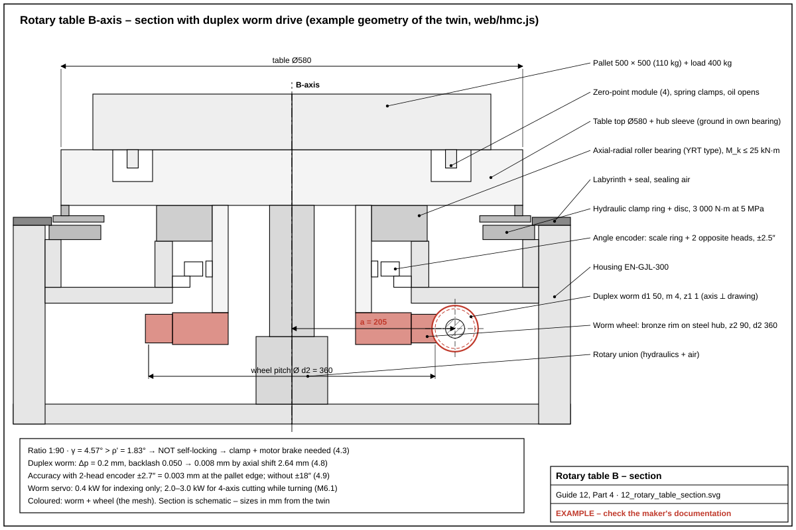
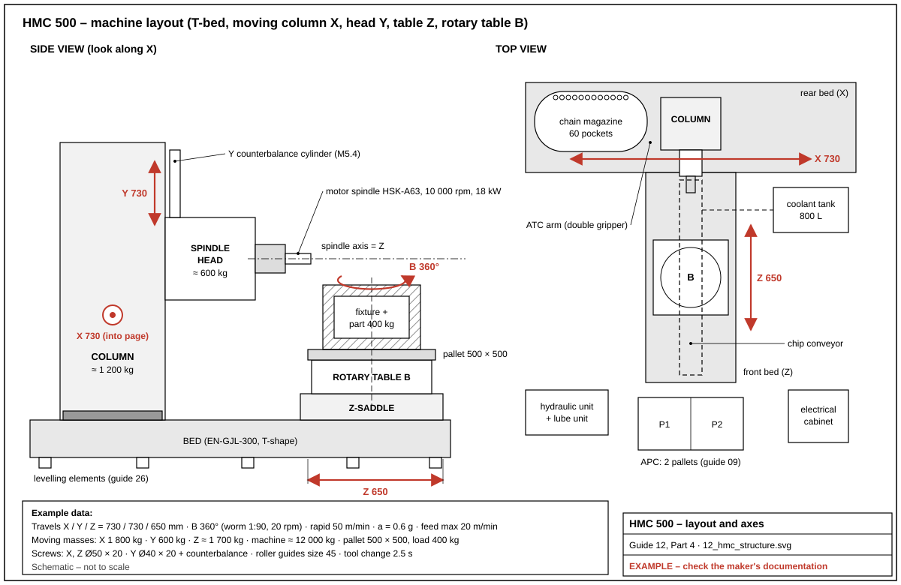
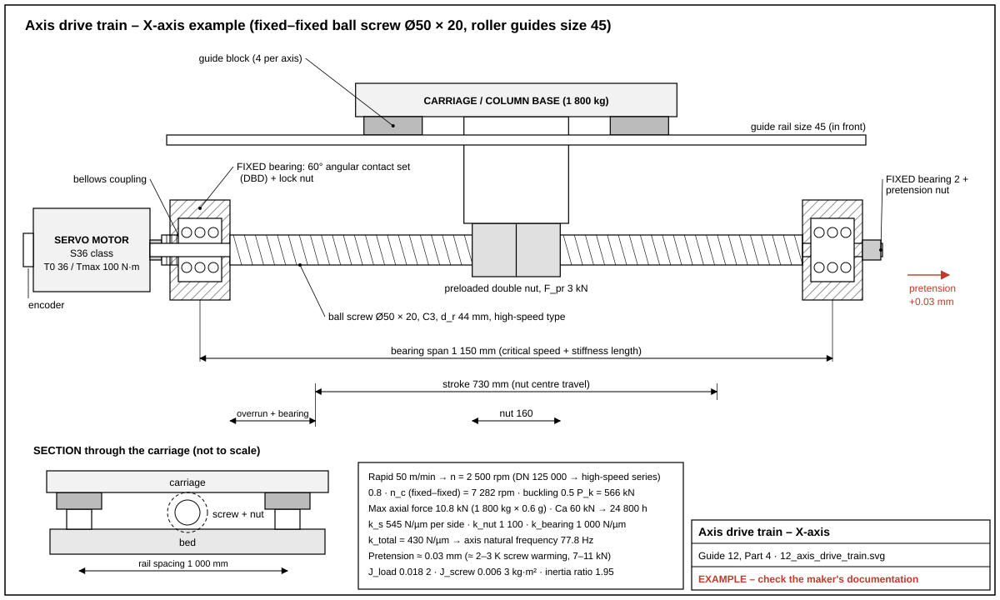
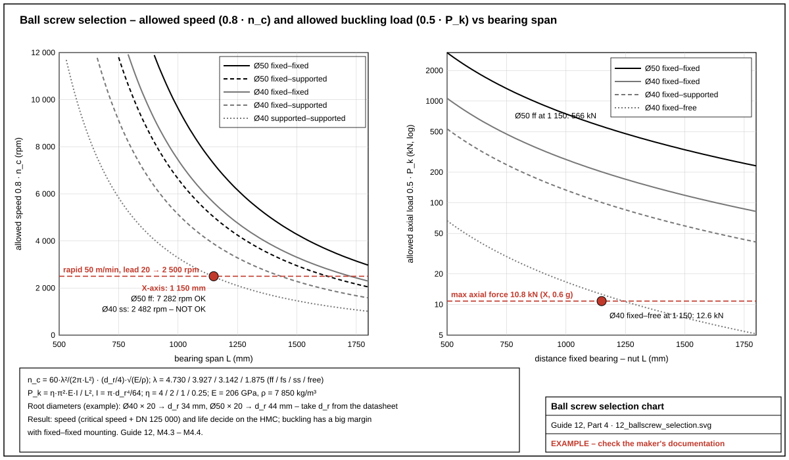
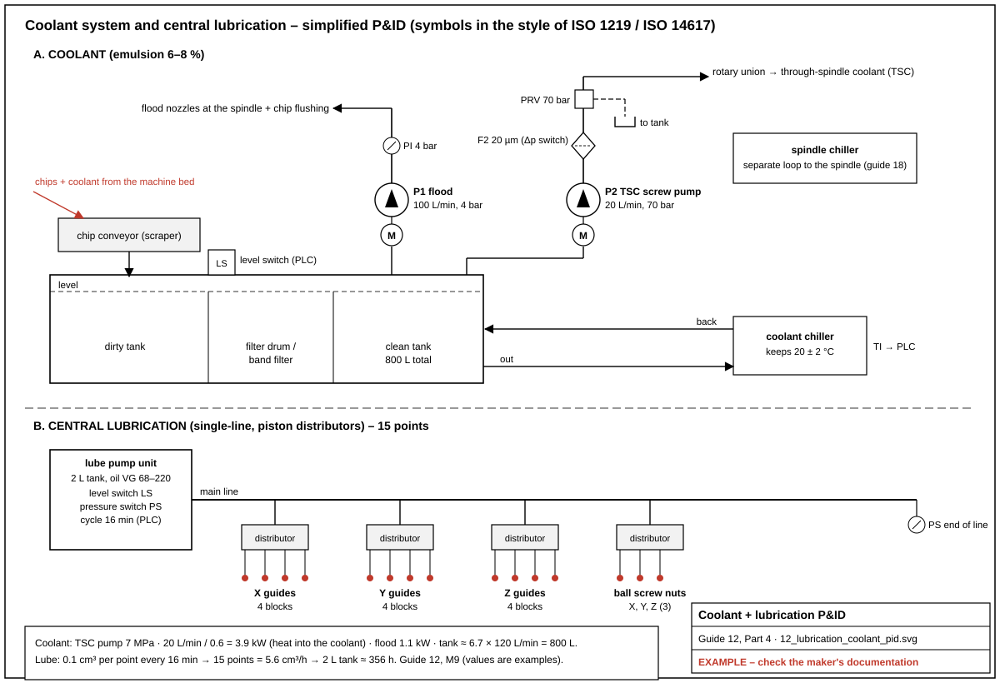
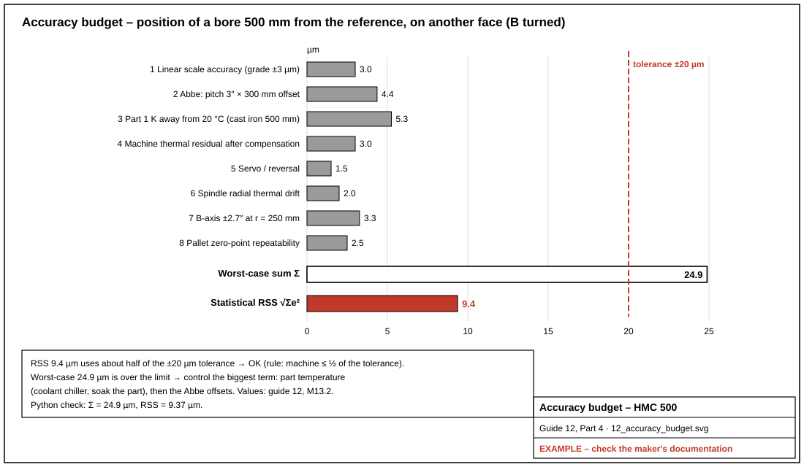
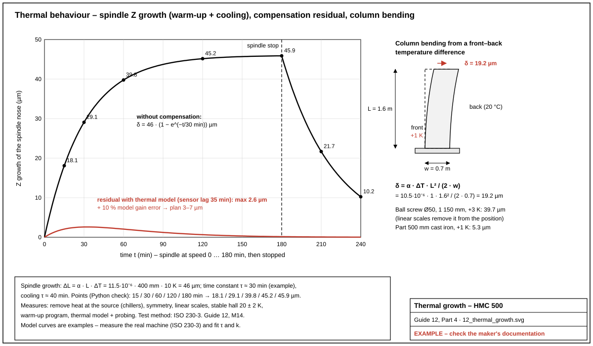

# 12 – HMC Build: Rotary Table (B-axis) with Duplex Worm Drive + Worm and Worm Wheel Manufacturing Twins

> **All numbers in this guide are example values from the twin.** They are typical for a 500 mm pallet
> class HMC. Before you order, machine or assemble anything, replace them with values from your drawings,
> the catalogues of your bearing, encoder, servo and clamp suppliers, and your own measurements.
> Costs in the twin use example hourly rates. They are **not** real prices.

Note on the name: the original request said "warm maching". We understood this as **worm machining /
worm drive**. All three items in the twin are about the worm drive of the B-axis.

Source files: `web/hmc.js` (item 1), `web/wormmfg.js` (item 2), `web/wheelmfg.js` (item 3). Tab: **HMC build**
(`#hmc`). Item 4 of the tab (spindle manufacturing, `web/spdmfg.js`, `web/spd3d.js`) is described in guide 18.
**Part 4** (whole machine HMC 500: structure, guides, ball screws, servos, magazine, coolant, safety, CNC,
accuracy, thermal, buy lists) is a hand calculation that is not in the app.

---

## Contents

1. Purpose
2. Where in the twin
3. Concepts – simply explained
4. Calculations (with the example numbers)
5. Manufacturing, assembly and inspection – step by step
6. Checklists
7. Common mistakes and lessons
8. Limits of the twin
10. Science principles (worm gear, contact, bearings, heat, case hardening, grinding burn, measurement)
11. Detailed manufacturing specification (materials, heat treatment, fits with numbers, geometric
    tolerances, Ra, bolts, lubricants, measuring plans, cutting data, tools, fixtures, drawing notes)
12. Identification and numbering (drawings, serials, matched pairs, NC programs, tools, gauges, heats)
13. Standards (requirement, value used, verification)
14. Complete worked example: worm WRM-2546-00017 from bar to released part
15. Data you still need

**Part 3 – Worm wheel manufacturing (item 3)**, sections W1–W15 (purpose, twin, concepts, calculations,
process plan, equipment + hob / master worm / roll tester specifications, manufacturing specification,
numbering, standards, worked example WHL-2546-00001, faults, checklists, data still needed, limits)

3D view (items 2 and 3)

**Part 4 – The whole machine: HMC 500 design and build (hand calculation, not in the app)**, chapters M1–M18:
- M1 Example machine: layout, axes X / Y / Z / B, strokes 730 / 730 / 650 mm, moving masses (drawing `12_hmc_structure.svg`)
- M2 Machine structure: force loop, static stiffness budget, dynamic stiffness + chatter, column natural frequency,
  materials (cast iron / ductile / welded steel / mineral casting), design rules, FEM procedure
- M3 Linear guides: types, life L = (C/P)³ · 50 km / (C/P)^(10/3) · 100 km, worked example X, preload + accuracy classes, mounting
- M4 Ball screws: accuracy classes, critical speed, DN, buckling, life with preload (X / Y / Z iteration), axial stiffness +
  axis natural frequency, thermal growth + pretension, support bearings (drawings `12_axis_drive_train.svg`,
  `12_ballscrew_selection.svg`)
- M5 Servo motor sizing X / Y / Z: inertia ratio, peak + RMS torque, gravity axis + counterbalance, feedback devices
- M6 B-axis: full torque budget of the worm servo (2.0–3.0 kW), worm vs direct-drive torque motor vs roller cam
- M7 Spindle check for the work + tool interfaces HSK-A63 / SK40 / BT40 (links to guides 18 / 19 / 20)
- M8 Tool magazine and changer: capacity, chain, drive, arm dynamics, 2.5 s time budget
- M9 Coolant (flood / TSC / chiller / tank), chips, way covers, central lubrication (drawing `12_lubrication_coolant_pid.svg`)
- M10 Hydraulics and pneumatics on the HMC (links to guides 09 / 25 / 29 / 30)
- M11 Enclosure, guards, windows and safety functions (ISO 16090-1)
- M12 CNC control architecture, control loops, electrical load (drawing `12_cnc_architecture.svg`)
- M13 Accuracy budget and error compensation (drawing `12_accuracy_budget.svg`)
- M14 Thermal behaviour (drawing `12_thermal_growth.svg`)
- M15 Acceptance tests ISO 10791 / ISO 230 (link to guide 26)
- M16 Buy list – catalogue examples (10 tables) · M17 Consolidated shopping list (34 positions) · M18 Standards,
  data still needed, design checklist

16. Glossary

(Chapter 9 is not used – the numbering follows the common chapter plan of the guide book, see `00_INDEX.md`.)
The worm equipment list is in 5.20. Part 3 (worm wheel) and Part 4 (whole machine) are blocks before the
glossary so that each team has everything in one place.

**Drawings of this guide** (standalone SVG in `docs/img/`, copies in `web/img/`): `12_hmc_structure.svg` (M1),
`12_axis_drive_train.svg` (M4), `12_ballscrew_selection.svg` (M4), `12_rotary_table_section.svg` (3.1),
`12_cnc_architecture.svg` (M12), `12_accuracy_budget.svg` (M13), `12_thermal_growth.svg` (M14),
`12_lubrication_coolant_pid.svg` (M9).

---

## 1. Purpose

This guide is for the team that will **make the parts of the HMC rotary table in the real workshop**.

The rotary table (the **B-axis**) turns the pallet, so the horizontal machining centre (HMC) can machine
4 or more sides of a part in one clamping. A servo motor drives a hardened and ground **worm**. The worm
turns a bronze **worm wheel** (example ratio 1:90). The wheel is bolted under the table.

The guide has three parts:

| Part | Item in the twin | What you learn |
|---|---|---|
| Part 1 | Item 1 – Rotary table (B-axis, worm drive) | Parts, cross-section, 14 assembly + measuring steps, duplex worm backlash setting, contact pattern, process plans for every part you make, design calculations, checks, BOM, acceptance tests, maintenance |
| Part 2 | Item 2 – Worm manufacturing twin | How the duplex worm is made: 12 operations from the saw to the test bench, the formulas of each operation, the part record, 7 typical faults (where they start, where you find them, how to prevent them), lot simulation with Cpk, time and cost route, make-or-buy, **equipment per operation with buying + acceptance notes (5.20)** |
| Part 3 | Item 3 – Worm wheel manufacturing twin | How the bronze worm wheel is made: 11 operations from hub and centrifugal-cast rim to shrink fit, hobbing with a duplex hob, gear measuring, double-flank roll test and pairing with its worm; shrink-fit and hobbing calculations, equipment, duplex hob spec sheet, specification, worked example, 7 faults (sections W1–W15) |

**Main findings from the example values (read these first):**

| # | Finding | Number (example) | What it means for you |
|---|---|---|---|
| 1 | The worm is **not self-locking** | lead angle γ = 4.57° > friction angle ρ' = 1.83°, efficiency η ≈ 71 % | The table can turn the worm backwards. You **need** the hydraulic clamp and a servo motor with a holding brake. |
| 2 | The worm is **too weak for roughing while the table turns** | tooth force 5 556 N > allowed 2 714 N (Bach) | Rough only with the table **clamped**. While the table turns (simultaneous 4-axis cutting) the allowed side cutting force is only ≈ **1.95 kN** (1 954 N). |
| 3 | A **direct angle encoder** is needed | ±2.7″ with encoder, ±18″ without | With the encoder the worm only drives; the encoder decides the position. |
| 4 | **Duplex worm** backlash setting | axial shift ≈ **2.6 mm** (2.64 mm) from 0.050 mm to 0.008 mm backlash | You grind the spacer ring to the size you find at assembly. |

---

## 2. Where in the twin

### 2.1 How to open

1. Start the twin: `python server.py` (or double-click `start.bat`).
2. Open `http://localhost:8080` in the browser.
3. Click the tab **HMC build**.
4. At the top you see 3 buttons:
   - **1 · Rotary table (B-axis, worm drive) – machining + assembly**
   - **2 · Worm manufacturing – digital twin (saw → inspection → test bench)**
   - **3 · Worm wheel manufacturing – digital twin (bronze rim → hobbing → roll test → pair)** (see 2.5 and
     Part 3)

Everything runs offline in the browser (2D SVG drawings, no libraries).

### 2.2 Item 1 – what is on the page

| Card | What it shows | What you can do |
|---|---|---|
| KPI row | Ratio, motor, accuracy, backlash, self-locking, number of checks OK | Read the result at a glance |
| Assembly – step by step | Cross-section through the B-axis with 14 animated steps. Parts slide in when they are fitted. A red "measure" symbol shows where to measure. | Play / step / slider; **click a part** for its data (make/buy, material, key value) |
| Backlash setting with the duplex worm | Axial section of the duplex worm and wheel teeth, backlash bar, formula, 3 contact pattern pictures | Move the slider (= axial shift of the worm, 0–5 mm), button "set to target" |
| Process plan – parts you make | Operation tables for Housing, Table, Worm wheel, Duplex worm, Clamp, Cartridges | Click the part buttons |
| Assembly + measuring steps | Table of the 14 steps with the check of each step | Click a row → the drawing jumps to the step |
| Design inputs | All inputs in 4 groups (rotating parts, worm gear, loads + clamp, accuracy) | Change values; "Example values" resets. Values are stored in the browser (localStorage `hmcRotState`) |
| Checks | 9 checks with green / yellow / red | – |
| Calculations | 7 formula blocks with your numbers | – |
| Bill of materials | MAKE / BUY list | – |
| Guide | Workshop rules, acceptance tests, maintenance | – |

Pallet size and load come from the **Pallet changer** tab (`window.APC`). Example: pallet 500 × 500 mm,
pallet 110 kg, workpiece + fixture 400 kg, load offset 50 mm, zero-point pitch 400 mm.

### 2.3 Item 2 – what is on the page

| Card | What it shows |
|---|---|
| KPI row | Worm serial no., status (released / REJECT at Op …), time per worm, cost per worm, lot lead time, max lead error |
| Process twin | Route buttons Op 10 … Op 120, animated scene of each operation, steps list, settings, checks. Buttons: Play all, speed ½× / 1× / 2×, **New worm (random)**, **Download part record** (JSON) |
| Inject a process fault | 7 fault buttons (see 5.15) |
| Inspection report (Op 100) | Charts: lead, profile, runout, single pitch, over-wire size M; check list |
| Test bench report (Op 110) | Charts: transmission error (1 wheel turn + zoom 5 worm turns), backlash vs axial shift, run-in temperature, efficiency; check list |
| Part record – route, time, cost | Table per operation: set-up, min/worm, cost/worm, result |
| Lot simulation | 50 worms, 11 characteristics, mean, σ, Cpk, out-of-tolerance count, yield |
| Equipment list | Table Op 10–120: machine (required capability = purchase specification), tooling, workholding, gauges / test equipment, consumables (see 5.20). The same data appear per operation in the info panel (block **Equipment**) and in the downloaded part record (`equipment`) |
| Process inputs | Thread roughing method (whirling / single-point / disc milling) and 6 input groups (localStorage `hmcWormMfg`) |
| Calculations | 7 formula blocks |
| Guide | How the twin works, fault table, workshop rules, matched pair, make or buy |

The worm geometry (m, z1, d1, z2, Δp, j0, jt, μ) comes from item 1 (`window.HMCROT`). If you change the
worm in item 1, item 2 updates.

### 2.4 Deep links (put them in work instructions)

| Link | Opens |
|---|---|
| `http://localhost:8080/?hrstep=6&hrshift=2.6&hrplan=worm#hmc` | Item 1, assembly step 6 (contact pattern), worm shifted 2.6 mm, process plan of the worm |
| `?hrstep=7#hmc` | Step 7 (backlash setting) |
| `?hrplan=housing#hmc` | Process plan of the housing. Other keys: `table`, `wheel`, `worm`, `clamp`, `cart` |
| `http://localhost:8080/?hritem=2&wmop=80&wmu=0.4&wmf=burn,thermal&wmsn=3#hmc` | Item 2, Op 80 (thread grinding) at 40 % progress, faults "burn" + "thermal" on, worm no. 3 |
| `?hritem=2&wmop=40#hmc` | Item 2 at Op 40 (rough thread) |
| `http://localhost:8080/?hritem=3&wwop=70&wwu=0.5&wwf=hobWrong,midplane&wwsn=2#hmc` | Item 3 (worm wheel), Op 70 (hobbing) at 50 % progress, faults "wrong hob" + "mid-plane offset" on, wheel no. 2 |
| `?hritem=3&wwop=110&wmsn=1&wwsn=1#hmc` | Item 3, Op 110: wheel no. 1 paired with worm no. 1 of item 2 |

Parameters: `hrstep` = step 1–14; `hrshift` = worm shift in mm (0–5); `hrplan` = plan key; `hritem=2` =
show item 2; `wmop` = operation number (10, 20 … 120); `wmu` = progress 0–1 inside the operation;
`wmf` = fault keys separated by commas (`stock`, `hard`, `centre`, `burn`, `thermal`, `dress`, `duplex`);
`wmsn` = worm serial number (changes the random values; in item 3 it also selects the worm used for the
pairing). Item 3: `hritem=3`; `wwop` = operation number (10, 20 … 110); `wwu` = progress 0–1; `wwf` = fault
keys (`porosity`, `shrink`, `hobA`, `hobWear`, `hobWrong`, `thermal`, `midplane`); `wwsn` = wheel serial
number.

### 2.5 Item 3 – what is on the page

KPI row (wheel no., status, time, cost, holding torque, cumulative pitch), process twin Op 10–110 with
equipment / settings / checks, 7 fault buttons, inspection + pairing charts, route / time / cost, lot
simulation of 50 wheels, equipment list, process inputs (4 hobbing methods, localStorage `hmcWheelMfg`),
4 calculation blocks and the guide. Full description: **Part 3, W2**.

---

## 3. Concepts – simply explained

### 3.1 The rotary table in one picture (cross-section, from bottom to top)



The same section as a text sketch:

```
                     ┌──────────── test pallet (500 × 500) ────────────┐
                     │   zero-point modules (4)  in the table top       │
   ┌─────────────────┴──────────────────────────────────────────────────┴───┐
   │ TABLE TOP Ø580  (+ hub sleeve going down through the bearing)          │
   └──┬────────────────────────────┬──────────────────────────┬─────────────┘
      │ main axial-radial bearing  │   clamp disc  ← clamp ring (hydraulic)  │ labyrinth + seal
      │ (bore 200)                 │                                          │
      │   encoder scale ring + 2 read heads (on the hub sleeve)              │
      │                                                                      │  HOUSING
      │   WORM WHEEL (bronze rim on steel hub), bolted under the hub ───── WORM (axis ⟂ page)
      │                                                                      │  in 2 cartridges
   rotary union (hydraulic + air) in the centre                              │
   └─────────────────────────────── base face = reference A ─────────────────┘
```

Part list of the cross-section (the twin colours each part; click it for data):

| Part | Make / buy | Material / type | Job | Key value (example) |
|---|---|---|---|---|
| Housing | MAKE | EN-GJL-300 casting | Carries everything. Bearing seat and worm bores are machined in ONE set-up – this fixes the centre distance and the perpendicularity. | centre distance a = 205.0 ±0.01 mm |
| Main bearing | BUY | axial-radial cylindrical roller bearing, bore 200 | Takes axial load, radial load and tilting moment in one bearing – very stiff, low runout | tilting moment 2.0 kN·m of 25 allowed |
| Table top + hub sleeve | MAKE | EN-GJS-600 / C45 | Carries zero-point modules and pallet. The top is ground in its own bearing at the end. | Ø580 mm |
| Worm wheel | MAKE | CuSn12Ni2 bronze rim on C45 hub | Bronze against hardened steel: low wear, good running-in. Matched pair with the worm. | z2 = 90, m = 4, d2 = 360 mm |
| Duplex worm + bearing cartridges | MAKE | 16MnCr5, case hardened + ground | Axial shift sets the backlash. Fixed bearing pair on the motor side. | d1 = 50 mm, lead angle 4.57° |
| Clamp ring + clamp disc | MAKE / BUY | hydraulic thin-wall clamp ring | Holds the table during indexed (4-axis positioned) machining, so the cutting force does not load the worm | 3 000 N·m holding torque |
| Angle encoder | BUY | hollow-shaft angle encoder, 2 read heads | Measures the table angle directly → worm pitch errors and backlash do not matter (closed loop) | ±2.5″ |
| Rotary union | BUY | hydraulic + air passages | Brings oil (pallet clamping) and air (seat check, cleaning) into the turning table | 4–6 passages |
| Labyrinth cover + seals | MAKE + BUY | labyrinth + sealing air | Keeps coolant and chips out of bearing and worm | sealing air 0.5 bar |
| Zero-point modules (4) | BUY | zero-point clamping modules | Clamp the pallet (see Pallet changer tab / guide 09) | pitch 400 mm |
| Test pallet | (APC) | machining pallet | For the final checks | 500 × 500 mm |

### 3.2 Worm drive – the basic idea

- The **worm** is a screw. One turn of a 1-start worm moves the wheel by **one tooth**.
- So with z2 = 90 teeth the ratio is **1:90**: the motor turns 90 times for 1 table turn.
- Big ratio in a small space, very smooth, high stiffness. That is why HMC rotary tables use it
  (typical ratios 1:90 to 1:360).
- Worm = hard steel, ground. Wheel = bronze. Bronze on hardened steel slides well and runs in.

### 3.3 Why the worm is NOT self-locking here

- A worm "self-locks" when the wheel **cannot** turn the worm backwards. This happens only when the lead
  angle γ is **smaller than or equal to** the friction angle ρ'.
- A precise ground worm with good oil has very low friction (μ ≈ 0.03). Then ρ' is small (1.83°), and
  our lead angle (4.57°) is bigger. → **not self-locking**.
- Result: a cutting force on the table can turn the worm and the motor. So the table needs:
  1. a **hydraulic clamp** for machining with the table standing still, and
  2. a **servo motor with a holding brake** (for power loss and E-stop).
- Do not try to "make it self-locking" with a smaller lead angle: efficiency drops, heat rises, and
  self-locking from friction is never safe under vibration.

### 3.4 Why a DUPLEX worm

- **Normal worm:** both flanks have the same lead. Backlash can only be changed by changing the centre
  distance. That moves the contact pattern and spoils the mesh.
- **Duplex worm:** the left flank and the right flank have **slightly different leads**.
  Example: px = 12.566 mm, Δp = 0.2 mm → left flank lead 12.466 mm, right flank lead 12.666 mm.
- Result: the thread gets **thicker along the worm** (and the gap gets narrower).
- If you **shift the worm axially**, a thicker part of the thread comes into the mesh → less backlash.
- The centre distance and the contact pattern do **not** change.
- After years of wear you can shift the worm again and re-set the backlash. This is the main advantage.

```
  wheel teeth (fixed)      ▼   ▼   ▼   ▼   ▼   ▼
  worm thread             ▲   ▲   ▲    ▲    ▲    ▲      ← thread thickness grows to the right
                          thin ───────────────→ thick
  shift worm ←  :  thicker thread enters the mesh  →  backlash smaller
```

### 3.5 Contact pattern

- Paint the worm thin with **marking paste**. Turn both directions. Look at the mark on the wheel tooth.
- **Good:** pattern in the middle of the tooth, at least 60 % of the flank, slightly towards the mesh
  **exit** side (so oil can enter at the entry side).
- **Too high / too low:** move the wheel axially with **shims** until the pattern is centred.
- The twin shows 3 pictures: "✓ centred", "too high → shim", "too low → shim".

### 3.6 Direct angle encoder with 2 opposite read heads

- **Without** a table encoder, the position comes from the motor encoder through the worm. Then every
  pitch error of the wheel, the backlash and thermal growth go directly into the table angle.
- **With** a direct encoder on the table, the control closes the loop on the real table angle. The worm
  only drives.
- The scale ring is never perfectly centred. An eccentricity e on scale radius Rs gives an angle error.
  **Two read heads exactly opposite (180°)** see the error with opposite sign. The average cancels it.

### 3.7 One set-up rule

Everything that must fit together is machined in **one clamping**: housing bearing seat + worm bores;
all seats of the table. Every re-clamping costs about 0.01–0.02 mm.

### 3.8 Matched pair

Worm and wheel are made for each other (wheel hobbed with a duplex hob of the same leads and profile,
then tested together). They get the **same pair number**. Never replace only one of them.
The wheel-specific concepts (bronze on steel, centrifugal casting, shrink fit, throat radius, hobbing
kinematics, duplex hob, oversize hob, radial vs tangential feed, double-flank test) are in **Part 3, W3**.

### 3.9 The process twin (item 2) in one sentence

Every worm gets a **part record** ("birth certificate"): the route of 12 operations, the settings and
every measured value. In the real factory the machines write it (MES). In the twin the values are
**simulated** with random variation, and you can switch on faults to see where they start and which
check finds them.

---

## 4. Calculations (with the example numbers)

All formulas are taken from the code. Numbers are the example values of the twin.

### 4.1 Inputs of item 1 (example values)

| Group | Input | Symbol | Example | Note |
|---|---|---|---|---|
| Rotating parts | Table + hub + worm wheel mass | mt | 220 kg | |
| | Table radius | Rt | 290 mm | Ø580 table for a 500 pallet |
| | Max. table speed | nmax | 20 rpm | HMC B-axis 10–30 rpm |
| | Acceleration time | ta | 0.4 s | |
| Worm gear | Worm starts | z1 | 1 | |
| | Worm wheel teeth (= ratio) | z2 | 90 | 1:90 – 1:360 |
| | Axial module | m | 4 mm | |
| | Worm pitch diameter | d1 | 50 mm | |
| | Wheel face width | b2 | 36 mm | |
| | Friction (ground worm / bronze, oil) | μ | 0.03 | 0.02–0.05 |
| | Allowed tooth load factor (Bach) | c | 6 N/mm² | bronze / hardened steel, slow |
| | Duplex lead difference L/R flank | Δp | 0.2 mm | per pitch |
| | Backlash as hobbed (start) | j0 | 0.050 mm | |
| | Target backlash | jt | 0.008 mm | 0.005–0.010 |
| Loads + clamp | Cutting force (side) | Fc | 4 000 N | from Pallet changer tab |
| | Cutting radius from the B-axis | rc | 250 mm | |
| | Cutting height above the bearing | hcut | 450 mm | table + pallet + fixture |
| | Safety factor | S | 2 | |
| | Clamp holding torque (catalogue) | Tcl | 3 000 N·m | hydraulic clamp ring, 5 MPa |
| | Bearing allowed tilting moment | Mk,allow | 25 kN·m | catalogue |
| | Bearing static axial load rating | C0a | 900 kN | catalogue |
| Accuracy | Angle encoder accuracy | enc | ±2.5″ | |
| | Scale eccentricity after centring | e | 0.005 mm | |
| | Scale radius | Rs | 105 mm | |
| | Read heads | – | 2 | opposite |
| | Wheel cumulative pitch error | Fp | ±12″ | DIN 3974 class 5 (example) |
| | Temperature rise of the table | ΔT | 5 K | (input only – see 8) |
| From APC tab | Pallet a × b, pallet mass, workpiece mass, offset e, module pitch | | 500 × 500 mm, 110 kg, 400 kg, 50 mm, 400 mm | |

1″ (arc second) = 1/3600 degree. Conversion used in the code: 1 rad = 206 265″.

### 4.2 Worm gear geometry

| Quantity | Formula | Example |
|---|---|---|
| Ratio | i = z2 / z1 | 90 / 1 = **90** |
| Wheel pitch diameter | d2 = m · z2 | 4 · 90 = **360 mm** |
| Axial pitch | px = π · m | π · 4 = **12.566 mm** |
| Centre distance | a = (d1 + d2) / 2 | (50 + 360) / 2 = **205.0 mm** |
| Lead angle | γ = atan(z1 · m / d1) | atan(1 · 4 / 50) = **4.57°** |
| Sliding speed | vs = π · d1 · (nmax · i) / 60 / cos γ | π · 0.050 m · 1 800 rpm / 60 / cos 4.57° = **4.73 m/s** |

Check: sliding speed for bronze in oil bath ≤ 6 m/s (warning up to 10 m/s). 4.73 m/s → OK.

### 4.3 Efficiency and self-locking

| Quantity | Formula | Example |
|---|---|---|
| Friction angle | ρ' = atan(μ / cos 20°) | atan(0.03 / 0.940) = **1.83°** |
| Efficiency, worm drives | η = tan γ / tan(γ + ρ') | tan 4.57° / tan 6.40° = 0.0800 / 0.1122 = **0.71 (71 %)** |
| Efficiency, wheel drives back | η' = tan(γ − ρ') / tan γ (only if γ > ρ') | tan 2.75° / tan 4.57° = **0.60 (60 %)** |
| Self-locking? | only if γ ≤ ρ' | 4.57° > 1.83° → **NO** |

**Why it matters:** 60 % back-driving efficiency means the wheel turns the worm easily. The clamp and
the brake must hold the table, not the worm.

### 4.4 Motor (acceleration torque)

| Step | Formula | Example |
|---|---|---|
| Inertia of the table (disc) | Jt = ½ · mt · Rt² | ½ · 220 · 0.29² = **9.25 kg·m²** |
| Inertia of pallet + load | Jp = m_pl · (a² + b²)/12 + mw · e² | 510 · (0.5² + 0.5²)/12 + 400 · 0.05² = 21.25 + 1.00 = **22.25 kg·m²** |
| Total | J = Jt + Jp | **31.50 kg·m²** |
| Angular speed | ω = 2π · nmax / 60 | 2π · 20 / 60 = **2.094 rad/s** |
| Angular acceleration | α = ω / ta | 2.094 / 0.4 = **5.24 rad/s²** |
| Torque at the table | T = J · α · 1.1 | 31.50 · 5.24 · 1.1 = **181 N·m** |
| Motor speed | n_m = nmax · i | 20 · 90 = **1 800 rpm** |
| Motor torque | T_m = T / (i · η) | 181 / (90 · 0.713) = **2.83 N·m** |
| Servo choice | first servo with T_max ≥ 1.3 · T_m and n_max ≥ n_m | 1.3 · 2.83 = 3.68 N·m ≤ 3.8 N·m → **0.4 kW** (T_n 1.3, T_max 3.8 N·m, 6 000 rpm) |

m_pl = pallet + workpiece = 110 + 400 = 510 kg. The factor 1.1 adds 10 % for friction.

**Warning:** this is only the acceleration torque. It does not include bearing drag, seal friction, the
clamp disc drag or cutting torque while turning. See section 8. In practice choose the servo with margin
after a full torque budget – the full budget is worked out in **Part 4, M6.1** (result: 2.0–3.0 kW for cutting
while turning).

Servo list used by the twin (example data):

| kW | T_n N·m | T_max N·m | n_max rpm |
|---|---|---|---|
| 0.4 | 1.3 | 3.8 | 6 000 |
| 0.75 | 2.4 | 7.2 | 6 000 |
| 1.5 | 4.8 | 14.3 | 5 000 |
| 2.0 | 6.4 | 19 | 5 000 |
| 3.0 | 9.6 | 29 | 4 500 |
| 4.5 | 14.3 | 43 | 4 000 |

### 4.5 Cutting torque and clamp

| Quantity | Formula | Example |
|---|---|---|
| Cutting torque on the table | T_c = Fc · rc | 4 000 N · 0.25 m = **1 000 N·m** |
| Clamp torque needed | T_cl,need = S · T_c | 2 · 1 000 = **2 000 N·m** |
| Check | T_cl ≥ T_cl,need | 3 000 ≥ 2 000 → **OK** |

Status logic in the twin: green if Tcl ≥ S · Tc; yellow if Tcl ≥ Tc only; red otherwise.

### 4.6 Worm wheel tooth load (Bach) – cutting while turning

The simple **Bach** formula gives the allowed tangential force on the wheel teeth:

| Quantity | Formula | Example |
|---|---|---|
| Tangential force on the wheel from cutting | Ft2 = 2 · T_c / d2 | 2 · 1 000 / 0.360 = **5 556 N** |
| Allowed (Bach) | Ft2,allow = c · b2 · px | 6 · 36 · 12.566 = **2 714 N** |
| Check | Ft2 ≤ Ft2,allow | 5 556 > 2 714 → **NOT OK while turning** |
| Allowed cutting force while the table turns | Fc,turn = Ft2,allow · (d2/2) / rc | 2 714 · 180 / 250 = **1 954 N ≈ 1.95 kN** |
| Tooth force from acceleration only | Ft2,acc = 2 · T / d2 | 2 · 181 / 0.360 = 1 008 N (OK) |

**Decision:** rough with the table **clamped** (the clamp takes 3 000 N·m). While the table turns
(simultaneous 4-axis machining) cut only with side force ≤ ≈ 1.95 kN at 250 mm radius. Other option from
the twin: bigger module (m = 5 or more) – then check again.

In the twin this check is **yellow** (not red) because the clamp is strong enough for the cutting
torque.

### 4.7 Main bearing

| Quantity | Formula | Example |
|---|---|---|
| Tilting moment | M_k = Fc · hcut + mw · g · e | 4 000 · 0.45 + 400 · 9.81 · 0.05 = 1 800 + 196 = **2.0 kN·m** |
| Check | M_k ≤ 0.5 · M_k,allow (green), ≤ M_k,allow (yellow) | 2.0 ≤ 12.5 → **OK** |
| Axial load | F_a = (m_pl + mt) · g | (510 + 220) · 9.81 = **7.16 kN** |
| Check | 4 · F_a ≤ C0a (green) | static safety 900 / 7.16 ≈ **126** → OK |

### 4.8 Backlash with the duplex worm

When the worm moves axially by s, the thread thickness in the mesh changes by s · Δp / px.

| Quantity | Formula | Example |
|---|---|---|
| Backlash change per mm shift | Δj = Δp / px | 0.2 / 12.566 = **0.0159 mm per mm** (15.9 µm/mm) |
| Backlash after shift s | **j = j0 − s · Δp / px** | at s = 2.0 mm: 0.050 − 2.0 · 0.0159 = 0.018 mm |
| Shift needed for the target | s = (j0 − jt) / (Δp / px) | (0.050 − 0.008) / 0.0159 = **2.64 mm** |
| Shift where it jams (j = 0) | s0 = j0 / (Δp / px) | 0.050 / 0.0159 = **3.14 mm** – never go there |
| Backlash as angle | φ = j / (d2/2) · 206 265 | 0.008 / 180 · 206 265 = **9.2″** (start 0.050 mm = 57″) |

Check in the twin: green if 0.3 mm < s ≤ 5 mm (the adjustment range). Colour of the bar: green when
0.005 ≤ j ≤ 0.010 mm, red "JAMMED" when j < 0.

**Why the margin matters:** between the target (2.64 mm) and jamming (3.14 mm) there are only 0.5 mm. The
spacer ring must be ground to ±0.002 mm (see cartridge plan).

### 4.9 Positioning accuracy – with and without direct encoder

| Case | Formula | Example |
|---|---|---|
| Eccentricity error, 1 head | e_ecc = e / Rs · 206 265 | 0.005 / 105 · 206 265 = **9.8″** |
| Eccentricity error, 2 opposite heads | cancelled | **0″** |
| Thermal drift | fixed 1″ in the code | 1″ |
| **With direct encoder (2 heads)** | √(enc² + e_ecc² + thermal²) | √(2.5² + 0² + 1²) = **±2.7″** |
| With direct encoder, only 1 head | same | √(2.5² + 9.8² + 1²) = ±10.2″ |
| **Without encoder** (motor encoder only) | Fp + j/2 + thermal | 12 + 9.2/2 + 1 = **±17.6″ ≈ ±18″** |
| At the pallet edge | x = angle / 206 265 · a/2 | with: 2.7″ → **0.0033 mm**; without: 17.6″ → **0.021 mm** |

Check: green if ≤ 5″, yellow if ≤ 8″.

**Why it matters:** 0.021 mm at the pallet edge is too much for bores that must line up from 2 sides of
a compressor crankcase. With the encoder you get about 0.003 mm.

### 4.10 Summary of the 9 checks (example result: 8 OK, 1 warning)

| # | Check | Rule | Example | Result |
|---|---|---|---|---|
| 1 | Servo motor found | T_max ≥ 1.3 · T_m and n_max ≥ n_m | 0.4 kW: 2.83 · 1.3 ≤ 3.8 N·m at 1 800 rpm | OK |
| 2 | Clamp holds the cutting torque | Tcl ≥ S · Tc | 3 000 ≥ 2 000 N·m | OK |
| 3 | Worm tooth load when cutting while turning | Ft2 ≤ c · b2 · px | 5.6 kN > 2.7 kN → rough clamped, ≤ 1 954 N while turning | **Warning** |
| 4 | Bearing tilting moment | ≤ 50 % of allowed | 2.0 of 25 kN·m | OK |
| 5 | Bearing axial load | 4 · Fa ≤ C0a | 7.2 kN, safety ×126 | OK |
| 6 | Self-locking? | info | NO (4.57° > 1.83°) – clamp + brake must hold | info |
| 7 | Sliding speed for bronze | ≤ 6 m/s | 4.73 m/s | OK |
| 8 | Positioning accuracy (with encoder) | ≤ 5″ | ±2.7″ = 0.0033 mm at the edge | OK |
| 9 | Backlash adjustable | 0.3 < s ≤ 5 mm | 2.64 mm | OK |

### 4.11 Item 2 – worm geometry for manufacturing

Inputs from item 1: m = 4, z1 = 1, d1 = 50 mm, z2 = 90, Δp = 0.2 mm.

| Quantity | Formula | Example |
|---|---|---|
| Axial pitch | px = π · m | 12.566 mm |
| Lead | pz = z1 · px | 12.566 mm |
| Lead angle | γ = atan(pz / (π · d1)) | 4.57° |
| Tip diameter | da = d1 + 2m | 58.0 mm |
| Root diameter | df = d1 − 2.4m | 40.4 mm |
| Thread depth | h = 2.2m | 8.8 mm |
| Left flank lead | pL = z1 · (px − Δp/2) | 12.466 mm |
| Right flank lead | pR = z1 · (px + Δp/2) | 12.666 mm |
| Thread length | b1 ≈ (11 + 0.06 · z2) · m + 2 · 5 + px, rounded up to 5 mm | (16.4 · 4 + 10 + 12.57) = 88.2 → **90 mm** |
| Duplex flank shift at the thread ends | ± Δp/2 · (b1/2) / px | 0.1 · 45 / 12.566 = **±0.36 mm** |
| Evaluation length (lead scan) | Lb = b1 − 2m | 82 mm |
| Number of pitches checked | floor(Lb / px) | 6 |

**Important:** the duplex flank shift at the thread ends (±0.36 mm) is **bigger than the grinding stock**
(0.25 mm). So the **roughing must already follow the two leads**. If you rough with one lead, one end has
no stock on one flank.

Shaft layout (from the code; Ø in mm, length in mm):

| Segment | Ø | Length | Tolerance | Ground? |
|---|---|---|---|---|
| Motor journal | 20 | 40 | h6 (−13 / 0 µm) | yes |
| Bearing seat A (fixed side) | 25 | 28 | k5 (+2 / +11 µm) | yes |
| Shoulder | 32 | 12 | – | no |
| Thread (tip) | 58 | 90 | h8 (−46 / 0 µm) on tip Ø | yes |
| Shoulder | 32 | 12 | – | no |
| Bearing seat B (floating side) | 25 | 24 | k5 | yes |
| End thread M20 (stays soft) | 20 | 16 | – | no |
| **Total shaft length** | | **222** | ±0.1 | |

Blank: Ø65 bar (= da + 6, rounded up to 5 mm), saw length 222 + 7 = **229 mm**, blank mass
π/4 · 65² · 229 · 7.85e-6 = **5.97 kg**; finished worm ≈ **1.64 kg**.

### 4.12 Turning

| Quantity | Formula | Example |
|---|---|---|
| Spindle speed | n = 1000 · vc / (π · D) | 1000 · 200 / (π · 65) = **979 rpm** |
| Removal rate | Q = vc · f · ap | 200 · 0.3 · 2 = **120 cm³/min** |
| Chip volume | V = Σ π/4 · (D² − d²) · L (ground Ø + 0.6) | **430 cm³** = 3.4 kg |
| Time | t ≈ V/Q · 1.6 + 1.5 | 430/120 · 1.6 + 1.5 = **7.2 min** |

### 4.13 Case depth (case hardening)

| Quantity | Formula | Example |
|---|---|---|
| Total carbon depth at 925 °C (Harris rule of thumb) | d_tot ≈ 0.635 · √t (t in h, d in mm) | 0.635 · √5 = **1.42 mm** |
| Effective case depth CHD at 550 HV | CHD ≈ 0.7 · d_tot | 0.7 · 1.42 = **0.99 mm** |
| CHD needed before grinding | CHD_need = CHD_finished + stock + 0.05 | 0.6 + 0.25 + 0.05 = **0.90 mm** |
| Check | CHD ≥ CHD_need | 0.99 ≥ 0.90 → OK |
| Fault "carburising 1.5 h" | 0.7 · 0.635 · √1.5 | **0.54 mm** < 0.90 → REJECT |

CHD_finished example 0.6 mm ≈ 0.15 · m. **Why:** grinding removes the stock from the hard case. Order the
case depth **including** the grinding stock, or the finished flank has a thin case.

### 4.14 Thread grinding

| Quantity | Formula | Example |
|---|---|---|
| Rough passes per flank | nR = ⌈(s0 − 2 · ae_f) / ae_r⌉ | ⌈(0.25 − 0.02) / 0.03⌉ = **8** |
| Passes per flank | nR + 2 finish + 1 spark-out | 8 + 2 + 1 = **11** (22 for both flanks) |
| Time per pass | (b1 + 2px) / (pz · n) | (90 + 25.1) / (12.566 · 30) = **0.31 min** |
| Grinding time | passes · t_pass + dressings · 0.6 + 2.5 | 22 · 0.31 + 4 · 0.6 + 2.5 = **11.6 min** |
| Work speed | vw = π · d1 · n / 60 | π · 50 · 30 / 60 = **78.5 mm/s** |
| Specific removal rate | **Q'w = ae · vw** | 0.03 · 78.5 = **2.36 mm³/(mm·s)** |
| Burn check | Q'w / Q'w,limit | 2.36 / 4 = **59 %** (green ≤ 70 %, yellow ≤ 100 %, red > 100 %) |
| Thermal lead error | **Δ = −α · ΔT · L** | −11.5e-6 · 0.5 K · 82 mm = **−0.47 µm** (chilled coolant ±0.5 K) |
| Same with coolant not cooled | | −11.5e-6 · 6 K · 82 mm = **−5.7 µm** → out of ±4 µm |
| Wheel wear between dressings | 0.25 µm per pass · passes between dressings | 0.25 · 6 = **1.5 µm** (dress every 40 passes → 10 µm) |
| Stock needed to clean up | (runout/2) · sin 20° + ε · (b1/2) · cos 20° + pitch error · cos 20° + 0.01 | ≈ 0.003 + 0.008 + 0.008 + 0.01 ≈ **0.03 mm** (typical, random per worm) |

ε = lead growth from carburising (example ≈ 180 µm/m). Rule: 1 K warmer worm while grinding gives about
1 µm shorter lead over 90 mm. That is why the coolant is chilled.

### 4.15 Over-wire (3-wire) measurement

| Quantity | Formula | Example |
|---|---|---|
| Best wire diameter | **dw = px / (2 · cos 20°)** | 12.566 / (2 · 0.9397) = **6.686 mm** |
| Over-wire size, finished | **M0 = d1 − px / (2 · tan 20°) + dw · (1 + 1/sin 20°)** | 50 − 17.263 + 6.686 · 3.924 = **58.973 mm** |
| Over-wire size, soft (with stock) | **M = M0 + 2 · s0 / sin 20°** | 58.973 + 2 · 0.25 / 0.342 = **60.435 mm** |
| Duplex: M grows along the worm | **dM/dx = Δp / (px · tan 20°)** | 0.2 / (12.566 · 0.364) = **43.7 µm per mm** |

The M0 formula is an **axial-section approximation**. For the real worm profile (ZI, ZK, ZN …) use the
exact formula from the gear measuring machine software or the drawing.

Tolerance in the twin: soft M ±0.08 mm, finished M (middle) ±25 µm, measured M slope within 10 % of
43.7 µm/mm. M is measured at 4 places: −1.5 px, −0.5 px, +0.5 px, +1.5 px from the middle.

### 4.16 Test bench

| Quantity | Formula | Example |
|---|---|---|
| Backlash change per mm shift | Δp / px | **15.9 µm per mm** |
| Shift for target backlash | from the fitted line of 6 measurements (0…5 mm) | ≈ 2.6 mm (random) |
| Transmission error amplitude from runout | (Fr/2) · tan 20° / (d2/2) · 206 265 | Fr = 2.4 µm → ≈ 0.5″ |
| Run-in output power | P_out = T · 2π · n / 60 | 300 · 2π · 10 / 60 = **314 W** |
| Loss power | P_loss = P_out · (1/η − 1) | 314 · (1/0.713 − 1) = **126 W** |
| Temperature rise at the end | ΔT_end ≈ P_loss / (h·A) | 126 / 12 = **≈ 10.5 K** (time constant 12.5 min); limit 15 K |

During run-in the friction is higher at the start (factor 1 + 0.6 · e^(−t/30 min)) and drops, so the
efficiency rises during the 2 hours.

**Correction for the real bench:** the twin "measures" up to 5 mm shift. With the example values the
backlash becomes zero at s0 = 3.14 mm, so the points above ≈ 3 mm are only an extrapolation of the line
(jammed in reality). On the real bench measure only from 0 mm up to about s0 − 0.5 mm (for example
0 / 0.5 / 1.0 / 1.5 / 2.0 / 2.5 mm) and fit the line through these points (example in 14.11).

---

## 5. Manufacturing, assembly and inspection – step by step

### Part 1 – Rotary table

#### 5.1 Workshop rules (from the twin guide)

1. **Rough → stress relief → finish.** Castings and welded parts move after rough machining. Never finish
   before stress relief.
2. **One set-up for everything that must fit together** (bearing seat + worm bores, all table seats).
   Re-clamping costs 0.01–0.02 mm.
3. **Measure at 20 °C.** 1 K on Ø300 steel = 3.5 µm. Let parts rest 12 h in the measuring room before
   the CMM.
4. **Clean assembly room.** Parts washed. Bearings opened only at the bench. No compressed air on
   bearings.
5. **Worm + wheel = matched pair.** Store and replace them together.

#### 5.2 Process plan – Housing

Material: EN-GJL-300 casting (or welded S355 + stress relief).

| Op | Machine | Operation | Tolerance / check |
|---|---|---|---|
| 10 | Foundry / QC | Casting check: porosity (X-ray at the bearing seat), hardness 180–220 HB (example; for EN-GJL-300 the hardness depends on the wall thickness – agree the range with the foundry, typically about 190–240 HB, see 11.5), marking | no pores at seats |
| 20 | Floor-type boring mill / HMC | Rough mill all faces, rough bore all bores (2–3 mm allowance) | allowance even |
| 30 | Furnace | Stress relief annealing 550 °C, 4–6 h, slow cooling (or vibratory stress relief) | protocol |
| 40 | HMC | Semi-finish faces + bores (0.3 mm allowance) | |
| 50 | Surface grinder | Grind the base face = reference A | flatness 0.005 mm |
| 60 | Jig borer / precision HMC at 20 °C ±1 | ONE set-up: bearing seat Ø300 H6 + seat face, worm bores H6 at centre distance a = 205.0 ±0.01, clamp ring seat | seat face ⟂ axis 0.003 · worm axis ⟂ B-axis 0.01/100 · worm height to wheel mid-plane ±0.02 |
| 70 | HMC | Drill + tap, oil channels, sight glass, drain | |
| 80 | Washing + CMM | Deburr, wash, CMM report of all functional sizes | report = assembly approval |
| 90 | Paint shop | Oil-resistant primer inside, paint outside (mask the fits) | |

Why Op 60 matters: the centre distance a and the angle between worm and B-axis decide the mesh. If they
are wrong, no shim can correct it.

#### 5.3 Process plan – Table top + hub sleeve

Material: EN-GJS-600 / C45 quenched + tempered.

| Op | Machine | Operation | Tolerance / check |
|---|---|---|---|
| 10 | QC / saw | Blank / casting check | |
| 20 | Vertical lathe | Rough turn both sides, 2 mm allowance | |
| 30 | Furnace | Stress relief | |
| 40 | Vertical lathe | Finish turn in ONE set-up: bearing face, hub sleeve spigot, wheel spigot, clamp disc face, scale seat | runout 0.005 between all seats |
| 50 | Jig borer / HMC | 4 zero-point bores at pitch 400 mm (±0.01), threads, channels to the rotary union (deep drill + plugs) | position ±0.01 |
| 60 | Test bench | Pressure test all channels 1.5 × p | no leak |
| 70 | AFTER assembly | Grind the top + module faces in the table's own bearing | flatness 0.005 · parallel 0.01 |

#### 5.4 Process plan – Worm wheel

Material: rim CuSn12Ni2-C-GZ (centrifugal cast bronze) on C45 hub.

| Op | Machine | Operation | Tolerance / check |
|---|---|---|---|
| 10 | Lathe | Turn hub and rim blank; fit: shrink the rim on the hub (or bolts + dowels) | |
| 20 | Lathe | Finish turn the blank: tip diameter, faces, bore / spigot | runout 0.005 to the bore |
| 30 | Gear hobbing machine | Hob 90 teeth, module 4, with a DUPLEX hob (or a fly cutter for 1–2 pieces), hob at centre distance a = 205.0 | DIN 3974 class 5 (example) |
| 40 | Gear measuring machine | Pitch, cumulative pitch, runout, flank form | Fp ≤ 12″ |
| 50 | Mesh test | Roll with the master worm, marking paste – contact pattern | ≥ 60 % centred |
| 60 | Marking | Mark as a MATCHED PAIR with its worm (worm + wheel are never exchanged alone) | serial no. |

The hob must have the **same leads and profile** as the duplex worm. Otherwise the contact pattern is
wrong along the worm.

This is the short plan of item 1. The **full** wheel process (11 operations, settings, checks, equipment,
worked example) is in **Part 3, W5** (item 3 twin).

#### 5.5 Process plan – Duplex worm (short version; full version in Part 2)

Material: 16MnCr5 / 20MnCr5 case-hardening steel.

| Op | Machine | Operation | Tolerance / check |
|---|---|---|---|
| 10–20 | Saw + lathe | Saw, face, centre drill DIN 332 form B | length ±0.1 |
| 30–40 | CNC lathe / whirling | Rough turn (+0.6 on ground Ø), rough the thread flank by flank with the 2 duplex leads, 0.25 mm stock per flank | wire check M_soft |
| 50 | Furnace | Case harden (CHD incl. grinding stock), 58–62 HRC, temper, straighten | coupon: hardness + CHD |
| 60–70 | Centre-hole + cylindrical grinder | Re-grind centre holes, grind journal + bearing seats k5 + thread tip | runout 0.003 |
| 80 | Worm grinding machine | Grind the thread: left flank lead and right flank lead differ by Δp = 0.2 mm (duplex) | Q'w below burn limit |
| 90 | Etch line | Nital etch – grinding burn check (100 %) | no dark areas |
| 100–110 | Gear measuring machine + test bench | Lead L + R, profile, runout, pitch, over-wire M; transmission error, backlash vs shift, run-in | see Part 2 |
| 120 | Finishing | Demagnetise, mark the pair, part record | |

#### 5.6 Process plan – Clamp ring + disc

Material: 42CrMo4 quenched + tempered (thin-wall ring), disc C45.

| Op | Machine | Operation | Tolerance / check |
|---|---|---|---|
| 10 | Lathe | Rough turn | |
| 20 | Furnace | Quench + temper 900–1100 N/mm² | |
| 30 | Lathe / grinder | Finish turn the thin wall (wall thickness ±0.02), grind the clamp faces | parallel 0.005 |
| 40 | Test bench | Pressure test 1.5 × p, holding torque test | ≥ 3 000 N·m |

Why the wall thickness tolerance: the thin wall bends under oil pressure. Uneven wall = uneven clamping
force = the table moves when it clamps.

#### 5.7 Process plan – Worm bearing cartridges + spacer ring

Material: C45 / 42CrMo4.

| Op | Machine | Operation | Tolerance / check |
|---|---|---|---|
| 10 | Lathe | Turn the cartridges, bearing seats H5/J5 | coaxial 0.005 |
| 20 | Surface grinder | Spacer ring: grind to the size found at assembly (backlash setting) | ±0.002 |

#### 5.8 Assembly + measuring steps (the 14 steps of the animation)

Measure with dial gauges (0.001 mm) unless written otherwise. Write every value into the assembly
record.

| # | Step | Check (example limit) | Why |
|---|---|---|---|
| 1 | Clean the housing, check the CMM report, set it on 3 points on the assembly plate and level it (0.02 mm/m) | base face flatness 0.005 mm · bores as per CMM report | 3 points do not twist the housing |
| 2 | Fit the main axial-radial bearing on the seat ring. Tighten the screws crosswise in 3 stages (30 / 70 / 100 % torque) | axial runout of the bearing face ≤ 0.003 mm | Uneven screw torque bends the thin bearing rings |
| 3 | Lower the table with its hub sleeve through the bearing and bolt it to the inner ring (crosswise, torque wrench) | table top: radial + axial runout ≤ 0.005 mm (turn by hand) | |
| 4 | From below: bolt the worm wheel to the hub sleeve with 2 dowels. Shim so the wheel mid-plane is on the worm axis | wheel runout radial + axial ≤ 0.01 mm · mid-plane ±0.02 mm | Wheel runout = position error and changing backlash |
| 5 | Insert the worm cartridge from the side: preloaded angular contact pair on the motor side (fixed), needle bearing on the other side (floating) | worm axial play 0 · bearing friction torque as specified | Axial play of the worm = backlash at the table |
| 6 | **Contact pattern:** paint the worm with marking paste, turn both directions, look at the pattern on the wheel. Move the wheel axially (shims) until the pattern is in the middle, ≥ 60 % of the flank | pattern centred, slightly towards the mesh exit side (oil can enter) | Wrong pattern = edge load, heat, wear |
| 7 | **Backlash:** shift the DUPLEX worm axially (grind the spacer ring to size) until the backlash is 0.005–0.010 mm at the wheel pitch circle | dial gauge on the table edge, worm locked, turn the table + / − | See 5.8.1 |
| 8 | Fit the hydraulic clamp ring and the clamp disc. Pressure test 1.5 × p. Holding torque test with a lever + load cell | no leak · holding torque ≥ required · table does not move when clamping (≤ 1″) | Movement while clamping = position error |
| 9 | Fit the angle encoder scale on the sleeve and centre it (dial gauge). Fit the 2 read heads exactly opposite – they cancel the eccentricity | scale runout ≤ 0.005 mm · signal amplitude OK on both heads | |
| 10 | Fit the rotary union (hydraulics for the pallet clamping, air for the seat check). Pressure + leak test | leak ≤ catalogue value at 1.5 × p, turning torque small | |
| 11 | Labyrinth cover, seals, sealing air. Fill the worm oil to the sight glass | oil level, sealing air 0.5 bar | |
| 12 | Fit the 4 zero-point modules into the table bores and connect the channels | release / clamp function, pressure test | |
| 13 | **Final:** grind / fine-machine the table top and the module faces IN THE TABLE'S OWN BEARING (the table turns while it is machined) | flatness 0.005 mm · parallel to the base 0.01 mm · module faces same height ±0.003 | All errors of bearing and assembly are removed from the top surface |
| 14 | Servo connected and tuned, 2 h run-in at changing speed, then measure positioning (ISO 230-2), clamp, temperature, seat check with a test pallet | accuracy + repeatability per spec · temperature rise ≤ 15 K · no noise | |

##### 5.8.1 How to set the backlash with the duplex worm (detail of step 7)

1. Fit the worm cartridge with a **thin trial spacer** (worm at its "loose" end, shift s = 0).
2. Lock the worm (motor brake or a clamp on the worm shaft).
3. Put a dial gauge on the **table edge**, tangential. Turn the table by hand + and −. Read the total
   movement x at the gauge radius r_g.
4. Convert to the wheel pitch circle: j = x · (d2/2) / r_g. Example: table edge r_g = 290 mm,
   x = 0.081 mm → j = 0.081 · 180 / 290 = 0.050 mm.
5. Calculate the shift: s = (j_measured − 0.008) / (Δp / px) = (0.050 − 0.008) / 0.0159 = 2.64 mm.
6. Make the spacer ring 2.64 mm thicker (or thinner – depending on which side the spacer sits; check
   the drawing direction of the thread growth). Grind it to ±0.002 mm.
7. Re-assemble, measure again at **3–4 table positions** (the wheel has runout). Take the **smallest**
   backlash. It must be ≥ 0.005 mm everywhere, never zero.
8. Turn the table one full turn slowly by hand: no tight spot.
9. Write the spacer size and the backlash values into the record. You need them for the yearly re-set.

Warning: from 2.64 mm to jamming (3.14 mm) is only 0.5 mm of shift. Jamming = very high friction, heat
and damage of the bronze.

#### 5.9 Acceptance tests (example limits – check ISO 230-2 and ISO 10791-4 for positioning, ISO 10791-1 for geometry)

| Test | How | Limit (example) |
|---|---|---|
| Positioning accuracy B | Autocollimator + 12/24-face polygon, or laser + rotary calibrator, 5 runs both directions | A ≤ 5″ |
| Repeatability | Same measurement | R ≤ 2″ |
| Reversal (backlash) | Approach each point from + and − | ≤ 2″ with encoder |
| Table top | Flatness (precision level / dial gauge), axial + radial runout | 0.005 / 0.005 / 0.005 mm |
| Clamp | Torque with lever + load cell, angle change during clamping | ≥ 3 000 N·m, ≤ 1″ |
| Thermal + noise | 2 h at 50 % speed, then 30 min at max | ΔT ≤ 15 K, no noise peaks |

The limit for A is max(5″, accuracy budget rounded up) = 5″ with the example values.

#### 5.10 Bill of materials

| Part | Make / buy | Qty | Specification (example) | Note |
|---|---|---|---|---|
| Housing | MAKE | 1 | EN-GJL-300, process plan 5.2 | |
| Table top + hub sleeve | MAKE | 1 | Ø580 mm | |
| Worm wheel (bronze rim + hub) | MAKE | 1 | z 90, m 4, b 36 mm | or BUY as a set from a worm gear maker |
| Duplex worm | MAKE | 1 | d1 50, Δp 0.2 | matched pair with the wheel |
| Worm bearing cartridges + spacer ring | MAKE | 2 | | spacer ground at assembly |
| Angular contact bearing pair (preloaded) | BUY | 1 | worm fixed side, back-to-back | |
| Needle / cylindrical roller bearing | BUY | 1 | worm floating side | |
| Axial-radial roller bearing | BUY | 1 | bore 200, M_k allowed 25 kN·m | check catalogue |
| Hydraulic clamp ring + disc | MAKE / BUY | 1 | 3 000 N·m | |
| Angle encoder + 2 read heads | BUY | 1 | ±2.5″, hollow shaft | |
| Servo motor with brake + bellows coupling | BUY | 1 | 0.4 kW, 1 800 rpm (from the twin – see 4.4 warning) | |
| Rotary union (hydraulic + air) | BUY | 1 | 4–6 passages | |
| Zero-point modules | BUY | 4 | Pallet changer tab | |
| Labyrinth cover, seals, sight glass, oil | MAKE / BUY | 1 | gear oil ISO VG 220–460 | |

#### 5.11 Maintenance

| When | What |
|---|---|
| Weekly | Check the worm oil level (sight glass) |
| After 500 h | First oil change (running-in wear particles) |
| Every 4 000 h | Oil change |
| Every year | Measure the backlash. Re-set with the duplex worm when > 0.015 mm |
| After a crash | Runout + positioning test before production |

---

### Part 2 – Worm manufacturing (process twin)

#### 5.12 Process inputs of item 2 (example values)

| Group | Input | Example |
|---|---|---|
| Order + turning | Lot size | 20 pcs (set-up time is shared) |
| | Turning cutting speed vc | 200 m/min (coated carbide) |
| | Turning feed f | 0.3 mm/rev |
| | Turning depth of cut ap | 2 mm |
| | Grinding stock per flank s0 | 0.25 mm (0.2–0.3 after hardening) |
| Heat treatment | Carburising time at 925 °C | 5 h (boost + diffuse) |
| | Worms per furnace charge | 100 |
| | Min. case depth on the finished worm | 0.6 mm (≈ 0.15 · m) |
| Thread grinding | Rough infeed per pass ae_r | 0.03 mm (normal to the flank) |
| | Finish infeed per pass ae_f | 0.01 mm (2 passes + 1 spark-out) |
| | Worm speed while grinding | 30 rpm |
| | Dress the wheel every … passes | 6 |
| | Coolant temperature drift | 0.5 K (oil chiller ±0.5 K) |
| | Burn limit Q'w (from grinding trials) | 4 mm³/(mm·s) |
| Tolerances (≈ DIN 3974 class 5, example) | Lead slope fHβ each flank | ±4 µm |
| | Profile total Fα | 5 µm |
| | Runout Fr of the thread | 6 µm |
| | Single axial pitch fpx | ±3 µm |
| | Bearing seat runout | 3 µm |
| | Over-wire size M (middle) | ±25 µm |
| | Single-flank error f'i (bench) | 3″ |
| Test bench | Test torque at the wheel | 300 N·m |
| | Wheel speed during run-in | 10 rpm |
| | Heat transfer of the test gearbox h·A | 12 W/K |
| | Axial adjustment range of the worm | 5 mm |
| Cost (example rates only) | Bar material, saw, lathe, furnace, grinder, worm grinder, measuring room, test bench | 2.5 $/kg; 30 / 50 / 80 / 70 / 120 / 90 / 40 $/h |

#### 5.13 The 12 operations

Each table gives: the work steps (as in the animation), the settings and the checks the twin makes.

##### Op 10 – Saw (band saw)

Steps:
1. Take a Ø65 bar of 16MnCr5 (1.7131) from the store. Check the 3.1 material certificate.
2. Clamp in the vise, cut to length (bimetal blade).
3. Stamp the heat number. From now on every value goes into the part record.

| Setting | Value |
|---|---|
| Cut length | 229 ±1 mm |
| Blank mass | 5.97 kg (finished 1.64 kg) |
| Cutting rate | ≈ 25 cm²/min → 33 cm² cut → ≈ 2.1 min |

Checks: length within ±1 mm; heat number stamped.

##### Op 20 – Face + centre (CNC lathe / centring machine)

Steps:
1. Clamp in the chuck, support with a steady rest.
2. Face the end to length.
3. Drill the centre hole **DIN 332 form B** (60° cone + 120° protecting chamfer).
4. Turn the part around, face and centre the other end.
5. Check length + centre cone contact (blue paint).

| Setting | Value |
|---|---|
| Face to length | 222 ±0.1 mm (≈ 3.5 mm per end) |
| Centre holes | DIN 332 form B 3.15/10 (twin picks B 2.5/8 for journal < 16, B 3.15/10 for < 26, else B 4/12.5) |
| Clamping | 3-jaw chuck + steady rest |

Checks: length ±0.1 mm; centre cone contact ≥ 80 %.

Why form B: the 120° protecting chamfer keeps the 60° cone safe from dents. The centre holes are the
**reference of the worm from Op 30 to Op 100**.

##### Op 30 – Rough turn (CNC lathe, between centres)

Steps:
1. Clamp between centres, drive dog on the journal.
2. Rough turn all diameters in passes (contour cycle).
3. Ground diameters keep **+0.6 mm**; the others are finished now.
4. Chamfers, undercuts, end thread M20 (stays soft).

| Setting | Value |
|---|---|
| Cutting data | vc 200 m/min · f 0.3 mm · ap 2 mm |
| Spindle speed | 979 rpm at Ø65 |
| Removal rate | 120 cm³/min |
| Chips | 430 cm³ = 3.4 kg |
| Time | ≈ 7.2 min |

Checks: seat Ø before grinding 25.6 ±0.05 mm; thread tip Ø before grinding 58.6 ±0.05 mm.

##### Op 40 – Rough thread (3 methods)

| Method | Machine | How | Twin time (example) |
|---|---|---|---|
| Thread whirling | CNC lathe with whirling unit | Whirling ring with 4–6 form inserts, 1 500–3 000 rpm, tilted by γ; the worm turns slowly (5 rpm), 2 passes | ≈ 5.2 min |
| Single-point threading | CNC lathe (G76 / G33) | One form tool, many passes with alternating flank infeed – simple, but slow. Worm ≈ 494 rpm (90 m/min on Ø58), passes = ⌈8.8/0.3⌉ + 8 = 38 | ≈ 6.5 min |
| Disc-cutter milling | Thread milling machine | Disc cutter tilted by γ, 1 pass per flank – series production (worm 2 rpm) | ≈ 11.2 min |

Steps:
1. Use the chosen method (above).
2. Cut **flank by flank**: L flank with lead **12.466 mm**, R flank with lead **12.666 mm** (duplex).
3. Leave the grinding stock 0.25 mm per flank; root cut to the final Ø40.4.
4. Check over 3 wires: M_soft = M0 + 2 · s0 / sin 20° (±0.08 mm).
5. Deburr, wash, copper paste on the soft end thread + centre holes (masking for carburising).

| Setting | Value |
|---|---|
| Duplex shift at thread ends | ±0.36 mm > stock → roughing must follow both leads |
| Tool side clearance | ≥ γ + 3° = 7.6° |

Checks: over-wire size soft M = 60.435 ±0.08 mm; flank stock L and R each ≥ 0.15 mm.

Why the wire check here: a stock error found at Op 40 costs 5 minutes. Found after hardening, it costs
the worm.

##### Op 50 – Case harden (sealed-quench furnace + tempering furnace)

Steps:
1. Hang the worms on a fixture (they bend less hanging).
2. Heat to 925 °C and carburise: carbon diffuses into the surface.
3. Cool to 840 °C, quench in oil → hard martensite case, tough core.
4. Wash, temper 180 °C / 2 h (less brittle, stable size).
5. Check runout, straighten carefully if > 0.04 mm, crack test.

| Setting | Value |
|---|---|
| Carburise | 925 °C, 5 h, carbon potential 1.1 → 0.8 % |
| Harden | 840 °C → oil quench 60 °C |
| Temper | 180 °C, 2 h |
| Cycle | t + 6.5 h = 11.5 h per charge of 100 worms (≈ 6.9 min per worm) |
| Masking | copper paste on the soft end thread |

Checks:

| Check | Limit |
|---|---|
| Surface hardness | 58–62 HRC |
| Core hardness | 30–42 HRC (warning outside) |
| Runout after quench | ≤ 0.15 mm (else reject) |
| Straightening | if > 0.04 mm → after straightening ≤ 0.03 mm |
| Crack test (magnetic particle) | no indication |
| Size change from carburising | lead grows ≈ +180 µm/m (info – ground off later) |

##### Op 60 – Test + centres (shot blast · hardness tester · centre-hole grinder)

Steps:
1. Shot blast: remove scale and copper paste.
2. Hardness: HRC on the end face, HV1 traverse on the **coupon** → case depth CHD.
3. **Grind the centre holes again** – heat treatment distorts them.

| Setting | Value |
|---|---|
| Coupon | same steel, same charge, cut + polished, HV1 traverse |
| Centre holes | re-ground 60° (planetary centre-hole grinder) |

Checks: CHD at 550 HV1 (coupon) ≥ 0.90 mm (= 0.6 + 0.25 + 0.05); centre cone contact ≥ 80 %.

Why a coupon: you cannot cut the real worm to check the case depth.

##### Op 70 – Cylindrical grinding (CNC cylindrical grinder)

Steps:
1. Clamp between the re-ground centres.
2. Plunge grind the journal and the 2 bearing seats (in-process gauge).
3. Traverse grind the thread tip diameter.
4. Check seat Ø, roundness, runout to the common axis A–B.

| Setting | Value |
|---|---|
| Wheel | A80 K vitrified Ø500, vs 35 m/s |
| Work speed | 20 m/min, coolant 2 % emulsion |
| Stock | 0.6 mm on Ø: rough 0.6 mm/min, finish 0.1 mm/min, spark-out |
| Gauge | in-process 2-point gauge |

Checks:

| Diameter | Tolerance |
|---|---|
| Journal Ø20 h6 | −13 / 0 µm |
| Seat A Ø25 k5 | +2 / +11 µm |
| Thread tip Ø58 h8 | −46 / 0 µm |
| Seat B Ø25 k5 | +2 / +11 µm |
| Seat runout to axis A–B | ≤ 3 µm |

##### Op 80 – Thread grinding (CNC worm grinding machine)

Steps:
1. Mount between centres; a probe finds the pre-cut thread and aligns the wheel to the gap ("mesh in").
2. Dress the wheel profile with the diamond roll.
3. Grind the L flank with lead 12.466 mm, dress every 6 passes.
4. Grind the R flank with lead 12.666 mm.
5. Finish passes + spark-out; coolant temperature kept constant.

| Setting | Value |
|---|---|
| Wheel | single-rib disc wheel, profile dressed by a diamond roll |
| Wheel tilt | lead angle γ = 4.57° |
| Leads | L 12.466 · R 12.666 mm (Δp 0.200) |
| Worm speed | 30 rpm → 377 mm/min along the axis |
| Passes per flank | 8 × 0.03 + 2 × 0.01 + 1 spark-out |
| Q'w = ae · vw | 0.03 · 78.5 = 2.36 mm³/(mm·s) |

Checks:

| Check | Limit | Note |
|---|---|---|
| Flanks cleaned up | stock ≥ stock needed (≈ 0.03 mm) on both flanks | else black spots |
| Burn risk Q'w / limit (spindle power monitor) | ≤ 70 % OK, ≤ 100 % warning | example 59 % |
| Worm temperature drift | info | 0.5 K → −0.47 µm lead error – **not seen at the machine** |
| Wheel wear between dressings | info | 1.5 µm – **not seen at the machine** |

Why "not seen at the machine": thermal lead error and wheel wear are only found later at Op 100 / 110.
Prevent them with the process (chilled coolant, dressing interval).

##### Op 90 – Burn test (nital etch line, ISO 14104)

Steps:
1. Degrease.
2. Etch in nital (3 % nitric acid in alcohol), 20–30 s: burnt areas turn dark.
3. Rinse, bleach (HCl 4–6 %), neutralise, dry.
4. Look at every flank under bright light: uniform grey = OK.

Checks: etch picture uniform grey; if dark patches → hardness check in the dark areas (burnt area about
53 HRC = soft → reject). **100 % of the worms**, because burn is invisible.

Safety: nitric acid and alcohol – use the etch line with extraction, gloves, goggles, and follow your
chemical safety rules.

##### Op 100 – Inspection (gear measuring machine · 3 wires · roughness)

Steps:
1. Let the worm rest 2 h at 20 °C in the measuring room.
2. Lead scan on both flanks (probe ball moves along the flank).
3. Profile scan on both flanks.
4. Runout: ball in the gap at 12 angles.
5. Axial pitch; over-wire size M at 4 places (duplex: M grows along the worm).
6. Roughness Ra on the flanks.

| Setting | Value |
|---|---|
| Machine | CNC gear measuring machine, 2 µm ball probe |
| Evaluation length | lead 82 mm · profile ≈ 6.4 mm (h − 0.6 m) |
| Wire Ø | best wire 6.686 mm |
| Room | 20 °C ±1, part soaked 2 h |

Checks:

| Characteristic | Limit (example) |
|---|---|
| Lead slope fHβ L flank | ±4 µm |
| Lead slope fHβ R flank | ±4 µm |
| Lead form ffβ L / R | ≤ 0.75 · 4 = 3 µm (warning) |
| Profile Fα L / R | ≤ 5 µm |
| Runout Fr | ≤ 6 µm |
| Single pitch fpx (max) | ±3 µm |
| Over-wire M (middle) | 58.973 ±0.025 mm |
| Duplex: M growth along the worm | 43.7 µm/mm ±10 % |
| Roughness Ra flanks | ≤ 0.4 µm |

How to read the lead chart: a sloped line = lead error (fHβ). If **both** flanks slope the same way →
thermal error or machine lead error. If L and R slope **opposite** → wrong duplex Δp.

##### Op 110 – Test bench (worm gear test bench + master wheel)

Steps:
1. Mount the worm in the test gearbox with the master wheel at centre distance a = 205.0 mm.
2. Single-flank rolling test: 2 encoders → transmission error.
3. Shift the worm axially, measure the backlash at 6 positions (0, 1, 2, 3, 4, 5 mm).
4. Marking paste: contact pattern.
5. Run-in 2 h under load: temperature, efficiency, noise.

| Setting | Value |
|---|---|
| Master wheel | z 90, class 4, a = 205.0 mm |
| Encoders | worm side + wheel side, 36 000 lines |
| Run-in | 300 N·m at 10 rpm = 314 W output, 2 h |

Checks:

| Check | Limit (example) |
|---|---|
| Single-flank error f'i (per worm turn) | ≤ 3″ |
| Total transmission error F'i (1 wheel turn) | ≤ 6″ |
| Backlash change per mm shift | 15.9 µm/mm ±10 % |
| Shift for the target backlash | inside 0.3 … 5 mm |
| Contact pattern L / R flank | off centre ≤ 15 % OK, ≤ 25 % warning |
| Temperature rise after 2 h | ≤ 15 K |
| Efficiency after run-in | info (≈ 71 %) |
| Noise at 1 m | ≤ 68 dB(A) |

##### Op 120 – Finish (demagnetiser · laser marker · packing)

Steps:
1. Demagnetise (residual field ≤ 0.3 mT).
2. Laser mark serial no. + matched-pair no. (twin example: W-0001 / pair P-0001; in the real factory use
   the project scheme, e.g. WRM-2546-00017 / P-2546-00004, see chapter 12).
3. Rust protection oil, VCI bag, box.
4. Close the part record ("birth certificate") – it goes with the worm.

Why demagnetise: magnetic worms collect grinding dust and iron particles → wear in the gearbox.

#### 5.14 The part record (JSON download)

Button **Download part record** saves `W-xxxx_part_record.json`. Content:

| Field | Content |
|---|---|
| `worm` | serial no., e.g. `W-0001` |
| `heat` | heat number of the bar |
| `geometry` | m, z1, d1, dp, b1, L |
| `faults` | list of the faults that were switched on |
| `operations[]` | for each Op: `op`, `name`, `machine`, `setup_min`, `time_min`, `cost`, `settings` (all settings of the Op), `checks[]` (`check`, `value`, `result` = ok / warn / bad / info) |
| `verdict` | `RELEASED` or `REJECT` |
| `note` | "simulated example values" |

In the real factory: use the same structure in the MES. Each machine writes its values against the
serial number. This is the traceability record (see guide 04).

#### 5.15 The 7 process faults

Switch them on with the fault buttons (or `wmf=` in the URL). Then play the route.

| Fault (twin button) | Key | Where it starts | Effect in the twin | Which check finds it | Prevention |
|---|---|---|---|---|---|
| Thread roughed almost to size (stock 0.03 mm) | `stock` | Op 40 | Soft M ≈ 1.3 mm too small; flank stock < 0.15 mm; at Op 80 the flanks do not clean up → black (unground) spots | Wire check at Op 40; else Op 80 (clean-up) / Op 90 (etch picture) | Stock 0.2–0.3 mm, check M_soft, straighten, hang in the furnace |
| Carburising time too short (1.5 h) | `hard` | Op 50 | CHD ≈ 0.54 mm < 0.90 mm needed | Coupon test at Op 60 | Furnace record, coupon in every charge, CHD ordered incl. stock |
| Centre holes not re-ground after hardening | `centre` | Op 60 | Centre cone contact ≈ 40 %; seat runout ≈ +5 µm (> 3 µm); thread runout Fr ≈ +6 µm (> 6 µm); higher transmission error | Op 70 seat runout, Op 100 Fr, Op 110 f'i | Grind centre holes after hardening; clean + oil the centres |
| Grinding burn (coolant nozzle blocked) | `burn` | Op 80 | Burn limit effectively 40 % → Q'w ratio ≈ 147 %; tempered zone ≈ 53 HRC; more friction and noise on the bench | Power monitor at Op 80; **nital etch at Op 90 (100 %)** | Q'w limit from trials, power monitor, coolant nozzle check |
| Coolant not cooled (+6 K drift) | `thermal` | Op 80 | Lead error −11.5e-6 · 6 · 82 = −5.7 µm on **both** flanks | Lead check at Op 100 | Chilled coolant ±0.5 K, warm-up cycle, lead compensation |
| Wheel dressed too rarely (every 40 passes) | `dress` | Op 80 | Wheel wear 10 µm → profile roll-off at root and tip, Fα > 5 µm; smaller, shifted contact pattern; more friction | Profile at Op 100 + bench (f'i, contact pattern) | Dress every 4–8 passes, check the dresser |
| Wrong duplex lead in the CNC program (Δp / 2) | `duplex` | Op 80 | L and R leads wrong in **opposite** directions; M slope only half; backlash slope half (8 µm/mm) → shift needed ≈ 5.3 mm > 5 mm range | Lead L/R + M slope at Op 100; backlash slope at Op 110 | First-article inspection, program release by quality |

**Lesson:** the later a fault is found, the more expensive it is – all work in between is lost. Three
faults (thermal, dress, duplex) are **not visible at the machine** where they start.

#### 5.16 Lot simulation and Cpk

Button **Run 50 worms**: 50 worms with the same process (and the switched-on faults), each with its own
random values.

Cpk formula (from the code):

- mean m, standard deviation σ (sample, N − 1)
- Cpk = min( (USL − m) / (3σ), (m − LSL) / (3σ) ); one-sided if only one limit
- Cpk ≥ 1.33 = capable (green), 1.00–1.33 = warning, < 1.00 = not capable

| Characteristic in the lot table | Limits (example) |
|---|---|
| Soft over-wire M deviation | −80 … +80 µm |
| Seat A Ø25 k5 | +2 … +11 µm |
| Seat runout | ≤ 3 µm |
| Case depth CHD | 0.90 … 1.25 mm (need … need + 0.35) |
| Lead fHβ L flank | ±4 µm |
| Lead fHβ R flank | ±4 µm |
| Profile Fα L | ≤ 5 µm |
| Runout Fr | ≤ 6 µm |
| Over-wire M deviation | ±25 µm |
| f'i bench | ≤ 3″ |
| Temperature rise | ≤ 15 K |

The last line shows the **yield**: how many of 50 worms pass every check.

Use in reality: after the first 20–50 real worms, put the measured values in the same table. Work on the
characteristic with the lowest Cpk first.

#### 5.17 Time and cost route (example, lot 20, whirling)

Cost per worm = (set-up / lot + time per worm) / 60 · hourly rate. **Rates are examples, not real
prices.**

| Op | Operation | Set-up min | min / worm (example) |
|---|---|---|---|
| 10 | Saw | 10 | 2.1 |
| 20 | Face + centre | 20 | 4.5 |
| 30 | Rough turn | 30 | 7.2 |
| 40 | Rough thread (whirling) | 45 | 5.2 |
| 50 | Case harden (per charge of 100) | 0 | 6.9 |
| 60 | Test + centres | 10 | 6.0 |
| 70 | Cylindrical grind | 25 | 5.9 |
| 80 | Thread grind | 60 | 11.6 |
| 90 | Burn test | 10 | 6.0 |
| 100 | Inspection | 15 | 35 |
| 110 | Test bench | 15 | 150 |
| 120 | Finish | 5 | 6.0 |
| | **Total** | | **≈ 246 min ≈ 4.1 h** |

With the twin's example rates this gives about $257 per worm (material ≈ $15). The biggest items are
the **test bench (2.5 h)** and the **inspection**. For series production you would not run every worm
2 h on the bench – decide this with quality (for example 100 % for the first lot, then sampling).

Lot lead time (example): ≈ 14 days, from machine time at 2 shifts + furnace cycle + 2 days + 0.5 day
queue per operation.

#### 5.18 Matched pair: worm + wheel

1. The wheel is hobbed with a **duplex hob that has the SAME leads and profile** as this worm (item 1).
   For 1–2 pieces a fly cutter can be used.
2. The hob is set to the same centre distance a = 205.0 mm.
3. The worm is tested on the bench with a **master wheel** (class 4).
4. Then worm and its own wheel are rolled together with marking paste (wheel Op 50).
5. After the bench test, worm and wheel get the **same pair number** (laser mark, part record).
6. They are stored, shipped and replaced **together**.

#### 5.19 Make or buy

- The **worm grinding machine** and the **gear measuring machine** are the expensive part of this route.
- For a few tables per year, compare the cost per worm in the twin with quotes from worm gear makers for
  a **matched duplex set** (worm + wheel).
- The BOM of item 1 already allows "BUY as a set from a worm gear maker" for the wheel.
- If you buy: ask for the part record (lead, profile, runout, pitch, M, CHD, nital etch result, bench
  test, pair number) with every set. Check the first sets yourself (contact pattern, backlash slope).

#### 5.20 Equipment for the worm (per operation)

Source: the `EQUIP` object in `web/wormmfg.js`. In the twin you see it in two places: in the info panel of
every operation (block **Equipment**: machine, tooling, workholding, gauges, consumables) and in the card
**Equipment list – machines, tooling, workholding, gauges, consumables** below the lot simulation. The
downloaded part record also contains `equipment` for every operation.

**How to read it:** the column "Machine" gives the **required capability**. Use it as the technical part
of your purchase specification (ask 2–3 suppliers per line). The numbers are **example values** for the
example worm (Ø65 bar, length 222 mm, tip Ø58, m 4, γ 4.57°, wires Ø6.686 mm). If the worm changes in
item 1, the twin changes these numbers.

| Op | Machine (required capability) | Tooling | Workholding | Gauges / test equipment | Consumables |
|---|---|---|---|---|---|
| 10 Saw | Automatic band saw (horizontal, double-column), capacity round ≥ Ø250 mm, bar feed + length stop ±0.3 mm, blade speed 20–100 m/min variable, coolant | Bimetal blade M42 27 × 0.9 mm, 4/6 TPI variable pitch (for Ø50–80 solid steel), 35–45 m/min in 16MnCr5 | Hydraulic vise + bar support rollers | Length stop / steel tape (±0.5 mm), check of the material certificate EN 10204 3.1, heat-number stamps | Emulsion 5–8 %, bar 16MnCr5 Ø65 (hot rolled or peeled) |
| 20 Face + centre | CNC lathe with 3-jaw chuck Ø200 + self-centring steady rest (or a facing-centring machine for series): spindle ≥ 3 000 rpm, ≥ 7.5 kW | Facing insert CNMG 12 04 08 (P25, CVD coated); centre drill DIN 333 form B 3.15/10 (HSS-E) | Steady rest set on the bar (runout ≤ 0.02 mm at the end), soft jaws | Vernier caliper 0–300 / 0.02, centre-hole check with a 60° plug + blue paint (contact ≥ 80 %) | Emulsion, cutting oil for the centre drill |
| 30 Rough turn | CNC lathe, swing ≥ Ø300, distance between centres ≥ 400 mm, spindle ≥ 4 000 rpm, ≥ 11 kW, tailstock with quill pressure control (MT4 live centre) | Roughing CNMG 12 04 08 PM (P15–P25 CVD), finishing/profiling DNMG 15 04 04 PF / VBMT 16 04 04 (for undercuts), grooving 2–3 mm, thread insert 16ER 1.5 ISO (end thread) | Face driver (or drive dog on the journal) + live centre; programmed tailstock force ≈ 3–5 kN | Outside micrometers 0–25 / 25–50 / 50–75 (0.001), caliper, thread ring gauge for the end thread (6g), surface roughness comparator | Emulsion 6–8 %, insert stock |
| 40 Rough thread – **whirling** (twin default) | CNC lathe with C-axis + thread-whirling unit on the cross slide: whirling ring for Ø80 mm, ring speed 1 500–3 000 rpm, ring swivel adjustable 0–±10° (set γ = 4.57°), C-axis synchronised to the lead | Whirling ring with 6 form inserts, profile ground for m 4 axial module, ZK flank, 2α = 40°, with 0.25 mm/flank grinding stock built into the profile; coated carbide K10–K20 | Between centres (same centres as Op 30), steady rest near the whirling point for slender worms | 3-wire set dw = 6.686 mm + micrometer 50–75 / 0.001 (soft over-wire M), optical profile comparator or thread template, pitch check with caliper over 5 pitches | Neat cutting oil or MQL (whirling is often dry) |
| 40 – alternative **disc milling** | Thread / worm milling machine: work Ø ≤ 200 mm, length ≥ 400 mm, cutter head swivel 0–±45° (set γ), lead 0.5–100 mm via electronic gearing | Disc cutter (gashed, relieved) for m 4, 2α = 40°, HSS-E PM TiAlN, Ø100–125 mm, profile includes 0.25 mm/flank stock | Between centres + driver | 3-wire set dw = 6.686 mm + micrometer 50–75 | Cutting oil |
| 40 – alternative **single-point** | CNC lathe with threading cycle for lead 12.566 mm (non-standard lead: needs CNC or change gears 22/7 on a manual lathe), rigid cross slide, ≥ 11 kW | Form tool insert for m 4 (full profile, 40°) + narrow grooving insert for roughing; side clearance ≥ γ + 3° = 7.6° on the leading side (tilted holder / shim) | Between centres + driver; steady rest | 3-wire set dw = 6.686 mm + micrometer | Cutting oil, many inserts (alternating flank infeed) |
| 50 Case harden | Sealed-quench (integral-quench) batch furnace, working space e.g. 610 × 910 × 610 mm, 925 °C ±5 K uniformity, endothermic or N₂-methanol atmosphere, carbon-potential control (oxygen probe), oil-quench tank with agitation + oil temperature control; washer; tempering furnace 150–250 °C ±5 K | Coupon of the same steel in every charge (Ø ≥ section of the worm), temperature data logger / survey thermocouples (furnace uniformity check) | Hanging fixture / grid of heat-resistant cast alloy (worms vertical → less bending); copper-paste masking of soft areas | Hydraulic straightening press 10–20 t with V-blocks/centres + dial gauge 0.01; wet fluorescent magnetic-particle crack test bench + UV-A lamp; furnace charts (temperature, C-potential) | Quench oil (fast oil), endo gas / N₂ + methanol, copper anti-carburising paste, washer chemicals |
| 60 Test + centres | Shot-blast cabinet (or tumble blast) with steel shot S170 / cut wire; metallography: abrasive cut-off saw, hot mounting press, grinder/polisher; Vickers micro-hardness tester HV1 (ISO 6507); Rockwell tester HRC (ISO 6508); planetary centre-hole grinder (60° stone) | Centre-hole grinding stones 60° (vitrified CBN or corundum) | Centre-hole grinder vise / chuck | Calibrated hardness test blocks (HRC 60, HV1), 60° centre-hole plug gauge + blue paint | Abrasive discs, polishing cloths, diamond paste, nital for the coupon etch |
| 70 Cyl. grind | CNC universal cylindrical grinder: between centres ≥ 400 mm, swing ≥ Ø250, wheel Ø500 × 63, wheelhead 0–30° swivel, B-axis resolution, in-process 2-point gauge, roundness achievable ≤ 0.8 µm, paper-band/magnetic coolant filter | Wheel A80 K vitrified (or CBN B126 for series), single-point diamond / diamond roll dresser | Dead centres both sides (hardened, 60°), driver on the journal; balance the wheel (≤ 0.4 µm/s vibration level) | In-process 2-point measuring head, indicating micrometer 0.001 / air gauge for the k5 seats, roundness: V-block + dial 0.001 or roundness tester, setting masters | Grinding emulsion 3–5 % (filtered ≤ 20 µm), dressing diamonds |
| 80 Thread grind | CNC worm / thread grinding machine: work Ø ≤ 200 mm, between centres ≥ 400 mm, module 0.5–10, flank forms ZA/ZI/ZK/ZN, wheelhead swivel ±45° (set γ = 4.57°), **lead accuracy ≤ 2 µm / 100 mm**, **separate lead per flank (duplex)**, CNC profile dressing, meshing-in probe, spindle power monitor (burn), oil coolant with chiller ±0.5 K | Single-rib disc wheel Ø350–400 (sintered corundum or CBN), profile dressed for ZK m 4; diamond dressing roll / disc | Dead centres (same reference as Op 70), driver | Meshing-in probe; in-machine lead/profile check (option); 3-wire set dw 6.686 mm; temperature logger of the coolant | Grinding oil (low viscosity, ISO VG 5–10), chiller, fine filtration ≤ 5 µm, dressing rolls |
| 90 Burn test | Nital etch line per ISO 14104: 5–7 PP tanks (degrease, rinse, nital 2–5 %, rinse, HCl bleach, neutralise, dry), fume extraction (ATEX for alcohol), drain / neutralisation | Reference samples with known burn classes | Stainless hooks/baskets | White light ≥ 1 000 lx inspection booth, burn-class reference chart; portable HRC tester for spot checks | Nitric acid + ethanol (nital), HCl, alkaline neutraliser, PPE (gloves, face shield) |
| 100 Inspection | CNC gear measuring machine (4-axis), work Ø ≤ 400 mm, length between centres ≥ 400 mm, worm software (lead L/R, profile ZK, pitch, runout), MPE ≈ 1.5–2.5 µm, in a 20 ±1 °C room | Ball probe Ø2 mm (ruby), calibrated master worm / lead + profile artefacts | Measuring centres (part referenced on the bearing seats) | 3-wire set dw 6.686 mm (calibrated) + micrometer 50–75 with 0.001; stylus roughness tester (ISO 21920, λc 0.8 mm); temperature probe on the part | Cleaning alcohol, lint-free cloth |
| 110 Test bench | Worm gear test bench: rigid bed, adjustable centre distance 205.0 mm (±0.002 readout), axial worm shift 5 mm with micrometer, servo drive + torque sensor (worm side), hysteresis/powder brake ≥ 500 N·m (wheel side), 2 rotary encoders ≥ 18 000 lines + interpolation (single-flank TE), temperature sensors, data acquisition | Master worm wheel z 90, m 4, quality class 4 (better than the worm by ≥ 1 class), duplex-matched | Worm bearing blocks identical to the rotary table (fixed + floating side) | Dial gauge 0.001 at the wheel pitch circle (backlash), marking paste (Prussian blue), sound level meter class 1, thermocouples | Gear oil ISO VG 220–460 (as in the rotary table), marking paste |
| 120 Finish | AC tunnel demagnetiser (or coil + slow pull-through); fibre laser marker 20 W with fume extraction | Laser marking template (serial, pair no., Data Matrix) | V-block nest for marking | Gauss meter / Hall probe (residual ≤ 0.3 mT), Data Matrix verifier | Rust-protection oil, VCI bags, box with foam inserts, part-record print-out |

Notes on the numbers: "≥ 400 mm between centres" = worm length 222 mm + 150 mm, rounded up to 100 mm.
"Whirling ring for Ø80" = tip Ø58 rounded up to 10 mm + 20 mm. "Brake ≥ 500 N·m" = 1.5 × test torque
300 N·m, rounded up to 100 N·m. Insert designations (CNMG …) are ISO 1832 shape codes, not brands.

##### 5.20.1 What to specify when you buy – and how to accept the machine (worm)

General rules for every machine:
1. Send the **capability line** of the table above + the drawing of the worm + the lot size.
2. Ask for a **test cut / test part on your material before you sign** (or before the final payment), and
   the measuring report of that part.
3. Write the **acceptance tests** into the order (where, who measures, with which gauge, which limit).
4. Ask for: CE declaration, manuals, electrical diagrams, spare-parts list, training, NC/PLC back-up.
5. Every gauge comes with a **calibration certificate** (traceable to a national standard); give it a
   gauge ID (`GA-…`, chapter 12) and a calibration interval before first use.

| Machine type (Op) | Key capability to specify | Accuracy to ask for (example) | Acceptance test (example – agree the details in the order) |
|---|---|---|---|
| Band saw (10) | capacity ≥ Ø250, bar feed, length stop | length ±0.3 mm, squareness of the cut ≤ 0.3 mm on Ø65 (check) | Test cut of 10 blanks Ø65: length within ±0.3 mm, squareness measured with a square + feeler gauge |
| CNC lathe (20, 30, 40 single-point) | swing, distance between centres ≥ 400, power ≥ 11 kW, tailstock force control, threading cycle for a non-standard lead | positioning of X / Z axes in the ISO 230-2 style (laser interferometer), e.g. X ≤ 0.005 mm, Z ≤ 0.010 mm (check with the maker's standard values) | Geometry check (spindle runout, tailstock alignment – ISO 230-1 methods); positioning X/Z with a laser (ISO 230-2 method); test part: rough turn one worm, seats 25.6 ±0.05, taper ≤ 0.01 over 200 mm |
| Whirling unit (40) | ring Ø80, swivel 0–±10°, C-axis synchronised to the lead, two leads programmable | lead of the soft thread within ±0.02 mm over 90 mm (check) | Whirl 3 worms: soft over-wire M = 60.435 ±0.08; M slope 43.7 µm/mm ±10 % (proves both leads are right) |
| Sealed-quench furnace + tempering furnace (50) | working space, 925 °C, C-potential control with oxygen probe, oil agitation + temperature control | temperature uniformity ±5 K in the working space (furnace class to agree, check) | **Temperature uniformity survey** (TUS) with survey thermocouples at 9 or more points in the empty / loaded working space, at 925 °C and 840 °C; **system accuracy test** of the control thermocouple; test charge with coupons: CHD 0.90–1.25 mm, surface 58–62 HRC, core 30–42 HRC. Repeat TUS at fixed intervals (e.g. AMS 2750- or CQI-9-style schedule – check which one your customer requires) |
| Hardness testers HRC / HV1 (60) | test loads, indenter, digital read-out | per ISO 6508-2 / ISO 6507-2 (verification of testing machines) | Indirect verification with calibrated test blocks (HRC 60, HV1) at installation and before each shift (daily check) |
| Centre-hole grinder (60) | 60° planetary grinding, size range for B 3.15/10 | cone form – contact ≥ 80 % | Grind 5 hardened worms: blue-paint contact ≥ 80 % both ends |
| Cylindrical grinder (70) | between centres ≥ 400, in-process gauge, roundness ≤ 0.8 µm | X-axis positioning (ISO 230-2 style) ≤ 0.002 mm (check), roundness ≤ 0.8 µm | Test grind 5 worms: Ø25 k5 inside 25.0028 … 25.0102 (guard band), roundness ≤ 0.8 µm, seat runout ≤ 3 µm; Cpk study on 20–30 parts if possible |
| Worm grinding machine (80) | ZK flank form, duplex (separate lead per flank), lead accuracy ≤ 2 µm / 100 mm, CNC dressing, power monitor, chiller ±0.5 K | lead ≤ 2 µm / 100 mm, profile ≤ 3 µm (check) | **Lead accuracy test:** grind a test worm, let it soak 2 h, measure lead L/R on the gear measuring machine: fHβ within ±2 µm / 100 mm, Δp = 0.200 mm ±0.004 (check); profile Fα ≤ 3 µm; also a laser check of the Z axis (ISO 230-2 method). Nital etch of the test worm: uniform grey |
| Nital etch line (90) | tanks, extraction, neutralisation; chemical safety | – | Etch reference samples with known burn classes: the line must show the burn; extraction measured; safety approval |
| Gear measuring machine (100) | worm software (lead L/R, profile ZK, pitch, runout), MPE 1.5–2.5 µm, 20 ±1 °C room | MPE as stated by the maker (check against the measured tolerance: U ≤ T/4 … T/10, see 10.9) | Measure calibrated artefacts (lead / helix, profile, pitch) with certificates; repeatability: measure the same worm 10 times (σ); %GRR study on the lead (10.9) |
| Test bench (110) | centre distance 205.0 ±0.002 readout, axial shift 5 mm with micrometer, torque sensor, brake ≥ 500 N·m, 2 encoders ≥ 18 000 lines | encoder system TE resolution ≤ 0.2″ (check) | Run the master worm + master wheel: TE result agrees with the master certificates; torque sensor calibration; repeat the backlash line 5 times (slope repeatability) |
| Demagnetiser + laser marker (120) | residual field, marking area, Data Matrix | residual ≤ 0.3 mT | Demagnetise 5 worms, measure ≤ 0.3 mT; Data Matrix verifier grade agreed (ISO/IEC 16022 code) |
| Hand gauges (all Ops) | micrometers, calipers, dial gauges, wire set, setting masters, torque wrenches | resolution ≤ T/10 (10.9) | **Calibration** before first use and at fixed intervals (calibration record `CAL-…`, guide 15); check the wire set diameter (6.686 mm) and the setting masters |

---

## 6. Checklists

### 6.1 Before machining the housing and table

- [ ] Casting report: no pores at the bearing seat (X-ray), hardness 180–220 HB
- [ ] Stress relief done after roughing (protocol: 550 °C, 4–6 h, slow cooling)
- [ ] Base face ground (reference A, flatness 0.005)
- [ ] Bearing seat, worm bores and clamp seat programmed in **one set-up**
- [ ] Machine room at 20 °C ±1, part soaked
- [ ] CMM report complete (a = 205.0 ±0.01, perpendicularity 0.01/100, worm height ±0.02)

### 6.2 Worm wheel

- [ ] Duplex hob with the same leads/profile as the worm (or fly cutter for 1–2 pcs)
- [ ] Hob at centre distance a
- [ ] Gear measurement: Fp ≤ 12″ (example), runout
- [ ] Contact pattern with master worm ≥ 60 %, centred
- [ ] Pair number marked
- [ ] Full wheel checklists: Part 3, W13

### 6.3 Worm (per worm)

- [ ] 3.1 certificate, heat number stamped (Op 10)
- [ ] Centre holes DIN 332 form B, cone contact ≥ 80 % (Op 20)
- [ ] Ground Ø +0.6 mm (Op 30)
- [ ] Both duplex leads in the thread program, checked by quality (Op 40 / 80)
- [ ] Soft over-wire M = 60.435 ±0.08 mm; flank stock ≥ 0.15 mm each side (Op 40)
- [ ] Copper paste on the soft end thread
- [ ] Coupon in the charge; surface 58–62 HRC; core 30–42 HRC; CHD ≥ 0.90 mm (Op 50/60)
- [ ] Runout after quench ≤ 0.15 mm; straightened to ≤ 0.03 mm if > 0.04 mm; crack test OK
- [ ] Centre holes **re-ground** after hardening (Op 60)
- [ ] Seats k5, journal h6, tip h8; seat runout ≤ 3 µm (Op 70)
- [ ] Coolant chiller on (±0.5 K), dressing interval set (every 4–8 passes), Q'w ≤ 70 % of limit (Op 80)
- [ ] Nital etch 100 %: uniform grey (Op 90)
- [ ] 2 h soak at 20 °C before measuring (Op 100)
- [ ] fHβ L / R ±4 µm, Fα ≤ 5 µm, Fr ≤ 6 µm, fpx ±3 µm, M 58.973 ±0.025, M slope 43.7 µm/mm ±10 %, Ra ≤ 0.4 µm
- [ ] Bench: f'i ≤ 3″, F'i ≤ 6″, backlash slope 15.9 µm/mm ±10 %, shift inside 0.3–5 mm, pattern ≤ 15 % off centre, ΔT ≤ 15 K, ≤ 68 dB(A)
- [ ] Demagnetised ≤ 0.3 mT, pair number marked, part record closed

### 6.4 Assembly

- [ ] Clean room, parts washed, bearings opened only at the bench, no compressed air on bearings
- [ ] Housing on 3 points, levelled 0.02 mm/m
- [ ] Bearing screws crosswise 30 / 70 / 100 %; bearing face runout ≤ 0.003
- [ ] Table runout ≤ 0.005 (radial + axial)
- [ ] Wheel runout ≤ 0.01; mid-plane ±0.02 (shims)
- [ ] Worm axial play 0; friction torque as specified
- [ ] Contact pattern centred, ≥ 60 %, slightly to the exit side
- [ ] Backlash 0.005–0.010 mm at 3–4 table positions; spacer size recorded
- [ ] Clamp: no leak at 1.5 × p; torque ≥ 3 000 N·m; movement while clamping ≤ 1″
- [ ] Encoder scale runout ≤ 0.005; 2 heads exactly opposite; signals OK
- [ ] Rotary union leak test at 1.5 × p
- [ ] Oil to sight glass (ISO VG 220–460 as specified); sealing air 0.5 bar
- [ ] Zero-point modules: clamp/release and pressure test
- [ ] Table top ground in own bearing: flatness 0.005, parallel 0.01, modules ±0.003
- [ ] Servo has a **holding brake**; clamp interlocked in the PLC/CNC

### 6.5 Acceptance + handover

- [ ] 2 h run-in at changing speed
- [ ] Positioning A ≤ 5″, repeatability R ≤ 2″, reversal ≤ 2″ (ISO 230-2 procedure, 5 runs both directions)
- [ ] Table top flatness / runout 0.005 mm
- [ ] Clamp test ≥ 3 000 N·m, ≤ 1″
- [ ] 2 h at 50 % + 30 min max: ΔT ≤ 15 K, no noise peaks
- [ ] Records: CMM reports, assembly record, worm + wheel part record, acceptance report

---

## 7. Common mistakes and lessons

| Mistake | What happens | Do this instead |
|---|---|---|
| Thinking the worm holds the table | It does not (γ 4.57° > ρ' 1.83°, back-driving η ≈ 60 %). The table turns under cutting force or at power loss. | Hydraulic clamp for indexed cutting + servo with holding brake |
| Roughing while the table turns | Tooth force 5.6 kN vs 2.7 kN allowed → bronze teeth wear or break | Rough with the table clamped; while turning keep side force ≤ ≈ 1.95 kN (example) |
| Positioning with the motor encoder only | ±18″ = 0.021 mm at the pallet edge | Direct angle encoder with 2 opposite read heads (±2.7″) |
| Only 1 read head | Scale eccentricity 0.005 mm gives 9.8″ | 2 heads at 180° |
| Roughing the thread with one lead | The duplex shift at the ends (±0.36 mm) is bigger than the stock (0.25 mm) → one flank end has no stock → black spots | Rough flank by flank with both leads |
| Not measuring the soft worm over wires | Stock error found only after hardening → scrap | M_soft check at Op 40 |
| Ordering CHD without the grinding stock | Thin case after grinding | CHD_need = finished + stock + 0.05 (0.90 mm in the example) |
| No coupon in the furnace | Case depth unknown | Coupon in every charge |
| Not re-grinding the centre holes | Runout of seats and thread, transmission error | Re-grind after hardening; same centres from Op 30 to Op 100 |
| Warm coolant | Lead error, not visible at the machine (6 K → 5.7 µm) | Chiller ±0.5 K, warm-up cycle |
| Dressing too rarely | Profile roll-off, small contact pattern | Dress every 4–8 passes |
| Skipping the nital etch | Burn is invisible; soft spots wear fast | 100 % etch, ISO 14104 |
| Measuring right after grinding | Warm part → wrong lead and M | 2 h soak at 20 °C |
| Wrong duplex Δp in the program | Backlash slope wrong; target shift outside range | First-article inspection, program release by quality |
| Setting backlash too tight | Close to jamming (target 2.64 mm, jam at 3.14 mm) → heat, wear | Measure at 3–4 positions, take the smallest value, ≥ 0.005 mm |
| Setting backlash by changing the centre distance | Contact pattern moves to the edge | Use the duplex axial shift only |
| Finishing a casting before stress relief | Part moves later; seats out of tolerance | Rough → stress relief → finish |
| Machining the top before assembly only | Bearing and assembly errors stay in the top | Final grinding of top + module faces in the table's own bearing |
| Exchanging only the worm or only the wheel | New pair does not match; bad pattern | Always replace the matched pair |
| Compressed air on bearings | Dirt pushed into the bearing; rollers spin dry | Clean wipes; open bearings only at the bench |

---

## 8. Limits of the twin

Be aware of these simplifications before you use the numbers for a real design:

1. **All values are examples.** Bearing ratings, clamp torque, encoder accuracy, servo data, Fp, μ and c
   must come from catalogues, suppliers and your own trials.
2. **Motor sizing** uses only the acceleration torque (+10 %). It ignores bearing and seal friction,
   clamp disc drag, oil churning and cutting torque while turning. The suggested 0.4 kW servo is
   therefore optimistic. Make a full torque budget (worked example: Part 4, M6.1 → 2.0–3.0 kW).
3. **Tooth load (Bach)** is a simple rule (Ft2 ≤ c · b2 · px). It does not check wear, pitting,
   temperature, tooth root strength or deflection. For the real design use a full worm gear load
   capacity calculation (for example DIN 3996) or the data of the worm gear maker.
4. **Self-locking** is judged only from γ and ρ' with a fixed μ. Real friction changes with speed,
   oil, temperature and vibration. Never rely on friction to hold a table.
5. **Accuracy budget** is simple: encoder, eccentricity and a **fixed 1″ thermal** term. The input
   "Temperature rise of the table" (5 K) is not used in the formula. Without encoder the budget is a
   simple sum (Fp + j/2 + 1″). Real tables also have encoder mounting errors, interpolation errors,
   servo following error and table deformation.
6. **Duplex backlash** uses j = j0 − s · Δp/px with a straight line. Real backlash also changes with
   wheel runout (measure at several positions), temperature and wear.
7. **Bearing check** uses only tilting moment and static axial load. No life calculation, no
   stiffness calculation.
8. **Over-wire formula** is an axial-section approximation. Use the exact formula for your worm profile
   type.
9. **Case depth** uses the Harris rule of thumb (0.635 · √t at 925 °C) and CHD ≈ 0.7 · total depth.
   Real CHD depends on the furnace, carbon potential and steel. Confirm with coupons.
10. **Thread grinding:** wheel wear (0.25 µm per pass), burn limit, stock needed and the 1 K → 1 µm rule
    are model values. Find the real burn limit Q'w by grinding trials with etch tests.
11. **Simulated measurements:** the part record values in item 2 are random numbers around typical
    values. They show the **logic** (cause → check), not the real capability of your machines.
12. **Cost and time:** example rates and simple time formulas. Not a quotation.
13. **Geometry drawing:** the cross-section is schematic (example sizes). It is not a manufacturing
    drawing.
14. The **standards** (ISO 230-2, ISO 10791-1/-4, DIN 3974, ISO 14104, DIN 332) are named for orientation.
    Read the current edition for exact procedures and limits (chapter 13 lists what each one requires).
15. The twin does **not** check bearing life, Hertz stress, thermal backlash change or the servo torque for
    cutting while turning. Chapter 10 does these checks by hand with example data.
16. **Equipment lists** (items 2 and 3) are example capability specifications, not a supplier offer.
    Machine data, accuracies and acceptance limits must be agreed with the suppliers.
17. **Item 3 (worm wheel)** has its own limits (shrink-fit model, simple contact-pattern and thermal models,
    hobbing time formulas): see Part 3, W15.

---

## 10. Science principles

This chapter explains **why** the numbers in chapters 4 and 5 are what they are. Every formula is used
with the example values of the twin (m = 4, z1 = 1, z2 = 90, d1 = 50 mm, d2 = 360 mm, a = 205 mm,
γ = 4.57°, μ = 0.03, n_table = 20 rpm). Generic tables (material data, hardness conversion, fits) are in
`14_engineering_reference_data.md`; part-specific values are given here.

### 10.1 Worm gear kinematics – why a worm gear slides so much

The worm turns fast, the wheel turns slowly. At the contact point the two surfaces move in directions
that are 90° apart.

| Quantity | Formula | Example |
|---|---|---|
| Worm speed | n1 = n2 · i | 20 · 90 = 1 800 rpm |
| Worm pitch-line speed | v1 = π · d1 · n1 / 60 | π · 0.050 · 1 800 / 60 = **4.712 m/s** |
| Wheel pitch-line speed | v2 = π · d2 · n2 / 60 | π · 0.360 · 20 / 60 = **0.377 m/s** |
| Check of the lead angle | tan γ = v2 / v1 | 0.377 / 4.712 = 0.080 → γ = 4.57° ✓ (same as from the geometry) |
| Sliding speed | vs = √(v1² + v2²) = v1 / cos γ | **4.73 m/s** |

**Meaning:** in a spur gear the teeth mostly **roll**. In this worm gear the flanks **slide** at 4.73 m/s
while the wheel surface moves only 0.38 m/s. Sliding makes friction heat and wear. That is why we use a
hardened, ground steel worm against a soft bronze wheel, with oil between them.

### 10.2 Forces, friction and efficiency – derived from the inclined plane

Unroll one turn of the worm thread: it becomes a **ramp** (inclined plane) with the angle γ. The wheel tooth
is a load that the worm pushes up the ramp.

* The flank is also inclined by the pressure angle αn = 20° in the normal section. The normal force is
  therefore bigger by 1/cos αn, and so is the friction. We use an **apparent friction coefficient**
  μ' = μ / cos αn and the **friction angle** ρ' = atan μ'.
  Example: μ' = 0.03 / 0.940 = 0.0319 → ρ' = **1.83°**.
* **Worm drives (normal operation):** the force at the worm pitch circle is
  Ft1 = Ft2 · tan(γ + ρ').
  Power in P1 = Ft1 · v1, power out P2 = Ft2 · v2 = Ft2 · v1 · tan γ, therefore

  **η = P2 / P1 = tan γ / tan(γ + ρ')** = 0.0800 / 0.1122 = **0.713**
* **Wheel drives (back-driving, for example the cutting force pushes the table):**
  Ft1 = Ft2 · tan(γ − ρ'),  **η' = tan(γ − ρ') / tan γ** = 0.0480 / 0.0800 = **0.60**.
  If γ ≤ ρ', then Ft1 ≤ 0: the wheel cannot turn the worm → **self-locking**.

Forces on the worm and its bearings (approximation for small γ):

| Force | Formula | Example at the allowed tooth force Ft2 = 2 714 N |
|---|---|---|
| Wheel tangential force = worm axial force | Fa1 = Ft2 | **2 714 N** → goes into the FIXED bearing pair |
| Separating (radial) force | Fr ≈ Ft2 · tan αn | 2 714 · 0.364 = **988 N** |
| Worm tangential force | Ft1 = Ft2 · tan(γ + ρ') | 2 714 · 0.1122 = **305 N** |
| Worm torque | T1 = Ft1 · d1 / 2 | 305 · 0.025 = **7.6 N·m** |
| Check with the efficiency | T1 = T2 / (i · η), T2 = Ft2 · d2/2 = 488.5 N·m | 488.5 / (90 · 0.713) = 7.6 N·m ✓ |

**Finding (important):** the 0.4 kW servo of the twin has T_max = 3.8 N·m. It can drive the table
(acceleration needs 2.83 N·m), but it **cannot** drive against the full allowed cutting load while the
table turns (7.6 N·m). If the cutting force back-drives the table, the motor must hold
T2 · η' / i = 488.5 · 0.60 / 90 = 3.3 N·m – almost its maximum. So for simultaneous 4-axis cutting choose
a bigger servo after a full torque budget (see 4.4 warning and 8 item 2).

**Friction changes with speed.** μ is highest near standstill (mixed friction, roughly 0.06–0.10) and
falls when the sliding speed rises (roughly 0.02–0.04 at several m/s with a good oil). Example at
μ = 0.08: ρ' = atan(0.08 / 0.94) = 4.87° > γ = 4.57° → the same drive **is** self-locking at very low
speed but **not** at normal speed. The behaviour is not predictable – this is the physical reason for the
rule "never rely on friction, use the clamp + brake". (The μ values are typical orders of magnitude; the
μ curves of DIN 3996 or the oil supplier give real values.)

### 10.3 Hertz contact stress – the basics

Two curved steel/bronze surfaces touch only along a thin line. The pressure there is very high and is
called the **Hertz contact stress** p_H.

Line contact (two cylinders, length l):

```
p_H = √( Fn · E* / (π · l · R) )
1/E* = (1 − ν1²)/E1 + (1 − ν2²)/E2          (combined elasticity)
1/R  = 1/R1 + 1/R2                           (combined curvature radius)
```

| Input | Value (typical, check supplier) |
|---|---|
| Steel worm | E1 = 210 000 N/mm², ν1 = 0.30 |
| Bronze CuSn12Ni2 | E2 ≈ 98 000 N/mm², ν2 ≈ 0.35 |
| E* | 1 / (0.91/210 000 + 0.8775/98 000) = **75 300 N/mm²** |
| Worm flank radius (straight flank in the axial section) | R1 ≈ ∞ |
| Wheel flank radius | R2 ≈ (d2/2) · sin αn = 180 · 0.342 = **61.6 mm** |
| Normal force | Fn = Ft2 / (cos αn · cos γ) = 2 714 / (0.940 · 0.997) = **2 897 N** |
| Contact line length (simplified: one line over the face width) | l ≈ b2 = 36 mm |

p_H = √(2 897 · 75 300 / (π · 36 · 61.6)) = √(2.18·10⁸ / 6 967) ≈ **177 N/mm²**

Lessons:
* p_H grows only with √F: double force → +41 % stress.
* p_H grows with 1/√l: if a **bad contact pattern** halves the contact length, the stress rises by √2
  (177 → 250 N/mm²). That is why the contact pattern (≥ 60 %, centred) matters so much.

### 10.4 Worm gear load capacity – the idea (DIN 3996 as reference only)

A real worm gear is checked for **five failure modes**. The twin only uses the simple Bach rule.

| Failure mode | What happens | Check idea |
|---|---|---|
| Wear | bronze is slowly removed → backlash grows, accuracy is lost | wear rate × sliding path over the life ≤ allowed wear |
| Pitting | small fatigue craters on the bronze flank | mean Hertz stress σHm ≤ allowed |
| Tooth root | bronze tooth breaks in shear | tooth root shear stress ≤ allowed |
| Temperature | oil too hot → oil breaks down, wear rises | oil sump temperature ≤ oil limit |
| Worm deflection | worm bends → contact moves to the edge | deflection ≤ limit in the standard |

**Pitting, example only.** DIN 3996 uses a mean Hertz stress of the form
σHm = (4/π) · √(p*m · T2 · 1000 · Ered / a³) with Ered = 2 · E* = 150 500 N/mm², T2 in N·m, a in mm and a
geometry factor p*m (assumed ≈ 1 here – the real value comes from the standard).

| Case | T2 | σHm (example) |
|---|---|---|
| Run-in test torque | 300 N·m | 1.273 · √(1 · 300 000 · 150 500 / 205³) = **92 N/mm²** |
| Allowed tooth force (Bach) | 488.5 N·m | **118 N/mm²** |
| Full cutting torque while turning | 1 000 N·m | **168 N/mm²** |

The pitting limit of CuSn12Ni2-C-GZ in DIN 3996 is of the order of 500 N/mm² before reduction factors
(check the table and factors in the current edition). So **pitting is not the limit** of this table. For a
precision rotary table the real limits are **wear (loss of accuracy), tooth deflection (stiffness) and
temperature**. The Bach rule of the twin (c = 6 N/mm²) is conservative; keep it as the working rule until
a full DIN 3996 (or ISO/TS 14521) calculation or the worm gear maker confirms a higher load.

**Worm deflection, example.** Bearing centres about 140 mm apart (seat A centre at 54 mm, seat B centre at
194 mm from the journal end), root diameter df1 = 40.4 mm:
I = π · 40.4⁴ / 64 = 130 800 mm⁴; resultant load F = √(Ft1² + Fr²) = √(305² + 988²) = 1 034 N;
δ = F · l³ / (48 · E · I) = 1 034 · 140³ / (48 · 210 000 · 130 800) = **0.002 mm** → very small.

### 10.5 Bearing life L10 = (C / P)^p

L10 = life in **millions of revolutions** that 90 % of the bearings reach. p = 3 for ball bearings,
p = 10/3 for roller bearings. C = dynamic load rating (catalogue), P = equivalent load.

Example: fixed bearing pair of the worm (angular contact ball bearings, 40°, back-to-back, C ≈ 25 kN for
the pair – **example, check the catalogue**). Load at the run-in test torque 300 N·m:
Ft2 = 2 · 300 / 0.360 = 1 667 N = Fa; Fr ≈ 1 667 · tan 20° = 607 N.

| Step | Formula | Example |
|---|---|---|
| Ratio | Fa / Fr | 2.75 > e = 1.14 (typical catalogue value for paired 40° bearings) |
| Equivalent load | P = 0.57 · Fr + 0.93 · Fa (typical catalogue factors for this case) | 346 + 1 550 = **1 896 N** |
| Life | L10 = (C/P)³ | (25 000 / 1 896)³ = **2 290 million revolutions** |
| Life in hours at a mean worm speed of 300 rpm | L10h = L10 · 10⁶ / (60 · n) | **≈ 127 000 h** → OK |

Lesson: life ∝ (1/P)³. Double load → 1/8 of the life. For the main axial-radial bearing the speed is so
low that life is rarely the limit; there the **static safety** C0/P0 (twin: 126) and the **tilting
stiffness** decide.

### 10.6 Thermal expansion ΔL = α · L · ΔT

| Material | α (typical) µm/(m·K) |
|---|---|
| Steel (16MnCr5, C45, 42CrMo4) | 11.5 |
| Grey cast iron EN-GJL | ≈ 10.5 |
| Ductile iron EN-GJS | ≈ 11–12.5 |
| Tin bronze CuSn12Ni2 | ≈ 18 |
| Aluminium alloys | ≈ 23 |

| Example | Calculation | Result | Consequence |
|---|---|---|---|
| Housing centre distance, 5 K warmer | 10.5·10⁻⁶ · 205 · 5 | **10.8 µm** | bigger than the tolerance ±10 µm → machine and measure at 20 °C ±1 K (1 K = 2.2 µm) |
| Worm lead while grinding, 0.5 K | 11.5·10⁻⁶ · 82 · 0.5 | 0.47 µm | chilled coolant (4.14) |
| Backlash when the worm is warmer than the housing | worm +15 K, wheel + housing +5 K: worm radius +11.5·10⁻⁶ · 25 · 15 = 4.3 µm; wheel radius (steel hub governs) +11.5·10⁻⁶ · 180 · 5 = 10.4 µm; centre distance +10.5·10⁻⁶ · 205 · 5 = 10.8 µm; overlap = 4.3 + 10.4 − 10.8 = 3.9 µm; backlash change ≈ 2 · 3.9 · tan 20° | **−2.8 µm** | target 8 µm cold → 5.2 µm warm: still > 0. Never set the backlash to zero cold. |
| Bronze rim shrunk on a steel hub, Ø310 | (18 − 11.5)·10⁻⁶ · 310 per K | **−2.0 µm interference per K** | rim warmer than hub loosens the fit → enough interference (11.4) |

### 10.7 Metallurgy of case hardening

Why case hardening: the worm flank must be **hard** (≥ 58 HRC, against wear and contact stress) and the
core must be **tough** (against bending, impact, cracks). 16MnCr5 has only 0.14–0.19 % carbon – too little
to become very hard. We add carbon only in the surface.

**Step 1 – Carburising (diffusion).** At 925 °C the steel is austenite, which dissolves carbon. A
furnace atmosphere with a carbon potential of 1.1 % (boost), later 0.8 % (diffuse), gives carbon to the
surface; it **diffuses** inwards. The physics of diffusion gives

```
x ≈ √(D · t)          D = D0 · e^(−Q / (R·T))
```

Textbook values for carbon in austenite: D0 = 2.3·10⁻⁵ m²/s, Q = 148 kJ/mol, R = 8.314 J/(mol·K).

| Step | Example |
|---|---|
| D at 925 °C (1 198 K) | 2.3·10⁻⁵ · e^(−148 000 / (8.314 · 1 198)) = **8.1·10⁻¹² m²/s** |
| √(D·t) for t = 5 h = 18 000 s | √(8.1·10⁻¹² · 18 000) = **0.38 mm** |
| Depth where carbon falls to ≈ 0.35 % (error-function solution, surface 0.9 %, core 0.16 %): (0.9 − 0.35)/(0.9 − 0.16) = 0.743 = erf(z) → z ≈ 0.80 | x = 2 · 0.80 · 0.38 = **≈ 0.6 mm** |
| D at 950 °C | 1.10·10⁻¹¹ m²/s (+35 %) → same depth in 5 / 1.35 = **3.7 h** |

What this teaches:
* **Depth ∝ √t:** double depth needs **4 × time**. 1.5 h instead of 5 h gives only √(1.5/5) = 55 % of
  the depth (the "hard" fault of the twin).
* **Temperature is strong:** +25 K gives +35 % D. But a higher temperature gives grain growth and more
  distortion.
* The simple textbook D gives a lower depth than the practical Harris rule (0.635 · √t = 1.42 mm total
  depth, CHD ≈ 0.99 mm, see 4.13), because D increases with the carbon content and the boost phase
  pushes more carbon in. **Use the furnace supplier's data and coupons**, not the textbook number.

**Step 2 – Hardening (martensite).** From 840 °C the worm is quenched in oil. Carbon has no time to leave
the iron lattice; the lattice is trapped in a distorted form = **martensite**, very hard.
* Surface with 0.7–0.8 % C → about 62–65 HRC as quenched.
* Core with 0.16 % C → low-carbon martensite / bainite, about 30–42 HRC (depends on the diameter and the
  hardenability of the heat).
* Surface carbon too high (> ≈ 0.9 %) → **retained austenite** (soft, it can transform later → size change)
  and carbide networks (brittle). Too low → below 58 HRC.
* Martensite has a bigger volume → the case is in **compression** (good for fatigue) and the part
  **distorts** (lead grows ≈ +180 µm/m, runout) → grinding stock is needed.

**Step 3 – Tempering.** 2 h at 180 °C: fine carbides form, internal stresses drop, toughness rises, the
hardness falls by about 1–3 HRC (to ≈ 60 HRC). **Rule:** any later heating above the tempering
temperature (grinding burn!) softens the surface again.

Hardness conversion (ISO 18265, approximate): 58 HRC ≈ 650 HV; the CHD limit 550 HV ≈ 52 HRC.

### 10.8 Grinding burn – the physics

Grinding removes material with many small, blunt grains. It needs much more energy per mm³ than turning:

| Process | Specific energy (typical) |
|---|---|
| Turning steel (kc ≈ 2 000 N/mm²) | ≈ 2 J/mm³ (1 N/mm² = 1 J/mm³) |
| Grinding hardened steel with Al2O3 | ≈ 20–60 J/mm³ |

Power per mm of contact width: P' = e_c · Q'w = 40 J/mm³ · 2.36 mm³/(mm·s) ≈ **94 W per mm** (example
e_c = 40). With aluminium-oxide wheels most of this heat (roughly 60–80 %) goes into the workpiece, in a
contact zone of only a few mm. Short flash temperatures of several hundred °C are possible.

| Peak temperature in the surface | Result | Nital etch picture |
|---|---|---|
| below the tempering temperature (≈ 180 °C) | no change | uniform grey |
| above the tempering temperature | **re-tempering burn**: softer zone (twin: ≈ 53 HRC), tensile residual stress | dark areas |
| above ≈ 720–750 °C (Ac1) | **re-hardening burn**: fresh, untempered, brittle martensite on top, soft zone under it, risk of cracks | light areas with dark border |

Ways to keep the temperature down: lower Q'w (smaller infeed), a sharp wheel (dress often – dull grains
raise e_c), coolant **into** the contact zone (nozzle aimed and clean), CBN wheels (conduct heat away, less
heat into the part). The real Q'w limit is found by **trials + nital etch** (ISO 14104), then guarded by the
spindle power monitor.

### 10.9 Measurement: 10:1 rule, uncertainty, gauge R&R, decision rule

* **10:1 rule (rule of thumb):** the resolution of the gauge should be ≤ 1/10 of the tolerance.
  Ø25 k5: tolerance T = 9 µm → resolution ≤ 0.9 µm. A 1 µm micrometer is **not enough**; use an air gauge
  or an inductive comparator set with a master ring at 20 °C.
* **Uncertainty U (k = 2)** includes the gauge, the master, temperature, the operator and the part form.
  Goal: U ≤ T/10 … T/4.
* **Gauge R&R (repeatability & reproducibility)** – idea of the AIAG MSA manual (VDA 5 and ISO 22514-7
  treat the same subject): 10 parts × 3 operators × 2–3 repeats →
  %GRR = 6 · σ_GRR / T · 100 %. ≤ 10 % good; 10–30 % acceptable only with a documented decision;
  > 30 % not acceptable.
  Ø25 k5: 10 % means σ_GRR ≤ 0.15 µm (very hard), 30 % means σ_GRR ≤ 0.45 µm (possible with an air
  gauge). Example decision: accept ≤ 30 % for the k5 seats with guard bands.
* **Decision rule (ISO 14253-1):** to **prove conformance**, the measured value must be inside the
  tolerance **reduced by U** on both sides. Ø25 k5 (25.002 … 25.011), U = 0.8 µm → accept
  25.0028 … 25.0102 mm.
* **Temperature:** a worm 5 K warmer than 20 °C is 11.5·10⁻⁶ · 25 · 5 = **1.4 µm** bigger in diameter
  = 16 % of the k5 tolerance → soak 2 h in the measuring room.

### 10.10 Abbe principle

**Error = offset h between the measuring line and the scale × tilt angle φ.**

| Example | Calculation | Error |
|---|---|---|
| Caliper: contact 40 mm away from the scale, jaw tilt 0.2 mrad (≈ 40″) | 40 · 0.0002 | **8 µm** |
| Micrometer: spindle in line with the part (h ≈ 0) | – | no first-order Abbe error |
| Machine axis with 5″ pitch error (24 µrad), tool point 300 mm above the scale | 300 · 0.000024 | **7.3 µm** |
| Rotary table: motor encoder (worm side, far from the function) vs direct encoder on the table | – | direct encoder measures at the table → worm errors do not count (4.9) |

Rule: measure as close to the function as possible, in line with the scale (gear measuring machine, air
gauge, direct angle encoder), and measure the table at working height in the acceptance test.

---

## 11. Detailed manufacturing specification

All values in this chapter are an **example design** that fits the twin's example numbers. They are written
so that you can transfer them to drawings. The design engineer must check and sign every value. General
tolerances on the drawings: **ISO 2768-mK** (example; check whether your company uses ISO 22081 general
specifications instead). Generic tables (all ISO 286 classes, hardness conversion, cutting data for many
materials) are in `14_engineering_reference_data.md`.

### 11.1 Materials

| Part | Material | No. | Standard | Delivery / final condition | Rm (MPa) | Rp0.2 (MPa) | Hardness |
|---|---|---|---|---|---|---|---|
| Duplex worm | 16MnCr5 (alternative 20MnCr5, 1.7147) | 1.7131 | EN 10084 | bar +FP (ferrite-pearlite, good machinability), then case hardened | core typically ≈ 800–1 100 (depends on section) | core typically ≥ ≈ 590 | +FP: 140–187 HB; case 58–62 HRC; core 30–42 HRC |
| Worm wheel rim | CuSn12Ni2-C-GZ (centrifugal cast) | CC484K | EN 1982 | as cast | typ. min ≈ 300 | typ. min ≈ 180 | typ. ≥ 90 HB (check EN 1982 table) |
| Worm wheel hub | C45+N | 1.0503 | EN 10083-2 | normalised | ≥ 580 (16 < d ≤ 100) | ≥ 305 | ≈ 170–210 HB |
| Housing | EN-GJL-300 | EN-JL1050 | EN 1561 | as cast + stress relieved | ≥ 300 (separately cast test bar; lower in thick walls) | – (no yield point) | ≈ 190–240 HB, agree with foundry |
| Table top | EN-GJS-600-3 | EN-JS1060 | EN 1563 | as cast | ≥ 600 | ≥ 370 | ≈ 190–270 HB; A ≥ 3 % |
| Hub sleeve, clamp disc | C45+QT | 1.0503 | EN 10083-2 | quenched + tempered | 630–780 (40 < d ≤ 100) | ≥ 370 | ≈ 190–230 HB |
| Clamp ring (thin wall) | 42CrMo4+QT | 1.7225 | EN 10083-3 | quenched + tempered | 900–1 100 (40 < d ≤ 100) | ≥ 650 | ≈ 270–330 HB |
| Worm cartridges | C45+QT (or 42CrMo4+QT) | 1.0503 | EN 10083-2 | QT | as above | as above | |
| Spacer ring | 100Cr6 hardened (or 42CrMo4+QT) | 1.3505 | ISO 683-17 | hardened + tempered | – | – | 58–62 HRC |
| Screws | ISO 4762, class 12.9 / 10.9 | – | ISO 898-1 | – | 12.9: ≥ 1 220; 10.9: ≥ 1 040 | 12.9: ≥ 1 100; 10.9: ≥ 940 | |

QT strength values depend on the diameter of the bar ("ruling section"); the numbers above are for
40–100 mm. Order every material with an **inspection certificate 3.1 (EN 10204)**.

### 11.2 Heat treatment

| Part | Treatment | Temperatures / times (example) | Result required | Check |
|---|---|---|---|---|
| Worm | Carburise – harden – temper | carburise 925 °C, 5 h (Cp 1.1 % boost → 0.8 % diffuse); harden from 840 °C into oil 60 °C; temper 180 °C, 2 h (min. 1 h at temperature) | surface 58–62 HRC (after grinding ≥ 58 HRC); CHD (550 HV1) **0.90–1.25 mm before grinding**, ≥ 0.6 mm after grinding; core 30–42 HRC; surface carbon 0.7–0.8 %; retained austenite ≤ 20 % (example) | HRC on the end face (ISO 6508); HV1 traverse on the coupon (ISO 6507, ISO 18203); runout; magnetic particle test |
| Worm (option) | Sub-zero treatment before tempering | −80 °C, 1–2 h | less retained austenite → better size stability | only if needed – decide with the heat treater |
| Housing (GJL-300) | Stress relief after roughing | 550 °C (530–570), 4–6 h; heat and cool ≤ 50 K/h down to ≈ 200 °C | no size change after finishing | furnace chart |
| Table top (GJS-600) | Stress relief after roughing | ≈ 550 °C, 2–4 h, slow cooling (check with foundry – too high a temperature lowers the strength of GJS-600) | – | furnace chart |
| Clamp ring, cartridges, hub sleeve | Quench + temper (buy as +QT bar or treat after roughing) | 42CrMo4: harden 830–860 °C oil, temper 540–680 °C to the strength; C45: 820–860 °C water/oil, temper 550–660 °C | Rm as in 11.1 | hardness HB/HRC, certificate |
| Spacer ring | Harden + temper | 100Cr6: 830–870 °C oil, temper 160–180 °C | 58–62 HRC | HRC |

Write the heat treatment on the drawing according to **ISO 15787** (example note in 11.11).

### 11.3 Duplex worm – drawing VC-HMC-WRM-0011-A (part number VC-HMC-WRM-0011)

**Gear data box (on the drawing):**

| Item | Value |
|---|---|
| Worm type / flank form | cylindrical worm, flank form **ZK** (ground with a disc wheel) or ZI – **decide with the grinding machine and the hob maker; worm, hob and master wheel must have the same form** |
| Number of starts z1 / hand | 1 / right hand |
| Axial module m | 4 mm |
| Axial pressure angle | 20° (the twin uses 20° in the axial section; state "axial" or "normal" on the drawing) |
| Reference (pitch) diameter d1 | 50 mm |
| Lead angle γ | 4.574° |
| Axial pitch px | 12.566 mm |
| Lead left flank pL / right flank pR | **12.466 / 12.666 mm** (duplex, Δp = 0.200 mm) |
| Thread thickness growth | Δp/px = 0.0159 mm per mm of axial length, thicker towards … (state the direction!) |
| Tip Ø / root Ø / thread length | 58 h8 / 40.4 / 90 mm |
| Mating wheel | z2 = 90, a = 205.000 mm, drawing VC-HMC-WRM-0014 |
| Accuracy | DIN 3974, class 5 (example) with the limits of 11.3 measuring plan |
| Over-wire check | wires Ø6.686 mm, M (middle of the thread) = 58.973 ± 0.025 mm; dM/dx = 43.7 µm/mm ± 10 % |

**Dimensions with numeric limits (ISO 286):**

| Feature | Size + class | Upper / lower limit (mm) | Note |
|---|---|---|---|
| Motor journal | Ø20 h6 | 20.000 / 19.987 | clamping-hub coupling, no keyway |
| Bearing seat A (fixed side) | Ø25 k5 | 25.011 / 25.002 | angular contact pair |
| Bearing seat B (floating side) | Ø25 k5 | 25.011 / 25.002 | needle / cylindrical roller bearing |
| Thread tip | Ø58 h8 | 58.000 / 57.954 | ground |
| Shoulders | Ø32 | ISO 2768-m: ±0.3 | bearing abutment faces |
| Root | Ø40.4 | ±0.1 (not ground) | |
| Total length | 222 | ±0.1 | |
| Seat lengths | 28 / 24 | ISO 2768-m: ±0.2 | |
| Thread position (middle of thread to fixed shoulder) | from the layout | ±0.05 | important for the backlash shift range |
| Lock-nut thread | **check the layout:** the precision lock nut must sit at the FIXED bearing pair; the twin layout puts the M20 end thread at the floating end. Example correction: M25×1.5-6g next to seat A for a precision lock nut | 6g (ISO 965-1) | design decision |
| Centre holes | DIN 332-1 form B 3.15/10 | – | re-ground after hardening |
| Undercuts at ground shoulders | DIN 509 form F, e.g. F 0.6×0.3 (check the DIN 509 table for Ø25) | – | |

**Geometric tolerances (ISO 1101), datum A–B = common axis of the two bearing seats:**

| Feature | Tolerance | Value |
|---|---|---|
| Bearing seats A, B | circular run-out to A–B | 0.003 |
| Bearing seats A, B | cylindricity | 0.002 |
| Shoulder faces at the fixed bearing | axial run-out to A–B | 0.003 |
| Motor journal | circular run-out to A–B | 0.005 |
| Thread tip | circular run-out to A–B | 0.010 |
| Thread (ball in the gap) | run-out Fr | 0.006 |

**Surface texture (ISO 21920-1; state the cut-off λc = 0.8 mm on the drawing to avoid confusion between
the old ISO 4288 and the new defaults):**

| Surface | Requirement |
|---|---|
| Flanks (ground) | Ra ≤ 0.4 µm |
| Bearing seats | Ra ≤ 0.4 µm (Rz ≤ 2.5 µm) |
| Motor journal | Ra ≤ 0.8 µm |
| Thread tip, shoulders | Ra ≤ 0.8 µm |
| All other surfaces | Ra ≤ 3.2 µm |

**Edges (ISO 13715):** external edges −0.2 … −0.5 mm; thread tip edges chamfer 0.5 × 45° or radius R0.5
(sharp hardened edges chip and crack); no burrs at the flanks.

**Measuring plan – worm:**

| No. | Characteristic | Limit | Method / gauge | When |
|---|---|---|---|---|
| 1 | Material | 16MnCr5 1.7131 | 3.1 certificate, heat no. | Op 10, every heat |
| 2 | Length | 222 ±0.1 | caliper 0.01 mm | Op 20, 100 % |
| 3 | Centre hole contact | ≥ 80 % | blue paint on master centre | Op 20 + Op 60 |
| 4 | Pre-grind Ø | 25.6 / 58.6 ±0.05 | micrometer 0.001 mm | Op 30, 100 % |
| 5 | Soft over-wire M | 60.435 ±0.08 | 3 wires Ø6.686 + micrometer 0.001 mm | Op 40, 100 % |
| 6 | Surface / core hardness | 58–62 / 30–42 HRC | Rockwell tester (ISO 6508) | Op 60, 100 % / per charge |
| 7 | CHD 550 HV1 | 0.90–1.25 mm | Vickers traverse on coupon (ISO 6507, ISO 18203) | per charge |
| 8 | Runout after quench | ≤ 0.15 (straighten > 0.04 → ≤ 0.03) | dial gauge 0.01 between centres | Op 50, 100 % |
| 9 | Cracks | no indication | magnetic particle (ISO 9934-1) | Op 50, 100 % |
| 10 | Seats Ø25 k5 | 25.002–25.011 (guard band U) | air gauge or inductive comparator, master ring | Op 70, 100 % |
| 11 | Journal Ø20 h6, tip Ø58 h8 | as above | micrometer 0.001 mm / comparator | Op 70, 100 % |
| 12 | Seat runout | ≤ 0.003 | inductive probe 0.1 µm between centres | Op 70, 100 % |
| 13 | Grinding burn | uniform grey | nital etch (ISO 14104) | Op 90, 100 % |
| 14 | Lead fHβ L/R, ffβ | ±4 µm / ≤ 3 µm | gear measuring machine | Op 100, 100 % |
| 15 | Profile Fα L/R | ≤ 5 µm | gear measuring machine | Op 100, 100 % |
| 16 | Runout Fr, pitch fpx | ≤ 6 µm / ±3 µm | gear measuring machine | Op 100, 100 % |
| 17 | Over-wire M + slope | 58.973 ±0.025; 43.7 µm/mm ±10 % | 3 wires + length measuring machine / micrometer 0.001 at 4 positions | Op 100, 100 % |
| 18 | Roughness flanks / seats | Ra ≤ 0.4 | stylus instrument | Op 100, first part + 1 per lot |
| 19 | f'i / F'i / backlash slope / pattern / ΔT / noise | 3″ / 6″ / 15.9 µm/mm ±10 % / ≤ 15 % off centre / ≤ 15 K / ≤ 68 dB(A) | test bench | Op 110 (100 % first lot, then plan) |
| 20 | Residual magnetism | ≤ 0.3 mT | field meter | Op 120, 100 % |

**Machining parameters – worm (16MnCr5 +FP, ≈ 160 HB; example starting values, coated carbide, check the
tool supplier):**

| Op | Operation | Tool | vc (m/min) | f (mm/rev) | ap (mm) | Note |
|---|---|---|---|---|---|---|
| 20 | Face | CNMG 120408, P15–P25 grade | 180–220 | 0.15–0.25 | ≤ 3.5 | |
| 20 | Centre drill | DIN 333 form B 3.15, HSS-Co | 20–25 | 0.04–0.06 | – | |
| 30 | Rough turn | CNMG 120408 | 200–240 | 0.25–0.35 | 2–3 | twin: 200 / 0.3 / 2 |
| 30 | Pre-finish ground Ø (+0.6) | VNMG 160404 | 250–300 | 0.10–0.15 | 0.3–0.5 | Rth = f²/(8r) = 0.15²/(8·0.4) = 7 µm – fine for grinding stock |
| 30 | Undercuts | grooving insert, width per DIN 509 | 120–150 | 0.05–0.08 | – | |
| 30 | Lock-nut thread M25×1.5 | 60° full-profile insert | 120–150 | 1.5 (pitch) | 6–8 passes | |
| 40 | Thread whirling | 4–6 carbide form inserts | 150–250 | worm 5 rpm | 2 passes | flank by flank, 2 leads |
| 40 | (alt.) single-point thread | form tool | ≈ 90 | lead | 0.3 radial per pass, 38 passes | |
| 70 | Cylindrical grinding | A80 K vitrified, vs 35 m/s | vw 20 m/min | rough 0.6 mm/min, finish 0.1 mm/min (on Ø) | stock 0.6 on Ø | spark-out |
| 80 | Thread grinding | single-rib wheel, diamond-roll dressed | worm 30 rpm (vw 78.5 mm/s) | lead | ae 8 × 0.03 + 2 × 0.01 + 1 spark-out | Q'w ≤ 70 % of the limit |

**Tool list – worm (example):**

| Tool no. | Description | Op |
|---|---|---|
| T7001 | Turning holder PCLNR 2525M12 + CNMG 120408 P25 | 20, 30 |
| T7002 | Turning holder SVJBR 2525M16 + VNMG 160404 P15 | 30 |
| T7003 | Grooving holder + insert for DIN 509 form F | 30 |
| T7004 | External threading holder + 1.5 ISO full-profile insert | 30 |
| T1003 | Centre drill DIN 333 B 3.15 | 20 |
| T9006 | Whirling ring + 6 form inserts for m 4, 20° (special, from the whirling unit supplier) | 40 |
| T8001 | Thread grinding wheel + diamond dressing roll (profile for ZK/ZI, m 4) | 80 |
| T8002 | Cylindrical grinding wheel A80 K vitrified Ø500 | 70 |

Tool numbers follow guide 15 (`T<family><nnn>`: 1 drills, 7 turning, 8 grinding wheels, 9 special); each
physical assembly gets `-01`, `-02` … (e.g. T7001-01). The numbers here are example allocations.

**Fixture concepts – worm:** Op 20 three-jaw chuck + steady rest; Op 30/40/70/80 **between centres**
(fixed centre at the tailstock side ground to the same 60° as the centre holes; drive by face driver or
drive dog on the motor journal, with a protecting sleeve so the journal is not marked). The centre holes
are the **only** datum from Op 30 to Op 100. Op 50: hang the worms vertically on a fixture (less bending).

### 11.4 Worm wheel – drawings VC-HMC-WRM-0014 (assembly), -0015 (rim), -0016 (hub) (example allocation)

> **Note:** this short example was written before the wheel twin (item 3). Item 3 calculates a joint Ø335
> (not Ø310) and a hub bore Ø160 H6 on PCD 230 (not a Ø200 spigot). The full, calculated wheel
> specification is in **Part 3, W8**. Decide on one design for the real drawing (W14, item 1).

| Feature | Requirement (example) | Numeric limits |
|---|---|---|
| Teeth | z2 = 90, m = 4, pressure angle 20° (same definition as the worm), right hand, hobbed at a = 205.000 with a duplex hob | DIN 3974 class 5 (example); Fp ≤ 12″ = 0.0105 mm at r = 180 mm |
| Pitch Ø d2 / throat Ø da2 / outside Ø | 360 / 368 / ≈ 372 | throat radius rk = a − da2/2 = 21 mm |
| Face width b2 | 36 | ±0.1 |
| Rim on hub | shrink fit **Ø310 H7/s6** (example) – hole 310.000 / 310.052, shaft 310.170 / 310.202 → interference 0.118 … 0.202 | check the press fit with DIN 7190 (stress in the bronze, torque); heat the rim: ΔT = (0.202 + 0.05 clearance) / (18·10⁻⁶ · 310) ≈ **45 K** above the hub → rim to ≈ 70–80 °C |
| Secure the rim | 6 axial pins (half in rim, half in hub) or bolts + dowels | |
| Centring spigot to the hub sleeve | Ø200 H6 (bore, +0.029 / 0) on the sleeve js5 (±0.010) – example | |
| Fastening to the hub sleeve | 12 × ISO 4762 M10-10.9, 73 N·m (μ = 0.12, 11.9), + 2 dowels Ø10 m6 (ISO 8734) in holes Ø10 H7 (+0.015 / 0) | |
| Run-out of the teeth to the spigot | radial 0.010, axial (mounting face) 0.005 | |
| Flank roughness | Ra ≤ 1.6 µm (bronze runs in) | |
| Edges | tooth ends chamfered 0.5 × 45° | |

Measuring plan wheel: pitch fp, cumulative Fp, runout Fr (gear measuring machine); contact pattern with the
master worm (≥ 60 %, centred); run-out of spigot and face (dial gauge 0.001 mm); shrink fit: rim cannot
turn at the test torque (example: 1.5 × max torque).

Cutting data wheel (example): turning bronze vc 200–300 m/min, f 0.1–0.2 mm, K10/N grade, sharp positive
insert; hobbing bronze with an HSS (or carbide) duplex hob vc ≈ 30–60 m/min, radial or tangential feed
according to the hob maker; C45 hub turning vc 180–250 m/min, f 0.2–0.3 mm.

### 11.5 Housing – drawing VC-HMC-RT-0010 (example allocation)

| Feature | Requirement (example) | Numeric limits |
|---|---|---|
| Base face = datum A | flatness 0.005, Ra ≤ 0.8 (ground) | |
| Main bearing seat = datum B | Ø300 H6 (or as the bearing catalogue requires) | 300.032 / 300.000 |
| Bearing seat face | perpendicularity to B 0.003; Ra ≤ 0.8 | |
| Worm cartridge bores (2) = datum C | Ø80 H6 (example cartridge Ø) | 80.019 / 80.000; coaxiality of both bores Ø0.005; Ra ≤ 0.8 |
| Centre distance B ↔ C | 205.000 | ±0.010 |
| Worm axis ⟂ B-axis | perpendicularity 0.01 over 100 mm | |
| Worm axis height to wheel mid-plane | from the layout | ±0.02 |
| Clamp ring seat | from the clamp supplier (typ. H6) | coaxial to B Ø0.01 |
| Tapped holes | M8 / M10 / M12 – 6H (ISO 965-1); thread engagement in GJL ≥ 1.5 · d for 10.9 screws (rule of thumb – check with VDI 2230) | |
| Other machined surfaces | Ra ≤ 6.3; sealing faces Ra ≤ 1.6 | |
| Casting | EN-GJL-300; no porosity at seats (X-ray / ultrasonic at the bearing seat); general casting tolerances per ISO 8062-3 (agree grade with foundry) | |

Measuring plan housing: CMM at 20 °C ±1 after ≥ 12 h soak – bearing seat size and form, seat face
perpendicularity, both worm bores (size, coaxiality), **centre distance**, perpendicularity worm/B-axis,
worm height; flatness of A on a surface plate or CMM. CMM uncertainty must be ≤ 1/4 of the ±0.010 →
U ≤ 2.5 µm (check the CMM's MPE in its acceptance certificate).

Cutting data housing GJL-300 (example, carbide K grades): face milling vc 180–250 m/min, fz 0.15–0.25 mm,
ap 2–4 rough / 0.3 finish; rough boring vc 120–150, f 0.15–0.25 mm; fine boring vc 150–200, f 0.05–0.10,
ap 0.1–0.2; drilling vc 80–100, f 0.2–0.3; tapping M10 vc 10–15.

Fixture: rough on 3 cast datum pads (ISO 5459 datum targets, agreed with the foundry); after face A is
ground, finish on A + 2 bored locating holes (one round pin, one diamond pin). Clamp **above the
supports** only – a clamp between supports bends the housing and the "ground" face is no longer flat when
unclamped.

### 11.6 Table top + hub sleeve – drawings VC-HMC-RT-0012 / -0013 (example allocation)

| Feature | Requirement (example) |
|---|---|
| Bearing face, sleeve spigot, wheel spigot, clamp disc face, scale seat | turned in ONE set-up; run-out between all seats 0.005 |
| 4 zero-point module bores | position **Ø0.02** to the table axis and face (note: ±0.01 in X and Y is a square zone 0.02 × 0.02; a position tolerance Ø0.02 is a circle inside it – slightly stricter); fit from the module supplier |
| Top + module faces (after assembly, ground in the own bearing) | flatness 0.005; parallel to housing face A 0.01; module faces same height ±0.003 |
| Channels | deep drilled, plugged; pressure test 1.5 × p, no leak |
| Fastening to the bearing inner ring | screws and torque **exactly as in the bearing catalogue** (they are part of the bearing's rated accuracy) |

Cutting data GJS-600 (example): face milling vc 150–200 m/min, fz 0.12–0.20 mm; fine boring vc 120–160,
f 0.05–0.10.

### 11.7 Clamp ring + disc – drawings VC-HMC-RT-0014 / -0015 (example allocation)

| Feature | Requirement (example) |
|---|---|
| Thin wall | thickness ±0.02 all round (uneven wall = uneven clamping, table moves when clamping) |
| Clamp faces | parallel 0.005, Ra ≤ 0.4 |
| Material | 42CrMo4+QT, Rm 900–1 100 MPa |
| Test | 1.5 × p no leak; holding torque ≥ 3 000 N·m; angle change while clamping ≤ 1″ |

Cutting data 42CrMo4+QT (≈ 300 HB, example): rough turn vc 150–200, f 0.2–0.3; finish vc 200–230,
f 0.08–0.12, ap 0.2; the last cut on the thin wall with low cutting force (sharp insert, small ap) and
the ring clamped on its full face (no 3-jaw chuck – it deforms the ring into a triangle).

### 11.8 Worm cartridges + spacer ring – drawings VC-HMC-WRM-0018 / -0019 / -0020 (example allocation)

| Feature | Requirement (example) | Numeric limits |
|---|---|---|
| Cartridge OD in housing | Ø80 g5/h5 (sliding fit for assembly, example) | h5: 80.000 / 79.987 |
| Bearing seat fixed side (angular contact pair, D = 52 example) | Ø52 H5 (or as the bearing catalogue requires) | 52.013 / 52.000 |
| Coaxiality bearing seat ↔ OD | Ø0.005 | |
| Spacer ring thickness | ground at assembly to the size from the backlash setting | ±0.002; parallel 0.002 |

### 11.9 Bolts and tightening torques

Tightening torque for ISO 4762 socket head cap screws, **μ_thread = μ_head = 0.12**, 90 % use of the yield
strength, medium clearance hole (calculated with the VDI 2230 method – values agree with the common tables
within about 2 %; check with your screw supplier):

| Size | Pitch | Class 10.9: preload / torque | Class 12.9: preload / torque |
|---|---|---|---|
| M6 | 1.0 | 15.0 kN / 15.4 N·m | 17.5 kN / 18.0 N·m |
| M8 | 1.25 | 27.4 kN / 37 N·m | 32.0 kN / 44 N·m |
| M10 | 1.5 | 43.5 kN / 73 N·m | 50.9 kN / 85 N·m |
| M12 | 1.75 | 63.3 kN / 125 N·m | 74.1 kN / 147 N·m |
| M16 | 2.0 | 119 kN / 308 N·m | 139 kN / 360 N·m |
| M20 | 2.5 | 186 kN / 602 N·m | 218 kN / 704 N·m |

Rules: use a calibrated torque wrench (ISO 6789); tighten crosswise in 3 stages (30 / 70 / 100 %);
lightly oiled threads (μ ≈ 0.12) – dry or with MoS2 paste the friction is different and the torque must
change; under 12.9 heads on cast iron or bronze use hardened washers (surface pressure); bearing screws
exactly per bearing catalogue.

### 11.10 Lubricants and surface protection

| Item | Specification (example – confirm with gear and bearing supplier) |
|---|---|
| Worm gear | gear oil ISO VG 220–460 (ISO 3448), for worm gears with bronze wheels (e.g. category CLP / CLP PG per DIN 51517-3 or worm gear oils per ISO 12925-1 – check); polyglycol oils: check compatibility with seals, paint and the bronze; do not mix with mineral oil |
| Main bearing | grease or oil exactly per the bearing maker |
| Hydraulics | ISO VG 32 or 46 hydraulic oil (as the clamp and rotary union suppliers specify) |
| Housing inside | oil-resistant primer; mask all fits and seats |
| Housing outside | primer + top coat |
| Ground surfaces in storage | corrosion protection oil, VCI bag |
| Worm / wheel shipping | protection oil, VCI bag, box, part record inside |

### 11.11 Drawing notes – template (copy, then adapt)

```
1  General tolerances ISO 2768-mK. Tolerancing ISO 8015.            [example]
2  Dimensions in mm at 20 °C (ISO 1).
3  Surface texture ISO 21920-1, λc = 0.8 mm unless stated. Unspecified Ra 3.2.
4  Edges ISO 13715: external −0.2…−0.5, internal +0.2. No burrs.
5  Material: 16MnCr5 (1.7131) EN 10084, +FP. Certificate EN 10204-3.1.
6  Heat treatment (ISO 15787): case hardened and tempered.
   Surface 58–62 HRC; CHD 550 HV1 = 0.90–1.25 mm before grinding, ≥ 0.6 after grinding;
   core 30–42 HRC. Areas marked ▬▬ (end thread) stay soft (masked).
7  Ground surfaces free of grinding burn; nital etch inspection per ISO 14104, 100 %.
8  Crack test magnetic particle (ISO 9934-1), 100 %, no indications. Demagnetise ≤ 0.3 mT.
9  Centre holes DIN 332-1 form B 3.15/10 both ends, must remain.
10 Worm and wheel are a matched pair; mark pair no. Do not exchange singly.
11 Mark by laser on the end face (annulus around the centre hole, motor-journal end):
   part no. + rev, serial no. WRM-…, pair no. P-…, Data Matrix.
12 Measure the gear data on a gear measuring machine; report with the part record.
```

---

---

## 12. Identification and numbering

The **project-wide scheme** is defined in `15_numbering_and_identification.md`. This chapter applies it to
the rotary table and the worm drive. The drawing-number allocation below (which part gets which 4 digits)
is an **example**; if guide 15 or the drawing register says otherwise, **guide 15 wins**.

### 12.1 Drawing numbers and part numbers

Format `VC-<area>-<group>-<4 digits>-<revision>`; area `HMC`, groups `RT` (rotary table) and `WRM` (worm and
wheel). **MAKE part number = drawing number without the revision** (the revision is a separate field in
ERP/BOM).

| Drawing no. (example) | Part number | Part |
|---|---|---|
| VC-HMC-RT-0001-A | VC-HMC-RT-0001 | Rotary table – main assembly |
| VC-HMC-RT-0010-A | VC-HMC-RT-0010 | Housing |
| VC-HMC-RT-0012-B | VC-HMC-RT-0012 | Table top (the example drawing of guide 15) |
| VC-HMC-RT-0013-A | VC-HMC-RT-0013 | Hub sleeve |
| VC-HMC-RT-0014-A / -0015-A | VC-HMC-RT-0014 / -0015 | Clamp ring / clamp disc |
| VC-HMC-RT-0016-A | VC-HMC-RT-0016 | Labyrinth cover |
| VC-HMC-WRM-0011-A | VC-HMC-WRM-0011 | Duplex worm (the example drawing of guide 15) |
| VC-HMC-WRM-0014-A | VC-HMC-WRM-0014 | Worm wheel assembly (rim + hub) |
| VC-HMC-WRM-0015-A / -0016-A | VC-HMC-WRM-0015 / -0016 | Worm wheel rim / hub |
| VC-HMC-WRM-0018-A / -0019-A | VC-HMC-WRM-0018 / -0019 | Worm cartridge fixed / floating |
| VC-HMC-WRM-0020-A | VC-HMC-WRM-0020 | Spacer ring (ground to size at assembly) |
| R-BAR-00065 | – | Raw material: bar Ø65, 16MnCr5 1.7131 (guide 15 example) |
| B-BRG-…, B-SCR-… | – | Bought bearings, screws (BUY numbers) |

Revisions (guide 15, 3.3): drafts 0.1, 0.2 …; first release A; every released change = next letter;
letters **I, O, Q, S, X, Z are not used** (sequence A B C D E F G H J K L M N P R T U V W Y). A change of
form, fit or function (old part no longer interchangeable) = **new drawing number**, not a new letter. The
lock-nut thread correction of the worm (11.3) changes the fit of the nut → decide with guide 15, 3.3,
whether it is a new revision or a new number.

### 12.2 Serial numbers and matched pairs

Format `<type>-<YYWW>-<5 digits>`; YYWW = ISO year + ISO week when the serial is assigned; the 5-digit
sequence **restarts at 00001 every ISO week, separately for each type**.

| Type | Part | Example | Marked where |
|---|---|---|---|
| WRM | Duplex worm | WRM-2546-00017 | end face, laser (annulus around the centre hole) |
| WHL | Worm wheel | WHL-2546-00009 | hub face, laser |
| P | **Matched pair** worm + wheel | P-2546-00004 = WRM-2546-00017 + WHL-2546-00009 | both parts carry their own serial **and** the pair number |
| RT | Rotary table assembly | RT-2546-00002 | type plate |

Add a **Data Matrix code** with the same text (guide 15, 3.16). Optional Luhn check digit for hand entry:
WRM-2546-00017 → WRM-2546-00017-1 (guide 15, 3.6).
The twin's short serials map to the real scheme: **W-0001 → WRM-YYWW-nnnnn, P-0001 → P-YYWW-nnnnn**.
Item 3 (wheel twin) shows `WHL-00001` and writes `WHL-2546-00001` / `P-2546-00001` into its part record.
Hob, master worm, mandrel and wheel NC numbers: Part 3, W9.

### 12.3 NC programs

Format `O<p><k><oo>` (guide 15, 3.14): p = product family (**5 = factory equipment parts** such as the
HMC), k = part, oo = operation / 10. File name on the DNC server:
`<part number>_<OP>_<machine type>_<drawing rev>`. The header comment repeats part number, drawing revision,
program version (MAJOR.MINOR.PATCH), author and date (ISO 8601).

| Op (worm) | O-number (example – k = 5 assumed for the worm; confirm the k value in the guide 15 register) | File name (example) |
|---|---|---|
| Op 20 face + centre | O5502 | VC-HMC-WRM-0011_OP20_LATHE_A.nc |
| Op 30 rough turn | O5503 | VC-HMC-WRM-0011_OP30_LATHE_A.nc |
| Op 40 thread whirling | O5504 | VC-HMC-WRM-0011_OP40_LATHE_A.nc |
| Op 70 cylindrical grinding | O5507 | VC-HMC-WRM-0011_OP70_GRIND_A (grinder's own format) |
| Op 80 thread grinding | O5508 | VC-HMC-WRM-0011_OP80_WGRIND_A (grinder's own format) |

Example header (Fanuc-type lathe):

```
O5503 (VC-HMC-WRM-0011 REV A OP30 ROUGH TURN)
(PROGRAM V1.2.0  AUTHOR XY  2026-11-11)
(MATERIAL 16MNCR5 1.7131 +FP  BLANK D65 X 222)
```

On Siemens controls the program name may carry the same text with underscores
(`VC_HMC_WRM_0011_OP30.MPF`) – hyphens are often not allowed (check your control). The **duplex leads**
(12.466 / 12.666 mm) are part of the Op 40 and Op 80 programs; every change of these numbers = new program
version + release by quality (the "duplex" fault of the twin).

### 12.4 Tools, gauges, heats, lots, furnace charges

| Object | Format (guide 15) | Example for the worm |
|---|---|---|
| Tool | `T<family><nnn>`, physical assembly `-nn` | T7001 roughing tool, T7001-02 its sister tool; T9006 whirling ring; T8001 thread grinding wheel |
| Gauge | `GA-<type>-<4 digits>` | GA-MIC-0012 micrometer; GA-RNG-0007 setting ring Ø25.006 for the air gauge; proposed new type codes (add them to guide 15): GA-AIR-0003 air gauge Ø25 k5, GA-WIR-0001 wire set Ø6.686, GA-HRD-0001 Rockwell/Vickers tester, GA-GMM-0001 gear measuring machine |
| Heat number | exactly as on the EN 10204 3.1 certificate | H41137 (stamped on every blank at Op 10) |
| Own material lot | `LOT-<item prefix>-<YYWW>-<3 digits>` | proposal for the bar item prefix: `LOT-BAR65-2546-001` (one delivery, one heat – confirm the prefix in guide 15) |
| Work order (lot of 20 worms) | `WO-<YYWW>-<4 digits>` | WO-2546-0007 |
| Furnace charge + coupon (proposal – not yet in guide 15) | `HT-<YYWW>-<4 digits>`, coupon `-C1` | HT-2546-0003, coupon HT-2546-0003-C1 |

Every measured value in the part record stores the **gauge ID**. If a gauge is later found out of
tolerance, you know which worms to re-check.

Traceability chain in the part record:
`WRM serial → heat no. + 3.1 certificate → own lot → work order → furnace charge + coupon result →
NC program + version per op → gauge IDs → measured values → pair no. → rotary table serial RT-…`

---

## 13. Standards

Full register: `16_standards_register.md`. The table lists only standards whose number and subject we are
sure of. **Always read the current edition** – clause numbers and limit tables change between editions.
"Value used" = the example value of this guide.

| Standard | Title (short) | What it requires (simplified) | Value used here | How we verify |
|---|---|---|---|---|
| ISO 1 | GPS – standard reference temperature | dimensions are defined at 20 °C | all sizes at 20 °C | soak parts, measuring room 20 ±1 °C |
| ISO 286-1 / -2 | ISO code system for tolerances on linear sizes | IT grades + fundamental deviations → limits | Ø25 k5 = +0.002/+0.011; Ø20 h6 = 0/−0.013; Ø58 h8 = 0/−0.046; Ø300 H6 = +0.032/0; Ø310 H7/s6 | gauge plan 11.3 |
| ISO 1101 | Geometrical tolerancing | symbols and tolerance zones for form, orientation, location, run-out | run-out 0.003 to A–B; flatness 0.005; ⟂ 0.003 | CMM, inductive probe |
| ISO 5459 | Datums and datum systems | how datums and datum targets are defined | A–B common axis; cast datum targets | drawing check |
| ISO 8015 | GPS fundamentals | independency principle is the default | note on drawing | drawing check |
| ISO 2768-1 / -2 | General tolerances | tolerances for features without individual tolerance (f, m, c, v / H, K, L) | ISO 2768-mK (example) | drawing check; check also ISO 22081 (newer general specifications) |
| ISO 21920-1 (-2, -3) | Surface texture: profile – indication, parameters, specification operators | replaces ISO 1302 (indication), ISO 4287 and ISO 4288; new default rules | Ra 0.4 flanks/seats, λc 0.8 stated | stylus instrument |
| ISO 13715 | Edges of undefined shape | how edge breaks / burr-free edges are specified | −0.2…−0.5 | visual + gauge |
| ISO 965-1 | ISO general purpose metric threads – tolerances | 6H / 6g tolerance classes | M…-6H / 6g | thread gauges |
| DIN 332-1 | Centre holes 60° | forms R, A, B, C and sizes | form B 3.15/10 | blue-paint contact ≥ 80 % |
| DIN 509 | Undercuts (relief grooves) | form + size by diameter | form F (check size table) | drawing check |
| DIN 3975-1 (-2) | Cylindrical worm gears – terms and definitions (geometry), deviations | worm geometry terms, flank forms ZA, ZN, ZI, ZK | m 4, z1 1, d1 50, γ 4.574°, flank form to decide | drawing check |
| DIN 3974-1 / -2 | Accuracy of worm gears | accuracy classes and tolerances for pitch, lead, profile, run-out | class 5 (example); our limits in 11.3 | gear measuring machine |
| DIN 3996 | Load capacity of cylindrical worm gears | wear, pitting, root, temperature, deflection checks | not yet done – Bach rule used (10.4) | calculation to be made |
| ISO/TS 14521 | Calculation of load capacity of worm gears | international counterpart to DIN 3996 | as above | as above |
| ISO 14104 | Gears – surface temper etch inspection after grinding (chemical method) | etch procedure and classification of grinding burn | 100 % nital etch | Op 90 |
| EN 10084 | Case hardening steels | chemical composition, hardenability, delivery conditions (+A, +FP …) | 16MnCr5 1.7131 +FP | 3.1 certificate |
| EN 10083-2 / -3 | Steels for quenching and tempering (non-alloy / alloy) | composition, Rm/Rp0.2 by ruling section | C45 1.0503; 42CrMo4 1.7225 | 3.1 certificate, hardness |
| ISO 683-17 | Ball and roller bearing steels | 100Cr6 composition and conditions | spacer ring | certificate |
| EN 1561 / EN 1563 | Grey cast iron / spheroidal graphite cast iron | grades by tensile strength (or hardness) | EN-GJL-300, EN-GJS-600-3 | test bars + hardness |
| EN 1982 | Copper and copper alloys – ingots and castings | grades (CuSn12Ni2-C = CC484K), casting method codes (GS, GZ …), properties | CuSn12Ni2-C-GZ | certificate |
| EN 10204 | Inspection documents | 3.1 = values measured by the manufacturer, signed by his independent inspector | 3.1 for all steels and castings | goods receipt |
| ISO 6508-1 | Rockwell hardness test | test method (HRC: 150 kgf diamond cone) | 58–62 HRC, core 30–42 HRC | Op 60 |
| ISO 6507-1 | Vickers hardness test | test method (HV1 = 9.807 N) | HV1 traverse | coupon |
| ISO 6506-1 | Brinell hardness test | test method | castings, +FP bar | goods receipt |
| ISO 18203 | Steel – determination of the thickness of hardened layers | CHD = depth to 550 HV (default limit) | CHD 0.90–1.25 mm before grinding | coupon traverse |
| ISO 18265 | Metallic materials – conversion of hardness values | conversion tables (approximate) | 550 HV ≈ 52 HRC | – |
| ISO 15787 | Heat-treated ferrous parts – presentation and indications on drawings | how to write the heat treatment on the drawing | note 6 in 11.11 | drawing check |
| ISO 9934-1 | Magnetic particle testing – general principles | method for surface cracks | 100 % after hardening | Op 50 |
| ISO 4762 | Hexagon socket head cap screws | dimensions | M6–M20 | – |
| ISO 898-1 | Mechanical properties of fasteners – bolts, screws, studs | property classes 8.8, 10.9, 12.9 (Rm, Rp0.2) | 10.9 / 12.9 | screw certificate |
| ISO 6789 | Hand torque tools | requirements + calibration of torque wrenches | torques of 11.9 | calibration certificate |
| ISO 281 / ISO 76 | Rolling bearings – dynamic load ratings and rating life / static load ratings | L10 = (C/P)^p; S0 = C0/P0 | L10h ≈ 127 000 h (example) | calculation |
| ISO 3448 | Industrial liquid lubricants – ISO viscosity classification | VG = kinematic viscosity at 40 °C | VG 220–460 | oil data sheet |
| ISO 14253-1 | Decision rules for verifying conformity | reduce the tolerance by U to prove conformance | Ø25 k5 guard band 0.8 µm | measuring plan |
| ISO 230-1 / -2 | Test code for machine tools – geometric accuracy / positioning accuracy and repeatability of NC axes (incl. rotary axes) | test procedure, evaluation of A, R, B | A ≤ 5″, R ≤ 2″ (example) | acceptance 5.9 |
| ISO 10791-1 / -4 / -7 | Test conditions for machining centres – geometric tests (horizontal spindle) / positioning of linear and rotary axes / finished test piece | geometry checks, positioning test conditions, test piece | table top 0.005 mm; B-axis positioning | acceptance 5.9 |
| ISO/IEC 16022 | Data Matrix bar code symbology | code structure | serial marking | scanner check |

Guidelines that are not standards but are used: VDI 2230 Part 1 (bolt calculation), AIAG MSA manual / VDA 5
(gauge capability), DIN 7190-1 (interference fit calculation – it is a DIN standard).

Standards for the **whole machine** (ISO 16090-1, ISO 13849-1, IEC 60204-1, ISO 3408, ISO 14728, ISO 12164,
ISO 230-3/-4/-7, ISO 10791-6 …): Part 4, M18.1.

Standards for the **worm wheel** (EN 1982, ISO 3452-1, DIN 3968, DIN 7190-1, ISO 4026, ISO 8734, ISO 376 …)
and for **machine acceptance** (ISO 230-1/-2, ISO 6508-2 / ISO 6507-2 tester verification): Part 3, W10 and
5.20.1.

---

## 14. Complete worked example: worm WRM-2546-00017 from bar to released part

Example worm of lot WO-2546-0007 (20 worms). Drawing VC-HMC-WRM-0011-A. Every measured value below is an
**example** that shows how to calculate and decide; your real worms give your real values.

### 14.1 Material – Op 10

| Step | Value | Decision |
|---|---|---|
| Certificate 3.1, heat H41137 | C 0.17 %, Mn 1.15 %, Cr 0.95 % (EN 10084 for 16MnCr5: C 0.14–0.19, Mn 1.00–1.30, Cr 0.80–1.10) | ✓ |
| Hardness of the bar | 165 HB (+FP: 140–187 HB) | ✓ |
| Blank | Ø65 × 229.4 mm (229 ±1); mass π/4 · 6.5² · 22.94 · 7.85 g/cm³ = 5.98 kg | ✓ heat no. stamped |

### 14.2 Face + centre – Op 20

Length measured 222.04 mm (222 ±0.1 ✓). Centre holes DIN 332 B 3.15/10 both ends, blue-paint contact
85 % (≥ 80 % ✓).

### 14.3 Rough turn – Op 30 (with the physics of chapter 10 / guide 08)

| Quantity | Calculation | Result |
|---|---|---|
| Spindle speed at Ø65 | 1000 · 200 / (π · 65) | 979 rpm |
| Chip thickness (κ = 95°) | h = f · sin κ = 0.3 · 0.996 | 0.299 mm |
| Specific cutting force (Kienzle, kc1.1 = 1 400 N/mm², mc = 0.30 – typical for 16MnCr5) | kc = 1 400 · 0.299^−0.30 | 2 010 N/mm² |
| Cutting force | Fc = kc · ap · f = 2 010 · 2 · 0.3 | 1 206 N |
| Cutting power | Pc = Fc · vc / 60 000 = 1 206 · 200 / 60 000 | 4.0 kW (motor ≈ 4.0 / 0.8 = 5 kW) |
| Torque at Ø65 | Fc · 0.0325 m | 39 N·m |
| Theoretical roughness of the pre-finish cut (f = 0.15, r = 0.4) | Rth = f² / (8 r) = 0.0225 / 3.2 | 7.0 µm – OK before grinding |

Measured: seat A Ø25.62 (25.6 ±0.05 ✓), seat B Ø25.61 ✓, thread tip Ø58.58 (58.6 ±0.05 ✓).

### 14.4 Rough thread – Op 40 (whirling, two leads)

| Check | Calculation | Result |
|---|---|---|
| Soft over-wire M, middle | measured 60.452 mm; nominal 60.435 ±0.08 | deviation +17 µm ✓ |
| Grinding stock per flank from M | s = (M − M0) · sin 20° / 2 = (60.452 − 58.973) · 0.342 / 2 | **0.253 mm** (≥ 0.15 ✓) |
| M slope along the worm (4 positions) | measured 43.9 µm/mm; design Δp / (px · tan 20°) = 43.7 | +0.5 % ✓ (both leads are right) |

### 14.5 Case hardening – Op 50 (charge HT-2546-0003, 100 worms)

| Item | Value | Check |
|---|---|---|
| Programme | 925 °C 5 h, Cp 1.1 → 0.8 %; 840 °C → oil 60 °C; temper 180 °C 2 h | furnace chart filed under HT-2546-0003 |
| Predicted CHD (Harris) | 0.7 · 0.635 · √5 | 0.99 mm |
| Run-out after quench | 0.062 mm (> 0.04 → straighten; ≤ 0.15 so not scrap) | after straightening 0.024 mm (≤ 0.03 ✓) |
| Crack test (magnetic particle) | no indication | ✓ |

### 14.6 Test + centres – Op 60

| Item | Value | Limit | Result |
|---|---|---|---|
| Surface hardness (end face, HRC) | 60.5 HRC | 58–62 | ✓ |
| Core hardness (coupon section) | 37 HRC | 30–42 | ✓ |
| CHD 550 HV1 on coupon HT-2546-0003-C1 | 1.04 mm | 0.90–1.25 | ✓ (prediction 0.99 – good agreement) |
| Case depth left after grinding (flank) | 1.04 − 0.253 | ≥ 0.6 | **0.79 mm** ✓ |
| Centre holes re-ground, contact | 90 % | ≥ 80 % | ✓ |

### 14.7 Cylindrical grinding – Op 70 (air gauge GA-AIR-0003, master GA-RNG-0007, U = 0.8 µm)

| Feature | Measured | Limits | Conformance zone (limits reduced by U) | Result |
|---|---|---|---|---|
| Seat A Ø25 k5 | 25.0065 | 25.002 … 25.011 | 25.0028 … 25.0102 | ✓ |
| Seat B Ø25 k5 | 25.0058 | same | same | ✓ |
| Journal Ø20 h6 | 19.9935 | 19.987 … 20.000 | 19.9878 … 19.9992 | ✓ |
| Thread tip Ø58 h8 | 57.978 | 57.954 … 58.000 | – | ✓ |
| Seat run-out to A–B | 1.8 µm | ≤ 3 µm | – | ✓ |

### 14.8 Thread grinding – Op 80

| Item | Calculation | Value |
|---|---|---|
| Passes per flank | ⌈(0.253 − 0.02) / 0.03⌉ + 2 + 1 | 8 + 2 + 1 = 11 (22 total) |
| Work speed | vw = π · 50 · 30 / 60 | 78.5 mm/s |
| Specific removal rate | Q'w = 0.03 · 78.5 | 2.36 mm³/(mm·s) = 59 % of the limit 4 ✓ |
| Heat into the part (10.8 idea) | P' ≈ 40 J/mm³ · 2.36 | ≈ 94 W per mm contact width |
| Coolant temperature | 20.0 ±0.4 K during the cycle | thermal lead error ≤ 11.5·10⁻⁶ · 0.4 · 82 = 0.38 µm |
| Grinding time | 22 · 0.31 + 4 · 0.6 + 2.5 | 11.7 min |

### 14.9 Burn test – Op 90

Nital etch, all flanks uniform grey → no burn ✓ (operator + date in the record).

### 14.10 Inspection – Op 100 (after 2 h soak, room 20.1 °C)

| Characteristic | Measured | Limit | Result |
|---|---|---|---|
| fHβ L / R | +1.6 / −1.1 µm | ±4 | ✓ (opposite signs but small → Δp correct; same sign would point to temperature) |
| ffβ L / R | 1.2 / 1.4 µm | ≤ 3 | ✓ |
| Fα L / R | 2.8 / 3.3 µm | ≤ 5 | ✓ |
| Fr | 3.1 µm | ≤ 6 | ✓ |
| fpx max | 1.7 µm | ±3 | ✓ |
| M (middle), U = 2 µm | 58.985 (+12 µm) | ±25 → conformance ±23 | ✓ |
| Stock removed per flank (check) | (60.452 − 58.985) · 0.342 / 2 = 0.251 mm | ≈ 0.253 planned | consistent |
| M slope | 44.3 µm/mm | 43.7 ±10 % | ✓ (+1.4 %) |
| Ra flanks / seats | 0.26 / 0.22 µm | ≤ 0.4 | ✓ |

### 14.11 Test bench – Op 110 (master wheel, a = 205.000)

Backlash measured only up to 2.5 mm shift (correction in 4.16):

| Shift s (mm) | 0 | 0.5 | 1.0 | 1.5 | 2.0 | 2.5 |
|---|---|---|---|---|---|---|
| Backlash j (µm) | 50.8 | 42.9 | 34.9 | 26.8 | 19.0 | 11.1 |

Slope = (50.8 − 11.1) / 2.5 = **15.9 µm/mm** (design 15.9 ±10 % ✓). Shift for 8 µm:
(50.8 − 8) / 15.9 = **2.69 mm** (0.3 … 5 ✓). Jamming point s0 = 50.8 / 15.9 = 3.19 mm → margin 0.5 mm.

| Other bench checks | Measured | Limit |
|---|---|---|
| f'i / F'i | 1.9″ / 4.2″ | ≤ 3″ / ≤ 6″ ✓ |
| Contact pattern L / R | 8 % / 11 % off centre | ≤ 15 % ✓ |
| Run-in: P_loss = 314 · (1/0.72 − 1) = 122 W → ΔT ≈ 122 / 12 | 10.2 K measured | ≤ 15 K ✓ |
| Efficiency at the end | 72 % (theory 71 %) | info |
| Noise at 1 m | 63 dB(A) | ≤ 68 ✓ |

### 14.12 Finish – Op 120 and pairing

Residual magnetism 0.18 mT (≤ 0.3 ✓). Laser mark on the end face: `VC-HMC-WRM-0011 A`, `WRM-2546-00017`,
`P-2546-00004` + Data Matrix. Pair: WRM-2546-00017 + WHL-2546-00009 = **P-2546-00004**. Part record closed:
verdict RELEASED.

### 14.13 At assembly – spacer ring (step 7, with the real wheel)

Gauge on the table edge r_g = 290 mm: x = 0.076 mm → j = 0.076 · 180 / 290 = **0.047 mm** at s = 0.
s = (0.047 − 0.008) / (0.2 / 12.566) = 0.039 / 0.0159 = **2.45 mm** → grind the spacer ring 2.45 ±0.002 mm
thicker (direction per drawing). Check at 4 table positions after assembly: 8.6 / 7.9 / 9.4 / 8.2 µm →
smallest 7.9 µm (≥ 5 ✓). Record spacer size and values in the RT-2546-00002 assembly record.

---

## 15. Data you still need

Honest list – without these the guide alone is **not** enough to release drawings:

| # | Data | From whom | Why |
|---|---|---|---|
| 1 | Real cutting load spectrum of the HMC (forces, radii, % time, simultaneous 4-axis or not) | process planning, CAM | decides worm size, servo, clamp |
| 2 | Full worm gear load capacity calculation (DIN 3996 / ISO/TS 14521): wear, pitting, root, temperature, deflection | design or worm gear maker | the Bach rule is only a first check (10.4) |
| 3 | Flank form (ZK / ZI / ZA / ZN), pressure angle definition (axial or normal), exact over-wire formula for that form | grinding machine + hob maker | the axial-section M formula is an approximation |
| 4 | DIN 3974 tolerance values for the chosen class at m 4, d2 360 | DIN 3974-2 (buy it) | our limits are examples |
| 5 | Bearing catalogue data: main bearing (C, C0, tilting stiffness, screws + torques, housing fits), worm bearings (C, preload, fits) | bearing supplier | fits and L10 in 10.5 / 11.8 are examples |
| 6 | Clamp ring data (holding torque vs pressure, seat fits, stiffness) | clamp supplier | |
| 7 | Encoder mounting tolerances (scale run-out, head gap, accuracy class) | encoder supplier | |
| 8 | Servo + brake: full torque budget (acceleration + bearing + seal + clamp drag + cutting while turning) | design + servo supplier | 0.4 kW is too small for cutting while turning (10.2) |
| 9 | Friction μ(vs) of your worm/bronze/oil pair | oil supplier, DIN 3996 curves, bench tests | efficiency, self-locking, heat |
| 10 | Real casting properties: hardness range of GJL-300 in the actual wall thickness, porosity limits | foundry | 11.5 |
| 11 | Heat-treatment parameters of YOUR furnace (time–CHD curve, distortion, retained austenite) | heat treater, coupon trials | Harris rule is a rule of thumb (10.7) |
| 12 | Real Q'w burn limit and dressing interval | grinding trials + nital etch | 4 mm³/(mm·s) is an example |
| 13 | Gauge capability (%GRR) for Ø25 k5, M, lead | MSA study on your gauges | decides guard bands (10.9) |
| 14 | Shrink-fit calculation of the bronze rim (DIN 7190), or bolted rim design | design | Ø310 H7/s6 is an example |
| 15 | Layout check of the worm: lock-nut position (fixed side), undercut sizes, thread position tolerance | design | 11.3 note |
| 16 | Oil choice (mineral / PAO / PG), compatibility with seals and paint, change interval | oil supplier | 11.10 |
| 17 | Acceptance limits for the B-axis agreed with the machine customer (A, R, B, thermal) | contract / ISO 230-2 | 5.9 limits are examples |
| 18 | Thermal behaviour of the table (warm-up, worm vs housing temperature) | run-in measurements | backlash margin (10.6) |
| 19 | O-number k value and new gauge type codes (AIR, WIR, HRD, GMM) and furnace-charge ID | guide 15 owner | 12.3 / 12.4 |
| 20 | Current editions of all standards in chapter 13 | standards purchase | limits and clause numbers |
| 21 | Supplier offers + acceptance protocols for every machine in the equipment lists (5.20, W7) | purchasing + suppliers | capability lines are examples |
| 22 | All worm wheel data (design, hob, DIN 3974 values, shrink fit, cutting data) | see **Part 3, W14** | |
| 23 | Whole-machine data (final spec, datasheets, FEM, thermal concept, risk assessment, CNC options, quotes) | see **Part 4, M18.2** | |

---

## Part 3 – Worm wheel manufacturing (item 3, process twin)

This block is the complete guide for the **bronze worm wheel** that runs with the duplex worm of Part 2.
It follows the same order as the chapters of this guide (purpose → twin → concepts → calculations →
process → equipment → specification → numbering → standards → worked example → faults → checklists →
data still needed → limits). Sections are numbered **W1 … W15** so you can find them quickly.

> **All numbers are example values** from the twin (`web/wheelmfg.js`, item 3) with the example worm of
> item 1/2 (m = 4, z1 = 1, d1 = 50 mm, z2 = 90, Δp = 0.2 mm, b2 = 36 mm). Values marked **"check"** must
> be confirmed with the standard, the supplier or a trial before you use them.

**Note – item 3 values replace the short example in 11.4.** Section 11.4 (written before item 3 existed)
uses a joint Ø310 H7/s6 and a centring spigot Ø200 H6. Item 3 calculates the joint Ø from the gear
(**Ø335**) and uses a hub bore **Ø160 H6** with 12 × M10 on PCD 230. Both are examples; for the real
drawing use **one** design and check it (W14, data item 1). This Part uses the item-3 values everywhere.

---

### W1. Purpose

You will make the worm wheel (z2 = 90, m = 4) so that it meshes with **its own** duplex worm and gives the
rotary table a backlash that can be set with the axial worm shift. After this Part you should be able to:

* buy the bronze rim and the steel hub and check them at goods-in,
* calculate and make the **shrink fit** of the bronze rim on the steel hub and test it,
* specify and order the **custom duplex hob** (and the master worm and the roll tester),
* set up the hobbing machine (centre distance for the real hob Ø, mid-plane, feeds),
* measure the wheel (pitch, runout, flank, double-flank roll test, contact pattern),
* pair it with its worm (item 2 part record) and give both the same pair number.

**Main findings from the example values:**

| # | Finding | Number (example) | What it means for you |
|---|---|---|---|
| 1 | The shrink fit holds with a big margin | holding torque 5 524 N·m vs needed 1 466 N·m (3 × 489 N·m) | δ = 0.20 mm on Ø335 is enough. Keep the 6 set screws as a second lock. |
| 2 | The **warm** wheel loosens the fit | rim 30 K warmer than hub: δ 0.200 → 0.135 mm (−2.18 µm per K) | Never use a smaller interference "to make assembly easier". |
| 3 | Heat the rim to ≈ **109 °C** | ΔT = 88.7 K above room | Easy with an induction heater; never above 200 °C. |
| 4 | Hob depth error is critical | 0.01 mm too deep → tooth 7.3 µm thinner → worm shift +0.46 mm | Set a_h from the **measured** hob Ø after every resharpening (a_h = 205.60 mm for Ø51.2). |
| 5 | The hob must be **duplex** like the worm | single-lead hob → pattern 42 % off centre at the working shift | Order the hob with the worm data (leads 12.466 / 12.666 mm, ZK). Long lead time. |
| 6 | Hobbing time | radial + tangential: 38.6 min; fly cutter: 120 min | Fly cutter only for 1–2 wheels (prototype). |
| 7 | Time and cost per wheel (lot 20, example rates) | ≈ 224 min ≈ 3.7 h, ≈ $622 (bronze rim alone ≈ $206) | Bronze and hobbing are the big items. |

---

### W2. Where in the twin

1. Open the tab **HMC build** and click **3 · Worm wheel manufacturing – digital twin (bronze rim →
   hobbing → roll test → pair)**.
2. Or use a deep link (put it into the work instruction of each operation):

| Link | Opens |
|---|---|
| `http://localhost:8080/?hritem=3&wwop=70&wwu=0.5&wwf=hobWrong,midplane&wwsn=2#hmc` | Item 3, Op 70 (hobbing) at 50 % progress, faults "wrong hob" + "mid-plane offset" on, wheel no. 2 |
| `?hritem=3&wwop=40#hmc` | Item 3 at Op 40 (shrink fit), end of the operation (checks visible) |
| `?hritem=3&wwop=110&wmsn=1&wwsn=1#hmc` | Pairing of wheel no. 1 with worm no. 1 of item 2 (worked example W11) |

Parameters: `hritem=3` = show item 3; `wwop` = operation number 10, 20 … 110; `wwu` = progress 0–1 inside
the operation (default 1 = finished); `wwf` = fault keys separated by commas (`porosity`, `shrink`,
`hobA`, `hobWear`, `hobWrong`, `thermal`, `midplane`); `wwsn` = wheel serial number (changes the random
values). `wmsn` sets the worm of item 2 that is used for the pairing.

What is on the page:

| Card | What it shows |
|---|---|
| KPI row | Wheel no. (`WHL-00001`) and its worm, status (released / REJECT at Op …), time per wheel, cost per wheel, holding torque vs needed, cumulative pitch Fp in µm and in arc seconds |
| Process twin | Route buttons Op 10 … Op 110, animated scene, steps, **Equipment** (machine, tooling, workholding, gauges, consumables), **Settings**, **Checks**. Buttons: Play all, ◀ / ▶ (step back / forward), progress slider, **New wheel (random)**, **Download part record** (JSON `WHL-2546-00001_part_record.json`) |
| Inject a process fault | 7 fault buttons (W12) |
| Inspection report (Op 90 + 100) and pairing (Op 110) | Charts: single pitch fp per tooth, cumulative pitch, runout, double-flank centre-distance trace, backlash vs worm shift; check list |
| Part record – route, time, cost | Set-up, min/wheel, cost per operation, material + hob share, total |
| Lot simulation | **Run 50 wheels**: 10 characteristics, mean, σ, Cpk, out-of-tolerance count, yield |
| Equipment list | Table Op 10–110 × machine / tooling / workholding / gauges / consumables (= W7) |
| Process inputs | Hobbing method (Radial infeed / Tangential feed / Radial + tangential finish / Fly cutter) and 5 input groups (stored in the browser, localStorage `hmcWheelMfg`); "Example values" resets |
| Calculations | 4 formula blocks with your numbers (geometry, shrink fit, hobbing, effects on the gear) |
| Guide | Fault table (cause → found by → prevention) and workshop rules |

The gear data (m, z1, d1, z2, Δp, j0, jt, b2) come from item 1 (`window.HMCROT`); the allowed tooth force
Ft2,allow = 2 714 N (Bach, 4.6) also comes from item 1. The worm for the pairing is the **current worm of
item 2** (`window.wormMfg.current()`, its part record: over-wire deviation and real Δp).

---

### W3. Concepts – simply explained

#### W3.1 Why a bronze rim on a steel hub

* The worm is **hard steel** (≈ 60 HRC, ground). The wheel teeth are **tin bronze** (≈ 100 HBW). Hard
  against soft slides well: the bronze **runs in** (the flanks adapt to the worm), small dirt particles
  press into the bronze instead of scratching the worm, and two different metals do not weld together
  (no seizure) at 4.7 m/s sliding speed.
* CuSn12Ni2 (12 % tin, 2 % nickel) is one of the standard worm wheel bronzes: good wear resistance and
  higher strength than plain tin bronze.
* Bronze is **expensive** (example 18 $/kg) and weaker and less stiff than steel (E ≈ 95 000 vs 210 000
  N/mm²). So only the toothed **rim** is bronze. The **hub** is steel (C45): cheap, stiff, and its thermal
  expansion is close to the cast-iron housing and the steel table sleeve.

#### W3.2 Centrifugal casting

* Molten bronze is poured into a **spinning steel mould** (horizontal axis, example 600–1 200 rpm for this
  size). The centrifugal force presses the heavy metal outwards against the mould.
* Gas, oxides and light impurities move **inwards** to the bore, where they are later machined away.
* The metal cools fast from the mould side → **dense, fine grain** → higher strength and hardness than
  sand casting. That is why EN 1982 gives separate values per casting method: **-GZ** = centrifugal cast
  (GS = sand, GM = permanent mould, GC = continuous cast).
* Even so, the rim must be checked: hardness (Brinell), **dye-penetrant test (PT)** on the bore and faces
  for porosity, and the 3.1 certificate (chemistry + tensile test).

#### W3.3 Shrink fit vs bolted rim

| Design | How | + | − |
|---|---|---|---|
| **Shrink fit** (twin) | rim bore smaller than the hub seat by δ; heat the rim, slide it on, it shrinks and grips | compact, no holes in the bronze, very good concentricity, cheap | grip falls when the bronze is warmer than the steel (bronze expands more); rim cannot be changed easily |
| Bolted rim | rim with a flange, centred on a spigot, fitted bolts or bolts + dowels | rim can be replaced; independent of temperature | needs more width and space; bolt holes in the bronze; more machining |
| Shrink + set screws (twin) | shrink fit + 6 axial set screws drilled half in the rim, half in the hub | second lock if the grip is lost | – |

#### W3.4 Throat, throat radius and mid-plane

* The wheel is not a cylinder at the tip. Its outside is **concave** (the "throat"), so the teeth wrap
  around the worm and the contact line is longer.
* **Throat Ø d_a2** = tip Ø in the mid-plane. **Throat radius r_k = a − d_a2/2** = radius of the concave
  tip. Note r_k = d1/2 − m (worm pitch radius minus one module).
* **Outside Ø d_e2** = the largest Ø at the edges of the rim (twin: d_a2 + 1.5 m).
* **Mid-plane** = the plane through the wheel that contains the worm axis. The hob axis must be in this
  plane when hobbing, and the worm axis in this plane at assembly. An offset moves the contact pattern
  along the face width.

#### W3.5 Hobbing a worm wheel – kinematics with crossed axes

```
         hob axis (horizontal, = worm axis position)        n0 (hob rpm)
     ─────────────────[ hob: a worm with cutting edges ]───────────────→  tangential feed ft (along the hob axis)
                              │  centre distance a_h
                              ▼  radial infeed fr
                        ┌───────────┐
                        │  wheel    │  turns with n2 = n0 · z0 / z2   (electronic gearbox)
                        └───────────┘
                     wheel axis vertical  →  axes crossed at 90°
```

* The **hob is the worm, made into a cutting tool**: the same module, starts, lead(s), profile and
  pressure angle, with **gashes** (chip spaces) cut across the thread and **relief** (backing-off) behind
  every cutting edge.
* Hob and wheel turn together like worm and wheel: for z0 = 1 start the wheel turns **one tooth per hob
  turn**: n2 = n0 · z0 / z2 = 320 · 1/90 = 3.56 rpm. The CNC keeps this ratio exactly (electronic gearbox).
* The hob teeth "generate" the wheel tooth: the tooth flank is the **envelope** of all positions of the
  worm thread. That is why the wheel fits the worm.
* The axes are **crossed at 90°**, the same as in the rotary table. The hob swivel is set so that the hob
  thread lies like the worm thread (twin: swivel 0°, crossed axes 90°).

#### W3.6 Why the hob must be made from the worm data – including the duplex leads

* The wheel tooth is the copy of the worm thread. Any difference between hob and worm (lead, profile form,
  pressure angle, diameter) appears in the mesh as a wrong **contact pattern**.
* Our worm is **duplex**: left flank lead 12.466 mm, right flank lead 12.666 mm. So the hob must also have
  **L-lead 12.466 / R-lead 12.666 mm**, and its tooth thickness grows along the hob in the same direction
  as on the worm.
* With a **single-lead hob** the wheel tooth flanks have the "average" lead. At one worm shift the pattern
  is fine, but when the worm is shifted to set the backlash, the pattern **walks along the face** (twin
  fault `hobWrong`: 42 % off centre at the working shift).
* The profile form must be the same: **ZK** (made by a conical disc). For ZK the exact flank shape depends
  on the **grinding disc diameter** used for the worm – give the hob maker the worm grinding data
  (disc Ø, profile) or let worm grinder and hob maker agree on it (**check**).
* The duplex hob is a **custom tool**: lead time several weeks to months (**check** with the hob maker) –
  order it as soon as the worm drawing is released.

#### W3.7 Oversize hob, resharpening and the centre-distance setting

* A hob is resharpened on the **face** of its teeth (the gash face). Because the teeth are relieved
  (backed off), every resharpening makes the hob **smaller in diameter**.
* So the hob is made **oversize**: pitch Ø new = d1 + 2 = **52 mm** (twin). It can be resharpened until
  it reaches about the worm pitch Ø (resharpening range – **check** with the hob maker).
* The hob must always cut the **same tooth depth** in the wheel (the root Ø d_f2 stays the same). So the
  hobbing centre distance changes with the real hob Ø:

  **a_h = (d_hob,now + d2) / 2**     new: (52 + 360)/2 = 206.00 mm;  now: (51.2 + 360)/2 = **205.60 mm**

* An oversize hob also has a slightly **smaller lead angle**: γ_hob = atan(pz / (π · d_hob)) = 4.40° (new,
  Ø52) / 4.47° (Ø51.2) vs 4.57° for the worm. The small difference changes the contact pattern a little
  (pattern smaller and moved in height – the twin shows this, W4.6). Whether the hob swivel should be
  corrected by the difference (0.18° / 0.11°) – **check** with the hob maker and machine maker.
* **Rule:** measure the real hob pitch Ø after every resharpening (the hob maker engraves it / writes it on
  the certificate) → new a_h → first-part check of the tooth thickness (tight-mesh, W4.7).

#### W3.8 Radial infeed vs tangential feed (and the fly cutter)

| Method (twin button) | How | Time (example) | + / − |
|---|---|---|---|
| Radial infeed | hob at the middle of its length; the wheel moves **towards the hob** until full depth (a_h) | 17.0 min | fast, simple machine; few hob teeth do the finishing → coarser flank, hob wear concentrated |
| Tangential feed | hob set at **full depth a_h from the start**, it moves **along its own axis**; the tapered entry cuts gradually | 26.7 min | better flank (full generating), wear spread along the taper; needs a **tangential head** + additional wheel rotation |
| Radial + tangential finish (twin default) | radial to depth − 0.2 mm, then tangential finish | **38.6 min** | rough fast, finish with the best flank |
| Fly cutter (1–2 wheels) | **one** cutting tooth in an arbor, tangential feed only, very small feed | 120 min | very cheap tool for prototypes; slow; the tooth wears fast |

* **Tangential feed needs an additional wheel rotation:** when the hob moves by s_t along its axis, the
  wheel must turn by an extra angle s_t / (d2/2) (in rad) so that the moving thread stays in mesh. For the
  40 mm travel: 40 / 180 = 0.222 rad = **12.7°**. The CNC adds this automatically (this is the "tangential
  head" function – ask for it).
* **Duplex hob + tangential feed:** the tooth thickness of the wheel depends on **which part** of the
  duplex hob finishes the teeth. So the end position of the tangential stroke (hob axial position) must be
  fixed, programmed and recorded – **check** the procedure with the hob maker and the machine maker.
* **Fly cutter + duplex:** with an electronic gearbox the two flanks can be generated separately with their
  own lead (cut the L flank, then the R flank) – **check** that your control can do it; otherwise use the
  duplex hob.

#### W3.9 Double-flank vs single-flank test

| Test | How | What you get | Where |
|---|---|---|---|
| **Double-flank (roll) test** | the wheel is pressed against a **master worm** by a light spring (20–50 N); **both flanks** touch, no backlash; the centre distance is recorded over one wheel turn | **Fi''** (total radial composite deviation = max − min over 1 turn), **fi''** (tooth-to-tooth, the jump within one pitch), **tight-mesh centre distance** (→ tooth thickness), runout (the long wave) | Op 100 |
| **Single-flank test** | worm and wheel at the **working** centre distance with backlash; **one** flank in contact; 2 encoders compare wheel angle with worm angle | **transmission error** (what the table really sees), backlash | worm Op 110 (bench), wheel Op 110 (pairing) |

The double-flank test is simple and fast, but it mixes left and right flank and does not show the real
angle error. The single-flank test is closer to the function. In this route both are used.

#### W3.10 What the contact pattern tells you

Thin marking paste on the worm, turn both directions, look at the mark on the wheel teeth:

| Pattern | Meaning | Correct by |
|---|---|---|
| centred, ≥ 60 % of the flank, slightly to the mesh **exit** side | good (oil enters at the entry side) | – |
| moved **along the face width** | mid-plane offset (hobbing spacer or assembly shims) | spacer / shims (assembly step 6) |
| moved **in height** | hob Ø different from the worm, profile difference | hob Ø, hob profile |
| small | hob worn, big Ø mismatch, wrong profile | resharpen / new hob |
| moves when the worm is shifted | hob leads ≠ worm leads (single-lead hob on a duplex worm) | correct duplex hob |

In the twin: pattern position "along face" dx (target ≤ 15 % off centre, warning ≤ 25 %), "in height" dy,
and size (target ≥ 60 %, warning ≥ 50 %).

#### W3.11 Matched pair

The wheel is paired with **one** worm from item 2: they are mounted together on the bench at a = 205.0 mm,
the backlash line is measured, the spacer size is found, the pattern is checked, and both get the **same
pair number** (P-YYWW-nnnnn). They are stored, shipped and replaced **together** (5.18).

---

### W4. Calculations (with the example numbers)

All formulas are from `geomW()` and the "Calculations" card of item 3.

#### W4.1 Process inputs of item 3 (example values)

| Group | Input | Symbol | Example | Note |
|---|---|---|---|---|
| Order + hub | Lot size | lot | 20 wheels | |
| | Hub bore (fits the table hub sleeve) | dB | 160 mm | H6 |
| | Bolt circle | PCD | 230 mm | |
| | Bolts hub → table sleeve | nB | 12 | M10 10.9 + 2 dowels |
| Shrink fit | Interference (on diameter) | δ | 0.20 mm | ≈ 0.6 ‰ of the joint Ø |
| | Friction in the joint | μ_J | 0.15 | dry, degreased |
| | E-modulus bronze CuSn12Ni2-C | E_br | 95 000 N/mm² | 90 000–100 000 (check) |
| | Yield strength bronze Rp0.2 | Rp | 180 N/mm² | centrifugal cast, **check EN 1982** |
| | Torque safety vs max tooth torque | S_req | 3 | |
| Hobbing | Hob cutting speed (PM-HSS TiAlN in bronze) | vc | 60 m/min | 40–80 |
| | Radial infeed per wheel turn | fr | 0.15 mm | |
| | Tangential feed per wheel turn | ft | 0.5 mm | |
| | Tangential travel (hob taper entry) | Lt | 40 mm | |
| | Hob pitch Ø new (oversize) | d_hob,new | 52 mm | worm d1 + 2 |
| | Hob pitch Ø now (after resharpening) | d_hob,now | 51.2 mm | |
| | Temperature drift of the wheel while hobbing | ΔT_h | 0.3 K | oil coolant |
| Tolerances (≈ DIN 3974 class 5–6, example) | Single pitch fp | | ±6 µm | |
| | Cumulative pitch Fp | | 20 µm | ≈ ±12″ at d2/2 |
| | Runout Fr | | 16 µm | |
| | Radial composite Fi'' (double flank) | | 28 µm | |
| | Tooth-to-tooth fi'' | | 10 µm | |
| | Tight-mesh centre distance deviation | | ±0.02 mm | = tooth thickness |
| | Mid-plane position | | ±0.03 mm | |
| Cost (example rates only) | Bronze rim (bought), steel C45 | | 18 $/kg, 2.5 $/kg | |
| | CNC lathe, VTL, machining centre, hobbing machine, measuring room, roll tester / bench | | 50 / 70 / 80 / 110 / 90 / 40 $/h | |
| | Duplex hob share per wheel | | $35 | ≈ tool price / wheels per hob life |

Fixed values in the code: E_steel = 210 000 N/mm², ν_bronze = 0.34, ν_steel = 0.30, α_bronze = 18·10⁻⁶/K,
α_steel = 11.5·10⁻⁶/K, density bronze 8.8 kg/dm³, steel 7.85 kg/dm³, pressure angle 20°.

#### W4.2 Wheel geometry

| Quantity | Formula | Example |
|---|---|---|
| Pitch Ø | d2 = m · z2 | 4 · 90 = **360 mm** |
| Throat Ø (tip Ø in the mid-plane) | d_a2 = d2 + 2m | 360 + 8 = **368 mm** |
| Root Ø | d_f2 = d2 − 2.4m | 360 − 9.6 = **350.4 mm** |
| Outside Ø (rim edge) | d_e2 ≈ d_a2 + 1.5m | 368 + 6 = **374 mm** |
| Centre distance | a = (d1 + d2)/2 | (50 + 360)/2 = **205.0 mm** |
| Throat radius | **r_k = a − d_a2/2** | 205 − 184 = **21.0 mm** (= d1/2 − m) |
| Face width | b2 (from item 1) | **36 mm**; hub width b_h = b2 + 10 = 46 mm |
| Joint Ø rim/hub | d_j = d_f2 − 3.2m, rounded **down** to 5 mm | 350.4 − 12.8 = 337.6 → **335 mm** |
| Bronze under the tooth root | (d_f2 − d_j)/2 | (350.4 − 335)/2 = **7.7 mm** |
| Worm tip Ø / hob tip Ø (twin) | d_a1 = d1 + 2m; d_ah = d_a1 + 0.4m | 58 / **59.6 mm** |
| Axial pitch, leads (for the hob) | px = π·m; pL = z1(px − Δp/2); pR = z1(px + Δp/2) | 12.566 / **12.466 / 12.666 mm** |
| Rim mass (finished, b2 + 4) | π/4 · (d_e2² − d_j²) · (b2 + 4) · 8.8·10⁻⁶ | π/4 · (374² − 335²) · 40 · 8.8·10⁻⁶ = **7.64 kg** |
| Hub mass (finished) | π/4 · (d_j² − dB²) · b_h · 7.85·10⁻⁶ | π/4 · (335² − 160²) · 46 · 7.85·10⁻⁶ = **24.6 kg** |
| Rim blank (bought) | Ø(d_e2 + 8) / Ø(d_j − 8) × (b2 + 8); mass × 1.5 | Ø382 / Ø327 × 44 mm, **11.5 kg** |
| Hub blank | Ø(d_j + 10, up to 10) × (b_h + 6); mass × 1.6 | Ø350 × 52 mm, **39.3 kg** |

Warning: 7.7 mm of bronze under the tooth root is a **thin rim**. It is enough for the twin's check, but
the rim thickness under the root is usually checked in the load capacity calculation (DIN 3996 / worm gear
maker) – **check** (W14).

#### W4.3 Shrink fit – Lamé (thick-walled cylinders), derivation

Model: bronze rim = thick ring with inner Ø d_j and outer Ø d_e2, pressed from inside by the joint
pressure p. Steel hub = **solid** disc pressed from outside by p (plane stress). Diameter ratio of the
rim Q = d_j / d_e2.

1. Radial growth of the rim bore (Lamé, ring with inner pressure, outside free):
   u_rim = p · (d_j/2) / E_br · [ (1 + Q²)/(1 − Q²) + ν_br ]
2. Radial shrinking of the solid hub (outer pressure):
   u_hub = p · (d_j/2) · (1 − ν_st) / E_st
3. The interference on the **diameter** must be taken up by both: δ = 2 · (u_rim + u_hub). Divide by d_j:

   **p = (δ / d_j) / [ (1/E_br) · ((1 + Q²)/(1 − Q²) + ν_br) + (1 − ν_st)/E_st ]**

| Step | Example |
|---|---|
| Q = d_j / d_e2 | 335 / 374 = **0.8957**, Q² = 0.8023 |
| (1 + Q²)/(1 − Q²) | 1.8023 / 0.1977 = **9.117** |
| Rim term (9.117 + 0.34) / 95 000 | 9.457 / 95 000 = 9.955·10⁻⁵ mm²/N |
| Hub term (1 − 0.3) / 210 000 | 0.333·10⁻⁵ mm²/N |
| δ / d_j | 0.20 / 335 = 5.970·10⁻⁴ |
| **Joint pressure p** | 5.970·10⁻⁴ / (9.955 + 0.333)·10⁻⁵ = **5.80 N/mm²** |
| Who takes the interference? | rim 0.1935 mm (97 %), hub 0.0065 mm (3 %) – the thin bronze ring does almost all the stretching |

Holding torque (friction force on the joint area × radius):

| Step | Formula | Example |
|---|---|---|
| Normal force on the joint | N = p · π · d_j · b2 | 5.80 · π · 335 · 36 = **219 856 N** |
| Friction force | F = μ_J · N | 0.15 · 219 856 = 32 978 N |
| **Holding torque** | **T_hold = μ_J · p · π · d_j · b2 · d_j/2** | 32 978 · 0.1675 m = **5 524 N·m** |
| Max tooth torque (from item 1) | T_max = F_t2,allow · d2/2 | 2 714 · 0.180 = **489 N·m** |
| Needed | T_req = S_req · T_max | 3 · 489 = **1 466 N·m** |
| Check | T_hold ≥ T_req | 5 524 ≥ 1 466 → **OK** (factor 11.3 against T_max) |
| Test torque at Op 40 | T_test = max(T_req, 1.2 · T_max) | max(1 466, 586) = **1 466 N·m** |

Hoop stress in the bronze (largest at the rim bore):

| Formula | Example | Check |
|---|---|---|
| σ_t = p · (1 + Q²)/(1 − Q²) | 5.80 · 9.117 = **52.9 N/mm²** | ≤ Rp0.2 / 1.5 = 180 / 1.5 = 120 N/mm² → **OK** (twin: warning above) |

#### W4.4 Heating temperature for assembly

The rim must grow by the interference **plus** an assembly clearance (twin: 0.001 · d_j = 0.335 mm, so it
slides on easily before it grips):

**ΔT = (δ + 0.001 · d_j) / (α_br · d_j)** = (0.20 + 0.335) / (18·10⁻⁶ · 335) = 0.535 / 0.00603 = **88.7 K**
→ heat the rim to 20 + 88.7 ≈ **109 °C**. Rule in the twin: **never above 200 °C** (bronze properties,
safety). The rim must slide on in **< 20 s** and be held against the shoulder while it cools.

#### W4.5 Warm gear – the fit gets looser

In operation the bronze rim (at the mesh, outside) is warmer than the steel hub. Bronze expands more
(18 vs 11.5 µm/(m·K)), so the rim bore grows away from the hub:

| Quantity | Formula | Example |
|---|---|---|
| Loss of interference per K | (α_br − α_st) · d_j | 6.5·10⁻⁶ · 335 = **2.18 µm per K** |
| At +30 K (rim warmer than hub) | Δδ = (α_br − α_st) · ΔT · d_j | 6.5·10⁻⁶ · 30 · 335 = **0.065 mm** |
| Interference left | δ − Δδ | 0.200 − 0.065 = **0.135 mm** |
| Holding torque left (∝ δ) | T_hold · δ_left / δ | 5 524 · 0.135 / 0.200 = **3 720 N·m** ≥ 1 466 → OK |
| Temperature difference where the grip is lost | δ / ((α_br − α_st) · d_j) | 0.200 / 0.00218 = **92 K** |

Lesson: the interference is chosen for the **warm** condition, not for easy assembly. The 6 set screws
are the second lock.

#### W4.6 Hobbing speeds, times and the centre-distance setting

| Quantity | Formula | Example |
|---|---|---|
| Hob tip Ø (twin) | d_ah = d_a1 + 0.4m | 58 + 1.6 = **59.6 mm** |
| Hob speed | n0 = 1000 · vc / (π · d_ah) | 1000 · 60 / (π · 59.6) = **320 rpm** |
| Wheel speed | n2 = n0 · z1 / z2 | 320.4 · 1/90 = **3.56 rpm** |
| Tooth depth | h = 2.2m | **8.8 mm** |
| Radial infeed time | t_rad = h / (fr · n2) | 8.8 / (0.15 · 3.56) = **16.5 min** |
| Tangential time | t_tan = Lt / (ft · n2) | 40 / (0.5 · 3.56) = **22.5 min** |
| **Method radial** | t_rad + 2 / n2 (2 spark-out turns) | 16.5 + 0.56 = **17.0 min** |
| **Method tangential** | (h + 0.2) / 0.6 / n2 + t_tan | 9.0 / 0.6 / 3.56 + 22.5 = 4.2 + 22.5 = **26.7 min** |
| **Method radial + tangential** (default) | (h − 0.2) / fr / n2 + t_tan | 8.6 / 0.15 / 3.56 + 22.5 = 16.1 + 22.5 = **38.6 min** |
| **Method fly cutter** | Lt / 0.05 / (600 / z2) | 40 / 0.05 / 6.67 = **120 min** |
| Operation time in the route | t_hob + 6 min handling | 38.6 + 6 = 44.6 min |
| **Hob centre distance setting** | **a_h = (d_hob,now + d2) / 2** | (51.2 + 360)/2 = **205.60 mm** (new hob Ø52: 206.00 mm) |

Note on the hob tip Ø: the twin uses 59.6 mm (= worm tip + 2 · 0.2m, for a hob of Ø50). An **oversize**
hob is bigger: tip ≈ d_hob + 2 · 1.2m = 52 + 9.6 = **61.6 mm** new (60.8 mm at Ø51.2), giving n0 ≈ 310 rpm
at 60 m/min. The difference is small; the real tip Ø comes from the hob drawing (**check**).

Contact-pattern model in the twin (simple, linear): height shift dy = (d_hob,now − d1)/12 − wear/30 =
(51.2 − 50)/12 = **+10 %**; pattern size = 0.72 − wear/25 − |d_hob,now − d1|/30 = 0.72 − 0.04 = **68 %**
(new hob Ø52: dy +16.7 %, size 65 %). Along the face: dx = mid-plane offset / 1 mm (0.03 mm → 3 %).

#### W4.7 Effect of a hob depth error on tooth thickness and worm shift

A hob that is set **deeper** by Δa_h cuts the wheel tooth thinner on both flanks:

| Quantity | Formula | Example (Δa_h = 0.01 mm) |
|---|---|---|
| Tooth thickness change | Δs = 2 · Δa_h · tan 20° | 2 · 0.01 · 0.364 = **7.3 µm** thinner |
| Backlash change | Δj = Δs | **+7.3 µm** |
| Backlash change per mm worm shift | Δp / px | 0.2 / 12.566 = 15.9 µm/mm |
| Extra worm shift needed | Δj / (Δp/px) | 7.3 / 15.9 = **0.46 mm** |
| Tight-mesh limit ±0.02 mm | 2 · 0.02 · tan 20° | tooth thickness ±14.6 µm = worm shift ±0.91 mm |
| Fault `hobA` (0.05 mm too deep) | 2 · 0.05 · 0.364 = 36.4 µm | shift for the target backlash 2.64 → **4.93 mm** – at the end of the 5 mm range, no reserve for later wear re-adjustment |

The double-flank tester measures this directly: **tight-mesh centre distance deviation** ≈ −Δa_h (deeper
hob → thinner tooth → the master worm comes closer).

#### W4.8 Thermal pitch error while hobbing (simple model)

If the wheel warms by ΔT during the finishing turn, the first teeth are cut cold and the last teeth warm.
After cooling the pitch is not even. The twin uses a simple model (a hump over the turn):

**F_p,th ≈ α_br · ΔT · π · d2 / 4**

| Case | Example |
|---|---|
| ΔT = 0.3 K (oil temperature controlled) | 18·10⁻⁶ · 0.3 · π · 360 / 4 · 1000 = **1.5 µm** |
| ΔT = 3 K (fault `thermal`) | **15.3 µm** (= 17.5″) → with the normal scatter Fp > 20 µm → REJECT at Op 90 |

#### W4.9 µm ↔ arc seconds at the wheel

Angle error of the table from a pitch error x at the pitch radius r = d2/2 = 180 mm:
**φ = x / r · 206 265″**.

| x | φ |
|---|---|
| 1 µm | 1e-3 / 180 · 206 265 = **1.15″** (1″ = 0.87 µm) |
| fp limit 6 µm | 6.9″ |
| Fr limit 16 µm | 18.3″ |
| Fp limit 20 µm (max − min) | **22.9″ total ≈ ±11.5″** (item 1 uses ±12″) |

With the direct angle encoder (3.6) the wheel pitch error does not go into the table position, but it
still gives speed ripple and changing backlash.

#### W4.10 Pairing model (twin)

Start backlash of the pair (at worm shift 0):
**j0 = j0,design − M_off · tan 20° + 2 · Δa_h · tan 20°**, with M_off = over-wire deviation of the worm
from its part record (thicker worm → less backlash) and Δa_h = hob depth error. Shift for the target:
**s = (j0 − jt) / (Δp_worm / px)**, must be within 0.3 … 5 mm. Nominal: (0.050 − 0.008) / 0.0159 =
**2.64 mm** (same as 4.8).

---

### W5. Process plan – Op 10 … Op 110

Set-up and time per wheel are the twin's example values (lot 20). "Check" column = what the twin checks
(limits are examples).

| Op | Operation | Machine | Steps + settings (example) | Checks / limits (example) | Set-up / min per wheel |
|---|---|---|---|---|---|
| 10 | Hub | Band saw + CNC lathe | Saw C45 bar Ø350 (or buy a **forging**), blank Ø350 × 52 mm (39.3 kg), stamp the heat number; rough turn: seat Ø336 (Ø335 + 1), bore Ø158 (Ø160 − 2), faces +1 mm; normalise / stress relieve if forged (C45+N). Alternative hub material EN-GJS-600-3 | heat no. stamped (e.g. H52601) | 20 / 14 |
| 20 | Bronze rim | Foundry (bought) + incoming inspection | Foundry: induction-melt CuSn12Ni2, pour into the spinning steel mould; rim blank Ø382 / Ø327 × 44 mm (11.5 kg); certificate EN 10204 3.1 (chemistry, tensile test, hardness). Goods-in: Brinell HBW 10/1000, dye penetrant (PT) on bore + faces, visual | hardness ≥ 90 HBW (check EN 1982); PT: **no indications** (else REJECT rim); certificate Sn 11–13 %, Ni 1.5–2.5 % (example – check EN 1982) | 0 / 8 |
| 30 | Fit turning | CNC lathe / vertical lathe | Finish the hub seat Ø335 (IT5 quality, Ra 0.8) and the shoulder; turn the rim bore to Ø335 − 0.20; measure **both at 20 °C with the same gauge**, write the real interference into the part record | interference 0.200 ±0.015 mm; rim bore roundness ≤ 15 µm | 25 / 18 |
| 40 | Shrink fit | Induction heater / oven + press fixture | Heat the rim evenly to ≈ 109 °C (never > 200 °C); slide it onto the hub against the shoulder in < 20 s, hold while it cools; secure with 6 set screws M8 (ISO 4026) half in rim / half in hub + thread locker; torque test with lever + load cell | holding torque (calc. from real δ) ≥ 1 466 N·m; torque test **no slip at 1 466 N·m**; hoop stress ≤ 120 N/mm² | 15 / 20 |
| 50 | Finish turn | CNC vertical turning lathe | **ONE set-up:** bore Ø160 H6, reference faces, tip Ø374.0, throat Ø368 h8 with throat radius R21.0; mark the **mid-plane reference** on the face; clamp on the hub, not on the rim | bore +0 … +25 µm; runout of throat + faces to the bore ≤ 8 µm | 30 / 26 |
| 60 | Drill + ream | Machining centre (HMC/VMC) | 12 × M10 tapped (or Ø11 through) on PCD 230; ream 2 dowel holes Ø10 H7 (position ±0.01); deburr, blow out | hole position ≤ 20 µm; PCD 230 ±0.02 | 20 / 12 |
| 70 | Hobbing | CNC gear hobbing machine with tangential head | Clamp on the expanding mandrel (bore H6), align the mid-plane to the hob axis (spacer, ±0.03 mm); set **a_h = (d_hob + d2)/2 = 205.60 mm** for the hob Ø now (51.2); radial + tangential: hob 320 rpm, wheel 3.56 rpm (electronic gearbox z1/z2), radial to depth − 0.2, then tangential 40 mm; last revolutions without feed (spark-out) at constant oil temperature | info: centre distance as set (readout), mid-plane alignment, oil temperature drift (found later at Op 90/100/110) | 60 / 44.6 |
| 80 | Deburr | Brush deburring + washer | Brush the tooth ends (no sharp edges, no burr into the flank); wash, dry, laser mark the serial on the hub face | burr free, marked WHL-… | 5 / 6 |
| 90 | Gear measuring | CNC gear measuring machine | Rest 2 h at 20 °C; pitch on **all 90 teeth**, both flanks → fp, Fp; runout Fr with a ball in every gap; flank (profile) on 4 teeth; reference = bore (measuring mandrel) | fp max ±6 µm; Fp ≤ 20 µm (≈ 22.9″); Fr ≤ 16 µm; flank form ffα ≤ 6 µm; no pores on the flanks | 10 / 30 |
| 100 | Roll test | Double-flank roll tester + master worm | Mesh with the master worm under a light spring force (30 N); record the centre-distance change over 1 wheel turn → Fi'', fi''; tight-mesh centre distance vs nominal 205.00 mm → tooth thickness; marking paste → contact pattern | Fi'' ≤ 28 µm; fi'' ≤ 10 µm; tight-mesh ±0.02 mm; pattern ≤ 15 % off centre and ≥ 60 % size (warning ≤ 25 % / ≥ 50 %) | 10 / 15 |
| 110 | Pair with worm | Test bench (as worm Op 110) | Take the worm from item 2 (its part record), mount both at a = 205.0 mm; shift the worm axially, measure the backlash, find the spacer size; contact pattern at the working shift; 2 h run-in as worm Op 110; mark both parts with the same pair number | shift for 8 µm backlash within 0.3 … 5 mm; pattern at the working shift ≤ 15 % off centre (warning ≤ 25 %) | 15 / 30 |
| | **Total** | | | | **≈ 224 min ≈ 3.7 h** |

**Workshop rules (from the twin guide):**
1. **Bore = reference** for finish turning, hobbing, measuring and assembly – one bore, H6, never
   re-machined.
2. **The hob is made from the worm data.** Duplex worm → duplex hob with the same leads and profile.
3. **Real hob Ø after every resharpening** → new centre-distance setting a_h → first-part check.
4. **Thin bronze rim:** clamp on the hub, light cuts, sharp polished inserts – bronze is soft and the rim
   goes oval.
5. **Worm + wheel = matched pair**: pair number on both, stored and replaced together; spacer ring ground
   for this pair.
6. **Make or buy:** the hobbing machine with tangential head and the custom duplex hob are the expensive
   part – for few tables compare with quotes from worm gear makers for a matched set.

#### W5.1 Time and cost route (example, lot 20, radial + tangential)

Cost per wheel = (set-up / lot + time per wheel) / 60 · rate. **Rates are examples, not real prices.**

| Op | Operation | Set-up min | min / wheel | Rate $/h | Cost $ |
|---|---|---|---|---|---|
| 10 | Hub | 20 | 14 | 50 | 12.50 |
| 20 | Bronze rim (inspection) | 0 | 8 | 90 | 12.00 |
| 30 | Fit turning | 25 | 18 | 70 | 22.46 |
| 40 | Shrink fit | 15 | 20 | 50 | 17.29 |
| 50 | Finish turn | 30 | 26 | 70 | 32.08 |
| 60 | Drill + ream | 20 | 12 | 80 | 17.33 |
| 70 | Hobbing | 60 | 44.6 | 110 | 87.21 |
| 80 | Deburr | 5 | 6 | 50 | 5.21 |
| 90 | Gear measuring | 10 | 30 | 90 | 45.75 |
| 100 | Roll test | 10 | 15 | 40 | 10.33 |
| 110 | Pair with worm | 15 | 30 | 40 | 20.50 |
| | Material: rim 11.5 kg × 18 $ = 206.4; hub 39.3 kg × 2.5 $ = 98.3; hob share 35 | | | | 339.67 |
| | **Total** | | **223.6** | | **≈ 622** |

Example: cost of Op 70 = (60/20 + 44.57) / 60 · 110 = 87.2 $.

#### W5.2 Lot simulation (button "Run 50 wheels")

| Characteristic | Limits (example) |
|---|---|
| Interference δ | 0.185 … 0.215 mm |
| Holding torque | ≥ 1 466 N·m |
| Throat runout | ≤ 8 µm |
| Single pitch fp max | ≤ 6 µm |
| Cumulative pitch Fp | ≤ 20 µm |
| Runout Fr | ≤ 16 µm |
| Fi'' | ≤ 28 µm |
| Tight-mesh Δa | ±0.02 mm |
| Pattern off centre | ±15 % |
| Worm shift needed | 0.3 … 5 mm |

Cpk rules as in 5.16 (≥ 1.33 green, 1.00–1.33 warning, < 1.00 red); the last line shows the yield.

---

### W6. Part record of a wheel (JSON download)

`WHL-2546-nnnnn_part_record.json` contains: `wheel` (WHL-2546-…), `pair` (P-2546-…), `worm` (WRM-2546-…
of item 2), `geometry` (m, z2, d2, da2, de2, rk, b2, joint), `faults`, `operations[]` (op, name,
`equipment`, setup_min, time_min, cost, `settings`, `checks[]`), `verdict` (RELEASED / REJECT), `note`
("simulated example values"). In the real factory the MES stores the same fields against the wheel serial,
**plus** the gauge IDs, the hob ID and its resharpening number, the master worm ID and the heat/charge
numbers (W9).

---

### W7. Equipment for the wheel (per operation) + buying and acceptance

Source: `EQUIP` in `web/wheelmfg.js` (card "Equipment list" of item 3). Example values for the example
wheel (joint Ø335, tip Ø374, bore Ø160, a = 205.0).

| Op | Machine (required capability) | Tooling | Workholding | Gauges / test equipment | Consumables |
|---|---|---|---|---|---|
| 10 Hub | Automatic band saw (≥ Ø400); CNC lathe swing ≥ Ø500, chuck Ø315–400, ≥ 15 kW | CNMG 16 06 12 roughing (P25), boring bar Ø32 with CCMT insert | 3-jaw chuck with soft jaws | Caliper 0–500, inside micrometer | C45 bar / forging (EN 10083-2), emulsion |
| 20 Bronze rim | At the foundry: induction melting furnace + horizontal centrifugal casting machine (rotating steel mould, 600–1 200 rpm for this size). In your goods-in: Brinell tester HBW 10/1000 (ISO 6506), dye-penetrant kit (ISO 3452), optional ultrasonic flaw detector | – | – | PT: cleaner, red penetrant, white developer; certificate 3.1 check list | Bronze CuSn12Ni2-C-GZ (EN 1982, GZ = centrifugal cast) |
| 30 Fit turning | CNC lathe or vertical turning lathe, swing ≥ Ø500, rigid boring | Positive inserts for copper alloys (sharp, polished, K10 uncoated or PCD for the fit), wiper insert for the seat | Soft jaws / 6-jaw chuck for the thin rim (avoid ovality!) | Inside micrometer / bore gauge Ø330–340 (0.001), outside micrometer 325–350 (0.001), thermometer (both parts at the same temperature) | Dry or emulsion (bronze), lint-free cloth |
| 40 Shrink fit | Induction heater for rings (temperature control) or air-circulation oven ≤ 250 °C; press fixture with locating shoulder | Heat-resistant gloves, lifting tool | Hub standing on its face, centring mandrel | Contact thermometer / thermocouple (rim + hub), torque test rig: lever + load cell or hydraulic torque wrench ≥ 1 500 N·m | 6 set screws M8 ISO 4026 + thread locker, degreaser |
| 50 Finish turn | CNC vertical turning lathe, table Ø ≥ 500, C-axis optional, contouring for the throat radius R21.0, thermally stable | Profile insert R2–R3 for the throat (polished, for bronze), boring bar for H6, wiper inserts | Face plate with 3 clamps on the hub (not on the rim) | Air plug gauge Ø160 H6, dial indicator 0.001 on a magnetic stand (runout), radius gauge / CMM for throat R | Emulsion |
| 60 Drill + ream | Machining centre with rotary table (or VMC + indexer), position accuracy ≤ 0.01 mm | Drill Ø8.5 + tap M10 (or Ø11 through), reamer Ø10 H7, chamfer tool | Clamp on the face, locate in the bore (Ø H6 pin) | Plug gauge Ø10 H7, thread plug gauge M10 6H, CMM for PCD 230 ±0.02 | Emulsion |
| 70 Hobbing | CNC gear hobbing machine for worm wheels: wheel Ø ≥ 450 mm, module ≥ 4, **TANGENTIAL HEAD** (hob axial feed), hob Ø ≤ 100 / length ≤ 200, hob swivel set 0° (crossed axes 90°), electronic gearbox, radial axis resolution 0.001 mm, oil coolant + mist extraction | **DUPLEX hob made to the worm:** m 4, z0 = 1, ZK profile, L-lead 12.466 / R-lead 12.666 mm (= worm leads), pitch Ø new 52 mm (oversize for resharpening), tip Ø = worm tip + 2 · 0.2m, 12–16 gashes, taper entry 40 mm, PM-HSS TiAlN, tolerance class AA (DIN 3968-type); alternative for 1–2 wheels: fly cutter in a holder | Expanding mandrel for bore Ø160 H6 (runout ≤ 0.003), spacer rings to set the mid-plane | Setting gauge for the mid-plane, dial 0.001 for mandrel runout, hob runout check on the arbor | Hobbing oil (neat), hob resharpening service |
| 80 Deburr | Brush deburring station (nylon-abrasive brush) + industrial washer; laser marker | Abrasive nylon brush Ø150 | Rotating nest | Visual + fingernail test, magnifier | Washer detergent, rust inhibitor for the steel hub |
| 90 Gear measuring | CNC gear measuring machine with rotary table (wheel Ø ≤ 450, load ≥ 50 kg), worm-wheel software (pitch, runout, flank), 20 ±1 °C room | Ball probe Ø2–3 mm | Measuring mandrel in the bore (runout ≤ 0.002) | Calibrated pitch / profile artefacts | Alcohol, cloth |
| 100 Roll test | Double-flank roll tester for worm gears: fixed worm slide + spring-loaded wheel slide (measuring force 20–50 N), centre distance setting 205.0 mm, LVDT / dial 0.001 mm, chart or digital recorder over 1 wheel turn | **MASTER WORM** m 4, duplex leads as the production worm, quality class 3–4, hardened + ground | Wheel on a measuring mandrel | Gauge block stack to set the nominal centre distance, marking paste | Marking paste (Prussian blue), oil |
| 110 Pair | Worm gear test bench (same as worm Op 110): adjustable centre distance, axial worm shift with micrometer, encoders, torque | The production worm of this pair (item 2 part record) | Bearing blocks as in the rotary table | Dial 0.001 at the wheel pitch circle (backlash), marking paste | Gear oil ISO VG 220–460, tags / labels for the pair |

Numbers: "band saw ≥ Ø400" = joint Ø335 + 20, rounded up to 50 mm; "wheel Ø ≥ 450" = tip Ø374 + 50, rounded
up to 50 mm; "torque rig ≥ 1 500 N·m" = test torque 1 466 rounded up to 500 N·m.

#### W7.1 What to specify when you buy – and how to accept it (wheel)

| Machine / equipment (Op) | Key capability | Accuracy to ask for (example) | Acceptance test (example) |
|---|---|---|---|
| CNC lathe / VTL (10, 30, 50) | swing ≥ Ø500, contouring (throat R21), rigid boring, thermal stability | X/Z positioning in the ISO 230-2 style (check maker values); roundness of a bored ring ≤ 5 µm (check) | Geometry + positioning (ISO 230-1/-2 methods); **test cut**: turn a bronze ring Ø335 bore + a steel seat; roundness ≤ 15 µm on the thin rim, bore Ø160 H6 + runout ≤ 8 µm on a test hub |
| Induction heater / oven (40) | temperature control, max ≥ 150 °C, even heating of a Ø380 ring | ±5 K at the set point (check) | Heat a rim, measure 4 points around + both faces with a contact thermometer: spread ≤ 10 K (check) |
| Torque test rig (40) | ≥ 1 500 N·m, lever + load cell or hydraulic torque wrench | load cell / wrench calibrated (ISO 376 for force-proving instruments, ISO 6789 for torque wrenches) | Calibration certificate; dial gauge across the joint to detect slip ≥ 0.01 mm |
| Machining centre (60) | rotary table or indexer, position ≤ 0.01 mm | ISO 230-2 style positioning, rotary axis ≤ 10″ (check) | Test part: 12 holes on PCD 230 + 2 dowel holes, CMM: position ≤ 20 µm, dowel ±0.01 |
| **Hobbing machine with tangential head (70)** | wheel Ø ≥ 450, m ≥ 4, tangential head with additional wheel rotation, hob Ø ≤ 100 / length ≤ 200, electronic gearbox, radial resolution 0.001 mm, oil + mist extraction, programmable end position of the tangential stroke | table (C-axis) indexing and runout, hob spindle runout ≤ 0.003 mm (check with maker); radial axis positioning (ISO 230-2 style) | Geometric checks: table runout and face runout, hob arbor runout ≤ 0.003; positioning of the radial and tangential axes with a laser (ISO 230-2 method); **test cut**: hob one wheel (or a cheaper test blank of the same size) and measure it on the gear measuring machine: fp ≤ 6 µm, Fp ≤ 20 µm, Fr ≤ 16 µm, tight-mesh ±0.02 mm; 4 h warm-up / thermal test with repeat cut (Fp change) |
| Expanding mandrel (70) | for bore Ø160 H6, runout ≤ 0.003, spacer system for the mid-plane | runout ≤ 0.003 mm | Dial 0.001 on the mandrel and on a clamped test wheel |
| Gear measuring machine (90) | worm-wheel software (pitch all teeth, runout, flank), wheel Ø ≤ 450, load ≥ 50 kg, rotary table | MPE as stated by maker (U ≤ T/4 of fp ±6 µm → U ≤ 1.5 µm) | Calibrated pitch + profile artefacts; repeat a wheel 10 times; %GRR on Fp (10.9). Guideline series VDI/VDE 2612 / 2613 for gear measurement (**check** the parts that apply) |
| **Double-flank roll tester (100)** | worm slide fixed + spring-loaded wheel slide 20–50 N; centre distance 205.0 mm settable with gauge blocks; LVDT 0.001 mm; recorder over 1 wheel turn; **axial positioning of the master worm** (duplex: the tooth thickness depends on the worm axial position); 90° crossed axes | resolution 0.001 mm, repeatability of Fi'' ≤ 2 µm (check) | Set nominal a with gauge blocks; run a reference wheel 10 times: σ of the tight-mesh value and Fi''; check perpendicularity of the axes with a test mandrel |
| Test bench (110) | as worm Op 110 (5.20.1) | | as 5.20.1 |
| Hand gauges (all) | micrometers 325–350, bore gauge 330–340, air plug Ø160 H6, plug gauges Ø10 H7 / M10 6H | resolution ≤ T/10 | Calibration certificates, gauge IDs, setting masters at 20 °C |

#### W7.2 Duplex hob – specification sheet to send to the hob maker

Copy this table into your request for quotation (RFQ). Add the worm drawing VC-HMC-WRM-0011 and the wheel
drawing VC-HMC-WRM-0014.

| # | Item | Requirement (example) |
|---|---|---|
| 1 | Purpose | Hob for worm wheel z2 = 90 meshing with **duplex** worm VC-HMC-WRM-0011, centre distance a = 205.000 mm, crossed axes 90° |
| 2 | Hob type | single-start worm wheel hob, duplex, with taper entry for **tangential** hobbing; bore or shank type to fit our hobbing machine arbor (state arbor Ø / taper – **check** machine) |
| 3 | Module / pressure angle | axial module m = 4 mm; pressure angle 20° in the **axial** section (as on the worm drawing – state axial or normal) |
| 4 | Starts / hand | z0 = 1, right hand (same as worm) |
| 5 | Flank form | **ZK** (same as worm). Give the worm grinding disc Ø and profile used for the worm, or agree the ZK definition between grinder and hob maker (**check**) |
| 6 | Leads | **L-flank 12.466 mm, R-flank 12.666 mm** (Δp = 0.200 mm per pitch); tooth thickness grows in the same direction as on the worm (state the direction with a sketch) |
| 7 | Tooth thickness | hob tooth thickness at a marked reference position = worm thread thickness at the same position, so that the backlash at worm shift 0 is j0 = 0.050 mm (design value, item 1) – mark the reference position on the hob (**check** with the hob maker how they define it) |
| 8 | Pitch Ø | new **52.0 mm** (oversize +2 mm over d1 = 50); resharpening allowed down to ≈ 50 mm (**check** – hob maker to state the usable range); real pitch Ø to be engraved / certified after every resharpening |
| 9 | Tip Ø | = pitch Ø + 2 · 1.2m ≈ 61.6 mm new (root clearance 0.2m in the wheel; the twin text says "worm tip + 2 · 0.2m" = 59.6 mm for Ø50 – **check**) |
| 10 | Gashes | 12–16 gashes (straight or helical, maker's choice), rake 0°, relief (backing-off) for resharpening |
| 11 | Length / taper | taper entry 40 mm; total cutting length ≤ 200 mm; hob Ø ≤ 100 mm (machine limits) |
| 12 | Material / coating | PM-HSS (powder-metallurgical HSS), TiAlN coated (twin example; ask the hob maker for the best coating for bronze – **check**) |
| 13 | Accuracy | class **AA** (DIN 3968-type tolerances; ask which standard the maker uses for worm wheel hobs – **check**) |
| 14 | Documentation | inspection report with: lead L and R, profile, pitch, runout of the hubs/bore, tooth thickness at the reference mark, real pitch Ø; drawing of the hob; resharpening instructions (face runout, gash lead); marking on the hob: our tool no. (T9010-01), m 4, leads L/R, hand, pitch Ø |
| 15 | Service | resharpening service with new certificate (pitch Ø, face runout); delivery time; price per hob and per resharpening |

Alternative tool for 1–2 wheels (prototype): **fly cutter** – one tooth with the ZK profile of the worm,
in an arbor; tangential feed only; 120 min per wheel in the twin (W3.8).

#### W7.3 Master worm – specification

| Item | Requirement (example) |
|---|---|
| Geometry | m 4, z1 1, d1 50, ZK, **duplex leads 12.466 / 12.666 mm** (same as production worm) |
| Accuracy | quality class 3–4 (DIN 3974 – better than the production worm by ≥ 1 class) |
| Material | case hardened 58–62 HRC, ground; stabilised (sub-zero treatment option, 11.2) |
| Interfaces | journals / centres that fit the roll tester and the bench; axial reference face + mark for the axial position (duplex) |
| Certificate | calibration certificate: lead L/R, profile, pitch, runout, thread thickness at marked axial positions, over-wire M at 4 positions; traceable |
| ID / interval | proposed gauge ID GA-MWM-0001 (new type code – add to guide 15); recalibration e.g. every 12 months or after 500 wheels (example) |

#### W7.4 Double-flank roll tester – specification

See W7.1 line "Double-flank roll tester". In addition ask for: measuring force adjustable 20–50 N; wheel
mandrel Ø160 with runout ≤ 0.002 mm; data output per tooth (Fi'', fi'', runout, tight-mesh value) to the
MES; worm slide with axial micrometer (for the duplex position); cover against dust; operating manual
with the evaluation rules.

---

### W8. Detailed manufacturing specification – worm wheel

Drawings: VC-HMC-WRM-0014 (assembly), -0015 (rim), -0016 (hub) – example allocation (W9). All values are
an **example design** that fits the twin; the design engineer checks and signs them.

#### W8.1 Materials

| Part | Material | No. | Standard | Condition | Properties (example – **check** in the standard) |
|---|---|---|---|---|---|
| Rim | **CuSn12Ni2-C-GZ** (centrifugal cast) | CC484K | EN 1982 | as cast | Rm ≈ ≥ 300 MPa, Rp0.2 ≈ ≥ 180 MPa, A ≈ ≥ 8 %, hardness ≥ 90 HBW (twin), E ≈ 95 000 N/mm², α ≈ 18·10⁻⁶/K, density 8.8 kg/dm³ – **all check EN 1982 and the foundry data sheet** |
| Hub | **C45+N** (normalised) | 1.0503 | EN 10083-2 | normalised (+N); forging or bar | Rm and Rp0.2 depend on the section (the hub is ≈ 46 mm thick, 87 mm radial) – take the values for the real section from EN 10083-2 (**check**); ≈ 170–210 HB |
| Hub (alternative) | EN-GJS-600-3 | EN-JS1060 | EN 1563 | as cast | Rm ≥ 600, Rp0.2 ≥ 370 MPa (separately cast samples – check for the wall thickness) |
| Set screws | ISO 4026 M8, hexagon socket, flat point, 45H | – | ISO 4026 / ISO 898-5 | – | + medium-strength thread locker |
| Dowels | ISO 8734 Ø10 m6, hardened | – | ISO 8734 | – | in holes Ø10 H7 |
| Bolts to the table sleeve | ISO 4762 M10-10.9 | – | ISO 4762 / ISO 898-1 | – | 73 N·m (μ 0.12, 11.9) |

Order with an **inspection certificate 3.1 (EN 10204)**: rim (chemistry, tensile test from the same
casting, hardness) and hub (chemistry, hardness, heat number).

#### W8.2 Gear data box (on the wheel drawing)

| Item | Value |
|---|---|
| Number of teeth z2 / hand | 90 / right hand |
| Axial module m (worm) / pressure angle | 4 mm / 20° axial (same definition as the worm) |
| Pitch Ø d2 / throat Ø d_a2 / outside Ø d_e2 | 360 / 368 h8 / 374.0 |
| Throat radius r_k | 21.0 |
| Face width b2 | 36 ±0.1 |
| Mating worm / centre distance | VC-HMC-WRM-0011 (duplex, leads 12.466 / 12.666, ZK), a = 205.000 |
| Tool | duplex hob T9010 (to the worm data), hobbing centre distance a_h = (d_hob + 360)/2 |
| Accuracy (example ≈ DIN 3974 class 5–6) | fp ±6 µm, Fp ≤ 20 µm, Fr ≤ 16 µm, Fi'' ≤ 28 µm, fi'' ≤ 10 µm, ffα ≤ 6 µm |
| Tooth thickness | by tight-mesh centre distance with master worm GA-MWM-0001: 205.000 ±0.020 |
| Contact pattern | with master worm and with the paired worm: centred ±15 %, ≥ 60 % |

#### W8.3 Fits with numeric limits (ISO 286)

| Feature | Size + class | Limits (mm) | Note |
|---|---|---|---|
| Hub bore (reference = datum A) | Ø160 **H6** | 160.000 / 160.025 | fits the table hub sleeve; air plug gauge |
| Hub seat for the rim | Ø335, IT5 quality (25 µm band) | e.g. 335.000 / 335.025 – finish first, then **measure** | Ra 0.8 |
| Rim bore | **= measured hub seat − 0.200 ±0.010** (selective machining) | e.g. seat 335.008 → bore 334.798 … 334.818 | twin limit for the measured interference: **0.200 ±0.015 mm** (0.185 … 0.215) |
| Fixed alternative (no selective machining) | seat 335.000 … 335.015, bore 334.800 … 334.815 | δ = 0.185 … 0.215 | 15 µm bands – tighter than IT5; possible on a good VTL with in-process gauging (**check**) |
| Throat Ø | Ø368 **h8** | 368.000 / 367.911 | |
| Outside Ø | Ø374.0 | ±0.1 | |
| Dowel holes (2) | Ø10 **H7** | 10.000 / 10.015 | position ±0.01 |
| Bolt holes (12) | M10-6H on PCD 230 (or Ø11 through) | PCD 230 ±0.02; position ≤ 0.02 | |
| Set screw holes (6) | M8-6H, drilled + tapped **on the joint line** after shrinking (half in rim, half in hub), 60° pitch | – | thread locker |

Why selective machining: the interference band (±0.015 mm) is smaller than two IT5 bands together. It is
easier to finish the hub seat, measure it at 20 °C, and turn the rim bore to "seat − 0.200".

#### W8.4 Geometric tolerances (ISO 1101) – datum A = bore Ø160 H6, datum B = mounting face

| Feature | Tolerance | Value (example) |
|---|---|---|
| Throat Ø and both reference faces | circular run-out to A | **0.008** (twin Op 50) |
| Teeth | run-out Fr (ball in every gap) to A | 0.016 |
| Mid-plane (marked reference) | position to the mounting face B | **±0.03** |
| Mounting face B | flatness | 0.005 (check with the table sleeve design) |
| Mounting face B | axial run-out to A | 0.005 (as 11.4) |
| Bolt / dowel holes | position to A and B | Ø0.02 / ±0.01 |
| Hub seat for the rim | cylindricity | 0.010 (check) |

#### W8.5 Surface roughness (ISO 21920-1, λc 0.8 mm) – example

| Surface | Ra |
|---|---|
| Tooth flanks (hobbed bronze, runs in) | ≤ 1.6 µm |
| Hub bore H6 | ≤ 0.8 µm |
| Hub seat for the rim / rim bore | ≤ 0.8 µm |
| Reference / mounting faces | ≤ 1.6 µm |
| Throat and outside Ø | ≤ 3.2 µm |
| Other surfaces | ≤ 6.3 µm |

#### W8.6 Machining data (example starting values – check the tool supplier)

| Op | Operation | Tool | vc (m/min) | f | Note |
|---|---|---|---|---|---|
| 10 | Rough turn C45 hub | CNMG 16 06 12 P25 | 180–250 | 0.2–0.3 mm/rev | |
| 30/50 | Turn bronze | sharp positive insert K10 uncoated or PCD, polished | 200–300 | 0.1–0.2 mm/rev | light cuts on the thin rim, clamp on the hub |
| 50 | Bore H6 | boring bar + wiper | 150–250 | 0.05–0.10 | in-process measuring |
| 60 | Drill Ø8.5 / tap M10 / ream Ø10 H7 | | 80–100 / 10–15 / 10–15 | 0.2 / pitch / 0.1–0.2 | steel hub |
| 70 | Hob bronze | duplex hob PM-HSS TiAlN | **60** (40–80) | fr 0.15 mm, ft 0.5 mm per wheel turn | neat oil, constant temperature |

#### W8.7 Drawing notes – wheel (copy, then adapt)

```
1  General tolerances ISO 2768-mK. Tolerancing ISO 8015.                         [example]
2  Dimensions in mm at 20 °C (ISO 1).
3  Surface texture ISO 21920-1, λc = 0.8 mm unless stated. Unspecified Ra 6.3.
4  Rim: CuSn12Ni2-C-GZ (CC484K) EN 1982, centrifugal cast, certificate EN 10204-3.1.
   100 % dye-penetrant test (ISO 3452-1) of bore and faces: no indications.
5  Hub: C45+N (1.0503) EN 10083-2, certificate EN 10204-3.1.
6  Rim shrunk on hub: interference 0.200 ±0.015 on Ø335 (measured at 20 °C).
   Heat the rim evenly to ≈ 110 °C, never above 200 °C. Torque test 1 466 N·m, no slip.
7  6 set screws ISO 4026 M8 on the joint line, 60° pitch, with thread locker, after shrinking.
8  Teeth hobbed with duplex hob to worm VC-HMC-WRM-0011 (leads 12.466 / 12.666, ZK).
   Datum A = bore Ø160 H6 for turning, hobbing, measuring and assembly.
9  Mid-plane reference mark on face B; mid-plane position ±0.03.
10 Tooth ends deburred, chamfer 0.5 × 45°, no burr into the flank.
11 Worm and wheel are a matched pair; mark pair no. Do not exchange singly.
12 Laser mark on the hub face: part no. + rev, serial WHL-…, pair no. P-…, Data Matrix.
13 Gear data measured on a gear measuring machine + double-flank roll test; report with the part record.
```

---

### W9. Identification and numbering – wheel

Scheme of guide 15 (chapter 12 of this guide). Allocations below are **examples**; guide 15 wins.

| Object | Format | Example |
|---|---|---|
| Wheel assembly / rim / hub drawing | `VC-HMC-WRM-<4 digits>-<rev>` | VC-HMC-WRM-0014-A / -0015-A / -0016-A. **Note:** a group "WHL" does **not** exist in guide 15 (group `WRM` = worm **and** wheel; "no invented codes"), so do not use "VC-HMC-WHL-…" unless guide 15 adds it |
| Hob specification drawing | `VC-HMC-WRM-…` | VC-HMC-WRM-0021-A (proposal, next free number – confirm in the drawing register) |
| Master worm drawing | `VC-HMC-WRM-…` | VC-HMC-WRM-0022-A (proposal) |
| Wheel serial | `WHL-<YYWW>-<5 digits>` | **WHL-2546-00001** (laser on the hub face). Twin short form WHL-00001 → WHL-YYWW-nnnnn |
| Matched pair | `P-<YYWW>-<5 digits>` | **P-2546-00001** = WRM-2546-00001 + WHL-2546-00001 |
| Duplex hob | tool `T9<nnn>` (family 9 = special tools), assembly `-nn` | T9010 duplex hob m 4; T9010-01 the physical hob; resharpening count in the tool record (e.g. T9010-01 / R2, Ø51.2) |
| Fly cutter | `T9<nnn>` | T9011 fly cutter m 4 ZK |
| Reamer / drill / tap | `T6…` / `T1…` / `T4…` | T6010 reamer Ø10 H7; T1085 drill Ø8.5; T4010 tap M10 |
| Expanding mandrel (hobbing) | fixture `FIX-<4 digits>` | FIX-0011 (example) |
| Master worm | gauge `GA-<type>-<4 digits>` | **GA-MWM-0001** (proposed new type code "MWM" – add to guide 15) |
| Other gauges | `GA-…` | GA-PLG-… air plug Ø160 H6, GA-TQW-… torque wrench, GA-GMM-0001 gear measuring machine, roll tester GA-DFT-0001 (proposed type code "DFT") |
| Heat / casting no. | as on the 3.1 certificate | hub H52601, rim casting no. from the foundry |
| Work order | `WO-<YYWW>-<4 digits>` | WO-2546-0008 (lot of 20 wheels) |
| NC programs | `O<p><k><oo>` | O56xx for the wheel (k = 6 assumed – **confirm** in the guide 15 register), e.g. O5605 finish turn, O5607 hobbing; file `VC-HMC-WRM-0014_OP70_HOB_A` |

Traceability chain of a wheel:
`WHL serial → rim casting no. + 3.1 → hub heat no. + 3.1 → work order → NC program + version per op →
hob T9010-01 + resharpening no. + real Ø + a_h → gauge IDs (air plug, GMM, roll tester, master worm) →
measured values → pair no. → worm serial → rotary table serial RT-…`

---

### W10. Standards for the wheel

Only standards whose number and subject we are sure of; **read the current edition**. Values are examples.

| Standard | Subject (short) | Used for | Value used here | Verification |
|---|---|---|---|---|
| EN 1982 | Copper alloys – ingots and castings | rim material + casting method code GZ | CuSn12Ni2-C-GZ (CC484K) | 3.1 certificate, HBW |
| EN 10083-2 | Non-alloy steels for quenching and tempering | hub | C45+N | 3.1 certificate |
| EN 1563 | Spheroidal graphite cast iron | alternative hub | EN-GJS-600-3 | test bars |
| EN 10204 | Inspection documents | certificates | 3.1 | goods-in |
| ISO 6506-1 | Brinell hardness test | rim hardness | ≥ 90 HBW (check) | Op 20 |
| ISO 3452-1 | Penetrant testing – general principles | porosity / cracks of the rim | no indications | Op 20 |
| DIN 3975-1 | Cylindrical worm gears – terms, geometry | gear data, ZK flank | m 4, z2 90, a 205 | drawing check |
| DIN 3974-1 / -2 | Accuracy of worm gears | tolerances of the wheel (pitch, runout, composite) | ≈ class 5–6 (example limits) – **check** which deviations (e.g. Fi'', fi'') and values DIN 3974 gives for m 4, d2 360 | GMM, roll tester |
| DIN 3968 | Tolerances for single-start hobs (involute spur gears) | named in the twin as "class AA (DIN 3968-type)" for the hob | AA | **check** with the hob maker which standard applies to worm wheel hobs |
| DIN 3996 / ISO/TS 14521 | Load capacity of worm gears | rim thickness, wear, pitting, root | not done – Bach rule (10.4) | calculation to be made |
| DIN 7190-1 | Interference fits – calculation | shrink fit | Lamé model of W4.3 | design calculation |
| ISO 286-1 / -2 | Fits | H6, H7, h8, IT5 | Ø160 H6, Ø10 H7, Ø368 h8 | gauges |
| ISO 1101 / ISO 5459 | Geometrical tolerancing, datums | runout, position | 0.008 / ±0.03 | dial, CMM |
| ISO 21920-1 | Surface texture | Ra | flanks ≤ 1.6 | stylus |
| ISO 4026, ISO 8734, ISO 4762, ISO 898-1 | Set screws, dowels, cap screws, screw properties | rim lock + fastening | M8, Ø10 m6, M10-10.9 | – |
| ISO 6789 / ISO 376 | Torque tools / force-proving instruments (calibration) | torque test rig | 1 466 N·m | calibration certificate |
| ISO 230-1 / -2 | Machine tool geometry / positioning test code | acceptance of lathe, VTL, machining centre, hobbing machine axes | 7.1 | acceptance report |
| ISO 1 | Reference temperature 20 °C | measuring the fit and the gear | 20 ±1 °C, 2 h soak | measuring room |
| ISO 14253-1 | Decision rules | guard bands | – | measuring plan |

---

### W11. Complete worked example: wheel WHL-2546-00001 from blanks to pair P-2546-00001

Lot WO-2546-0008 (20 wheels), drawing VC-HMC-WRM-0014-A. Paired with worm **WRM-2546-00001** (worm no. 1 of
item 2). Every measured value is an **example** that shows how to calculate and decide.

#### W11.1 Hub – Op 10

| Step | Value | Decision |
|---|---|---|
| Blank | C45+N forging Ø350 × 52 mm, 39.3 kg, heat **H52601** (3.1: C 0.45 %, example) | ✓ heat no. stamped |
| Rough turn | seat Ø336.0, bore Ø158.0, faces +1 mm | ✓ |

#### W11.2 Bronze rim – Op 20 (goods-in)

| Check | Measured (example) | Limit | Result |
|---|---|---|---|
| Certificate 3.1 | Sn 11.6 %, Ni 1.9 %, Rm 320 MPa, Rp0.2 190 MPa (example) | per EN 1982 (check) | ✓ |
| Brinell HBW 10/1000 | 104 HBW | ≥ 90 | ✓ |
| Dye penetrant bore + faces | no indications | none | ✓ |
| Dimensions | Ø382 / Ø327 × 44 mm, 11.5 kg | drawing | ✓ |

#### W11.3 Fit turning – Op 30 (both parts 2 h at 20.0 °C, same micrometer GA-MIC-…)

| Feature | Measured | Target | Result |
|---|---|---|---|
| Hub seat Ø335 | 335.008 | 335.000 … 335.025 | ✓ |
| Rim bore (selective: 335.008 − 0.200 = 334.808 ±0.010) | 334.806 | 334.798 … 334.818 | ✓ |
| **Interference δ** | 335.008 − 334.806 = **0.202 mm** | 0.200 ±0.015 | ✓ |
| Rim bore roundness | 7 µm | ≤ 15 µm | ✓ |

#### W11.4 Shrink fit – Op 40

| Quantity | Calculation | Result |
|---|---|---|
| Joint pressure | p = 5.803 · 0.202 / 0.200 | **5.86 N/mm²** |
| Holding torque | 5 524 · 0.202 / 0.200 | **5 579 N·m** ≥ 1 466 ✓ |
| Hoop stress | 52.9 · 1.01 | **53.4 N/mm²** ≤ 120 ✓ |
| Heating | ΔT = (0.200 + 0.335) / (18·10⁻⁶ · 335) = 88.7 K | rim heated to **110 °C** (measured at 4 points: 107 … 112 °C) |
| Assembly clearance at 110 °C | 18·10⁻⁶ · 90 · 335 − 0.202 | 0.543 − 0.202 = **0.34 mm** → slides on ✓ (on in 12 s) |
| Torque test (after cooling to room temperature) | lever + load cell, 1 466 N·m | **no slip** (dial across the joint 0.000) ✓ |
| Set screws | 6 × M8 ISO 4026 on the joint line + thread locker | ✓ |

#### W11.5 Finish turn – Op 50 (one set-up)

| Feature | Measured | Limit | Result |
|---|---|---|---|
| Bore Ø160 H6 | 160.012 (+12 µm) | 0 … +25 µm | ✓ |
| Throat Ø368 h8 | 367.952 | 367.911 … 368.000 | ✓ |
| Throat radius | R21.0 (radius gauge / CMM) | R21.0 ±0.1 (example) | ✓ |
| Outside Ø | 374.02 | 374.0 ±0.1 | ✓ |
| Runout throat + faces to bore | 3.4 µm | ≤ 8 µm | ✓ |
| Mid-plane mark | scribed on face B at the drawing distance | – | ✓ |

#### W11.6 Drill + ream – Op 60

Hole position 6 µm (≤ 20 ✓); PCD 230.008 (±0.02 ✓); dowel holes Ø10 H7: go / no-go plug OK ✓.

#### W11.7 Hobbing – Op 70 (hob T9010-01, 2nd resharpening, certified pitch Ø 51.20 mm)

| Item | Calculation | Value |
|---|---|---|
| Centre-distance setting | a_h = (51.20 + 360) / 2 | **205.600 mm** (readout after the cut: +3 µm deeper – info) |
| Mid-plane | spacer ring set with setting gauge | −0.006 mm (±0.03 ✓) |
| Speeds | n0 = 1000 · 60 / (π · 59.6); n2 = 320 / 90 | **320 rpm**, **3.56 rpm** |
| Radial | to depth − 0.2 = 8.6 mm: 8.6 / (0.15 · 3.56) | 16.1 min |
| Tangential | 40 mm: 40 / (0.5 · 3.56); extra wheel rotation 40 / 180 rad = 12.7° (CNC) | 22.5 min |
| Hobbing time | 16.1 + 22.5 | **38.6 min** (+ 6 min handling) |
| Oil temperature drift | logger on the oil | 0.3 K → F_p,th ≈ 1.5 µm |
| Effect of the +3 µm | tooth 2 · 0.003 · 0.364 = 2.2 µm thinner → backlash +2.2 µm | expected tight-mesh ≈ −3 µm |

#### W11.8 Deburr – Op 80

Tooth ends brushed, washed; laser mark `VC-HMC-WRM-0014 A`, `WHL-2546-00001` + Data Matrix ✓.

#### W11.9 Gear measuring – Op 90 (2 h soak, room 20.1 °C, mandrel runout 1.5 µm)

| Characteristic | Measured | Limit | Result |
|---|---|---|---|
| Single pitch fp max | 3.1 µm | ±6 | ✓ |
| Cumulative pitch Fp | 9.8 µm = 9.8 · 1.146 = **11.2″** | ≤ 20 µm (22.9″) | ✓ |
| Runout Fr | 7.5 µm | ≤ 16 | ✓ |
| Flank form ffα (4 teeth) | 3.2 µm | ≤ 6 | ✓ |
| Pores on the flanks | none | none | ✓ |

#### W11.10 Roll test – Op 100 (master worm GA-MWM-0001, force 30 N, nominal a = 205.000 set with gauge blocks)

| Characteristic | Measured | Limit | Result |
|---|---|---|---|
| Fi'' | 14.2 µm | ≤ 28 | ✓ |
| fi'' | 4.6 µm | ≤ 10 | ✓ |
| Tight-mesh centre distance | 204.996 → **−4 µm** (tooth 2 · 0.004 · 0.364 = 2.9 µm thinner) | ±20 µm | ✓ (agrees with the +3 µm hob readout) |
| Contact pattern | 2 % along the face, +10 % in height, 68 % size | ≤ 15 %, ≥ 60 % | ✓ |

#### W11.11 Pairing – Op 110 (worm WRM-2546-00001, bench at a = 205.000)

From the worm part record: over-wire M (middle) = 58.981 mm → M_off = +0.008 mm; Δp measured 0.200 mm.

| Step | Calculation | Value |
|---|---|---|
| Predicted start backlash | j0 = 0.050 − 0.008 · 0.364 + 2 · 0.003 · 0.364 | 0.050 − 0.0029 + 0.0022 = **0.0493 mm** |
| Predicted shift | (0.0493 − 0.008) / 0.0159 | **2.59 mm** |

Measured only up to 2.5 mm shift (correction in 4.16):

| Shift s (mm) | 0 | 0.5 | 1.0 | 1.5 | 2.0 | 2.5 |
|---|---|---|---|---|---|---|
| Backlash j (µm) | 49.3 | 41.3 | 33.4 | 25.4 | 17.5 | 9.5 |

Slope = (49.3 − 9.5) / 2.5 = **15.9 µm/mm** ✓. Shift for 8 µm: (49.3 − 8) / 15.9 = **2.60 mm** (0.3 … 5 ✓);
jamming at 49.3 / 15.9 = 3.10 mm → margin 0.5 mm. Contact pattern at s = 2.6 mm: 3 % off centre ✓ (the
pattern does not move with the shift → the duplex hob matches the worm). Run-in 2 h: ΔT 10.4 K (≤ 15 ✓).

**Result:** pair **P-2546-00001 = WRM-2546-00001 + WHL-2546-00001**, both laser marked with the pair no.;
spacer size 2.60 mm written into the part records (final grinding of the spacer at assembly, 5.8.1).
Verdict RELEASED. Time ≈ 224 min, cost ≈ $622 (example rates).

---

### W12. The 7 process faults (twin buttons `wwf=`)

| Fault (twin button) | Key | Starts at | Cause | Effect in the twin (example values) | Found by | Prevention |
|---|---|---|---|---|---|---|
| Porosity in the bronze rim casting | `porosity` | foundry | casting gas / shrinkage, bad melt practice | 3–5 PT indications → REJECT rim; if not checked: pores on the flanks after hobbing, small pitch bumps (+3 µm) | **PT at goods-in (Op 20)**; else pores visible at Op 90 | centrifugal casting, enough bore allowance, 3.1 certificate, PT on every rim |
| Interference too small (bore turned oversize) | `shrink` | Op 30 | rim bore turned too big, oily joint, parts measured at different temperatures | δ = 0.06 mm (30 %) instead of 0.20 → interference check fails at Op 30; holding torque only 1 657 N·m; at +30 K the fit is **loose** (0.06 − 0.065 < 0) | measured interference at **Op 30**; torque test at Op 40 (see note) | measure both parts at 20 °C with the same gauge, selective machining, degrease, set screws as second lock |
| Hob centre distance set 0.05 mm too deep | `hobA` | Op 70 | a_h set for the **new** hob Ø instead of the real one | tooth 36.4 µm thinner; tight-mesh −50 µm (limit ±20) → REJECT; worm shift 2.64 → 4.93 mm | **tight-mesh at Op 100**, shift at Op 110 | set a_h from the measured hob Ø after every resharpening; first-part check |
| Worn hob (not resharpened) | `hobWear` | Op 70 | tool life exceeded | flank form ffα +6 µm (≈ 9 > 6); fi'' +4.8 µm; pattern size 44 % (< 50 %) | **flank form at Op 90**, pattern at Op 100 | tool life counter, resharpen in time, hob runout check on the arbor |
| Wrong hob: single-lead instead of duplex | `hobWrong` | Op 70 | hob ordered without the duplex leads / wrong hob taken | Op 100 (master worm at one position) looks OK; at the working shift the pattern is 0.0159 · 2.64 / 0.05 · 0.5 = **42 % off centre** → REJECT | **pairing at Op 110** (pattern moves with the worm shift) | order the hob WITH the worm data (leads L/R, profile, d1); hob ID on the drawing; check the hob marking at set-up |
| Wheel warms 3 K during the finishing cut | `thermal` | Op 70 | oil temperature not controlled, warm-up missing | F_p,th = 15.3 µm on top of the normal scatter → Fp > 20 µm | **Fp at Op 90** | constant oil temperature, warm-up, last passes as spark-out, mandrel ≤ 3 µm |
| Mid-plane offset 0.3 mm (wrong spacer on the hobbing mandrel) | `midplane` | Op 70 | wrong spacer ring, mid-plane reference not used | pattern **30 % off centre along the face** (> 25 %) → REJECT | **pattern at Op 100** (and Op 110) | mid-plane reference from Op 50, spacer + setting gauge, record the spacer size |

Note on `shrink`: the twin's fault list says "torque test at Op 40 finds it". In the code, with the example
values, the **interference check at Op 30** fails first; the torque test (1 657 N·m vs 1 466 N·m) passes in
most simulated wheels because the fit has a big margin. The real danger is the **warm** condition (W4.5):
with δ = 0.06 mm the rim is loose above ≈ 28 K temperature difference (0.06 / 0.00218). Lesson: the
measured interference at Op 30 is the important check – a passed torque test at room temperature does not
prove the fit is good when warm.

**Lesson (same as for the worm):** 5 of the 7 faults start at Op 70 (hobbing) but are found only at
Op 90–110. Prevent them at the machine: right hob, measured hob Ø, mid-plane spacer, oil temperature.

---

### W13. Checklists – wheel

#### W13.1 Before the first wheel (once)

- [ ] Duplex hob ordered with the full spec sheet (W7.2); lead time known; hob certificate checked (leads L/R, profile, tooth thickness, real pitch Ø)
- [ ] Master worm (duplex, class 3–4) with certificate; gauge ID GA-MWM-…
- [ ] Hobbing machine accepted (geometry, axes, test cut); tangential end position programmed and recorded
- [ ] Expanding mandrel Ø160 H6 runout ≤ 0.003; spacer set + setting gauge for the mid-plane
- [ ] Roll tester accepted (repeatability); gauge blocks for a = 205.000
- [ ] Torque test rig ≥ 1 500 N·m calibrated
- [ ] NC programs released (finish turn, hobbing) with the a_h formula and the hob ID in the header

#### W13.2 Per wheel

- [ ] Hub: heat no. stamped, 3.1 certificate (Op 10)
- [ ] Rim: 3.1 certificate, ≥ 90 HBW, PT no indications (Op 20)
- [ ] Hub seat and rim bore measured at 20 °C with the same gauge; δ = 0.200 ±0.015 written into the record (Op 30)
- [ ] Rim heated evenly, ≤ 200 °C (≈ 110 °C); on in < 20 s; held while cooling (Op 40)
- [ ] Torque test 1 466 N·m, no slip; 6 set screws + thread locker (Op 40)
- [ ] One set-up: bore Ø160 H6 (+0 … +25 µm), throat Ø368 h8, R21.0; runout ≤ 8 µm; mid-plane marked (Op 50)
- [ ] 12 × M10 on PCD 230 ±0.02; dowels Ø10 H7 ±0.01 (Op 60)
- [ ] **Right hob** (duplex, ID on the set-up sheet); real hob Ø → a_h = (d_hob + 360)/2; mid-plane spacer ±0.03; oil temperature stable (Op 70)
- [ ] Burr free, serial WHL-… marked (Op 80)
- [ ] 2 h soak; fp ±6, Fp ≤ 20 µm, Fr ≤ 16, ffα ≤ 6; no pores (Op 90)
- [ ] Fi'' ≤ 28, fi'' ≤ 10, tight-mesh ±0.02 mm, pattern centred ±15 %, ≥ 60 % (Op 100)
- [ ] Paired with its worm: backlash slope 15.9 µm/mm, shift 0.3 … 5 mm, pattern ≤ 15 % at the working shift, run-in ΔT ≤ 15 K (Op 110)
- [ ] Pair no. on both parts, part records closed and linked

#### W13.3 After every hob resharpening

- [ ] New certificate: real pitch Ø, face runout
- [ ] Tool record updated (T9010-01 / R…, Ø …)
- [ ] a_h recalculated and entered; first wheel: tight-mesh + pattern checked before the lot continues

---

### W14. Data you still need (wheel)

| # | Data | From whom | Why |
|---|---|---|---|
| 1 | Final rim/hub design: joint Ø (item 3: 335, 11.4: 310), hub bore / spigot (item 3: Ø160 H6, 11.4: Ø200 H6), shrink fit vs bolted rim | design | the two examples in this guide differ – choose one |
| 2 | Shrink-fit calculation per DIN 7190 with the **hollow** hub and real tolerances; minimum δ for the warm condition | design | twin uses a solid hub (hollow hub: p 5.65 instead of 5.80 N/mm², −3 %) and a fixed 30 K example |
| 3 | Real temperature difference rim ↔ hub in operation | run-in measurements | decides the minimum interference (W4.5) |
| 4 | Load capacity incl. rim thickness under the root (7.7 mm) | DIN 3996 / worm gear maker | twin checks only the Bach force |
| 5 | EN 1982 values for CuSn12Ni2-C-GZ (Rm, Rp0.2, A, HB) and the foundry data sheet (E, α) | EN 1982, foundry | all marked "check" |
| 6 | C45+N strength for the real hub section | EN 10083-2, supplier | section ≈ 46 mm thick |
| 7 | Duplex hob design data from the hob maker: ZK definition, tooth thickness reference, tip Ø, resharpening range, swivel correction, coating for bronze, accuracy standard | hob maker | W7.2 items marked "check" |
| 8 | Procedure for the end position of the tangential stroke with a duplex hob | hob maker + machine maker | decides the tooth thickness |
| 9 | DIN 3974 tolerance values for the chosen class at m 4, d2 360 (fp, Fp, Fr, Fi'', fi'') | DIN 3974-2 | our limits are examples |
| 10 | Hobbing cutting data (vc, fr, ft) for your hob and bronze | hob maker, trials | twin 60 m/min / 0.15 / 0.5 are examples |
| 11 | Gauge capability (%GRR) of the roll tester and the GMM on Fp / tight-mesh | MSA study | guard bands |
| 12 | Allocation of drawing numbers, tool numbers, new gauge type codes (MWM, DFT), O-number k for the wheel | guide 15 owner | W9 |
| 13 | Make or buy: quotes for a matched duplex set (worm + wheel) | worm gear makers | compare with ≈ $622 per wheel + hob + machine investment |

---

### W15. Limits of the twin (item 3)

1. **All values are examples** (material data, rates, tolerances, cutting data).
2. **Shrink fit:** Lamé with plane stress, solid hub, fixed ν and E; no tolerance chain, no surface
   smoothing (roughness reduces the effective interference – DIN 7190 takes it into account), no
   centrifugal effect (negligible at 20 rpm). The heating formula uses a fixed assembly clearance of
   0.001 · d_j. The warm-gear loosening uses a fixed 30 K example.
3. **Required torque** = 3 × the Bach allowed tooth torque of item 1, not the real load spectrum.
4. **Hobbing times** are simple feed formulas (no approach, no indexing, no hob shift); the fly-cutter
   time is a fixed formula. The hob tip Ø for the speed is the worm tip + 0.4m, not the oversize hob tip.
5. **Thermal pitch error** is a simple model (α · ΔT · π · d2 / 4 as a hump over the turn). Real thermal
   errors depend on the machine, the oil, the mandrel and the cycle.
6. **Contact pattern** is a simple linear model: along the face = mid-plane offset / 1 mm; in height and
   size from the hob Ø difference and the wear; the effect of the wrong hob from the lead difference ×
   shift. It is not a real tooth contact analysis.
7. **Double-flank trace** and the pitch traces are random numbers around typical values (runout wave +
   tooth frequency + noise) – they show the logic, not your machine capability.
8. **Pairing:** backlash at shift 0 = design j0 − M_off · tan 20° + 2 · Δa_h · tan 20° (simple); the worm
   comes from item 2's current part record. Run-in is not simulated for the wheel (info only).
9. The tangential end position of a duplex hob, the hob swivel correction for the oversize hob and the
   hob resharpening life are **not** modelled.
10. Cost and time are not a quotation.

---

## 3D view (items 2 and 3)

Every manufacturing twin has a **"Show 3D view"** button under the animation (file `web/mfg3d.js`, Three.js, offline).

| Item | What the 3D view shows |
|---|---|
| 2 · Worm | the worm built from the SAME thread equations as the 2D twin (`thrR`): blank → rough-turned contour pass by pass → thread appearing behind the whirling ring / form tool / disc cutter → hardened colour → ground; lathe bed with centres, saw blade, furnace with glowing worms and the oil-quench tank, cylindrical grinding wheel, the single-rib wheel tilted by γ travelling along the thread, etch tanks, gear measuring machine probe, test bench with the master wheel |
| 3 · Worm wheel | hub turning, centrifugal mould with the bronze melt layer, rim + hub for the fit, heated rim sliding onto the hub, wheel blank on the vertical lathe, drilling on the PCD, **hobbing**: the teeth get deeper with the radial infeed and the duplex hob moves tangentially; deburring brush, measuring probe, master worm, pairing with the worm shift |

How to use: drag = turn, mouse wheel = zoom to the mouse point, right drag = move, double-click = new turning point, **Fit view** = frame the part.
The 3D view reads the same operation and progress as the 2D twin, so Play / slider / operation buttons drive both.
Limits: machines are simplified blocks; the worm and wheel shapes are true to the example geometry (module, lead, throat), but tooth flank details (ZK profile) are approximated.

---

## Part 4 – The whole machine: HMC 500 design and build (textbook + design guide)

Parts 1–3 make the **B-axis** (rotary table with duplex worm drive). A real horizontal machining centre has
many more systems: the structure, three linear axes, the spindle, the tool changer, coolant and chips,
lubrication, hydraulics, the guards, the CNC and the acceptance tests. Part 4 gives the theory, the formulas,
worked examples with numbers and **buy lists** for all of them, so that you can plan (or check the offer of)
a complete HMC 500.

> **Status of the numbers in Part 4.** Part 4 is **not** part of the app – it is a hand calculation. The
> machine data are chosen to match the other guides and the app: pallet 500 × 500 mm, 110 kg pallet + 400 kg
> load, side cutting force 4 kN (Pallet changer tab, `web/apc.js`); travels ±365 / ±365 / −450…+200 mm,
> rapid 50 m/min, max feed 20 m/min, tool change 2.5 s (`web/gcode.js`, guide 08 §4.1); motor spindle
> HSK-A63, 12 000 rpm, 15 kW S1, 120 N·m S6, 18 kN clamping force (guides 18 / 19); moving column 1 800 kg at
> 0.6 g (guide 26 §A4.3); machine mass ≈ 12 000 kg, coolant tank 800 L (guide 28). Catalogue values (load
> ratings, inertias, stiffness) are **typical example values – take the real ones from the datasheet** of
> the part you buy. Every number was checked with a small Python script (stdlib only).

| Chapter | Subject |
|---|---|
| M1 | The example machine: layout, axes, strokes, masses |
| M2 | Machine structure: static + dynamic stiffness, chatter, materials (cast iron, mineral casting, welded steel), FEM |
| M3 | Linear guides: types, life, preload, accuracy classes, mounting, worked example |
| M4 | Ball screws: accuracy, critical speed, DN, buckling, life with preload, stiffness, thermal growth, support bearings |
| M5 | Servo motor sizing for X, Y, Z (inertia ratio, peak + RMS torque, gravity axis, counterbalance) |
| M6 | B-axis: full torque budget of the worm servo; worm drive vs direct-drive torque motor |
| M7 | Spindle and tool interface (link to guides 18 / 19 / 20) |
| M8 | Tool magazine and tool changer |
| M9 | Coolant, chips and central lubrication |
| M10 | Hydraulics and pneumatics on the HMC |
| M11 | Enclosure, guards and safety (ISO 16090-1) |
| M12 | CNC control architecture, control loops, electrical load |
| M13 | Accuracy budget and error compensation |
| M14 | Thermal behaviour |
| M15 | Acceptance tests (ISO 10791 / ISO 230, link to guide 26) |
| M16 | Buy list – catalogue examples |
| M17 | Consolidated shopping list (BOM level) for one HMC 500 |
| M18 | Standards for the whole machine, data still needed, checklist |

---

### M1. The example machine – layout, axes, strokes, masses



**Layout (the most common HMC 500 concept – "T-bed, moving column, moving table"):**

* **Bed** – one T-shaped casting (or a rear bed + front bed bolted together). It stands on 3–6 levelling
  elements on the foundation (guide 26).
* **X-axis** – the **column** travels left / right on the rear part of the bed (the moving column of guide 26).
* **Y-axis** – the **spindle head** (headstock with the motor spindle) travels up / down on the front face of
  the column. It is a **gravity axis**: it needs a brake and usually a counterbalance (M5.4).
* **Z-axis** – the **table carrier** (Z-saddle) with the rotary table travels towards the spindle on the front
  part of the bed.
* **B-axis** – the rotary table of Parts 1–3 (Ø580, worm 1:90, 20 rpm).
* **APC** – 2-pallet changer in front (guide 09). **Tool magazine** – chain magazine at the left side of the
  column with a double-gripper changer arm (M8). **Chip conveyor** – under the bed through the middle, to a
  coolant tank at the back or side (M9).

Why this concept: the spindle always cuts in the same direction (Z) relative to the column, the heavy part
weight sits on the Z-axis close to the bed, and the chips fall freely down through the middle of the bed
(horizontal spindle → no chip nest on the part). Other concepts: column moves X + Z with a fixed table
(very stiff table, easy APC), or a "box-in-box" (gantry-like Y/X frame inside the column) for high dynamics.

**Example specification (HMC 500 – use as a purchase spec skeleton):**

| Item | Value (example) | Source / note |
|---|---|---|
| Pallet | 500 × 500 mm, 2 pallets, load 400 kg + pallet 110 kg | guide 09, APC tab |
| Travel X / Y / Z | 730 / 730 / 650 mm | ±365 / ±365 / −450…+200 mm from work zero (guide 08) |
| B-axis | 360° continuous, 0.001° command, 20 rpm, clamp 3 000 N·m | Parts 1–3 |
| Rapid traverse X / Y / Z | 50 m/min | guide 08 |
| Max. cutting feed | 20 m/min | guide 08 |
| Acceleration | 0.6 g = 5.89 m/s² | guide 26 |
| Spindle | HSK-A63 motor spindle, 12 000 rpm, 15 kW S1, 120 N·m S6 | guides 18 / 19 |
| Tool magazine | 60 pockets chain, tool Ø 80 mm (Ø 160 mm with empty neighbours), length 400 mm, 8 kg | M8 |
| Tool change | 2.5 s chip-to-chip | guide 08 |
| Coolant | flood 100 L/min at 4 bar, through-spindle 20 L/min at 70 bar, tank 800 L | M9, guide 28 |
| Positioning (ISO 230-2) X / Y / Z | A ≤ 0.008 mm, R ≤ 0.004 mm with linear scales (contract example) | M15 |
| Machine mass | ≈ 12 000 kg | guide 28 |
| Control | 5-axis capable CNC (X, Y, Z, B + spindle; 4 axes used) | M12 |

**Moving masses (example, from the layout drawing):**

| Axis | What moves | Mass |
|---|---|---|
| X | column ≈ 1 200 kg + spindle head ≈ 600 kg | **1 800 kg** |
| Y | spindle head with motor spindle, counterbalance rod | **600 kg** |
| Z | Z-saddle ≈ 520 kg + rotary table assembly ≈ 670 kg + pallet + load 510 kg | **≈ 1 700 kg** |
| B | table + hub + wheel 220 kg + pallet + load 510 kg (J = 31.5 kg·m², 4.4) | – |

Rapid speed and acceleration give the two most used numbers of all axis calculations:

```
v_rapid = 50 m/min = 0.833 m/s          a = 0.6 · 9.81 = 5.886 m/s²
time to reach rapid speed   t_a = v / a = 0.833 / 5.886 = 0.142 s
distance to reach it        s_a = v² / (2a) = 0.833² / (2 · 5.886) = 0.059 m = 59 mm
inertia force (X)           F = m · a = 1 800 · 5.886 = 10 595 N ≈ 10.6 kN   (same as guide 26)
```

---

### M2. Machine structure – stiffness, damping, materials, FEM

#### M2.1 The force loop and the static stiffness budget

The cutting force acts between the **tool** and the **part**. It travels through every element between them:
tool → spindle → spindle head → Y guides → column → X guides → bed → Z guides → Z-saddle → rotary table →
pallet → fixture → part. This closed path is the **force loop**. All elements are springs **in series**:

```
1 / k_total = 1/k1 + 1/k2 + … + 1/kn          deflection  δ = F / k_total
```

The weakest spring decides. Example budget at the tool tip (horizontal, Z direction; typical values for a
good HMC 500 – the real ones come from FEM and measurement):

| Element | k (N/µm) | δ at F = 4 kN (µm) | Share of total compliance |
|---|---|---|---|
| Spindle + tool (HSK-A63, 100 mm overhang) | 150 | 26.7 | 33.5 % |
| Spindle head + Y guides | 400 | 10.0 | 12.6 % |
| Column | 500 | 8.0 | 10.0 % |
| X guides + bed | 800 | 5.0 | 6.3 % |
| Z-saddle + Z guides | 600 | 6.7 | 8.4 % |
| Rotary table (tilting, at 300 mm height) | 400 | 10.0 | 12.6 % |
| Fixture + part | 300 | 13.3 | 16.7 % |
| **Total** | **50.2** | **79.7** | 100 % |

Lessons:
* **Total ≈ 50 N/µm** – typical for an HMC of this size (30–80 N/µm). At the 4 kN roughing force the tool
  moves ≈ 80 µm – fine for roughing. At a finishing force of 400 N: 8 µm – this is why finish cuts are light.
* The **spindle + tool** and the **fixture** take half of the deflection. A stiffer column helps little;
  a shorter tool and a stiff fixture help a lot.
* **Joints** (bolted faces, guide blocks, the taper) are often softer than the castings. Count them.

#### M2.2 Dynamic stiffness and chatter

A structure has natural frequencies. Near a natural frequency fn the deflection is much bigger than the
static one. For one mode (mass – spring – damper, k, ζ):

```
fn = (1 / 2π) · √(k / m)
dynamic stiffness at resonance   k_dyn = 2 · ζ · k
```

ζ = damping ratio (welded steel structure ≈ 0.01–0.02, cast iron machine ≈ 0.02–0.05, most of it comes from the
joints). Example k = 50 N/µm, ζ = 0.03 → k_dyn = 2 · 0.03 · 50 = **3.0 N/µm** – 17 × softer than static!

**Chatter (regenerative)** – each tooth cuts the wavy surface left by the previous tooth; at some depth the
waves grow. Limit depth of cut for one dominant mode (simplest stability law, Tobias / Tlusty):

```
b_lim = 2 · k · ζ · (1 + ζ) / Ks            (orientation factor taken as 1)
```

Ks = specific cutting force (grey cast iron ≈ 1 100 N/mm², guide 08 §4.2).

| ζ | k_dyn (N/µm) | b_lim (mm) with k = 50 N/µm, Ks = 1 100 N/mm² |
|---|---|---|
| 0.02 | 2.0 | 1.85 |
| 0.03 | 3.0 | **2.81** |
| 0.05 | 5.0 | 4.77 |

**Meaning:** below b_lim the cut is stable at **any** spindle speed. Damping counts as much as stiffness – that
is the real argument for cast iron or mineral casting and for good joints. Above b_lim you need the stable
"lobes" (special speeds) – find them with an impact-hammer test (FRF) on the real machine.

#### M2.3 Natural frequency of the column – worked example

Column = box beam, clamped at the bottom, the spindle head as a tip mass.

```
Section 700 × 700 mm, wall 30 mm (ribs ignored), height L = 1.6 m, grey cast iron E = 120 000 N/mm², ρ = 7 200 kg/m³
I = (0.70⁴ − 0.64⁴) / 12 = 0.006 03 m⁴
bending stiffness at the top     k = 3 · E · I / L³ = 3 · 120·10⁹ · 0.006 03 / 1.6³ = 5.30·10⁸ N/m = 530 N/µm
column mass                      m_c = (0.70² − 0.64²) · 1.6 · 7 200 = 926 kg
first natural frequency          fn ≈ (1/2π) · √(k / (m_head + 0.24 · m_c)) = (1/2π) · √(5.30·10⁸ / (600 + 222)) = 128 Hz
```

Rule of thumb for a good HMC: first structural modes **> 80–100 Hz**, and above the axis servo bandwidth
(M12.3). Ribs (diagonal / X-ribs inside the box), a wide column base and a low spindle head raise fn.

#### M2.4 Materials for bed, column, saddle

| Property (typical) | Grey cast iron EN-GJL-300 | Ductile iron EN-GJS-600-3 | Welded steel S355 | Mineral casting (epoxy granite) |
|---|---|---|---|---|
| Young's modulus E (GPa) | 110–140 (example 120) | 170–175 | 210 | 30–45 (example 40) |
| Density ρ (kg/dm³) | 7.2 | 7.2 | 7.85 | 2.3–2.5 |
| Specific stiffness E/ρ (example) | 16.7 | 23.6 | 26.8 | 16.7 |
| Material damping (relative, steel = 1) | ≈ 3–10 | ≈ 2–3 | 1 | ≈ 10–30 |
| Thermal expansion α (µm/(m·K)) | 10–11 | 11–12.5 | 12 | 12–16 |
| Thermal conductivity (W/(m·K)) | ≈ 45–50 | ≈ 30–35 | ≈ 50 | ≈ 1.5–2 (slow, needs inserts) |
| Wall thickness | 20–40 mm, ribs | 15–30 mm | 8–25 mm plates + ribs | 50–150 mm (massive) |
| Guide mounting faces | machined into the casting | machined | machined after stress relief | steel inserts cast in (or epoxy-replicated) |
| Pattern / mould cost | wood or polystyrene pattern | as GJL | none (fixtures only) | steel mould (high), cheap per piece |
| Best for | standard machine beds, columns | highly loaded saddles, brackets | prototypes, single machines, large frames | high damping beds, grinding machines, lot sizes > 10 |
| Watch out | stress relief (rough → anneal → finish), porosity at guide faces | shrinkage, cost | low damping (fill with concrete / sand / add dampers), welding distortion, stress relief by annealing | creep, low E → thicker sections, inserts must be aligned |

**How to choose for one HMC 500 build:** a cast iron bed and column from patterns are the standard. For 1–2
machines, a **welded steel** column with polymer concrete filling or a **mineral casting bed** with cast-in
steel rails can be cheaper than new patterns. Always ask the foundry for a test-bar certificate (EN 1561,
EN 10204 3.1) and a stress relief record (rough machined → anneal ≈ 550 °C slow cooling → finish).

**Design rules for the structure (simple):**
1. Close the force loop by the **shortest path**; keep the tool point close to the guides (small Abbe offsets).
2. Use **closed box sections** (torsion stiffness ∝ enclosed area²). Open U-sections are much weaker in torsion.
3. Ribs at 45° (X-ribs) are better than straight ribs for torsion. Rib spacing ≈ 1–1.5 × section height.
4. Put guide rails as **far apart** as possible (moment load capacity ∝ spacing).
5. **3-point support** of the bed (or a stiff foundation) – guide 26.
6. **Symmetry** gives symmetric thermal growth (spindle in the middle of the column → no tilt).
7. Holes for cores and chips: round, with rims; never cut the main load path.

#### M2.5 FEM basics – how to use it for the machine

| Step | What to do | Typical value / tip |
|---|---|---|
| 1. Geometry | simplify (remove small holes and fillets), keep ribs and walls | solid or shell model |
| 2. Material | E, ν, ρ of M2.4 | GJL E depends on wall thickness – ask the foundry |
| 3. Joints | model guide blocks and screws as **springs** (catalogue stiffness) – not as "glue" | block 1 000–2 000 N/µm per direction (size 45, see datasheet) |
| 4. Boundary | levelling elements as springs; foundation (guide 26) | |
| 5. Load cases | gravity, cutting force 4 kN at the tool in X / Y / Z, inertia 0.6 g | worst axis positions (column at the end, head at the top) |
| 6. Static result | deflection at the tool vs part → k_total; stress (low – < 30 N/mm²) | stiffness, not strength, is the target |
| 7. Modal result | first 10 modes, mode shapes | first mode > 80–100 Hz |
| 8. Harmonic result | FRF at the tool tip with damping ζ ≈ 0.03 | min Re(G) → b_lim (M2.2) |
| 9. Thermal (option) | heat sources (spindle, motors, nuts) → growth | M14 |
| 10. Validate | impact hammer test on the real machine; compare fn within ±10 % | tune joint stiffness in the model |

Mesh rule: at least 2–3 elements through a wall (solid, quadratic elements), refine at guide faces. Check
convergence: refine the mesh once; the first natural frequency must change < 2 %.

---

### M3. Linear guides

#### M3.1 Types

| Type | Contact | Load / stiffness | Friction | Typical use on an HMC |
|---|---|---|---|---|
| Profile rail, **ball**, 4 rows 45° (e.g. THK SHS, HIWIN HGH, Rexroth BSHP) | point | medium | lowest | small HMC, Y-axis, auxiliary axes |
| Profile rail, **roller**, 4 rows 45° (e.g. THK SRG, HIWIN RGH, Rexroth RSHP, Schneeberger MONORAIL MR) | line | high, ≈ 2 × ball stiffness | low | **X, Y, Z of an HMC 500** (size 45) |
| Box ways (hand-scraped slideways with Turcite / PTFE strip) | surface | very high, high damping | high, stick-slip | heavy roughing machines |
| Hydrostatic | oil film | very high, very high damping | very low | grinding, precision machines (expensive) |

#### M3.2 Life formula

The rated life L is the distance that 90 % of the blocks reach before the first fatigue damage.

```
Ball blocks:     L = ( fH · fT · fC / fW  ·  C / P )³        · 50 km
Roller blocks:   L = ( fH · fT · fC / fW  ·  C / P )^(10/3)  · 100 km
Life in hours:   Lh = L · 10⁶ / (v_mean · 60)               (L in km → mm: · 10⁶; v_mean in mm/min)
```

C = dynamic load rating (catalogue; **check whether the catalogue uses 50 km or 100 km as base** – some
makers give C for 100 km also for balls), P = equivalent load per block, fH = hardness factor (1 for ≥ 58 HRC
rail), fT = temperature factor (1 below 100 °C), fC = contact factor (0.81 for 2 blocks close together, 1 for
normal spacing), fW = load factor (1.0–1.2 smooth, 1.2–1.5 normal with small shocks, 1.5–3 with shocks).

For varying loads use the **mean load** (distance shares q):

```
P_m = ( Σ P_i^p · q_i )^(1/p)        p = 3 (ball), 10/3 (roller)
```

**Static safety** fs = C0 / P0,max ≥ 3–5 for machine tools (shocks, crashes). For machine tools the guide is
chosen by **stiffness and static safety** first; the life is then usually very long.

#### M3.3 Worked example – X-axis guides (column 1 800 kg)

Geometry (example): 2 rails, 2 blocks per rail (4 blocks), block spacing along X l0 = 700 mm, rail spacing
w = 1 000 mm, column centre of mass h_a = 0.9 m above the rail plane, cutting force 4 kN (in Z) at
h_c = 0.8 m above the rail plane.

| Case | Calculation | Load on the most loaded block |
|---|---|---|
| Weight | P_st = 1 800 · 9.81 / 4 | 4 414 N |
| Acceleration 0.6 g (pitching) | ΔP = F · h_a / l0 / 2 = 10 595 · 0.9 / 0.7 / 2 = 6 811 N | 4 414 + 6 811 = **11 225 N** |
| Rapid, constant speed | weight only | 4 414 N |
| Cutting 4 kN (rolling about X) | ΔP = 4 000 · 0.8 / 1.0 / 2 = 1 600 N | 4 414 + 1 600 = **6 014 N** |

Distance shares (example duty): acceleration / deceleration 15 %, rapid 35 %, cutting 50 %.

```
P_m = (11 225^(10/3) · 0.15 + 4 414^(10/3) · 0.35 + 6 014^(10/3) · 0.50)^(3/10) = 7 205 N
Roller block size 45 (example C = 120 kN, C0 = 220 kN – see datasheet), fW = 1.2:
L = (120 000 / (1.2 · 7 205))^(10/3) · 100 km = 642 600 km   →  at v_mean = 6 m/min: 1.8 million hours
Static safety fs = 220 000 / 11 225 = 19.6  (≥ 5 → OK)
Ball block, example C = 90 kN (50 km basis): L = (90 000 / (1.2 · 7 205))³ · 50 = 56 400 km
```

**Lesson:** life is not the problem; the size 45 roller guide is chosen for **stiffness** (tilting moment, the
force loop of M2.1) and **damping**. Smaller rails (size 35) would also "live", but the column would tilt
more under the cutting force.

#### M3.4 Preload and accuracy classes

| Preload (names differ per maker) | Typical value | Use |
|---|---|---|
| Clearance / very light | 0 … 0.02 C | auxiliary axes, doors, loaders |
| Light (e.g. HIWIN Z0/ZA, THK C1 – check catalogue) | ≈ 0.02–0.05 C | Y-axis of light machines, smooth motion |
| Medium / heavy (e.g. HIWIN ZB, THK C0) | ≈ 0.05–0.10 C | **X, Y, Z of an HMC** (stiffness, vibration) |

More preload = more stiffness, but more friction, heat and less life. Preload also needs a **straighter
mounting base** (the block cannot follow errors).

Accuracy classes (names: Normal – H – P – SP – UP; THK and HIWIN use these letters): an HMC uses **P (precision)**,
sometimes SP for the Y-axis. The class defines the height and width tolerance and the **running parallelism**
(e.g. a few µm per metre – see the catalogue table for the rail length).

#### M3.5 Mounting rules (the guide is only as straight as its seat)

1. Machine the rail seats on the casting in **one set-up**: flatness ≈ 0.005–0.01 mm/m, parallelism of the 2
   seats within the catalogue limit for the preload (smaller for heavy preload).
2. One rail is the **master** (reference edge, pressed against the shoulder with wedges / pressure plates); the
   other rail is aligned to it with a dial gauge on a block of the master rail.
3. Tighten rail screws from the middle to the ends, with a torque wrench (catalogue torque, e.g. M12 class 12.9).
4. Clean, deburr, no paint on seats; apply the catalogue lubricant before the first stroke.
5. Seal the screw holes in the rail with caps (brass or plastic) – otherwise chips enter the seals.
6. Add **guide clamps** on the Z-saddle and column if the machine must hold position under heavy roughing
   (hydraulic / pneumatic clamp elements on the rail, e.g. Zimmer or HEMA types – see M16).

---

### M4. Ball screws



#### M4.1 Choice of lead and diameter

```
motor speed at rapid     n = v / P_h = 50 000 mm/min / 20 mm = 2 500 rpm
```

A lead P_h = 20 mm with a direct-coupled 3 000 rpm servo gives the rapid speed with margin. A smaller lead
(10 mm) gives more stiffness and resolution but needs 5 000 rpm; a bigger lead (25–32 mm) needs a bigger
diameter (critical speed, DN) and more motor torque for the same force.

#### M4.2 Accuracy classes (ISO 3408-3, JIS B 1192-3)

| Class | Use | Lead deviation per 300 mm (typical, check the standard) |
|---|---|---|
| C0 / C1 | measuring machines, grinding | ≈ 3.5 / 5 µm |
| **C3** | **machining centres with direct scales**, also semi-closed with compensation | ≈ 8 µm |
| C5 | machines with linear scales (the scale corrects), positioning axes | ≈ 18 µm |
| C7 / C10 | transport (rolled screws) | 50 / 210 µm |

With **linear scales** (closed loop, M12) C3 or even C5 is enough for position; the screw then affects only
stiffness, smoothness and heat. Without scales (semi-closed) use C3 and pitch error compensation (M13).

#### M4.3 Critical speed (whirling)

A long thin rotating shaft has a bending natural frequency. When the screw speed reaches it, the screw whips.

```
n_c = 60 · λ² / (2π · L²) · √(E · I / (ρ · A))      →  for a solid round shaft  √(E·I/(ρ·A)) = (d_r / 4) · √(E / ρ)
allowed:  n ≤ 0.8 · n_c
```

L = distance between the bearings (m), d_r = root diameter (m), E = 206 GPa, ρ = 7 850 kg/m³.
λ: fixed–fixed 4.730, fixed–supported 3.927, supported–supported 3.142, fixed–free 1.875.
(The catalogue short forms "n = f · d_r / L² · 10⁷" contain the 0.8 already: f = 21.9 / 15.1 / 9.7 / 3.4.)

Worked example, X-axis, bearing span L = 1 150 mm (travel 730 + nut 160 + 2 × 40 mm overrun + bearings):

| Screw | Mounting | 0.8 · n_c | vs 2 500 rpm |
|---|---|---|---|
| Ø40 × 20, d_r = 34 mm | fixed–fixed | 5 627 rpm | OK |
| Ø40 × 20 | fixed–supported | 3 879 rpm | OK |
| Ø40 × 20 | supported–supported | **2 482 rpm** | **NOT OK** (just below) |
| Ø50 × 20, d_r = 44 mm | fixed–fixed | 7 282 rpm | OK |
| Ø50 × 20 | fixed–supported | 5 020 rpm | OK |

**DN value** (speed limit of the ball recirculation): DN = d0 · n. Ø40 at 2 500 rpm: 100 000; Ø50: 125 000.
Standard ground screws allow about 50 000–70 000 (some up to 100 000); **high-speed series** allow more (see the
DN limit in the datasheet). So an HMC with 50 m/min rapid needs a **high-speed series** ball screw – or a
bigger lead with a smaller speed.

#### M4.4 Buckling

The screw part between the fixed bearing and the nut carries the axial force in compression.

```
Euler:  P_k = η · π² · E · I / L²        I = π · d_r⁴ / 64      allowed P ≤ 0.5 · P_k
η: fixed–fixed 4, fixed–supported 2, supported–supported 1, fixed–free 0.25
```

Ø40 × 20, L = 1 150 mm, fixed–fixed: P_k = 4 · π² · 206 000 · (π · 34⁴ / 64) / 1 150² = 403 kN → allowed
**202 kN** ≫ 10.8 kN max axial force. Fixed–free (a short screw with no outer bearing): 12.6 kN allowed – then
buckling **would** matter. On an HMC buckling is never the limit with fixed–fixed mounting; critical speed,
life and stiffness are.



#### M4.5 Axial load per axis and life with preload

Axial force cases (guide friction μ = 0.01 incl. seals; cutting feed force 4 kN):

| Axis | Acceleration F = m·a + μ·m·g | Rapid (constant) | Cutting |
|---|---|---|---|
| X (1 800 kg) | 10 595 + 177 = **10 772 N** | 177 N | 4 177 N |
| Z (1 700 kg) | 10 006 + 167 = **10 173 N** | 167 N | 4 167 N |
| Y (600 kg), **no counterbalance**, moving up | 3 532 + 5 886 = **9 418 N** | 5 886 N (weight) | 9 886 N |
| Y with 85 % hydraulic counterbalance | 3 532 + 883 = **4 414 N** | 883 N | 4 883 N |

**Preloaded double nut.** The two nut halves are pressed against each other with the preload F_pr (typically
5–8 % of Ca for machine tools; example 5 %). Under an external load F the loaded half carries
(simple rule from the catalogues):

```
F_loaded = F_pr · (1 + F / (2.83 · F_pr))^(3/2)        if F < 2.83 · F_pr   (above that the preload is lost: F_loaded = F)
mean load  F_m = (Σ F_i³ · q_i)^(1/3)                   q = distance shares 15 / 35 / 50 %
life (revolutions)  L = (Ca / (fW · F_m))³ · 10⁶          fW = 1.2
life in km = L · P_h ;  hours = km · 10⁶ / (v_mean · 60) with v_mean = 6 000 mm/min (example)
```

**Iteration (X-axis):**

| Try | Screw (example ratings – see datasheet) | F_m | Life | Decision |
|---|---|---|---|---|
| 1 | Ø40 × 20, Ca = 38 kN, F_pr = 1.9 kN | 6 178 N | 2 693 km = **7 482 h** | too short for a 20 000 h target; Ca needed ≥ 38 · (20 000 / 7 482)^(1/3) = **52.7 kN** |
| 2 | **Ø50 × 20**, Ca = 60 kN, F_pr = 3.0 kN | 6 538 N | 8 944 km = **24 844 h** | **OK** → X and Z use Ø50 × 20 |

Z-axis with Ø50 × 20: F_m = 6 297 N → 10 014 km = **27 817 h** (OK).

**Y-axis:** without counterbalance Ø40 × 20 gives F_m = 8 793 N → only 934 km = **2 595 h** – the weight
loads the screw all the time. With an 85 % hydraulic counterbalance: F_m = 4 359 N → 7 668 km = **21 300 h**
(OK). **Decision: Y = Ø40 × 20 + hydraulic counterbalance + brake motor.**

Lesson: on a gravity axis the counterbalance is not a luxury – it multiplies the screw life by 8 and makes
the motor smaller (M5).

#### M4.6 Axial stiffness and the mechanical natural frequency of the axis

```
screw shaft (one side):   k_s = A · E / L_s          A = π · d_r² / 4
total (springs in series): 1/k = 1/k_bearing + 1/k_s + 1/k_nut
axis natural frequency:   f = (1/2π) · √(k / m)
```

Example values (see datasheets): preloaded nut k_nut = 1 100 N/µm (Ø50), 900 N/µm (Ø40); fixed bearing set
k_b = 1 000 N/µm per side.

| Axis | Mounting, nut position | k_s (N/µm) | k_total (N/µm) | f (Hz) |
|---|---|---|---|---|
| X, Ø50, 1 800 kg | fixed–supported, nut 1 000 mm from the fixed bearing | 313 | 196 | 52.5 |
| X, Ø50, 1 800 kg | **fixed–fixed**, nut in the middle (2 paths in parallel, each 575 mm) | 545 per path | **430** | **77.8** |
| Z, Ø50, 1 700 kg | fixed–fixed, nut in the middle (span 1 070) | 585 per path | 442 | 81.1 |
| Y, Ø40, 600 kg | fixed–fixed, nut in the middle | 325 per path | 318 | 115.8 |

**Fixed–fixed** mounting (both ends with angular contact bearing sets, screw pretensioned) more than doubles the
stiffness at the worst position. The axis natural frequency (≈ 80 Hz) limits the servo gains (M12.3): the
position loop bandwidth is usually kept ≤ ⅓ … ¼ of it.

#### M4.7 Thermal growth and pretension

The nut and the bearings make heat; the screw gets warmer than the bed.

```
ΔL = α · L · ΔT            α = 11.5 µm/(m·K)
```

| Screw | ΔT | Growth over 1 150 mm | Pretension force to absorb it (F = ΔL · A · E / L) |
|---|---|---|---|
| Ø50 (A = 1 521 mm²) | 2 K | 26.5 µm | 7.2 kN |
| Ø50 | 3 K | 39.7 µm | 10.8 kN |
| Ø40 (A = 908 mm², over 1 000 mm) | 3 K | 34.5 µm | 6.5 kN |

Practice: the screw is stretched at assembly by a **target value** (e.g. 0.02–0.04 mm per metre, makers give it
as a "T-value" or negative lead) so that it stays in tension up to ≈ 2–3 K. The pretension must stay below the
bearing load limit and add to the bearing load (check with the bearing maker). With **linear scales** the
remaining growth does not cause a position error, only a small change of preload. Hollow screws with
**coolant through the core** (screw cooling) are used for high-duty machines.

#### M4.8 Support bearings

* Fixed side: **angular contact thrust ball bearings 60°** (e.g. NSK TAC…B series, FAG 7602 / 7603 series)
  in sets DB / DF / DBD / DFD, or **double-direction units with flange** (FAG ZKLF, ZKLN). 60° contact gives high
  axial stiffness.
* Fixed–fixed: the same set on both ends, screw pretensioned between them.
* Lock nut with radial locking (precision lock nut, axial runout ≤ 0.002–0.005 mm); torque per catalogue.
* Bearing housing bore and screw journal: fits from the bearing catalogue (e.g. journal h5, housing H6 / JS6 – check).
* Lubrication: grease filled for life, or from the central lubrication (M9.4).

---

### M5. Servo motor sizing for X, Y, Z

#### M5.1 Formulas

```
load inertia at the motor (linear axis)   J_L = m · (P_h / 2π)²
screw inertia (solid shaft)               J_s = π · ρ · L · d⁴ / 32
angular acceleration of the motor         α = a · 2π / P_h
acceleration torque                       T_acc = (J_L / η + J_s + J_coupling + J_motor) · α
friction torque                           T_f = μ · m · g · P_h / (2π · η)
gravity torque (vertical axis)            T_g = m_unbalanced · g · P_h / (2π · η)
cutting torque                            T_c = F_feed · P_h / (2π · η)
peak torque                               T_peak = T_acc + T_f + T_g                     → T_max(motor) ≥ 1.2 · T_peak
RMS torque over the cycle                 T_rms = √( Σ T_i² · t_i / Σ t_i )             → T_0(motor, stall) ≥ 1.1 · T_rms
inertia ratio                             k_J = (J_L + J_s + J_coupling) / J_motor       → ≤ 3 (good dynamics), ≤ 5 (acceptable)
speed                                     n_max(motor) ≥ v_rapid / P_h = 2 500 rpm
```

η = 0.9 (ball screw), μ = 0.01 (roller guides + seals), P_h = 0.020 m, a = 5.886 m/s²
→ α = 5.886 · 2π / 0.020 = **1 849 rad/s²**.

**Duty cycle used for T_rms (example):** two rapid moves of 300 mm (each: accelerate 0.142 s, constant 0.218 s,
decelerate 0.142 s) + 8 s cutting at 4 kN feed force + 3 s standstill = 12.0 s.

**Example servo sizes** (typical 3 000 rpm synchronous servo motors – values are only for the method; take the
real T_0, T_max, J and n_max from the datasheet of the motor you buy):

| Size class | T_0 stall (N·m) | T_max (N·m) | J_motor (kg·m²) |
|---|---|---|---|
| S11 | 11 | 33 | 0.003 0 |
| S20 | 20 | 60 | 0.006 0 |
| S27 | 27 | 80 | 0.009 0 |
| S36 | 36 | 100 | 0.013 0 |
| S48 | 48 | 130 | 0.019 0 |

#### M5.2 Worked results per axis

| Value | X (1 800 kg, Ø50 × 20, screw 1.30 m) | Z (1 700 kg, Ø50 × 20, 1.22 m) | Y (600 kg, Ø40 × 20, 1.30 m, 85 % counterbalance) |
|---|---|---|---|
| J_L = m · (P_h/2π)² | 1 800 · (0.02/2π)² = 0.018 24 kg·m² | 0.017 22 | 0.006 08 |
| J_s = π · ρ · L · d⁴ / 32 | 0.006 26 | 0.005 88 | 0.002 56 |
| J_coupling (example) | 0.000 8 | 0.000 8 | 0.000 5 |
| T_f / T_g | T_f = 0.62 N·m | T_f = 0.59 N·m | T_g = 0.15 · 5 886 · 0.02 / (2π · 0.9) = 3.12 N·m |
| T_cut (4 kN + friction) | 4 177 · 0.02 / (2π · 0.9) = 14.8 N·m | 14.7 N·m | 17.3 N·m (incl. weight rest) |
| Chosen motor | **S36** | **S27** | **S20 with holding brake** |
| Inertia ratio k_J | 0.025 3 / 0.013 = **1.95** | 0.023 9 / 0.009 = **2.66** | 0.009 1 / 0.006 = **1.52** |
| T_acc | 74.6 N·m | 64.4 N·m | 29.3 N·m |
| T_peak vs T_max / 1.2 | 75.2 ≤ 83.3 ✓ | 65.0 ≤ 66.7 ✓ (tight) | 32.4 ≤ 50 ✓ |
| T_rms vs T_0 / 1.1 | 20.2 ≤ 32.7 ✓ | 18.4 ≤ 24.5 ✓ | 15.6 ≤ 18.2 ✓ |
| Smaller motor rejected because | S27: T_peak 67.8 > 80 / 1.2 = 66.7 | – | S11: T_peak 26.8 ≤ 27.5 but T_rms 15.1 > 10 |

(For the Y-axis T_cut = (4 000 + 883) · 0.02 / (2π · 0.9) = 17.3 N·m.)

**Lessons:**
* On these axes the **peak torque for 0.6 g** decides, not the cutting force. 0.6 g on a 1.8 t column is
  expensive (S36 + its drive). Asking for 0.4 g would allow one size smaller. Write the needed acceleration in
  the spec – do not copy brochure values.
* About half of T_acc is the **motor's own inertia** plus the screw. A bigger motor is not always better –
  check k_J and T_acc together.
* The calculation with the "real" motor data must be repeated with the maker's sizing tool (Siemens SIZER,
  Fanuc Servo Motor Sizing, Mitsubishi / Heidenhain tools) – they include drive current limits, thermal
  model and the voltage limit at high speed.

#### M5.3 Without counterbalance (why Y needs it)

Same Y-axis, no counterbalance: T_g = 5 886 · 0.02 / (2π · 0.9) = **20.8 N·m** all the time (also at
standstill → holding current, heat in the motor). The sizing gives **S36** (T_peak 63.0 N·m, T_rms 32.3 N·m) –
two sizes bigger – and the screw life falls to 2 595 h (M4.5).

#### M5.4 Counterbalance design (hydraulic)

```
force to balance (85 % of 600 kg)   F = 0.85 · 600 · 9.81 = 5 003 N
cylinder area at 5 MPa              A = F / p = 5 003 / 5 = 1 001 mm²  → piston Ø 36 mm (if push), or an annulus of the same area
oil volume over 730 mm stroke       V = A · s = 1 001 · 730 = 0.73 L  → a diaphragm / bladder accumulator keeps p nearly constant
```

Pressure change over the stroke: choose the accumulator gas volume so that p changes ≤ ±10 % (guide 25 for the
accumulator formula p·V^n = const). Alternatives: counterweight with chains (simple, but doubles the moving
mass → more motor torque), gas spring cylinders (nitrogen, no oil supply, check the seal life), or **two motors /
master-slave** for very heavy heads. The **holding brake** of the Y motor is still required (power loss, brake
test function in the safety control – M11).

#### M5.5 Feedback devices

| Option | How it works | Typical accuracy | Use |
|---|---|---|---|
| Motor encoder only (semi-closed loop) | position from the motor turns × lead | lead error + thermal growth + backlash stay in the result | low-cost machines, with compensation |
| **Linear scale** (closed loop) – absolute, sealed (e.g. Heidenhain LC 4x5 / LC 1x5, Fagor, Renishaw FORTiS) | measures the carriage directly | grade ±3 / ±5 µm per measuring length (see datasheet) | **HMC X, Y, Z** for accuracy and thermal stability |
| Angle encoder on the B-axis (e.g. Heidenhain RCN, Renishaw RESOLUTE with ring scale) | measures the table directly | ±2.5″ example (4.9) | B-axis (Parts 1–3) |

Mount the scale close to the guide and the line of the force (small Abbe offset, 10.10). Sealed scales need
**sealing air** (clean, dry, 0.6–1 bar typical – see datasheet) because of coolant mist.

---

### M6. B-axis – full torque budget and the worm vs direct drive choice

#### M6.1 Full torque budget of the worm servo (completes 4.4 and limit 2 in chapter 8)

The twin sizes the B-servo only for acceleration (0.4 kW). The full budget (example values – measure bearing and
seal drag on the first table):

| Torque at the table | Value (example) | Note |
|---|---|---|
| Acceleration (4.4) | 181.4 N·m | J = 31.5 kg·m², 0.4 s to 20 rpm, +10 % |
| Main bearing drag (axial-radial roller bearing, preloaded) | 25 N·m | catalogue friction torque – see datasheet |
| Seals + labyrinth + clamp disc drag | 10 N·m | measure |
| Oil churning, rotary union | 5 N·m | measure |
| Friction total | **40 N·m** | |
| Cutting while turning at the allowed limit (4.6): 1 954 N · 0.25 m | **488.6 N·m** | simultaneous 4-axis work |

At the motor (i = 90, η = 0.713):

```
acceleration:       T_m = (181.4 + 40) / (90 · 0.713) = 3.45 N·m
friction only:      T_m = 40 / (90 · 0.713)            = 0.62 N·m
cutting + friction: T_m = (488.6 + 40) / (90 · 0.713)  = 8.24 N·m
```

Duty cycle (example): index 90° (accelerate 0.4 s, constant 0.35 s, decelerate 0.4 s), then 20 s cutting while
turning at the limit, then 20 s standstill (table clamped, motor torque ≈ 0):

```
T_rms = √( (3.45² · 0.4 + 0.62² · 0.35 + 3.45² · 0.4 + 8.24² · 20 + 0 · 20) / 41.15 ) = 5.76 N·m
```

From the twin's servo list (4.4): **2.0 kW (T_n 6.4 N·m, T_max 19 N·m, 5 000 rpm)** – T_rms 5.76 ≤ 6.4 and the
peak 8.24 ≪ 19. If the machine does **long** simultaneous cutting (T_rms → 8.24 N·m) take the **3.0 kW** size
(T_n 9.6 N·m). Conclusion: **0.4 kW (twin) is only an indexing table; for 4-axis simultaneous cutting the worm
servo is 2.0–3.0 kW.**

#### M6.2 Worm drive vs direct-drive (DD) torque motor

A **torque motor** (frameless permanent-magnet motor with many poles, e.g. Siemens 1FW6, ETEL, Kollmorgen) sits
directly on the table hub – no worm, no wheel, no backlash.

| Item | Duplex worm drive (this guide) | Direct drive torque motor |
|---|---|---|
| Backlash | 5–10 µm, set by the duplex shift, grows with wear | **0** |
| Max speed | 10–30 rpm (sliding speed limit, 4.2) | 50–150 rpm typical (turning on the table possible) |
| Accuracy | with RCN encoder ±2–3″ | with RCN encoder ±2–3″ (encoder decides in both) |
| Holding cutting torque | worm (in mesh) + clamp; worm limit while turning (4.6) | **clamp only** at standstill; while turning only the motor torque (needs a big motor) |
| Stiffness while turning | high (gear ratio 90 multiplies the servo stiffness by i²) | only the servo loop stiffness – softer, needs high-resolution encoder + fast loop |
| Wear | bronze wheel wears; oil change; backlash re-set (5.11) | no wear (bearing only) |
| Heat | worm mesh friction (η 71 %) | copper losses in the stator – **water cooling** needed |
| Cost | lower (wheel + worm + small servo) | higher (motor + big drive + cooling + encoder) |
| Typical choice | indexing + light 4-axis work, high cutting torque at standstill | high-speed 4/5-axis work, mill-turn, zero wear |

**DD sizing example** (same table and pallet, J = 31.5 kg·m², target 60 rpm in 0.3 s):

```
α = 2π · 60 / 60 / 0.3 = 20.9 rad/s²
T = J · α · 1.1 = 31.5 · 20.9 · 1.1 = 726 N·m peak            (plus friction and cutting!)
peak power at 60 rpm: P = T · ω = 726 · 6.28 = 4.6 kW
```

To also cut while turning at 1 954 N · 0.25 m = 489 N·m continuously, the DD motor needs ≈ 500 N·m
**continuous** (water cooled) and ≈ 1 000 N·m peak – a large and expensive motor. This is why most HMC 500
tables with heavy roughing stay with a worm (or a double-pinion / roller cam drive) and use DD for fast 5-axis
tables.

Third option: **roller cam / globoid cam drive** (rollers on the table run in a hardened cam, preloaded, zero
backlash, low wear, ratio 1:30–1:150). It costs more than a worm, less than a DD.

The section drawing of the worm table is in **3.1** (`img/12_rotary_table_section.svg`). A DD table looks the
same, but the worm, wheel and worm cartridges are replaced by the torque motor (stator in the housing, rotor
on the hub sleeve) and a water-cooling jacket.

---

### M7. Spindle and tool interface

The motor spindle is described in full in **guide 18** (manufacturing, `web/spdmfg.js`, `web/spd3d.js`),
**guide 19** (assembly, `web/asmsp.js`) and **guide 20** (run-in test station and live twin, bearings, balancing,
thermal). Data used here: HSK-A63, 12 000 rpm, 15 kW S1, 120 N·m S6, base speed 1 194 rpm, 4 × 7014 + 2 × 7012
hybrid bearings, 18 kN clamping force.

#### M7.1 Does the spindle fit the work? – worked example

Face milling the crankcase in EN-GJL-250: face mill Ø80, 6 inserts, vc = 200 m/min, fz = 0.15 mm, ap = 3 mm,
ae = 60 mm, kc = 1 100 N/mm² (guide 08).

```
n  = vc · 1000 / (π · D) = 200 000 / (π · 80) = 796 rpm
vf = fz · z · n = 0.15 · 6 · 796 = 716 mm/min
Q  = ap · ae · vf = 3 · 60 · 716 = 128 900 mm³/min (129 cm³/min)
P  = kc · Q / 60·10⁶ = 1 100 · 128 900 / 60·10⁶ = 2.36 kW      → motor 2.36 / 0.85 = 2.8 kW
T  = P / ω = 2 363 / (2π · 796 / 60) = 28.4 N·m
```

At 796 rpm the spindle is **below its base speed** (1 194 rpm): the motor gives its full torque (120 N·m S6) but
only P = T · ω = 120 · 83.4 = 10 kW. 28.4 N·m is fine. Large drills, taps and boring bars at low speed are
**torque-limited** – check T, not only P. (Guide 18, spindle data: base speed n_b = P / T_max = 1 194 rpm.)

#### M7.2 Tool interfaces

| Interface | Standard | Contact | Typical clamping force (see the clamping unit datasheet) | Speed range | Use |
|---|---|---|---|---|---|
| **HSK-A63** | ISO 12164-1 (shank), ISO 12164-2 (receiver) | taper + **face** (double contact), hollow short taper | ≈ 18 kN (guide 18) | up to ≈ 20 000–25 000 rpm | modern HMC 500 – best axial accuracy and stiffness at speed |
| SK40 (DIN 69871 / ISO 7388-1) | ISO 7388-1 | taper 7:24 only | ≈ 10–12 kN | ≤ ≈ 12 000 rpm | European standard machines |
| BT40 (MAS 403 / ISO 7388-2 type J) | ISO 7388-2 | taper 7:24 only (BIG-PLUS etc. add face contact) | ≈ 10–12 kN | ≤ ≈ 12 000 rpm | Asian machines |
| Capto C6 | ISO 26623 | polygon taper + face | see datasheet | – | turn-mill centres |

7:24 tapers enlarge at speed (centrifugal force) → the spindle bore opens and the tool is pulled in (Z error).
HSK with face contact keeps the Z position. **Choose HSK-A63 for the HMC 500** (guide 18 already does).

---

### M8. Tool magazine and tool changer

#### M8.1 Types

| Type | Capacity | Tool change | Use |
|---|---|---|---|
| Disc / umbrella magazine, direct pick-up by the spindle | 20–30 | slow (3–6 s), no arm | VMC |
| **Chain magazine + double-gripper arm (ATC)** | 40–120 | 1.5–3 s chip-to-chip | **HMC 500 standard** |
| Rack / matrix magazine with a gantry loader | 100–400+ | change via a transfer station | FMS, many part types |
| Tool storage with tool robot | 200–1 000 | robot + handover station | large FMS (guide 02 tool sets) |

#### M8.2 Capacity and geometry

* **Number of tools** = (tools per part type × part types on this machine) + sister tools (worn tools) + spare
  pockets. Guide 02: each HMC holds tool sets of 2 models → e.g. 2 × 22 tools + 10 sister tools + 6 spare = 60.
* **Chain length** = pockets × pitch = 60 × 100 mm = **6.0 m** (example pitch 100 mm).
* **Tool size limits (example, typical HMC 500):** Ø 80 mm with all neighbours full, Ø 160 mm with empty
  neighbour pockets, length 400 mm, mass 8 kg, unbalance moment ≈ 8 N·m. The CNC must know which pockets are
  blocked by big tools ("big tool" flag, random vs fixed pocket assignment).

#### M8.3 Magazine drive (worked example)

```
moving mass: 60 pockets with an average tool 4 kg + pockets → ≈ 300 kg
one pocket (0.1 m) in 0.6 s, triangle speed profile:  a = 4 · s / t² = 4 · 0.1 / 0.6² = 1.11 m/s²
force: F = m · a + μ · m · g = 300 · 1.11 + 0.05 · 300 · 9.81 = 333 + 147 = 480 N
sprocket r = 0.15 m → T = 72 N·m;  gearbox i = 20, η = 0.9 → motor torque 72 / (20 · 0.9) = 4.0 N·m
```

The magazine moves while the machine cuts (pre-select the next tool), so its speed is rarely critical.

#### M8.4 Changer arm dynamics (worked example)

The arm turns 180° with a **cam** (cycloidal motion law – smooth start and stop):

```
θ = π, T = 0.35 s, tool 8 kg at r = 0.25 m
max angular acceleration (cycloid)   α_max = 2π · θ / T² = 2π · π / 0.35² = 161 rad/s²
tangential acceleration              a_t = α · r = 40.3 m/s² (4.1 g)    →  F_t = 8 · 40.3 = 322 N
max angular speed                    ω_max = 2 · θ / T = 17.95 rad/s
centrifugal acceleration             ω² · r = 80.6 m/s²                →  F_c = 8 · 80.6 = 645 N
```

The gripper must hold the tool against the combined force with a safety factor 2: 2 · √(322² + 645²) ≈ **1.44 kN**
→ spring-loaded gripper fingers with a mechanical lock while the arm moves.

#### M8.5 Tool change time budget (2.5 s chip-to-chip)

| Step | Time (example) |
|---|---|
| Spindle stops + orients (key position) | 0.60 s |
| Y / Z move to the tool change position (overlapped as far as possible) | 0.50 s |
| Arm turns 90° and grips both tools | 0.15 s |
| Arm pulls both tools out (tool unclamped by the drawbar) | 0.15 s |
| Arm turns 180° | 0.35 s |
| Arm inserts, drawbar clamps | 0.15 s |
| Arm returns | 0.20 s |
| Spindle starts + axes return to the cut | 0.40 s |
| **Total** | **2.50 s** |

Interlocks (PLC): spindle at orient position, tool unclamped / clamped switches (or analogue drawbar
sensor), arm home, magazine pocket at the change position, door of the magazine closed or light curtain, tool
present sensing. Tool data (length, radius, life) come from the presetter by RFID or data matrix (guide 15).

---

### M9. Coolant, chips and central lubrication



#### M9.1 Coolant circuits on an HMC 500

| Circuit | Pressure | Flow (example) | Purpose |
|---|---|---|---|
| Flood (nozzles at the spindle) | 3–6 bar | 60–120 L/min (example 100) | cooling, chip transport from the cut |
| **Through-spindle (TSC)** | 20–70 bar (example 70) | 15–30 L/min (example 20) | deep drilling, chip breaking, tool life |
| Chip flushing (bed, way covers) | 1–3 bar | 100–300 L/min | chips to the conveyor |
| Shower (inside the enclosure) | 1–2 bar | 30–60 L/min | keep the walls clean |
| Air blow (spindle taper, part) | 6 bar air | – | dry the taper before tool change |

**Pump power and heat:**

```
P_hydraulic = p · Q ;  P_motor = p · Q / η
TSC: 70 bar = 7 MPa, 20 L/min: P = 7·10⁶ · 20 / 60 000 / 0.6 = 3.9 kW     (almost all becomes heat in the coolant!)
Flood: 4 bar, 100 L/min: P = 0.4·10⁶ · 100 / 60 000 / 0.6 = 1.1 kW
```

The 3.9 kW of the TSC pump heats the tank. Plus the cutting heat that goes into the coolant. → a **coolant
chiller** (or a central system, guide 28) keeps the coolant at room temperature ±2 K – otherwise the part and
the machine grow (M14).

**Tank size:** rule of thumb volume ≈ 5–10 × the total pump flow per minute (settling time, temperature):
120 L/min × 6.7 ≈ **800 L** (guide 28 uses 800 L). Fine filtration for TSC: 20–25 µm (bag / cartridge / back-flush
filter) – otherwise the rotary union in the spindle fails.

Coolant: water-mixed emulsion 6–8 % for cast iron and aluminium (concentration with a refractometer,
pH, bacteria, nitrite – guide 28 E2). Mist extraction on the enclosure roof (oil mist filter).

#### M9.2 Chips

| Material | Chip form | Bulk factor (volume of loose chips / solid volume, rough) | Conveyor type |
|---|---|---|---|
| Grey cast iron | short, powder + fine | ≈ 3–5 | **scraper conveyor** (with filter drum for fine particles) |
| Aluminium | short to long curls | ≈ 10–30 | hinged belt (long) or scraper (short) |
| Steel | long, curls | ≈ 20–50 | hinged belt |
| Mixed / fine + long | – | – | hinged belt + scraper combination, or magnetic for fine ferrous |

Example: cast iron at 129 cm³/min (M7.1) → 129 · 4 ≈ 0.5 L/min of loose chips → ≈ 30 L/h → a 300 L chip cart
lasts ≈ 10 h of continuous roughing.

#### M9.3 Way covers and cable carriers

Telescopic steel covers protect the guides and screws from chips and coolant (X, Z under the chips; Y with a
roll-up or bellows cover at the column). Check the maker's **speed and acceleration limits** (50 m/min / 0.6 g
need covers with damping elements / scissor guides), wipers in every segment, and the closed length.
Cable carriers (energy chains) for X, Y, Z: bending radius ≥ the cable maker's minimum (servo cables
≈ 7.5–10 × cable Ø for moving use), fill rate ≤ 60–70 %, separate power and signal.

#### M9.4 Central lubrication of guides and ball screws

* System: **single-line piston distributor system** with oil (or fluid grease), automatic pump with tank, level
  switch and pressure switch (e.g. SKF / Lincoln, Bijur Delimon). Oil-air for spindles only (guide 18).
* Oil: as the guide maker specifies (often ISO VG 68 – 220 for roller guides); must be compatible with the
  coolant (tramp oil ends in the coolant → skimmer).
* Points: 12 guide blocks (X 4, Y 4, Z 4) + 3 ball screw nuts = **15 points**.
* Example dosing: 0.1 cm³ per point every 16 min → 0.375 cm³/h per point → 15 points: **5.6 cm³/h** → a 2 L tank
  lasts ≈ **356 h** (about 2 weeks in 3 shifts). Take the real quantity per block from the guide catalogue (it
  depends on size, speed and stroke).
* Monitoring: the PLC checks the pressure switch after each pulse; no pressure → warning → after n cycles
  feed hold (guides run dry → failure in days).

---

### M10. Hydraulics and pneumatics on the HMC

| Consumer | Pressure (example) | Function | Where it is designed |
|---|---|---|---|
| B-axis table clamp | 5 MPa | 3 000 N·m holding (4.5) | this guide, Part 1; circuit guide 25 example 2 |
| Pallet zero-point modules (release) | 5–6 MPa (spring clamping) | open the modules for the pallet change | guide 09, guide 25 |
| APC lift / turn | 5–7 MPa | lift and swing the pallets | guide 09, guide 25 example 2 (2.5 L accumulator, 0.75 kW) |
| Y counterbalance | 5 MPa + accumulator | 85 % of the head weight (M5.4) | M5.4, guide 25 accumulator |
| Tool unclamp (drawbar) | hydraulic 5–8 MPa or pneumatic-hydraulic booster | release the disc spring pack (≈ 6.9 kN spring, guide 18 / 19) | guide 19 §4.6 |
| Fixture clamping via rotary union | 5–25 MPa | clamp the parts on the pallet | guides 09, 29, 30 |
| Guide clamps (option) | 4–6 bar air or hydraulic | hold Z / X during heavy roughing | M3.5 |
| Sealing air (scales, spindle) | 0.5–1 bar clean dry air | keep coolant mist out | M5.5, guide 18 |

The hydraulic power unit is described in guides 25 (method, 12 steps, p–Q diagram, heat), 29 (elements and
data) and 30 (circuits, sizing). Air: 6 bar, dew point +3 °C or better, filter 5 µm + 0.01 µm for scales
(guide 28 air demand).

---

### M11. Enclosure, guards and safety (ISO 16090-1)

**ISO 16090-1** (Machine tools safety – Machining centres, milling machines, transfer machines – Part 1:
safety requirements) is the type-C standard for this machine. It works together with ISO 12100 (risk
assessment), ISO 13849-1 / IEC 62061 (safety control, PL / SIL), ISO 14119 (interlocks), ISO 14120 (guards),
IEC 60204-1 (electrical equipment) and ISO 13850 (emergency stop). **Read the current edition** – the mode
rules and speed limits are in the standard; numbers below are only orientation.

| Hazard | Typical measure on an HMC 500 |
|---|---|
| Ejected parts / broken tools (high energy) | full enclosure with steel sheet + **vision panels** that pass the impact test of ISO 16090-1 for the max. spindle speed and tool size |
| Contact with moving axes, spindle, tool | interlocked door with **guard locking** (ISO 14119): door locked while the spindle runs or the axes move fast |
| Pallet changer, magazine, chip conveyor | fixed guards + interlocked doors; light curtain at the load station (guide 09) |
| Coolant, mist, slip | enclosure roof + mist extraction; drip trays; anti-slip platform |
| Fire (oil-based coolant, mist) | fire extinguishing system for neat oil; with emulsion usually not required (risk assessment) |
| Hydraulic / pneumatic stored energy | dump valves, accumulator discharge on E-stop (guide 25), lock-out |
| Gravity axis (Y) falling | brake + brake test (SBT) + counterbalance (M5.4) |
| Noise | enclosure; measure per ISO 230-5; < 80 dB(A) target |

**Vision panels (windows).** Polycarbonate (PC) is used because it is tough (absorbs energy) – but it **ages**
(coolant, UV, scratches) and loses impact strength. The usual build: outer PC sheet (impact) + inner safety
glass (protects the PC from coolant and chips), in a steel frame with defined clamping. Rules:
* Thickness and frame from the window maker's test report for the impact energy required by ISO 16090-1 for
  your spindle speed and largest tool.
* Replacement interval from the maker (and the machine manual); mark the install date on the frame.
* Never drill or glue extra items onto the PC; replace scratched or cracked panels.

**Operating modes (principle of ISO 16090-1):** automatic mode with closed and locked guards; setting mode with
open door only with **reduced speeds** (safely limited speed SLS of axes and spindle), enabling device
(3-position) and hold-to-run; optional mode for manual intervention under special conditions; service mode.
The limits (mm/min, rpm) are in the standard – use the current values.

**Safety functions (IEC 61800-5-2 names) used in the drives / safety PLC:**

| Function | Meaning | Use on the HMC |
|---|---|---|
| STO | safe torque off | E-stop (stop category 0), door open + standstill |
| SS1 / SS2 | safe stop 1 (brake then STO) / 2 (brake then hold SOS) | E-stop cat. 1, door request |
| SOS | safe operating stop (position held, monitored) | door open in setting mode, axes at standstill |
| SLS | safely limited speed | setting mode with open door |
| SBC / SBT | safe brake control / brake test | Y-axis brake |
| SLP / SCA | safely limited position / safe cam | APC area, magazine zone |

Typical required performance level: **PL d, category 3** for guard locking and the stop functions (from the
risk assessment). The circuits (safety relays, dual-channel switches, feedback contacts) are explained in
guides 23 and 24 (robot cell – the same principles); EMC and cabinet in guide 27.

---

### M12. CNC control architecture


#### M12.1 Building blocks

| Block | Task | Example (Siemens / Fanuc / Heidenhain / Mitsubishi) |
|---|---|---|
| HMI + machine control panel | screens, program editor, override, keys, handwheel | SINUMERIK operator panel / Fanuc iHMI / TNC7 screen / M80 display |
| NC kernel (NCK) | block preparation, look-ahead, interpolation, kinematics (B-axis), compensation, position loop | SINUMERIK ONE / 828D; Fanuc 0i-F Plus / 31i-B5; Heidenhain TNC7; Mitsubishi M80 / M800 |
| PLC | machine logic: ATC, APC, coolant, lube, hydraulics, doors, alarms | integrated (S7-1500F in SINUMERIK ONE, Fanuc PMC, Heidenhain PLC, Mitsubishi built-in) |
| Safety | safe stops, SLS, door locking, brake test | Safety Integrated / Fanuc DCS / Heidenhain FS / Mitsubishi smart safety |
| Drive bus | fast cyclic link NC ↔ drives | DRIVE-CLiQ / FSSB / HSCI / optical servo bus |
| Drives | infeed (line module) + axis modules + spindle module | SINAMICS S120 / Fanuc αi-B / Heidenhain inverters / Mitsubishi MDS |
| Feedback | motor encoders, linear scales, angle encoder | EnDat 2.2, DRIVE-CLiQ, Fanuc serial, Mitsubishi protocol – the encoder must match the control |
| I/O | sensors, valves, pumps | PROFINET / I/O-Link / Fanuc I/O Link i |
| Network | programs, tool data, OEE, alarms to the MES | OPC UA (umati), MTConnect, FTP / DNC – guide 07 |

**Rule:** buy the control, drives, motors and encoders from **one system family** – mixing makers costs months of
commissioning and loses safety integration.

#### M12.2 Axis control loops (cascade)

Current loop (inside the drive, ≈ 16–32 kHz PWM, bandwidth ≈ 1–2 kHz) → speed loop (≈ 100–300 Hz) → position loop
(NC or drive, gain Kv). Guide 23 explains the cascade, tuning and Bode plots in detail.

```
following error (no feed-forward)   e = v / Kv
v = 20 m/min = 333 mm/s:  Kv = 20 1/s → 16.7 mm;  Kv = 40 1/s → 8.3 mm;  Kv = 60 1/s → 5.6 mm
```

Such a following error is the same on all axes only if Kv is the same → **all interpolating axes must have the
same Kv**. Modern controls use **feed-forward** (speed + torque pre-control) so that the real error is a few µm.
The usable Kv is limited by the mechanical natural frequency (M4.6, ≈ 80 Hz) – the stiffer the axis, the higher
the gain.

#### M12.3 Look-ahead and jerk

For contour milling the NC reads 100–1 000 blocks ahead and plans speeds so that the axes never exceed a, v and
**jerk** j (m/s³). Jerk limitation (S-curve) avoids exciting the structure (fn of M2.3) – guide 22 shows
trapezoid vs S-curve profiles.

#### M12.4 Electrical connected load (example)

| Consumer | kW |
|---|---|
| Spindle 15 kW S1 / 0.9 | 16.7 |
| X / Y / Z / B axes (peak share) | 7.5 / 4 / 6 / 2 |
| Magazine + ATC | 2 |
| TSC pump 3.9 kW / 0.85 | 4.6 |
| Flood pump 1.1 / 0.85 | 1.3 |
| Spindle chiller | 3 |
| Hydraulic unit 0.75 / 0.85 | 0.9 |
| Chip conveyor | 0.4 |
| Lubrication + lights + misc. | 1.5 |
| CNC + cabinet cooling | 2 |
| **Sum** | **51.8 kW → 61 kVA at cos φ 0.85; with simultaneity 0.7 ≈ 43 kVA** |

Use the maker's value for the supply (often 40–60 kVA for this class); cable and fuse per guide 27.

---

### M13. Accuracy budget and error compensation

#### M13.1 The error sources

A 3-axis machine with straight axes has **21 geometric errors** (each linear axis: 1 positioning, 2
straightness, 3 angular = 6 × 3 = 18, plus 3 squareness errors). The B-axis adds its own (ISO 230-7: axial,
radial, tilt, position, and its location / orientation relative to the linear axes). Guide 26 lists and measures
them. On top come thermal errors (M14), static deflection (M2), dynamic errors (servo, M12) and the part /
fixture errors.

#### M13.2 Budget example – position of a bore 500 mm from the reference, on another face (B-axis turned)



| # | Contribution | Calculation | µm |
|---|---|---|---|
| 1 | Linear scale accuracy | grade ±3 µm | 3.0 |
| 2 | Abbe error (pitch 3″ with 300 mm offset) | 300 · 3 / 206 265 | 4.4 |
| 3 | Part temperature 1 K away from 20 °C (cast iron, 500 mm) | 10.5·10⁻⁶ · 500 · 1 | 5.3 |
| 4 | Machine thermal residual after compensation | estimate (M14) | 3.0 |
| 5 | Servo / reversal | estimate | 1.5 |
| 6 | Spindle radial thermal drift | estimate | 2.0 |
| 7 | B-axis positioning ±2.7″ at r = 250 mm | 2.7 / 206 265 · 250 | 3.3 |
| 8 | Pallet zero-point repeatability | guide 09 (0.002–0.005) | 2.5 |
| | **Worst-case sum** | Σ | **24.9** |
| | **Statistical (RSS)** | √Σ e² | **9.4** |

Against a bore position tolerance of ±20 µm: the RSS 9.4 µm uses about half of it → OK; the worst-case sum 24.9 µm
is over the limit → keep the **part temperature** (largest term) under control (coolant temperature, part soak)
and check the Abbe offsets. Rule: the machine should use ≤ ½ of the part tolerance.

#### M13.3 Compensation types in the CNC

| Compensation | What it corrects | How it is measured | Typical data |
|---|---|---|---|
| Pitch / leadscrew error (LEC) | positioning error along an axis | laser interferometer ISO 230-2 (guide 26) | table every 25–50 mm (730 mm → 15–30 points), linear interpolation between points |
| Backlash | lost motion at reversal | interferometer / dial gauge, both directions | one value per axis (smaller with preloaded nuts and scales) |
| Sag / cross compensation | error of axis A caused by the position of axis B (e.g. Y sag vs Z) | straightness measurement, ballbar | 2D tables |
| Squareness | X–Y, Y–Z, Z–X angle | ballbar, square, laser | 3 values |
| **Volumetric (VCS)** | all 21 errors in the working volume | laser tracer / multi-line laser | maker-specific option (e.g. Siemens VCS, Fanuc 3D comp) |
| Rotary axis kinematics | location of the B-axis centre (X, Z), tilt | probe + sphere cycle (e.g. KinematicsOpt, "B-axis centre" cycle) | 4–6 values, measured each shift for 4-axis work |
| Thermal | spindle growth, screw growth, column bend | temperature sensors + model (M14) | coefficients k_i (µm/K) |
| Spindle growth (direct) | Z drift | laser tool setter / probe cycle at intervals | measurement every n parts |

Compensation **does not replace** good mechanics: it corrects only repeatable errors. Repeatability R (ISO 230-2)
is the floor of the achievable accuracy.

---

### M14. Thermal behaviour



#### M14.1 Heat sources and sinks

| Source | Power (example) | Effect |
|---|---|---|
| Motor spindle (motor + bearings) | 1–3 kW losses (cooled by the chiller) | spindle grows in Z, head grows in Y |
| Ball screw nuts + support bearings | 50–200 W each at rapid | screw growth (M4.7) |
| Servo motors | 100–300 W each | flange heats the bearing housing |
| Coolant | up to several kW (TSC 3.9 kW, cutting heat) | bed + part temperature |
| Hydraulic unit | ≈ 0.3–0.5 kW | heat in the base if inside |
| Room (sun, doors, day/night) | ±2 K/day | slow bending of the column, bed |

#### M14.2 Worked examples

```
Spindle growth (steel, 400 mm hot length, ΔT = 10 K):     ΔL = 11.5·10⁻⁶ · 400 · 10 = 46 µm
Growth over time (first-order model, τ = 30 min):           δ(t) = 46 · (1 − e^(−t/τ))
   t = 15 / 30 / 60 / 120 / 180 min → 18.1 / 29.1 / 39.8 / 45.2 / 45.9 µm
After a stop (cooling, τ = 40 min): 180 + 15 / 30 / 60 min → 31.5 / 21.7 / 10.2 µm
Column bending (front 1 K warmer than the back, width w = 0.7 m, height L = 1.6 m, cast iron):
   δ = α · ΔT · L² / (2 · w) = 10.5·10⁻⁶ · 1 · 1.6² / (2 · 0.7) = 19.2 µm at the top
Part 500 mm cast iron, 1 K: 5.3 µm (M13)
```

**Lesson:** a 1 K front–back temperature difference in the column already bends it 19 µm – more than all
geometric errors together. This is why: no sun on the machine, closed hall doors, no air jets on one side, the
spindle chiller return not on one side of the column, and machines are measured after a warm-up.

#### M14.3 Thermal compensation model

```
δ_comp = Σ k_i · (T_i − T_ref,i)        k_i from a warm-up test (µm/K), sensors on spindle housing, column, bed
```

If the sensor follows the real growth with a small lag (sensor τ_s = 35 min vs the structure τ = 30 min), the
residual is δ − δ_comp = 46 · (e^(−t/35) − e^(−t/30)) → **max 2.6 µm** (at ≈ 30 min). A model gain error of
10 % adds up to 4.6 µm → plan with ≈ **3–7 µm** residual (the 3 µm of M13.2 is the good case).

#### M14.4 Design measures (in order of effect)

1. **Remove heat at the source:** spindle cooling jacket with a chiller (±0.5 K on the return), cooled motor
   flanges, coolant chiller, hydraulic unit outside the machine.
2. **Symmetry:** spindle in the middle of the column, symmetric heat sources → no tilt.
3. **Closed loop scales** (screw growth does not count) with a **fixed point** of the scale near the work zone.
4. **Thermally stable environment:** hall 20 ± 2 K, gradient < 1 K/m height (guide 28).
5. **Warm-up program** (spindle steps + axis moves 15–30 min) before precision work.
6. **Compensation** (M14.3) and in-process probing for the last microns.

ISO 230-3 gives the test method for thermal effects (spindle growth at speed steps, environmental temperature
variation error).

---

### M15. Acceptance tests (ISO 10791 / ISO 230) – summary

Guide 26 (installation, geometry tests G1–G17, ISO 230-2 in full, ballbar, test pieces) is the full reference.
Plan for one HMC 500 (limits are **contract examples** – the standards give recommended values per size class):

| Test | Standard | What | Example limit |
|---|---|---|---|
| Levelling | guide 26 | precision level on the table / bed | 0.02 mm/m |
| Geometry (straightness, squareness, spindle runout, table flatness / parallelism) | ISO 10791-1 (horizontal spindle), ISO 230-1 | dial gauges, straightedge, square, test mandrel | e.g. spindle runout at nose 0.003 mm, at 300 mm 0.008 mm; squareness 0.010 / 300 mm |
| Positioning X / Y / Z | ISO 230-2, ISO 10791-4 | laser interferometer, 5 runs, both directions | A ≤ 0.008 mm, R ≤ 0.004 mm, B ≤ 0.003 mm (with scales) |
| Positioning B | ISO 230-2, ISO 10791-4 | autocollimator + polygon or rotary calibrator | A ≤ 5″, R ≤ 2″ (5.9) |
| Circular test (contouring) | ISO 230-4, ISO 10791-6 | ballbar R 150 mm, F 1 000 and 3 000 mm/min | circular deviation ≤ 0.010 mm |
| Rotary axis | ISO 230-7 | axial / radial / tilt error motion | 0.005 mm (table top) |
| Thermal | ISO 230-3 | spindle growth over 4 h of speed steps | ≤ 0.015 mm (Z) after warm-up |
| Test piece | ISO 10791-7 | machine the standard test piece (contours, bores, faces) | per standard / contract |
| Noise | ISO 230-5 | sound pressure at the operator position | ≤ 80 dB(A) |
| Function / safety | ISO 16090-1, IEC 60204-1 | all safety functions, E-stop, door locking, PE continuity, insulation | 100 % pass |
| Cutting test | contract | real crankcase, Cpk of key bores | Cpk ≥ 1.67 on 25–50 parts (guide 13) |

---

### M16. Buy list – catalogue examples

How to read the tables: **Spec** = what the calculation of this guide asks for. **Maker + series** = examples of
products that exist in that class – **not a recommendation**, and the list is not complete (local makers can be
equal). **Key data** only where we are confident; otherwise "see datasheet". **Price class** is a rough
**estimate – ask for a quote**: € < 1 000 €, €€ 1 000–10 000 €, €€€ 10 000–50 000 €, €€€€ > 50 000 € (per item,
2025–2026 level, depends strongly on quantity and region).

#### M16.1 Linear guides (M3)

| Spec | Maker + series | Key data | Price class | What to check |
|---|---|---|---|---|
| X: 2 rails size 45, roller, 4 blocks, preload medium/heavy, class P, length ≈ 1 600 mm | THK **SRG** (caged roller) | C, C0, moment ratings: see datasheet | €€ per axis | C/C0 basis (50 or 100 km), rail length in one piece, reference edge, seal kit |
| Z: as X, length ≈ 1 400 mm | HIWIN **RGH** (roller, high load flange/square block) | see datasheet | €€ per axis | preload names (Z0/ZA/ZB), accuracy class P/SP, lubrication port |
| Y: size 45 (or 35) roller, 4 blocks, length ≈ 1 300 mm | Bosch Rexroth **roller rail RSHP** / **ball rail BSHP** | see datasheet | €€ | block type (flange/narrow), integrated wipers |
| Ball alternative (light machines, auxiliary axes) | THK **SHS**, HIWIN **HGH** | see datasheet | € – €€ | life at 50 km basis, lower stiffness |
| Option: integrated measuring system | Schneeberger **MONORAIL** MR (roller) / BM (ball), **AMS** (with integrated scale) | see datasheet | €€ – €€€ | resolution, accuracy, connection to the CNC |
| Guide clamps (Z, X option) | Zimmer (**MK/MKS**, LBHS), HEMA (**LinClamp**) | holding force: see datasheet | € – €€ per unit | fits the rail profile and size, air or oil, fail-safe (spring) type |

#### M16.2 Ball screws, support bearings, couplings (M4)

| Spec | Maker + series | Key data | Price class | What to check |
|---|---|---|---|---|
| X / Z: Ø50 × 20, ground, class C3, preloaded double nut (≈ 5 % Ca), Ca ≥ 53 kN, high-speed (DN ≥ 125 000), fixed–fixed ends, length ≈ 1 400 mm | THK (e.g. high-speed **SBN** type), HIWIN (precision ground, **Super S** high-speed), NSK (precision ground for machine tools), Bosch Rexroth (precision ball screw assemblies), Kuroda (precision ground) | Ca, Coa, nut stiffness, DN limit: **see datasheet** | €€ per axis | DN limit, Ca, preload method (double nut / offset lead), end machining drawing, T-value (pretension), hollow core for cooling |
| Y: Ø40 × 20, as above, Ca ≥ 38 kN | same makers | see datasheet | €€ | brake on the motor; screw life with counterbalance (M4.5) |
| Fixed bearings (both ends): 60° angular contact thrust ball bearings, set of 3–4 (DBD / DFD) or double-direction unit | NSK **TAC…B** series (60°), FAG (Schaeffler) **7602 / 7603** series, **ZKLF** / **ZKLN** units | axial stiffness, limiting speed: see datasheet | € – €€ per set | bore = journal Ø, preload class, limiting speed ≥ 2 500 rpm with grease, lock nut |
| Precision lock nuts | NSK, FAG, (or bearing maker) | see datasheet | € | axial runout of the face, locking type |
| Couplings motor – screw: torsionally stiff, zero backlash, T_max ≥ 1.5 × motor T_max (≥ 150 N·m for X) | R+W **BK** series (metal bellows), KTR **RADEX-NC** (steel lamina) or **ROTEX GS** (elastomer, damping) | torsional stiffness, misalignment: see datasheet | € | torsional stiffness (adds to the axis spring), clamping hub for the motor shaft Ø |

#### M16.3 Servo motors and drives (M5)

| Spec | Maker + series | Key data | Price class | What to check |
|---|---|---|---|---|
| X: T_0 ≈ 36 N·m, T_max ≥ 90 N·m, 3 000 rpm, absolute encoder | Siemens **1FK7** + SINAMICS **S120** (or 1FT7 high dynamic) | see datasheet / SIZER | €€ per axis | T–n curve at your DC voltage, J_motor, encoder type, brake |
| Z: T_0 ≈ 27 N·m | Fanuc **αiF / αiS** + αi-B amplifiers (with 31i-B5 / 0i-F Plus) | see datasheet / Fanuc sizing | €€ | amplifier current rating, FSSB |
| Y: T_0 ≈ 20 N·m + holding brake | Heidenhain **QSY** motors + Heidenhain inverters (with TNC7) | see datasheet | €€ | brake holding torque ≥ 1.3 × gravity torque **without** counterbalance |
| B (worm): 2.0–3.0 kW, T_n 6.4–9.6 N·m, brake | Mitsubishi **HG** series + **MDS-E** drives (with M80 / M800); or same family as above | see datasheet | € – €€ | same family as the CNC |
| Spindle drive module 15 kW S1 (≥ 30 kW peak) | same family as the CNC | see datasheet | €€ | motor data match (from the spindle maker) |
| Line module / infeed with regenerative feedback | same family | see datasheet | €€ | DC-link power for all axes + spindle braking |

#### M16.4 CNC controls (M12)

| Spec | Maker + series | Key data | Price class | What to check |
|---|---|---|---|---|
| 4–5 axes + spindle, B-axis kinematics, look-ahead, thermal + volumetric comp option, OPC UA | Siemens **SINUMERIK ONE** (high end) / **828D** (compact) | see datasheet | €€€ | number of axes, options (5-axis, VCS, Safety Integrated, OPC UA), PLC size |
| | Fanuc **0i-F Plus** (compact) / **31i-B5** (5-axis, high end) | see datasheet | €€€ | options list (AI contour control, DCS safety), service in your country |
| | Heidenhain **TNC7** (or TNC 640) | see datasheet | €€€ | shop-floor programming, KinematicsOpt, FS safety |
| | Mitsubishi **M80** / **M800** | see datasheet | €€ – €€€ | options, drive family MDS |

#### M16.5 Linear scales and rotary encoders (M5.5, 4.9)

| Spec | Maker + series | Key data | Price class | What to check |
|---|---|---|---|---|
| X / Y / Z: sealed absolute linear scale, measuring length 740 / 740 / 660 mm (≥ travel), grade ±3 or ±5 µm | Heidenhain **LC 415** (small profile) / **LC 115** (full size) | grade ±3 / ±5 µm (see datasheet for your length) | €€ per axis | interface (EnDat 2.2 / DRIVE-CLiQ / Fanuc / Mitsubishi), sealing air, mounting tolerances |
| | Renishaw **FORTiS** (enclosed absolute) / **RESOLUTE** (open absolute) | see datasheet | €€ | open scales need clean environment |
| | Fagor absolute linear encoders (sealed) | see datasheet | €€ | interface match |
| B: absolute angle encoder, hollow shaft ≥ Ø100, ±2.5″ (or better), 2 heads option | Heidenhain **RCN** (e.g. RCN 2000 / 5000 / 8000 families) | system accuracy per family – see datasheet | €€ – €€€ | shaft coupling, mounting runout, interface |
| | Renishaw **RESOLUTE** with **REXA / RESA** ring + 2 read heads | see datasheet | €€ | ring eccentricity, 2-head averaging in the control |

#### M16.6 Rotary table, worm sets, torque motors (M6)

| Spec | Maker + series | Key data | Price class | What to check |
|---|---|---|---|---|
| Complete NC rotary table for 500 pallet (buy instead of make) | Nikken, Tsudakoma, Kitagawa (NC rotary tables), Peiseler, Fibro | see datasheet | €€€ | clamping torque, table load, worm type (duplex), encoder, pallet interface |
| Duplex worm gear set (matched) | specialist worm gear makers; the table makers above sell spare sets | see datasheet | €€ | DIN 3974 class, Δp, centre distance, pairing protocol |
| Axial-radial main bearing, bore ≈ 200 mm | Schaeffler **YRT / YRTC / YRTS** (YRTS for higher speed), **ZKLDF** (for DD tables) | M_k, C0a, friction torque: see datasheet | €€ | tilting stiffness, friction torque (M6.1), fits + screw torques |
| Torque motor (DD alternative) ≈ 500 N·m continuous / 1 000 N·m peak, water cooled | Siemens **1FW6**, ETEL (**TMB / TMK**), Kollmorgen (**KBM** frameless) | see datasheet | €€€ | cooling, cogging, drive current, encoder, magnetic forces at assembly |
| Rotary clamp (hydraulic) 3 000 N·m | HEMA **RotoClamp**, or clamp ring made in-house (Part 1) | see datasheet | €€ | holding torque vs pressure, release time |
| Rotary union 4–6 passages (hydraulic + air) | Deublin, OTT-JAKOB (rotary unions) | see datasheet | €€ | pressure, speed, leakage, passage count |

#### M16.7 Spindle, tool interface, clamping (M7)

| Spec | Maker + series | Key data | Price class | What to check |
|---|---|---|---|---|
| Motor spindle HSK-A63, 12 000 rpm, 15 kW S1, 120 N·m S6 (buy instead of make, guides 18 / 19) | Kessler, Fischer (Fischer Precise), GMN, Step-Tec | power / torque curve: see datasheet | €€€ – €€€€ | S1 / S6 curve, bearings, cooling flow, sensors (vibration, temperature, clamping), service network |
| HSK-A63 clamping unit + drawbar | OTT-JAKOB (HSK clamping systems), Röhm (clamping units) | clamping force ≈ 18 kN class (guide 18) – see datasheet | €€ | clamping force, release stroke, sensor for clamp states |
| Tool holders HSK-A63 (ISO 12164-1), or SK40 / BT40 | tool holder makers (many) | balance grade G 2.5 at speed | € each | balancing, coolant channel form (A / B) |
| Spindle chiller | industrial chiller makers | cooling power ≥ spindle losses + margin | €€ | ±0.5 K control, fluid type, flow |

#### M16.8 Tool magazine and changer (M8)

| Spec | Maker + series | Key data | Price class | What to check |
|---|---|---|---|---|
| 60-pocket chain magazine + cam double-gripper ATC, HSK-A63, Ø 80 / 160 mm, 400 mm, 8 kg, 2.5 s chip-to-chip | specialist ATC / magazine makers (Taiwan, Japan, Europe) – ask your spindle supplier or integrator | see datasheet | €€€ | change time, tool size limits, pocket coding, sensors, interface to the PLC |
| Tool presetter + RFID / data matrix (guide 15) | presetter makers | see datasheet | €€ | data transfer format to the CNC |
| Spindle probe + tool setter | Renishaw (e.g. OMP / RMP spindle probes, NC4 laser / OTS tool setter), Blum (TC probes, LaserControl) | see datasheet | €€ | transmission (optical / radio), cycles for your control |

#### M16.9 Covers, chips, coolant, lubrication, hydraulics (M9, M10)

| Spec | Maker + series | Key data | Price class | What to check |
|---|---|---|---|---|
| Telescopic steel way covers X, Z (50 m/min, 0.6 g); Y roll-up / bellows | Hennig, Arno Arnold, Tsubaki Kabelschlepp | see datasheet | €€ per axis | speed + acceleration rating, wipers, closed / open length |
| Cable carriers X, Y, Z | igus (e-chain), Tsubaki Kabelschlepp | see datasheet | € per axis | bending radius, fill, unsupported length |
| Chip conveyor (cast iron → scraper + filter drum) | Hennig, Mayfran, Tsubaki Kabelschlepp (conveyors) | see datasheet | €€ | chip type, height of discharge, filter fineness, tank interface |
| Coolant tank 800 L + flood pump 100 L/min 4 bar + TSC 70 bar 20 L/min, 20 µm filter, chiller | coolant system makers; central system per guide 28 | see datasheet | €€ – €€€ | filter, pump type (screw pump for TSC), temperature control |
| Mist extractor | oil-mist filter makers | airflow per enclosure volume | €€ | filter stages, noise |
| Central lubrication (single-line, piston distributors, 2 L, level + pressure switch) | SKF (Lincoln / Vogel), Bijur Delimon | see datasheet | € – €€ | distributor sizes per point, oil grade, PLC signals |
| Hydraulic unit (5–7 MPa, accumulator, 0.75 kW) – APC, clamp, counterbalance | Bosch Rexroth, HAWE, Parker, HYDAC – design guides 25 / 29 / 30 | see datasheet | €€ | p–Q diagram (guide 25), heat, filter ISO 4406 class |
| Counterbalance cylinder + accumulator (Y) | hydraulic cylinder makers + HYDAC / Parker accumulators | A ≈ 1 000 mm², stroke 750 mm, V_oil 0.73 L | € – €€ | pressure change over stroke ±10 %, seal friction |

#### M16.10 Structure, enclosure, safety

| Spec | Supplier class | Key data | Price class | What to check |
|---|---|---|---|---|
| Bed, column, Z-saddle, head: EN-GJL-300 castings (≈ 6–8 t) | machine-tool foundries (hand-moulded, furan sand) | test bars, 3.1 certificate | €€€ – €€€€ | pattern cost, stress relief, porosity at guide faces, delivery time |
| Mineral casting bed (alternative) | mineral casting makers (e.g. RAMPF, Schneeberger) | E ≈ 30–45 GPa, cast-in inserts | €€€ | insert accuracy, mould cost, lot size |
| Welded steel structure (alternative) | welding shops with annealing furnace | stress-relief record | €€ – €€€ | distortion, damping filling |
| Enclosure sheet metal + doors | sheet metal shops | – | €€ – €€€ | coolant tightness, door rails, ergonomics |
| Vision panels: polycarbonate + inner safety glass, certified for ISO 16090-1 impact | window makers (PC sheet e.g. Makrolon-type) | impact test report | € – €€ each | thickness for your spindle speed / tool, frame, replacement date |
| Door interlock with guard locking (PL d), enabling switch, E-stop | Euchner, Pilz, Schmersal, Siemens | see datasheet | € each | coded actuator, locking force, diagnostic, ISO 14119 |
| Electrical cabinet + cooling | Rittal (or equal) | – | €€ | heat load of drives, IP54, EMC (guide 27) |

---

### M17. Consolidated shopping list (BOM level) for one HMC 500

MAKE = made in the own shop (Parts 1–3, guides 18 / 19); BUY = bought. "Section" = where the spec comes from.

| Pos | Item | Qty | Spec (example) | Make / buy | Section |
|---|---|---|---|---|---|
| 1 | Bed casting (T-bed) EN-GJL-300, machined | 1 | ≈ 4 t, guide seats in one set-up | BUY casting + MAKE machining | M2 |
| 2 | Column casting, machined | 1 | box 700 × 700, ≈ 1.2 t | BUY + MAKE | M2.3 |
| 3 | Z-saddle casting | 1 | ≈ 520 kg | BUY + MAKE | M1 |
| 4 | Spindle head casting | 1 | ≈ 450 kg (+ spindle) | BUY + MAKE | M1 |
| 5 | Linear guides size 45 roller, class P, medium/heavy preload | 3 sets (6 rails, 12 blocks) | X, Y, Z | BUY | M3, M16.1 |
| 6 | Ball screw Ø50 × 20 C3, high-speed, preloaded | 2 | X, Z | BUY | M4, M16.2 |
| 7 | Ball screw Ø40 × 20 C3, high-speed, preloaded | 1 | Y | BUY | M4 |
| 8 | Support bearing sets 60° + lock nuts + housings | 6 sets | fixed–fixed, both ends | BUY + MAKE housings | M4.8 |
| 9 | Couplings (bellows / lamina) | 4 | X, Y, Z, B | BUY | M16.2 |
| 10 | Servo motors X (S36), Z (S27), Y (S20 + brake), B (2.0–3.0 kW + brake) | 4 | M5, M6 | BUY | M5, M16.3 |
| 11 | Drive line-up: infeed + 4 axis modules + spindle module | 1 | same family as the CNC | BUY | M16.3 |
| 12 | CNC + HMI + machine control panel + handwheel + safety options | 1 | 4–5 axes | BUY | M12, M16.4 |
| 13 | Linear scales (sealed absolute) | 3 | 740 / 740 / 660 mm, ±3 / ±5 µm | BUY | M5.5 |
| 14 | Rotary table B (Parts 1–3) incl. RCN angle encoder, YRT bearing, clamp, union, 4 zero-point modules | 1 | Ø580, 1:90 duplex worm | MAKE (or BUY complete) | Parts 1–3, M16.6 |
| 15 | Motor spindle HSK-A63, 12 000 rpm, 15 kW (guides 18 / 19) | 1 | + clamping unit | MAKE (or BUY) | M7, M16.7 |
| 16 | Spindle chiller | 1 | ≥ 3 kW | BUY | M9 |
| 17 | Tool magazine 60 pockets + ATC arm | 1 | 2.5 s | BUY | M8 |
| 18 | APC 2 pallets + 2 pallets 500 × 500 (guide 09) | 1 | hydraulic | MAKE / BUY | guide 09 |
| 19 | Hydraulic unit + valves + accumulator(s) + Y counterbalance cylinder | 1 | 5–7 MPa | BUY | M10, guides 25 / 29 / 30 |
| 20 | Pneumatic panel (filter, regulator, sealing air for scales / spindle) | 1 | 6 bar, 0.01 µm stage | BUY | M10 |
| 21 | Coolant tank 800 L, pumps (flood + TSC 70 bar), filter 20 µm, chiller | 1 | M9 | BUY | M9, guide 28 |
| 22 | Chip conveyor (scraper + filter drum) + chip cart | 1 | cast iron | BUY | M9.2 |
| 23 | Telescopic way covers X, Z + Y cover | 3 | 50 m/min | BUY | M9.3 |
| 24 | Cable carriers + cables (servo, encoder, I/O) | 3 axes | | BUY | M9.3 |
| 25 | Central lubrication unit + distributors + tubing | 1 | 15 points | BUY | M9.4 |
| 26 | Enclosure sheet metal, doors, roof, mist extractor | 1 | | MAKE / BUY | M11 |
| 27 | Vision panels PC + safety glass (certified) | 2–3 | ISO 16090-1 | BUY | M11 |
| 28 | Safety components: door locks, E-stops, enabling device, light curtain (APC) | 1 set | PL d | BUY | M11 |
| 29 | Electrical cabinet, cooling, main switch, transformer if needed | 1 | ≈ 45–60 kVA | BUY + MAKE wiring | M12.4, guide 27 |
| 30 | Probing: spindle probe + tool setter | 1 set | | BUY | M16.8 |
| 31 | Guide clamps (option) | 2–4 | Z, X | BUY | M3.5 |
| 32 | Levelling elements + anchors (guide 26) | 6 | | BUY | guide 26 |
| 33 | Fasteners, seals, pipes, fittings, paint, labels | 1 lot | | BUY | – |
| 34 | Acceptance equipment (rent or own): laser interferometer, ballbar, autocollimator + polygon | – | ISO 230 | BUY / RENT | M15, guide 26 |

---

### M18. Standards for the whole machine, data still needed, checklist

#### M18.1 Standards (whole machine – in addition to chapter 13)

| Standard | Subject | Used in |
|---|---|---|
| ISO 16090-1 | Safety of machining centres, milling machines, transfer machines | M11 |
| ISO 12100 | Risk assessment and risk reduction | M11 |
| ISO 13849-1 / -2, IEC 62061 | Safety-related parts of control systems (PL / SIL) | M11 |
| ISO 14119 / ISO 14120 | Interlocking devices / guards | M11 |
| ISO 13850 | Emergency stop | M11 |
| IEC 60204-1 | Electrical equipment of machines | M11, M12 |
| IEC 61800-5-2 | Safety functions of drives (STO, SS1, SLS …) | M11 |
| ISO 3408-1 / -3 (JIS B 1192) | Ball screws – terms, acceptance (accuracy classes) | M4 |
| ISO 3408-4 / -5 | Ball screws – static axial rigidity / static and dynamic axial load ratings and life | M4 |
| ISO 14728-1 / -2 | Rolling bearings – linear motion rolling bearings: dynamic / static load ratings | M3 |
| ISO 281 / ISO 76 | Rolling bearings – rating life / static load ratings | M4.8, 10.5 |
| ISO 12164-1 / -2 | HSK hollow taper shanks / receivers | M7 |
| ISO 7388-1 / -2 | 7:24 taper tool shanks (SK / BT types) | M7 |
| ISO 230-1 / -2 / -3 / -4 / -5 / -7 | Test code for machine tools (geometry, positioning, thermal, circular, noise, rotary axes) | M15 |
| ISO 10791-1 / -4 / -6 / -7 | Test conditions for machining centres | M15 |
| ISO 4413 / ISO 4414 | Hydraulic / pneumatic fluid power – safety | M10 |
| EN 1561 / EN 1563 | Grey / ductile cast iron | M2.4 |

#### M18.2 Data still needed (whole machine)

| # | Data | From whom |
|---|---|---|
| 1 | Final spec: travels, acceleration, rapid, tool count, accuracy limits (do not copy brochure values) | process planning + management |
| 2 | Real load ratings, stiffness, inertias, DN limits of the chosen guides, screws, bearings, motors | suppliers' datasheets + sizing tools |
| 3 | FEM of bed, column, saddle (static + modal + harmonic) and joint stiffness values | design / FEM service |
| 4 | Thermal concept (heat sources, chillers, sensor positions) | design + spindle maker |
| 5 | Risk assessment ISO 12100 + safety concept (PL per function) + window certificate | safety engineer + window maker |
| 6 | CNC options list and PLC I/O list (ATC, APC, coolant, lube, hydraulics) | control supplier + electrical design |
| 7 | Price quotes for all buy-list items (M16) | purchasing |
| 8 | Make-or-buy decision for the rotary table and the spindle (Parts 1–3, guides 18 / 19) | management |

#### M18.3 Design checklist – whole machine

- [ ] Force loop drawn; stiffness budget ≥ 30–50 N/µm at the tool (M2.1)
- [ ] First structural mode > 80–100 Hz in FEM (M2.3, M2.5)
- [ ] Guides: static safety ≥ 5, preload and class chosen, seat tolerances on the drawings (M3)
- [ ] Ball screws: 0.8 n_c, DN, buckling, life ≥ target, stiffness, pretension value (M4)
- [ ] Motors: T_peak, T_rms, n_max, inertia ratio ≤ 3; gravity axis with counterbalance + brake (M5)
- [ ] B-axis: full torque budget, clamp, encoder (M6, Parts 1–3)
- [ ] Spindle torque at low speed checked for the heaviest tool (M7)
- [ ] Magazine capacity incl. sister tools; big tool rules; change time budget (M8)
- [ ] Coolant flow / pressure / filtration / chiller; chip type → conveyor type (M9)
- [ ] Lubrication points and monitoring in the PLC (M9.4)
- [ ] Safety functions and PL per function, window certificate, guard locking (M11)
- [ ] Control family chosen (CNC + drives + motors + encoders) (M12)
- [ ] Accuracy budget ≤ ½ of the tightest part tolerance (M13)
- [ ] Thermal measures + warm-up + compensation (M14)
- [ ] Acceptance plan with limits in the contract (M15)

---

## 16. Glossary

| Term | Simple meaning |
|---|---|
| HMC | Horizontal machining centre: spindle is horizontal, the part sits on a rotary table |
| B-axis | The rotary table axis of the HMC (turns around the vertical axis) |
| Worm | Screw-like gear shaft; the motor drives it |
| Worm wheel | Gear with teeth that mesh with the worm; bolted under the table |
| z1, z2 | Number of worm starts, number of wheel teeth |
| i | Ratio = z2 / z1 (90 → 1:90) |
| m | Axial module (size of the teeth), mm |
| px | Axial pitch = π · m (distance between threads along the worm) |
| pz | Lead = z1 · px (axial travel per worm turn) |
| d1, d2 | Pitch diameters of worm and wheel |
| a | Centre distance between worm axis and wheel axis |
| γ | Lead angle of the worm |
| ρ' | Friction angle = atan(μ / cos 20°) |
| μ | Friction coefficient |
| η | Efficiency |
| Self-locking | The wheel cannot turn the worm backwards (only if γ ≤ ρ') |
| Duplex worm | Worm whose left and right flanks have different leads; thread gets thicker along the worm; axial shift sets backlash |
| Δp | Lead difference between left and right flank (example 0.2 mm) |
| Backlash j | Free play between the teeth, measured at the wheel pitch circle |
| Contact pattern | The mark left by marking paste on the wheel tooth; shows where the teeth touch |
| Shim / spacer ring | Ground ring that sets an axial position |
| Axial-radial bearing | One bearing that takes axial load, radial load and tilting moment |
| Tilting moment M_k | Moment that tries to tilt the table (force × height) |
| C0a | Static axial load rating of the bearing |
| Clamp ring | Hydraulic thin-wall ring that presses on a disc to lock the table |
| Angle encoder | Measures the table angle directly (scale ring + read heads) |
| ″ (arc second) | 1/3600 degree; 1″ at 250 mm radius ≈ 1.2 µm |
| Eccentricity | Scale ring centre not on the axis |
| Rotary union | Passes oil and air into a turning part |
| Zero-point module | Quick pallet clamping module |
| Fp | Cumulative pitch error of the wheel |
| fHβ | Lead slope deviation of a flank (µm over the evaluation length) |
| ffβ | Lead form deviation (waviness after removing the slope) |
| Fα | Total profile deviation of a flank |
| Fr | Runout of the thread (ball in the gaps around the worm) |
| fpx | Single axial pitch deviation |
| f'i, F'i | Single-flank (tooth-to-tooth / per worm turn) and total transmission error on the bench |
| Over-wire size M | Size measured over 3 wires placed in the thread gaps |
| dw | Wire diameter ("best wire" touches the flank at the pitch line) |
| Case hardening / carburising | Carbon is diffused into the surface at 925 °C, then quenched: hard surface, tough core |
| CHD | Case hardening depth: depth where hardness falls to 550 HV |
| HRC, HV1 | Rockwell C hardness; Vickers hardness with 1 kgf load |
| Coupon | Small test piece of the same steel in the same furnace charge, cut to measure CHD |
| Centre hole DIN 332 form B | 60° centre cone with a 120° protecting chamfer |
| Thread whirling | Thread cutting with a fast rotating ring of inserts around the slowly turning worm |
| Q'w | Specific material removal rate in grinding = ae · vw, mm³/(mm·s) |
| ae | Infeed (depth of cut) per pass |
| vw | Work (surface) speed of the worm |
| Grinding burn | Overheating while grinding; surface tempers soft or re-hardens brittle; invisible without etch |
| Nital etch | Etching with nitric acid in alcohol; burnt areas turn dark (ISO 14104) |
| Dressing | Re-shaping the grinding wheel profile with a diamond tool |
| Master wheel | Very accurate reference wheel used on the test bench |
| Transmission error | Difference between the real and the ideal wheel angle while the worm turns |
| Part record | All operations, settings and measured values of one part ("birth certificate") |
| Matched pair | Worm and wheel made and tested together, with the same pair number |
| Cpk | Process capability index; ≥ 1.33 = capable |
| Yield | Share of parts that pass every check |
| k5, h6, h8, H5, H6, J5 | ISO fit tolerance classes for shafts (lower case) and bores (upper case) |
| CMM | Coordinate measuring machine |
| ISO 230-2 | Test code for positioning accuracy and repeatability of NC axes |
| ISO 10791-1 | Test conditions for horizontal machining centres (geometric tests) |
| DIN 3974 | Accuracy of worm gears (tolerance classes) |
| ISO 10791-4 | Test conditions for machining centres – accuracy and repeatability of positioning of linear and rotary axes |
| Hertz contact stress p_H | Peak pressure where two curved surfaces touch (line or point contact) |
| L10 | Bearing life in million revolutions that 90 % of bearings reach: (C/P)^p |
| Martensite | Very hard steel structure made by fast quenching; carbon trapped in the iron lattice |
| Retained austenite | Austenite that did not change to martensite in quenching; soft and can change size later |
| Tempering | Re-heating after hardening (here 180 °C) to reduce stress and brittleness |
| Diffusion √(D·t) | Carbon penetration depth grows with the square root of time |
| Re-tempering / re-hardening burn | Grinding burn types: soft zone above the tempering temperature / brittle new martensite above ≈ 720 °C |
| Flank form ZA, ZN, ZI, ZK | Worm flank shapes (DIN 3975): straight in axial section, straight in normal section, involute helicoid, made by a conical disc |
| Abbe principle | Measuring error = offset from the scale line × tilt angle; measure in line with the scale |
| %GRR | Gauge repeatability & reproducibility as % of the tolerance (≤ 10 % good, > 30 % not acceptable) |
| Uncertainty U / guard band | Measurement doubt (k = 2); conformance is proven only inside the tolerance reduced by U (ISO 14253-1) |
| MAKE part number | Drawing number without revision (guide 15) |
| ISO 21920 | Current surface texture standard series (indication, parameters, operators); replaced ISO 1302, ISO 4287, ISO 4288 |
| Equipment list (EQUIP) | Twin table per operation: machine with the required capability (= purchase spec), tooling, workholding, gauges, consumables (5.20, W7) |
| Acceptance test | Agreed test before a machine is accepted: geometry, positioning (ISO 230-2 method), test cut / test part measured against limits |
| TUS / SAT | Temperature uniformity survey of a furnace working space / system accuracy test of the furnace thermocouple chain |
| Calibration | Comparing a gauge with a traceable reference and recording the deviation; done before first use and at fixed intervals |
| Hob | Gear cutting tool: a worm with gashes and relieved cutting edges; turns in mesh with the wheel and generates the teeth |
| Duplex hob | Hob with different leads on the left and right flank, equal to the leads of the duplex worm (12.466 / 12.666 mm) |
| z0 | Number of starts of the hob (= z1 of the worm, here 1) |
| Gash | Chip space cut across the hob thread; its face is the cutting face that is resharpened |
| Taper entry | Conical start of the hob for tangential hobbing; spreads the cutting work and the wear |
| Oversize hob | Hob made bigger than the worm (pitch Ø 52 vs 50 mm) so it can be resharpened many times |
| Resharpening | Grinding the gash faces of a worn hob; the hob Ø gets smaller each time |
| Hob centre distance a_h | Distance hob axis – wheel axis when hobbing: a_h = (d_hob,now + d2)/2 (205.60 mm for Ø51.2) |
| Radial infeed | Hobbing method: the wheel moves towards the hob until full depth |
| Tangential feed | Hobbing method: hob at full depth moves along its own axis; the wheel gets an additional rotation |
| Tangential head | Hobbing machine unit that moves the hob along its axis (needed for tangential hobbing and fly cutters) |
| Fly cutter | Single-tooth cutter in an arbor; cheap tool for 1–2 wheels, tangential feed, slow |
| Electronic gearbox | CNC function that keeps hob and wheel speeds in the exact ratio n2 = n0 · z0 / z2 |
| Crossed axes | Hob (worm) axis and wheel axis are at 90° and do not meet |
| Throat Ø d_a2 / throat radius r_k | Tip Ø of the wheel in the mid-plane (368 mm) / radius of the concave tip, r_k = a − d_a2/2 (21 mm) |
| Outside Ø d_e2 | Largest Ø of the wheel rim at its edges (374 mm) |
| Mid-plane | Plane of the wheel that contains the worm (hob) axis; offset moves the contact pattern along the face |
| Joint Ø d_j | Diameter of the contact surface between bronze rim and steel hub (335 mm) |
| Centrifugal casting (-GZ) | Casting into a spinning mould; dense, fine grain; GZ = code in EN 1982 |
| CuSn12Ni2-C (CC484K) | Tin bronze with 12 % Sn and 2 % Ni for worm wheels (EN 1982) |
| Dye-penetrant test (PT) | Crack / pore test: red penetrant, clean, white developer shows indications (ISO 3452-1) |
| HBW | Brinell hardness with a carbide ball (ISO 6506) |
| Shrink fit | Hub seat bigger than the rim bore by δ; the heated rim slides on and grips when it cools |
| Interference δ | Diameter difference seat − bore before assembly (0.200 mm) |
| Lamé equations | Stress and deformation of thick-walled cylinders under inner/outer pressure; used for the joint pressure p |
| Joint pressure p | Contact pressure in the shrink fit (5.80 N/mm²) |
| Hoop stress σ_t | Tangential tensile stress in the rim from the shrink fit (52.9 N/mm²) |
| Holding torque | Torque the shrink fit can carry by friction: μ · p · π · d_j · b · d_j/2 (5 524 N·m) |
| Warm-gear loosening | Loss of interference when the bronze rim is warmer than the steel hub: (α_br − α_st) · ΔT · d_j |
| Set screw (secondary lock) | Screw drilled half in the rim and half in the hub on the joint line (ISO 4026) |
| Expanding mandrel | Arbor that expands in the bore to clamp the wheel centrally for hobbing and measuring |
| Double-flank (roll) test | Wheel pressed against a master worm without backlash; records the centre-distance change |
| Fi'', fi'' | Total radial composite deviation over one turn / tooth-to-tooth radial composite deviation (double-flank test) |
| Tight-mesh centre distance | Centre distance in the double-flank test; its deviation from nominal shows the tooth thickness |
| Single-flank test | Test at working centre distance with one flank in contact; gives the transmission error |
| Master worm | Very accurate reference worm (duplex, class 3–4) for the roll test of the wheels |
| fp (wheel) | Single pitch deviation of the wheel teeth |
| ffα | Profile form deviation of a flank |
| Spark-out | Last revolutions without feed to remove spring-back and even out the surface |
| WHL-YYWW-nnnnn | Serial number of a worm wheel (guide 15) |
| Force loop | Closed path of the cutting force from tool to part through all machine elements (Part 4, M2.1) |
| Static stiffness k | Force per deflection at the tool, N/µm; elements in series: 1/k = Σ 1/k_i |
| Dynamic stiffness | Stiffness at a natural frequency ≈ 2 · ζ · k – much lower than the static value |
| Damping ratio ζ | Share of critical damping; machine structures 0.01–0.05 |
| Chatter | Self-excited vibration while cutting; limit depth b_lim = 2kζ(1+ζ)/Ks |
| FRF | Frequency response function (deflection / force vs frequency) from an impact-hammer test or FEM |
| Mineral casting | Epoxy-bonded granite / quartz "polymer concrete" for machine beds: high damping, low E |
| Profile rail guide | Linear guide with a rail and recirculating ball or roller blocks |
| Preload (guide, nut) | Internal load built in to remove play and raise stiffness |
| Critical speed n_c | Speed at which a rotating screw whips (bending resonance); use ≤ 0.8 n_c |
| DN value | Ball screw speed index = nominal diameter (mm) × speed (rpm) |
| Fixed–fixed mounting | Ball screw held by angular contact bearing sets at both ends, pretensioned |
| Pretension (T-value) | Stretch given to the screw at assembly so it stays in tension when warm |
| Inertia ratio k_J | Load + screw + coupling inertia divided by motor inertia; ≤ 3 for good dynamics |
| RMS torque | Root-mean-square torque over the duty cycle; must be ≤ motor stall torque |
| Counterbalance | Cylinder, weight or gas spring that carries most of the weight of a vertical axis |
| Semi-closed / closed loop | Position from the motor encoder / from a linear scale or angle encoder on the moving part |
| Kv factor | Position loop gain (1/s); following error e = v / Kv without feed-forward |
| Torque motor (DD) | Direct-drive many-pole motor on the table hub; no gear, no backlash |
| Roller cam drive | Preloaded cam with rollers on the table, zero backlash, alternative to a worm |
| ATC | Automatic tool changer (arm that swaps the tool in the spindle with one from the magazine) |
| TSC | Through-spindle coolant (high pressure, 20–70 bar) |
| ISO 16090-1 | Safety standard for machining centres (guards, modes, safety functions) |
| SLS / SOS / STO / SS1 | Safely limited speed / safe operating stop / safe torque off / safe stop 1 (IEC 61800-5-2) |
| LEC | Leadscrew (pitch) error compensation table in the CNC |
| VCS | Volumetric compensation of all geometric errors in the working volume |
| Accuracy budget | List of all error contributions; worst-case sum and RSS against the tolerance |
