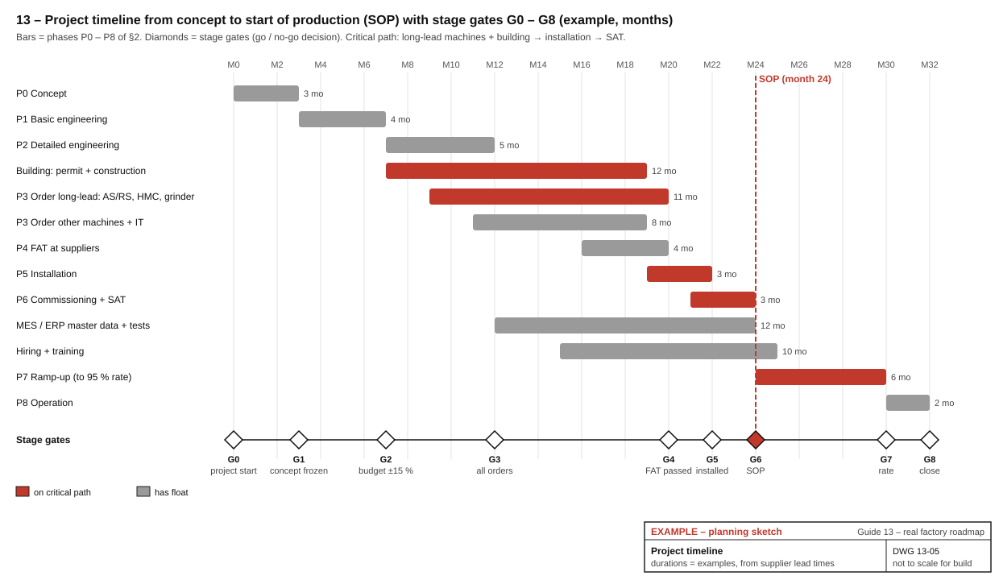
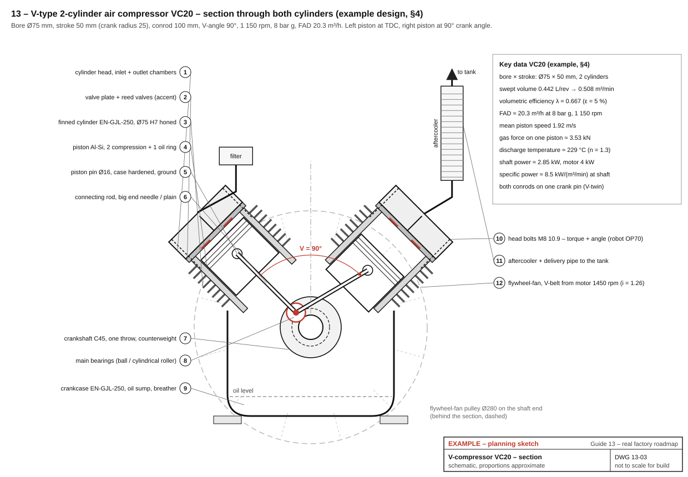
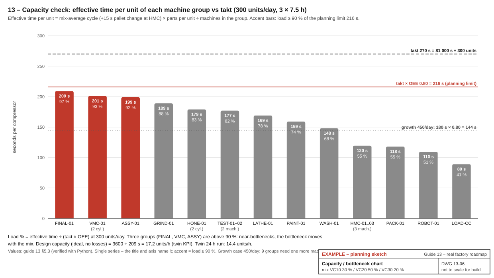
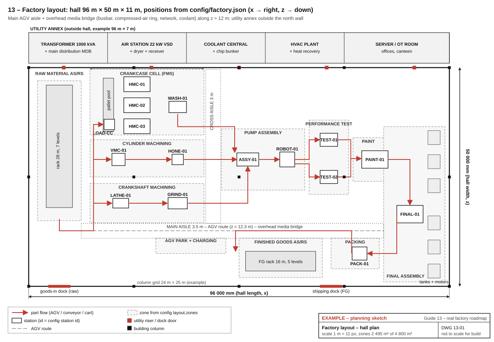
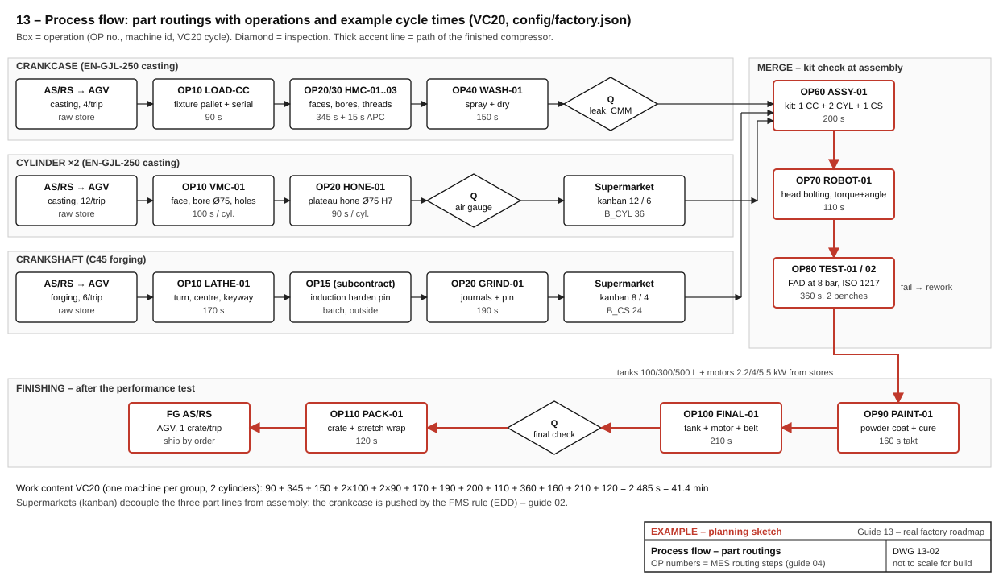
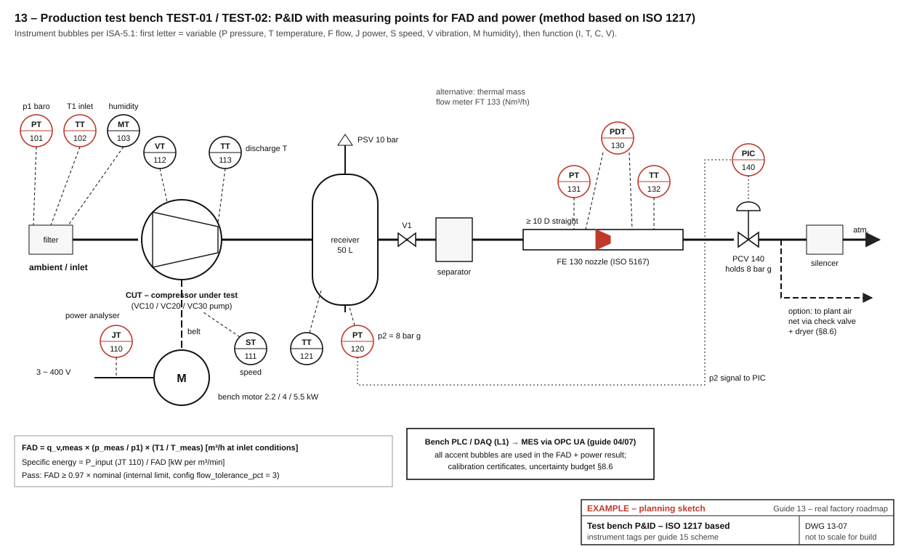
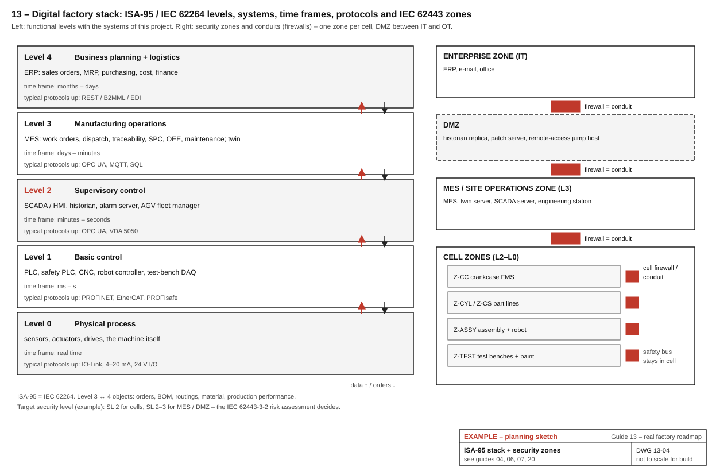

# 13 – Roadmap: from the Digital Twin to the Real Factory

This guide connects all other guides. It shows **in which order** you build the real factory, **who** does
what, **which documents** you need at each step, **how the digital twin helps** in every phase, and which
**tests** prove that the real factory works. It is also the **textbook for the whole factory**: the product
(V-type piston air compressor VC10 / VC20 / VC30, 10–30 m³/h FAD at 8 bar), capacity planning, layout,
building and utilities, production technologies, quality, the digital factory stack, people, money, risks,
sustainability and standards.

> All durations, quantities, prices and limits here are **examples**. Your project plan, contracts, supplier
> quotations, catalogues and local laws decide. Every computed number in this guide was checked with a small
> Python script (stdlib only) – see §25.

**Reader's map:** if you only have 30 minutes, read §2 (phases), §5.3 (machine count), §13.1 (CAPEX) and §20
(master checklist). Detailed topics are linked to the topic guides 01–30 – this guide does not repeat them.

---

## Contents

1. [Purpose](#1-purpose)
2. [The phases at a glance + timeline](#2-the-phases-at-a-glance)
3. [Phase details P0–P8](#3-phase-details)
4. [The product – V-type piston compressor (textbook)](#4-the-product--v-type-piston-air-compressor)
5. [Demand and capacity planning](#5-demand-and-capacity-planning)
6. [Factory layout methods](#6-factory-layout-methods)
7. [Building and infrastructure](#7-building-and-infrastructure)
8. [Production technologies per part](#8-production-technologies-per-part)
9. [Quality system](#9-quality-system)
10. [Digital factory stack](#10-digital-factory-stack)
11. [Automation levels – when to automate](#11-automation-levels--when-to-automate)
12. [Workforce and organisation](#12-workforce-and-organisation)
13. [Investment and economics](#13-investment-and-economics)
14. [Buy lists – catalogue examples](#14-buy-lists--catalogue-examples)
15. [Responsibilities (RACI)](#15-responsibilities-example-raci)
16. [Risk management](#16-risk-management)
17. [Sustainability and energy](#17-sustainability-and-energy)
18. [Standards register](#18-standards-register)
19. [Data you must collect for the real factory](#19-data-you-must-collect-for-the-real-factory)
20. [Master checklist + phase checklists](#20-master-checklist)
21. [Questions for suppliers](#21-questions-for-suppliers)
22. [Inconsistencies found and how they were handled](#22-inconsistencies-found-and-how-they-were-handled)
23. [Formula sheet](#23-formula-sheet)
24. [Glossary](#24-glossary)
25. [How the numbers were checked](#25-how-the-numbers-were-checked)

Drawings in this guide (all in `docs/img/`, also copied to `web/img/`):

| No. | File | Content |
|---|---|---|
| DWG 13-01 | `13_factory_layout.svg` | Hall plan 96 × 50 m with zones, stations, flows, aisles, utility annex |
| DWG 13-02 | `13_process_flow.svg` | Routings of crankcase, cylinder, crankshaft, assembly, test, finishing |
| DWG 13-03 | `13_compressor_section.svg` | V-type compressor VC20 cross-section with main parts |
| DWG 13-04 | `13_isa95_stack.svg` | ISA-95 levels + IEC 62443 zones and conduits |
| DWG 13-05 | `13_project_timeline.svg` | Stage gates G0–G8, SOP at month 24 |
| DWG 13-06 | `13_capacity_bottleneck.svg` | Effective time per unit of each machine group vs takt |
| DWG 13-07 | `13_test_bench_iso1217.svg` | Test bench P&ID with sensors (ISO 1217 based) |

---

## 1. Purpose

A factory project fails less often because of one bad machine and more often because of:
- missing or late decisions (layout, product data, capacity),
- unclear interfaces between suppliers (mechanics, signals, messages, safety),
- commissioning without a plan and without acceptance criteria,
- data (BOM, routings, cycle times) that is not ready when the IT systems go live.

This roadmap gives one common plan for the whole team. Use it together with the topic guides 01–30.

**The factory in one paragraph (example values from `config/factory.json`):** one hall 96 m × 50 m × 11 m;
three machining lines (crankcase FMS cell with 3 HMCs + pallet pool + washer; cylinder line with boring centre +
honing; crankshaft line with lathe + grinder), pump assembly with robot head bolting, 2 performance test benches,
powder coating, final assembly (tank + motor), packing; raw-material AS/RS and finished-goods AS/RS; 2 AGVs.
Three models (VC10 30 %, VC20 50 %, VC30 20 %) run on the same machines. Demand 300 units/day.
Ideal design capacity 17.2 units/h (bottleneck FINAL-01, guide 01 §4.2).

| Model | SKU | FAD at 8 bar | Motor | Tank | Price (example) | Mix |
|---|---|---|---|---|---|---|
| VC10 | VC10-100 | 10 m³/h (0.167 m³/min) | 2.2 kW | 100 L | $890 | 30 % |
| VC20 | VC20-300 | 20 m³/h (0.333 m³/min) | 4 kW | 300 L | $1 450 | 50 % |
| VC30 | VC30-500 | 30 m³/h (0.500 m³/min) | 5.5 kW | 500 L | $2 150 | 20 % |

---

## 2. The phases at a glance

| Phase | Goal | Main results (deliverables) | Twin use | Guides |
|---|---|---|---|---|
| P0 Concept | Decide product mix, volume, make/buy, rough layout | Volume plan per model, process list, first layout, budget ±30 % | Capacity + bottlenecks with example data, what-if of the mix | 01, 02, 03 |
| P1 Basic engineering | Fix the technical concept | Machine list, cycle times, layout v1, material flow, automation concept, network concept, safety concept, MES/ERP scope | Replace example data with supplier data; what-if with ± uncertainty; size buffers, AGVs, AS/RS | 01–07 |
| P2 Detailed engineering | Make everything buildable / orderable | Specifications, drawings, I/O lists, interface sheets, alarm philosophy, tag list, master data, test plans | Check sequences and interlocks; virtual commissioning preparation | 05–12 |
| P3 Procurement + manufacturing | Order and make | Purchase orders, own manufacturing (APC, interfaces, AGVs, HMC parts), FAT plans | Process twins (e.g. worm) for own parts; supplier cycle times back into the twin | 08–12, 17–19 |
| P4 FAT (Factory Acceptance Test) | Prove each machine at the supplier / in your workshop | Signed FAT protocols, open-point list | Compare FAT cycle times with the twin | 05, 09–12 |
| P5 Installation | Machines in place, connected | Foundations, alignment protocols, electrical + network installation, safety installation | Layout check (positions, clearances) | 03, 09–11, 26–28 |
| P6 Commissioning + SAT | Machines + automation + IT work together | Loop checks, sequence tests, safety validation, interface tests, SAT protocols | Virtual commissioning; twin connected to real signals (gateway) | 05, 06, 07, 20, 28 |
| P7 Ramp-up | Reach target output and quality | OEE tracking, Cpk of key characteristics, problem list | Twin compares plan vs reality (live data) | 01, 04, 06 |
| P8 Operation | Stable, improving production | Maintenance plan, KPIs, change management | What-if for every change before you do it | all |

Rule: **do not start the next phase with open "red" points** from the previous phase unless the project
manager accepts the risk in writing.

### 2.1 Timeline and stage gates (example)



A **stage gate** is a meeting where the management decides *go / no-go / go with conditions* based on fixed
criteria. The gate needs the deliverables of the phase **before** the meeting.

| Gate | Month (example) | Decision | Entry criteria (deliverables) |
|---|---|---|---|
| G0 | 0 | Start the project | Business idea, sponsor, budget for P0 |
| G1 | 3 | Concept frozen | Volume plan per model, process list, layout v0, budget ±30 %, make/buy list |
| G2 | 7 | Basic engineering approved, budget ±15 % | Machine list with quotations, layout v1, twin with supplier data, safety + network concept, building permit filed |
| G2b | 9 | **Pre-release of long-lead items** (AS/RS, HMCs, grinder) | Specifications of these items frozen, risk accepted in writing |
| G3 | 12 | All orders released | All specifications + interface sheets + test plans, master-data owners named |
| G4 | 20 | FAT passed | Signed FAT protocols, open points with owners |
| G5 | 22 | Installed | Installation + alignment protocols, loop check started |
| G6 | 24 | **SOP** (start of production) | SAT signed, safety validation signed, operators trained, PPAP-like approval (§9.7) |
| G7 | 30 | Rate reached | ≥ 95 % of target output for 4 weeks, Cpk ≥ 1.33 on key characteristics |
| G8 | 32 | Project close | Lessons learned, final cost, hand-over to operations |

**Critical path (example):** building permit + construction (12 months) and the long-lead machines (AS/RS
9–12 months, HMC 6–9 months, crankshaft grinder 8–12 months – ask the suppliers) decide the date of
installation. Everything that is not on the critical path has **float** (spare time). The CPM method is shown
step by step in guide 28 §1.

---

## 3. Phase details

### P0 – Concept

1. Fix the **products**: models (VC10 / VC20 / VC30 in the twin), variants, yearly volume, peak month.
2. Write the **process list** per model: casting supply, machining, washing, honing, assembly, test, paint,
   packing (see `01`, `02`, and DWG 13-02 in §8).
3. **Make or buy** for every part and every system (machines, APC, AGVs, software). The twin's HMC and AGV
   pages show what "make" really means (process plans, tests, cost per part).
4. **Rough capacity:** required output per hour = yearly volume ÷ (working days × hours per day × OEE).
   Generic example: 60 000 units ÷ (240 d × 16 h × 0.75) = 20.8 ≈ 21 units/h.
   Project example (this guide): 75 000 units/year = 300 units/day × 250 days on 3 shifts × 7.5 h →
   300 ÷ 22.5 h = 13.3 units/h net; with OEE 0.80 the machines must be able to make 13.3 ÷ 0.80 = 16.7 units/h
   (details §5).
5. First **layout** and budget. Run the twin with example values to see the bottlenecks.

### P1 – Basic engineering

1. **Machine list** with supplier cycle times, changeover times, MTBF / MTTR (ask suppliers; use the twin's
   what-if with ± uncertainty if data is not certain).
2. **Material flow concept:** AS/RS, AGVs, pallet pool, buffers (guide `03`). Size them with the twin.
3. **Automation concept:** PLC per line / cell, safety PLC, field bus, E-stop zones (guide `05`).
4. **Network + communication concept:** ISA-95 levels, protocols per link, OT zones (guides `07`, `06`, §10).
5. **IT concept:** MES and ERP scope, master data owners (guide `04`).
6. **Safety concept:** risk assessment per machine and per interface (e.g. AGV docking, light curtains at the
   APC load station with ISO 13855 safety distance).
7. **Building concept:** hall size, column grid, floor, crane, utilities, fire concept (§7). File the building
   permit early – it is often on the critical path.
8. Update the twin config (`config/factory.json`) with this data – the twin becomes your **planning model**.

### P2 – Detailed engineering

For every system create the documents in this table:

| Document | Content | Owner |
|---|---|---|
| Technical specification | Function, performance, accuracy, environment, standards, acceptance criteria | Project engineer |
| Layout drawing | Machine positions, foundations, media (power, air, coolant, network), escape routes | Layout planner |
| **Interface sheet** (one per hand-over) | Mechanical (heights, positions, tolerances), electrical (connectors, voltage), signals (I/O, timing diagram), messages (protocol, fields), safety (who stops what) | Both suppliers + you |
| I/O list | Every signal: tag name, address, type, range, device, cabinet, terminal | Controls engineer |
| Sequence description / step chain | Steps, transitions, timeouts, error reactions | Controls engineer |
| Alarm philosophy + alarm list | Priorities, limits, responses (ISA-18.2) | Controls + operations |
| Tag list for SCADA / historian | Names, units, scaling, logging rate | Controls + IT |
| Master data | Items, BOMs, routings, work centres, cycle times, lot sizes | Production planning |
| Control plan + PFMEA | Characteristics, methods, frequencies, reaction plans (§9) | Quality |
| Test plans (FAT, SAT) | Test cases with expected results | Quality + engineering |

**Interface sheet template (use for every hand-over):**

| Item | Side A | Side B | Value / tolerance | Checked at |
|---|---|---|---|---|
| Transfer height | AGV deck | Station chains | e.g. 650 ± 2 mm | FAT + SAT |
| Position accuracy | AGV stop | Station guides catch range | e.g. ±10 mm → ±0.3 mm | SAT, 30 runs |
| Ready signal | Station PLC | AGV (E84 / VDA 5050) | signal name, timing | SAT |
| Safety | Light curtain muting | AGV presence | who mutes, max time | Safety validation |

### P3 – Procurement and own manufacturing

1. Order with the specification + interface sheets + test plan attached to the purchase order.
2. For own manufacturing (APC, interfaces, AGVs, HMC parts) follow guides `09`–`12`, `17`–`19`:
   - process plan per part, rough → stress relief → finish, one set-up for fitting features,
   - measuring plan (what, how, gauge, limit), part record for traceability,
   - first-article inspection before series.
3. Put real supplier cycle times back into the twin – check the capacity again (§5.3).

### P4 – FAT

1. Test every machine **alone** at the supplier (or in your workshop for own parts) with your test parts.
2. Check: function, cycle time, accuracy (e.g. ISO 230-2 for axes), safety functions, documentation,
   spare parts list, software backup.
3. Machine capability run-off at FAT (example: 50 parts, Cmk ≥ 1.67 on the key characteristic – guide 28 §7).
4. Sign the FAT protocol only with an **open-point list** that has owners and dates.

### P5 – Installation

1. Foundations and floor flatness as specified (AGV floors need tight flatness – ask the AGV supplier; guide 26).
2. Set and level machines; alignment protocols (e.g. load station ↔ APC with a master pallet – guide `10`).
3. Electrical installation, cable labels = I/O list names; network installation with documented ports/VLANs (guide 27).
4. Safety devices installed at the calculated distances.

### P6 – Commissioning and SAT

Work from the bottom up – never test the whole factory first:

| Step | Test | Pass when |
|---|---|---|
| 1 | Power, earthing, insulation | Measurements in limits, protocol (guide 27 A.15) |
| 2 | **Loop check** of every I/O | Each signal seen at the right address, right scaling |
| 3 | Drives, axes, directions, limits | Correct direction, limit switches + software limits work |
| 4 | **Safety validation** | Every safety function tested and documented (ISO 13849 / IEC 62061 by your safety engineer) |
| 5 | Single machine sequences | Automatic cycle runs, all error reactions tested |
| 6 | Interfaces between machines (AGV docking, APC, AS/RS) | Interface sheet values met; e.g. 30 docking runs without fault |
| 7 | SCADA: tags, alarms, commands, trends | Every tag has quality GOOD, alarms reach the right priority |
| 8 | MES / ERP integration | Order → work order → production → booking → shipment, end to end |
| 9 | Line run with real parts | Cycle time, quality, OEE target for the agreed time (e.g. 3 × 8 h) |
| 10 | SAT signature | Open points closed or accepted |

**Virtual commissioning with the twin:** before step 5, test PLC sequences and interlocks against the twin
(guide `05`), and connect real signals through the gateway (`tools/gateway_example.py`, guide `01`).

### P7 – Ramp-up

1. Track OEE (availability × performance × quality) per machine every shift (SCADA shift report, guide `06`).
2. Track Cpk of key characteristics (MES SPC, guide `04`; e.g. compressor air flow, cylinder bore, worm lead).
   Target Cpk ≥ 1.33.
3. Daily problem-solving meeting with the top 3 losses (bad actors from SCADA alarms, scrap from MES).
4. Compare reality with the twin; correct the twin data (cycle times, MTBF) so it stays a true model.
5. **Ramp-up curve (example model):** output share = 1 − e^(−t/τ) with τ = 2 months → month 1: 39 %,
   month 2: 63 %, month 3: 78 %, month 4: 87 %, month 6: 95 %. Plan sales and stock with this curve, not with 100 %.

### P8 – Operation

1. Maintenance plan from supplier data + real MTBF (MES maintenance work orders).
2. **Change management:** every change (new product, new rule, new machine) first in the twin's what-if,
   then in reality.
3. Backups of PLC, CNC, SCADA, MES configurations; versioned NC programs (guide `08`).
4. Cyber security updates and access reviews (IEC 62443 idea, guide `07`, §10.6).
5. Continuous improvement: yearly review of OEE losses, energy per unit (§17), scrap cost, layout changes.

---
## 4. The product – V-type piston air compressor

You cannot plan a factory without understanding the product. This chapter is a short textbook of the
reciprocating (piston) air compressor and a worked sizing of the VC20. **All design values are examples** –
your compressor designer and the test bench decide the real values.

### 4.1 What a V-type piston compressor is

A piston compressor sucks air into a cylinder while the piston moves down (inlet valve open), compresses it
while the piston moves up (both valves closed), and pushes it out when the cylinder pressure is higher than
the line pressure (outlet valve open). "V-type" means **two cylinders at an angle** (here 90°) on **one crank
throw**: both connecting rods sit on the same crank pin. Advantages: short and stiff crankshaft, good mass
balance, good cooling of both cylinders by the fan air of the flywheel.



The package sold to the customer = **pump** (crankcase + cylinders + crankshaft + heads, made in our factory)
+ **tank** + **electric motor** + belt drive + guard + pressure switch + safety valve (bought parts, fitted at
FINAL-01). This matches the twin: the pump is built at ASSY-01 / ROBOT-01, tested at TEST-01/02, painted,
then FINAL-01 adds tank and motor.

| Term | Meaning | Unit |
|---|---|---|
| p₁ | inlet (suction) pressure, absolute; ambient ≈ 1.013 bar a | bar a |
| p₂ | discharge pressure absolute = gauge + ambient: 8 bar g → 9.013 bar a | bar a |
| r = p₂/p₁ | pressure ratio: 9.013 / 1.013 = **8.897** | – |
| V_s | swept (displacement) volume per minute = z · (π/4) · D² · s · n | m³/min |
| FAD | free air delivery: delivered air flow converted back to inlet conditions (p₁, T₁) | m³/min, m³/h |
| λ | total volumetric efficiency = FAD / V_s | – |
| ε | clearance ratio = clearance volume / swept volume of one cylinder | – |
| P_sh | shaft power | kW |
| SP | specific power = power / FAD | kW/(m³/min) |

### 4.2 Thermodynamics basics – compression work

Air is treated as an **ideal gas**: p·V = m·R·T, with R = 287 J/(kg·K). Compression can follow three ideal
paths. The real compressor lies between isothermal and adiabatic.

| Process | Law | Power for a volume flow V̇₁ (at inlet) |
|---|---|---|
| Isothermal (T constant, perfect cooling) | p·V = const | P_iso = p₁ · V̇₁ · ln(r) |
| Adiabatic / isentropic (no heat exchange) | p·V^κ = const, κ = 1.4 | P_ad = κ/(κ−1) · p₁ · V̇₁ · [r^((κ−1)/κ) − 1] |
| Polytropic (real, some cooling) | p·V^n = const, n ≈ 1.25–1.35 | same as adiabatic with n instead of κ |

**Worked example – VC20, FAD = 20 m³/h = 0.005556 m³/s, p₁ = 1.013 bar = 101 300 Pa, r = 8.897:**

```
P_iso = 101 300 × 0.005556 × ln(8.897)               = 1 230 W
P_ad  = 3.5 × 101 300 × 0.005556 × (8.897^0.2857 − 1) = 1 708 W
P_iso / P_ad = 0.72  → perfect cooling would save 28 % of the work
```

The real shaft power is higher because of valve pressure losses, heating of the inlet air, leakage and
mechanical friction. A usual way is an **overall adiabatic efficiency** η_ad,sh (example 0.60 for a small
air-cooled single-stage piston compressor – ask the designer):

```
P_sh = P_ad / η_ad,sh = 1 708 / 0.60 = 2 847 W ≈ 2.85 kW
isothermal efficiency = P_iso / P_sh = 1 230 / 2 847 = 0.43
motor input = P_sh / (η_belt × η_motor) = 2 847 / (0.95 × 0.87) = 3 445 W
```

The 4 kW motor gives a margin of 4 / 2.85 = 1.40 for start against a full tank, 40 °C ambient, low voltage and
worn valves.

### 4.3 Discharge temperature – why one stage is enough for 8 bar

Polytropic end temperature: **T₂ = T₁ · r^((n−1)/n)**.

```
T₁ = 30 °C = 303.15 K (config ambient_temp_c = 30)
n = 1.3:  T₂ = 303.15 × 8.897^0.2308 = 502 K = 229 °C
n = 1.4:  T₂ = 303.15 × 8.897^0.2857 = 566 K = 293 °C (no cooling at all)
```

Lubricating oil and reed valves do not like more than about 200–220 °C (designer value). This is why
single-stage piston compressors are used up to about 8–10 bar, and **two-stage** compressors (with intercooler)
above. Two-stage with the optimum stage ratio √r = √8.897 = 2.983: T₂ per stage = 303.15 × 2.983^0.2308 = 390 K =
117 °C, and the ideal adiabatic power falls to 1 444 W (−15.5 %). For the 8 bar VC range a single stage is the
example choice; a future 10–11 bar model would need two stages.

### 4.4 Volumetric efficiency with clearance

At the end of the discharge stroke a small **clearance volume** V_c stays in the cylinder (valve pockets,
gap piston–valve plate). This compressed air expands again in the next suction stroke, so the inlet valve
opens late. Clearance volumetric efficiency:

**λ_v = 1 − ε · (r^(1/n) − 1)**   (ε = V_c / V_swept, n = expansion exponent ≈ 1.2–1.3)

```
ε = 0.05, n = 1.25:  r^(1/n) = 8.897^0.8 = 5.747
λ_v = 1 − 0.05 × (5.747 − 1) = 0.763
```

| ε | λ_v at 8 bar g | Comment |
|---|---|---|
| 0.03 | 0.858 | very tight design, thin gasket, small valve pockets |
| 0.05 | 0.763 | example design |
| 0.08 | 0.620 | thick gasket, worn piston top – a gasket that is 0.5 mm too thick costs FAD! |

**Total volumetric efficiency** λ = λ_v · λ_T · λ_L · λ_p, with λ_T heating of inlet air (0.93), λ_L leakage
past rings and valves (0.97), λ_p inlet pressure loss (0.97) – all example values:

```
λ = 0.763 × 0.93 × 0.97 × 0.97 = 0.667
```

**Manufacturing link:** ε depends on the deck height (piston top to valve plate at TDC), i.e. on crankcase
height tolerances, conrod length, crank radius and gasket thickness. This is one reason for the tight
tolerances in §4.9 and for 100 % FAD testing (§8.6).

### 4.5 Free air delivery (FAD) and specific power

**FAD = λ · V_s**. It is measured at the outlet and converted back to inlet conditions (ISO 1217, §8.6):

```
FAD = q_measured × (p_measured / p₁) × (T₁ / T_measured)
```

**Specific power** SP = P / FAD in kW per m³/min tells the energy efficiency of a compressor (lower is better).
Write always if it is **shaft** or **electrical input** power.

```
VC20 at the shaft:          2.85 kW / 0.333 m³/min = 8.54 kW/(m³/min)
VC20 at the motor terminals: 3.445 / 0.333          = 10.3 kW/(m³/min)
VC20 with nameplate 4 kW:    4 / 0.333              = 12.0 kW/(m³/min) (not a real efficiency value!)
```

Orientation (typical ranges, check maker data): small single-stage piston 8–11 kW/(m³/min) at the shaft at
8 bar; two-stage piston and oil-injected screw compressors are lower (better). Compare only values measured
by the same method (ISO 1217 Annex for packaged electric compressors).

### 4.6 Worked sizing of the VC20 (bore, stroke, speed)

**Given:** FAD 20 m³/h = 0.3333 m³/min at 8 bar g, 2 cylinders (V-type), λ = 0.667 (§4.4).

**Step 1 – swept volume needed:** V_s = FAD / λ = 0.3333 / 0.6674 = **0.4995 m³/min**.

**Step 2 – choose bore and stroke:** D = 75 mm, s = 50 mm (stroke/bore = 0.67, "short stroke" – low piston
speed, compact crankcase).

```
A = π/4 × 0.075² = 0.004418 m²
swept volume per revolution = z × A × s = 2 × 0.004418 × 0.050 = 0.0004418 m³ = 0.442 L
```

**Step 3 – speed:** n = V_s / V_rev = 0.4995 / 0.0004418 = **1 131 rpm** → choose **1 150 rpm**.

```
V_s = 0.0004418 × 1 150 = 0.508 m³/min
FAD = 0.6674 × 0.508 = 0.339 m³/min = 20.3 m³/h   (+1.7 % margin over the nominal 20 m³/h)
```

**Step 4 – checks:**

| Check | Formula | VC20 value | Typical limit (example) |
|---|---|---|---|
| Mean piston speed | c_m = 2 · s · n / 60 | 2 × 0.050 × 1 150 / 60 = **1.92 m/s** | ≤ 3–3.5 m/s for small air-cooled units |
| Belt ratio | i = n_motor / n_pump | 1 450 / 1 150 = **1.26** | pulley diameters e.g. 95 / 120 mm |
| Max. gas force on one piston | F = Δp · A | 8 × 10⁵ Pa × 0.004418 m² = **3.53 kN** | bearing, pin and conrod design load |
| Discharge temperature | §4.3 | 229 °C (n = 1.3) | ≤ 200–220 °C at the valve → good fin cooling needed |
| Shaft power | §4.2 | 2.85 kW at 20 m³/h | motor 4 kW |

The gas force 3.53 kN is the design load for the piston pin (Ø16 example), the conrod big end and the main
bearings. Inertia forces of the piston + conrod add at higher speed: F_inertia ≈ m_osc · r · ω² · (1 + λ_rod),
with λ_rod = r / l = 25 / 100 = 0.25 – the designer calculates this.

### 4.7 Family options for VC10 / VC20 / VC30

**Option A – one pump for all models (as in the twin config):** the config uses **one cylinder casting and one
crankshaft forging for all models** (`CYL-CAST`, `CS-FORG` "all models"). Then only the speed can change the FAD:

| Model | Speed needed with Ø75 × 50 | Mean piston speed | Comment |
|---|---|---|---|
| VC10 | 565 rpm | 0.94 m/s | possible, but the flywheel fan cools badly at low speed |
| VC20 | 1 131 rpm | 1.88 m/s | design point |
| VC30 | 1 696 rpm | 2.83 m/s | high – noise, valve life, discharge temperature |

**Option B – three bore sizes (recommended for a real product, example):**

| Model | Bore × stroke | Speed | Swept volume | FAD (λ = 0.667) | c_m | Shaft power | Motor / shaft | Gas force |
|---|---|---|---|---|---|---|---|---|
| VC10 | Ø65 × 46 | 850 rpm | 0.260 m³/min | **10.4 m³/h** | 1.30 m/s | 1.48 kW | 2.2 / 1.48 = 1.49 | 2.66 kN |
| VC20 | Ø75 × 50 | 1 150 rpm | 0.508 m³/min | **20.3 m³/h** | 1.92 m/s | 2.90 kW | 4 / 2.90 = 1.38 | 3.53 kN |
| VC30 | Ø90 × 55 | 1 100 rpm | 0.770 m³/min | **30.8 m³/h** | 2.02 m/s | 4.39 kW | 5.5 / 4.39 = 1.25 | 5.09 kN |

(Shaft power = FAD × 8.54 kW/(m³/min), the VC20 specific power.) Option B means 3 cylinder castings, 3 piston
sizes and 2–3 crankshafts – more variants for the FMS, more fixtures and gauges. **Decision in P0** with the
product designer; the twin can model it by giving each model its own cylinder/crankshaft buffer.

### 4.8 Cooling and the aftercooler

Almost all shaft power ends as heat: in the compressed air, the cylinder fins and the oil. Aftercooler duty
example (VC20): air mass flow ṁ = ρ₁ · V̇₁ = 1.164 kg/m³ × 0.005556 m³/s = 0.00647 kg/s; cooling the air from
180 °C to 40 °C: Q = ṁ · c_p · ΔT = 0.00647 × 1 005 × 140 = **910 W**. Cooling the air before the tank removes
most water as condensate in the tank (drain valve) and protects the hose and tools.

### 4.9 Main parts, materials, manufacturing processes and tolerances

Values are **example design values** – the compressor designer must release the real drawing (ISO 286 fits and
roughness tables in guide 14; CNC details in guide 08).

| No. (DWG 13-03) | Part | Material (example) | Make / buy | Process route | Key characteristics (example) |
|---|---|---|---|---|---|
| 9 | Crankcase | EN-GJL-250 casting (one per model) | MAKE (casting bought) | HMC: face mounting + top faces, bore bearing seats in one set-up, drill + tap, (OP20/30 on pallet), wash, leak test | bearing seats Ø62 K7 (example), coaxiality Ø0.02, cylinder decks ⟂ bearing axis 0.03, deck height ±0.05 (decides clearance ε), flatness 0.03, Ra 1.6–3.2 at gasket faces |
| 3 | Cylinder (2 per pump) | EN-GJL-250 (fins cast) | MAKE | VMC: face, rough bore, fine bore, drill holes → plateau honing | bore Ø75 H7 (75.000–75.030), cylindricity 0.010, ⟂ to face 0.02, honed Ra 0.2–0.4 / Rk-family per ring supplier, crosshatch 40–60° |
| 7 | Crankshaft | C45 forging (or 42CrMo4) | MAKE (forging bought) | lathe: turn journals, centre, keyway (pin by turn-mill or eccentric set-up) → induction harden pin + journals (subcontract) → grind journals + pin → (balance) | journals Ø30 k5 / bearing seats, pin Ø30 g6 (example), roundness 0.005, Ra 0.2–0.4 on pin, throw radius 25 ±0.02, hardness 50–56 HRC at pin |
| 6 | Connecting rod | Al die casting or forged steel C45 | BUY (or MAKE later) | bought finished; incoming check | centre distance 100 ±0.02, bore parallelism 0.02/100 |
| 4 | Piston + rings | Al-Si alloy casting; rings cast iron / steel | BUY | bought finished, sorted in size classes if needed | piston clearance in bore e.g. 0.05–0.08 mm (designer) |
| 5 | Piston pin | case-hardening steel 16MnCr5, ground | BUY | – | Ø16 h5 |
| 2 | Valve plate + reeds | steel plate + reed steel (e.g. 1.4034 or Sandvik reed steel) | BUY | – | flatness of seats 0.01, reed lift |
| 1 | Cylinder head | EN-GJL-250 or Al | BUY machined (or MAKE on the VMC) | face, ports, holes | flatness 0.03 |
| 10 | Head bolts | M8 10.9 | BUY | robot bolting, torque + angle (§8.5) | preload per VDI 2230 (guide 14 §8) |
| 8 | Main bearings | ball / cylindrical roller bearing (e.g. 6206 / NJ206 class) | BUY | press-fit with force monitoring (§8.5) | per bearing catalogue |
| 11 | Aftercooler + delivery pipe | Cu or steel finned tube | BUY | – | pressure test |
| 12 | Flywheel-fan pulley | EN-GJL-200 | BUY | balanced | balance grade e.g. G6.3 (ISO 21940-11) |
| – | Tank 100 / 300 / 500 L | welded steel (EN 286-1 type) | BUY | – | CE marking (SPVD / PED, §18) |
| – | Motor 2.2 / 4 / 5.5 kW | IE3 4-pole (example) | BUY | – | IEC 60034-30-1 efficiency class |

**Rule from all guides: rough → stress relief → finish; machine everything that must fit together in one
set-up; measure at 20 °C** (guide 00 §5).

---

## 5. Demand and capacity planning

### 5.1 From demand to takt time

**Takt time** = available production time ÷ customer demand. It is the "heartbeat" the line must follow.

```
Planning basis (example): 250 working days, 3 shifts × 7.5 h net (8 h minus 30 min breaks)
available time per day = 3 × 7.5 × 3 600 = 81 000 s
demand (config erp.demand.units_per_day) = 300 units/day
takt = 81 000 / 300 = 270 s per compressor   →   13.33 units/h
growth case 450 units/day: takt = 81 000 / 450 = 180 s → 20.0 units/h
yearly volume = 300 × 250 = 75 000 units
```

Note: the twin runs 24 h/day without breaks; the real plan uses 22.5 h. The twin's 24-hour test run made
345 units = 14.4 units/h (guide 02 §4.2) → 14.4 × 22.5 h = 323 units/day ≥ 300 ✓ (small margin).

### 5.2 OEE – the planning factor

**OEE = Availability × Performance × Quality** (guide 01 §4.7, §10.7).

```
Example: A = 0.90 (breakdowns, changeovers), P = 0.92 (small stops, slow cycles), Q = 0.985 (scrap + rework)
OEE = 0.90 × 0.92 × 0.985 = 0.816 ≈ 0.80 used for planning
```

World-class OEE for discrete machining is often quoted as ≈ 0.85; a new line in ramp-up is often 0.60–0.70.
**Use 0.80 for the target design, check the ramp-up with 0.65.** Availability from reliability data:
A = MTBF / (MTBF + MTTR); example HMC-01: 30 h / (30 h + 20 min) = 0.989 (only breakdowns – changeovers,
starvation and blocking come on top).

### 5.3 Machine count formula – worked for the three products

**N = demand × cycle time × parts per unit / (available time × OEE)**, rounded **up**.

The cycle time is the **mix-weighted average**: t_avg = Σ mix_v × t_v (+ handling, e.g. 15 s pallet change
at the HMC). Example HMC: 0.3 × 270 + 0.5 × 345 + 0.2 × 450 + 15 = **358.5 s**.

```
N_HMC = 300 × 358.5 × 1 / (81 000 × 0.80) = 1.66 → 2 machines minimum
```

Full table (cycle times from `config/factory.json`, 300 units/day, OEE 0.80, 81 000 s/day):

| Group | Installed (config) | t_avg (s) | Parts/unit | N at 300/day | Load of installed machines | N at 450/day | Ideal capacity (units/h) |
|---|---|---|---|---|---|---|---|
| LOAD-CC | 1 | 89.0 | 1 | 0.41 → 1 | 41 % | 0.62 → 1 | 40.4 |
| HMC-01..03 | 3 | 358.5 | 1 | 1.66 → 2 | 55 % | 2.49 → 3 | 30.1 |
| WASH-01 | 1 | 148.0 | 1 | 0.69 → 1 | 69 % | 1.03 → **2** | 24.3 |
| VMC-01 | 1 | 100.5 | 2 | 0.93 → 1 | **93 %** | 1.40 → **2** | 17.9 |
| HONE-01 | 1 | 89.5 | 2 | 0.83 → 1 | 83 % | 1.24 → **2** | 20.1 |
| LATHE-01 | 1 | 169.0 | 1 | 0.78 → 1 | 78 % | 1.17 → **2** | 21.3 |
| GRIND-01 | 1 | 189.0 | 1 | 0.88 → 1 | 88 % | 1.31 → **2** | 19.0 |
| ASSY-01 | 1 | 199.0 | 1 | 0.92 → 1 | **92 %** | 1.38 → **2** | 18.1 |
| ROBOT-01 | 1 | 109.5 | 1 | 0.51 → 1 | 51 % | 0.76 → 1 | 32.9 |
| TEST-01/02 | 2 | 354.0 | 1 | 1.64 → 2 | 82 % | 2.46 → **3** | 20.3 |
| PAINT-01 | 1 | 159.0 | 1 | 0.74 → 1 | 74 % | 1.10 → **2** | 22.6 |
| FINAL-01 | 1 | 209.0 | 1 | 0.97 → 1 | **97 %** | 1.45 → **2** | 17.2 |
| PACK-01 | 1 | 118.0 | 1 | 0.55 → 1 | 55 % | 0.82 → 1 | 30.5 |

"Load" = N ÷ installed machines. "Ideal capacity" = installed × 3 600 / t_avg / parts per unit (no losses) –
the same numbers as the twin's capacity table (guide 01 §4.2).

**Results:**
1. **300/day works** with the config machines, but FINAL-01 (97 %), VMC-01 (93 %) and ASSY-01 (92 %) have
   almost no reserve. Any extra loss (ramp-up OEE 0.65!) makes them the bottleneck.
2. **Why 3 HMCs when 2 are enough?** Each HMC holds tool sets for only **2 models** (`tool_magazine.sets = 2`):
   HMC-01 = VC10 + VC20, HMC-02 = VC20 + VC30, HMC-03 = VC10 + VC30. Three machines cover every pair, so every
   model has two machines – flexibility and redundancy (guide 02 §3.3). And the crankcase line is ready for the
   growth case.
3. **Growth to 450/day** needs one more machine in 9 groups (WASH, VMC, HONE, LATHE, GRIND, ASSY, TEST, PAINT,
   FINAL). Plan **floor space and media connections** for them now (§6.4) – this is cheap; moving walls later is not.

### 5.4 Bottleneck analysis



The **effective time per unit** of a group = t_avg × parts per unit ÷ machines. Compare with:
- takt 270 s (demand), and
- **planning limit = takt × OEE = 270 × 0.80 = 216 s**.

FINAL-01 209 s, VMC-01 201 s (2 × 100.5 s), ASSY-01 199 s are close to 216 s. The **Theory of Constraints**
(guide 02 §10.6) gives the order of actions:

1. **Identify** the constraint (twin: bottleneck detection, guide 01 §4.12).
2. **Exploit** it: never let it wait – buffer in front (kanban supermarkets), breaks covered, SMED on its
   changeovers, quality check *before* it (do not waste bottleneck time on bad parts).
3. **Subordinate** everything else to it (release work at the bottleneck rate – drum-buffer-rope).
4. **Elevate**: second station, faster tools, split work content (§5.6).
5. **Repeat** – the bottleneck moves.

**Cost of one lost bottleneck hour (example):** 13.33 units × contribution $428/unit (§13.4) = **$5 707**.
Compare this with the price of a spare part or an extra operator – it often justifies spare spindles,
standby tools and a maintenance technician on every shift.

### 5.5 Little's law – how much WIP the line holds

**WIP = throughput × lead time** (L = λ · W, guide 02 §10.1).

```
throughput 12.5 units/h, lead time 6 h      → WIP = 75 units in the line
target WIP 120 units at 13.33 units/h       → lead time = 120 / 13.33 = 9.0 h
```

More WIP = longer lead time, more capital, more space, more damage – but also more protection against
breakdowns. Size buffers in front of the near-bottlenecks, keep them small elsewhere. The twin shows the real
WIP per buffer (Live factory tab).

### 5.6 Line balancing – assembly (VC20)

Line balancing distributes the **work elements** to stations so that no station is above takt and the idle
time is small. Pump assembly + robot bolting + final assembly of the VC20 = 200 + 110 + 210 = **520 s**
(config). Example work elements (times sum to 520 s):

| Element | Content | Time (s) | Must follow |
|---|---|---|---|
| A | crankcase on assembly pallet, scan serial (MES) | 25 | – |
| B | press bearings into crankcase (force–displacement monitored) | 40 | A |
| C | insert crankshaft + bearing cover | 45 | B |
| D | conrods + pistons with rings (2×) | 35 | C |
| E | cylinders on studs (2×) | 30 | D |
| F | valve plates + gaskets | 25 | E |
| G | heads: 8 bolts, torque + angle (robot) | 70 | F |
| H | turn check (torque), flywheel-fan pulley | 40 | G |
| I | oil fill, breather, dipstick | 30 | H |
| J | tank on fixture, feet, drain valve | 60 | – |
| K | motor on tank plate | 50 | J |
| L | pump on tank plate | 30 | I, K |
| M | belt + tension check | 25 | L |
| N | belt guard | 15 | M |

**Minimum number of stations** N_min = ⌈Σt / takt⌉. **Balance efficiency** E = Σt / (N × takt).

```
takt 270 s:  N_min = ⌈520/270⌉ = 2;  largest-candidate rule → S1 = J,K,A,B,C,D (255 s), S2 = E…N (265 s)
             E = 520 / (2 × 270) = 96.3 %
takt 180 s:  N_min = ⌈520/180⌉ = 3;  largest-candidate rule gives 4 stations (175 / 135 / 170 / 40 s), E = 72.2 %
             improved by hand: S1 = A,B,C,D,E (175 s), S2 = F,G,H,I (165 s), S3 = J,K,L,M,N (180 s)
             E = 520 / (3 × 180) = 96.3 % ✓
today (config): 3 stations 200 / 110 / 210 s → E = 520 / (3 × 210) = 82.5 % (cycle limited by FINAL 210 s)
```

**Lesson:** a heuristic is a start, not the answer – always check by hand and with the twin. In reality the
test bench and paint sit between pump and final assembly, so the tank/motor elements J, K can only be done
at FINAL; the 180 s solution above is for a **combined assembly line** in the growth case. Also check
ergonomics (lifting VC30 tanks needs a hoist) and precedence by product variant.

### 5.7 Material handling check (summary, details guide 03)

AGV trips per hour at 13.33 units/h: FG crates 13.33 (1/trip), castings 3.33 (4/trip), cylinders 2.22 (12/trip),
crankshafts 2.22 (6/trip) → **21.1 trips/h**. At about 132 s per trip (guide 03 §14) → 21.1 × 132 = 2 787 s/h =
77 % of one AGV → 2 AGVs (config) are loaded ≈ 39 % each ✓ (one AGV can fail and the line still runs slowly).
Kanban cards for cylinders (example): demand 26.7 cyl/h × replenishment time 2 h × 1.1 safety ÷ 12 per
container = 4.9 → **5 containers** (formula in guide 02 §4.5).

---
## 6. Factory layout methods

### 6.1 Layout types

| Type | Idea | Good for | Weak points | In this factory |
|---|---|---|---|---|
| **Process (functional) layout** | same machines grouped (all lathes together, all mills together) | many different parts, small lots, job shop | long transport, high WIP, long lead time | tool room, maintenance workshop |
| **Product (line) layout** | machines in the order of the routing | one or few products, high volume | inflexible, one breakdown stops the line | assembly → test → paint → final → pack |
| **Cellular layout (group technology)** | one cell makes one part family complete | medium volume, families of similar parts | needs part-family analysis, multi-skilled people | crankcase FMS cell, cylinder cell, crankshaft cell |
| **Fixed-position layout** | product stays, people and tools come | very large products | – | not used (machine installation only) |

Our factory is a **hybrid**: three **part cells** feed one **product line** through kanban supermarkets.
This is the classic layout for a family of mechanical products with 3 models.

### 6.2 Systematic Layout Planning (SLP, R. Muther) in 6 steps

1. **P-Q analysis** (product – quantity): VC10 30 %, VC20 50 %, VC30 20 % – all share the same routing →
   product/cell layout (if one model were tiny, a separate process layout would be considered).
2. **Flow of materials** – from-to chart with parts per hour and distances (§6.3).
3. **Activity relationship chart (REL)** – closeness codes for every pair of areas:

| Code | Meaning | Example pair in this factory |
|---|---|---|
| A | absolutely necessary | HMC cell – washer; test benches – paint; paint – final assembly |
| E | especially important | cylinder line – pump assembly; crankshaft line – pump assembly |
| I | important | raw AS/RS – machining cells; final assembly – tank/motor store |
| O | ordinary | measuring room – machining |
| U | unimportant | offices – AGV park |
| X | undesirable (keep apart) | paint (powder, oven heat, fire risk) – measuring room / CMM; grinder (vibration) – CMM |

4. **Space requirements** per area (§6.4) and **space available** (hall 96 × 50 m).
5. **Space relationship diagram** – put A pairs next to each other, X pairs far apart.
6. **Evaluate 2–3 alternatives** with the transport moment (§6.3), cost, flexibility, safety; choose one.

### 6.3 Material-flow distances (from config positions)

Transport moment = Σ (parts per hour × distance). Distances are rectilinear (aisle travel |Δx| + |Δz|)
between the `pos` values of `config/factory.json`, at 13.33 units/h:

| From → to | Distance (m) | Parts per unit | Part-metres per hour |
|---|---|---|---|
| raw AS/RS I/O → LOAD-CC | 33.0 | 1 | 440 |
| LOAD-CC → HMCs (pallet pool) | 10.7 | 1 | 143 |
| HMCs → WASH-01 | 9.7 | 1 | 129 |
| WASH-01 → ASSY-01 | 28.0 | 1 | 373 |
| raw AS/RS I/O → VMC-01 | 27.1 | 2 | 723 |
| VMC-01 → HONE-01 | 13.5 | 2 | 360 |
| HONE-01 → ASSY-01 | 16.0 | 2 | 427 |
| raw AS/RS I/O → LATHE-01 | 17.6 | 1 | 235 |
| LATHE-01 → GRIND-01 | 13.0 | 1 | 173 |
| GRIND-01 → ASSY-01 | 26.0 | 1 | 347 |
| ASSY-01 → ROBOT-01 | 9.0 | 1 | 120 |
| ROBOT-01 → TEST (average) | 9.8 | 1 | 130 |
| TEST → PAINT-01 | 10.8 | 1 | 143 |
| PAINT-01 → FINAL-01 | 20.5 | 1 | 273 |
| FINAL-01 → PACK-01 | 20.5 | 1 | 273 |
| PACK-01 → FG AS/RS I/O | 29.3 | 1 | 391 |
| **Sum** | **351 part-metres per unit** | | **4 680 per hour ≈ 105 300 per day** |

Use this number to **compare layout alternatives** (lower is better, but also check safety and flexibility).
The biggest items are the cylinder supply (2 per unit) and the long FG and casting trips – that is why the
cylinders come in containers of 12 and why the AS/RS I/O points sit at the main aisle.

### 6.4 Area per machine, aisles and reserve

**Rule of thumb (example):** area per machine = footprint × 2.5–3 (operator space, maintenance access, chip
bin, local material, electrical cabinet door opening) + 15–25 % for aisles.

| Machine | Footprint incl. APC/cabinet (example, see datasheet) | × 3 = planning area |
|---|---|---|
| HMC 500 with 2-pallet APC | 3.2 × 6.0 m = 19.2 m² | 58 m² |
| VMC (cylinder) | 2.8 × 2.6 m = 7.3 m² | 22 m² |
| CNC lathe | 3.5 × 2.0 m = 7.0 m² | 21 m² |
| Crankshaft / cylindrical grinder | 4.5 × 2.6 m = 11.7 m² | 35 m² |
| Vertical honing machine | 2.5 × 2.2 m = 5.5 m² | 17 m² |
| Industrial washer | 4.0 × 2.5 m = 10.0 m² | 30 m² |

Check with the config zones: crankcase cell 390 m² holds 3 HMCs (174 m²) + pallet pool + load station + washer
→ ✓. Zones in `layout.zones` total **2 495 m²** of the 4 800 m² hall – the rest is aisles, the AGV park,
stores, and **reserve for the growth machines (§5.3)**.

**Aisle widths (example values – your local workplace rules decide, e.g. ASR A1.8 in Germany):**

| Aisle | Width (example) | Reason |
|---|---|---|
| Pedestrian only | ≥ 1.0–1.2 m | escape routes, inspection |
| AGV one-way with people beside | vehicle width + 2 × 0.5 m | ISO 3691-4 clearance to fixed objects where people may stand |
| Main aisle (AGV + forklift + pedestrians) | 3.5–4.0 m (config main aisle at z = 12.3 m) | two-way traffic of small vehicles + walkway |
| Forklift with pallets, two-way | ≈ 2 × vehicle width + 3 × 0.4 m safety | depends on truck |
| Maintenance access to machines | ≥ 0.8–1.0 m around cabinets / spindle | door opening, spindle change |

**Escape routes:** maximum length to an exit is a legal value (e.g. 35 m in Germany for normal rooms, ASR A2.3;
longer with fire protection measures) – check your local code; doors open outwards in the escape direction.

### 6.5 Utilities corridor (media bridge)

All machines need power, compressed air, network, and the machining cells coolant + chip transport.
**Rule:** one **media corridor** (overhead bridge or floor trench) per row of machines, coming from one
**utility annex**. Overhead is flexible (machines can move), floor trenches are cleaner but fixed.

| Medium | Carrier (example) | Sizing link |
|---|---|---|
| Power | busbar trunking 250–400 A with tap-off boxes over the machining row | guide 27 A.5 |
| Compressed air | ring main DN 40–50, 1–2 % slope, goose-neck drops | guide 28 §5.1, §7.4 |
| Network | cable tray with segregation from power (EN 50174-2) | guide 27 B.3 |
| Coolant | central system: supply + return flume / pipe | guide 28 §5.2 |
| Chips | hinged-belt conveyors → central chip conveyor → bunker in the annex | guide 28 §5.3 |
| Oil mist | extraction per machine, filtered air back to hall | guide 28 §5.3 |

### 6.6 The layout drawing



| Zone (config `layout.zones`) | Area (m²) | Content |
|---|---|---|
| Raw material AS/RS | 320 | rack 28 m × 7 levels, I/O at the main aisle |
| Crankcase cell (FMS) | 390 | LOAD-CC, pallet pool 10 pallets, HMC-01..03, WASH-01 |
| Cylinder machining | 221 | VMC-01, HONE-01, supermarket |
| Crankshaft machining | 234 | LATHE-01, GRIND-01, supermarket |
| Pump assembly | 266 | ASSY-01, ROBOT-01 |
| Performance test | 153 | TEST-01, TEST-02 (noise enclosure!) |
| Paint | 110 | powder booth + oven (oven may be outside the zone – check) |
| Final assembly | 497 | FINAL-01 + tank and motor stores |
| Packing | 77 | PACK-01 |
| Finished goods AS/RS | 171 | rack 16 m × 5 levels |
| AGV park + charging | 56 | 4 park places, 2 chargers |

---

## 7. Building and infrastructure

### 7.1 Hall, column grid, height, crane

| Item | Example value | Why |
|---|---|---|
| Hall | 96 m × 50 m = 4 800 m², 11 m high (config `layout.hall`) | AS/RS racks 8–9.5 m high + crane hook height |
| Column grid | 24 m × 25 m (2 spans across, 4 bays along) | free layout; columns not in machine rows |
| Utility annex | 96 m × 7 m along the north wall (example) | transformer, air station, coolant, HVAC, server, offices |
| Clear height under roof structure | ≥ 9.5 m in the AS/RS zone, ≥ 7 m elsewhere | rack + sprinklers + crane |
| Crane | 5 t bridge crane over the machining bay (optional) + 250–500 kg jib cranes at assembly / final | maintenance of spindles, fixtures; handling VC30 package |
| Machine installation | mobile crane / skates (HMC ≈ 12 t, guide 26/28) | no 12 t bridge crane needed for 3 installations |
| Docks | goods-in dock (raw) near raw AS/RS, shipping dock near FG AS/RS | short truck routes (DWG 13-01) |

**Crane capacity check (guide 28 §4):** capacity ≥ 1.25 × hook load at the real radius. A 5 t crane lifts
a spindle unit or a fixture easily, not a machine.

### 7.2 Floor

Industrial slab on ground, e.g. 200–250 mm reinforced or steel-fibre concrete, flatness class for AGV routes per
the AGV supplier (often tighter than standard DIN 18202 – guide 11), **isolated foundation blocks** only where
the machine maker asks (grinder, CMM room, maybe HMCs) – full method and worked examples in guide 26 (§C1–C4:
concrete classes, Westergaard slab check, soil, foundation blocks). Coolant-resistant coating in the machining
area, oil-resistant and anti-static in assembly, joints not in AGV paths.

### 7.3 Electrical power – demand with diversity

**Installed (connected) power** P_inst = nameplate. **Demand power** P_d = Σ (P_inst × k_d), with k_d = demand
factor (how much of the nameplate is used at the same time). Example load list of the whole factory:

| Consumer | Qty | P_inst each (kW) | k_d | P_d (kW) |
|---|---|---|---|---|
| HMC-01..03 (45 kVA connected each, guide 27 A.2) | 3 | 41.4 | 0.6 | 74.5 |
| VMC-01 | 1 | 27.6 | 0.6 | 16.6 |
| HONE-01 | 1 | 20.0 | 0.6 | 12.0 |
| LATHE-01 | 1 | 35.0 | 0.6 | 21.0 |
| GRIND-01 | 1 | 30.0 | 0.6 | 18.0 |
| WASH-01 (heaters) | 1 | 28.5 | 0.8 | 22.8 |
| Pallet pool + load station | 1 | 7.0 | 0.5 | 3.5 |
| Assembly cell + presses + nutrunners | 1 | 8.0 | 0.4 | 3.2 |
| Robot cell | 1 | 9.5 | 0.5 | 4.8 |
| Test benches incl. unit under test | 2 | 12.0 | 0.7 | 16.8 |
| Powder line (booth fans + oven 60 kW + conveyor) | 1 | 90.0 | 0.8 | 72.0 |
| Final assembly + packing | 1 | 10.0 | 0.4 | 4.0 |
| AS/RS raw + FG (cranes) | 2 | 30.0 | 0.4 | 24.0 |
| AGV chargers | 2 | 3.0 | 1.0 | 6.0 |
| Plant air compressor 22 kW VSD | 1 | 22.0 | 0.8 | 17.6 |
| Chip conveyors, coolant central, mist | 1 | 25.0 | 0.7 | 17.5 |
| HVAC (fans, pumps, office cooling) | 1 | 80.0 | 0.8 | 64.0 |
| Lighting LED 4 800 m² × 7 W/m² | 1 | 33.6 | 1.0 | 33.6 |
| Offices, IT, server, canteen | 1 | 40.0 | 0.6 | 24.0 |
| **Total** | | **680.4 installed** | **0.67** | **455.8** |

```
S = P_d / cos φ = 455.8 / 0.9 = 506 kVA;  with 25 % growth reserve: 633 kVA
transformer 800 kVA → 63 % loaded today;  1000 kVA → 51 % today
```

Guide 27 §C.4.5 does the same with a different list (including a future second machining line): 614.6 kVA
→ **1000 kVA** chosen. Both lists lead to the same decision: **1000 kVA**, cast-resin, Dyn11 (guide 27 A.1).
For comparison: the sum of the twin's `run_power_kw` of all 16 stations is only **151 kW** (average machining
power) – that decides the energy bill (§17), not the cable and transformer size.

### 7.4 Compressed air for the factory

Factory air (not the product!). Demand list (example; the machining line value is from guide 28 §5.1):

| Consumer | Nm³/h |
|---|---|
| Machining line (3 HMC, washer, VMC, robot) incl. leakage + reserve | 72.1 |
| Assembly, robot, test benches (blow-off, tools) | 25 |
| Powder booth (guns + cartridge filter pulses) | 30 |
| Washer blow-off nozzles | 15 |
| Final assembly + packing | 8 |
| **Sum** | **150.1 Nm³/h = 2.50 Nm³/min** |

With 20 % reserve: **3.0 Nm³/min**. At ≈ 6.5 kW per Nm³/min (oil-injected screw, 7–8 bar, example) → 19.5 kW
→ a **22 kW VSD screw compressor** + a second unit as standby (same size as COMP-1 in guide 27). Air quality
ISO 8573-1 class [2:4:2] for general use, better for paint (dry, oil-free at the guns – check the powder maker).

**Receiver size** (rule for a fixed-speed compressor; Atlas Copco style formula):
V = 0.25 · q_c · p₁ · T₀ / (f_max · Δp · T₁) with q_c = 50 l/s (3 m³/min), p₁ = 1 bar, Δp = 0.5 bar, f_max =
1 cycle per 30 s, T₀ = T₁ → V = 0.25 × 50 / (0.0333 × 0.5) = **750 L → choose 1 000 L**. A VSD compressor needs
a smaller receiver (maker rule). Pipe pressure-drop formula and worked example: guide 28 §5.1.

**Product link:** the test benches produce compressed air (≈ 2 × 20 m³/h while running). It can be fed into the
plant network through a check valve and a dryer (DWG 13-07 option) – only if the oil carry-over and the air
quality are acceptable. Otherwise vent through a silencer.

### 7.5 HVAC – heat balance of the hall

**Summer: remove internal heat.** Almost all electric power becomes heat in the hall. Example internal load
180 kW (machines + lighting + people – the powder oven exhaust is ducted out separately):

```
air volume flow V̇ = Q / (ρ · c_p · ΔT)
ΔT = 5 K:  V̇ = 180 000 / (1.2 × 1 005 × 5) = 29.9 m³/s = 107 500 m³/h = 2.0 air changes per hour
ΔT = 8 K:  V̇ = 18.7 m³/s = 67 200 m³/h = 1.3 air changes per hour   (hall volume 52 800 m³)
```

**Winter: heating load.** Transmission Q = (U_wall · A_wall + U_roof · A_roof) · ΔT with U_wall = 0.35,
U_roof = 0.25 W/(m²·K), A_wall = 2 × (96 + 50) × 11 = 3 212 m², A_roof = 4 800 m², ΔT = 20 − (−10) = 30 K →
**69.7 kW**. Ventilation with 0.5 air changes per hour without heat recovery: V̇ = 7.33 m³/s → 7.33 × 1.2 × 1 005 ×
30 = **265 kW** – four times the transmission loss! → use **heat recovery** on the ventilation (70–80 %) and
recover heat from the compressors and test benches (§17). The machine heat (≈ 150 kW running) covers most of
the winter load during production; heating is needed mainly at weekends.

**Thermal stability for precision:** CMM room 20 ± 1 °C (or tighter per CMM datasheet), grinder and honing
areas without strong drafts (guide 26 E5). Never put the CMM next to the hall doors or the paint oven.

### 7.6 Lighting – EN 12464-1

Maintained illuminance Ē_m (typical values from the EN 12464-1 tables – **verify in the current edition**,
2021; guide 28 asks ≥ 500 lx at machining areas for measuring):

| Area / task | Ē_m (lx, example) |
|---|---|
| Storage, AS/RS aisles (no picking) | 100–150 |
| Circulation areas with vehicles | 150 |
| Rough and average machining (tolerance ≥ 0.1 mm) | 300 |
| Precision machining, grinding, honing (tolerance < 0.1 mm) | 500 |
| Assembly medium / fine | 300 / 500 |
| Quality control, inspection, CMM room | 750 |
| Paint booth / colour inspection | see standard table (often 500–750) |
| Packing, dispatch | 300 |
| Electrical / plant rooms | 200 |
| Offices (writing, PC) | 500 |

**Lumen method:** N = Ē · A / (Φ · UF · MF). Pump assembly zone 19 × 14 m = 266 m² at 500 lx, LED high-bay
20 000 lm, utilisation factor UF = 0.6, maintenance factor MF = 0.8 → N = 500 × 266 / (20 000 × 0.6 × 0.8) =
13.9 → **14 luminaires**; at 133 W each → 14 × 133 / 266 = **7.0 W/m²**. Machining 26 × 35 m at 300 lx → 28.4 →
29 luminaires; inspection room 8 × 6 m at 750 lx → 3.75 → 4 luminaires (lower mounting, smaller lumens are better
for uniformity). Emergency lighting on escape routes per local code.

### 7.7 Fire safety

| Topic | Example measure | Check |
|---|---|---|
| Fire compartments | hall + annex separated by fire wall; AS/RS as own compartment if required | local building code (e.g. industrial building guideline) |
| Sprinklers | full sprinkler system incl. in-rack sprinklers in the AS/RS | insurer (e.g. FM / VdS rules) |
| Powder coating booth | explosion protection of powder (ATEX zones inside booth + recovery), earthing of parts and booth | EN 12981 (powder booths), ATEX 2014/34/EU equipment |
| Curing oven | gas or electric, flame monitoring, exhaust | EN 1539 (dryers and ovens), gas codes |
| Oil + coolant | MQL/emulsion is low risk; neat oil machines may need CO₂ extinguishing | machine maker |
| Batteries (AGVs) | charging area ventilated, not near escape routes | AGV maker, guide 11 |
| Escape routes + signs | max length, width, emergency lighting, assembly point | local code, ISO 7010 signs |
| Fire detection | detectors in annex, server room, transformer room | local code |

### 7.8 Environmental items

| Item | Source | Measure (example) | Standard / law |
|---|---|---|---|
| Waste water | washer bath, coolant change | ultrafiltration / evaporator, disposal contract | local water law, ISO 14001 |
| Coolant | machining | central system, daily concentration control (guide 28 §5.2) | – |
| Chips | grey cast iron, steel | separate by material, drain, sell to recycler | – |
| Oil mist | HMC, lathe, grinder | extraction + filter per machine | workplace exposure limits |
| Powder overspray | paint | recovery cyclone + filter, reuse ≈ 95 % | – |
| Noise | test benches (compressor running 75–85 dB(A)), air station | test benches in a noise enclosure; hearing protection zones | EU 2003/10/EC noise at work |
| Energy | all | metering per area, ISO 50001 (§17) | – |

---

## 8. Production technologies per part



### 8.1 Crankcase – horizontal machining centres in an FMS cell

| Item | Example | Details in |
|---|---|---|
| Machine | HMC 500 mm pallet, 2-pallet APC, 60–120 tools, HSK-A63, 10 000 rpm / 18 kW S1 (decided 2026-11-12, guide 15 D-29) | §14.1, guide 12 |
| Workholding | hydraulic fixture on pallet, 3-2-1 on cast datum targets, 2 parts per tombstone possible | guide 08 §11.5, guide 09 |
| Operations | OP20: mounting face, top faces, bearing seats (fine boring), cylinder decks; OP30 (2nd side): holes, threads | guide 08 §14 |
| Cycle (config) | VC10 270 s, VC20 345 s, VC30 450 s + 15 s pallet change | guide 02 §4.1 |
| Why HMC | 4th axis (B) → 4 sides in one set-up → coaxiality and perpendicularity without re-clamping; chips fall away | – |
| Pallet pool | 10 pallets, linear pool with load station → unmanned hours | guide 03, guide 09 |
| Cutting data | face mill EN-GJL-250 vc 200 m/min, fz 0.15; fine boring vc 180, f 0.12, r 0.8 → Rth = f²/(8r) = 2.25 µm | guide 08 §10, guide 14 §10 |

### 8.2 Cylinder – fine boring + plateau honing

**Fine boring** on the VMC makes position and size; **honing** makes form (cylindricity ≤ 0.010) and the
surface the piston rings need.

**Honing basics:** the honing tool rotates (v_t) and strokes up/down (v_a). The **crosshatch angle**:
α = 2 · arctan(v_a / v_t).

```
Bore Ø75, spindle 320 rpm (config HONE-01 spindle_rpm):  v_t = π × 0.075 × 320 / 60 = 1.257 m/s = 75.4 m/min
target α = 45°:  v_a = v_t × tan(22.5°) = 0.521 m/s = 31.2 m/min
stroke length 80 mm:  double strokes per minute = 31.2 / (2 × 0.08) = 195
```

**Plateau honing** = rough honing (deep valleys for oil) + plateau stone (cuts the peaks flat). The surface is
described by the material-ratio parameters **Rk, Rpk, Rvk** (ISO 21920-2 / former ISO 13565-2) – take the values
from the piston-ring supplier. Machine: vertical honing machine with in-process air gauging (size control
± 2–3 µm). Honing allowance on diameter: e.g. 0.03–0.06 mm (supplier).

### 8.3 Crankshaft – turning, hardening, grinding

| Op | Process | Notes |
|---|---|---|
| OP10 | CNC lathe: face + centre, turn main journals, shoulders, keyway / taper for the pulley | the eccentric crank pin needs a **turn-mill centre with Y-axis** (pin milling) or an eccentric chuck set-up |
| OP15 | induction hardening of pin + journals (subcontract, batch) | 50–56 HRC, hardness depth per drawing; check for cracks (MT) |
| OP20 | grinding of journals and pin | cylindrical grinder with eccentric work-holding, or **pin-chasing** CNC grinder (pin ground while the shaft turns on its main axis) |
| OP30 | balancing (if required), washing, measuring | roundness, diameter, throw radius 25 ± 0.02 |

**Grinding basics:** speed ratio q = v_s / v_w (wheel speed / work speed), usually 60–100 for external grinding
(CBN wheels run 45–120 m/s). Example: v_s = 35 m/s, v_w = 0.4 m/s → q = 87.5; for a Ø30 journal n_w = 0.4 × 60 /
(π × 0.030) = 255 rpm. **Grinding burn** (overheating) is checked by nital etching (ISO 14104) or Barkhausen
noise (guide 12, guide 18).

### 8.4 Industrial washing and cleanliness

Crankcases, cylinders and crankshafts must be free of chips and cutting fluid before assembly – a single cast
iron chip in a bearing or valve destroys the compressor. Washer types: spray (chamber or through-feed),
flood + spray + ultrasonic, robot-based targeted cleaning. Steps: wash (aqueous, 50–60 °C) → rinse → blow-off →
vacuum dry. Specify **technical cleanliness** (residual dirt) per **ISO 16232 / VDA 19.1**, e.g. "no particle
> 600 µm, gravimetric residue ≤ x mg per part" (value from the designer), and measure by extraction +
filter analysis in the lab. Cycle (config) WASH-01 150 s.

### 8.5 Assembly technologies

**Press-fit with force–displacement monitoring.** Every bearing press-fit is monitored: the force curve must
pass through an **envelope (window)**; a curve outside means wrong part, missing part or damaged seat.
Expected force (thick-wall interference fit, Lamé – guide 14 §5 for fits):

```
p = δ / ( d · [ (1/E_h) · ((D_h² + d²)/(D_h² − d²) + ν_h) + (1/E_s) · ((d² + d_i²)/(d² − d_i²) − ν_s) ] )
example: bearing ring Ø62 (inner Ø54, steel) into crankcase EN-GJL-250 (outer Ø100), interference δ = 0.020 mm
E_h = 110 GPa, ν_h = 0.26, E_s = 210 GPa, ν_s = 0.3  →  p = 5.75 MPa
press force F = p · π · d · b · μ = 5.75 × π × 62 × 16 × 0.15 = 2 690 N ≈ 2.7 kN
```

Choose a servo press with ≥ 3–5 × this force (e.g. 10–15 kN class) and a monitored window around ~2.7 kN.

**Bolting.** Head bolts M8 10.9: torque + angle tightening with an electric nutrunner on the robot (ROBOT-01),
every result (torque, angle, curve) stored per serial number in the MES. Preload and torque values: guide 14 §8
(VDI 2230 method). Robot cell design: guide 21 §18–19.

**Poka-yoke:** kit check (1 crankcase + 2 cylinders + 1 crankshaft of the right model, config `pick: "kit"`),
scan of every serial, model-specific fixtures with pins, pick-to-light for small parts.

**Leak and turn test** at ASSY: free turning torque of the crankshaft, oil fill quantity weighed.

### 8.6 Compressor test bench (ISO 1217 based)

Every pump is tested (TEST-01/02, 360 s VC20). ISO 1217 ("Displacement compressors – Acceptance tests") defines
how to measure **FAD** and **power** and how to correct to the inlet conditions; its annexes give methods and
tolerances for packaged compressors. Our production test uses the same measuring principles with a shorter
procedure; a full ISO 1217 test is done on samples (type test, audit).



**Measuring points (DWG 13-07):**

| Tag | Measures | Example sensor | Accuracy (example target) |
|---|---|---|---|
| PT 101 | ambient / inlet pressure p₁ (barometer) | barometric transmitter | ± 0.1 % |
| TT 102 | inlet temperature T₁ | Pt100 class A (IEC 60751) | ± 0.2 K |
| MT 103 | humidity | capacitive humidity transmitter | ± 2 % RH |
| TT 113 | discharge temperature at head | thermocouple type K | ± 2 K |
| PT 120 / TT 121 | receiver pressure p₂ = 8 bar g, temperature | pressure transmitter 0–16 bar, Pt100 | ± 0.25 % / ± 0.5 K |
| FE/PDT/PT/TT 130–132 | flow by nozzle (ISO 5167) with Δp, upstream p and T | standard nozzle + Δp transmitter | flow ± 1 % |
| FT 133 (alternative) | thermal mass flow meter (Nm³/h) | thermal mass meter | ± 1.5 % of reading (see datasheet) |
| PCV / PIC 140 | holds the test pressure 8 bar g | back-pressure control valve | ± 0.05 bar |
| JT 110 | electrical input power of the bench motor | power analyser (3-phase) | ± 0.2 % |
| ST 111 | pump speed | optical / inductive speed sensor | ± 0.1 % |
| VT 112 | vibration | accelerometer | – |

**Correction to inlet conditions – worked examples:**

```
(a) nozzle: actual volume flow 2.40 m³/h at 9.0 bar a and 35 °C; inlet 1.0 bar a, 20 °C
    FAD = 2.40 × (9.0 / 1.0) × (293.15 / 308.15) = 20.55 m³/h
(b) thermal mass meter: 18.4 Nm³/h (normal = 1.01325 bar, 0 °C); inlet 0.995 bar a, 25 °C
    FAD = 18.4 × (1.01325 / 0.995) × (298.15 / 273.15) = 20.45 m³/h
```

A thermal mass meter reads **normal** m³ – never compare Nm³/h directly with FAD m³/h (difference here 11 %).

**Production test procedure (example, 360 s):**

| Step | Time | Action | Pass criterion (example) |
|---|---|---|---|
| 1 | 20 s | clamp pump, connect quick couplings, scan serial → MES loads the recipe of the model | correct model |
| 2 | 60 s | start, run-in at low pressure, check oil pressure / noise / vibration | VT 112 < limit |
| 3 | 90 s | raise to 8 bar g with PCV 140, wait for stable p₂, T₂ (change < 1 K per 30 s) | stable |
| 4 | 60 s | measure: average of ≥ 10 readings of FAD, P_input, n, p₁, T₁ | FAD ≥ 0.97 × nominal (VC20: 19.40 m³/h) |
| 5 | 30 s | safety valve / unloader function, discharge temperature | TT 113 < limit |
| 6 | 30 s | stop, leak check (pressure drop of the closed head volume) | Δp < limit |
| 7 | 70 s | depressurise, disconnect, label, result to MES (OPC UA) | record complete |

Specific energy check: VC20 example 3.55 kW input / 20.3 m³/h = 3.55 / 0.3383 = **10.5 kW/(m³/min)**.

**Measurement uncertainty (example budget, relative standard uncertainties):** flow 1.0 %, p₁ 0.1 %, T₁ 0.2 %,
p at nozzle 0.25 %, T at nozzle 0.3 % → u_c = √(1.0² + 0.1² + 0.2² + 0.25² + 0.3²) = **1.10 %**; expanded
U (k = 2) = **2.19 %**. With a guard band the acceptance limit for VC20 becomes 19.40 × 1.0219 = **19.83 m³/h**
if you must be sure that no unit below 19.40 is shipped (ISO 14253-1 idea) – this costs yield; better reduce the
uncertainty (calibrated nozzle, stable T).

**ISO 1217 tolerances for packaged electric compressors (values to verify in the current edition, Annex C):**

| Volume flow at specified conditions | Tolerance on FAD | Tolerance on specific energy |
|---|---|---|
| up to 0.5 m³/min (VC10 0.167, VC20 0.333 m³/min) | ± 7 % | ± 8 % |
| 0.5 – 1.5 m³/min (VC30 0.500 m³/min at the limit) | ± 6 % | ± 7 % |
| 1.5 – 15 m³/min | ± 5 % | ± 6 % |
| above 15 m³/min | ± 4 % | ± 5 % |

These tolerances are for a **declared value in a datasheet**; our internal production limit (−3 %, config
`flow_tolerance_pct`) is stricter and separate (guide 02 §13).

**Quick alternative – fill-time method (not ISO 1217):** time to fill a known volume from 0 to 8 bar g:
free air = V · Δp / p_atm. VC20 with its 300 L tank: 0.3 × 8 / 1.013 = 2.37 m³ → at 0.333 m³/min ≈ 7.1 min
(VC10 100 L: 4.7 min; VC30 500 L: 7.9 min). Useful for field service checks, but temperature and the FAD change
with pressure make it inaccurate; the bench 50 L receiver from 6 to 8 bar needs only 0.0987 m³ = 17.8 s for VC20 –
too short for a good average, so the bench measures in steady state with the PCV.

**Noise test:** sound power per ISO 2151 (noise test code for compressors) / ISO 3744 on samples; product noise
is a sales and legal item (EU outdoor noise directive 2000/14/EC lists compressors – check if it applies).

### 8.7 Painting – powder coating

| Step | Example value | Note |
|---|---|---|
| Pretreatment | alkaline degreasing + rinse (+ zirconium / iron phosphate conversion) | adhesion and corrosion protection |
| Dry-off oven | 110–120 °C | water must be gone |
| Powder application | electrostatic guns (corona), automatic + manual touch-up | earthing of hooks! |
| Film thickness | 60–80 µm | measured with magnetic gauge (ISO 2178) |
| Curing | 180–200 °C object temperature for about 10 min (powder datasheet) | oven profile logging |
| Powder use | 0.5 m² × 70 µm × 1 500 kg/m³ = 0.0525 kg per pump; with 95 % recovery utilisation ≈ 0.055 kg | example |
| Tests | adhesion cross-cut (ISO 2409), salt spray (ISO 9227) on samples | quality plan |

Cycle (config) PAINT-01 160 s VC20 = conveyor pitch time. Mask the ports and threads (silicone plugs).

### 8.8 Final assembly and packing

FINAL-01 (210 s VC20): tank on fixture → feet + drain valve → motor → pump → belt + tension (frequency method)
→ guard → pressure switch, safety valve, gauge → electrical connection + function test (start/stop at the
switch-off pressure, safety valve check) → rating plate (CE, serial) → MES booking. PACK-01: crate / pallet,
stretch wrap, label with GS1 barcode (guide 15). Lifting aids: VC30 package with 500 L tank needs a hoist.

---
## 9. Quality system

### 9.1 Management system: ISO 9001 and IATF ideas

**ISO 9001** is the base: processes, documented information, control of changes, supplier control,
nonconformity + corrective action, internal audits, management review, continual improvement. Certification
is usually asked by customers and distributors – plan it for the first year after SOP.

**IATF 16949** is the automotive extension. You need it only if you supply car makers, but its **core tools**
are the best practice for any series production and are used in this guide:

| Core tool | What it is | Where here |
|---|---|---|
| APQP | advanced product quality planning – phases with gates | §2.1 stage gates |
| PFMEA | process failure mode and effects analysis | §9.3 |
| Control plan | what is checked, how, how often, reaction | §9.2 |
| SPC | statistical process control charts | §9.4, guide 04 MES SPC |
| MSA | measurement system analysis (gauge R&R) | §9.5 |
| PPAP | production part approval (here: "SOP approval package") | §9.7 |

### 9.2 Control plan (extract, example)

| Op | Characteristic | Spec | Method / gauge | Sample / frequency | Reaction plan |
|---|---|---|---|---|---|
| OP20 HMC | bearing seats coaxiality | Ø0.02 | CMM | first part + 1 per 50 + after tool change | stop, check tool + fixture, 100 % check since last good |
| OP20 HMC | bearing seat Ø62 K7 | 61.991–62.009 (example) | air gauge | 1 per 10 | adjust tool offset, SPC chart |
| OP40 WASH | residual dirt | ≤ limit (designer) | extraction + filter analysis (lab) | 1 per shift per model | quarantine lot, check washer filters / nozzles |
| OP10 VMC | bore Ø75 before honing | 74.94–74.97 (example allowance) | air gauge | 1 per 5 | offset correction |
| OP20 HONE | bore Ø75 H7 | 75.000–75.030 | in-process air gauge + bench air gauge | 100 % (machine) + 1 per 20 bench | stop on trend, re-set stones |
| OP20 HONE | roughness Rk / Rpk / Rvk | per ring supplier | roughness tester | 1 per shift | adjust stones / pressure |
| OP20 GRIND | pin Ø30 g6, roundness 0.005 | 29.980–29.993 (example) | in-process gauge, form tester | 100 % in-process, form 1 per 50 | dress wheel, check burn |
| OP60 ASSY | bearing press-fit curve | inside envelope | force–displacement monitor | 100 % | reject part, red bin |
| OP70 ROBOT | head bolt torque + angle | e.g. 25 N·m + 60° ± 10° (designer) | nutrunner controller | 100 % | NOK → rework station |
| OP80 TEST | FAD at 8 bar g | ≥ 0.97 × nominal | bench (§8.6) | 100 % | re-test once, then NCR + teardown |
| OP90 PAINT | film thickness | 60–80 µm | magnetic gauge | 5 points per 20 parts | adjust guns |
| OP100 FINAL | safety valve + pressure switch function | opens ≤ 10 bar, switch 6/8 bar (example) | function test | 100 % | rework |

### 9.3 PFMEA with RPN and AIAG-VDA action priority (example)

| Process step | Failure mode | Effect | S | Cause | Prevention | O | Detection | D | RPN | AP |
|---|---|---|---|---|---|---|---|---|---|---|
| OP20 honing Ø75 | bore oversize | piston blow-by → FAD low, oil carry-over | 7 | stone wear not compensated | wear compensation in NC | 4 | in-process air gauge + 1/20 bench | 3 | 84 | M |
| same, after action | | | 7 | | stone life counter + automatic re-dress | 2 | 100 % post-process gauge with automatic stop | 2 | 28 | L |

**RPN** = S × O × D (severity × occurrence × detection, each 1–10): 7 × 4 × 3 = **84**; after action 7 × 2 × 2 =
**28**. The **AIAG-VDA FMEA handbook (2019)** replaces the RPN ranking with the **Action Priority (AP)** table
H / M / L, which looks first at severity, then occurrence, then detection: S = 7–8, O = 4–5, D = 2–4 → **M**
(medium: action should be taken); after action S = 7, O = 2, D = 2 → **L**. Always check your rating in the
current AP table. Severity 9–10 (safety, e.g. tank burst, safety valve not opening) always needs actions.

### 9.4 SPC – X̄–R chart worked example

Cylinder bore Ø75 H7 (75.000–75.030 mm), subgroups of n = 5 consecutive parts:

| Subgroup | Values (mm) | X̄ | R |
|---|---|---|---|
| 1 | 75.012 75.015 75.010 75.014 75.013 | 75.0128 | 0.005 |
| 2 | 75.011 75.016 75.014 75.012 75.015 | 75.0136 | 0.005 |
| 3 | 75.013 75.012 75.017 75.014 75.011 | 75.0134 | 0.006 |
| 4 | 75.015 75.013 75.012 75.016 75.014 | 75.0140 | 0.004 |
| 5 | 75.010 75.014 75.013 75.012 75.015 | 75.0128 | 0.005 |

```
X̄̄ = 75.0133,  R̄ = 0.0050;  constants for n = 5: A2 = 0.577, D3 = 0, D4 = 2.114, d2 = 2.326
UCL_X = 75.0133 + 0.577 × 0.0050 = 75.0162      LCL_X = 75.0104
UCL_R = 2.114 × 0.0050 = 0.0106                 LCL_R = 0
σ̂ = R̄ / d2 = 0.0050 / 2.326 = 0.00215 mm
Cp  = (USL − LSL) / 6σ̂ = 0.030 / 0.0129 = 2.33
Cpk = min( (75.030 − 75.0133)/3σ̂ , (75.0133 − 75.000)/3σ̂ ) = min(2.59, 2.07) = 2.07
```

(Only 25 values – a real capability study needs ≥ 100 values / 20–25 subgroups.) Control limits come from the
**process**, specification limits from the **drawing** – never mix them (guide 04 §7). Rules: point outside
limits, 7 points in a row on one side, trends → stop and act.

### 9.5 MSA – gauge R&R

The gauge must be much better than the tolerance. Example bore gauge study (10 parts × 3 operators × 2 trials):

```
repeatability EV = 0.0012 mm,  reproducibility AV = 0.0008 mm
GRR = √(EV² + AV²) = 0.00144 mm;  part variation PV = 0.0045 mm;  TV = √(GRR² + PV²) = 0.00473 mm
%GRR of total variation = 0.00144 / 0.00473 = 30.5 %
%GRR of tolerance (6·GRR / T) = 6 × 0.00144 / 0.030 = 28.8 %
ndc = 1.41 × PV / GRR = 4.4
```

Rules (AIAG MSA): %GRR ≤ 10 % acceptable, 10–30 % conditionally acceptable, > 30 % not acceptable; ndc ≥ 5.
**Result: not acceptable** (30.5 %, ndc 4.4) → use an **air gauge** (repeatability < 0.5 µm class) with a master
ring for the honed bore. The 10:1 rule (gauge resolution ≤ T/10) is in guide 08 §11 and guide 14 §15.

### 9.6 Capability of the product test (FAD)

FAD has only a lower limit → Cpk = Cpl = (μ − LSL) / 3σ. Example VC20: μ = 20.4 m³/h, σ = 0.30, LSL = 19.4:
Cpk = (20.4 − 19.4) / 0.9 = **1.11 < 1.33** → raise the mean (tighter clearance ε, §4.4, better rings) or reduce
the spread (bore form, valve quality). The MES calculates this live (guide 04 §4.3).

### 9.7 SOP approval package ("PPAP-like")

Before G6 (SOP) the quality manager signs an approval package per model:

| Element | Content |
|---|---|
| Design records | released drawings, BOM, specifications (revision!) |
| Engineering change documents | open ECNs = none, or accepted |
| PFMEA + control plan | released versions (§9.2, §9.3) |
| Process flow diagram | DWG 13-02 + routing in MES |
| Dimensional results | full measurement of 5 parts per model (CMM report) |
| Material / performance tests | material certificates EN 10204 3.1 for castings/forgings; FAD + power of 30 units; noise sample |
| Initial process studies | Cpk/Ppk ≥ 1.67 on key characteristics (bore, pin, bearing seats, FAD) in the run-at-rate |
| MSA studies | %GRR of all gauges in the control plan |
| Run-at-rate | e.g. 1 full day at target takt with production people, ≥ 300 units, OEE and scrap recorded |
| Appearance approval | paint colour, gloss, labels |
| Product compliance | CE technical file: risk assessment, EN 1012-1, tank conformity, Declaration of Conformity (§18) |
| Packaging + labelling | drop test of crate, GS1 labels (guide 15) |

---

## 10. Digital factory stack

### 10.1 ISA-95 / IEC 62264 levels



| Level | Function | Systems here | Time frame | Guide |
|---|---|---|---|---|
| 4 | business planning, logistics | ERP (sales, MRP, purchasing, cost, finance) | months – days | 04 |
| 3 | manufacturing operations | MES (work orders, dispatch, genealogy, SPC, OEE, maintenance), digital twin | days – minutes | 04, 01, 20 |
| 2 | supervisory control | SCADA / HMI, historian, alarm server, AGV fleet manager | minutes – seconds | 06, 03 |
| 1 | basic control | PLC, safety PLC, CNC, robot controller, test-bench DAQ | ms – s | 05, 08, 23 |
| 0 | physical process | sensors, actuators, drives | real time | 24, 27 |

### 10.2 Who does what – MES vs ERP vs SCADA vs PLC

| Task | ERP | MES | SCADA | PLC / CNC |
|---|---|---|---|---|
| Customer order, price, invoice | ✓ | | | |
| MRP, purchase orders, stock value | ✓ | | | |
| Work order release + sequence (EDD rule) | (plan) | ✓ | | |
| Recipe / NC program selection per model | | ✓ (download) | | ✓ (executes) |
| Serial number, genealogy, test results | | ✓ | | (provides data) |
| SPC, NCR, OEE | | ✓ | (OEE per machine) | |
| Alarms, trends, operator commands | | | ✓ | |
| Interlocks, sequences, safety | | | | ✓ (safety PLC) |

**Golden rule:** one master per data object (e.g. BOM master = ERP, routing master = MES or ERP – decide once,
guide 04 §5).

### 10.3 Communication – OPC UA, MQTT and companion specifications

- **OPC UA** (IEC 62541): client/server and pub/sub, information models, security built in. Use the **companion
  specifications** where they exist: OPC 40501 (umati, machine tools), OPC 40010 (robotics), OPC 40001
  (machinery basic building blocks). Port 4840.
- **MQTT** with JSON or Sparkplug B payloads for many small devices and the twin (guide 07, guide 20).
- **VDA 5050** for AGV ↔ fleet manager; **PROFINET / EtherCAT** at level 1; **IO-Link** to sensors.
- Real example messages and protocol details: guide 07 §4.

### 10.4 Data model

| Object | Key | Example | Source |
|---|---|---|---|
| Asset hierarchy (ISA-95) | enterprise / site / area / line / cell / unit | `VC/PLANT1/MCH/L2/HMC-01` | guide 15 |
| Material / item | SKU | `CC20-CAST`, `VC20-300` | ERP (config `erp.items`) |
| Serial / genealogy | serial no. | `VC20-000004` → crankcase lot `CC20-L0000`, cylinders, crankshaft, test record | MES |
| Work order | WO number | `WO-000123`, model, qty 20 (config `wo_lot`) | MES ← ERP |
| Process data | tag name | `MCH.CC.HMC01.SPINDLE.LOAD` | SCADA / historian (guide 06, 15) |
| Test record | test id | `TR-000457`: FAD 20.31 m³/h, 8.00 bar, PASS | MES (guide 04 §14) |

### 10.5 Digital twin maturity

| Level | Name | Data flow | This project |
|---|---|---|---|
| 0 | digital model | none (planning model, manual data) | P0–P2: `config/factory.json` with example data |
| 1 | digital shadow | real → model automatically (one way) | P6–P7: gateway sends real states/counts to the twin (guide 01 §5.3) |
| 2 | digital twin | both ways: the model also changes the real system (e.g. release rules, setpoints) | P8: what-if result applied to MES rules after approval; spindle station live twin (guide 20) |
| 3 | predictive / autonomous twin | twin predicts (RUL, bottleneck) and proposes actions | later: health index + RUL (guide 01 §4.10) |

Start with level 1 – it already gives plan-vs-actual. Level 2 needs strict change control.

### 10.6 Cybersecurity – IEC 62443 basics

- **Zones and conduits:** group assets with the same security needs in a zone (each cell, MES, DMZ, IT);
  all traffic between zones goes through a **conduit** (firewall with a rule list).
- **Security levels SL 1–4** (SL 1 = casual violation … SL 4 = attack by state-level resources). Target SL is
  set by the risk assessment (IEC 62443-3-2); example SL 2 for cells.
- **Seven foundational requirements (FR):** identification and authentication, use control, system integrity,
  data confidentiality, restricted data flow, timely response to events, resource availability.
- **Practice:** no direct internet in OT; remote access only through a jump host in the DMZ with MFA; named
  accounts; backups offline; patch process tested on the twin/test system first; USB policy; asset inventory.
  Purchasing: ask suppliers for IEC 62443-4-2 component capability and 62443-4-1 secure development.
  Guide 07 §10–11 and guide 20 §10 give details. **Offline factory PC rule** (project rule): the twin and the
  station software run without internet.

---

## 11. Automation levels – when to automate

| Level | Example in this factory | Typical when |
|---|---|---|
| 1 Manual | packing, kit picking | low volume, high variety, complex handling |
| 2 Manual + aids | press with monitoring, nutrunner with torque control, pick-to-light | quality-critical manual tasks |
| 3 Semi-automatic | operator loads, machine cycles automatically (VMC, lathe, honing) | standard for machining |
| 4 Automatic cell | robot head bolting, robot loading VMC + hone | repetitive, ergonomic or quality reasons, ≥ 2 shifts |
| 5 Flexible automated system | HMC cell with pallet pool + AS/RS + AGVs (FMS) | several models on the same machines, unmanned hours |

**Simple payback:** T = investment / (annual savings − annual extra costs).

```
Example: robot loading for VMC-01 + HONE-01 (cylinder line), investment $160 000
saving: 1 operator per shift × 3 shifts × 1.15 (absence cover) × $42 000/year = $144 900/year
extra cost: maintenance + energy $6 000/year
T = 160 000 / (144 900 − 6 000) = 1.15 years
```

Decision rules (example): payback ≤ 2–3 years → do it; also automate for **quality** (bolting, press-fit),
**ergonomics** (> 10 kg lifts many times per shift), **bottleneck time** (an automated bottleneck runs through
breaks: + 30 min per shift = + 7 % capacity) – even when the labour payback alone is long. Do not automate an
unstable process: first make it capable (Cpk), then automate. Robot cell costs and ROI in detail: guide 21 §23.

---

## 12. Workforce and organisation

### 12.1 Shift model and headcount

3 shifts × 7.5 h net, 5 days (example). Headcount = people per shift × shifts × absence factor (holidays,
sickness, training; example 1.15).

| Area | Direct people per shift (example) |
|---|---|
| Load station + pallet pool | 1 |
| HMC cell (3 HMC + washer) – operator/setter | 1 |
| Cylinder line (VMC + hone) | 1 |
| Crankshaft line (lathe + grinder) | 1 |
| Pump assembly | 2 |
| Robot bolting + test benches | 1 |
| Paint (hanging / unloading) | 2 |
| Final assembly | 2 |
| Packing + shipping | 1 |
| Logistics (AS/RS, AGV supervision, goods-in) | 1 |
| Quality inspector (CMM, lab) | 1 |
| Setter / tool room | 1 |
| Maintenance technician | 1 |
| **Total per shift** | **16** |

```
direct + shift-bound: 16 × 3 × 1.15 = 55.2 → 56 people
indirect (day shift): plant manager, production planner, 2 process engineers, quality engineer, MES/IT admin,
controls engineer, purchasing ×2, logistics lead, HSE, HR, finance ×2, maintenance planner, tool-room lead,
3 team leaders, 2 apprentices/trainers, sales support  ≈ 22
total ≈ 78 people (example)
```

### 12.2 Skills matrix (ILUO)

| Level | Symbol | Meaning |
|---|---|---|
| 0 | – | not trained |
| 1 | I | in training, works only with a trainer |
| 2 | L | can work alone at standard quality |
| 3 | U | can work alone at standard time and solve normal problems |
| 4 | O | can train others and improve the standard |

Target: every station has **≥ 3 people at level U or O per shift pattern** (covers absence and holidays).
Print the matrix at the team board; the MES can block log-in at a station for people without the right level
(guide 20 §7 roles).

### 12.3 Training plan (before SOP)

| When | Who | What |
|---|---|---|
| M15–M20 | key users (setters, maintenance, quality) | FAT participation at suppliers, machine training |
| M18–M22 | team leaders, operators | standard work, safety, poka-yoke, MES terminals, twin overview |
| M22–M24 | all | SAT participation, run-at-rate, 5S, problem solving (8D / 5-Why) |
| ongoing | maintenance | TPM, PLC diagnostics (guides 05, 24), hydraulics (25, 29, 30) |

### 12.4 Organisation

Plant manager → production (3 shift team leaders, area leaders machining / assembly), quality, maintenance +
facilities, logistics, engineering (process, controls, IT/OT), planning + purchasing, HSE, HR/finance. Daily
shop-floor meeting (15 min, KPI board: safety, quality, output vs plan, top 3 problems).

---

## 13. Investment and economics

**All prices are rough estimates for orientation (class ±30 %, USD like the twin's ERP) – ask for quotes.**

### 13.1 CAPEX – consolidated factory shopping list

Quantities come from the capacity calculation (§5.3): base case 300/day = config machines; growth column = extra
machines for 450/day.

| No. | Item | Qty base | Extra for 450/day | Unit price k$ (estimate) | Base total k$ |
|---|---|---|---|---|---|
| 1 | HMC 500 mm pallet, 2-pallet APC, 120 tools | 3 | 0 | 550 | 1 650 |
| 2 | Linear pallet pool 10 pallets + load station | 1 | 0 | 450 | 450 |
| 3 | Crankcase fixtures (3 models, 10 pallets) | 1 set | – | 300 | 300 |
| 4 | Vertical machining centre (cylinder) | 1 | +1 | 160 | 160 |
| 5 | Vertical honing machine with air gauging | 1 | +1 | 350 | 350 |
| 6 | CNC lathe / turn-mill (crankshaft) | 1 | +1 | 180 | 180 |
| 7 | Crankshaft / cylindrical grinder | 1 | +1 | 600 | 600 |
| 8 | Industrial washer (crankcase) | 1 | +1 | 250 | 250 |
| 9 | Pump assembly cell (servo presses, nutrunners, poka-yoke) | 1 | +1 | 250 | 250 |
| 10 | Robot head-bolting cell | 1 | 0 | 150 | 150 |
| 11 | Compressor test benches | 2 | +1 | 180 | 360 |
| 12 | Powder coating line (pretreatment, booth, oven, conveyor) | 1 | +1 (or faster conveyor) | 650 | 650 |
| 13 | Final assembly station + lifting aids | 1 | +1 | 120 | 120 |
| 14 | Packing + stretch wrapper | 1 | 0 | 60 | 60 |
| 15 | AS/RS raw material | 1 | – | 1 500 | 1 500 |
| 16 | AS/RS finished goods | 1 | – | 1 000 | 1 000 |
| 17 | AGVs (2) + fleet manager + chargers | 1 | +1 AGV | 220 | 220 |
| 18 | CMM + measuring room + gauges | 1 | – | 400 | 400 |
| 19 | Cutting tools, holders, presetter (first set) | 1 | – | 350 | 350 |
| 20 | MES + ERP + SCADA licences + implementation | 1 | – | 900 | 900 |
| 21 | OT network, servers, cyber security | 1 | – | 200 | 200 |
| 22 | Building: 4 800 m² hall + 600 m² annex/offices | 1 | – | 5 400 | 5 400 |
| 23 | Electrical: transformer 1000 kVA, MDB, busbars, cabling | 1 | – | 600 | 600 |
| 24 | Compressed air station (2 × 22 kW VSD) + ring main | 1 | – | 150 | 150 |
| 25 | HVAC + heat recovery | 1 | – | 700 | 700 |
| 26 | Lighting LED + emergency lighting | 1 | – | 180 | 180 |
| 27 | Fire protection (sprinkler, detection) | 1 | – | 350 | 350 |
| 28 | Coolant central + chip handling + mist extraction | 1 | – | 300 | 300 |
| 29 | Cranes (5 t bridge + jib cranes) | 1 | – | 180 | 180 |
| | **Sum items** | | | | **17 960** |
| | Engineering, project management, installation, commissioning (8 %) | | | | 1 437 |
| | Contingency (10 % of items + engineering) | | | | 1 940 |
| | **Total CAPEX (without land, working capital)** | | | | **21 336** |

Split: building + infrastructure (items 22–29) = 7 860 k$; machines, automation and IT = 10 100 k$.

### 13.2 OPEX per year (full volume 75 000 units)

| Cost | Calculation | k$/year |
|---|---|---|
| Material | 731.7 $/unit (mix average, §13.3) × 75 000 | 54 878 |
| Tooling (inserts, honing stones, wheels) | 4.0 $/unit × 75 000 | 300 |
| Energy | 19.2 kWh/unit × 75 000 × 0.12 $/kWh (§17) | 172 |
| Direct labour | 56 people × 42 k$ | 2 352 |
| Indirect staff | 22 × 55 k$ | 1 210 |
| Maintenance | 3 % of machine + IT investment 10.1 M$ | 303 |
| Building upkeep, insurance, other fixed | 1.5 % of building 7.86 M$ + 400 k$ | 518 |
| SG&A (sales, distribution, warranty, R&D) | 18 % of revenue | 19 197 |

### 13.3 Cost per unit

Material per model from the config (casting/forging + 2 cylinders + tank + motor + other parts):

```
VC10: 72 + 2×28 + 60 + 95 + 150 + 95  = 528 $
VC20: 95 + 2×28 + 60 + 180 + 210 + 140 = 741 $   (same as guide 04 §4.10)
VC30: 138 + 2×28 + 60 + 285 + 280 + 195 = 1 014 $
mix average: 0.3 × 528 + 0.5 × 741 + 0.2 × 1 014 = 731.7 $
```

| Element per unit (mix average) | $ |
|---|---|
| Material | 731.70 |
| Tooling | 4.00 |
| Energy | 2.30 |
| Labour (direct + indirect) 3 562 k$ / 75 000 | 47.49 |
| Maintenance + other fixed 821 k$ / 75 000 | 10.95 |
| Depreciation 21 336 k$ / 10 years / 75 000 | 28.45 |
| **Manufacturing cost** | **824.89** |

Material is **89 %** of the manufacturing cost – purchasing (castings, tanks, motors) and scrap matter more than
cycle seconds. The twin's standard cost (guide 04 §4.10: VC20 $764.80) contains only material, machine-hour
conversion and energy – no indirect staff, depreciation of the building or SG&A.

### 13.4 Break-even

```
average price = 0.3 × 890 + 0.5 × 1 450 + 0.2 × 2 150 = 1 422 $/unit
variable cost = material 731.7 + tooling 4.0 + energy 2.30 + SG&A 18 % × 1 422 (= 255.96) = 993.96 $
contribution margin = 1 422 − 993.96 = 428.04 $/unit
fixed cost incl. depreciation = 4 383 k$ + 2 134 k$ = 6 517 k$/year
break-even volume = 6 517 000 / 428.04 = 15 224 units/year = 61 units/day = 20 % of capacity
```

### 13.5 NPV and IRR

**Net present value** NPV = Σ CF_t / (1 + i)^t. **Internal rate of return** IRR = the rate i where NPV = 0.

*Teaching example:* invest 1 000, get 300 per year for 5 years, i = 8 %:
annuity factor Σ 1/1.08^t (t = 1…5) = 3.9927 → NPV = −1 000 + 300 × 3.9927 = **+197.8**; IRR = **15.2 %**.

*Factory example (assumptions):* year 0 = build period (70 % of CAPEX paid), year 1 = 30 % of CAPEX + 40 % volume,
year 2 = 75 %, years 3–10 = 100 %; tax 25 % on positive EBIT; depreciation 10 years straight line; working
capital 12 % of revenue (released in year 10); discount rate 10 %.

| Year | 0 | 1 | 2 | 3 | 4–9 (each) | 10 |
|---|---|---|---|---|---|---|
| Cash flow (k$) | −14 936 | −4 643 | 10 825 | 18 124 | 21 324 | 34 122 |
| Cumulative (k$) | −14 936 | −19 579 | −8 754 | +9 370 | … | +171 433 |

**NPV (10 %) = 86.3 M$, IRR = 58 %, payback during year 3.**

### 13.6 Sensitivity

| Case | NPV (10 %) M$ | IRR |
|---|---|---|
| Base | 86.3 | 58.3 % |
| Price −10 % | 51.6 | 40.6 % |
| Price −20 % | 16.6 | 20.8 % |
| Price +10 % | 121.1 | 75.0 % |
| Volume −20 % | 61.5 | 46.9 % |
| Volume +20 % | 111.1 | 68.8 % |
| Material +10 % | 64.1 | 46.6 % |
| Material −10 % | 108.5 | 69.8 % |
| CAPEX +20 % | 82.8 | 51.1 % |
| CAPEX −20 % | 89.8 | 68.2 % |

**Reading:** price and material cost are the big levers; CAPEX hardly changes the result. **Warning:** these
returns are high because the twin's example prices give a high margin (guide 04: VC20 margin 47 % on standard
cost). Real market prices for 2–5.5 kW piston compressors are often lower. **Replace the config prices with a
market study before any decision** – the price −20 % line shows how fast the result falls.

---
## 14. Buy lists – catalogue examples

**How to use these tables:** the "spec" column comes from this guide's calculations. Makers and models are
**examples from public catalogues** to show the class of machine – not a recommendation. Values marked "see
datasheet" must be read from the **current** datasheet; never copy a number from here into a purchase order.
Price class = **estimate – ask for a quote** (k$ per unit, ±30 % or more, depends on options, country, year).

### 14.1 Horizontal machining centres (crankcase, 3 pcs)

Spec: pallet 400–500 mm, 2-pallet APC (or pallet pool interface), B-axis 0.001°, SK40/HSK-A63 spindle
10 000 rpm, 18 kW S1, ≥ 115 N·m S1 / 140 N·m S6-40 % (project standard, decided 2026-11-12, guide 15 D-29) – high torque for cast iron, tool magazine ≥ 120, through-spindle coolant, probe, OPC UA (umati).

| Maker + model (example) | Key catalogue data | Price class k$ | Check in the datasheet |
|---|---|---|---|
| DMG MORI NHX 5000 | 500 × 500 mm pallet, 2-pallet changer | 450–700 | travels, spindle torque curve, magazine options, pallet pool interface |
| Mazak HCN-5000 | 500 × 500 mm pallet, 2-pallet changer | 450–700 | travels, spindle versions, Smooth control OPC UA, pallet pool (Palletech) |
| Okuma MA-500HII | 500 × 500 mm pallet | 500–750 | thermal stability (Thermo-Friendly concept), spindle options, OSP control interfaces |
| Makino a51nx | 400 × 400 mm pallet | 450–700 | does the VC30 fixture fit the 400 mm pallet? spindle, MMC pallet systems |
| Own build (guides 09, 12, 17–19) | rotary table + APC + spindle made in-house | – | only for learning / later; the series machines are bought |

### 14.2 Vertical machining centres (cylinder, 1 pc)

| Maker + model (example) | Key catalogue data | Price class k$ | Check in the datasheet |
|---|---|---|---|
| DMG MORI CMX 800 V / 1100 V | X travel ≈ 800 / 1 100 mm (number in the name) | 120–200 | spindle speed + torque, table load, fine-boring accuracy |
| Haas VF-4 | travels 1 270 × 508 × 635 mm | 80–140 | spindle options, probe, through-spindle coolant, network interface |

### 14.3 CNC lathes / turn-mill (crankshaft, 1 pc)

| Maker + model (example) | Key catalogue data | Price class k$ | Check in the datasheet |
|---|---|---|---|
| DMG MORI CLX 350 / 450 (TC = turn-mill version) | universal turning, Y-axis + driven tools in TC versions | 150–300 | max turning Ø and length, Y stroke for pin milling, tailstock |
| Mazak QUICK TURN (QTN) 200 / 250 | 2-axis or MY (milling + Y) versions | 120–250 | chuck size, MY option, bar/shaft work |
| Okuma LB3000 EX II | 2-axis or M/MY versions | 130–260 | Y-axis option, thermal stability |

### 14.4 Honing machines (cylinder, 1 pc)

Spec: vertical honing, bore Ø60–100 mm, plateau honing (2 stages), in-process air gauging ± 2 µm, automatic
stone feed, loading by robot possible.

| Maker (example) | Class | Price class k$ | Check |
|---|---|---|---|
| Nagel (Germany) | vertical production honing machines, multi-spindle | 300–600 | bore range, number of spindles, gauging, cycle at our allowance |
| Gehring (Germany) | vertical honing, laser structuring options | 300–600 | same |
| Sunnen (USA) | vertical honing systems (e.g. SV-series) | 150–400 | bore range, tooling cost per bore, gauging |

### 14.5 Grinding machines (crankshaft, 1 pc)

| Maker + model (example) | Class | Price class k$ | Check |
|---|---|---|---|
| Studer S33 / S41 | universal / production cylindrical grinder | 350–700 | centre distance and centre height (see datasheet), eccentric work-holding for the pin, in-process gauging |
| Junker JUCRANK | CBN pin-chasing crankshaft grinder | 700–1 500 | minimum shaft size, cycle time, CBN wheel cost – economic only at high volume |

### 14.6 Industrial washers (1 pc)

| Maker + model (example) | Principle | Price class k$ | Check |
|---|---|---|---|
| Dürr Ecoclean EcoCwave | aqueous, flood + spray + ultrasonic, chamber | 150–350 | basket size, cycle time, drying, achievable cleanliness (ISO 16232) |
| MAFAC (JAVA, MALTA, PALMA series) | aqueous spray with rotating basket | 80–250 | basket size, tanks, filter fineness |
| BvL Oberflächentechnik (e.g. Niagara series) | spray / flood chamber washers | 80–250 | see current range |
| robot-based targeted washing (several makers) | robot holds part in nozzles | 250–500 | for high cleanliness + short cycle |

### 14.7 Assembly equipment

| Item | Maker + series (example) | Key data | Price class k$ | Check |
|---|---|---|---|---|
| Servo press with force–displacement monitoring | Schmidt Technology ServoPress + PressControl | force classes from few kN to ≥ 100 kN | 25–60 | force class ≥ 10–15 kN (§8.5), stroke, envelope evaluation, data export |
| Electromechanical press | Promess EMAP | force classes, integrated force/position | 25–60 | same |
| Joining module + monitor | Kistler NCF series + maXYmos NC; maXYmos TL/BL for existing presses | XY monitoring | 15–50 | evaluation windows, OPC UA / fieldbus |
| Nutrunners | Atlas Copco Tensor, Apex/Cleco, Bosch Rexroth tightening systems | torque + angle, curves | 10–30 per spindle | torque range for M8 10.9, robot mounting, controller data |
| Industrial robot (head bolting) | ABB, FANUC, KUKA, Yaskawa | 10–25 kg class | see guide 21 §24 | guide 21 |
| AGVs | own build or bought | see guide 11 | – | guide 11, guide 03 |

### 14.8 Compressor test bench components (per bench)

| Item | Maker + model (example) | Key data | Price class k$ | Check in the datasheet |
|---|---|---|---|---|
| Flow: standard nozzle / orifice run (ISO 5167) + Δp transmitter | nozzle from a flow lab; Δp: Endress+Hauser Deltabar, Siemens SITRANS P DS III | calibrated discharge coefficient | 3–8 | calibration certificate, Δp range, straight lengths |
| Flow alternative: thermal mass meter | CS Instruments VA 520, SUTO S401, Endress+Hauser t-mass | Nm³/h reading | 1.5–5 | accuracy at our flow (0.17–0.5 m³/min), reference conditions, response time |
| Pressure transmitters | WIKA, Keller, Endress+Hauser Cerabar | 0–16 bar, 4–20 mA | 0.3–1 | accuracy class, temperature error |
| Barometer | Vaisala PTB110 (or similar) | barometric range | 1–2 | accuracy, calibration |
| Temperature | Pt100 class A (IEC 60751) + transmitter | – | 0.2–0.5 | class, response time |
| Humidity | Vaisala HMP series (or similar) | RH + T | 1–2 | – |
| Power analyser | Yokogawa WT500 / WT1800E / WT5000, HIOKI PW3390 / PW6001 | 3-phase, high accuracy | 5–20 | basic accuracy, PWM capability, interface |
| Back-pressure control valve + controller | Samson, Bürkert, Emerson (Fisher) | Kv for 0.5 m³/min free air at 8 bar | 2–5 | Kv, control stability |
| DAQ / PLC | Beckhoff EtherCAT terminals, Siemens S7-1500, NI cDAQ | analogue inputs 16 bit | 3–10 | sampling, OPC UA server |
| Sound level meter (samples) | class 1 per IEC 61672 (e.g. Brüel & Kjær 2250, NTi XL2) | – | 3–10 | class 1, calibrator |
| Noise enclosure | local maker | ≥ 20 dB insertion loss | 10–30 | ventilation, door interlock |

### 14.9 Measuring room

| Item | Maker + model (example) | Key data | Price class k$ | Check |
|---|---|---|---|---|
| CMM (bridge) | Zeiss CONTURA, Hexagon GLOBAL S | measuring range e.g. 700 × 1 000 × 600 class (see datasheet) | 150–300 | MPE_E per ISO 10360-2, temperature range, scanning probe |
| Form tester (roundness, cylindricity) | Mahr MarForm, Jenoptik (Hommel), Taylor Hobson | – | 60–150 | radial deviation, measuring height |
| Roughness tester (Rk family) | Mahr MarSurf, Jenoptik, Taylor Hobson | ISO 21920 parameters | 10–40 | Rk/Rpk/Rvk support |
| Air gauges, bore gauges, setting rings | Marposs, Mahr, Bowers | Ø75 H7 air plug | 2–6 per gauge | repeatability (MSA §9.5) |

### 14.10 Painting

| Item | Maker (example) | Price class k$ | Check |
|---|---|---|---|
| Powder booth + recovery + guns | Gema (MagicCompact booth, OptiCenter), Nordson (ColorMax booth, Encore guns), Wagner (SuperCenter) | 150–350 | colour change time (3 models may have the same colour), recovery rate, ATEX certification |
| Curing oven + dry-off oven + conveyor + pretreatment | regional oven / plant makers | 300–500 | heat-up time, temperature uniformity ± 5 K, energy per hour |

### 14.11 Software (classes, on-premises – offline rule)

| Class | Examples | Price class k$ (licences + implementation) | Check |
|---|---|---|---|
| ERP | SAP S/4HANA, Microsoft Dynamics 365, proALPHA, abas, Odoo (open source) | 150–600 | MRP per model, variants, cost, on-premises option |
| MES | Siemens Opcenter, MPDV HYDRA, iTAC.MES.Suite, Critical Manufacturing, Rockwell Plex/FactoryTalk | 200–600 | genealogy, SPC, OEE, test-bench integration, ISA-95 interfaces |
| SCADA | Siemens WinCC Unified, AVEVA, Inductive Automation Ignition, COPA-DATA zenon | 50–200 | tag count licensing, alarm management ISA-18.2, historian |
| CAM + tool management | – (guide 08) | 30–100 | post-processors for our controls |
| Digital twin | this project (stdlib Python, offline) | own | guide 01 |

### 14.12 Infrastructure (examples)

| Item | Maker (example) | Check |
|---|---|---|
| Air compressor 22 kW VSD | Atlas Copco GA VSD series, Kaeser (SFC), Boge | specific power at 7.5 bar per ISO 1217 Annex E, heat-recovery option |
| Refrigeration dryer + filters | same makers | pressure dew point +3 °C, pressure drop |
| AS/RS | SSI Schäfer, Swisslog, Jungheinrich, Stöcklin, Kardex (vertical lift for small parts) | throughput (double cycles/h), fire protection, WMS interface |
| Transformer, switchboards, cables | guide 27 §F.2–F.15 buy lists | – |
| Foundations, anchors, levelling | guide 26 §F3 | – |

---

## 15. Responsibilities (example RACI)

R = responsible (does it), A = accountable (decides), C = consulted, I = informed.

| Task | Project manager | Production / process | Controls / automation | IT | Quality | Suppliers |
|---|---|---|---|---|---|---|
| Volume + product plan | A | R | I | I | C | – |
| Layout + material flow | A | R | C | I | I | C |
| Building + utilities | A | C | C | I | I | R (architect, contractors) |
| Machine specification | A | R | C | I | C | C |
| Interface sheets | A | C | R | C | I | R |
| PLC / safety programs | I | C | A/R | I | I | R |
| SCADA / tags / alarms | I | C | A/R | C | I | C |
| MES / ERP + master data | A | R (data) | C | R (system) | C | C |
| Network + security | I | I | C | A/R | – | C |
| PFMEA, control plan, MSA | I | C | I | – | A/R | C |
| FAT / SAT | A | R | R | C | R | R |
| Own manufacturing (APC, AGV, HMC parts) | A | R | C | – | R | – |
| Hiring + training | A | R | C | C | C | C (trainers) |
| CE file of the compressor | A | C | C | – | R | C |

---

## 16. Risk management

### 16.1 Method

Risk = probability × impact. Score each 1–5; **score ≥ 15 = red** (action + owner + date now), 8–12 = yellow
(monitor monthly), ≤ 6 = green. Keep one **risk register** for the project and review it at every gate.

| Probability \ Impact | 1 negligible | 2 minor | 3 moderate | 4 major | 5 severe |
|---|---|---|---|---|---|
| 5 almost certain | 5 | 10 | 15 | 20 | 25 |
| 4 likely | 4 | 8 | 12 | 16 | 20 |
| 3 possible | 3 | 6 | 9 | 12 | 15 |
| 2 unlikely | 2 | 4 | 6 | 8 | 10 |
| 1 rare | 1 | 2 | 3 | 4 | 5 |

### 16.2 Top risks and how the guides help

| Risk | Early sign | Countermeasure (guide) | P × I (example) |
|---|---|---|---|
| Bottleneck not seen in planning | One machine near 100 % in the twin | What-if, extra machine or buffer (01, 02, §5.3) | 3 × 4 = 12 |
| AGV docking unreliable | Stop error bigger than catch range | Coarse-to-fine catching, 30-run test (10, 11) | 3 × 3 = 9 |
| Jammed warehouse | AS/RS fill level rising every shift | Per-model rules, FG shipping logic (02, 03) | 2 × 4 = 8 |
| Alarm flood | > 6 alarms / h / operator | Alarm philosophy, deadbands, bad-actor list (06) | 3 × 2 = 6 |
| Interface misunderstanding | Different numbers in two suppliers' documents | One interface sheet signed by both (13 §3) | 4 × 4 = 16 |
| Master data late | MES / ERP test without real BOMs | Data owners + deadline in P2 (04) | 4 × 4 = 16 |
| Own precision parts out of tolerance | Cpk < 1.33 in first lot | Process plan, measuring plan, process twin (12) | 3 × 3 = 9 |
| Safety found late | Light curtain at wrong distance | ISO 13855 calculation in P2, validation in P6 (09, 10) | 2 × 5 = 10 |
| Building permit late | no permit at month 9 | early application, pre-meeting with authority, phased permit | 3 × 5 = 15 |
| Long-lead machine late | supplier milestone missed | G2b pre-release, penalty clause, FAT date in contract | 3 × 4 = 12 |
| Market price lower than plan | quotes from distributors below $1 450 for VC20 | market study, cost-down plan, §13.6 sensitivity | 3 × 5 = 15 |
| Casting quality (porosity, hardness) | leak test rejects, tool breakage | foundry PPAP, X-ray samples, dual sourcing | 3 × 4 = 12 |
| Not enough skilled people | vacancies at M18 | early hiring, apprenticeships, supplier training | 3 × 4 = 12 |
| Cyber incident in OT | unknown devices, remote access without control | zones + conduits, jump host, backups (§10.6) | 2 × 5 = 10 |

---

## 17. Sustainability and energy

### 17.1 Energy per unit (estimate)

```
machine run energy per unit = Σ run_power_kw × t_avg × parts per unit / 3 600  (config values) = 6.35 kWh
+ 25 % idle / standby share on machines                                       → 7.94 kWh
infrastructure average 149.7 kW (HVAC 64 + lighting 33.6 + air 10.6 + offices 24 + coolant/chips 17.5)
  × 5 625 h/year / 75 000 units                                                = 11.22 kWh
total ≈ 19.2 kWh per compressor → 1 437 MWh/year → 172 k$/year at 0.12 $/kWh
CO₂ (grid factor 0.4 kg/kWh, example) = 575 t/year
```

The ERP of the twin uses 10 kWh/unit only as a start value before the first measured unit (guide 04 §4.10) –
it counts machine energy only. Measure the real value per area with energy meters (guide 27 §C.16,
ISO 50001 metering).

### 17.2 Heat recovery

| Source | Average heat | Use |
|---|---|---|
| Plant air compressor 22 kW VSD (oil-injected screw) | 22 × 0.8 load = 17.6 kW electrical; ≈ 75 % recoverable (makers state up to ≈ 90 % with oil heat exchanger) → **13.2 kW** | washer bath pre-heating (50–60 °C), hall heating, hot water |
| Test benches (units under test) | 2 × 4.5 kW × 354/360 = **8.85 kW** | warm air into the hall in winter, ducted out in summer |
| Powder oven exhaust | depends on oven | air-to-air heat exchanger for the dry-off oven |
| Ventilation exhaust | – | heat-recovery unit 70–80 % (§7.5) |

```
compressor heat recovery: 13.2 kW × 5 625 h = 74.2 MWh/year
gas saved = 74 200 / (10 kWh/m³ × 0.9 boiler) = 8 250 m³/year ≈ 4 950 $/year at 0.06 $/kWh heat
```

### 17.3 Compressed-air leaks

Typical leakage in old networks 20–30 %. Example 25 % of 3.0 m³/min = 0.75 m³/min × 6.5 kW/(m³/min) = 4.9 kW
→ 4.9 × 5 625 h × 0.12 = **3 300 $/year** – and a bigger compressor. Leak survey with an ultrasonic detector
twice per year.

### 17.4 ISO 50001 in short

Energy policy → **energy review** (where is energy used? – the metering) → **baseline (EnB)** → **energy
performance indicators (EnPI)**, e.g. kWh per compressor, kWh per m³ of factory air, kWh per kg of powder cured →
targets + action plans → monitoring → management review. The twin already computes kW per machine (guide 01 §4.9)
and can report kWh per unit per model. Combine with ISO 14001 (environment) and ISO 45001 (safety) in one
integrated management system.

### 17.5 Product sustainability

The compressor itself uses much more energy in its life than its production: VC20 3.45 kW × 1 000 h/year ×
10 years = 34 500 kWh vs ≈ 19 kWh to make it. Therefore the **specific power** (§4.5) and low leakage of the
product are the biggest sustainability lever – this is also a sales argument.

---

## 18. Standards register

Full register with requirements per standard: guide 16. Always check the **current edition** and your local
legal requirements (machinery law, CE or local marking, pressure equipment law, electrical codes).

### 18.1 Standards named in the topic guides (factory equipment)

| Topic | Standard / document | Used in guide |
|---|---|---|
| Enterprise / control integration levels | ISA-95 / IEC 62264 | 04, 07, 13 |
| PLC programming languages | IEC 61131-3 | 05 |
| Functional safety of machinery | ISO 13849-1/-2, IEC 62061 | 05, 09–11, 23, 24 |
| Safety distance for protective devices | ISO 13855 | 09, 10, 21 |
| Safety of driverless trucks (AGV) | ISO 3691-4 | 03, 11 |
| AGV ↔ fleet manager interface | VDA 5050 | 03, 07, 11 |
| Alarm management | ISA-18.2 / IEC 62682 | 06 |
| HMI design | ISA-101 | 06 |
| Industrial cyber security | IEC 62443 | 06, 07, 20 |
| Servo drives on CANopen | CiA 402 | 11 |
| Safe torque off | IEC 61800-5-2 | 11, 23 |
| Machine tool positioning accuracy | ISO 230-2 | 12, 26 |
| Test conditions for machining centres | ISO 10791 series | 12, 26 |
| Grinding burn detection by etching | ISO 14104 | 12, 18 |
| Centre holes | DIN 332 | 12 |
| Worm gear tolerances | DIN 3974 | 12 |
| Hydraulic symbols | ISO 1219 | 09, 29 |
| Electrical equipment of machines | IEC 60204-1 | 24, 27 |
| Robots | ISO 10218-1/-2 | 21 |

### 18.2 Product standards (the compressor)

| Standard / law | Title (short) | What it means for VC10/20/30 |
|---|---|---|
| **ISO 1217** | Displacement compressors – acceptance tests | how FAD and power are measured and corrected; tolerances for packaged electric compressors (Annex C) – test bench design (§8.6) |
| **ISO 8573-1** | Compressed air – contaminants and purity classes | declare oil carry-over / particles if the customer asks; also for our factory air (§7.4) |
| **EN 1012-1** | Compressors and vacuum pumps – safety requirements – part 1: air compressors | type-C safety standard: guards for belt and fan, hot surfaces, pressure relief, noise information, instructions |
| **Machinery Directive 2006/42/EC → Machinery Regulation (EU) 2023/1230** (applies from 20 Jan 2027) | machinery safety law | the compressor package is machinery: risk assessment (ISO 12100), technical file, CE marking, Declaration of Conformity |
| **Simple Pressure Vessels Directive 2014/29/EU** + EN 286-1 | air tanks of welded non-alloy steel, PS ≤ 30 bar, PS·V ≤ 10 000 bar·L | tanks: 100 L × 11 bar = 1 100 bar·L, 300 L = 3 300, 500 L = 5 500 bar·L (PS 11 bar example) → inside SPVD scope; SPVD category: 100 L = **A2**, 300 L and 500 L = **A1** (> 3000 bar·L, notified body involved) – guide 16 §11.3; CE marking by the tank maker (PS·V > 50 bar·L); keep tank DoC + certificate + tank instructions in the VC technical file |
| **Pressure Equipment Directive 2014/68/EU (PED)** | pressure equipment | safety valve = safety accessory; tanks outside SPVD scope fall under PED; check the category of other pressure parts with the notified body |
| Low Voltage Directive 2014/35/EU, EMC Directive 2014/30/EU, IEC 60204-1 | electrical safety, EMC | motor, pressure switch, starter. The compressor is machinery: its LVD safety objectives apply through the machinery law, so the VC DoC lists 2006/42/EC → 2023/1230, EMC 2014/30/EU and RoHS 2011/65/EU – **not** the LVD (LVD only for electrical equipment that is not in machinery scope) |
| RoHS Directive 2011/65/EU | restriction of hazardous substances in electrical and electronic equipment | listed in the VC DoC; lead in brass fittings needs an exemption – supplier declarations (guide 16 §11.6) |
| REACH Regulation (EC) 1907/2006, Art. 33 | substances of very high concern (SVHC) in articles | lead in brass is an SVHC → inform customers, SCIP notification (guide 16 §11.6) |
| WEEE Directive 2012/19/EU | waste electrical and electronic equipment | check category and register per country before first sale (guide 16 §11.6) |
| Outdoor noise Directive 2000/14/EC | noise emission of outdoor equipment | check if your compressor class is in scope; sound power by ISO 3744 / ISO 2151 |
| ISO 4126-1 | safety valves | safety valve on the tank |
| IEC 60034-30-1 | motor efficiency classes | IE3 (or IE4) motors – check local ecodesign law (EU 2019/1781) |

### 18.3 Factory management standards

| Standard | Purpose | When |
|---|---|---|
| ISO 9001 | quality management | certify in year 1 after SOP |
| IATF 16949 | automotive QMS | only for car-industry customers; use the core tools anyway (§9) |
| ISO 14001 | environmental management | with ISO 9001 or year 2 |
| ISO 45001 | occupational health and safety management | year 2 (risk assessments of workplaces from the start) |
| ISO 50001 | energy management | when energy cost / customers ask; metering from day 1 (§17) |
| ISO/IEC 27001 + IEC 62443 | information + OT security | IT company-wide; IEC 62443 for OT (§10.6) |
| EN 12464-1 | lighting of work places | building design (§7.6) |
| ISO 16232 / VDA 19.1 | technical cleanliness | washer specification (§8.4) |
| ISO 14253-1 | decision rules with measurement uncertainty | test limits, guard bands (§8.6) |

---

## 19. Data you must collect for the real factory

| Data | From | Used for |
|---|---|---|
| Cycle times, changeover times per operation and model | Machine suppliers, time studies | Twin, MES routings, capacity (§5.3) |
| MTBF / MTTR | Suppliers, later own MES data | Twin availability, maintenance plan |
| Scrap / rework rates | Process trials, later SPC | Twin, cost |
| BOMs, routings, lot sizes, lead times, safety stock | Engineering, purchasing | ERP MRP, kanban sizes |
| Floor plan with coordinates | Layout planner | Twin 3D, AGV routes (DWG 13-01) |
| Accuracy of vehicles, machines, fixtures | Suppliers, measurements | Mechanical interfaces |
| I/O lists, PLC addresses | Controls engineers | SCADA tags, gateway to twin |
| Energy and media consumption | Suppliers | Utilities sizing (§7) |
| Compressor design data (bore, stroke, speed, ε, λ, power) | Product designer, prototype tests | FAD target, test limits (§4, §8.6) |
| Market prices and volumes per model | Sales, market study | Economics (§13) – the biggest lever |
| Supplier quotations (machines, building) | Purchasing | CAPEX (§13.1) |
| Local laws: building, fire, workplace, pressure vessels | Authorities, consultants | §7, §18 |

---

## 20. Master checklist

**Before G1 – concept frozen**
- [ ] Volume plan per model approved (base + growth case)
- [ ] Product design data available (bore, stroke, speed, family option A or B, §4.7)
- [ ] Process list per part + make/buy list
- [ ] Takt, machine count and bottleneck calculated (§5) and checked in the twin
- [ ] Layout v0 with SLP (§6), site chosen

**Before ordering (end of P2, G3)**
- [ ] Twin updated with supplier data; bottleneck and buffer sizes accepted
- [ ] Specification + interface sheets + test plan for every system
- [ ] I/O lists, sequence descriptions, alarm philosophy drafted
- [ ] Safety concept and risk assessments done
- [ ] Master data owners and deadlines set
- [ ] Network concept with zones approved by IT and OT
- [ ] Building permit received; utility capacities confirmed (power 1000 kVA, water, gas)
- [ ] PFMEA and control plan draft per part (§9)

**Before FAT**
- [ ] Test parts and gauges available
- [ ] FAT test cases with expected results agreed with the supplier

**Before SAT**
- [ ] Installation and alignment protocols complete
- [ ] Loop check 100 % done
- [ ] Safety validation done and signed
- [ ] Interface tests (AGV, APC, AS/RS, MES) passed
- [ ] Operators and maintenance trained (skills matrix §12.2)

**Before start of production (G6)**
- [ ] Line run with real parts passed (cycle time, quality, OEE)
- [ ] Cpk of key characteristics ≥ 1.33 (or action plan); SOP approval package signed (§9.7)
- [ ] Test bench calibrated, uncertainty budget documented (§8.6)
- [ ] CE technical file of the compressor complete, Declaration of Conformity signed (§18.2)
- [ ] Backups of all programs and configurations stored
- [ ] Maintenance plan and spare parts in place
- [ ] Twin connected to live data for plan-vs-actual

### 20.1 Building and infrastructure checklist
- [ ] Hall height checked against AS/RS + sprinklers + crane
- [ ] Column grid does not cut machine rows or AGV aisles
- [ ] Floor flatness class agreed with the AGV supplier; foundation blocks where machine makers require
- [ ] Transformer and MDB size with diversity + growth reserve (§7.3)
- [ ] Compressed air: demand list, receiver, ring main, dryer, heat recovery (§7.4)
- [ ] Heating / ventilation heat balance (§7.5), CMM room climate
- [ ] Lighting per area (§7.6), emergency lighting
- [ ] Fire concept approved (sprinklers, powder booth ATEX, oven) (§7.7)
- [ ] Waste water, chips, coolant, noise plan (§7.8)

### 20.2 Product + test checklist
- [ ] FAD sizing confirmed by prototype test (§4.6)
- [ ] Clearance ε chain (deck height, gasket, conrod) toleranced
- [ ] Test procedure and limits per model in the MES recipe (not hard-coded)
- [ ] Guard band decision (§8.6)
- [ ] Tank conformity (SPVD/PED) certificates from the tank supplier

---

## 21. Questions for suppliers

**Machine tool makers (HMC, VMC, lathe, grinder, honing):**
1. Cycle time for our part drawing (VC10/20/30) with your tooling proposal – time study, not estimate.
2. Machine capability (Cmk) offer for the key characteristics at FAT; which run-off procedure?
3. Spindle torque curve at the needed speeds; tool magazine capacity for 2 model sets.
4. Interfaces: OPC UA (umati) server included? MTConnect? Part counter, alarms, spindle load available?
5. Connected load (kVA), average power, compressed air, coolant volume, foundation drawing, mass, lifting points.
6. Lead time, FAT date, installation + training days, spare parts list, local service response time.
7. MTBF/MTTR data from similar machines; preventive maintenance plan.
8. Cyber security: IEC 62443-4-2 capability, patch policy, remote service without open internet.

**Washer, paint, test bench suppliers:**
1. Achievable cleanliness (ISO 16232) / film thickness / measurement uncertainty – with proof.
2. Energy per hour, heat-recovery options, media and exhaust connections.
3. ATEX certification (powder booth); EN 1539 (oven).
4. Calibration of the test bench sensors and the nozzle (traceable certificates).

**Building contractor / architect:**
1. Floor flatness class and how it is measured; joint layout vs AGV routes.
2. Sprinkler concept incl. AS/RS; fire compartments; escape route lengths.
3. Crane runway loads; roof loads for media bridges and HVAC units.

**Castings / forgings / tanks / motors:**
1. Material certificates (EN 10204 3.1), porosity limits, hardness range.
2. PPAP-like first sample approval; capacity for growth; second source.
3. Tank: SPVD/PED conformity, PS, test pressure, CE marking.

**Software (MES / ERP / SCADA):**
1. On-premises installation without internet (offline rule)?
2. ISA-95 / B2MML interfaces, OPC UA client, test bench integration.
3. Licence model (users, tags, sites); implementation days; data migration.

---

## 22. Inconsistencies found and how they were handled

| Topic | Found | How it is handled in this guide | Action for the team |
|---|---|---|---|
| Cylinder bore | Guide 08 §11.4 uses a simplified "cylinder VC20" CNC template with **Ø52 H7**. The physics of §4.6 needs **Ø75** (2 cylinders, 1 150 rpm) for 20 m³/h FAD. With Ø52 the pump would need about 2 350 rpm (stroke 50 mm) – too fast. | This guide uses Ø75 × 50 as the example design; guide 08's template stays a CNC training part. | Mark the guide 08 template as "simplified training part, not the real VC20 bore". |
| Common cylinder / crankshaft for all models | config: `CYL-CAST` and `CS-FORG` "all models" | §4.7 shows both options (A = config, B = 3 bores recommended) | decide in P0 with the designer; update config buffers if option B |
| Motor size vs FAD | config motors 2.2 / 4 / 5.5 kW give nameplate specific power 12–13 kW/(m³/min) – high | §4.2: shaft power 2.85 kW for VC20 → motor margin 1.4; real values from prototype tests | keep config, confirm by test |
| Working time | twin runs 24 h/day; real plan 3 × 7.5 h = 22.5 h | §5.1 uses 22.5 h; twin result 14.4 units/h × 22.5 h = 323/day ≥ 300 | none |
| Transformer | guide 27 C.4.5 demand 614.6 kVA (with future line); this guide 506 kVA now | both → 1000 kVA | none |
| Currency | twin ERP in USD, robot guide 21 in € | this guide uses USD like the config | state currency in every cost table |
| Old roadmap rough-capacity example (60 000 units, 16 h) | not the project numbers | kept as a generic example, project numbers added (§3 P0) | none |

Check of the old example number: 60 000 / (240 × 16 × 0.75) = 20.8 ≈ 21 units/h ✓ (correct as written).

---

## 23. Formula sheet

| Topic | Formula | Example |
|---|---|---|
| Pressure ratio | r = (p_g + p_atm) / p_atm | (8 + 1.013) / 1.013 = 8.897 |
| Isothermal power | P_iso = p₁ V̇₁ ln r | 1 230 W (VC20) |
| Adiabatic power | P_ad = κ/(κ−1) p₁ V̇₁ (r^((κ−1)/κ) − 1) | 1 708 W |
| Discharge temperature | T₂ = T₁ r^((n−1)/n) | 229 °C (n = 1.3) |
| Clearance volumetric efficiency | λ_v = 1 − ε (r^(1/n) − 1) | 0.763 |
| Swept volume | V_s = z (π/4) D² s n | 0.508 m³/min |
| FAD | FAD = λ V_s | 20.3 m³/h |
| FAD correction | FAD = q (p_m / p₁)(T₁ / T_m) | 20.55 m³/h |
| Specific power | SP = P / FAD | 8.54 kW/(m³/min) shaft |
| Mean piston speed | c_m = 2 s n / 60 | 1.92 m/s |
| Takt | takt = available time / demand | 270 s |
| OEE | A × P × Q | 0.816 |
| Machine count | N = D × t × k / (T_avail × OEE) | HMC 1.66 → 2 |
| Little's law | WIP = throughput × lead time | 75 units |
| Balance efficiency | E = Σt / (N × takt) | 96.3 % |
| Transport moment | Σ flow × distance | 4 680 part-m/h |
| Demand power | P_d = Σ P_inst k_d | 455.8 kW |
| Air flow for heat | V̇ = Q / (ρ c_p ΔT) | 29.9 m³/s |
| Lumen method | N = E A / (Φ UF MF) | 14 luminaires |
| Receiver | V = 0.25 q_c p₁ / (f_max Δp) | 750 L |
| Honing crosshatch | α = 2 arctan(v_a / v_t) | 45° at v_a 31.2 m/min |
| Interference pressure | Lamé (§8.5) | 5.75 MPa → 2.7 kN |
| X̄–R limits | X̄̄ ± A2 R̄; D4 R̄ | 75.0162 / 75.0104 |
| Cpk | min(USL − μ, μ − LSL) / 3σ | 2.07 |
| %GRR | GRR / TV | 30.5 % |
| RPN | S × O × D | 84 → 28 |
| Payback | I / net saving | 1.15 years |
| Break-even | fixed / contribution | 15 224 units/year |
| NPV | Σ CF_t / (1 + i)^t | 197.8 (teaching) |
| Uncertainty | u_c = √Σ u_i², U = 2 u_c | 2.19 % |

---

## 24. Glossary

| Term | Meaning |
|---|---|
| AP | Action priority (AIAG-VDA FMEA): H / M / L instead of RPN ranking |
| APQP | Advanced product quality planning |
| AS/RS | Automated storage and retrieval system |
| Balance efficiency | Share of the station time that is real work: Σt / (N × takt) |
| Bottleneck | The resource that limits the output of the whole system |
| Clearance volume / ratio ε | Air volume left in the cylinder at TDC / ratio to the swept volume |
| Conduit | Controlled communication path between security zones (IEC 62443) |
| Control plan | List of characteristics, methods, frequencies and reactions per operation |
| Cpk | Process capability index; ≥ 1.33 means the process is capable for that characteristic |
| Crosshatch angle | Angle of the honing grooves in a cylinder bore |
| Demand factor k_d | Share of the installed power used at the same time |
| FAD | Free air delivery – delivered air flow converted to inlet conditions (ISO 1217) |
| FAT | Factory Acceptance Test – test at the supplier before delivery |
| FMS | Flexible manufacturing system – several models on the same machines with automatic material flow |
| GRR | Gauge repeatability and reproducibility (MSA) |
| ILUO | Four skill levels of the skills matrix |
| Interface sheet | One document that fixes every value at a hand-over between two systems/suppliers |
| IRR | Internal rate of return – discount rate at which NPV = 0 |
| ISA-95 | Standard for levels and data exchange between ERP, MES and control (IEC 62264) |
| Little's law | WIP = throughput × lead time |
| Loop check | Test that each field signal arrives at the right PLC address with the right value |
| Master data | Basic data the IT systems need: items, BOMs, routings, work centres |
| MSA | Measurement system analysis |
| NPV | Net present value – sum of discounted cash flows |
| OEE | Overall Equipment Effectiveness = availability × performance × quality |
| Plateau honing | Two-stage honing: valleys for oil + flat plateaus for the rings |
| PPAP | Production part approval process (here: SOP approval package) |
| PFMEA | Process failure mode and effects analysis |
| Ramp-up | The time from first production to stable target output |
| RACI | Responsible, Accountable, Consulted, Informed – who does what |
| RPN | Risk priority number = S × O × D |
| SAT | Site Acceptance Test – test in your factory after installation |
| SLP | Systematic layout planning (Muther) |
| SOP | Start of production |
| Specific power | Power per FAD, kW/(m³/min) – energy efficiency of a compressor |
| SPC | Statistical process control |
| SPVD | Simple Pressure Vessels Directive 2014/29/EU |
| Stage gate | Go / no-go decision point between project phases |
| Takt time | Available time ÷ demand – the rhythm of the line |
| TDC / BDC | Top / bottom dead centre of the piston |
| Transport moment | Σ flow × distance – a layout evaluation number |
| Virtual commissioning | Testing control software against a simulation (the twin) before the real machine is ready |
| WIP | Work in process – units inside the line |

---

## 25. How the numbers were checked

All computed numbers in §3–§17 and §22–§23 were recalculated with Python 3 (stdlib only) scripts in the
scratchpad of the author (`g13/calc.py`, `calc2.py`, `calc3.py`). The scripts read `config/factory.json` directly
for cycle times, mix, positions, power and prices, so the capacity table, flow distances, material cost and
energy per unit follow the config. If you change the config, recalculate §5.3, §6.3, §13 and §17 (or use the
twin's capacity and ERP tabs, which compute the same formulas live).

---

**Next to read:** `01_digital_twin_core.md` (how the twin computes capacity and OEE) → `02_fms_and_order_flow.md`
(three models on the same machines) → `03_material_handling.md` (AGV/AS/RS sizing) → `04_mes_and_erp.md`
(MES, SPC, cost) → `16_standards_register.md` (all standards) → installation `26` → `27` → `28`;
product-near topics: `08_cnc_gcode.md` (crankcase and cylinder machining), `21_industrial_robot.md` (robot cells).
