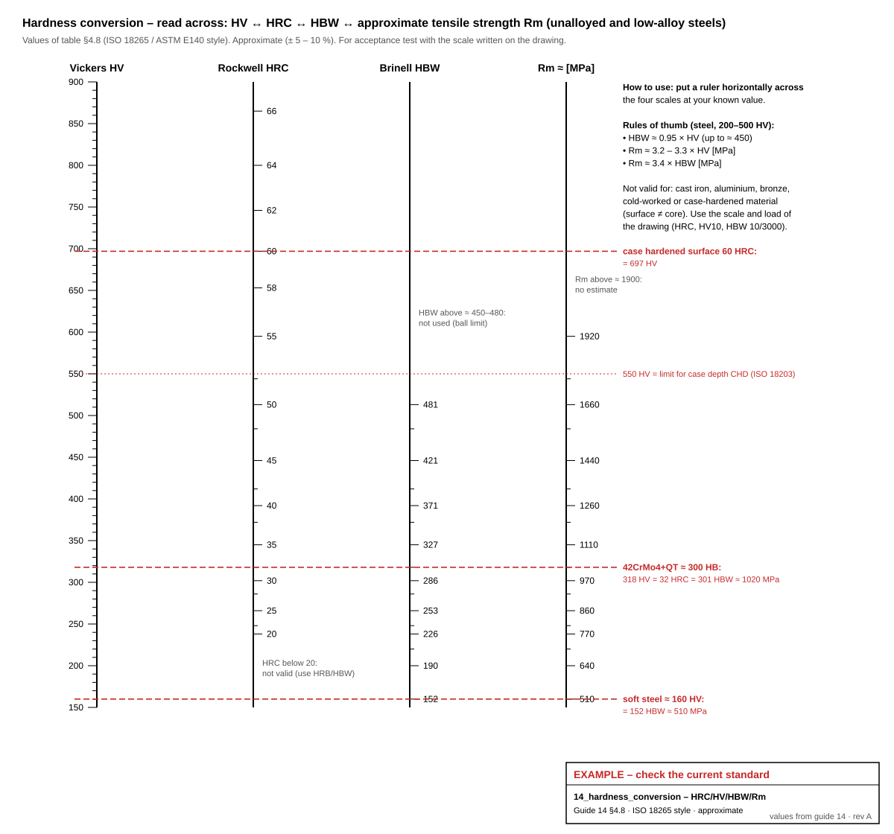
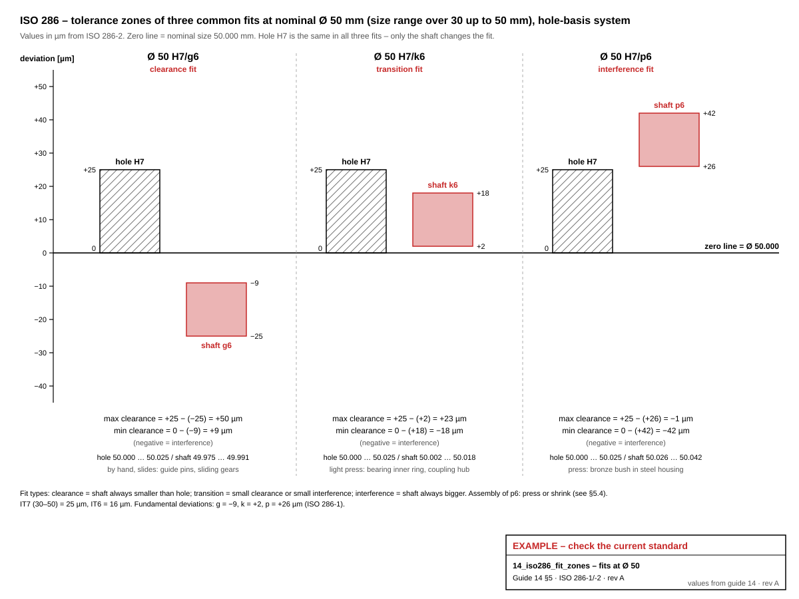
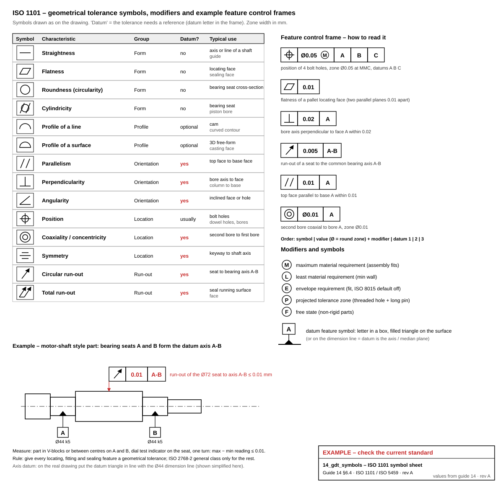
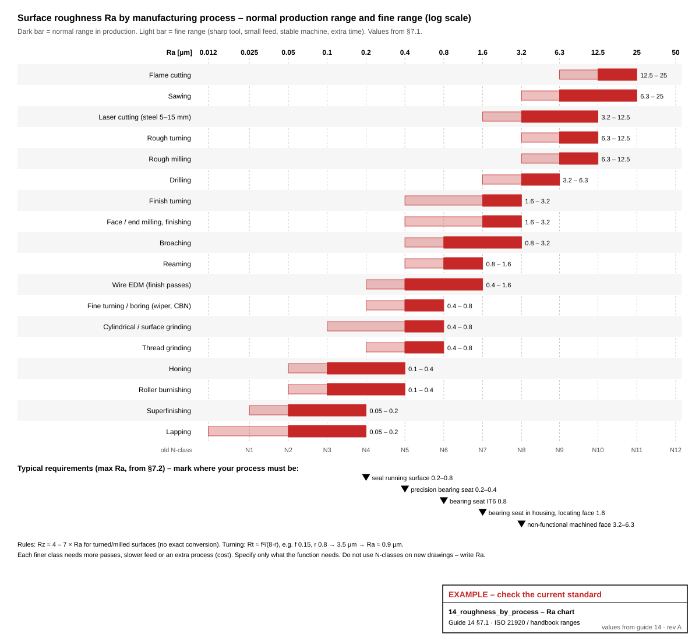
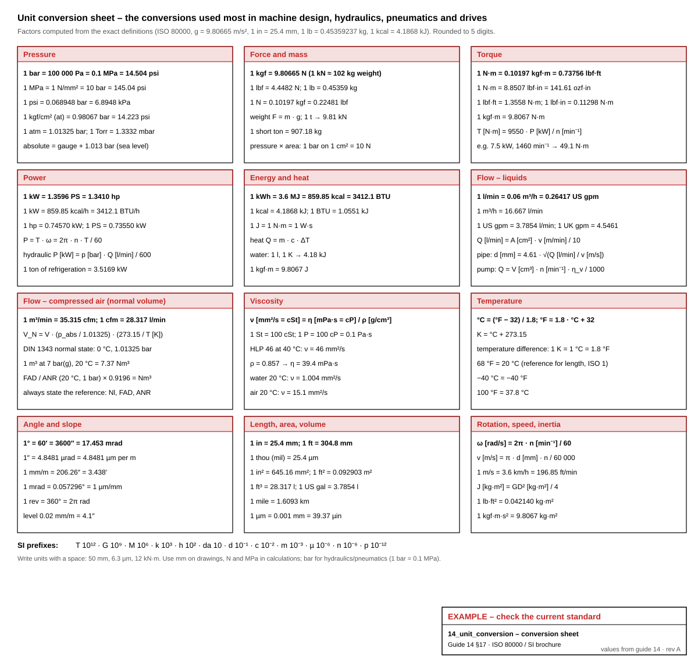
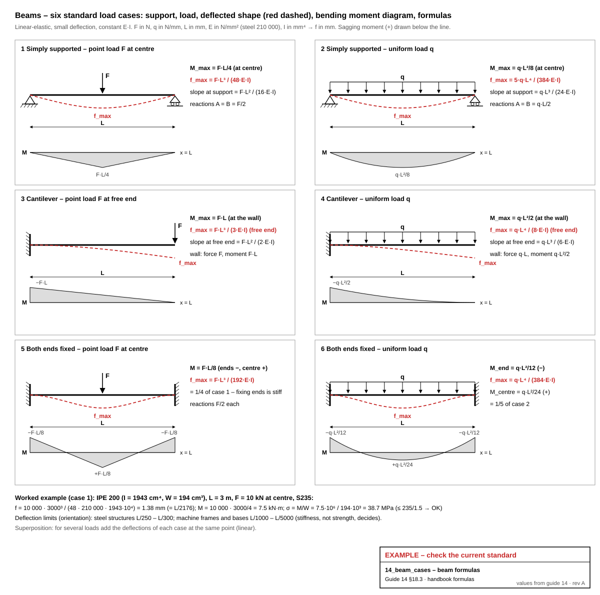
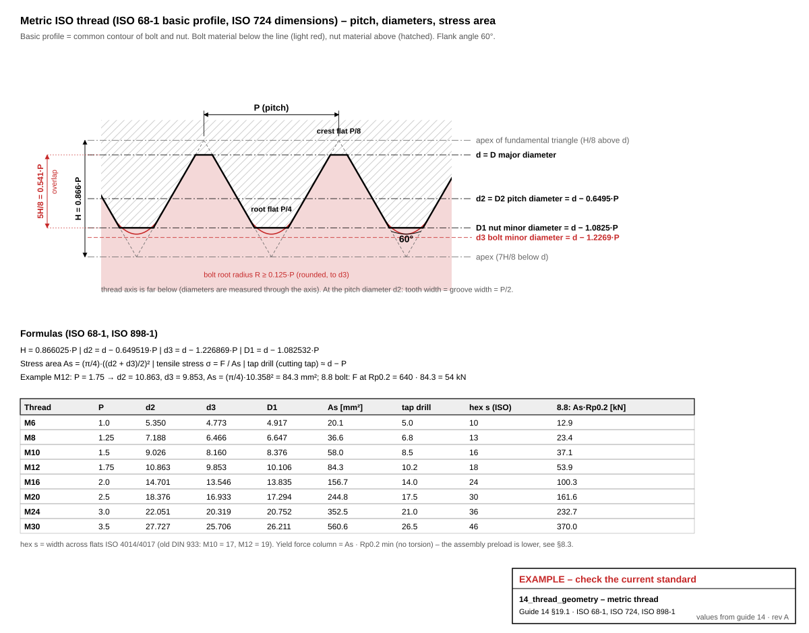
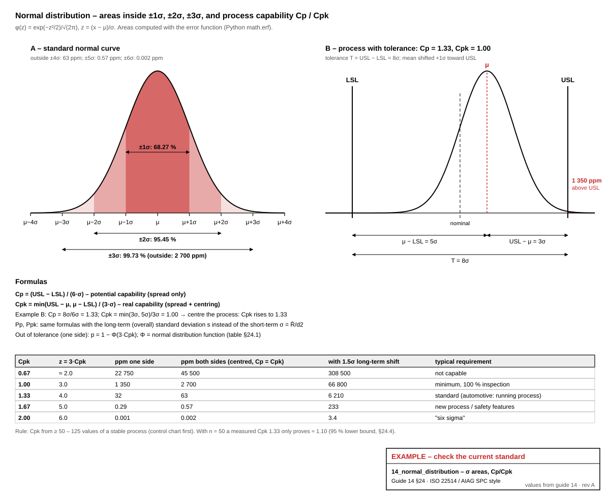

# 14 – Engineering reference data book

This is the **shared reference book** for the project. The other guides (01–13) use the numbers in this
book when they need a generic table: material strength, fits, bolt torque, roughness, welding, cutting
data, hydraulics, cables, safety distances.

> **Important – read before you use any value.**
> - The values here are **reference values from standards and well-known engineering handbooks** – not the
>   "example values" of the twin pages. They are good for design and for the workshop, **but the binding
>   value is always the one in the current edition of the standard, the mill certificate (EN 10204 3.1) of
>   your material, or the catalogue of your supplier.**
> - Every table says its **source type** and its **condition** (size range, heat treatment condition,
>   temperature). A value is only valid inside that condition.
> - Where sources do not agree, a **range** is given. For safety-relevant design use the unfavourable end
>   of the range.
> - Standards are revised. If a standard edition is named, check that it is still the current one.

**Drawings in this guide** (standalone SVG files in `docs/img/`, copies in `web/img/`; every computed value
in them and in chapters 17 – 25 was checked with Python standard-library scripts):
`14_unit_conversion.svg` (§17) · `14_hardness_conversion.svg` (§4.8) · `14_iso286_fit_zones.svg` (§5) ·
`14_gdt_symbols.svg` (§6.4) · `14_roughness_by_process.svg` (§7.1) · `14_beam_cases.svg` (§18.3) ·
`14_thread_geometry.svg` (§19.1) · `14_normal_distribution.svg` (§24).

---

## Contents

1. [How to use this book](#1-how-to-use-this-book)
2. [Units, conversions, constants](#2-units-conversions-constants)
3. [Materials](#3-materials)
4. [Heat treatment and hardness](#4-heat-treatment-and-hardness)
5. [ISO 286 fits](#5-iso-286-limits-and-fits)
6. [General tolerances, welding tolerances, geometric tolerances](#6-general-tolerances-welding-tolerances-geometric-tolerances)
7. [Surface roughness](#7-surface-roughness)
8. [Bolted joints and pins](#8-bolted-joints-and-pins)
9. [Welding](#9-welding)
10. [Machining data](#10-machining-data)
11. [Bearings, keys, shafts, circlips](#11-bearings-keys-shafts-circlips)
12. [Springs, friction, rolling resistance](#12-springs-friction-rolling-resistance)
13. [Hydraulics and pneumatics](#13-hydraulics-and-pneumatics)
14. [Electrical](#14-electrical)
15. [Measurement](#15-measurement)
16. [Safety numbers](#16-safety-numbers)
17. [Units, conversions and symbols – extended](#17-units-conversions-and-symbols--extended) (pressure, force, torque, power, energy, flow, NL/min and FAD, viscosity, angle, inertia, Greek alphabet, preferred numbers)
18. [Strength of materials](#18-strength-of-materials--formulas-section-data-beams-buckling-notches-fatigue) (stress formulas, section tables, beam cases, buckling, Kt, fatigue, inertia)
19. [Threads and fasteners – extended data](#19-threads-and-fasteners--extended-data) (thread geometry, fine threads with torques, fastener standards, nuts, washers, pipe threads)
20. [Bearings, splines, gears, circlips, seals](#20-bearings-splines-gears-circlips-seals--data-tables) (bearing fits, designation, splines, modules, circlips, O-rings, shaft seals)
21. [Pipes, tubes, hoses and compressed-air lines](#21-pipes-tubes-hoses-and-compressed-air-lines)
22. [Electric motors, gearboxes and cables](#22-electric-motors-gearboxes-and-cables--design-data) (IEC frames, IE table, motor formulas, service factors)
23. [Thermal data, heat transfer and fluid properties](#23-thermal-data-heat-transfer-and-fluid-properties) (water, air, oil viscosity)
24. [Statistics, quality and reliability tables](#24-statistics-quality-and-reliability-tables) (normal table, Cp/Cpk, control chart constants, sample sizes)
25. [Engineering economics](#25-engineering-economics--formulas-and-tables) (NPV, IRR, payback, annuity, machine-hour rate)
26. [Technical drawing conventions](#26-technical-drawing-conventions) (paper sizes, lines, projection, title block, edges)
27. [Master formula index](#27-master-formula-index--where-each-formula-is-explained-with-an-example)
28. [Where to buy reference tools](#28-where-to-buy-reference-tools--handbooks-standards-software-measuring-references)
29. [Glossary](#29-glossary)
30. [Changes and corrections in this edition](#30-changes-and-corrections-in-this-edition)

---

## 1. How to use this book

### 1.1 Rules

1. **Find the table, then check the condition line.** Example: the strength of 42CrMo4 depends on the
   diameter. A Ø 30 bar has Rp0.2 ≥ 750 MPa, a Ø 120 bar only ≥ 550 MPa.
2. **Use minimum values for strength calculations.** Standards give minimum values (Rp0.2 min, Rm min).
   The real material is usually stronger, but you may not count on it.
3. **Use a safety factor** on top of the minimum value (see 1.2).
4. **Write the source on your drawing or calculation**, e.g. "42CrMo4+QT, EN 10083-3, Ø 40–100".
5. **Order with a certificate.** For load-carrying parts order material with an inspection certificate
   EN 10204 – 3.1. Keep it with the part record (traceability, guide 13).
6. **Measure at 20 °C** (ISO 1). All dimensions and tolerances in this book are for 20 °C.

### 1.2 Typical safety factors (orientation)

Source type: common machine design practice (e.g. Roloff/Matek, Decker, Shigley). Your company or the
applicable product standard may require other values.

| Case | Safety factor S | Applied to |
|---|---|---|
| Static load, ductile steel, loads known well | 1.5 – 2.0 | Rp0.2 (yield) |
| Static load, cast iron EN-GJL (brittle) | 2.5 – 4 | Rm (tensile strength) |
| Fatigue (alternating load), steel | 1.5 – 2.5 | fatigue strength of the part (with notch factor) |
| Buckling (cylinder rod, column) | 3 – 5 | Euler load |
| Lifting / load handling parts | per standard (e.g. EN 13155, EN 1493) | – |
| Bolts (preloaded) | per VDI 2230 (see chapter 8) | – |

Allowed stress: **σ_allow = R / S**. Example: S355J2, t = 20 mm, static: σ_allow = 345 / 1.5 = 230 MPa.

### 1.3 Symbols used in this book

| Symbol | Meaning | Unit |
|---|---|---|
| Rm | tensile strength | MPa = N/mm² |
| Rp0.2 / ReH | yield strength (0.2 % proof stress / upper yield strength) | MPa |
| A | elongation at break | % |
| E | Young's modulus (elastic modulus) | GPa = 1000 N/mm² |
| G | shear modulus | GPa |
| ν | Poisson's ratio | – |
| α | coefficient of linear thermal expansion | 10⁻⁶ /K (= µm per m per K) |
| ρ | density | kg/dm³ = g/cm³ |
| HB, HV, HRC | hardness Brinell, Vickers, Rockwell C | – |
| IT | ISO tolerance grade | µm |

---

## 2. Units, conversions, constants

### 2.1 SI base and derived units used in the project

| Quantity | Unit | Note |
|---|---|---|
| Length | mm (drawings), m (layout) | 1 µm = 0.001 mm |
| Force | N, kN | |
| Torque | N·m | |
| Stress, pressure | MPa = N/mm²; bar | 1 MPa = 10 bar |
| Power | W, kW | |
| Mass | kg, t | |
| Temperature | °C; K for differences | ΔT of 1 K = 1 °C |
| Angle | ° ; arc second ″ | 1° = 3600″; 1″ = 4.848 µrad |
| Speed (rotation) | min⁻¹ (rpm) | ω [rad/s] = 2π·n/60 |

### 2.2 Constants

| Constant | Value | Source |
|---|---|---|
| Standard gravity g | 9.80665 m/s² (use 9.81) | ISO 80000-3 / CGPM |
| Standard atmospheric pressure | 101 325 Pa = 1.01325 bar | ISO 2533 |
| Reference temperature for dimensions | 20 °C | ISO 1 |
| Density of air (20 °C, 1.013 bar) | 1.20 kg/m³ | physics tables |
| Resistivity of copper at 20 °C | 0.0172–0.0178 Ω·mm²/m (use 0.0178 for cables) | IEC 60228 basis / tables |
| Conductivity of copper (20 °C) | 56–58 m/(Ω·mm²) | |
| Temperature coefficient of copper resistance | 0.00393 /K | |

### 2.3 Conversions

| From | To | Factor (exact where marked *) |
|---|---|---|
| 1 kgf (kilogram-force) | N | 9.80665 * |
| 1 kgf·m | N·m | 9.80665 * |
| 1 kgf/mm² | MPa | 9.80665 * |
| 1 kgf/cm² (at) | bar | 0.980665 * |
| 1 bar | MPa / psi | 0.1 * / 14.5038 |
| 1 psi (lbf/in²) | bar / kPa | 0.0689476 / 6.89476 |
| 1 ksi | MPa | 6.89476 |
| 1 in | mm | 25.4 * |
| 1 ft | mm | 304.8 * |
| 1 lb (pound mass) | kg | 0.45359237 * |
| 1 lbf | N | 4.44822 |
| 1 lbf·ft | N·m | 1.35582 |
| 1 lbf·in | N·m | 0.112985 |
| 1 hp (mechanical, US) | W | 745.70 |
| 1 PS (metric horsepower) | W | 735.499 |
| 1 kWh | MJ | 3.6 * |
| 1 US gallon | litre | 3.78541 |
| 1 cSt (centistokes) | mm²/s | 1 * |
| °F | °C | °C = (°F − 32) / 1.8 |
| 1 mil (thou) | µm | 25.4 * |
| 1 l/min | m³/s | 1/60 000 |

Full conversion tables (pressure matrix, power, torque, flow, normal volume NL/min and FAD, viscosity,
angle, inertia): **§17**.

**Pressure × area quick rule:** 1 bar on 1 cm² = 10 N. Example: 100 bar on a Ø 63 cylinder
(A = 31.17 cm²) → F = 100 · 31.17 · 10 = 31 170 N ≈ 31.2 kN.

### 2.4 Physical properties of material groups (room temperature)

Source type: typical values from engineering handbooks and material standards (EN 1561, EN 1563,
EN 573/485, EN 1982, supplier data sheets). Values depend on the exact alloy – ranges are given.

| Material group | ρ [kg/dm³] | E [GPa] | G [GPa] | ν | α [10⁻⁶/K] (20–100 °C) |
|---|---|---|---|---|---|
| Carbon and low-alloy steel | 7.85 | 205 – 212 (use 210) | 79 – 81 (use 81) | 0.30 | 11 – 12.5 (use 11.5) |
| Austenitic stainless steel (1.4301) | 7.90 | 193 – 200 | 74 – 77 | 0.30 | 16.0 |
| Grey cast iron EN-GJL-250 | 7.2 | 103 – 118 | 41 – 48 | 0.26 | 10 – 11 |
| Grey cast iron EN-GJL-300 | 7.25 | 108 – 137 | 44 – 54 | 0.26 | 10 – 11 |
| Ductile iron EN-GJS-400-15 | 7.1 | 169 | 66 | 0.275 | 12.5 |
| Ductile iron EN-GJS-600-3 | 7.2 | 174 | 67 | 0.275 | 12.5 |
| Aluminium wrought alloys (6082, 5083, 7075) | 2.66 – 2.81 | 69 – 72 | 26 – 27 | 0.33 | 23 – 24 |
| Tin bronze (CuSn12) | 8.6 – 8.8 | 90 – 105 | ≈ 36 – 40 | 0.34 | 18 – 18.5 |
| Aluminium bronze (CuAl10Fe5Ni5) | 7.5 – 7.7 | 115 – 125 | ≈ 43 – 46 | 0.32 | 16 – 17 |
| Brass (CuZn39Pb3) | 8.4 – 8.5 | 95 – 100 | ≈ 36 – 38 | 0.35 | 20 – 21 |
| Copper (Cu-ETP) | 8.93 | 115 – 130 | 44 – 48 | 0.34 | 17 |
| Polyurethane PU 90–95 Shore A | 1.1 – 1.25 | 0.02 – 0.08 (non-linear!) | – | 0.45 – 0.5 | 100 – 200 |
| PA6 (dry / conditioned) | 1.13 – 1.14 | 2.5 – 3.2 / 1.0 – 1.5 | – | 0.39 | 80 – 100 |
| POM-C | 1.41 | 2.6 – 3.1 | – | 0.35 | 100 – 120 |
| PE-UHMW | 0.93 – 0.94 | 0.6 – 0.8 | – | 0.46 | 150 – 200 |
| Concrete (floor) | 2.3 – 2.4 | 25 – 35 | – | 0.2 | 10 – 12 |
| Hydraulic oil (mineral) | 0.86 – 0.88 | bulk modulus K ≈ 1.4 – 1.8 GPa | – | – | – |
| Water | 1.00 | bulk modulus K ≈ 2.2 GPa | – | – | – |

Relation: **G = E / (2·(1 + ν))**. Steel: 210 / (2 · 1.3) = 80.8 GPa.

**Thermal expansion:** ΔL = α · L · ΔT.
Example: steel table Ø 800 mm, warms by 5 K: ΔL = 11.5·10⁻⁶ · 800 · 5 = 0.046 mm.
Same for an aluminium part: 23·10⁻⁶ · 800 · 5 = 0.092 mm.

### 2.5 Hardness scales – what they are

| Scale | Test | Use | Valid range (orientation) |
|---|---|---|---|
| HBW (Brinell, ISO 6506) | hard-metal ball, measure diameter of print | soft steel, cast iron, bronze, aluminium | up to 650 HBW |
| HV (Vickers, ISO 6507) | diamond pyramid, measure diagonal | all metals, thin layers, case depth profiles (HV1, HV0.5) | whole range |
| HRC (Rockwell C, ISO 6508) | diamond cone, measure depth | hardened steel | 20 – 70 HRC |
| HRB (Rockwell B) | steel/hard-metal ball | soft steel, brass | 20 – 100 HRB |
| Shore A / D (ISO 868, ISO 48-4) | spring indenter | elastomers (A), hard plastics (D) | PU 90 A ≈ 40 D; PU 95 A ≈ 48 – 50 D (approx.) |

Conversion between scales: see 4.8 (approximate only).

---

## 3. Materials

**How to read the tables:** values are **minimum values** unless a range is given. "+N" = normalised,
"+QT" = quenched and tempered, "+A" = soft annealed. Thickness/diameter = the ruling section of the
semi-finished product (not of the finished part).

### 3.1 Structural steels – EN 10025-2 (hot-rolled, as delivered)

Source: values per EN 10025-2 (minimum values; check the mill certificate).

| Steel (number) | Thickness t [mm] | ReH min [MPa] | Rm [MPa] | A min [%] | Impact | Weldability |
|---|---|---|---|---|---|---|
| S235JR (1.0038) | t ≤ 16 | 235 | 360 – 510 | 26 | 27 J at +20 °C | very good |
| | 16 < t ≤ 40 | 225 | 360 – 510 | 26 | | |
| | 40 < t ≤ 63 | 215 | 360 – 510 | 25 | | |
| | 63 < t ≤ 80 | 215 | 360 – 510 | 24 | | |
| S355J2 (1.0577) | t ≤ 16 | 355 | 470 – 630 | 22 | 27 J at −20 °C | very good (CEV max ≈ 0.45 – 0.47 depending on t) |
| | 16 < t ≤ 40 | 345 | 470 – 630 | 22 | | |
| | 40 < t ≤ 63 | 335 | 470 – 630 | 21 | | |
| | 63 < t ≤ 80 | 325 | 470 – 630 | 20 | | |
| | 80 < t ≤ 100 | 315 | 470 – 630 | 20 | | |

A values above are for longitudinal test pieces; transverse values are about 2 % lower (see the standard).

| Steel | Hardness (typical, not specified) | Machinability | Typical use in this project |
|---|---|---|---|
| S235JR | ≈ 110 – 150 HB | good, long chips, smears on fine finish | guards, brackets, sheet-metal covers, cable trays, non-critical frames |
| S355J2 | ≈ 140 – 190 HB | good | welded frames (APC base, AGV chassis, docking stands, AS/RS front end), base plates, brackets (most used steel of guides 09–11) |

**Rule:** welded frames that must hold accuracy → weld, **stress relieve** (4.2), then machine.

### 3.2 Quenched and tempered steels – EN ISO 683-1 / -2 (former EN 10083-2 / -3)

Source: values per EN 10083-2 / EN 10083-3 (now EN ISO 683-1 / 683-2), +QT condition, longitudinal,
minimum values. Check the mill certificate. "d" = diameter of round bar (for flats see the standard,
the ruling section is different).

**C45 (1.0503)** – unalloyed

| Condition | d [mm] | Rp0.2 / Re min [MPa] | Rm [MPa] | A min [%] |
|---|---|---|---|---|
| +N | d ≤ 16 | 340 | ≥ 620 | 14 |
| +N | 16 < d ≤ 100 | 305 | ≥ 580 | 16 |
| +N | 100 < d ≤ 250 | 275 | ≥ 560 | 16 |
| +QT | d ≤ 16 | 490 | 700 – 850 | 14 |
| +QT | 16 < d ≤ 40 | 430 | 650 – 800 | 16 |
| +QT | 40 < d ≤ 100 | 370 | 630 – 780 | 17 |

C45 hardens only in a thin layer in big sections (low hardenability): above about d = 100 the +QT gain is small.

**42CrMo4 (1.7225)** – the most used QT steel

| Condition | d [mm] | Rp0.2 min [MPa] | Rm [MPa] | A min [%] | Hardness (approx., from Rm) |
|---|---|---|---|---|---|
| +QT | d ≤ 16 | 900 | 1100 – 1300 | 10 | ≈ 330 – 390 HB |
| +QT | 16 < d ≤ 40 | 750 | 1000 – 1200 | 11 | ≈ 300 – 360 HB |
| +QT | 40 < d ≤ 100 | 650 | 900 – 1100 | 12 | ≈ 270 – 330 HB |
| +QT | 100 < d ≤ 160 | 550 | 800 – 950 | 13 | ≈ 240 – 285 HB |
| +QT | 160 < d ≤ 250 | 500 | 750 – 900 | 14 | ≈ 225 – 270 HB |
| +A | – | – | – | – | ≤ 241 HB |

**34CrNiMo6 (1.6582)** – for big sections with high strength (better through-hardening than 42CrMo4)

| Condition | d [mm] | Rp0.2 min [MPa] | Rm [MPa] | A min [%] |
|---|---|---|---|---|
| +QT | d ≤ 16 | 1000 | 1200 – 1400 | 9 |
| +QT | 16 < d ≤ 40 | 900 | 1100 – 1300 | 10 |
| +QT | 40 < d ≤ 100 | 800 | 1000 – 1200 | 11 |
| +QT | 100 < d ≤ 160 | 700 | 900 – 1100 | 12 |
| +QT | 160 < d ≤ 250 | 600 | 800 – 950 | 13 |
| +A | – | – | – | ≤ 248 HB |

| Steel | Weldability | Machinability | Typical use in this project |
|---|---|---|---|
| C45 | limited: preheat 150 – 300 °C (see 9.4), avoid for welded load parts | good (+N); +QT good up to ≈ 280 HB | pins, simple shafts, centring pins, induction-hardened guide pins, levers |
| 42CrMo4 | poor: only with preheat 250 – 350 °C and post-weld heat treatment; better: do not weld | good in +QT up to ≈ 320 HB; above use coated carbide | APC rotation shaft, lift column, highly loaded pins and bolts, zero-point pull studs (often nitrided or induction hardened), clamping parts |
| 34CrNiMo6 | do not weld | medium (tough) | large highly loaded shafts, rotary table main shaft if big section |

### 3.3 Case hardening steels – EN ISO 683-3 (former EN 10084)

Source: EN 10084 / EN ISO 683-3 give chemical composition, hardenability and hardness in delivery
condition. **Core strength after case hardening is not a guaranteed value** in the standard; the core
values below are typical (from the former DIN 17210 for a Ø 30 test bar) – use them only for orientation.

| Steel (number) | Delivery hardness | Surface after case hardening + tempering 150 – 200 °C | Core Rm (typical, Ø 30) | Core Rp0.2 (typical, Ø 30) | Use in this project |
|---|---|---|---|---|---|
| 16MnCr5 (1.7131) | +A ≤ 207 HB; +FP 140 – 187 HB | 58 – 62 HRC (≈ 650 – 750 HV) | 800 – 1100 MPa | ≈ 600 MPa | **worm** of the rotary table (guide 12), small gears, pins, cam rollers, guide bushes |
| 20MnCr5 (1.7147) | +A ≤ 217 HB; +FP 152 – 201 HB | 58 – 62 HRC | 1000 – 1300 MPa | ≈ 700 MPa | larger gears and worms, higher core strength than 16MnCr5 |

Core strength falls with bigger sections. Weldability: do not weld (high hardenability).
Machinability: good in +FP condition (ferrite-pearlite) – order +FP for parts to be gear cut.

### 3.4 Bearing steel, nitriding steel, stainless, tool plate

| Material (number) | Standard | Condition | Key values (typical/min) | Use in this project |
|---|---|---|---|---|
| 100Cr6 (1.3505) | EN ISO 683-17 | +AC (soft annealed) ≤ 207 HB; hardened + tempered 150 – 180 °C: 58 – 64 HRC | E 210 GPa | guide rails/strips you make, wear pads, rollers, gauge pins |
| 31CrMoV9 (1.8519) | EN 10085 (nitriding steels) | +QT, d ≤ 100: Rp0.2 ≥ 800, Rm 1000 – 1200, A ≥ 10 % (approx. – check the standard for your size); gas nitrided: surface ≈ 750 – 850 HV | low distortion when nitrided | rotary table clamping parts, precise shafts that need wear resistance and low distortion, pull studs |
| X5CrNi18-10 (1.4301) | EN 10088-2 (sheet) / -3 (bar) | annealed: Rp0.2 ≥ 190 (bar) / ≥ 210 – 230 (sheet), Rm 500 – 700, A ≥ 45 % | not magnetic (annealed), α = 16·10⁻⁶ /K, work hardens when cut | coolant parts, covers, sensor brackets near coolant |
| 40CrMnMoS8-6 (1.2312) | EN ISO 4957 (tool steels) | delivered pre-hardened ≈ 280 – 325 HB (≈ Rm 950 – 1100 MPa, supplier values) | free machining (S), not for welding, can be nitrided | fixture plates, zero-point base plates, locating blocks, pallet top plates that need hardness without heat treatment |

### 3.5 Cast irons

Source: EN 1561 (grey iron, GJL) and EN 1563 (ductile iron, GJS). Values are for **separately cast test
bars**; the real casting wall can be weaker, especially thick walls of grey iron (EN 1561 gives
wall-thickness-related values – ask the foundry).

| Material | Rm [MPa] | Rp0.2 min [MPa] | A [%] | Hardness HBW (typical) | E [GPa] | Damping | Use in this project |
|---|---|---|---|---|---|---|---|
| EN-GJL-250 | 250 – 350 | – (no yield point) | 0.3 – 0.8 | ≈ 180 – 250 | 103 – 118 | very good | machine beds, housings, covers |
| EN-GJL-300 | 300 – 400 | – | 0.3 – 0.8 | ≈ 200 – 275 | 108 – 137 | very good | **rotary table housing** (guide 12), machine beds, slideways (can be flame/induction hardened) |
| EN-GJS-400-15 | ≥ 400 | 250 | ≥ 15 | ≈ 135 – 180 | 169 | medium | tough housings, brackets, levers, wheel hubs |
| EN-GJS-600-3 | ≥ 600 | 370 | ≥ 3 | ≈ 190 – 270 | 174 | medium | highly loaded housings, table tops, gears (can be induction hardened) |

Notes:
- Grey iron is **strong in compression** (≈ 3 – 4 × Rm) but weak in tension and brittle – design for compression.
- Weldability: GJL practically not weldable for load parts (only repair with Ni electrodes, preheat);
  GJS limited.
- Machinability: very good (short chips, dry possible); dust – use extraction.
- **Stress relief castings** before final machining (see 4.2) – or rough machine, age, finish.

### 3.6 Aluminium alloys

Source: EN 573-3 (composition), EN 485-2 (plate/sheet), EN 755-2 (extruded bar). Values are minimum
values and **depend strongly on product form and thickness** – check the supplier data sheet.

| Alloy | Temper / form | Rp0.2 min [MPa] | Rm min [MPa] | A min [%] | Hardness (typical) | Weldability | Machinability | Use in this project |
|---|---|---|---|---|---|---|---|---|
| EN AW-6082 (AlSi1MgMn) | T6 extruded bar d ≤ 20 | 250 | 295 | 8 | ≈ 95 HB | good (TIG/MIG), but strength in heat zone falls to ≈ 50 – 60 % | good | AGV parts, sensor brackets, light covers, profiles |
| | T6 / T651 plate 6 – 12.5 mm | 255 | 300 | 9 | | | | |
| | T6 / T651 plate 12.5 – 100 mm | 240 | 295 | 7 – 8 | | | | |
| EN AW-7075 (AlZn5.5MgCu) | T6 / T651 plate (thickness dependent) | 420 – 480 | 500 – 545 | 3 – 8 | ≈ 150 HB | **not fusion weldable** | very good | highly loaded light parts, gripper fingers, AGV lift parts |
| EN AW-5083 (AlMg4.5Mn0.7) | O / H111 | 125 | 275 – 350 | 15 – 16 | ≈ 75 HB | very good | medium (soft, smears); as cast plate good | welded aluminium frames, tooling plate (cast and milled plate, low stress) |

Rules: T6 parts lose strength when heated above ≈ 150 °C (do not stress relieve by heating – buy
stretched plate T651 or cast tooling plate for low distortion). Do not use aluminium for parts that see
high surface pressure without a steel insert (threads → thread inserts, see 8.6).

### 3.7 Bronzes and brass

Source: EN 1982 (copper alloy castings). Values are minimum values for the casting method:
GS = sand cast, GZ = centrifugal cast, GC = continuously cast. **Check the standard and the foundry
certificate – values below are typical rounded minimums.**

| Alloy (number) | Method | Rp0.2 min [MPa] | Rm min [MPa] | A min [%] | HBW min (typical) | Use in this project |
|---|---|---|---|---|---|---|
| CuSn12-C (CC483K) | GS / GZ / GC | 140 – 150 | 260 – 280 | 5 – 7 | 80 – 90 | worm wheels for medium speed, slide bushes, nuts |
| CuSn12Ni2-C (CC484K) | GS / GZ / GC | 160 – 180 | 280 – 300 | 6 – 12 | 85 – 95 | **worm wheel rim of the rotary table** (guide 12, GZ = centrifugal), highly loaded worm wheels |
| CuAl10Fe5Ni5-C (CC333G) | GS / GZ / GC | 250 – 280 | 600 – 650 | 7 – 13 | 140 – 150 | heavy loaded slow bushes, wear plates, nuts; **not ideal for worm wheels with hardened worms at high sliding speed** (scoring risk – tin bronze preferred) |
| CuZn39Pb3 (CW614N) brass | drawn bar (EN 12164) | ≈ 250 – 350 (temper dependent) | ≈ 360 – 500 | 8 – 20 | ≈ 90 – 140 HB | turned parts, fittings, nozzles; very good machinability |

Bronze is sold also as continuously cast bar (GC) – good for bushes. Worm wheel material must be agreed
with the gear calculation (ISO/TS 14521 or DIN 3996 material factors).

### 3.8 Engineering plastics and polyurethane

Source type: typical values from supplier data sheets (e.g. semi-finished product makers). **Plastics vary
widely between suppliers – use the data sheet of your supplier.** Values at 23 °C.

| Material | ρ [kg/dm³] | Tensile strength [MPa] | E [GPa] | Max. service temp. (long term) | Water uptake | Machinability | Use in this project |
|---|---|---|---|---|---|---|---|
| PA6 (cast or extruded) | 1.13 – 1.15 | 70 – 85 (dry), 40 – 60 (conditioned) | 2.5 – 3.2 (dry), 1.0 – 1.5 (cond.) | ≈ 80 – 100 °C | up to ≈ 3 % at 50 % RH (swells: dimensions change!) | good | rollers, slide pads where moisture is no problem |
| POM-C (acetal copolymer) | 1.41 | 60 – 70 | 2.6 – 3.1 | ≈ 100 °C | ≈ 0.2 % (dimensionally stable) | very good | precise plastic parts, slide blocks, gears, cable guides |
| PE-UHMW (PE 1000) | 0.93 – 0.94 | 20 – 40 (yield ≈ 17 – 22) | 0.6 – 0.8 | ≈ 80 °C | ≈ 0 % | good (but springs back, burrs) | slide strips and guide rails for crates and pallets, wear strips, bumpers (guides 10, 11) |
| PU 90 Shore A (cast, e.g. polyester / polyether PU) | 1.1 – 1.25 | 30 – 50 | non-linear (≈ 0.02 – 0.05) | ≈ 70 – 80 °C (heat build-up at speed!) | low – medium | moulded, can be ground | AGV drive wheels, castor tyres, buffers |
| PU 95 Shore A | 1.15 – 1.25 | 35 – 55 | non-linear (≈ 0.04 – 0.08) | ≈ 70 – 80 °C | low – medium | | heavier wheels (1 t pallet AGV), buffers |

PU wheel load: never take a load value from a general table – the allowed wheel load depends on diameter,
width, tread thickness, speed and floor. **Use the wheel maker's load table** (guide 11).

### 3.9 Material selection quick table (this project)

| Part (guide) | First choice | Alternative | Why |
|---|---|---|---|
| Welded frames, base plates (09, 10, 11) | S355J2 | S235JR (lightly loaded) | weldable, cheap, stress relief then machine |
| APC rotation / lift shaft (09) | 42CrMo4+QT | 34CrNiMo6+QT (big Ø) | strength, toughness |
| Centring pins, guide cones (10) | C45 induction hardened 55 HRC | 16MnCr5 case hardened | hard surface, tough core |
| Locating receivers / bushes (10) | 16MnCr5 case hardened or 100Cr6 hardened | 1.2312 (not hardened) | wear |
| Rotary table housing (12) | EN-GJL-300 | S355J2 welded + stress relieved | damping, stability |
| Rotary table worm (12) | 16MnCr5 / 20MnCr5 case hardened + ground | 31CrMoV9 nitrided (lower load) | wear, contact strength |
| Worm wheel rim (12) | CuSn12Ni2-C-GZ | CuSn12-C-GZ | best pairing with hardened worm |
| Fixture / zero-point plates (09) | 1.2312 | 42CrMo4+QT | pre-hardened, machine directly |
| Slide strips (10, 11) | PE-UHMW | POM-C | low friction, cheap |
| AGV wheels (11) | PU 92 – 95 Shore A on steel or aluminium hub | – | grip, floor protection |

---

## 4. Heat treatment and hardness

Source type: typical process values from EN ISO 683-x (informative annexes), EN 10084, EN 10085 and
heat-treatment handbooks. **The heat-treatment shop must confirm the exact cycle for your part.**
Always write on the drawing: process, hardness with tolerance, depth with its definition, where to test.

### 4.1 Normalising (+N)

| Item | Value |
|---|---|
| Purpose | uniform fine grain, remove forging/rolling structure |
| Temperature | 30 – 50 K above Ac3: C45 ≈ 840 – 880 °C; 42CrMo4 ≈ 840 – 880 °C; S355 ≈ 880 – 920 °C |
| Holding | until the core is at temperature (rule: ≈ 1 – 2 min per mm wall, minimum ≈ 30 min) |
| Cooling | in still air |
| Distortion | medium (scale) – do before rough machining |

### 4.2 Stress relief annealing

| Material | Temperature | Holding | Cooling |
|---|---|---|---|
| Welded steel S235 / S355 frames | 550 – 650 °C (often 580 – 620 °C) | ≈ 1 – 2 h, or 1 h per 25 mm wall (min 1 h) | in the furnace to ≈ 300 °C, then air (slow, ≤ ≈ 50 – 100 K/h) |
| QT steels (C45, 42CrMo4) after rough machining | 30 – 50 K **below** the tempering temperature used (typically 500 – 600 °C) | 1 – 2 h | slow in furnace |
| Grey / ductile cast iron | 500 – 600 °C (GJL ≈ 500 – 575 °C) | 2 – 8 h depending on wall | slow in furnace to ≈ 200 – 300 °C |
| Aluminium | **not by heating for T6/T651** (overaging) – use stretched plate (T651) or cast tooling plate; vibration stress relief is an option | | |

Rule from the project: **rough machine → stress relieve → finish machine** (guide 00, rule 2).
Leave 1 – 3 mm per side for finishing after stress relief of welded frames.

### 4.3 Quenching and tempering (QT)

| Steel | Hardening temp. | Quench | Tempering temp. | Result |
|---|---|---|---|---|
| C45 | 820 – 860 °C | water or oil (small parts) | 550 – 660 °C | per table 3.2 |
| 42CrMo4 | 820 – 860 °C | oil or polymer | 540 – 680 °C | per table 3.2 |
| 34CrNiMo6 | 830 – 860 °C | oil | 540 – 660 °C | per table 3.2 |
| 31CrMoV9 | 870 – 930 °C | oil | 580 – 700 °C | core before nitriding (≥ 30 – 50 K above nitriding temperature) |

Usually **buy the bar in +QT** – then no heat treatment and no distortion for you.

### 4.4 Case hardening (carburising + hardening + tempering)

| Item | 16MnCr5 / 20MnCr5 |
|---|---|
| Carburising | 880 – 980 °C (often 920 – 950 °C) |
| Hardening | direct from carburising temperature after cooling to ≈ 830 – 860 °C, or re-heat: core hardening 860 – 900 °C, case hardening 780 – 820 °C |
| Quench | oil |
| Tempering | 150 – 200 °C, ≥ 1 – 2 h |
| Surface hardness | 58 – 62 HRC (drawing typical: 60 ± 2 HRC) |
| Case hardening depth CHD | per ISO 18203: depth where hardness = **550 HV1**. Typical 0.3 – 2.0 mm; gears/worms: CHD ≈ 0.15 – 0.20 × module (check with gear calculation) |
| Time (rule of thumb) | total case depth ≈ 0.6 · √t [mm, t in h] at ≈ 925 °C (Harris); effective CHD (550 HV) ≈ 60 – 75 % of total. Example: CHD 0.8 mm → total ≈ 1.15 mm → t ≈ (1.15 / 0.6)² ≈ 3.7 h at temperature |
| Distortion | **high** – leave grinding stock (≈ 0.1 – 0.3 mm per side, depends on size), grind after hardening; grind removes case, so CHD on drawing = **after grinding** |
| Masking | areas that must stay soft (threads to be cut later): copper plating or protective paste, or leave extra stock and machine off the case before hardening |

### 4.5 Nitriding

| Item | Gas nitriding | Nitrocarburising (gas / salt bath / plasma) |
|---|---|---|
| Temperature | 490 – 530 °C (plasma 400 – 550 °C) | 570 – 590 °C |
| Time | 20 – 80 h (long) | 1 – 4 h |
| Depth | nitriding hardness depth Nht (ISO 18203: core + 50 HV) ≈ 0.2 – 0.6 mm | compound layer 10 – 20 µm; diffusion zone ≈ 0.1 – 0.3 mm |
| Surface hardness | 31CrMoV9: ≈ 750 – 850 HV; 42CrMo4: ≈ 550 – 650 HV; 1.2312: ≈ 600 – 700 HV | depends on steel |
| Distortion | **very low** (no quench) – finish grind before nitriding, only lap/polish after | low |
| Condition before | QT, tempered ≥ 30 – 50 K above nitriding temp.; stress relieved after rough machining | |

### 4.6 Induction / flame hardening

| Item | Value |
|---|---|
| Steels | C45, 42CrMo4 (QT before), GJS, GJL (slideways) |
| Surface hardness | C45: ≈ 54 – 60 HRC; 42CrMo4: ≈ 52 – 58 HRC; GJL slideways ≈ 45 – 52 HRC |
| Hardening depth (SHD, ISO 18203: depth at 80 % of min surface hardness) | 0.5 – 5 mm, typically 1.5 – 3 mm |
| Tempering | 150 – 200 °C |
| Distortion | low – medium (local heating); grind after |
| Use | centring pins, guide pins, shafts at bearing/seal seats, cam tracks |

### 4.7 Distortion and drawing notes – summary

| Process | Distortion | Grind after? | Drawing note example |
|---|---|---|---|
| Normalise / stress relief | low – medium | no (machine after) | "Stress relieved 600 °C / 2 h before finish machining" |
| QT | medium – high | yes (or buy +QT bar) | "42CrMo4+QT, Rm 900–1100 MPa" |
| Case hardening | high | yes | "Case hardened and tempered, 60 ± 2 HRC, CHD = 0.8 +0.3 mm (550 HV1, ISO 18203), after grinding" |
| Nitriding | very low | no (lap) | "Gas nitrided, ≥ 750 HV1, Nht = 0.3 +0.1 mm" |
| Induction hardening | low – medium | yes (seats) | "Induction hardened 55 ± 3 HRC, SHD = 2 +1 mm, zone per sketch" |

### 4.8 Hardness conversion (approximate)

Source type: approximate conversion for unalloyed and low-alloy steels, in the style of ISO 18265 /
ASTM E140. **Conversions are approximate (± about 5 – 10 %) – for acceptance always test with the scale
written on the drawing.** Rm from hardness is only an estimate (Rm ≈ 3.2 – 3.3 × HV in the range
200 – 500 HV); not valid for cast iron, aluminium, cold-worked or case-hardened material.

| HRC | HV | HBW (approx.) | Rm approx. [MPa] |
|---|---|---|---|
| – | 160 | 152 | 510 |
| – | 200 | 190 | 640 |
| – | 220 | 209 | 705 |
| 20 | 238 | 226 | 770 |
| 22 | 248 | 235 | 800 |
| 25 | 266 | 253 | 860 |
| 28 | 286 | 271 | 920 |
| 30 | 302 | 286 | 970 |
| 32 | 318 | 301 | 1020 |
| 35 | 345 | 327 | 1110 |
| 38 | 372 | 353 | 1200 |
| 40 | 392 | 371 | 1260 |
| 42 | 412 | 390 | 1330 |
| 45 | 446 | 421 | 1440 |
| 48 | 484 | 455 | 1570 |
| 50 | 513 | 481 | 1660 |
| 52 | 544 | – | 1760 |
| 55 | 595 | – | 1920 |
| 58 | 653 | – | – |
| 60 | 697 | – | – |
| 62 | 746 | – | – |
| 64 | 800 | – | – |
| 66 | 865 | – | – |

Brinell values above ≈ 450 HBW need a hard-metal ball and are rarely used. Rule: HBW ≈ 0.95 × HV up
to ≈ 450.



---

## 5. ISO 286 limits and fits

Source: **values per ISO 286-1 and ISO 286-2** (current edition 2010). All values in **µm**, for 20 °C.
A range "18 – 30" means "over 18 up to and including 30 mm".

### 5.1 Standard tolerance grades IT4 – IT11 [µm]

| Nominal size [mm] | IT4 | IT5 | IT6 | IT7 | IT8 | IT9 | IT10 | IT11 |
|---|---|---|---|---|---|---|---|---|
| up to 3 | 3 | 4 | 6 | 10 | 14 | 25 | 40 | 60 |
| 3 – 6 | 4 | 5 | 8 | 12 | 18 | 30 | 48 | 75 |
| 6 – 10 | 4 | 6 | 9 | 15 | 22 | 36 | 58 | 90 |
| 10 – 18 | 5 | 8 | 11 | 18 | 27 | 43 | 70 | 110 |
| 18 – 30 | 6 | 9 | 13 | 21 | 33 | 52 | 84 | 130 |
| 30 – 50 | 7 | 11 | 16 | 25 | 39 | 62 | 100 | 160 |
| 50 – 80 | 8 | 13 | 19 | 30 | 46 | 74 | 120 | 190 |
| 80 – 120 | 10 | 15 | 22 | 35 | 54 | 87 | 140 | 220 |
| 120 – 180 | 12 | 18 | 25 | 40 | 63 | 100 | 160 | 250 |
| 180 – 250 | 14 | 20 | 29 | 46 | 72 | 115 | 185 | 290 |
| 250 – 315 | 16 | 23 | 32 | 52 | 81 | 130 | 210 | 320 |
| 315 – 400 | 18 | 25 | 36 | 57 | 89 | 140 | 230 | 360 |
| 400 – 500 | 20 | 27 | 40 | 63 | 97 | 155 | 250 | 400 |

Which IT grade can a process hold (typical, good machine): grinding IT5 – IT6; fine boring / fine turning
IT6 – IT7; reaming IT7 – IT8; turning / milling IT8 – IT10; drilling IT10 – IT12. Honing / lapping IT4 – IT5.

### 5.2 Hole tolerances – limit deviations [µm] (upper / lower)

| Size [mm] | H6 | H7 | G7 | JS6 | K6 | N7 | P7 |
|---|---|---|---|---|---|---|---|
| 3 – 6 | +8 / 0 | +12 / 0 | +16 / +4 | ±4 | +2 / −6 | −4 / −16 | −8 / −20 |
| 6 – 10 | +9 / 0 | +15 / 0 | +20 / +5 | ±4.5 | +2 / −7 | −4 / −19 | −9 / −24 |
| 10 – 18 | +11 / 0 | +18 / 0 | +24 / +6 | ±5.5 | +2 / −9 | −5 / −23 | −11 / −29 |
| 18 – 30 | +13 / 0 | +21 / 0 | +28 / +7 | ±6.5 | +2 / −11 | −7 / −28 | −14 / −35 |
| 30 – 50 | +16 / 0 | +25 / 0 | +34 / +9 | ±8 | +3 / −13 | −8 / −33 | −17 / −42 |
| 50 – 80 | +19 / 0 | +30 / 0 | +40 / +10 | ±9.5 | +4 / −15 | −9 / −39 | −21 / −51 |
| 80 – 120 | +22 / 0 | +35 / 0 | +47 / +12 | ±11 | +4 / −18 | −10 / −45 | −24 / −59 |
| 120 – 180 | +25 / 0 | +40 / 0 | +54 / +14 | ±12.5 | +4 / −21 | −12 / −52 | −28 / −68 |
| 180 – 250 | +29 / 0 | +46 / 0 | +61 / +15 | ±14.5 | +5 / −24 | −14 / −60 | −33 / −79 |
| 250 – 315 | +32 / 0 | +52 / 0 | +69 / +17 | ±16 | +5 / −27 | −14 / −66 | −36 / −88 |

### 5.3 Shaft tolerances – limit deviations [µm] (upper / lower)

| Size [mm] | f7 | g6 | h6 | js6 | k5 | k6 | m6 | n6 | p6 |
|---|---|---|---|---|---|---|---|---|---|
| 3 – 6 | −10 / −22 | −4 / −12 | 0 / −8 | ±4 | +6 / +1 | +9 / +1 | +12 / +4 | +16 / +8 | +20 / +12 |
| 6 – 10 | −13 / −28 | −5 / −14 | 0 / −9 | ±4.5 | +7 / +1 | +10 / +1 | +15 / +6 | +19 / +10 | +24 / +15 |
| 10 – 18 | −16 / −34 | −6 / −17 | 0 / −11 | ±5.5 | +9 / +1 | +12 / +1 | +18 / +7 | +23 / +12 | +29 / +18 |
| 18 – 30 | −20 / −41 | −7 / −20 | 0 / −13 | ±6.5 | +11 / +2 | +15 / +2 | +21 / +8 | +28 / +15 | +35 / +22 |
| 30 – 50 | −25 / −50 | −9 / −25 | 0 / −16 | ±8 | +13 / +2 | +18 / +2 | +25 / +9 | +33 / +17 | +42 / +26 |
| 50 – 80 | −30 / −60 | −10 / −29 | 0 / −19 | ±9.5 | +15 / +2 | +21 / +2 | +30 / +11 | +39 / +20 | +51 / +32 |
| 80 – 120 | −36 / −71 | −12 / −34 | 0 / −22 | ±11 | +18 / +3 | +25 / +3 | +35 / +13 | +45 / +23 | +59 / +37 |
| 120 – 180 | −43 / −83 | −14 / −39 | 0 / −25 | ±12.5 | +21 / +3 | +28 / +3 | +40 / +15 | +52 / +27 | +68 / +43 |
| 180 – 250 | −50 / −96 | −15 / −44 | 0 / −29 | ±14.5 | +24 / +4 | +33 / +4 | +46 / +17 | +60 / +31 | +79 / +50 |
| 250 – 315 | −56 / −108 | −17 / −49 | 0 / −32 | ±16 | +27 / +4 | +36 / +4 | +52 / +20 | +66 / +34 | +88 / +56 |

**r6** – the fundamental deviation changes inside the bigger ranges, so it has its own table:

| Size [mm] | r6 | Size [mm] | r6 |
|---|---|---|---|
| 3 – 6 | +23 / +15 | 120 – 140 | +88 / +63 |
| 6 – 10 | +28 / +19 | 140 – 160 | +90 / +65 |
| 10 – 18 | +34 / +23 | 160 – 180 | +93 / +68 |
| 18 – 30 | +41 / +28 | 180 – 200 | +106 / +77 |
| 30 – 50 | +50 / +34 | 200 – 225 | +109 / +80 |
| 50 – 65 | +60 / +41 | 225 – 250 | +113 / +84 |
| 65 – 80 | +62 / +43 | 250 – 280 | +126 / +94 |
| 80 – 100 | +73 / +51 | 280 – 315 | +130 / +98 |
| 100 – 120 | +76 / +54 | | |

**How to calculate a fit (example Ø 40 H7/k6):** hole 40.000 … 40.025; shaft 40.002 … 40.018.
Max clearance = 40.025 − 40.002 = +0.023 mm. Max interference = 40.000 − 40.018 = −0.018 mm
(negative clearance = interference) → transition fit.



### 5.4 Recommended fits (hole-basis system)

Source type: common preferred fits per ISO 286-1 annex and machine design handbooks.

| Fit | Type | Ø 40 example: clearance (+) / interference (−) [µm] | Assembly | Typical use in this project |
|---|---|---|---|---|
| H11/c11 | loose clearance | +120 … +440 | free | pins in rough linkages, hinge pins on guards |
| H9/d9 | free running | +80 … +204 | free | loose bearings, idler shafts, rough guides |
| H8/f7 | running | +25 … +89 | by hand, free | plain bearings with oil, lever pivots, sliding bushes |
| H7/g6 | close sliding | +9 … +50 | by hand, slides | guide pins that must slide (cart pin, docking pin), sliding gears, spigots that must come apart easily |
| H7/h6 | locating clearance | 0 … +41 | by hand, light push | centring spigots, flanges, removable locating pins, bearing housing (outer ring stationary) |
| H7/js6 | locating transition | −8 … +33 | light hammer / press | hubs with key, coupling hubs, gears with key |
| H7/k6 | transition | −18 … +23 | light press | **rolling bearing inner ring on rotating shaft (normal load)**, coupling hubs |
| H7/m6 | transition (tighter) | −25 … +16 | press | bearing inner rings with heavy load, **dowel pins** (in H7 hole, ISO 2338 m6) |
| H7/n6 | tight transition / light press | −33 … +8 | press | gears and bushes on shafts that will rarely be dismantled |
| H7/p6 | light press | −42 … −1 | press | **bronze bushes in steel housing**, permanent locating bushes |
| H7/r6 | medium press | −50 … −9 | press or shrink | **worm wheel rim on hub** (plus pins/screws), heavy bushes |
| H7/s6 | heavy press (shrink) | −59 … −18 (s6 30–50: +59/+43) | shrink | torque transmission without key (check with DIN 7190 / Lamé) |

**Rolling bearing seats** – summary table in §20.1; use the bearing maker's tables (they depend on load direction and size).
Typical: rotating inner ring, normal load: shaft k5/k6 (small) to m6 (bigger, heavy); stationary outer
ring: housing H7 or J7; precision spindle/rotary table bearings: IT5/IT4 seats per maker.

**Press fit – shrink temperature:**
ΔT = (U_max + s) / (α · d), with U_max = max interference, s = assembly clearance (≈ 0.001·d).
Example: worm wheel rim d = 200 mm on hub, H7/r6 (180 – 200: +106 / +77 µm) → U_max = 0.106 mm, s = 0.001 · 200 = 0.2 mm, α bronze 18·10⁻⁶ →
ΔT = (0.106 + 0.2) / (18·10⁻⁶ · 200) = 85 K → heat the rim to ≈ 20 + 85 ≈ 105 – 110 °C (or cool the hub).

**Press fit – contact pressure (same material, solid shaft):**
p = E · U_eff / (2 · d) · (1 − (d/D)²), with D = outer diameter of the hub and U_eff = interference minus
smoothing (≈ 0.4·(Rz_shaft + Rz_hole), DIN 7190). Transmittable torque T = μ · p · π · d² · L / 2,
μ ≈ 0.10 – 0.15 (press), 0.14 – 0.2 (shrink, dry, steel/steel). Check stress in the hub against Rp0.2.

---

## 6. General tolerances, welding tolerances, geometric tolerances

### 6.1 ISO 2768-1 – general tolerances for linear and angular dimensions

Source: **values per ISO 2768-1**. Used for all dimensions **without** an individual tolerance. Drawing
note: "ISO 2768-mK" (m = medium for dimensions, K = class for geometry, see 6.2).

Linear dimensions [mm]:

| Nominal size [mm] | f (fine) | m (medium) | c (coarse) | v (very coarse) |
|---|---|---|---|---|
| 0.5 – 3 | ±0.05 | ±0.1 | ±0.2 | – |
| 3 – 6 | ±0.05 | ±0.1 | ±0.3 | ±0.5 |
| 6 – 30 | ±0.1 | ±0.2 | ±0.5 | ±1.0 |
| 30 – 120 | ±0.15 | ±0.3 | ±0.8 | ±1.5 |
| 120 – 400 | ±0.2 | ±0.5 | ±1.2 | ±2.5 |
| 400 – 1000 | ±0.3 | ±0.8 | ±2.0 | ±4.0 |
| 1000 – 2000 | ±0.5 | ±1.2 | ±3.0 | ±6.0 |
| 2000 – 4000 | – | ±2.0 | ±4.0 | ±8.0 |

External radii and chamfer heights [mm]:

| Nominal size | f and m | c and v |
|---|---|---|
| 0.5 – 3 | ±0.2 | ±0.4 |
| 3 – 6 | ±0.5 | ±1.0 |
| over 6 | ±1.0 | ±2.0 |

Angles (length of the shorter leg):

| Shorter leg [mm] | f and m | c | v |
|---|---|---|---|
| up to 10 | ±1° | ±1°30′ | ±3° |
| 10 – 50 | ±0°30′ | ±1° | ±2° |
| 50 – 120 | ±0°20′ | ±0°30′ | ±1° |
| 120 – 400 | ±0°10′ | ±0°15′ | ±0°30′ |
| over 400 | ±0°5′ | ±0°10′ | ±0°20′ |

### 6.2 ISO 2768-2 – general geometrical tolerances (classes H, K, L)

Source: **values per ISO 2768-2** [mm].

Straightness and flatness:

| Nominal length [mm] | H | K | L |
|---|---|---|---|
| up to 10 | 0.02 | 0.05 | 0.1 |
| 10 – 30 | 0.05 | 0.1 | 0.2 |
| 30 – 100 | 0.1 | 0.2 | 0.4 |
| 100 – 300 | 0.2 | 0.4 | 0.8 |
| 300 – 1000 | 0.3 | 0.6 | 1.2 |
| 1000 – 3000 | 0.4 | 0.8 | 1.6 |

Perpendicularity (length of the shorter side):

| Nominal length [mm] | H | K | L |
|---|---|---|---|
| up to 100 | 0.2 | 0.4 | 0.6 |
| 100 – 300 | 0.3 | 0.6 | 1.0 |
| 300 – 1000 | 0.4 | 0.8 | 1.5 |
| 1000 – 3000 | 0.5 | 1.0 | 2.0 |

Symmetry: H 0.5 (all lengths); K 0.6 / 0.6 / 0.8 / 1.0; L 0.6 / 1.0 / 1.5 / 2.0 (same length steps as
perpendicularity). Circular run-out: H 0.1, K 0.2, L 0.5.

**ISO 2768 is far too coarse for fitting surfaces.** Every surface that locates, fits or seals needs an
individual tolerance (ISO 286 or a geometric tolerance).

Note: ISO 2768-2 is being replaced by the ISO 22081 approach (general geometrical specification). Many
workshops still use ISO 2768 – agree with your supplier which one applies. Decide ISO 2768-2 vs ISO 22081 once in the drawing standard (guide 15 title block).

### 6.3 ISO 13920 – general tolerances for welded constructions

Source: **values per ISO 13920** (summary of the long-used 1996 edition; the standard has been revised –
check the current edition and whether values changed before you put them in a contract). Drawing note example: "ISO 13920-BF".

Linear dimensions [mm]:

| Nominal size [mm] | A | B | C | D |
|---|---|---|---|---|
| 2 – 30 | ±1 | ±1 | ±1 | ±1 |
| 30 – 120 | ±1 | ±2 | ±3 | ±4 |
| 120 – 400 | ±1 | ±2 | ±4 | ±7 |
| 400 – 1000 | ±2 | ±3 | ±6 | ±9 |
| 1000 – 2000 | ±3 | ±4 | ±8 | ±12 |
| 2000 – 4000 | ±4 | ±6 | ±11 | ±16 |
| 4000 – 8000 | ±5 | ±8 | ±14 | ±21 |

Angular dimensions (length of the shorter leg):

| Shorter leg [mm] | A | B | C | D |
|---|---|---|---|---|
| up to 400 | ±20′ | ±45′ | ±1° | ±1°30′ |
| 400 – 1000 | ±15′ | ±30′ | ±45′ | ±1°15′ |
| over 1000 | ±10′ | ±20′ | ±30′ | ±1° |

Straightness, flatness, parallelism classes E (finest) … H (coarsest): for example over 120 – 400 mm
approx. E 1 mm, F 1.5 mm, G 3 mm, H 5 mm; over 400 – 1000 mm approx. E 1.5, F 3, G 5.5, H 9 mm.
**Check these values in the standard before you use them.**

Use in this project: welded frames **B** for lengths and **F** for flatness ("ISO 13920-BF") as welded;
all functional faces get **machining allowance** (3 – 5 mm per side on welded frames) and individual
tolerances after machining.

### 6.4 Geometrical tolerance symbols (ISO 1101)



| Group | Characteristic | Symbol | Datum needed? |
|---|---|---|---|
| Form | Straightness | — (straight line) | no |
| Form | Flatness | ▱ (parallelogram) | no |
| Form | Roundness (circularity) | ○ | no |
| Form | Cylindricity | ⌭ (circle between two lines) | no |
| Form / profile | Line profile | ⌒ (arc) | optional |
| Form / profile | Surface profile | ⌓ (closed arc) | optional |
| Orientation | Parallelism | ∥ | yes |
| Orientation | Perpendicularity | ⊥ | yes |
| Orientation | Angularity | ∠ | yes |
| Location | Position | ⌖ (circle with cross) | usually yes |
| Location | Concentricity / coaxiality | ◎ | yes |
| Location | Symmetry | ⌯ (three lines) | yes |
| Run-out | Circular run-out | ↗ (one arrow) | yes |
| Run-out | Total run-out | ⌰ (two arrows) | yes |

Modifiers: Ⓜ maximum material requirement (use for bolt holes and pin holes that only need assembly),
Ⓛ least material, Ⓔ envelope requirement, Ⓟ projected tolerance zone (threaded holes for long pins),
Ø before the value = cylindrical tolerance zone (use for position of holes and axes).

### 6.5 Typical achievable geometric tolerances by process

Source type: **typical shop values** for a good, warm machine and a stable part – not a standard. Ask
for your machine's real capability (measure it).

| Characteristic | Process | Typical value [mm] |
|---|---|---|
| Flatness | milling on machining centre | 0.01 – 0.03 per 300 mm |
| Flatness | surface grinding | 0.002 – 0.01 per 300 mm |
| Flatness | scraping / lapping | 0.002 – 0.005 per 300 mm (scraped: ≈ 15 – 25 points per 25×25 mm) |
| Roundness | turning | 0.005 – 0.02 |
| Roundness | cylindrical grinding | 0.001 – 0.005 |
| Roundness | honing | 0.001 – 0.003 |
| Coaxiality / run-out | turned in one set-up | 0.005 – 0.02 |
| Coaxiality / run-out | turned in two set-ups (re-chucked) | 0.02 – 0.05 |
| Coaxiality / run-out | ground between centres | 0.002 – 0.005 |
| Position of holes | CNC drilled (no pilot) | Ø 0.05 – 0.1 |
| Position of holes | CNC spot + drill + ream / bore | Ø 0.02 – 0.04 |
| Position of holes | jig boring / fine boring on accurate HMC | Ø 0.005 – 0.015 |
| Position of holes | manual drill with marking | Ø 0.2 – 0.5 |
| Perpendicularity | milling one set-up | 0.01 – 0.02 per 100 |
| Parallelism | grinding | 0.002 – 0.005 per 100 |

---

## 7. Surface roughness

### 7.1 Roughness by process (achievable Ra)



Source type: typical values from ISO 1302 annex-style charts and machining handbooks. The **normal**
range is what you get in production; **fine** needs extra care (sharp tool, small feed, stable machine).

| Process | Ra normal [µm] | Ra fine [µm] |
|---|---|---|
| Flame cutting | 12.5 – 25 | 6.3 |
| Laser cutting (steel 5 – 15 mm) | 3.2 – 12.5 | 1.6 |
| Sawing | 6.3 – 25 | 3.2 |
| Drilling | 3.2 – 6.3 | 1.6 |
| Rough turning | 6.3 – 12.5 | 3.2 |
| Finish turning | 1.6 – 3.2 | 0.4 – 0.8 |
| Fine turning / boring (wiper insert, CBN) | 0.4 – 0.8 | 0.2 |
| Face / end milling, finishing | 1.6 – 3.2 | 0.4 – 0.8 |
| Rough milling | 6.3 – 12.5 | 3.2 |
| Reaming | 0.8 – 1.6 | 0.4 |
| Broaching | 0.8 – 3.2 | 0.4 |
| Cylindrical / surface grinding | 0.4 – 0.8 | 0.1 – 0.2 |
| Thread grinding | 0.4 – 0.8 | 0.2 |
| Honing | 0.1 – 0.4 | 0.05 |
| Superfinishing | 0.05 – 0.2 | 0.025 |
| Lapping | 0.05 – 0.2 | 0.012 |
| Roller burnishing | 0.1 – 0.4 | 0.05 |
| Wire EDM (finish passes) | 0.4 – 1.6 | 0.2 |

Ra and Rz: there is **no exact conversion**. For turned / milled surfaces Rz ≈ 4 – 7 × Ra (rough rule).
Theoretical turning roughness: **Rt ≈ f² / (8·r)** (f = feed mm/rev, r = nose radius mm).
Example: f = 0.15, r = 0.8 → Rt = 0.0225 / 6.4 = 0.0035 mm = 3.5 µm → Ra ≈ Rt / 4 ≈ 0.9 µm.

Old roughness classes (N-numbers of the old ISO 1302): N5 = 0.4, N6 = 0.8, N7 = 1.6, N8 = 3.2,
N9 = 6.3, N10 = 12.5 µm Ra. Do not use N-numbers on new drawings – write Ra.

### 7.2 Recommended roughness by function

Source type: rolling bearing makers' recommendations, seal makers' recommendations (ISO 6194 / DIN 3760
style for radial lip seals), hydraulic cylinder makers. Values are **maximum Ra**.

| Function | Ra [µm] | Note |
|---|---|---|
| Rolling bearing seat on shaft, IT6 (d ≤ 80 mm) | 0.8 | IT5: 0.4; IT7: 1.6; bigger d one step coarser |
| Rolling bearing seat in housing, IT7 | 1.6 | |
| Precision bearing seats (rotary table, spindle) | 0.2 – 0.4 | per bearing maker |
| Bearing shoulder faces | 1.6 – 3.2 | |
| Running surface for radial lip seal | 0.2 – 0.8 (Rz 1 – 5) | hardness ≥ 45 – 55 HRC; plunge ground, **no grinding lead** (spiral marks pump oil) |
| Static O-ring groove: bottom / flanks | 1.6 / 3.2 | per seal maker |
| O-ring sealing surface (mating face, static) | 0.8 – 1.6 | |
| Dynamic seal surface (cylinder bore) | 0.1 – 0.4 | honed / roller burnished |
| Hydraulic piston rod | 0.1 – 0.3 | hard chrome or nitrided, ground and polished |
| Slideway / sliding guide | 0.2 – 0.8 | ground or scraped |
| Plain bearing bush bore (bronze) | 0.4 – 0.8 | shaft 0.2 – 0.4 |
| Worm thread flanks (hardened, ground) | 0.2 – 0.4 | guide 12 |
| Worm wheel flanks (hobbed) | 0.8 – 1.6 | |
| Gear flanks, ground | 0.4 – 0.8 | |
| Gear flanks, hobbed / shaped | 1.6 – 3.2 | |
| Holes for dowel pins (reamed H7) | 0.8 – 1.6 | |
| Taper (cone) locating seats, taper pins | 0.4 – 0.8 | check contact pattern with marking blue |
| Locating faces of fixtures and pallets | 0.8 – 1.6 | |
| Bolted joint faces (non-locating) | 1.6 – 3.2 | finer faces = less settling |
| Press fit seats | 0.8 – 1.6 | roughness reduces the effective interference |
| Non-functional machined faces | 3.2 – 6.3 | |
| Rough faces (as sawn, as cut) | 12.5 – 25 | |

### 7.3 Surface symbol on drawings (ISO 21920-1, former ISO 1302)

| Element | Meaning |
|---|---|
| `√` (open tick) | surface texture requirement, any manufacturing process |
| `√` with a horizontal bar closing the tick | **material removal required** (machined) – the normal case on machined parts |
| `√` with a circle in the tick | material removal not allowed (keep as cast, as rolled) |
| value "Ra 0.8" on the long leg | Ra ≤ 0.8 µm (16 % rule is the default: up to 16 % of measured values may be higher) |
| "Ra max 0.8" | max rule – no single measurement may be higher |
| "U Ra 1.6" and "L Ra 0.4" | upper and lower limit |
| lay symbol under the tick (= ⊥ X M C R P) | direction of the tool marks ("=" parallel to the view plane, "⊥" perpendicular, "M" multi-direction, "C" circular …) |
| general note near the title block: "√ Ra 3.2 (√)" | all surfaces Ra 3.2 except the ones marked on the drawing |

Note: ISO 21920 (2021) replaced ISO 1302, ISO 4287 and ISO 4288. The Ra symbol on the drawing looks
the same; some default rules changed. Agree with your inspection department which standard applies.

---

## 8. Bolted joints and pins

### 8.1 Property classes of bolts – ISO 898-1

Source: **values per ISO 898-1** (minimum values).

| Class | Rm min [MPa] | ReL / Rp0.2 min [MPa] | A min [%] | Hardness [HV] | Matching nut (ISO 898-2) | Use |
|---|---|---|---|---|---|---|
| 4.6 | 400 | 240 | 22 | 120 – 220 | 5 | non-structural |
| 5.6 | 500 | 300 | 20 | 155 – 220 | 5 | |
| 8.8 (d ≤ 16) | 800 | 640 | 12 | 250 – 320 | 8 | **standard for machines** |
| 8.8 (d > 16) | 830 | 660 | 12 | 255 – 335 | 8 | |
| 10.9 | 1040 | 940 | 9 | 320 – 380 | 10 | high load, small space |
| 12.9 | 1220 | 1100 | 8 | 385 – 435 | 12 | socket cap screws ISO 4762, highest load; risk of hydrogen embrittlement if electroplated |

Meaning of "10.9": first number × 100 ≈ Rm (nominal 1000 MPa); second number × 10 = ratio Rp/Rm in %
(90 %). Stainless steel bolts (ISO 3506-1): A2-70 / A4-70 → Rm 700, Rp0.2 450 MPa; A4-80 → 800 / 600.

### 8.2 Thread data, tap drills, clearance holes (metric coarse)

Source: ISO 724 (basic dimensions), ISO 898-1 (stress area As), ISO 273 (clearance holes), ISO 4762
(head diameter), DIN 974-1 (counterbores – check the DIN table for your series and washer).

| Thread | Pitch P | Stress area As [mm²] | Tap drill [mm] | Clearance hole fine / medium / coarse (ISO 273) | Counterbore Ø for ISO 4762 (DIN 974-1, without washer) | Head Ø ISO 4762 (max) |
|---|---|---|---|---|---|---|
| M4 | 0.7 | 8.78 | 3.3 | 4.3 / 4.5 / 4.8 | 8 | 7 |
| M5 | 0.8 | 14.2 | 4.2 | 5.3 / 5.5 / 5.8 | 10 | 8.5 |
| M6 | 1.0 | 20.1 | 5.0 | 6.4 / 6.6 / 7.0 | 11 | 10 |
| M8 | 1.25 | 36.6 | 6.8 | 8.4 / 9 / 10 | 15 | 13 |
| M10 | 1.5 | 58.0 | 8.5 | 10.5 / 11 / 12 | 18 | 16 |
| M12 | 1.75 | 84.3 | 10.2 | 13 / 13.5 / 14.5 | 20 | 18 |
| M14 | 2.0 | 115 | 12.0 | 15 / 15.5 / 16.5 | 24 | 21 |
| M16 | 2.0 | 157 | 14.0 | 17 / 17.5 / 18.5 | 26 | 24 |
| M18 | 2.5 | 192 | 15.5 | 19 / 20 / 21 | see DIN 974-1 | 27 |
| M20 | 2.5 | 245 | 17.5 | 21 / 22 / 24 | 33 | 30 |
| M22 | 2.5 | 303 | 19.5 | 23 / 24 / 26 | see DIN 974-1 | 33 |
| M24 | 3.0 | 353 | 21.0 | 25 / 26 / 28 | 40 | 36 |
| M27 | 3.0 | 459 | 24.0 | 28 / 30 / 32 | see DIN 974-1 | 40 |
| M30 | 3.5 | 561 | 26.5 | 31 / 33 / 35 | 48 | 45 |

Counterbore depth for ISO 4762 ≈ head height (= d) + 0.4 – 1 mm.
Thread geometry formulas, M3 – M48, fine threads with preload and torque, fastener and washer standards,
pipe threads: **§19**.

### 8.3 Preload and tightening torque – VDI 2230 style

Source: **values in the style of VDI 2230-1 Table A1** (the preloads were re-calculated with the VDI
formula below and agree with the published table). **Assumptions – all must be true, otherwise the
table is not valid:**

- Hexagon head bolts ISO 4014/4017 or socket head cap screws ISO 4762, **metric coarse thread**, shank
  bolts, steel nut or tapped hole in steel with enough engagement.
- Utilisation **ν = 0.9**: the combined (tension + torsion) stress during tightening = 90 % of the
  minimum yield strength Rp0.2 per ISO 898-1.
- **μ_G = μ_K = μ** (thread friction = head friction). μ = 0.10: oiled with MoS₂ paste or special
  coating; μ = 0.12: black-oxide or zinc-plated bolt, lightly oiled (most common); μ = 0.14: dry
  phosphated / dry zinc-plated. **The real μ has scatter – if unknown, use 0.12 and check with tests.**
- Medium clearance hole (ISO 273), standard head bearing diameter.
- F_M = **assembly preload** (maximum allowed during tightening). M_A = **tightening torque** to set on
  the wrench. The **minimum** preload after tightening is F_M / α_A (see 8.4).
- Formulas (d₂ = pitch diameter, d₀ = (d₂ + d₃)/2, D_Km = mean head bearing diameter):
  F_M = A_s · ν · Rp0.2 / √(1 + 3·[1.5·(d₂/d₀)·(P/(π·d₂) + 1.155·μ)]²)
  M_A = F_M · (0.16·P + 0.58·d₂·μ + μ·D_Km/2)

Preload F_M [kN]:

| Thread | 8.8 μ=0.10 | 8.8 μ=0.12 | 8.8 μ=0.14 | 10.9 μ=0.10 | 10.9 μ=0.12 | 10.9 μ=0.14 | 12.9 μ=0.10 | 12.9 μ=0.12 | 12.9 μ=0.14 |
|---|---|---|---|---|---|---|---|---|---|
| M4 | 4.5 | 4.4 | 4.3 | 6.7 | 6.5 | 6.3 | 7.8 | 7.6 | 7.4 |
| M5 | 7.4 | 7.2 | 7.0 | 10.8 | 10.6 | 10.3 | 12.7 | 12.4 | 12.0 |
| M6 | 10.4 | 10.2 | 9.9 | 15.3 | 14.9 | 14.5 | 17.9 | 17.5 | 17.0 |
| M8 | 19.1 | 18.6 | 18.1 | 28.0 | 27.3 | 26.6 | 32.8 | 32.0 | 31.1 |
| M10 | 30.3 | 29.6 | 28.8 | 44.5 | 43.4 | 42.2 | 52.1 | 50.8 | 49.4 |
| M12 | 44.1 | 43.0 | 41.9 | 64.8 | 63.2 | 61.5 | 75.9 | 74.0 | 72.0 |
| M14 | 60.6 | 59.1 | 57.5 | 88.9 | 86.7 | 84.4 | 104 | 101 | 98.8 |
| M16 | 82.9 | 80.9 | 78.8 | 122 | 119 | 116 | 142 | 139 | 135 |
| M18 | 104 | 102 | 99 | 149 | 145 | 141 | 174 | 170 | 165 |
| M20 | 134 | 130 | 127 | 190 | 186 | 181 | 223 | 217 | 212 |
| M22 | 166 | 162 | 158 | 237 | 231 | 225 | 277 | 271 | 264 |
| M24 | 192 | 188 | 183 | 274 | 267 | 260 | 320 | 313 | 305 |
| M27 | 252 | 246 | 240 | 359 | 351 | 342 | 420 | 410 | 400 |
| M30 | 307 | 300 | 292 | 437 | 427 | 416 | 511 | 499 | 487 |

Tightening torque M_A [N·m]:

| Thread | 8.8 μ=0.10 | 8.8 μ=0.12 | 8.8 μ=0.14 | 10.9 μ=0.10 | 10.9 μ=0.12 | 10.9 μ=0.14 | 12.9 μ=0.10 | 12.9 μ=0.12 | 12.9 μ=0.14 |
|---|---|---|---|---|---|---|---|---|---|
| M4 | 2.6 | 3.0 | 3.3 | 3.9 | 4.4 | 4.8 | 4.5 | 5.1 | 5.6 |
| M5 | 5.2 | 5.9 | 6.5 | 7.6 | 8.6 | 9.5 | 8.9 | 10 | 11 |
| M6 | 9.0 | 10.1 | 11.3 | 13.2 | 14.9 | 16.5 | 15.4 | 17.4 | 19.3 |
| M8 | 21.6 | 24.6 | 27.3 | 31.8 | 36.1 | 40.1 | 37.2 | 42.2 | 46.9 |
| M10 | 43 | 48 | 54 | 63 | 71 | 79 | 73 | 83 | 93 |
| M12 | 73 | 84 | 93 | 108 | 123 | 137 | 126 | 144 | 160 |
| M14 | 117 | 133 | 148 | 172 | 195 | 218 | 201 | 229 | 255 |
| M16 | 180 | 206 | 230 | 264 | 302 | 338 | 309 | 354 | 395 |
| M18 | 259 | 295 | 329 | 369 | 421 | 469 | 432 | 492 | 549 |
| M20 | 363 | 415 | 464 | 517 | 592 | 661 | 605 | 692 | 773 |
| M22 | 495 | 567 | 634 | 704 | 807 | 904 | 824 | 945 | 1057 |
| M24 | 625 | 714 | 798 | 890 | 1017 | 1136 | 1041 | 1190 | 1329 |
| M27 | 915 | 1050 | 1176 | 1304 | 1496 | 1674 | 1526 | 1750 | 1959 |
| M30 | 1246 | 1427 | 1597 | 1775 | 2033 | 2274 | 2077 | 2380 | 2662 |

**Example:** M12 – 10.9, black-oxide and lightly oiled, μ = 0.12 → M_A = 123 N·m, F_M max = 63.2 kN.
With a normal torque wrench (α_A = 1.6) the minimum preload is 63.2 / 1.6 ≈ 39.5 kN. Use 39.5 kN (minus
settling) in the joint calculation (sliding, opening).

**Do not use this table** for: fine threads, bolts into aluminium or cast iron with short engagement (the
internal thread fails first – see 8.5), stainless bolts (galling, other μ), bolts re-used many times,
bolts with soft washers or in slotted holes.

### 8.4 Tightening factor α_A and joint checks

Source type: VDI 2230-1 (tightening factor table, simplified).

| Tightening method | α_A = F_M,max / F_M,min | Scatter of preload |
|---|---|---|
| Yield-point controlled or angle-controlled tightening | 1.0 – 1.2 | ±5 – 10 % |
| Torque wrench / electronic torque tool, μ determined by tests on the real parts | 1.4 – 1.6 | ±17 – 23 % |
| Torque wrench, μ estimated (normal workshop) | 1.6 – 1.8 | ±23 – 28 % |
| Impact wrench with adjustment | 2.5 – 4 | ±43 – 60 % |
| By hand / by feel | not allowed for load-carrying joints | |

Simple check for a joint loaded across the bolt axis (load carried by friction):
F_Q ≤ (F_M / α_A − F_Z) · μ_T · q / S_G
F_Q = transverse load, F_Z = preload loss by settling (≈ 5 – 10 % of F_M for machined faces), μ_T =
interface friction (steel/steel dry, machined: ≈ 0.1 – 0.2, use 0.10 – 0.15 for design), q = number of
friction faces, S_G = safety against slip ≈ 1.2 – 1.8.

Surface pressure under the head p = F_M / A_head must be below the limit of the clamped material.
Approximate limits (VDI 2230-1 Table A9 style – **check the table**): S235 ≈ 490 MPa, S355 ≈ 760 MPa,
C45 ≈ 630 – 700 MPa, 42CrMo4+QT ≈ 850 MPa, EN-GJL-250 ≈ 850 MPa, EN-GJS-400 ≈ 600 MPa, 6082-T6
≈ 360 MPa. If too high → hardened washer (ISO 7089 300 HV) or flange head.

### 8.5 Minimum thread engagement in tapped holes (blind holes)

Source type: common design guidance (VDI 2230 principle "the internal thread must not fail before the
bolt"; values in the style of Roloff/Matek and fastener makers). For **metric coarse thread**, bolt
fully preloaded. In doubt take the longer value or calculate per VDI 2230.

| Material of the tapped part | for 8.8 | for 10.9 | for 12.9 |
|---|---|---|---|
| Steel Rm 400 – 600 MPa (S235, S355, C45+N) | 1.0 – 1.25·d | 1.25 – 1.4·d | 1.4 – 1.6·d |
| Steel Rm > 800 MPa (C45+QT, 42CrMo4+QT) | 0.8 – 1.0·d | 1.0·d | 1.0 – 1.2·d |
| Grey cast iron EN-GJL-250/300 | 1.25 – 1.5·d | 1.5 – 1.75·d | not recommended |
| Ductile iron EN-GJS-400/600 | 1.0 – 1.25·d | 1.25 – 1.5·d | 1.5·d |
| Aluminium wrought, hardened (6082-T6, 7075-T6) | 1.6 – 2.0·d (7075: 1.25 – 1.6·d) | 2.0 – 2.5·d | thread insert |
| Aluminium soft / cast (5083, AlSi cast) | 2.0 – 2.5·d | thread insert | thread insert |
| Plastics | use inserts | | |

Wire thread inserts in aluminium: engagement 1.5 – 2·d is common, threads survive many re-assemblies.
Tap depth = engagement + ≈ 3 × P (run-out of the tap); drill depth = tap depth + ≈ 0.3·d (drill point).

### 8.6 Washers and locking methods

| Item | Standard | Use / rule |
|---|---|---|
| Plain washer 200 HV | ISO 7089 / 7090 (chamfered) | up to class 8.8 |
| Plain washer 300 HV (hardened) | ISO 7089 / 7090, 300 HV | 10.9 and 12.9, or high surface pressure on soft material |
| Small washer for socket head cap screws | ISO 7092 | when the counterbore is small |
| Spring washers (DIN 127), toothed / serrated washers (DIN 6797/6798) | **withdrawn standards** | **not effective** with preloaded 8.8 – 12.9 bolts – do not use as locking |

Locking methods (effect known from transverse vibration tests per DIN 65151, Junker principle):

| Method | Type | Effect | Note |
|---|---|---|---|
| Correct, high preload (long elastic bolt, clamp length ≥ 3 – 5·d) | – | **best basic measure** | most loosening comes from too low preload or slip of the joint |
| Anaerobic thread locker (medium strength) | prevents loosening and loss | very good | threads clean and oil-free; medium = removable with tools; high = needs ≈ 250 °C heat |
| Wedge-locking washer pair (cam faces) | prevents loosening | very good | works with high-strength bolts |
| Prevailing torque nut (ISO 7040 nylon insert; ISO 7042 all-metal) | prevents loss (not loosening) | good for loss | nylon up to ≈ 120 °C; re-use limited |
| Lock wire, split pin + castle nut | prevents loss | good | for safety-critical, low-preload joints |
| Ribbed flange bolts / nuts | prevents loosening | good | damages the surface; not on hardened faces |
| Spring washer, toothed washer | – | **none / poor** | do not use |

### 8.7 Dowel (parallel) pins – ISO 2338 and ISO 8734

Source: ISO 2338 (unhardened, tolerance m6 or h8) and ISO 8734 (hardened, m6; type A through hardened,
type B case hardened – hardness per the standard).

| Item | ISO 2338 | ISO 8734 |
|---|---|---|
| Material | unhardened steel (or austenitic stainless) | hardened steel (or martensitic stainless) |
| Tolerance | m6 (locating) or h8 | m6 |
| Use | simple locating, low accuracy | **precise locating of fixtures, pallets, frames, housings** |
| Hole | H7 reamed (m6 pin → press fit) | H7 reamed / ground; in hardened parts ground or wire-EDM |

Standard diameters: 1, 1.5, 2, 2.5, 3, 4, 5, 6, 8, 10, 12, 16, 20, 25 mm (more in the standard).

Rules:
- **Two pins per joint**, as far apart as possible. For a joint that will be dismantled: press the pin in
  one part and let it slide (H7/h6 or G7/h6) in the other; or use one round pin + one **diamond
  (relieved) pin** to avoid over-constraint.
- Drill and ream the holes of both parts **together** (bolted, one set-up) for best accuracy.
- Use pins with internal thread (ISO 8735) or through holes, so pins can be pulled out.
- Pins locate, **bolts clamp**. Design the joint so that friction carries the load; pins are the backup.
- Engagement length: ≈ 1.5 – 2·d in each part.

Pin shear check (double shear): τ = F / (2 · π · d² / 4) ≤ τ_allow. Orientation: hardened pins (ISO 8734)
τ_allow ≈ 250 – 350 MPa static; unhardened (ISO 2338) ≈ 80 – 120 MPa. ISO 8734 gives minimum double-shear
loads – use them or the maker's table for final design.

Taper pins (ISO 2339, taper 1:50): re-locate very accurately after dismantling; ream with a taper reamer
in the assembled parts.

---

## 9. Welding

### 9.1 Welding processes (ISO 4063 numbers)

| No. | Process | Use in this project | Notes |
|---|---|---|---|
| 111 | Manual metal arc (MMA, stick electrode) | site work, repairs, anchors, outdoor | slow; good in all positions and wind; basic (low-hydrogen) electrodes for thick S355 and preheated jobs |
| 135 | MAG with solid wire | **main process for steel frames** (S235, S355) in the workshop | fast, good quality; shielding gas Ar/CO₂ mix (e.g. ISO 14175 M21) |
| 136 | MAG with flux-cored wire | thick plates, positional welding, high deposition | slag to remove |
| 141 | TIG | stainless 1.4301, aluminium, thin sheet, root passes, precise small parts | slow, best quality; AC for aluminium |
| 131 | MIG (inert gas) | aluminium (5083, 6082) | argon or Ar/He |
| 121 | Submerged arc (SAW) | long straight seams, very thick plate | usually at a subcontractor |

Welder qualification: ISO 9606-1 (steel), ISO 9606-2 (aluminium). Welding procedure qualification:
ISO 15614-1. Quality requirements of the welding shop: ISO 3834 (part 3 "standard" is usual for machine
frames).

### 9.2 Fillet weld size and simple stress check

**Throat thickness a** = height of the largest isosceles triangle inside the weld. Leg length
z = a · √2 ≈ 1.41·a.

Rules (common practice, EN 1993-1-8 and design handbooks):
- a ≥ 3 mm for load-carrying welds.
- a ≤ 0.7 · t_min (t_min = thinner plate).
- Effective length l ≥ 30 mm and ≥ 6·a; subtract the craters at open ends if they are not filled.

**Simplified method (static; the force divided by the throat area is checked against one design value):**
τ_w = F_d / (Σ a · l) ≤ f_vw,d

Design strength per EN 1993-1-8 simplified method (use **factored loads** F_d = γ_F · F, γ_F ≈ 1.35 – 1.5):
f_vw,d = f_u / (√3 · β_w · γ_M2), γ_M2 = 1.25.

| Base material (t ≤ 40 mm) | f_u [MPa] | β_w | f_vw,d [MPa] |
|---|---|---|---|
| S235 | 360 | 0.80 | 360 / (1.732 · 0.80 · 1.25) = **208** |
| S355 | 470 | 0.90 | 470 / (1.732 · 0.90 · 1.25) = **241** |

**Example:** bracket with 2 fillet welds a = 4 mm, l = 120 mm each, S355, service load F = 50 kN →
F_d = 1.5 · 50 = 75 kN. τ_w = 75 000 / (2 · 4 · 120) = 78 MPa ≤ 241 MPa → OK.

**Fatigue:** for parts with cyclic loads (lift columns, AGV frames, APC arm) the static check is **not
enough**. Fatigue strength of welded details is low: FAT classes (IIW recommendations, EN 1993-1-9)
for fillet-welded details are roughly 36 – 80 MPa **stress range** at 2·10⁶ cycles. Keep stress ranges
in welds low, put welds away from high-stress zones, do not end welds at notches; check with IIW / EN
1993-1-9 for each detail.

### 9.3 Quality levels ISO 5817

| Level | Meaning | Use |
|---|---|---|
| **B** | stringent – smallest allowed imperfections | dynamically loaded or safety-relevant welds (lifting parts, highly loaded columns) |
| **C** | intermediate | **normal machine frames and brackets** in this project |
| **D** | moderate | covers, guards, non-load-carrying welds |

Write the level on the drawing ("ISO 5817-C"). For level B plan 100 % visual inspection (ISO 17637) and
surface crack testing (MT, ISO 17638 / PT, ISO 3452) of critical welds.

### 9.4 Carbon equivalent and preheating

Carbon equivalent (IIW formula, used in EN 10025 and EN 1011-2):

**CE = C + Mn/6 + (Cr + Mo + V)/5 + (Ni + Cu)/15** (contents in %)

| Steel | Typical analysis (%) | CE |
|---|---|---|
| S355J2 | C 0.18, Mn 1.4, other elements small | 0.18 + 0.233 + ≈ 0.02 ≈ **0.43** (max per EN 10025-2: 0.45 – 0.47 depending on thickness) |
| C45 | C 0.45, Mn 0.65, Cr ≤ 0.4 | 0.45 + 0.108 + (0 … 0.08) ≈ **0.56 – 0.64** |
| 42CrMo4 | C 0.42, Mn 0.75, Cr 1.05, Mo 0.22 | 0.42 + 0.125 + 0.254 ≈ **0.80** |

Preheat – rule of thumb (orientation only; the binding method is **EN 1011-2** with combined thickness,
heat input and hydrogen content, or your qualified welding procedure):

| CE | Preheat (combined thickness ≈ 20 – 50 mm, low-hydrogen consumables) |
|---|---|
| ≤ 0.40 | normally none (part dry and ≥ ≈ 5 – 20 °C) |
| 0.40 – 0.50 | ≈ 50 – 150 °C for thick parts |
| 0.50 – 0.60 | ≈ 150 – 250 °C |
| > 0.60 | ≈ 250 – 350 °C + slow cooling + post-weld heat treatment |

So: **C45 → preheat ≈ 150 – 300 °C; 42CrMo4 → ≈ 250 – 350 °C**, then stress relief / temper after
welding. Best practice in this project: **do not weld C45, 42CrMo4 or case hardening steels** in
load-carrying joints – bolt and pin them to a welded S355 frame.

### 9.5 Weld symbols – basics (ISO 2553, system A)

```
                     a5 ◺ 2×100 (200)        135 / ISO 5817-C
   ────────────────────────────────────────<   reference line (solid) + tail (fork)
   - - - - - - - - - - - - - - - - - - - -     identification line (dashed)
  /
 /  arrow line → points to the joint
```

| Element | Meaning |
|---|---|
| Triangle ◺ | fillet weld |
| I, V, Y, ½V (bevel) … symbols | butt weld preparations |
| Symbol **on the solid line** | weld on the arrow side |
| Symbol **on the dashed line** | weld on the other side |
| a5 | throat thickness 5 mm (z5 = leg length 5 mm – always write "a" or "z") |
| 2×100 (200) | intermittent weld: 2 welds of 100 mm length at 200 mm pitch |
| Circle at the bend of the arrow | weld all around |
| Flag at the bend | site (field) weld |
| Fork (tail) at the end of the reference line | extra information: process number, quality level, position, consumable |

---

## 10. Machining data

Source type: **starting values** from tool makers' general catalogue ranges and machining handbooks.
Real values depend on tool grade, coating, machine stiffness, clamping, coolant. **Use the cutting data
of your tool maker first; these tables are for planning and plausibility checks.** vc in m/min.

### 10.1 Basic formulas

| Quantity | Formula | Example |
|---|---|---|
| Spindle speed | n = vc · 1000 / (π · D) [min⁻¹] | vc = 200, D = 63 → n = 1010 min⁻¹ |
| Feed rate, milling | vf = fz · z · n [mm/min] | fz = 0.15, z = 5, n = 1010 → vf = 758 mm/min |
| Feed rate, turning / drilling | vf = f · n | f = 0.25, n = 800 → 200 mm/min |
| Metal removal rate | milling Q = ap · ae · vf / 1000; turning Q = ap · f · vc [cm³/min] | ap 3, f 0.3, vc 200 → Q = 180 cm³/min |
| Chip thickness, turning | h = f · sin κ | κ = 90° → h = f |
| Cutting force (Kienzle) | Fc = b · h · kc with kc = kc1.1 · h^(−mc); b · h = ap · f | see 10.6 |
| Cutting power | Pc = Fc · vc / 60 000 [kW]; motor P = Pc / η (η ≈ 0.75 – 0.85) | |
| Tapping feed | vf = P · n (P = pitch) | M10, n = 400 → 600 mm/min |

### 10.2 Turning – starting values

| Material | Hardness | Carbide (coated) vc | f [mm/rev] (finish – rough) | HSS vc |
|---|---|---|---|---|
| S235, S355 | 120 – 190 HB | 200 – 300 | 0.1 – 0.5 | 30 – 45 |
| C45 +N | 180 – 220 HB | 180 – 260 | 0.1 – 0.5 | 25 – 35 |
| 42CrMo4 +QT, 34CrNiMo6 +QT | 250 – 330 HB | 120 – 200 | 0.1 – 0.4 | 15 – 25 |
| 16MnCr5 / 20MnCr5 +FP | 150 – 200 HB | 180 – 280 | 0.1 – 0.5 | 25 – 40 |
| 1.2312 pre-hardened | 280 – 325 HB | 120 – 180 | 0.1 – 0.35 | 12 – 20 |
| Hardened steel (hard turning with CBN) | 55 – 62 HRC | CBN: 100 – 200 | 0.05 – 0.15 (ap ≤ 0.3) | – |
| X5CrNi18-10 | ≈ 180 HB | 150 – 230 | 0.1 – 0.4 | 15 – 25 |
| EN-GJL-250/300 | 180 – 270 HB | 180 – 300 | 0.1 – 0.5 | 20 – 30 |
| EN-GJS-400/600 | 150 – 270 HB | 150 – 250 | 0.1 – 0.4 | 18 – 28 |
| Aluminium 6082 / 7075 / 5083 | 75 – 150 HB | 400 – 1500 (sharp uncoated or PCD) | 0.1 – 0.4 | 150 – 300 |
| Tin bronze CuSn12, CuSn12Ni2 | 80 – 95 HB | 150 – 300 | 0.1 – 0.3 | 40 – 70 |
| Aluminium bronze CuAl10Fe5Ni5 | 140 – 180 HB | 100 – 200 | 0.1 – 0.3 | 20 – 35 |
| Brass CuZn39Pb3 | ≈ 100 HB | 250 – 500 | 0.1 – 0.4 | 80 – 150 |
| POM, PA, PE-UHMW | – | 200 – 500 (sharp, positive) | 0.1 – 0.3 | 100 – 300 |

Depth of cut ap: finishing 0.2 – 1 mm, roughing 2 – 6 mm (depends on insert size).

### 10.3 Milling – starting values (end mills and face mills)

| Material | Carbide vc | fz [mm/tooth]: end mill Ø 10 – 20 / face mill | HSS (HSS-E, HSS-Co) vc |
|---|---|---|---|
| S235, S355 | 150 – 250 | 0.05 – 0.10 / 0.10 – 0.25 | 25 – 40 |
| C45 +N | 140 – 220 | 0.05 – 0.10 / 0.10 – 0.20 | 20 – 30 |
| 42CrMo4 +QT, 1.2312 | 100 – 180 | 0.04 – 0.08 / 0.08 – 0.20 | 12 – 20 |
| Hardened steel 50 – 62 HRC | 60 – 150 (special grades) | 0.02 – 0.06 (small ae) | – |
| X5CrNi18-10 | 100 – 180 | 0.04 – 0.08 / 0.08 – 0.18 | 12 – 20 |
| EN-GJL-250/300 | 150 – 250 | 0.08 – 0.15 / 0.12 – 0.30 | 18 – 28 |
| EN-GJS-400/600 | 120 – 220 | 0.06 – 0.12 / 0.10 – 0.25 | 15 – 25 |
| Aluminium | 300 – 1000 and more | 0.05 – 0.15 / 0.10 – 0.30 | 100 – 300 |
| Tin bronze | 150 – 300 | 0.05 – 0.10 / 0.10 – 0.20 | 30 – 60 |

### 10.4 Drilling and tapping – starting values

| Material | HSS drill vc | Carbide drill vc | Feed f [mm/rev] HSS (Ø 5 / 10 / 20) | Tap HSS-E vc | Tap carbide vc |
|---|---|---|---|---|---|
| S235, S355, C45 +N | 20 – 30 | 70 – 120 | 0.08 / 0.15 / 0.25 (carbide ≈ 1.5×) | 10 – 20 | 20 – 40 |
| 42CrMo4 +QT, 1.2312 | 12 – 18 | 50 – 90 | 0.06 / 0.12 / 0.20 | 6 – 12 | 15 – 25 |
| X5CrNi18-10 | 8 – 15 | 40 – 70 | 0.05 / 0.10 / 0.18 | 5 – 10 | 10 – 20 |
| EN-GJL / GJS | 20 – 30 | 70 – 120 | 0.12 / 0.20 / 0.35 | 10 – 20 | 20 – 40 |
| Aluminium | 60 – 100 | 150 – 300 | 0.10 / 0.20 / 0.35 | 20 – 40 | 30 – 60 |
| Bronze / brass | 30 – 60 | 80 – 150 | 0.10 / 0.18 / 0.30 | 10 – 25 | 20 – 40 |

Rule of thumb for HSS drill feed in steel: f ≈ 0.01 – 0.02 · D. Reaming: vc ≈ 1/2 – 2/3 of drilling vc,
feed ≈ 2 – 3 × drilling feed, stock ≈ 0.1 – 0.3 mm on the diameter (more for bigger Ø). Form taps (no
chips) are good in steel up to ≈ 1000 MPa and in aluminium – they need a **bigger core hole** than
cutting taps (take it from the tap maker's table).

### 10.5 Grinding – starting values

| Item | Value |
|---|---|
| Wheel speed vs, vitrified Al₂O₃ / SiC | 30 – 35 m/s (higher, e.g. 45 – 63 m/s, **only if the wheel is marked for it**, EN 12413) |
| Wheel speed vs, CBN | 35 – 60 m/s (more on special machines) |
| Work speed, cylindrical grinding vw | 10 – 30 m/min (speed ratio q = vs / vw ≈ 60 – 100) |
| Table speed, surface grinding | 10 – 30 m/min |
| Infeed per pass – roughing | 0.01 – 0.03 mm |
| Infeed per pass – finishing | 0.002 – 0.005 mm, then spark-out (2 – 4 passes without infeed) |
| Cross feed per stroke (surface grinding) | 1/3 – 1/2 of wheel width (rough), 1/10 – 1/5 (finish) |
| Grinding stock after hardening | 0.1 – 0.3 mm per side (depends on size and distortion) |
| Wheel for hardened steel 58 – 62 HRC | white / pink Al₂O₃, soft – medium grade (about H – K), or CBN |
| Coolant | plenty and filtered. Grinding burn lowers hardness – check worms and gears with nital etching (ISO 14104) |

### 10.6 Specific cutting force – Kienzle values kc1.1 and mc

Source type: values from common machining handbooks (König/Klocke, Tabellenbuch-type tables, tool maker
data). **Sources differ by about ±10 – 20 %** – ranges are given. kc1.1 = specific cutting force for
h = 1 mm and b = 1 mm [N/mm²]; for carbide, rake angle ≈ 6°, sharp tool. Add ≈ 20 – 30 % for a worn tool.

| Material | kc1.1 [N/mm²] | mc |
|---|---|---|
| S235JR | ≈ 1780 | ≈ 0.17 |
| E295 / S275 type | ≈ 1990 | ≈ 0.26 |
| S355J2 | ≈ 2000 – 2250 | ≈ 0.25 – 0.30 |
| C45 (+N) | ≈ 1700 – 2220 | ≈ 0.14 – 0.26 |
| 42CrMo4 (annealed / QT) | ≈ 2100 – 2500 | ≈ 0.26 |
| 16MnCr5 / 20MnCr5 | ≈ 2100 | ≈ 0.26 |
| X5CrNi18-10 | ≈ 2350 – 2600 | ≈ 0.18 – 0.21 |
| EN-GJL-250 | ≈ 1100 – 1160 | ≈ 0.26 |
| EN-GJS-400 / 600 | ≈ 1000 – 1500 (GJS-600 at the high end) | ≈ 0.25 – 0.30 |
| Aluminium wrought alloys | ≈ 700 – 850 | ≈ 0.23 – 0.25 |
| Tin bronze | ≈ 1000 – 1800 (wide spread) | ≈ 0.15 – 0.25 |
| Brass CuZn39Pb3 | ≈ 780 | ≈ 0.18 |

**Example (turning C45, carbide):** ap = 3 mm, f = 0.3 mm, κ = 90°, vc = 200 m/min, kc1.1 = 2220,
mc = 0.14 → h = 0.3 mm; kc = 2220 · 0.3^(−0.14) = 2220 · 1.18 = 2630 N/mm²;
Fc = 3 · 0.3 · 2630 = 2370 N; Pc = 2370 · 200 / 60 000 = 7.9 kW; motor ≥ 7.9 / 0.8 ≈ 9.9 kW.
Use the high end of the kc range for machine sizing.

---

## 11. Bearings, keys, shafts, circlips

### 11.1 Rolling bearing life (ISO 281)

Source: **ISO 281** (basic rating life and modified life). Take C, C₀ and the fatigue load limit from
the bearing maker's catalogue.

| Formula | Meaning |
|---|---|
| L₁₀ = (C / P)^p [10⁶ revolutions] | basic rating life (90 % of bearings reach it) |
| p = 3 ball bearings; p = 10/3 roller bearings | life exponent |
| L₁₀h = 10⁶ / (60 · n) · L₁₀ [h] | life in hours at speed n [min⁻¹] |
| L_nm = a₁ · a_ISO · L₁₀ | modified life: a₁ reliability, a_ISO lubrication / contamination / fatigue limit (from the maker's diagrams; 0.1 … 50) |
| P = X · F_r + Y · F_a | equivalent dynamic load (X, Y from the catalogue) |
| s₀ = C₀ / P₀ | static safety: ≥ 1 normal; ≥ 1.5 – 2 smooth running / accuracy; ≥ 2 – 4 shock or precise tables |

Life factor a₁ (ISO 281):

| Reliability | 90 % | 95 % | 96 % | 97 % | 98 % | 99 % |
|---|---|---|---|---|---|---|
| a₁ | 1 | 0.64 | 0.55 | 0.47 | 0.37 | 0.25 |

Typical required life L₁₀h (orientation from bearing makers' catalogues):

| Machine type | L₁₀h [h] |
|---|---|
| Machines used now and then (hand tools, maintenance devices) | 3 000 – 8 000 |
| Machines for 8 h/day, not always fully used (gearboxes, AGV wheels) | 10 000 – 25 000 |
| Machines for 8 h/day, fully used (machine tools, conveyors) | 20 000 – 30 000 |
| Machines for 24 h/day continuous (pumps, fans, main conveyors) | 40 000 – 50 000 |
| Machine tool spindles, rotary tables | 20 000 – 50 000 (accuracy usually decides first) |

**Example:** deep groove ball bearing C = 30.7 kN, P = 3 kN, n = 500 min⁻¹ →
L₁₀ = (30.7/3)³ = 1072 · 10⁶ rev → L₁₀h = 10⁶ / (60 · 500) · 1072 = 35 700 h.

### 11.2 Parallel keys – DIN 6885-1 (form A, high type)

Source: **values per DIN 6885-1** (ISO 773 is similar). Dimensions in mm. t₁ = keyway depth in the
shaft, t₂ = depth in the hub. Check the standard for tolerances of t₁, t₂ and key lengths.

| Shaft Ø over – up to | b × h | t₁ (shaft) | t₂ (hub) |
|---|---|---|---|
| 6 – 8 | 2 × 2 | 1.2 | 1.0 |
| 8 – 10 | 3 × 3 | 1.8 | 1.4 |
| 10 – 12 | 4 × 4 | 2.5 | 1.8 |
| 12 – 17 | 5 × 5 | 3.0 | 2.3 |
| 17 – 22 | 6 × 6 | 3.5 | 2.8 |
| 22 – 30 | 8 × 7 | 4.0 | 3.3 |
| 30 – 38 | 10 × 8 | 5.0 | 3.3 |
| 38 – 44 | 12 × 8 | 5.0 | 3.3 |
| 44 – 50 | 14 × 9 | 5.5 | 3.8 |
| 50 – 58 | 16 × 10 | 6.0 | 4.3 |
| 58 – 65 | 18 × 11 | 7.0 | 4.4 |
| 65 – 75 | 20 × 12 | 7.5 | 4.9 |
| 75 – 85 | 22 × 14 | 9.0 | 5.4 |
| 85 – 95 | 25 × 14 | 9.0 | 5.4 |
| 95 – 110 | 28 × 16 | 10.0 | 6.4 |
| 110 – 130 | 32 × 18 | 11.0 | 7.4 |
| 130 – 150 | 36 × 20 | 12.0 | 8.4 |
| 150 – 170 | 40 × 22 | 13.0 | 9.4 |
| 170 – 200 | 45 × 25 | 15.0 | 10.4 |
| 200 – 230 | 50 × 28 | 17.0 | 11.4 |

Standard key lengths (selection): 10, 12, 14, 16, 18, 20, 22, 25, 28, 32, 36, 40, 45, 50, 56, 63, 70,
80, 90, 100, 110, 125, 140, 160, 180, 200 mm.

Keyway width tolerances: key b = h9. Normal fit: shaft N9, hub JS9. Tight fit: shaft P9, hub P9.
Sliding hub: shaft H9, hub D10.

Key check (surface pressure on the hub side, the weaker side):
p = 2 · T / (d · (h − t₁) · l_eff · i · φ) ≤ p_allow
l_eff = l − b (form A, round ends), i = number of keys, φ = 1 (one key), 0.75 (two keys).
p_allow (static, orientation – Roloff/Matek style): steel hub ≈ 100 – 150 MPa, cast iron / GJL hub
≈ 50 – 80 MPa, aluminium hub ≈ 40 – 60 MPa. Use the low value for shock loads.

**Example:** T = 300 N·m, d = 40 (key 12 × 8, t₁ = 5), l = 50, steel hub → l_eff = 38 mm;
p = 2 · 300 000 / (40 · 3 · 38) = 132 MPa → borderline → longer key (l = 63 → p = 98 MPa OK) or shrink fit.

### 11.3 Shaft diameter – first estimate

From torsion with a low allowed stress (the low value covers bending, notches and fatigue that are not
yet known):

**d ≥ ∛(16 · T / (π · τ_allow))**

| Shaft material | τ_allow for first estimate [MPa] |
|---|---|
| S235, S275 | 12 – 20 |
| S355, C45+N | 15 – 30 |
| 42CrMo4+QT | 25 – 40 |

**Example:** T = 500 N·m, C45, τ_allow = 30 MPa →
d ≥ ∛(16 · 500 000 / (π · 30)) = ∛(84 883) = 43.9 mm → choose Ø 45 (then check bending + torsion and
fatigue at the notches with DIN 743 or an FEM, and the deflection at bearings and gears).

Torsion angle: φ = T · L / (G · I_p), I_p = π · d⁴ / 32. Machine tool drives: φ ≤ ≈ 0.25° per metre
(guide value).

Other useful formulas:
- Bending stress: σ_b = M / W, W = π · d³ / 32 (solid round)
- Torsion stress: τ_t = T / W_p, W_p = π · d³ / 16
- Equivalent stress (von Mises, steel): σ_v = √(σ_b² + 3 · (α₀ · τ_t)²), α₀ ≈ 0.7 for bending
  alternating + torsion constant.

### 11.4 Circlips (retaining rings) – DIN 471 / DIN 472 (ISO 464 for groove-type rings)

| Item | Rule |
|---|---|
| Types | DIN 471 for shafts (external), DIN 472 for bores (internal); DIN 6799 E-clips for small shafts (radial assembly) |
| Groove dimensions | take **groove diameter, width and edge distance from the standard / maker table** for each size |
| Edge distance | the material outside the groove (n) must be at least the value in the table, else the groove edge yields |
| Axial load | the ring can carry high load only with a **sharp-edged** abutting part; with chamfered parts or bearing radii the allowed load falls strongly – use a support washer |
| Not for | precise axial positioning without play (rings have axial play) – use a shaft nut, spacer or clamped end plate instead |
| Groove effect on the shaft | sharp notch (stress concentration factor ≈ 2.5 – 4); put grooves in low-stress areas |
| Groove data | selection table DIN 471 / 472 in §20.5 |

---

## 12. Springs, friction, rolling resistance

### 12.1 Springs – basic formulas

| Spring | Formula |
|---|---|
| Any spring | F = c · s (c = spring rate N/mm, s = deflection mm) |
| Helical compression / tension spring (EN 13906-1) | c = G · d⁴ / (8 · D³ · n) ; τ = 8 · F · D · k / (π · d³) |
| Symbols | d = wire Ø, D = mean coil Ø, n = active coils, k = Bergsträsser / Wahl factor ≈ (w + 0.5)/(w − 0.75), w = D/d |
| Shear modulus G | spring steel EN 10270-1: 81 500 MPa; stainless EN 10270-3 (1.4310): ≈ 70 000 MPa |
| Allowed shear stress (static, orientation) | ≈ 0.5 · Rm of the wire (EN 13906-1 approach); Rm of spring wire depends strongly on the diameter (≈ 1500 – 2300 MPa for d ≈ 1 – 6 mm, EN 10270-1) |
| Disc springs (DIN EN 16983 / former DIN 2093) | for high force and small stroke – values from maker tables |
| Gas springs | force from catalogue; force rises with temperature (≈ 0.35 % per K) |

**Example:** d = 4 mm, D = 32 mm, n = 8, G = 81 500 MPa →
c = 81 500 · 256 / (8 · 32 768 · 8) = 9.95 N/mm.

### 12.2 Friction coefficients

Source type: typical values from engineering handbooks (Roloff/Matek, Dubbel, Machinery's Handbook,
supplier data). **Friction values vary a lot** with surface condition, contamination, speed and
humidity. Rule: where friction must **hold** (clamping, traction) use the **low** value; where friction
**resists** motion (drive power) use the **high** value.

| Pair | Static μ₀ | Sliding μ | Note |
|---|---|---|---|
| Steel / steel, dry, machined | 0.15 – 0.3 (clean, degreased up to ≈ 0.5 – 0.8) | 0.1 – 0.2 (up to ≈ 0.5 very clean) | for bolted joint interfaces use 0.10 – 0.15 |
| Steel / steel, lubricated | 0.10 – 0.12 | 0.05 – 0.10 | |
| Steel / grey cast iron, dry | 0.18 – 0.25 | 0.15 – 0.2 | |
| Steel / bronze, dry | 0.15 – 0.2 | 0.1 – 0.2 | |
| Steel / bronze, lubricated | 0.10 | 0.05 – 0.1 (mixed friction), ≈ 0.01 hydrodynamic | |
| Steel / PTFE | 0.04 – 0.1 | 0.04 – 0.1 | |
| Steel / PE-UHMW, dry | 0.15 – 0.25 | 0.1 – 0.25 | slide strips for crates/pallets |
| Steel / POM, dry | 0.2 – 0.35 | 0.15 – 0.3 | |
| Steel / PA6, dry | 0.25 – 0.4 | 0.2 – 0.4 | |
| Steel / PU (elastomer) | 0.5 – 0.8 | 0.3 – 0.6 | |
| Rubber / concrete, dry | 0.6 – 0.9 | 0.5 – 0.8 | |
| Rubber / concrete, wet | 0.45 – 0.7 | 0.4 – 0.6 | |
| PU wheel / concrete or epoxy floor, dry, clean | 0.5 – 0.8 | – | AGV traction: **design with 0.3 – 0.5** (dust, wet spots, oil) |
| PU wheel / floor, wet or dusty | 0.3 – 0.5 | – | |
| Steel wheel / steel rail | 0.15 – 0.25 | 0.1 | |
| Wood (pallet) / steel, dry | 0.3 – 0.5 | 0.2 – 0.4 | |
| Steel / steel, roller guides (linear rails) | – | 0.002 – 0.005 (rolling) + seal friction | from rail maker |

### 12.3 Rolling resistance

Rolling resistance force F_R = μ_R · F_N (or F_R = f · F_N / r with lever arm f [mm] and wheel radius r).

| Wheel / floor | μ_R (orientation) | Lever arm f [mm] |
|---|---|---|
| Steel wheel / steel rail | 0.001 – 0.002 | 0.3 – 0.5 |
| PA (nylon) wheel / smooth concrete | 0.005 – 0.01 | – |
| PU wheel (90 – 95 Shore A) / smooth concrete or epoxy | 0.01 – 0.02 | ≈ 0.5 – 1.5 (depends on Ø and load) |
| Solid rubber wheel / concrete | 0.015 – 0.03 | – |
| Pneumatic tyre / concrete | 0.01 – 0.02 | – |
| Any wheel / floor with joints, cracks or dirt | add 50 – 100 % | |

Add **bearing friction** of castors (≈ 0.002 – 0.005 relative to load) and **swivel resistance** of
castors when starting a turn. AGV drive design (guide 11): F_drive = m·g·(μ_R + sin α) + m·a, check that
F_drive ≤ μ_traction · load on the drive wheels.

---

## 13. Hydraulics and pneumatics

### 13.1 Standard sizes – cylinders (ISO 3320) and pressure (ISO 2944)

Source: ISO 3320 (bore and rod diameters), ISO 2944 (nominal pressures), ISO 6020-2 / ISO 6022
(hydraulic mounting dimensions, 160 / 250 bar), ISO 15552 (pneumatic cylinders Ø 32 – 320).

| Item | Standard values |
|---|---|
| Bore diameters [mm] | 8, 10, 12, 16, 20, 25, 32, 40, 50, 63, 80, 100, 125, 160, 200, 250, 320, 400, 500 |
| Rod diameters [mm] | 4, 5, 6, 8, 10, 12, 14, 16, 18, 20, 22, 25, 28, 32, 36, 40, 45, 50, 56, 63, 70, 80, 90, 100, 110, 125, 140, 160, 180, 200, 220, 250, 280, 320, 360 |
| Nominal pressures [bar] (ISO 2944, selection) | 10, 16, 25, 40, 63, 100, 160, 250, 315, 400 |
| Typical cylinder series | hydraulic ISO 6020-2 = 160 bar; ISO 6022 = 250 bar; pneumatic ISO 15552 / ISO 6432 (Ø 8 – 25) / ISO 21287 (compact) at 6 – 10 bar |

Common hydraulic bore/rod pairs (ISO 6020-2 style) and areas:

| Bore [mm] | Piston area [cm²] | Rod (small / big) [mm] | Annulus area with small rod [cm²] | Force push at 100 bar [kN] |
|---|---|---|---|---|
| 25 | 4.91 | 12 / 18 | 3.78 | 4.9 |
| 32 | 8.04 | 14 / 22 | 6.50 | 8.0 |
| 40 | 12.57 | 18 / 28 | 10.02 | 12.6 |
| 50 | 19.63 | 22 / 36 | 15.83 | 19.6 |
| 63 | 31.17 | 28 / 45 | 25.01 | 31.2 |
| 80 | 50.27 | 36 / 56 | 40.09 | 50.3 |
| 100 | 78.54 | 45 / 70 | 62.64 | 78.5 |
| 125 | 122.7 | 56 / 90 | 98.1 | 122.7 |
| 160 | 201.1 | 70 / 110 | 162.6 | 201.1 |

Formulas: F = p · A (p in MPa = 10 bar, A in mm² → N). Speed v = Q / A. Q [l/min] = A [cm²] · v [m/min] / 10.
Example: Ø 63, v = 6 m/min → Q = 31.17 · 6 / 10 = 18.7 l/min.

Rod buckling (Euler): F_k = π² · E · I / L_k², I = π · d⁴ / 64, L_k = buckling length (depends on the
mounting: e.g. both ends pivoted L_k = L; one end fixed, one end free L_k = 2·L). Safety ≥ 3 – 5 on
the Euler load.

### 13.2 Pipes and flow velocity

Source type: common hydraulic design guidance (hydraulic component makers; values also in ISO 4413
commentary literature).

| Line | Flow velocity |
|---|---|
| Suction line (pump inlet) | **0.5 – 1.5 m/s** (lower for high viscosity / cold start) |
| Pressure line | **3 – 6 m/s** (≈ 3 – 4 at up to 100 bar, ≈ 5 – 6 at 200 – 300 bar) |
| Return line | 2 – 4 m/s |
| Drain / leakage line | ≤ 1 – 2 m/s, no back pressure |
| Compressed air main line | 6 – 10 m/s, pressure drop to the last user ≤ 0.1 bar |

Tube sizes with pressure ratings, DN pipes, hoses and compressed-air pressure drop: **§21**.

Inner diameter from flow: **d [mm] = 4.61 · √(Q [l/min] / v [m/s])**.
Example: Q = 40 l/min, pressure line v = 4 m/s → d = 4.61 · √10 = 14.6 mm → tube 20 × 2.5 (ID 15).

Wall thickness check (thin wall, Barlow): σ = p · D_o / (2 · t) ≤ R_e / S.
Example: tube 12 × 1.5, p = 250 bar = 25 MPa → σ = 25 · 12 / 3 = 100 MPa; E235+N (EN 10305-4),
R_e = 235 MPa, S = 1.5 → 157 MPa → OK. **Final pressure rating: take it from the tube / fitting maker
(ISO 8434-1 fittings: L series lighter, S series heavier) – the lower rating of tube and fitting
counts.** Hoses: EN 853 / EN 856 types (1SN, 2SN, 4SP …) – rating printed on the hose.

### 13.3 Hydraulic oil – ISO VG (ISO 3448)

Source: **ISO 3448** – viscosity grade = mid-point kinematic viscosity at 40 °C, limits ±10 %.

| ISO VG | Viscosity at 40 °C [mm²/s] (min – max) | Typical use |
|---|---|---|
| 10 | 9.0 – 11.0 | spindle oil, very cold |
| 22 | 19.8 – 24.2 | small units, cold areas |
| 32 | 28.8 – 35.2 | hydraulic in heated halls, machine tools |
| 46 | 41.4 – 50.6 | **standard hydraulic oil** (APC unit, guide 09) |
| 68 | 61.2 – 74.8 | warm environment, high load |
| 100 | 90 – 110 | gearboxes (light) |
| 150 | 135 – 165 | gearboxes |
| 220 | 198 – 242 | gearboxes, slideways (68/220 slideway oils) |
| 320 | 288 – 352 | worm gearboxes (mineral) |
| 460 | 414 – 506 | **worm gears** (often synthetic PAG/PAO; check the gearbox maker) |
| 680 | 612 – 748 | slow heavy gears |

Hydraulic oil types: HLP (DIN 51524-2) = HM (ISO 6743-4) mineral with anti-wear additives – standard.
HVLP (DIN 51524-3) = HV: high viscosity index for big temperature changes. Ideal operating viscosity
for most pumps ≈ 16 – 36 mm²/s; oil temperature 40 – 55 °C.

### 13.4 Oil cleanliness – ISO 4406 targets

Source type: typical recommendations of component makers (pumps, valves). Code = particles ≥ 4 / ≥ 6 /
≥ 14 µm(c) per ml as range numbers.

| System / component | Target ISO 4406 code |
|---|---|
| Servo valves | 16/14/11 (or cleaner, 15/13/10) |
| Proportional valves | 17/15/12 – 18/16/13 |
| Variable piston pumps | 17/15/12 – 18/16/13 |
| Vane / gear pumps, standard directional valves, cylinders | 19/17/14 – 20/18/15 |
| New oil from the drum (typical as delivered) | often 21/19/16 or worse – **always fill through a filter** |

Filter fineness: β_x(c) ≥ 200 at x = 10 µm for normal systems, x = 3 – 5 µm for servo systems.
One step lower in the code = about half the particle count.

### 13.5 Compressed air quality – ISO 8573-1:2010

Source: **values per ISO 8573-1:2010** (check the current edition). Quality class is written
[particles : water : oil], e.g. ISO 8573-1:2010 [2:4:2].

Particles (number per m³, by particle size):

| Class | 0.1 – 0.5 µm | 0.5 – 1 µm | 1 – 5 µm |
|---|---|---|---|
| 1 | ≤ 20 000 | ≤ 400 | ≤ 10 |
| 2 | ≤ 400 000 | ≤ 6 000 | ≤ 100 |
| 3 | not specified | ≤ 90 000 | ≤ 1 000 |
| 4 | not specified | not specified | ≤ 10 000 |
| 5 | not specified | not specified | ≤ 100 000 |
| 6 / 7 | mass concentration ≤ 5 mg/m³ / 5 – 10 mg/m³ | | |

Water (pressure dew point):

| Class | 1 | 2 | 3 | 4 | 5 | 6 |
|---|---|---|---|---|---|---|
| Pressure dew point | ≤ −70 °C | ≤ −40 °C | ≤ −20 °C | ≤ +3 °C | ≤ +7 °C | ≤ +10 °C |

Oil (total: aerosol, liquid, vapour):

| Class | 0 | 1 | 2 | 3 | 4 |
|---|---|---|---|---|---|
| Total oil [mg/m³] | as specified, stricter than class 1 | ≤ 0.01 | ≤ 0.1 | ≤ 1 | ≤ 5 |

Typical choices: general pneumatics (valves, cylinders) [7:4:4] or better (check the maker – many
recommend [7:4:4]); air bearings, measuring air for gauges, zero-point / pallet seat blow-off and
contact control [1:4:1] – [2:4:2]; paint shop and air contacting product [1:2:1]. Refrigerant dryer
→ class 4 (+3 °C) dew point; adsorption dryer → class 2 (−40 °C).

Air consumption of a double-acting cylinder: Q [Nl/min] ≈ (A_push + A_pull) [dm²] · stroke [dm] ·
cycles/min · (p_g + 1.013) / 1.013 (p_g in bar gauge).

---

## 14. Electrical

**Electrical work must be designed and checked by a qualified electrician / electrical engineer per IEC
60204-1 (machines), IEC 61439 (cabinets) and your national installation rules.** The values here are for
planning.

### 14.1 Copper cable current capacity (machines, IEC 60204-1)

Source: **approximate values per IEC 60204-1 Table 6** (PVC insulation, copper, conductor temperature
70 °C, **ambient air 40 °C**, three loaded conductors). Installation methods (IEC 60364-5-52):
B1 = single cores in conduit / duct; B2 = multi-core cable in conduit / duct; C = cable on a wall;
E = multi-core cable on an open (perforated) cable tray. **Check the current edition and apply
correction factors** for grouping (several circuits together, e.g. 0.7 for 4 – 6 circuits), other
ambient temperature, and cable type (XLPE / PUR drag-chain cables: maker data).

| Cross-section [mm²] | B1 [A] | B2 [A] | C [A] | E [A] |
|---|---|---|---|---|
| 0.75 | 8.6 | 8.5 | 9.8 | 10.4 |
| 1.0 | 10.3 | 10.1 | 11.7 | 12.4 |
| 1.5 | 13.5 | 13.1 | 15.2 | 16.1 |
| 2.5 | 18.3 | 17.4 | 21 | 22 |
| 4 | 24 | 23 | 28 | 30 |
| 6 | 31 | 30 | 36 | 37 |
| 10 | 44 | 40 | 50 | 52 |
| 16 | 59 | 54 | 66 | 70 |
| 25 | 77 | 70 | 84 | 88 |
| 35 | 96 | 86 | 104 | 110 |
| 50 | 117 | 103 | 125 | 133 |
| 70 | 149 | 130 | 160 | 171 |
| 95 | 180 | 156 | 194 | 207 |

Protection rule (IEC 60364-4-43): **I_b ≤ I_n ≤ I_z** and I₂ ≤ 1.45 · I_z
(I_b = load current, I_n = fuse/breaker rating, I_z = cable capacity after correction, I₂ = tripping
current of the device; for MCBs and gG fuses I₂ ≤ 1.45 · I_n is fulfilled).

Protective earth conductor size (IEC 60364-5-54 / IEC 60204-1, same material): S ≤ 16 mm² → PE = S;
16 < S ≤ 35 → PE = 16 mm²; S > 35 → PE = S/2.

Conductor size by current – practical choice in machine cabinets (method B2/C, 40 °C, few circuits
together, short lengths – check voltage drop):

| Load current up to [A] | Cross-section [mm²] | Breaker (typical) |
|---|---|---|
| 6 | 0.75 – 1.0 | 6 A |
| 10 | 1.5 | 10 A |
| 13 – 16 | 2.5 | 13 – 16 A |
| 20 | 4 | 20 A |
| 25 | 6 | 25 A |
| 32 – 35 | 10 | 32 – 35 A |
| 50 | 16 | 50 A |
| 63 | 25 | 63 A |

Control wiring: 24 V signals inside the cabinet 0.5 – 0.75 mm² (minimum sizes per IEC 60204-1 Table 5),
field signals 0.25 – 0.5 mm² in multi-core sensor cables, 24 V supply distribution 1.5 – 2.5 mm².

### 14.2 Voltage drop

| Circuit | Formula |
|---|---|
| DC and single-phase AC | ΔU = 2 · L · I · ρ / A |
| Three-phase AC | ΔU = √3 · L · I · (R′ · cos φ + X′ · sin φ) ; for small cables (≤ 16 mm²) ≈ √3 · L · I · ρ · cos φ / A |
| ρ copper | 0.0178 Ω·mm²/m at 20 °C; ≈ 0.021 at 70 °C (use for loaded cables) |
| Limit | IEC 60204-1: ≤ 5 % from the supply point to the load under normal operation |

**Example 24 V DC:** sensor box 30 m away, I = 2 A, 0.75 mm² →
ΔU = 2 · 30 · 2 · 0.0178 / 0.75 = 2.85 V = 11.9 % → too high. 2.5 mm² → 0.85 V = 3.6 % → OK.

### 14.3 24 V DC rules (control circuits)

| Rule | Value / reason |
|---|---|
| Supply type | PELV: SELV-type power supply, 0 V connected to PE at **one** point (IEC 60204-1) – an earth fault then trips the protection instead of starting a machine |
| Voltage range of PLC inputs / outputs (IEC 61131-2) | 24 V −15 % / +20 % → **20.4 – 28.8 V** at the device |
| Sensors | usually 10 – 30 V DC |
| Fusing | electronic circuit breakers or small fuses **per branch** (1 – 6 A), so one fault does not stop everything |
| Separate supplies / branches | logic (PLC, HMI), outputs (valves, lamps), safety circuit, motor brakes – separate branches |
| Inductive loads | suppressor diode or varistor at valve coils and brakes |
| Power supply size | sum of loads × 1.3 – 1.5 + inrush; check that the supply can trip the branch protection |
| Cable length | check voltage drop (14.2); the lowest voltage at the last device must be ≥ 20.4 V |

### 14.4 Fuse and circuit breaker types

| Type | Characteristic | Use |
|---|---|---|
| gG fuse (IEC 60269) | general purpose, full range | cable and general protection |
| aM fuse | partial range, short-circuit only | motor circuits together with overload relay |
| gR / aR fuse | very fast | power semiconductors (drives, soft starters) |
| MCB type B (IEC 60898-1 / 60947-2) | magnetic trip 3 – 5 × I_n | resistive loads, long cables, 24 V |
| MCB type C | 5 – 10 × I_n | general, small motors, power supplies |
| MCB type D | 10 – 20 × I_n | high inrush (transformers, big power supplies) |
| Motor protection circuit breaker | adjustable thermal + magnetic (≈ 12 – 14 × I_n) | direct-on-line motors |
| RCD (residual current device) | 30 mA personnel protection; type A, F or B (B for drives with DC fault currents) | sockets, mobile equipment; check drive leakage currents |

### 14.5 Wire colours (IEC 60204-1, clause 13.2)

| Conductor | Colour |
|---|---|
| Protective earth PE | **green-yellow** (only for PE) |
| Neutral N | **light blue** |
| AC and DC power circuits | black (recommended) |
| AC control circuits | red (recommended) |
| DC control circuits | dark blue (recommended) |
| Interlock circuits supplied from an external source (stay live when the main switch is off) | orange (recommended) |

The "recommended" colours are recommendations of IEC 60204-1 – your company standard may define others,
but it must be consistent and documented. Mark wires at both ends (IEC 60204-1 13.2.1).

### 14.6 IP codes (IEC 60529)

| 1st digit | Protection against solid objects | 2nd digit | Protection against water |
|---|---|---|---|
| 0 | none | 0 | none |
| 1 | ≥ 50 mm (back of hand) | 1 | vertical drops |
| 2 | ≥ 12.5 mm (finger) | 2 | drops, enclosure tilted 15° |
| 3 | ≥ 2.5 mm (tool) | 3 | spraying water (up to 60° from vertical) |
| 4 | ≥ 1.0 mm (wire) | 4 | splashing water from any direction |
| 5 | dust-protected (some dust, no harm) | 5 | water jets (6.3 mm nozzle) |
| 6 | dust-tight | 6 | powerful water jets (12.5 mm nozzle) |
| – | | 7 | temporary immersion (up to 1 m, 30 min) |
| – | | 8 | continuous immersion (conditions by maker) |
| – | | 9 | high-pressure, high-temperature water jets (IEC 60529 amendment; 9K from ISO 20653) |

Typical in this project: control cabinet IP54 (IEC 60204-1 minimum IP22; practice IP54), components in
the machining area with coolant IP65 – IP67, AGV IP54 (indoor), sensors at the APC IP67, motors IP55 –
IP65.

### 14.7 Motor efficiency classes (IEC 60034-30-1)

| Class | Name |
|---|---|
| IE1 | standard efficiency |
| IE2 | high efficiency |
| IE3 | premium efficiency |
| IE4 | super premium efficiency |
| IE5 | ultra premium efficiency (defined in IEC 60034-30-1 ed. 2 / IEC TS 60034-30-2) |

Minimum efficiencies, 4-pole, 50 Hz (IEC 60034-30-1):

| Power [kW] | IE2 [%] | IE3 [%] | IE4 [%] |
|---|---|---|---|
| 1.1 | 81.4 | 84.1 | 87.2 |
| 4 | 86.6 | 88.6 | 91.1 |
| 7.5 | 88.7 | 90.4 | 92.6 |
| 11 | 89.8 | 91.4 | 93.3 |

EU rule (Regulation (EU) 2019/1781, check for updates and your country): IE3 for 0.75 – 1000 kW (since
07/2021); IE4 for 75 – 200 kW (since 07/2023); IE2 for 0.12 – 0.75 kW (since 07/2023). Motors on
frequency converters also count. Servo motors are not covered.

Full IE table 0.75 – 75 kW, IEC frame sizes, duty types and gearbox service factors: **§22**.

Rated current (3-phase): **I = P / (√3 · U · η · cos φ)**.
Example: 7.5 kW, 400 V, η = 0.904, cos φ = 0.83 → I = 7500 / (1.732 · 400 · 0.904 · 0.83) = 14.4 A.

---

## 15. Measurement

### 15.1 Basic rules

| Rule | Content |
|---|---|
| Reference temperature | **20 °C** (ISO 1). Measure parts and gauges after they reach the same temperature (big parts: hours) |
| 10 : 1 rule (rule of thumb) | the instrument resolution (and better its uncertainty) should be ≤ 1/10 of the tolerance; 1/5 acceptable when nothing better exists |
| Measurement system capability | gauge R&R (MSA): %GRR < 10 % good, 10 – 30 % conditionally acceptable, > 30 % not acceptable |
| Decision rules (ISO 14253-1) | supplier must prove conformance: tolerance zone **reduced** by the uncertainty U at both ends; customer must prove non-conformance: zone increased by U |
| Calibration | all measuring equipment in a calibration system with traceable certificates (ISO 10012 / ISO 9001 7.1.5) |

Thermal error example: aluminium part 500 mm measured at 26 °C with a steel caliper:
error = (α_Al − α_steel) · L · ΔT = (23 − 11.5)·10⁻⁶ · 500 · 6 = 0.035 mm (bigger than an IT7 tolerance!).

### 15.2 Instruments – typical resolution and uncertainty

Source type: typical values of standard workshop instruments (ISO 13385-1 calipers, ISO 3611
micrometers, ISO 463 dial gauges – check the maximum permissible error MPE on the calibration
certificate).

| Instrument | Resolution | Typical MPE / uncertainty | Suitable tolerance (10 : 1) |
|---|---|---|---|
| Steel rule / tape | 0.5 – 1 mm | ±0.2 – 0.5 mm | ≥ ±2 mm |
| Vernier / digital caliper (0 – 150 mm) | 0.02 / 0.01 mm | ±0.02 – 0.03 mm | ≥ ±0.1 – 0.2 mm (IT11 and coarser) |
| Outside micrometer (0 – 100 mm) | 0.01 / 0.001 mm | ±2 – 4 µm | ≥ ±0.02 mm (IT8 – IT9; IT7 with care) |
| Bore gauge with dial (2-point), set on ring | 0.001 – 0.002 mm | ±2 – 4 µm | IT7 holes |
| Dial indicator 0.01 mm | 0.01 mm | ±5 – 15 µm (range dependent) | run-out ≥ 0.05 mm |
| Dial test indicator / digital probe | 0.001 – 0.002 mm | ±2 – 3 µm | run-out, alignment 0.01 mm |
| Height gauge (digital) | 0.001 – 0.01 mm | ±3 – 10 µm | ≥ ±0.05 mm |
| Gauge blocks (ISO 3650, grade 0 / 1 / 2) | – | grade 0: ≈ ±0.1 – 0.2 µm per 25 mm | reference |
| Workshop CMM | 0.0001 – 0.001 mm | MPE_E ≈ (1.5 – 3) + L/300 – L/250 µm (ISO 10360-2) | IT6 and coarser |
| Laser interferometer (ISO 230-2 axis tests) | 0.001 µm | ≈ ±0.5 – 1 ppm (with air compensation) | machine axes |
| Electronic level / autocollimator | 1 µm/m / 0.1″ | ≈ ±1 – 2 µm/m / ±0.5″ | straightness, flatness, rotary table angles |
| Roughness tester | 0.01 µm | ±5 – 10 % of value | Ra checks |

### 15.3 Gauge selection by tolerance

| Feature and tolerance | Recommended gauge |
|---|---|
| Hole IT6 – IT7 (bearing seats, H7 bores) | GO / NO-GO plug gauge (ISO 1938-1) for series; bore gauge set on a setting ring for values |
| Hole IT8 – IT11 | plug gauge, caliper inside jaws (IT11) |
| Shaft IT5 – IT6 | micrometer 0.001 mm or snap gauge / indicating snap gauge |
| Shaft IT7 – IT9 | micrometer 0.01 mm, snap gauge |
| Threads | thread plug / ring gauges GO / NO-GO (ISO 1502); worm: 3-wire method (guide 12) |
| Position of holes | CMM or functional gauge (pins on a plate) for Ⓜ tolerances |
| Flatness of large faces | surface plate + indicator, or electronic level / laser |
| Taper / cone seats | taper gauge with marking blue (contact pattern ≥ 80 %, length distribution as specified) |
| Hardness | portable hardness tester for big parts (calibrate on test block); HRC on the shop floor |

### 15.4 Measurement uncertainty – basics (GUM, ISO/IEC Guide 98-3)

| Step | Formula |
|---|---|
| Type A (statistical, from n repeated readings) | u_A = s / √n (s = standard deviation) |
| Type B (from data: certificate, resolution, temperature) | rectangular distribution: u = a / √3 (a = half-width); resolution r: u = r / (2·√3) |
| Combined standard uncertainty | u_c = √(u₁² + u₂² + … ) |
| Expanded uncertainty | U = k · u_c, **k = 2** (≈ 95 % confidence) |

**Example:** micrometer, certificate U = 2 µm (k = 2) → u₁ = 1 µm; resolution 1 µm → u₂ = 0.29 µm;
repeatability s = 1.2 µm, n = 5 → u₃ = 0.54 µm; temperature ±1 K on steel Ø 50 with steel spindle,
difference α uncertainty ≈ 1·10⁻⁶ /K → u₄ ≈ 50 · 1·10⁻⁶ · 1 / √3 · 1000 = 0.03 µm.
u_c = √(1² + 0.29² + 0.54² + 0.03²) = 1.17 µm → U = 2.3 µm. Tolerance T = 16 µm (h6 30 – 50: 0 / −16 µm) →
U / T = 2.3 / 16 = 14 % → acceptable (≤ 1/5), not 1/10.

---

## 16. Safety numbers

**These numbers are for planning. Safety functions must be designed and validated by a competent
safety engineer per ISO 12100, ISO 13849-1/-2 (or IEC 62061) and the current editions of the standards
below. Always use measured stopping times.**

### 16.1 Minimum distance of protective devices – ISO 13855

Source: **ISO 13855:2010** formulas. Note: **ISO 13855:2024 is published** and changed several details
(e.g. approach speeds, new C values, more cases). Check which edition applies in your country (EU:
harmonised list) before final design.

General formula: **S = K · T + C**

| Symbol | Meaning |
|---|---|
| S | minimum distance from the danger zone to the detection zone [mm] |
| K | approach speed of the body or body part [mm/s] |
| T | total stopping time = response time of the protective device + response time of the safety controller + stopping time of the machine [s] |
| C | additional distance for intrusion (reaching in before detection) [mm] |

| Device | K and C (ISO 13855:2010 – ISO 13855:2024 is current: check these constants; the example below uses the 2010 values) |
|---|---|
| Light curtain, normal (perpendicular) approach, detection capability d ≤ 40 mm | K = 2000 mm/s, C = 8 · (d − 14), but C ≥ 0. If S > 500 mm: calculate again with K = 1600 mm/s; then S ≥ 500 mm. Minimum S = 100 mm |
| Light curtain / multi-beam, 40 < d ≤ 70 mm, or multi-beam devices (body detection) | K = 1600 mm/s, C = 850 mm. Beam heights: 2 beams 400 / 900 mm; 3 beams 300 / 700 / 1100 mm; 4 beams 300 / 600 / 900 / 1200 mm |
| Parallel approach (horizontal light curtain / scanner field) | K = 1600 mm/s, C = 1200 − 0.4 · H (H = height of detection plane, C ≥ 850 mm); H ≤ 1000 mm; d ≤ H/15 + 50 |
| Pressure-sensitive mat | K = 1600 mm/s, C = 1200 mm |
| Two-hand control | K = 1600 mm/s, C = 250 mm (C = 0 if a cover prevents reaching in) |
| Interlocking guard without guard locking | the danger must stop before it can be reached: S = K · T + C with K = 1600 (C from the opening per ISO 13857) – or use guard locking |

**Example (light curtain at the APC load station, guide 09):** d = 14 mm (finger) → C = 0.
T = 15 ms (curtain) + 20 ms (safety PLC) + 250 ms (measured stopping time of rotation) = 285 ms.
S = 2000 · 0.285 + 0 = 570 mm > 500 → calculate again with K = 1600: S = 1600 · 0.285 = 456 mm →
less than 500 → **S = 500 mm**.
With d = 30 mm: C = 8 · 16 = 128 mm → S = 2000 · 0.285 + 128 = 698 → with K = 1600: 456 + 128 = 584 mm.

Also check **reaching over** the top of a vertical light curtain (ISO 13855 table for C_RO) – the top
beam must be high enough or the distance must be bigger.

### 16.2 Safety distances – ISO 13857 (summary)

Source: **ISO 13857:2019 / 2008 – summary only, check the current edition**. Values for persons from
14 years.

Reaching **upwards**: danger zone height ≥ 2700 mm (high risk) – no guard needed above it; low risk
≥ 2500 mm.

Reaching **through regular openings** (upper limbs, Table 4) – minimum distance s_r [mm] from the
opening to the danger:

| Opening e [mm] (slot width / square side / round Ø) | Body part | Slot | Square | Round |
|---|---|---|---|---|
| e ≤ 4 | fingertip | ≥ 2 | ≥ 2 | ≥ 2 |
| 4 < e ≤ 6 | fingertip | ≥ 10 | ≥ 5 | ≥ 5 |
| 6 < e ≤ 8 | finger up to knuckle | ≥ 20 | ≥ 15 | ≥ 5 |
| 8 < e ≤ 10 | finger | ≥ 80 | ≥ 25 | ≥ 20 |
| 10 < e ≤ 12 | finger / hand | ≥ 100 | ≥ 80 | ≥ 80 |
| 12 < e ≤ 20 | hand | ≥ 120 | ≥ 120 | ≥ 120 |
| 20 < e ≤ 30 | arm up to shoulder | ≥ 850 (*) | ≥ 120 | ≥ 120 |
| 30 < e ≤ 40 | arm up to shoulder | ≥ 850 | ≥ 200 | ≥ 120 |
| 40 < e ≤ 120 | arm up to shoulder | ≥ 850 | ≥ 850 | ≥ 850 |

(*) If the slot length is ≤ 65 mm, the thumb stops the hand and the distance can be reduced to 200 mm.

Example: fence mesh 30 × 30 mm (square, e = 30) → ≥ 120 mm from the mesh to any danger point. Mesh
40 × 40 → ≥ 200 mm.

Reaching **over** a protective structure: depends on danger zone height a, structure height b and
horizontal distance c – use ISO 13857 Table 1 (low risk) / Table 2 (high risk). Fences lower than
1000 mm do not count as protective structures for reaching over; common practice for perimeter
fencing is ≥ 1400 mm (often 2000 mm) high with the bottom gap ≤ 180 mm (check ISO 13857 lower limbs
table and ISO 14120).

Minimum gaps to **avoid crushing** – ISO 13854:

| Body part | Minimum gap [mm] |
|---|---|
| Body | 500 |
| Head (worst position) | 300 |
| Leg | 180 |
| Foot | 120 |
| Toes | 50 |
| Arm | 120 |
| Hand, wrist, fist | 100 |
| Finger | 25 |

### 16.3 Typical response and stopping times (orientation – always measure)

Source type: typical data sheet values and commissioning experience. **ISO 13855 requires the real
stopping time – measure it with a stopping time meter at the worst case (max. speed, max. load, worn
brake) and add a margin (e.g. 10 – 20 %) for brake wear.**

| Element | Typical time |
|---|---|
| Safety light curtain response | 5 – 30 ms |
| Laser scanner response | 60 – 120 ms (plus field switching) |
| Safety relay / safety PLC (input to output) | 10 – 30 ms |
| Contactor drop-out | 10 – 40 ms |
| STO in a servo drive | 2 – 20 ms (then the axis coasts unless braked!) |
| Mechanical holding brake engagement | 20 – 150 ms (size dependent) |
| Servo axis stop with SS1 (controlled stop, then STO) | 100 – 500 ms (depends on speed and inertia) |
| Hydraulic cylinder stop (valve closes) | 30 – 100 ms + oil compression |
| Rotary table / APC rotation (heavy inertia, braked) | 200 – 800 ms |
| AGV braking (from 1 m/s) | 0.3 – 1 s, braking distance 150 – 500 mm (guide 11: ISO 3691-4 fields) |

---

## 17. Units, conversions and symbols – extended

Chapter 2 gives the short list. This chapter is the **full desk sheet**: every factor was computed with
Python from the exact definitions (ISO 80000, SI brochure: g = 9.80665 m/s², 1 in = 25.4 mm,
1 lb = 0.45359237 kg, 1 kcal_IT = 4.1868 kJ, 1 BTU_IT = 1055.056 J) and rounded to 5 – 6 digits.
Script: `g14/v4_units.py` (scratchpad of this edition).



### 17.1 SI prefixes and writing rules

| Prefix | Symbol | Factor | Prefix | Symbol | Factor |
|---|---|---|---|---|---|
| tera | T | 10¹² | deci | d | 10⁻¹ |
| giga | G | 10⁹ | centi | c | 10⁻² |
| mega | M | 10⁶ | milli | m | 10⁻³ |
| kilo | k | 10³ | micro | µ | 10⁻⁶ |
| hecto | h | 10² | nano | n | 10⁻⁹ |
| deca | da | 10 | pico | p | 10⁻¹² |

Writing rules (ISO 80000-1): number, space, unit: "50 mm", "6.3 µm", "12 kN·m". Unit symbols are
upright and never get a plural "s". Use a half-high dot or a space between units (N·m, kW·h). Do not
mix prefixes in one table column. Only **one** prefix per unit (write ns, not mµs).

### 17.2 Pressure

Read the table as: **1 [row unit] = factor × [column unit]**.

| 1 … = | Pa | bar | MPa | psi | kgf/cm² (at) | atm |
|---|---|---|---|---|---|---|
| Pa | 1 | 1·10⁻⁵ | 1·10⁻⁶ | 1.45038·10⁻⁴ | 1.01972·10⁻⁵ | 9.86923·10⁻⁶ |
| kPa | 1 000 | 0.01 | 0.001 | 0.145038 | 0.0101972 | 0.00986923 |
| bar | 100 000 | 1 | 0.1 | 14.5038 | 1.01972 | 0.986923 |
| MPa = N/mm² | 1 000 000 | 10 | 1 | 145.038 | 10.1972 | 9.86923 |
| psi | 6 894.76 | 0.0689476 | 0.00689476 | 1 | 0.0703070 | 0.0680460 |
| kgf/cm² (at) | 98 066.5 | 0.980665 | 0.0980665 | 14.2233 | 1 | 0.967841 |
| atm | 101 325 | 1.01325 | 0.101325 | 14.6959 | 1.03323 | 1 |
| mmHg (Torr) | 133.322 | 0.00133322 | 1.33322·10⁻⁴ | 0.0193368 | 0.00135951 | 0.00131579 |
| mmH₂O | 9.80665 | 9.80665·10⁻⁵ | 9.80665·10⁻⁶ | 0.00142233 | 1·10⁻⁴ | 9.67841·10⁻⁵ |
| inHg | 3 386.39 | 0.0338639 | 0.00338639 | 0.491154 | 0.0345316 | 0.0334211 |

**Gauge and absolute pressure:** p_abs = p_g + p_atm (p_atm ≈ 1.013 bar at sea level, ≈ 0.90 bar at
1 000 m). Hydraulic and pneumatic gauges show **gauge** pressure (bar(g) or "bar"); gas laws,
compressor pressure ratios and accumulator calculations need **absolute** pressure (bar(a)). Write the
letter: "7 bar(g)", "8.013 bar(a)".

### 17.3 Force, torque, power, energy

| Quantity | Conversions (1 unit = …) |
|---|---|
| Force | 1 kgf = 9.80665 N · 1 lbf = 4.44822 N · 1 N = 0.101972 kgf = 0.224809 lbf · 1 kN ≈ 102 kg weight |
| Torque | 1 N·m = 0.101972 kgf·m = 10.1972 kgf·cm = 0.737562 lbf·ft = 8.85075 lbf·in = 141.612 ozf·in |
| Torque (back) | 1 lbf·ft = 1.35582 N·m · 1 lbf·in = 0.112985 N·m · 1 kgf·m = 9.80665 N·m · 1 ozf·in = 0.00706155 N·m |
| Power | 1 kW = 1.35962 PS = 1.34102 hp = 859.845 kcal/h = 3 412.14 BTU/h · 1 hp = 0.745700 kW · 1 PS = 0.735499 kW |
| Energy | 1 kWh = 3.6 MJ = 859.845 kcal = 3 412.14 BTU · 1 kcal = 4.1868 kJ · 1 BTU = 1.05506 kJ · 1 kgf·m = 9.80665 J |
| Refrigeration | 1 ton of refrigeration (US) = 12 000 BTU/h = 3.5169 kW |

Drive formulas (used in guides 09, 11, 12, 22):

| Formula | Units | Example |
|---|---|---|
| T = 9 550 · P / n | T N·m, P kW, n min⁻¹ | 7.5 kW at 1 465 min⁻¹ → T = 48.9 N·m |
| P = T · ω, ω = 2π · n / 60 | W, N·m, rad/s | 50 N·m at 1 000 min⁻¹ → ω = 104.7 rad/s → P = 5.24 kW |
| Hydraulic power P = p · Q / 600 | kW, bar, l/min | 160 bar · 30 l/min / 600 = 8.0 kW (hydraulic) |
| Acceleration torque T_a = J · ω / t_a | N·m, kg·m², rad/s, s | J = 0.5 kg·m² to 1 500 min⁻¹ in 0.5 s → T_a = 157 N·m |

### 17.4 Flow – liquids, gases and normal volume (NL/min, FAD)

| 1 … = | m³/h | l/min | m³/min | cfm (ft³/min) | US gpm |
|---|---|---|---|---|---|
| m³/s | 3 600 | 60 000 | 60 | 2 118.88 | 15 850.3 |
| m³/h | 1 | 16.6667 | 0.0166667 | 0.588578 | 4.40287 |
| l/min | 0.06 | 1 | 0.001 | 0.0353147 | 0.264172 |
| l/s | 3.6 | 60 | 0.06 | 2.11888 | 15.8503 |
| m³/min | 60 | 1 000 | 1 | 35.3147 | 264.172 |
| cfm | 1.69901 | 28.3168 | 0.0283168 | 1 | 7.48052 |
| US gpm | 0.227125 | 3.78541 | 0.00378541 | 0.133681 | 1 |
| UK gpm | 0.272765 | 4.54609 | 0.00454609 | 0.160544 | 1.20095 |

**Gas volumes need a reference state.** A litre of air at 7 bar(g) holds ≈ 8 times more air than a litre
at 1 bar. So compressed-air flows are always given as a volume at a **stated reference state**:

| Name | Reference state | Where it is used |
|---|---|---|
| Normal volume Nm³, Nl (DIN 1343) | 0 °C, 1.01325 bar, dry | gas industry, many European data sheets, dryer and filter ratings ("Nm³/h") |
| Standard atmosphere (ISO 2533) | 15 °C, 1.01325 bar | aviation, some gas data |
| ANR (ISO 8778, pneumatics) | 20 °C, 100 kPa, 65 % relative humidity | pneumatic valve flow (ISO 6358), cylinder air consumption ("l/min ANR") |
| FAD – free air delivery (ISO 1217) | air at the compressor **inlet** conditions, reported for standard inlet 1 bar(a), 20 °C (ISO 1217 Annex C/E) | **compressor capacity** – the number on the compressor data sheet |

Conversion between states (ideal gas, dry air): **V₂ = V₁ · (p₁ / p₂) · (T₂ / T₁)** with absolute p and T in K.

Examples (computed):
- 1 m³ of air at 7 bar(g), 20 °C → V_N = 1 · (8.013 / 1.01325) · (273.15 / 293.15) = **7.37 Nm³**.
- 1 m³ FAD (1 bar(a), 20 °C) = 1 · (1.0 / 1.01325) · (273.15 / 293.15) = **0.920 Nm³**; 1 Nm³ = 1.087 m³ FAD.
- A dryer rated 100 Nm³/h handles 100 / 0.920 = 109 m³/h FAD at the reference state – always check the
  correction factors of the dryer maker for real inlet pressure and temperature.

The compressor plant (guide 13 §4, test bench ISO 1217) uses FAD. Guide 13 §23 has the FAD and
specific power formulas.

### 17.5 Viscosity

| Item | Formula / value |
|---|---|
| Kinematic viscosity ν | mm²/s = cSt (centistokes); 1 St = 100 cSt = 1 cm²/s |
| Dynamic viscosity η | mPa·s = cP (centipoise); 1 P = 100 cP = 0.1 Pa·s |
| Relation | **ν = η / ρ** → ν [mm²/s] = η [mPa·s] / ρ [g/cm³] |
| Example | HLP 46 at 40 °C: ν = 46 mm²/s, ρ = 0.857 g/cm³ → η = 39.4 mPa·s |
| Old units | Saybolt SUS ≈ 4.63 × ν (for ν > ≈ 75 mm²/s); Engler °E ≈ ν / 7.6 (for ν > ≈ 60 mm²/s) – approximate, use conversion tables of ASTM D2161 for exact values |

Temperature dependence of oils: §23.5.

### 17.6 Angle, slope, rotation, inertia, length

| Quantity | Conversions |
|---|---|
| Angle | 1° = 60′ = 3 600″ = 17.4533 mrad · 1′ = 0.290888 mrad · 1″ = 4.84814 µrad = 4.848 µm per m |
| Slope | 1 mm/m = 206.26″ = 3.438′ · 0.02 mm/m (precision level) = 4.1″ · 1 mrad = 0.0572958° = 1 µm/mm |
| Rotation | 1 rev = 360° = 2π rad · ω [rad/s] = 2π · n / 60 · peripheral speed v [m/s] = π · d [mm] · n / 60 000 |
| Speed | 1 m/s = 3.6 km/h = 196.85 ft/min · 1 knot = 0.514444 m/s |
| Mass moment of inertia | 1 lb·ft² = 0.0421401 kg·m² · 1 lb·in² = 2.9264·10⁻⁴ kg·m² · 1 kgf·m·s² = 9.80665 kg·m² · J = GD² / 4 (GD² = old "flywheel effect", kg·m²) |
| Length | 1 in = 25.4 mm · 1 ft = 304.8 mm · 1 thou (mil) = 25.4 µm · 1 µin = 0.0254 µm · 1 mile = 1.609344 km |
| Area, volume | 1 in² = 645.16 mm² · 1 ft² = 0.092903 m² · 1 ft³ = 28.3168 l · 1 US gal = 3.78541 l · 1 UK gal = 4.54609 l |
| Temperature | °C = (°F − 32) / 1.8 · K = °C + 273.15 · ΔT: 1 K = 1 °C = 1.8 °F · 68 °F = 20 °C · −40 °F = −40 °C |

### 17.7 Greek alphabet and common engineering meanings

| Letter | Name | Common meaning in this book | Letter | Name | Common meaning |
|---|---|---|---|---|---|
| Α α | alpha | thermal expansion, angle, tightening factor α_A, stress concentration α_k | Ν ν | nu | Poisson's ratio, kinematic viscosity, bolt utilisation |
| Β β | beta | helix angle, fatigue notch factor β_k, filter ratio β_x | Ξ ξ | xi | damping ratio (also ζ) |
| Γ γ | gamma | shear strain, partial safety factor γ_M | Ο ο | omicron | – |
| Δ δ | delta | difference (ΔT, Δp), deflection δ | Π π | pi | 3.14159…, product sign Π |
| Ε ε | epsilon | strain, emissivity, contact ratio | Ρ ρ | rho | density, resistivity, radius of curvature |
| Ζ ζ | zeta | loss coefficient (pipes), damping ratio | Σ σ | sigma | normal stress, standard deviation; Σ = sum |
| Η η | eta | efficiency, dynamic viscosity | Τ τ | tau | shear stress, time constant |
| Θ θ | theta | angle, temperature (°C), mass moment of inertia (DIN: Θ = J) | Υ υ | upsilon | – |
| Ι ι | iota | – | Φ φ | phi | angle of twist, phase angle (cos φ), Φ = normal distribution function |
| Κ κ | kappa | isentropic exponent (air 1.4), approach angle κ_r | Χ χ | chi | buckling reduction factor (EN 1993) |
| Λ λ | lambda | slenderness, thermal conductivity, pipe friction factor, wavelength | Ψ ψ | psi | ratio factors |
| Μ μ | mu | friction coefficient, mean value μ, micro (µ) | Ω ω | omega | angular velocity ω; Ω = ohm |

### 17.8 Preferred numbers (ISO 3, Renard series)

Preferred numbers make sizes, speeds, forces and pressures step by the **same ratio**. Standard sizes
(cylinder bores, motor powers, sheet thicknesses, pressure stages ISO 2944) are built from them.

| Series | Step ratio | Values between 1 and 10 (rounded series) |
|---|---|---|
| R5 | ⁵√10 = 1.585 | 1.00 · 1.60 · 2.50 · 4.00 · 6.30 |
| R10 | ¹⁰√10 = 1.259 | 1.00 · 1.25 · 1.60 · 2.00 · 2.50 · 3.15 · 4.00 · 5.00 · 6.30 · 8.00 |
| R20 | ²⁰√10 = 1.122 | 1.00 · 1.12 · 1.25 · 1.40 · 1.60 · 1.80 · 2.00 · 2.24 · 2.50 · 2.80 · 3.15 · 3.55 · 4.00 · 4.50 · 5.00 · 5.60 · 6.30 · 7.10 · 8.00 · 9.00 |
| R40 | ⁴⁰√10 = 1.059 | 1.00 · 1.06 · 1.12 · 1.18 · 1.25 · 1.32 · 1.40 · 1.50 · 1.60 · 1.70 · 1.80 · 1.90 · 2.00 · 2.12 · 2.24 · 2.36 · 2.50 · 2.65 · 2.80 · 3.00 · 3.15 · 3.35 · 3.55 · 3.75 · 4.00 · 4.25 · 4.50 · 4.75 · 5.00 · 5.30 · 5.60 · 6.00 · 6.30 · 6.70 · 7.10 · 7.50 · 8.00 · 8.50 · 9.00 · 9.50 |

The exact values are 10^(i/n) (R10: 1.000, 1.259, 1.585, 1.995, 2.512, 3.162, 3.981, 5.012, 6.310, 7.943);
ISO 3 rounds them as shown. Multiply by 10, 100 … for bigger numbers (R10: 100, 125, 160, 200 …
→ pressure stages 100, 160, 250, 400 bar; cylinder bores 25, 32, 40, 50, 63, 80, 100, 125, 160 mm).

### 17.9 Mathematical signs used in the guides

| Sign | Meaning | Sign | Meaning |
|---|---|---|---|
| ≈ | approximately equal | ∝ | proportional to |
| ≤ / ≥ | less / greater than or equal | ∑ | sum of |
| ± | plus or minus (symmetric tolerance) | √ / ∛ | square root / cube root |
| ⌀ or Ø | diameter | ∫ | integral (area under a curve) |
| ∠ | angle | ∂ | partial derivative |
| · | multiply | lg / ln | log base 10 / natural log (base e = 2.71828) |
| ∥ / ⊥ | parallel / perpendicular | x̄ | mean value of x |
| ° ′ ″ | degree, minute, second of angle | ⇒ | therefore / gives |

---

## 18. Strength of materials – formulas, section data, beams, buckling, notches, fatigue

Source type: classic strength-of-materials formulas (Roloff/Matek, Dubbel, Shigley, Roark), EN 1993-1-1
(buckling curves), DIN 743-2 (fatigue factors for shafts), FKM guideline (fatigue of machine parts). The
formulas are exact for the stated assumptions; the material factors are **approximate – check the
standard** for final design. Script: `g14/v6_struct.py`.

### 18.1 Basic stress formulas

| Load | Stress | Deformation | Notes |
|---|---|---|---|
| Tension / compression | σ = F / A | ΔL = F · L / (E · A); ε = σ / E | Hooke's law, below yield |
| Shear (pins, keys) | τ = F / A (single shear), τ = F / (2·A) (double shear) | γ = τ / G | mean value; real peak higher |
| Bending | σ_b = M / W | see beam cases 18.3 | W = section modulus = I / e |
| Torsion (round) | τ_t = T / W_p, W_p = π · d³ / 16 | φ = T · L / (G · I_p), I_p = π · d⁴ / 32 | φ in rad |
| Surface pressure | p = F / A_projected (pin in bore: A = d · l) | – | compare with p_allow of the softer part |
| Thin-walled cylinder / tube | σ_hoop = p · D / (2 · t); σ_axial = p · D / (4 · t) | – | t < D/20; Barlow for tubes (13.2, 21.1) |
| Thick-walled cylinder (Lamé) | σ_t,max (inner) = p · (D² + d²) / (D² − d²) | – | shrink fits: guide 12 W4.3, DIN 7190 |
| Combined (von Mises) | σ_v = √(σ² + 3·τ²) | – | ductile materials; compare with Rp0.2 / S |
| Combined (Tresca) | σ_v = √(σ² + 4·τ²) | – | a bit more conservative |
| Thermal stress (fully restrained) | σ = E · α · ΔT | – | steel: 210 000 · 11.5·10⁻⁶ · 10 K = 24 MPa per 10 K |
| Hertz – ball on flat / line contact | p_max = 0.388 · ∛(F · E² / R²) (point, ν = 0.3); p_max = √(F · E / (2π · (1 − ν²) · R · l)) (line) | – | worked examples guide 09 §10.6, guide 10 §10.4 |

### 18.2 Section properties

| Section | Area A | Second moment I (bending axis) | Section modulus W | Polar W_p (torsion) |
|---|---|---|---|---|
| Solid round Ø d | π·d²/4 | π·d⁴/64 | π·d³/32 | π·d³/16 |
| Tube D × d | π·(D² − d²)/4 | π·(D⁴ − d⁴)/64 | π·(D⁴ − d⁴)/(32·D) | π·(D⁴ − d⁴)/(16·D) |
| Rectangle b × h (h in load direction) | b·h | b·h³/12 | b·h²/6 | ≈ c·b·h² (c 0.21 – 0.33, square 0.208·a³) |
| Hollow rectangle B × H, inner b × h | B·H − b·h | (B·H³ − b·h³)/12 | (B·H³ − b·h³)/(6·H) | thin wall: 2·A_m·t (Bredt) |
| Parallel axis (Steiner) | – | I = I_s + A · a² | – | a = distance between axes |

Radius of gyration **i = √(I / A)** (needed for buckling 18.4).

**Solid round bars** (computed):

| d [mm] | I [cm⁴] | W [cm³] | W_p [cm³] |
|---|---|---|---|
| 20 | 0.785 | 0.785 | 1.57 |
| 30 | 3.98 | 2.65 | 5.30 |
| 40 | 12.57 | 6.28 | 12.57 |
| 50 | 30.68 | 12.27 | 24.54 |
| 60 | 63.62 | 21.21 | 42.41 |
| 80 | 201.1 | 50.27 | 100.5 |
| 100 | 490.9 | 98.17 | 196.3 |

**Square and rectangular hollow sections (EN 10219 cold-formed, EN 10210 hot-finished)** – values
**computed with sharp corners** (the real profiles have corner radii; the table values of the standard are
about 2 – 6 % lower for A and I – use the maker's or EN 10219-2 table for final design):

| Section [mm] | A [cm²] | I [cm⁴] | W [cm³] | mass [kg/m] |
|---|---|---|---|---|
| SHS 40 × 40 × 3 | 4.44 | 10.2 | 5.1 | 3.49 |
| SHS 50 × 50 × 3 | 5.64 | 20.8 | 8.3 | 4.43 |
| SHS 60 × 60 × 4 | 8.96 | 47.1 | 15.7 | 7.03 |
| SHS 80 × 80 × 4 | 12.16 | 117.4 | 29.3 | 9.55 |
| SHS 80 × 80 × 5 | 15.00 | 141.2 | 35.3 | 11.77 |
| SHS 100 × 100 × 5 | 19.00 | 286.6 | 57.3 | 14.91 |
| SHS 100 × 100 × 6 | 22.56 | 333.6 | 66.7 | 17.71 |
| SHS 120 × 120 × 6 | 27.36 | 594.3 | 99.0 | 21.48 |
| SHS 150 × 150 × 8 | 45.44 | 1 532 | 204.3 | 35.67 |
| RHS 100 × 50 × 4 (strong axis) | 11.36 | 144.1 | 28.8 | 8.92 |
| RHS 120 × 60 × 5 | 17.00 | 309.4 | 51.6 | 13.34 |
| RHS 160 × 80 × 5 | 23.00 | 761.9 | 95.2 | 18.05 |
| RHS 200 × 100 × 6 | 34.56 | 1 794 | 179.4 | 27.13 |
| Tube 48.3 × 3.2 | 4.53 | 11.6 | 4.80 | 3.56 |
| Tube 60.3 × 4.0 | 7.07 | 28.2 | 9.34 | 5.55 |
| Tube 88.9 × 5.0 | 13.18 | 116.4 | 26.2 | 10.35 |
| Tube 114.3 × 6.0 | 20.41 | 300.2 | 52.5 | 16.03 |

**IPE beams (EN 10365, former DIN 1025-5)** – table values (check the current maker table):

| Profile | h × b [mm] | A [cm²] | I_y [cm⁴] | W_y [cm³] | I_z [cm⁴] | mass [kg/m] |
|---|---|---|---|---|---|---|
| IPE 100 | 100 × 55 | 10.3 | 171 | 34.2 | 15.9 | 8.1 |
| IPE 120 | 120 × 64 | 13.2 | 318 | 53.0 | 27.7 | 10.4 |
| IPE 140 | 140 × 73 | 16.4 | 541 | 77.3 | 44.9 | 12.9 |
| IPE 160 | 160 × 82 | 20.1 | 869 | 109 | 68.3 | 15.8 |
| IPE 180 | 180 × 91 | 23.9 | 1 317 | 146 | 101 | 18.8 |
| IPE 200 | 200 × 100 | 28.5 | 1 943 | 194 | 142 | 22.4 |
| IPE 220 | 220 × 110 | 33.4 | 2 772 | 252 | 205 | 26.2 |
| IPE 240 | 240 × 120 | 39.1 | 3 892 | 324 | 284 | 30.7 |
| IPE 270 | 270 × 135 | 45.9 | 5 790 | 429 | 420 | 36.1 |
| IPE 300 | 300 × 150 | 53.8 | 8 356 | 557 | 604 | 42.2 |

Machine bases need stiffness in **both** axes and against torsion: closed hollow sections (SHS/RHS) are
about 50 – 200 times stiffer in torsion than an open I-section of the same mass. Use I-beams for simple
bending (crane runway, mezzanine), hollow sections for machine frames.

### 18.3 Beams – standard load cases



| Case | Max bending moment | Max deflection f | Slope at support / free end |
|---|---|---|---|
| 1 Simply supported, F at centre | F·L/4 | F·L³ / (48·E·I) | F·L² / (16·E·I) |
| 1a Simply supported, F at a (b = L − a) | F·a·b/L (under the load) | under the load: F·a²·b² / (3·E·I·L) | – |
| 2 Simply supported, uniform q | q·L²/8 | 5·q·L⁴ / (384·E·I) | q·L³ / (24·E·I) |
| 3 Cantilever, F at free end | F·L | F·L³ / (3·E·I) | F·L² / (2·E·I) |
| 4 Cantilever, uniform q | q·L²/2 | q·L⁴ / (8·E·I) | q·L³ / (6·E·I) |
| 5 Both ends fixed, F at centre | F·L/8 (ends and centre) | F·L³ / (192·E·I) | 0 |
| 6 Both ends fixed, uniform q | q·L²/12 (ends), q·L²/24 (centre) | q·L⁴ / (384·E·I) | 0 |
| 7 Fixed + simply supported, uniform q | q·L²/8 (fixed end) | q·L⁴ / (185·E·I) (at 0.42·L) | – |

**Worked example (case 1, computed):** IPE 200, I = 1 943 cm⁴, W = 194 cm³, L = 3 m, F = 10 kN at centre:
f = 10 000 · 3 000³ / (48 · 210 000 · 1 943·10⁴) = **1.38 mm** (L/2 176); M = 7.5 kN·m;
σ = 7.5·10⁶ / 194·10³ = **38.7 MPa**. With a uniform load q = 5 N/mm (5 kN/m) instead: f = 1.29 mm,
M = 5.63 kN·m.

**Worked example (case 3):** sensor bracket SHS 80 × 80 × 4 (I = 117.4 cm⁴, W = 29.3 cm³), L = 1 m,
F = 2 kN at the free end: f = 2 000 · 1 000³ / (3 · 210 000 · 117.4·10⁴) = **2.70 mm**,
σ = 2 000 · 1 000 / 29 300 = **68 MPa**. Strength is fine, but 2.7 mm deflection is too much for a
measuring bracket → shorter arm, bigger section or a diagonal strut.

Deflection limits (orientation): building steelwork L/250 – L/300; crane runways L/500 – L/800;
machine frames, gauges, fixture plates **L/1 000 – L/5 000** – for machines the stiffness decides, not the
stress.

### 18.4 Column buckling – Euler, Tetmajer, EN 1993 χ

| Step | Formula | Notes |
|---|---|---|
| Buckling length | L_k = β · L | β = 2 (fixed – free), 1 (pinned – pinned), 0.7 (fixed – pinned), 0.5 (fixed – fixed) |
| Slenderness | λ = L_k / i, i = √(I / A) | solid round: i = d/4; tube: i = √(D² + d²)/4 |
| Limit slenderness | λ₀ = π · √(E / σ_p), σ_p ≈ 0.8 · Re | S235: λ₀ ≈ 105; S355: λ₀ ≈ 85 (computed) |
| Elastic (λ ≥ λ₀) – **Euler** | F_k = π² · E · I / L_k²; σ_k = π² · E / λ² | safety 3 – 5 (machine parts, cylinder rods) |
| Inelastic (λ < λ₀) – **Tetmajer** | σ_k = a − b · λ | S235: σ_k = 310 − 1.14·λ (λ 60 – 105); E295/E335 (also used for S355): σ_k = 335 − 0.62·λ (λ 60 – 89); grey cast iron: σ_k = 776 − 12·λ + 0.053·λ² (λ < 80) |
| Short (λ < ≈ 60) | compression yield: σ = F / A ≤ Re / S | |
| Steel structures – EN 1993-1-1 | N_b,Rd = χ · A · f_y / γ_M1; λ̄ = λ / λ₁, λ₁ = π·√(E/f_y) (S235: 93.9; S355: 76.4) | χ from the buckling curve below; γ_M1 = 1.0 (check national annex) |

**Buckling reduction factor χ (EN 1993-1-1, 6.3.1.2; computed with Φ = 0.5·(1 + α·(λ̄ − 0.2) + λ̄²),
χ = 1 / (Φ + √(Φ² − λ̄²)) ≤ 1):**

| λ̄ | curve a₀ (α 0.13) | curve a (α 0.21) | curve b (α 0.34) | curve c (α 0.49) | curve d (α 0.76) |
|---|---|---|---|---|---|
| 0.2 | 1.000 | 1.000 | 1.000 | 1.000 | 1.000 |
| 0.4 | 0.970 | 0.953 | 0.926 | 0.897 | 0.850 |
| 0.6 | 0.928 | 0.890 | 0.837 | 0.785 | 0.710 |
| 0.8 | 0.853 | 0.796 | 0.724 | 0.662 | 0.580 |
| 1.0 | 0.725 | 0.666 | 0.597 | 0.540 | 0.467 |
| 1.2 | 0.573 | 0.530 | 0.478 | 0.434 | 0.376 |
| 1.5 | 0.395 | 0.372 | 0.342 | 0.315 | 0.277 |
| 2.0 | 0.232 | 0.223 | 0.209 | 0.196 | 0.177 |
| 2.5 | 0.151 | 0.147 | 0.140 | 0.132 | 0.121 |
| 3.0 | 0.106 | 0.104 | 0.099 | 0.095 | 0.088 |

Curve choice (EN 1993-1-1 Table 6.2, summary – check): hot-finished hollow sections curve a; cold-formed
hollow sections curve c; rolled I-sections h/b > 1.2 curve a (y-axis) / b (z-axis); welded boxes curve b – c.

**Example 1 (EN 1993):** tube 60.3 × 4.0, S235 hot-finished, pinned – pinned, L = 2 m:
A = 707.5 mm², I = 281 729 mm⁴, i = 19.96 mm, λ = 100.2, λ̄ = 100.2 / 93.9 = 1.067, curve a → χ = 0.619,
N_b,Rd = 0.619 · 707.5 · 235 = **102.8 kN** (Euler load 146 kN – the real column carries 30 % less).

**Example 2 (Tetmajer):** solid rod Ø 40, S235, pinned – pinned, L = 800 mm: i = 10, λ = 80 < 105 → Tetmajer:
σ_k = 310 − 1.14 · 80 = 218.8 MPa → F_k = 218.8 · 1 257 = **275 kN**; with S = 3 → 92 kN allowed.
(Euler would give σ_k = 324 MPa > Re – wrong in this range.)

Hydraulic cylinder rods: §13.1 and guide 30 §16; ball screws: guide 12 M4.4.

### 18.5 Stress concentration – Kt and fatigue notch factor βk

Stress concentration factor **Kt = σ_max / σ_nominal** (elastic, from geometry only). For fatigue the
material is less sensitive than Kt says: fatigue notch factor **βk = 1 + q · (Kt − 1)**, notch sensitivity
q ≈ 0.5 – 0.7 (soft steel, Rm ≈ 400 – 600), 0.8 – 0.95 (QT steel, Rm ≥ 900), ≈ 0.2 – 0.5 for cast iron.
For static load of ductile steel Kt can be ignored (local yielding); for fatigue it must not.

**Stepped round shaft with shoulder fillet r (D = large Ø, d = small Ø)** – Kt computed with the
Shigley curve fits to Peterson's charts (± 5 – 10 %; check Peterson's Stress Concentration Factors for
final design):

| Load | D/d | r/d = 0.02 | 0.05 | 0.10 | 0.15 | 0.20 |
|---|---|---|---|---|---|---|
| Bending | 2.0 | 2.78 | 2.14 | 1.76 | 1.56 | 1.44 |
| Bending | 1.5 | 2.57 | 2.03 | 1.70 | 1.53 | 1.42 |
| Bending | 1.2 | 2.26 | 1.86 | 1.60 | 1.46 | 1.38 |
| Torsion | 2.0 | 2.20 | 1.76 | 1.50 | 1.36 | 1.27 |
| Torsion | 1.33 | 2.10 | 1.70 | 1.45 | 1.32 | 1.23 |
| Torsion | 1.2 | 1.95 | 1.60 | 1.37 | 1.26 | 1.18 |

**Typical values for other notches (orientation, steel; DIN 743-2 / FKM / handbook values – check):**

| Notch | Kt (bending) | βk (bending, Rm 600 – 1 000 MPa) | Remedy |
|---|---|---|---|
| Keyway, end-milled (form A), in the shaft | ≈ 2.0 – 3.0 | ≈ 1.8 – 2.4 | disc-milled keyway (form B) runs out smoothly; place hub edge away |
| Press-fit hub edge (H7/r6 etc.) | – | ≈ 2.0 – 2.8 (fretting!) | relief groove, raised seat Ø, rounded hub edge |
| Circlip groove DIN 471 | ≈ 2.5 – 4 | ≈ 2.5 – 3.5 | groove only in low-stress zones |
| Transverse hole (d_hole/d ≈ 0.1 – 0.2) | ≈ 2.0 – 2.5 | ≈ 1.7 – 2.1 | chamfer and deburr the hole |
| Rolled thread (bolt) | – | ≈ 2.5 – 3.5 (rolled after heat treatment better) | fatigue-proof bolts, long elastic shank |
| Undercut DIN 509 (form E/F) at a shoulder | ≈ 1.8 – 2.5 | ≈ 1.6 – 2.2 | use the largest undercut radius allowed |
| Fillet weld toe | – | covered by FAT class (9.2) | grind the toe, move weld away from stress peak |

Rules: biggest possible radius (r/d ≥ 0.05, better 0.1); no sharp corners at shoulders; polish highly
stressed radii; shot peening and rolling of radii raise fatigue strength by ≈ 20 – 50 %.

### 18.6 Fatigue strength – material values and correction factors

For steel the fatigue (endurance) limits for **polished, notch-free specimens Ø ≈ 7.5 – 10 mm** are about
(DIN 743-3 / handbook relations, orientation):

**σ_bW ≈ 0.5 · Rm (bending), σ_zdW ≈ 0.4 · Rm (tension – compression), τ_tW ≈ 0.3 · Rm (torsion)**
(valid up to Rm ≈ 1 400 MPa). Use Rm min of the real diameter (tables 3.1 – 3.3).

| Material (Rm used) | Rm [MPa] | σ_bW [MPa] | σ_zdW [MPa] | τ_tW [MPa] |
|---|---|---|---|---|
| S235JR | 360 | 180 | 144 | 108 |
| S355J2 | 470 | 235 | 188 | 141 |
| C45+N (16 < d ≤ 100) | 580 | 290 | 232 | 174 |
| C45+QT (16 < d ≤ 40) | 650 | 325 | 260 | 195 |
| 42CrMo4+QT (16 < d ≤ 40) | 1 000 | 500 | 400 | 300 |
| 42CrMo4+QT (40 < d ≤ 100) | 900 | 450 | 360 | 270 |
| 34CrNiMo6+QT (40 < d ≤ 100) | 1 000 | 500 | 400 | 300 |
| 16MnCr5 core (typical, Ø 30) | 800 | 400 | 320 | 240 |
| EN-GJL-250 / GJL-300 (FKM: σ_zdW ≈ 0.30·Rm) | 250 / 300 | ≈ 90 – 120 | 75 / 90 | – |
| EN-GJS-400 / GJS-600 (FKM: σ_zdW ≈ 0.34·Rm) | 400 / 600 | ≈ 170 / 240 | 136 / 204 | – |
| Aluminium wrought 6082-T6 (at 10⁷ cycles, no true limit) | 295 | ≈ 90 – 100 | ≈ 80 – 90 | – |

**Correction factors for the real part (DIN 743-2 style – check the standard):**

| Factor | Formula / values (computed) |
|---|---|
| Geometric size factor K₂ (bending, torsion; 7.5 ≤ d < 150 mm) | K₂ = 1 − 0.2 · lg(d/7.5) / lg 20 → d 10: 0.98 · 20: 0.94 · 30: 0.91 · 50: 0.87 · 80: 0.84 · 100: 0.83 · ≥ 150: 0.80 |
| Surface roughness factor K_F | K_F = 1 − 0.22 · lg(Rz) · (lg(Rm/20) − 1), Rz in µm |
| K_F, Rm 600 MPa | Rz 3.2: 0.95 · Rz 6.3: 0.92 · Rz 12.5: 0.89 · Rz 25: 0.85 · Rz 50: 0.82 |
| K_F, Rm 1 000 MPa | Rz 3.2: 0.92 · Rz 6.3: 0.88 · Rz 12.5: 0.83 · Rz 25: 0.79 · Rz 50: 0.74 |
| Total influence factor | K = (βk / K₂ + 1/K_F − 1) / K_V (K_V = surface hardening factor: 1.0 none; ≈ 1.1 – 1.5 nitrided / case hardened / rolled) |
| Part fatigue limit | σ_W,part = σ_bW · K₁(d) / K (K₁ = technological size factor – already in "Rm of the real diameter") |

**Mean stress (Goodman line):** allowed stress amplitude σ_a = σ_W,part · (1 − σ_m / Rm).
Example: 42CrMo4+QT, Rm 900, σ_bW = 450 MPa (polished), mean stress 150 MPa → σ_a ≤ 450 · (1 − 150/900)
= 375 MPa before notch, size and surface factors; then divide by the safety factor S ≈ 1.5 – 2.5 (1.2).

**Example – shaft shoulder in bending:** 42CrMo4+QT, d = 50, D/d = 1.2, r/d = 0.05 → Kt = 1.86, q ≈ 0.9 →
βk = 1 + 0.9 · 0.86 = 1.77; K₂ = 0.87; turned Rz 6.3 → K_F ≈ 0.88 (Rm 1 000) → K = 1.77/0.87 + 1/0.88 − 1
= 2.17 → σ_W,part = 450 / 2.17 = **207 MPa** amplitude (fully reversed bending); with S = 2 → 104 MPa
allowed. The notch halves the fatigue strength – that is why shaft calculations are done per DIN 743 or
with FKM software, not with the plain material value.

### 18.7 Mass moments of inertia (dynamics of drives)

| Body (axis) | J |
|---|---|
| Solid cylinder / disc, axis = its axis | J = m · D² / 8 = m · r² / 2 |
| Hollow cylinder (ring) D, d | J = m · (D² + d²) / 8 |
| Thin ring radius r | J = m · r² |
| Slender rod length L, axis through centre, perpendicular | J = m · L² / 12 (through one end: m · L² / 3) |
| Rectangular plate a × b, axis perpendicular through centre | J = m · (a² + b²) / 12 |
| Point mass at radius r (e.g. pallet on a turn arm) | J = m · r² |
| Parallel axis (Steiner) | J = J_s + m · a² |
| Reflected through a gearbox (ratio i = n_motor / n_load) | J_motor-side = J_load / i² |
| Linear mass on a ball screw (lead p_h) | J = m · (p_h / 2π)² |

Example: steel disc Ø 400 × 40 mm: m = 7 850 · π · 0.4²/4 · 0.04 = 39.5 kg; J = 39.5 · 0.4² / 8 = 0.79 kg·m².
Through a gearbox i = 10: J at the motor = 0.0079 kg·m². Worked drive examples: guide 09 §4.2 and §19.2
(APC), guide 12 M5 (axis servos), guide 22 §11 (robot inertia tensor).

---

## 19. Threads and fasteners – extended data

### 19.1 Metric ISO thread – geometry and coarse-thread table



Formulas (ISO 68-1 basic profile): **H = 0.866025·P; d₂ = d − 0.649519·P; d₃ = d − 1.226869·P;
D₁ = d − 1.082532·P; A_s = (π/4) · ((d₂ + d₃)/2)²**. Thread overlap depth = 5H/8 = 0.541·P.
Values computed (`g14/v3_fine.py`) – they reproduce the ISO 724 / ISO 898-1 table values.

| Thread | P | d₂ | d₃ | D₁ | A_s [mm²] | Tap drill | Hex s ISO 4017 | Socket key ISO 4762 |
|---|---|---|---|---|---|---|---|---|
| M3 | 0.5 | 2.675 | 2.387 | 2.459 | 5.03 | 2.5 | 5.5 | 2.5 |
| M4 | 0.7 | 3.545 | 3.141 | 3.242 | 8.78 | 3.3 | 7 | 3 |
| M5 | 0.8 | 4.480 | 4.019 | 4.134 | 14.2 | 4.2 | 8 | 4 |
| M6 | 1.0 | 5.350 | 4.773 | 4.917 | 20.1 | 5.0 | 10 | 5 |
| M8 | 1.25 | 7.188 | 6.466 | 6.647 | 36.6 | 6.8 | 13 | 6 |
| M10 | 1.5 | 9.026 | 8.160 | 8.376 | 58.0 | 8.5 | 16 | 8 |
| M12 | 1.75 | 10.863 | 9.853 | 10.106 | 84.3 | 10.2 | 18 | 10 |
| M16 | 2.0 | 14.701 | 13.546 | 13.835 | 157 | 14.0 | 24 | 14 |
| M20 | 2.5 | 18.376 | 16.933 | 17.294 | 245 | 17.5 | 30 | 17 |
| M24 | 3.0 | 22.051 | 20.319 | 20.752 | 353 | 21.0 | 36 | 19 |
| M30 | 3.5 | 27.727 | 25.706 | 26.211 | 561 | 26.5 | 46 | 22 |
| M36 | 4.0 | 33.402 | 31.093 | 31.670 | 817 | 32.0 | 55 | 27 |
| M42 | 4.5 | 39.077 | 36.479 | 37.129 | 1 121 | 37.5 | 65 | 32 |
| M48 | 5.0 | 44.752 | 41.866 | 42.587 | 1 473 | 43.0 | 75 | 36 |

Tap drill values are for cutting taps (standard drill sizes, ISO 2306 – check); form taps need a bigger
hole from the tap maker's table. Tolerance class for normal bolts and nuts: **6g / 6H** (ISO 965-1).

### 19.2 Metric fine threads – geometry, preload and tightening torque

Fine threads have a bigger stress area and a smaller lead angle (more self-locking, finer adjustment),
but they strip more easily in soft nut materials and are more sensitive to damage and dirt. Use them for
adjusting screws, shaft nuts, thin walls, and hydraulic ports.

Preload and torque **computed with the VDI 2230-1 formulas of §8.3** (ν = 0.9, μ_G = μ_K = μ, head
bearing diameter D_Km = (d_w,min + d_h,medium)/2 – this assumption reproduces the coarse table §8.3 within
± 1 %). **Check against VDI 2230-1 Table A2 before use.** F_M in kN, M_A in N·m.

| Thread | A_s [mm²] | Tap drill | 8.8 F_M μ0.12 | 8.8 M_A μ0.12 | 8.8 M_A μ0.14 | 10.9 F_M μ0.12 | 10.9 M_A μ0.12 | 10.9 M_A μ0.14 | 12.9 F_M μ0.12 | 12.9 M_A μ0.12 | 12.9 M_A μ0.14 |
|---|---|---|---|---|---|---|---|---|---|---|---|
| M8 × 1 | 39.2 | 7.0 | 20.2 | 26.1 | 29.2 | 29.7 | 38.3 | 42.8 | 34.8 | 44.9 | 50.1 |
| M10 × 1 | 64.5 | 9.0 | 33.7 | 53.2 | 59.7 | 49.5 | 78.2 | 87.7 | 57.9 | 91.5 | 103 |
| M10 × 1.25 | 61.2 | 8.8 | 31.6 | 50.8 | 56.8 | 46.5 | 74.7 | 83.4 | 54.4 | 87.4 | 97.6 |
| M12 × 1.25 | 92.1 | 10.8 | 48.0 | 90.4 | 101 | 70.6 | 133 | 149 | 82.6 | 155 | 174 |
| M12 × 1.5 | 88.1 | 10.5 | 45.5 | 87.0 | 97.2 | 66.9 | 128 | 143 | 78.3 | 150 | 167 |
| M14 × 1.5 | 125 | 12.5 | 64.9 | 143 | 160 | 95.3 | 210 | 235 | 112 | 245 | 275 |
| M16 × 1.5 | 167 | 14.5 | 87.7 | 218 | 245 | 129 | 320 | 359 | 151 | 375 | 421 |
| M18 × 1.5 | 216 | 16.5 | 117 | 327 | 368 | 167 | 465 | 524 | 196 | 545 | 613 |
| M20 × 1.5 | 272 | 18.5 | 148 | 454 | 512 | 211 | 647 | 729 | 247 | 757 | 853 |
| M22 × 1.5 | 333 | 20.5 | 182 | 614 | 693 | 259 | 874 | 986 | 303 | 1 023 | 1 154 |
| M24 × 2 | 384 | 22.0 | 209 | 770 | 866 | 297 | 1 096 | 1 233 | 348 | 1 283 | 1 443 |
| M27 × 2 | 496 | 25.0 | 270 | 1 121 | 1 263 | 385 | 1 596 | 1 799 | 450 | 1 868 | 2 105 |
| M30 × 2 | 621 | 28.0 | 339 | 1 559 | 1 759 | 483 | 2 220 | 2 505 | 566 | 2 598 | 2 932 |

(8.8 uses Rp0.2 = 640 MPa up to M16 and 660 MPa above, as in ISO 898-1.)

### 19.3 Fastener standards – which part is which

| Part | ISO standard | Old DIN | Notes |
|---|---|---|---|
| Hexagon head bolt, partly threaded | ISO 4014 | DIN 931 | shank bolt – best for preloaded joints (elastic) |
| Hexagon head screw, fully threaded | ISO 4017 | DIN 933 | most used hexagon screw |
| Hexagon head, fine thread | ISO 8765 / ISO 8676 | DIN 960 / 961 | |
| Hexagon socket head cap screw | ISO 4762 | DIN 912 | machine building standard, 8.8 / 10.9 / 12.9 |
| Low head cap screw | DIN 7984 (no ISO) | DIN 7984 | small heads, lower strength of the drive – check torque |
| Countersunk socket screw | ISO 10642 | DIN 7991 | 90° countersink; limited preload (head) |
| Button head socket screw | ISO 7380-1 | – | covers, guards – not for high preload |
| Set screws (grub screws) | ISO 4026 (flat) / 4027 (cone) / 4028 (dog) / 4029 (cup) | DIN 913 / 914 / 915 / 916 | hardness class 45H |
| Hexagon nut, style 1 | ISO 4032 | DIN 934 (other s and m) | class 8 / 10 / 12 matching the bolt |
| Hexagon thin nut | ISO 4035 | DIN 439 | jam nut – low load |
| Prevailing torque nut, nylon insert | ISO 7040 / ISO 10511 (thin) | DIN 982 / 985 | ≤ ≈ 120 °C |
| Prevailing torque nut, all-metal | ISO 7042 | DIN 980 | high temperature |
| Flange nut / flange bolt | ISO 4161 / ISO 4162 | DIN 6923 / 6921 | big bearing face – soft material |
| Plain washer normal / chamfered | ISO 7089 / ISO 7090 | DIN 125 | 200 HV or 300 HV |
| Washer for cap screws | ISO 7092 (small) | DIN 433 | |
| Washer for steel structures | ISO 7091 / EN 14399-6 | DIN 126 / 6916 | HV structural bolting EN 14399 |
| Stud bolt | – | DIN 938 / 939 / 940 (b = 1d / 1.25d / 2.5d metal end) | metal end length by nut material |
| Eye bolt / eye nut (lifting) | – | DIN 580 / DIN 582 | rated load printed – check the angle reduction |
| Wire thread insert | ISO 22849 / DIN 8140 | | aluminium, cast iron, repairs |
| T-slot bolts and nuts | DIN 787 / DIN 508 | | machine tables (guide 08 fixturing) |

**Watch out: ISO and old DIN width across flats differ for four sizes:** M10 (ISO 16 / DIN 17),
M12 (18 / 19), M14 (21 / 22), M22 (34 / 32). Check your spanners and the space in counterbores.

### 19.4 Nuts and washers – main dimensions (selection, check the standard)

| Size | Nut ISO 4032 height m [mm] | Nut s [mm] | Washer ISO 7089 d₁ × d₂ × h [mm] | Washer ISO 7092 d₁ × d₂ × h [mm] |
|---|---|---|---|---|
| M5 | 4.7 | 8 | 5.3 × 10 × 1 | 5.3 × 9 × 1 |
| M6 | 5.2 | 10 | 6.4 × 12 × 1.6 | 6.4 × 11 × 1.6 |
| M8 | 6.8 | 13 | 8.4 × 16 × 1.6 | 8.4 × 15 × 1.6 |
| M10 | 8.4 | 16 | 10.5 × 20 × 2 | 10.5 × 18 × 1.6 |
| M12 | 10.8 | 18 | 13 × 24 × 2.5 | 13 × 20 × 2 |
| M16 | 14.8 | 24 | 17 × 30 × 3 | 17 × 28 × 2.5 |
| M20 | 18.0 | 30 | 21 × 37 × 3 | 21 × 34 × 3 |
| M24 | 21.5 | 36 | 25 × 44 × 4 | 25 × 39 × 4 |
| M30 | 25.6 | 46 | 31 × 56 × 4 | 31 × 50 × 4 |

### 19.5 Pipe threads (hydraulic and pneumatic ports)

| Size | Threads per inch | Major Ø [mm] (ISO 228-1 G) | Tap drill G (approx.) | Typical use |
|---|---|---|---|---|
| G 1/8 | 28 | 9.728 | 8.8 | pneumatic valves, gauges |
| G 1/4 | 19 | 13.157 | 11.8 | pneumatic, small hydraulic ports, gauges |
| G 3/8 | 19 | 16.662 | 15.25 | hydraulic ports up to ≈ 20 l/min |
| G 1/2 | 14 | 20.955 | 19.0 | hydraulic ports, coolant |
| G 3/4 | 14 | 26.441 | 24.5 | pump suction / return, coolant |
| G 1 | 11 | 33.249 | 30.5 | suction lines, air mains |
| G 1 1/4 | 11 | 41.910 | 39.25 | air mains, big suction |
| G 1 1/2 | 11 | 47.803 | 45.0 | air mains |
| G 2 | 11 | 59.614 | 57.0 | air mains, coolant |

- **G (ISO 228-1)** = parallel thread, **not sealing in the thread** → seal with a bonded seal, O-ring
  or elastomer edge (ISO 1179 ports, "BSPP"). Standard for hydraulics in Europe.
- **R / Rp / Rc (ISO 7-1)** = taper 1:16, sealing in the thread with sealant (old water and air pipes,
  "BSPT"). Do not mix G and R.
- **Metric ports ISO 6149** (M12 × 1.5, M14 × 1.5, M16 × 1.5, M18 × 1.5, M22 × 1.5, M27 × 2 …) with O-ring –
  identified by a ring mark on the spot face; preferred for new hydraulic designs (guide 29 §14).
- **NPT** (ANSI B1.20.1, taper, 60°) on US equipment – not interchangeable with R.

---

## 20. Bearings, splines, gears, circlips, seals – data tables

### 20.1 Rolling bearing seats – shaft and housing tolerances

Source type: general recommendations of the large bearing makers (SKF, Schaeffler, NSK, Timken
catalogues) – **summary for orientation; use the table of your bearing maker**, which depends on the
bearing type, size, load and material of the housing. P = equivalent dynamic load, C = dynamic load
rating. "Rotating load" = the load turns relative to the ring (that ring needs an interference fit).

**Shaft (solid steel shaft, radial bearings):**

| Load case | Load | Ball bearings, d [mm] | Roller bearings, d [mm] | Shaft tolerance |
|---|---|---|---|---|
| Inner ring stationary, must slide on shaft (idler wheels, floating bearing) | any | all | all | g6 |
| Inner ring stationary, no axial movement needed | any | all | all | h6 (js6) |
| Rotating inner ring load | light (P ≤ 0.05·C) | ≤ 17 / 17 – 100 / 100 – 140 | ≤ 25 / 25 – 60 / 60 – 140 | js5 / j6 / k6 |
| Rotating inner ring load | normal (0.05·C < P ≤ 0.1·C) | ≤ 10 / 10 – 17 / 17 – 100 / 100 – 140 | ≤ 30 / 30 – 50 / 50 – 65 / 65 – 100 | js5 / j5 / k5 (k6) / m5 (m6) – for roller n5/n6 above 65 |
| Rotating inner ring load | heavy (P > 0.1·C), shock | – | 30 – 50 / 50 – 65 / 65 – 100 / > 100 | m5 – n6 – p6 (use bearings with C3 clearance) |
| Axial load only | – | all | all | j6 / js6 |
| Precision spindles, rotary tables (P4 bearings) | – | – | – | k4 / k5 or per maker, seat IT3 – IT4, roundness ≤ IT2 |

**Housing (solid housing of steel or cast iron):**

| Load case | Housing tolerance | Outer ring axially movable? |
|---|---|---|
| Stationary outer ring load, normal (machine shafts, gearboxes) | H7 (G7 if the shaft heats more than the housing) | yes |
| Stationary outer ring load, accurate running needed | J7 / JS7 (H6 for precision) | usually yes |
| Direction of load not defined, medium load (pumps, motors) | J7 | normally yes |
| Rotating outer ring load (wheel hubs, rollers, idler pulleys) | M7 (light) / N7 (normal) / P7 (heavy, thin-walled housing) | no |
| Light-alloy housing | one class tighter than above (thermal expansion of aluminium 23·10⁻⁶ /K) | check the fit at operating temperature |

Seat geometry: roundness and cylindricity ≈ IT5/2 (normal), IT3/2 (precision); shoulder run-out ≈ IT5;
Ra per §7.2. Shoulder and fillet heights: from the bearing catalogue (r_a max, d_a min).
Mounting by heating the inner ring: ≈ 80 – 100 K above the shaft, **never above 120 °C** (guide 17 §19).

### 20.2 Bearing designation and example catalogue data

Basic designation (ISO 15 dimension series, maker codes):

| Code part | Meaning | Example 6208-2RS1/C3 |
|---|---|---|
| First digit(s) | type: 1 self-aligning ball, 2 spherical roller, 3 taper roller, 6 deep groove ball, 7 angular contact ball, N / NU cylindrical roller, 51 thrust ball | 6 = deep groove ball bearing |
| Next digit | dimension series (width/diameter series): 0 extra light, 2 light, 3 medium, 4 heavy | 2 = light series |
| Last two digits = bore code | 00 = 10, 01 = 12, 02 = 15, 03 = 17 mm; from 04: **bore = code × 5** | 08 → d = 40 mm |
| Suffix seals | Z/2Z shields, RS/2RS contact seals (maker variants: 2RSH, 2RS1, 2RSR …) | 2RS1 = seals both sides |
| Suffix clearance | C2 smaller, CN normal (no mark), C3 bigger, C4 much bigger | C3 – for tight fits or warm shafts |
| Suffix accuracy | P0 (normal), P6, P5, P4, P2 (ISO 492 classes; ABEC 1/3/5/7/9) | normal |

Deep groove ball bearings – data of a large maker's catalogue (rounded – **check the current catalogue
of your maker**, values differ between makers):

| Bearing | d × D × B [mm] | C [kN] | C₀ [kN] |
|---|---|---|---|
| 6204 | 20 × 47 × 14 | 13.5 | 6.55 |
| 6205 | 25 × 52 × 15 | 14.8 | 7.8 |
| 6206 | 30 × 62 × 16 | 20.3 | 11.2 |
| 6208 | 40 × 80 × 18 | 32.5 | 19.0 |
| 6210 | 50 × 90 × 20 | 37.1 | 23.2 |
| 6304 | 20 × 52 × 15 | 16.8 | 7.8 |
| 6305 | 25 × 62 × 17 | 23.4 | 11.6 |
| 6308 | 40 × 90 × 23 | 42.3 | 24.0 |

Speed factor n · d_m (d_m = (d + D)/2): grease-lubricated deep groove ball bearings up to ≈ 0.5·10⁶ mm/min
normal, spindle bearings with special grease ≈ 1 – 1.5·10⁶, oil-air ≈ 2·10⁶ and more (guide 20 §21).

### 20.3 Splines – straight-sided ISO 14 and involute DIN 5480 / ISO 4156

**Straight-sided splines ISO 14 (designation N × d × D, inner diameter centring)** – dimensions in mm
(selection, check ISO 14):

| Light series N × d × D | Spline width B | Medium series N × d × D | Spline width B |
|---|---|---|---|
| 6 × 23 × 26 | 6 | 6 × 11 × 14 | 3 |
| 6 × 26 × 30 | 6 | 6 × 13 × 16 | 3.5 |
| 6 × 28 × 32 | 7 | 6 × 16 × 20 | 4 |
| 8 × 32 × 36 | 6 | 6 × 18 × 22 | 5 |
| 8 × 36 × 40 | 7 | 6 × 21 × 25 | 5 |
| 8 × 42 × 46 | 8 | 6 × 23 × 28 | 6 |
| 8 × 46 × 50 | 9 | 6 × 26 × 32 | 6 |
| 8 × 52 × 58 | 10 | 6 × 28 × 34 | 7 |
| 8 × 56 × 62 | 10 | 8 × 32 × 38 | 6 |
| 8 × 62 × 68 | 12 | 8 × 36 × 42 | 7 |
| 10 × 72 × 78 | 12 | 8 × 42 × 48 | 8 |
| 10 × 82 × 88 | 12 | 8 × 46 × 54 | 9 |
| 10 × 92 × 98 | 14 | 8 × 52 × 60 | 10 |
| 10 × 102 × 108 | 16 | 8 × 62 × 72 | 12 |

**Involute splines DIN 5480** (30° pressure angle, flank centring – used for most new gearbox and motor
shafts): designation example **W 40 × 2 × 18 × 8f** = shaft (W), reference diameter 40 mm, module 2,
18 teeth, tolerance class 8f (hub "N … 9H"). Modules 0.5 – 10. ISO 4156 (= ANSI B92.2M) is the
international equivalent with pressure angles 30°, 37.5°, 45°.

Surface pressure check (similar to keys, §11.2): p = 2·T / (d_m · h · L · z · φ) ≤ p_allow,
d_m = mean diameter, h = load-carrying tooth height, z = number of splines/teeth, φ ≈ 0.75 (load share).
Splines carry ≈ 2 – 4 times the torque of one key of the same length and allow axial sliding.

### 20.4 Gears – standard modules and basic geometry

Standard modules (ISO 54 / DIN 780, series I preferred): **0.5 · 0.6 · 0.8 · 1 · 1.25 · 1.5 · 2 · 2.5 · 3 · 4 ·
5 · 6 · 8 · 10 · 12 · 16 · 20 · 25** mm (series II: 0.7 · 0.9 · 1.125 · 1.375 · 1.75 · 2.25 · 2.75 · 3.5 · 4.5 · 5.5 · 7 · 9 · 11 · 14 · 18).

Spur gear, standard basic rack ISO 53 (α = 20°, addendum 1·m, dedendum 1.25·m):

| Quantity | Formula | Example m = 3, z₁ = 20, z₂ = 60 |
|---|---|---|
| Pitch (reference) diameter | d = m · z | d₁ = 60 mm, d₂ = 180 mm |
| Tip diameter | d_a = m · (z + 2) | d_a1 = 66 mm |
| Root diameter | d_f = m · (z − 2.5) | d_f1 = 52.5 mm |
| Pitch | p = π · m | 9.42 mm |
| Centre distance | a = m · (z₁ + z₂) / 2 | 120 mm |
| Ratio | i = z₂ / z₁ = n₁ / n₂ | 3 |
| Base diameter | d_b = d · cos α | d_b1 = 56.38 mm |
| Helical gear (helix β) | d = m_n · z / cos β; a = m_n · (z₁ + z₂) / (2·cos β) | β = 15°: d₁ = 62.12 mm, a = 124.23 mm |
| Minimum teeth without undercut (α 20°) | z_min = 17 (practical 14 with small undercut; fewer with profile shift) | |
| Tangential force | F_t = 2 · T / d | T = 100 N·m on d₁ = 60 → F_t = 3.33 kN |
| Radial / axial force | F_r = F_t · tan α_n / cos β; F_a = F_t · tan β | |

Strength of gears: ISO 6336 (spur/helical), worm gears ISO/TS 14521 / DIN 3996 (guide 12 §10.4).
Quality grades ISO 1328-1 (classes 1 – 11; machine tool drives 5 – 7, general gearboxes 7 – 9).

### 20.5 Circlips (retaining rings) DIN 471 / DIN 472 – selection

Groove data of common sizes (DIN 471 for shafts, DIN 472 for bores – rounded values, **check the
standard or the maker's table**, e.g. Seeger, Rotor Clip, Würth):

| DIN 471 shaft d₁ [mm] | Ring thickness s | Groove Ø d₂ | Groove width m (H13) | Min. edge distance n | DIN 472 bore d₁ | Groove Ø d₂ | Groove width m |
|---|---|---|---|---|---|---|---|
| 10 | 1.0 | 9.6 | 1.1 | 0.6 | 20 | 21.0 | 1.1 |
| 15 | 1.0 | 14.3 | 1.1 | 1.1 | 26 | 27.2 | 1.3 |
| 20 | 1.2 | 19.0 | 1.3 | 1.5 | 32 | 33.7 | 1.3 |
| 25 | 1.2 | 23.9 | 1.3 | 1.7 | 37 | 39.0 | 1.6 |
| 30 | 1.5 | 28.6 | 1.6 | 2.1 | 42 | 44.5 | 1.85 |
| 35 | 1.5 | 33.0 | 1.6 | 3.0 | 47 | 49.5 | 1.85 |
| 40 | 1.75 | 37.5 | 1.85 | 3.8 | 52 | 55.0 | 2.15 |
| 50 | 2.0 | 47.0 | 2.15 | 4.5 | 62 | 65.0 | 2.15 |

Several bore sizes in the right part match the outer rings of common bearings (32 = 6002, 42 = 6004,
47 = 6204, 52 = 6205/6304, 62 = 6206/6305) – handy for bearing housings. Rules: §11.4.

### 20.6 O-rings – ISO 3601 sizes and groove design

**Cross-sections (d₂):** ISO 3601-1 inch-based series (same as AS568): **1.78 · 2.62 · 3.53 · 5.33 · 6.99 mm**;
common metric series (ISO 3601-1 / maker standard; DIN 3771 withdrawn – use ISO 3601-1 sizes and ISO 3601-2 grooves): 1.0 · 1.5 · 2.0 · 2.5 · 3.0 · 4.0 · 5.0 · 6.0 mm. Inner
diameters d₁ in fine steps (ISO 3601-1 table) – order as "d₁ × d₂ material hardness", e.g.
"O-ring 44.04 × 3.53 NBR 70".

**Groove design – static seals, without back-up ring** (orientation in the style of ISO 3601-2 and seal
makers' handbooks; compression and fill **computed**; check the seal maker's tables):

| d₂ [mm] | Radial static: groove depth t | Groove width b | Compression | Groove fill | Axial (face) static: depth t | Width b | Compression | Fill |
|---|---|---|---|---|---|---|---|---|
| 1.78 | 1.35 | 2.4 | 24 % | 77 % | 1.28 | 2.6 | 28 % | 75 % |
| 2.62 | 2.05 | 3.6 | 22 % | 73 % | 1.97 | 3.8 | 25 % | 72 % |
| 3.53 | 2.80 | 4.8 | 21 % | 73 % | 2.75 | 5.0 | 22 % | 71 % |
| 5.33 | 4.35 | 7.1 | 18 % | 72 % | 4.24 | 7.3 | 20 % | 72 % |
| 6.99 | 5.85 | 9.5 | 16 % | 69 % | 5.70 | 9.7 | 18 % | 69 % |

Compression = (d₂ − t)/d₂; fill = O-ring cross-section area / groove area (π·d₂²/4)/(t·b).

Design rules:

| Item | Rule (orientation) |
|---|---|
| Compression | static 15 – 30 %; dynamic (piston, rod) 10 – 20 % |
| Groove fill | ≤ 75 – 85 % (room for swell and thermal expansion) |
| Stretch on the inner diameter (piston groove) | ≤ 5 – 6 % (more stretch → thinner cross-section → leak) |
| Compression of the outer diameter (rod / bore groove) | ≤ 1 – 3 % |
| Extrusion gap (radial clearance) | NBR 70 Shore A: ≈ 0.10 – 0.15 mm up to 100 bar; NBR 90: ≈ 0.10 – 0.20 mm up to 160 bar; above that → **back-up ring** (PTFE / PU), groove wider by the back-up thickness |
| Surface | groove bottom Ra ≤ 1.6, flanks Ra ≤ 3.2, sealing face Ra 0.8 – 1.6 (static), 0.1 – 0.4 (dynamic) – §7.2 |
| Lead-in chamfer | 15° – 20°, length ≥ d₂/2; no sharp edges, no thread crossing the O-ring path |
| Hardness | 70 Shore A standard; 90 Shore A for high pressure / dynamic |

Materials (orientation – check the media resistance table of the seal maker):

| Material | Temperature [°C] | Good for | Not for |
|---|---|---|---|
| NBR (nitrile) | −30 … +100 (short +120) | mineral oil HLP, greases, water, air | ozone/weather (outdoor), brake fluid, strong acids |
| HNBR | −30 … +150 | mineral oil, hot water, coolant emulsions | strong acids, aromatic solvents |
| FKM (Viton®) | −20 … +200 | hot oil, fuels, many chemicals, high temperature | hot water/steam, amines, brake fluid |
| EPDM | −45 … +150 | water, steam, brake fluid, coolant (glycol), air | **mineral oil and grease** |
| VMQ (silicone) | −60 … +200 | air, food, high and low temperature (static) | oils, abrasion, dynamic seals |
| PTFE / PTFE compounds | −200 … +260 | all media, low friction (back-up rings, rod seals) | is not elastic – needs an energiser |

### 20.7 Radial shaft seals (DIN 3760 / ISO 6194)

Common sizes d × D × b [mm] (type A / AS with dust lip): 20 × 35 × 7 · 25 × 40 × 7 · 30 × 47 × 7 ·
35 × 52 × 7 · 40 × 62 × 8 · 45 × 62 × 8 · 50 × 72 × 8 · 55 × 72 × 8 · 60 × 80 × 8 · 70 × 90 × 10 · 80 × 100 × 10.

| Item | Value (orientation – seal maker's catalogue) |
|---|---|
| Shaft tolerance | h11 (ISO 6194 / DIN 3760) |
| Housing bore | H8 |
| Shaft surface | Ra 0.2 – 0.8 µm, Rz 1 – 5, **plunge ground without lead** (§7.2), hardness ≥ 45 – 55 HRC |
| Lead-in chamfer on the shaft | 15° – 30°, length per size |
| Circumferential speed NBR | ≤ ≈ 10 – 12 m/s; FKM ≤ ≈ 30 – 35 m/s (depends on pressure, lubrication) |
| Pressure | standard seals ≈ ≤ 0.5 bar; pressure versions up to ≈ 5 – 10 bar at low speed |
| Run-out / eccentricity | ≤ ≈ 0.1 – 0.2 mm (depends on speed) |

---

## 21. Pipes, tubes, hoses and compressed-air lines

### 21.1 Precision steel tubes for hydraulics – EN 10305-4 (seamless, cold drawn, +N)

Material E235+N (Re ≥ 235 MPa) or E355+N (Re ≥ 355 MPa). The pressure values below are **computed
orientation values** with the Barlow formula p = 2 · t_min · (Re / S) / D, S = 1.5, t_min = 0.9·t (wall
tolerance − 10 %), static load. The makers' tables (DIN 2413 / EN 13480 methods, dynamic load,
fitting type) can be **lower** – **the lower rating of tube and fitting counts** (§13.2). Flow at
4 m/s from Q [l/min] = A [cm²] · v [m/s] · 6.

| OD × wall [mm] | ID [mm] | Flow area [cm²] | Q at 4 m/s [l/min] | p static E235 [bar] | p static E355 [bar] | Fitting series (ISO 8434-1, typical) |
|---|---|---|---|---|---|---|
| 6 × 1 | 4 | 0.126 | 3.0 | 470 | 710 | L / S |
| 8 × 1 | 6 | 0.283 | 6.8 | 352 | 532 | L |
| 8 × 1.5 | 5 | 0.196 | 4.7 | 529 | 799 | S |
| 10 × 1 | 8 | 0.503 | 12.1 | 282 | 426 | L |
| 10 × 1.5 | 7 | 0.385 | 9.2 | 423 | 639 | S |
| 12 × 1 | 10 | 0.785 | 18.8 | 235 | 355 | L |
| 12 × 1.5 | 9 | 0.636 | 15.3 | 352 | 532 | L |
| 12 × 2 | 8 | 0.503 | 12.1 | 470 | 710 | S |
| 15 × 1.5 | 12 | 1.131 | 27.1 | 282 | 426 | L |
| 15 × 2 | 11 | 0.950 | 22.8 | 376 | 568 | L |
| 16 × 2 | 12 | 1.131 | 27.1 | 352 | 532 | S |
| 18 × 1.5 | 15 | 1.767 | 42.4 | 235 | 355 | L |
| 18 × 2 | 14 | 1.539 | 36.9 | 313 | 473 | L |
| 20 × 2 | 16 | 2.011 | 48.3 | 282 | 426 | S |
| 20 × 2.5 | 15 | 1.767 | 42.4 | 352 | 532 | S |
| 22 × 2 | 18 | 2.545 | 61.1 | 256 | 387 | L |
| 25 × 2.5 | 20 | 3.142 | 75.4 | 282 | 426 | S |
| 25 × 3 | 19 | 2.835 | 68.0 | 338 | 511 | S |
| 28 × 2 | 24 | 4.524 | 109 | 201 | 304 | L |
| 30 × 3 | 24 | 4.524 | 109 | 282 | 426 | S |
| 30 × 4 | 22 | 3.801 | 91.2 | 376 | 568 | S |
| 35 × 3 | 29 | 6.605 | 159 | 242 | 365 | L |
| 38 × 4 | 30 | 7.069 | 170 | 297 | 448 | S |
| 42 × 3 | 36 | 10.18 | 244 | 201 | 304 | L |
| 42 × 4 | 34 | 9.079 | 218 | 269 | 406 | L / S |

Fitting series ISO 8434-1 (24° cone): LL (very light, ≤ ≈ 100 bar), L (light, ≈ 160 – 500 bar depending
on size), S (heavy, ≈ 250 – 800 bar depending on size) – the **fitting** rating is printed in the
maker's catalogue per size. Example: tube 12 × 1.5 E235 → 352 bar static (computed), but an L-series
12 fitting may be rated 400 bar and the maker's tube table may say ≈ 300 bar for pulsating pressure → design
pressure ≤ the lowest value.

### 21.2 Steel pipes for air, water, coolant – DN sizes (EN 10255 medium, EN 10220)

| DN | Inch | OD [mm] | Wall (EN 10255 medium) [mm] | ID [mm] | Flow area [cm²] | Mass [kg/m] (computed) |
|---|---|---|---|---|---|---|
| 15 | 1/2" | 21.3 | 2.6 | 16.1 | 2.04 | 1.20 |
| 20 | 3/4" | 26.9 | 2.6 | 21.7 | 3.70 | 1.56 |
| 25 | 1" | 33.7 | 3.2 | 27.3 | 5.85 | 2.41 |
| 32 | 1 1/4" | 42.4 | 3.2 | 36.0 | 10.18 | 3.09 |
| 40 | 1 1/2" | 48.3 | 3.2 | 41.9 | 13.79 | 3.56 |
| 50 | 2" | 60.3 | 3.6 | 53.1 | 22.15 | 5.03 |
| 65 | 2 1/2" | 76.1 | 3.6 | 68.9 | 37.28 | 6.44 |
| 80 | 3" | 88.9 | 4.0 | 80.9 | 51.40 | 8.38 |
| 100 | 4" | 114.3 | 4.5 | 105.3 | 87.09 | 12.19 |

Compressed-air mains today are often aluminium or stainless press systems (outer diameters 20, 25, 32,
40, 50, 63, 80, 110 mm) – take the inner diameter from the maker.

### 21.3 Hydraulic hoses – EN 853 / EN 856 (maximum working pressure, check the hose print)

(EN 853 / EN 856 are being replaced by EN ISO 1436 / ISO 3862 – check; type codes stay)

| DN (inner Ø) | Dash size | Inch | 1SN (EN 853) [bar] | 2SN (EN 853) [bar] | 4SP (EN 856) [bar] |
|---|---|---|---|---|---|
| 6 | −4 | 1/4" | 225 | 400 | 450 |
| 8 | −5 | 5/16" | 215 | 350 | – |
| 10 | −6 | 3/8" | 180 | 330 | 445 |
| 12 | −8 | 1/2" | 160 | 275 | 415 |
| 16 | −10 | 5/8" | 130 | 250 | 350 |
| 19 | −12 | 3/4" | 105 | 215 | 350 |
| 25 | −16 | 1" | 88 | 165 | 280 |
| 31 | −20 | 1 1/4" | 63 | 125 | 210 |

Burst pressure ≥ 4 × working pressure. Minimum bend radius from the catalogue (≈ 4 – 10 × OD). Hose
assemblies: EN 853/856 + ISO 17165-2 (installation), maximum use ≈ 6 years from manufacture (DGUV
rule 113-020 in Germany – check your national rule), always with the production date on the fitting.

### 21.4 Compressed-air lines – pressure drop and sizing

Empirical formula (compressed-air handbooks, e.g. Atlas Copco Compressed Air Manual – orientation):

**Δp = 450 · q_c^1.85 · L / (d⁵ · p)** with Δp in bar, q_c = FAD flow in l/s, L = pipe length in m
(add ≈ 0.3 – 1 m per elbow/tee/valve as equivalent length), d = inner diameter in mm, p = absolute inlet
pressure in bar(a).

Computed pressure drop [bar] for **L = 100 m, 7 bar(g) = 8 bar(a)**:

| FAD [m³/min] | d = 20 | 25 | 32 | 40 | 50 | 65 | 80 | 100 mm |
|---|---|---|---|---|---|---|---|---|
| 1 | 0.320 | 0.105 | 0.031 | 0.010 | 0.003 | 0.001 | < 0.001 | < 0.001 |
| 2 | 1.15 | 0.378 | 0.110 | 0.036 | 0.012 | 0.003 | 0.001 | < 0.001 |
| 5 | 6.29 | 2.06 | 0.600 | 0.196 | 0.064 | 0.017 | 0.006 | 0.002 |
| 10 | – | 7.43 | 2.16 | 0.708 | 0.232 | 0.063 | 0.022 | 0.007 |
| 20 | – | – | 7.79 | 2.55 | 0.837 | 0.225 | 0.080 | 0.026 |

Design targets: total drop from compressor to the last user **≤ 0.1 bar** (main line ≤ ≈ 0.03 bar,
distribution ≤ 0.03 bar, drops and hoses the rest); velocity in mains 6 – 10 m/s (§13.2). Every 1 bar of
extra compressor pressure costs ≈ 6 – 8 % more energy. Example: 5 m³/min over 100 m DN 50 (d = 53.1 mm)
→ 0.064 · (50/53.1)⁵ = 0.047 bar → OK; DN 40 (d 41.9) → 0.196 · (40/41.9)⁵ = 0.155 bar → too much.

Water content of air (to size condensate drains and dryers, computed with the Magnus formula):

| Dew point [°C] | −70 | −40 | −20 | 0 | +3 | +10 | +20 | +30 | +40 |
|---|---|---|---|---|---|---|---|---|---|
| Saturation water content [g/m³] (of the volume at that state) | 0.003 | 0.12 | 0.88 | 4.85 | 5.94 | 9.38 | 17.2 | 30.3 | 51.0 |

(Below 0 °C over ice.) Example: compressor sucks 5 m³/min at 20 °C, 70 % RH → 0.7 · 17.2 = 12 g/m³ · 300 m³/h
= 3.6 kg water per hour enters; after compression to 8 bar(a) and an aftercooler at 30 °C the volume is only
300 · (1/8) · (303/293) = 38.8 m³/h, which can hold 38.8 · 30.3 g = 1.2 kg/h → **≈ 2.4 kg/h condense** in the
aftercooler and receiver – drains needed, and a dryer for the rest (guide 13 §4.8).

---

## 22. Electric motors, gearboxes and cables – design data

### 22.1 IEC frame sizes, shaft ends and standard powers (IEC 60072-1, EN 50347)

Three-phase squirrel-cage motors, foot mounting IM B3, totally enclosed fan cooled (IC 411). The frame
number = shaft height H in mm. Standard power per frame per EN 50347 (4-pole, 50 Hz) – the motor makers
follow it, but **IE3/IE4 motors are sometimes one frame bigger – check the catalogue**.

| Frame | Shaft height H [mm] | Shaft end D × E [mm] (2-pole / 4-pole) | Flange B5 (FF) / B14 (FT) [mm] | 4-pole power [kW] |
|---|---|---|---|---|
| 63 | 63 | 11 × 23 | FF115 / FT75 | 0.12 / 0.18 |
| 71 | 71 | 14 × 30 | FF130 / FT85 | 0.25 / 0.37 |
| 80 | 80 | 19 × 40 | FF165 / FT100 | 0.55 / 0.75 |
| 90S / 90L | 90 | 24 × 50 | FF165 / FT115 | 1.1 / 1.5 |
| 100L | 100 | 28 × 60 | FF215 / FT130 | 2.2 / 3.0 |
| 112M | 112 | 28 × 60 | FF215 / FT130 | 4.0 |
| 132S / 132M | 132 | 38 × 80 | FF265 / FT165 | 5.5 / 7.5 |
| 160M / 160L | 160 | 42 × 110 | FF300 | 11 / 15 |
| 180M / 180L | 180 | 48 × 110 | FF300 | 18.5 / 22 |
| 200L | 200 | 55 × 110 | FF350 | 30 |
| 225S / 225M | 225 | 55 × 110 / 60 × 140 | FF400 | 37 / 45 |
| 250M | 250 | 60 × 140 / 65 × 140 | FF500 | 55 |
| 280S / 280M | 280 | 65 × 140 / 75 × 140 | FF500 | 75 / 90 |
| 315S / 315M | 315 | 65 × 140 / 80 × 170 | FF600 | 110 / 132 |

Shaft tolerance: k6 up to Ø 48, m6 above (EN 50347). Keys DIN 6885 (§11.2).

Mounting arrangements (IEC 60034-7): **IM B3** foot · **IM B5** flange with through holes (FF) · **IM B14**
face flange with tapped holes (FT) · **IM B35** foot + flange · **IM V1** flange, shaft down · **IM V3**
flange, shaft up.

### 22.2 Efficiency classes – full table and computed rated data

Minimum efficiency, **4-pole, 50 Hz**, per IEC 60034-30-1 (check the current edition; values for 2- and
6-pole differ). Rated current and torque **computed** with I = P / (√3 · 400 V · η · cos φ) and
T = 9 550 · P / n, using the IE3 efficiency and **typical** cos φ and speed of catalogue motors (your
motor's name plate decides).

| P [kW] | Frame (typical) | IE2 [%] | IE3 [%] | IE4 [%] | cos φ (typ.) | n (typ.) [min⁻¹] | I at 400 V [A] | T_N [N·m] |
|---|---|---|---|---|---|---|---|---|
| 0.75 | 80M | 79.6 | 82.5 | 85.7 | 0.75 | 1 440 | 1.7 | 5.0 |
| 1.1 | 90S | 81.4 | 84.1 | 87.2 | 0.78 | 1 440 | 2.4 | 7.3 |
| 1.5 | 90L | 82.8 | 85.3 | 88.2 | 0.79 | 1 445 | 3.2 | 9.9 |
| 2.2 | 100L | 84.3 | 86.7 | 89.5 | 0.81 | 1 450 | 4.5 | 14.5 |
| 3 | 100L | 85.5 | 87.7 | 90.4 | 0.82 | 1 450 | 6.0 | 19.8 |
| 4 | 112M | 86.6 | 88.6 | 91.1 | 0.82 | 1 460 | 7.9 | 26.2 |
| 5.5 | 132S | 87.7 | 89.6 | 91.9 | 0.83 | 1 465 | 10.7 | 35.9 |
| 7.5 | 132M | 88.7 | 90.4 | 92.6 | 0.83 | 1 465 | 14.4 | 48.9 |
| 11 | 160M | 89.8 | 91.4 | 93.3 | 0.84 | 1 470 | 20.7 | 71.5 |
| 15 | 160L | 90.6 | 92.1 | 93.9 | 0.85 | 1 470 | 27.7 | 97.4 |
| 18.5 | 180M | 91.2 | 92.6 | 94.2 | 0.85 | 1 475 | 33.9 | 120 |
| 22 | 180L | 91.6 | 93.0 | 94.5 | 0.86 | 1 475 | 39.7 | 142 |
| 30 | 200L | 92.3 | 93.6 | 94.9 | 0.86 | 1 480 | 53.8 | 194 |
| 37 | 225S | 92.7 | 93.9 | 95.2 | 0.86 | 1 480 | 66.1 | 239 |
| 45 | 225M | 93.1 | 94.2 | 95.4 | 0.86 | 1 480 | 80.2 | 290 |
| 55 | 250M | 93.5 | 94.6 | 95.7 | 0.87 | 1 485 | 96.5 | 354 |
| 75 | 280S | 94.0 | 95.0 | 96.0 | 0.87 | 1 485 | 131 | 482 |

The 1.1 / 4 / 7.5 / 11 kW rows agree with table §14.7. Energy saving IE2 → IE3 at 7.5 kW, 4 000 h/year at
75 % load: P_in difference = 5.625 · (1/0.887 − 1/0.904) = 0.119 kW → 477 kWh/year.

### 22.3 Motor formulas, duty types, insulation classes

| Item | Formula / value |
|---|---|
| Synchronous speed | n_s = 120 · f / p (p = number of **poles**): 50 Hz → 2-pole 3 000, 4-pole 1 500, 6-pole 1 000, 8-pole 750 min⁻¹ |
| Slip | s = (n_s − n) / n_s, typically 1 – 5 % (bigger motors less) |
| Starting (direct on line) | starting current ≈ 6 – 8 × I_N, starting torque ≈ 2 – 3 × T_N, breakdown torque ≈ 2.5 – 3.5 × T_N |
| Star-delta start | current and torque fall to 1/3 of DOL |
| On a frequency converter | constant torque up to 50 Hz (87 Hz with 230/400 V motor in delta at 400 V), field weakening above; self-cooled motor at low speed → derate torque (≈ 50 – 70 % at 10 Hz) or use a separate fan |
| Duty types (IEC 60034-1) | S1 continuous · S2 short-time (e.g. S2 30 min) · S3 intermittent periodic (e.g. S3 40 %) · S4/S5 with starts/braking · S6 continuous with intermittent load · S9 variable load and speed |
| Insulation class (IEC 60085) | B 130 °C · **F 155 °C** (standard today, used with class B rise = reserve) · H 180 °C |
| Altitude / ambient | rated for ≤ 1 000 m and ≤ 40 °C; above → derate (≈ 1 % per 100 m above 1 000 m; ≈ 3 – 4 % per K above 40 °C – maker table) |
| Protection | IP55 standard for TEFC; IP65/66 for wet areas (§14.6) |
| Vibration and balance | IEC 60034-14 grade A (normal), B (reduced); half-key balancing (ISO 21940-32) |

### 22.4 Gearbox service factors

The gearbox catalogue rating is valid for **uniform load, 8 – 10 h/day, few starts**. For other duties the
required gearbox rating is: **T_gearbox,rated ≥ T_application · f_B**. Typical service factors in the style
of AGMA 6010 / gearmotor makers (SEW, NORD, Bonfiglioli, Siemens Flender – each uses its own table and
load classes – **check the maker's catalogue**):

| Load class (mass acceleration factor m_AF = J_ext / J_motor) | 8 h/day | 16 h/day | 24 h/day |
|---|---|---|---|
| I – uniform (m_AF ≤ 0.2): fans, light conveyors, pumps (centrifugal) | 1.0 | 1.1 – 1.25 | 1.25 – 1.4 |
| II – moderate shock (m_AF ≤ 3): heavy conveyors, AGV drives, hoists, mixers, machine tool auxiliary drives | 1.25 – 1.4 | 1.4 – 1.5 | 1.5 – 1.75 |
| III – heavy shock (m_AF ≤ 10): crushers, punch presses, reversing drives with high inertia | 1.6 – 1.75 | 1.75 – 2.0 | 2.0 – 2.25 |

Add for many starts per hour (> ≈ 10 – 100 starts/h) and for reversing operation – the gearmotor makers
give diagrams f_B = f(starts/h, hours/day, load class). Worm gearboxes have additional thermal and
efficiency factors (η at start ≈ 0.4 – 0.7 for small ratios, lower for high ratios; check self-locking claims).

Example: AGV traction gearbox, load class II, 16 h/day, application torque 120 N·m → required rating
≥ 120 · 1.5 = 180 N·m (guide 11 §20.5 uses the maker's values).

### 22.5 Cables – where to find the data

Current capacity and voltage drop: §14.1 – §14.3 of this book (IEC 60204-1 Table 6). Full cable sizing
with grouping, ambient temperature, short-circuit and earth-fault loop checks: **guide 27 §C.7 – §C.10**;
control and servo cabling, drag-chain cables and cabinet wiring: **guide 24 §10 and §14**; EMC cable
categories and segregation: guide 27 §B.3 and §D.6.

---

## 23. Thermal data, heat transfer and fluid properties

### 23.1 Thermal properties of materials (room temperature, typical)

Source type: engineering handbooks (VDI Heat Atlas, Dubbel), material data sheets. Values depend on the
exact alloy – ranges given. α = linear expansion 20 – 100 °C (see also §2.4).

| Material | Thermal conductivity λ [W/(m·K)] | Specific heat c [kJ/(kg·K)] | α [10⁻⁶/K] | Note |
|---|---|---|---|---|
| Unalloyed / low-alloy steel (S355, C45, 42CrMo4) | 42 – 50 | 0.46 – 0.49 | 11 – 12.5 | |
| Austenitic stainless 1.4301 | 15 | 0.50 | 16.0 | poor conductor – hot spots |
| Grey cast iron EN-GJL-250 | 45 – 55 | 0.50 – 0.54 | 10 – 11 | |
| Ductile iron EN-GJS-400 | 30 – 36 | 0.50 – 0.52 | 12.5 | |
| Aluminium 6082 / 5083 / 7075 | 170 / 120 / 130 | 0.90 – 0.96 | 23 – 24 | |
| Copper Cu-ETP | 390 | 0.385 | 17 | |
| Tin bronze CuSn12 / brass CuZn39Pb3 | ≈ 50 – 60 / ≈ 110 – 120 | 0.38 | 18 / 20 | |
| Invar (FeNi36) | ≈ 13 | 0.51 | ≈ 1.2 – 2 | length standards, low-drift fixtures |
| Granite (measuring plates) | 2.5 – 3.5 | 0.8 | 6 – 8 | thermally slow – good for plates |
| Polymer concrete (machine beds) | 1.5 – 2.0 | 0.9 – 1.0 | 12 – 15 | damping ≈ 6 – 10 × grey iron |
| Concrete | 1.6 – 2.1 | 0.88 | 10 – 12 | |
| Technical ceramics Al₂O₃ / Si₃N₄ | 25 – 35 / 20 – 30 | 0.8 – 0.9 / 0.7 | 7 – 8 / ≈ 3 | Si₃N₄ = hybrid bearing balls |
| PA6 / POM / PE-UHMW | 0.23 / 0.31 / 0.40 | 1.7 / 1.5 / 1.8 | 80 – 100 / 100 – 120 / 150 – 200 | |
| PTFE | 0.25 | 1.0 | 100 – 160 | |
| Mineral wool (insulation) | 0.035 – 0.040 | 0.8 – 1.0 | – | |
| Air (20 °C, still) | 0.026 | 1.005 | – | |
| Water (20 °C) | 0.60 | 4.18 | – (volume 0.21·10⁻³/K) | |
| Mineral oil HLP | 0.13 | 1.9 – 2.0 | – (volume ≈ 0.7·10⁻³/K) | trapped oil: pressure rise ≈ 10 – 15 bar/K (guide 25 §4.12) |

### 23.2 Heat transfer – formulas, coefficients, examples

| Mode | Formula | Typical values |
|---|---|---|
| Heat for a temperature change | Q = m · c · ΔT [kJ]; power P = ṁ · c · ΔT [kW] | |
| Conduction through a wall | Q̇ = λ · A · ΔT / s | |
| Convection | Q̇ = h · A · ΔT | h [W/(m²·K)]: free convection air 3 – 10 (vertical cabinet wall ≈ 5); forced air 10 – 100 (fan, 2 – 10 m/s); water forced in tubes 1 000 – 10 000; oil forced 100 – 1 500; condensing steam 5 000 – 50 000 |
| Radiation | Q̇ = ε · σ · A · (T₁⁴ − T₂⁴), σ = 5.670·10⁻⁸ W/(m²·K⁴), T in K | ε: polished aluminium 0.05, machined steel 0.2 – 0.4, oxidised steel 0.8, paint (any colour) 0.85 – 0.95 |
| Heat exchanger | Q̇ = U · A · ΔT_m; log-mean ΔT_m = (ΔT₁ − ΔT₂) / ln(ΔT₁/ΔT₂) | U [W/(m²·K)]: oil – water plate ≈ 300 – 700; water – water plate 2 000 – 5 000; oil – air cooler ≈ 30 – 80 (per air-side area) |
| Overall wall coefficient | 1/U = 1/h₁ + s/λ + 1/h₂ | sheet-steel cabinet wall k ≈ 5.5 W/(m²·K) (IEC/TR 60890) |
| Thermal time constant | τ = m · c / (h · A); after t = τ: 63 %, 3τ: 95 %, 5τ: 99 % of the final temperature | |

Worked examples (computed, `g14/v9_heat.py`):

1. **Insulation:** 10 m² wall, mineral wool 100 mm (λ 0.04), ΔT 30 K → Q̇ = 0.04 · 10 · 30 / 0.1 = **120 W**.
2. **Cabinet wall convection:** effective surface 4 m², h = 5.5, inside 10 K warmer than the hall → **220 W**
   can leave without a cooler (guide 05 §11.5, guide 24 §13).
3. **Radiation:** 1 m² painted surface (ε 0.9) at 60 °C to walls at 20 °C →
   0.9 · 5.67·10⁻⁸ · (333.15⁴ − 293.15⁴) = **252 W**.
4. **Hydraulic oil cooler:** 40 l/min HLP 46, ρ 0.86, c 1.9 kJ/(kg·K), cooled 55 → 45 °C:
   ṁ = 0.573 kg/s → Q̇ = 0.573 · 1.9 · 10 = **10.9 kW**. Water 20 → 28 °C: water flow = 10.9 / (4.18 · 8)
   = 0.326 kg/s = **19.5 l/min**. Counterflow ΔT₁ = 55 − 28 = 27 K, ΔT₂ = 45 − 20 = 25 K →
   ΔT_m = 26.0 K; with U = 400 W/(m²·K): A = 10 900 / (400 · 26.0) = **1.05 m²** plate area.
5. **Warm-up of a steel block:** 100 kg, c = 0.48 kJ/(kg·K), h · A = 10 · 1.5 = 15 W/K → τ = 100 · 480 / 15
   = 3 200 s = **0.9 h** → wait ≈ 3 τ ≈ 2.7 h before measuring at hall temperature (rule 1.1/6, §15.1).

### 23.3 Water – properties at 1 bar (table values, IAPWS-based handbooks)

| t [°C] | ρ [kg/m³] | c_p [kJ/(kg·K)] | ν [mm²/s] | λ [W/(m·K)] | Vapour pressure [bar] |
|---|---|---|---|---|---|
| 0 | 999.8 | 4.217 | 1.787 | 0.561 | 0.0061 |
| 10 | 999.7 | 4.192 | 1.307 | 0.580 | 0.0123 |
| 20 | 998.2 | 4.182 | 1.004 | 0.598 | 0.0234 |
| 40 | 992.2 | 4.179 | 0.658 | 0.631 | 0.0738 |
| 60 | 983.2 | 4.185 | 0.475 | 0.654 | 0.199 |
| 80 | 971.8 | 4.197 | 0.365 | 0.670 | 0.474 |
| 100 | 958.4 | 4.216 | 0.294 | 0.679 | 1.013 |

Coolant emulsions (3 – 8 % concentrate) are close to water (c ≈ 4.0 – 4.1). Water–glycol 30 % (frost to
≈ −15 °C): c ≈ 3.7, ν at 20 °C ≈ 2.5 – 3 mm²/s.

### 23.4 Air – properties at 1.01325 bar (computed: ideal gas, Sutherland viscosity)

| t [°C] | ρ [kg/m³] | η [10⁻⁶ Pa·s] | ν [mm²/s] |
|---|---|---|---|
| −20 | 1.394 | 16.2 | 11.6 |
| 0 | 1.292 | 17.2 | 13.3 |
| 20 | 1.204 | 18.1 | 15.1 |
| 40 | 1.127 | 19.1 | 16.9 |
| 60 | 1.060 | 20.0 | 18.9 |
| 80 | 1.000 | 20.9 | 20.9 |
| 100 | 0.946 | 21.7 | 23.0 |
| 150 | 0.834 | 23.8 | 28.5 |
| 200 | 0.746 | 25.7 | 34.5 |

Other constants: R_air = 287.05 J/(kg·K), c_p = 1.005 kJ/(kg·K), κ = c_p/c_v = 1.40, λ = 0.026 W/(m·K).
Density of compressed air at 20 °C: 1 bar(g) 2.39 · 4 bar(g) 5.96 · 7 bar(g) 9.52 · 8 bar(g) 10.7 ·
10 bar(g) 13.1 kg/m³ (ρ = p_abs / (R · T)). Water content and dew point: §21.4.

### 23.5 Hydraulic oil – viscosity versus temperature

Computed with the Walther equation (ASTM D341: lg lg(ν + 0.7) = A − B · lg T) for mineral oils with
viscosity index ≈ 100 (HLP / HM): ν₄₀ = grade, ν₁₀₀ = 5.4 (VG 32), 6.8 (VG 46), 8.7 (VG 68) mm²/s.
**Use the data sheet of your oil** (HVLP oils with VI 140 – 200 change less with temperature).

| t [°C] | 0 | 10 | 20 | 30 | 40 | 50 | 60 | 70 | 80 | 100 |
|---|---|---|---|---|---|---|---|---|---|---|
| HLP 32 ν [mm²/s] | 336 | 161 | 86 | 51 | 32 | 21.5 | 15.2 | 11.2 | 8.5 | 5.4 |
| HLP 46 ν [mm²/s] | 577 | 262 | 134 | 75 | 46 | 30.0 | 20.6 | 14.8 | 11.1 | 6.8 |
| HLP 68 ν [mm²/s] | 1 033 | 442 | 215 | 116 | 68 | 42.9 | 28.7 | 20.1 | 14.7 | 8.7 |

Reading: the pump's best range (≈ 16 – 36 mm²/s, §13.3) is reached with HLP 46 at ≈ 45 – 68 °C, with
HLP 32 at ≈ 38 – 58 °C. Cold start limit of many gear/vane pumps ≈ 800 – 1 000 mm²/s → HLP 46 is fine
down to ≈ −5 °C (904 mm²/s computed), HLP 68 only to ≈ 0 – +2 °C. Density: ρ ≈ 0.870 · (1 − 0.00065 · (t − 15)) kg/dm³
→ 0.867 at 20 °C, 0.856 at 40 °C, 0.845 at 60 °C. Bulk modulus ≈ 1.4 – 1.8 GPa (§2.4, guide 25 §4.9).

---

## 24. Statistics, quality and reliability tables



All values in this chapter were computed with Python (math.erf, math.gamma, numerical integration) –
script `g14/v7_stats.py`. The full SPC method with the twin's quality data: guide 04 §4.3 and §10.7.

### 24.1 Standard normal distribution

Φ(z) = probability that a value is below μ + z·σ.

| z | Φ(z) | Inside ±z·σ | Outside one side [ppm] | Outside both sides [ppm] | Typical use |
|---|---|---|---|---|---|
| 0.5 | 0.69146 | 38.29 % | 308 538 | 617 075 | |
| 1.0 | 0.84134 | 68.27 % | 158 655 | 317 311 | ±1σ |
| 1.28 | 0.89973 | 79.95 % | 100 273 | 200 545 | 90 % one-sided bound |
| 1.5 | 0.93319 | 86.64 % | 66 807 | 133 614 | |
| 1.645 | 0.95002 | 90.00 % | 49 985 | 99 970 | 95 % one-sided, 90 % two-sided |
| 1.96 | 0.97500 | 95.00 % | 24 998 | 49 996 | 95 % two-sided |
| 2.0 | 0.97725 | 95.45 % | 22 750 | 45 500 | ±2σ, warning limits |
| 2.326 | 0.99000 | 98.00 % | 10 000 | 20 000 | 99 % one-sided |
| 2.576 | 0.99500 | 99.00 % | 4 998 | 9 995 | 99 % two-sided |
| 3.0 | 0.99865 | 99.73 % | 1 350 | 2 700 | ±3σ, control limits |
| 3.5 | 0.99977 | 99.953 % | 233 | 465 | |
| 4.0 | 0.999968 | 99.9937 % | 31.7 | 63.3 | Cpk 1.33 |
| 4.5 | 0.9999966 | 99.99932 % | 3.40 | 6.80 | "six sigma" with 1.5σ shift |
| 5.0 | 0.99999971 | 99.999943 % | 0.287 | 0.573 | Cpk 1.67 |
| 6.0 | ≈ 1 − 10⁻⁹ | – | 0.00099 | 0.0020 | Cpk 2.0 |

### 24.2 Capability indices

| Index | Formula | Meaning |
|---|---|---|
| Cp | (USL − LSL) / (6·σ̂), σ̂ = R̄/d₂ or s̄/c₄ (short-term, within subgroups) | spread only |
| Cpk | min(USL − μ̂, μ̂ − LSL) / (3·σ̂) | spread and centring |
| Pp, Ppk | same with the overall standard deviation s of all values (long-term) | what the customer receives |
| Cm, Cmk (machine capability) | same as Cp/Cpk from ≥ 50 consecutive parts on one machine, short time | machine acceptance (often ≥ 1.67) |
| Cg, Cgk (gauge capability) | Cg = 0.2·T / (6·s_g), Cgk = (0.1·T − abs(x̄_g − x_ref)) / (3·s_g) | measuring system, ≥ 1.33 (VDA 5 / MSA type 1 study) |
| ppm from Cpk (one side) | p = 1 − Φ(3·Cpk) | Cpk 1.00 → 1 350 ppm; 1.33 → 32 ppm; 1.67 → 0.29 ppm |

### 24.3 Control chart constants (X̄–R and X̄–s charts, subgroup size n)

Limits: X̄ chart: X̄̄ ± A₂·R̄ (or ± A₃·s̄); R chart: D₃·R̄ … D₄·R̄; s chart: B₃·s̄ … B₄·s̄; σ̂ = R̄/d₂ = s̄/c₄.
Individuals chart (I–MR): X̄ ± 2.660 · MR̄ (= 3/d₂ with n = 2), MR chart upper limit 3.267 · MR̄.

| n | A₂ | D₃ | D₄ | d₂ | A₃ | B₃ | B₄ | c₄ |
|---|---|---|---|---|---|---|---|---|
| 2 | 1.880 | 0 | 3.267 | 1.128 | 2.659 | 0 | 3.267 | 0.7979 |
| 3 | 1.023 | 0 | 2.574 | 1.693 | 1.954 | 0 | 2.568 | 0.8862 |
| 4 | 0.729 | 0 | 2.282 | 2.059 | 1.628 | 0 | 2.266 | 0.9213 |
| 5 | 0.577 | 0 | 2.114 | 2.326 | 1.427 | 0 | 2.089 | 0.9400 |
| 6 | 0.483 | 0 | 2.004 | 2.534 | 1.287 | 0.030 | 1.970 | 0.9515 |
| 7 | 0.419 | 0.076 | 1.924 | 2.704 | 1.182 | 0.118 | 1.882 | 0.9594 |
| 8 | 0.373 | 0.136 | 1.864 | 2.847 | 1.099 | 0.185 | 1.815 | 0.9650 |
| 9 | 0.337 | 0.184 | 1.816 | 2.970 | 1.032 | 0.239 | 1.761 | 0.9693 |
| 10 | 0.308 | 0.223 | 1.777 | 3.078 | 0.975 | 0.284 | 1.716 | 0.9727 |

(d₂ by numerical integration, c₄ by the gamma function; A₂ = 3/(d₂·√n), A₃ = 3/(c₄·√n),
D₃,₄ = 1 ∓ 3·d₃/d₂ with the tabulated d₃.) Worked X̄–R example: guide 13 §9.4.

### 24.4 Sample sizes

**a) "Zero failures in n parts" – how many parts must be good to show that the defect rate is below p**
(binomial, n = ln(1 − C) / ln(1 − p)):

| Defect rate p to prove | n at 90 % confidence | n at 95 % confidence | n at 99 % confidence |
|---|---|---|---|
| 10 % | 22 | 29 | 44 |
| 5 % | 45 | 59 | 90 |
| 2 % | 114 | 149 | 228 |
| 1 % | 230 | 299 | 459 |
| 0.5 % | 460 | 598 | 919 |
| 0.1 % (1 000 ppm) | 2 302 | 2 995 | 4 603 |

So a 30-part run-off with zero rejects only proves "< 10 % defective at 95 %" – not "zero defects".

**b) How sure is a measured Cpk?** Lower 95 % one-sided confidence bound (Bissell approximation:
Cpk_low = Cpk − 1.645 · √(1/(9n) + Cpk²/(2(n − 1)))):

| Measured Cpk | n = 25 | n = 50 | n = 100 | n = 125 | n = 200 |
|---|---|---|---|---|---|
| 1.33 | 1.00 | 1.10 | 1.17 | 1.18 | 1.21 |
| 1.67 | 1.26 | 1.38 | 1.47 | 1.49 | 1.53 |
| 2.00 | 1.51 | 1.66 | 1.76 | 1.79 | 1.83 |

To *prove* Cpk ≥ 1.33 with 50 parts you must measure ≈ 1.67. (Guide 04 §10.7.6 has the same idea.)

**c) Sample size for a mean value:** n = (z · s / E)², E = allowed error of the mean.
Example: s = 1 µm, E = ±0.25 µm, 95 % (z = 1.96) → n = (1.96 · 1 / 0.25)² = 61.5 → **62 measurements**.

**d) Acceptance sampling ISO 2859-1 (AQL) – sample size code letters, general inspection level II,
single sampling, normal inspection** (check the standard for the accept/reject numbers per AQL):

| Lot size | Code | Sample n | Lot size | Code | Sample n |
|---|---|---|---|---|---|
| 2 – 8 | A | 2 | 501 – 1 200 | J | 80 |
| 9 – 15 | B | 3 | 1 201 – 3 200 | K | 125 |
| 16 – 25 | C | 5 | 3 201 – 10 000 | L | 200 |
| 26 – 50 | D | 8 | 10 001 – 35 000 | M | 315 |
| 51 – 90 | E | 13 | 35 001 – 150 000 | N | 500 |
| 91 – 150 | F | 20 | 150 001 – 500 000 | P | 800 |
| 151 – 280 | G | 32 | over 500 000 | Q | 1 250 |
| 281 – 500 | H | 50 | | | |

AQL sampling accepts lots with some defects – for safety and function characteristics use 100 %
inspection or a capable process (Cpk), not AQL.

### 24.5 Reliability and availability basics

| Quantity | Formula | Example |
|---|---|---|
| Failure rate (constant, random failures) | λ = 1 / MTBF | MTBF 500 h → λ = 0.002 /h |
| Reliability for mission time t | R(t) = e^(−t/MTBF) | 8 h shift: R = e^(−8/500) = 0.984 (98.4 % no failure) |
| Availability | A = MTBF / (MTBF + MTTR) | MTTR 4 h → A = 500/504 = 99.2 % |
| Series system (all needed) | R = R₁ · R₂ · … ; A = A₁ · A₂ · … | 3 machines in line at 99.2 % → 97.6 % |
| Parallel (redundant, one is enough) | R = 1 − (1 − R₁)·(1 − R₂) | two pumps 0.984 each → 0.99974 |
| Weibull | R(t) = e^(−(t/η)^β); β < 1 early failures, β = 1 random, β > 1 wear-out | bearings β ≈ 1.1 – 1.5 (L₁₀ = η · 0.1054^(1/β)) |
| B₁₀ life | time at which 10 % have failed (bearings: L₁₀) | §11.1 |

OEE and its link to availability: guide 01 §4.7, guide 06 §23.2. Safety-related reliability (MTTF_D, PL):
ISO 13849-1 (guide 23/24).

---

## 25. Engineering economics – formulas and tables

All numbers in this chapter are **example values** (price, rates). Formulas and factors were computed with
Python (`g14/v8_econ.py`). The full investment case of the compressor factory: guide 13 §13.

### 25.1 Formulas

| Item | Formula | Notes |
|---|---|---|
| Present value of a future amount | PV = C_t / (1 + i)^t | i = discount (interest) rate per year |
| Net present value | NPV = −I₀ + Σ C_t / (1 + i)^t + R_n / (1 + i)^n | invest if NPV > 0 |
| Internal rate of return | IRR = the i at which NPV = 0 (solve by trial or bisection) | invest if IRR > required rate (WACC + risk) |
| Simple payback | t_p = I₀ / C (constant yearly cash flow C) | ignores time value and life after payback |
| Discounted payback | year in which the cumulated PV of C_t reaches I₀ | |
| Annuity (capital recovery) factor | a = i · (1 + i)^n / ((1 + i)^n − 1) | yearly cost of capital: I₀ · a |
| Present value of an annuity | PVA = C · ((1 + i)^n − 1) / (i · (1 + i)^n) | = C / a |
| Straight-line depreciation | D = (I₀ − R_n) / n per year | |
| Imputed interest (cost accounting) | Z = (I₀ / 2) · i (average tied-up capital) | used in machine-hour rates |
| Break-even quantity | Q_BE = F / (p − v) | F fixed cost, p price, v variable cost per unit |
| Cost per part | c = (k_M + k_L) · t_e + material + tooling per part; set-up cost / lot size | k_M machine-hour rate, k_L labour rate, t_e time per part [h] |

### 25.2 Discount and annuity factor tables (computed)

**Present value factor 1 / (1 + i)^n:**

| n [years] | 4 % | 6 % | 8 % | 10 % | 12 % | 15 % |
|---|---|---|---|---|---|---|
| 1 | 0.962 | 0.943 | 0.926 | 0.909 | 0.893 | 0.870 |
| 2 | 0.925 | 0.890 | 0.857 | 0.826 | 0.797 | 0.756 |
| 3 | 0.889 | 0.840 | 0.794 | 0.751 | 0.712 | 0.658 |
| 4 | 0.855 | 0.792 | 0.735 | 0.683 | 0.636 | 0.572 |
| 5 | 0.822 | 0.747 | 0.681 | 0.621 | 0.567 | 0.497 |
| 6 | 0.790 | 0.705 | 0.630 | 0.564 | 0.507 | 0.432 |
| 7 | 0.760 | 0.665 | 0.583 | 0.513 | 0.452 | 0.376 |
| 8 | 0.731 | 0.627 | 0.540 | 0.467 | 0.404 | 0.327 |
| 10 | 0.676 | 0.558 | 0.463 | 0.386 | 0.322 | 0.247 |
| 12 | 0.625 | 0.497 | 0.397 | 0.319 | 0.257 | 0.187 |
| 15 | 0.555 | 0.417 | 0.315 | 0.239 | 0.183 | 0.123 |

**Annuity (capital recovery) factor a:**

| n [years] | 4 % | 6 % | 8 % | 10 % | 12 % | 15 % |
|---|---|---|---|---|---|---|
| 3 | 0.3603 | 0.3741 | 0.3880 | 0.4021 | 0.4163 | 0.4380 |
| 5 | 0.2246 | 0.2374 | 0.2505 | 0.2638 | 0.2774 | 0.2983 |
| 7 | 0.1666 | 0.1791 | 0.1921 | 0.2054 | 0.2191 | 0.2404 |
| 8 | 0.1485 | 0.1610 | 0.1740 | 0.1874 | 0.2013 | 0.2229 |
| 10 | 0.1233 | 0.1359 | 0.1490 | 0.1627 | 0.1770 | 0.1993 |
| 12 | 0.1066 | 0.1193 | 0.1327 | 0.1468 | 0.1614 | 0.1845 |
| 15 | 0.0899 | 0.1030 | 0.1168 | 0.1315 | 0.1468 | 0.1710 |

### 25.3 Worked investment example – automation cell (example values)

Investment I₀ = 450 000 €, yearly saving (labour, scrap, energy) C = 95 000 €, life 8 years, residual value
60 000 €, required rate i = 8 %:

- NPV(8 %) = −450 000 + 95 000 · 5.747 + 60 000 · 0.540 = **+128 300 €** → invest.
- NPV(10 %) = +84 800 €. IRR (bisection) = **14.7 %**.
- Simple payback = 450 000 / 95 000 = **4.7 years**; discounted payback (8 %) = **6.2 years**.
- Sensitivity: with only 70 000 €/year saving NPV(8 %) = −450 000 + 70 000 · 5.747 + 32 400 = −15 300 € →
  marginal. Always show the NPV for pessimistic / expected / optimistic savings (guide 13 §13.6).

### 25.4 Machine-hour rate (Maschinenstundensatz) – HMC example

| Cost item | Basis (example) | €/year | €/h at 3 800 h |
|---|---|---|---|
| Depreciation | (450 000 machine + 30 000 installation) / 10 years | 48 000 | 12.63 |
| Imputed interest | 480 000 / 2 · 6 % | 14 400 | 3.79 |
| Floor space | 40 m² · 10 €/(m²·month) · 12 | 4 800 | 1.26 |
| Energy | 25 kW · 60 % average load · 0.20 €/kWh · 3 800 h | 11 400 | 3.00 |
| Maintenance and repair | 4 % of the machine price | 18 000 | 4.74 |
| Tools, coolant, consumables | estimate | 15 000 | 3.95 |
| Share of overheads (supervision, IT, QA) | estimate | 20 000 | 5.26 |
| **Total machine-hour rate (without operator)** | | **131 600** | **34.63** |

Cost per part: cycle time 12 min (0.2 h), one operator for two machines at 45 €/h →
(34.63 + 45/2) · 0.2 = **11.43 €** machine + labour per part, plus material and set-up share. Hours per
year: 2 shifts · 230 days · 7.5 h ≈ 3 450 h · OEE-related correction – use the **planned productive hours**,
not calendar hours; fewer hours → higher rate.

### 25.5 Break-even example

Fixed cost F = 120 000 €/year, price p = 380 €/unit, variable cost v = 230 €/unit →
Q_BE = 120 000 / (380 − 230) = **800 units/year**. Guide 13 §13.4 has the factory break-even.

---

## 26. Technical drawing conventions

Source: ISO 128 (lines), ISO 129-1 (dimensions), ISO 216 / ISO 5457 (sheets), ISO 5455 (scales),
ISO 3098 (lettering), ISO 7200 (title block), ISO 5456 (projection), ISO 13715 (edges), ISO 8015
(tolerancing principles). Numbering of drawings in this project: guide 15.

### 26.1 Paper sizes (ISO 216, A-series) and drawing frame (ISO 5457)

| Size | mm | Area | Typical use |
|---|---|---|---|
| A0 | 841 × 1 189 | 1 m² | layouts, large welded frames |
| A1 | 594 × 841 | 0.5 m² | assemblies (rotary table, APC) |
| A2 | 420 × 594 | 0.25 m² | assemblies, large parts |
| A3 | 297 × 420 | 0.125 m² | most part drawings |
| A4 | 210 × 297 | 0.0625 m² | small parts, standard sheets (portrait) |

Frame (ISO 5457): border **20 mm** on the left (filing edge), **10 mm** on the other sides; centring marks
on all four sides; grid reference zones (letters vertical, numbers horizontal). Title block in the bottom
right corner, width **180 mm** (ISO 7200).

### 26.2 Scales, lines and lettering

| Item | Values |
|---|---|
| Scales (ISO 5455) | enlargement 2:1, 5:1, 10:1, 20:1, 50:1 · full size 1:1 · reduction 1:2, 1:5, 1:10, 1:20, 1:50, 1:100, 1:200 |
| Line width groups (ISO 128-2, ratio wide : narrow = 2 : 1) | 0.5 / 0.25 · **0.7 / 0.35** (A3 – A1) · 1.0 / 0.5 (A0) mm |
| Lettering heights (ISO 3098) | 1.8 · 2.5 · 3.5 · 5 · 7 · 10 · 14 · 20 mm (dimensions 3.5 mm on A3/A2, title 5 – 7 mm) |

| Line type (ISO 128-2) | Use |
|---|---|
| Continuous wide | visible edges and outlines |
| Continuous narrow | dimension and extension lines, leader lines, hatching, imaginary intersection, short centre lines, thread root (external thread) |
| Dashed narrow | hidden edges (avoid on modern drawings when possible) |
| Long-dashed dotted narrow (chain) | centre lines, axes, pitch circles, symmetry lines |
| Long-dashed dotted wide | areas with special requirements (e.g. hardened zone) |
| Chain narrow with wide ends and direction arrows | cutting planes of sections |
| Long-dashed double-dotted narrow | adjacent parts, extreme positions of moving parts, initial outline before forming |
| Freehand / zigzag narrow | break lines |

### 26.3 Projection method and views

- **First-angle projection (ISO method E, Europe, also China, India):** the top view is drawn **below** the
  front view, the left view on the **right** side. Symbol: truncated cone with the circles on the right.
- **Third-angle projection (method A, USA):** top view above, left view on the left. Symbol: circles on the left.
- Always print the projection symbol in the title block. A drawing without symbol is ambiguous with an
  international supplier.
- Sections: hatching 45°, narrow lines; do not hatch shafts, pins, bolts, keys, ribs cut lengthwise.

### 26.4 Title block (ISO 7200) – mandatory and useful fields

| Field | Content (project example) |
|---|---|
| Legal owner | company name |
| Identification number | drawing / part number per guide 15 (e.g. VC-HMC-WRM-0011) |
| Revision index | A, B, C … with revision table (what changed, date, who) |
| Date of issue | ISO 8601: 2026-11-12 |
| Title | part name (+ supplementary title) |
| Document type | part drawing, assembly drawing, welding drawing … |
| Created by / approved by | names |
| Sheet number | 1/2 … |
| Language | en |
| Recommended extra fields | scale, projection symbol, material with standard (e.g. 42CrMo4+QT EN ISO 683-2), mass, general tolerances (ISO 2768-mK or ISO 22081), surface default (√Ra 3.2), edge default (ISO 13715), tolerancing principle note "ISO 8015", treatment / coating, CAD file name |

### 26.5 Edges (ISO 13715) and standard notes

| Symbol on the drawing | Meaning |
|---|---|
| Edge symbol with "+0.3" | external edge: material may **stay** (burr) up to 0.3 mm |
| "−0.3" | external edge: material must be **removed** (chamfer/round) 0 … 0.3 mm |
| "±0.05" | sharp edge: burr or removal up to 0.05 mm |
| General note "ISO 13715 −0.1 … −0.5" | all edges broken 0.1 – 0.5 mm unless marked |

Standard notes block for machined parts in this project (example):

```
1. General tolerances ISO 2768-mK (or: ISO 22081, general geometrical tolerance 0.2)
2. Tolerancing ISO 8015; dimensions at 20 °C
3. Surface √Ra 3.2 (√) unless marked; edges ISO 13715 −0.2…−0.5, no burrs
4. Material 42CrMo4+QT EN ISO 683-2, Rm 900–1100 MPa, cert. EN 10204-3.1
5. Heat treatment: gas nitrided ≥ 600 HV1, Nht 0.3 +0.1 (ISO 18203) – zone as marked
6. Unmarked radii R0.5; threads ISO 965 6H / 6g
```

---

## 27. Master formula index – where each formula is explained with an example

Use this index to jump from a formula to the place where it is **derived or used with real numbers**.
"14 §x" = this book. Section numbers of other guides were checked against the guide headings of this edition.

| Field | Formula | This book | Explained / worked example in |
|---|---|---|---|
| Units | conversions, normal volume V_N, FAD | 14 §2.3, §17 | guide 13 §23 (FAD), guide 25 §3.2 (hydraulic units), guide 26 E1 |
| Statics | σ = F/A, τ, σ_b = M/W, von Mises | 14 §18.1 | guide 09 §10.1, guide 22 §9 (robot statics τ = Jᵀ·F) |
| Beams | f = F·L³/(48·E·I) etc. | 14 §18.3 | guide 08 §10.7 (stiffness), guide 12 M2.2 |
| Buckling | Euler, Tetmajer, χ | 14 §18.4, §13.1 | guide 12 M4.4 (ball screw), guide 30 §16 (cylinder rods) |
| Fatigue | βk, K₂, K_F, Goodman | 14 §18.5 – §18.6 | guide 18 §18 (spindle shaft materials and heat treatment) |
| Contact | Hertz p_max | 14 §18.1 | guide 09 §10.6, guide 10 §10.4 |
| Fits | clearance / interference, ISO 286 | 14 §5 | guide 17 §18, guide 18 §21 |
| Press / shrink fit | Lamé p, ΔT for shrinking | 14 §5.4 | guide 12 W4.3 – W4.5, guide 19 §23 |
| Thermal growth | ΔL = α·L·ΔT | 14 §2.4 | guide 12 M14, guide 20 §23, guide 26 E5 |
| Bolts | F_M, M_A (VDI 2230), slip check | 14 §8.3 – §8.4, §19.2 | guide 17 §20, guide 09 §14.2, guide 12 §11.9 |
| Keys, splines | p = 2T/(d·h'·l) | 14 §11.2, §20.3 | guide 17 §18 |
| Shafts | d ≥ ∛(16T/(π·τ)), torsion angle | 14 §11.3 | guide 18 §4 |
| Bearings | L₁₀ = (C/P)^p, L₁₀h | 14 §11.1 | guide 01 §10.4, guide 12 §10.5, guide 20 §20, guide 09 §21.2 (slewing bearing) |
| Bearing friction / speed | n·d_m, Palmgren M | 14 §20.2 | guide 20 §21 – §22 |
| Springs | c = G·d⁴/(8·D³·n) | 14 §12.1 | guide 19 §24 (disc-spring pack of the drawbar) |
| Gears | d = m·z, a, F_t | 14 §20.4 | guide 09 §10.9, guide 22 §17 |
| Worm gears | lead angle, efficiency, Bach load | – | guide 12 §4.2, §4.6, §10.1 – §10.4 |
| Ball screws | lead, critical speed, buckling, life | – | guide 12 M4 |
| Drive dynamics | T = J·α, J_red = J/i², RMS torque | 14 §17.3, §18.7 | guide 09 §19.2 – §19.4, guide 12 M5.1, guide 11 §10.6, guide 22 §17.2 |
| Motion profiles | trapezoid / S-curve | – | guide 03 §10.1, guide 22 §10 |
| Robot kinematics | DH, FK, IK, Jacobian | – | guide 22 §5 – §8, formula sheet guide 22 §21 |
| Motors | T = 9550·P/n, I = P/(√3·U·η·cos φ) | 14 §14.7, §22 | guide 27 A.3, guide 24 §21 |
| Cables | I_b ≤ I_n ≤ I_z, ΔU | 14 §14.1 – §14.2 | guide 27 §C.7 – §C.8, guide 24 §21 |
| Short circuit, earth fault | I_k, Z_s, disconnection | – | guide 27 §C.9 – §C.10 |
| Control | PID, analog scaling, filters | – | guide 05 §10.7, §24 – §26, formula sheet guide 05 §36 |
| Encoders | resolution, counts | – | guide 05 §25.2 |
| Cabinet heat | Q = k·A·ΔT | 14 §23.2 | guide 05 §11.5, guide 24 §13 |
| Hydraulics – basics | F = p·A, Q = A·v, P = p·Q | 14 §13.1 | guide 25 §4 – §5, guide 29 §3 |
| Hydraulics – losses | Darcy, orifice, Reynolds | 14 §13.2 | guide 25 §4.5 – §4.8 |
| Hydraulics – stiffness, water hammer | ω₀, Joukowsky | – | guide 25 §4.10 – §4.11 |
| Accumulators | p·V^n = const | – | guide 25 §7.8, guide 09 §9.2, guide 30 §10 |
| Hydraulic heat | P_loss → cooler | 14 §23.2 | guide 25 §9 |
| Hydraulic circuits sizing | – | – | guide 30 §15 – §16 |
| Pneumatics | air consumption, Δp in mains, leaks | 14 §13.5, §21.4 | guide 13 §17.3 (compressed-air leaks) |
| Compressor thermodynamics | P_iso, P_ad, T₂, λ_v, FAD | – | guide 13 §4.2, formula sheet guide 13 §23 |
| Cutting | n, v_f, Q, Kienzle F_c, P_c | 14 §10 | guide 08 §20.1, guide 18 §19.1 |
| Grinding | q = v_s/v_w, Q′w | 14 §10.5 | guide 18 §20.1 |
| Tool life and cost | Taylor, cost per part | 14 §25.1 | guide 08 §22.4 |
| Roughness | R_t ≈ f²/(8r) | 14 §7.1 | guide 08 §10.5 |
| Measurement uncertainty | GUM, u_c, U = k·u_c | 14 §15.4 | guide 18 §24 |
| Machine accuracy | ISO 230-2 statistics | – | guide 17 §4.8 and §10.6, guide 26 E4 |
| Vibration | SDOF, isolation | – | guide 26 D1 – D2, guide 20 §25, §27 |
| Balancing | U = m·e, ISO 21940 grades | – | guide 20 §26, guide 19 §25 |
| Foundations | Westergaard, plate load | – | guide 26 C2 – C4 |
| SPC and capability | X̄–R, I–MR, Cp, Cpk | 14 §24 | guide 04 §10.7, guide 13 §9.4, guide 06 §22.2 |
| Sampling, confidence | zero-failure n, Cpk bound | 14 §24.4 | guide 04 §10.7.6 |
| OEE | A × P × Q | – | guide 01 §4.7 and §10.7, guide 06 §23.2 |
| Flow and capacity | takt, machine count, Little's law | – | guide 13 §5.1 – §5.5, guide 02 §10.1, guide 04 §10.5 |
| Kanban / safety stock | – | – | guide 02 §4.5, §10.9 |
| AGVs | fleet size, battery, stopping distance | – | guide 03 §10.4 – §10.8, guide 11 §10.1, §22.3, §23.3, §25.4 |
| Safety distance | S = K·T + C | 14 §16.1 | guide 21 §17.5, guide 09 §25.3 |
| Gripping | F = m·(g + a)·S/(μ·n) | – | guide 21 §13.2 – §13.4 |
| Networks | frame efficiency, link budget, subnets | – | guide 07 §17.5, §18.4, §21.1, formula sheet guide 07 §36 |
| Alarms | alarm rate KPIs | – | guide 06 §4.4, §10.5, formula sheet guide 06 §31 |
| Economics | NPV, IRR, payback, machine-hour rate | 14 §25 | guide 13 §13.3 – §13.6 |
| Heat of the hall | heat balance | 14 §23.2 | guide 13 §7.5 |
| Statistics | normal table, Φ(z) | 14 §24.1 | guide 01 §10.8 (simulation statistics) |

---

## 28. Where to buy reference tools – handbooks, standards, software, measuring references

Price class (2026, orientation, without tax): **€** < 200 · **€€** 200 – 2 000 · **€€€** 2 000 – 10 000 ·
**€€€€** > 10 000. Products and prices change – **check with the publisher or distributor**. Brand names
are examples, not a recommendation.

### 28.1 Handbooks and table books

| Title | Publisher | Language | Price | Why |
|---|---|---|---|---|
| Roloff/Matek Maschinenelemente (textbook + Tabellenbuch) | Springer Vieweg | German (translations exist in some languages – check) | € | standard machine-element design method used in this book (bolts, shafts, keys, springs, gears) |
| Tabellenbuch Metall / English edition "Mechanical and Metal Trades Handbook" | Europa-Lehrmittel | German, English | € | the workshop table book: fits, threads, materials, cutting data |
| Machinery's Handbook (current edition) | Industrial Press | English | € | US reference, very complete; inch and metric |
| Dubbel – Taschenbuch für den Maschinenbau / Springer Handbook of Mechanical Engineering | Springer | German / English | € – €€ | engineering encyclopaedia |
| Shigley's Mechanical Engineering Design | McGraw-Hill | English | € | textbook with fatigue and machine elements |
| Peterson's Stress Concentration Factors | Wiley | English | € | Kt charts (§18.5) |
| Roark's Formulas for Stress and Strain | McGraw-Hill | English | € | beams, plates, shells (§18) |
| VDI-Wärmeatlas / VDI Heat Atlas | Springer | German / English | €€ | heat transfer data (§23) |
| Free maker handbooks (PDF) | SKF / Schaeffler (bearings), Parker O-Ring Handbook, Freudenberg seals, Bossard / Würth fastener technology, Atlas Copco Compressed Air Manual, Bosch Rexroth hydraulics trainer | English, German | free | catalogues with real design data – download and keep offline |

### 28.2 Standards (ISO / DIN / EN / IEC / VDI)

| Source | What | Notes |
|---|---|---|
| ISO Store (iso.org) | ISO standards, PDF or paper | ≈ 100 – 250 CHF per standard; ISO Online Browsing Platform (OBP) shows scope and terms free |
| DIN Media (formerly Beuth Verlag) | DIN, EN, ISO (in German/English), VDI guidelines (e.g. VDI 2230) | single standards or subscriptions; check the current company name and terms |
| National standards bodies | BSI (UK), AFNOR (FR), SAC (CN), BIS (IN), ANSI webstore (US) … | the EN/ISO text is the same; local prices differ |
| IEC Webstore | IEC 60204-1, IEC 60034, IEC 61131 … | |
| Standard subscriptions | DIN Media Nautos/Perinorm-type services, ASTM Compass, IHS/Accuris | €€€ per year – worth it once you have > ≈ 30 standards in use |
| EU sources (free) | EUR-Lex (directives, regulations), lists of harmonised standards (Official Journal) | for CE marking (guide 16) |
| Free summaries | maker catalogues (fits, threads, O-rings), university tables | not binding – the standard text is binding |

Priority list of the standards to buy first: guide 16 §5.

### 28.3 Calculation software

| Software | Maker | Field | Price class | Note |
|---|---|---|---|---|
| KISSsoft | Gleason (KISSsoft AG) | gears, shafts, bearings, bolts, springs, whole gearboxes | €€€ – €€€€ (per module set) | industry standard for gears (ISO 6336, DIN 3996) |
| MDESIGN | TEDATA | machine elements, VDI 2230, DIN 743 | €€ – €€€ | German standards focus |
| MITCalc | MITCalc | Excel-based machine-element calculations | € | low-cost, good for checks |
| eAssistant | GWJ Technology | web-based gear, shaft, bearing, bolt calculations | €€ (subscription; free trial – **check**) | runs in the browser – needs internet (not on the offline factory PC) |
| Hexagon (WL, ZAR, FED …) | HEXAGON Industriesoftware | springs, gears, shafts, bolts | € – €€ per module | small modules, offline |
| SKF Bearing Select / SKF SimPro, Schaeffler medias / Bearinx-online | SKF, Schaeffler | bearing selection and life | free (basic) / €€€ (expert tools) | online tools |
| Parker inPHorm / O-ring calculators of seal makers | Parker, Trelleborg, Freudenberg | O-ring grooves | free | |
| FEM: FreeCAD FEM + CalculiX / Code_Aster / Salome-Meca | open source | stress, modal | free | offline possible; validation needed |
| FEM commercial: Ansys, Abaqus, SolidWorks Simulation, Autodesk Inventor Nastran | various | stress, modal, thermal | €€€ – €€€€ | |
| Python (standard library) scripts of this project | – | all tables of this book | free | offline; scripts `g14/*.py` show how each number was computed |

### 28.4 Measuring reference sets (calibrate the workshop)

| Item | Standard | Makers (examples) | Price class | Use |
|---|---|---|---|---|
| Gauge block set, steel, 47 / 87 / 112 pieces, grade 1 (workshop) or 0 (inspection room) | ISO 3650 | Mitutoyo, Mahr, TESA, Kolb & Baumann (KOBA), Starrett-Webber, Hoffmann (Garant) | €€ (grade 1 steel) – €€€ (grade 0, ceramic) | setting micrometers, height gauges, checking calipers |
| Setting ring gauges (one per bore size, e.g. Ø 47 / 52 / 62 / 72 / 80 H7 bearing seats) | DIN 2250-1 / ISO 1938 type | Mahr, Bowers, Diatest, Mitutoyo, Hoffmann | € per ring (≈ 80 – 300 €) | zeroing bore gauges for bearing seats |
| GO / NO-GO plug gauges H7 | ISO 1938-1 / DIN 2245 | same makers | € per size | series inspection of holes |
| Thread plug and ring gauges 6H / 6g | ISO 1502 | Hoffmann, Vargus, Mitutoyo, local makers | € per size | threads M3 – M30 |
| Roughness comparison specimens (turned, milled, ground) | ISO 21920 style | Rubert & Co, Flexbar | € | shop-floor visual/tactile check |
| Roughness tester (portable) | ISO 21920 / ISO 3274 (former; see ISO 25178-601 – check) | Mitutoyo SJ-210, Mahr MarSurf PS 10, Hommel (Jenoptik) | €€ – €€€ | Ra / Rz check of seats and seal surfaces |
| Hardness test blocks (calibrated HRC / HV / HBW) | ISO 6506-3 / 6507-3 / 6508-3 | Yamamoto, Wilson, Emco-Test, Qness | € per block | daily check of the hardness tester |
| Precision square, straight edge, granite surface plate grade 0/00 | DIN 875 / DIN 874 / ISO 8512-2 | Mitutoyo, Mahr, Kolb & Baumann, Eley | €€ | flatness, perpendicularity |
| Electronic level / precision level 0.02 mm/m | – | Wyler, Mahr, Starrett, RSK | €€ – €€€ | machine installation (guide 26 B1) |
| Calibration service (accredited ISO/IEC 17025) | ISO/IEC 17025 | national labs, maker service | € per item | traceable certificates (§15.1) |

---

## 29. Glossary

| Term | Meaning |
|---|---|
| α_A (tightening factor) | ratio of maximum to minimum preload caused by the tightening method |
| Ac3 | temperature above which steel is fully austenitic when heated |
| Annulus area | piston area minus rod area (pull side of a cylinder) |
| As (stress area) | calculation cross-section of a threaded bolt |
| β_w | correlation factor for fillet welds (EN 1993-1-8) |
| CE / CEV | carbon equivalent – index for weldability and preheat |
| CHD | case hardening depth (to 550 HV, ISO 18203) |
| Clearance fit | a fit where the shaft is always smaller than the hole |
| Datum | reference feature (plane, axis) for a geometric tolerance |
| Dew point (pressure) | temperature at which water condenses out of compressed air at line pressure |
| ET / PT / MT / UT | eddy-current, penetrant, magnetic particle, ultrasonic testing (NDT) |
| F_M | assembly preload of a bolt |
| FAT class | fatigue strength (stress range at 2·10⁶ cycles) of a welded detail |
| +A / +AC / +FP / +N / +QT | delivery conditions: soft annealed / spheroidised / ferrite-pearlite treated / normalised / quenched and tempered |
| GRR (gauge R&R) | repeatability and reproducibility of a measuring system |
| Hole-basis system | all holes H, the shaft tolerance gives the fit (normal in machine building) |
| Interference fit (press fit) | a fit where the shaft is always bigger than the hole |
| IP code | degree of protection of an enclosure (IEC 60529) |
| IT grade | ISO tolerance grade – width of the tolerance zone |
| kc1.1 | specific cutting force for 1 mm × 1 mm chip cross-section |
| L₁₀ | bearing life reached by 90 % of identical bearings |
| MPE | maximum permissible error of a measuring instrument |
| Nht | nitriding hardness depth (core hardness + 50 HV, ISO 18203) |
| PELV | protective extra-low voltage with an earth connection |
| Preheat | heating the joint before welding to slow the cooling and avoid cracks |
| Rp0.2 | 0.2 % proof stress = yield strength for materials without a clear yield point |
| Ra / Rz | arithmetical mean roughness / mean height of the profile |
| S (safety distance) | minimum distance of a protective device from the danger zone (ISO 13855) |
| SHD | surface hardening depth (induction / flame hardening, ISO 18203) |
| Spark-out | grinding passes without infeed to remove the elastic deflection |
| STO / SS1 | safe torque off / safe stop 1 (IEC 61800-5-2) |
| Stress relief | heating below the transformation temperature to reduce residual stresses |
| Transition fit | a fit that can give small clearance or small interference |
| Throat thickness a | height of the triangle inside a fillet weld – the design size |
| T651 | aluminium temper: solution treated, stress relieved by stretching, artificially aged |
| ν (utilisation, bolts) | share of the yield strength used by tightening (0.9 in the tables) |
| VG | viscosity grade (ISO 3448) |
| 3.1 certificate | inspection certificate per EN 10204 with test results of the delivered material, confirmed by the maker's inspector |

Terms added with chapters 17 – 28:

| Term | Meaning |
|---|---|
| ANR | reference state for pneumatic flows: 20 °C, 100 kPa, 65 % RH (ISO 8778) |
| Annuity factor a | converts an investment into an equal yearly cost: a = i·(1+i)ⁿ / ((1+i)ⁿ − 1) |
| AQL | acceptance quality limit of a sampling plan (ISO 2859-1) – not an "allowed defect rate" for safety parts |
| Back-up ring | PTFE/PU ring beside an O-ring that closes the extrusion gap at high pressure |
| βk (fatigue notch factor) | how much a notch lowers the fatigue strength: βk = 1 + q·(Kt − 1) |
| Bore code | last two digits of a bearing number: from 04 up, code × 5 = bore in mm |
| Cg / Cgk | gauge capability indices (type-1 study) |
| χ (chi) | buckling reduction factor of EN 1993-1-1 |
| Discount rate i | interest rate used to compare money at different times |
| FAD | free air delivery – compressor output converted to inlet conditions (ISO 1217) |
| First-angle projection | European view arrangement (ISO method E): top view below the front view |
| f_B (service factor) | multiplier on the application torque to choose a gearbox for the real duty |
| G thread | parallel pipe thread ISO 228-1, sealed by a washer or O-ring, not in the thread |
| Groove fill | O-ring section area / groove area – keep ≤ 75 – 85 % |
| IM B3 / B5 / B14 | motor mounting: foot / flange with through holes / face flange with tapped holes |
| IRR | internal rate of return – the rate at which NPV = 0 |
| Kt | elastic stress concentration factor = peak stress / nominal stress |
| LMTD (ΔT_m) | log-mean temperature difference of a heat exchanger |
| Machine-hour rate | all costs of a machine per productive hour (without operator) |
| MTBF / MTTR | mean time between failures / mean time to repair |
| Nm³ (normal cubic metre) | gas volume at 0 °C, 1.01325 bar (DIN 1343) |
| NPV | net present value – sum of all discounted cash flows including the investment |
| Preferred numbers | geometric number series R5/R10/R20/R40 (ISO 3) used for standard sizes |
| Slenderness λ | buckling length / radius of gyration |
| Walther equation | viscosity–temperature law of mineral oils (ASTM D341) |
| Weibull β | shape of the failure distribution: < 1 early failures, 1 random, > 1 wear-out |

---

## 30. Changes and corrections in this edition

| Item | Change |
|---|---|
| New chapters 17 – 28 | units and symbols, strength of materials, threads and fasteners, bearings/splines/gears/seals, pipes and hoses, motors and gearboxes, thermal and fluid data, statistics, economics, drawing conventions, master formula index, where to buy reference tools |
| Glossary | moved from chapter 17 to chapter 29 (no other guide refers to the old number); new terms added |
| 8 drawings | `docs/img/14_*.svg` (copies in `web/img/`), embedded in §4.8, §5, §6.4, §7.1, §17, §18.3, §19.1, §24 |
| §15.4 example | wording corrected: the h6 tolerance for 30 – 50 mm is 0 / −16 µm (width 16 µm), not "±8 µm"; the result U/T = 14 % was already right |
| §8.3 tables | re-checked with the VDI 2230 formula: preloads agree to 0.1 kN; torques agree within ± 1 % when the head bearing diameter is (d_w,min + d_h,medium)/2 – no change needed |
| §2.3, §5, §8.1, §8.2, §11.1 – §11.3, §12.1, §13.1, §14.1, §14.2, §14.7, §15.4, §16 | recomputed or compared with the standards' values – no other errors found |

*End of guide 14. If you find a value that differs from the current edition of a standard, correct it
here and write the edition and date in the table's source line.*
