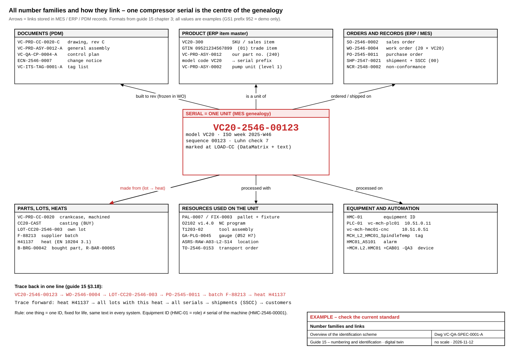
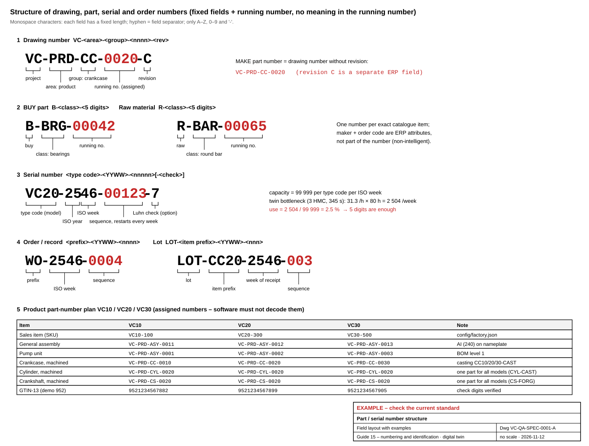
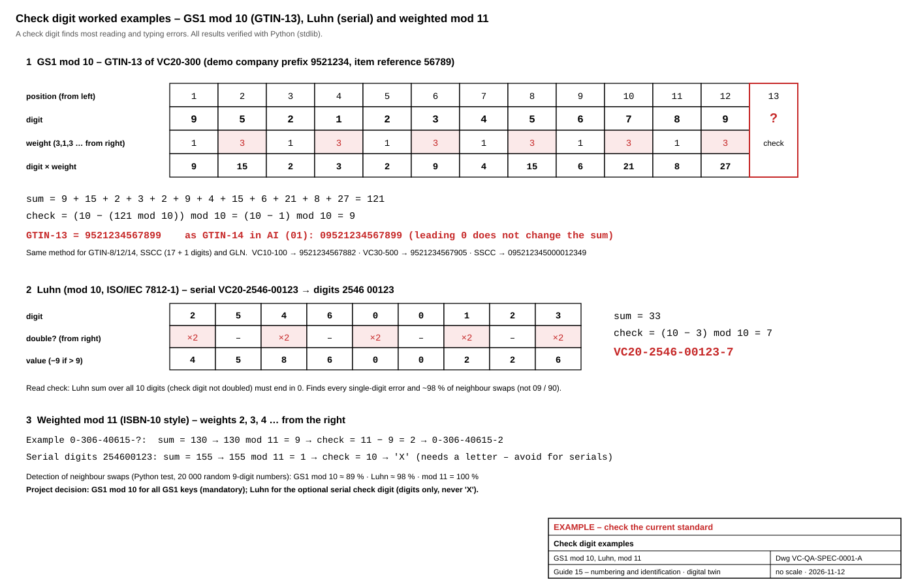
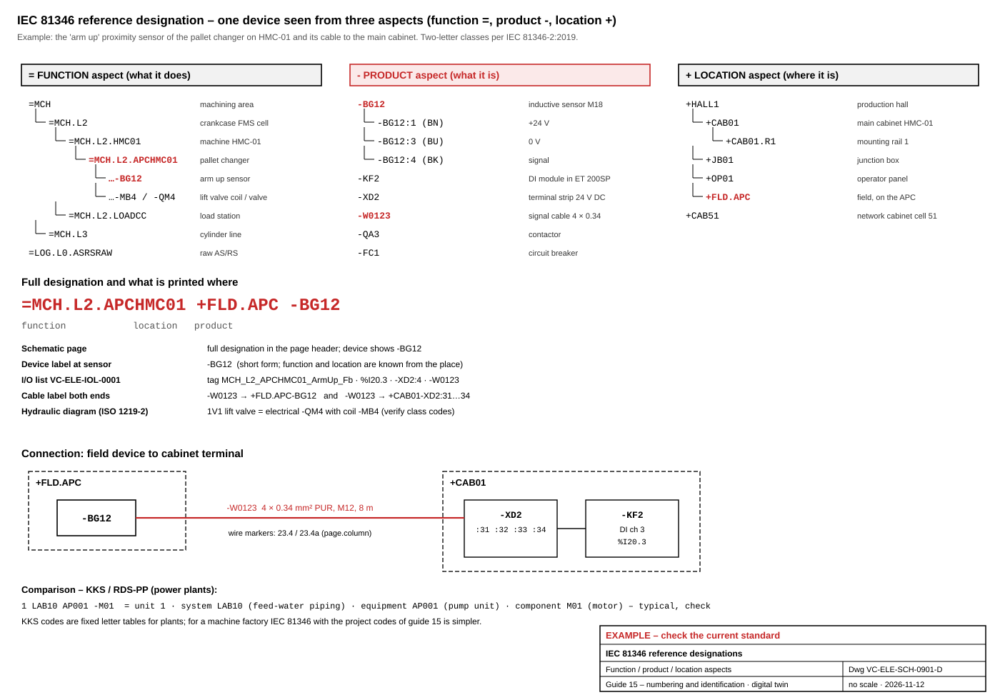
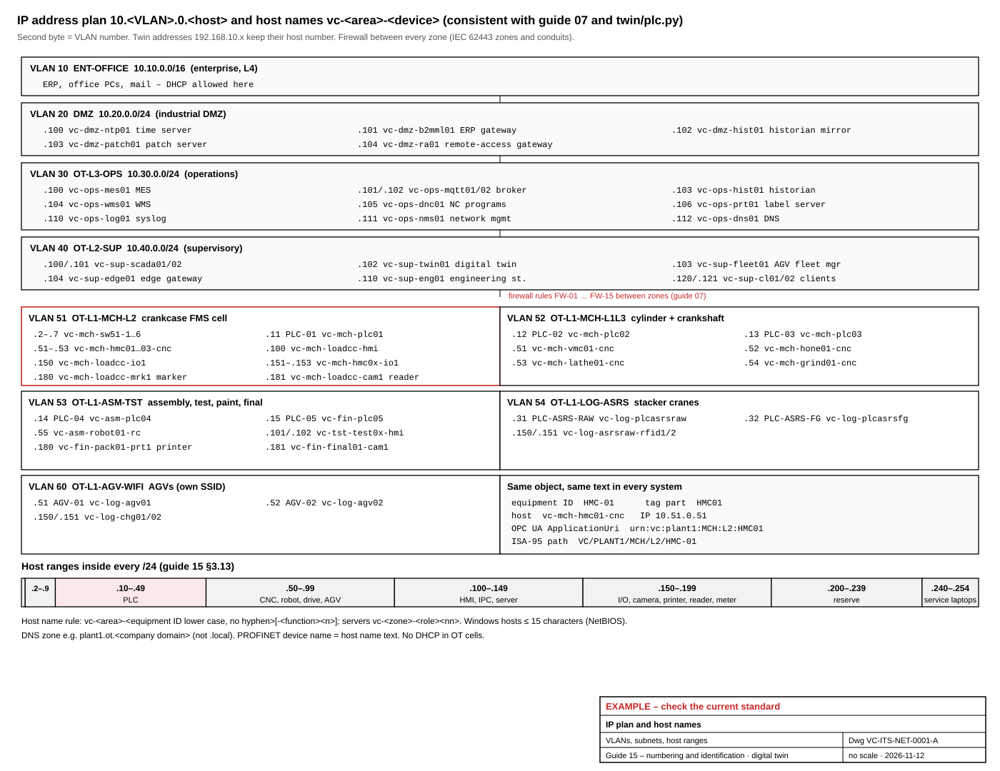
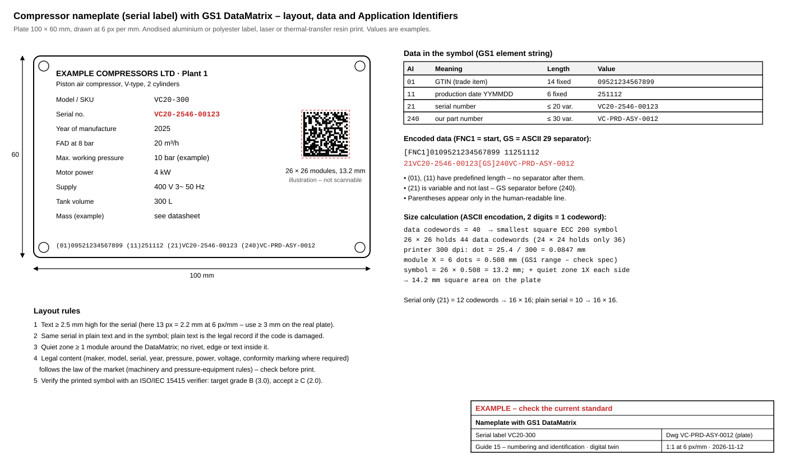
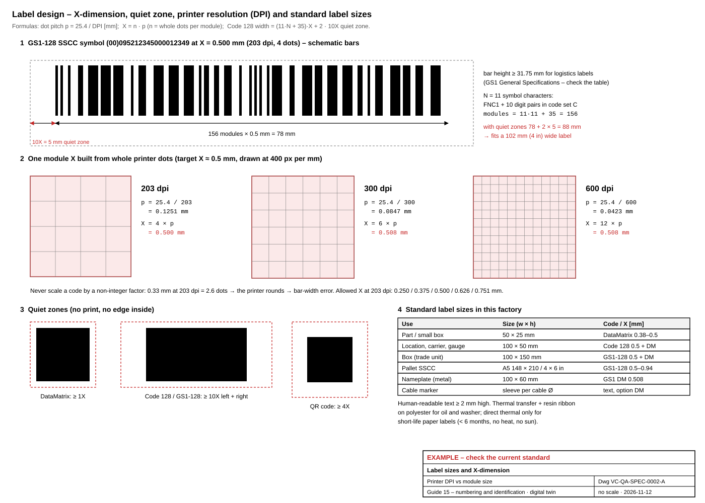
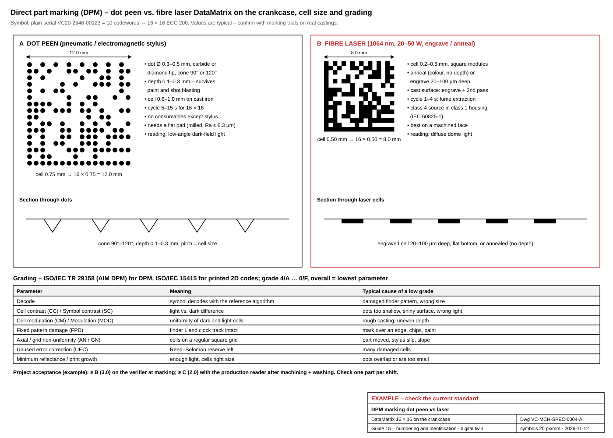

# 15 – Numbering and Identification (one scheme for the whole project)

> **All numbers in this guide are example values** – but the **formats** are binding for the project.
> All other guides (01–14) use exactly these formats. If you change a format, change it here first
> (with an ECR, see 3.3) and then in all guides, the MES/ERP and the PLC/SCADA projects.
>
> **Guide 15 is the single source of truth** for every number, code, tag, address and name. The proposals the
> topic guides made are decided in **§8b Decisions log** (2026-11-13, 36 entries). Where another guide differs, guide 15 wins.

## Contents

**Part A – the binding scheme**

1. Purpose · 2. Where in the twin
3. The identification scheme – 3.1 overview (drawing [15_numbering_overview](img/15_numbering_overview.svg)) ·
   3.2 drawing numbers · 3.3 revisions, ECR/ECN · 3.4 document numbers · 3.5 part numbers, BOM, **product
   part-number plan VC10/20/30** · 3.6 serial numbers, Luhn · 3.7 lots, heats · 3.8 orders · 3.9 equipment,
   locations, carriers · 3.10 tags, alarms, **step-timeout alarms**, screens · 3.11 PLC I/O addresses
   (**corrected block limit**) · 3.12 IEC 81346 designations, **fluid-power circuit numbers** · 3.13 network –
   **master IP and host-name plan** · 3.14 NC programs, tools, gauges, versions · 3.15 date/time, YYWW ·
   3.16 labels and barcodes (GS1) · 3.17 traceability · 3.18 full trace example
4. Model / calculations · 5. Implementation · 6. Checklists · 7. Common mistakes · 8. Limits of the twin
8a. Addenda (codes from the topic guides) · **8b. Decisions log (proposals → decisions)** · 9. Glossary

**Part B – textbook, technology and design reference (added 2026-11-12)**

10. Identification theory – intelligent vs. non-intelligent numbers, capacity, character sets
11. Check digits – GS1 mod 10, Luhn, mod 11, ISO/IEC 7064 (worked examples)
12. The GS1 system – GTIN, SSCC, GLN, GRAI/GIAI, AIs, GS1-128, GS1 DataMatrix, Digital Link
13. Barcode symbologies and label design – X-dimension, DPI, quiet zone, label stock, grading
14. Direct part marking – dot peen, laser, inkjet, DPM quality (ISO/IEC TR 29158)
15. RFID – HF ISO/IEC 15693, UHF ISO/IEC 18000-63, EPC encoding, read range
16. Serial number design – capacity, uniqueness, number server, genealogy data model
17. Equipment identification – IEC 81346 in depth, KKS / RDS-PP comparison, ISO 1219-2 codes
18. Document identification – ISO 7200 title block, revision rules, file names
19. Software, IT/OT assets and IT naming – asset tags, versions, backups, DNS / NetBIOS / PROFINET names
20. Master data governance – who creates numbers, change control, data quality
21. Buy list – catalogue examples (printers, markers, readers, scanners, RFID, software, labels)
22. Worked examples – verified values (Python stdlib)

---

## 1. Purpose

A real factory has hundreds of thousands of "things" that need a name: drawings, parts, compressors,
casting lots, pallets, rack slots, PLC signals, wires, cables, IP addresses, NC programs, tools, gauges.

If every supplier and every department invents its own names, you get:

* the same machine called "HMC-01", "Machine 4" and "BAZ1" in three systems → data cannot be linked;
* two drawings with the same number, or one drawing with two numbers → wrong part manufactured;
* a compressor fails at the customer and nobody can find which casting heat it came from.

This guide gives **one identification scheme** for everything. Rules:

1. **One thing = one ID. One ID = one thing.** Never re-use a number, not even for scrapped parts.
2. **The ID is fixed for life.** A machine moved to another hall keeps its ID. A drawing keeps its number
   through all revisions.
3. **Same ID in every system**: drawing, ERP, MES, PLC, SCADA, label, digital twin.
4. **Machine-readable**: only `A–Z`, `0–9`, `-` (hyphen) and, where a system does not accept hyphens
   (PLC symbols, tag names), `_` (underscore). No spaces, no lower-case letters in IDs, no special
   characters (`/ \ . , ä ö ü ° Ø`), no leading spaces.
5. **Fixed length per field** with leading zeros (`0012`, not `12`) – so lists sort correctly.
6. **No meaning in sequence numbers.** The 4-digit or 5-digit sequence only counts. Meaning (area,
   type, week) is in the fixed fields before it.
7. **Avoid letters that look like digits** in free fields: do not use `I`, `O`, `Q` as revision letters
   (see 3.3).

---

## 2. Where in the twin

| Thing | Where in the twin | Note |
|---|---|---|
| Machine / station IDs (`HMC-01`, `VMC-01`, `LOAD-CC` …) | `config/factory.json` → `stations` | the real IDs; use them everywhere |
| Stores (`ASRS-RAW`, `ASRS-FG`), pallet pool (`PPS-1`), pallets (`PAL-CC`) | `config/factory.json` → `asrs`, `pallet_pools`, `pools` | |
| AGVs (`AGV-01`, `AGV-02`) | `config/factory.json` → `agv.count` | the twin numbers them 01, 02 … |
| Serial numbers of compressors | MES tab → Traceability | **the twin uses a short form** `VC20-000012`; the real factory uses `VC20-2546-00123` (3.6) |
| Lots, WO, PO, SO, NCR | MES / ERP tabs | the twin uses short forms (`WO-0012`, `CC20-L0009`, `NCR-00002`); the real factory uses the formats in 3.7–3.8 |
| Tag names | SCADA tab | the twin uses `<Station>.<Signal>` (`HMC-02.Temperature`); the real factory uses `MCH_L2_HMC02_SpindleTemp` (3.10) |
| Worm serial / matched pair | HMC build 2 (worm manufacturing) | twin: `W-0001` / `P-0001`; real factory: `WRM-2546-00017` / `P-2546-00004` (3.6) |

> The twin is a simulation and keeps its short IDs so that the code stays simple. When you connect the twin
> to the real MES (guide 01, "connecting real machines"), map the short IDs to the real IDs in one table.

---

## 3. The identification scheme

### 3.1 Overview – all formats on one page

| What | Format | Example |
|---|---|---|
| Drawing | `VC-<area>-<group>-<4 digits>-<rev>` | `VC-HMC-RT-0012-B` |
| Document (spec, calc, manual, test protocol) | `VC-<area>-<doc type>-<4 digits>-<rev>` | `VC-APC-SPEC-0001-A`, `VC-TST-FAT-0003-A` |
| Interface sheet | `VC-IF-<side A>-<side B>-<4 digits>-<rev>` | `VC-IF-AGV-APC-0001-A` |
| Change request / note | `ECR-<YYWW>-<4 digits>` / `ECN-<YYWW>-<4 digits>` | `ECR-2546-0007`, `ECN-2546-0007` |
| MAKE part number | = drawing number **without** revision | `VC-HMC-RT-0012` |
| BUY part number | `B-<class>-<5 digits>` | `B-BRG-00042` |
| Raw material item | `R-<class>-<5 digits>` | `R-BAR-00065` |
| Serial number | `<type code>-<YYWW>-<5 digits>` (+ optional `-<check digit>`) | `VC20-2546-00123`, `WRM-2546-00017-1` |
| Matched pair | `P-<YYWW>-<5 digits>` | `P-2546-00004` |
| Material lot (own) | `LOT-<item prefix>-<YYWW>-<3 digits>` | `LOT-CC20-2546-003` |
| Heat number (supplier) | exactly as on the 3.1 certificate | `H41137` |
| Orders | `<prefix>-<YYWW>-<4 digits>` | `WO-2546-0001`, `SO-…`, `PO-…`, `NCR-…`, `MWO-…` |
| Machine / equipment | `<type>-<2 digits>` or `<type>-<name>` | `HMC-01`, `AGV-01`, `ASRS-RAW` |
| Storage location | `<store>-A<2>-L<1>-S<2>` | `ASRS-RAW-A03-L2-S14` |
| Load carrier | `PAL-<4 digits>`, `CRT-<6 digits>` | `PAL-0007`, `CRT-000123` |
| Tag name | `<Area>_<Line>_<Machine>_<Signal>` | `MCH_L2_HMC01_SpindleTemp` |
| Alarm | `<Machine>_A<4 digits>` | `HMC01_A2105` |
| Device designation (IEC 81346 style) | `=<function> +<location> -<product>` | `=MCH.L2.HMC01 +CAB01 -QA3` |
| Cable | `-W<4 digits>` | `-W0123` |
| Host name | `vc-<area>-<device>` (lower case) | `vc-mch-plc01` |
| NC program | `O<4 digits>` + file name | `O2102` / `VC-PRD-CC-0020_OP20_HMC_B.nc` |
| Tool | `T<4 digits>` (+ `-<2>` for the individual tool assembly) | `T1203`, `T1203-02` |
| Gauge | `GA-<type>-<4 digits>` | `GA-PLG-0045` |
| Software version | `MAJOR.MINOR.PATCH` | `PLC-01 v2.3.1` |
| Date / time | ISO 8601 | `2026-11-11T08:30:00Z` |

`YYWW` everywhere = **ISO year (2 digits) + ISO week (2 digits)**, see 3.15. Example `2546` = year 2025,
week 46 = Monday 10 Nov 2025 to Sunday 16 Nov 2025.



*Drawing 15_numbering_overview: the compressor serial is the centre of the genealogy. Every arrow is a link
stored in a record (MES, ERP, PDM). If one link is missing, the trace in §3.18 breaks.*

---

### 3.2 Drawing numbers

**Format:** `VC-<area>-<group>-<nnnn>-<rev>`

| Field | Length | Meaning | Example |
|---|---|---|---|
| `VC` | 2 | project / company prefix (V-Compressor) | `VC` |
| `<area>` | 2–3 letters | area code (table below) | `HMC` |
| `<group>` | 2–3 letters | group inside the area (tables below) | `RT` |
| `<nnnn>` | 4 digits | running number inside area + group, starts at `0001` | `0012` |
| `<rev>` | 1 letter (or 0.1, 0.2 … before release) | revision (3.3) | `B` |

Example `VC-HMC-RT-0012-B` = project VC, HMC machine, rotary table group, drawing 12, revision B.

**Number ranges inside a group (recommended):**

| Range | Use |
|---|---|
| `0001`–`0009` | general assembly / main assembly drawings of the group |
| `0010`–`0499` | sub-assemblies and parts |
| `0500`–`0899` | welded assemblies and weld parts |
| `0900`–`0999` | schematics, diagrams, lists that belong to the group |

The ranges are a help only. The number itself still has no meaning – never "decode" it in software.

#### Area codes

| Area code | Area | Typical content |
|---|---|---|
| `FAC` | Factory / layout | hall layout, foundations, media, escape routes |
| `MCH` | Machining | fixtures, cell layouts, chip and coolant systems, washer |
| `ASM` | Assembly | assembly stations, press-fit units, screwing, robot cell |
| `TST` | Test | compressor test benches, test fixtures, piping, noise booth |
| `APC` | Pallet changer | the 2-pallet rotary APC (guide 09) |
| `MEC` | Mechanical interfaces | transfer stations, docking stands (guide 10) |
| `AGV` | Automated guided vehicles | own-built AGVs (guide 11) |
| `HMC` | Horizontal machining centre parts | rotary table, worm drive (guide 12) |
| `ELE` | Electrical | schematics, cabinet layouts, cable and terminal plans |
| `HYD` | Hydraulics | hydraulic circuits (ISO 1219), power units, manifolds |
| `PNE` | Pneumatics | pneumatic circuits, valve terminals, air supply |
| `ITS` | IT / software | network plans, server layout, data models |
| `QA` | Quality | gauges, inspection fixtures, control plans |
| `PRD` | Product (compressor) – **added in this guide** | crankcase, cylinder, crankshaft, tank drawings of VC10/20/30 |

#### Group codes per area

| Area | Group codes (examples) |
|---|---|
| `FAC` | `LAY` layout · `FND` foundations · `BLD` building/hall · `UTL` utilities (power, air, water) · `SAF` safety zones, escape routes |
| `MCH` | `FIX` fixtures · `PAL` machining pallets · `CEL` cell layout · `WSH` washer · `CHP` chip handling · `CLT` coolant · `TLG` special tool holders |
| `ASM` | `STN` assembly station · `PRS` press-fit unit · `SCR` screwing station · `ROB` robot cell, grippers · `JIG` assembly jigs |
| `TST` | `BEN` test bench · `FIX` test fixture/adapter · `PIP` piping · `INS` instrumentation · `ENC` noise enclosure |
| `APC` | `ASY` general assembly · `ARM` arm and cross beam · `LFT` lift unit · `ROT` rotary drive · `FRM` base frame · `PAL` pallet and clamping · `GRD` guards |
| `MEC` | `TRF` pallet transfer AGV/cart ↔ APC station · `DCK` crate docking stand · `ASR` AS/RS ↔ AGV · `LDS` load station ↔ APC |
| `AGV` | `CHS` chassis · `DRV` drive unit · `LFT` lift unit · `BAT` battery · `SAF` safety scanner mounts, bumpers · `BDY` covers · `CHG` charger |
| `HMC` | `RT` rotary table · `WRM` worm and wheel · `BAS` bed, column · `SPN` spindle · `ATC` tool changer · `GRD` guards · `LUB` lubrication |
| `ELE` | `SCH` schematics · `CAB` cabinet layout · `TRM` terminal plans · `CBL` cable plans · `PWR` power distribution · `GND` earthing / equipotential bonding |
| `HYD` | `CIR` circuit diagram · `PWR` power unit · `MAN` manifold · `PIP` piping |
| `PNE` | `CIR` circuit diagram · `VLV` valve terminal · `PIP` piping · `AIR` air supply and treatment |
| `ITS` | `NET` network plan · `SRV` servers, racks · `DAT` data model |
| `QA` | `GAU` gauges · `INS` inspection fixtures · `CMM` CMM fixtures |
| `PRD` | `CC` crankcase · `CYL` cylinder · `CS` crankshaft · `CR` connecting rod · `HD` cylinder head · `TNK` tank · `ASY` compressor assembly |

**Examples:**

| Drawing number | Content |
|---|---|
| `VC-FAC-LAY-0001-C` | hall layout, revision C |
| `VC-MCH-FIX-0014-A` | crankcase fixture for HMC, VC20 |
| `VC-APC-ASY-0001-B` | APC general assembly |
| `VC-APC-ARM-0510-A` | APC arm, welded assembly (weld range 05xx) |
| `VC-MEC-DCK-0003-A` | crate docking stand, main assembly |
| `VC-AGV-DRV-0021-A` | AGV drive wheel hub |
| `VC-HMC-RT-0012-B` | rotary table top |
| `VC-HMC-WRM-0011-A` | duplex worm |
| `VC-HYD-CIR-0901-A` | APC hydraulic circuit diagram |
| `VC-ELE-SCH-0901-D` | PLC-01 schematic |
| `VC-PRD-CC-0020-C` | crankcase VC20, machined |

**Title block (every drawing):** drawing number, revision, title (English), material, mass, scale, general
tolerance (e.g. ISO 2768-mK), projection symbol, drawn / checked / approved (name + date ISO 8601), sheet x of y,
MAKE/BUY, replaces / replaced by. File name = drawing number + revision: `VC-HMC-RT-0012-B.pdf`,
`VC-HMC-RT-0012-B.step`.

---

### 3.3 Revisions and change notes (ECR / ECN)

#### Revision rules

| Stage | Revision | Allowed use |
|---|---|---|
| Draft, internal review | `0.1`, `0.2`, `0.3` … | discussion, quotation only. Stamp "NOT FOR MANUFACTURING" |
| First release | `A` | manufacturing, ordering |
| Each released change | `B`, `C`, `D` … | |
| After `Y` (the last allowed letter, see rule 1) | `AA`, `AB` … | |

Rules:

1. **Do not use `I`, `O`, `Q`, `S`, `X`, `Z`** as revision letters (they look like 1, 0, 5, 2 or are used as
   markers). So the sequence is `A B C D E F G H J K L M N P R T U V W Y`, then `AA`.
2. **Every change of a released document = new letter**, even a text correction. Only drafts use 0.x.
3. The revision table on the drawing shows: letter, ECN number, short description, date, name.
4. **Revision or new number?**

| Change | Old and new part interchangeable? | Action |
|---|---|---|
| Text, tolerance clarification, title block | yes | new revision letter |
| Dimension change, both versions fit and work | yes | new revision letter |
| Change of form, fit or function (old part does not fit or works differently) | **no** | **new drawing number / part number** |
| Material change with other strength | usually no | new number (unless engineering confirms interchangeable) |

Example: worm wheel bore changes from Ø60 H7 to Ø65 H7 → old wheels no longer fit the new hub → new number
`VC-HMC-WRM-0014-A` and the old `VC-HMC-WRM-0012` is marked "replaced by VC-HMC-WRM-0014".

#### Change process (ECR → ECN)

| Step | Who | Record |
|---|---|---|
| 1. Anybody finds a problem or wants a change | requester | **ECR** (Engineering Change Request) `ECR-2546-0007`: what, why, which documents, urgency |
| 2. Evaluate: cost, stock, parts in production, safety, other interfaces | design owner + production + quality + purchasing | impact list |
| 3. Decide | change board (weekly, 30 min) | approve / reject / postpone |
| 4. Make the change | design | new revisions of all documents |
| 5. Release | approver | **ECN** (Engineering Change Notice) `ECN-2546-0007` (same number as the ECR): list of new revisions, effective date or effective serial ("from VC20-2547-00001"), what to do with stock (use up / rework / scrap) |
| 6. Inform | document control | send ECN to all users, remove old copies from the shop floor |
| 7. Close | quality | check first part made to the new revision |

> One rule from real projects: **paper copies on the shop floor are the biggest risk.** Stamp printed
> drawings "UNCONTROLLED COPY – valid on print date only" or work from screens connected to the PDM.

---

### 3.4 Document numbers

**Format:** `VC-<area>-<doc type>-<nnnn>-<rev>` (area codes as in 3.2).

| Doc type | Meaning | Example |
|---|---|---|
| `SPEC` | technical specification / requirement specification | `VC-APC-SPEC-0001-A` |
| `CALC` | calculation (strength, cycle time, PL) | `VC-HMC-CALC-0003-B` |
| `RA` | risk assessment (ISO 12100) | `VC-APC-RA-0001-A` |
| `SRS` | safety requirements specification (safety functions, PLr) | `VC-APC-SRS-0001-A` |
| `IOL` | I/O list | `VC-ELE-IOL-0001-C` |
| `CBL` | cable list | `VC-ELE-CBL-0001-B` |
| `TAG` | tag list (SCADA/historian) | `VC-ITS-TAG-0001-A` |
| `ALM` | alarm list / alarm philosophy | `VC-ITS-ALM-0001-A` |
| `FAT` | factory acceptance test protocol (at supplier) | `VC-TST-FAT-0003-A` (FAT of test bench 3) |
| `SAT` | site acceptance test protocol (in our factory) | `VC-APC-SAT-0001-A` |
| `TP` | other test procedure / protocol | `VC-AGV-TP-0002-A` |
| `MAN` | operating manual | `VC-AGV-MAN-0001-A` |
| `MNT` | maintenance manual / plan | `VC-HMC-MNT-0001-A` |
| `WI` | work instruction | `VC-ASM-WI-0012-B` |
| `CP` | control plan | `VC-QA-CP-0004-A` |
| `FMEA` | process or design FMEA | `VC-MCH-FMEA-0001-A` |
| `BOM` | bill of material (if not only in ERP) | `VC-APC-BOM-0001-B` |
| `PLN` | plan (project, layout phase, commissioning) | `VC-FAC-PLN-0002-A` |
| `REP` | report (measurement, test result summary) | `VC-HMC-REP-0005-A` |

**Interface sheets** (rule 5 of the index: write an interface sheet for every hand-over):

`VC-IF-<side A>-<side B>-<nnnn>-<rev>` – side A and B are area codes, **in alphabetical order**, so the same
interface never gets two numbers.

| Example | Interface |
|---|---|
| `VC-IF-AGV-APC-0001-A` | AGV ↔ APC load station: mechanics (heights, catching), signals (handshake), safety |
| `VC-IF-AGV-ITS-0001-A` | AGV ↔ fleet manager: VDA 5050 messages, Wi-Fi |
| `VC-IF-APC-HMC-0001-A` | APC ↔ HMC: pallet position, clamping, door, signals |
| `VC-IF-ITS-MCH-0001-A` | MES ↔ machining PLCs: OPC UA interface DB |
| `VC-IF-ELE-HYD-0001-A` | electrical ↔ hydraulic unit: valves, pressure switches, power |

---

### 3.5 Part numbers and BOM structure

#### Part numbers

| Kind | Format | Example | Rule |
|---|---|---|---|
| **MAKE** part / assembly | drawing number without revision | `VC-HMC-RT-0012` | revision is a separate field in ERP/BOM (`B`) |
| **BUY** catalogue part | `B-<class>-<5 digits>` | `B-SCR-01234` | one number per exact catalogue item (manufacturer + order code in ERP) |
| Raw material | `R-<class>-<5 digits>` | `R-BAR-00065` (16MnCr5 Ø65 bar) | material + dimension in description |
| Product (sales item, SKU) | `<model>-<tank volume>` | `VC20-300` | as in `config/factory.json` |
| Purchased product parts (castings, forgings) | `<prefix>-<kind>` | `CC20-CAST` | as in `config/factory.json` (`erp.items`) |

BUY classes (examples): `BRG` bearings · `SCR` screws, nuts, washers · `PIN` pins · `SEL` seals, O-rings ·
`MOT` motors, servos · `GBX` gearboxes · `SEN` sensors · `VLV` valves · `CYL` cylinders · `ELE` electrical
components · `PNE` pneumatic parts · `HYD` hydraulic parts · `LUB` oils, greases · `TOL` cutting tools.

Raw material classes: `BAR` round bar · `PLT` plate · `TUB` tube/profile · `CST` casting blanks · `FRG` forgings.

**Description rule (ERP short text, max. 40 characters, English):** `NOUN, type, main size, standard, material/class`

| Item | Good description |
|---|---|
| `B-SCR-01234` | `SCREW, SOCKET HEAD, M10x30, ISO 4762, 8.8` |
| `B-PIN-00210` | `PIN, PARALLEL, 8m6x24, ISO 8734` |
| `B-BRG-00042` | `BEARING, CROSSED ROLLER, ID 350` |
| `R-BAR-00065` | `BAR, ROUND, D65, 16MnCr5 1.7131` |

> Two identical screws with two numbers cost stock and confusion. Before creating a BUY number, search the ERP
> for the standard and size.



#### Product part-number plan VC10 / VC20 / VC30 (binding – decided 2026-11-12, §8b D-20)

Guide 04 (§11.3 BOM) and guide 13 used placeholders `VC-PRD-<group>-nnnn` for the cylinder and the
crankshaft. These numbers are now **assigned**. They are assigned numbers, not codes: software must never
read "0020" as "VC20" (rule 6 of chapter 1) – the link model ↔ part is a field in the ERP item master.

| Item | VC10 | VC20 | VC30 | Note |
|---|---|---|---|---|
| Sales item (SKU, ERP level 0) | `VC10-100` | `VC20-300` | `VC30-500` | as `config/factory.json` → `products[].sku` |
| General assembly drawing of the compressor | `VC-PRD-ASY-0011` | `VC-PRD-ASY-0012` | `VC-PRD-ASY-0013` | linked to the SKU; printed in AI `(240)` on the nameplate |
| Pump unit (level 1) | `VC-PRD-ASY-0001` | `VC-PRD-ASY-0002` | `VC-PRD-ASY-0003` | `0002` already used in the BOM example below |
| Crankcase, machined | `VC-PRD-CC-0010` | `VC-PRD-CC-0020` | `VC-PRD-CC-0030` | from `CC10-CAST` / `CC20-CAST` / `CC30-CAST` |
| Cylinder, machined (one part for all models) | `VC-PRD-CYL-0020` | `VC-PRD-CYL-0020` | `VC-PRD-CYL-0020` | from `CYL-CAST`; drawing number as guide 08 |
| Crankshaft, machined (one part for all models) | `VC-PRD-CS-0020` | `VC-PRD-CS-0020` | `VC-PRD-CS-0020` | from `CS-FORG` |
| Cylinder head (when designed) | `VC-PRD-HD-0010` | `VC-PRD-HD-0020` | `VC-PRD-HD-0030` | reserve – confirm when design is frozen |
| Tank, motor (bought) | `TANK-100`, `MOT-2.2KW` | `TANK-300`, `MOT-4KW` | `TANK-500`, `MOT-5.5KW` | config `erp.items`; real factory: `B-TNK-…`, `B-MOT-…` |
| GTIN-13 (demo prefix 952 – never print) | `9521234567882` | `9521234567899` | `9521234567905` | check digits verified (§22) |
| Serial type code | `VC10` | `VC20` | `VC30` | §3.6 |
| NC program family digit `p` | `1` | `2` | `3` | §3.14 (`O2102` = VC20 crankcase OP20) |

If a later model needs a different cylinder, it gets a **new number** (for example `VC-PRD-CYL-0030`) – the
old `0020` keeps its meaning for life (rule 2 of chapter 1, and "form, fit, function" rule in §3.3).

#### BOM levels

| Level | Content | Example (APC) | Example (compressor) |
|---|---|---|---|
| 0 | finished equipment / product | `VC-APC-ASY-0001` APC complete | `VC20-300` compressor |
| 1 | main assemblies | `VC-APC-ARM-0001` arm assembly | `VC-PRD-ASY-0002` pump unit |
| 2 | sub-assemblies | `VC-APC-ARM-0510` arm, welded | `VC-PRD-CC-0020` crankcase, machined |
| 3 | parts | `VC-APC-ARM-0021` fork rail | `CC20-CAST` crankcase casting |
| 4 | raw material | `R-PLT-00030` plate 30 mm S355 | – (casting is bought) |

Indented BOM example (extract):

| Lvl | Item | Rev | Description | Qty | Unit | M/B |
|---|---|---|---|---|---|---|
| 0 | `VC-APC-ASY-0001` | B | APC 2-PALLET ROTARY, COMPLETE | 1 | pc | MAKE |
| .1 | `VC-APC-ARM-0001` | A | ARM ASSEMBLY | 1 | pc | MAKE |
| ..2 | `VC-APC-ARM-0510` | A | ARM, WELDED, S355J2 | 1 | pc | MAKE |
| ...3 | `R-TUB-00160` | – | TUBE, RECT, 160x100x10, S355J2 | 2.4 | m | BUY |
| ..2 | `VC-APC-ARM-0021` | A | FORK RAIL | 4 | pc | MAKE |
| ..2 | `B-SCR-01234` | – | SCREW, SOCKET HEAD, M10x30, ISO 4762, 8.8 | 16 | pc | BUY |
| .1 | `VC-APC-ROT-0001` | B | ROTARY DRIVE ASSEMBLY | 1 | pc | MAKE |
| ..2 | `B-MOT-00017` | – | SERVO MOTOR, 1.5 kW | 1 | pc | BUY |

Rules: the BOM always refers to a part number + revision; quantity with unit; a **phantom** assembly (only for
drawing, never stocked) is marked in ERP so MRP does not plan it.

---

### 3.6 Serial numbers

**Format:** `<type code>-<YYWW>-<nnnnn>` (optional check digit: `-<c>`)

| Field | Meaning |
|---|---|
| type code | what it is (table below) |
| `YYWW` | ISO year + ISO week in which the serial was **assigned** (= first operation, e.g. marking at the load station) |
| `nnnnn` | 5-digit sequence, **starts at `00001` every ISO week, separately for each type code** |

The full string is unique. Capacity: 99 999 per type per week – enough for this factory.

| Type code | Item | Marked where / how | Example |
|---|---|---|---|
| `VC10`, `VC20`, `VC30` | compressor (the product) | crankcase, DataMatrix + plain text, laser or dot-peen at load station `LOAD-CC` | `VC20-2546-00123` |
| `WRM` | duplex worm (HMC rotary table) | end face, laser | `WRM-2546-00017` |
| `WHL` | worm wheel | hub face, laser | `WHL-2546-00009` |
| `RT` | rotary table assembly | type plate | `RT-2546-00002` |
| `APC` | pallet changer assembly | type plate | `APC-2546-00001` |
| `AGV` | own-built AGV | type plate (the AGV also has its equipment ID `AGV-01`) | `AGV-2546-00001` |
| `HMC` | own-built / rebuilt HMC | type plate | `HMC-2546-00001` |
| `TNK` | air tank (if traced by own serial; supplier serial otherwise) | tank plate | `TNK-2546-00456` |

**Serial number ≠ equipment ID.** `AGV-2546-00001` is the physical vehicle (built week 46/2025). `AGV-01`
is its **role** in the factory (config, fleet manager, tags). If the vehicle is replaced by a new one,
`AGV-01` gets the new serial; the old vehicle keeps its serial forever. Same for `HMC-01`.

**Matched pairs:** parts that are only used together (worm + wheel, guide 12) get an additional pair number
`P-<YYWW>-<nnnnn>`.

| Pair | Contains | Marking |
|---|---|---|
| `P-2546-00004` | `WRM-2546-00017` + `WHL-2546-00009` | both parts carry their own serial **and** `P-2546-00004` |

Rule: never exchange only one part of a pair; the MES/maintenance record lists the pair.

#### Optional check digit (Luhn / mod 10)

A check digit finds typing errors when serials are entered by hand (wrong digit, two digits swapped).
Decide once for the whole project; if used, it is **added as a last field** and printed in plain text, but
scanners and the MES check it automatically.

**Luhn algorithm** over the digits of `YYWW` + `nnnnn` (9 digits):

1. Start at the **rightmost** digit. Double every second digit, starting with the rightmost one.
2. If a doubled value is > 9, subtract 9.
3. Add all values.
4. Check digit = (10 − (sum mod 10)) mod 10.

**Worked example** `VC20-2546-00123` → digits `2 5 4 6 0 0 1 2 3`

| Digit (left → right) | 2 | 5 | 4 | 6 | 0 | 0 | 1 | 2 | 3 |
|---|---|---|---|---|---|---|---|---|---|
| Double? (from right: yes, no, yes …) | yes | no | yes | no | yes | no | yes | no | yes |
| Value | 4 | 5 | 8 | 6 | 0 | 0 | 2 | 2 | 6 |

Sum = 4 + 5 + 8 + 6 + 0 + 0 + 2 + 2 + 6 = **33** → 33 mod 10 = 3 → (10 − 3) mod 10 = **7**

Serial with check digit: **`VC20-2546-00123-7`**. Second example: `WRM-2546-00017` → `WRM-2546-00017-1`.

Check when reading: compute the Luhn sum over all 10 digits including the check digit → result must end in 0.
Luhn detects every single wrong digit and most swaps of two neighbour digits.

> In barcodes (DataMatrix) the check digit is not needed – the code has its own error correction. Use it for
> plain-text entry only.



*Drawing 15_check_digit – more theory and the error-detection comparison are in §11.*

---

### 3.7 Material lots and heat numbers

| ID | Format | Example | Given by |
|---|---|---|---|
| Own lot (goods receipt) | `LOT-<item prefix>-<YYWW of receipt>-<nnn>` | `LOT-CC20-2546-003` = 3rd lot of VC20 crankcase castings received in week 46/2025 | our goods receipt (ERP) |
| Supplier lot / batch | as printed by the supplier | `F-88213` | supplier |
| Heat number (melt / cast) | exactly as on the EN 10204 3.1 certificate | `H41137` | steel mill / foundry |

Item prefixes = buffer prefixes in `config/factory.json`: `CC10`, `CC20`, `CC30` (crankcase castings),
`CYL` (cylinder castings), `CS` (crankshaft forgings); add your own (`TNK`, `MOT` …) with the same rule.

Rules:

1. **One own lot = one delivery of one item from one heat (or one casting batch).** If a delivery contains
   two heats, create two lots.
2. The lot record links: own lot ↔ supplier lot ↔ heat number ↔ certificate file (scanned PDF, file name =
   lot ID: `LOT-CC20-2546-003_3.1.pdf`) ↔ PO number.
3. For bar stock that you cut yourself (worm blanks), **stamp the heat number on each blank** at sawing
   (guide 12, Op 10). After that the part serial carries the link.
4. The twin's short form `CC20-L0009` corresponds to `LOT-CC20-<YYWW>-<nnn>` in the real factory.

### 3.8 Orders and records

**Format:** `<prefix>-<YYWW>-<nnnn>` – 4-digit sequence, restarts at `0001` every ISO week per prefix.

| Prefix | Meaning | Created by | Example |
|---|---|---|---|
| `SO` | sales order | ERP | `SO-2546-0002` |
| `PO` | purchase order | ERP | `PO-2545-0011` |
| `WO` | work (production) order | ERP → MES | `WO-2546-0001` |
| `MWO` | maintenance work order | CMMS / MES | `MWO-2546-0012` |
| `NCR` | non-conformance record | MES / quality | `NCR-2546-0003` |
| `ECR` / `ECN` | engineering change request / notice | PDM / document control | `ECR-2546-0007` |
| `SHP` | shipment / delivery note | ERP | `SHP-2547-0021` |
| `CAL` | calibration record | quality | `CAL-2546-0031` |

Twin short forms (`WO-0012`, `PO-0009`, `NCR-00002`, `SO-0001`) map 1:1 to these.

---

### 3.9 Machines, equipment, storage locations, load carriers

#### Equipment IDs (as in `config/factory.json`)

Format: `<type>-<2 digits>` for machines that exist several times; `<type>-<name>` for unique systems.

| Type | Meaning | IDs in the example factory |
|---|---|---|
| `LOAD` | fixture load station | `LOAD-CC` |
| `HMC` | horizontal machining centre | `HMC-01`, `HMC-02`, `HMC-03` |
| `VMC` | vertical machining centre | `VMC-01` |
| `HONE` | honing machine | `HONE-01` |
| `LATHE` | CNC lathe | `LATHE-01` |
| `GRIND` | grinding machine | `GRIND-01` |
| `WASH` | parts washer | `WASH-01` |
| `ASSY` / `FINAL` | assembly stations | `ASSY-01`, `FINAL-01` |
| `ROBOT` | robot cell | `ROBOT-01` |
| `TEST` | compressor test bench | `TEST-01`, `TEST-02` |
| `PAINT` | paint booth | `PAINT-01` |
| `PACK` | packing station | `PACK-01` |
| `ASRS` | automatic storage and retrieval system | `ASRS-RAW`, `ASRS-FG` |
| `PPS` | linear pallet pool system | `PPS-1` |
| `AGV` | automated guided vehicle | `AGV-01`, `AGV-02` |
| `CHG` | AGV charging station | `CHG-01`, `CHG-02` |
| `APC` | pallet changer (belongs to a machine) | `APC-HMC01` |
| `PLC` | line PLC | `PLC-01` … `PLC-05`, `PLC-ASRS-RAW`, `PLC-ASRS-FG` |
| `CMP` | factory compressed-air station | `CMP-01` |

In systems that do not accept hyphens (PLC symbols, tags), drop the hyphen: `HMC-01` → `HMC01`,
`ASRS-RAW` → `ASRSRAW`.

#### Storage locations

**Format:** `<store>-A<aa>-L<l>-S<ss>`

| Field | Meaning | Example |
|---|---|---|
| `<store>` | store ID | `ASRS-RAW` |
| `A<aa>` | aisle / rack row (2 digits) | `A03` |
| `L<l>` | level, 1 = bottom (1 digit; use 2 digits `L12` if > 9 levels) | `L2` |
| `S<ss>` | slot / column, counted from the I/O point (2 digits) | `S14` |

`ASRS-RAW-A03-L2-S14` = raw-material AS/RS, aisle 3, level 2, slot 14. If a rack has two sides per aisle,
add `-L` / `-R` after the aisle: `ASRS-RAW-A03L-L2-S14`. Floor and supermarket locations:
`FLR-<area>-R<rr>-P<pp>`, example `FLR-ASM-R02-P05` (assembly floor store, row 2, position 5).
Print a location label (barcode + text) on every slot and scan it at every put-away / pick.

#### Load carriers

| Carrier | Format | Example | ID carrier on the object |
|---|---|---|---|
| Machining / fixture pallet (pool `PAL-CC`) | `PAL-<4 digits>` | `PAL-0007` | engraved + HF RFID tag in the pallet pocket (guide 09) |
| Crate / box | `CRT-<6 digits>` | `CRT-000123` | barcode label both sides, or UHF RFID |
| Transport pallet (wooden/plastic, internal) | `TPL-<5 digits>` | `TPL-00045` | label |
| Fixture (on pallet) | `FIX-<4 digits>` | `FIX-0003` | engraved |

The MES always knows **carrier ↔ content**: `PAL-0007` carries `VC20-2546-00123` on fixture `FIX-0003`.

---

### 3.10 Tag names (PLC, SCADA, historian, MQTT)

**Format:** `<Area>_<Line>_<Machine>_<Signal>`

| Field | Rule | Example |
|---|---|---|
| `<Area>` | plant area code, 3 letters (table) | `MCH` |
| `<Line>` | `L1`…`L9`, `L0` = equipment that serves the whole area | `L2` |
| `<Machine>` | equipment ID without hyphen | `HMC01` |
| `<Signal>` | CamelCase English, no units, positive logic, + suffix (table) | `SpindleTemp` |

Example: **`MCH_L2_HMC01_SpindleTemp`**

Plant area and line codes for the example factory:

| Area | Line | Equipment |
|---|---|---|
| `MCH` machining | `L1` crankshaft machining | `LATHE01`, `GRIND01` |
| `MCH` | `L2` crankcase FMS cell | `LOADCC`, `HMC01`–`HMC03`, `WASH01`, `PPS1`, `APCHMC01` … |
| `MCH` | `L3` cylinder machining | `VMC01`, `HONE01` |
| `ASM` assembly | `L1` pump assembly | `ASSY01`, `ROBOT01` |
| `TST` test | `L1` | `TEST01`, `TEST02` |
| `PNT` paint | `L1` | `PAINT01` |
| `FIN` final assembly + packing | `L1` | `FINAL01`, `PACK01` |
| `LOG` logistics | `L0` | `ASRSRAW`, `ASRSFG`, `AGV01`, `AGV02`, `CHG01` |
| `UTL` utilities | `L0` | `CMP01` (compressed air), power meters |

(`PNT`, `FIN`, `LOG`, `UTL` are plant-area codes for tags only; drawings use the codes of 3.2.)

**Signal names – fixed words** (use the same word on every machine; one faceplate template fits all):

| Word | Meaning | Unit (attribute, not in the name) |
|---|---|---|
| `Temp` | temperature | °C |
| `Press` | pressure | bar |
| `Flow` | flow | m³/h (air), L/min (liquid) |
| `Vib` | vibration velocity RMS | mm/s |
| `Power` | active power | kW |
| `Energy` | energy counter | kWh |
| `Speed` | rotational speed | 1/min |
| `Pos` | position | mm or ° |
| `Current` | current | A |
| `Level` | level | % |
| `Count` | counter | pcs |
| `State` | state code (0 RUNNING … 7 OFFLINE, guide 06) | – |

**Suffixes:**

| Suffix | Meaning | Example |
|---|---|---|
| (none) | measured value (process value) | `MCH_L2_HMC01_SpindleTemp` |
| `_Sp` | set point (writable) | `MCH_L2_HMC01_Speed_Sp` |
| `_Cmd` | command to an actuator (output) | `MCH_L2_APCHMC01_ArmLift_Cmd` |
| `_Fb` | feedback "actuator reached position" | `MCH_L2_APCHMC01_ArmUp_Fb` |
| `_Hi`, `_HiHi`, `_Lo`, `_LoLo` | alarm limits (parameter) | `MCH_L2_HMC01_Vib_HiHi` |
| `_Ok` | status OK (BOOL, 1 = good) | `MCH_L2_HMC01_HydPress_Ok` |
| `_Cnt` | counter | `MCH_L2_HMC01_Good_Cnt` |

Rules: positive logic (`DoorClosed`, never `DoorNotOpen`); BOOL names say the TRUE state; the unit, range,
scaling, deadband and alarm limits are **attributes in the tag list** (`VC-ITS-TAG-0001`), not in the name.

**Other systems use the same parts with other separators:**

| System | Form |
|---|---|
| PLC symbol / SCADA tag | `MCH_L2_HMC01_SpindleTemp` |
| OPC UA browse path | `MCH/L2/HMC01/SpindleTemp` |
| MQTT topic | `vc/MCH/L2/HMC01/SpindleTemp` |
| Twin (simplified) | `HMC-01.Temperature` |

#### Alarm IDs

**Format:** `<Machine>_A<gnnn>` – `g` = group digit, `nnn` = number inside the group.

| Group | Meaning | Example |
|---|---|---|
| `A0nnn` | system, communication, PLC | `HMC01_A0010` "OPC UA connection to MES lost" |
| `A1nnn` | safety (E-stop, doors, light curtain) | `HMC01_A1001` "E-stop pressed at operator panel" |
| `A2nnn` | hydraulics | `HMC01_A2105` "Clamping pressure low" |
| `A3nnn` | pneumatics | `HMC01_A3002` "Air pressure < 5 bar" |
| `A4nnn` | drives, axes | `HMC01_A4011` "Axis B following error" |
| `A5nnn` | process values (temp, vib) | `HMC01_A5101` "Spindle temperature high" |
| `A6nnn` | tool, NC program | `HMC01_A6020` "Tool life expired" |
| `A7nnn` | material handling, handshakes | `HMC01_A7003` "AGV handshake timeout" |
| `A8sss` | step-chain timeout, `sss` = step number | `APCHMC01_A8030` "Timeout step 30 (lift up)" |
| `A9nnn` | maintenance information | `HMC01_A9001` "Lubrication service due" |

Each alarm has in the alarm list: ID, text (English + local language), priority, cause, consequence, operator
action, limit, deadband, delay (guide 06, ISA-18.2 rationalisation).

**Inside a group (decided 2026-11-12, §8b D-07):** `A<g><dd><n>` for groups 0–7 and 9 – `dd` = signal or device
number inside the machine (2 digits), `n` = alarm level / kind (1 = Hi or first alarm, 2 = HiHi, 3 = sensor
fault, 4–9 = others). This is exactly how guide 05 §11.14 numbers its list:

| ID | dd | n | Meaning |
|---|---|---|---|
| `HMC01_A5101` / `A5102` / `A5103` | 10 = spindle temperature | 1 / 2 / 3 | Hi / HiHi / sensor fault |
| `HMC01_A5111` / `A5112` | 11 = spindle vibration | 1 / 2 | Hi / HiHi |
| `HMC01_A5121` | 12 = coolant pressure | 1 | Lo |
| `HMC01_A2105` | 10 = clamping hydraulics | 5 | clamping pressure low |

**Group 8 – step-chain timeouts:** `A8sss`, `sss` = **step number of the binding sequence** = alarm number
8000 + step. The binding sequence of the HMC cell is the GRAFCET of guide 05 §21.2 (steps in steps of 10):

| Alarm | Step (guide 05 §21.2) | Timeout |
|---|---|---|
| `HMC01_A8020` | 20 – macro-step APC change (8 sub-steps) | 15 s |
| `HMC01_A8030` | 30 – cycle start, wait for `CNC_InCycle` | 5 s |
| `HMC01_A8031` | 31 – machining until `CNC_CycleDone` | 1.5 × cycle (518 s for 345 s) |
| `HMC01_A8040` | 40 – unload at the station (only when the output buffer is not full) | 120 s |
| `HMC01_A8050` | 50 – report to MES (`Report_Ack`) | 10 s |
| `APCHMC01_A8030` | APC sub-chain step 30 (lift up) | per guide 09 |

The short teaching block `FB_Station` in guide 05 §14.5 uses its own short step 10 = "wait InCycle", but now raises the project alarm `HMC01_A8030` (aligned 2026-11-12). In the
real project use the §21.2 numbers: the "InCycle" timeout is **`HMC01_A8030`** (decision D-08 – guide 05 aligned; inside the short teaching block "8000 + step" does not hold, see its code comment).

#### Screen IDs (SCADA / HMI) – decided 2026-11-12 (§8b D-09)

`SCR<level>_<Area>[_<Line>[_<Machine>[_<Topic>]]]` – level 1–4 per ISA-101 display hierarchy (guide 06 §12.3):

| Level | Format | Example |
|---|---|---|
| 1 plant overview | `SCR1_<Plant>` | `SCR1_PLANT` |
| 2 area / line | `SCR2_<Area>_<Line>` | `SCR2_MCH_L2` |
| 3 machine / faceplate | `SCR3_<Area>_<Line>_<Machine>` | `SCR3_MCH_L2_HMC01` |
| 4 diagnostics / detail | `SCR4_<Area>_<Line>_<Machine>_<Topic>` | `SCR4_MCH_L2_HMC01_IO` |

Report files: `<report>_<Area>_<Line>_<YYYYMMDD>_<shift>.csv` → `shift_MCH_L2_20261111_A.csv` (file names may
use lower case for the report word; the ID parts stay upper case).

---

### 3.11 PLC I/O addresses (Siemens style)

Rules (same as guide 05):

* Digital bits `.0`–`.7` only: after `%I21.7` comes `%I22.0`.
* Analog values are words, step 2 bytes: `%IW80`, `%IW82` …
* Each **station block** (one machine or one remote I/O station) gets its own byte range with spare.
* Safety (F-) I/O in its own range.

| Range | Use |
|---|---|
| `%I0.0`–`%I9.7` / `%Q0.0`–`%Q9.7` | main cabinet, line signals |
| `%I(10·b).0`–`%I(10·b+9).7` | station block `b` = 1 … 5, digital inputs (10 bytes = 80 inputs) – see the limit note below |
| `%Q(10·b).0`–`%Q(10·b+9).7` | station block `b`, digital outputs |
| `%IW(64 + 16·(b−1))` … +14 | station block `b`, 8 analog inputs |
| `%I200.0`–`%I299.7` / `%Q200.0`–`%Q299.7` | fail-safe (F) I/O |
| `DB10`–`DB29` | station interface DBs (DB10 + b) |
| `DB90`–`DB99` | PLC-to-PLC and MES/SCADA interface DBs |
| `%I(300 + 20·(b−1))` … +19 / same for `%Q` | station block `b`, **bus devices** (CNC I-device telegram, IO-Link process data, power meters) – from guide 05 §12.4 |

> **Correction 2026-11-12 – block limit b ≤ 5.** In a Siemens CPU `%IW80` *is* `%IB80` + `%IB81` – digital and
> analog addresses share one input image. With "b = 1 … 19" the digital block 6 (`%I60`–`%I69`) would overlap
> the analog words of block 1 (`%IW64`–`%IW78` = bytes 64–79), and analog block 9 (`%IW192`–`%IW206`) would run
> into the F-range at byte 200. Check:
>
> | Range | b = 1 | b = 5 | b = 6 (not allowed) |
> |---|---|---|---|
> | DI bytes `10·b … 10·b+9` | 10–19 | 50–59 | 60–69 ✗ overlaps AI block 1 |
> | AI bytes `64 + 16·(b−1) … +15` | 64–79 | 128–143 | 144–159 |
> | bus bytes `300 + 20·(b−1) … +19` | 300–319 | 380–399 | 400–419 |
>
> So **one PLC carries at most 5 station blocks** with this map. That is enough for every line PLC of the
> example factory (PLC-01 and PLC-04 have 5 stations each, `twin/plc.py`). Bytes 60–63 and 144–199 stay
> reserve. A PLC with more stations gets a second map document (blocks 6 … from byte 1000) approved by the
> numbering owner – never let the engineering tool assign addresses automatically.

Inside a station block the modules are counted by **slot**: the first digital module uses the first bytes,
the next module continues (no gaps inside a block, the spare is at the end of the block).

**Example PLC-01, station block b = 2 = HMC-01:**

| Slot (in ET 200SP station of HMC-01) | Module | Addresses |
|---|---|---|
| 1 | DI 16 × 24 V DC | `%I20.0`–`%I21.7` |
| 2 | DI 8 × 24 V DC | `%I22.0`–`%I22.7` |
| 3 | DQ 16 × 24 V DC | `%Q20.0`–`%Q21.7` |
| 4 | AI 4 × 4–20 mA | `%IW80`, `%IW82`, `%IW84`, `%IW86` |
| 5 | F-DI 8 | `%I200.0`–`%I200.7` |
| spare | | `%I23.0`–`%I29.7`, `%IW88`–`%IW94` |

`MCH_L2_HMC01_SpindleTemp` → `%IW80` (4–20 mA = 0–150 °C). The I/O list `VC-ELE-IOL-0001` has one row per
signal: tag name, address, device designation, terminal, cable, wire, signal type, range, F yes/no.

> In the PLC program you work with symbols. The absolute address is still needed for wiring, FAT and
> diagnostics.

---

### 3.12 Device designations, terminals, wires, cables (IEC 81346 style)

A reference designation tells **what** (function), **where** (location), **which device** (product):

| Prefix | Aspect | Example | Meaning |
|---|---|---|---|
| `=` | function | `=MCH.L2.HMC01` | function "machine HMC-01 in line 2 of machining" |
| `+` | location | `+CAB01` | in main cabinet 01 |
| `-` | product (device) | `-QA3` | contactor/power switch no. 3 |



*Drawing 15_iec81346_tags – one device, three aspects. Theory, the single-letter ↔ two-letter table for guide 24
and the KKS comparison are in §17.*

Full: **`=MCH.L2.HMC01 +CAB01 -QA3`**. On the device label in the cabinet the short form `-QA3` is enough
(the cabinet is `+CAB01`, the drawing header gives `=MCH.L2.HMC01`).

Location codes: `+CAB01` main cabinet · `+JB01` junction box · `+OP01` operator panel · `+FLD` field (on the
machine), e.g. `+FLD.APC`.

**Letter codes** (class letters after IEC 81346-2:2019 – the project edition, also for guide 24 and the E-CAD library). The following are commonly used and safe to apply:

| Code | Device class | Examples in this project |
|---|---|---|
| `-BG` | sensor for position / presence | inductive proximity switch "arm up", limit switch |
| `-BP` | pressure sensor / switch | clamping pressure switch |
| `-BT` | temperature sensor | Pt100 spindle temperature |
| `-FC` | overcurrent protection | fuse, miniature circuit breaker, motor protection circuit breaker |
| `-KF` | electronic / relay signal processing | PLC CPU, I/O modules, safety relay, control relay |
| `-MA` | electric motor | spindle motor, servo motor, pump motor |
| `-QA` | switching of power circuits | contactor, power circuit breaker |
| `-QB` | disconnecting | main switch |
| `-SF` | manual operation | push-button, selector switch |
| `-XD` | terminal / connection for electric power and signals | terminal strip |

**Verify before use** (check against the current IEC 81346-2 edition and your E-CAD library – some codes
changed between the 2009 and 2019 editions):

| Code | Usually meant for |
|---|---|
| `-BF` | flow sensor |
| `-MB` | solenoid / electromagnetic actuator (valve coil) |
| `-QM` | valve in a fluid circuit (hydraulic / pneumatic directional valve) |
| `-PF` | indicator lamp, signal tower |
| `-TB` | power supply (AC/DC converter, 24 V DC) |
| `-TA` | transformer |
| `-WD`, `-WG` | cables (power / signal) |
| `-XG` | plug connector |

Numbering: running number per letter code inside one function: `-BG1`, `-BG2` … Use the **same designation**
in the schematic, the I/O list, the device label and the hydraulic/pneumatic circuit (valve `-QM4` in the
ISO 1219 diagram has coil `-MB4` in the electrical schematic).

**Terminals:** `<terminal strip>:<terminal number>` → `-XD1:12` = strip XD1, terminal 12. Separate strips per
voltage: `-XD1` 400 V AC, `-XD2` 24 V DC signals, `-XD3` safety circuits. Inside `-XD2` of a station (decided
2026-11-12, §8b D-06, from guide 05 §12.3): **DI on terminals 1–20, DQ 21–40, AI 41–60**, in channel order;
61 and up = 24 V / 0 V distribution and spare.

**Fluid-power component codes (ISO 1219-2 style, decided §8b D-14):** `<circuit><class><number>` – class `P`
pump, `M` prime mover, `A` actuator, `V` valve, `S` sensor / switch, `Z` other (filter, accumulator, FRL).
Circuit numbers for the **HMC with APC and B-table on one power unit** (guides 09, 10, 25):

| Circuit | Function | Examples | Source |
|---|---|---|---|
| 0 | power unit (pump, relief, filter, accumulator) | `0P1`, `0M1`, `0V1`, `0Z1`, `0Z2`, `0S2` | guide 09 / 25 |
| 1 | APC lift | `1A1`, `1V1` (4/3 NG6), `1V2`, `1V3` | guide 09 |
| 2 | zero-point clamping of the pallet | `2A1`–`2A4`, `2V1`, `2V2`, `2S1` | guide 09 |
| 3 | **B-table clamp** | `3V1` (3/2 seat valve), `3V3`, `3S1` (≥ 4.5 MPa) | guide 25 §14 |
| 4 | station lift (load station) | `4A1`, `4V1` … | guide 10 |
| 5 | **seating-check air** (pneumatic) | `5Z1` FRL, `5V1` 3/2 valve, `5S1` air-gap switch | guide 09 §9.8 (old names 3Z1 / 3V1 / 3S1 – withdrawn) |

The electrical designation of the same valve uses IEC 81346 classes: `1V1` = `-QM1` with coils `-MB1`
(class codes "verify", see below). The pipe ends are labelled `1V1-A → 1A1`.


**Wire numbers:** potential/page based – `<page>.<column>` of the schematic where the wire starts, + running
letter if needed: `23.4`, `23.4a`. Print sleeve markers on both ends. Wire colours after IEC 60204-1 (usual
practice, verify in the standard):

| Conductor | Colour |
|---|---|
| Protective earth PE | green-yellow (only for PE!) |
| Neutral N | light blue |
| AC and DC power circuits | black |
| AC control circuits | red |
| DC control circuits | dark blue |
| Circuits that stay live when the main switch is off (external supply) | orange |

**Cable numbers:** `-W<nnnn>`, running number per cabinet/machine, with a cable list (`VC-ELE-CBL-0001`).

| Cable | From | To | Type | Length |
|---|---|---|---|---|
| `-W0123` | `=MCH.L2.HMC01 +CAB01 -XD2:31…34` | `+FLD.APC -BG12` (arm up sensor) | 4 × 0.34 mm², PUR, M12 | 8 m |

The cable label at **both ends** shows: cable number + "to" designation (`-W0123 → +FLD.APC-BG12`).

---

### 3.13 Network: IP addresses, host names, VLANs

The zone/VLAN plan is defined in guide 07 (5.x, IEC 62443 zones). The project scheme is:

**IP address:** `10.<VLAN>.0.<host>` – the second byte equals the VLAN number, so every technician can see the
zone from the address.

| VLAN | Name (switch config) | Zone | Subnet |
|---|---|---|---|
| 10 | `ENT-OFFICE` | enterprise IT (ERP, office) | 10.10.0.0/16 |
| 20 | `DMZ` | between IT and OT | 10.20.0.0/24 |
| 30 | `OT-L3-OPS` | MES, WMS, MQTT broker, historian | 10.30.0.0/24 |
| 40 | `OT-L2-SUP` | SCADA, HMI clients, fleet manager, twin | 10.40.0.0/24 |
| 51 | `OT-L1-MCH-L2` | crankcase FMS cell | 10.51.0.0/24 |
| 52 | `OT-L1-MCH-L1L3` | cylinder + crankshaft lines | 10.52.0.0/24 |
| 53 | `OT-L1-ASM-TST` | assembly, robot, test benches | 10.53.0.0/24 |
| 54 | `OT-L1-LOG-ASRS` | AS/RS crane PLCs | 10.54.0.0/24 |
| 60 | `OT-L1-AGV-WIFI` | AGVs (own SSID) | 10.60.0.0/24 |

**Host ranges inside each /24:**

| Host | Use |
|---|---|
| `.1` | gateway / firewall |
| `.2`–`.9` | switches, access points |
| `.10`–`.49` | PLCs, safety PLCs |
| `.50`–`.99` | CNCs, robot controllers, drives, AGVs |
| `.100`–`.149` | HMIs, industrial PCs, servers |
| `.150`–`.199` | I/O stations, cameras, printers, scanners, power meters |
| `.200`–`.239` | reserve |
| `.240`–`.254` | commissioning / service laptops (fixed, documented) |

No DHCP in OT cells – every device has a fixed, documented address (IP list in `VC-ITS-NET-0001`).

Examples: `PLC-01` → `10.51.0.11` (the twin example in guide 05 shows `192.168.10.11`; same host number),
`HMC-01` CNC → `10.51.0.51`, `AGV-01` → `10.60.0.51`, SCADA server → `10.40.0.100`.

**Host names (DNS / device name):** `vc-<area>-<device>` in **lower case** (DNS rule: letters, digits, hyphen;
max. 63 characters): `vc-mch-plc01`, `vc-mch-hmc01-cnc`, `vc-log-agv01`, `vc-ops-mes01`, `vc-sup-scada01`.
PROFINET device names follow the same text (`vc-mch-hmc01-io1`).



#### Host-name rule in detail (decided 2026-11-12, §8b D-01 … D-05)

| Object | Rule | Example |
|---|---|---|
| Field device / controller | `vc-<area>-<equipment ID, lower case, no hyphen>` | `vc-mch-plc01`, `vc-log-agv01`, `vc-log-plcasrsraw` |
| Part of a machine | + `-<function><n>` | `vc-mch-hmc01-cnc`, `vc-mch-hmc01-io1`, `vc-mch-wash01-fc1`, `vc-mch-loadcc-hmi` |
| Server / central PC | `vc-<zone>-<role><nn>`, zone = `ent`, `dmz`, `ops`, `sup` | `vc-ops-mes01`, `vc-sup-scada01`, `vc-dmz-ntp01` |
| Network switch | `vc-<area>-sw<VLAN>-<n>` | `vc-mch-sw51-1` |
| `<area>` for devices | **plant-area code of the tag** (§3.10) in lower case: `mch`, `asm`, `tst`, `pnt`, `fin`, `log`, `utl`; a line PLC takes the area of its first station | PLC-04 (assembly + test + paint) → `asm`; PLC-05 (final + pack) → `fin` |
| Length | DNS label ≤ 63 characters; **Windows computers ≤ 15 characters** (NetBIOS name) | `vc-sup-scada01` = 14 ✓; a Windows HMI may not be called `vc-mch-loadcc-hmi` (17) → use `vc-mch-loadcc-h1` |
| Never | IP numbers in host names (`vc-log-plc31`), upper case, underscore | – |

The host name follows the **equipment**, not the address: if the IP plan changes, names stay.

#### Master IP and host-name plan (binding excerpt of `VC-ITS-NET-0001`)

PLC host numbers keep the twin host number (`twin/plc.py`: `192.168.10.11 + k`, AS/RS `.31 + j`).

| VLAN | Host | Device | Host name | Source / note |
|---|---|---|---|---|
| 20 DMZ | .100 | time server (NTP, PTP grandmaster uplink) | `vc-dmz-ntp01` | guide 07 FW-07 |
| 20 | .101 | B2MML / ERP gateway | `vc-dmz-b2mml01` | guide 07 FW-01 |
| 20 | .102 | historian mirror (reports for IT) | `vc-dmz-hist01` | guide 07 FW-13 |
| 20 | .103 | patch server (WSUS / AV signatures) | `vc-dmz-patch01` | guide 07 FW-14 |
| 20 | .104 | remote-access gateway for machine makers | `vc-dmz-ra01` | guide 28 E5.1 "remote service" moved here (D-05) |
| 30 OPS | .100 | MES | `vc-ops-mes01` | guide 07 |
| 30 | .101 / .102 | MQTT broker cluster | `vc-ops-mqtt01` / `02` | guide 07 (not in VLAN 40 – D-03) |
| 30 | .103 | historian | `vc-ops-hist01` | guides 06, 07 |
| 30 | .104 | WMS | `vc-ops-wms01` | new |
| 30 | .105 | DNC server (NC programs, §3.14) | `vc-ops-dnc01` | new |
| 30 | .106 | label print server (BarTender / NiceLabel, §21) | `vc-ops-prt01` | new |
| 30 | .110 | syslog server | `vc-ops-log01` | guide 07 FW-11 |
| 30 | .111 | network management (SNMPv3) | `vc-ops-nms01` | guide 07 FW-09/10 |
| 30 | .112 | DNS server | `vc-ops-dns01` | guide 07 FW-12 |
| 40 SUP | .100 / .101 | SCADA server A / B | `vc-sup-scada01` / `02` | guide 06 §17.5 |
| 40 | .102 | digital twin | `vc-sup-twin01` | guide 07 (guide 01 wrote `vc-its-twin01` – D-02) |
| 40 | .103 | AGV fleet manager | `vc-sup-fleet01` | moved from .101 (clash with SCADA B – D-02) |
| 40 | .104 | edge gateway (MQTT publisher, no broker) | `vc-sup-edge01` | guide 06 proposal |
| 40 | .110 | engineering station (TIA, CNC tools) | `vc-sup-eng01` | guide 07 FW-15 |
| 40 | .120 / .121 | operator clients | `vc-sup-cl01` / `02` | guide 06 |
| 51 MCH-L2 | .2–.7 | cell switches (MRP ring) | `vc-mch-sw51-1` … `-6` | guide 07 §21.2 |
| 51 | .11 | PLC-01 (LOAD-CC, HMC-01…03, WASH-01) | `vc-mch-plc01` | twin 192.168.10.11 |
| 51 | .51 / .52 / .53 | HMC-01 / 02 / 03 CNC | `vc-mch-hmc01-cnc` … | guide 07 |
| 51 | .100 / .101 | HMI LOAD-CC / WASH-01 | `vc-mch-loadcc-hmi`, `vc-mch-wash01-hmi` | guide 07 (≤ 15 char. if Windows) |
| 51 | .150–.155 | ET 200SP stations, washer VFD | `vc-mch-loadcc-io1`, `vc-mch-hmc01-io1` … `vc-mch-wash01-fc1` | guide 07 |
| 51 | .160 / .161, .170–.175 | IO-Link masters, energy meters | `vc-mch-iol1`, `vc-mch-em01` … | guide 07 |
| 51 | .180 / .181 | DPM marker / DPM reader at LOAD-CC | `vc-mch-loadcc-mrk1`, `vc-mch-loadcc-cam1` | new (§14) |
| 52 MCH-L1L3 | .12 / .13 | PLC-02 (VMC-01, HONE-01) / PLC-03 (LATHE-01, GRIND-01) | `vc-mch-plc02` / `vc-mch-plc03` | twin .12 / .13 |
| 52 | .51–.54 | VMC-01, HONE-01, LATHE-01, GRIND-01 CNC | `vc-mch-vmc01-cnc` … `vc-mch-grind01-cnc` | new |
| 53 ASM-TST | .14 | **PLC-04 (ASSY-01, ROBOT-01, TEST-01, TEST-02, PAINT-01)** | `vc-asm-plc04` | twin .14 – decides the TEST-01 conflict (D-01) |
| 53 | .15 | PLC-05 (FINAL-01, PACK-01) | `vc-fin-plc05` | twin .15 (guide 07 wrote `vc-asm-plc05` – D-04) |
| 53 | .55 | robot controller ROBOT-01 | `vc-asm-robot01-rc` | new |
| 53 | .101 / .102 | HMI TEST-01 / TEST-02 | `vc-tst-test01-hmi` / `vc-tst-test02-hmi` | new |
| 53 | .180 / .181 | label printer PACK-01 / reader FINAL-01 | `vc-fin-pack01-prt1`, `vc-fin-final01-cam1` | new |
| 54 LOG-ASRS | .31 / .32 | PLC-ASRS-RAW / PLC-ASRS-FG | `vc-log-plcasrsraw` / `vc-log-plcasrsfg` | twin .31 / .32 (guide 07 wrote `vc-log-plc31/32` – D-04) |
| 54 | .100 | WCS / material-flow PC of ASRS-RAW | `vc-log-wcsraw01` | decided 2026-11-13 (D-32) |
| 54 | .150 / .151 | RFID readers at AS/RS I/O point | `vc-log-asrsraw-rfid1` / `2` | new (§15) |
| 60 AGV | .51 / .52 | AGV-01 / AGV-02 | `vc-log-agv01` / `vc-log-agv02` | guide 11 |
| 60 | .150 / .151 | chargers CHG-01 / CHG-02 | `vc-log-chg01` / `02` | new |

**DNS zone:** a sub-domain of the company domain, e.g. `plant1.ot.<company domain>`. Do **not** use `.local`
(reserved for multicast DNS, RFC 6762). If no company domain exists, `.internal` is reserved for private use
(ICANN, 2024) – check with IT. Full name example: `vc-mch-plc01.plant1.ot.example.com`.

---

### 3.14 NC programs, tools, gauges, software versions

#### NC program numbers (Fanuc-style O-numbers + file name)

`O<p><k><oo>`: `p` = product family, `k` = part, `oo` = operation / 10.

| Digit | Values |
|---|---|
| `p` | `1` VC10 · `2` VC20 · `3` VC30 · `5` factory equipment parts (APC, AGV, HMC) · `8`–`9` subprograms, macros (often write-protected in the control) |
| `k` | `1` crankcase · `2` cylinder · `3` crankshaft · `4` cylinder head · `5`–`9` others |
| `oo` | operation number / 10: OP10 → `01`, OP20 → `02` |

Example **`O2102`** = VC20, crankcase, OP20. File name on the DNC server:
`<part number>_<OP>_<machine type>_<drawing rev>.nc` → `VC-PRD-CC-0020_OP20_HMC_C.nc`. The program header
comment repeats part number, drawing revision, program version (`v1.4.0`), author, date (ISO 8601).

#### Tool numbers

`T<f><nnn>` – 4 digits, `f` = tool family:

| `f` | Family | Example |
|---|---|---|
| 1 | drills | `T1203` drill Ø10.2 (for M12 thread) |
| 2 | end mills | `T2016` end mill Ø16 |
| 3 | face mills | `T3063` face mill Ø63 |
| 4 | taps, thread mills | `T4012` tap M12 |
| 5 | boring tools | `T5052` fine boring Ø52 |
| 6 | reamers | `T6020` reamer Ø20 H7 |
| 7 | turning tools | `T7001` |
| 8 | grinding wheels | `T8001` |
| 9 | probes, special tools | `T9001` spindle probe |

The **individual tool assembly** (one physical holder + cutter, with its measured length/radius) gets
`T<nnnn>-<nn>`: `T1203-01`, `T1203-02` (sister tools). Tool number ≠ magazine pocket (random tool change).
Tool data per ISO 13399 if your presetter/CAM supports it.

#### Gauge IDs

`GA-<type>-<nnnn>` – engraved or label, plus calibration label with the next due date.

| Type | Gauge | Example |
|---|---|---|
| `MIC` | micrometer | `GA-MIC-0012` |
| `CAL` | caliper | `GA-CAL-0031` |
| `PLG` | plug gauge | `GA-PLG-0045` (Ø52 H7) |
| `RNG` | ring gauge | `GA-RNG-0007` |
| `THR` | thread gauge | `GA-THR-0020` |
| `DIA` | dial / bore gauge | `GA-DIA-0004` |
| `TQW` | torque wrench / screwdriver | `GA-TQW-0009` |
| `PRS` | pressure gauge / transducer (test bench) | `GA-PRS-0015` |
| `FLW` | flow meter (test bench) | `GA-FLW-0002` |
| `THM` | thermometer | `GA-THM-0006` |
| `CMM` | coordinate measuring machine | `GA-CMM-0001` |

Every measured value in the MES stores the gauge ID → if a gauge is found out of tolerance, you know which
parts to re-check.

#### Software and firmware versions (semantic versioning)

`MAJOR.MINOR.PATCH`, example `2.3.1`:

| Part | Increase when | Example |
|---|---|---|
| MAJOR | change that is **not compatible** (interface DB changed, MES must also change) | `2.3.1` → `3.0.0` |
| MINOR | new function, compatible | `2.3.1` → `2.4.0` |
| PATCH | bug fix only | `2.3.1` → `2.3.2` |
| `-rc1` | release candidate (FAT/commissioning, not production) | `3.0.0-rc1` |

Applies to PLC programs, HMI/SCADA projects, MES configuration, AGV software, the twin, NC macros. Keep a
version list per device (`PLC-01 v2.3.1`, `HMC-01 CNC firmware` as supplier gives it, `AGV-01 v1.2.0`).
**A safety program change always needs a new version and re-validation** (record the safety checksum / signature).

---

### 3.15 Date and time, YYWW

| Use | Format (ISO 8601) | Example |
|---|---|---|
| Date | `YYYY-MM-DD` | `2026-11-11` |
| Date + time, local | `YYYY-MM-DDThh:mm:ss±hh:mm` | `2026-11-11T08:30:00+01:00` |
| Date + time in databases, logs, messages | UTC with `Z` | `2026-11-11T07:30:00Z` |
| Week | `YYYY-Www` | `2026-W46` |
| Duration | `PTnHnMnS` | `PT90S`, `PT1H30M` |

Never write `11/12/26` – it means 11 December in some countries and 12 November in others.

**ISO week rules** (used for every `YYWW`):

1. A week starts on **Monday**.
2. Week 01 is the week that contains the **first Thursday** of the year (= the week with 4 January).
3. A year has 52 or 53 weeks.
4. The **ISO year** can differ from the calendar year at the year end. Use the ISO year in `YYWW`.

| Date | Weekday | ISO week | `YYWW` |
|---|---|---|---|
| 2025-11-10 | Monday | 2025-W46 | `2546` |
| 2025-11-16 | Sunday | 2025-W46 | `2546` |
| 2024-12-30 | Monday | **2025**-W01 | `2501` (not 2453!) |
| 2026-01-01 | Thursday | 2026-W01 | `2601` |
| 2026-11-11 | Wednesday | 2026-W46 | `2646` |
| 2026-12-31 | Thursday | 2026-W53 | `2653` |
| 2027-01-01 | Friday | **2026**-W53 | `2653` |

In software use the ISO-week function (Python `date.isocalendar()`, Excel `ISOWEEKNUM()` + ISO year,
SQL `ISO_WEEK`) – never "day of year ÷ 7". All servers and PLCs get time from one time server
(NTP; PTP/IEEE 1588 where µs are needed), see guide 07.

---

### 3.16 Labels and barcodes (GS1)

#### Which code where

| Object | Code | Content |
|---|---|---|
| Compressor part (crankcase) | GS1 DataMatrix, direct part mark (laser / dot peen) + plain text | serial (`21`), optional GTIN (`01`) |
| Machined part in process | DataMatrix on part or on the carrier `PAL-…` | serial |
| Box / crate (trade unit) | GS1-128 (or DataMatrix) label | GTIN (`01`), lot (`10`), production date (`11`), quantity |
| Pallet (shipping unit) | GS1-128 logistics label | SSCC (`00`), content GTIN (`02`), count (`37`), customer PO (`400`) |
| Storage location, carrier, gauge | Code 128 or DataMatrix (internal, no GS1 needed) | the ID text, e.g. `ASRS-RAW-A03-L2-S14` |
| Incoming material | supplier GS1-128 label + our lot label | own lot `LOT-…`, item, quantity |

#### GS1 Application Identifiers (AI) used in this project

| AI | Data | Length | Example |
|---|---|---|---|
| `(00)` | SSCC – serial shipping container code (pallet) | 18 digits, fixed | `095212345000012349` |
| `(01)` | GTIN of the trade item | 14 digits, fixed | `19521234567896` |
| `(02)` | GTIN of the items contained in a logistics unit | 14 digits, fixed | `09521234567899` |
| `(10)` | batch / lot number | up to 20 characters, variable | `LOT-CC20-2546-003` |
| `(11)` | production date `YYMMDD` | 6 digits, fixed | `251112` |
| `(21)` | serial number | up to 20 characters, variable | `VC20-2546-00123` |
| `(37)` | count of trade items in the logistics unit | up to 8 digits, variable | `12` |
| `(240)` | additional product identification by the manufacturer (our part number) | up to 30 characters, variable | `VC-PRD-CC-0020` |
| `(400)` | customer purchase order number | up to 30 characters, variable | `PO4711` |

Rules:

* The parentheses are only in the human-readable text, **not** in the barcode data.
* Put **fixed-length** AIs first. After a **variable-length** AI that is not the last one, a separator
  (FNC1, transmitted as ASCII 29 "GS") is required.
* GTIN and SSCC need a **GS1 company prefix** – your company must join GS1 (national GS1 office). Below,
  the prefix `952` is the GS1 prefix reserved for **demonstration examples** – never print it on real labels.

#### Worked example – GTIN check digit (mod 10)

GTIN-13 of the compressor VC20-300 (example): first 12 digits `952123456789`, check digit = ?

Method: from the right, multiply the digits alternately by **3** and **1** (rightmost digit × 3), add,
check digit = number needed to reach the next multiple of 10.

| Digit | 9 | 5 | 2 | 1 | 2 | 3 | 4 | 5 | 6 | 7 | 8 | 9 |
|---|---|---|---|---|---|---|---|---|---|---|---|---|
| Weight | 1 | 3 | 1 | 3 | 1 | 3 | 1 | 3 | 1 | 3 | 1 | 3 |
| Product | 9 | 15 | 2 | 3 | 2 | 9 | 4 | 15 | 6 | 21 | 8 | 27 |

Sum = 9 + 15 + 2 + 3 + 2 + 9 + 4 + 15 + 6 + 21 + 8 + 27 = **121** → next multiple of 10 = 130 →
check digit = 130 − 121 = **9** → GTIN-13 = **`9521234567899`**.

As 14 digits in AI `(01)`: add a leading `0` → `09521234567899` (the check digit stays the same).
A box of the same item with **indicator digit 1**: `1` + `952123456789` + new check digit → the sum changes
(121 + 1 × 3 = 124) → check digit **6** → `19521234567896`.
The SSCC uses the same method: `0` + `9521234` + `500001234` → check digit `9` → `095212345000012349`.

#### Worked example – part label of one compressor

Data: GTIN `09521234567899`, serial `VC20-2546-00123`, production date 12 Nov 2025, our part number.

Human-readable line:
```
(01)09521234567899(11)251112(21)VC20-2546-00123(240)VC-PRD-ASY-0012
```
Encoded data in the GS1 DataMatrix (`<FNC1>` = start character, `<GS>` = ASCII 29):
```
<FNC1>0109521234567899 11251112 21VC20-2546-00123<GS>240VC-PRD-ASY-0012
```
(spaces only for reading – there are no spaces in the code). `(01)` and `(11)` are fixed length → no
separator. `(21)` is variable and not last → `<GS>` before `240`.

Box label (GS1-128): `(01)19521234567896(10)LOT-CC20-2546-003(11)251112` + plain text "VC20-300
V-COMPRESSOR 20 m³/h – 1 pc".

Pallet label (GS1-128 logistics label): `(00)095212345000012349` (big, bottom of the label) +
`(02)09521234567899(37)12(400)PO4711` + ship-to address, gross weight, `SHP-2547-0021`.

**What goes on which label:**

| Label | Must have | Nice to have |
|---|---|---|
| Part (DPM) | serial, DataMatrix (≥ 12 × 12 mm on cast surface, test readability) | GTIN |
| Type plate (compressor) | manufacturer, model, serial, year, max. pressure, FAD, power, voltage, mass, conformity mark if required by law | DataMatrix with serial |
| Box | item, GTIN, lot, quantity, date | serial list |
| Pallet | SSCC, ship-to, content, count, weight | customer PO |
| Internal (location, carrier, gauge) | ID as text + barcode | – |

Check print quality with a verifier (grade C or better is usual for GS1 – agree with the customer).



*Drawing 15_serial_label – the element string has 40 data codewords (Python count, ASCII encodation) → the
smallest square symbol is **26 × 26** (44 codewords; 24 × 24 holds only 36). At 300 dpi with 6 dots per module
X = 0.508 mm → 13.2 mm symbol + 1X quiet zone each side = 14.2 mm. Correction 2026-11-12: AI `(240)` now
carries the general-assembly number `VC-PRD-ASY-0012` of the compressor (before: `VC-PRD-ASY-0002`, which is
the pump unit – a level-1 part, not the product).*

#### RFID (EPC) basics

| Topic | Short explanation |
|---|---|
| HF 13.56 MHz (ISO/IEC 15693) | short range (cm), works well on metal with special tags → **pallets `PAL-…`, tool holders, fixtures** |
| UHF 860–960 MHz, EPC Gen2 (ISO/IEC 18000-63) | range metres, many tags at once → **crates `CRT-…`, transport pallets, finished goods** |
| EPC (Electronic Product Code) | the ID in the tag memory, structure defined by GS1 EPC Tag Data Standard |
| SGTIN-96 | GTIN + serial (product) |
| SSCC-96 | shipping unit |
| GRAI-96 | returnable asset (crates, transport pallets) |
| GIAI-96 | individual asset (machine, tool, fixture) |

For internal carriers a simple rule works: write the ID text (`PAL-0007`) into the user memory of an HF tag;
use EPC/GS1 encoding only for items that leave the factory. Use metal-mount tags on steel; test the read
point before ordering many tags.

---

### 3.17 Traceability – what to record at each step

| Step (station) | Record | Link |
|---|---|---|
| Goods receipt | own lot, supplier lot, heat no., 3.1 certificate PDF, PO, quantity, incoming inspection result | lot ↔ heat ↔ PO |
| Load station `LOAD-CC` | serial assigned + marked, WO, casting lot, pallet `PAL-…`, fixture, time | **serial ↔ WO ↔ lot** |
| Each machining operation (`HMC-0x`, `VMC-01` …) | station, NC program + version, tools used (`T…-nn`), start/end time, alarms, operator | serial ↔ program ↔ tool |
| Washing | station, time, bath temperature/concentration (per shift) | serial |
| In-process measurement | characteristic, value, gauge ID, OK/NOK | serial ↔ gauge |
| Pump assembly `ASSY-01` | cylinder lot(s), crankshaft lot/serial, valve plate lot, torque values + tool ID | serial ↔ component lots |
| Test bench `TEST-0x` | FAD, pressure, power, temperature, noise, pass/fail, bench + gauge IDs, recipe version | serial ↔ test result |
| Paint | paint lot, booth, time | serial ↔ paint lot |
| Final assembly `FINAL-01` | tank serial/lot, motor serial, pressure switch, safety valve lot | serial ↔ tank/motor |
| Packing / shipping | box/pallet (SSCC), SO, customer, ship date | serial ↔ customer |
| NCR (any step) | NCR no., reason code, disposition (scrap/rework/use as is), approver | NCR ↔ serial/lot |

**Retention time (example – check customer contracts and local law):**

| Record | Keep for (example) |
|---|---|
| Product records per serial (genealogy, test results, NCR) | 10 years after delivery |
| Pressure-vessel related records (tank, safety valve, pressure test) | as required by the local pressure-equipment law – often ≥ 10 years |
| Material certificates 3.1 | 10 years after the last product made from the lot |
| Drawings and ECNs (all revisions) | life of the product + 10 years |
| Calibration records | 10 years |
| Raw machine data (high-frequency historian) | 1–2 years, aggregated data 10 years |
| Safety validation records of factory machines | life of the machine |

---

### 3.18 Full example – from a compressor serial back to the casting heat

A customer reports a crack in the crankcase of compressor **`VC20-2546-00123`**. Quality must find the casting
heat and all other compressors from the same heat.

| Step | Question | System / record | Answer (example) |
|---|---|---|---|
| 1 | Which product is this? | type plate / DataMatrix | `(21)VC20-2546-00123` → model VC20, serial assigned in week 2025-W46 |
| 2 | When and where was it shipped? | ERP shipment | `SHP-2547-0021`, pallet SSCC `095212345000012349`, sales order `SO-2546-0002` (customer Alpha Tools) |
| 3 | Which work order? | MES genealogy | `WO-2546-0004` (20 × VC20) |
| 4 | Which crankcase casting? | MES record of `LOAD-CC`, 2025-11-12T09:41:05Z | casting lot `LOT-CC20-2546-003`, pallet `PAL-0007`, fixture `FIX-0003` |
| 5 | Where did the lot come from? | ERP goods receipt | received 2025-11-10 on `PO-2545-0011` from Foundry A, supplier batch `F-88213`, 120 pcs |
| 6 | Which heat? | lot record + certificate `LOT-CC20-2546-003_3.1.pdf` (EN 10204 3.1) | heat **`H41137`**, EN-GJL-250, tensile strength and hardness values in the certificate |
| 7 | Was anything unusual in production? | MES: machining, test, NCR | HMC-02, `O2102 v1.4.0`, no alarms; test `TEST-01` FAD 20.3 m³/h pass; no NCR |
| 8 | Which other units contain heat `H41137`? | MES query: all lots with heat H41137 → all serials with these lots | lots `LOT-CC20-2546-003` and `LOT-CC20-2547-001` → 214 serials: 160 shipped (list of customers), 38 in finished-goods stock, 16 in production |
| 9 | Action | NCR + containment | `NCR-2548-0002`: block stock (`ASRS-FG` locations listed by MES), inform foundry (8D), decide on customer action |

The chain in one line:

```
VC20-2546-00123 → WO-2546-0004 → LOT-CC20-2546-003 → PO-2545-0011 → Foundry A batch F-88213 → heat H41137 (3.1)
            ↘ SHP-2547-0021 / SSCC 095212345000012349 → SO-2546-0002 → customer
```

If the MES can answer steps 1–8 in **less than one hour**, your traceability works. Test it with a
**recall drill** every 6 months (guide 04).

---

## 4. Model / calculations

| Calculation | Formula | Example |
|---|---|---|
| Capacity of a 5-digit weekly sequence | 99 999 per type per week | VC20 at 600 units/day × 6 days = 3 600/week → 3.6 % used |
| Capacity of a 4-digit order sequence | 9 999 per prefix per week | WO per week typically < 100 |
| Drawings per group | 9 999 per area + group | enough; if not, open a new group |
| GTIN check digit | (10 − (Σ digit·weight mod 10)) mod 10, weights 3,1,3 … from right | `952123456789` → 9 |
| Luhn check digit | double every 2nd digit from right, −9 if > 9, sum, (10 − sum mod 10) mod 10 | `254600123` → 7 |
| Analog address of station block b, channel c | `%IW(64 + 16·(b−1) + 2·c)` | b = 2, c = 0 → `%IW80` |
| First digital input byte of block b | 10·b | b = 2 → `%I20.0` |
| IP of a device | `10.<VLAN>.0.<host>` | PLC-01 in VLAN 51, host 11 → `10.51.0.11` |
| Real weekly serial use (twin bottleneck) | 3 HMC × 3 600 / 345 s × 80 h | 2 504 / week = 2.5 % of 99 999 (§10.4) |
| Printer dot pitch, module | p = 25.4 / DPI; X = n · p | 300 dpi, n = 6 → X = 0.508 mm (§13.3) |
| Code 128 / GS1-128 length | (11·N + 35)·X + 20X | SSCC: 156 × 0.5 + 10 = 88 mm |
| DataMatrix size | data codewords → table §13.2 | nameplate 40 codewords → 26 × 26 |
| UHF read range (Friis) | r = λ/(4π)·√(EIRP·G/P_th) | 8.9 m theoretical, 2–6 m real (§15.2) |
| I/O map limit | DI bytes 10·b+9 < 64 → b ≤ 5 | §3.11 correction |

---

## 5. Implementation in the real factory

1. **Freeze this guide** as `VC-QA-SPEC-0001-A` (numbering standard). Send it to every supplier with the
   order: "all drawings, labels, tags, designations according to VC-QA-SPEC-0001".
2. **Set up the number generators** in one place: PDM for drawings/documents, ERP for parts, lots and orders,
   MES for serials. Nobody creates numbers in Excel.
3. **Create the master lists**: equipment list (from `config/factory.json`), location list, IP list, tag list,
   alarm list, gauge list, tool list.
4. **Configure the label printers and laser markers** with the GS1 formats; verify the codes with a barcode
   verifier; test reading on the real cast surface.
5. **Join GS1** (national office) to get your company prefix before printing customer labels.
6. **E-CAD / PLC templates**: create the device designation and tag templates once; suppliers use them.
7. **Train** all designers, electricians, programmers and store staff (1 hour with this guide + examples).
8. **Audit** every new supplier delivery (drawings, schematics, PLC project) against this guide at FAT.
9. **Recall drill** before start of production: trace one serial back to the heat and one heat forward to
   all serials.

---

## 6. Checklists

**Design / documentation**
- [ ] Drawing number in title block and file name identical, revision correct
- [ ] Area and group codes from the tables, no invented codes
- [ ] Interface sheet `VC-IF-…` exists for every hand-over between suppliers
- [ ] Not-interchangeable change → new part number, not only new revision
- [ ] ECR/ECN recorded for every change after release

**Production / logistics**
- [ ] Serial assigned and marked at the **first** operation
- [ ] Lot record contains heat number and 3.1 certificate
- [ ] Every storage slot, carrier and gauge labelled and scannable
- [ ] GS1 check digits verified by the printer software, labels verified (grade)
- [ ] YYWW uses ISO year + ISO week

**Automation / IT**
- [ ] Equipment IDs identical in config, PLC, SCADA, MES, ERP, labels
- [ ] Tag names follow `<Area>_<Line>_<Machine>_<Signal>`, units in tag list
- [ ] Alarm IDs and texts in the alarm list
- [ ] Device designations identical in schematic, I/O list, device label, fluid circuit
- [ ] Cable labels at both ends; wire markers at both ends
- [ ] IP plan follows `10.<VLAN>.0.<host>`, no DHCP in cells
- [ ] Software versions recorded per device; safety program checksum recorded
- [ ] Host names follow §3.13 (no IP numbers in names, Windows ≤ 15 characters), DNS zone not `.local`
- [ ] Max. 5 station blocks per PLC in the I/O map (§3.11); step-timeout alarm = 8000 + step (§3.10)
- [ ] Fluid-power codes per circuit table §3.12 (seating air = circuit 5)

**Labels, marking, RFID**
- [ ] Symbol size computed before ordering labels (§13.3); X = whole printer dots
- [ ] Every label template verified (ISO/IEC 15415 / 15416, grade ≥ C); DPM trial on real castings (§14)
- [ ] RFID read point tested with real carriers; tag holds the ID only (§15.5)
- [ ] Label software and printers work with an offline licence (§21.6)

---

## 7. Common mistakes / lessons learned

| Mistake | Effect | Avoid by |
|---|---|---|
| Re-using the serial of a scrapped part | two records for one number, traceability broken | serials are never re-used |
| Calendar year instead of ISO year in YYWW | `2453` and `2501` both appear for the same week, duplicates possible | ISO week function |
| Meaning in the running number ("0100–0199 = VC20") | numbering runs out, exceptions | meaning only in fixed fields |
| Hyphen in PLC symbol / tag name | not accepted by PLC or MQTT tools | drop hyphen (`HMC01`) |
| Letter `O` as revision | read as zero | skip I, O, Q, S, X, Z |
| Same screw with two BUY numbers | double stock, wrong reorder | search ERP before creating |
| Heat number not transferred when bar is cut | worm cannot be traced to the material | stamp heat no. at sawing |
| Labels printed with the GS1 demo prefix | customer scanners reject or mis-assign | own GS1 company prefix |
| Station named differently in PLC and MES | data cannot be linked | one equipment list |
| Variable-length GS1 field without separator in the middle | scanner merges two fields | fixed-length AIs first, `GS` after variable fields |

---

## 8. Limits of the twin

* The twin uses **short IDs** (`VC20-000012`, `WO-0012`, `CC20-L0009`, `NCR-00002`, `HMC-02.Temperature`).
  Map them to the real formats when connecting the twin to real systems.
* The twin does not print labels, does not encode GS1 or RFID data, and has no check digits.
* The twin has no PDM/ECR workflow, no BOM levels and no device designations.
* The twin does not model IP addresses or VLANs (guide 07 shows the plan only).

---

## 8a. Addenda – codes added while the topic guides were enriched (2026-11-11)

These codes were proposed by the topic guides (05, 06, 08, 10, 12, 17, 18, 19) and are now **part of this scheme**.
They follow the same rules as chapter 3.

| Item | Format | Example | Used in guide |
|---|---|---|---|
| AS/RS area code (drawings, documents) | `LOG` area, group `ASR` | `VC-LOG-ASR-0001-A`, interface sheet `VC-IF-AGV-ASR-0001-A` | 03, 10 |
| Furnace charge (heat-treatment batch) | `HT-<YYWW>-<4 digits>` | `HT-2546-0012` | 12 |
| Bar material lot | `LOT-BAR<Ø>-<YYWW>-<3 digits>` | `LOT-BAR65-2546-002` | 12 |
| Matched worm pair | `P-<YYWW>-<5 digits>` = worm + wheel serials | `P-2546-00004` = `WRM-2546-00017` + `WHL-2546-00009` | 12 |
| Additional gauge types | `GA-AIR-` (air gauge), `GA-WIR-` (3-wire set), `GA-HRD-` (hardness tester), `GA-GMM-` (gear measuring machine), `GA-MWM-` (master worm for the roll test) + 4 digits | `GA-AIR-0003`, `GA-MWM-0001` | 12 |
| NC program for the worm | `O55<op/10, 2 digits>` | `O5508` = Op 80 thread grinding | 08, 12 |
| Cylinder product drawing / first program | `VC-PRD-CYL-0020-A` / `O2201` | – | 08 |
| Bus-device I/O address range | `%I(300 + 20·(b−1))` per station block b | block 2 → `%I320` | 05 |
| Alarm number ranges | `<Machine>_A<g><dd><n>`: g = group, dd = signal/device in the machine, n = level/kind; group 8 = `A8sss` step number (§3.10, corrected 2026-11-12) | `HMC01_A5102`, `HMC01_A8030` | 05, 06 |
| SCADA screen IDs | `SCR<level>_<Area>_<Line>[_<Machine>[_<Topic>]]` (§3.10; replaces `SCR-<Area>-<nn>`, D-09) | `SCR2_MCH_L2`, `SCR3_MCH_L2_HMC01` | 06 |
| SCADA client host / service accounts | `vc-sup-cl<nn>` / `svc-<system>-<purpose>` in lower case (D-10) | `vc-sup-cl01`, `svc-opcua-scada`, `svc-historian` | 06 |
| Delivery notes | `SHP-<YYWW>-<4 digits>` | `SHP-2546-0031` | 04 |
| Kanban cards | `KB-<item>-<model>-<2 digits>` (guide 02 form, D-11) | `KB-CYL-VC20-03` | 02 |
| Tool sets (HMC magazine set per model) | `TS-<machine>-<model>` (D-12; guide 02 wrote `TS-VC20-HMC01`) | `TS-HMC01-VC20` | 02, 08 |
| Transport orders (AGV / crane) | `TO-<YYWW>-<4 digits>` | `TO-2546-0153` | 03 |
| VDA 5050 nodeId | = location code of the stop point: storage slot, floor location, or `<equipment ID>-<point>` (D-13) | `ASRS-RAW-IO`, `FLR-MCH-R01-P02`, `LOAD-CC-IN` | 03, 07 |
| Rotary-table assembly serial | `RT-<YYWW>-<5 digits>` | `RT-2546-00001` | 17 |
| Rotary-table component serials | `HSG-` housing, `TBL-` table, `CTG-` worm bearing cartridge (not CRT = crate), `CLR-` clamp ring + `<YYWW>-<5 digits>` | `CTG-2546-00006` | 17 |
| Assembly jigs | `FIX-01nn`, drawings `VC-ASM-JIG-0101 … -0112` | `FIX-0103` (guide studs J3) | 17 |
| Assembly gauges | `GA-ACL` autocollimator, `GA-PGN` polygon, `GA-LVL` level, `GA-LDC` load cell, `GA-HGT` height gauge, `GA-GBK` gauge blocks, `GA-MDR` setting mandrel + 4 digits | `GA-ACL-0001` | 17 |
| Assembly work cards | `VC-ASM-WI-<4 digits>-<rev>-S<2 digits>[<sub-step letter, upper case>]` (D-15) | `VC-ASM-WI-0101-A-S09`, `VC-ASM-WI-0101-A-S07A` (sub-assembly 7a) | 17 |
| Spindle drawings (group `SPN`) | `VC-HMC-SPN-01nn-<rev>`: 0101 shaft, 0102 housing, 0103 cooling sleeve, 0104 / 0105 inner / outer spacer, 0106 drawbar, 0107 / 0108 front / rear cover, 0109 labyrinth ring; process plan `VC-HMC-SPN-PP-0101-A` | `VC-HMC-SPN-0101-A` | 18 |
| Spindle unit serial | `SPU-<YYWW>-<5 digits>` | `SPU-2546-00001` | 19 |
| Spindle component serials | `SPS-` shaft, `SPH-` housing (made part), `SBH-` front bearing housing, `SMH-` motor housing, `SCS-` cooling sleeve, `SPC-` spacer pair + `<YYWW>-<5 digits>` | `SPS-2546-00001` | 18, 19 |
| Bought-part classes (spindle) | `B-BRG` bearing set, `B-NUT` precision nut, `B-MOT` motor kit, `B-CLS` clamping set, `B-CYL` unclamp cylinder parts, `B-SEN` sensors + `-<5 digits>` | `B-BRG-00041` | 19 |
| NC programs for the spindle shaft | `O56<op/10, 2 digits>` | `O5610` = Op 100 OD grinding | 18 |
| Spindle gauges | `GA-RND` roundness tester, `GA-BAL` balancing machine, `GA-TPG` HSK taper gauge, `GA-TMD` test mandrel (not MDR), `GA-UTW` ultrasonic wall gauge, `GA-GNT` gauge nut (thread setting nut – corrected, source guide 18), `GA-HSK` clamping-force gauge, `GA-CAP` capacitive probes, `GA-VIB` vibration meter, `GA-SLM` sound level meter, `GA-BMS` bearing measuring stand, `GA-SCL` scale, `GA-INS` insulation tester + 4 digits | `GA-TMD-0001` | 18, 19 |
| Spindle equipment IDs | `GDM-01` gun drilling, `CGR-01` cylindrical grinder, `IGR-01` internal grinder, `BAL-01` balancing machine, `ASSY-SP1` spindle clean room, `RUN-01` run-in stand | `CGR-01` | 18, 19 |
| Spindle assembly jigs + documents | jigs `FIX-02nn`, drawings `VC-ASM-JIG-0201 … -0212`; work cards `VC-ASM-WI-0201-A-S<step>`; run-in program `VC-HMC-TP-0004`; risk assessment `VC-ASM-RA-0201` (RA = risk assessment – corrected); filled assembly record `VC-ASM-REP-0201` | `FIX-0206` (spring tool J6) | 19 |

**Twin mapping:** the twin keeps its short IDs (`VC20-000012`, `WO-0012`, `CC20-L0009`, `W-0001`, `P-0001`, `O2001`).
In the real systems use the formats in this guide (`VC20-2546-00012`, `WO-2546-0012`, `LOT-CC20-2546-009`,
`WRM-2546-00001`, `P-2546-00001`, `O2102`).

## 8b. Decisions log – proposals from the topic guides (2026-11-12)

The topic guides were enriched in parallel and left proposals "add to guide 15". Each proposal was checked
against the app (`twin/plc.py`, `config/factory.json`, `web/*.js`) and the other guides. **Guide 15 is now the
single source of truth**; the column "Other places to align" lists what must still be changed elsewhere.

| ID | Proposal | Source guide | Decision | Reason | Other places to align |
|---|---|---|---|---|---|
| D-01 | Test-bench PLC shown as `vc-tst-plc02`, `10.53.0.12` | 07 §12 (identity table) | **TEST-01 is controlled by PLC-04** → `vc-asm-plc04`, `10.53.0.14` | `twin/plc.py` groups stations by line: PLC-04 = ASSY-01, ROBOT-01, TEST-01, TEST-02, PAINT-01 (192.168.10.14); PLC-02 = VMC-01 + HONE-01 | guide 07 §12 table (column TEST-01: IP, host name, OPC UA endpoint) |
| D-02 | Fleet manager `10.40.0.101`, twin `10.40.0.102` (07) vs. SCADA B `10.40.0.101` (06) | 06 §17.5, 07 §10 | SCADA A/B `.100/.101`, twin `.102` `vc-sup-twin01`, fleet manager `.103` `vc-sup-fleet01`, edge `.104`, engineering `.110`, clients `.120/.121` | one address = one device; SCADA redundancy pair keeps neighbour addresses | guide 07 server list; guide 01 §12 (`vc-its-twin01` → `vc-sup-twin01`) |
| D-03 | "Edge gateway + MQTT broker" in VLAN 40 | 06 §17.5 | broker cluster in VLAN 30 (`vc-ops-mqtt01/02`, `.101/.102`, as guide 07); `vc-sup-edge01` in VLAN 40 only publishes | the broker serves MES / historian (level 3); guide 07 is the network design guide | guide 06 §17.5 |
| D-04 | PLC host names `vc-mch-plc02/03`, `vc-asm-plc04/05`, `vc-log-plc31/32` | 07 §21.2 | accepted `vc-mch-plc02`, `vc-mch-plc03`, `vc-asm-plc04`; **changed** `vc-fin-plc05`, `vc-log-plcasrsraw`, `vc-log-plcasrsfg` | area = tag area of the stations (FINAL/PACK = `FIN`); host name follows the equipment ID, never the IP host number | guide 07 §21.2 PLC table |
| D-05 | Service IPs: syslog `10.30.0.110`, NMS `.111`, DNS `.112`, historian `.103`, mirror `10.20.0.102`, patch `10.20.0.103`, engineering `10.40.0.110` | 07 §31 (FW-09 … FW-15) | **accepted**, names added (`vc-ops-log01`, `vc-ops-nms01`, `vc-ops-dns01`, `vc-dmz-hist01`, `vc-dmz-patch01`, `vc-sup-eng01`) | fit the host ranges `.100–.149` | guide 28 E5.1 VLAN table (VLAN 20 "crankcase line", VLAN 40 "remote service") must follow §3.13; remote access → `vc-dmz-ra01` `10.20.0.104` |
| D-06 | Bus-device range `%I(300 + 20·(b−1))`; `-XD2` terminals DI 1–20, DQ 21–40, AI 41–60 | 05 §12.3/12.4 | **accepted** (§3.11, §3.12) | no overlap with F-range 200–299 | guide 05: remove "proposal" marks |
| D-07 | Alarm numbers inside a group ("xx = device") | 05 §11.14, 06 | `A<g><dd><n>` (dd = signal/device, n = level) | matches the existing list `A5101/5102/5103/5111/5121` | – |
| D-08 | Two step numberings: `FB_Station` (step 10 = InCycle, `A8010`) and GRAFCET §21.2 (step 30 = InCycle, `A8030`) | 05 §14.5 / §21.2 | alarm = 8000 + step of the **§21.2 sequence**; InCycle timeout = `HMC01_A8030`; `A8040` = unload > 120 s | guide 05 itself asks for one numbering; §21.2 is the real station design | guide 05 §11.14 and §14.5 code (`xA8010` → `xA8030`) |
| D-09 | Screen IDs `SCR1_PLANT` … `SCR4_…` (06) vs. `SCR-<Area>-<nn>` (old §8a) | 06 §12.3 | guide 06 form | carries the ISA-101 level and the tag parts; §8a row corrected | guide 06: remove "proposal" mark |
| D-10 | Service accounts `svc-<purpose>`, report file names, clients `vc-sup-cl<nn>` | 06 §12.5 | accepted: `svc-<system>-<purpose>` (e.g. `svc-opcua-scada`), `shift_MCH_L2_20261111_A.csv`, `vc-sup-cl01` | – | – |
| D-11 | Kanban `KB-CYL-VC20-03` (02) vs. `KB-CYL20-007` (old §8a) | 02 §12.2 | guide 02 form `KB-<item>-<model>-<2 digits>` | `CYL20` is not an item prefix (cylinder casting is one item for all models); the supermarket lane is per model | – |
| D-12 | Tool set `TS-VC20-HMC01` (02) vs. `TS-HMC01-VC20` (old §8a) | 02, 08 | `TS-<machine>-<model>` | tool sets live in one machine magazine – sorting by machine | guide 02 §12.2 |
| D-13 | VDA 5050 nodeId; old §8a example `FLR-L2-LS01` | 03 §12, 07 | nodeId = location code (`ASRS-RAW-IO`, `FLR-MCH-R01-P02`, `LOAD-CC-IN`) | `FLR-L2-LS01` broke the `FLR-<area>-R<rr>-P<pp>` format | – |
| D-14 | Seating-check air renumbered from 3V1/3S1/3Z1 to circuit 5 | 09 §9.8, 25 §14 | circuit 3 = B-table clamp, circuit 5 = seating air (§3.12) | one tag = one meaning on one power unit | guide 09 §4.12 (lines with 3V1/3S1 for seating air), §12.2 table, §28 BOM; app `web/apc3d.js` text "pressure switch 3S1" → "5S1" |
| D-15 | Work card `…-S07a` | 17 §12.3 | `VC-ASM-WI-0101-A-S07A` (upper case) | rule 4: no lower case in IDs | guide 17 (2 places) |
| D-16 | Rotary-table type codes `HSG`, `TBL`, `CLR`, `CTG` | 17 §12.1 | accepted (already in §8a); `CTG` because `CRT` = crate | app already uses CTG | – |
| D-17 | New gauge types (AIR, WIR, HRD, GMM, MWM; ACL, PGN, LVL, LDC, HGT, GBK, MDR; RND, BAL, TPG, TMD, UTW, GNT; HSK, CAP, VIB, SLM, BMS, SCL, INS) | 12, 17, 18, 19 | all accepted; `GA-MWM` added (was missing); `GA-GNT` = gauge nut (old §8a said "nitriding coupon set" – wrong); `GA-BAL` = the measuring system of a balancing machine whose equipment ID is `BAL-01` | one code list in §3.14 + §8a | guides 12, 17, 18, 19: remove "proposal" marks |
| D-18 | Single-letter IEC 81346 codes (`-K1`, `=R1+CC1-K1:13`) | 24 §2.4 | project drawings and labels use **two-letter classes (IEC 81346-2:2019)**; single letters allowed only in a maker's own documents and in the app's teaching drawings; mapping table §17.3 | guide 15 §3.12 already fixed two-letter codes; one system per project (guide 24 says so itself) | guide 24 §2.4: add "project rule: two-letter, see guide 15 §17.3"; robot cell function = `=ASM.L1.ROBOT01` |
| D-19 | Spindle serial codes `SPU`, `SPS`, `SPH`, `SBH`, `SMH`, `SCS`, `SPC` | 18, 19 | accepted; `SPH` = spindle housing cartridge (18), `SMH` = motor housing (19) – two different parts | – | – |
| D-20 | Placeholders `VC-PRD-<group>-nnnn` for cylinder / crankshaft | 04 §11.3, 13 | product part-number plan in §3.5 | numbers needed for BOM, routing, NC file names | guide 04 §11.3 BOM table |
| D-21 | ISA-95 asset path `VCF/SITE1/MCH/CC/HMC-01` | 13 (asset-hierarchy table) | `VC/PLANT1/MCH/L2/HMC-01` | same parts as tag and OPC UA URN `urn:vc:plant1:MCH:L2:HMC01` (guide 07) | guide 13 |
| D-22 | AI `(240)` on the compressor label = `VC-PRD-ASY-0002` | 15 §3.16 (own error) | `VC-PRD-ASY-0012` (general assembly of VC20-300) | `0002` is the pump unit (BOM level 1) | guide 04 §12.7 mentions "(240) with our part number" – no change needed |
| D-23 | DNS zone `plant1.vc.local` | 07 §21.3 | sub-domain of the company domain, e.g. `plant1.ot.<company domain>` | `.local` = multicast DNS (RFC 6762) | guide 07 §21.3 |
| D-24 | Equipment IDs `GDM-01`, `CGR-01`, `IGR-01`, `BAL-01`, `ASSY-SP1`, `RUN-01`; `ASSY-RT1` or `ASSY-02` | 17, 18, 19 | accepted; rotary-table stand = **`ASSY-RT1`** | same style as `ASSY-SP1`; `ASSY-02` could be confused with a second pump-assembly cell | guide 17 §12.2 |
| D-25 | Jig ranges `FIX-01nn` (rotary table), `FIX-02nn` (spindle) | 17, 19 | accepted; `FIX-00nn` = machining fixtures on pallets | – | – |
| D-26 | Heat-treatment coupon `HT-2546-0003-C1`; bar lot `LOT-BAR65-…` | 12, 18 | accepted | – | – |
| D-27 | Block range b = 1 … 19 in the I/O map | 05 §12.4, 15 §3.11 (own error) | **b ≤ 5 per PLC** (§3.11 correction) | digital block 6 overlaps analog block 1 in the same process image | guide 05 §12.4 table "b = 1 … 19" |
| D-28 | IT/OT asset tags (none defined) | – (new) | `AST-<6 digits>` non-intelligent (§19) | needed for CMDB, licences, backups | – |
| D-29 | HMC motor spindle 12 000 rpm / 15 kW S1 / 120 N·m S6 (guides 12, 18, 19, 20) vs. 10 000 rpm / 18 kW (twin, `gcode.js`, guide 08) | 08 §17.1 | **decided by the user 2026-11-12: 10 000 rpm, 18 kW S1 (115 N·m up to base speed 1 500 rpm), 22 kW / 140 N·m S6-40 %**, HSK-A63, 18 kN clamping (example values – spindle maker's datasheet decides) | one spindle standard for design, manufacture, test station and CNC simulation | guides 08, 12, 18, 19, 20; `web/gcode.js`, `web/spindle.js`, `twin/spstation.py` (aligned 2026-11-12) |
| D-30 | APC lift cylinder Ø63/36 at 6–7.5 MPa (guide 09) vs. app preset "apc" Ø50/28 at 10 MPa (guides 25 / 30) | 09 §27.4 | **decided by the user 2026-11-12: Ø50/28 at 10 MPa** (example – cylinder maker's data decides); accumulator band 10.0 / 10.8 / 11.5 MPa, 4 L, pump 1.5 kW, start interlock ≥ 10.7 MPa; real lifted mass 1 480 kg → reserve only +7 % (09 §20.2: fixes if the mass grows) | smaller cylinder, less oil per stroke, same HPU pressure as the hydraulics preset | guide 09, `web/apc.js`, `web/apc3d.js`, drawings `09_*` (aligned 2026-11-12) |
| D-31 | Raw-material AS/RS 280 slots (config, 1 slot per 1.4 m) vs. 392 slots (guide 03 §19.1, guide 31) | 03 §19.1 | **decided by the user 2026-11-12: 392 slots** = 2 sides × 14 bays × 2 crates × 7 levels; config `bays: 28, slots: 392`; location codes `ASRS-RAW-A01L-L1-S01` … `ASRS-RAW-A01R-L7-S28`, S = (bay − 1) × 2 + crate | the start stock of 325 loads did not fit into 280 slots | guide 03 (aligned), `config/factory.json`, `twin/handling.py` |
| D-32 | WCS host of ASRS-RAW: `vc-log-asrsraw-wcs1` 10.54.0.100 (guide 32) vs. `vc-sup-wcs01` 10.40.0.105 (guide 34) | 32 §2.1, 34 §2.1 | **decided by the user 2026-11-13: 10.54.0.100 in VLAN 54 OT-L1-LOG-ASRS**, host name **`vc-log-wcsraw01`** (15 characters – fits the Windows limit, §3.13) | the WCS comes with the AS/RS and sits next to the crane PLC; firewall VLAN 30 → 54 only OPC UA 4840 + telegram port | guides 32, 34, `web/asrsctl.js`, `web/asrswms_data.js`, drawings 32_control_architecture, 34_system_landscape (aligned 2026-11-13) |
| D-33 | FG AS/RS crane single cycle 60 s (config) vs. ≤ 50 s (guide 03 spec for 50 retrievals in 45 min) | 03 §11.3 A, §30 | **decided by the user 2026-11-13: 60 s** (config unchanged) | shipping peak becomes 50 retrievals in ≤ 50 min | guide 03 (aligned) |
| D-34 | Ball screw factory ERP example economics (guide 46): production overhead 60 %, SG&A 15 %, list prices screw 420 €, nut 190 €, rail 110 €, carriage 68 €, sets 640 / 246 € | 46 | **accepted by the user 2026-11-13** (example values – replace with the real calculation) | first values gave ≈ 69 % margin; now 17–39 %, plan EBIT ≈ 10 % | – |
| D-35 | Ball screw factory Modbus register map V1.0 → **V1.1**: gateway heartbeat at holding register offset 226 (UINT16, written by the gateway every 1 s) | 47 (proposal), 43 | **accepted by the user 2026-11-13** | a Delta AS PLC cannot see each gateway request (Siemens MB_SERVER can) – the PLC watchdog needs a register the gateway writes | guides 43, 47; `twin/bsf_comm_map.py`, `web/bsfcomm_map.js`, `web/bsfplc_*.js` (aligned 2026-11-13) |
| D-36 | Delta AS details marked "check AS manual" (Modbus register ↔ D mapping, 1 Hz clock bit, first-scan bit, float mnemonics) | 35, 37, 47 | **kept as "check"** – confirm with the Delta AS manual / ISPSoft before programming the real PLC | not verifiable without the manual | guides 35, 37, 47 |


## 9. Glossary

| Term | Meaning |
|---|---|
| AI | GS1 Application Identifier – number in parentheses that says what data follows, e.g. (10) = lot |
| BOM | bill of material – list of parts of an assembly, with levels |
| Check digit | extra digit calculated from the other digits to detect reading/typing errors |
| DPM | direct part marking – code laser-marked or dot-peened directly on the part |
| ECR / ECN | engineering change request / notice |
| EPC | Electronic Product Code – the ID stored in an RFID tag |
| GTIN | Global Trade Item Number – GS1 number for a product type (not a single unit) |
| Heat number | number of one melt of steel or iron; on the material certificate |
| ISO week | week Monday–Sunday; week 1 contains the first Thursday of the year |
| Lot | a group of parts with the same origin (one delivery, one heat) |
| Matched pair | two parts manufactured/adjusted together and only used together |
| MAKE / BUY | manufactured by us / bought from a supplier |
| Phantom | BOM level that exists only on the drawing, not in stock |
| Reference designation | IEC 81346 code for function (=), location (+) and product (−) |
| Semantic versioning | software version MAJOR.MINOR.PATCH |
| Serial number | unique number of one single unit |
| SSCC | Serial Shipping Container Code – GS1 number of one pallet / shipping unit |
| Tag | a named signal in PLC / SCADA / historian |
| YYWW | 2-digit ISO year + 2-digit ISO week, e.g. 2546 |
| AIM DPM / ISO/IEC TR 29158 | quality grading method for direct part marks (cell contrast, cell modulation …) |
| Asset tag | `AST-<6 digits>` label on an IT/OT device; physical instance, not the role |
| Digital Link | GS1 web address that carries AIs in the path (`…/01/<GTIN>/21/<serial>`) |
| Dot peen | marking by a hard stylus that makes small craters (one per DataMatrix cell) |
| EPC Gen2 | UHF RFID air interface ISO/IEC 18000-63 |
| GIAI / GRAI | GS1 keys for an individual asset / a returnable asset |
| GLN | GS1 Global Location Number (plant, dock, customer site) |
| HRI | human-readable interpretation – the text under a barcode |
| Intelligent number | ID whose characters carry meaning (opposite: sequential, non-intelligent) |
| Luhn | mod-10 check-digit method with doubling (ISO/IEC 7812-1) |
| Quiet zone | empty margin around a barcode (Code 128 ≥ 10X, DataMatrix ≥ 1X, QR ≥ 4X) |
| SGTIN-96 | 96-bit EPC encoding of GTIN + numeric serial in a UHF tag |
| Verifier | instrument that grades print quality to ISO/IEC 15415 / 15416 / TR 29158 |
| X-dimension | width of the narrowest bar or one module of a barcode |

---

# Part B – Textbook, technology and design reference

> Part A is the binding scheme. Part B explains **why** the scheme looks like this, gives the technology
> (barcodes, marking, RFID, naming) with formulas, design values and catalogue examples, and shows worked
> examples. All numbers were checked with Python (stdlib) – list in §22. Standards: always use the current
> edition; where a value depends on an edition or a table, the text says "check".

## 10. Identification theory

### 10.1 What an identifier must do

An identifier (ID) is a **name for exactly one thing inside a defined set** (the "namespace"). It must be:

| Property | Meaning | How guide 15 does it |
|---|---|---|
| Unique | no two things with the same ID in the namespace | number generators in one system per family (§20) |
| Permanent | never changes, never re-used | rule 1 + 2 of chapter 1 |
| Unambiguous to read | no `O`/`0`, `I`/`1`, `S`/`5` confusion | upper case, no I/O/Q/S/X/Z as revision letters |
| Machine-readable | parsable by software, scanners, PLC | fixed fields, `A–Z 0–9 -`, regular expression per family |
| Short enough | fits on a label, a PLC string, an HMI field | ≤ 20 characters for AI `(21)`, PLC STRING[20] |
| Scalable | enough capacity for the life of the factory | capacity calculation (§10.4) |

### 10.2 Intelligent vs. non-intelligent numbers

| Type | Example | Advantages | Disadvantages |
|---|---|---|---|
| **Intelligent** (significant) – digits carry meaning | `VC-PRD-CC-0020` (area PRD, group CC) | humans see what it is; sorting by family | meaning can become wrong (part moves to another family), fields run out, people "decode" it in software |
| **Non-intelligent** (sequential) – only a counter | `B-BRG-00042`, `AST-000187` | never becomes wrong, unlimited life, simple | needs a database lookup to know what it is |
| **Semi-intelligent** (classifying prefix + counter) | `B-BRG-00042`, `WO-2546-0004` | short meaning in the prefix, counter has none | – the best compromise; used in guide 15 |

Rule in guide 15: **meaning only in fixed prefix fields that never change for the life of the thing**
(area, class, model, ISO week of creation). The running number has no meaning (chapter 1 rule 6). Properties
that can change (supplier, storage place, material, status, revision) are **attributes in a database**, never part
of the ID.

### 10.3 Character set and readability

| Rule | Reason |
|---|---|
| Upper case `A–Z`, digits, hyphen | case-insensitive systems (DNS, Windows) and case-sensitive systems (Linux, MQTT) agree |
| No space, `/ \ . , ; : * ? " < > \|` | forbidden in file names (Windows) and URLs; `.` and `/` are separators in OPC UA / MQTT |
| No national letters (`ä ö ü ß ç`) | barcode code sets, PLC strings and old ERP fields are ASCII |
| Hyphen `-` between fields, `_` only where the hyphen is not allowed | PLC symbols, SQL names and many tag systems do not accept `-` |
| Fixed length per field with leading zeros | text sorting = numeric sorting (`0009` < `0010`) |
| Avoid `I`, `O` in alphabetic counters | look like 1 and 0; GS1 and ASME Y14.35 practice |

### 10.4 Capacity calculation

For a field with **n** characters taken from an alphabet with **k** symbols:

```
capacity C = kⁿ − 1 (when "000…0" is not used)          digits: k = 10, letters A–Z without I,O: k = 24
needed digits n = ceil( log10( peak quantity per period × safety factor + 1 ) )
```

**Worked example – compressor serials.** Bottleneck of the twin: 3 HMC with 345 s cycle →
3 × 3 600 / 345 = **31.3 units/h**; 2 shifts × 8 h × 5 days = 80 h → **2 504 units/week**. With safety factor 4
(new lines, extra shifts): 10 017 → n = ceil(log10(10 018)) = **5 digits** → C = 99 999 per type and week →
use today 2 504 / 99 999 = **2.5 %**. Four digits (9 999) would be too tight with the safety factor.

**Worked example – orders.** Work orders per week ≈ (weekly units / lot size) = 2 504 / 20 ≈ 125 →
4 digits per week (9 999) is 80 × reserve. Maintenance orders, NCRs: far less.

**Worked example – BUY parts.** 5 digits per class = 99 999 items per class; a machine-building company
has 5 000 – 20 000 screws and standard parts in total → enough for ever.

**Year–week prefix vs. pure counter.** `VC20-2546-00123` restarts every week, so the counter never
overflows, and the week is visible. A pure counter (`VC20-0001234`) is shorter but needs 7 digits for
40 years × 2 504 × 52 = 5.2 million. Both are correct; the week form was chosen because the week of production
is the first question in every complaint.

### 10.5 Identifier vs. key vs. attribute

| Term | Meaning | Example |
|---|---|---|
| Identifier (ID) | name of one thing in a namespace | `VC20-2546-00123` |
| Key | ID that is used to link records in databases | serial is the key of the genealogy table |
| Global key | key that is unique world-wide | GTIN + serial (`(01)…(21)…`), SSCC, EPC URI |
| Attribute | property that can change | colour, location, status, revision, supplier |
| Class / type ID | name of a kind of thing (many copies) | GTIN, part number `VC-PRD-CC-0020` |
| Instance ID | name of one physical copy | serial `VC20-2546-00123`, asset tag `AST-000187` |

Always ask: "is this a type (part number, GTIN) or an instance (serial, asset tag)?" Mixing them is the most
common data-model error in MES projects.

---

## 11. Check digits

### 11.1 Why a check digit

People mistype about 1 character in 300 when they enter numbers by hand (typical figure from data-entry
studies – treat as an order of magnitude). The most frequent errors are:

| Error | Example | Share (typical literature value) |
|---|---|---|
| single wrong digit | 2546**0**0123 → 2546**8**0123 | ≈ 80 % |
| swap of neighbours | 00**12**3 → 00**21**3 | ≈ 10 % |
| other (jumps, twins, missing digits) | – | ≈ 10 % |

A check digit is computed from the other digits; if a reading does not give the same check digit, the input
is rejected. Barcodes and DataMatrix codes have their own check (Code 128 mod 103, Reed–Solomon in DataMatrix),
so the check digit protects mainly **manual entry and OCR**.

### 11.2 GS1 mod 10 (GTIN, SSCC, GLN, GRAI, GSRN)

```
weights 3, 1, 3, 1 … starting with 3 at the digit next to the check digit (rightmost data digit)
S = Σ digit · weight
check digit = (10 − (S mod 10)) mod 10
```

Worked example (drawing 15_check_digit and §3.16): `952123456789` → S = 121 → check **9** → GTIN-13
`9521234567899`. More results (verified):

| Key | Data digits | S | Check | Full key |
|---|---|---|---|---|
| GTIN-13 VC10-100 | 952123456788 | 118 | 2 | `9521234567882` |
| GTIN-13 VC20-300 | 952123456789 | 121 | 9 | `9521234567899` |
| GTIN-13 VC30-500 | 952123456790 | 95 | 5 | `9521234567905` |
| GTIN-14 box, indicator 1 | 1952123456789 | 124 | 6 | `19521234567896` |
| SSCC | 09521234500001234 | 81 | 9 | `095212345000012349` |
| GLN plant 1 (example) | 952123400001 | 47 | 3 | `9521234000013` |
| GTIN in guide 04 (receipt label) | 0952123400020 | 46 | 4 | `09521234000204` ✓ |

Detects all single-digit errors; detects neighbour swaps unless the two digits differ by 5 (e.g. 16 ↔ 61) – in
a random test ≈ 89 % of neighbour swaps.

### 11.3 Luhn (ISO/IEC 7812-1, credit cards, IMEI)

```
from the right: double every second digit, starting with the rightmost data digit
if a doubled value > 9: subtract 9 (= sum of its two digits)
check digit = (10 − (Σ mod 10)) mod 10
verify: Luhn sum over data + check digit (check digit not doubled) ends in 0
```

`254600123` → 33 → **7** (`VC20-2546-00123-7`); `254600017` → 29 → **1**. Detects all single errors and all
neighbour swaps except `09 ↔ 90` (≈ 98 % in the random test). Chosen in §3.6 for the optional serial check
digit because it is digits-only and well known.

### 11.4 Weighted mod 11 (ISBN-10 style) and ISO/IEC 7064

```
weights 2, 3, 4, 5 … from the right;  S = Σ digit · weight;  check = (11 − S mod 11) mod 11;  10 → "X"
```

ISBN `0-306-40615-?` → S = 130 → 130 mod 11 = 9 → check **2**. Serial digits `254600123` → S = 155 → check 10 →
"X". Mod 11 detects **all** single errors and **all** neighbour swaps, but needs an 11th symbol "X" – bad for
digit-only fields, so not used for serials. ISO/IEC 7064 defines the family of these "pure" systems
(MOD 11-2, MOD 37-2 for alphanumeric, MOD 97-10 used in IBAN) – use it when an alphanumeric check character is
needed (check the standard for the exact algorithm).

### 11.5 Comparison and decision

| System | Symbols | Single errors | Neighbour swaps | Used in this project for |
|---|---|---|---|---|
| GS1 mod 10 | 0–9 | 100 % | ≈ 89 % | every GS1 key (mandatory) |
| Luhn | 0–9 | 100 % | ≈ 98 % | optional serial check digit `-c` |
| Mod 11 | 0–9, X | 100 % | 100 % | not used (needs X) |
| ISO/IEC 7064 MOD 97-10 | 2 digits | 100 % | 100 % | not used (2 characters) |
| Code 128 mod 103 | inside the symbol | – | – | automatic, in every GS1-128 |
| Reed–Solomon (DataMatrix ECC 200) | inside the symbol | corrects damage | – | automatic |

### 11.6 Code for the MES / scanner software (Python stdlib)

```python
def gs1_check(data: str) -> int:          # data = all digits without the check digit
    s = sum(int(d) * (3 if i % 2 == 0 else 1) for i, d in enumerate(reversed(data)))
    return (10 - s % 10) % 10

def luhn_check(data: str) -> int:
    s = 0
    for i, d in enumerate(reversed(data)):
        v = int(d) * 2 if i % 2 == 0 else int(d)
        s += v - 9 if v > 9 else v
    return (10 - s % 10) % 10

assert gs1_check("952123456789") == 9 and luhn_check("254600123") == 7
```

---

## 12. The GS1 system

### 12.1 What GS1 is

GS1 is the global, non-profit organisation that issues **company prefixes** and publishes the
**GS1 General Specifications**. With a company prefix, a company creates world-unique keys for products,
logistic units, locations and assets. Customers' scanners, ERPs and EDI messages understand these keys. The prefix
`952` is reserved for demonstrations – it is used in all examples of this guide and must never be printed on a
real label (chapter 7).

### 12.2 GS1 keys used in a factory

| Key | Identifies | Structure (digits) | Example (demo) |
|---|---|---|---|
| GTIN-13 / GTIN-14 | a trade item **type** (VC20-300) | prefix + item reference + check (13); indicator + 12 + check (14) | `9521234567899`, `19521234567896` |
| SSCC | one logistic unit (pallet, crate) – an instance | extension 1 + prefix + serial reference + check = 18 | `095212345000012349` |
| GLN | a location or legal entity (plant, dock, customer site) | 13 | `9521234000013` = plant 1 |
| GRAI | returnable asset type + serial (crates, transport pallets) | `0` + prefix + asset type + check + serial (≤ 16 alphanumeric) | GRAI for `CRT-000123` |
| GIAI | individual asset (machine, tool, fixture, IT asset) | prefix + individual asset reference (≤ 30 alphanumeric) | `9521234` + `7` for `PAL-0007` |
| GSRN | service relation (customer, maintenance contract) | 18 | – |

**Capacity of a company prefix** (GTIN-13 has 12 data digits): prefix with p digits → item reference with
12 − p digits → 10^(12−p) item numbers. 7-digit prefix → **100 000 GTINs**; 9-digit prefix → 1 000 GTINs;
10-digit → 100. The factory needs ≈ 3 SKUs + spare parts (perhaps 300 – 1 000) → a 9-digit prefix is enough –
ask the national GS1 office for its fee table (yearly fee depends on prefix length and company turnover).

### 12.3 Application Identifiers (AI) – the useful set for this factory

| AI | Data | Format (n = digit, x = character) | FNC1/GS after it? | Used for |
|---|---|---|---|---|
| `00` | SSCC | n18 | no (predefined length) | pallet label |
| `01` | GTIN | n14 | no | product, box |
| `02` | GTIN of contained items | n14 | no | pallet with one item |
| `10` | batch / lot | x..20 | yes, if not last | box, receipt label |
| `11` | production date YYMMDD | n6 | no | nameplate, box |
| `17` | expiry date YYMMDD | n6 | no | not needed (no shelf life) |
| `21` | serial number | x..20 | yes, if not last | nameplate, part |
| `240` | additional item ID (our part number) | x..30 | yes, if not last | nameplate |
| `250` | secondary serial (e.g. motor serial in the unit) | x..30 | yes | optional on nameplate |
| `30` / `37` | variable count / count of trade items | n..8 | yes | box, pallet |
| `330x` / `310x` | gross / net weight, x = decimals | n6 | no | pallet (kg) |
| `400` | customer's purchase order | x..30 | yes | pallet |
| `410` / `413` | ship to / deliver for GLN | n13 | no | pallet |
| `420` | ship-to postal code | x..20 | yes | pallet |
| `7003` | expiry date and time | n10 | no | – |
| `8003` | GRAI (returnable asset) | n14 + x..16 | yes | crates `CRT-…` |
| `8004` | GIAI (individual asset) | x..30 | yes | machines, tools, IT |

"Predefined length" AIs (they start with 00–04, 11–20, 31–36, 41 …) never need a separator; all others need
FNC1/GS unless they are the last element. **Put fixed-length AIs first**, variable ones last (§3.16).

**Allowed characters** in `x` fields: GS1 "AI encodable character set 82" – A–Z, a–z, 0–9 and
`! " % & ' ( ) * + , - . / : ; < = > ? _` (check the current table). Our IDs (`A–Z 0–9 -`) are always valid.

### 12.4 GS1-128, GS1 DataMatrix, GS1 QR – which carrier

| Carrier | Type | Capacity (practical) | Use in the factory |
|---|---|---|---|
| GS1-128 (Code 128 with FNC1 first) | linear | ≈ 48 characters, ≤ 165 mm long | logistics labels (SSCC), boxes – customer scanners in warehouses read it at distance |
| GS1 DataMatrix (ECC 200 with FNC1 first) | 2D matrix | up to 2 335 alphanumeric | nameplate, part marking (DPM), small labels |
| GS1 QR Code | 2D matrix | up to 4 296 alphanumeric | customer-facing link (manual, spare parts) – GS1 Digital Link |
| EAN-13 / UPC-A | linear | GTIN only | retail point of sale – **not needed** for industrial compressors |

### 12.5 GS1 Digital Link

A GS1 Digital Link puts the same keys into a web address, so one QR code can be read by a phone (opens the
manual / spare parts page) and by an industrial scanner (gets the GTIN and serial):

```
https://id.<company domain>/01/09521234567899/21/VC20-2546-00123
          domain of the company      AI 01 = GTIN      AI 21 = serial
```

Rules: AI numbers as path parts; the domain can be the company's own; the server must answer even when offline
customers scan it later – for an **offline factory** the link is only printed for the customer, the factory
systems read the AIs directly (no web call). Use it on the nameplate QR **in addition** to the DataMatrix only
if sales wants a customer link.

### 12.6 Human-readable interpretation (HRI)

Under every GS1 symbol print the data with AIs in parentheses: `(01) 09521234567899 (21) VC20-2546-00123`.
Font: clear sans-serif or OCR-B, ≥ 2 mm high on labels (check the GS1 label specification for logistics
labels – larger text for SSCC). The HRI is **not** the encoded data: parentheses and spaces are not encoded.

---

## 13. Barcode symbologies and label design

### 13.1 Linear vs. 2D

| Property | Code 128 / GS1-128 | DataMatrix ECC 200 | QR Code |
|---|---|---|---|
| Data per area | low | high (≈ 30 × Code 128) | high |
| Error correction | check character only | Reed–Solomon, ≈ 25 % codewords for correction (fixed per size) | Reed–Solomon, level L/M/Q/H = 7/15/25/30 % |
| Reader | laser or imager | imager (camera) only | imager |
| Damage tolerance | low (a scratch across bars kills it) | high | high |
| Direct part marking | no | **yes** (the DPM standard) | possible, less common in industry |
| Standard | ISO/IEC 15417 | ISO/IEC 16022 | ISO/IEC 18004 |

### 13.2 DataMatrix ECC 200 – sizes and capacity

| Square size (modules) | Data codewords | Numeric (digits) | Alphanumeric (approx.) | Typical use |
|---|---|---|---|---|
| 10 × 10 | 3 | 6 | 3 | – |
| 12 × 12 | 5 | 10 | 6 | short ID |
| 14 × 14 | 8 | 16 | 10 | `PAL-0007` (6 codewords) |
| 16 × 16 | 12 | 24 | 16 | **serial on the crankcase** (10 / 12 codewords) |
| 18 × 18 | 18 | 36 | 25 | location `ASRS-RAW-A03-L2-S14` (17) |
| 20 × 20 | 22 | 44 | 31 | `(01)+(21)` (20 codewords) |
| 22 × 22 | 30 | 60 | 43 | – |
| 24 × 24 | 36 | 72 | 52 | – |
| 26 × 26 | 44 | 88 | 64 | **nameplate** `(01)(11)(21)(240)` (40 codewords) |
| 32 × 32 | 62 | 124 | 91 | – |

Codeword count in ASCII encodation: 2 digits = 1 codeword, every other character = 1 codeword, FNC1 = 1
codeword. Rectangular sizes (8 × 18 … 16 × 48) fit narrow surfaces such as a shaft (check the ISO/IEC 16022 table).

### 13.3 X-dimension, printer DPI and symbol size



```
dot pitch            p = 25.4 / DPI                      [mm]
module (X-dimension) X = n · p, n = whole number of dots
Code 128 width       W = (11 · N + 35) · X               N = data symbol characters incl. FNC1; the 35 covers start, check and stop
with quiet zones     W_total = W + 2 · 10 · X
DataMatrix side      a = modules · X;  area with quiet zone = (modules + 2) · X
```

| Printer | p [mm] | X close to 0.25 | X close to 0.33 | X close to 0.38 | X close to 0.50 | X close to 0.75 |
|---|---|---|---|---|---|---|
| 203 dpi | 0.1251 | 2 dots = 0.250 | 3 = 0.375 | 3 = 0.375 | 4 = 0.500 | 6 = 0.751 |
| 300 dpi | 0.0847 | 3 = 0.254 | 4 = 0.339 | 4 = 0.339 | 6 = 0.508 | 9 = 0.762 |
| 600 dpi | 0.0423 | 6 = 0.254 | 8 = 0.339 | 9 = 0.381 | 12 = 0.508 | 18 = 0.762 |

**Worked example 1 – SSCC pallet label.** `(00)095212345000012349` in GS1-128: FNC1 + 20 digits in code set C =
1 + 10 = 11 symbol characters → W = (11 · 11 + 35) · X = 156 X. At 203 dpi, X = 4 dots = 0.500 mm →
W = 78 mm; with 2 × 10X quiet zone = **88 mm** → fits a 102 mm (4 in) label. GS1 logistics labels ask for a
minimum X of about 0.495 mm and bar height ≥ 31.75 mm (check the current GS1 symbol specification table).

**Worked example 2 – nameplate DataMatrix.** 40 codewords → 26 × 26. At 300 dpi, X = 6 dots = 0.508 mm → 13.2 mm
+ 1X quiet zone → 14.2 mm.

**Worked example 3 – location label.** `ASRS-RAW-A03-L2-S14` = 19 characters; in Code 128 set B: N = 19 data characters
→ W = (11 · 19 + 35) · X = 244 X; at X = 0.375 mm (203 dpi, 3 dots) → 91.5 mm + 2 × 3.75 = 99 mm → too long for
a 100 mm label. Solution: DataMatrix 18 × 18 at X = 0.5 mm = 9 mm, or Code 128 at X = 0.25 mm (61 mm + 5 mm)
if the rack scanner can read 0.25 mm at the distance. Lesson: **compute before you order labels.**

### 13.4 Reading distance

Rule of thumb for imagers: readable range grows roughly linearly with X. A standard-range handheld imager reads
0.33 mm Code 128 at ≈ 5 – 40 cm; extended-range models (e.g. Zebra DS3678-ER, Honeywell Granit XP 1991iXR) read
large labels (X ≥ 1 mm) at several metres – take the exact range from the datasheet table "minimum element
resolution vs. distance".

### 13.5 Print technologies and label stock

| Technology | How | Life | Use |
|---|---|---|---|
| Direct thermal | heat-sensitive paper darkens | months; fades with heat, sun, oil | internal travellers, shipping labels used within weeks |
| Thermal transfer, wax ribbon | ribbon melts onto paper | 1 year indoors | box labels |
| Thermal transfer, wax-resin | – | years | location labels indoors |
| Thermal transfer, **resin** ribbon on polyester / polyimide | resin fused onto film | > 5 years, oil, washer, solvent | **parts in the washer, carriers, gauges, nameplates** |
| Laser marking on anodised aluminium / laser label (two-layer foil) | laser removes top layer | life of the machine | nameplates, equipment tags |
| Inkjet (CIJ / TIJ) on the part or box | ink drops | depends on ink | box marking, cast surfaces (fast but low contrast) |

Durability of nameplates for electrical equipment is tested e.g. to UL 969 (label adhesion and legibility –
check if the market requires it).

### 13.6 Print quality – verification vs. reading

A **reader** only says "read / not read". A **verifier** measures quality to a standard and prints a grade:

| Standard | Symbol | Grade parameters |
|---|---|---|
| ISO/IEC 15416 | linear (Code 128) | decode, symbol contrast, minimum reflectance, edge contrast, modulation, defects, decodability, quiet zone |
| ISO/IEC 15415 | 2D printed (DataMatrix, QR) | decode, symbol contrast, modulation, reflectance margin, fixed pattern damage, axial / grid non-uniformity, unused error correction |
| ISO/IEC TR 29158 (AIM DPM-1-2006) | direct part marks | as 15415, but cell contrast, cell modulation, adapted lighting (§14.4) |
| ISO/IEC 15426-1 / -2 | verifier conformance | calibrated with a calibration card |

Grade = 4.0 (A) … 0 (F); the symbol grade is the **lowest** parameter grade, averaged over scans. GS1 writes the
requirement as `grade/aperture/wavelength`, e.g. `1.5/06/660` = at least 1.5 (C) with a 0.15 mm aperture at
660 nm (red light) – take the row for your X from the GS1 table.

### 13.7 Label layout rules

1. One label = one purpose. Do not put five barcodes on one label (scanners pick the wrong one).
2. The most important barcode (SSCC) at the bottom of a logistics label, where the forklift scanner looks.
3. Quiet zones free of text, edges, rivets.
4. Text in English + plain local language if needed; the ID text ≥ 3 mm for reading at 1 m.
5. Location labels: colour code per rack level helps pickers (e.g. level 1 red, 2 orange …) – the ID is still
   in the text and the code.
6. Label printer template = one controlled document (e.g. `VC-LOG-SPEC-0003-A`); changes only by ECR.

---

## 14. Direct part marking (DPM)

### 14.1 Why mark the part itself

A label can fall off in the washer, during shot blasting or painting. The crankcase carries the serial for
life, so it is **marked directly** at the first operation (`LOAD-CC`, §3.6 and §3.17), before machining – then
scrap and rework are traceable too.



### 14.2 Marking technologies compared

| Technology | Principle | Typical data | Good for | Weak points |
|---|---|---|---|---|
| **Dot peen** (pneumatic or electromagnetic stylus) | a hard pin makes round craters, one per cell | dot Ø 0.3–0.5 mm, depth 0.1–0.3 mm, 5–15 s for 16 × 16 | cast iron, rough surfaces, parts that are painted or shot blasted later | noise, needs a reasonably flat pad, round dots read worse than squares |
| **Fibre laser** (1 064 nm, 20–50 W, pulsed) | laser removes or changes the surface | cell 0.2–0.5 mm, engrave 20–100 µm or anneal, 1–4 s | machined steel and cast iron faces, stainless (anneal), anodised Al | fume extraction, class 4 laser in a class 1 enclosure, low contrast on raw casting |
| **CO₂ laser** (10.6 µm) | marks organics | – | paper labels, plastics, wood, painted surfaces | does not mark bare metal well |
| **Scribing** (stylus drawn) | continuous line | – | text, quiet | not for DataMatrix cells |
| **Inkjet** (CIJ / TIJ) | ink drops | 0.3–1 mm dots | boxes, castings on a conveyor | ink wears off, washer can remove it |
| **Electrochemical etching** | stencil + electrolyte | shallow | hardened, thin parts (no stress) | slow, chemicals |
| **Label** (polyester / polyimide + resin) | printed | – | assemblies, cabinets, pallets | can fall off, not for washer / blasting |

Project choice (example): **dot peen** for the crankcase at `LOAD-CC` (raw casting, later painted) or a
**fibre laser on a small milled pad** if the first op mills the pad; **fibre laser** for worms, wheels and
spindle shafts (machined, guides 12 / 18). Decide by **marking trials on real castings** with the maker, verified
with a DPM verifier.

### 14.3 Design values for the crankcase mark

| Item | Value (example) | Why |
|---|---|---|
| Data | plain serial `VC20-2546-00123` (10 codewords) or `(21)` GS1 form (12) | inside the plant the serial alone is enough |
| Symbol | DataMatrix ECC 200, **16 × 16** | smallest square for 12 codewords |
| Cell size dot peen | **0.75 mm** → 12.0 mm square (+ 1 cell quiet zone = 13.5 mm) | cast surface Ra ≈ 12–25 µm needs big cells |
| Cell size laser | 0.5 mm → 8.0 mm (on a milled pad) | – |
| Dot diameter vs. cell | dot Ø ≈ 50–80 % of the cell (e.g. 0.45–0.6 mm for 0.75 mm cells) | dots must not touch (print growth) |
| Depth | ≥ 0.15 mm dot peen if painted later (paint film 60–100 µm) | mark must survive paint |
| Pad | flat, ≥ 16 × 16 mm, milled Ra ≤ 6.3 µm if possible; or flattest casting area | finder pattern needs a plane |
| Plain text | serial in 3 mm characters next to the code | legal / human backup |
| Read station | after marking (verify), after washing, at assembly | read rate target ≥ 99.9 % |

### 14.4 DPM quality per ISO/IEC TR 29158

Differences to ISO/IEC 15415 (paper): DPM grading allows lighting adapted to the mark – **diffuse on-axis /
dome** for laser marks on flat metal, **low-angle dark field** (light at 30° or 45°, four sides) for dot peen –
and measures **cell contrast (CC)** and **cell modulation (CM)** instead of symbol contrast and modulation. The
report states grade, aperture, wavelength and lighting (e.g. 45° four-side) – read the verifier manual for the
exact report syntax. Practical acceptance (example): ≥ B at marking, ≥ C after the last wet process,
read with the production reader.

### 14.5 Causes of bad DPM reads and cures

| Symptom | Cause | Cure |
|---|---|---|
| no read on raw casting | surface rougher than the cell | larger cells, mill a pad, dark-field light |
| reads at marking, not after washing | rust film, deposits in dots | deeper dots, laser engrave + oil, read with angled light |
| reads after paint fail | paint fills dots | mask the mark, deeper dots, mark after paint |
| grid non-uniformity low | part moved during marking | clamp the part, faster marker |
| fixed-pattern damage | mark over an edge or a hole | mark position in the drawing (title block note "marking area") |

---

## 15. RFID

### 15.1 Frequency bands

| Band | Frequency | Standard | Read range (typical) | On metal | Use in the factory |
|---|---|---|---|---|---|
| LF | 125 / 134 kHz | ISO 11784/85, ISO 14223 | 1–10 cm | good | tool holders (older systems) |
| HF | 13.56 MHz | **ISO/IEC 15693** (vicinity), ISO/IEC 14443 (proximity, NFC) | 1–30 cm (15693, with big antennas up to ≈ 1 m) | good with on-metal tags | **pallets `PAL-…`, fixtures, tool holders, work-piece carriers** |
| UHF | 865–868 MHz (EU), 902–928 MHz (US) | **ISO/IEC 18000-63 = EPC Gen2** (UHF RFID Gen2v2) | 1–10 m | needs on-metal tags | **crates `CRT-…`, transport pallets, finished goods, gate reading** |
| Microwave | 2.45 GHz | ISO/IEC 18000-4 | – | – | not used |

Wavelength λ = c / f: HF λ = 3·10⁸ / 13.56·10⁶ = **22.1 m** → the reader works in the near field (magnetic
coupling, range ≈ antenna size). UHF λ = 3·10⁸ / 866.5·10⁶ = **0.346 m** → far field, radio wave.

### 15.2 UHF read range – Friis formula (forward link)

```
r = λ / (4π) · √( EIRP · G_tag / P_th )
EIRP: ETSI 2 W ERP = 2 × 1.64 = 3.28 W EIRP (EU, check EN 302 208); FCC 4 W EIRP (US)
P_th: tag chip sensitivity, e.g. −18 dBm = 15.8 µW;  G_tag: tag antenna gain incl. losses, e.g. −3 dBi on metal
```

Worked example (EU, on-metal tag −3 dBi, chip −18 dBm): r = 0.346 / 12.57 · √(3.28 · 0.501 / 1.58·10⁻⁵) =
**8.9 m** theoretical free-space. With a better chip (−22 dBm) and a dipole tag (+2 dBi): 25 m theoretical. In
the hall, reflections, orientation, metal and water reduce this to **2–6 m** – test the read point before
ordering many tags (§3.16 rule).

### 15.3 HF tags on pallets (ISO/IEC 15693)

Rule of §3.16: for internal carriers write the plain ID text into the user memory. Typical data: 2 kbit
(256 byte) or 8 kbit tags; UID 64 bit, read-only, world-unique (the UID can be the key in the MES, the user
memory holds `PAL-0007` as text for humans and service). Mount: tag in a pocket of the pallet base, reader head
in the APC station or load station, distance 10–40 mm (see the reader datasheet curve "range vs. tag size").

### 15.4 UHF tag memory and EPC encoding (GS1 EPC Tag Data Standard)

Gen2 memory banks: **00 Reserved** (kill and access passwords), **01 EPC** (CRC, PC bits, EPC – usually 96 bit),
**10 TID** (chip maker, model, unique serial – read-only), **11 User** (optional, 0–8 kbit).

**SGTIN-96** (product with GTIN + serial) bit layout:

| Field | Bits | Value for VC20-300, serial number 254600123 |
|---|---|---|
| Header | 8 | `0x30` (SGTIN-96) |
| Filter | 3 | 1 (point-of-sale item – example; 0 = all others) |
| Partition | 3 | 5 (company prefix 7 digits = 24 bit, item reference 6 digits = 20 bit) |
| Company prefix | 24 | 9521234 |
| Indicator + item reference | 20 | 056789 → 56789 |
| Serial | 38 | 254600123 (numeric only, ≤ 274 877 906 943, no leading zero) |

Result (computed and decoded back with Python): EPC = **`30364521483775400F2CE3BB`** (hex, 96 bit).
SGTIN-96 can carry **only numeric** serials – so the RFID serial is the digits `YYWW` + `nnnnn` = `254600123`, or
use **SGTIN-198** for the full alphanumeric `VC20-2546-00123` (needs a 198-bit EPC bank – check tag memory).

**GIAI-96** (individual asset, e.g. pallet `PAL-0007`): header `0x34`, filter 0, partition 5, prefix 9521234
(24 bit), asset reference 7 (58 bit) → **`341645214800000000000007`**.

URI forms: `urn:epc:id:sgtin:9521234.056789.254600123`, `urn:epc:id:giai:9521234.7`.

### 15.5 RFID design checklist

- [ ] Frequency per use (HF on pallets/tools, UHF for crates and gates); one band per process
- [ ] On-metal tags where the tag sits on steel; temperature range for the washer (≈ 60–80 °C) and paint oven
- [ ] Reader interface PROFINET / IO-Link / OPC UA (AutoID companion specification, OPC 30010) to the PLC
- [ ] Read-point test with real parts; multi-tag and wrong-tag (neighbour lane) test
- [ ] Data rule: ID in the tag, all other data in the MES (tag = key, not database)

---

## 16. Serial number design

### 16.1 Design steps

1. **Namespace**: per type code (VC10, VC20, WRM …) – never one counter for different products in different
   systems.
2. **Assign at the first operation** where the part exists as a single unit (crankcase at `LOAD-CC`, worm at
   sawing / first turning) – scrap and rework are then traceable.
3. **One generator**: the MES number server (a database sequence per type code and ISO week, with a
   transaction) – never Excel, never two PCs counting in parallel.
4. **Offline buffer**: if the MES is down, the marking station uses a reserved block (e.g. `90000–99999` of the
   week, given to `LOAD-CC` in advance) and reports later. Document this block in the MES configuration.
5. **Never re-use** – a scrapped serial stays in the database with status SCRAPPED.
6. **Mark and verify** immediately (read back the DataMatrix, compare with the MES value).
7. **Link** serial ↔ WO ↔ lot ↔ carrier at the same moment (§3.17).

### 16.2 Year and week codes – alternatives

| Form | Example | Comment |
|---|---|---|
| ISO year + ISO week (chosen) | `2546` | sortable, human-readable; ISO-week trap at year end (§3.15) |
| Year + day of year | `25316` | 1 digit more, day resolution |
| Letter year codes (IEC 60062 style, maker codes) | `P` = a year, `1…9 O N D` = month | very short, but needs a table – not used |
| Calendar date | `20251112` | long, but clear – used in report file names |

### 16.3 Genealogy data model (minimum)

| Table | Key | Main fields |
|---|---|---|
| `unit` | serial | type code, SKU, WO, status, created, marked by station |
| `unit_component` | serial + position | component part number, component serial **or** lot, consumed at station, time |
| `lot` | own lot | item, supplier lot, heat, certificate file, PO, quantity |
| `operation` | serial + op | station, NC program + version, tools, start/end, result |
| `measurement` | serial + characteristic | value, gauge ID, OK/NOK |
| `carrier_content` | carrier ID + time | serial, fixture |

Every table stores IDs exactly in the guide-15 format; foreign keys enforce that a lot or a gauge exists before
it is used.

### 16.4 Regular expressions for scanners and interfaces

| Family | Regular expression |
|---|---|
| Compressor serial | `^VC(10\|20\|30)-[0-9]{2}(0[1-9]\|[1-4][0-9]\|5[0-3])-[0-9]{5}(-[0-9])?$` |
| Work order | `^WO-[0-9]{2}(0[1-9]\|[1-4][0-9]\|5[0-3])-[0-9]{4}$` |
| Own lot | `^LOT-[A-Z0-9]{2,8}-[0-9]{4}-[0-9]{3}$` |
| MAKE part | `^VC-[A-Z]{2,3}-[A-Z]{2,3}-[0-9]{4}$` |
| Storage location | `^[A-Z]+-[A-Z]+-A[0-9]{2}[LR]?-L[0-9]{1,2}-S[0-9]{2}$` |
| Host name | `^vc-[a-z]{3}-[a-z0-9]+(-[a-z0-9]+)*$` (≤ 63 characters) |

In the table the pipe sign is written with a backslash in front (Markdown); the real pattern has no backslash. The week part accepts 01–53 only. A scanner configured with these patterns rejects a wrong label before it
reaches the MES.

---

## 17. Equipment identification in depth

### 17.1 IEC 81346 principles

IEC 81346-1 (structuring principles and reference designations) and IEC 81346-2 (classification of objects
and codes for classes) describe a system as objects seen from **aspects**:

| Aspect | Prefix | Question | Factory example |
|---|---|---|---|
| Function | `=` | what does it do? | `=MCH.L2.APCHMC01` pallet changing function of HMC-01 |
| Product | `-` | what is it made of / which device? | `-BG12` inductive sensor, `-KF1` PLC CPU |
| Location | `+` | where is it? | `+CAB01`, `+FLD.APC`, `+HALL1` |
| Terminal / port | `:` | which connection point? | `-XD2:31`, `-KF2:X1P1` |

A designation is **relative to its parent** – that is why the device label shows only `-BG12`, and the
schematic header gives `=MCH.L2.APCHMC01 +FLD.APC`. Every object can have one designation per aspect; the
same object is found in the function tree, the product tree and the location tree (drawing 15_iec81346_tags).

### 17.2 Class codes (IEC 81346-2:2019) – first letter = main class

| Letter | Main class (purpose) | Two-letter examples used here |
|---|---|---|
| A | two or more purposes (combined object) | – (avoid; use the specific class) |
| B | sensing – converting a property into a signal | `BG` position, `BP` pressure, `BT` temperature, `BF` flow (verify) |
| C | storing energy, information, material | capacitor, accumulator (verify sub-letter) |
| E | providing energy (heat, light, cooling) | lamp, heater, fan (verify sub-letter) |
| F | protecting | `FC` overcurrent protection (fuse, MCB) |
| G | generating energy / flow | pump, battery, generator (verify) |
| K | processing signals | `KF` PLC, I/O module, relay, safety relay |
| M | providing mechanical energy (drive) | `MA` electric motor, `MB` solenoid / electromagnetic actuator (verify) |
| P | presenting information | `PF` indicator lamp, signal tower (verify) |
| Q | controlling flow of energy, signal or material | `QA` contactor / circuit breaker, `QB` disconnector, `QM` fluid valve (verify) |
| R | restricting (resistor, throttle, check valve) | brake resistor (verify) |
| S | detecting a manual action | `SF` push-button, E-stop |
| T | transforming (voltage, form) | `TA` transformer, `TB` AC/DC power supply (verify) |
| U | holding in position | brackets, mounting rails |
| W | guiding / transporting (cables, pipes) | `WD` power cable, `WG` signal cable (verify) |
| X | connecting | `XD` terminal, `XG` plug (verify) |

### 17.3 Single-letter (guide 24, older practice) ↔ two-letter (project rule)

| Old single letter (guide 24 / app drawings) | Device | Project two-letter code |
|---|---|---|
| `-A1` robot controller, `-A2` safety PLC | controller | `-KF1`, `-KF2` |
| `-B1` gate switch, `-B16` pressure transmitter | sensor | `-BG1`, `-BP16` |
| `-F1` … `-F26` | fuse, MCB | `-FC1` … `-FC26` |
| `-K1/-K2` safety contactors | power switching | `-QA1/-QA2` |
| `-K21` interposing relay | signal relay | `-KF21` |
| `-M1` servo motor | motor | `-MA1` |
| `-P1` reset lamp | indicator | `-PF1` (verify) |
| `-Q1` main switch | disconnector | `-QB1` |
| `-S1` … `-S7` | push-buttons, E-stop | `-SF1` … `-SF7` |
| `-T1` 24 V PSU | power supply | `-TB1` (verify) |
| `-W1`, `-W11` | cables | `-W0001`, `-W0011` (project cable numbering §3.12) |
| `-X0`, `-X2` | terminals | `-XD0`, `-XD2` |
| `-Y1` brake, `-Y11` valve | actuator / valve | `-MB1`, `-QM11` + coil `-MB11` (verify) |

A bought robot cell may keep the maker's single-letter designations **inside the maker's cabinet documents**;
the project interface (cable list, I/O list, device labels outside the maker's cabinet) uses the project codes,
with the function `=ASM.L1.ROBOT01` and location `+CAB01` / `+FLD.ROB`.

### 17.4 KKS / RDS-PP – for comparison

KKS (power-plant identification system, VGB) and its successor RDS-PP (VGB-S-823, based on IEC 81346) code a
plant in levels: `1 LAB10 AP001 -M01` = unit 1 · system code LAB10 (feed-water piping) · equipment unit AP001
(pump unit) · component -M01 (motor) (codes from the KKS key – check). Strengths: fixed national/industry code
tables, very large plants. For a machine factory the guide-15 short function tree (`=MCH.L2.HMC01`) is simpler
and maps 1:1 to the tag names.

### 17.5 Fluid power (ISO 1219-2) – summary

`<installation>-<circuit><class><number>`: installation number optional (here = the machine, e.g. HMC-01),
circuit 0 = power supply, class letters P, M, A, V, S, Z, running number per circuit. Circuit table for the HMC
with APC: §3.12.

### 17.6 Equipment hierarchy (ISA-95 / IEC 62264)

| Level | Code | Example |
|---|---|---|
| Enterprise | `VC` | V-Compressor company |
| Site | `PLANT1` | factory |
| Area | plant-area code | `MCH` |
| Line / work centre | `L<n>` | `L2` crankcase FMS cell |
| Work unit / equipment | equipment ID | `HMC-01` |

Path `VC/PLANT1/MCH/L2/HMC-01` (asset registry, MES) = URN `urn:vc:plant1:MCH:L2:HMC01` (OPC UA, guide 07) =
tag prefix `MCH_L2_HMC01` = function designation `=MCH.L2.HMC01`. One structure, four notations.

---

## 18. Document identification

### 18.1 ISO 7200 title block

ISO 7200 defines the **data fields** of title blocks and document headers (not the layout). Maximum width of the
title block 180 mm (fits A4 portrait margins). Fields used in this project (field names after ISO 7200; mark
"M" = mandatory in ISO 7200 – check the current edition):

| Field | M | Project content |
|---|---|---|
| Legal owner | M | company name |
| Identification number | M | `VC-PRD-CC-0020` |
| Revision index | – (project: always) | `C` |
| Date of issue | M | `2026-11-12` (ISO 8601) |
| Segment / sheet number | – | `1/3` |
| Title | M | `CRANKCASE VC20, MACHINED` |
| Supplementary title | – | `OP10–OP40` |
| Responsible department | – | `ENG-MCH` |
| Technical reference | – | `VC-PRD-CALC-0004` |
| Creator | M | name |
| Approval person | M | name |
| Document type | M | `DETAIL DRAWING` / `SPEC` |
| Document status | – | `IN WORK` / `RELEASED` / `WITHDRAWN` |
| Language code | – | `en` |

Additional project fields (§3.2): material, mass, scale, general tolerance, projection symbol, MAKE/BUY,
replaces / replaced by, marking area for DPM.

### 18.2 Revision rules – summary and origin

The skipped letters `I O Q S X Z` follow ASME Y14.35 practice (revision letters must not look like digits or
be used as markers). Draft revisions 0.1, 0.2 … are never used for manufacturing. Revision letters are part of
the document ID only in the file name and title block; the **part number has no revision** (§3.5).

### 18.3 File names

| Document | File name |
|---|---|
| Drawing PDF / native / STEP | `VC-HMC-RT-0012-B.pdf`, `VC-HMC-RT-0012-B.step` |
| Document | `VC-APC-SPEC-0001-A.pdf` |
| Certificate | `LOT-CC20-2546-003_3.1.pdf` |
| Record per serial | `VC20-2546-00123_test_report.pdf`, `SPS-2646-00001_part_record.json` |
| PLC archive | `PLC-01_v2.3.1_2026-11-12.zap17` (TIA archive extension depends on the version) |
| Report export | `shift_MCH_L2_20261111_A.csv` |

Rule: ID first (sorts by thing), then content word, then date / version; only `A–Z a–z 0–9 - _ .`.

---

## 19. Software, IT / OT assets and IT naming

### 19.1 Asset tags (new, decision D-28)

Every computer, switch, PLC CPU, HMI, camera, printer, reader and server gets an **asset tag**
`AST-<6 digits>` (non-intelligent), as a barcode label (Code 128 + text, polyester, 50 × 25 mm). The asset
register (CMDB) links:

| Field | Example |
|---|---|
| Asset tag | `AST-000187` |
| Equipment / role | `PLC-01` |
| Host name / IP | `vc-mch-plc01` / `10.51.0.11` |
| Maker, model, order code | Siemens S7-1516F-3 PN/DP, 6ES7516-3FN… (see datasheet) |
| Maker serial number, MAC | from the device |
| Firmware / software version | `V3.1` firmware, program `v2.3.1` |
| Location | `=MCH.L2 +CAB01` |
| Licences | TIA licence key ID, label software licence |
| Backup file + date | `PLC-01_v2.3.1_2026-11-12.zap17` |

Equipment ID (role) ≠ asset tag (physical device): if the CPU is replaced, `PLC-01` stays, the asset tag changes.

### 19.2 Software versions and builds

`MAJOR.MINOR.PATCH` (§3.14). Add the build / checksum where the tool has one: PLC safety signature (F-signature),
HMI project version, AGV software git commit (short hash 7 characters). The version list per device lives in
the asset register, not in Excel.

### 19.3 Naming rules for networks – the standards behind §3.13

| Item | Rule | Source |
|---|---|---|
| DNS label | letters, digits, hyphen; must not start or end with hyphen; 1–63 characters; full name ≤ 253 | RFC 952 / RFC 1123 |
| Case | DNS is case-insensitive – write lower case | RFC 4343 |
| Windows computer name | NetBIOS name ≤ 15 characters | Microsoft naming rules |
| PROFINET device name (DCP) | lower case letters, digits, `-`, `.`; labels ≤ 63, total ≤ 240; not in the form of an IP address; not starting with `port-xyz` | IEC 61158-6-10 (check) |
| OPC UA ApplicationUri | URN, unique per application instance | IEC 62541 |
| `.local` | reserved for multicast DNS | RFC 6762 |
| Wi-Fi SSID | ≤ 32 bytes | IEEE 802.11 – project: `VC-OT-AGV` (hidden name is no security) |

### 19.4 Accounts

| Account | Format | Example |
|---|---|---|
| Personal | `firstname.lastname` (lower case, ASCII) | `anna.meier` |
| Service | `svc-<system>-<purpose>` | `svc-opcua-scada`, `svc-backup-plc` |
| Admin (personal) | `adm-<firstname.lastname>` | `adm-anna.meier` |
| Machine maker remote access | `ext-<company>-<name>`, time-limited | `ext-makerx-j.smith` |

Shared accounts ("operator", "admin") only on HMIs where IEC 62443 risk assessment allows it; never on servers.

---

## 20. Master data governance

### 20.1 Who creates which number (RACI)

| Number family | Created in | Responsible (R) | Approves (A) | Informed |
|---|---|---|---|---|
| Drawing, document | PDM | designer | design owner | document control |
| MAKE part number | PDM → ERP | designer | design owner | purchasing, production |
| BUY part number | ERP | purchasing (after search for duplicates) | standards engineer | stores |
| GTIN, GLN, SSCC | ERP / label server | logistics master-data owner | sales | customers (EDI) |
| Serial | MES number server | MES (automatic) | – | quality |
| Lot | ERP goods receipt | stores | quality (certificate check) | – |
| Equipment ID, tag, alarm, I/O, device designation | engineering lists (equipment list, `VC-ITS-TAG-0001`, `VC-ELE-IOL-0001`) | automation engineer | numbering owner | SCADA / MES team |
| IP address, host name | `VC-ITS-NET-0001` | OT network engineer | OT security owner | IT |
| Asset tag | CMDB | IT / OT administrator | – | maintenance |
| Gauge, tool | calibration / tool management | metrology / tool room | quality | production |

The **numbering owner** (one person, deputy named) owns guide 15 = `VC-QA-SPEC-0001` and decides new codes.

### 20.2 Change control

1. New code or format → ECR to the numbering owner (form: proposal, reason, examples, affected systems).
2. Check: conflicts with existing codes (search all lists), capacity, systems that parse the format.
3. Decision recorded in the decisions log (§8b style), guide updated, new revision of `VC-QA-SPEC-0001`.
4. Systems updated in the same release (MES patterns, label templates, PLC libraries).
5. Existing IDs are **never renumbered** for a format change – old IDs stay valid, new ones follow the new rule.

### 20.3 Data quality KPIs (monthly)

| KPI | Target (example) |
|---|---|
| Duplicate BUY items found | 0 new per month |
| Labels failing verification | < 0.5 % |
| DPM read rate at assembly | ≥ 99.9 % |
| Records with missing lot / heat link | 0 |
| Devices in the network not in `VC-ITS-NET-0001` (from switch MAC tables) | 0 |
| Recall drill time serial → heat → all serials | < 1 h (§3.18) |

---

## 21. Buy list – catalogue examples

> Maker names and product families are examples from public catalogues, to show what to ask for. **Prices:
> estimate only – ask for a quote.** Key data are given only where they are standard catalogue values; else
> "see datasheet". Check offline licensing: the factory PCs have no internet (activation by file or dongle).

### 21.1 Label printers (thermal transfer)

| Spec | Maker + product family | Key data | Price class | What to check |
|---|---|---|---|---|
| Industrial 4 in, 203/300/600 dpi, Ethernet, 24/7 | **Zebra ZT411** | print width ≈ 104 mm, 203 / 300 / 600 dpi options | medium | ribbon type (resin), cutter / peeler, ZPL, RFID option |
| High-volume / print-and-apply engine | **Zebra ZT610** (ZE511 for applicators) | 4 in, up to 600 dpi | medium–high | interface to applicator, duty |
| Industrial 4 in, multi-language | **SATO CL4NX Plus** | 203 / 305 / 609 dpi | medium | SBPL / ZPL emulation, RFID UHF option |
| Mid-range industrial | **Honeywell PM45** | 203 / 300 / 406 dpi | medium | Fingerprint / ZPL, touchscreen |
| Cable / small part labels, lab + wire markers | **Brady i5300 / i7100** | 300 / 600 dpi | medium | Brady label materials (polyester, polyimide, heat-shrink sleeves) |
| Desktop for low volume | Zebra ZD621t, Brady BBP12 (see datasheet) | 203 / 300 dpi | low | not for 3-shift duty |

### 21.2 Industrial part marking

| Spec | Maker + product family | Key data | Price class | What to check |
|---|---|---|---|---|
| Dot peen, integrable (PLC / PROFINET), 16 × 16 DM on cast iron | **Gravotech** (IMPACT series), **Technifor** (now Gravotech, TC / XF series), **SIC Marking** (i-series, e10 / i53 heads) | window e.g. 60 × 120 mm, see datasheet | medium | DM cell / dot size, stylus life, noise, cycle time, interface, marking trials |
| Fibre laser 20–50 W, class 1 workstation or OEM head | **TRUMPF TruMark** (series 3000 / 5000), **FOBA** (M-series, Y-series), **Keyence MD-F / MD-X**, **Gravotech** (LW2 / F-series) | 1 064 nm, field e.g. 100 × 100 mm (lens) | medium–high | fume extraction, enclosure class 1 (IEC 60825-1), integrated camera / code check, mark on cast surface |
| Inkjet for boxes | Videojet, Markem-Imaje, Domino (CIJ / TIJ) | see datasheet | low–medium | ink approval, maintenance |

### 21.3 DPM code readers and verifiers

| Spec | Maker + product family | Key data | Price class | What to check |
|---|---|---|---|---|
| Fixed DPM reader, PROFINET / EtherNet/IP, dark-field + diffuse light | **Cognex DataMan 370 / 470** series | see datasheet | medium | DPM read rate on real parts, PROFINET GSDML, lens / field of view |
| Fixed reader | **Keyence SR-X / SR-2000** series | see datasheet | medium | – |
| Fixed reader | **SICK Lector 6xx** (e.g. Lector63x / 64x) | see datasheet | medium | – |
| Handheld DPM reader | Cognex DataMan 8700DX, Zebra DS3608-DP, Honeywell Granit 1991iSR DPM version (check) | see datasheet | medium | DPM light, cable / Bluetooth, keyboard wedge vs. serial |
| Verifier ISO/IEC 15415 / 15416 / TR 29158 | **Omron Microscan LVS-9580** (2D), **LVS-7510** (inline), Cognex DataMan 475V / 8072V, REA Verifier | calibrated (ISO/IEC 15426) | medium–high | standards supported, calibration card, report export (CSV/PDF offline) |

### 21.4 Handheld scanners (labels)

| Spec | Maker + product | Key data | Price class | What to check |
|---|---|---|---|---|
| Rugged corded / cordless imager, IP65, drop 3 m | **Zebra DS3608 / DS3678** (SR, HD, ER, DP variants) | IP65 / IP67 (see datasheet) | low–medium | variant for distance (ER) or DPM (DP) |
| Rugged imager | **Honeywell Granit 1911i / 1981i / 1991i** (XR = extended range) | see datasheet | low–medium | – |
| Rugged imager | **Datalogic PowerScan PD/PM/PBT9600** | see datasheet | low–medium | – |
| Mobile computer (MES transactions) | Zebra TC / MC series, Honeywell CT series | Android, Wi-Fi | medium | offline MES client, device management without cloud |

### 21.5 RFID

| Spec | Maker + product | Key data | Price class | What to check |
|---|---|---|---|---|
| HF 13.56 MHz pallet / tool ID, PROFINET | **Siemens SIMATIC RF200** (RF210R … RF290R + RF18xC / RF185C comm. module) | ISO/IEC 15693 | medium | read distance vs. tag size table, tags MDS D… on-metal |
| UHF gate / crate ID | **Siemens SIMATIC RF600** (RF610R … RF685R) | ISO/IEC 18000-63 | medium–high | antenna, ETSI band, OPC UA AutoID |
| HF / UHF, IO-Link or fieldbus | **Balluff BIS** (BIS M = HF, BIS U = UHF, BIS C = LF) | see datasheet | medium | IO-Link master, tag types |
| HF / UHF, block I/O | **Turck** BL ident, TBEN-… RFID | see datasheet | medium | IP67 block, tags for 80 °C washer |
| UHF reader (IT side) | **Impinj R700**, Impinj Speedway (older), Zebra FX9600 | see datasheet | medium | LLRP interface, PoE |
| Tags | on-metal HF (Siemens MDS D, Balluff BIS M-1xx), UHF on-metal (e.g. Confidex, HID, Omni-ID families) | see datasheet | low per tag | temperature, chemical resistance, mounting |

### 21.6 Label design and print software (offline)

| Spec | Product | Price class | What to check (offline!) |
|---|---|---|---|
| Label design + print server with GS1 wizard, database / ERP connection | **BarTender** (Seagull Scientific) – Professional / Automation / Enterprise editions | low–medium | **offline activation** (license file / license server in the plant), print-only clients, Integration Builder for MES triggers |
| Label design + management | **NiceLabel / Loftware** (Designer, LMS on-premise) | low–medium | on-premise edition (not cloud-only), offline activation, audit trail |
| Printer-native language | ZPL (Zebra), SBPL (SATO), Fingerprint / DP (Honeywell) | – | MES may send ZPL directly – no extra software, but templates under version control |

### 21.7 Labels, tags and marking systems

| Spec | Maker + product family | What to check |
|---|---|---|
| Durable polyester / polyimide labels, resin ribbons | **Brady** (B-423 polyester, B-427 … – see datasheet), **Avery Dennison** industrial labels | oil, coolant, washer at 60–80 °C, adhesive on painted / oily steel |
| Nameplates | anodised aluminium (laser), laser-engravable two-layer foils (Brady, Avery Dennison, 3M) | UL 969 if required, rivet holes |
| Cable markers (sleeves, wrap-around, tie-on) | **HellermannTyton** (Helagrip, TIPTAG, heat-shrink), Brady (PermaSleeve) | cable Ø range, halogen-free, printer compatible |
| Terminal and wire markers, device labels for cabinets | **Phoenix Contact** (UC-TM / UC-WMT marking material, THERMOMARK / BLUEMARK printers, PROJECT complete / clipx ENGINEER software), **Weidmüller** (MultiMark, PrintJet / THM printers, M-Print PRO software) | import of designations from E-CAD (EPLAN export), marker size per terminal |
| Location / rack labels | magnetic or adhesive, retro-reflective for long-range scanning (Brady, Avery Dennison, specialist rack-label suppliers) | read distance, colour code per level |
| Asset tags | polyester with tamper-evident layer, or aluminium | adhesive on plastic housings |

### 21.8 Consolidated shopping list – factory identification system (example quantities)

| # | Qty | Item | Use | Example | Price class |
|---|---|---|---|---|---|
| 1 | 1 | Dot peen marker (integrated) **or** class-1 fibre laser 30 W | crankcase serial at `LOAD-CC` | Gravotech / SIC Marking / TRUMPF / Keyence | medium–high |
| 2 | 1 | Fibre laser workstation 20–30 W | worms, wheels, spindle shafts, nameplates | TRUMPF TruMark, FOBA, Keyence MD | medium–high |
| 3 | 4 | Fixed DPM reader, PROFINET | after marking, after washer, assembly, test | Cognex DataMan 370/470, Keyence SR-X, SICK Lector | medium each |
| 4 | 1 | 2D verifier (+ calibration card) | label and DPM grading | Omron Microscan LVS-9580, Cognex DataMan V | medium–high |
| 5 | 3 | Industrial label printer 300 dpi, resin | PACK-01, goods receipt, tool room | Zebra ZT411, SATO CL4NX Plus, Honeywell PM45 | medium each |
| 6 | 1 | Print-and-apply or 600 dpi printer (optional) | box labels at high rate | Zebra ZT610 / ZE511 | medium–high |
| 7 | 1 | Cable / terminal marking printer + software | cabinet building, wire markers | Phoenix THERMOMARK / BLUEMARK, Weidmüller PrintJet, Brady i7100 | medium |
| 8 | 12 | Rugged handheld scanners (2 with DPM, 2 extended range) | stores, assembly, maintenance | Zebra DS3608 / DS3678, Honeywell Granit, Datalogic PowerScan | low–medium each |
| 9 | 4 | Mobile computers | stores and AS/RS picking, maintenance | Zebra TC / MC, Honeywell CT | medium each |
| 10 | 6 | HF RFID read heads + comm. modules, PROFINET | APC stations, load station, AS/RS I/O | Siemens RF200 / Balluff BIS M / Turck | medium each |
| 11 | 40 | HF on-metal tags | pallets `PAL-…`, fixtures | Siemens MDS D, Balluff BIS M | low each |
| 12 | 1 | UHF gate (reader + 4 antennas), optional | finished goods out / crates | Siemens RF600, Impinj R700 | medium–high |
| 13 | 1 | Label software, on-premise, offline licence | templates, print server `vc-ops-prt01` | BarTender Automation, NiceLabel / Loftware on-premise | low–medium |
| 14 | stock | Polyester labels + resin ribbons; aluminium nameplates; location labels; asset tags; cable markers | all | Brady, Avery Dennison, HellermannTyton, Phoenix, Weidmüller | low (consumables) |
| 15 | 1 | GS1 company prefix (yearly fee) | GTIN / SSCC / GLN | national GS1 office | low (fee) |

Before ordering: marking trial on 10 real castings (incl. washer and paint), read test with the reader at all
stations, verifier report for every label template, offline licence test on an isolated PC.

---

## 22. Worked examples – verified values (Python stdlib)

Scripts: session scratch folder `g15/calc.py`, `calc2.py` (stdlib only: `math`, `datetime`, `random`).

| Value | Result | Where used |
|---|---|---|
| GTIN check `952123456789` | 9 (sum 121) | §3.16, §11, drawing 15_check_digit |
| GTIN-14 indicator 1 | `19521234567896` (sum 124) | §3.16 |
| GTIN VC10-100 / VC30-500 | `9521234567882` / `9521234567905` | §3.5, §11 |
| SSCC | `095212345000012349` (sum 81) | §3.16 |
| GLN plant 1 | `9521234000013` | §12 |
| Guide 04 receipt GTIN `09521234000204` | check 4 ✓ | – |
| Luhn `254600123` / `254600017` | 7 / 1; verify of `2546001237` ✓ | §3.6, §11 |
| Mod 11 `030640615` / `254600123` | 2 / X | §11.4 |
| Neighbour-swap detection | GS1 ≈ 89 %, Luhn ≈ 98 %, mod 11 100 % | §11.5 |
| Twin weekly output | 31.3 /h × 80 h = 2 504 → 2.5 % of 99 999 | §10.4 |
| ISO weeks | 2024-12-30 → 2501; 2026-11-11 → 2646; 2026-12-31 and 2027-01-01 → 2653; 2027-01-04 → 2701 | §3.15 |
| Dot pitch / X | 203 dpi 0.1251 mm, 4 dots 0.500; 300 dpi 0.0847, 6 dots 0.508; 600 dpi 0.0423, 12 dots 0.508 | §13.3 |
| GS1-128 SSCC width | 156 modules → 78 mm + 10 mm = 88 mm | §13.3 |
| Code 128 location label | 244 modules → 91.5 mm + 7.5 mm at X 0.375 | §13.3 |
| DataMatrix codewords | serial 10 → 16 × 16; (21) 12 → 16 × 16; (01)+(21) 20 → 20 × 20; nameplate 40 → 26 × 26; location 17 → 18 × 18; `PAL-0007` 6 → 14 × 14 | §3.16, §13.2, §14 |
| Nameplate symbol | 26 × 0.508 = 13.2 mm (+ 2X = 14.2 mm) | drawing 15_serial_label |
| SGTIN-96 | `30364521483775400F2CE3BB` (decoded back: header 48, filter 1, partition 5, 9521234, 56789, 254600123) | §15.4 |
| GIAI-96 `PAL-0007` | `341645214800000000000007` | §15.4 |
| UHF λ, HF λ | 0.346 m, 22.1 m | §15.1 |
| Friis range (EU, −18 dBm, −3 dBi) | 8.9 m theoretical | §15.2 |
| PLC grouping in the twin | PLC-01 … PLC-05, PLC-ASRS-RAW/FG, TEST-01 → PLC-04 (instantiated `twin.plc.PLCNet`) | §3.13, D-01 |
