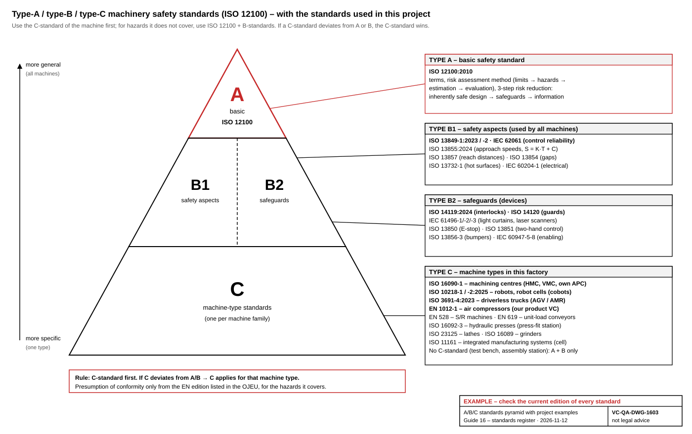
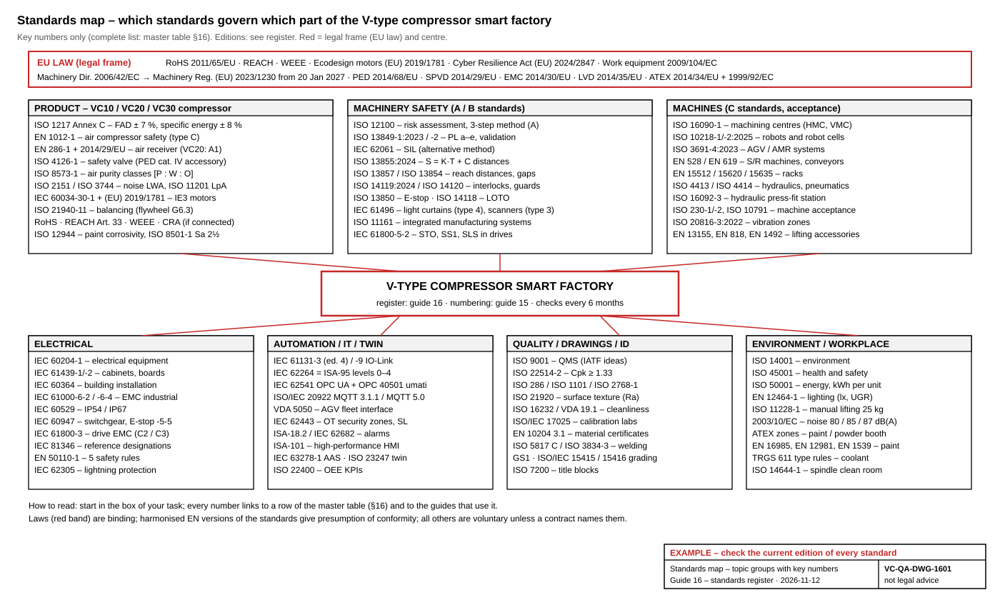
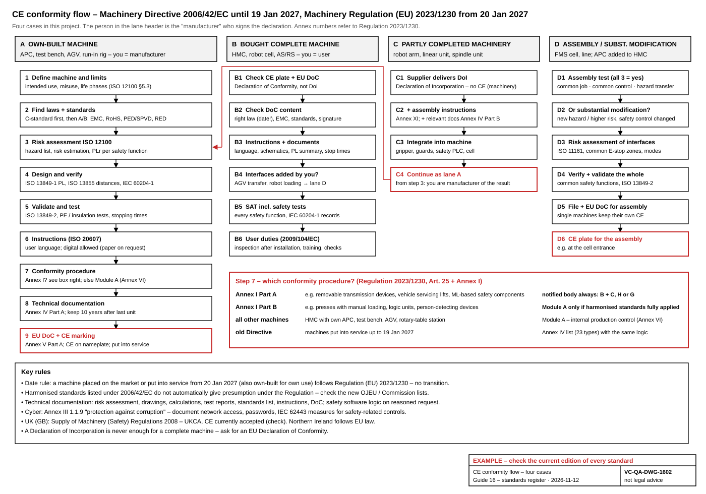
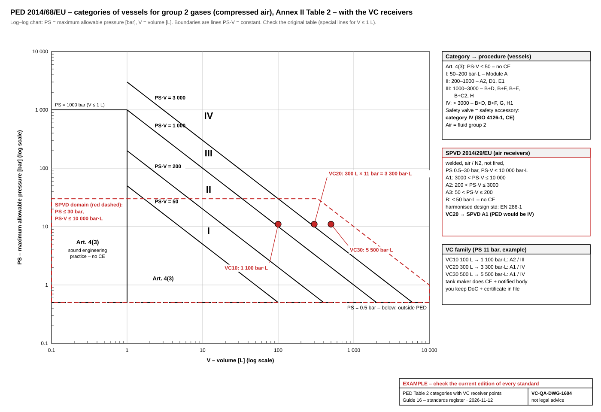
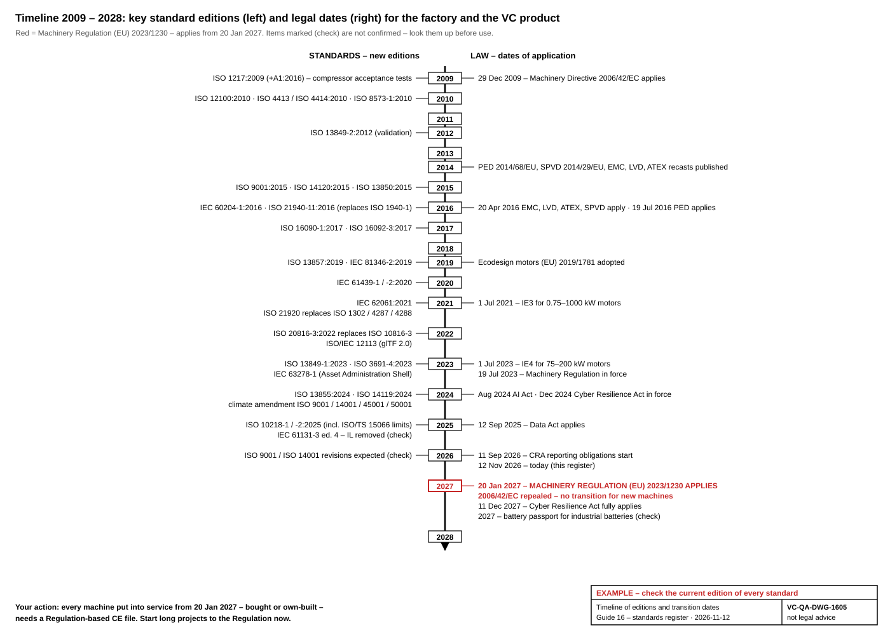

# 16 – Standards Register

> **This register is a guide, not legal advice.** Standards are updated every few years. Every entry marked
> **"verify current edition"** or **"check"** must be checked before use, and **all entries** must be checked against the
> current catalogue of ISO / IEC / your national standards body before you design to them.
> Key values given here are the well-known ones, shortened – **always read the standard itself** before you
> design, calculate or accept a machine. Laws: read the original text (EUR-Lex) – this guide is a planning summary.
>
> **Updated 2026-11-12:** complete harvest of guides 01–30 (master table with 586 rows, §16), consistency findings
> for the lead (§17), textbook chapters on the standards system, CE / Machinery Regulation 2023/1230, pressure
> equipment for the VC compressor, electrical / EMC / substances, ATEX and management systems (§9–§15), buy lists
> (§20–§21) and 5 drawings (`docs/img/16_*.svg`).

## Contents

**Part A – the register (original structure, kept and corrected)**

1. Purpose · 2. Laws and standards · 3. Where to get standards (short) · 4. The register – detailed key standards
(4.1 management · 4.2 machinery safety · 4.3 electrical · 4.4 automation and IT · 4.5 material handling · 4.6
mechanical · 4.7 machine tools, gears, NC · 4.8 materials · 4.9 compressor product · 4.10 labelling) · 5. Which
standards to buy first · 6. How to keep the register current · 7. Common mistakes · 8. Limits

**Part B – textbook: how standards and conformity work**

9. How the standards system works – ISO / IEC / CEN / CENELEC / national bodies, document types, life cycle,
"shall / should", harmonised standards and OJEU, **A/B/C-type standards** (drawing
[16_abc_standards](img/16_abc_standards.svg)), **standards map** ([16_standards_map](img/16_standards_map.svg))
10. Machinery law – CE / UKCA for own-built and bought machines: manufacturer roles, 8 steps, technical file, DoC,
Annex I, bought machines, **assemblies**, partly completed machinery, **substantial modification**, UKCA (drawing
[16_ce_process](img/16_ce_process.svg))
11. Pressure equipment and the compressor product – which law for which part, **PED categories**, SPVD, **worked
example VC20 receiver** (drawing [16_ped_categories](img/16_ped_categories.svg)), EN 1012-1, ISO 1217 worked example,
other product rules
12. Electrical safety, EMC, RoHS / REACH / WEEE, cybersecurity
13. ATEX basics – zones, marking, where in this factory
14. Management system standards – Harmonized Structure, ISO 9001 / 14001 / 45001 / 50001 / 27001, IATF ideas,
certification steps
15. Key dates and transitions (drawing [16_standards_timeline](img/16_standards_timeline.svg))

**Part C – reference**

16. **Master table** – all 586 standards / laws cited in guides 01–30, deduplicated, with edition, simple title,
key requirement, links to guide sections, binding status, withdrawn / replaced notes
17. **Consistency findings** for the lead (23 items with recommended fixes)
18. Harvest method and statistics

**Part D – buying and maintaining**

19. Keeping the register up to date – RACI, review cycle, offline rules, register template
20. Where to get standards – shops, subscriptions (DIN Media, ISO, IEC, ANSI, ASME, Nautos, Accuris …), free sources
21. Shopping list – the first 25 standards, prioritised (law and safety first)
22. Glossary

---

## 1. Purpose

The guides 01–30 name many standards (896 distinct numbers in the harvest of 2026-11-12). This register collects
all of them in one place and adds the important ones that are missing for a compressor factory. Section 4 explains
the **key standards** in detail; the **master table in §16** lists **every** standard with links to the guide
sections that use it. For each standard you find:

* **what it covers** (in one line),
* **what it means for this project** (key values, typical clauses),
* **which guide uses it**,
* **where to get it**.

At the end: **which standards a small team should buy first** (§5, §21) and **how to keep them current** (§6, §19).
Part B explains the system behind the standards (harmonised standards, CE, pressure equipment, ATEX, management
systems).

---

## 2. Laws and standards – important note for the reader

| Level | What it is | Example | Binding? |
|---|---|---|---|
| **Law / regulation** | written by the state | EU: Machinery Directive 2006/42/EC, replaced by the **Machinery Regulation (EU) 2023/1230** (applies from 20 Jan 2027); Low Voltage and EMC Directives; national pressure-equipment and workplace-safety laws; outside the EU: the local equivalent (e.g. national machinery safety rules, OSHA rules in the USA) | **yes** |
| **Harmonised / designated standard** | a standard that the law refers to; if you follow it, the law assumes you meet the matching requirement ("presumption of conformity") | EN ISO 12100, EN ISO 13849-1, EN 60204-1 under EU machinery law | normally voluntary, but the easiest way to prove compliance |
| **Other standard** | technical rule (ISO, IEC, DIN, VDA …) | ISO 286, DIN 3974, VDA 5050 | voluntary, unless a contract or law requires it |
| **Contract / customer requirement** | what you agree with a customer or supplier | "test according to ISO 1217 Annex C", "labels GS1-128" | binding by contract |

**Laws differ by country.** This guide stays generic:

* Where the EU uses CE marking and the Machinery Regulation, your country may have its own conformity
  procedure, mark and list of designated standards. Find out **which law applies to machines you build or
  buy for your own factory** – in many countries a company that builds a machine for its own use is the
  "manufacturer" and must do the full conformity work (risk assessment, technical file, declaration).
* The **compressor product** (with its air tank) is a pressure-equipment product. **Check your local
  pressure-equipment law** before you design or sell it.
* Standards prefixed **EN** or **EN ISO** are European versions; the **ISO/IEC** version is usually the same
  technical text. National versions (e.g. DIN EN ISO, BS EN ISO) are again the same text with a national cover.

---

## 3. Where to get standards

| Publisher | Standards | Where (offline: download PDF and store in the document system) |
|---|---|---|
| ISO | ISO … | ISO Store (iso.org) or your national member body |
| IEC | IEC … | IEC Webstore (webstore.iec.ch) or national body |
| CEN / CENELEC | EN … | only through national bodies (e.g. DIN Media, BSI, AFNOR, UNI, …) |
| National bodies | DIN, BS, ANSI, BIS, SAC, … and national versions of ISO/IEC | national web shops |
| ISA | ISA-18.2, ISA-95, ISA-101 | isa.org (members get discounts) |
| VDA | VDA 5050 | **free**, published openly by VDA/VDMA (GitHub repository "VDA5050") |
| OPC Foundation | OPC UA specifications (= IEC 62541 content) | **free** online reference (reference.opcfoundation.org) after registration |
| OASIS | MQTT 3.1.1 / 5.0 | **free** (oasis-open.org) |
| CAN in Automation (CiA) | CiA 301, CiA 402 | can-cia.org (some free after registration, verify) |
| IEEE | IEEE 1588 | IEEE Xplore / IEEE standards store |
| FEM | FEM 9.851 | FEM (fem-eur.com) or national FEM member association |
| GS1 | GS1 General Specifications, EPC Tag Data Standard | **free** (gs1.org) |
| IATF / AIAG / VDA QMC | IATF 16949, AIAG-VDA FMEA, MSA, SPC manuals | AIAG, VDA QMC shops |

Tip: the **ISO Online Browsing Platform (OBP)** and the IEC Webstore show **free** the title, scope, current
edition and whether a standard is withdrawn – use them to check editions.

Full buy list with shops, subscriptions, price classes and offline-licence notes: **§20**; first 25 standards: **§21**.

---

## 4. The register

Column "Guide" = number of the guide in this folder that uses the standard. "new" = not named in guides 00–15 when
this table was first written (many are now cited by guides 17–30). **The current, complete links per guide section
are in the master table §16** – this section keeps the longer project-specific explanations.

### 4.1 Management and quality

| Standard | Title | Covers | Requirements for this project | Guide | Get it |
|---|---|---|---|---|---|
| ISO 9001 | Quality management systems – Requirements | QMS: processes, documented information, control of changes, suppliers, nonconformity, improvement | document control (guide 15 numbering, ECR/ECN), supplier evaluation, NCR process (guide 04), calibration of measuring equipment, management review. Edition 2015 + Amd 1:2024; **a new edition is expected – verify current edition** | new (04, 13, 15) | ISO / national |
| IATF 16949 | Quality management system requirements for automotive production and relevant service parts organizations | ISO 9001 + automotive extras (APQP, PPAP, control plans, MSA, SPC) | **only if you supply the automotive industry.** For air compressors normally not required – but its "core tools" (FMEA, control plan, MSA, SPC) are good practice for machining | new | IATF / AIAG / VDA QMC |
| ISO 14001 | Environmental management systems – Requirements with guidance for use | environmental aspects, legal compliance | coolant, oils, paint shop solvents (VOC), chips, waste water from the washer | new | ISO / national |
| ISO 45001 | Occupational health and safety management systems – Requirements with guidance for use | OH&S management | risk assessment of workplaces (not machines – that is ISO 12100), training, incident reporting, AGV traffic in shared areas | new | ISO / national |
| ISO 50001 | Energy management systems – Requirements with guidance for use | energy baseline, energy performance indicators | the twin already measures kW per machine (guide 01) → energy per compressor (kWh/unit) as EnPI; compressed-air leaks; test-bench energy | new (01) | ISO / national |
| ISO/IEC 17025 | General requirements for the competence of testing and calibration laboratories | accredited calibration | buy calibration of gauges, flow meters, pressure transducers of the test bench from an accredited lab (calibration certificate with uncertainty) | new | ISO / national |
| ISO 22514 (series) | Statistical methods in process management – Capability and performance | Cp, Cpk, Pp, Ppk calculation | machine/process capability of critical bores (cylinder bore, crankshaft journals), typical target Cpk ≥ 1.33 (customer may require 1.67) – verify parts | new (04 SPC) | ISO / national |
| AIAG-VDA FMEA Handbook | (handbook, not ISO) | design and process FMEA method | PFMEA for crankcase machining and assembly; action priority (AP) instead of RPN | new | AIAG / VDA QMC |

### 4.2 Machinery safety

| Standard | Title | Covers | Requirements for this project | Guide | Get it |
|---|---|---|---|---|---|
| ISO 12100 | Safety of machinery – General principles for design – Risk assessment and risk reduction | method of risk assessment | for every machine you build or modify (APC, AGVs, rotary table, test bench, interfaces): limits → hazards → risk estimation → **3-step risk reduction** (1 inherently safe design, 2 safeguards, 3 information for use). Record in `VC-<area>-RA-…` | 05, new for 09–12 | ISO / national (EN ISO) |
| ISO 13849-1 | Safety of machinery – Safety-related parts of control systems – Part 1: General principles for design | design of safety functions, **Performance Level PL a–e**, categories B, 1, 2, 3, 4, MTTFD, DCavg, CCF | determine PLr per safety function (risk graph: S, F, P); typical results: E-stop, guard interlock, light curtain at APC load station **PLr d** (example – your risk assessment decides). Edition 2023 – verify current edition | 03, 05, 09, 10, 11, 13 | ISO / national |
| ISO 13849-2 | Safety of machinery – Safety-related parts of control systems – Part 2: Validation | validation of safety functions | validation plan + test of every safety function at SAT (fault insertion, e.g. remove a channel of a door switch) | 05, 13 | ISO / national |
| IEC 62061 | Safety of machinery – Functional safety of safety-related control systems | alternative to ISO 13849-1, uses **SIL 1–3** | use **either** ISO 13849-1 **or** IEC 62061 per safety function; small teams usually use ISO 13849-1 + SISTEMA-type tool. Edition 2021 – verify | 05, 13 | IEC / national |
| ISO 13850 | Safety of machinery – Emergency stop function – Principles for design | E-stop | E-stop is a **complementary** measure (not a replacement for guards); stop category **0 or 1**; red actuator on yellow background; latching; reset must not start the machine | 05 | ISO / national |
| IEC 60947-5-5 | Low-voltage switchgear and controlgear – Part 5-5: Control circuit devices and switching elements – Electrical emergency stop device with mechanical latching function | E-stop push-buttons | buy E-stop buttons that conform (direct opening action, latching) | 11 | IEC / national |
| ISO 13855 | Safety of machinery – Positioning of safeguards with respect to the approach of the human body | **safety distance** of light curtains, scanners, two-hand controls, interlocked guards | basic formula **S = K · T + C**; for light curtains detecting fingers/hands: K = 2 000 mm/s (if S ≤ 500 mm), otherwise K = 1 600 mm/s with S ≥ 500 mm; C = 8 · (d − 14) mm for resolution d ≤ 40 mm. T = machine stopping time + sensor response time (measure the stopping time!). **New edition 2024 changed parts of the method – verify current edition** | 00, 03, 05, 09, 10, 13 | ISO / national |
| ISO 13857 | Safety of machinery – Safety distances to prevent hazard zones being reached by upper and lower limbs | reach over / through / around guards | mesh size vs. distance to the hazard (tables); fence height around APC, AS/RS and robot cell | 03, 10 | ISO / national |
| ISO 13854 | Safety of machinery – Minimum gaps to avoid crushing of parts of the human body | minimum gaps | well-known values: body 500 mm, head 300, leg 180, foot 120, arm 120, hand 100, finger 25 mm – e.g. AGV lift unit, APC arm vs. frame. Planned to be merged into a revision of ISO 13857 – verify | 11 | ISO / national |
| ISO 14119 | Safety of machinery – Interlocking devices associated with guards – Principles for design and selection | door switches, guard locking, defeat prevention | coded switches (low / high coding), **measures against defeating**; guard locking if the hazard does not stop before access (spindle run-down, APC rotation). Edition 2024 – verify | 05, 09, 10 | ISO / national |
| ISO 14120 | Safety of machinery – Guards – General requirements for the design and construction of fixed and movable guards | guards | fixed guards must need a **tool** to open and the fixings should stay attached (captive); strength vs. ejected parts (machine-tool guards) | 09, 10 | ISO / national |
| IEC 61496-1 / -2 / -3 | Safety of machinery – Electro-sensitive protective equipment – Part 1 General requirements and tests; Part 2 AOPD (light curtains); Part 3 AOPDDR (laser scanners) | light curtains, safety laser scanners | buy only ESPE of **Type 4** (light curtains, PL e capable) or **Type 3** (scanners, PL d) according to the PLr; scanner on AGV and at AGV stations | 03 | IEC / national |
| IEC 62046 | Safety of machinery – Application of protective equipment to detect the presence of persons | how to apply ESPE / pressure mats | muting of light curtains at AGV/pallet passages (guide 10); detection zone, restart | 05, 10 | IEC / national |
| IEC 60204-1 | Safety of machinery – Electrical equipment of machines – Part 1: General requirements | electrical equipment of machines | main switch (lockable), protective bonding, control circuits (24 V DC), stop categories 0/1/2, wire colours (3.12 of guide 15), documentation, verification tests (continuity of PE, insulation resistance, voltage test, residual voltage). Edition 2016 + A1:2021 – verify | 05, 15 | IEC / national |
| ISO 16090-1 | Machine tools safety – Machining centres, milling machines, transfer machines – Part 1: Safety requirements | type-C standard for machining centres | for the HMCs, VMC and when you modify them (own rotary table, APC): guards, spindle speeds in setting mode, enabling device, door interlocking | 09 | ISO / national |
| ISO 23125 | Machine tools – Safety – Turning machines | type-C standard for lathes | LATHE-01: guards, chuck guard, setting mode | new | ISO / national |
| ISO 10218-1 / -2 | Robotics – Safety requirements – Part 1: Industrial robots; Part 2: Industrial robot applications and robot cells | robot safety | ROBOT-01 cell: safeguarding, collaborative operation if planned. **Editions 2025**; the body-region force/pressure limits of ISO/TS 15066 are now in ISO 10218-2:2025 – check harmonised status | 13, 21, 23 | ISO / national |
| ISO 3864-1 / ISO 7010 | Graphical symbols – Safety colours and safety signs / Registered safety signs | safety colours and signs | warning signs on AGV routes, APC, hydraulics, pressure vessels | 10 | ISO / national |
| IEC 60848 | GRAFCET specification language for sequential function charts | step-chain drawings | APC and handshake sequences (guide 05) | 05 | IEC / national |

### 4.3 Electrical

| Standard | Title | Covers | Requirements for this project | Guide | Get it |
|---|---|---|---|---|---|
| IEC 61439-1 / -2 | Low-voltage switchgear and controlgear assemblies – Part 1: General rules; Part 2: Power switchgear and controlgear assemblies | control cabinets | cabinet builder must do **design verification** (incl. temperature rise – heat calculation for drives) and **routine verification** of every cabinet; rated current and short-circuit rating on the nameplate | new (05) | IEC / national |
| IEC 60529 | Degrees of protection provided by enclosures (IP Code) | IP code | cabinet in the hall typically **IP54**; sensors near coolant **IP67** (IP69K for high-pressure washing); test bench outdoors? check | new | IEC / national |
| IEC 61800-5-2 | Adjustable speed electrical power drive systems – Part 5-2: Safety requirements – Functional | safety functions in drives | **STO** (safe torque off), SS1, SS2, SOS, SLS, SBC – AGV drives and APC servo use STO / SLS; choose drives with certified functions (SIL/PL in data sheet) | 11, 13 | IEC / national |
| IEC 81346-1 / -2 | Industrial systems, installations and equipment and industrial products – Structuring principles and reference designations – Part 1: Basic rules; Part 2: Classification of objects and codes for classes | reference designations `=` `+` `-`, letter codes | device designations in guide 15 (3.12); **letter codes changed between editions – verify current edition of Part 2** | 15 | IEC / national |
| IEC 61082-1 | Preparation of documents used in electrotechnology – Part 1: Rules | schematics layout | supplier schematics | new | IEC / national |
| IEC 60617 | Graphical symbols for diagrams | electrical symbols | schematics (database standard) | new | IEC |
| IEC 60445 | Basic and safety principles for man-machine interface, marking and identification – Identification of equipment terminals, conductor terminations and conductors | conductor and terminal identification, colours | PE green-yellow, N light blue | new | IEC / national |
| IEC 61000-6-2 / -6-4 | Electromagnetic compatibility (EMC) – Generic standards – Immunity / Emission standard for industrial environments | EMC | drives with filters, shielded motor cables, EMC-correct cabinet layout; AGV Wi-Fi vs. drives | new | IEC / national |
| IEC 60364 (series) | Low-voltage electrical installations | building installation | hall power distribution to the machines (or your national wiring code – **check local law**) | new | IEC / national |
| IEC 60034-30-1 | Rotating electrical machines – Part 30-1: Efficiency classes of line operated AC motors (IE code) | motor efficiency classes | compressor motors and factory motors: minimum IE class is often set by law (e.g. IE3) – **check local law** | new | IEC / national |
| IEC 61131-9 | Programmable controllers – Part 9: Single-drop digital communication interface for small sensors and actuators (SDCI) | **IO-Link** | vibration and pressure sensors on IO-Link (guide 05/06) | 05 | IEC / national |

### 4.4 Automation and IT

| Standard | Title | Covers | Requirements for this project | Guide | Get it |
|---|---|---|---|---|---|
| IEC 61131-3 | Programmable controllers – Part 3: Programming languages | PLC languages: ST, LD, FBD, SFC (IL deprecated in ed. 3 of 2013, removed in ed. 4) | write PLC code in ST/SFC, structured with function blocks; naming per guide 15. **Edition 4 published 2025 – verify** | 05, 13 | IEC / national |
| ISA-95 / IEC 62264 | Enterprise-control system integration (Parts 1–6) | levels 0–4, object models (orders, material, equipment, personnel), MES activities | ERP ↔ MES interface objects (guide 04, 07); B2MML messages are the XML implementation (MESA) | 00, 02, 04, 05, 07, 13 | ISA / IEC |
| IEC 62541 | OPC Unified Architecture (series) | OPC UA: information model, services, security | PLC ↔ MES/SCADA, machine interface; use security mode Sign&Encrypt, certificates; companion specs (e.g. OPC 40501 machine tools / umati – verify) | 04, 07 | IEC; free reading at OPC Foundation |
| ISO/IEC 20922 | Information technology – Message Queuing Telemetry Transport (MQTT) v3.1.1 | MQTT 3.1.1 | broker in L3, AGV VDA 5050 messages; **MQTT 5.0 is an OASIS standard only** (not ISO) | 07 | ISO; free text at OASIS |
| IEC 62443 (series) | Security for industrial automation and control systems | OT security: zones and conduits, security levels SL 1–4; 2-1 security programme, 3-2 risk assessment, 3-3 system requirements, 4-1 secure development, 4-2 component requirements | zone/VLAN plan (guide 07, guide 15 3.13), firewall between IT/DMZ/OT, user accounts per person, patch management, remote access via jump host; ask suppliers for 4-2 / 4-1 conformity | 05, 06, 07, 13 | IEC / ISA |
| ISO/IEC 27001 | Information security, cybersecurity and privacy protection – Information security management systems – Requirements | IT security management | office IT, ERP, backups – company level, complements IEC 62443 | new | ISO / national |
| ISA-18.2 / IEC 62682 | Management of alarm systems for the process industries | alarm life cycle | alarm philosophy, rationalisation, priorities (~80/15/5 %), ≈ 6 alarms/h per operator target, shelving, bad-actor review (guide 06); alarm IDs per guide 15 | 00, 06, 07, 13 | ISA / IEC |
| ISA-101.01 | Human Machine Interfaces for Process Automation Systems | HMI design life cycle, high-performance HMI | grey background, colour only for abnormal states, display hierarchy (guide 06) | 06, 13 | ISA |
| VDA 5050 | Interface for the communication between automated guided vehicles (AGV) and a master control | AGV ↔ fleet manager over MQTT/JSON: topics `order`, `instantActions`, `state`, `visualization`, `connection`, `factsheet` | specify for every AGV bought or built; version **2.x – verify current version** (a 3.0 is in preparation / published) | 00, 03, 04, 05, 06, 07, 10, 11, 13 | free (VDA / GitHub) |
| CiA 301 | CANopen application layer and communication profile | CANopen: object dictionary, PDO/SDO, NMT, heartbeat | AGV drive bus (guide 11) | new (11) | CiA |
| CiA 402 | CANopen device profile for drives and motion control (also IEC 61800-7-201) | drive state machine, controlword 0x6040, statusword 0x6041, modes of operation 0x6060 (profile position, velocity, homing, cyclic sync.) | AGV and APC servo drives; same profile on EtherCAT (CoE) | 05, 11, 13 | CiA / IEC |
| IEC 61158 / IEC 61784 | Industrial communication networks – Fieldbus specifications / Profiles | PROFINET, EtherCAT, etc. | PROFINET between PLC, I/O, drives; PROFIsafe for safety I/O | new | IEC |
| IEEE 1588 | IEEE Standard for a Precision Clock Synchronization Protocol for Networked Measurement and Control Systems (PTP) | µs time synchronisation | only where needed (motion, high-speed data); otherwise NTP. Edition 2019 – verify | 07 | IEEE |
| ISO 8601-1 | Date and time – Representations for information interchange – Part 1: Basic rules | date/time formats | all data: `2026-11-11T07:30:00Z`, ISO week (guide 15) | 07, 15 | ISO / national |
| ISO 20022 | Financial services – Universal financial industry message scheme | bank messages | ERP payments (guide 07) – only if your bank uses it | 07 | ISO (free message catalogue) |
| ANSI X12 / UN/EDIFACT | (EDI message standards) | EDI orders, delivery notes | customer/supplier EDI (guide 07); agree the message set per partner | 07 | ASC X12 / UNECE (free) |
| ISO/IEC 15693 / ISO/IEC 18000-63 | Identification cards – Contactless vicinity cards / Radio frequency identification for item management – Part 63: UHF Type C (EPC Gen2) | HF and UHF RFID air interfaces | HF tags in fixture pallets and tool holders, UHF for crates (guide 15 3.16) | 07, 15 | ISO / national |
| ISO 13399 (series) | Cutting tool data representation and exchange | tool data model | tool data between presetter, CAM and CNC (guide 15 tool numbers) – verify tool supplier support | new | ISO |

### 4.5 Material handling (AGV, AS/RS, conveyors, racks)

| Standard | Title | Covers | Requirements for this project | Guide | Get it |
|---|---|---|---|---|---|
| ISO 3691-4 | Industrial trucks – Safety requirements and verification – Part 4: Driverless industrial trucks and their systems | AGV / AMR safety, **including the system and the operating zones** | personnel detection (scanner fields switching with speed), braking, warning signals, zones (restricted / hazard / confined zones), load handling at stations, verification. Edition 2023 – verify. USA: ANSI/ITSDF B56.5 | 00, 03, 10, 11, 13 | ISO / national |
| EN 528 | Rail dependent storage and retrieval equipment – Safety requirements for S/R machines | stacker cranes | ASRS-RAW / ASRS-FG: access protection of the aisle, maintenance platforms, overspeed / end stops, rescue of persons. Verify current edition | 03, 10 | national body (CEN) |
| EN 619 | Continuous handling equipment and systems – Safety and EMC requirements for equipment for mechanical handling of unit loads | conveyors for unit loads, transfer stations | AS/RS I/O conveyors, AGV transfer stations, pallet pool shuttle | 03, 10 | national body |
| EN 15512 | Steel static storage systems – Adjustable pallet racking systems – Principles for structural design | rack design | rack supplier calculates; you give loads (unit load mass, e.g. 4 crankcases + pallet), seismic zone, floor | 03, 10 | national body |
| EN 15620 | Steel static storage systems – Adjustable pallet racking – Tolerances, deformations and clearances | rack tolerances | especially for automated (AS/RS) racks: tighter tolerance classes; floor flatness requirement → specify to the building contractor | 03, 10 | national body |
| EN 15635 | Steel static storage systems – Application and maintenance of storage equipment | use and inspection | named "person responsible for storage equipment safety", rack inspection at least **every 12 months by a competent person**, damage classes green / amber / red, load signs | 03, 10 | national body |
| FEM 9.851 | Performance data of S/R machines – Cycle times (title as commonly used – verify) | reference cycle for AS/RS throughput | single cycle reference points at about (1/5 L, 2/3 H) and (2/3 L, 1/5 H); used to compare supplier cycle time claims with the twin's `crane_cycle_s` | 03 | FEM / national FEM member |
| EN 13698-1 | Pallet production specification – Part 1: Construction specification for 800 mm × 1200 mm flat wooden pallets | EUR pallet | finished goods pallets, AS/RS-FG unit load | new | national body |

### 4.6 Mechanical design and manufacturing

| Standard | Title | Covers | Requirements for this project | Guide | Get it |
|---|---|---|---|---|---|
| ISO 286-1 / -2 | Geometrical product specifications (GPS) – ISO code system for tolerances on linear sizes – Part 1: Basis of tolerances, deviations and fits; Part 2: Tables of standard tolerance classes and limit deviations for holes and shafts | fits (H7/g6 …) | example Ø50: IT7 = 25 µm, IT6 = 16 µm → **H7 = +0 / +25 µm, g6 = −9 / −25 µm**; centring fits of APC hub, bearing seats | 00, 09, 12 | ISO / national |
| ISO 1101 | Geometrical product specifications (GPS) – Geometrical tolerancing – Tolerances of form, orientation, location and run-out | GD&T symbols | flatness of pallets (≤ 0.01 mm), position of locating bores, run-out of worm journals | 09, 10, 12 | ISO / national |
| ISO 2768-1 / -2 | General tolerances – Part 1: Tolerances for linear and angular dimensions without individual tolerance indications; Part 2: Geometrical tolerances for features without individual tolerance indications | general tolerances | class **m** for linear sizes: 6–30 mm ±0.2, 30–120 mm ±0.3, 120–400 mm ±0.5; title block e.g. "ISO 2768-mK". **Part 2 may be withdrawn / replaced by ISO 22081 – verify** | 15 (title block) | ISO / national |
| ISO 21920 (series) | Geometrical product specifications (GPS) – Surface texture: Profile | surface roughness indication (replaces ISO 1302, ISO 4287) | Ra/Rz on drawings; verify which version your CAD and suppliers use | new | ISO / national |
| ISO 128 / ISO 7200 | Technical product documentation – General principles of representation / Data fields in title blocks and document headers | drawing rules, title block | title block fields (guide 15 3.2) | new (15) | ISO / national |
| ISO 5817 | Welding – Fusion-welded joints in steel, nickel, titanium and their alloys (beam welding excluded) – Quality levels for imperfections | weld quality levels **B (stringent), C (intermediate), D (moderate)** | APC arm, AGV chassis, base frames: typically level **C**, level B for highly loaded / fatigue welds (engineering decision). Verify current edition | new (09, 11) | ISO / national |
| ISO 13920 | Welding – General tolerances for welded constructions – Dimensions for lengths and angles – Shape and position | weld construction tolerances, classes A–D (lengths/angles) and E–H (straightness, flatness, parallelism) | frames before machining: e.g. **B F** (example); machine critical faces after welding + stress relief. Verify current edition | new (09, 10) | ISO / national |
| ISO 3834 (series) | Quality requirements for fusion welding of metallic materials | welding quality system: Part 2 comprehensive, Part 3 standard, Part 4 elementary | ask welding suppliers for ISO 3834-3 (or -2); welders qualified (ISO 9606-1), welding procedures (ISO 15614-1) | new | ISO / national |
| ISO 2553 | Welding and allied processes – Symbolic representation on drawings – Welded joints | weld symbols | all welded drawings | new | ISO / national |
| ISO 4762 | Hexagon socket head cap screws | cap screws dimensions | standard screws in all MAKE designs, BUY description per guide 15 | new | ISO / national |
| ISO 898-1 | Mechanical properties of fasteners made of carbon steel and alloy steel – Part 1: Bolts, screws and studs with specified property classes – Coarse thread and fine pitch thread | property classes | **8.8:** Rm ≥ 800 N/mm², Rp0.2 ≥ 640 (d ≤ 16 mm; 830/660 above 16 mm); **10.9:** 1 040 / 940; **12.9:** 1 220 / 1 100 | new (09, 12) | ISO / national |
| ISO 8734 | Parallel pins, of hardened steel and martensitic stainless steel (Dowel pins) | dowel pins | pinning of APC hub, lifting ledges; pin tolerance m6, hole H7 (or as designed) | new (09) | ISO / national |
| ISO 1219-1 / -2 | Fluid power systems and components – Graphical symbols and circuit diagrams – Part 1: Graphical symbols…; Part 2: Circuit diagrams | hydraulic/pneumatic symbols, diagrams | APC hydraulic circuit (`VC-HYD-CIR-…`), component designations matching the electrical schematic | 09, 13 | ISO / national |
| ISO 4413 | Hydraulic fluid power – General rules and safety requirements for systems and their components | hydraulic safety | pressure relief valve on every pump, accumulator discharge on shutdown, hoses with restraint, clamping holds pressure on power loss (check valve + pressure switch) | new (09) | ISO / national |
| ISO 4414 | Pneumatic fluid power – General rules and safety requirements for systems and their components | pneumatic safety | exhaust (dump) valve to release stored energy, lockable shut-off, soft start | new | ISO / national |
| ISO 4406 | Hydraulic fluid power – Fluids – Method for coding the level of contamination by solid particles | oil cleanliness code `x/y/z` (particles ≥ 4 / ≥ 6 / ≥ 14 µm(c) per mL) | specify cleanliness at commissioning and in maintenance, e.g. **18/16/13** for standard valves, cleaner (e.g. 17/15/12 or better) for proportional/servo valves – **follow the valve manufacturer** | new (09) | ISO / national |
| ISO 8573-1 | Compressed air – Part 1: Contaminants and purity classes | air quality classes **[particles : water : oil]** | factory air for tools and pneumatics e.g. class **[2:4:2]** (example); water class 4 = pressure dew point ≤ +3 °C, class 2 = ≤ −40 °C; oil class 1 ≤ 0.01 mg/m³, class 2 ≤ 0.1 mg/m³. Also relevant for your product datasheet | new | ISO / national |
| ISO 12944 (series) | Paints and varnishes – Corrosion protection of steel structures by protective paint systems | corrosivity categories **C1–C5, CX**; durability L / M / H / VH | factory steel structures: indoor heated hall ≈ C1–C2; compressor tank / outdoor products: specify category with sales (e.g. C3 durability M – example); paint shop process | new | ISO / national |
| ISO 281 | Rolling bearings – Dynamic load ratings and rating life | bearing life | L10 = (C/P)^p million revolutions, p = 3 ball, 10/3 roller – APC slewing bearing, AGV wheels, compressor crankshaft bearings | new | ISO / national |
| ISO 21940-11 | Mechanical vibration – Rotor balancing – Part 11: Procedures and tolerances for rotors with rigid behaviour | balance quality grades G | crankshaft / flywheel / fan of the compressor, spindles (e.g. G6.3, G2.5 – example) | new | ISO / national |
| ISO 20816-3 | Mechanical vibration – Measurement and evaluation of machine vibration – Part 3: Industrial machinery with a power rating above 15 kW and operating speeds between 120 r/min and 30 000 r/min | vibration zones A–D | **replaces ISO 10816-3** named in guide 01 – vibration limits for monitoring (twin `vib_h`). For machines below 15 kW the limits are guidance only | 01 (as ISO 10816-3) | ISO / national |
| ISO 6020-2 / ISO 6022 | Hydraulic fluid power – Mounting dimensions for single rod cylinders, 16 MPa (160 bar) series – Part 2: Compact series / … 25 MPa (250 bar) series | hydraulic cylinder interchangeability | APC lift cylinder: buy to ISO dimensions → second source possible | 09, 10 | ISO / national |
| ISO 606 | Short-pitch transmission precision roller and bush chains, attachments and associated chain sprockets | roller chains | chain drives in interfaces (guide 10) | 10 | ISO / national |
| ISO 3448 | Industrial liquid lubricants – ISO viscosity classification | ISO VG grades | worm gear oil ISO VG 220 (guide 12) | 12 | ISO / national |
| EN 12464-1 | Light and lighting – Lighting of work places – Part 1: Indoor work places | illuminance | assembly and inspection workplaces need more lux than the hall (values in the standard tables) | 10 | national body |

### 4.7 Machine tools, gears, NC

| Standard | Title | Covers | Requirements for this project | Guide | Get it |
|---|---|---|---|---|---|
| ISO 230-1 | Test code for machine tools – Part 1: Geometric accuracy of machines operating under no-load or quasi-static conditions | geometric tests | straightness, squareness, table flatness – acceptance of HMCs and of your rotary table | new (12) | ISO / national |
| ISO 230-2 | Test code for machine tools – Part 2: Determination of accuracy and repeatability of positioning of numerically controlled axes | positioning accuracy **A**, repeatability **R**, systematic deviation **E**, reversal value **B** | laser / rotary measurement: targets spread over the travel, **5 runs in each direction**; rotary table indexing accuracy in arc seconds (guide 12). Verify current edition | 12, 13 | ISO / national |
| ISO 10791 (series) | Test conditions for machining centres (Part 1: geometric tests for horizontal spindle machines; Part 4: positioning of linear and rotary axes; Part 7: accuracy of a finished test piece; …) | acceptance tests of machining centres | HMC acceptance at FAT/SAT; test piece cut at SAT. Part titles – verify | 12, 13 | ISO / national |
| DIN 3974-1 / -2 | Accuracy of worm gears (Part 1 general; Part 2 tolerances) – verify titles | worm gear accuracy grades | worm / wheel quality for the rotary table (guide 12) | 12, 13 | DIN Media |
| DIN 3975-1 / -2 | Terms and definitions for cylindrical worm gears with shaft angle 90° – verify titles | worm gear geometry terms | worm drawing data (module, lead angle, flank form) | new (12) | DIN Media |
| DIN 3996 | Calculation of load capacity of cylindrical worm gear pairs with rectangular crossing axes – verify title | worm gear load capacity (wear, pitting, temperature, tooth root) | rotary table worm drive calculation; ISO/TS 14521 is the ISO equivalent – verify | 12 | DIN Media |
| DIN 332-1 | Center holes 60° – Forms R, A, B and C (verify title) | centre holes | worm and shaft centre holes, form B (guide 12) | 12, 13 | DIN Media |
| ISO 14104 | Gears – Surface temper etch inspection after grinding, chemical method | grinding burn detection (nital etch) | inspection of ground worms and gears; classes of acceptable indications agreed with design | 12, 13 | ISO / national |
| ISO 6983-1 | Automation systems and integration – Numerical control of machines – Program format and definitions of address words – Part 1: Data format for positioning, line motion and contouring control systems | G-code basics | NC programs (guide 08); real controllers add their own cycles – use the control manual | 07, 08 | ISO / national |
| ISO 1328-1 | Cylindrical gears – ISO system of flank tolerance classification – Part 1: Definitions and allowable values of deviations relevant to flanks of gear teeth | spur/helical gear accuracy | APC ring gear and pinion (guide 09) | new (09) | ISO / national |
| ISO 6336 (series) | Calculation of load capacity of spur and helical gears | gear strength | APC ring gear / pinion calculation | new (09) | ISO / national |
| ISO 12164-1 / -2 | Hollow taper interface with flange contact surface (HSK) – Part 1: shanks, Part 2: receivers – verify titles + edition | HSK taper geometry | spindle nose HSK-A63 receiver: taper, face, drive keys (guides 18, 19) | new (18, 19) | ISO / national |
| ISO 1947 | System of cone tolerances for conical workpieces (AT classes) – verify | taper tolerance classes | HSK taper grinding + taper gauge (guide 18) | new (18) | ISO / national |
| ISO 492 | Rolling bearings – Radial bearings – Geometrical product specifications (GPS) and tolerance values | bearing tolerance classes (P4 etc.) | spindle bearings P4 or better (guides 18, 19) | new (18, 19) | ISO / national |
| ISO 21940-21 | Mechanical vibration – Rotor balancing – Part 21: Description and evaluation of balancing machines – verify | balancing machine capability | balancing of the spindle shaft / rotor unit (guides 18, 19) | new (18, 19) | ISO / national |
| ISO 230-7 | Test code for machine tools – Part 7: Geometric accuracy of axes of rotation | spindle error motion | spindle final test (guide 19) | new (19) | ISO / national |
| DIN EN 16983 / DIN EN 16984 | Disc springs – quality requirements / calculation – verify titles | disc springs | drawbar spring pack (guides 18, 19) | new (18, 19) | DIN Media |

### 4.8 Materials and testing

| Standard | Title | Covers | Requirements for this project | Guide | Get it |
|---|---|---|---|---|---|
| EN 10085 | Nitriding steels – Technical delivery conditions | nitriding steel grades (31CrMoV9) | spindle shaft material (guide 18) | new (18) | CEN / national |
| EN ISO 683-3 / -17 | Heat-treatable steels – Part 3: case-hardening steels; Part 17: ball and roller bearing steels | 18CrNiMo7-6, 100Cr6 | alternative shaft steel, spacers (guide 18) | new (18) | ISO / national |
| ISO 6506-1 | Metallic materials – Brinell hardness test – Part 1: Test method | Brinell hardness (HBW) | QT bar + stress relief check (guide 18); castings incoming inspection (HB) | new (18) | ISO / national |
| ISO 14644-1 | Cleanrooms and associated controlled environments – Part 1: Classification of air cleanliness by particle concentration | clean-room class | spindle assembly room (guide 19) | new (19) | ISO / national |
| EN 10083-1 / -2 / -3 | Steels for quenching and tempering – Part 1: General technical delivery conditions; Part 2: Non alloy steels; Part 3: Alloy steels | C45 (1.0503), 42CrMo4 (1.7225) | hubs, ledges, shafts (guides 09, 12) | 09, 12 (materials) | national body |
| EN 10084 | Case hardening steels – Technical delivery conditions | 16MnCr5 (1.7131), 20MnCr5 (1.7147), 18CrNiMo7-6 (1.6587) | worm, locating receivers, pinion (case hardened 58–62 HRC) | 09, 12 (materials) | national body |
| EN 10025-2 | Hot rolled products of structural steels – Part 2: Technical delivery conditions for non-alloy structural steels | S235, S355J2 (1.0577) | welded frames, APC arm, AGV chassis | 09, 10, 11 (materials) | national body |
| EN 1561 | Founding – Grey cast irons | EN-GJL-250, EN-GJL-300 | crankcase castings (product), machine bases | 08, 12 (materials) | national body |
| EN 1563 | Founding – Spheroidal graphite cast irons | EN-GJS-600-3 | rotary table top, pallets | 12 (materials) | national body |
| EN 1982 | Copper and copper alloys – Ingots and castings | CuSn12Ni2-C (worm wheel bronze) – verify designation | worm wheel rim | 12 (materials) | national body |
| ISO 6507-1 | Metallic materials – Vickers hardness test – Part 1: Test method | HV | case depth profiles, thin layers | new | ISO / national |
| ISO 6508-1 | Metallic materials – Rockwell hardness test – Part 1: Test method | HRC | hardened parts (58–62 HRC) | new | ISO / national |
| ISO 18265 | Metallic materials – Conversion of hardness values | HB ↔ HV ↔ HRC ↔ tensile strength (approximate) | conversion is **only approximate and material dependent** – specify the method on the drawing, do not accept converted values for acceptance unless agreed | new | ISO / national |
| ISO 18203 | Steel – Determination of the thickness of surface-hardened layers | case hardening depth (CHD at 550 HV), nitriding depth | worm case depth on the drawing (e.g. CHD 0.8–1.2 mm – example). Replaced older ISO 2639 – verify | new | ISO / national |
| ISO 6892-1 | Metallic materials – Tensile testing – Part 1: Method of test at room temperature | tensile test | values in 3.1 certificates | new | ISO / national |
| EN 10204 | Metallic products – Types of inspection documents | certificates 2.1, 2.2, **3.1**, 3.2 | order all safety- and function-relevant material with **3.1** (specific inspection, issued by the manufacturer's inspection representative independent of production); store with the lot (guide 15 3.7) | 12, 15 | national body |

### 4.9 Compressor product

| Standard | Title | Covers | Requirements for this project | Guide | Get it |
|---|---|---|---|---|---|
| ISO 1217 | Displacement compressors – Acceptance tests | measurement of **free air delivery (FAD)**, power, specific energy; **Annex C** for electrically driven packaged compressors | test bench design (guide 04 test, TEST-01/02); tolerances in Annex C depend on flow size – for the smallest class (≤ 0.5 m³/min, i.e. all VC models 10–30 m³/h) commonly **±7 % FAD** and **±8 % specific energy** – **verify current edition and table**. Bench measurement uncertainty must be much smaller than the tolerance | new (01, 04 test limits) | ISO / national |
| ISO 1217 vs. production test | – | – | the 100 % end-of-line test is a short test with limits derived from ISO 1217 type tests; document the relation (type test vs. routine test) | – | – |
| EN 1012-1 | Compressors and vacuum pumps – Safety requirements – Part 1: Air compressors (verify title / edition) | type-C safety standard for air compressors | guards on belt/fan, hot surfaces, pressure relief, noise information, instructions | new | national body |
| ISO 2151 | Acoustics – Noise test code for compressors and vacuum pumps – Engineering method (Grade 2) | noise measurement | declared sound power level on the datasheet / type plate if required by law | new | ISO / national |
| ISO 4126-1 | Safety devices for protection against excessive pressure – Part 1: Safety valves | safety valves | buy certified safety valves for the tank; set pressure ≤ maximum allowable pressure of the tank | new | ISO / national |
| EN 286-1 | Simple unfired pressure vessels designed to contain air or nitrogen – Part 1: Pressure vessels for general purposes | design of simple air tanks | the 100 / 300 / 500 L tanks (VC10/20/30) – categories and worked example in §11.3. In the EU: Simple Pressure Vessels Directive 2014/29/EU (or Pressure Equipment Directive 2014/68/EU for other vessels). **CHECK LOCAL LAW** – many countries have their own pressure-vessel code, registration and periodic inspection rules; buying tanks from a certified tank manufacturer is the usual solution | new | national body / **local law** |

### 4.10 Labelling and identification

| Standard | Title | Covers | Requirements for this project | Guide | Get it |
|---|---|---|---|---|---|
| GS1 General Specifications | (GS1 standard, updated yearly) | GTIN, SSCC, Application Identifiers, check digits, label layout | label formats in guide 15 (3.16); join GS1 for a company prefix | 04, 07, 15 | free (gs1.org) |
| GS1 EPC Tag Data Standard | (GS1 standard) | EPC encoding (SGTIN-96, SSCC-96, GRAI-96, GIAI-96) | UHF RFID on crates and finished goods | 15 | free (gs1.org) |
| ISO/IEC 15417 | Information technology – Automatic identification and data capture techniques – Code 128 bar code symbology specification | Code 128 (base of GS1-128) | label printers | new | ISO / national |
| ISO/IEC 16022 | Information technology – Automatic identification and data capture techniques – Data Matrix bar code symbology specification | Data Matrix | part marking, labels | new | ISO / national |
| ISO/IEC 15415 / 15416 | … Bar code symbol print quality test specification – Two-dimensional symbols / Linear symbols | print quality grading | verify labels (grade C or better is common for GS1 – agree with customers) | new | ISO / national |
| ISO/IEC TR 29158 | … Direct Part Mark (DPM) quality guideline | DPM grading | laser / dot-peen DataMatrix on the cast crankcase | new | ISO / national |
| ISO 15394 / ISO 28219 | Packaging – Bar code and two-dimensional symbols for shipping, transport and receiving labels / … for product packaging and labelling of products – verify titles | shipping and product labels | if customers require ISO labels instead of GS1 logistic label (automotive: VDA 4902 / Odette) | new | ISO / national |

---

## 5. Which standards to buy first (priority list for a small team)

Buy in this order. Many are available as a **collection / subscription** from the national body – often
cheaper than single copies when you need more than ~10.

| Priority | Standards | Why first |
|---|---|---|
| **1 – before any machine design or purchase** | ISO 12100, ISO 13849-1, ISO 13849-2, IEC 60204-1, ISO 13855, ISO 14119, ISO 14120, ISO 13857 (+ ISO 13854), ISO 13850 | safety must be designed in; needed to write the specifications and check suppliers |
| **2 – material handling** | ISO 3691-4, EN 528, EN 15635 (EN 15512 / EN 15620 – the rack supplier has them; ask for their calculation), EN 619 | AGVs and AS/RS are the most complex safety interfaces in this factory |
| **3 – product** | ISO 1217, EN 1012-1, local pressure-vessel law + EN 286-1 (or local code), ISO 4126-1 | you cannot sell the compressor without them; test bench design depends on ISO 1217 |
| **4 – drawings and manufacturing** | ISO 286-1/-2, ISO 1101, ISO 2768-1, ISO 5817, ISO 13920, ISO 898-1, EN 10204 | every drawing and every purchase order uses them |
| **5 – free documents (download now)** | VDA 5050, OPC UA specs (OPC Foundation), MQTT (OASIS), GS1 General Specifications, EPC TDS | free – no reason to wait |
| **6 – automation and IT** | IEC 61131-3 (or the PLC maker's manual is often enough), IEC 62443-3-3 + 2-1 (or a guideline summary), ISA-18.2 | before writing PLC/SCADA specifications |
| **7 – machine-tool acceptance** | ISO 230-1, ISO 230-2, ISO 10791 relevant parts, ISO 16090-1 | before HMC FAT; before building the rotary table (with DIN 3974/3996, ISO 14104) |
| **8 – management systems** | ISO 9001 (then ISO 45001, ISO 14001, ISO 50001 when you plan certification) | needed for certification and supplier approval, not for the first design |

Rough rule for a small team: priorities 1–5 cover about 80 % of what you need in the planning phase.
A position-by-position list of the first 25 documents with editions and price classes is in **§21**.

---

## 6. How to keep the register current

1. **One owner** (e.g. quality engineer) keeps this register as a controlled document
   (`VC-QA-SPEC-0002`, numbering per guide 15) and the PDF library on the offline document server.
2. **Add two columns** when you buy a standard: *edition bought* (e.g. `ISO 13855:2024`) and *date last
   checked*.
3. **Check every 6 months** (and before every big order / FAT): look up each standard in the ISO OBP, IEC
   Webstore or national shop – is there a newer edition, an amendment, a withdrawal?
   If your country uses a list of designated / harmonised standards (EU: Official Journal), check that list too.
4. **When a new edition appears:** read the foreword ("this edition cancels and replaces … the main changes
   are …"), write a short gap note, and if designs or procedures are affected, open an **ECR** (guide 15 3.3).
5. **Keep old editions** that were used for a machine already built – the technical file must show which
   edition the machine was designed to.
6. **Write the edition into contracts**: "according to ISO 13849-1:2023" – or "latest edition at the date of
   order" – so the supplier knows the reference.
7. **Licence rules:** standards are copyrighted. Store them in a protected folder; check how many users the
   licence allows.

Roles, review cycle and offline rules: **§19**. Register template (copy for your own list; extended template in §19.4):

| Standard | Edition bought | Date checked | Newer edition? | Owner | Used in |
|---|---|---|---|---|---|
| ISO 13855 | 2024 | 2026-11-11 | no | QA | 05, 09, 10 |

---

## 7. Common mistakes / lessons learned

| Mistake | Effect | Avoid by |
|---|---|---|
| Designing to an old edition found on the internet | safety function or acceptance test not valid | buy from the official source, check edition |
| Thinking "machine for own use needs no conformity work" | legal risk after an accident | check local law – usually you are the manufacturer |
| Using ISO 13849-1 and IEC 62061 mixed inside one safety function without method | calculation not traceable | one method per safety function |
| Converting HRC ↔ HB ↔ strength with ISO 18265 tables for acceptance | wrong decisions | measure with the method on the drawing |
| Relying on ISO 10816-3 values for small machines | false alarms or missed damage | use ISO 20816 series, trend-based limits |
| Assuming EN 286-1 is enough everywhere for the tank | product cannot be sold | check local pressure-equipment law |
| Buying all standards at once | high cost, many unread | priority list (section 5, §21) |
| Building a machine for own use and putting it into service after 20 Jan 2027 with a CE file to the old Directive | no valid conformity | use Regulation (EU) 2023/1230 for everything put into service from that date (§10) |
| Linking bought CE machines into a cell without deciding who is "manufacturer of the assembly" | nobody covers the interfaces | decide in the purchase contract (§10.5), use ISO 11161 |
| Accepting a Declaration of **Incorporation** for a complete machine | machine has no CE | require an EU Declaration of **Conformity** (§10.4) |
| Classifying the air receiver with PED tables although it is a simple pressure vessel (or the other way round) | wrong procedure | check SPVD scope first (§11.3) |
| Listing the LVD in the DoC of a machine | wrong legal basis | machinery law covers electrical risks of machines (§12.1) |
| Buying online-only standards for an offline factory | documents not available at the machine | buy licences with local PDF rights (§19.3) |

---

## 8. Limits of this register

* Titles were written carefully but **must be checked** against the publisher's catalogue; entries marked
  "verify" are known to have new editions, title changes or uncertainty.
* Key values are **shortened** – the standards contain conditions, exceptions and tables not shown here.
* Laws, designated standards and certification rules are country specific and are not covered in detail.
* Industry-specific customer standards (e.g. automotive customer specifics) are not included.

---

---

# Part B – Textbook: how standards and conformity work

---

## 9. How the standards system works

### 9.1 Who writes standards

| Level | Organisation | Writes | Example numbers | Note |
|---|---|---|---|---|
| World | **ISO** (International Organization for Standardization, Geneva, about 170 national members) | everything that is not electrical or telecom | ISO 12100, ISO 286, ISO 9001 | one country = one vote |
| World | **IEC** (International Electrotechnical Commission) | electrical, electronic, related technology | IEC 60204-1, IEC 61131-3, IEC 62443 | joint committee with ISO for IT: **ISO/IEC JTC 1** (ISO/IEC 27001, 15415, 20922) |
| World | ITU | telecom | ITU-T recommendations | – |
| Europe | **CEN** (34 national members) | European standards **EN** (non-electrical) | EN 1012-1, EN 528, EN 15635 | an EN must be adopted **unchanged** by all members; conflicting national standards are withdrawn |
| Europe | **CENELEC** | electrical EN | EN 50110-1, EN 50160 | – |
| Europe | ETSI | telecom / radio | EN 300 328 (Wi-Fi radio) | radio products (AGV Wi-Fi) |
| Nation | **national body**: DIN (DE) + DKE/VDE for electrical, BSI (UK), AFNOR (FR), UNI (IT), UNE (ES), NEN (NL), ASI (AT), SNV (CH), PKN (PL), ANSI (US, accredits US developers), BIS (IN), SAC (CN) … | national standards + national adoption of EN / ISO / IEC | DIN 3996, DIN EN ISO 13849-1, BS EN 60204-1 | national cover page + national foreword; technical text identical |
| Industry | associations | guidelines, specifications | VDI 2230, VDA 5050, VDMA 8669, FEM 9.851, NAMUR NE 43, EEMUA 191, ISA-18.2, OPC 40501, GS1 General Specifications | voluntary; often "state of the art" in contracts |
| Consortia | OPC Foundation, OASIS, Khronos, IDTA, CiA, PI (PROFIBUS & PROFINET International) | open technical specifications | OPC UA, MQTT 5.0, glTF, AAS submodels, CiA 402 | many are **free** |

**Agreements that make one text serve the world and Europe:**

* **Vienna Agreement** (ISO ↔ CEN, 1991): one committee develops, both vote in parallel → **EN ISO …**.
* **Frankfurt Agreement** (IEC ↔ CENELEC, 2016, before: Dresden Agreement): the same for electrical standards → **EN IEC …** (older: EN 6xxxx with the same number as the IEC).

**How to read a number:**

```
DIN EN ISO 13849-1:2023
 |   |   |    |   |   +-- year of publication of this edition
 |   |   |    |   +------ part number
 |   |   |    +---------- document number
 |   |   +--------------- origin: ISO (world)
 |   +------------------- adopted as European standard (EN)
 +----------------------- national adoption in Germany (DIN cover, same text)
```

### 9.2 Kinds of documents

| Type | Meaning | Use in contracts |
|---|---|---|
| IS (International Standard) / EN | full consensus standard | yes – first choice |
| TS (Technical Specification) | earlier stage, less consensus (e.g. ISO/TS 15066, IEC TS 60034-25) | yes, by agreement |
| TR (Technical Report) | information only (e.g. ISO/TR 24119, IEC TR 60890) | as guidance |
| PAS, IWA, CWA | fast documents of a smaller group | rarely |
| Amendment (Amd, A1) / Corrigendum (Cor, AC) | change to an edition | always read together with the base edition |
| CSV (consolidated version) / RLV (redline version, IEC) | edition + amendments in one file / marked changes | RLV is the fastest way to see "what changed" |

### 9.3 Life of a standard

Proposal (NP) → working draft (WD) → committee draft (CD) → enquiry draft (DIS / prEN, public comment) → final
draft (FDIS) → publication → **systematic review every 5 years** (confirm, revise or withdraw). A full revision takes
about 3 years. A new edition normally **"cancels and replaces"** the previous one; in the EU the old edition keeps its
presumption of conformity until the **date of withdrawal (DOW)** published by CEN/CENELEC and the OJEU.

### 9.4 Words with a fixed meaning (ISO/IEC Directives Part 2)

| Word | Meaning | Example |
|---|---|---|
| **shall** | requirement – you must do it to claim conformity | "the guard shall need a tool to open" |
| **should** | recommendation | "the scanner should be mounted at 150 mm" |
| **may** | permission | "the reset may be automatic if …" |
| **can** | possibility / capability | "the robot can reach …" |
| normative annex | part of the requirements | Annex A of ISO 13849-1 (risk graph) |
| informative annex | help only | examples, background |
| **dated** normative reference ("ISO 13850:2015") | only that edition applies | – |
| **undated** reference ("ISO 13850") | the latest edition including amendments applies | – |
| **Annex ZA / ZZ** (in EN only) | table: which essential requirements of an EU law this EN covers | read it before you claim presumption of conformity |

### 9.5 Harmonised standards and presumption of conformity

1. The EU law (e.g. Machinery Regulation 2023/1230) sets **essential health and safety requirements** – *what* must be
   safe, not *how*.
2. The Commission sends a **standardisation request** to CEN/CENELEC. They write ENs with an **Annex ZA**.
3. The Commission publishes the reference in the **Official Journal of the EU (OJEU)** (today by Commission
   Implementing Decision). From then on the EN is a **harmonised standard**.
4. A machine designed to the harmonised standard **is presumed to meet** the essential requirements covered by Annex
   ZA (**presumption of conformity**). The burden of proof moves to the authority.
5. You may use other solutions, but then you must **show yourself** in the technical file that you meet the
   essential requirement (more work, more risk in court).
6. Presumption is given **only for the edition cited** in the OJEU and only for the clauses listed (some listings
   have restrictions, e.g. a clause "excluded from presumption").
7. **Important for 2027:** the lists published under Directive 2006/42/EC do **not** automatically carry over to
   Regulation (EU) 2023/1230. New lists under the Regulation are being prepared – check the Commission's
   harmonised-standards page before every CE file made after 20 Jan 2027.

### 9.6 A-, B- and C-type safety standards (ISO 12100)



| Type | Content | Examples in this project | Rule |
|---|---|---|---|
| **A** – basic | concepts, risk assessment method for all machines | ISO 12100 | always applies |
| **B1** – safety aspects | distances, speeds, temperatures, noise, control-system reliability | ISO 13849-1/-2, IEC 62061, ISO 13855, ISO 13857, ISO 13854, ISO 13732-1, IEC 60204-1 | used by all machine types |
| **B2** – safeguards | interlocks, guards, ESPE, two-hand, E-stop, enabling devices | ISO 14119, ISO 14120, IEC 61496, ISO 13851, ISO 13850, ISO 13856-3 | used by all machine types |
| **C** – machine type | detailed requirements for one machine family | ISO 16090-1 (machining centres), ISO 23125 (lathes), ISO 16089 (grinders), ISO 16092-3 (hydraulic presses), ISO 10218-1/-2 (robots), ISO 3691-4 (AGV), EN 528 (S/R machines), EN 619 (conveyors), EN 1012-1 (air compressors), ISO 11161 (integrated systems) | **if a C-standard deviates from A or B, the C-standard wins** for its machine type |

How to use them: start with the **C-standard** of your machine (it lists the significant hazards and the measures).
For hazards the C-standard does not cover (e.g. your own APC added to an HMC) do the ISO 12100 process and use the
B-standards. If no C-standard exists (rotary table assembly station, test bench), ISO 12100 + B-standards are the
whole method.

### 9.7 The standards map of this factory



---

## 10. Machinery law – CE / UKCA conformity for own-built and bought machines

> Legal basis in the EU: **Directive 2006/42/EC** until **19 Jan 2027**, then **Regulation (EU) 2023/1230** from
> **20 Jan 2027** (no transition period for machines placed on the market or put into service after that date – a
> machine finished in February 2027 must follow the Regulation). Read the original texts on EUR-Lex (free). This
> chapter is a planning summary, not legal advice.



### 10.1 Who is the "manufacturer"?

| Situation in this project | Who is manufacturer | What that person must do |
|---|---|---|
| You build a machine for **your own use** (APC, rotary-table assembly station, test bench, spindle run-in rig, AGV built in-house) | **you** – "putting into service" counts like "placing on the market" | full conformity work: risk assessment, technical documentation, conformity assessment, EU DoC, CE marking, instructions |
| You **buy** a complete machine (HMC, robot with cell, AS/RS) | the seller | you check CE + EU DoC + instructions on delivery, and you are the **user** (Directive 2009/104/EC / national law) |
| You **buy partly completed machinery** (robot arm, linear unit, spindle unit sold for integration) | seller for the part; **you (or the integrator)** for the final machine | follow the assembly instructions, integrate, do the full conformity work for the complete machine |
| Several machines are linked so that they **work as one whole** (FMS cell: HMCs + APC + AGV transfer + AS/RS; assembly line with common E-stop) | whoever makes the **assembly of machinery** – often the line integrator, otherwise **you** | conformity for the assembly: interfaces, common safety functions (ISO 11161), one DoC for the assembly |
| You **substantially modify** an existing machine (add an APC to an HMC, add robot loading, change safety control logic) | **you** become manufacturer for the modified machine (or the affected part) | new risk assessment for the change, update file, new DoC/CE for what you changed |

### 10.2 The 8 steps of conformity (own-built machine)

| Step | What you do | Output (document number per guide 15) |
|---|---|---|
| 1 | Define the machine: intended use, reasonably foreseeable misuse, limits (space, time, users), life phases | machine definition in `VC-<area>-RA-…` |
| 2 | Find the applicable laws (Machinery Reg., EMC, RoHS for products, PED/SPVD, Radio Equipment Directive if radio, ATEX if zones) and standards (C-standard first) | list of legislation + standards (this register) |
| 3 | **Risk assessment** per ISO 12100: hazard list (Annex B), risk estimation, 3-step reduction; safety functions with PLr (ISO 13849-1) | risk assessment report |
| 4 | Design and verify: safety functions (SISTEMA-type calculation), distances (ISO 13855/13857), electrical (IEC 60204-1), hydraulics (ISO 4413), cyber (protection against corruption, Annex III 1.1.9 of the Regulation) | calculations, schematics, PL verification |
| 5 | Validate: tests of every safety function (ISO 13849-2), IEC 60204-1 tests (PE continuity, insulation, voltage test, residual voltage), stopping-time measurement | validation report, test protocols |
| 6 | Write instructions (ISO 20607): in the language of the user; under the Regulation they may be **digital** (paper copy free on request at the time of purchase) | instruction handbook |
| 7 | Conformity assessment procedure: normally **Module A** (internal production control); Annex I machines see 10.3 | conformity assessment record |
| 8 | **EU Declaration of Conformity**, CE marking on the nameplate, keep the technical documentation **10 years** after the last unit | DoC, nameplate, archived file |

**Technical documentation (Regulation Annex IV Part A, short list):** general description, overall drawing,
control-circuit diagrams with descriptions, detailed drawings and calculations needed to check conformity, **risk
assessment** with the measures, list of standards / specifications used, test reports, instructions, copy of the
DoC, for series production the internal measures that keep production conform, and (new in the Regulation) the source
code or programming logic of safety-related software **on reasoned request** of the authority, and evidence on
cyber protection where relevant.

**EU DoC content (Annex V Part A, short list):** machine name, type, serial number, function; name and address of
the manufacturer (and the person authorised to compile the file, in the EU); statement that the machine meets the
Regulation (and other EU laws, e.g. EMC, RoHS); references of harmonised standards / specifications used; notified
body (if any); place, date, name and signature.

### 10.3 Annex I machines – when a notified body is needed

The Regulation lists machine categories with stricter procedures in **Annex I**:

| Annex I | Content (short) | Procedure | Relevance here |
|---|---|---|---|
| **Part A** (6 categories) | e.g. removable mechanical transmission devices and their guards, vehicle servicing lifts, portable cartridge-operated fixing machinery, **safety components and machinery with fully or partially self-evolving behaviour using machine learning that ensure safety functions** | **always** third party: EU-type examination (Module B) + C, or full quality assurance (H), or unit verification (G) | only if you use ML-based safety functions (do not) |
| **Part B** (about 18 categories) | e.g. circular saws, **presses (incl. press-brakes) for cold working of metals with manual loading**, injection moulding machines, **logic units for safety functions**, **protective devices to detect persons**, power-driven interlocking guards for presses, devices for lifting persons, ROPS/FOPS | Module A allowed **only if harmonised standards covering all essential requirements are fully applied**; otherwise B+C, H or G | **check the press-fit station** (manual loading, hydraulic press → ISO 16092-3 fully applied → Module A possible); light curtains, safety PLCs and scanners are bought already certified |

Under the old Directive the matching list is Annex IV (23 categories), with the same logic.

### 10.4 Bought machines – incoming check

| Check at delivery / SAT | Pass criterion |
|---|---|
| CE marking on the nameplate | present, with manufacturer, type, serial, year |
| **EU Declaration of Conformity** (not a Declaration of Incorporation!) | names the right law (2006/42/EC until 19 Jan 2027, 2023/1230 after), EMC, standards list, signed |
| Instructions | in your language; digital allowed under the Regulation – you can still ask for paper at purchase |
| Contract clause | "machine complies with … and with the harmonised standards listed in the OJEU at the date of delivery; supplier provides risk assessment summary, PL calculation, electrical schematics, stopping-time measurements" |
| Interfaces you add later (AGV transfer, robot loading) | agreed **before** the order who is manufacturer of the combination (10.5) |
| User obligations | inspection after installation by a competent person, operator training, periodic checks (Directive 2009/104/EC, national law) |

### 10.5 Assemblies of machinery and partly completed machinery

**Assembly of machinery** = several machines (and/or partly completed machines) **arranged and controlled so that they
function as an integral whole**. Practical test (EU guide to the Machinery Directive, §38 – same idea in the
Regulation):

1. the units are installed together **to do a common job** (e.g. FMS cell machining crankcases),
2. they are **linked by a common control system** (cell controller, common E-stop zone, interlocked transfer),
3. a fault or event in one unit **creates a hazard in another** (APC rotates while the AGV transfers).

If all three are yes → it is an assembly: risk assessment of the **interfaces and the whole**, ISO 11161 as the
key standard, one EU DoC for the assembly, CE marking (e.g. on a plate at the cell entrance). The single machines keep
their own CE. Make this decision in the **purchase phase** and write in the contract who is "manufacturer of the
assembly" (line integrator is usually the better choice).

**Partly completed machinery** (cannot do a specific job alone, e.g. robot arm without gripper and cell, linear axis,
motor spindle): the supplier delivers a **Declaration of Incorporation (DoI)**, **assembly instructions** and the
relevant technical documentation; it carries **no CE marking** under the machinery law (it may carry CE for other
laws such as EMC). The integrator completes the machine and does the full conformity work.

### 10.6 Substantial modification

The Regulation (Art. 3(16)) defines a **substantial modification** as a physical or digital change after placing on
the market / putting into service, **not foreseen or planned by the manufacturer**, that **affects safety** by creating
a new hazard or increasing an existing risk, so that guards or protective devices must be added whose safety
control function needs a change of the existing safety control system, or other protective measures for stability or
strength are needed. The person who makes it **becomes the manufacturer** (Art. 18) for the modified part (or the whole
machine if the change affects the whole).

| Example in this project | Substantial? (typical – decide with your risk assessment) |
|---|---|
| Replace a worn spindle motor with the same type | no (repair, foreseen) |
| Add a new NC program / new part family within the machine limits | no |
| Add your own APC with hydraulic lift to a bought HMC, new light curtain, change of the safety PLC program | **yes** |
| Add robot loading through the machine door (new door interlock logic, new hazards) | **yes** (and probably an assembly) |
| Increase rapid traverse or spindle speed above the maker's limit | **yes** |
| Software update from the machine maker that keeps safety functions | no (foreseen by manufacturer) |
| Retrofit an old pre-CE machine with a new CNC but same guards | check: often treated as substantial if safety control changes |

### 10.7 UK (UKCA) and other markets

* **Great Britain:** Supply of Machinery (Safety) Regulations 2008 (GB copy of 2006/42/EC). Mark: **UKCA**; the UK
  government currently **accepts the CE marking** for machinery placed on the GB market (check the current GB rules
  before export). The UK has **not** adopted Regulation 2023/1230 – a GB machine may need both views.
  **Northern Ireland** follows EU law (CE, or CE + UKNI).
* **Other countries:** many accept EN/ISO designs but have their own approval schemes (e.g. EAC, CCC for some
  products, NRTL listing such as UL/CSA for electrical panels in North America – NFPA 79 / UL 508A instead of
  IEC 60204-1). Check before you promise a delivery date.

---

## 11. Pressure equipment and the compressor product

### 11.1 Which EU law applies to which part of a VC20

| Part of the VC20 package | Law | Why | Who does the conformity |
|---|---|---|---|
| Complete compressor package (pump, motor, belt, guard, tank, controls) | **Machinery** (2006/42/EC → 2023/1230), **EMC** 2014/30/EU, **RoHS** 2011/65/EU; LVD safety objectives apply through the machinery law | it is a machine with moving parts and electrical drive | **you** (manufacturer) – DoC lists these laws |
| Compressor pump casing (crankcase, cylinder, head) | excluded from PED (Art. 1(2): machinery casings where pressure is not the main design factor – compressors are named) | – | covered by machinery safety (EN 1012-1) |
| Air receiver (tank) 100 / 300 / 500 L | **Simple Pressure Vessels Directive 2014/29/EU** (welded, air, PS ≤ 30 bar, PS·V ≤ 10 000 bar·L) – otherwise PED | pressure is the main hazard | **tank maker** (CE + DoC + certificate); you buy it ready |
| Safety valve | **PED 2014/68/EU** – safety accessory = category IV | protects the tank | valve maker (CE, DoC) |
| Pressure switch, gauge, check valve, drain | PED Art. 4(3) or category I (small) / machinery | small volume | supplier |
| Pipe pump → tank (DN ≤ 32, air) | PED Art. 4(3) – sound engineering practice, **no CE** | piping table, group 2 gas, DN ≤ 32 | you (good practice, pressure test) |
| Electric motor | Ecodesign (EU) 2019/1781 (IE3 at 2.2–5.5 kW) | – | motor maker; you check the IE class |

### 11.2 PED categories – how to classify

1. **Fluid group:** group 1 = dangerous (flammable, toxic, oxidising); **group 2 = all others – compressed air is
   group 2**.
2. **State:** gas (air) or liquid.
3. **Type:** vessel, piping, safety accessory, pressure accessory.
4. Read the **table in Annex II** (vessels for group 2 gases = **Table 2**) with **PS** (maximum allowable pressure,
   bar gauge) and **V** (litres).

For vessels with **group 2 gases (Table 2)** the boundaries are lines of constant **PS·V** (check the original table
for the special lines at V ≤ 1 L and PS > 1000 bar):

| PS·V [bar·L] | Category | Typical procedure (modules) |
|---|---|---|
| ≤ 50 (and PS > 0.5 bar) | Art. 4(3) – sound engineering practice, no CE | maker's own good practice |
| 50 – 200 | I | A |
| 200 – 1000 | II | A2, D1, E1 |
| 1000 – 3000 | III | B (design or production type) + D / F / E / C2 …, or H |
| > 3000 | IV | B + D, B + F, G, H1 |



**Simple Pressure Vessels Directive** (the usual route for air receivers): PS·V > 50 bar·L → CE marking with notified
body; sub-categories **A1** (3000 < PS·V ≤ 10 000), **A2** (200 < PS·V ≤ 3000), **A3** (50 < PS·V ≤ 200); **B**
(PS·V ≤ 50) = sound engineering practice, no CE. Harmonised design standard: **EN 286-1**. The module combination per
category is in Annex II of 2014/29/EU – ask the tank maker for the EU-type examination certificate and the DoC.

### 11.3 Worked example – the VC20 receiver

**Given** (guide 13 §18.2, example values): VC20 tank **V = 300 L**, maximum allowable pressure **PS = 11 bar**,
working pressure 8 bar g, fluid = air (group 2 gas), welded non-alloy steel, not fired.

**Step 1 – product PS·V:**

```
PS · V = 11 bar × 300 L = 3 300 bar·L
```

**Step 2 – SPVD scope check:** welded ✓, air ✓, PS = 11 bar ≤ 30 bar ✓, PS·V = 3 300 ≤ 10 000 bar·L ✓, steel ✓,
not fired ✓ → **Simple Pressure Vessels Directive applies**. 3 300 > 3 000 → **category A1** → notified body
involved (EU-type examination + production check by the notified body). The tank maker does this; you keep his
DoC + certificate in your technical file.

**Step 3 – what if the vessel were not "simple"** (e.g. not a cylinder with dished ends, or other material): PED
Table 2 → 3 300 > 3 000 bar·L → **category IV** (the highest). This is why compressor makers buy SPVD tanks.

**Step 4 – the family:**

| Model | V [L] | PS [bar] | PS·V [bar·L] | SPVD category | PED Table 2 category (if not SPVD) |
|---|---|---|---|---|---|
| VC10 | 100 | 11 | 1 100 | A2 | III |
| VC20 | 300 | 11 | 3 300 | **A1** | **IV** |
| VC30 | 500 | 11 | 5 500 | A1 | IV |
| (design idea) VC20 with PS 10 bar | 300 | 10 | 3 000 | A2 (boundary – check "≤") | III (boundary) |

**Step 5 – safety valve:** set pressure ≤ PS = 11 bar (e.g. 11 bar or 10.5 bar); discharge capacity ≥ maximum
compressor delivery: FAD 20 m³/h = 0.333 m³/min at accumulation ≤ 10 % of PS (check EN 286-1 / maker); CE-marked
under PED as safety accessory (category IV); sealed setting; standard ISO 4126-1.

**Step 6 – what goes into the VC20 technical file:** tank DoC + certificate + tank instructions (SPVD requires
instructions to go with the tank to the end user), safety-valve DoC, pressure-switch data, your pressure test record
of the assembled package (leak test at working pressure), the EN 1012-1 checklist, the ISO 1217 type-test report, noise
declaration, EMC and RoHS evidence.

**Remember:** many countries also have **user-side rules** for air receivers (registration, periodic inspection, e.g.
internal inspection every 5–10 years depending on PS·V – national law). Write them into the instruction handbook.

### 11.4 EN 1012-1 – safety of air compressors (type-C)

Typical content to check in the design review of the VC range (read the standard for the complete list):

| Hazard | Measure (typical) |
|---|---|
| Belt, pulleys, fan | fixed guard needing a tool, openings per ISO 13857 |
| Hot surfaces (cylinder head, discharge pipe) | guard or warning if touchable (ISO 13732-1 thresholds), signs ISO 7010 W017 |
| Over-pressure | pressure switch + **safety valve** sized for full delivery; no shut-off valve between compressor and safety valve |
| Discharge temperature / oil carbonisation (fire, explosion in pipe or tank) | temperature limit or design so the discharge temperature stays safe; suitable oil; drain |
| Unexpected start (automatic restart by pressure switch) | warning label "starts automatically", instructions |
| Electrical | IEC 60204-1, motor protection |
| Noise | declared **LWA** (ISO 2151 / ISO 3744) and **LpA** at the operator position in the instructions |
| Stability, transport | lifting points, wheels with brakes for mobile units |
| Instructions | installation, drain intervals, tank inspection, safety-valve test |

### 11.5 ISO 1217 – performance test (FAD and specific energy)

* **FAD (free air delivery):** volume flow at the **inlet conditions** (not "normal" 0 °C – do not mix with DIN 1343
  Nm³) measured at the discharge, corrected to the stated inlet pressure and temperature.
* **Specific energy:** electrical input power / FAD, e.g. kW per m³/min.
* **Annex C** (electrically driven packaged displacement compressors) gives tolerances for type acceptance. For
  the smallest flow class (up to 0.5 m³/min – all VC models) commonly **± 7 % FAD** and **± 8 % specific energy**
  (check the table of your edition).

**Worked example (example values):** VC20 declared FAD 20.0 m³/h (0.333 m³/min), declared electrical input 3.24 kW
(guide 13: shaft 2.85 kW / motor efficiency ≈ 0.88) → declared specific energy 3.24 / 0.333 = **9.72 kW/(m³/min)**.
Type test result: FAD 19.2 m³/h (0.320 m³/min), input 3.20 kW.

```
FAD deviation   = (19.2 − 20.0) / 20.0 = −4.0 %          limit ± 7 %  → OK
Specific energy = 3.20 / 0.320 = 10.00 kW/(m³/min)
Deviation       = (10.00 − 9.72) / 9.72 = +2.9 %          limit ± 8 %  → OK
```

The 100 % end-of-line test (guide 04, TEST-01/02) is a **short routine test** with limits derived from these type
tests (e.g. tank-filling time from 0 to 8 bar within ± x % of the type-test value) – document this link in the control
plan.

### 11.6 Other product rules for the VC range (short checklist)

| Topic | Rule | Action |
|---|---|---|
| Noise outdoors | 2000/14/EC (if intended for outdoor use, e.g. building sites) | decide intended use; if in scope: notified body + LWA label |
| Motor efficiency | (EU) 2019/1781 → IE3 for 2.2 / 4 / 5.5 kW motors | buy IE3 (or IE4) motors; check nameplate |
| Hazardous substances | RoHS (lead in brass fittings needs an exemption), REACH Art. 33 (lead in brass is an SVHC) | supplier declarations, SCIP notification |
| Waste | WEEE (check category and registration per country) | register before first sale |
| Compressed-air quality claims | ISO 8573-1 classes | only claim classes you have measured |
| Connected controller / app | Cyber Resilience Act (from 11 Dec 2027), Data Act, Machinery Regulation 1.1.9 | security by design if the controller has network access |
| Future ecodesign rules for compressors | ESPR (EU) 2024/1781 – compressor measures in preparation | watch; specific energy data from ISO 1217 will be needed |

---

## 12. Electrical safety, EMC and substances

### 12.1 Which electrical rule for which object

| Object | Law | Main standards | Note |
|---|---|---|---|
| Machine electrical equipment (HMC, APC, AGV, test bench) | machinery law (LVD objectives inside) + EMC | **IEC 60204-1**, IEC 61000-6-2 / -6-4, IEC 61800-3 / -5-1 / -5-2 | no separate LVD DoC for the machine |
| Distribution boards, busbars of the hall | LVD (product) + building law (installation) | IEC 61439-1/-2/-6, IEC 60364 (national wiring rules) | design + routine verification by the panel builder |
| The building installation (cables, earthing, lightning) | national wiring law | IEC 60364 series, IEC 62305, DIN 18014-type rules | verification per IEC 60364-6 before energising |
| Components bought (contactors, PLC, drives, sensors) | LVD / EMC / RoHS (supplier) | IEC 60947 series, IEC 61131-2, IEC 61800-x | check CE + DoC of the supplier |
| The compressor product | machinery + EMC + RoHS | IEC 60204-1, IEC 61000-6-x **or** -6-1/-6-3 + IEC 61000-3-2/-3-3 if sold for workshops on public grids | starting current of a 4 kW DOL motor may need flicker check (IEC 61000-3-3 / -3-11) |

### 12.2 EMC in short

* **Apparatus** (a single machine or product sold as a unit): EMC assessment, usually by applying the generic standards
  **IEC 61000-6-2 (immunity, industrial)** and **IEC 61000-6-4 (emission, industrial)**, or a product family standard
  (IEC 61800-3 for drives). CE + DoC.
* **Fixed installation** (the whole FMS cell, the factory network): **no CE**, but "good engineering practice", a
  documented responsible person and the documents kept for the authority. Use IEC 61000-5-2 (earthing and cabling),
  EN 50174-2 (cable separation), IEC 61918 / IEC 61784-5-3 (fieldbus installation).
* **Environment class matters:** a compressor sold to small workshops connected to the public low-voltage grid is in
  a "residential, commercial and light-industrial" environment → emission per **IEC 61000-6-3** and harmonic / flicker
  limits (IEC 61000-3-2 / -3-3) apply.

### 12.3 Substances and waste (for the product and the factory)

| Law | Applies to | Practical action |
|---|---|---|
| RoHS 2011/65/EU | VC compressor (electrical equipment) | supplier declarations per part (EN IEC 63000 method), check exemptions for lead in steel/aluminium/brass (exemptions 6(a)/(b)/(c) – check expiry) |
| REACH (EC) 1907/2006 | articles (VC), chemicals in the factory | SVHC > 0.1 % → information to customers (Art. 33) and SCIP database; SDS for every coolant, oil, paint |
| WEEE 2012/19/EU | VC product (check category) | producer registration in each country of sale, crossed-bin symbol |
| Battery Regulation (EU) 2023/1542 | AGV batteries (as user: buy compliant batteries; as builder of AGVs: you place a product with a battery on the market) | documentation, labels, passport for > 2 kWh industrial batteries from 2027 |

### 12.4 Cybersecurity is now a safety topic

* Machinery Regulation Annex III **1.1.9 "protection against corruption"** and **1.2.1** (safety control systems must
  resist intended or unintended malicious attempts): a hacked safety PLC is a machine-safety defect. Evidence: IEC
  62443-3-3 / -4-2 measures, ISO/IEC 27001 at company level.
* **Cyber Resilience Act** for products with digital elements (the VC if it gets a network controller): secure
  design, vulnerability handling, security updates; reporting obligations from 11 Sep 2026, full from 11 Dec 2027.
* For the factory: zones and conduits (IEC 62443-3-2), see guide 07 and guide 15 §3.13.

---

## 13. ATEX basics – where explosive atmospheres can occur

**Two laws:** 2014/34/EU for **equipment** used in explosive atmospheres (maker side) and 1999/92/EC for the
**workplace** (employer side: assess, define zones, write the explosion protection document, use the right equipment).

| Zone | Atmosphere present | Equipment category (minimum) |
|---|---|---|
| 0 / 20 | continuously or long periods (gas / dust) | 1G / 1D |
| 1 / 21 | likely in normal operation | 2G / 2D |
| 2 / 22 | not likely, only short periods | 3G / 3D |

Marking example: `CE Ex II 2G Ex db IIB T4 Gb` = group II (not mining), category 2, gas, flameproof enclosure, gas
group IIB, temperature class T4 (surface ≤ 135 °C), equipment protection level Gb. Temperature classes: T1 450 °C,
T2 300, T3 200, T4 135, T5 100, T6 85 °C.

**Where in this factory (typical – your own explosion risk assessment decides):**

| Area | Typical zoning | Standards / notes |
|---|---|---|
| Liquid paint spray booth, mixing room, solvent store | inside booth zone 1 (or 2 with strong ventilation), around openings zone 2 | EN 16985 (spray booths), EN 1539 (dryers / ovens: keep solvent concentration ≤ 25 % LEL by ventilation) |
| Powder coating booth | inside zone 21/22, around zone 22 | EN 12981, earthing of parts and booth (electrostatics) |
| Battery charging area (lead-acid AGV batteries) | normally no zone if ventilation per IEC 62485-3 is provided | hydrogen ventilation calculation |
| Gas-fired heaters / curing oven burners | gas codes; zone only near gas fittings if leaks are likely | national gas rules |
| Machining with **water-mixed coolant** | no zone (not flammable) | – |
| Grinding / high-pressure machining with **neat oil** | oil mist can be explosive / fire risk | mist extraction with fire protection, maker's advice |
| **Compressed-air system and the VC compressor** | normally **not ATEX** – it compresses ambient air | ensure no intake from paint/solvent areas; oil carbon deposits in hot discharge lines are a fire risk (EN 1012-1 measures); an ATEX version of the VC is **not** in the product scope |

---

## 14. Management system standards (QMS, EMS, OH&S, energy, information security)

### 14.1 One structure for all

ISO management-system standards use the **Harmonized Structure** (formerly Annex SL) with 10 clauses: 1 Scope · 2
Normative references · 3 Terms · **4 Context of the organisation** · **5 Leadership** · **6 Planning** (risks and
opportunities, objectives) · **7 Support** (resources, competence, awareness, communication, documented information)
· **8 Operation** · **9 Performance evaluation** (monitoring, internal audit, management review) · **10 Improvement**
(nonconformity, corrective action). Since 2024 all of them carry the **climate-change amendment** (consider climate
change in clauses 4.1 / 4.2). Because the structure is the same, one **integrated management system** (IMS) can
cover all five standards with one document set.

| Standard | Focus | What it adds to the common structure | For this project |
|---|---|---|---|
| **ISO 9001** | quality | customer requirements, design and development (8.3), supplier control (8.4), production control, **calibration (7.1.5)**, nonconforming output | needed for most industrial customers; uses guide 04 (NCR), guide 15 (document control, ECR/ECN) |
| **ISO 14001** | environment | environmental aspects, compliance obligations register, emergency preparedness | coolant, oil, paint solvents (VOC), waste water from the washer, chips |
| **ISO 45001** | health and safety at work | hazard identification, worker consultation, incident investigation | workplace risk assessment (not machine – that is ISO 12100), AGV traffic, lifting |
| **ISO 50001** | energy | energy review, **significant energy uses**, baseline, **EnPIs** | kWh per compressor from the twin (guide 01), compressed-air leaks, test-bench energy; EU Energy Efficiency Directive (EU) 2023/1791: large consumers must run an EnMS or do energy audits – check thresholds |
| **ISO/IEC 27001** | information security | risk treatment, Annex A controls | company IT; for OT use IEC 62443 in addition |
| **IATF 16949** (ideas, no certificate needed) | automotive quality | APQP, PPAP, control plan, MSA, SPC, FMEA ("core tools") | use the core tools for crankcase machining even without certification |

### 14.2 Certification step by step (typical 9–15 months for ISO 9001)

1. Management decision, scope, budget, project owner.
2. Gap analysis against the standard.
3. Processes and documented information (process map, procedures, forms – numbers per guide 15).
4. Run the system and **create records for about 3 months**.
5. Internal audit of all clauses + management review.
6. Choose an **accredited certification body** (accredited by the national accreditation body, IAF member).
7. **Stage 1 audit** (documents, readiness) → **Stage 2 audit** (implementation on the floor).
8. Certificate valid **3 years**, with **surveillance audits every year** and a recertification audit in year 3.

Audit time depends on staff numbers (IAF mandatory document MD 5 tables) – for a factory with roughly 100 people
expect about one week of auditor days for the initial ISO 9001 audit (**estimate – ask for a quote**).

---

## 15. Key dates and transitions



| Date | Event | What to do in this project |
|---|---|---|
| 2010–2016 | ISO 12100:2010, ISO 4413/4414:2010, ISO 1217:2009, IEC 60204-1:2016 | still current – check yearly |
| 2021 | ISO 21920 replaces ISO 1302 / 4287 / 4288; IEC 62061:2021 | new drawings use ISO 21920-1 notation |
| 2022 | ISO 20816-3:2022 replaces ISO 10816-3 | vibration limits in twin + SCADA (guides 01, 06, 20, 26) |
| 19 Jul 2023 | Machinery Regulation (EU) 2023/1230 enters into force | start CE files of long projects to the Regulation |
| 2023 | ISO 13849-1:2023, ISO 3691-4:2023 | PL calculations and AGV specifications to the new editions |
| 2024 | ISO 13855:2024, ISO 14119:2024; climate amendment to ISO 9001/14001/45001/50001 | recheck safety distances (guides 05, 14) |
| 2025 | ISO 10218-1/-2:2025 (cobot limits of ISO/TS 15066 now inside); IEC 61131-3 ed. 4 (IL removed) – check | robot cell (guides 21, 23); PLC coding rules (guide 05) |
| 12 Sep 2025 | Data Act applies | connected product data access |
| 11 Sep 2026 | CRA reporting obligations start | only if the VC is a product with digital elements |
| **19 Jan 2027** | last day of Directive 2006/42/EC | – |
| **20 Jan 2027** | **Machinery Regulation (EU) 2023/1230 applies** | every machine placed on the market or put into service from this day (own-built too) follows the Regulation |
| 2027 | Battery passport for industrial batteries > 2 kWh (check date) | AGV batteries |
| 11 Dec 2027 | Cyber Resilience Act fully applies | connected VC controller |

---

# Part C – Reference: master table of all standards in guides 01–30

---

## 16. Master table (deduplicated)

**What this is.** Every standard, guideline and law that is cited anywhere in guides 01–14 and 17–30 (and guide 15 as
it was on 2026-11-12), found by a systematic search (method in §18), merged into **one row per document or document
family** (e.g. all parts of IEC 61557 in one row), plus important laws and standards the guides do not name yet.
Section 4 above stays as the **detailed register of the key standards**; this table is the **complete index**.

**Columns.**

* **Edition** – only where it is well known; otherwise "check". Always confirm in the ISO OBP / IEC Webstore / national
  shop before you design or sign a contract.
* **Title (simple English)** – a short plain-language title, **not** the official title. Use the official title in
  purchase orders and contracts.
* **Used in guides (sections)** – link to the guide and the section(s) where the number appears (`c` = the contract
  guide with the same number, e.g. `29c` = `29_contract_hydraulics.md`). "– (added here)" = not yet cited in a guide.
* **ⁿ** after the number = not in the register of guide 16 before this update (new row).
* **Binding?**
  * **L** – EU law (regulation / directive): binding in the EU; **L (GB)** = Great Britain.
  * **NL** – national law or statutory rule (country in brackets) or building law that makes the standard binding.
  * **H (MD)**, **H (LVD)**, **H (EMC)**, **H (PED)**, **H (SPVD)**, **H (CPR)** – the EN version is (or was) listed as
    **harmonised** under that EU law → presumption of conformity for the edition listed in the OJEU. "– check" = listing
    or edition not confirmed. Under the Machinery Regulation (from 20 Jan 2027) new lists apply – check.
  * **V** – voluntary; becomes binding through a contract. **V (cert.)** = needed for a certification. **V (US)/(UK)** =
    national practice there.
* **Status / note** – "in force", "check", or **withdrawn / replaced by …**.

Groups: LAW · SAF machinery safety · ROB robots · ELE electrical / EMC / installation · AUT automation / IT /
communication / digital twin · MHD material handling / lifting / batteries · MEC mechanical design / drawings /
machine elements · MTM machine tools / metrology / vibration · FLU hydraulics / pneumatics / lubricants · MAT
materials / welding / coating / testing · PRD compressor product / pressure / noise / paint shop · QM management /
quality / statistics / maintenance · ID identification / labels / documents · ENV workplace / ergonomics / clean air ·
BLD building / foundations / civil.

#### LAW – Laws and regulations (EU / national)

| # | Standard / law | Edition | Title (simple English) | What it requires (key values) | Used in guides (sections) | Binding? | Status / note |
|---|---|---|---|---|---|---|---|
| 1 | **89/391/EEC OSH Framework** ⁿ | 1989 | EU framework Directive on safety and health at work | employer risk assessment of workplaces, prevention principles, information and training of workers | – (added here) | L | new |
| 2 | **1999/92/EC ATEX workplace** ⁿ | 1999 | EU ATEX workplace Directive (user side) | employer: explosion risk assessment, zones 0/1/2 (gas) and 20/21/22 (dust), explosion protection document, equipment category per zone | – (added here) | L | in force – check paint shop / powder booth / solvent store |
| 3 | **2000/14/EC Outdoor noise** ⁿ | 2000 | EU noise of equipment used outdoors | compressors < 350 kW for outdoor use: guaranteed sound power level LWA on the label, limit values; sound power by ISO 3744 / ISO 2151 | [13](13_real_factory_roadmap.md) §8.6, §18.2 | L | check scope (workshop compressors used indoors are usually not "outdoor") |
| 4 | **2003/10/EC Noise at work** ⁿ | 2003 | EU noise at work Directive (user side) | action values 80 / 85 dB(A) daily exposure, limit 87 dB(A) at the ear (with hearing protection); peak 135 / 137 / 140 dB(C) | [13](13_real_factory_roadmap.md) §7.8; [25](25_hydraulic_design_method.md) §11, §25 | L | new – test bench and machining hall |
| 5 | **2006/42/EC Machinery Directive** | 2006 | EU Machinery Directive | Annex I essential requirements, Annex IV machine list (23 types), technical file (Annex VII), DoC / DoI (Annex II), CE marking | [05](05_plc_control.md) §13; [09](09_pallet_changer_apc.md) §9.5, §13; [11](11_agv_build.md) §12.3, §13; [13](13_real_factory_roadmap.md) §18.2; [17](17_assembly_rotary_table.md) §13; [21](21_industrial_robot.md) §17.1, §25; [24](24_robot_control_circuits.md) §16.1; [25](25_hydraulic_design_method.md) §25; [28](28_installation_sequence_commissioning.md) §A7.5, §F10.1, §F10.3 … | L | valid until 19 Jan 2027, then repealed by (EU) 2023/1230 |
| 6 | **2009/104/EC Work equipment** ⁿ | 2009 | EU Use of Work Equipment Directive (user side) | employer: suitable, CE-marked equipment, inspections after installation and periodically, training; old machines must meet Annex I minimum requirements | – (added here) | L | new – applies to all machines in the factory (national law, e.g. BetrSichV in Germany) |
| 7 | **2011/65/EU RoHS** ⁿ | 2011 (+ (EU) 2015/863) | EU RoHS – restriction of hazardous substances in electrical equipment | max 0.1 % Pb, Hg, Cr(VI), PBB, PBDE, 4 phthalates, 0.01 % Cd (homogeneous material); exemptions (e.g. lead in steel/aluminium/copper alloys) expire – check; large-scale stationary industrial tools excluded | – (added here) | L | applies to the compressor product (EEE) – check exemptions |
| 8 | **2012/19/EU WEEE** ⁿ | 2012 | EU WEEE – waste electrical equipment | producer registration, crossed-bin symbol, take-back financing for EEE placed on the market; large-scale fixed installations excluded | – (added here) | L | check if the compressor is in scope in your country |
| 9 | **2014/29/EU Simple Pressure Vessels Directive** | 2014 | EU Simple Pressure Vessels Directive | welded air/nitrogen vessels, not fired, PS 0.5–30 bar, PS·V ≤ 10 000 bar·L, steel or aluminium; PS·V > 50 bar·L: CE + notified body (categories A1 > 3000, A2 200–3000, A3 50–200 bar·L) | [04](04_mes_and_erp.md) §13; [13](13_real_factory_roadmap.md) §4.9, §18.2, §20.2 …; [28](28_installation_sequence_commissioning.md) §G1.7, §G5 | L | in force; harmonised standard EN 286-1 |
| 10 | **2014/30/EU EMC Directive** | 2014 | EU Electromagnetic Compatibility Directive | apparatus: CE + DoC, EMC assessment (normally by IEC 61000-6-x / product EMC standards); fixed installations: good engineering practice, documentation, no CE | [11](11_agv_build.md) §13; [13](13_real_factory_roadmap.md) §18.2; [27](27_installation_electrical_emc.md) §D.1, §G.2 | L | in force |
| 11 | **2014/33/EU Lifts Directive** ⁿ | 2014 | EU Lifts Directive | lifts for persons (EN 81-20); goods-only lifts are machinery | – (added here) | L | new |
| 12 | **2014/34/EU ATEX equipment** ⁿ | 2014 | EU ATEX Directive – equipment for explosive atmospheres (maker side) | equipment groups / categories 1–3 (G gas, D dust); Ex marking; notified body for category 1 and 2 electrical equipment | [12](12_hmc_build.md) §5.20; [13](13_real_factory_roadmap.md) §7.7, §14.10, §20.1 …; [21](21_industrial_robot.md) §1.3, §2.2, §20.1; [29](29_hydraulic_elements_data.md) §7.3 | L | in force |
| 13 | **2014/35/EU Low Voltage Directive** ⁿ | 2014 | EU Low Voltage Directive (LVD) | electrical equipment 50–1000 V AC / 75–1500 V DC; for machinery the LVD safety objectives are covered inside the machinery law (no separate LVD DoC for the machine) | [13](13_real_factory_roadmap.md) §18.2; [27](27_installation_electrical_emc.md) §G.2 | L | in force |
| 14 | **2014/68/EU Pressure Equipment Directive** | 2014 | EU Pressure Equipment Directive (PED) | PS > 0.5 bar; category I–IV from fluid group and PS·V (Annex II tables); safety accessories (safety valves) are category IV; below category I: sound engineering practice (Art. 4(3)), no CE | [04](04_mes_and_erp.md) §13; [09](09_pallet_changer_apc.md) §11.7, §13, §27.2; [13](13_real_factory_roadmap.md) §4.9, §18.2, §20.2 …; [25](25_hydraulic_design_method.md) §6.1, §12.3, §14.6 …; [28](28_installation_sequence_commissioning.md) §G1.7, §G5; [29c](29_contract_hydraulics.md) «Shared standard series»; [29](29_hydraulic_elements_data.md) §2, §8.8, §12.1 …; [30](30_hydraulic_circuits_sizing.md) §10.4, §16.2, §18 … | L | in force; compressor casings excluded (Art. 1(2)(j)), receivers usually SPVD |
| 15 | **(EC) 1907/2006 REACH** ⁿ | 2006 | EU REACH – chemicals regulation | articles: inform customers if an SVHC > 0.1 % w/w (Art. 33), SCIP notification; safety data sheets for coolants, oils, paints | – (added here) | L | in force; candidate list updated twice a year |
| 16 | **(EU) 305/2011 Construction Products Regulation** ⁿ | 2011 (new (EU) 2024/3110) | EU Construction Products Regulation (CPR) | CE + declaration of performance for construction products under harmonised standards (cables EN 50575, steel structures EN 1090-1, cement EN 197-1) | [27](27_installation_electrical_emc.md) §C.7.8, §G.3 | L | (EU) 2024/3110 replaces it in steps – check |
| 17 | **(EU) 2019/1781 Ecodesign motors** ⁿ | 2019 | EU ecodesign rules for electric motors and drives | 3-phase motors 0.75–1000 kW: IE3 since 1 Jul 2021; 75–200 kW (2/4/6-pole): IE4 since 1 Jul 2023; 0.12–0.75 kW: IE2; drives IE2 | [13](13_real_factory_roadmap.md) §18.2; [14](14_engineering_reference_data.md) §14.7; [25](25_hydraulic_design_method.md) §5.3, §25 | L | in force |
| 18 | **(EU) 2023/1230 Machinery Regulation** | 2023, applies 20 Jan 2027 | EU Machinery Regulation | essential health and safety requirements (Annex III), risk assessment, technical documentation (Annex IV, keep 10 years), conformity modules A, B+C, H, G; Annex I machines need more (Part A: notified body); EU DoC / DoI; digital instructions allowed; protection against corruption (cyber) | [05](05_plc_control.md) §13, §15; [09](09_pallet_changer_apc.md) §9.5, §13; [10](10_mechanical_interfaces.md) §9.6; [11](11_agv_build.md) §13, §15; [13](13_real_factory_roadmap.md) §18.2; [17](17_assembly_rotary_table.md) §13; [21](21_industrial_robot.md) §17.1, §25; [24](24_robot_control_circuits.md) §16.1, §20, §22; [25](25_hydraulic_design_method.md) §25; [28](28_installation_sequence_commissioning.md) §A7.5, §C1, §F10 … | L | replaces 2006/42/EC on 20 Jan 2027 |
| 19 | **(EU) 2023/1542 Battery Regulation** ⁿ | 2023 | EU Battery Regulation | industrial batteries (AGV): labelling, documentation, battery passport for industrial batteries > 2 kWh from 2027, take-back | [11](11_agv_build.md) §11.8, §13, §22.6 | L | phased dates – check |
| 20 | **(EU) 2023/2854 Data Act** ⁿ | 2023 | EU Data Act | users of connected products may access the data they generate (from 12 Sep 2025; design obligations for new products from 12 Sep 2026) | – (added here) | L | new – relevant if the compressor sends data |
| 21 | **(EU) 2024/1689 AI Act** ⁿ | 2024 | EU Artificial Intelligence Act | AI used as a safety component of machinery = high-risk AI (link with Machinery Regulation Annex I Part A); obligations phased 2025–2027 | – (added here) | L | new – only if ML is used in safety functions |
| 22 | **(EU) 2024/1781 Ecodesign framework (ESPR)** ⁿ | 2024 | EU Ecodesign for Sustainable Products Regulation | framework for future product rules (digital product passport, durability); compressor-specific rules (old "Lot 31") not adopted yet – check | – (added here) | L | framework only |
| 23 | **(EU) 2024/2847 Cyber Resilience Act** ⁿ | 2024 | EU Cyber Resilience Act (CRA) | products with digital elements (connected compressor controller, apps): secure by design, vulnerability handling, updates; reporting from 11 Sep 2026, full application 11 Dec 2027 | – (added here) | L | new – check if the VC controller is "connected" |
| 24 | **UK SMSR 2008** ⁿ | 2008 | UK Supply of Machinery (Safety) Regulations (UKCA) | GB version of 2006/42/EC; UKCA mark or (currently accepted) CE mark; designated standards list | [28](28_installation_sequence_commissioning.md) §F10, §F10.1, §G5 | L (GB) | check current CE recognition in GB |

#### SAF – Machinery safety

| # | Standard / law | Edition | Title (simple English) | What it requires (key values) | Used in guides (sections) | Binding? | Status / note |
|---|---|---|---|---|---|---|---|
| 25 | **IEC 60825-1** ⁿ | 2014 | Safety of laser products | classes 1, 1M, 2, 3R, 3B, 4; barcode scanners usually class 1/2; laser markers class 4 inside a class-1 enclosure | [02](02_fms_and_order_flow.md) §11.4, §13; [15](15_numbering_and_identification.md) §21.2 | H (LVD) | check new edition |
| 26 | **IEC 60947-5-5** | check | Electrical emergency stop devices with mechanical latching | direct (positive) opening contacts, latching, red mushroom actuator | [05](05_plc_control.md) §11.8, §13; [09](09_pallet_changer_apc.md) §28.9; [11](11_agv_build.md) §4.1.15, §11.9, §13; [20](20_spindle_station_live_twin.md) §37.9; [21](21_industrial_robot.md) §24.5; [24](24_robot_control_circuits.md) §8.13, §17.6 | H (LVD) | in force |
| 27 | **IEC 60947-5-8** ⁿ | check | Three-position enabling switches | positions off – on (middle) – off (panic squeeze); setting mode of robots / machine tools | [11](11_agv_build.md) §11.9; [24](24_robot_control_circuits.md) §8.13, §17.6 | H (LVD) | in force |
| 28 | **IEC 61496** | -1:2020, -3:2018 (check) | Electro-sensitive protective equipment (light curtains -2, laser scanners -3) | ESPE types 2/3/4; type 4 light curtains for PL e, type 3 scanners up to PL d | [03](03_material_handling.md) §11.3, §13, §27; [05](05_plc_control.md) §11.8, §13, §16 …; [09](09_pallet_changer_apc.md) §13; [10](10_mechanical_interfaces.md) §13; [11](11_agv_build.md) §11.9, §13, §29.7; [23](23_robot_control_system.md) §15.3, §25.7, §26; [24](24_robot_control_circuits.md) §8.14, §22 | H (MD) | in force |
| 29 | **IEC 61508** ⁿ | 2010 (series) | Functional safety of E/E/PE systems – basic standard | SIL 1–4, safety life cycle; used by makers of safety PLCs, drives, sensors (SIL capability in data sheet) | [05](05_plc_control.md) §11.6, §11.8, §13; [11](11_agv_build.md) §11.9; [23](23_robot_control_system.md) §14.1, §26, §27 | V | ed. 3 in preparation – check |
| 30 | **IEC 61800-5-2** | 2016 | Adjustable speed drives – functional safety functions | STO, SS1, SS2, SOS, SLS, SBC, SLP etc.; stated as SIL / PL in data sheet | [05](05_plc_control.md) §11.8, §13; [11](11_agv_build.md) §3.8, §11.9, §13 …; [12](12_hmc_build.md) §M11, §M18.1, §16; [13](13_real_factory_roadmap.md) §18.1; [14](14_engineering_reference_data.md) §29; [20](20_spindle_station_live_twin.md) §34.2; [23](23_robot_control_system.md) §11.2, §14.1, §15.1 …; [24](24_robot_control_circuits.md) §6.8 | H (MD) | in force; ed. 3 in preparation – check |
| 31 | **IEC 62046** | 2018 | Application of protective equipment to detect persons | selection, positioning, muting, blanking, restart of ESPE / mats | [05](05_plc_control.md) §5.7, §13; [10](10_mechanical_interfaces.md) §3.3, §3.5, §13 …; [24](24_robot_control_circuits.md) §8.14, §22 | V | in force (IEC TS) |
| 32 | **IEC 62061** | 2021 (+A1 – check) | Functional safety of machine control systems (SIL) | SIL 1–3 per safety function (SIL 2 ↔ PFH 10⁻⁷…10⁻⁶ /h); alternative to ISO 13849-1, one method per function | [05](05_plc_control.md) §3.8, §5.7, §10.9 …; [06](06_scada.md) §13; [12](12_hmc_build.md) §M11, §M18.1; [13](13_real_factory_roadmap.md) §P6, §18.1; [14](14_engineering_reference_data.md) §16; [20](20_spindle_station_live_twin.md) §13, §14, §34.2 …; [21](21_industrial_robot.md) §25; [23](23_robot_control_system.md) §14.1, §14.2, §14.4 …; [24](24_robot_control_circuits.md) §8.4, §8.8, §8.15 … | H (MD) | in force |
| 33 | **ISO 3864** | -1:2011 | Safety colours and safety signs – design | red prohibition, blue mandatory, yellow warning, green safe condition | [09](09_pallet_changer_apc.md) §11.6, §13; [10](10_mechanical_interfaces.md) §11.1, §13, §37 | V | in force |
| 34 | **ISO 7010** | 2019 (+Amds) | Registered safety signs | use registered signs (W…, M…, P…, E…) on machines and in the hall | [13](13_real_factory_roadmap.md) §7.7; [24](24_robot_control_circuits.md) §14.3 | V | amendments add signs – check |
| 35 | **ISO 11161** ⁿ | 2007 (+A1:2010) | Integrated manufacturing systems | safety of a line/cell of several machines: task zones, common stops, modes; key standard for assemblies of machinery | [21](21_industrial_robot.md) §25 | H (MD) | revision in progress – check |
| 36 | **ISO 12100** | 2010 | Safety of machinery – general principles, risk assessment, risk reduction | type-A standard: limits → hazard identification → risk estimation → evaluation → 3-step risk reduction (inherently safe design, safeguards, information for use) | [02](02_fms_and_order_flow.md) §11.4, §13; [03](03_material_handling.md) §13; [05](05_plc_control.md) §5.7, §13; [09](09_pallet_changer_apc.md) §13, §25.1; [10](10_mechanical_interfaces.md) §13; [11](11_agv_build.md) §13; [12](12_hmc_build.md) §M11, §M18.1, §M18.2; [13](13_real_factory_roadmap.md) §18.2; [14](14_engineering_reference_data.md) §16; [15](15_numbering_and_identification.md) §3.4; [17](17_assembly_rotary_table.md) §11.2, §13; [19](19_spindle_assembly.md) §13, §23.6; [20](20_spindle_station_live_twin.md) §34.2, §41; [21](21_industrial_robot.md) §16.5, §17.1, §17.2 …; [23](23_robot_control_system.md) §14.1, §26, §28.1; [24](24_robot_control_circuits.md) §8.1, §22, §24.2; [25](25_hydraulic_design_method.md) §12, §25; [28](28_installation_sequence_commissioning.md) §F10.2, §G5; [29](29_hydraulic_elements_data.md) §5.6 | H (MD) | revision in preparation – check |
| 37 | **ISO 13732-1** ⁿ | 2006 | Hot surfaces – burn thresholds | e.g. bare metal ≈ 65 °C for 1 s contact, ≈ 51 °C for 10 min (read the curves) – compressor head, discharge pipe | [25](25_hydraulic_design_method.md) §12.2, §25 | H (MD) | in force |
| 38 | **ISO 13849-1** | 2023 | Safety-related parts of control systems – design (PL) | PLr from risk graph (S, F, P); PL a–e from category (B,1,2,3,4) + MTTFD + DCavg + CCF ≥ 65 points; PL d ↔ PFHD 10⁻⁷…10⁻⁶ /h | [03](03_material_handling.md) §13, §16, §21.4 …; [05](05_plc_control.md) §3.8, §5.7, §10.9 …; [06](06_scada.md) §13; [09](09_pallet_changer_apc.md) §5.9, §13, §15 …; [10](10_mechanical_interfaces.md) §13; [11](11_agv_build.md) §1, §11.9, §13 …; [12](12_hmc_build.md) §13, §M11, §M18.1; [13](13_real_factory_roadmap.md) §P6, §18.1; [14](14_engineering_reference_data.md) §16, §24.5; [20](20_spindle_station_live_twin.md) §13, §14, §34.2 …; [21](21_industrial_robot.md) §17.1, §17.3, §25 …; [23](23_robot_control_system.md) §14.1, §14.2, §14.3 …; [24](24_robot_control_circuits.md) §24, §5.3, §8.1 …; [25](25_hydraulic_design_method.md) §12, §25; [28](28_installation_sequence_commissioning.md) §F10.2, §G5; [29](29_hydraulic_elements_data.md) §7.3, §7.5, §8.5 …; [30](30_hydraulic_circuits_sizing.md) §14.3, §20.10, §27 … | H (MD) | 2023 replaced 2015 (2015 still cited in guides 05, 24) |
| 39 | **ISO 13849-2** | 2012 | Safety-related parts of control systems – validation | validation plan, analysis and tests incl. fault lists (Annex A–D) and fault insertion | [03](03_material_handling.md) §11.3; [05](05_plc_control.md) §5.7, §13, §14.6 …; [11](11_agv_build.md) §11.9, §13; [21](21_industrial_robot.md) §17.9; [24](24_robot_control_circuits.md) §8.1, §8.16, §15 …; [28](28_installation_sequence_commissioning.md) §F3; [30](30_hydraulic_circuits_sizing.md) §24 | H (MD) | check new edition |
| 40 | **ISO 13850** | 2015 | Emergency stop function – design principles | stop category 0 or 1, red on yellow, latching, reset must not restart; complementary measure only | [05](05_plc_control.md) §3.9, §4.7, §7 …; [06](06_scada.md) §13; [09](09_pallet_changer_apc.md) §13; [11](11_agv_build.md) §11.9, §13; [12](12_hmc_build.md) §M11, §M18.1; [21](21_industrial_robot.md) §24.5, §24.7, §25; [23](23_robot_control_system.md) §14.1, §25.7, §26; [24](24_robot_control_circuits.md) §8.13, §17.6, §22; [28](28_installation_sequence_commissioning.md) §F10.2, §G5 | H (MD) | in force |
| 41 | **ISO 13851** ⁿ | 2019 | Two-hand control devices | types I, II, III A/B/C; synchronous actuation ≤ 0.5 s for type III | [30](30_hydraulic_circuits_sizing.md) §14.3, §20.10 | H (MD) | in force |
| 42 | **ISO 13854** | 2017 | Minimum gaps to avoid crushing | body 500, head 300, leg 180, foot 120, arm 120, hand 100, finger 25 mm | [11](11_agv_build.md) §5.1, §13; [14](14_engineering_reference_data.md) §16.2 | H (MD) | planned merge into ISO 13857 revision – check |
| 43 | **ISO 13855** | 2024 | Positioning of safeguards – approach speed of the human body | S = K·T + C; light curtains d ≤ 40 mm: K = 2000 mm/s (S 100–500 mm) else 1600 mm/s, C = 8(d − 14) mm; T = sensor + machine stopping time (measure) | [02](02_fms_and_order_flow.md) §30.7; [03](03_material_handling.md) §6.3, §11.3, §13 …; [05](05_plc_control.md) §5.7, §5.11, §6.5 …; [09](09_pallet_changer_apc.md) §1, §2.2, §4.7 …; [10](10_mechanical_interfaces.md) §3.1, §3.3, §3.5 …; [13](13_real_factory_roadmap.md) §P1, §16.2, §18.1; [14](14_engineering_reference_data.md) §16.1, §16.3, §29; [21](21_industrial_robot.md) §16.5, §17.1, §17.5 …; [23](23_robot_control_system.md) §14.1, §16.4, §19.5 …; [24](24_robot_control_circuits.md) §8.9, §8.12, §20 …; [28](28_installation_sequence_commissioning.md) §F3, §F10.2, §G5; [30](30_hydraulic_circuits_sizing.md) §14.3, §20.10, §27 | H (MD) | 2024 replaced 2010 (2010 formulas still in guides 05, 14) |
| 44 | **ISO 13856-3** ⁿ | 2013 | Pressure-sensitive protective devices – bumpers, plates, wires | AGV bumpers: actuating force, overtravel ≥ stopping distance | [11](11_agv_build.md) §11.9, §13, §23.5 | H (MD) | in force |
| 45 | **ISO 13857** | 2019 | Safety distances – upper and lower limbs | tables: guard height vs. distance to hazard, opening size vs. distance to hazard (read the tables) | [03](03_material_handling.md) §6.3, §11.3, §13 …; [05](05_plc_control.md) §13; [09](09_pallet_changer_apc.md) §13, §25.1, §25.5; [10](10_mechanical_interfaces.md) §3.5, §11.3, §13 …; [11](11_agv_build.md) §5.1, §13; [14](14_engineering_reference_data.md) §16.1, §16.2; [21](21_industrial_robot.md) §16.5, §17.1, §17.6 …; [24](24_robot_control_circuits.md) §8.9, §22; [28](28_installation_sequence_commissioning.md) §F10.2, §G5 | H (MD) | in force |
| 46 | **ISO 14118** ⁿ | 2017 | Prevention of unexpected start-up | isolation and energy dissipation (LOTO), stored energy (hydraulic, pneumatic, springs) | [09](09_pallet_changer_apc.md) §13, §25.4; [21](21_industrial_robot.md) §25 | H (MD) | in force |
| 47 | **ISO 14119** | 2024 | Interlocking devices with guards | interlock types 1–4, coding (low/medium/high), measures against defeat, guard locking when run-down time > access time | [05](05_plc_control.md) §5.7, §11.8, §13; [09](09_pallet_changer_apc.md) §5.2, §5.3, §5.4 …; [10](10_mechanical_interfaces.md) §3.5, §13, §36.12; [12](12_hmc_build.md) §M11, §M16.10, §M18.1; [20](20_spindle_station_live_twin.md) §34.2, §37.9, §41; [21](21_industrial_robot.md) §16.5, §17.1, §17.5 …; [23](23_robot_control_system.md) §14.1, §15.3, §25.7 …; [24](24_robot_control_circuits.md) §8.12, §22; [28](28_installation_sequence_commissioning.md) §F10.2, §G5 | H (MD) | 2024 replaced 2013 |
| 48 | **ISO 14120** | 2015 | Guards – fixed and movable | fixed guards need tool to open, captive fixings, strength vs. ejection, visibility | [09](09_pallet_changer_apc.md) §5.2, §13, §25.1; [10](10_mechanical_interfaces.md) §3.5, §13, §37; [12](12_hmc_build.md) §M11, §M18.1; [14](14_engineering_reference_data.md) §16.2; [21](21_industrial_robot.md) §16.5, §17.1, §17.7 …; [24](24_robot_control_circuits.md) §22; [28](28_installation_sequence_commissioning.md) §F10.2, §G5 | H (MD) | revision in progress – check |
| 49 | **ISO 16089** ⁿ | 2015 | Safety of stationary grinding machines | type-C for grinders: wheel guards, speed | [18](18_spindle_manufacturing.md) §13 | H (MD) | in force |
| 50 | **ISO 16090-1** | 2017 | Safety of machining centres, milling, transfer machines | type-C: guards, modes 1–4 (setting with reduced speed, enabling device), spindle and axis limits, chip/coolant hazards | [08](08_cnc_gcode.md) §13, §34.1; [09](09_pallet_changer_apc.md) §5.9, §13, §Part B …; [12](12_hmc_build.md) §13, §M11, §M15 …; [19](19_spindle_assembly.md) §13; [20](20_spindle_station_live_twin.md) §34.3, §37.10, §41; [28](28_installation_sequence_commissioning.md) §F3, §F10.2, §G5 | H (MD) | in force |
| 51 | **ISO 16092-1** ⁿ | 2017 | Safety of presses – general | type-C presses: guards, ESPE, two-hand, overrun monitoring | [30](30_hydraulic_circuits_sizing.md) §14.3 | H (MD) | in force |
| 52 | **ISO 16092-3** ⁿ | 2017 | Safety of hydraulic presses | redundant monitored valves, hold-up valve (press-fit stations) | [29](29_hydraulic_elements_data.md) §10.5, §11.2; [30](30_hydraulic_circuits_sizing.md) §20.10, §24 | H (MD) | in force |
| 53 | **ISO 16156** ⁿ | 2004 | Safety of work-holding chucks | chuck speed limits, clamping-force loss | [29](29_hydraulic_elements_data.md) §6.11 | H (MD) – check | check |
| 54 | **ISO 20607** ⁿ | 2019 | Instruction handbook – drafting principles | content and structure of instructions for use | [28](28_installation_sequence_commissioning.md) §F10.2, §G5 | H (MD) | in force |
| 55 | **ISO 23125** | 2015 | Safety of turning machines | type-C for lathes: chuck guard, modes, speed limits | – (added here) | H (MD) | in force |
| 56 | **ISO/TR 24119** ⁿ | 2015 | Fault masking of serial-connected interlocks | series-wired potential-free contacts limit achievable DC (often max PL d) – use coded/OSSD devices | [24](24_robot_control_circuits.md) §9, §22 | V | in force |

#### ROB – Robots

| # | Standard / law | Edition | Title (simple English) | What it requires (key values) | Used in guides (sections) | Binding? | Status / note |
|---|---|---|---|---|---|---|---|
| 57 | **ANSI/RIA R15.06** ⁿ | check (ANSI/A3 R15.06-2025) | US adoption of ISO 10218 | same content as ISO 10218 for the US market | [21](21_industrial_robot.md) §25 | V (US) | check current US edition |
| 58 | **ISO 8373** ⁿ | 2021 | Robotics – vocabulary | definitions (robot, cobot, application, cell) | [21](21_industrial_robot.md) §1, §25 | V | in force |
| 59 | **ISO 9283** ⁿ | 1998 | Industrial robots – performance criteria and tests | pose accuracy AP, repeatability RP, path accuracy AT / RT, test cube and cycles | [21](21_industrial_robot.md) §2.1, §5, §10 …; [23](23_robot_control_system.md) §8.1, §26 | V | revision in progress – check |
| 60 | **ISO 9409** ⁿ | -1:2004, -2:2002 | Robot mechanical interfaces – flanges (-1) / shafts (-2) | flange code e.g. ISO 9409-1-50-4-M6 (Ø50 pitch circle, 4 × M6) | [21](21_industrial_robot.md) §3.1, §13.5, §24.7 … | V | in force |
| 61 | **ISO 9787** ⁿ | 2013 | Robots – coordinate systems and motion nomenclature | world, base, flange, tool frames | [21](21_industrial_robot.md) §25 | V | in force |
| 62 | **ISO 9946** ⁿ | check | Robots – presentation of characteristics | how makers state data sheets | [21](21_industrial_robot.md) §25 | V | check |
| 63 | **ISO 10218-1** | 2025 | Robots – safety requirements for robots | robot design: stopping functions, speed/force limits, safety-rated monitoring, enabling device | [13](13_real_factory_roadmap.md) §18.1; [21](21_industrial_robot.md) §2.6, §7.7, §16.1 …; [23](23_robot_control_system.md) §11.2, §14.1, §14.2 …; [24](24_robot_control_circuits.md) §24, §8.6, §8.13 … | H (MD) – check | 2025 replaced 2011 |
| 64 | **ISO 10218-2** ⁿ | 2025 | Robots – safety of robot applications and cells | cell integration, safeguarding, collaborative applications (PFL body-region limits taken over from ISO/TS 15066), validation | [21](21_industrial_robot.md) §16.5, §17.1, §17.6 …; [23](23_robot_control_system.md) §13.4, §15.2, §15.3 … | H (MD) – check | 2025 replaced 2011 |
| 65 | **ISO 11593** ⁿ | check | Robots – automatic end-effector exchange systems | tool changer vocabulary and characteristics | [21](21_industrial_robot.md) §13.5, §25 | V | check |
| 66 | **ISO 14539** ⁿ | check | Robots – grasp-type grippers – vocabulary | gripper terms | [21](21_industrial_robot.md) §25 | V | check |
| 67 | **ISO/TR 20218** ⁿ | -1:2018, -2:2017 | Robot end-effectors (-1) / manual load-unload stations (-2) | gripper design for safety; layout of manual loading stations | [21](21_industrial_robot.md) §13.2, §25 | V | in force |
| 68 | **ISO/TS 15066** ⁿ | 2016 | Collaborative robots (body-region force / pressure limits) | PFL limits per body region; content now in ISO 10218-2:2025 | [21](21_industrial_robot.md) §2.6, §7.7, §17.1 …; [23](23_robot_control_system.md) §13.2, §13.4, §15.3 … | V | superseded in practice by ISO 10218-2:2025 – check withdrawal |

#### ELE – Electrical, EMC, installation

| # | Standard / law | Edition | Title (simple English) | What it requires (key values) | Used in guides (sections) | Binding? | Status / note |
|---|---|---|---|---|---|---|---|
| 69 | **DGUV Vorschrift 3** ⁿ | check | German accident-insurance rule: electrical installations and equipment | periodic tests of electrical installations (typically 4 years) and portable equipment (typically 6–24 months) by an electrically skilled person | [27](27_installation_electrical_emc.md) §E.5, §G.2 | NL (DE) | binding in Germany only |
| 70 | **DIN 43650** ⁿ | – | Old valve connector standard | see EN 175301-803 | [29](29_hydraulic_elements_data.md) §7.3 | V | withdrawn – replaced by EN 175301-803 |
| 71 | **DIN 44081** ⁿ | check | PTC thermistors for motor protection | PTC triplets, nominal response temperature | [19](19_spindle_assembly.md) §28.3 | V | check |
| 72 | **DIN 46228-4** ⁿ | check | Wire-end ferrules with plastic collar | colour code and sizes | [24](24_robot_control_circuits.md) §14.1 | V | check |
| 73 | **DIN 46235** ⁿ | check | Compression cable lugs for copper | cable lugs for power cables | [27](27_installation_electrical_emc.md) §A.14 | V | check |
| 74 | **EN 50110-1** ⁿ | 2023 | Operation of electrical installations | 5 safety rules: disconnect, secure against reconnection, verify absence of voltage, earth and short-circuit, cover adjacent live parts | [27](27_installation_electrical_emc.md) §C.5.6, §G.2 | V (national law refers to it) | in force |
| 75 | **EN 50160** ⁿ | 2010 + A – check | Voltage characteristics of public supply | 230 V ± 10 % (95 % of 10-min means), THD ≤ 8 %, frequency 50 Hz ± 1 % | [27](27_installation_electrical_emc.md) §C.2, §C.15.3, §C.15.6 … | V | check |
| 76 | **EN 50174-2** ⁿ | 2018 + A – check | Cabling installation – inside buildings | separation of data and power cables (classes a–d), pathways | [13](13_real_factory_roadmap.md) §6.5; [27](27_installation_electrical_emc.md) §B.3, §D.6, §G.2 | V | check |
| 77 | **EN 50205** ⁿ | 2002 | Relays with forcibly guided contacts (old EN) | see IEC 61810-3 | [24](24_robot_control_circuits.md) §5.4 | V | withdrawn – replaced by EN 61810-3 |
| 78 | **EN 50347** ⁿ | 2001 | General-purpose 3-phase motors – dimensions and outputs | power per frame size | [14](14_engineering_reference_data.md) §22.1 | V | check |
| 79 | **EN 50575** ⁿ | 2014 + A1:2016 | Power, control and communication cables – reaction to fire (CPR) | Euroclass Aca–Fca (e.g. Cca-s1,d1,a1 in escape routes – national) | [07](07_communication.md) §34.5; [27](27_installation_electrical_emc.md) §C.7.1 | H (CPR) | in force |
| 80 | **EN 175301-803** ⁿ | 2006 | Valve solenoid connectors (form A/B/C) | DIN form A connector for solenoid valves | [24](24_robot_control_circuits.md) §10.6; [29](29_hydraulic_elements_data.md) §7.3, §17.4 | V | replaced DIN 43650 |
| 81 | **IEC 60034-1** ⁿ | 2022 | Rotating machines – rating and performance | duty types S1–S10, voltage ± 5 % / frequency ± 2 % zone A, temperature rise limits | [14](14_engineering_reference_data.md) §22.3, §28.2; [19](19_spindle_assembly.md) §13; [20](20_spindle_station_live_twin.md) §29.4, §41, §42 | H (LVD) | in force |
| 82 | **IEC 60034-7** ⁿ | 2020 – check | Rotating machines – mounting arrangements (IM code) | IM B3 foot, IM B5 flange, IM V1 vertical | [14](14_engineering_reference_data.md) §22.1 | V | check |
| 83 | **IEC 60034-14** ⁿ | 2018 | Rotating machines – vibration limits | vibration grades A / B by shaft height | [14](14_engineering_reference_data.md) §22.3 | V | check |
| 84 | **IEC 60034-30-1** | 2014 (new ed. – check) | Efficiency classes of line-operated AC motors (IE code) | IE1–IE4 (IE5 defined in IEC TS 60034-30-2); legal minimum by (EU) 2019/1781 | [13](13_real_factory_roadmap.md) §4.9, §18.2; [14](14_engineering_reference_data.md) §14.7, §22.2; [25](25_hydraulic_design_method.md) §5.3, §18.3, §25; [29](29_hydraulic_elements_data.md) §17.1 | V (law sets the level) | new edition – check |
| 85 | **IEC 60072-1** ⁿ | 2022 – check | Dimensions and output series of motors (frame sizes) | frame 63–315, shaft height, flange FF/FT | [14](14_engineering_reference_data.md) §22.1 | V | check |
| 86 | **IEC 60076-1** ⁿ | 2011 – check | Power transformers – general | ratings, losses, tests | [27](27_installation_electrical_emc.md) §G.2 | V | check |
| 87 | **IEC 60076-11** ⁿ | 2018 | Dry-type transformers | classes E/C/F (environment, climate, fire) – factory 1000 kVA transformer | [27](27_installation_electrical_emc.md) §C.4.5, §F.2 | V | check |
| 88 | **IEC 60085** ⁿ | 2007 | Thermal classes of electrical insulation | B 130 °C, F 155 °C, H 180 °C | [14](14_engineering_reference_data.md) §22.3 | V | in force |
| 89 | **IEC 60204-1** | 2016 + A1:2021 (check new ed.) | Electrical equipment of machines – general requirements | lockable supply disconnector, protective bonding, 24 V DC control, stop categories 0/1/2, colours, documentation; tests: PE continuity, insulation ≥ 1 MΩ at 500 V DC, voltage test, residual voltage ≤ 60 V within 5 s | [03](03_material_handling.md) §11.3; [05](05_plc_control.md) §3.9, §4.7, §10.2 …; [06](06_scada.md) §11.6, §13; [09](09_pallet_changer_apc.md) §13, §25.1, §25.2; [11](11_agv_build.md) §11.7.2, §13, §15 …; [12](12_hmc_build.md) §13, §M11, §M15 …; [13](13_real_factory_roadmap.md) §18.1, §18.2; [14](14_engineering_reference_data.md) §14.1, §14.2, §14.3 …; [15](15_numbering_and_identification.md) §3.12; [19](19_spindle_assembly.md) §28.1; [20](20_spindle_station_live_twin.md) §41; [21](21_industrial_robot.md) §16.3, §17.1, §25; [23](23_robot_control_system.md) §14.1, §15.3, §16.1 …; [24](24_robot_control_circuits.md) §24, §2.1, §2.9 …; [25](25_hydraulic_design_method.md) §25; [27](27_installation_electrical_emc.md) §A.10, §A.12, §A.13 …; [28](28_installation_sequence_commissioning.md) §A7.5, §F3, §F10.2 … | H (MD) | new edition expected – check |
| 90 | **IEC 60228** ⁿ | 2004 | Conductors of insulated cables | class 1/2 rigid, 5/6 flexible; resistance per km | [14](14_engineering_reference_data.md) §2.2; [27](27_installation_electrical_emc.md) §27 | V | in force |
| 91 | **IEC 60269** ⁿ | series | Low-voltage fuses | gG (general), aM (motor), gR/aR (semiconductor) | [14](14_engineering_reference_data.md) §14.4; [24](24_robot_control_circuits.md) §4.4, §22; [27](27_installation_electrical_emc.md) §C.5.2, §G.2 | H (LVD) | in force |
| 92 | **IEC 60335** ⁿ | series | Safety of household and similar appliances | cited for oil heaters (better: EN 60519 industrial electroheat) | [29](29_hydraulic_elements_data.md) §13.8 | H (LVD) | check |
| 93 | **IEC 60364** | series (various) | Low-voltage electrical installations (buildings) | -4-41 disconnection TN 230 V final circuits ≤ 32 A: 0.4 s, distribution 5 s, 30 mA RCD for sockets ≤ 32 A; -4-43 overcurrent Ib ≤ In ≤ Iz, I2 ≤ 1.45 Iz; -5-52 cable sizing; -5-54 earthing; -6 initial verification | [11](11_agv_build.md) §10.11; [14](14_engineering_reference_data.md) §14.1; [24](24_robot_control_circuits.md) §24, §4.1, §4.6 …; [27](27_installation_electrical_emc.md) §27, §A.3, §A.7 … | V (national wiring law) | national versions (e.g. DIN VDE 0100) – check |
| 94 | **IEC 60445** | 2021 | Identification of terminals and conductors (colours) | PE green-yellow, N light blue; terminal marking U/V/W, L1/L2/L3 | [05](05_plc_control.md) §13; [24](24_robot_control_circuits.md) §2.1, §2.6, §2.9 … | H (LVD) | in force |
| 95 | **IEC 60502-1** ⁿ | 2021 – check | Power cables 1–3 kV | cable construction (NYY / N2XY types) | [27](27_installation_electrical_emc.md) §A.5, §F.6 | V | check |
| 96 | **IEC 60519** ⁿ | series | Safety in installations for electroheating | industrial heaters, induction heaters (bearing heaters) | [29](29_hydraulic_elements_data.md) §13.8 | H (LVD) | check |
| 97 | **IEC 60529** | 1989 + A1:1999 + A2:2013 | Degrees of protection by enclosures (IP code) | IP54 cabinets in the hall, IP65/67 near coolant; first digit dust, second water | [01](01_digital_twin_core.md) §11.6, §13; [05](05_plc_control.md) §11.1, §13, §16; [11](11_agv_build.md) §11.7.4, §13; [14](14_engineering_reference_data.md) §14.6, §29; [24](24_robot_control_circuits.md) §13.1, §13.3, §22 | H (LVD) | in force |
| 98 | **IEC 60584-1** ⁿ | 2013 | Thermocouples – EMF tables and tolerances | type K, J, T; class 1 / 2 tolerances | [20](20_spindle_station_live_twin.md) §28.3, §41 | V | in force |
| 99 | **IEC 60617** | database | Graphical symbols for diagrams | standard symbols on schematics | [24](24_robot_control_circuits.md) §1.6, §2.1, §2.5 … | V | online database (subscription) |
| 100 | **IEC 60664-1** ⁿ | 2020 | Insulation coordination for LV equipment | overvoltage categories I–IV, clearances and creepage distances, pollution degree (3 in industry) | [27](27_installation_electrical_emc.md) §C.13.3, §G.2 | V | in force |
| 101 | **IEC 60751** ⁿ | 2022 | Industrial platinum resistance thermometers (Pt100) | class A ± (0.15 + 0.002·abs(t)) °C, class B ± (0.3 + 0.005·abs(t)) °C | [05](05_plc_control.md) §24.4; [13](13_real_factory_roadmap.md) §8.6, §14.8; [19](19_spindle_assembly.md) §28.3; [20](20_spindle_station_live_twin.md) §28.1, §41; [29](29_hydraulic_elements_data.md) §15.2 | V | in force |
| 102 | **IEC 60770** ⁿ | check | Transmitters for process control – performance | accuracy test of pressure / temperature transmitters | [29](29_hydraulic_elements_data.md) §15.1 | V | check |
| 103 | **IEC 60898-1** ⁿ | 2015 – check | Miniature circuit breakers (household and similar) | B/C/D curves (C: 5–10 × In) | [14](14_engineering_reference_data.md) §14.4; [24](24_robot_control_circuits.md) §4.3, §17.2, §22; [27](27_installation_electrical_emc.md) §C.5.2, §F.4, §G.2 | H (LVD) | check |
| 104 | **IEC 60909-0** ⁿ | 2016 | Short-circuit currents in three-phase AC systems | Ik3 = c·Un / (√3·Zk), c = 1.05/1.10 (LV); used for breaker breaking capacity | [24](24_robot_control_circuits.md) §4.11; [27](27_installation_electrical_emc.md) §A.3, §C.9, §C.9.1 … | V | in force |
| 105 | **IEC 60947-2** ⁿ | 2016 + A – check | Circuit breakers (industrial) | Icu / Ics breaking capacity, selectivity | [24](24_robot_control_circuits.md) §4.3, §4.5, §4.7 …; [27](27_installation_electrical_emc.md) §A.3, §C.5.2, §C.7.6 … | H (LVD) | check |
| 106 | **IEC 60947-3** ⁿ | 2020 – check | Switch-disconnectors | main switch AC-23 rating | [24](24_robot_control_circuits.md) §4.2, §5.2, §17.1 … | H (LVD) | check |
| 107 | **IEC 60947-4-1** ⁿ | 2018 – check | Contactors and motor starters | utilisation category AC-3 (motors), coordination type 1 / 2 | [05](05_plc_control.md) §11.8; [24](24_robot_control_circuits.md) §4.5, §5.1, §5.2 … | H (LVD) | check |
| 108 | **IEC 60947-5-1** ⁿ | 2016 – check | Control circuit devices and switching elements | AC-15 / DC-13 ratings, direct opening action (symbol ⊖) for safety switches | [05](05_plc_control.md) §13; [24](24_robot_control_circuits.md) §5.2, §5.4, §22; [29](29_hydraulic_elements_data.md) §8.10, §13.10 | H (LVD) | check |
| 109 | **IEC 60947-5-2** ⁿ | 2019 – check | Proximity switches | inductive sensors: Sn, PNP/NPN, 3-wire | [24](24_robot_control_circuits.md) §2.9; [29](29_hydraulic_elements_data.md) §6.9 | H (LVD) | check |
| 110 | **IEC 61000-2-4** ⁿ | 2002 | EMC – compatibility levels in industrial plants | class 1/2/3; class 2 THDu 8 %, class 3 10 % | [27](27_installation_electrical_emc.md) §A.12, §C.2, §C.15.3 … | V | check |
| 111 | **IEC 61000-3-2** ⁿ | check | EMC – harmonic current (≤ 16 A, -3-2; > 16 A ≤ 75 A, -3-12) and flicker (-3-3) limits | limits for equipment connected to the public grid | [27](27_installation_electrical_emc.md) §C.15.3, §C.15.7, §G.2 … | H (EMC) | check |
| 112 | **IEC 61000-4** ⁿ | series | EMC – testing and measurement (e.g. -4-2 ESD, -4-11 dips, -4-15 flickermeter, -4-30 power-quality instruments class A) | immunity test methods; -4-30 class A for power-quality meters | [27](27_installation_electrical_emc.md) §A.12, §A.15, §C.2 … | H (EMC) | check parts |
| 113 | **IEC 61000-5-2** ⁿ | 1997 | EMC – earthing and cabling installation guidelines | meshed bonding, cable separation, 360° shield termination | [27](27_installation_electrical_emc.md) §A.13, §B.3, §C.12 … | V | check |
| 114 | **IEC 61000-6** | -1:2016, -2:2016, -4:2018 (check) | EMC generic standards (-1/-2 immunity residential/industrial, -4 emission industrial) | industrial immunity (-2) and emission (-4) limits for machine EMC assessment | [11](11_agv_build.md) §11.7.5, §13; [27](27_installation_electrical_emc.md) §D.7, §G.2 | H (EMC) | new editions – check |
| 115 | **IEC 61008** ⁿ | series | Residual current circuit breakers (RCCB) | 30 mA personal protection; type A/F/B (type B for drives with DC fault currents) | [24](24_robot_control_circuits.md) §22; [27](27_installation_electrical_emc.md) §C.14.1, §G.2 | H (LVD) | in force |
| 116 | **IEC 61009** ⁿ | series | RCBOs (RCD + MCB) | combined overcurrent and residual current | [24](24_robot_control_circuits.md) §17.2 | H (LVD) | in force |
| 117 | **IEC 61010** ⁿ | series | Safety of measuring, control and lab equipment | measurement categories CAT II–IV for meters | [27](27_installation_electrical_emc.md) §G.2 | H (LVD) | in force |
| 118 | **IEC 61076-2-101** ⁿ | check | Connectors – M12 circular (A, B, D, X coding), RJ45 industrial | M12 A-coded sensors, D-coded/X-coded Ethernet (-2-109), industrial RJ45 (-3-117) | [07](07_communication.md) §18.2; [11](11_agv_build.md) §11.7.3 | V | check |
| 119 | **IEC 61082-1** | 2014 | Preparation of documents in electrotechnology | schematic rules, cross references | [24](24_robot_control_circuits.md) §2.1, §22 | V | check |
| 120 | **IEC 61131-2** ⁿ | 2017 | PLC equipment requirements and tests | digital input types 1/2/3 (type 1: ON ≥ 15 V / 2 mA), 24 V DC range 19.2–30 V, EMC, environment | [05](05_plc_control.md) §10.2, §10.3, §13; [14](14_engineering_reference_data.md) §14.3; [23](23_robot_control_system.md) §18.1, §26; [24](24_robot_control_circuits.md) §7.1, §7.6, §10.2 …; [27](27_installation_electrical_emc.md) §B.5, §G.2; [29](29_hydraulic_elements_data.md) §6.9, §15.1 | H (EMC/LVD) | in force |
| 121 | **IEC 61243-3** ⁿ | 2014 – check | Two-pole voltage detectors | test for absence of voltage (5 safety rules) | [27](27_installation_electrical_emc.md) §A.15 | H (LVD) | check |
| 122 | **IEC 61326** ⁿ | series | EMC of measurement and control equipment (-3-1 functional-safety immunity) | EMC for sensors/controllers; -3-1 higher immunity for safety devices | [24](24_robot_control_circuits.md) §8.3; [29](29_hydraulic_elements_data.md) §15.1 | H (EMC) | check |
| 123 | **IEC 61340-5-1** ⁿ | 2016 – check | Electrostatics – protection of electronic devices (ESD) | EPA, wrist straps < 35 MΩ, floors, ESD control plan (spindle encoders, drives) | [19](19_spindle_assembly.md) §18.4, §32.3, §33 | V | check |
| 124 | **IEC 61439-1** | 2020 | Low-voltage switchgear assemblies – general rules | design verification (temperature rise, short-circuit, dielectric) + routine verification of each cabinet; nameplate with rated current, Icw / Icc | [05](05_plc_control.md) §11.1, §13; [14](14_engineering_reference_data.md) §14; [24](24_robot_control_circuits.md) §4.7, §13.1, §20 …; [27](27_installation_electrical_emc.md) §A.1, §A.14, §C.5.1 … | H (LVD) | in force |
| 125 | **IEC 61439-2** ⁿ | 2020 | Low-voltage power switchgear and controlgear assemblies | assembly-specific rules for machine and distribution cabinets | [27](27_installation_electrical_emc.md) §C.5.1, §F.3 | H (LVD) | in force |
| 126 | **IEC 61439-6** ⁿ | 2012 | Busbar trunking systems | busways for hall power distribution | [27](27_installation_electrical_emc.md) §C.6, §F.5 | H (LVD) | check |
| 127 | **IEC 61557** ⁿ | series | Test equipment for electrical safety (≤ 1000 V AC) | -1 general, -2 insulation, -3 loop impedance, -4 continuity, -6 RCD, -7 phase sequence, -8 IMD | [24](24_robot_control_circuits.md) §4.1, §17.13; [27](27_installation_electrical_emc.md) §A.15, §E.1, §F.13 … | H (LVD) | in force |
| 128 | **IEC 61643-11** ⁿ | 2011 – check | Surge protective devices (SPD) | type 1/2/3 SPDs, Up protection level | [27](27_installation_electrical_emc.md) §A.11, §C.13.2, §G.2 | H (LVD) | check |
| 129 | **IEC 61784-5-3** ⁿ | check | Installation profile for PROFINET (CPF 3) | PROFINET cable lengths ≤ 100 m, earthing | [27](27_installation_electrical_emc.md) §D.6, §G.2 | V | check |
| 130 | **IEC 61800-3** ⁿ | check | Adjustable speed drives – EMC | categories C1–C4; C2/C3 filters; installation by EMC-competent person | [27](27_installation_electrical_emc.md) §A.16, §D.7, §G.2 | H (EMC) | check |
| 131 | **IEC 61800-5-1** ⁿ | check | Adjustable speed drives – electrical, thermal, energy safety | drive safety (touch current, insulation) | [20](20_spindle_station_live_twin.md) §41; [24](24_robot_control_circuits.md) §22; [27](27_installation_electrical_emc.md) §A.10, §A.13 | H (LVD) | check |
| 132 | **IEC 61810** ⁿ | series | Electromechanical elementary relays | general relay ratings | [24](24_robot_control_circuits.md) §5.1 | V | in force |
| 133 | **IEC 61810-3** ⁿ | 2015 – check | Relays with forcibly guided (mechanically linked) contacts | NC/NO cannot be closed at the same time – used for feedback circuits (EDM) | [24](24_robot_control_circuits.md) §5.4, §5.6, §17.10 … | V | replaced EN 50205 |
| 134 | **IEC 61918** ⁿ | 2018 – check | Installation of communication networks in industrial premises | bending radius, separation, shield earthing for fieldbus | [27](27_installation_electrical_emc.md) §D.5, §D.6, §D.12.2 … | V | check |
| 135 | **IEC 62020-1** ⁿ | 2020 – check | Residual current monitors (RCM) | alarm without tripping (IT/TN monitoring of drives) | [27](27_installation_electrical_emc.md) §A.10, §C.14.2 | V | check |
| 136 | **IEC 62040-3** ⁿ | 2021 | UPS – performance and test | VFI / VI / VFD classes; servers, PLCs | [27](27_installation_electrical_emc.md) §C.15.6, §G.2 | V | check |
| 137 | **IEC 62208** ⁿ | 2011 | Empty enclosures for switchgear assemblies | enclosure tests (IP, IK, load) | [24](24_robot_control_circuits.md) §13.1 | H (LVD) | check |
| 138 | **IEC 62305** ⁿ | series 2010 (ed. 3 2024 – check) | Lightning protection | -1 general, -2 risk assessment, -3 physical, -4 electrical systems | [27](27_installation_electrical_emc.md) §C.13.1, §G.2, §G.5 | V (building law) | check new edition |
| 139 | **IEC 62368-1** ⁿ | 2023 – check | Safety of ICT and AV equipment | industrial PCs, switches, monitors | [01](01_digital_twin_core.md) §11.6, §13 | H (LVD) | check |
| 140 | **IEC TS 60034-17** ⁿ | 2006 – check | Cage motors fed by converters – guide | derating, voltage peaks | [27](27_installation_electrical_emc.md) §B.4 | V | check |
| 141 | **IEC TS 60034-25** ⁿ | 2022 – check | Motors designed for converter supply – guidance | insulation stress, bearing currents, cable length | [24](24_robot_control_circuits.md) §6.7, §22; [27](27_installation_electrical_emc.md) §B.4, §D.11, §G.2 | V | check |
| 142 | **IEC TS 60034-30-2** ⁿ | 2016 | Efficiency classes of variable-speed AC motors | IE classes incl. IE5 for converter-fed motors | [14](14_engineering_reference_data.md) §14.7 | V | check |
| 143 | **IEC/TR 60890** ⁿ | 2022 – check | Temperature-rise verification by calculation | heat calculation of cabinets (losses, ventilation, cooler sizing) | [05](05_plc_control.md) §11.5, §13; [14](14_engineering_reference_data.md) §23.2; [24](24_robot_control_circuits.md) §13.4, §22 | V | check |
| 144 | **IEC/TR 61641** ⁿ | check | Enclosed switchgear – testing under internal arcing | arc-fault tested main distribution boards | [27](27_installation_electrical_emc.md) §C.5.1, §C.5.6, §F.3 … | V | check |
| 145 | **IEEE 43** ⁿ | 2013 | Insulation resistance testing of rotating machines | IR at 1 min, polarisation index PI = R10/R1 ≥ 2.0 (class F/H) | [19](19_spindle_assembly.md) §28.1, §28.2 | V | in force |
| 146 | **IEEE 519** ⁿ | 2022 | Harmonic control in power systems | at PCC ≤ 1 kV: voltage THD ≤ 8 %, individual ≤ 5 %; current TDD limits by Isc/IL | [27](27_installation_electrical_emc.md) §C.15.2, §C.15.3, §G.2 | V | in force |
| 147 | **IEEE 1584** ⁿ | 2018 | Arc-flash hazard calculation | incident energy (cal/cm²) at working distance; PPE category | [27](27_installation_electrical_emc.md) §C.5.6, §G.2 | V | 2018 replaced 2002 (2002 shown only as illustration in guide 27) |
| 148 | **IEEE C57.110** ⁿ | 2018 – check | Transformer capability with non-sinusoidal currents | K-factor / derating for drive loads | [27](27_installation_electrical_emc.md) §C.4.4, §G.2 | V | check |
| 149 | **ISO 20653** ⁿ | 2023 – check | Road vehicles – IP code incl. IP69K | IP69K high-pressure/steam cleaning (washer zone) | [14](14_engineering_reference_data.md) §14.6 | V | check |
| 150 | **ISO/IEC 11801** ⁿ | -1:2017 | Generic cabling for customer premises | Cat 6A / class EA up to 500 MHz, channel 100 m; industrial (-3) | [07](07_communication.md) §18.1, §32.1, §34.11; [27](27_installation_electrical_emc.md) §D.12.2, §G.2 | V | check |
| 151 | **ISO/IEC 14763-3** ⁿ | check | Testing of optical fibre cabling | OTDR / loss tests | [07](07_communication.md) §18.4 | V | check |
| 152 | **NFPA 70** ⁿ | check | US National Electrical Code | US building wiring; NFPA 70E for arc-flash safety at work | [27](27_installation_electrical_emc.md) §C.5.6, §G.2 | NL (US) | only for US sites / exports |
| 153 | **UL 508** ⁿ | check | US industrial control equipment (UL 508A panels) | SCCR on panel nameplate for US market | [24](24_robot_control_circuits.md) §4.7, §7.4, §13.1 … | V (US) | UL 508 replaced by UL 60947 series for components – check |
| 154 | **UL 1561** ⁿ | check | US dry-type transformers | for US exports | [27](27_installation_electrical_emc.md) §C.4.4 | V (US) | check |
| 155 | **UL 61010** ⁿ | check | US version of IEC 61010 | measurement equipment for US | [24](24_robot_control_circuits.md) §7.4 | V (US) | check |

#### AUT – Automation, IT, communication, digital twin

| # | Standard / law | Edition | Title (simple English) | What it requires (key values) | Used in guides (sections) | Binding? | Status / note |
|---|---|---|---|---|---|---|---|
| 156 | **ANSI X12** | check | US EDI standard | 850 order, 856 ASN, 810 invoice | [07](07_communication.md) §3.4, §4.3 | V (US) | check |
| 157 | **CiA 301** | 4.2 | CANopen application layer | object dictionary, PDO/SDO, NMT, heartbeat, EMCY | [07](07_communication.md) §23.2; [11](11_agv_build.md) §13 | V | in force |
| 158 | **CiA 303-1** ⁿ | check | CANopen cabling and connector pin assignment | M12/D-sub pin-out | [11](11_agv_build.md) §11.7.3, §13 | V | check |
| 159 | **CiA 401** ⁿ | check | CANopen device profile for generic I/O | I/O modules | [07](07_communication.md) §23.2 | V | check |
| 160 | **CiA 402** | check (= IEC 61800-7-201) | CANopen drive profile | state machine, controlword 0x6040, statusword 0x6041, modes 0x6060 (PP, PV, HM, CSP …); also on EtherCAT (CoE) | [05](05_plc_control.md) §2, §16, §18.1 …; [07](07_communication.md) §22.2, §23.2; [11](11_agv_build.md) §2, §3.7, §4.2.1 …; [13](13_real_factory_roadmap.md) §18.1 | V | in force |
| 161 | **EEMUA 191** ⁿ | ed. 3 (2013) | Alarm systems guide (EEMUA) | benchmark: ~1 alarm per 10 min manageable, floods > 10 alarms per 10 min | [05](05_plc_control.md) §10.11; [06](06_scada.md) §3.6, §10.5, §13 … | V | check |
| 162 | **EEMUA 201** ⁿ | ed. 3 (2019) – check | Control room HMI design (EEMUA) | HMI layout, display hierarchy | [06](06_scada.md) §19.1 | V | check |
| 163 | **IEC 60848** | 2013 | GRAFCET – sequential function chart specification | steps, transitions, actions for sequence drawings (APC, handshakes) | [05](05_plc_control.md) §3.6, §13, §16 … | V | in force |
| 164 | **IEC 61131** ⁿ | series | PLC standard series (parts 1–10) | overview; parts used: -2 hardware, -3 languages, -9 IO-Link | [14](14_engineering_reference_data.md) §28.2; [21](21_industrial_robot.md) §25 | V | in force |
| 165 | **IEC 61131-3** | 2025 (ed. 4 – check) | PLC programming languages | LD, FBD, ST, SFC; IL deprecated in ed. 3 (2013) and removed in ed. 4; OOP features (classes, interfaces) | [05](05_plc_control.md) §3.3, §3.6, §3.8 …; [06](06_scada.md) §18.2; [09](09_pallet_changer_apc.md) §24.5; [13](13_real_factory_roadmap.md) §18.1 | V | ed. 4 replaced ed. 3 (2013) |
| 166 | **IEC 61131-9** | 2022 | IO-Link (single-drop digital communication, SDCI) | point-to-point 3-wire, COM1–COM3 (4.8 / 38.4 / 230.4 kbit/s), IODD device description, max 20 m | [05](05_plc_control.md) §13, §16; [07](07_communication.md) §13, §23.3; [24](24_robot_control_circuits.md) §10.8 | V | in force |
| 167 | **IEC 61158 / IEC 61784** | series | Industrial fieldbus specifications and communication profiles | PROFINET (CPF 3, IEC 61158-6-10), EtherCAT (CPF 12) etc. | [05](05_plc_control.md) §13; [07](07_communication.md) §13, §22.1; [15](15_numbering_and_identification.md) §19.3; [23](23_robot_control_system.md) §26 | V | check |
| 168 | **IEC 61499** ⁿ | 2012 (ed. 2) | Function blocks for distributed control | event-driven function blocks, portable distributed applications | [21](21_industrial_robot.md) §25 | V | check |
| 169 | **IEC 61784-3-3** ⁿ | check | Functional safety fieldbus – PROFIsafe | black-channel safety protocol for safety I/O up to SIL 3 / PL e | [05](05_plc_control.md) §13, §28.3; [24](24_robot_control_circuits.md) §22 | V | check |
| 170 | **IEC 62264** | -1:2013 (parts 1–6) | Enterprise-control system integration (ISA-95) | levels 0–4, object models (orders, material, equipment, personnel), MES activity models; B2MML as XML implementation | [01](01_digital_twin_core.md) §13, §Part B, §27 …; [02](02_fms_and_order_flow.md) §11.4, §13, §24.1 …; [03](03_material_handling.md) §26.2; [04](04_mes_and_erp.md) §3.1, §3.2, §3.3 …; [05](05_plc_control.md) §3.1; [06](06_scada.md) §13, §18.1; [07](07_communication.md) §1, §2, §3.1 …; [13](13_real_factory_roadmap.md) §P1, §10.1, §10.4 …; [15](15_numbering_and_identification.md) §8b, §17.6; [20](20_spindle_station_live_twin.md) §4, §14 | V | check new editions of parts |
| 171 | **IEC 62439-2** ⁿ | 2021 – check | Media Redundancy Protocol (MRP) | ring redundancy, recovery ≤ 200 ms (default) | [06](06_scada.md) §17.3; [07](07_communication.md) §10.8, §13, §19.2 | V | check |
| 172 | **IEC 62439-3** ⁿ | 2021 – check | PRP / HSR redundancy | zero-recovery-time redundancy | [06](06_scada.md) §17.3; [07](07_communication.md) §19.2, §36.2 | V | check |
| 173 | **IEC 62443** | series | OT security – overview | zones and conduits, security levels SL 1–4, defence in depth | [01](01_digital_twin_core.md) §11.4, §11.6, §13 …; [04](04_mes_and_erp.md) §11.15, §13, §Part B …; [05](05_plc_control.md) §5.9, §13, §17.1 …; [06](06_scada.md) §1, §5.7, §6.1 …; [07](07_communication.md) §4.3, §6.1, §10.9 …; [13](13_real_factory_roadmap.md) §P8, §10.1, §10.6 …; [15](15_numbering_and_identification.md) §3.13, §19.4; [20](20_spindle_station_live_twin.md) §10, §14; [23](23_robot_control_system.md) §24, §26; [24](24_robot_control_circuits.md) §11, §22; [28](28_installation_sequence_commissioning.md) §E5.1, §G5 | V (contract) | check part editions |
| 174 | **IEC 62443-2-1** ⁿ | 2024 | OT security – security programme of the asset owner | security management system for the plant operator | [07](07_communication.md) §13 | V | in force |
| 175 | **IEC 62443-2-4** ⁿ | 2015 + A1:2017 | OT security – requirements for service providers / integrators | integrator capabilities (remote access, patching, accounts) | [06](06_scada.md) §13 | V (contract) | check |
| 176 | **IEC 62443-3-2** ⁿ | 2020 | OT security – risk assessment, zones and conduits | zone/conduit model, SL-T per zone | [06](06_scada.md) §13, §32; [07](07_communication.md) §10.9, §13, §15 …; [13](13_real_factory_roadmap.md) §10.6 | V | in force |
| 177 | **IEC 62443-3-3** | 2013 (new ed. – check) | OT security – system security requirements and SL | 7 foundational requirements (FR1–FR7), SR per SL | [01](01_digital_twin_core.md) §32; [06](06_scada.md) §13, §27.1; [07](07_communication.md) §13 | V (contract) | check new edition |
| 178 | **IEC 62443-4-1** ⁿ | 2018 | OT security – secure product development life cycle | supplier development process (ask suppliers for certificate) | [05](05_plc_control.md) §32.2; [07](07_communication.md) §13 | V (contract) | in force |
| 179 | **IEC 62443-4-2** ⁿ | 2019 | OT security – technical requirements for components | CR per SL for PLCs, HMIs, switches (ask for 4-2 certification) | [05](05_plc_control.md) §32.2, §35.6; [07](07_communication.md) §10.9, §34.1, §34.2; [13](13_real_factory_roadmap.md) §10.6, §21 | V (contract) | in force |
| 180 | **IEC 62541** | series (OPC 10000 = OPC UA spec) | OPC Unified Architecture | information model, services, security (Sign&Encrypt, certificates), PubSub (-14), GDS (-12), devices (-100) | [01](01_digital_twin_core.md) §11.7, §13; [05](05_plc_control.md) §13; [06](06_scada.md) §11.1, §13, §25; [07](07_communication.md) §10.1, §10.7, §13 …; [13](13_real_factory_roadmap.md) §10.3; [15](15_numbering_and_identification.md) §19.3; [20](20_spindle_station_live_twin.md) §14, §41; [28](28_installation_sequence_commissioning.md) §G5 | V (free reading at OPC Foundation) | versions 1.04 / 1.05 – check |
| 181 | **IEC 62591** ⁿ | 2016 | WirelessHART | wireless process instruments | [07](07_communication.md) §28.5 | V | check |
| 182 | **IEC 62734** ⁿ | 2014 | ISA100.11a wireless | wireless process instruments | [07](07_communication.md) §28.5 | V | check |
| 183 | **IEC 63278-1** ⁿ | 2023 | Asset Administration Shell (AAS) – structure | AAS with submodels (nameplate, technical data, documentation); IDTA templates | [01](01_digital_twin_core.md) §18, §18.1, §38.4 | V | parts -2, -3 in preparation – check |
| 184 | **IEC/IEEE 60802** ⁿ | check | TSN profile for industrial automation | TSN features for converged networks | [07](07_communication.md) §24 | V | check |
| 185 | **IEC/IEEE 61850-9-3** ⁿ | 2016 | PTP profile for power utility automation | PTP profile (named in guide 07) | [07](07_communication.md) §21.4 | V | check |
| 186 | **IEEE 754** ⁿ | 2019 | Floating-point arithmetic | REAL (32-bit) ≈ 7 digits, LREAL ≈ 15–16 digits | [05](05_plc_control.md) §18.1, §29.4 | V | in force |
| 187 | **IEEE 802.1** ⁿ | series | Bridging / VLAN / TSN (802.1Q …) | VLAN tagging, priority (PCP), TSN shapers | [07](07_communication.md) §10.2, §10.4, §16 … | V | in force |
| 188 | **IEEE 802.3** ⁿ | series | Ethernet | 100BASE-TX, 1000BASE-T, PoE (802.3af/at/bt) | [07](07_communication.md) §13, §18.4, §18.5 | V | in force |
| 189 | **IEEE 802.11** ⁿ | series | Wi-Fi | AGV Wi-Fi (roaming, 5 GHz) | [07](07_communication.md) §10.3, §28.3; [11](11_agv_build.md) §26.2; [15](15_numbering_and_identification.md) §19.3 | V | in force |
| 190 | **IEEE 1588** | 2019 | Precision Time Protocol (PTP) | sub-µs synchronisation; profiles IEC/IEEE 60802 (TSN industrial), 61850-9-3, C37.238 | [01](01_digital_twin_core.md) §28.3; [07](07_communication.md) §10.6, §11.7, §13 …; [20](20_spindle_station_live_twin.md) §33.4; [23](23_robot_control_system.md) §18.2 | V | in force |
| 191 | **IEEE C37.238** ⁿ | 2017 | PTP power profile | power system PTP profile | [07](07_communication.md) §21.4 | V | check |
| 192 | **ISA-18.2 / IEC 62682** | ISA-18.2-2016; IEC 62682:2022 – check | Management of alarm systems | alarm philosophy, rationalisation, priorities ~80/15/5 %, ≤ 6 alarms/h/operator average, ≤ 10 per 10 min in upsets, shelving, KPIs | [05](05_plc_control.md) §10.11, §13, §23 …; [06](06_scada.md) §1, §3.2, §3.5 …; [07](07_communication.md) §4.4, §13, §16; [13](13_real_factory_roadmap.md) §P2, §14.11, §18.1; [15](15_numbering_and_identification.md) «Alarm IDs»; [20](20_spindle_station_live_twin.md) §14 | V | check |
| 193 | **ISA-101.01** | 2015 | HMI for process automation | high-performance HMI life cycle, grey backgrounds, colour for abnormal | [05](05_plc_control.md) §13, §35.5, §35.8; [06](06_scada.md) §1, §5.4, §6.1 …; [13](13_real_factory_roadmap.md) §18.1; [15](15_numbering_and_identification.md) §8b | V | in force |
| 194 | **ISA-TR88.00.02** ⁿ | 2022 – check | PackML – machine state model | states (Idle, Execute, Held, Aborted …), modes, PackTags | [05](05_plc_control.md) §20, §20.1, §36.2 | V | check |
| 195 | **ISO 4217** ⁿ | 2015 | Currency codes | EUR, USD in ERP data | [04](04_mes_and_erp.md) §11.1, §11.2, §13 | V | in force |
| 196 | **ISO 8601** | -1:2019 | Date and time representation | 2026-11-12T07:30:00Z, ISO week 2026-W46 | [01](01_digital_twin_core.md) §11.5, §13, §28.3; [02](02_fms_and_order_flow.md) §13; [03](03_material_handling.md) §11.2; [04](04_mes_and_erp.md) §11.1, §12.3, §13 …; [06](06_scada.md) §10.10, §12.5, §13; [07](07_communication.md) §11.4, §11.6, §13; [12](12_hmc_build.md) §12.3; [14](14_engineering_reference_data.md) §26.4; [15](15_numbering_and_identification.md) §3.1, §3.15, §18.1; [17](17_assembly_rotary_table.md) §12.4 | V | in force |
| 197 | **ISO 9735 / UN/EDIFACT** | 2002 – check | EDI syntax rules (EDIFACT) | ORDERS, DESADV, INVOIC messages | [04](04_mes_and_erp.md) §13, §16, §29.1 …; [07](07_communication.md) §3.3, §3.4, §4.2 … | V | check |
| 198 | **ISO 10303-242** ⁿ | 2022 (ed. 3 – check) | STEP AP242 – managed model-based 3D engineering | 3D CAD exchange with PMI (tolerances), neutral format for archiving | [08](08_cnc_gcode.md) §34.1 | V | check |
| 199 | **ISO 11898-2** ⁿ | 2024 – check | CAN high-speed physical layer | 120 Ω termination, bit rate vs. length (e.g. 500 kbit/s ≈ 100 m) | [07](07_communication.md) §23.2; [11](11_agv_build.md) §13 | V | check |
| 200 | **ISO 13374-1** ⁿ | 2003 | Condition monitoring – data processing, communication, presentation | MIMOSA OSA-CBM layers | [01](01_digital_twin_core.md) §13 | V | check |
| 201 | **ISO 20022** | series | Financial messaging (bank payments) | pain.001 / camt.053 XML messages for ERP payments | [07](07_communication.md) §3.4, §4.2, §4.3 … | V | in force |
| 202 | **ISO 23247** ⁿ | 2021 (parts 1–4) | Digital twin framework for manufacturing | reference model: observable manufacturing elements, data collection, twin entity, user entity | [01](01_digital_twin_core.md) §1.1, §13, §17 … | V | check |
| 203 | **ISO/IEC 12113** ⁿ | 2022 | glTF 2.0 runtime 3D asset format | 3D models in the twin web view (JSON + binary, PBR materials) | [01](01_digital_twin_core.md) §29.3, §38.4 | V (free spec at Khronos) | in force |
| 204 | **ISO/IEC 20922** | 2016 | MQTT v3.1.1 | publish/subscribe, QoS 0/1/2, retained messages, last will; MQTT 5.0 is OASIS only | [03](03_material_handling.md) §13; [07](07_communication.md) §13; [20](20_spindle_station_live_twin.md) §14 | V (free at OASIS) | in force |
| 205 | **MQTT 5.0 (OASIS)** | 2019 | MQTT version 5.0 (OASIS standard) | reason codes, user properties, shared subscriptions, message expiry | [06](06_scada.md) §30.4; [07](07_communication.md) §10.8, §13, §26.1 … | V (free) | in force |
| 206 | **NAMUR NE 43** ⁿ | 2003 | 4–20 mA failure signal levels | valid 3.8–20.5 mA; failure ≤ 3.6 mA or ≥ 21 mA | [05](05_plc_control.md) §4.4, §10.4, §13 …; [07](07_communication.md) §13; [24](24_robot_control_circuits.md) §10.4, §22 | V (free for members) | in force |
| 207 | **OPC 30050** ⁿ | check | OPC UA for PROFINET | PROFINET device data in OPC UA | [05](05_plc_control.md) §20.3, §29.5; [07](07_communication.md) §25.5 | V (free) | check |
| 208 | **OPC 30070-1** ⁿ | check | OPC UA for MTConnect | mapping MTConnect machine data to OPC UA | [07](07_communication.md) §25.5 | V (free) | check |
| 209 | **OPC 40001-1** ⁿ | 1.0x – check | OPC UA for Machinery – basic building blocks | machine identification, component, state, Machinery Item State | [01](01_digital_twin_core.md) §27.2; [05](05_plc_control.md) §29.5; [07](07_communication.md) §13, §25.5, §25.6; [13](13_real_factory_roadmap.md) §10.3; [20](20_spindle_station_live_twin.md) §35.2, §41 | V (free) | check |
| 210 | **OPC 40010-1** ⁿ | 1.0x – check | OPC UA for Robotics | robot motion devices, controllers, safety states, parameter sets | [07](07_communication.md) §25.5, §34.9; [13](13_real_factory_roadmap.md) §10.3; [23](23_robot_control_system.md) §18.6, §26 | V (free) | check |
| 211 | **OPC 40100-1** ⁿ | check | OPC UA for Machine Vision | vision system states, recipes, results | [05](05_plc_control.md) §29.5; [07](07_communication.md) §25.5 | V (free) | check |
| 212 | **OPC 40501-1** | 1.0x – check | OPC UA for Machine Tools (umati) | machine tool identification, production jobs, state, tool list, alerts | [01](01_digital_twin_core.md) §27.4; [02](02_fms_and_order_flow.md) §27.2; [05](05_plc_control.md) §29.5; [07](07_communication.md) §13, §25.5, §25.6 …; [13](13_real_factory_roadmap.md) §10.3; [20](20_spindle_station_live_twin.md) §35.2, §41; [28](28_installation_sequence_commissioning.md) §A5.4, §E5.3, §G5 | V (free) | check |
| 213 | **OPC 40502** ⁿ | check | OPC UA for CNC systems | CNC axes, spindles, channels | [07](07_communication.md) §25.5 | V (free) | check |
| 214 | **VDA 5050** | 2.1 (3.0 – check) | AGV ↔ fleet-manager interface (MQTT/JSON) | topics order, instantActions, state, visualization, connection, factsheet; nodes/edges, actions | [02](02_fms_and_order_flow.md) §24.1; [03](03_material_handling.md) §1, §2.1, §6.2 …; [04](04_mes_and_erp.md) §3.2, §29.1; [05](05_plc_control.md) §2.1, §3.10, §4.2 …; [06](06_scada.md) §4.7, §18.5, §25 …; [07](07_communication.md) §1, §3.4, §4.1 …; [10](10_mechanical_interfaces.md) §3.5, §13, §16; [11](11_agv_build.md) §4.1.12, §4.1.15, §4.2.1 …; [13](13_real_factory_roadmap.md) §P2, §10.3, §18.1; [15](15_numbering_and_identification.md) §3.4, §8a, §8b | V (free) | check current version (3.0) |
| 215 | **VDI 2770** ⁿ | 2020 – check | Digital manufacturer documentation (Part 1) | document package structure, classification, metadata (used in AAS "Handover documentation") | [01](01_digital_twin_core.md) §18.2 | V | check |
| 216 | **VDI 3633** ⁿ | check | Simulation of logistics, material flow and production systems | simulation study procedure, V&V | [01](01_digital_twin_core.md) §13, §26.1 | V | check |
| 217 | **VDI 5600** ⁿ | check | Manufacturing execution systems (MES) | MES tasks (order, data, quality, material, resources …) | [04](04_mes_and_erp.md) §18, §18.2, §31.1 … | V | check |

#### MHD – Material handling, lifting, batteries

| # | Standard / law | Edition | Title (simple English) | What it requires (key values) | Used in guides (sections) | Binding? | Status / note |
|---|---|---|---|---|---|---|---|
| 218 | **ANSI/ITSDF B56.5** | 2019 – check | US safety standard for driverless guided vehicles | US equivalent of ISO 3691-4 | [03](03_material_handling.md) §13 | V (US) | check |
| 219 | **ASME B30** ⁿ | series | US safety standards for cranes and rigging (B30.5 mobile cranes, B30.20 below-the-hook devices) | US equivalents for lifting | [28](28_installation_sequence_commissioning.md) §D4.2, §D5.4, §D10 … | V (US) | check |
| 220 | **BS 7121** ⁿ | series | Code of practice for safe use of cranes (UK) | lift planning, appointed person | [28](28_installation_sequence_commissioning.md) §D10, §G5, §G6 | V (UK) | check |
| 221 | **DGUV Regel 109-017** ⁿ | check | German rule: lifting accessories | use and yearly inspection of slings, shackles, lifting beams | [28](28_installation_sequence_commissioning.md) §D10, §G5 | NL (DE) | guidance with legal weight in Germany |
| 222 | **DGUV Vorschrift 52** ⁿ | check | German accident-insurance rule: cranes | crane inspection before first use and at least yearly by a competent person; crane log | [28](28_installation_sequence_commissioning.md) §D10, §G5 | NL (DE) | binding in Germany only |
| 223 | **DIN 580 / DIN 582** ⁿ | 2010 – check | Lifting eye bolts / eye nuts | WLL depends on load direction (e.g. M12: 340 kg axial, reduced at 45°); never sideways without swivel | [10](10_mechanical_interfaces.md) §34; [14](14_engineering_reference_data.md) §19.3; [17](17_assembly_rotary_table.md) §J2, §13, §16 …; [28](28_installation_sequence_commissioning.md) §A9, §D4.2, §D5.2 … | V | check |
| 224 | **EN 81-20** ⁿ | 2020 | Lifts for persons and goods | passenger lifts (Lifts Directive) | [03](03_material_handling.md) §27; [29](29_hydraulic_elements_data.md) §6.2, §10.7 | H (Lifts) | in force |
| 225 | **EN 474-5** ⁿ | 2022 – check | Earth-moving machinery – hydraulic excavators | cited for hose-burst valves (ISO 8643) | [29](29_hydraulic_elements_data.md) §10.6 | H (MD) | check |
| 226 | **EN 528** | 2021 – check | Rail-dependent storage and retrieval machines (S/R) – safety | aisle access protection, maintenance platforms, overspeed / end stops, rescue | [03](03_material_handling.md) §6.3, §11.3, §13 …; [10](10_mechanical_interfaces.md) §3.5, §13, §15 | H (MD) | check edition |
| 227 | **EN 619** | 2002 + A1:2010 | Conveyors for unit loads – safety and EMC | guards at nip points, transfer stations, stops | [03](03_material_handling.md) §6.3, §11.3, §13 …; [10](10_mechanical_interfaces.md) §3.5, §11.3, §13 … | H (MD) | revision in progress – check |
| 228 | **EN 818-4 / -6** ⁿ | 1996 + A1:2008 | Short-link chain slings grade 8 (-4) and their use (-6) | WLL tables, mode factors, inspection | [28](28_installation_sequence_commissioning.md) §A4.1, §D4.2, §D4.3 … | H (MD) | check |
| 229 | **EN 1175** ⁿ | 2020 | Industrial trucks – electrical / electronic requirements | AGV/forklift electrical system, battery disconnect | [03](03_material_handling.md) §11.3, §13; [11](11_agv_build.md) §13, §15, §23.1 | H (MD) | in force |
| 230 | **EN 1492-1 / -2** ⁿ | 2000 + A1:2008 | Textile slings – flat (-1) and round (-2) | colour code by WLL (violet 1 t, green 2 t, yellow 3 t …), safety factor 7 | [17](17_assembly_rotary_table.md) §13, §32.9; [28](28_installation_sequence_commissioning.md) §A4.1, §D4.2, §D4.3 … | H (MD) | check |
| 231 | **EN 1493** ⁿ | 2022 – check | Vehicle lifts | lifting platforms | [14](14_engineering_reference_data.md) §1.2 | H (MD) | check |
| 232 | **EN 1494** ⁿ | 2000 + A1:2008 | Mobile or movable jacks | hydraulic jacks for machine installation | [28](28_installation_sequence_commissioning.md) §G5; [29](29_hydraulic_elements_data.md) §4.11 | H (MD) | check |
| 233 | **EN 1570-1** ⁿ | 2011 + A – check | Lifting tables | toe guards, safety edges, maintenance props | [03](03_material_handling.md) §27; [29](29_hydraulic_elements_data.md) §10.7 | H (MD) | check |
| 234 | **EN 1677** ⁿ | series | Components for slings (hooks, links) | grade 8 components | [17](17_assembly_rotary_table.md) §J2, §13; [28](28_installation_sequence_commissioning.md) §D4.2, §G5 | H (MD) | check |
| 235 | **EN 13000** ⁿ | 2010 + A1:2014 | Mobile cranes | installation crane hire | [28](28_installation_sequence_commissioning.md) §D10, §G5 | H (MD) | check |
| 236 | **EN 13155** ⁿ | 2020 – check | Non-fixed load lifting attachments | lifting beams, C-hooks: static test 2 × WLL (design), marking | [10](10_mechanical_interfaces.md) §18.3; [14](14_engineering_reference_data.md) §1.2; [17](17_assembly_rotary_table.md) §11.2, §J2, §J4 …; [28](28_installation_sequence_commissioning.md) §D4.2, §D5.4, §D10 … | H (MD) | check |
| 237 | **EN 13414-1** ⁿ | 2003 + A2:2008 | Steel wire rope slings | WLL tables, safety factor 5 | [28](28_installation_sequence_commissioning.md) §A4.1, §D4.2, §D4.3 … | H (MD) | check |
| 238 | **EN 13698** | -1:2003, -2:2003 | Pallet production specification (800 × 1200 EUR pallet -1; 1000 × 1200 -2) | construction of wooden pallets | [03](03_material_handling.md) §24.1 | V | check |
| 239 | **EN 13889** ⁿ | 2003 + A1:2008 | Forged steel shackles | shackle grade 6 dimensions and WLL | [17](17_assembly_rotary_table.md) §13, §32.9; [28](28_installation_sequence_commissioning.md) §D4.2, §G2.1, §G5 | H (MD) | check |
| 240 | **EN 14492-2** ⁿ | 2019 – check | Power-driven hoists | chain hoists, limit switches, overload protection | [17](17_assembly_rotary_table.md) §13; [29](29_hydraulic_elements_data.md) §5.6 | H (MD) | check |
| 241 | **EN 14985** ⁿ | 2012 | Slewing jib cranes | jib crane design and tests (load test 1.25 × SWL static) | [10](10_mechanical_interfaces.md) §13 | H (MD) | check |
| 242 | **EN 15512** | 2020 + A1:2022 | Adjustable pallet racking – structural design | rack supplier design calculation (loads, seismic, floor) | [03](03_material_handling.md) §10.6, §11.3, §13 …; [10](10_mechanical_interfaces.md) §3.5, §13 | V | in force |
| 243 | **EN 15620** | check | Adjustable pallet racking – tolerances, deformations, clearances | tolerance classes 100–400 (VNA, AS/RS stricter); floor flatness | [03](03_material_handling.md) §10.6, §11.3, §13 …; [10](10_mechanical_interfaces.md) §3.5, §13 | V | check new edition |
| 244 | **EN 15629** ⁿ | 2008 | Specification of storage equipment | information user ↔ supplier | [03](03_material_handling.md) §13, §18.3 | V | check |
| 245 | **EN 15635** | 2008 | Application and maintenance of storage equipment | PRSES (responsible person), inspection ≥ every 12 months by competent person, damage green/amber/red | [03](03_material_handling.md) §13, §18.3, §27 …; [10](10_mechanical_interfaces.md) §3.5, §13 | V | revision in progress – check |
| 246 | **FEM 9.831** ⁿ | check | Racks for S/R machines – tolerances | rack tolerances for automated warehouses | [03](03_material_handling.md) §10.6, §11.3, §13 … | V | check |
| 247 | **FEM 9.851** | check | Performance data of S/R machines – cycle times | reference single cycle points (1/5 L, 2/3 H) and (2/3 L, 1/5 H) | [03](03_material_handling.md) §9, §10.2, §11.3 …; [31c](31_contract_asrs.md) «Shared core –» | V | check |
| 248 | **IEC 62133-2** ⁿ | 2017 | Safety of portable lithium cells and batteries | small Li packs (handheld scanners) | [03](03_material_handling.md) §11.3, §13; [11](11_agv_build.md) §13 | H (LVD) | check |
| 249 | **IEC 62485-3** ⁿ | 2014 – check | Safety of batteries – traction batteries | charging areas: ventilation Q = 0.05·n·Igas·Crt·10⁻³ m³/h, distances | [03](03_material_handling.md) §27 | V | check |
| 250 | **IEC 62619** ⁿ | 2022 | Safety of secondary lithium cells and batteries for industrial use | AGV batteries: abuse tests, BMS functional safety | [11](11_agv_build.md) §11.8, §11.9, §13 … | H? – check | in force |
| 251 | **ISO 3691-1** ⁿ | 2011 + A1 – check | Industrial trucks – self-propelled (other than driverless) | forklift safety requirements | [03](03_material_handling.md) §27; [28](28_installation_sequence_commissioning.md) §G5 | H (MD) | check |
| 252 | **ISO 3691-4** | 2023 | Driverless industrial trucks (AGV / AMR) and their systems | personnel detection, speed-dependent scanner fields, braking, warning, operating zones (restricted, hazard, confined), load transfer, verification | [03](03_material_handling.md) §1, §6.3, §10.8 …; [10](10_mechanical_interfaces.md) §3.5, §13, §15; [11](11_agv_build.md) §1, §4.1.10, §6.1 …; [13](13_real_factory_roadmap.md) §6.4, §18.1; [14](14_engineering_reference_data.md) §16.3 | H (MD) – check | 2023 replaced 2020 |
| 253 | **ISO 3691-5** ⁿ | 2014 + A – check | Industrial trucks – pedestrian-propelled | hand pallet trucks, manual stackers | [03](03_material_handling.md) §27 | H (MD) | check |
| 254 | **ISO 6780** ⁿ | 2003 | Flat pallets – principal dimensions | 1200 × 800, 1200 × 1000 | [03](03_material_handling.md) §11.3, §13 | V | check |
| 255 | **ISO 22915** ⁿ | series | Industrial trucks – stability verification | tilt-table stability tests | [03](03_material_handling.md) §27 | H (MD) | check |
| 256 | **VDA 4500** ⁿ | check | Small load carriers (KLT) system | KLT sizes (e.g. 600 × 400) for automotive logistics | [03](03_material_handling.md) §24.1, §29.6, §31 | V | check |
| 257 | **VDI 2198** ⁿ | check | Type sheets for industrial trucks | standard data sheet layout (capacity, load centre, speeds) | [03](03_material_handling.md) §23.1, §23.3, §29.5 … | V | check |

#### MEC – Mechanical design, drawings, machine elements

| # | Standard / law | Edition | Title (simple English) | What it requires (key values) | Used in guides (sections) | Binding? | Status / note |
|---|---|---|---|---|---|---|---|
| 258 | **AGMA 6010** ⁿ | check | Enclosed speed reducers (US) | named in guide 14 | [14](14_engineering_reference_data.md) §22.4 | V (US) | check |
| 259 | **ANSI B1.20.1** ⁿ | 2013 – check | NPT pipe threads (US) | taper pipe threads for US components | [14](14_engineering_reference_data.md) §19.5 | V (US) | check |
| 260 | **ANSI B92.2** ⁿ | check | Metric involute splines (US) | named in guide 14 | [14](14_engineering_reference_data.md) §20.3 | V (US) | check |
| 261 | **DIN 125 / 126 / 433** ⁿ | check | Plain washers (DIN) | still common in catalogues | [14](14_engineering_reference_data.md) §19.3 | V | replaced by ISO 7089 / 7091 / 7092 – check status |
| 262 | **DIN 127 / DIN 6797 / DIN 6798** ⁿ | – | Spring washers / toothed lock washers | ineffective as locking for high-strength bolts | [14](14_engineering_reference_data.md) §8.6 | V | withdrawn – do not use for new designs |
| 263 | **DIN 332 / DIN 333** | -1:1986 – check | Centre holes 60° (forms R, A, B, C) / centre drills | form B with protective chamfer for ground shafts | [12](12_hmc_build.md) §5.5, §5.20, §6.3 …; [13](13_real_factory_roadmap.md) §18.1; [18](18_spindle_manufacturing.md) §5.3, §13 | V | check |
| 264 | **DIN 471 / DIN 472** ⁿ | 2011 – check | Retaining rings (circlips) for shafts / bores | groove dimensions, load capacity | [11](11_agv_build.md) §11.2; [14](14_engineering_reference_data.md) §11.4, §18.5, §20.5 | V | check |
| 265 | **DIN 509** ⁿ | 2022 | Undercuts (relief grooves) | form E / F undercuts for ground shafts | [12](12_hmc_build.md) §11.3, §13; [14](14_engineering_reference_data.md) §18.5; [18](18_spindle_manufacturing.md) §17.4, §29.1 | V | in force |
| 266 | **DIN 743** ⁿ | 2012 | Shaft load capacity calculation | fatigue safety S ≥ 1.2 (example), notch factors | [10](10_mechanical_interfaces.md) §18.3, §18.5, §18.6 …; [14](14_engineering_reference_data.md) §11.3, §18, §18.5 … | V | check |
| 267 | **DIN 912 / 931 / 933 / 934** ⁿ | – | Old DIN screws and nuts | still used in catalogues | [14](14_engineering_reference_data.md) §19.3 | V | withdrawn – replaced by ISO 4762 / 4014 / 4017 / 4032 |
| 268 | **DIN 913 / 938 / 960 / 980 / 982 / 7991 / 439** ⁿ | – | Old DIN fasteners (set screws, studs, fine-thread bolts, lock nuts, countersunk, thin nuts) | use ISO equivalents | [14](14_engineering_reference_data.md) §19.3 | V | mostly withdrawn – use ISO 4026, ISO 8765, ISO 7042 / 10511, ISO 10642, ISO 4035 |
| 269 | **DIN 2093** ⁿ | – | Disc springs (old) | see EN 16983 / 16984 | [14](14_engineering_reference_data.md) §12.1 | V | withdrawn – replaced by DIN EN 16983 / 16984 |
| 270 | **DIN 3771** ⁿ | – | O-rings (old DIN) | see ISO 3601 | [14](14_engineering_reference_data.md) §20.6 | V | withdrawn – replaced by ISO 3601 |
| 271 | **DIN 3975** | 2017 – check | Worm gear geometry – terms | module, lead angle, flank form (ZA, ZN, ZI, ZK) | [12](12_hmc_build.md) §13, §W10, §16 | V | check |
| 272 | **DIN 3990** ⁿ | 1987 | Gear load capacity (DIN) | older DIN method | [10](10_mechanical_interfaces.md) §18.2 | V | superseded in practice by ISO 6336 |
| 273 | **DIN 3996** | 2019 | Load capacity of worm gears | wear, pitting, temperature, tooth root, deflection safety factors | [12](12_hmc_build.md) §8, §10.2, §10.4 …; [14](14_engineering_reference_data.md) §3.7, §20.4, §28.3 | V | in force |
| 274 | **DIN 5480 / ISO 4156 / ISO 14** ⁿ | check | Involute splines (DIN / ISO) and straight-sided splines (ISO 14) | spline shafts for drives | [10](10_mechanical_interfaces.md) §19.1; [14](14_engineering_reference_data.md) §20.3 | V | check |
| 275 | **DIN 6799** ⁿ | check | Retaining washers (E-clips) | small shafts | [14](14_engineering_reference_data.md) §11.4 | V | check |
| 276 | **DIN 6885** ⁿ | -1:1968 – check | Parallel keys and keyways | b × h by shaft diameter; keyway tolerances P9 / N9 / JS9 | [10](10_mechanical_interfaces.md) §19.1, §19.2, §40; [11](11_agv_build.md) §11.2; [14](14_engineering_reference_data.md) §11.2, §22.1 | V | in force |
| 277 | **DIN 6923 / DIN 7984 / DIN 787 / DIN 508 / DIN 974-1 / DIN 529** ⁿ | check | Flange nuts / low-head cap screws / T-slot bolts / T-slot nuts / counterbores / foundation bolts | machine-building catalogue parts | [14](14_engineering_reference_data.md) §8.2, §19.3; [26](26_installation_foundation_alignment.md) §F3.2 | V | check each |
| 278 | **DIN 7190** ⁿ | -1:2017 | Interference fits – calculation | Lamé, transmissible torque, joining temperature | [10](10_mechanical_interfaces.md) §19.3; [12](12_hmc_build.md) §11.4, §13, §15 …; [14](14_engineering_reference_data.md) §5.4, §18.1; [17](17_assembly_rotary_table.md) §18.3 | V | in force |
| 279 | **DIN 8140 / ISO 22849** ⁿ | check | Wire thread inserts | repair / aluminium threads | [14](14_engineering_reference_data.md) §19.3 | V | check |
| 280 | **DIN 65151** ⁿ | 2002 | Dynamic transverse vibration test of fasteners (Junker test) | test of locking methods | [14](14_engineering_reference_data.md) §8.6 | V | check |
| 281 | **EN 13906-1** ⁿ | 2013 | Helical compression springs – calculation | spring rate, shear stress, buckling | [10](10_mechanical_interfaces.md) §26.1, §26.2; [11](11_agv_build.md) §10.14, §13; [14](14_engineering_reference_data.md) §12.1 | V | check |
| 282 | **EN 14399** ⁿ | series (-6 washers) | High-strength structural bolting assemblies for preloading (HV) | HV 10.9 bolt sets for preloaded steel joints | [14](14_engineering_reference_data.md) §19.3 | H (CPR) | check |
| 283 | **EN 16983 / EN 16984 / EN 16979** | 2016 – check | Disc springs – quality / calculation / terms | series A/B/C, stacking, fatigue diagrams (drawbar spring pack) | [10](10_mechanical_interfaces.md) §Part B, §26.3, §36.8; [14](14_engineering_reference_data.md) §12.1; [18](18_spindle_manufacturing.md) §5.19, §11.1, §13; [19](19_spindle_assembly.md) §4.6, §13, §24.1 … | V | check |
| 284 | **ISO 3** ⁿ | 1973 | Preferred numbers (Renard series R5, R10, R20, R40) | series for sizes, speeds, capacities | [14](14_engineering_reference_data.md) §17.8, §29 | V | in force |
| 285 | **ISO 15 / ISO 12044** ⁿ | check | Bearing boundary dimensions (radial) / angular contact ball bearings | dimension series | [14](14_engineering_reference_data.md) §20.2; [19](19_spindle_assembly.md) §13; [20](20_spindle_station_live_twin.md) §41 | V | check |
| 286 | **ISO 53 / ISO 54 / DIN 780** ⁿ | 1998 / 1996 | Gear basic rack profile / modules | 20° pressure angle; module series | [10](10_mechanical_interfaces.md) §22.1; [14](14_engineering_reference_data.md) §20.4 | V | check |
| 287 | **ISO 68-1 / ISO 724 / ISO 261** ⁿ | check | Metric thread basic profile / basic dimensions | pitch, pitch diameter | [14](14_engineering_reference_data.md) §8.2, §19.1 | V | check |
| 288 | **ISO 76** ⁿ | 2006 | Rolling bearings – static load ratings | s0 = C0/P0 ≥ 1–2 (precision ≥ 2) | [12](12_hmc_build.md) §13, §M18.1; [20](20_spindle_station_live_twin.md) §41 | V | in force |
| 289 | **ISO 128** | 2020 (parts) – check | Technical drawings – general principles of representation | line types, views, sections | [14](14_engineering_reference_data.md) §26, §26.2 | V | check |
| 290 | **ISO 129-1** ⁿ | 2018 | Technical drawings – dimensioning | dimension rules | [14](14_engineering_reference_data.md) §26 | V | in force |
| 291 | **ISO 216 / ISO 5457** ⁿ | 2007 / 1999 | Paper sizes A-series / drawing sheet sizes and frames | A0–A4, frame and grid | [14](14_engineering_reference_data.md) §26, §26.1 | V | in force |
| 292 | **ISO 228-1 / ISO 7-1** ⁿ | 2000 / 1994 | Pipe threads: G (parallel, not sealing in thread) / R (taper, sealing) | G 1/4 ports with sealing washer; R taper with sealant | [14](14_engineering_reference_data.md) §19.5, §29 | V | in force |
| 293 | **ISO 273** ⁿ | 1979 | Clearance holes for bolts | M10: fine 10.5, medium 11, coarse 12 mm | [14](14_engineering_reference_data.md) §8.2, §8.3 | V | check (moved into ISO 20273) |
| 294 | **ISO 281** | 2007 | Rolling bearings – dynamic load rating and life | L10 = (C/P)^p, p = 3 ball, 10/3 roller; Lnm with aISO factor | [01](01_digital_twin_core.md) §10.4, §13, §16; [10](10_mechanical_interfaces.md) §Part B, §20.2; [11](11_agv_build.md) §13; [12](12_hmc_build.md) §13, §M18.1; [14](14_engineering_reference_data.md) §11.1; [19](19_spindle_assembly.md) §13; [20](20_spindle_station_live_twin.md) §20, §20.3, §41 … | V | in force |
| 295 | **ISO 286** | -1:2010, -2:2010 | ISO tolerance system for linear sizes (fits) | IT grades and fit classes; Ø50: IT7 = 25 µm, IT6 = 16 µm → H7 +0/+25, g6 −9/−25 µm | [08](08_cnc_gcode.md) §13, §20.4, §34.1; [09](09_pallet_changer_apc.md) §11.1, §11.3, §13 …; [10](10_mechanical_interfaces.md) §11, §13, §16 …; [11](11_agv_build.md) §11, §13; [12](12_hmc_build.md) §11, §11.3, §13 …; [13](13_real_factory_roadmap.md) §4.9; [14](14_engineering_reference_data.md) §5, §5.3, §5.4 …; [17](17_assembly_rotary_table.md) §13, §Part B, §18 …; [18](18_spindle_manufacturing.md) §11.3, §13, §21.1; [19](19_spindle_assembly.md) §13, §Part B | V | in force |
| 296 | **ISO 299** ⁿ | 1987 | T-slots and corresponding bolts | T-slot widths 14, 18, 22 H8/H12 | [09](09_pallet_changer_apc.md) §17.3 | V | check |
| 297 | **ISO 492** | 2023 – check | Radial bearing tolerances | tolerance classes Normal, 6, 5, 4, 2 (P4 for spindles) | [14](14_engineering_reference_data.md) §20.2; [17](17_assembly_rotary_table.md) §18.1; [18](18_spindle_manufacturing.md) §13, §21.4; [19](19_spindle_assembly.md) §13; [20](20_spindle_station_live_twin.md) §41 | V | check |
| 298 | **ISO 606** | 2015 | Roller chains and sprockets | chain 08B, 10B, 12B etc. | [10](10_mechanical_interfaces.md) §11.3, §13, §23.2 …; [11](11_agv_build.md) §11.4 | V | in force |
| 299 | **ISO 773** ⁿ | 1969 | Rectangular parallel keys (ISO) | ISO key dimensions | [14](14_engineering_reference_data.md) §11.2 | V | check |
| 300 | **ISO 898-1** | 2013 | Mechanical properties of bolts and screws | 8.8: Rm ≥ 800, Rp0.2 ≥ 640 MPa (d ≤ 16); 10.9: 1040/940; 12.9: 1220/1100 | [08](08_cnc_gcode.md) §13; [09](09_pallet_changer_apc.md) §13; [10](10_mechanical_interfaces.md) §13; [11](11_agv_build.md) §11.6, §13; [12](12_hmc_build.md) §11.1, §13, §W8.1 …; [14](14_engineering_reference_data.md) §8.1, §8.2, §8.3 …; [17](17_assembly_rotary_table.md) §13 | V | in force |
| 301 | **ISO 898-2 / ISO 898-5** ⁿ | 2022 / 2012 – check | Property classes of nuts / set screws | nut classes 8, 10, 12; set screw 45H | [09](09_pallet_changer_apc.md) §13; [12](12_hmc_build.md) §W8.1; [14](14_engineering_reference_data.md) §8.1 | V | check |
| 302 | **ISO 965-1** ⁿ | 2013 | Metric threads – tolerances | 6H / 6g default fit | [08](08_cnc_gcode.md) §11.6, §13, §21.5 …; [12](12_hmc_build.md) §11.3, §11.5, §13; [14](14_engineering_reference_data.md) §19.1, §26.5; [18](18_spindle_manufacturing.md) §11.3, §13, §15 | V | in force |
| 303 | **ISO 1101** | 2017 | Geometrical tolerancing (GD&T) | form, orientation, location, run-out symbols and tolerance zones | [08](08_cnc_gcode.md) §13; [09](09_pallet_changer_apc.md) §11.1, §13, §16; [10](10_mechanical_interfaces.md) §13; [12](12_hmc_build.md) §11.3, §13, §W8.4 …; [14](14_engineering_reference_data.md) §6.4; [17](17_assembly_rotary_table.md) §13; [18](18_spindle_manufacturing.md) §6.1, §11.4, §13 …; [19](19_spindle_assembly.md) §13 | V | in force |
| 304 | **ISO 1302** | 2002 | Surface texture indication (old) | old roughness symbol | [08](08_cnc_gcode.md) §13; [09](09_pallet_changer_apc.md) §11.1, §13; [12](12_hmc_build.md) §13, §16; [14](14_engineering_reference_data.md) §7.1, §7.3; [18](18_spindle_manufacturing.md) §11.5 | V | withdrawn – replaced by ISO 21920-1 |
| 305 | **ISO 1328-1** | 2013 | Gear flank tolerance classes | classes 1–11 (APC ring gear e.g. class 7 – example) | [09](09_pallet_changer_apc.md) §13; [10](10_mechanical_interfaces.md) §22.2; [14](14_engineering_reference_data.md) §20.4; [17](17_assembly_rotary_table.md) §32.2 | V | in force |
| 306 | **ISO 2306** ⁿ | 1972 | Drills for tap holes | tap drill sizes (M10 → 8.5 mm) | [14](14_engineering_reference_data.md) §19.1 | V | check |
| 307 | **ISO 2338 / ISO 2339** ⁿ | 1997 / 1986 | Parallel pins (unhardened) / taper pins | dowel and taper pins | [14](14_engineering_reference_data.md) §5.4, §8.7 | V | check |
| 308 | **ISO 2768-1** | 1989 | General tolerances – linear and angular | class m: 6–30 mm ± 0.2, 30–120 ± 0.3, 120–400 ± 0.5 mm | [08](08_cnc_gcode.md) §13; [09](09_pallet_changer_apc.md) §13; [10](10_mechanical_interfaces.md) §13; [11](11_agv_build.md) §13; [12](12_hmc_build.md) §13; [14](14_engineering_reference_data.md) §6.1, §6.2; [17](17_assembly_rotary_table.md) §13; [18](18_spindle_manufacturing.md) §13 | V | in force |
| 309 | **ISO 2768-2** ⁿ | 1989 | General geometrical tolerances (H, K, L) | general flatness, straightness, perpendicularity, symmetry, run-out | [14](14_engineering_reference_data.md) §6.2 | V | being replaced by ISO 22081 – check status |
| 310 | **ISO 3098** ⁿ | series | Lettering on drawings | type B lettering | [14](14_engineering_reference_data.md) §26, §26.2 | V | check |
| 311 | **ISO 3506-1** ⁿ | 2020 | Stainless steel fasteners | A2-70, A4-80 | [14](14_engineering_reference_data.md) §8.1 | V | in force |
| 312 | **ISO 3601** ⁿ | -1:2012, -2:2016 | O-rings – sizes (-1) / housing design (-2) | squeeze 15–30 % static, groove fill ≤ 85 % | [14](14_engineering_reference_data.md) §20.6; [17](17_assembly_rotary_table.md) §Part B, §23, §23.1 …; [18](18_spindle_manufacturing.md) §22.5, §29.1; [29](29_hydraulic_elements_data.md) §6.8 | V | check |
| 313 | **ISO 4014 / ISO 4017** ⁿ | 2022 | Hexagon head bolts (part thread) / screws (full thread) | replaces DIN 931 / 933; note AF differs for M10, M12, M14, M22 | [09](09_pallet_changer_apc.md) §11.5, §13; [10](10_mechanical_interfaces.md) §11.4, §13; [11](11_agv_build.md) §11.6, §13; [14](14_engineering_reference_data.md) §8.3, §19.1, §19.3 | V | in force |
| 314 | **ISO 4026** ⁿ | 2022 – check | Set screws with flat point | replaces DIN 913 | [12](12_hmc_build.md) §13, §W5, §W7 …; [14](14_engineering_reference_data.md) §19.3 | V | check |
| 315 | **ISO 4032 / ISO 4035** ⁿ | 2023 – check | Hexagon nuts style 1 / thin nuts | replaces DIN 934 / 439 | [14](14_engineering_reference_data.md) §19.3, §19.4 | V | check |
| 316 | **ISO 4161 / ISO 4162** ⁿ | check | Hexagon flange nuts / flange bolts | flange fasteners | [14](14_engineering_reference_data.md) §19.3 | V | check |
| 317 | **ISO 4287 / ISO 4288** | 1997 / 1996 | Surface texture parameters and rules (old) | old Ra/Rz definitions and measurement rules | [08](08_cnc_gcode.md) §13; [12](12_hmc_build.md) §11.3, §13, §16; [14](14_engineering_reference_data.md) §7.3; [18](18_spindle_manufacturing.md) §21.5 | V | withdrawn – replaced by ISO 21920-2 / -3 |
| 318 | **ISO 4762** | 2004 | Hexagon socket head cap screws | standard cap screws (replaces DIN 912) | [08](08_cnc_gcode.md) §11.5, §13; [09](09_pallet_changer_apc.md) §11.3, §11.5, §12.1 …; [10](10_mechanical_interfaces.md) §13, §14.5, §34 …; [11](11_agv_build.md) §11.6, §13; [12](12_hmc_build.md) §11.1, §11.4, §11.9 …; [14](14_engineering_reference_data.md) §8.1, §8.2, §8.3 …; [15](15_numbering_and_identification.md) «Part numbers»; [17](17_assembly_rotary_table.md) §13 | V | in force |
| 319 | **ISO 5455 / ISO 5456** ⁿ | 1979 / 1996 | Drawing scales / projection methods | 1:1, 1:2, 2:1…; first-angle projection (Europe) | [14](14_engineering_reference_data.md) §26, §26.2 | V | in force |
| 320 | **ISO 5459** ⁿ | 2011 | Datums and datum systems | datum features, common datums | [08](08_cnc_gcode.md) §11.5, §11.6, §13 …; [12](12_hmc_build.md) §11.5, §13, §W10 | V | in force |
| 321 | **ISO 6194 / DIN 3760** ⁿ | check | Radial lip seals (rotary shaft seals) | shaft Ra 0.2–0.8 µm, hardness ≥ 45 HRC, plunge ground | [14](14_engineering_reference_data.md) §7.2, §20.7; [17](17_assembly_rotary_table.md) §23.2, §32.7; [29](29_hydraulic_elements_data.md) §6.8 | V | check status of DIN 3760 |
| 322 | **ISO 6336** | 2019 (parts) | Load capacity of spur and helical gears | pitting (-2), tooth bending (-3), materials (-5): SH ≥ 1.0–1.3, SF ≥ 1.4 (example) | [09](09_pallet_changer_apc.md) §10.9, §13, §15 …; [10](10_mechanical_interfaces.md) §18.2, §22.2; [14](14_engineering_reference_data.md) §20.4, §28.3 | V | in force |
| 323 | **ISO 7040 / ISO 7042 / ISO 10511** ⁿ | check | Prevailing-torque lock nuts (nylon insert, all-metal, thin) | replaces DIN 982 / 980 / 985 | [14](14_engineering_reference_data.md) §8.6, §19.3 | V | check |
| 324 | **ISO 7089 / 7090 / 7091 / 7092** ⁿ | 2000 | Plain washers (normal, chamfered, small series) | replace DIN 125 / 126 / 433 | [09](09_pallet_changer_apc.md) §10.3, §11.5, §13; [10](10_mechanical_interfaces.md) §11.4; [11](11_agv_build.md) §11.6; [14](14_engineering_reference_data.md) §8.4, §8.6, §19.3 … | V | in force |
| 325 | **ISO 7380-1** ⁿ | 2011 | Button head socket screws | low-load screws | [14](14_engineering_reference_data.md) §19.3 | V | in force |
| 326 | **ISO 8015** ⁿ | 2011 | GPS – fundamentals (independency principle) | each requirement applies independently unless Ⓔ / Ⓜ is given | [08](08_cnc_gcode.md) §11.6; [12](12_hmc_build.md) §11.11, §13, §W8.7; [14](14_engineering_reference_data.md) §26, §26.4, §26.5 | V | in force |
| 327 | **ISO 8062-3** ⁿ | 2023 – check | Casting tolerances (DCTG) and machining allowances (RMAG) | crankcase grey iron: e.g. DCTG 8–10, RMAG F–H (example – agree with foundry) | [08](08_cnc_gcode.md) §24.2, §34.1; [12](12_hmc_build.md) §11.5 | V | check |
| 328 | **ISO 8734** | 1997 | Parallel pins, hardened (dowel pins) | tolerance m6; hole H7 | [09](09_pallet_changer_apc.md) §11.3, §11.5, §12.1 …; [10](10_mechanical_interfaces.md) §10.10, §11.1, §11.4 …; [11](11_agv_build.md) §11.1.1; [12](12_hmc_build.md) §11.4, §13, §W8.1 …; [14](14_engineering_reference_data.md) §8.7; [15](15_numbering_and_identification.md) «Part numbers»; [17](17_assembly_rotary_table.md) §13, §18.2 | V | in force |
| 329 | **ISO 8735** ⁿ | 1997 | Parallel pins with internal thread, hardened | extractable dowels for blind holes | [09](09_pallet_changer_apc.md) §11.5, §13; [10](10_mechanical_interfaces.md) §11.4, §13, §36.10; [14](14_engineering_reference_data.md) §8.7 | V | in force |
| 330 | **ISO 8765 / ISO 8676** ⁿ | check | Hexagon head bolts / screws with fine pitch thread | fine thread versions | [14](14_engineering_reference_data.md) §19.3 | V | check |
| 331 | **ISO 10642** ⁿ | 2004 | Hexagon socket countersunk head screws | replaces DIN 7991 | [09](09_pallet_changer_apc.md) §11.3, §11.5, §13; [14](14_engineering_reference_data.md) §19.3 | V | in force |
| 332 | **ISO 10823** ⁿ | 2004 | Guidance on selection of roller chain drives | service factors, power ratings | [10](10_mechanical_interfaces.md) §23.2 | V | check |
| 333 | **ISO 13565-2** ⁿ | 1996 | Surface texture – plateau-honed surfaces (Rk, Rpk, Rvk) | cylinder bore honing specification | [13](13_real_factory_roadmap.md) §8.2 | V | check (moving into ISO 21920 framework) |
| 334 | **ISO 13715** ⁿ | 2017 | Edges of undefined shape (burr, sharp edge) | edge symbol, e.g. −0.3 = chamfer/burr-free to 0.3 mm | [08](08_cnc_gcode.md) §11.3, §11.6, §13 …; [09](09_pallet_changer_apc.md) §11.1, §13; [10](10_mechanical_interfaces.md) §14.8; [12](12_hmc_build.md) §11.3, §11.11, §13; [14](14_engineering_reference_data.md) §26, §26.4, §26.5 | V | in force |
| 335 | **ISO 14253-1** ⁿ | 2017 | Decision rules for conformity with specifications | measurement uncertainty and acceptance zones (guard bands) | [08](08_cnc_gcode.md) §13; [12](12_hmc_build.md) §10.9, §13, §W10 …; [13](13_real_factory_roadmap.md) §8.6, §18.3; [14](14_engineering_reference_data.md) §15.1; [17](17_assembly_rotary_table.md) §10.6, §13, §25.5; [18](18_spindle_manufacturing.md) §24.5, §29.1; [19](19_spindle_assembly.md) §10.7, §13; [20](20_spindle_station_live_twin.md) §14, §31.4, §41; [26](26_installation_foundation_alignment.md) §B1, §E2.8, §F7 | V | in force |
| 336 | **ISO 14728** ⁿ | -1:2017 | Linear rolling bearings – dynamic load rating | L = (C/P)³ × 100 km (ball, ISO basis) – maker values may be 50 km basis | [12](12_hmc_build.md) §13, §M18.1 | V | check |
| 337 | **ISO 21920** | -1/-2/-3:2021 | Surface texture: profile – indication (-1), parameters (-2), operators (-3) | Ra / Rz on drawings, new default rules (λc, evaluation length) | [08](08_cnc_gcode.md) §11.6, §13, §27.1 …; [09](09_pallet_changer_apc.md) §11.1, §13; [12](12_hmc_build.md) §5.20, §11.3, §11.11 …; [13](13_real_factory_roadmap.md) §8.2, §14.9; [14](14_engineering_reference_data.md) §7.3, §28.4; [18](18_spindle_manufacturing.md) §11.5, §13, §21.5 … | V | replaced ISO 1302, ISO 4287, ISO 4288 |
| 338 | **ISO 22081** | 2021 | General geometrical and size specifications | general GPS specification referenced to a datum system (successor concept for ISO 2768-2) | [12](12_hmc_build.md) §11, §13; [14](14_engineering_reference_data.md) §6.2, §26.4, §26.5 | V | in force |
| 339 | **ISO 80000** ⁿ | series | Quantities and units | SI units, symbols, writing rules | [14](14_engineering_reference_data.md) §2.2, §17, §17.1 | V | in force |
| 340 | **ISO/TS 14521** | 2020 | Load capacity of worm gears (ISO) | ISO counterpart of DIN 3996 | [12](12_hmc_build.md) §10.4, §13, §15 …; [14](14_engineering_reference_data.md) §3.7, §20.4 | V | check |
| 341 | **VDI 2230** ⁿ | -1:2015 | Systematic calculation of bolted joints | FM = FMzul, tightening factor αA (1.4–1.6 torque wrench), embedding, ν = 0.9 utilisation | [09](09_pallet_changer_apc.md) §10.3, §13; [10](10_mechanical_interfaces.md) §Part B, §27, §27.1; [11](11_agv_build.md) §11.6; [12](12_hmc_build.md) §11.5, §11.9, §13; [13](13_real_factory_roadmap.md) §4.9, §8.5; [14](14_engineering_reference_data.md) §1.2, §8.3, §8.4 …; [17](17_assembly_rotary_table.md) §10.1, §13, §20 …; [19](19_spindle_assembly.md) §19, §13, §Part B; [26](26_installation_foundation_alignment.md) §C5.5, §F7 | V | part 1 revision in progress – check |

#### MTM – Machine tools, metrology, vibration

| # | Standard / law | Edition | Title (simple English) | What it requires (key values) | Used in guides (sections) | Binding? | Status / note |
|---|---|---|---|---|---|---|---|
| 342 | **ASME B5.50** ⁿ | check | 7/24 taper tool to spindle connection (CAT) | US CAT40/50 | [20](20_spindle_station_live_twin.md) §30.1 | V (US) | check |
| 343 | **DIN 874 / 875 / 876 / 877** ⁿ | check | Straightedges / squares / surface plates / precision levels | accuracy grades 00, 0, 1 | [14](14_engineering_reference_data.md) §28.4; [17](17_assembly_rotary_table.md) §32.5; [26](26_installation_foundation_alignment.md) §E2.1, §E2.5, §F3.5 … | V | check |
| 344 | **DIN 2250** ⁿ | -1:2006 – check | Setting rings | master rings for bore gauges | [14](14_engineering_reference_data.md) §28.4; [28](28_installation_sequence_commissioning.md) §G1.12, §G5 | V | check |
| 345 | **DIN 3968** ⁿ | 1960 – check | Tolerances of single-start hobs | hob quality AA/A/B | [12](12_hmc_build.md) §13, §W7, §W7.2 … | V | check |
| 346 | **DIN 3974** | 1995 | Accuracy of worm gears | accuracy grades 1–12 for worm and wheel | [12](12_hmc_build.md) §4.1, §5.4, §5.12 …; [13](13_real_factory_roadmap.md) §18.1; [17](17_assembly_rotary_table.md) §32.2 | V | check |
| 347 | **IEC 61672-1** ⁿ | 2013 | Sound level meters | class 1 meters for noise declaration | [13](13_real_factory_roadmap.md) §14.8; [20](20_spindle_station_live_twin.md) §37.5, §41 | V | in force |
| 348 | **ISO 1** ⁿ | 2022 | Reference temperature for GPS: 20 °C | all dimensions are valid at 20 °C | [08](08_cnc_gcode.md) §10.6, §11.6, §13; [09](09_pallet_changer_apc.md) §10.12, §11.1, §13; [12](12_hmc_build.md) §11.11, §13, §W8.7 …; [14](14_engineering_reference_data.md) §1.1, §2.2, §15.1; [17](17_assembly_rotary_table.md) §3.2, §10.4, §13; [18](18_spindle_manufacturing.md) §24.7, §29.1; [19](19_spindle_assembly.md) §13, §18.2; [26](26_installation_foundation_alignment.md) §E2.6, §F7 | V | in force |
| 349 | **ISO 230-1** | 2012 | Machine tool test code – geometric accuracy | straightness, squareness, flatness, spindle tests; measurement uncertainty | [08](08_cnc_gcode.md) §13; [12](12_hmc_build.md) §5.20.1, §13, §W7.1 …; [17](17_assembly_rotary_table.md) §13; [19](19_spindle_assembly.md) §13; [20](20_spindle_station_live_twin.md) §41; [26](26_installation_foundation_alignment.md) §B1, §B5, §E2.2 …; [28](28_installation_sequence_commissioning.md) §28, §C1, §G5 | V | check new edition |
| 350 | **ISO 230-2** | 2014 | Machine tool test code – positioning accuracy of NC axes | A, R, E, B, M; 5 runs each direction, ≥ 5 targets per metre (min 5) | [08](08_cnc_gcode.md) §10.8, §15; [09](09_pallet_changer_apc.md) §22; [12](12_hmc_build.md) §5.8, §5.9, §5.20.1 …; [13](13_real_factory_roadmap.md) §P4, §18.1; [14](14_engineering_reference_data.md) §15.2, §27; [17](17_assembly_rotary_table.md) §1, §2.2, §2.4 …; [26](26_installation_foundation_alignment.md) §B1, §B5, §B6 …; [28](28_installation_sequence_commissioning.md) §F4 | V | check new edition |
| 351 | **ISO 230-3** ⁿ | 2020 | Machine tool test code – thermal effects | spindle warm-up drift, environmental temperature variation error (ETVE) | [12](12_hmc_build.md) §13, §M14.4, §M15; [19](19_spindle_assembly.md) §13; [20](20_spindle_station_live_twin.md) §23.4, §28.4, §41; [26](26_installation_foundation_alignment.md) §B5, §E4.5, §E5 … | V | in force |
| 352 | **ISO 230-4** ⁿ | 2022 – check | Machine tool test code – circular tests (ballbar) | circular deviation G, hysteresis H | [12](12_hmc_build.md) §M15; [26](26_installation_foundation_alignment.md) §B1, §B5, §B6 …; [28](28_installation_sequence_commissioning.md) §F4 | V | check |
| 353 | **ISO 230-5** ⁿ | 2000 | Machine tool test code – noise emission | machine noise test | [12](12_hmc_build.md) §M11, §M15 | V | check |
| 354 | **ISO 230-7** | 2015 | Machine tool test code – axes of rotation (spindle error motion) | radial / axial error motion, synchronous / asynchronous | [12](12_hmc_build.md) §M13.1, §M15; [17](17_assembly_rotary_table.md) §13; [18](18_spindle_manufacturing.md) §13; [19](19_spindle_assembly.md) §13, §Part B, §26.1; [20](20_spindle_station_live_twin.md) §31, §31.1, §31.3 …; [26](26_installation_foundation_alignment.md) §B5, §F7 | V | in force |
| 355 | **ISO 230-9** ⁿ | 2005 | Machine tool test code – estimation of measurement uncertainty | uncertainty budgets for ISO 230 tests | [26](26_installation_foundation_alignment.md) §B1, §E2.8, §F7 | V | check |
| 356 | **ISO 376** ⁿ | 2011 | Calibration of force-proving instruments | class 00, 0.5, 1, 2 (press-fit force sensors, clamping force) | [12](12_hmc_build.md) §13, §W7.1, §W10; [17](17_assembly_rotary_table.md) §11.1, §32.5 | V | in force |
| 357 | **ISO 463 / ISO 3611 / ISO 13385-1** ⁿ | check | Dial gauges / micrometers / callipers – design and metrology | MPE values for hand instruments | [14](14_engineering_reference_data.md) §15.2; [17](17_assembly_rotary_table.md) §11.1, §13 | V | check |
| 358 | **ISO 464** ⁿ | check | (cited in guide 14 – verify title) | verify | [14](14_engineering_reference_data.md) §11.4 | V | check number |
| 359 | **ISO 513** ⁿ | 2012 | Classification of hard cutting materials (P, M, K, N, S, H) | grade selection for grey iron = K | [08](08_cnc_gcode.md) §11.3, §13, §21.1 … | V | check |
| 360 | **ISO 525 / EN 12413** ⁿ | 2013 / 2019 – check | Bonded abrasives – requirements / safety (max operating speed, colour stripes) | maximum speed marking, rotational test 1.5 × | [14](14_engineering_reference_data.md) §10.5; [18](18_spindle_manufacturing.md) §13, §20.4, §28.7 … | H (MD) for EN 12413 | check |
| 361 | **ISO 841** ⁿ | 2001 | Numerical control – axis and motion nomenclature | X, Y, Z, A, B, C right-hand rule | [08](08_cnc_gcode.md) §13, §19.1, §34.1 | V | in force |
| 362 | **ISO 1502** ⁿ | 1996 | Gauges for metric threads | GO / NO-GO thread gauges | [08](08_cnc_gcode.md) §11.3, §13, §34.1; [14](14_engineering_reference_data.md) §15.3, §28.4; [18](18_spindle_manufacturing.md) §19.6, §29.1 | V | check |
| 363 | **ISO 1832** ⁿ | 2017 | Indexable inserts – designation | e.g. CNMG 120408 | [08](08_cnc_gcode.md) §13, §21.3, §34.1; [12](12_hmc_build.md) §5.20 | V | in force |
| 364 | **ISO 1938-1 / DIN 2245** ⁿ | 2015 | Plain limit gauges (GO / NO-GO) | plug gauge tolerances | [14](14_engineering_reference_data.md) §15.3, §28.4 | V | check |
| 365 | **ISO 1940-1** ⁿ | 2003 | Balance quality of rigid rotors (old) | see ISO 21940-11 | [08](08_cnc_gcode.md) §34.1; [26](26_installation_foundation_alignment.md) §F7 | V | withdrawn – replaced by ISO 21940-11 |
| 366 | **ISO 1947** | 1973 | Cone tolerance system (AT grades) | HSK taper angle tolerance (AT3/AT4) | [18](18_spindle_manufacturing.md) §13, §21.6, §29.1 | V | check |
| 367 | **ISO 2372 / VDI 2056** ⁿ | 1974 / 1964 | Old vibration severity classes | historic only | [26](26_installation_foundation_alignment.md) §A5, §D4, §D4.3 … | V | withdrawn |
| 368 | **ISO 3274** ⁿ | 1996 | Surface texture – stylus instruments | roughness tester characteristics | [14](14_engineering_reference_data.md) §28.4; [18](18_spindle_manufacturing.md) §21.5, §29.1 | V | withdrawn – replaced by ISO 25178-601 – check |
| 369 | **ISO 3408** ⁿ | series | Ball screws (-1 terms, -3 acceptance, -4 static stiffness, -5 load ratings) | accuracy classes (C/T 1, 3, 5, 7), e300 / v300 | [12](12_hmc_build.md) §13, §M4.2, §M18.1 | V | check |
| 370 | **ISO 3650** ⁿ | 1998 | Gauge blocks | grades K, 0, 1, 2 | [14](14_engineering_reference_data.md) §15.2, §28.4; [17](17_assembly_rotary_table.md) §11.1, §13, §32.5 | V | check |
| 371 | **ISO 3685 / ISO 8688-1** ⁿ | 1993 / 1989 | Tool-life testing (turning / face milling) | VB = 0.3 mm wear criterion | [08](08_cnc_gcode.md) §13, §22.2, §34.1 | V | check |
| 372 | **ISO 6789** ⁿ | -1/-2:2017 | Hand torque tools – requirements / calibration | tolerance ± 4 % (type II ≥ 10 N·m) / ± 6 %; calibration 5000 cycles or 12 months | [12](12_hmc_build.md) §11.9, §13, §W7.1 …; [17](17_assembly_rotary_table.md) §11.1, §13, §20.7 …; [19](19_spindle_assembly.md) §11.1, §13, §32.11 …; [26](26_installation_foundation_alignment.md) §F3.5, §F7 | V | in force |
| 373 | **ISO 6983-1** | 2009 | NC program format (G-code) | G/M codes basics; control manuals add cycles | [02](02_fms_and_order_flow.md) §13; [07](07_communication.md) §3.4; [08](08_cnc_gcode.md) §3.1, §13, §16 … | V | in force |
| 374 | **ISO 7388** ⁿ | -1:2007 – check | Tool shanks 7/24 taper (SK / CAT / BT) | SK40 / SK50 shanks (replaces DIN 69871) | [12](12_hmc_build.md) §M7.2, §M18.1; [18](18_spindle_manufacturing.md) §21.6, §28.6, §29.1; [20](20_spindle_station_live_twin.md) §30.1, §41 | V | check |
| 375 | **ISO 8512-2** ⁿ | 1990 | Surface plates – granite | flatness grades 0, 1, 2 | [14](14_engineering_reference_data.md) §28.4; [17](17_assembly_rotary_table.md) §32.5 | V | check |
| 376 | **ISO 8526** ⁿ | -1:1990, -2:1990 – check | Modular units for machine tools – workholding pallets | pallet sizes (e.g. 500 × 500), T-slots 18H8, locating and clamping interface | [09](09_pallet_changer_apc.md) §16, §17.3, §28.2 | V | check |
| 377 | **ISO 10360-2** ⁿ | 2009 | CMM acceptance – measuring sizes (E0, MPE) | MPE_E = A + L/K µm (e.g. 1.8 + L/300) | [13](13_real_factory_roadmap.md) §14.9; [14](14_engineering_reference_data.md) §15.2; [18](18_spindle_manufacturing.md) §11.8, §28.6, §29.1; [28](28_installation_sequence_commissioning.md) §G1.12, §G5 | V | check |
| 378 | **ISO 10791** | -1:2015, -7:2020 (others check) | Test conditions for machining centres | -1 geometry horizontal spindle, -2 vertical, -4 positioning, -6 kinematic, -7 test piece, -10 thermal | [08](08_cnc_gcode.md) §13; [12](12_hmc_build.md) §5.9, §8, §13 …; [13](13_real_factory_roadmap.md) §18.1; [17](17_assembly_rotary_table.md) §3.12, §13; [18](18_spindle_manufacturing.md) §5.12, §13; [19](19_spindle_assembly.md) §13, §15, §26.2; [20](20_spindle_station_live_twin.md) §14, §31.2, §41; [26](26_installation_foundation_alignment.md) §B5, §B6.2, §B7 …; [28](28_installation_sequence_commissioning.md) §28, §A7, §C1 … | V | check parts |
| 379 | **ISO 10816-3** | 2009 | Vibration evaluation – industrial machines (old) | same zone idea as ISO 20816-3 | [01](01_digital_twin_core.md) §4.9, §13; [05](05_plc_control.md) §11.7; [06](06_scada.md) §22.4; [20](20_spindle_station_live_twin.md) §27, §27.2, §41; [26c](26_contract_installation.md) «Reference machine +»; [26](26_installation_foundation_alignment.md) §A5, §D4.3, §F7 | V | withdrawn – replaced by ISO 20816-3 (and -1) |
| 380 | **ISO 10816-7** ⁿ | 2009 | Vibration evaluation – rotodynamic pumps | pump vibration zones | [26](26_installation_foundation_alignment.md) §D4.3 | V | check status (ISO 20816-7 – check) |
| 381 | **ISO 12164** | -1:2001, -2:2001 | HSK hollow taper interface (shank / receiver) | HSK-A63: taper 1:10, face contact, drawbar force (e.g. ≈ 18 kN at A63 – maker) | [12](12_hmc_build.md) §13, §M7.2, §M16.7 …; [18](18_spindle_manufacturing.md) §5.12, §11.6, §13 …; [19](19_spindle_assembly.md) §13, §16, §26.4; [20](20_spindle_station_live_twin.md) §30.1, §41 | V | DIN 69893 superseded by ISO 12164 – check |
| 382 | **ISO 12180 / 12181 / 12780** ⁿ | 2011 | GPS – cylindricity / roundness / straightness | definitions and filters for form measurement | [18](18_spindle_manufacturing.md) §13, §24.2, §29.1 | V | check |
| 383 | **ISO 13373-1** ⁿ | 2002 – check | Vibration condition monitoring – general procedures | measurement locations, transducers | [20](20_spindle_station_live_twin.md) §41 | V | check |
| 384 | **ISO 13399** | series | Cutting tool data representation | tool data exchange (presetter, CAM, CNC) | [02](02_fms_and_order_flow.md) §13, §21.1, §27.2 …; [08](08_cnc_gcode.md) §13, §24.2, §31.4 …; [15](15_numbering_and_identification.md) «Tool numbers» | V | check |
| 385 | **ISO 15243** ⁿ | 2017 | Rolling bearings – damage and failures | failure mode classification for analysis | [19](19_spindle_assembly.md) §16, §18.1, §30 …; [20](20_spindle_station_live_twin.md) §41 | V | in force |
| 386 | **ISO 20816** | series | Vibration evaluation series | other parts | [01](01_digital_twin_core.md) §11.4, §15; [05](05_plc_control.md) §35.4, §35.8; [19](19_spindle_assembly.md) §13; [20](20_spindle_station_live_twin.md) §27.2; [26](26_installation_foundation_alignment.md) §D4, §F3.7 | V | check |
| 387 | **ISO 20816-1** ⁿ | 2016 | Vibration evaluation – general guidelines | zones A–D, broadband velocity RMS | [20](20_spindle_station_live_twin.md) §41; [26](26_installation_foundation_alignment.md) §D4.3, §F7 | V | replaced ISO 10816-1 |
| 388 | **ISO 20816-3** | 2022 | Vibration evaluation – industrial machines > 15 kW, 120–30 000 r/min | group 2 (15–300 kW), rigid: A/B 1.4, B/C 2.8, C/D 4.5 mm/s; flexible: 2.3 / 4.5 / 7.1 mm/s (check table) | [01](01_digital_twin_core.md) §4.9, §13; [06](06_scada.md) §22.4; [20](20_spindle_station_live_twin.md) §27.2; [26](26_installation_foundation_alignment.md) §A5, §D4.3 | V | replaced ISO 10816-3 |
| 389 | **ISO 21940** | series | Rotor balancing (-12 flexible rotors, -14 error assessment, -21 balancing machines, -32 key convention) | other parts of the balancing series | [14](14_engineering_reference_data.md) §22.3, §27; [18](18_spindle_manufacturing.md) §11.8, §13, §23.2 …; [19](19_spindle_assembly.md) §11.1, §13, §16 …; [20](20_spindle_station_live_twin.md) §26.2, §37.7, §39 … | V | check |
| 390 | **ISO 21940-11** | 2016 | Rotor balancing – rigid rotors, balance grades G | e_per = 9549·G/n (g·mm/kg); G6.3 general, G2.5 spindles, G1/G0.4 precision | [08](08_cnc_gcode.md) §21.8, §34.1; [13](13_real_factory_roadmap.md) §4.9; [18](18_spindle_manufacturing.md) §3.10, §11.6, §13 …; [19](19_spindle_assembly.md) §3.10, §13, §16 …; [20](20_spindle_station_live_twin.md) §14, §17.2, §26 …; [26](26_installation_foundation_alignment.md) §F7 | V | replaced ISO 1940-1 |
| 391 | **ISO 26623** ⁿ | -1:2014 | Polygonal taper interface (PSC / Capto) | turning-milling tool interface | [12](12_hmc_build.md) §M7.2; [20](20_spindle_station_live_twin.md) §30.1, §41 | V | check |
| 392 | **VDI/VDE 2612** ⁿ | check | Measurement of cylindrical gears – profile and helix | gear inspection evaluation | [12](12_hmc_build.md) §W7.1 | V | check |

#### FLU – Hydraulics, pneumatics, lubricants

| # | Standard / law | Edition | Title (simple English) | What it requires (key values) | Used in guides (sections) | Binding? | Status / note |
|---|---|---|---|---|---|---|---|
| 393 | **ASTM D341 / ASTM D2270 / ISO 2909 / ASTM D2161** ⁿ | check | Viscosity–temperature chart / viscosity index / VI (ISO) / SUS conversion | viscosity at operating temperature, VI ≈ 100 (HM), ≥ 140 (HV) | [14](14_engineering_reference_data.md) §17.5, §23.5, §29; [25](25_hydraulic_design_method.md) §4.4, §25, §27; [29](29_hydraulic_elements_data.md) §16.2 | V | check |
| 394 | **DIN 2353** ⁿ | – | Cutting-ring fittings (old) | see ISO 8434-1 | [09](09_pallet_changer_apc.md) §11.7; [29](29_hydraulic_elements_data.md) §14.3 | V | withdrawn – replaced by ISO 8434-1 |
| 395 | **DIN 2413** ⁿ | – | Steel tube wall thickness calculation (old) | used for hydraulic tube wall thickness | [14](14_engineering_reference_data.md) §21.1; [29](29_hydraulic_elements_data.md) §14.1 | V | withdrawn – use EN 13480-3 or ISO 10763 approach – check |
| 396 | **DIN 3015** ⁿ | check | Tube clamps | clamp spacing by tube OD | [25](25_hydraulic_design_method.md) §11, §18.12; [29](29_hydraulic_elements_data.md) §14.1, §17.11 | V | check |
| 397 | **DIN 24557** ⁿ | check | (cited for breathers/cleanliness – title to verify) | title and scope to verify | [29](29_hydraulic_elements_data.md) §13.5 | V | check number |
| 398 | **DIN 51524** ⁿ | -2:2017 – check | Hydraulic oils H (-1), HLP (-2), HVLP (-3) | HLP 46 typical for machine tools | [09](09_pallet_changer_apc.md) §11.7, §13; [14](14_engineering_reference_data.md) §13.3; [25](25_hydraulic_design_method.md) §4.4, §7.12, §18.14 …; [28](28_installation_sequence_commissioning.md) §F2.3, §G5; [29](29_hydraulic_elements_data.md) §16.1, §16.2, §17.13 … | V | check |
| 399 | **EN 837-1** ⁿ | 1996 | Pressure gauges – Bourdon tube | accuracy class 1.0 / 1.6, scale ≈ 1.5–2 × working pressure | [17](17_assembly_rotary_table.md) §11.1; [29](29_hydraulic_elements_data.md) §15.6 | H (PED) – check | check |
| 400 | **EN 853 / 854 / 855 / 856 / 857** ⁿ | check | Rubber / thermoplastic hydraulic hoses (1SN, 2SN, 4SP, 4SH, 2SC) | working pressure by DN; burst = 4 × WP | [09](09_pallet_changer_apc.md) §11.7, §13; [14](14_engineering_reference_data.md) §13.2, §21.3; [25](25_hydraulic_design_method.md) §7.10, §25; [29c](29_contract_hydraulics.md) «Shared standard series»; [29](29_hydraulic_elements_data.md) §14.2, §19; [30](30_hydraulic_circuits_sizing.md) §16.4 | V | being replaced by EN ISO 1436 / ISO 3862 / ISO 11237 – check |
| 401 | **EN 1048** ⁿ | check | (cited for plate heat exchanger test – verify title) | verify | [29](29_hydraulic_elements_data.md) §13.7 | V | check number |
| 402 | **EN 10305-4** ⁿ | 2016 | Seamless cold-drawn tubes for hydraulics | E235 / E355 +N tubes, tolerances | [09](09_pallet_changer_apc.md) §11.2, §11.7, §13; [14](14_engineering_reference_data.md) §13.2, §21.1; [25](25_hydraulic_design_method.md) §7.10, §18.12, §19 …; [29c](29_contract_hydraulics.md) «Shared standard series»; [29](29_hydraulic_elements_data.md) §14.1, §17.11, §18 | V | check |
| 403 | **EN 13480** ⁿ | 2017 + A – check | Metallic industrial piping | design of pressure piping (PED harmonised) | [14](14_engineering_reference_data.md) §21.1; [25](25_hydraulic_design_method.md) §7.10; [30](30_hydraulic_circuits_sizing.md) §16.4 | H (PED) | check |
| 404 | **EN 14359** ⁿ | 2017 – check | Gas-loaded accumulators | accumulator design (PED) | [25](25_hydraulic_design_method.md) §25; [29](29_hydraulic_elements_data.md) §12.1, §12.2, §12.3 … | H (PED) | check |
| 405 | **ISO 1179 / ISO 6149 / ISO 9974 / ISO 11926** ⁿ | check | Port connections: BSPP (1179), metric with O-ring (6149), metric (9974), UNF (11926) | ISO 6149 preferred for new designs | [09](09_pallet_changer_apc.md) §11.3, §11.7, §13; [14](14_engineering_reference_data.md) §19.5; [17](17_assembly_rotary_table.md) §J10, §22.2; [25](25_hydraulic_design_method.md) §7.10, §18.12, §25; [29](29_hydraulic_elements_data.md) §14.3, §15.1, §15.5 …; [30](30_hydraulic_circuits_sizing.md) §16.4 | V | check |
| 406 | **ISO 1219** | -1:2012, -2:2012 | Fluid power symbols (-1) and circuit diagrams (-2) | symbols and component codes (e.g. 1V2, 1M1) | [09](09_pallet_changer_apc.md) §2.2, §4.12, §12.1 …; [13](13_real_factory_roadmap.md) §18.1; [15](15_numbering_and_identification.md) §3.12, §17.5; [25](25_hydraulic_design_method.md) §2, §6.1, §7.9 …; [28](28_installation_sequence_commissioning.md) §A7.5, §F10.3; [29c](29_contract_hydraulics.md) «Shell (DONE –»; [29](29_hydraulic_elements_data.md) §29, §2, §4.7 …; [30](30_hydraulic_circuits_sizing.md) §30, §4.2, §14.3 … | V | -1 amended – check |
| 407 | **ISO 2941 / ISO 3968 / ISO 2942** ⁿ | check | Filter element collapse / pressure drop tests | filter data sheets | [25](25_hydraulic_design_method.md) §25; [29](29_hydraulic_elements_data.md) §13.1, §13.2, §13.3 | V | check |
| 408 | **ISO 2944** ⁿ | 2000 | Fluid power – nominal pressures | series 10, 16, 25, 40, 63, 100, 160, 250, 315 bar | [14](14_engineering_reference_data.md) §13.1, §17.8; [25](25_hydraulic_design_method.md) §7.2, §25; [29c](29_contract_hydraulics.md) «Shared standard series» | V | check |
| 409 | **ISO 3019-2** ⁿ | 2001 | Pump and motor mounting flanges and shafts (metric) | flange / shaft codes | [29](29_hydraulic_elements_data.md) §4.1, §4.2, §4.3 … | V | check |
| 410 | **ISO 3320** ⁿ | 2013 | Cylinder bores and rod diameters | bores 25, 32, 40, 50, 63, 80, 100…; rods | [14](14_engineering_reference_data.md) §13.1; [25](25_hydraulic_design_method.md) §7.3, §25; [29c](29_contract_hydraulics.md) «Shared standard series»; [29](29_hydraulic_elements_data.md) §6.1; [30](30_hydraulic_circuits_sizing.md) §15, §17 | V | check |
| 411 | **ISO 3448** | 1992 | ISO viscosity grades (VG) | VG 32/46/68/220 at 40 °C ± 10 % | [09](09_pallet_changer_apc.md) §11.7, §13; [12](12_hmc_build.md) §11.10, §13; [14](14_engineering_reference_data.md) §13.3, §29; [25](25_hydraulic_design_method.md) §4.4, §25; [29](29_hydraulic_elements_data.md) §16.2 | V | in force |
| 412 | **ISO 3450** ⁿ | 2011 – check | Earth-moving machinery – braking systems | cited for hydraulic brake circuits (mobile) | [29](29_hydraulic_elements_data.md) §8.9 | V | check |
| 413 | **ISO 4401** ⁿ | 2005 | Mounting surfaces of 4-port directional valves | -03 = NG6 / CETOP 3, -05 = NG10, -07 = NG16, -08 = NG25, -10 = NG32 | [09](09_pallet_changer_apc.md) §11.3, §13, §14.1; [25](25_hydraulic_design_method.md) §7.9, §18.4, §19 …; [29c](29_contract_hydraulics.md) «Shared standard series»; [29](29_hydraulic_elements_data.md) §7.1, §7.2, §7.4 …; [30](30_hydraulic_circuits_sizing.md) §20.1 | V | check |
| 414 | **ISO 4406** | 2021 | Hydraulic fluid cleanliness code | x/y/z for particles ≥ 4/6/14 µm(c) per mL; e.g. 18/16/13 standard valves, 16/14/11 servo valves (follow maker) | [09](09_pallet_changer_apc.md) §11.7, §11.9, §13 …; [12](12_hmc_build.md) §M16.9; [14](14_engineering_reference_data.md) §13.4; [25](25_hydraulic_design_method.md) §7.12, §10.1, §15.1 …; [28](28_installation_sequence_commissioning.md) §F2.4, §G5; [29c](29_contract_hydraulics.md) «Shared standard series»; [29](29_hydraulic_elements_data.md) §4.1, §4.2, §4.3 …; [30](30_hydraulic_circuits_sizing.md) §15, §16.6, §17 | V | in force |
| 415 | **ISO 4409 / ISO 4392 / ISO 9110** ⁿ | check | Pump and motor performance tests / motor characteristics / measurement techniques | volumetric and mechanical efficiency | [25](25_hydraulic_design_method.md) §25; [29](29_hydraulic_elements_data.md) §4.1, §4.2, §4.3 … | V | check |
| 416 | **ISO 4413** | 2010 | Hydraulic fluid power – safety rules for systems | relief valve on every pump, accumulator discharge on shutdown, hose restraint, clamp holding on power loss, documentation | [09](09_pallet_changer_apc.md) §11.7, §13, §24.4 …; [12](12_hmc_build.md) §M18.1; [14](14_engineering_reference_data.md) §13.2; [25](25_hydraulic_design_method.md) §6.1, §7.12, §12 …; [29c](29_contract_hydraulics.md) «Shared standard series»; [29](29_hydraulic_elements_data.md) §29, §4.1, §4.9 …; [30](30_hydraulic_circuits_sizing.md) §5.4, §6.4, §10.4 … | H (MD) | revision in progress – check |
| 417 | **ISO 4414** | 2010 | Pneumatic fluid power – safety rules for systems | dump valve, lockable shut-off, soft start, pressure decay | [09](09_pallet_changer_apc.md) §13, §25.1; [12](12_hmc_build.md) §M18.1; [21](21_industrial_robot.md) §25 | H (MD) | revision in progress – check |
| 418 | **ISO 5597 / ISO 7425** ⁿ | check | Cylinder seal housings (rod / piston) | groove dimensions | [29](29_hydraulic_elements_data.md) §6.8 | V | check |
| 419 | **ISO 5781 / ISO 6263 / ISO 6264** ⁿ | check | Mounting surfaces of pressure-reducing / flow-control / relief valves | subplate interfaces | [25](25_hydraulic_design_method.md) §25; [29](29_hydraulic_elements_data.md) §8.2, §8.4, §8.5 … | V | check |
| 420 | **ISO 6020 / ISO 6022** | -2:2015 – check | Hydraulic cylinder mounting dimensions 160 bar (compact) / 250 bar | interchangeable cylinders (second source) | [09](09_pallet_changer_apc.md) §5.3, §11.5, §13 …; [10](10_mechanical_interfaces.md) §37; [14](14_engineering_reference_data.md) §13.1; [25](25_hydraulic_design_method.md) §7.2, §7.9, §7.13 …; [29c](29_contract_hydraulics.md) «Shared standard series»; [29](29_hydraulic_elements_data.md) §6.1, §6.2, §6.4 …; [30](30_hydraulic_circuits_sizing.md) §7.3, §17, §18 … | V | check |
| 421 | **ISO 6099 / ISO 8132 / ISO 8133 / ISO 4395 / ISO 6982** ⁿ | check | Cylinder identification code / mounting accessories / rod threads | cylinder ordering data | [25](25_hydraulic_design_method.md) §25; [29](29_hydraulic_elements_data.md) §2, §6, §6.1 … | V | check |
| 422 | **ISO 6162 / ISO 6164** ⁿ | check | 4-bolt flange connections (SAE code 61/62) / square flanges | large pressure ports | [25](25_hydraulic_design_method.md) §25; [29c](29_contract_hydraulics.md) «Shared standard series»; [29](29_hydraulic_elements_data.md) §14.4, §17.11, §19; [30](30_hydraulic_circuits_sizing.md) §16.4 | V | check |
| 423 | **ISO 6358** ⁿ | 2013 | Pneumatic flow-rate characteristics (C, b) | valve flow capacity | [14](14_engineering_reference_data.md) §17.4 | V | check |
| 424 | **ISO 6618 / ISO 12937 / ASTM D6304 / ASTM D5185** ⁿ | check | Oil analysis: acid number / water (Karl Fischer) / elements (ICP) | oil condition limits (water ≤ 500 ppm typical warning – example) | [29](29_hydraulic_elements_data.md) §16.3 | V | check |
| 425 | **ISO 6743-4 / ISO 11158** ⁿ | 2015 / 2009 | Hydraulic fluid classes (HH, HL, HM, HV …) / specification | HM = anti-wear (≈ HLP), HV = high VI (≈ HVLP) | [14](14_engineering_reference_data.md) §13.3; [25](25_hydraulic_design_method.md) §25; [29c](29_contract_hydraulics.md) «Shared standard series»; [29](29_hydraulic_elements_data.md) §16.1 | V | check |
| 426 | **ISO 6743-13 / DIN 51502** ⁿ | check | Lubricant classification (slideway G) / lubricant symbols | slideway oil CGLP | [28](28_installation_sequence_commissioning.md) §F2.3, §G5 | V | check |
| 427 | **ISO 7241 / ISO 16028 / ISO 14540 / ISO 15171** ⁿ | check | Quick couplings (A/B), flat-face couplings, screw couplings, test points | coupling interchangeability | [25](25_hydraulic_design_method.md) §25; [29](29_hydraulic_elements_data.md) §14.5, §15.5, §17.11; [30](30_hydraulic_circuits_sizing.md) §4.2, §4.7, §20.1 | V | check |
| 428 | **ISO 7368 / ISO 7789** ⁿ | check | Cartridge valve cavities (slip-in 2-way / screw-in) | logic valve and screw-in cartridge cavities | [29](29_hydraulic_elements_data.md) §11.1, §11.2, §14.6 …; [30](30_hydraulic_circuits_sizing.md) §20.10 | V | check |
| 429 | **ISO 8434** ⁿ | -1:2018 – check | Metallic tube connections – 24° cone (-1), 37° flared (-2), ORFS (-3) | cutting-ring fittings L / S series (replaces DIN 2353) | [09](09_pallet_changer_apc.md) §11.7, §13, §14.1; [14](14_engineering_reference_data.md) §13.2, §21.1; [25](25_hydraulic_design_method.md) §7.10, §18.12, §19 …; [29c](29_contract_hydraulics.md) «Shared standard series»; [29](29_hydraulic_elements_data.md) §14.1, §14.3, §17.11 …; [30](30_hydraulic_circuits_sizing.md) §16.4, §21 | V | check |
| 430 | **ISO 8643** ⁿ | 2017 – check | Earth-moving machinery – boom lowering control devices | hose-burst valve test | [29](29_hydraulic_elements_data.md) §10.6, §10.7 | V | check |
| 431 | **ISO 8778** ⁿ | 2003 | Pneumatics – standard reference atmosphere | 20 °C, 1 bar, 65 % RH (ANR) | [14](14_engineering_reference_data.md) §17.4, §29 | V | in force |
| 432 | **ISO 10100** ⁿ | check | Hydraulic cylinders – acceptance tests | proof pressure 1.5 × p, leakage test | [29](29_hydraulic_elements_data.md) §6.1, §6.4, §6.5 … | V | check |
| 433 | **ISO 10372** ⁿ | check | Solenoid operated 4-/5-port valves – marking / solenoid characteristics | check title | [29](29_hydraulic_elements_data.md) §7.1, §7.3 | V | check |
| 434 | **ISO 10767-1 / ISO 4412-1 / ISO 17559** ⁿ | check | Pump pressure ripple / noise measurement | hydraulic noise data | [25](25_hydraulic_design_method.md) §11, §25; [29](29_hydraulic_elements_data.md) §4.2, §4.5, §4.6 | V | check numbers |
| 435 | **ISO 10770** ⁿ | check | Electrically modulated hydraulic valves – test methods | proportional / servo valve characteristics (hysteresis, frequency response) | [29](29_hydraulic_elements_data.md) §7.5, §7.6, §7.7 … | V | check |
| 436 | **ISO 10771-1** ⁿ | 2015 | Fatigue pressure testing of components | accumulators, manifolds | [29c](29_contract_hydraulics.md) «Shared standard series»; [29](29_hydraulic_elements_data.md) §6.5, §14.1, §17.3 | V | check |
| 437 | **ISO 11171 / ISO 11500 / ISO 4021 / ISO 3722** ⁿ | check | Particle counter calibration / automatic counting / sampling lines / sample bottles | correct oil sampling and counting for ISO 4406 | [25](25_hydraulic_design_method.md) §10.1, §10.5, §18.13 …; [29](29_hydraulic_elements_data.md) §13.6, §16.3, §17.10 | V | check |
| 438 | **ISO 12922 / ISO 15380 / ISO 7745** ⁿ | check | Fire-resistant fluids (HFA/HFC/HFD) / environmentally acceptable fluids (HE) / guidelines | only when fire risk or environment requires | [25](25_hydraulic_design_method.md) §25; [29](29_hydraulic_elements_data.md) §16.1 | V | check |
| 439 | **ISO 12925-1 / DIN 51517-3** ⁿ | check | Gear oils (CKD) / CLP gear oil | worm gear oil (CLP-PG polyglycol or CLP mineral) VG 220/320 | [12](12_hmc_build.md) §11.10 | V | check |
| 440 | **ISO 15552 / ISO 6432 / ISO 21287** ⁿ | check | Pneumatic cylinders: profile Ø32–320 / mini round Ø8–25 / compact | interchangeable cylinders | [10](10_mechanical_interfaces.md) §31, §31.1, §36.11 …; [14](14_engineering_reference_data.md) §13.1 | V | check |
| 441 | **ISO 16873 / ISO 16156 / VDI 3371** ⁿ | check | (cited in guide 29 for pressure switches / clamping – numbers to verify) | verify numbers and titles before use | [29](29_hydraulic_elements_data.md) §6.11, §8.10 | V | check numbers |
| 442 | **ISO 16889** ⁿ | 2022 | Filter multi-pass test (β ratio) | βx(c) ≥ 200 / 1000 rating | [09](09_pallet_changer_apc.md) §11.7, §13; [25](25_hydraulic_design_method.md) §10.2, §18.9, §20 …; [29c](29_contract_hydraulics.md) «Shared standard series»; [29](29_hydraulic_elements_data.md) §13.2, §13.3, §13.4 … | V | in force |
| 443 | **ISO 17165-2 / DIN 20066** ⁿ | check | Hose assemblies – recommended practice / German hose assembly standard | bend radius, routing, replacement interval (often 6 years incl. ≤ 2 storage – DGUV) | [14](14_engineering_reference_data.md) §21.3; [25](25_hydraulic_design_method.md) §7.10, §16.1, §25; [29](29_hydraulic_elements_data.md) §14.2; [30](30_hydraulic_circuits_sizing.md) §16.4 | V | check |
| 444 | **ISO 18752 / ISO 1436** ⁿ | check | Hoses by pressure class / wire-braided hoses (ISO) | pressure classes, impulse tests | [09](09_pallet_changer_apc.md) §11.7, §13; [25](25_hydraulic_design_method.md) §7.10, §25; [29c](29_contract_hydraulics.md) «Shared standard series»; [29](29_hydraulic_elements_data.md) §14.2; [30](30_hydraulic_circuits_sizing.md) §16.4 | V | check |
| 445 | **ISO 23309** ⁿ | 2020 – check | Flushing of hydraulic systems | flushing Re ≥ 4000, target cleanliness | [25](25_hydraulic_design_method.md) §10.5, §25; [29](29_hydraulic_elements_data.md) §13.4, §13.6; [30](30_hydraulic_circuits_sizing.md) §16.6 | V | check |
| 446 | **SAE J744 / SAE J518 / SAE J514** ⁿ | check | SAE pump mounting / 4-bolt flanges / fittings / hoses (SAE 100R) | US-origin hydraulic interfaces | [29c](29_contract_hydraulics.md) «Shared standard series»; [29](29_hydraulic_elements_data.md) §5.2, §14.2, §14.3 … | V (US) | check |

#### MAT – Materials, heat treatment, welding, coating, testing

| # | Standard / law | Edition | Title (simple English) | What it requires (key values) | Used in guides (sections) | Binding? | Status / note |
|---|---|---|---|---|---|---|---|
| 447 | **ASTM A1038** ⁿ | check | Portable hardness testing by UCI method | on-site hardness of large parts | [18](18_spindle_manufacturing.md) §18.8, §29.1 | V | check |
| 448 | **DIN 17210** ⁿ | – | Case-hardening steels (old) | see EN 10084 | [14](14_engineering_reference_data.md) §3.3 | V | withdrawn – replaced by EN 10084 |
| 449 | **EN 573-3 / EN 485-2 / EN 755-2** ⁿ | check | Aluminium wrought: composition / sheet properties / extruded properties | EN AW-6082 T6, 5083 | [09](09_pallet_changer_apc.md) §11.2; [14](14_engineering_reference_data.md) §2.4, §3.6; [18](18_spindle_manufacturing.md) §11.1 | V | check |
| 450 | **EN 1011-2** ⁿ | 2001 – check | Welding of ferritic steels – preheating | preheat from carbon equivalent and thickness | [09](09_pallet_changer_apc.md) §11.4, §13; [14](14_engineering_reference_data.md) §9.4 | V | check |
| 451 | **EN 1090** ⁿ | -1:2009+A1:2011, -2:2018 | Execution of steel structures (-1 CE marking, -2 technical requirements, EXC 1–4) | execution class EXC2 typical for platforms | [09](09_pallet_changer_apc.md) §11.4, §13 | H (CPR) for -1 | check |
| 452 | **EN 1561** | 2011 | Grey cast iron | EN-GJL-250, -300 (crankcase) | [08](08_cnc_gcode.md) §11.1, §11.6, §13; [09](09_pallet_changer_apc.md) §11.2, §13; [12](12_hmc_build.md) §11.1, §13, §M2.4 …; [14](14_engineering_reference_data.md) §2.4, §3.5 | V | check |
| 453 | **EN 1563** | 2018 | Spheroidal graphite cast iron | EN-GJS-600-3 | [09](09_pallet_changer_apc.md) §11.2, §13; [12](12_hmc_build.md) §11.1, §13, §W8.1 …; [14](14_engineering_reference_data.md) §2.4, §3.5; [18](18_spindle_manufacturing.md) §11.1, §18.1 | V | in force |
| 454 | **EN 1706** ⁿ | 2020 | Aluminium castings – composition and properties | AlSi9Cu3 etc. | [08](08_cnc_gcode.md) §11.1, §13 | V | check |
| 455 | **EN 1982** | 2017 | Copper alloy ingots and castings | CuSn12Ni2-C (worm wheel rim) | [12](12_hmc_build.md) §11.1, §13, §W3.2 …; [14](14_engineering_reference_data.md) §2.4, §3.7 | V | in force |
| 456 | **EN 10025-2** | 2019 | Non-alloy structural steels | S235JR, S355J2 | [08](08_cnc_gcode.md) §11.1; [09](09_pallet_changer_apc.md) §11.2, §13; [11](11_agv_build.md) §11.1; [14](14_engineering_reference_data.md) §3.1, §9.4; [17](17_assembly_rotary_table.md) §J1, §J2; [18](18_spindle_manufacturing.md) §11.1 | H (CPR) | in force |
| 457 | **EN 10083** | -2/-3:2006 | Steels for quenching and tempering | C45 (1.0503), 42CrMo4 (1.7225) | [08](08_cnc_gcode.md) §11.1, §13; [11](11_agv_build.md) §11.2; [12](12_hmc_build.md) §11.1, §13, §W7 …; [14](14_engineering_reference_data.md) §1.1, §3.2; [18](18_spindle_manufacturing.md) §11.1, §13 | V | in force |
| 458 | **EN 10084** | 2008 | Case-hardening steels | 16MnCr5, 20MnCr5, 18CrNiMo7-6 | [08](08_cnc_gcode.md) §11.1; [12](12_hmc_build.md) §11.1, §11.11, §13 …; [14](14_engineering_reference_data.md) §3.3, §4 | V | in force |
| 459 | **EN 10085** | 2001 | Nitriding steels | 31CrMoV9 (spindle shaft) | [14](14_engineering_reference_data.md) §3.4, §4; [18](18_spindle_manufacturing.md) §6.1, §11.1, §13 … | V | check |
| 460 | **EN 10088-2** ⁿ | 2014 | Stainless steels – sheet / strip | 1.4301, 1.4404 | [09](09_pallet_changer_apc.md) §11.2; [14](14_engineering_reference_data.md) §3.4 | V | check |
| 461 | **EN 10204** | 2004 | Types of inspection documents (2.1, 2.2, 3.1, 3.2) | order safety- and function-relevant material with 3.1 | [04](04_mes_and_erp.md) §11.6, §13, §19.1; [08](08_cnc_gcode.md) §11.1, §11.6, §13 …; [09](09_pallet_changer_apc.md) §11.1, §12.4, §13 …; [10](10_mechanical_interfaces.md) §14.8, §32.3; [12](12_hmc_build.md) §5.20, §11.1, §11.11 …; [13](13_real_factory_roadmap.md) §9.7, §21; [14](14_engineering_reference_data.md) §14, §1.1, §26.5 …; [15](15_numbering_and_identification.md) §3.7, §3.18; [18](18_spindle_manufacturing.md) §13; [29](29_hydraulic_elements_data.md) §14.1 | V (contract) | in force |
| 462 | **EN 10210 / EN 10219** ⁿ | 2006 | Hollow sections – hot finished / cold formed | frames, AGV chassis | [09](09_pallet_changer_apc.md) §11.3; [11](11_agv_build.md) §11.1; [14](14_engineering_reference_data.md) §18.2; [17](17_assembly_rotary_table.md) §J9 | H (CPR) | check |
| 463 | **EN 10220 / EN 10255 / EN 10365 / DIN 1025-5** ⁿ | check | Tube dimensions / threaded pipes / channels and beams / IPE beams | dimension tables | [14](14_engineering_reference_data.md) §18.2, §21.2 | V | check |
| 464 | **EN 10270-1 / -3** ⁿ | 2011 | Spring steel wire (patented SH/DH, stainless) | wire strength classes | [10](10_mechanical_interfaces.md) §26.1, §26.2, §36.8; [11](11_agv_build.md) §11.3, §13; [14](14_engineering_reference_data.md) §12.1 | V | check |
| 465 | **EN 12164** ⁿ | 2016 | Copper alloy rod for free machining | CuZn39Pb3 (lead – check RoHS/REACH) | [14](14_engineering_reference_data.md) §3.7 | V | check |
| 466 | **ISO 48-4 / ISO 868** ⁿ | check | Rubber / plastics hardness – Shore durometer | Shore A of seals | [14](14_engineering_reference_data.md) §2.5 | V | check |
| 467 | **ISO 683** | -1/-2/-3:2016–2022, -17:2023 | Heat-treatable steels (-1 Q&T, -2 alloy, -3 case-hardening, -17 bearing steels 100Cr6) | ISO counterpart of EN 10083/10084 | [08](08_cnc_gcode.md) §11.1; [09](09_pallet_changer_apc.md) §11.2, §13; [11](11_agv_build.md) §11.2; [12](12_hmc_build.md) §11.1, §13; [14](14_engineering_reference_data.md) §3.2, §3.3, §3.4 …; [17](17_assembly_rotary_table.md) §J1; [18](18_spindle_manufacturing.md) §11.1, §13, §18.1 … | V | check |
| 468 | **ISO 2553** | 2019 | Weld symbols on drawings | symbols, a-dimension | [09](09_pallet_changer_apc.md) §11.1, §13; [14](14_engineering_reference_data.md) §9.5 | V | in force |
| 469 | **ISO 2808 / ISO 19840 / ISO 2178 / ISO 2409 / ISO 9227** ⁿ | check | Paint film thickness / DFT on rough surfaces (80/20 rule) / magnetic coating thickness / cross-cut adhesion / salt spray test | paint shop quality checks (compressor coating) | [09](09_pallet_changer_apc.md) §11.6, §11.9; [13](13_real_factory_roadmap.md) §8.7 | V | check |
| 470 | **ISO 3452-1** ⁿ | 2021 | Penetrant testing | crack test of non-magnetic parts (bronze rim) | [12](12_hmc_build.md) §13, §W7, §W8.7 …; [14](14_engineering_reference_data.md) §9.3 | V | in force |
| 471 | **ISO 3834** | -2/-3:2021 | Quality requirements for fusion welding | -2 comprehensive, -3 standard, -4 elementary; ask suppliers for -3 | [09](09_pallet_changer_apc.md) §11.4, §13; [11](11_agv_build.md) §13; [14](14_engineering_reference_data.md) §9.1 | V (contract) | in force |
| 472 | **ISO 4042 / ISO 2081 / ISO 10683 / ISO 1461** ⁿ | check | Fastener coatings: electroplating / zinc / zinc flake / hot-dip galvanizing | hydrogen embrittlement risk for ≥ 10.9 electroplated – prefer zinc flake (ISO 10683) | [09](09_pallet_changer_apc.md) §11.6, §13; [10](10_mechanical_interfaces.md) §33 | V | check |
| 473 | **ISO 4957** ⁿ | 2018 | Tool steels | 1.2379, 1.2842 jigs / gauges | [09](09_pallet_changer_apc.md) §11.2, §13; [14](14_engineering_reference_data.md) §3.4 | V | check |
| 474 | **ISO 5817** | 2023 | Weld imperfections – quality levels B, C, D | level C typical for frames, B for fatigue-loaded welds | [09](09_pallet_changer_apc.md) §11.3, §11.4, §11.9 …; [10](10_mechanical_interfaces.md) §11, §11.2, §11.4 …; [11](11_agv_build.md) §11.1, §13, §14.13; [14](14_engineering_reference_data.md) §9.3, §9.5; [17](17_assembly_rotary_table.md) §J2, §13 | V | in force |
| 475 | **ISO 6506 / 6507 / 6508** | -1:2014 / 2023 / 2023 | Brinell / Vickers / Rockwell hardness tests (-2 machine verification, -3 reference blocks) | HBW, HV, HRC methods | [09](09_pallet_changer_apc.md) §11.2, §11.9, §13; [12](12_hmc_build.md) §5.20, §5.20.1, §11.2 …; [14](14_engineering_reference_data.md) §2.5, §28.4; [18](18_spindle_manufacturing.md) §13, §18.8 | V | check |
| 476 | **ISO 6892-1** | 2019 | Tensile testing at room temperature | Rm, Rp0.2, A values in 3.1 certificates | – (added here) | V | in force |
| 477 | **ISO 8501-1** ⁿ | 2007 | Blast cleaning grades (Sa 2½) | surface preparation before painting | [09](09_pallet_changer_apc.md) §11.6, §13; [11](11_agv_build.md) §11.1 | V | in force |
| 478 | **ISO 9606-1 / -2** | 2017 / 2004 | Welder qualification (steel / aluminium) | welder certificates, validity 2/3 years with confirmation | [09](09_pallet_changer_apc.md) §11.4, §13; [11](11_agv_build.md) §11.1, §13; [14](14_engineering_reference_data.md) §9.1 | V | check |
| 479 | **ISO 9934-1** ⁿ | 2016 | Magnetic particle testing | crack test of shafts, worms | [12](12_hmc_build.md) §11.3, §11.11, §13; [18](18_spindle_manufacturing.md) §24.1, §27.1, §28.6 … | V | in force |
| 480 | **ISO 12944** | -2:2017, -5:2019 | Corrosion protection by paint systems | corrosivity C1–C5, CX; durability L/M/H/VH; paint system tables (-5) | [09](09_pallet_changer_apc.md) §11.6, §13; [10](10_mechanical_interfaces.md) §11, §33, §37; [11](11_agv_build.md) §11.1 | V | in force |
| 481 | **ISO 13920** | 2023 – check | General tolerances for welded constructions | classes A–D (lengths/angles), E–H (form); e.g. "ISO 13920-BF" | [09](09_pallet_changer_apc.md) §11.1, §11.3, §11.4 …; [10](10_mechanical_interfaces.md) §11, §11.2, §13 …; [11](11_agv_build.md) §11.1, §13, §14.13; [14](14_engineering_reference_data.md) §6.3; [17](17_assembly_rotary_table.md) §11.2, §13 | V | check |
| 482 | **ISO 14104** | 2017 | Surface temper etch inspection after grinding | grinding burn classes (FB/FC…) agreed per drawing | [12](12_hmc_build.md) §5.20, §7, §8 …; [13](13_real_factory_roadmap.md) §8.3, §18.1; [14](14_engineering_reference_data.md) §10.5; [18](18_spindle_manufacturing.md) §5.11, §11.6, §11.7 … | V | in force |
| 483 | **ISO 14341 / ISO 14175 / ISO 4063** ⁿ | 2020 / 2008 / 2023 | MAG wire (G3Si1) / shielding gases (M21) / process numbers (135 = MAG) | welding consumables and process codes | [09](09_pallet_changer_apc.md) §11.4, §13; [11](11_agv_build.md) §11.1; [14](14_engineering_reference_data.md) §9.1 | V | check |
| 484 | **ISO 15609-1 / ISO 15614-1** | 2019 / 2017+A1:2019 | Welding procedure specification (WPS) / qualification test (WPQR) | written WPS per joint type | [09](09_pallet_changer_apc.md) §11.4, §13; [11](11_agv_build.md) §11.1, §13; [14](14_engineering_reference_data.md) §9.1 | V | in force |
| 485 | **ISO 15787** ⁿ | 2016 | Heat-treated parts – presentation on drawings | heat-treatment notes on drawings | [12](12_hmc_build.md) §11.2, §11.11, §13 | V | in force |
| 486 | **ISO 17635 / 17637 / 17638** ⁿ | 2016 | Welding NDT – general rules / visual testing / magnetic particle testing | inspection levels linked to ISO 5817 quality levels | [09](09_pallet_changer_apc.md) §11.4, §11.9, §13; [11](11_agv_build.md) §11.1, §13; [14](14_engineering_reference_data.md) §9.3 | V | check |
| 487 | **ISO 18203** | 2016 | Thickness of surface-hardened layers (CHD, NHD) | CHD at 550 HV; replaces ISO 2639 | [09](09_pallet_changer_apc.md) §11.2, §13, §16; [10](10_mechanical_interfaces.md) §11.5, §16; [12](12_hmc_build.md) §11.2, §11.3, §13; [14](14_engineering_reference_data.md) §4.4, §4.5, §4.6 …; [18](18_spindle_manufacturing.md) §3.4, §11.2, §13 … | V | in force |
| 488 | **ISO 18265 / ASTM E140** | 2013 / check | Hardness conversion tables | approximate only – not for acceptance unless agreed | [12](12_hmc_build.md) §10.7, §13; [14](14_engineering_reference_data.md) §4.8; [18](18_spindle_manufacturing.md) §18.8, §29.1 | V | in force |

#### PRD – Compressor product, pressure, noise, paint shop

| # | Standard / law | Edition | Title (simple English) | What it requires (key values) | Used in guides (sections) | Binding? | Status / note |
|---|---|---|---|---|---|---|---|
| 489 | **DIN 1343** ⁿ | 1990 | Normal conditions (0 °C, 1.01325 bar) | Nm³ definition; ISO 1217 FAD uses inlet conditions instead – do not mix | [14](14_engineering_reference_data.md) §17.4, §29 | V | check |
| 490 | **EN 286-1** | 1998 (+A1, A2 – check) | Simple unfired pressure vessels for air or nitrogen | design of air receivers (wall thickness, welds, hydro test 1.5 × PS, marking) | [13](13_real_factory_roadmap.md) §4.9, §18.2 | H (SPVD) | check |
| 491 | **EN 1012-1** | 2010 | Compressors and vacuum pumps – safety – air compressors | type-C: guards (belt, fan), hot surfaces, pressure relief, discharge temperature, noise declaration, instructions | [13](13_real_factory_roadmap.md) §9.7, §18.2 | H (MD) | check revision |
| 492 | **EN 1539** ⁿ | 2015 | Dryers and ovens with flammable substances | curing oven of the paint shop: ventilation, LEL monitoring | [13](13_real_factory_roadmap.md) §7.7, §21 | H (MD) | check |
| 493 | **EN 12021** ⁿ | 2014 | Breathing air quality | only for breathing-air systems (paint shop masks) | [28](28_installation_sequence_commissioning.md) §E1.1 | V | check |
| 494 | **EN 12981** ⁿ | 2005 + A1:2009 | Powder coating booths | booth extraction, ATEX zones, earthing | [13](13_real_factory_roadmap.md) §7.7 | H (MD) | check |
| 495 | **EN 16985** ⁿ | 2018 | Spray booths for organic liquid coatings | ventilation, ATEX zoning, fire | – (added here) | H (MD) | new – check |
| 496 | **ISO 1217** | 2009 (+A1:2016) | Displacement compressors – acceptance tests | FAD at inlet conditions, shaft/package power, specific energy; Annex C (electric packaged): ≤ 0.5 m³/min: FAD ± 7 %, specific energy ± 8 % (check table) | [02](02_fms_and_order_flow.md) §13; [04](04_mes_and_erp.md) §11.11, §13, §15; [13](13_real_factory_roadmap.md) §4.5, §8.6, §14.12 …; [14](14_engineering_reference_data.md) §17.4, §29; [28](28_installation_sequence_commissioning.md) §E1.3, §G1.7, §G5 | V (contract) | check new edition |
| 497 | **ISO 2151** | 2004 | Noise test code for compressors and vacuum pumps | sound power (grade 2) for the data sheet / label | [13](13_real_factory_roadmap.md) §8.6, §18.2 | H (MD) – check | check |
| 498 | **ISO 2533** ⁿ | 1975 | Standard atmosphere | 1.01325 bar, 15 °C at sea level | [14](14_engineering_reference_data.md) §2.2, §17.4 | V | in force |
| 499 | **ISO 3744** ⁿ | 2010 | Sound power by sound pressure – engineering method | LWA from measurement surface (grade 2) | [13](13_real_factory_roadmap.md) §8.6, §18.2; [19](19_spindle_assembly.md) §13; [20](20_spindle_station_live_twin.md) §41 | H (MD) | in force |
| 500 | **ISO 4126-1** | 2013 (+A1:2016) | Safety valves | set pressure ≤ PS, discharge capacity ≥ compressor FAD, CE as safety accessory (PED cat. IV) | [13](13_real_factory_roadmap.md) §18.2; [29](29_hydraulic_elements_data.md) §8.1 | H (PED) | in force |
| 501 | **ISO 5167** ⁿ | 2022 (parts) | Flow measurement with orifice plates, nozzles, venturis | nozzle method for compressor FAD (ISO 1217) | [13](13_real_factory_roadmap.md) §8.6, §14.8; [29](29_hydraulic_elements_data.md) §9.2 | V | check |
| 502 | **ISO 8573-1** | 2010 (new ed. – check) | Compressed air – contaminants and purity classes | [particles : water : oil]; water class 4 = PDP ≤ +3 °C, class 2 ≤ −40 °C; oil class 1 ≤ 0.01, class 2 ≤ 0.1 mg/m³ | [09](09_pallet_changer_apc.md) §10.8, §13, §18.5 …; [10](10_mechanical_interfaces.md) §31.4; [13](13_real_factory_roadmap.md) §7.4, §18.2; [14](14_engineering_reference_data.md) §13.5; [17](17_assembly_rotary_table.md) §23.3; [19](19_spindle_assembly.md) §27.1; [20](20_spindle_station_live_twin.md) §21.5, §37.2, §38 …; [26c](26_contract_installation.md) «Reference machine +»; [28](28_installation_sequence_commissioning.md) §A5.1, §E1.1, §G4 … | V | check new edition |
| 503 | **ISO 11201** ⁿ | 2010 | Emission sound pressure at the work station | LpA at operator position (instructions) | [19](19_spindle_assembly.md) §13; [20](20_spindle_station_live_twin.md) §32.2, §41 | H (MD) | in force |
| 504 | **ISO 12500** ⁿ | series | Filters for compressed air – test methods | oil aerosol, vapour, particulate filter performance | [28](28_installation_sequence_commissioning.md) §G1.7, §G5 | V | check |

#### QM – Management systems, quality, statistics, maintenance

| # | Standard / law | Edition | Title (simple English) | What it requires (key values) | Used in guides (sections) | Binding? | Status / note |
|---|---|---|---|---|---|---|---|
| 505 | **EN 13306** ⁿ | 2017 | Maintenance terminology | definitions (failure, fault, preventive, predictive) | [01](01_digital_twin_core.md) §13; [04](04_mes_and_erp.md) §10.9, §13 | V | in force |
| 506 | **EN 15341** ⁿ | 2019 | Maintenance key performance indicators | PI definitions (cost, MTBF, MTTR …) | [04](04_mes_and_erp.md) §10.9, §13, §26.5 | V | in force |
| 507 | **IATF 16949** | 2016 | Automotive QMS | ISO 9001 + APQP, PPAP, control plan, MSA, SPC, FMEA core tools | [08](08_cnc_gcode.md) §30.2, §34.1; [13](13_real_factory_roadmap.md) §9.1, §18.3 | V (only automotive supply) | in force |
| 508 | **IEC 60050-192** ⁿ | 2015 | International vocabulary – dependability | definitions | [01](01_digital_twin_core.md) §13 | V (free at electropedia) | in force |
| 509 | **IEC 61703** ⁿ | 2016 | Mathematical expressions for dependability | MTBF, MTTR, availability formulas | [01](01_digital_twin_core.md) §13 | V | in force |
| 510 | **ISO 2859-1** ⁿ | 1999 + A1 – check | Sampling by attributes (AQL) | sampling plans for incoming inspection | [04](04_mes_and_erp.md) §25.3; [14](14_engineering_reference_data.md) §24.4, §29 | V | check |
| 511 | **ISO 7870-2** ⁿ | 2023 | Control charts – Shewhart charts | X̄-R, X̄-s, I-MR charts, rules | [04](04_mes_and_erp.md) §13 | V | in force |
| 512 | **ISO 9001** | 2015 (+A1:2024; new ed. – check) | Quality management systems – requirements | process approach, documented information, risk-based thinking, suppliers, nonconformity, calibration (7.1.5), management review | [02](02_fms_and_order_flow.md) §13; [04](04_mes_and_erp.md) §13, §18.3, §25.6; [06](06_scada.md) §24.1; [13](13_real_factory_roadmap.md) §9.1, §18.3; [14](14_engineering_reference_data.md) §15.1; [17](17_assembly_rotary_table.md) §11.1; [20](20_spindle_station_live_twin.md) §14 | V (cert.) | revision expected 2026 – check |
| 513 | **ISO 10012** ⁿ | 2003 (new ed. – check) | Measurement management systems | metrological confirmation, calibration intervals | [14](14_engineering_reference_data.md) §15.1; [17](17_assembly_rotary_table.md) §11.1, §13; [19](19_spindle_assembly.md) §11.1, §13; [20](20_spindle_station_live_twin.md) §14 | V | check |
| 514 | **ISO 14001** | 2015 (+A1:2024; new ed. 2026 – check) | Environmental management systems | environmental aspects, legal register, objectives; coolant, solvents, waste | [13](13_real_factory_roadmap.md) §7.8, §17.4, §18.3 | V (cert.) | revision due 2026 – check |
| 515 | **ISO 14224** ⁿ | 2016 | Reliability and maintenance data collection | failure modes taxonomy, MTBF data | [01](01_digital_twin_core.md) §13; [04](04_mes_and_erp.md) §26.6 | V | in force |
| 516 | **ISO 16232 / VDA 19.1** ⁿ | ISO 16232:2018; VDA 19.1:2015 | Technical cleanliness of components | particle extraction, filter analysis, size classes; spec e.g. "no metallic particle > 600 µm" (example) | [13](13_real_factory_roadmap.md) §8.4, §14.6, §18.3 …; [17](17_assembly_rotary_table.md) §13, §Part B, §24 …; [18](18_spindle_manufacturing.md) §26.3, §27.1, §29.1; [19](19_spindle_assembly.md) §Part B; [29](29_hydraulic_elements_data.md) §14.6 | V | in force |
| 517 | **ISO 17359** ⁿ | 2018 | Condition monitoring – general guidelines | CM programme procedure | [01](01_digital_twin_core.md) §13 | V | in force |
| 518 | **ISO 21500** ⁿ | 2021 | Project, programme and portfolio management | project management framework | [28](28_installation_sequence_commissioning.md) §G5 | V | in force |
| 519 | **ISO 21747** ⁿ | 2006 | Process performance and capability statistics (old) | see ISO 22514-2 | [20](20_spindle_station_live_twin.md) §14 | V | withdrawn – replaced by ISO 22514-2 |
| 520 | **ISO 22400** ⁿ | -1:2014, -2:2014 (+A1) | KPIs for manufacturing operations management | OEE = A·P·Q, utilisation, scrap ratio, definitions of times | [01](01_digital_twin_core.md) §13, §15, §24.1 …; [02](02_fms_and_order_flow.md) §13, §26; [04](04_mes_and_erp.md) §13, §23.2, §28.1; [06](06_scada.md) §13; [20](20_spindle_station_live_twin.md) §14 | V | check |
| 521 | **ISO 22514** | series | Statistical methods – process and machine capability | overview of series | [04](04_mes_and_erp.md) §13; [20](20_spindle_station_live_twin.md) §14, §41; [28](28_installation_sequence_commissioning.md) §G1.13, §G5 | V | check |
| 522 | **ISO 22514-2** ⁿ | 2017 | Process capability and performance – time-dependent process models | distribution models A1…D; Cp, Cpk, Pp, Ppk; target Cpk ≥ 1.33 (1.67 critical) | [08](08_cnc_gcode.md) §34.1; [28](28_installation_sequence_commissioning.md) §F5.2 | V | replaced ISO 21747 |
| 523 | **ISO 22514-3** ⁿ | 2020 – check | Machine performance studies (Cm, Cmk) | ≥ 50 parts in one run; Cmk ≥ 1.67 typical | [28](28_installation_sequence_commissioning.md) §F5 | V | check |
| 524 | **ISO 22514-7** ⁿ | 2021 | Capability of measurement processes | measurement uncertainty-based capability (Q_MP) | [12](12_hmc_build.md) §10.9 | V | in force |
| 525 | **ISO 45001** | 2018 (+A1:2024) | Occupational health and safety management systems | hazard identification, worker participation, incident handling | [13](13_real_factory_roadmap.md) §17.4, §18.3 | V (cert.) | in force |
| 526 | **ISO 50001** | 2018 (+A1:2024) | Energy management systems | energy review, baseline, EnPIs (kWh per compressor), action plans | [01](01_digital_twin_core.md) §25.3; [06](06_scada.md) §23.1, §23.3, §32; [13](13_real_factory_roadmap.md) §7.8, §17.1, §17.4 …; [27](27_installation_electrical_emc.md) §C.16, §G.2, §G.3 … | V (cert.; legal option under EU Energy Efficiency Directive) | in force |
| 527 | **ISO/IEC 17025** | 2017 | Competence of testing and calibration laboratories | accredited calibration certificates with uncertainty (gauges, torque tools, test-bench sensors) | [14](14_engineering_reference_data.md) §28.4; [17](17_assembly_rotary_table.md) §11.1, §13; [19](19_spindle_assembly.md) §11.1, §13; [26](26_installation_foundation_alignment.md) §F6 | V | in force |
| 528 | **ISO/IEC 27001** | 2022 (+A1:2024) | Information security management systems | ISMS, risk treatment, Annex A 93 controls; company IT level | [13](13_real_factory_roadmap.md) §18.3 | V (cert.) | in force |
| 529 | **VDA 5** ⁿ | 2021 – check | Measurement and inspection process capability (VDA) | measurement uncertainty, capability ratio | [12](12_hmc_build.md) §10.9, §13; [14](14_engineering_reference_data.md) §24.2; [28](28_installation_sequence_commissioning.md) §F6.1, §F6.3, §G1.13 … | V | check |
| 530 | **VDI 3423** ⁿ | 2011 – check | Availability of machines and plants | availability definitions and calculation | [01](01_digital_twin_core.md) §13, §23.5 | V | check |
| 531 | **VDMA 8669** ⁿ | check | Capability of machine tools – Cm/Cmk procedure | machine acceptance capability study | [28](28_installation_sequence_commissioning.md) §F5, §G5 | V | check |

#### ID – Identification, labels, documents

| # | Standard / law | Edition | Title (simple English) | What it requires (key values) | Used in guides (sections) | Binding? | Status / note |
|---|---|---|---|---|---|---|---|
| 532 | **GS1 EPC Tag Data Standard** | 2.x – check | GS1 EPC encoding for RFID tags | SGTIN-96, SSCC-96, GRAI-96, GIAI-96; EPC URI, filter values | [15](15_numbering_and_identification.md) §9, §15.4, §22; [17](17_assembly_rotary_table.md) §22.1, §22.2, §22.4 … | V (free) | check current version |
| 533 | **GS1 General Specifications** | yearly release (2026 – check) | GS1 system rules: keys, Application Identifiers, barcodes | GTIN-13/14, SSCC-18, GLN, AIs (01) (10) (21) (17); mod-10 check digit; GS1-128, GS1 DataMatrix; label quality ≥ 1.5/C (ISO/IEC 15415/15416) | [03](03_material_handling.md) §12.3, §25.1, §25.2 …; [04](04_mes_and_erp.md) §4.8, §5.4, §6.3 …; [07](07_communication.md) §3.4, §4.2, §4.3 …; [15](15_numbering_and_identification.md) §3.17, §3.18, §4 … | V (free; needed for retail / customers) | updated every January |
| 534 | **IEC 61355** ⁿ | -1:2008 | Classification of documents (document kind codes) | DCC codes, e.g. FA = function diagram, MA = dimension drawing | [24](24_robot_control_circuits.md) §2.1 | V | check |
| 535 | **IEC 62491** ⁿ | 2008 | Labelling of cables and cores | wire markers, cable labels | [24](24_robot_control_circuits.md) §2.1 | V | check |
| 536 | **IEC 81346-1** | 2022 | Reference designations – basic rules | aspects = function, + location, - product; structure trees | [05](05_plc_control.md) §12.2, §13, §16; [06](06_scada.md) §13, §18.1; [07](07_communication.md) §12.1, §33; [09](09_pallet_changer_apc.md) §12.2; [11](11_agv_build.md) §15, §16; [15](15_numbering_and_identification.md) §3.1, §3.12, §8b …; [24](24_robot_control_circuits.md) §1.6, §2.1, §2.4 … | V | in force |
| 537 | **IEC 81346-2** ⁿ | 2019 | Reference designations – classes and letter codes | class codes (e.g. B sensing, K processing, M driving, Q controlled switching); differs from old IEC 61346-2 codes | [11](11_agv_build.md) §12.4; [15](15_numbering_and_identification.md) §3.12, §8b, §17.1 …; [24](24_robot_control_circuits.md) §2.4 | V | check edition with your E-CAD |
| 538 | **ISO 7200** | 2004 | Data fields in title blocks and document headers | mandatory fields: owner, ID number, title, revision, date, type, approval, creator | [14](14_engineering_reference_data.md) §26, §26.1, §26.4; [15](15_numbering_and_identification.md) §18.1; [24](24_robot_control_circuits.md) §2.1, §2.8, §22 | V | in force |
| 539 | **ISO 11784 / ISO 14223** ⁿ | check | LF RFID 134.2 kHz (animal ID origin) | LF tags (named in guide 03 as LF example) | [03](03_material_handling.md) §25.3; [15](15_numbering_and_identification.md) §15.1 | V | check |
| 540 | **ISO 15394 / ISO 28219** | check | Shipping labels / product package labels with barcodes | ISO alternative to GS1 logistic label | – (added here) | V | check |
| 541 | **ISO/IEC 7064** ⁿ | 2003 | Check character systems | MOD 11-2, MOD 37-2 etc. | [15](15_numbering_and_identification.md) §11.4, §11.5 | V | in force |
| 542 | **ISO/IEC 14443** ⁿ | series | HF proximity cards (NFC, 13.56 MHz) | employee badges, read range ≈ 10 cm | [03](03_material_handling.md) §25.3; [15](15_numbering_and_identification.md) §15.1 | V | in force |
| 543 | **ISO/IEC 15415** | 2024 – check | 2D barcode print quality grading | grades 4/A … 0/F (decode, contrast, modulation, axial non-uniformity, unused error correction); GS1 typical minimum 1.5/C | [02](02_fms_and_order_flow.md) §13; [04](04_mes_and_erp.md) §13, §31.6; [15](15_numbering_and_identification.md) §6, §9, §13.6 … | V | check |
| 544 | **ISO/IEC 15416** ⁿ | 2016 – check | Linear barcode print quality grading | scan reflectance profile grades A–F; GS1-128 typical minimum 1.5/C at 660 nm | [03](03_material_handling.md) §25.2, §29.7, §29.9; [04](04_mes_and_erp.md) §24.5; [15](15_numbering_and_identification.md) §13.6 | V | check |
| 545 | **ISO/IEC 15417** | 2007 | Code 128 symbology | Code 128 sets A/B/C, FNC1 for GS1-128 | [04](04_mes_and_erp.md) §13; [15](15_numbering_and_identification.md) §13.1 | V | in force |
| 546 | **ISO/IEC 15459** ⁿ | series | Unique identifiers (issuing agencies) | GS1, ODETTE, etc. as issuing agencies; licence plate structure | [02](02_fms_and_order_flow.md) §13 | V | check |
| 547 | **ISO/IEC 15693** | series (2018/2019 – check) | HF RFID vicinity cards (13.56 MHz) | read range ≤ ~1 m, tool holders / fixture pallets, ICODE SLIX type tags | [02](02_fms_and_order_flow.md) §11.4, §13, §30.3 …; [03](03_material_handling.md) §25.3, §29.7, §29.9; [07](07_communication.md) §4.3; [09](09_pallet_changer_apc.md) §17.5, §28.7; [15](15_numbering_and_identification.md) §15.1, §15.3, §21.5 | V | check |
| 548 | **ISO/IEC 16022** | 2024 – check | Data Matrix symbology | ECC 200, sizes 10 × 10 … 144 × 144 modules, FNC1 for GS1 | [02](02_fms_and_order_flow.md) §11.4, §13; [04](04_mes_and_erp.md) §13; [12](12_hmc_build.md) §5.20.1, §13; [15](15_numbering_and_identification.md) §13.1, §13.2 | V | check |
| 549 | **ISO/IEC 18000-63** | 2021 | UHF RFID air interface Type C (EPC Gen2) | 860–960 MHz (EU 865–868 MHz), read range metres; crates, finished goods | [02](02_fms_and_order_flow.md) §11.4, §13; [03](03_material_handling.md) §25.3; [15](15_numbering_and_identification.md) §9, §15.1, §21.5 | V | in force |
| 550 | **ISO/IEC TR 29158** | 2020 | Direct part mark (DPM) quality guideline (former AIM DPM-1-2006) | grading of dot-peen / laser marks with special lighting (30°, 90°, dome); cell modulation | [02](02_fms_and_order_flow.md) §11.4, §13; [03](03_material_handling.md) §25.2; [04](04_mes_and_erp.md) §13, §24.5, §31.6; [15](15_numbering_and_identification.md) §9, §13.6, §14.1 … | V | in force |
| 551 | **VDA 4994** ⁿ | check | Global transport label | shipping label for automotive (successor of VDA 4902) | [03](03_material_handling.md) §25.1 | V | check |

#### ENV – Workplace, ergonomics, environment, clean air

| # | Standard / law | Edition | Title (simple English) | What it requires (key values) | Used in guides (sections) | Binding? | Status / note |
|---|---|---|---|---|---|---|---|
| 552 | **DGUV Regel 109-003** ⁿ | check | German rule: work with metalworking fluids | coolant monitoring (pH, concentration, nitrite), skin protection, hygiene | [28](28_installation_sequence_commissioning.md) §E2.4, §G5 | NL (DE) | guidance in Germany |
| 553 | **DIN 4150-2** ⁿ | 1999 | Vibrations in buildings – effects on persons | KB values for building vibration | [26](26_installation_foundation_alignment.md) §D5.4, §F7 | V | check |
| 554 | **DIN 55473 / DIN 55474** ⁿ | check | Desiccant bags / desiccant quantity calculation for packaging | export packing of machines | [28](28_installation_sequence_commissioning.md) §D3.1, §G1.6, §G5 | V | check |
| 555 | **EN 407** ⁿ | 2020 | Protective gloves against heat | contact heat levels 1–4 (shrink fitting, induction heating) | [19](19_spindle_assembly.md) §23.6 | H (PPE Reg.) | in force |
| 556 | **EN 779** ⁿ | 2012 | Air filters – old classes G/M/F | historic only | [28](28_installation_sequence_commissioning.md) §E4.4 | V | withdrawn – replaced by ISO 16890 |
| 557 | **EN 1005-2 / -3** ⁿ | 2003 + A1:2008 | Safety of machinery – human physical performance: manual handling (-2), force limits (-3) | design of machines for manual loading; force limits for operating elements | [17](17_assembly_rotary_table.md) §29.1, §29.3 | H (MD) | check |
| 558 | **EN 1822** ⁿ | -1:2019 | HEPA / ULPA filters | E10–E12, H13 ≥ 99.95 %, H14 ≥ 99.995 % (MPPS) | [19](19_spindle_assembly.md) §18.2; [28](28_installation_sequence_commissioning.md) §E4.4, §G1.10, §G5 … | V | in force |
| 559 | **EN 12464-1** | 2021 | Lighting of indoor workplaces | e.g. machining general 300 lx, assembly fine 750 lx, inspection precision 1000–1500 lx, UGR, Ra ≥ 80 (read tables) | [10](10_mechanical_interfaces.md) §3.5, §13; [13](13_real_factory_roadmap.md) §7.6, §18.3; [28](28_installation_sequence_commissioning.md) §A3, §G5 | V (national workplace law refers) | in force |
| 560 | **ISO 2631-2** ⁿ | 2003 | Whole-body vibration in buildings | human perception of building vibration | [26](26_installation_foundation_alignment.md) §D4.1, §F7 | V | check |
| 561 | **ISO 9241-303** ⁿ | 2011 | Ergonomics – electronic visual displays | display requirements for HMI screens | [06](06_scada.md) §19.5 | V | check |
| 562 | **ISO 11064** ⁿ | series | Ergonomic design of control centres | control room layout, workstation (-6 environment) | [06](06_scada.md) §19.6 | V | check |
| 563 | **ISO 11228-1** ⁿ | 2021 | Ergonomics – manual handling: lifting, lowering, carrying | reference mass 25 kg (adult general population), recommended weight limit method | [02](02_fms_and_order_flow.md) §11.4, §13, §30.7; [10](10_mechanical_interfaces.md) §13; [17](17_assembly_rotary_table.md) §29.1 | V | in force |
| 564 | **ISO 11228-2** ⁿ | 2007 – check | Ergonomics – pushing and pulling | force limits for push/pull (trolleys) | [17](17_assembly_rotary_table.md) §29.3 | V | check |
| 565 | **ISO 14644-1** | 2015 | Cleanrooms – air cleanliness classes | ISO class 7 / 8 for spindle assembly (example) | [19](19_spindle_assembly.md) §3.2, §11.1, §11.3 …; [20](20_spindle_station_live_twin.md) §14 | V | in force |
| 566 | **ISO 16890** ⁿ | 2016 | Air filters for general ventilation (ePM1, ePM2.5, ePM10) | e.g. ePM1 ≥ 50 % (≈ old F7) | [17](17_assembly_rotary_table.md) §11.3; [19](19_spindle_assembly.md) §18.2; [28](28_installation_sequence_commissioning.md) §E4.4, §G1.10, §G5 | V | replaced EN 779 |
| 567 | **ISO 21501-4** ⁿ | 2018 | Light-scattering airborne particle counters | counter calibration for ISO 14644-1 | [19](19_spindle_assembly.md) §32.3 | V | check |
| 568 | **TRGS 611** ⁿ | check | German technical rule: water-mixed coolants (nitrite, amines) | no nitrite-forming additives; nitrite ≤ 20 mg/L (weekly check), N-nitrosamine control | [28](28_installation_sequence_commissioning.md) §E2.4, §G5 | NL (DE) | binding in Germany |

#### BLD – Building, foundations, civil

| # | Standard / law | Edition | Title (simple English) | What it requires (key values) | Used in guides (sections) | Binding? | Status / note |
|---|---|---|---|---|---|---|---|
| 569 | **ACI 351.3 / ACI 318** ⁿ | check | Foundations for dynamic equipment (ACI 351.3) / structural concrete code (ACI 318) | US practice for machine foundations | [26](26_installation_foundation_alignment.md) §C1.5, §C4.2, §F7 | V (US) | check |
| 570 | **ASTM C1107** ⁿ | check | Non-shrink cement grout | grout under machine feet | [26](26_installation_foundation_alignment.md) §F7 | V | check |
| 571 | **DIN 1045-2** ⁿ | 2023 – check | German application rules for EN 206 | national concrete rules | [26](26_installation_foundation_alignment.md) §C1.2, §F7 | NL (DE) | check |
| 572 | **DIN 4024** ⁿ | -1:1988, -2:1991 | Machine foundations – flexible (-1) / rigid block (-2) | frequency tuning (± 20–25 % away from excitation), block mass ratio | [26](26_installation_foundation_alignment.md) §C4.2, §F7 | V | old editions – check whether still valid (status uncertain) |
| 573 | **DIN 18014** ⁿ | 2023 – check | Foundation earth electrode | ring earth electrode in the foundation, mesh ≤ 20 × 20 m, connection lugs | [27](27_installation_electrical_emc.md) §C.11.3, §G.2 | NL (DE) | check |
| 574 | **DIN 18134** ⁿ | 2012 | Plate load test (Ev2) | soil stiffness Ev2 ≥ 45–120 MN/m² (example), Ev2/Ev1 ≤ 2.3–2.5 | [26](26_installation_foundation_alignment.md) §C3.1, §F7 | V | check |
| 575 | **DIN 18202** ⁿ | 2019 | Tolerances in building construction | floor flatness by measuring point distance (e.g. 4 mm over 1 m, line 4) | [11](11_agv_build.md) §21.3; [13](13_real_factory_roadmap.md) §7.2; [26](26_installation_foundation_alignment.md) §A1, §A1.3, §A7 … | V | in force |
| 576 | **EN 124** ⁿ | 2015 | Gully tops and manhole covers | classes A15 … F900 (test load in kN) | [28](28_installation_sequence_commissioning.md) §D1.2, §G5 | H (CPR) | check |
| 577 | **EN 197-1** ⁿ | 2011 | Cement – composition and conformity | CEM I, CEM II … | [26](26_installation_foundation_alignment.md) §C1.3, §F7 | H (CPR) | check |
| 578 | **EN 206** ⁿ | 2013 + A2:2021 | Concrete – specification, performance, production | strength classes C25/30…, exposure classes XC, XD, XA (oil/coolant) | [26](26_installation_foundation_alignment.md) §A1.3, §C1.1, §C1.2 … | V (via building law) | in force |
| 579 | **EN 1992** ⁿ | -1-1:2004 (2nd gen. 2023 – check) | Eurocode 2 – design of concrete structures | slab and foundation design, national annex | [26](26_installation_foundation_alignment.md) §A1.2, §A2.3, §C1.1 … | NL (building law) | 2nd generation Eurocodes published – check transition |
| 580 | **EN 1992-4** ⁿ | 2018 | Eurocode 2 – design of fastenings in concrete (anchors) | anchor design: steel, concrete cone, pull-out, edge failure | [09](09_pallet_changer_apc.md) §11.8, §13; [10](10_mechanical_interfaces.md) §13; [26](26_installation_foundation_alignment.md) §C5.1, §C5.2, §C5.3 … | NL (building law) | in force |
| 581 | **EN 1993** ⁿ | -1-1:2005, -1-8:2005, -1-9:2005 (2nd gen. – check) | Eurocode 3 – steel structures (general, joints, fatigue) | frames, welds, bolted joints, fatigue detail categories | [09](09_pallet_changer_apc.md) §10.4; [10](10_mechanical_interfaces.md) §18.3, §27.2, §27.3; [14](14_engineering_reference_data.md) §9.2, §17.7, §18 …; [26](26_installation_foundation_alignment.md) §C5.2 | NL (building law) | 2nd generation – check |
| 582 | **EN 1997-1** ⁿ | 2004 (2nd gen. – check) | Eurocode 7 – geotechnical design | bearing capacity, settlement | [26](26_installation_foundation_alignment.md) §C3.2, §F7 | NL (building law) | check |
| 583 | **EN 12845** ⁿ | 2015 + A1:2019 | Fixed firefighting – sprinkler systems | sprinkler design (insurer) | [03](03_material_handling.md) §27 | V | check |
| 584 | **EN 13670** ⁿ | 2009 | Execution of concrete structures | curing, tolerances | [26](26_installation_foundation_alignment.md) §C1.4, §F7 | V | check |
| 585 | **NFPA 13** ⁿ | check | US sprinkler installation standard | sprinkler design (alternative EN 12845 in Europe) | [03](03_material_handling.md) §27 | NL (US) / insurer | insurer may require it |
| 586 | **TR34** ⁿ | 4th ed. 2013 / 2016 – check | Concrete industrial ground floors (Concrete Society, UK) | floor flatness classes (FM / DM for VNA), slab design | [26](26_installation_foundation_alignment.md) §A1.2, §A1.3, §C1.6 … | V | check |

---

## 17. Consistency findings (for the lead – other guides were not edited)

| # | Guide (section) | What is written there | Problem | Recommended fix | Priority |
|---|---|---|---|---|---|
| C1 | [05](05_plc_control.md) §10.9; [24](24_robot_control_circuits.md) §8.3 | MTTFD bands and caps labelled "ISO 13849-1:2015"; §10.9 mixes 2015 and 2023 | 2023 is the current edition; the bands (3–10 / 10–30 / 30–100 years) did not change, but mixing editions in one PL calculation is not traceable | label tables "ISO 13849-1:2023 (bands unchanged from 2015)"; keep the 2015 note only as history | medium |
| C2 | [05](05_plc_control.md) §10.10; [14](14_engineering_reference_data.md) §16.1 | safety-distance formulas and K/C tables "ISO 13855:2010" (14 notes that 2024 exists) | ISO 13855:2024 is current and changed parts of the method; distances calculated with 2010 tables may not give presumption | recheck formulas, K values and C tables against ISO 13855:2024; mark which edition each worked example uses | **high** |
| C3 | [05](05_plc_control.md) §11.13, §13 | "IL deprecated since edition 3 (2013)" | correct for ed. 3; ed. 4 (2025 – check) removed IL; old guide 16 even said "IL removed in ed. 3" (fixed here) | add "removed in IEC 61131-3 ed. 4 (2025)"; state the edition the PLC tool supports | low |
| C4 | [01](01_digital_twin_core.md) §4.9; [06](06_scada.md) §22.4; [20](20_spindle_station_live_twin.md) §27.2; [26](26_installation_foundation_alignment.md) §A5, §D4.3; [26c](26_contract_installation.md) | vibration warn/alarm 4.5 / 7.1 mm/s "ISO 10816-3 style" | ISO 10816-3 is withdrawn; ISO 20816-3:2022 is current (zone values similar but check group and support type) | cite **ISO 20816-3:2022** as source of the twin limits; keep 10816-3 only as "former" | medium |
| C5 | [07](07_communication.md) Step 3; [11](11_agv_build.md) §12.7, §29.13 | "VDA 5050 2.0" / "2.0.0" / "2.x" | three different version statements; 2.1 is published and 3.0 is in preparation / published – check | fix one version in the interface sheet `VC-IF-AGV-ITS-…` (e.g. 2.1.0) and use it in all guides; note 3.0 as option | medium |
| C6 | [26](26_installation_foundation_alignment.md) §C4.2 | DIN 4024-1 / -2 rules for machine foundations | editions 1988 / 1991; current validity not confirmed (status uncertain) | add "check current status with DIN Media"; keep ACI 351.3 as second reference | low |
| C7 | [29](29_hydraulic_elements_data.md) §14.1 | tube wall thickness "DIN 2413 style", σ allowed 157 MPa | DIN 2413 is withdrawn | mark "withdrawn – method shown for orientation"; refer to the tube maker's pressure tables (ISO 10763-type tables) or EN 13480-3 | medium |
| C8 | [14](14_engineering_reference_data.md) §21.3; [25](25_hydraulic_design_method.md); [29](29_hydraulic_elements_data.md) | hose ratings "EN 853 / EN 856 (1SN, 2SN, 4SP)" | EN 853–857 are being replaced by EN ISO 1436 / ISO 3862 / ISO 11237 (check) – the type codes stay | add "(now EN ISO 1436 / ISO 3862 – check)"; use ISO 18752 pressure classes for new specifications | low |
| C9 | [20](20_spindle_station_live_twin.md) §14 | "ISO 22514 series / ISO 21747 (check)" | ISO 21747 is withdrawn – replaced by ISO 22514-2:2017 | replace by ISO 22514-2 | low |
| C10 | [13](13_real_factory_roadmap.md) §18.2 | product compliance lists "Low Voltage Directive 2014/35/EU" for the VC compressor | for machinery the LVD safety objectives are covered by the machinery law; the VC DoC lists Machinery Dir./Reg., EMC and RoHS (not LVD) | change text to "LVD safety objectives apply through the machinery law; DoC: 2006/42/EC → 2023/1230, 2014/30/EU, 2011/65/EU"; add RoHS / REACH / WEEE rows (see §11.6) | **high** |
| C11 | [13](13_real_factory_roadmap.md) §18.2 | tanks inside SPVD scope, "CE marking by the tank maker" | correct, but category not stated: 300 L and 500 L × 11 bar are **category A1** (> 3000 bar·L), 100 L is A2 | add categories and "keep tank DoC + certificate + tank instructions in the VC technical file" (worked example §11.3) | medium |
| C12 | [14](14_engineering_reference_data.md) §20.6 | O-ring cross-sections "DIN 3771 / maker standard" | DIN 3771 withdrawn – replaced by ISO 3601-1 | cite ISO 3601-1 (sizes) and ISO 3601-2 (grooves) only | low |
| C13 | [14](14_engineering_reference_data.md) §6.2; [18](18_spindle_manufacturing.md) | ISO 2768-2 general geometrical tolerances (14 already notes ISO 22081) | ISO 2768-2 is being replaced by the ISO 22081 approach – status to confirm | keep the note; for new drawings decide "ISO 2768-mK" or ISO 22081 in the drawing standard (guide 15 title block) | low |
| C14 | [14](14_engineering_reference_data.md); [18](18_spindle_manufacturing.md) §21.5 | stylus instruments "ISO 3274" | ISO 3274 is replaced in the ISO 25178 / ISO 21920 system (check) | write "ISO 3274 (former) / ISO 25178-601 – check" | low |
| C15 | [21](21_industrial_robot.md) §25 | "ANSI/RIA R15.06 (USA)" | RIA is now part of A3; a 2025 US edition adopting ISO 10218:2025 exists (check) | write "ANSI/A3 R15.06 (current edition – check)" | low |
| C16 | [21](21_industrial_robot.md) §17.8, [23](23_robot_control_system.md) §13 | ISO/TS 15066 limits, "now in ISO 10218-2:2025" | correct; but harmonised status of the 2025 editions under the machinery law is not yet confirmed | keep the note "check which edition is harmonised"; design to 2025 | info |
| C17 | [26](26_installation_foundation_alignment.md) §D4.3 | "ISO 10816-7 (pumps)" | status of ISO 10816-7 vs. a new ISO 20816-7 to confirm | add "check – may be replaced by ISO 20816-7" | low |
| C18 | [12](12_hmc_build.md), [18](18_spindle_manufacturing.md), [20](20_spindle_station_live_twin.md) | "DIN 69871 / ISO 7388-1", "DIN 69893" | DIN 69871 / 69893 superseded by ISO 7388-1 / ISO 12164 – guides already say so | none (consistent) | info |
| C19 | all guides naming 2006/42/EC | "→ (EU) 2023/1230 from 20 Jan 2027" | consistent in 05, 09, 10, 11, 13, 17, 21, 24, 25, 28 ✓ | add the rule "machines put into service from 20 Jan 2027 – also own-built – follow the Regulation; harmonised lists under the Directive do not carry over automatically" where CE work is planned (09, 11, 21, 28) | medium |
| C20 | [27](27_installation_electrical_emc.md), [28](28_installation_sequence_commissioning.md) | DGUV Vorschrift 3, TRGS 611, DGUV Regel 109-003 / 109-017, DGUV Vorschrift 52 | German statutory rules – correctly marked "(DE)"; owner's EU-style frame may be another country | keep; add "use your national equivalent" in each table | info |
| C21 | [00_INDEX](00_INDEX.md) row 16 | "Register of all standards used (…)" | index description is from the old version | update to the new content (Parts A–D, master table 586 rows, 5 SVG drawings, CE / PED chapters) | medium |
| C22 | guide 16 (old version) | duplicate row ISO 6506-1 in 4.8; "Guide" column marks many standards "new" that are now cited | outdated | fixed in this update (4.8 merged; master table §16 has the current links) | done |
| C23 | [15](15_numbering_and_identification.md) §3.12 (being edited) | IEC 81346-2 letter codes | IEC 81346-2:2019 codes differ from older IEC 61346-2 codes used by some E-CAD libraries; guide 24 also uses IEC 81346 tags | confirm one edition (2019) for guides 15 and 24 and the E-CAD library | medium |

---

## 18. Harvest method and statistics

**Method (repeatable, offline, Python stdlib):**

1. A regular expression searched every line of guides 01–14, 15 and 17–30 (34 files incl. the contract guides) for
   numbers with the prefixes ISO, IEC, EN, DIN, VDI, VDE, VDA, VDMA, ISA, ANSI, ASME, NFPA, UL, FEM, DGUV, TRGS, EEMUA,
   IEEE, ITU-T, OPC, NAMUR NE, ASTM, BS, ACI, SAE, AGMA, CiA, IATF, TR and for EU legal acts (2006/42/EC,
   2023/1230, 2014/68/EU, 2014/29/EU, 2014/30/EU, 2014/35/EU, 2014/34/EU, 2019/1781 …), GS1, RoHS, REACH, ATEX, UKCA.
2. Each hit was stored with file and section heading. The raw keys were merged into register rows (one row per
   document or family; EN/DIN EN adoptions mapped to the ISO/IEC number).
3. Every raw key was checked against the rows; keys that matched no row were reviewed by hand (all remaining ones
   were false hits such as "ISO 16" inside "M10 (ISO 16 / DIN 17)" = spanner sizes, or product names like "IPC427").

| Figure | Value |
|---|---|
| Guides searched | 34 files (01–15, 17–30 incl. 20c, 21c, 26c, 29c) |
| Raw citation keys found (number + part, before merging) | 907 |
| False hits removed | 11 |
| Distinct real keys | 896 |
| Rows in the master table (after merging parts and families, incl. laws) | **586** |
| Rows that were **not** in guide 16 before (ⁿ) | **434** |
| Rows added although no guide cites them yet ("added here") | 15 (mainly EU laws: RoHS, REACH, WEEE, CRA, Data Act, AI Act, ATEX workplace, work equipment, OSH framework, Lifts; plus ISO 23125, ISO 6892-1, EN 16985, ISO 15394 / 28219) |
| Rows per group | LAW 24 · SAF 32 · ROB 12 · ELE 87 · AUT 62 · MHD 40 · MEC 84 · MTM 51 · FLU 54 · MAT 42 · PRD 16 · QM 27 · ID 20 · ENV 17 · BLD 18 |

When guides change, run the same search again (the lead keeps the script outside the docs folder) and compare the
row count – new numbers go into §16 and, if important, into §4.

---

# Part D – Buying and maintaining the standards library

---

## 19. Keeping the register up to date (process)

Section 6 gives the basic rules. This chapter makes them a working process for an offline factory.

### 19.1 Roles (RACI)

| Task | Quality engineer (register owner) | CE / safety engineer | Electrical lead | OT / IT lead | Purchasing | Plant manager |
|---|---|---|---|---|---|---|
| Keep register `VC-QA-SPEC-0002` and PDF library | **R/A** | C | C | C | I | I |
| Watch EU law, OJEU harmonised lists, Machinery Regulation guidance | C | **R/A** | C | I | – | I |
| Watch IEC 60204-1, 61439, 61000, 60364, 61800 | I | C | **R/A** | – | – | – |
| Watch IEC 62443, ISO/IEC 27001, OPC UA, VDA 5050, MQTT | I | C | C | **R/A** | – | – |
| Buy standards, manage licences and users | C | C | C | C | **R** | **A** (budget) |
| Gap note + ECR when an edition changes | **R** | R (safety) | R (electrical) | R (OT) | – | A |

### 19.2 Review cycle

| When | What | Tool |
|---|---|---|
| **Monthly** (15 min) | alerts / "just published" lists for the priority-1 standards (§21) | publisher e-mail alerts, subscription service alert, ISO OBP, IEC Webstore |
| **Quarterly** | OJEU / Commission harmonised-standards lists (Machinery, LVD, EMC, PED, SPVD) | Commission "harmonised standards" web pages (download the consolidated list as PDF into the offline library) |
| **Every 6 months** | full check of every row with "edition bought" | spreadsheet export of §16 + subscription service status report |
| **Before** every CE file, FAT, big purchase order | check the standards named in that file / specification | this register |
| **When a new edition appears** | read foreword ("main changes"), write a gap note (1 page), decide: no impact / update document / ECR | guide 15 §3.3 ECR process |
| **Yearly** | management review: licences, cost, unused standards, training | ISO 9001 clause 9.3 input |

### 19.3 Offline factory – practical rules

* The factory PCs are **offline** (see project rule). Online-only subscription viewers do not work there. When you buy,
  ask for a **licence that allows a local PDF copy** (single user, named users or network licence) and how DRM works
  (some shops use watermarking only, others use DRM plug-ins that need online activation – check before ordering).
* Keep a **"library PC"** on the office network (online) that downloads updates; copy approved PDFs to the offline
  document server after the owner's check (record the hash and date).
* Store each PDF with a file name such as `ISO_13855_2024_EN.pdf` in a protected folder; keep superseded editions in an
  `archive/` folder because existing technical files refer to them.
* Respect the licence: number of users, no copying into guides (this register only quotes short key values).

### 19.4 Register fields (extended template)

| Standard | Edition bought | Licence type / users | File location | Date checked | Newer edition? | Harmonised? (OJEU date) | Owner | Used in (guides / documents) | Next check |
|---|---|---|---|---|---|---|---|---|---|
| ISO 13855 | 2024 | single user PDF | `\\docsrv\standards\ISO_13855_2024_EN.pdf` | 2026-11-12 | no | check under MR | CE eng. | 05, 09, 10, 14, 21 | 2027-05 |

---

## 20. Where to get standards – shops, subscriptions, free sources

> Names, products and prices change. **All entries: check before ordering.** Price classes are **estimates – ask for a
> quote**: **A** < € 100 · **B** € 100–250 · **C** € 250–500 · **D** > € 500 per document; subscriptions are priced per
> user and collection – **ask for a quote**.

### 20.1 Publishers and shops (single documents)

| Source | What you get | Typical price class | Licence / offline notes |
|---|---|---|---|
| **ISO Store** (iso.org) | ISO and ISO/IEC standards, PDF or paper, prices in CHF | B–C (large standards more) | single-user PDF, personalised/watermarked – check current DRM terms; ISO OBP shows scope, edition, status free |
| **IEC Webstore** (webstore.iec.ch) | IEC standards, **RLV redline**, consolidated versions, IEC 60617 database | C–D (IEC is often more expensive) | single-user licence; network licences on request; RLV is worth the extra price for edition changes |
| **DIN Media** (Germany; **formerly Beuth Verlag**, renamed 2024 – check) | DIN, DIN EN, DIN EN ISO, DIN VDE (with VDE Verlag), VDI guidelines, some VDA, DGUV-related | B–C | PDF with personal watermark; collections ("DIN-Taschenbuch") are cheaper for groups; check DRM / offline use |
| **VDE Verlag** (Germany) | DIN VDE electrical standards (VDE classification numbers) | B–C | VDE online subscription; check offline download rights |
| **BSI Shop** (UK) | BS, BS EN, BS ISO, PAS | B–C | BSI Knowledge subscription (online) – check offline copies |
| Other national bodies (AFNOR, UNI, UNE, NEN, ASI, SNV, PKN, …) | national adoption of EN / ISO / IEC in local language | B–C | buy the EN version in your national language if instructions must be in that language |
| **ANSI Webstore** (webstore.ansi.org) | US standards, ISO/IEC, packages (e.g. ISO 9001 family) | A–C | often good package prices for ISO/IEC; licence single-user |
| **ASME** (asme.org) | ASME B30 (cranes, rigging), B5.50, B1.20.1, BPVC | B–D | PDF or print; digital subscriptions |
| **ASTM Compass** / ASTM store | ASTM test methods (hardness, oil, grout) | A–B | subscription online; single documents downloadable |
| **IEEE SA store** / IEEE Xplore | IEEE 1588, 802.x, 1584, 519, 43 | B–C | IEEE 802 standards are free after 6 months (IEEE GET program – check) |
| **ISA** (isa.org) | ISA-18.2, ISA-101, ISA-TR88, ISA/IEC 62443 | B–C (member discount) | membership gives reading access to some standards – check |
| **NFPA** | NFPA 70, 79, 13 | B | free online reading (no download); buy for offline |
| **FEM** (fem-eur.com) / national FEM member | FEM 9.851, 9.831 | A–B | some free, some via member associations |
| **VDMA** shop | VDMA standards (e.g. VDMA 8669) | A–B | VDMA members get discounts |
| **AIAG / VDA QMC** | AIAG-VDA FMEA, MSA, SPC manuals, VDA volumes (VDA 5, 19.1) | B | print / PDF; VDA volumes in German and English |
| **EEMUA** | EEMUA 191, 201 | C | PDF, members cheaper |

### 20.2 Multi-publisher subscriptions and management services (check names and offers)

| Service | Content | Use for this project | Offline note |
|---|---|---|---|
| **Nautos** (DIN Media) – check | standards management: DIN/EN/ISO/IEC/VDI + others, update alerts, project collections | main subscription if you are in a DIN country | online platform – ask for download rights for offline copies |
| **Accuris** (formerly IHS Markit engineering standards; "Engineering Workbench") – check | very wide multi-publisher catalogue (ISO, IEC, ASME, ASTM, API, …) | if many US/ASME/ASTM documents are needed | online; download licence terms – check |
| **BSI Knowledge** (formerly BSOL) – check | BS, EN, ISO, IEC collections | UK-based companies | online; limited downloads |
| **Techstreet** – check | multi-publisher store and subscriptions | US standards | check |
| **Perinorm** – check whether still offered | bibliographic database (titles, editions, status) of many national bodies | edition checking only (no full texts) | check |
| National "standards collections" for SMEs | many bodies offer discounted packages for small companies | first library at low cost | ask |

### 20.3 Free sources (download now into the offline library)

| Source | What |
|---|---|
| **EUR-Lex** (eur-lex.europa.eu) | all EU laws: 2023/1230, 2006/42/EC, 2014/68/EU, 2014/29/EU, 2014/30/EU, 2014/35/EU, 2014/34/EU, 1999/92/EC, RoHS, REACH, WEEE, 2019/1781, CRA, Data Act |
| European Commission – harmonised standards pages; **Blue Guide** (2022) on product rules; **Guide to application of the Machinery Directive** (ed. 2.2) and future guide to the Regulation | presumption lists, interpretation (assemblies, substantial modification, partly completed machinery) |
| **ISO OBP** (iso.org/obp), **IEC Webstore** previews, **Electropedia** (IEC 60050) | title, scope, edition, status, terms – free |
| **OPC Foundation** reference (reference.opcfoundation.org) | OPC UA (OPC 10000-x) and companion specs (OPC 40001, 40010, 40501, …) |
| **VDA 5050** (GitHub "VDA5050") | AGV interface spec + JSON schemas |
| **OASIS** | MQTT 3.1.1 / 5.0 |
| **GS1** (gs1.org) | General Specifications, EPC Tag Data Standard, Digital Link |
| **Khronos** | glTF 2.0 (same as ISO/IEC 12113) |
| **IDTA** | AAS specifications and submodel templates (IEC 63278 basis) |
| DGUV, BAuA (Germany) | DGUV rules, TRGS, TRBS (free PDFs) – or your national OSH authority |
| UK Government (legislation.gov.uk) | Supply of Machinery (Safety) Regulations 2008 |

---

## 21. Shopping list – the first 25 standards to buy (prioritised: law and safety first)

> Prices: class estimate only (**A** < € 100, **B** € 100–250, **C** € 250–500, **D** > € 500) – **ask for a quote**.
> Buy the **EN ISO / EN IEC** national adoption (e.g. DIN EN ISO …) when you need presumption of conformity in the EU.
> Editions: confirm at the time of order.

| Pos. | Document | Edition (check) | Why (guides) | Priority | Price class |
|---|---|---|---|---|---|
| 0 | EU laws and guides (free): 2023/1230, 2006/42/EC + application guide, 2014/29/EU, 2014/68/EU, 2014/30/EU, 2011/65/EU, Blue Guide | – | legal frame for CE of own machines and the VC product (§10, §11) | **1 – law** | free |
| 1 | ISO 12100 | 2010 | risk assessment of every own-built / modified machine (09, 11, 17, 21, 25) | **1 – safety** | B |
| 2 | ISO 13849-1 | 2023 | PL of all safety functions (05, 09, 11, 21, 23, 24) | **1 – safety** | B–C |
| 3 | ISO 13849-2 | 2012 | validation of safety functions at SAT | **1 – safety** | B |
| 4 | IEC 60204-1 | 2016 + A1 (new ed. – check) | electrical equipment of every machine (05, 24, 27) | **1 – safety** | C–D |
| 5 | ISO 13855 | 2024 | safety distances of light curtains / scanners (05, 09, 10, 14, 21) | **1 – safety** | B |
| 6 | ISO 13857 (+ ISO 13854) | 2019 (2017) | guard heights, openings, crushing gaps | **1 – safety** | B (+ A) |
| 7 | ISO 14119 | 2024 | interlocks, guard locking (09, 10, 21) | **1 – safety** | B–C |
| 8 | ISO 14120 | 2015 | guards | **1 – safety** | B |
| 9 | ISO 13850 + ISO 14118 | 2015 / 2017 | E-stop and unexpected start-up / LOTO | **1 – safety** | A–B each |
| 10 | ISO 11161 | 2007 + A1 | assemblies of machinery – FMS cell, assembly line (§10.5) | **1 – safety** | B |
| 11 | ISO 3691-4 | 2023 | AGV / AMR and operating zones (03, 11) | **2 – machines** | B–C |
| 12 | ISO 10218-2 (+ -1 if you build robot systems) | 2025 | robot cell incl. cobot limits (21, 23) | **2 – machines** | C (each) |
| 13 | ISO 16090-1 | 2017 | HMC / VMC and own APC modification (09, 12) | **2 – machines** | C |
| 14 | ISO 4413 (+ ISO 4414) | 2010 | hydraulic APC, presses, clamping (09, 25, 29, 30); pneumatics | **2 – machines** | B (each) |
| 15 | ISO 16092-3 | 2017 | press-fit station (Annex I Part B check, §10.3) | **2 – machines** | B |
| 16 | EN 1012-1 | 2010 | type-C safety of the VC compressor (§11.4) | **3 – product** | B |
| 17 | ISO 1217 | 2009 + A1 | FAD / specific energy test bench (13, 04) | **3 – product** | C |
| 18 | EN 286-1 + ISO 4126-1 | 1998+A / 2013 | tank design review with tank maker, safety valve (§11.3) | **3 – product** | B (each) |
| 19 | IEC 61000-6-2 + -6-4 (product sold for workshops: + -6-1, -6-3, IEC 61000-3-2/-3-3) | check | EMC of machines and of the VC | **3 – product** | B (each) |
| 20 | ISO 8573-1 | 2010 (check) | factory air quality + product claims | **3 – product** | A–B |
| 21 | IEC 61439-1 + -2 | 2020 | control cabinets and distribution boards (05, 24, 27) | **4 – electrical** | C + B |
| 22 | Drawing pack: ISO 286-1/-2, ISO 1101, ISO 2768-1, ISO 21920-1, ISO 8015 | see §16 | every drawing (08, 09, 12, 14, 15, 18) | **4 – design** | B each (~€ 800–1 200 total, estimate) |
| 23 | ISO 9001 (+ ISO 9000 vocabulary) | 2015 + A1:2024 | QMS for customer approval (13, §14) | **5 – management** | B |
| 24 | IEC 62443-3-2 + -3-3 | 2020 / 2013 | OT zones and system requirements (06, 07, 13) | **5 – OT security** | C (each) |
| 25 | ISA-18.2 (or IEC 62682) | 2016 / 2022 | alarm management of SCADA (06) | **5 – automation** | B–C |
| free | VDA 5050, OPC UA + OPC 40001/40501/40010, MQTT 5.0, GS1 General Specifications + EPC TDS, glTF, AAS templates | current | download now (§20.3) | **0** | free |

Rough budget for positions 1–25: **about € 6 000 – 10 000** for single PDFs (estimate – ask for a quote; collections
or an SME subscription may be cheaper). Positions 1–10 alone ≈ € 2 000–3 000.

---

## 22. Glossary

| Term | Meaning |
|---|---|
| Amendment (Amd) | an official change to a standard without a full new edition |
| CE marking | EU conformity marking; other countries have their own marks |
| Designated / harmonised standard | standard listed by the authority; following it gives presumption of conformity |
| Edition | the year version of a standard, e.g. ISO 13849-1:2023 |
| EN / EN ISO | European standard / ISO standard adopted as European standard |
| OBP | ISO Online Browsing Platform – free check of titles and editions |
| PL / PLr | Performance Level (achieved) / required Performance Level (ISO 13849-1) |
| SIL | Safety Integrity Level (IEC 62061) |
| Type-A / B / C standard | A = basic safety (ISO 12100), B = generic safety aspects (ISO 13855, ISO 14119 …), C = specific machine type (ISO 16090-1, ISO 3691-4, EN 528) – a C-standard has priority for its machine type |
| Withdrawn | no longer valid; a replacement is usually named |
| Annex ZA / ZZ | annex of a harmonised EN that lists which essential requirements of an EU law it covers |
| Assembly of machinery | several machines arranged and controlled to work as one whole – needs its own conformity (ISO 11161) |
| CEN / CENELEC / ETSI | European standards organisations (general / electrical / telecom) |
| DoC / DoI | EU Declaration of Conformity (complete machine, with CE) / Declaration of Incorporation (partly completed machinery, no CE) |
| DOW | date of withdrawal of a superseded EN – end of its presumption of conformity |
| EHSR | essential health and safety requirements (Annex I of 2006/42/EC, Annex III of 2023/1230) |
| EPD | explosion protection document (ATEX workplace Directive 1999/92/EC) |
| FAD | free air delivery of a compressor at inlet conditions (ISO 1217) |
| Fluid group 1 / 2 | PED: dangerous fluids / all other fluids (compressed air = group 2) |
| Harmonized Structure | common 10-clause structure of ISO management-system standards (formerly Annex SL) |
| Module A, B, C, D, E, F, G, H | conformity assessment procedures (A = internal production control, B = EU-type examination, G = unit verification, H = full quality assurance) |
| Notified body | organisation appointed by an EU state to do third-party conformity assessment |
| OJEU | Official Journal of the European Union – publishes references of harmonised standards |
| Partly completed machinery | cannot perform a specific application alone (e.g. robot arm) – DoI + assembly instructions |
| PS, PS·V | maximum allowable pressure (bar) and product pressure × volume (bar·L) used for PED / SPVD categories |
| RLV / CSV | IEC redline version / consolidated version of a standard |
| SEP | sound engineering practice – PED Art. 4(3), below category I, no CE marking |
| SPVD | Simple Pressure Vessels Directive 2014/29/EU |
| Substantial modification | change not foreseen by the manufacturer that creates a new hazard or increases a risk – the modifier becomes manufacturer |
| UKCA | UK conformity marking (Great Britain) |
| Vienna / Frankfurt Agreement | cooperation ISO–CEN / IEC–CENELEC: one text, parallel vote → EN ISO / EN IEC |
