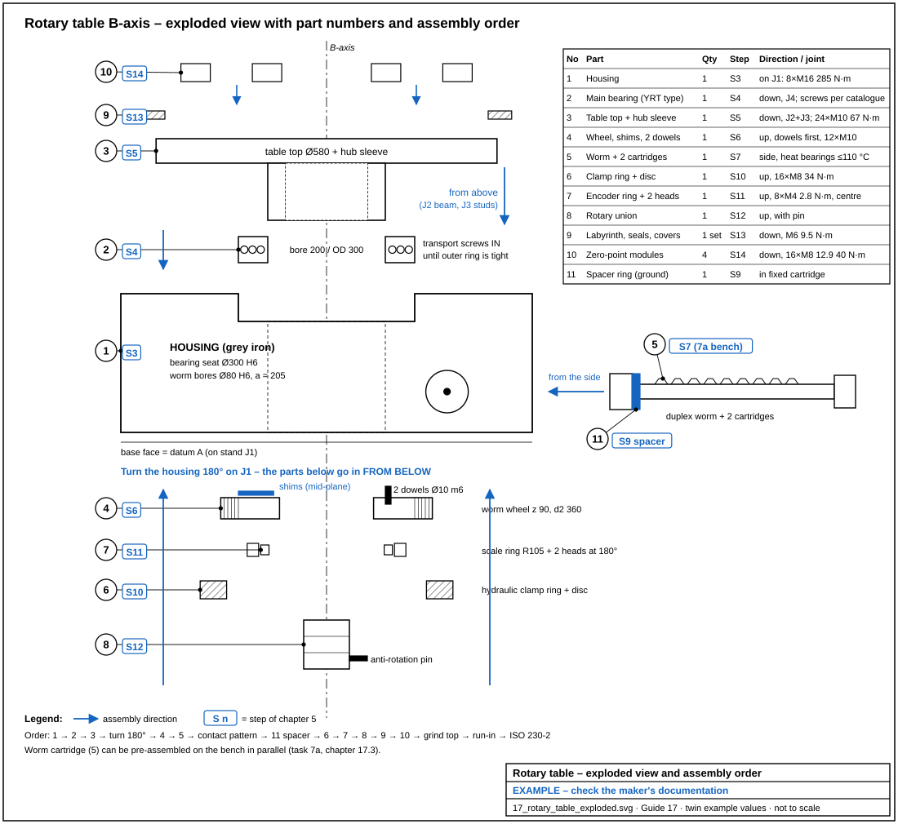
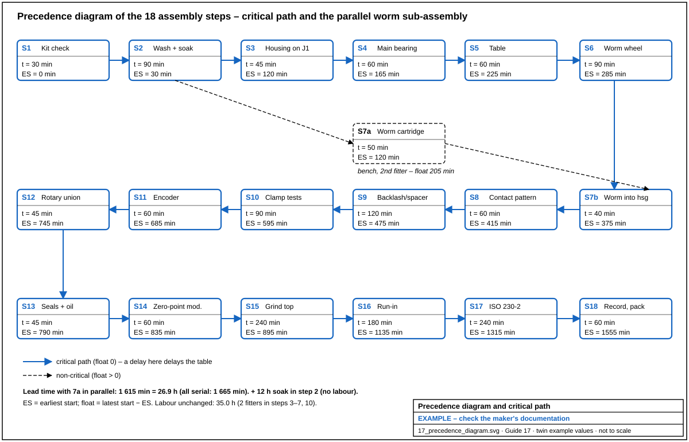
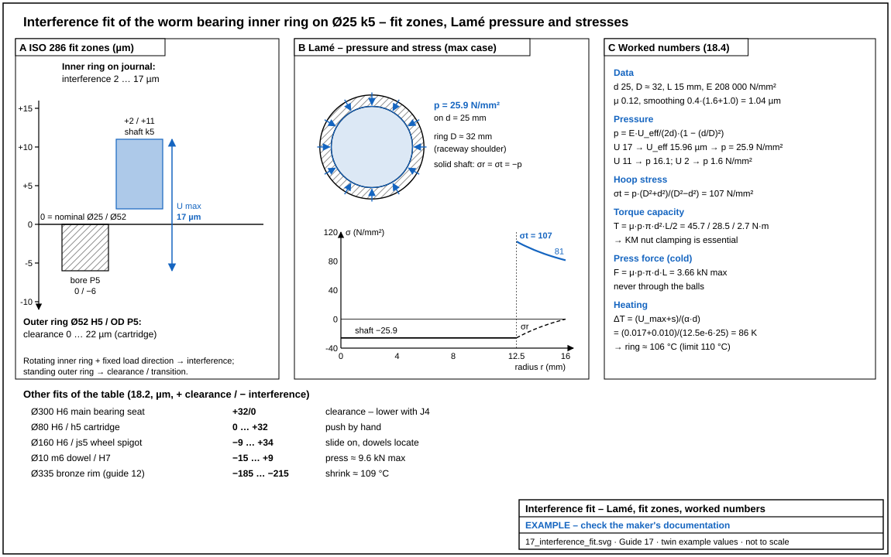
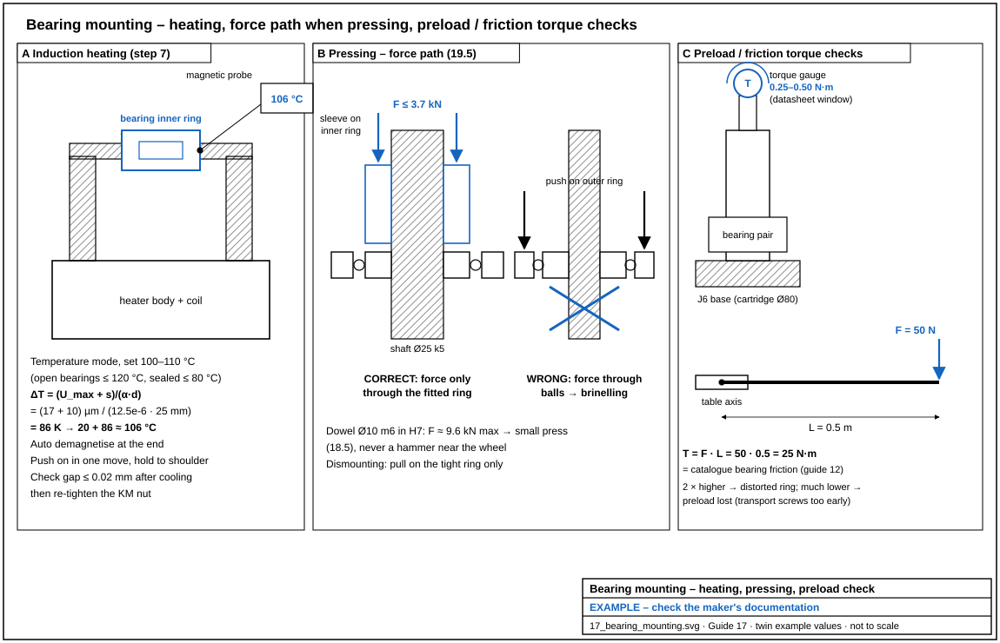
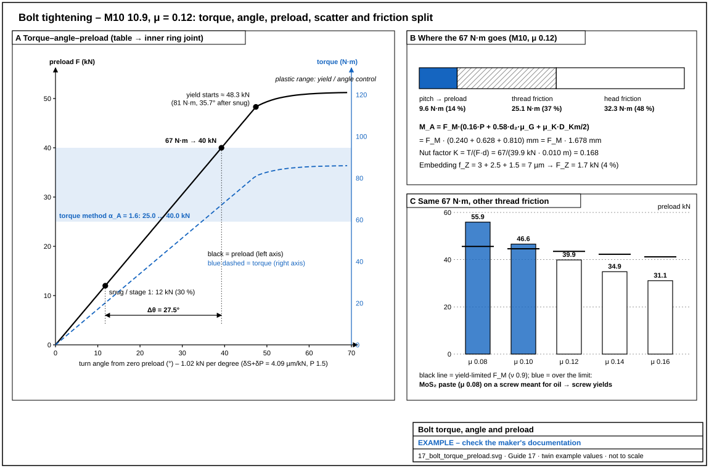
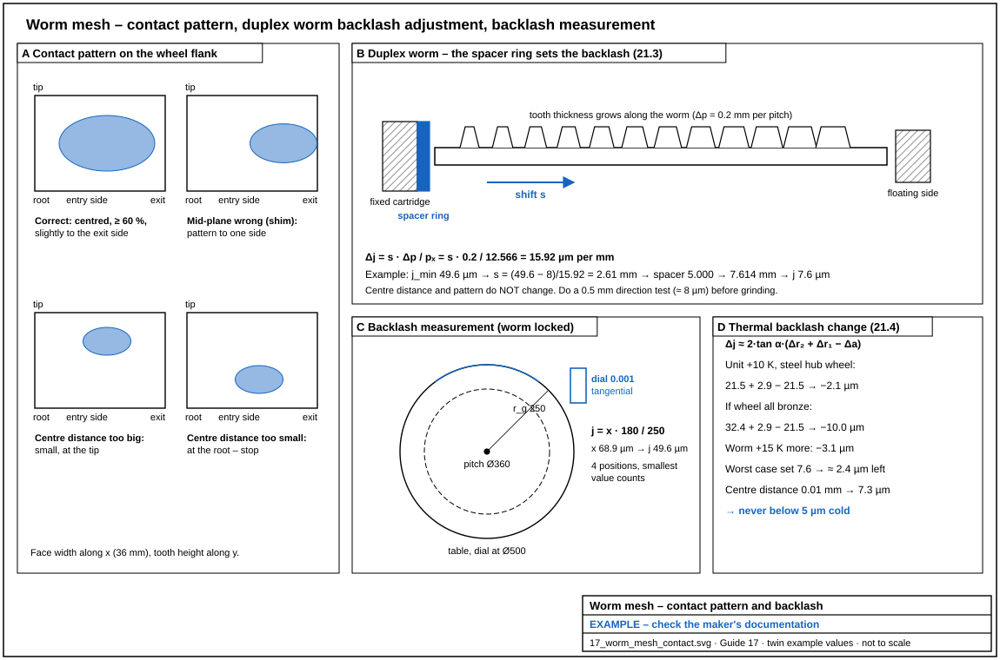
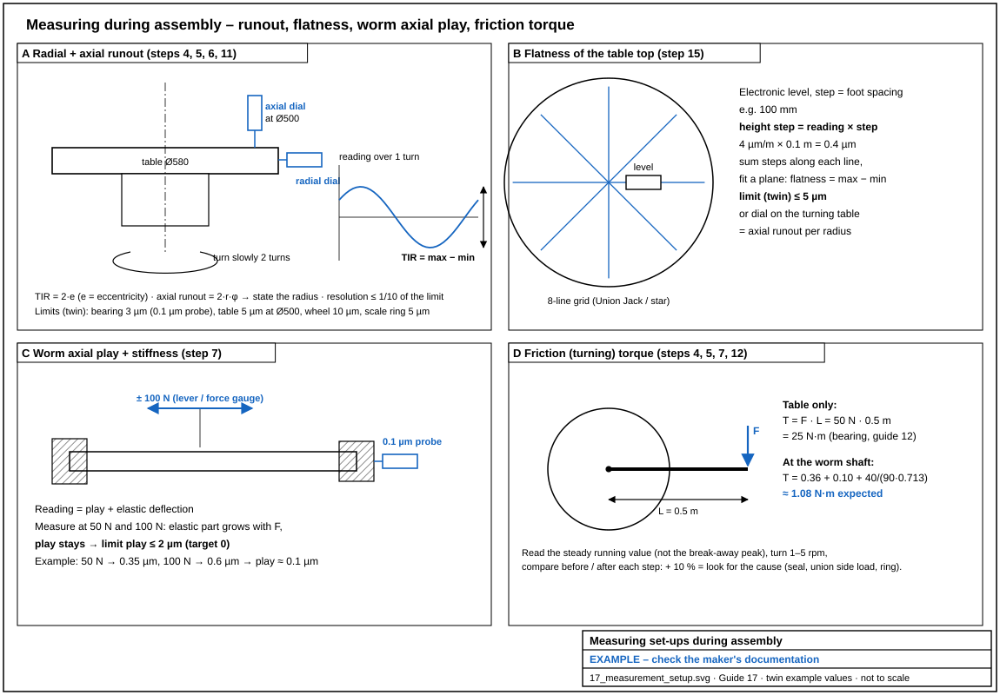
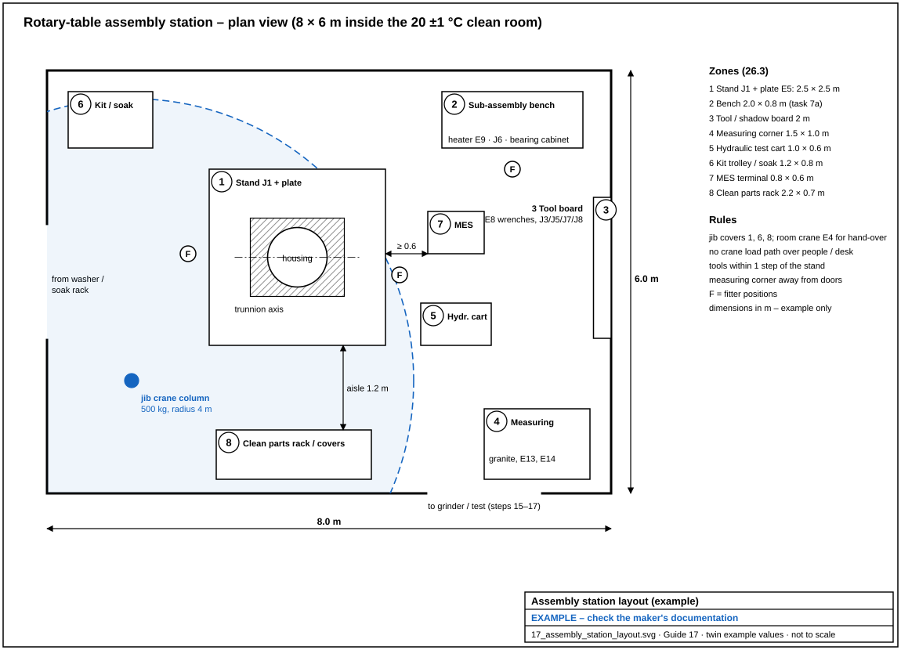

# 17 – Assembly: Rotary Table (B-axis) – Assembly Twin and Real Assembly Instruction

> **All numbers in this guide are example values from the twin.** They are typical for a 500 mm pallet
> class HMC rotary table (table Ø580, main bearing bore 200, worm gear 1 : 90, module 4). Before you
> assemble a real table, replace them with the values from **your drawings**, the **catalogues and mounting
> manuals of your bearing, encoder, clamp, rotary union and zero-point suppliers**, and **your own
> measurements**. Values marked **"check"** are uncertain or depend on a supplier or a standard edition.
> Costs use an example labour rate. They are **not** real prices.

Source files: `web/asmrt.js` (the Assembly tab, item 1), with data from `web/hmc.js` (HMC build item 1 –
rotary table design) and `web/wormmfg.js` (worm serial). Tab: **Assembly** (`#asm`).

Related guides: 12 (rotary table design, worm + wheel manufacturing, acceptance tests), 14 (bolt torques,
fits, measuring), 15 (numbering), 16 (standards register).

---

## Contents

1. Purpose
2. Where in the twin
3. Concepts – simply explained
4. Calculations (with the example numbers)
5. Real assembly – the 18 steps
6. Checklists
7. Common mistakes and lessons
8. Limits of the twin
9. How to use chapters 10–15
10. Science principles
11. Detailed specification (equipment, jigs, assembly room, consumables)
12. Identification and numbering
13. Standards
14. Complete worked example: table RT-2546-00001 with pair P-2546-00001
15. Data you still need
16. Glossary

**Part B – Assembly engineering reference**

17. Assembly theory – sequence, precedence diagram, critical path, DFA (Boothroyd–Dewhurst)
18. Fits and tolerances (ISO 286) and interference fits (Lamé, press force, heating temperature)
19. Bearing mounting – heating, pressing, preload, friction torque, YRT facts
20. Bolted joints – VDI 2230 basics, torque split, embedding, tightening methods, joint checks
21. Worm gear meshing – contact pattern, backlash, duplex adjustment, thermal effects
22. Thread lockers, retaining compounds and sealants
23. Sealing – O-ring grooves (ISO 3601), rotary shaft seals, labyrinth + sealing air
24. Technical cleanliness (ISO 16232 / VDA 19.1)
25. Measuring during assembly – runout, flatness, play, friction torque, uncertainty
26. Assembly tools, fixtures and the assembly station
27. Documentation – work instruction, work card, traveller, torque record
28. Quality – control plan, PFMEA, poka-yoke, capability
29. Ergonomics – lifting limits (NIOSH), working height, hand forces
30. Time standards – MTM basics, allowances, learning curve
31. Troubleshooting matrix
32. Buy list – catalogue examples + shopping list for one station
33. Glossary – Part B terms

Drawings (folder `docs/img`): 17_rotary_table_exploded, 17_precedence_diagram, 17_interference_fit,
17_bearing_mounting, 17_bolt_torque_preload, 17_worm_mesh_contact, 17_assembly_station_layout,
17_measurement_setup (all **examples** – check the maker's documentation).

---

## 1. Purpose

This guide tells a small team (1–2 fitters, one inspector) **how to assemble the HMC rotary table
(B-axis) in reality** – from the box of released parts to a signed ISO 230-2 acceptance protocol.

After reading it you can:

* prepare the parts (wash, deburr, soak at 20 °C) and the assembly room,
* fit the main bearing, the table, the worm wheel and the duplex worm in the right order,
* tighten every screw ring **crosswise in 3 stages** with the right torque,
* set the **wheel mid-plane** and check the **contact pattern**,
* set the **backlash** with the duplex worm by grinding the **spacer ring** (formula + example),
* test the **hydraulic clamp** (pressure + torque with a 1.0 m lever),
* centre the **angle encoder** and set its **2 read heads**,
* grind the table top **in its own bearing**, run the table in, and
* measure and calculate **accuracy A, repeatability R, reversal B** to ISO 230-2,
* buy the right **equipment (E1–E20)** and design and make the **jigs (J1–J12)**,
* fill in a complete **assembly record** with serials and measured values.

The twin (Assembly tab) shows all 18 steps on the cross-section of the table, draws the jigs in blue,
simulates the measured values and shows what happens when one of **7 typical assembly faults** is made.

What this guide does **not** do: design the table (that is guide 12), or replace the mounting manuals of
the bought parts. **When a supplier manual gives a different value, the supplier value wins.**

---

## 2. Where in the twin

### 2.1 How to open

1. Start the twin (see guide 01). Open `http://localhost:8080/` in the browser.
2. Click the tab **Assembly**.
3. The first button in the grey bar is **"1 · Rotary table (B-axis) – assembly twin"** (active). Item 2 is
   not built yet.

The Assembly tab reads the rotary table design from the **HMC build** tab (item 1). If you change design
inputs there (for example clamp torque, module, backlash target), the Assembly tab uses the new values the
next time it is shown. The worm serial comes from HMC item 2 (worm manufacturing twin).

### 2.2 What is on the page (cards from top to bottom)

| Card | What it shows | How to use it |
|---|---|---|
| **KPI row** | Rotary table serial (`RT-2546-00001`) + pair; Status (accepted / REJECT at step n); Labour (h); Labour cost ($, 45 $/h example); Accuracy A (″, with limit, R and B); Backlash (µm, with spacer change) | Quick result of the simulated table |
| **Assembly twin – rotary table (B-axis)** | Route bar with the 18 steps; buttons ▶ Play all, ◀, ▶\|, progress slider, **New table (random)**, **Download assembly record** | Click a step button to jump to it. Red/orange step buttons = check failed / warning |
| Step line | The how-to line that is active now | Follows the progress slider |
| Scene (left) | Cross-section of the table with the **jigs drawn in blue** (steps 3–15); step 1 = kit list with serials; step 2 = washer + soak rack with part temperature; step 16 = run-in temperature chart; step 17 = polygon + ISO 230-2 deviation chart | Watch how the part goes in and where you measure |
| Info panel (right) | Step name + phase, numbered how-to list, **Equipment (BUY)** with capability, **Jigs (MAKE)** with function, **Checks** (shown when the step is ≥ 90 % done), time × fitters | This is the work card of the step |
| **Inject an assembly fault** | 7 fault chips (see 7.1) | Click one or more – the simulated measurements change at once |
| **Acceptance + run-in** | From step 16: run-in temperature chart; from step 17: ISO 230-2 deviation chart (+ and − approach) and all acceptance checks | The final protocol view |
| **Assembly record – steps, time, result** | 18 rows: minutes, fitters, measured values, result (✓ ! ✕) | Click a row to jump to the step |
| **Tightening torques + sequence** | 10 joints: screws, class, torque, sequence | Copy into your work cards (check chapter 4.3) |
| **Equipment to BUY** | E1–E20 with "buy / make", required capability, used in step | Purchasing list (chapter 11.1) |
| **Jigs + fixtures to MAKE** | J1–J12 with design + function, used in step | Design list (chapter 11.2) |
| **Assembly room layout (example)** | 7 zones, crane runway, part flow left → right | Room planning (chapter 11.3) |
| **Guide – assembly rules + faults** | 6 rules + fault table with prevention | Short version of chapters 6–7 |

### 2.3 Buttons

| Button | Effect |
|---|---|
| ▶ Play all / ❚❚ Pause | Plays all 18 steps one after the other (about 6 s per step, short hold at the end) |
| ◀ / ▶\| | Previous / next step (stops play) |
| Progress slider | Moves inside the step (0 … 100 %). The checks appear at ≥ 90 % |
| New table (random) | Next serial (`RT-2546-00002` …) with new random measured values. The same serial always gives the same values (fixed random seed = 4000 + serial number) |
| Download assembly record | JSON file `RT-2546-0000n_assembly_record.json` (fields in 12.4) |

### 2.4 Deep links (put them in work instructions and training)

URL parameters (query part before `#asm`):

| Parameter | Meaning | Values |
|---|---|---|
| `arst` | step number to open | 1 … 18 |
| `aru` | progress inside the step | 0 … 1 (if `arst` is given without `aru`, the step opens finished = 1, checks visible) |
| `arf` | faults switched on | comma list of `dirt`, `seq`, `shim`, `spacer`, `seal`, `enc`, `oil` |

| Link | Shows |
|---|---|
| `/?arst=5&aru=0.5&arf=enc,seal#asm` | Step 5 (lower the table) half done, faults "encoder not centred" + "cut O-ring" on. At 50 % the checks are not shown yet ("measured at the end of the step") – move the slider to the end, or open steps 10 / 11 to see the faults |
| `/?arst=4&arf=dirt#asm` | Step 4 finished with a chip on the bearing seat → bearing axial runout too high |
| `/?arst=5&arf=seq#asm` | Table screws tightened in a circle → table runout too high |
| `/?arst=6&arf=shim#asm` | Wrong wheel shim → mid-plane +0.15 mm |
| `/?arst=9#asm` | Backlash step: spacer calculation with the example numbers |
| `/?arst=9&arf=spacer#asm` | Spacer ground with the wrong sign → gear too loose |
| `/?arst=10&arf=seal#asm` | Pressure test fails (cut O-ring) |
| `/?arst=11&arf=enc#asm` | Encoder scale runout 20 µm, unequal head signals |
| `/?arst=16&arf=oil#asm` | Run-in without oil → temperature and squeal |
| `/?arst=17#asm` | ISO 230-2 result A / R / B |

### 2.5 How to use the twin before the real assembly

1. **Train the team:** play all 18 steps once together. Each fitter explains one step.
2. **Fault training:** switch on one fault at a time. Ask: "at which step do we find it, and what do we
   do?" Compare with the table in 7.1.
3. **Work cards:** for each step copy the info panel (how-to, equipment, jigs, checks, time) into your
   work card `VC-ASM-WI-0101-A` (chapter 12) and add the real values from your drawings.
4. **Purchasing:** use the Equipment and Jig cards with chapter 11.
5. **Record template:** download the JSON assembly record and use its structure for your MES / paper
   record.

---

## 3. Concepts – simply explained

### 3.1 The table you assemble (from bottom to top)

```
                  ┌────────────── test pallet 500 × 500 ───────────────┐
                  │   4 zero-point modules in the table top              │
   ┌──────────────┴──────────────────────────────────────────────────────┴──┐
   │ TABLE TOP Ø580 + hub sleeve going down through the bearing               │
   └──┬───────────────────────────┬─────────────────────────┬────────────────┘
      │ main axial-radial bearing │ clamp disc ← hydraulic clamp ring       │ labyrinth + seal
      │ (bore 200, seat Ø300)     │                                          │
      │  encoder scale ring (R 105) + 2 read heads, on the hub sleeve       │  HOUSING
      │  WORM WHEEL (z 90, d2 360) bolted under the hub ───── WORM (a = 205) │  (worm in 2
   rotary union in the centre                                                │   cartridges)
   └──────────────────────────── base face = reference A ───────────────────┘
```



The order of assembly follows this picture: housing → bearing → table (from above) → turn the housing
over → wheel (from below) → worm (from the side) → contact pattern → backlash → clamp → encoder →
union → seals + oil → zero-point modules → grind the top → run-in → acceptance test.

### 3.2 Why clean and why 20 °C

* **Clean:** one chip of 5 µm under the bearing ring tilts the ring. The table then wobbles by the same
  order of size – but the whole tolerance of the table top is only 5 µm. A chip in the worm mesh damages
  the bronze. Dirt in the clamp or union cuts O-rings.
* **20 °C:** all drawing sizes are valid at 20 °C (ISO 1). Steel grows **11.5 µm per metre per kelvin**.
  A Ø300 seat that is 1 K warmer is 3.5 µm bigger (calculation 4.4). Our limits are 3–10 µm, so a
  warm part gives a wrong reading. Rule: **parts rest ≥ 12 h in the assembly room** (soak rack E3) before
  any µm measurement, and the measuring tools rest there too.

### 3.3 Crosswise tightening in 3 stages – and why

A ring of screws (for example 24 × M10 on the bearing ring) pulls a thin precise ring against a face.

* If you tighten **one screw after the other in a circle**, the first screws pull the ring down on one
  side; the ring tilts and is "frozen" in a wavy shape. Runout goes up (twin fault `seq`: +4.5 µm radial,
  +5.5 µm axial).
* **Crosswise** (opposite screw next, then 90°, then 45° …) pulls the ring down evenly all around.
* **3 stages (30 % → 70 % → 100 % of the torque):** in stage 1 the ring is seated without force, in
  stage 2 the friction faces settle, in stage 3 the full preload is set evenly. A final **check pass** at
  100 % in a circle confirms that no screw turns any more.
* For the table and the bearing inner ring: **turn the table by hand between the stages**, so the rollers
  find their position and the ring is not clamped in a tilted position.
* Mark every screw with a paint pen after the final torque (shows "done" and shows if a screw turns later).

The sequences for 6, 8, 12, 16 and 24 screws are in 5.0.

### 3.4 Bearing handling (the main axial-radial bearing)

The main bearing is an axial-radial roller bearing (bought, bore 200). It is **preloaded and matched by
its maker**. Its accuracy (runout of a few µm) is only reached if:

1. It is lifted with the **lifting ring J4** under the outer ring, with the **transport screws IN**. The
   transport screws hold inner and outer ring together. **Never separate the rings.**
2. It is lowered onto the seat **without tilting** (slow crane speed ≤ 0.5 m/min).
3. The **screws and torques are exactly as in the bearing catalogue** (they are part of the rated
   accuracy). The twin uses 24 × M10, 10.9, 67 N·m as an example – **check the catalogue**.
4. The transport screws are removed **only after** the outer ring screws are tight.
5. No hammer, no compressed air on the rollers (it blows dirt in and spins the rollers dry), no flame.

### 3.5 Mid-plane of the worm wheel

The **mid-plane** is the plane of the wheel that must contain the **worm axis**. If the wheel is too high
or too low, the worm touches the wheel teeth at one edge of the face width → small contact area, high
pressure, heat, wear. The mid-plane is set with **shims** under the wheel and measured with the
**setting mandrel J5** in the worm bores. Limit (example): **±0.02 mm**.

### 3.6 Contact pattern

Thin marking paste (Prussian blue) on 3 worm turns. Turn the worm by hand in both directions with a light
brake on the table. The paste leaves a mark on the wheel flank = the area that really carries load.

| Pattern | Meaning | Action |
|---|---|---|
| Centred, ≥ 60 % of the flank, slightly to the **exit side** | correct; the oil can enter on the entry side | none |
| Off centre along the face width | mid-plane wrong | change the wheel shims (step 6) and repeat |
| Small, at the tip or root | wheel or worm geometry / centre distance | stop – check the part records (guide 12) |

Twin: offset along the face = mid-plane / 0.5 mm; ≤ 15 % off centre is OK; size = 72 % − 0.4 × offset.

### 3.7 Duplex worm – backlash setting with a spacer ring

A **duplex worm** has a slightly different lead on its left and right flanks (Δp = 0.2 mm per pitch in
the example). So the worm thread gets **thicker along the worm**. If you shift the worm axially by s,
the thread thickness in the mesh changes by

  **Δj = s · Δp / pₓ**  (pₓ = axial pitch = π · m)

The centre distance and the contact pattern do **not** change. The worm position is fixed by a **spacer
ring** in the fixed-side cartridge. You:

1. assemble with a **trial spacer** (known thickness),
2. measure the backlash j,
3. calculate the needed shift **s = (j − j_target) / (Δp / pₓ)**,
4. grind the spacer ring thicker (or thinner – **depends on the drawing direction of the thread growth**)
   by s, ±0.002 mm,
5. measure again: **5–10 µm** at the wheel pitch circle, at 4 table positions, smallest value counts.

**Never set the backlash to zero cold.** In operation the worm gets warmer than the wheel and the gap
closes further. Zero cold = jamming warm.

Drawing and theory (contact pattern, duplex shift, thermal backlash change): chapter 21.

### 3.8 Clamp test

During indexed machining the table is held by a **hydraulic clamp ring** (thin wall, pressed against a
clamp disc by oil pressure p, example 5 MPa), not by the worm. Two tests:

* **Pressure test:** 1.5 × p (7.5 MPa) for 10 min with a hand pump: no leak, pressure drop ≤ 0.1 MPa.
* **Torque test:** a **1.0 m lever J9** is bolted to the table and pushed with a **load cell**:
  T = F · L. At the holding torque (3 000 N·m → 3 000 N) the table must not move.
* **Angle change when clamping:** clamp / unclamp with a mirror on the table and an autocollimator:
  ≤ 1″. A table that turns when it clamps loses its position.

### 3.9 Encoder centring and 2 opposite read heads

The angle encoder measures the table angle directly (the worm only drives, the encoder decides the
position). Its scale ring sits on the hub sleeve. If the ring centre is offset from the table axis by e,
one read head sees an angle error that goes once around per turn with amplitude **e / R** (radians).
With e = 5 µm and R = 105 mm this is **9.8″** (calculation 4.5) – twice the whole accuracy limit.

**Two heads exactly opposite (180°)** see the same error with opposite sign. The control averages both
→ the once-per-turn error cancels. But:

* even harmonics (2 × per turn, from an **oval** scale – uneven screw tightening) do **not** cancel,
* the read heads only work inside their mounting tolerance (gap, signal amplitude),

so you still **centre the ring with a dial gauge (≤ 5 µm runout)** and tighten its screws lightly
crosswise, then measure again.

Note: a dial gauge on a ring shows the **total indicator runout TIR = 2 × e**. TIR 5 µm means e = 2.5 µm.

### 3.10 Grinding the table top in its own bearing

The last machining of the table top (top face + zero-point module faces) is done **after assembly, with
the table turning in its own bearing** (driven by its own servo or by the grinding driver J12). All
errors of the bearing, the screw joints and the parts below are then **ground out** of the functional
surface: the top is flat and square to the real axis of rotation. Limits (example): flatness ≤ 5 µm,
parallel to the base ≤ 10 µm, module faces same height ±3 µm.

### 3.11 Run-in

2 h with changing speed and direction (example: 2 h at 50 % speed, then 30 min at max – guide 12). The
worm and wheel flanks smooth each other, the oil spreads, the bearing grease distributes. You log the
temperature: **rise ≤ 15 K**, no noise peaks, oil level OK. A missing oil fill shows as a fast
temperature rise and squeal (twin fault `oil`: 34 K instead of about 9 K).

### 3.12 ISO 230-2 terms – A, R, B, E (and M)

ISO 230-2 tells how to measure the positioning of an NC axis. For the rotary table (example plan of the
twin): **24 target positions** (every 15°), **5 runs in each direction** (+ and −), measured with an
autocollimator and a 24-face polygon. Positional deviation x = actual angle − target angle (in ″).

For each position j and direction (↑ = +, ↓ = −), from the 5 values:

| Symbol | Name | Formula |
|---|---|---|
| x̄↑j, x̄↓j | mean unidirectional positional deviation | sum of the 5 values / 5 |
| s↑j, s↓j | estimator of standard deviation (unidirectional) | √( Σ(x − x̄)² / (n − 1) ), n = 5 |
| Bj | reversal value at j | x̄↑j − x̄↓j |
| **B** | **reversal value of the axis** | max \|Bj\| |
| R↑j, R↓j | unidirectional repeatability | 4 · s↑j, 4 · s↓j |
| Rj | bidirectional repeatability at j | max( 2s↑j + 2s↓j + \|Bj\| ; R↑j ; R↓j ) |
| **R** | **repeatability of the axis** | max Rj (bidirectional) – **the twin shows max(R↑j, R↓j) (unidirectional)** |
| **E** | **bidirectional systematic positioning error** | max(x̄↑j, x̄↓j) − min(x̄↑j, x̄↓j) over all j |
| M | mean bidirectional positional deviation range | max x̄j − min x̄j, with x̄j = (x̄↑j + x̄↓j)/2 |
| **A** | **bidirectional accuracy of positioning** | max(x̄↑j + 2s↑j ; x̄↓j + 2s↓j) − min(x̄↑j − 2s↑j ; x̄↓j − 2s↓j) |

Meaning in simple words: **A** = the full band that contains (almost) all positions from both
directions; **R** = how well the table comes back to the same place; **B** = the difference between
coming from + and from −; **E** = the band of the mean values (the systematic part only).

Example limits of the twin: **A ≤ 5″, R ≤ 2″, B ≤ 2″** (A limit = max(5″, accuracy budget rounded up)).
The full calculation with 240 measured values is in chapter 14.17. **Check the current edition of
ISO 230-2 and ISO 10791-4** for the exact definitions, the number of targets for rotary axes and the test
cycle before you write the acceptance protocol.

---

## 4. Calculations (with the example numbers)

### 4.1 Input data (from HMC build item 1, example values)

| Symbol | Meaning | Value |
|---|---|---|
| m | axial module | 4 mm |
| z1 / z2 | worm starts / wheel teeth | 1 / 90 (ratio 1 : 90) |
| d1 / d2 | worm / wheel pitch diameter | 50 / 360 mm |
| a | centre distance (d1 + d2)/2 | 205 mm |
| pₓ | axial pitch π · m | 12.566 mm |
| Δp | duplex lead difference | 0.2 mm |
| j0 | backlash as hobbed (trial spacer) | 0.050 mm |
| j_t | target backlash | 0.008 mm (window 0.005–0.010) |
| T_cl | clamp holding torque (catalogue) | 3 000 N·m at p = 5 MPa |
| Rt | table radius | 290 mm (Ø580) |
| Rs | encoder scale radius | 105 mm |
| enc | encoder accuracy | ±2.5″ |
| ecc | encoder eccentricity after centring (input) | 0.005 mm |
| mt | table + hub + wheel mass | 220 kg |

### 4.2 Spacer ring for the backlash

Backlash change per mm of axial worm shift:

  Δj / s = Δp / pₓ = 0.2 / 12.566 = **0.01592 mm per mm** = 15.92 µm per mm of shift

Measuring the backlash: the worm is locked, a dial gauge touches the table **tangentially** at radius r_g,
the table is turned + and − by hand. Reading x (total movement). Convert to the wheel pitch circle:

  j = x · (d2 / 2) / r_g

Example: dial at Ø500 (r_g = 250 mm), x = 0.0689 mm → j = 0.0689 · 180 / 250 = **0.0496 mm**.

Needed shift:

  **s = (j − j_t) / (Δp / pₓ) = (0.0496 − 0.008) / 0.01592 = 0.0416 / 0.01592 = 2.61 mm**

→ grind the spacer ring **2.61 ±0.002 mm** thicker (direction per drawing). Example: trial spacer
5.000 mm → new spacer **7.614 mm** (if thicker = tighter for your design).

Safety margin to jamming: the gear jams at s_jam = j / (Δp/pₓ) = 0.0496 / 0.01592 = 3.12 mm. Margin
3.12 − 2.61 = **0.51 mm** of shift = 8 µm of backlash. This is why a sign error is dangerous in one
direction (jamming) and useless in the other (twin fault `spacer`: backlash ≈ 2 · j − 8 ≈ 91 µm).

Backlash as an angle (without encoder): 0.008 / 180 = 44 µrad = **9.2″**. With the direct encoder the
reversal at the table is much smaller (twin ≈ 0.6″), because the encoder closes the loop.

### 4.3 Bolt torques and preload

The twin torque table (`TQ` in asmrt.js, assumption μ ≈ 0.12, lightly oiled thread):

| Joint | Screws | Class | Twin torque | Doc 14 torque (ν = 0.9, μ = 0.12) | Max preload F_M at twin torque ≈ F_M,14 · T_twin / T_14 | Min preload F_M / α_A (α_A = 1.6) |
|---|---|---|---|---|---|---|
| Housing → stand adapter | 8 × M16 | 10.9 | 285 N·m | 302 N·m | 119 · 285/302 = **112 kN** | 70 kN |
| Bearing outer ring → housing | 24 × M10 | 10.9 | 67 N·m | 71 N·m | 43.4 · 67/71 = **41.0 kN** | 25.6 kN |
| Table / hub → bearing inner ring | 24 × M10 | 10.9 | 67 N·m | 71 N·m | 41.0 kN | 25.6 kN |
| Worm wheel → hub sleeve | 12 × M10 + 2 dowels Ø10 | 10.9 | 67 N·m | 71 N·m | 41.0 kN | 25.6 kN |
| Worm cartridge flange | 6 × M8 | 10.9 | 34 N·m | 36.1 N·m | 27.3 · 34/36.1 = **25.7 kN** | 16.1 kN |
| Worm bearing KM nut | KM5 (M25 × 1.5, for the Ø25 k5 journal – app: “size per worm journal, e.g. KM5”) | – | to the bearing friction torque | – | – | – |
| Clamp ring → housing | 16 × M8 | 10.9 | 34 N·m | 36.1 N·m | 25.7 kN | 16.1 kN |
| Encoder scale ring → sleeve | 8 × M4 | 8.8 | 2.8 N·m | 3.0 N·m | 4.4 · 2.8/3.0 = **4.1 kN** | 2.6 kN |
| Zero-point modules → table | 4 × 4 × M8 | 12.9 | 40 N·m | 42.2 N·m | 32.0 · 40/42.2 = **30.3 kN** | 19.0 kN |
| Covers, labyrinth | M6 | 8.8 | 9.5 N·m | 10.1 N·m | 9.6 kN | 6.0 kN |

Notes:

* The twin torques are **about 94 % of the doc 14 table** (a small margin for scatter). Guide 12 §11.9
  gives 73 N·m for M10 10.9 (other head-diameter assumption). All are inside the normal scatter
  (±23–28 % preload with a normal torque wrench). **For the bearing rings and the encoder use exactly
  the catalogue value of the bearing / encoder maker.**
* Torque is (almost) proportional to preload for the same μ – that is how the column "max preload" is
  estimated.
* Clamping force of the bearing outer ring: 24 × 25.6 kN (minimum) = **≥ 615 kN** all around.
* If the thread is dry or has MoS₂ paste, μ changes and the same torque gives a different preload.
  Use the condition the catalogue states (normally lightly oiled).

Stage torques (30 / 70 / 100 %):

| Final torque | Stage 1 (30 %) | Stage 2 (70 %) | Stage 3 (100 %) | Wrench (E8 range) |
|---|---|---|---|---|
| 285 N·m | 86 N·m | 200 N·m | 285 N·m | 60–340 N·m |
| 67 N·m | 20 N·m | 47 N·m | 67 N·m | 20–100 N·m |
| 40 N·m | 12 N·m | 28 N·m | 40 N·m | 5–60 N·m |
| 34 N·m | 10 N·m | 24 N·m | 34 N·m | 5–60 N·m |
| 9.5 N·m | 3 N·m | 7 N·m | 9.5 N·m | 5–60 N·m (stage 1 by hand, snug) |
| 2.8 N·m | 0.8 N·m | 2.0 N·m | 2.8 N·m | 1–5 N·m |

Rule: use a wrench in **20–100 % of its range** (best accuracy). 20 N·m on the 20–100 wrench is the
lowest allowed point – OK.

### 4.4 Thermal error

  ΔD = α · D · ΔT

| Case | Calculation | Result |
|---|---|---|
| Steel seat Ø300, 1 K warmer | 11.5·10⁻⁶ · 300 · 1 | **3.5 µm** |
| Grey iron housing seat Ø300 (α ≈ 10.5·10⁻⁶), 1 K | 10.5·10⁻⁶ · 300 · 1 | 3.2 µm |
| Table Ø580, 3 K warmer (part just from the washer, not soaked) | 11.5·10⁻⁶ · 580 · 3 | 20 µm |
| Housing centre distance 205 mm, 5 K | 10.5·10⁻⁶ · 205 · 5 | 10.8 µm (> ±10 µm tolerance) |

The bearing runout limit is 3 µm. One kelvin difference between the bearing and the seat is already
in that order → **soak ≥ 12 h, room 20 ±1 °C, do not touch precision faces with bare hands for a long
time** (hands warm the part).

### 4.5 Encoder eccentricity → arc seconds

Angle error with one read head (once per turn, amplitude):

  **φ = e / R** (rad); in arc seconds: φ″ = e / R · 206 265

| e (eccentricity) | Dial TIR = 2e | Calculation | φ (1 head) |
|---|---|---|---|
| 2.5 µm | 5 µm (twin limit) | 0.0025 / 105 · 206 265 | **4.9″** |
| 5 µm | 10 µm | 0.005 / 105 · 206 265 | **9.8″** |
| 20 µm (twin fault `enc`) | 40 µm | 0.020 / 105 · 206 265 | **39″** |

Why 2 opposite heads cancel it: head 1 reads θ + (e/R)·sin(θ + φ0); head 2 at 180° reads
θ + (e/R)·sin(θ + φ0 + 180°) = θ − (e/R)·sin(θ + φ0). The average is **θ** – the error is gone.
This works for every **odd** harmonic (1×, 3× per turn). It does **not** work for **even** harmonics
(2× per turn, for example an oval ring after uneven tightening). The twin models the encoder fault as a
2nd harmonic of 3.2″ – exactly the part that 2 heads cannot remove.

Accuracy budget of HMC item 1 (2 heads): √(enc² + ecc² + thermal²) = √(2.5² + 0² + 1²) = **±2.7″** →
acceptance limit A ≤ max(5, ⌈2.7⌉) = **5″**.

### 4.6 Clamp torque test

  **F = T / L**

| Case | Calculation | Load cell force |
|---|---|---|
| Holding torque (catalogue) 3 000 N·m, lever L = 1.0 m | 3 000 / 1.0 | **3 000 N** (60 % of the 5 kN cell) |
| Test up to 1.1 × T_cl (if the clamp maker allows) | 3 300 / 1.0 | 3 300 N |
| Needed clamp torque (design) S · F_c · r_c = 2 · 4 000 · 0.25 | 2 000 N·m | 2 000 N |
| "Table must not move": 1″ at the dial radius 250 mm | 250 · 1/206 265 | 1.2 µm |

Lever length error: if the load cell sits at 0.98 m instead of 1.00 m, the torque is 2 % lower. Measure
L from the table axis to the load line with a tape (±2 mm = ±0.2 %).

**Important:** during the torque test the worm shaft must be **free** (no motor, no brake on the
worm). The worm is not self-locking (lead angle 4.57° > friction angle 1.83°), so if the clamp slips the
table turns the worm backwards – and the worm teeth are **not** loaded. If the worm is locked, a slipping
clamp puts 3 000 N·m on the worm teeth (allowed by Bach only about 2 714 N · 0.18 m ≈ 490 N·m) → damage.

### 4.7 Pressure test

  p_test = 1.5 · p = 1.5 · 5 = **7.5 MPa**, 10 min, drop ≤ 0.1 MPa.

Gauge check: a 0–16 MPa gauge of class 0.6 has an error of ±0.6 % · 16 = **±0.096 MPa**. That is as large as the
limit 0.1 MPa. This is why the app's E10 asks for a **digital pressure transducer 0.1 %** (±0.016 MPa on
16 MPa) **or a class 0.25 gauge** (±0.04 MPa); a 0–10 MPa class 0.6 gauge (±0.06 MPa) is the minimum (**check**). Keep the oil temperature constant – 1 K
change in a closed small volume changes the pressure noticeably.

### 4.8 ISO 230-2 statistics – one position by hand

Position 1 (0°), + direction, 5 values (″): 1.3, 1.5, 1.2, 1.3, 1.0

* Mean x̄↑ = (1.3 + 1.5 + 1.2 + 1.3 + 1.0) / 5 = 6.3 / 5 = **1.26″**
* Deviations from the mean: +0.04, +0.24, −0.06, +0.04, −0.26
* Squares: 0.0016, 0.0576, 0.0036, 0.0016, 0.0676 → sum 0.132
* s↑ = √(0.132 / (5 − 1)) = √0.033 = **0.18″**
* R↑ = 4 · 0.18 = 0.73″; band x̄↑ ± 2s↑ = 0.90 … 1.62″

Same position, − direction: 0.9, 0.6, 1.0, 0.8, 1.0 → x̄↓ = 0.86″, s↓ = 0.17″.
B1 = 1.26 − 0.86 = 0.40″. R1 (bidirectional) = max(2·0.18 + 2·0.17 + 0.40; 0.73; 0.67) = 1.10″.

Do this for all 24 positions (a spreadsheet does it), then A, R, B, E as in 3.12. Full table: 14.17.

### 4.9 Labour and time (twin)

| Item | Calculation | Result |
|---|---|---|
| Lead time (sum of step times) | 30+90+45+60+60+90+90+60+120+90+60+45+45+60+240+180+240+60 min | 1 665 min = **27.8 h** + 12 h soak |
| Labour (time × fitters) | steps 3, 4, 5, 6, 7, 10 with 2 fitters | 2 100 min = **35.0 h** |
| Labour cost | 35.0 h × 45 $/h (example) | **$1 575** |

---

## 5. Real assembly – the 18 steps

How to read each step: **Goal · Preparation · Equipment · Jigs · Torques + sequence · Procedure ·
Measurement + limit · If out of limit · Record fields · Time + fitters.** All limits are example values
from the twin.

### 5.0 Crosswise sequences (copy onto the work cards)

Number the holes **clockwise 1 … n**, hole 1 next to the reference mark (dowel or "0" mark). Mark the
numbers on the part with a paint pen before you start.

**24 screws** (bearing outer ring, table → inner ring) – pass order:

1. hole 1 (0°)
2. hole 13 (180°)
3. hole 7 (90°)
4. hole 19 (270°)
5. hole 4 (45°)
6. hole 16 (225°)
7. hole 10 (135°)
8. hole 22 (315°)
9. hole 2 (15°)
10. hole 14 (195°)
11. hole 8 (105°)
12. hole 20 (285°)
13. hole 5 (60°)
14. hole 17 (240°)
15. hole 11 (150°)
16. hole 23 (330°)
17. hole 3 (30°)
18. hole 15 (210°)
19. hole 9 (120°)
20. hole 21 (300°)
21. hole 6 (75°)
22. hole 18 (255°)
23. hole 12 (165°)
24. hole 24 (345°)

Do this full pass at 30 %, again at 70 %, again at 100 %, then one **check pass at 100 % in a circle**
1 → 24 (no screw may turn more than a few degrees; if one turns a lot, do one more crosswise 100 % pass).

```
                 1 (0°)
          24           2
       23                 3
     22                     4
    21                       5
   20                         6
   19 (270°)   B-axis     7 (90°)
   18                         8
    17                       9
     16                    10
       15                11
          14         12
                13 (180°)
   order: 1-13-7-19 · 4-16-10-22 · 2-14-8-20 · 5-17-11-23 · 3-15-9-21 · 6-18-12-24
```

**12 screws** (worm wheel): 1-7-4-10 · 2-8-5-11 · 3-9-6-12
**16 screws** (clamp ring): 1-9-5-13 · 3-11-7-15 · 2-10-6-14 · 4-12-8-16
**8 screws** (stand adapter, encoder ring): 1-5-3-7 · 2-6-4-8
**6 screws** (worm cartridge flange): 1-4 · 2-5 · 3-6

---

### Step 1 – Kit check + traceability (phase: Prepare)

* **Goal:** all parts present, released, and the right matched pair.
* **Preparation:** work order `WO-YYWW-nnnn` open in the MES; kit trolley; part records / CMM reports.
* **Equipment:** E20 scanner + MES tablet.
* **Jigs:** –
* **Torques:** –
* **Procedure:**
  1. Scan every serial into the assembly record: housing, table + hub sleeve, main bearing (lot),
     worm `WRM-…`, wheel `WHL-…`, pair `P-…`, worm cartridges + spacer, clamp ring + disc, encoder,
     rotary union, 4 zero-point modules.
  2. Check that every CMM report / part record is **released** and there is **no open NCR**.
  3. Check that worm and wheel carry the **same pair number**.
  4. Check counts of screws, dowels, O-rings, shims against the BOM; screws are new (not re-used).
* **Measurement + limit:** pair worm = wheel; open NCRs = 0.
* **If out of limit:** wrong pair → stop, get the right pair from stores (never mix). Open NCR → stop
  until quality releases.
* **Record:** all serials, report numbers, fitter, date/time.
* **Time:** 30 min × 1 fitter.

### Step 2 – Wash, deburr, soak at 20 °C (phase: Prepare)

* **Goal:** parts clean and at 20 °C before any µm measurement.
* **Preparation:** washer filled and at temperature; filter patch kit; soak rack empty.
* **Equipment:** E1 clean room, E2 parts washer + ultrasonic tank, E3 soak rack.
* **Procedure:**
  1. Deburr all edges (especially O-ring chamfers, cross holes, thread starts).
  2. Blow out every oil channel and every tapped hole (not bearings).
  3. Wash housing and table in the spray-rinse-dry cabinet; small parts in the ultrasonic tank.
  4. Filter-patch test on the housing (rinse a defined area, filter the rinse, weigh the residue).
  5. Put parts on the soak rack. Cover them (clean film). Wait **≥ 12 h** at 20 ±1 °C.
  6. Bearings, encoder and seals stay in their original packing until they are fitted.
* **Measurement + limit:** filter patch residue **≤ 5 mg** (example – define the method and limit,
  e.g. per ISO 16232 / VDA 19.1, **check**); soak ≥ 12 h; room 20 ±1 °C.
* **If out of limit:** wash again; find the source (chips in blind holes, casting sand).
* **Record:** residue mg, soak start/end time, room temperature.
* **Time:** 90 min × 1 fitter (+ 12 h soak, no labour).

### Step 3 – Housing on the assembly stand, level (phase: Base)

* **Goal:** housing fixed on the rotatable stand, level, bearing seat clean.
* **Preparation:** stand J1 with adapter plate clean; locking pin at 0°; round slings + shackles.
* **Equipment:** E4 crane + hoist, E5 assembly plate, E6 precision level, E8 torque wrench 60–340 N·m.
* **Jigs:** J1 rotatable assembly stand.
* **Torques:** housing → adapter **8 × M16, 10.9, 285 N·m**, crosswise 1-5-3-7 · 2-6-4-8, 2 stages
  (e.g. 140 / 285 N·m).
* **Procedure:**
  1. Lift the housing with round slings (not on machined faces). Slow speed when lowering.
  2. Put it on the adapter, align with the locating pins, fit 8 × M16, tighten.
  3. Level the stand with its feet: 2 directions (X and Y).
  4. Clean the bearing seat again: lint-free cloth + alcohol. Check by finger tip and light: no burr,
     no fluff.
* **Measurement + limit:** level **≤ 0.02 mm/m** both directions.
* **If out of limit:** adjust the feet; check the floor/plate.
* **Record:** level X / Y, torque wrench ID `GA-TQW-…`.
* **Time:** 45 min × 2 fitters.

### Step 4 – Fit the main axial-radial bearing (phase: Bearing + table)

* **Goal:** bearing on its seat, screws tight, runout small.
* **Preparation:** open the bearing packing only now; read the bearing mounting manual; seat oiled
  lightly (if the manual says so); screws, washers as per catalogue.
* **Equipment:** E4 crane, E7 dial indicators (better: electronic probe 0.1 µm, see 11.1), E8 torque
  wrench 20–100 N·m, E15 assembly oil.
* **Jigs:** J4 bearing lifting ring.
* **Torques:** outer ring → housing **24 × M10, 10.9, 67 N·m** (or the catalogue value), crosswise
  24-sequence (5.0), 3 stages 20 / 47 / 67 N·m + check pass.
* **Procedure:**
  1. Hook J4 under the outer ring. **Transport screws stay IN.**
  2. Lower slowly onto the seat without tilting. Align the holes with 2 guide pins (plastic or brass).
  3. Screw in all 24 screws **by hand** until they touch.
  4. Tighten crosswise 30 % → 70 % → 100 %, check pass. Mark each screw.
  5. Remove the transport screws **now**.
  6. Dial on the inner ring face; turn the inner ring slowly by hand 2 turns; read the max − min.
* **Measurement + limit:** bearing face axial runout **≤ 3 µm**.
* **If out of limit:** do not continue. Remove the bearing (reverse order, crosswise loosening), clean
  seat and ring, check the seat for a burr or a chip (twin fault `dirt`: +6 µm), refit.
* **Record:** runout µm, bearing lot, torque, wrench ID, "transport screws removed" ✓.
* **Time:** 60 min × 2 fitters.

### Step 5 – Lower the table, bolt it to the inner ring (phase: Bearing + table)

* **Goal:** table bolted to the bearing inner ring without hitting the bearing; small runout.
* **Preparation:** 3 guide studs, lifting beam with 3 eye bolts, screws ready; table faces clean.
* **Equipment:** E4 crane (slow speed ≤ 0.5 m/min), E7 dial indicators, E8 torque wrench 20–100 N·m.
* **Jigs:** J2 lifting beam, J3 guide studs (3×).
* **Torques:** table / hub → inner ring **24 × M10, 10.9, 67 N·m**, crosswise 24-sequence, 3 stages,
  **turn the table by hand 1–2 turns between the stages**.
* **Procedure:**
  1. Screw the 3 guide studs J3 into the inner ring holes at 120°.
  2. Screw the 3 eye bolts (DIN 580, fully seated) into the table; hang J2; adjust the hook position
     until the table hangs **level** (check with a level on the table top).
  3. Lift, move over the housing, lower on slow speed: the table holes go over the studs; the hub sleeve
     enters the bearing bore straight.
  4. Set the table down. Remove the lifting beam and eye bolts.
  5. Fit 21 screws by hand, remove the 3 studs, fit the last 3 screws.
  6. Tighten crosswise in 3 stages, turning the table between stages. Check pass. Mark.
  7. Dial at Ø500 on the top face (axial) and on the outer diameter (radial). Turn 2 turns.
* **Measurement + limit:** table top radial runout **≤ 5 µm**, axial runout **≤ 5 µm**.
* **If out of limit:** loosen all screws to 30 %, turn the table, re-tighten crosswise. Still high →
  remove the table, check the faces for dirt / burrs (twin faults `seq` and `dirt`).
* **Record:** radial and axial runout, position of the max (angle).
* **Time:** 60 min × 2 fitters.

### Step 6 – Worm wheel to the hub sleeve, from below (phase: Drive)

* **Goal:** wheel fixed with dowels and screws, small runout, mid-plane on the worm axis.
* **Preparation:** trial shim pack (known thickness, e.g. 1.00 mm); dowels; wheel faces clean.
* **Equipment:** E7 dial indicators, E8 torque wrench 20–100 N·m, E13 height gauge + gauge blocks.
* **Jigs:** J1 (turn the housing 180°), J5 setting mandrel + bridge.
* **Torques:** wheel → hub **12 × M10, 10.9, 67 N·m** + 2 dowels Ø10: **dowels first**, then 12-sequence,
  3 stages.
* **Procedure:**
  1. Pull the J1 locking pin, turn the housing 180° (table down), lock the pin.
  2. Put the setting mandrel J5 through both worm bores.
  3. Fit the wheel with the trial shims; press in the 2 dowels; tighten the 12 screws.
  4. Dial on the wheel rim: radial and axial runout (turn the table by hand).
  5. Put the bridge J5 on the wheel reference face; measure the distance to the mandrel top with the
     height gauge; compare with the nominal (chapter 11.2, J5). Difference = mid-plane offset.
  6. Calculate the new shim: new shim = trial shim ± offset (sign per drawing). Grind / choose the shim,
     refit, measure again.
* **Measurement + limit:** wheel runout radial / axial **≤ 10 µm**; mid-plane **±0.02 mm**.
* **If out of limit:** runout high → check the spigot and the dowels, clean, refit. Mid-plane → change the
  shim (twin fault `shim`: +0.15 mm).
* **Record:** runout, mid-plane before and after, shim thickness, mandrel ID.
* **Time:** 90 min × 2 fitters.

### Step 7 – Worm + bearing cartridges (phase: Drive)

* **Goal:** worm in its cartridges, fixed side preloaded, axial play 0.
* **Preparation:** angular-contact bearing pair (matched set) and needle bearing opened at the bench;
  trial spacer ring in the fixed cartridge; KM nut + lock washer.
* **Equipment:** E8 torque wrench, E9 induction heater, E15 grease.
* **Jigs:** J6 cartridge preload fixture.
* **Torques:** cartridge flange **6 × M8, 10.9, 34 N·m**, crosswise 1-4 · 2-5 · 3-6. KM5 nut (M25 × 1.5): **to the
  bearing friction torque** in the catalogue, then lock.
* **Procedure:**
  1. Heat the inner rings of the angular-contact pair in the induction heater, **≤ 110 °C**
     (demagnetise on).
  2. Push them onto the worm journal **back-to-back** (arrows / marks as per bearing maker), hold until
     they sit, let cool.
  3. Clamp the worm + cartridge in J6. Tighten the KM nut until the bearing **friction torque** is in
     range (measure with the torque gauge on the worm). Lock the nut.
  4. Grease the bearings as per catalogue (quantity!).
  5. Insert the worm from the side (housing back to 0°, table up). Fit the fixed-side flange with the
     trial spacer; tighten 6 × M8. Fit the floating needle bearing side.
  6. Dial on the worm end face, push / pull the worm axially (with a lever, about 100 N).
* **Measurement + limit:** worm bearing friction torque **0.25–0.50 N·m**; worm axial play **≤ 2 µm**
  (target 0).
* **If out of limit:** friction low / play → KM nut a little tighter; friction high → loosen and reset
  (do not run a too-tight bearing).
* **Record:** friction torque, axial play, trial spacer thickness, bearing set number.
* **Time:** 90 min × 2 fitters.

### Step 8 – Contact pattern (phase: Drive)

* **Goal:** worm carries in the middle of the wheel flank.
* **Equipment:** E15 marking paste.
* **Procedure:**
  1. Clean worm and wheel flanks (alcohol).
  2. Thin marking paste on 3 worm turns (in the mesh zone).
  3. Light brake on the table (hand on the table or a friction pad).
  4. Turn the worm by hand **both directions**, about 1 turn of the table segment in mesh.
  5. Read the pattern on 3 wheel teeth; photograph it with a ruler.
* **Measurement + limit:** pattern **centred** (≤ 15 % off centre along the face), **≥ 60 %** of the
  flank, slightly to the exit side.
* **If out of limit:** off centre along the face → back to step 6 (shim) and repeat. Wrong height
  (tip/root) → stop, check part records with quality.
* **Record:** photo, % off centre, % size, side.
* **Time:** 60 min × 1 fitter.

### Step 9 – Backlash: grind the spacer ring (phase: Drive)

* **Goal:** backlash 5–10 µm at the wheel pitch circle at all table positions.
* **Equipment:** E7 dial indicator (0.001 mm), E14 micrometers / depth micrometer, E16 surface grinder.
* **Jigs:** J7 spacer measuring bridge.
* **Procedure:**
  1. Lock the worm (clamp on the worm shaft end).
  2. Dial on the table edge at Ø500, **tangential**. Turn the table + and − by hand (small force, the same
     each time). Reading x.
  3. Repeat at 4 table positions (0°, 90°, 180°, 270°). Convert each to j = x · 180 / 250.
     **Take the smallest j** (the wheel has runout; the smallest gap is the critical one).
  4. Calculate s = (j − 0.008) / 0.01592 mm (chapter 4.2). Write the sign on the work card:
     **"+ thicker / − thinner"**, second person checks.
  5. Remove the flange; measure the trial spacer (micrometer) and the seat with J7.
  6. Grind the spacer to trial + s (or − s), **±0.002 mm, parallel 0.002**. Measure it.
  7. Refit; measure the backlash again at 4 positions; turn the table one full turn slowly: no tight
     spot.
* **Measurement + limit:** backlash after grinding **5–10 µm** (warning 3–12 µm).
* **If out of limit:** recalculate; check the sign; grind a new spacer (keep 2–3 spacer blanks per table).
  Backlash much bigger than before → sign error (twin fault `spacer`).
* **Record:** 4 readings before, smallest j, s, spacer size before/after, 4 readings after.
* **Time:** 120 min × 1 fitter.

### Step 10 – Hydraulic clamp: fit, pressure + torque test (phase: Clamp + encoder)

* **Goal:** clamp tight, holds the torque, does not turn the table when clamping.
* **Preparation:** O-rings, clamp ring, disc; test oil = system oil; worm **free** (no motor, no brake –
  see 4.6).
* **Equipment:** E8 torque wrench 5–60 N·m, E10 hand test pump, E11 load cell + indicator, E12
  autocollimator + mirror.
* **Jigs:** J9 torque test lever, J10 hydraulic test adapter plate.
* **Torques:** clamp ring → housing **16 × M8, 10.9, 34 N·m**, 16-sequence, 3 stages – **before** the
  pressure test.
* **Procedure:**
  1. Oil the O-rings (system oil), check chamfers are deburred, use a fitting sleeve over threads/edges.
  2. Fit clamp ring + disc; tighten 16 × M8.
  3. Connect J10, bleed the air at the bleed screw.
  4. Pump to **7.5 MPa** (1.5 × 5), close the valve, wait 10 min, read the drop.
  5. Release, set the clamp pressure to 5 MPa (clamped).
  6. Bolt the lever J9 to the table; load cell at 1.0 m; dial at the table edge (r 250 mm).
  7. Push slowly up to **3 000 N** (= 3 000 N·m); hold 1 min; read the dial. Unload. (Optional up to
     1.1 × = 3 300 N only if the clamp maker allows.)
  8. Mirror on the table, autocollimator fixed: clamp / unclamp 5 times; read the angle change.
* **Measurement + limit:** pressure drop **≤ 0.1 MPa**; holding torque **≥ 3 000 N·m** with no movement
  (≤ 1.2 µm at r 250 = 1″, example); angle change when clamping **≤ 1″**.
* **If out of limit:** leak → find it (oil on the outside, or drop with no visible oil = internal O-ring);
  replace the cut O-ring (twin fault `seal`). Torque too low → check pressure, clamp faces (oil, dirt),
  wall thickness. Angle change → uneven wall / uneven tightening.
* **Record:** test pressure, drop, max force, lever length, dial reading, angle change (5 values).
* **Time:** 90 min × 2 fitters.

### Step 11 – Angle encoder: centre the scale, set 2 heads (phase: Clamp + encoder)

* **Goal:** scale centred, 2 heads opposite, good signals.
* **Preparation:** encoder mounting manual; gloves (no fingerprints on the scale); gap gauge of the
  encoder maker.
* **Equipment:** E7 dial indicator, E18 encoder diagnostic kit, torque wrench 1–5 N·m.
* **Jigs:** J8 encoder centring arm.
* **Torques:** scale ring → sleeve **8 × M4, 8.8, 2.8 N·m**: first **lightly** (snug), centre, then
  1-5-3-7 · 2-6-4-8 in 3 stages.
* **Procedure:**
  1. Fit the scale ring with the 8 screws only snug.
  2. Clamp J8 to the housing; dial on the centring diameter of the ring; turn the table slowly.
  3. Tap the ring lightly (plastic tool) toward the low point until the TIR is small.
  4. Tighten crosswise in 3 stages; measure again (tightening can move the ring or make it oval).
  5. Fit the 2 read heads **exactly opposite** (180°); set the gap with the gauge.
  6. Connect the diagnostic kit; turn the table one full turn; read the signal amplitude per head.
* **Measurement + limit:** scale radial runout (TIR) **≤ 5 µm**; signal amplitude of both heads OK and
  about equal (twin: 98 % / 101 % OK; 72 % / 118 % = warning; use the window of the encoder maker,
  **check**).
* **If out of limit:** loosen, centre again (twin fault `enc`: 20 µm → +18 µm runout, accuracy fails at
  step 17).
* **Record:** TIR before / after tightening, amplitudes head 1 / 2, encoder serial.
* **Time:** 60 min × 1 fitter.

### Step 12 – Rotary union + leak test (phase: Media)

* **Goal:** union fitted, every passage tight, table still turns easily.
* **Equipment:** E10 hand test pump.
* **Jigs:** J10 test adapter plate.
* **Procedure:**
  1. Measure the table turning torque before (torque gauge on the worm shaft, or force at the lever).
  2. Fit the rotary union with its **anti-rotation pin** (the housing part must not turn).
  3. Test each passage at **1.5 × p** of that passage; others open (to see internal leakage).
  4. Measure the turning torque again.
* **Measurement + limit:** leakage **≤ catalogue value**; turning torque **not increased** (example
  ≤ +10 %, **check**).
* **If out of limit:** check the seals, the alignment of the union (side load), the pin.
* **Record:** test pressure per passage, leakage, turning torque before/after.
* **Time:** 45 min × 1 fitter.

### Step 13 – Seals, labyrinth, sealing air, oil fill (phase: Media)

* **Goal:** coolant cannot enter; worm gear has oil.
* **Equipment:** E15 oil, grease.
* **Procedure:**
  1. Fit the labyrinth cover and seals; oil the lip seal lips.
  2. Covers M6, 9.5 N·m.
  3. Connect sealing air **0.5 bar**: feel/see it blow out of the labyrinth gap all around.
  4. Fill worm gear oil (**ISO VG 220–460**, type per the gear/bronze supplier) to the middle of the
     sight glass. This is a **signed checklist line**.
* **Measurement + limit:** oil at the sight glass; sealing air blows out.
* **If out of limit:** top up; check air path.
* **Record:** oil type, batch, quantity, signature.
* **Time:** 45 min × 1 fitter.

### Step 14 – Zero-point modules (phase: Media)

* **Goal:** 4 modules fitted, clamp/release and seat check work.
* **Equipment:** E8 torque wrench 5–60 N·m, E10 test pump.
* **Jigs:** J11 test pallet.
* **Torques:** **4 × 4 × M8, 12.9, 40 N·m** (or the module catalogue), crosswise per module.
* **Procedure:** fit modules (O-rings oiled); connect channels; put the test pallet on; release / clamp
  5 times; check seat-check air signal (pallet on = pressure rises; pallet off = drops).
* **Measurement + limit:** 4 modules clamp and release; seat check OK.
* **Record:** module serials, result.
* **Time:** 60 min × 1 fitter.

### Step 15 – Grind the table top in its own bearing (phase: Finish)

* **Goal:** top and module faces flat and square to the real axis.
* **Equipment:** E19 grinder (or the HMC later), E7 dial indicator.
* **Jigs:** J12 grinding driver.
* **Procedure:**
  1. Mount the table unit on the grinder table (base face A on the grinder table, clamped above supports).
  2. Connect J12: the table turns slowly with its own servo (or the separate drive).
  3. Grind the top and the module faces with the table **turning in its own bearing**.
  4. Measure flatness (dial / level), parallelism to the base, module face heights.
* **Measurement + limit:** flatness **≤ 5 µm**; parallel to the base **≤ 10 µm**; module faces same
  height **±3 µm**.
* **If out of limit:** grind again (light passes); check the drive (no wobble from the driver).
* **Record:** flatness, parallelism, module heights.
* **Time:** 240 min × 1 fitter.

### Step 16 – Servo tuning + 2 h run-in (phase: Test)

* **Goal:** position loop tuned on the direct encoder, gear run in, temperature OK.
* **Equipment:** E17 servo drive + commissioning PC + thermocouples + data logger.
* **Procedure:**
  1. Connect servo (with brake) and the encoder; check the direction and the scale (360° = 360°).
  2. Tune the position loop with the direct encoder (scope function).
  3. Thermocouples on the housing near the worm bearing, the main bearing and in the oil.
  4. Run 2 h with changing speed and direction (example: 2 h at 50 % speed, then 30 min at max).
  5. Log temperatures every 2 min; listen for noise.
* **Measurement + limit:** temperature rise **≤ 15 K**; no noise peaks; oil level OK.
* **If out of limit:** stop at once if > 15 K or squeal; check oil (twin fault `oil`), backlash, bearing
  preload.
* **Record:** temperature curve, max rise, noise, drive parameter file name.
* **Time:** 180 min × 1 fitter.

### Step 17 – Acceptance: ISO 230-2 positioning + geometry (phase: Test)

* **Goal:** prove accuracy, repeatability, reversal and table geometry.
* **Equipment:** E12 autocollimator + 24-face polygon (or laser + rotary calibrator), E7 dial indicators.
* **Jigs:** J11 test pallet + mirror holder.
* **Procedure:**
  1. Room 20 ±1 °C; table warm-up as defined (record temperatures).
  2. Polygon on the table axis (centred, face square), autocollimator fixed on a stand.
  3. Program 24 targets (0°, 15° … 345°), approach each **5 times from +** and **5 times from −**
     (overrun before reversal, as per ISO 230-2 test cycle – **check**).
  4. At each target read the autocollimator; add the **polygon calibration correction** of that face
     (certificate).
  5. Calculate x̄, s, B, R, E, A (chapter 3.12, worked example 14.17).
  6. Measure table runout and flatness again (dial / level).
  7. Sign the protocol.
* **Measurement + limit:** **A ≤ 5″, R ≤ 2″, B ≤ 2″**; table runout ≤ 5 µm, flatness ≤ 5 µm.
* **If out of limit:** A high with a 1×/2× per turn wave → encoder centring (step 11). B high → backlash
  / spacer (step 9) or servo tuning. R high → clamp, loose screws, temperature drift.
* **Record:** all 240 values, the statistics table, equipment IDs and calibration dates, temperatures.
* **Time:** 240 min × 1 fitter.

### Step 18 – Record, mark, pack (phase: Test)

* **Goal:** complete record; table marked and protected.
* **Equipment:** E20 scanner + tablet.
* **Procedure:**
  1. Close the assembly record: all measured values, serials, signatures.
  2. Fit the type plate `RT-YYWW-nnnnn` (+ Data Matrix), oil level sticker, **transport lock** on the
     table.
  3. Rust protection on bare faces, cover, crate.
* **Measurement + limit:** record complete and signed.
* **Record:** final verdict, packer, crate number.
* **Time:** 60 min × 1 fitter.

### 5.19 Summary table

| # | Step | Equipment | Jigs | Main check (example limit) | min × fitters |
|---|---|---|---|---|---|
| 1 | Kit check + traceability | E20 | – | pair worm = wheel, 0 NCR | 30 × 1 |
| 2 | Wash, deburr, soak | E1, E2, E3 | – | residue ≤ 5 mg, ≥ 12 h at 20 ±1 °C | 90 × 1 |
| 3 | Housing on stand, level | E4, E5, E6, E8 | J1 | level ≤ 0.02 mm/m | 45 × 2 |
| 4 | Main bearing | E4, E7, E8, E15 | J4 | axial runout ≤ 3 µm | 60 × 2 |
| 5 | Table to inner ring | E4, E7, E8 | J2, J3 | radial / axial runout ≤ 5 µm | 60 × 2 |
| 6 | Worm wheel | E7, E8, E13 | J1, J5 | runout ≤ 10 µm, mid-plane ±0.02 mm | 90 × 2 |
| 7 | Worm + cartridges | E8, E9, E15 | J6 | friction 0.25–0.50 N·m, play ≤ 2 µm | 90 × 2 |
| 8 | Contact pattern | E15 | – | centred ≤ 15 %, ≥ 60 % | 60 × 1 |
| 9 | Backlash / spacer | E7, E14, E16 | J7 | 5–10 µm | 120 × 1 |
| 10 | Clamp tests | E8, E10, E11, E12 | J9, J10 | drop ≤ 0.1 MPa, ≥ 3 000 N·m, ≤ 1″ | 90 × 2 |
| 11 | Encoder | E7, E18 | J8 | TIR ≤ 5 µm, signals OK | 60 × 1 |
| 12 | Rotary union | E10 | J10 | leak ≤ catalogue | 45 × 1 |
| 13 | Seals, air, oil | E15 | – | oil at sight glass, air 0.5 bar | 45 × 1 |
| 14 | Zero-point modules | E8, E10 | J11 | clamp / release / seat check | 60 × 1 |
| 15 | Grind table top | E19, E7 | J12 | flat ≤ 5, parallel ≤ 10, modules ±3 µm | 240 × 1 |
| 16 | Servo + run-in | E17 | – | ΔT ≤ 15 K, no noise | 180 × 1 |
| 17 | ISO 230-2 | E12, E7 | J11 | A ≤ 5″, R ≤ 2″, B ≤ 2″ | 240 × 1 |
| 18 | Record, mark, pack | E20 | – | record complete | 60 × 1 |

---

## 6. Checklists

### 6.1 Before the start (once per table)

- [ ] Assembly room 20 ±1 °C for ≥ 24 h, logged; over-pressure on; light ≥ 750 lx
- [ ] Work order, work instruction `VC-ASM-WI-0101` (current revision), assembly record template ready
- [ ] All parts released (CMM reports, part records), no open NCR, matched pair worm + wheel present
- [ ] Bought parts: bearing, encoder, clamp, union, modules with their **mounting manuals** at the bench
- [ ] New screws, dowels, O-rings, seals, shims, 2–3 spacer blanks, KM nut + lock washer
- [ ] All gauges and torque wrenches **inside their calibration date** (label), IDs written in the record
- [ ] Jigs J1–J12 inspected (lifting gear: WLL marked, inspection date valid)
- [ ] Crane inspected (date valid), slings and shackles with tags
- [ ] Parts washed, filter patch OK, **soaked ≥ 12 h**
- [ ] Team trained on the twin (all steps, all 7 faults)

### 6.2 Per step sign-off (on every work card)

- [ ] Correct parts / serials scanned
- [ ] Equipment IDs and jig IDs written
- [ ] Torques: stage 1 / 2 / 3 / check pass done, screws marked
- [ ] Measured value written **with unit**, limit written, result ✓ / ✕
- [ ] If ✕: action written, re-measurement written, NCR number if needed
- [ ] Fitter signature + time; inspector signature on steps 4, 5, 6, 9, 10, 11, 15, 17

### 6.3 Final (before packing)

- [ ] All 18 steps signed; no open ✕
- [ ] Spacer size and backlash values recorded (needed for the yearly re-set)
- [ ] Oil filled (signed), sealing air checked
- [ ] Run-in curve attached; ΔT ≤ 15 K
- [ ] ISO 230-2 protocol signed: A, R, B (and E) inside the limits; equipment calibration attached
- [ ] Type plate `RT-YYWW-nnnnn` + Data Matrix fitted; record linked to the serial in the MES
- [ ] Transport lock fitted, rust protection, cover, crate labelled

---

## 7. Common mistakes and lessons

### 7.1 The 7 faults of the twin (fault chips)

| Key (`arf=`) | Fault | Found at (twin) | Effect in the twin | Prevention |
|---|---|---|---|---|
| `dirt` | Dirt / chip on the bearing seat | step 4 bearing axial runout | +6 µm bearing runout; +3 µm radial / +4 µm axial table runout | washer + soak, cloth + alcohol right before, covers over open parts |
| `seq` | Table screws tightened in a circle | step 5 table runout | +4.5 µm radial, +5.5 µm axial | crosswise pattern drawn on the work card, 3 stages |
| `shim` | Wrong wheel shim (mid-plane +0.15 mm) | step 6 mid-plane, step 8 pattern | mid-plane 0.15 mm; pattern 30 % off centre, size 60 % | measure with the mandrel J5, shim calculated, not guessed |
| `spacer` | Spacer ground with the wrong sign | step 9 backlash (gear loose), step 17 reversal B | backlash ≈ 91 µm; B ≈ 2.6″ | write "+ thicker / − thinner" on the card, second person checks |
| `seal` | Clamp O-ring cut during fitting | step 10 pressure test | drop 0.8 MPa | chamfers deburred, O-rings oiled, fitting sleeve |
| `enc` | Encoder scale not centred (20 µm) | step 11 scale runout, step 17 accuracy | runout +18 µm; heads 72 % / 118 %; 2nd-harmonic error 3.2″ in A | centring arm J8, measure before + after tightening |
| `oil` | Oil not filled | step 16 run-in | ΔT ≈ 34 K, squeal | oil fill is a signed checklist line |

### 7.2 More mistakes from practice

| Mistake | Result | Lesson |
|---|---|---|
| Transport screws of the bearing removed before the outer ring is tight | rings shift, preload / accuracy lost | remove them only after step 4 torque |
| Compressed air blown into the bearing | dirt in, rollers spin dry | never; cloth only |
| Bearing heated with a flame or above 110 °C | hardness / grease / cage damage | induction heater with temperature control |
| Measuring right after washing | wrong µm values (4.4) | soak ≥ 12 h |
| Screws re-used, or dry instead of oiled | wrong preload | new screws, thread condition as the catalogue |
| Torque wrench used below 20 % of its range, or out of calibration | wrong torque | right wrench (4.3), calibration label |
| Backlash measured at one position only | tight spot at another position | 4 positions, smallest value |
| Backlash set to zero cold | jams when warm | 5–10 µm |
| Torque test with the worm locked | worm teeth overloaded if the clamp slips | worm free (4.6) |
| Air not bled from the clamp before the pressure test | pressure drops slowly → false leak | bleed screw on J10 |
| Fingerprints on the encoder scale | signal drops | gloves, clean as per encoder manual |
| Read heads not exactly at 180° | eccentricity not cancelled | use the maker's mounting features / gauge |
| Eye bolts loaded at an angle | eye bolt bends / breaks | lifting beam J2 with vertical legs |
| Table hanging tilted while lowering | sleeve hits the bearing | adjust J2 to the centre of gravity, guide studs J3 |
| Worm and wheel from different pairs | wrong backlash, bad pattern | scan the pair number at step 1 |
| Oil overfilled | churning, heat, leaks | middle of the sight glass |
| Polygon face corrections not applied | A wrong by up to the polygon error | use the certificate |
| ISO test started on a cold table | values drift during the test | warm-up as defined, log temperatures |

---

## 8. Limits of the twin

* **Measured values are random numbers** around a typical mean (normal distribution, fixed seed per
  serial). They show what real values look like; they are not a prediction for your table.
* Faults are **fixed offsets** (for example +6 µm for dirt). Real faults vary.
* Only **one** wheel and pair number is used (`WHL-2546-00001`, `P-2546-00001`) whatever the worm.
* The kit serials in step 1 (`HSG-…`, `TBL-…`, `CTG-…`, `CLR-…`) are **twin examples**; the type codes
  are in guide 15 §8a (decision D-16, see 12.1).
* The 12 h soak, the washing and the grinding are not simulated physically – only a check value.
* The run-in curve is a simple first-order rise T = T_max · (1 − e^(−t/28 min)).
* The ISO 230-2 model is simple: encoder error (1× per turn) + a 3× per turn term + an eccentric residue
  (2× per turn) + reversal + random noise σ = 0.17″. The twin's **R is unidirectional** (max 4s).
* Torques come from a fixed table (μ ≈ 0.12); no real torque–angle or preload simulation.
* No dynamics (servo tuning, vibration) and no real thermal model of the housing.
* Labour cost uses 45 $/h (example). The room layout is not to scale.
* Jigs are drawn as simple symbols on the cross-section, not as designs (chapter 11.2 gives the design
  data).

---

## 9. How to use chapters 10–15

| Chapter | Use it when … |
|---|---|
| 10 Science principles | you want to understand **why** a rule exists (preload, friction, bearing preload, heat, Abbe, statistics) – for training and for decisions when something is out of limit |
| 11 Detailed specification | you **buy** equipment (11.1), **design and order** jigs (11.2), **build** the room (11.3) and **order** consumables (11.4) |
| 12 Identification | you set up the **record**, number the **jig drawings**, **gauges** and **work cards** |
| 13 Standards | you write the **acceptance protocol**, buy **lifting gear**, calibrate **torque wrenches** |
| 14 Worked example | you want to see **one complete table** with every value filled in – use it as the template of your first record |
| 15 Data still needed | before the first real assembly: collect every item in that list |
| 17–33 Part B | you need the **theory and design values** behind a step (fits, bolts, bearings, seals, cleanliness, measuring), want to **plan** the station (sequence, time, ergonomics, quality) or **buy** (catalogue examples, chapter 32) |

---

## 10. Science principles

### 10.1 Bolted joint preload

A tightened screw is a **stiff spring** (the screw stretches) that presses a **stiffer spring** (the
clamped parts compress). The preload F_V holds the parts together by friction and keeps the joint
closed. External loads change the screw force only a little as long as the joint stays closed.

* Too low preload → joint slips or opens → screws loosen, parts move (runout changes during use).
* Too high preload → screw yields; thin rings (bearing) deform.
* Uneven preload around a ring → the ring becomes wavy (crosswise rule 3.3).

Formula for the needed tightening torque (VDI 2230 style, doc 14 §8.3):

  M_A = F_M · (0.16 · P + 0.58 · d₂ · μ_G + μ_K · D_Km / 2)

### 10.2 Friction in the screw – why torque is not preload

Of the tightening torque, only about **10–15 %** makes preload; about **35–40 %** is lost in the thread
friction and **45–50 %** under the head (M10, μ = 0.12: 14 % / 37 % / 48 % – calculated in 20.2). So a small change of μ
(dirty, dry, oiled, paste) changes the preload a lot. This is why the tightening factor α_A = 1.6–1.8
for a normal torque wrench (preload scatter ±23–28 %). Keep the thread condition **the same as the
catalogue assumes** (normally lightly oiled).

### 10.3 Bearing preload

A preloaded bearing has **no play**: the rollers or balls are pressed slightly together. Effects:

* stiffness up (the table deflects less under cutting force),
* runout and position more stable,
* but friction and heat go up with preload.

The main axial-radial bearing is preloaded by its maker – you must not change it (correct screws and
torque only). The worm angular-contact pair is preloaded by you with the KM nut; you control it by the
**friction torque** (0.25–0.50 N·m example). Too high → hot worm bearing in the run-in; too low → axial
play of the worm = backlash at the table.

### 10.4 Thermal expansion

  ΔL = α · L · ΔT  (steel α ≈ 11.5·10⁻⁶ /K, grey iron ≈ 10.5·10⁻⁶ /K, bronze ≈ 17–18·10⁻⁶ /K)

Different materials and different temperatures → different sizes. Bronze wheel grows more than the steel
worm. The worm (small, fast, more friction) gets warmer than the wheel → the backlash gets **smaller**
in operation → never set zero cold. ISO 1: all sizes at 20 °C.

### 10.5 Abbe principle

Error = offset h between the measuring line and the function × tilt angle. Applied here:

* The **direct angle encoder** measures at the table → worm pitch errors and backlash are outside the
  measuring loop.
* The backlash reading depends on the **dial radius**: always convert to the pitch circle
  (j = x · r_pitch / r_g).
* The autocollimator measures the **angle** directly (no lever arm) – best for rotary accuracy.

### 10.6 Statistics for ISO 230-2

* **Mean** x̄ = systematic part at that position.
* **Standard deviation s** (with n − 1, because the mean is estimated from the same 5 values) = random
  part.
* For a normal distribution about **95 %** of values lie within x̄ ± 2s. ISO 230-2 uses this band for A
  and R (4s = width of the ±2s band).
* With only 5 values s is uncertain (a second test can give ±30–40 % different s). Do not accept a
  table just at the limit without a repeat test (**check** with your customer / quality rules).
* **Measurement uncertainty** of the set-up (autocollimator + polygon + temperature) should be ≤ 1/4 of
  the limit (≤ 1.25″ for A ≤ 5″) – better ≤ 1/10 (decision rule ISO 14253-1, guide 12 §10.9).

---

## 11. Detailed specification

### 11.1 Equipment buy-spec sheets (E1–E20)

Calibration intervals are **examples** – set your own intervals in the calibration system (ISO 10012 /
ISO 9001 7.1.5) and shorten them if a gauge is found out of tolerance. Calibrate traceably (accredited
lab, ISO/IEC 17025) where stated.

| ID | Equipment | Buy-spec (required capability, example) | Acceptance on delivery | Calibration / inspection (example) | Steps |
|---|---|---|---|---|---|
| E1 | Clean assembly room | 20 ±1 °C, gradient ≤ 1 K/m and ≤ 1 K/h (example), slight over-pressure, filtered air, sealed epoxy floor, ≥ 750 lx, no grinding/welding nearby (spec in 11.3) | 48 h temperature log at 4 points, light measurement | temperature loggers yearly | 2 |
| E2 | Parts washer + ultrasonic tank | aqueous spray-rinse-dry cabinet, basket ≥ Ø800, load ≥ 400 kg (housing, check mass); ultrasonic tank for small parts; filter patch kit | wash a test housing, filter patch ≤ 5 mg | bath analysis weekly, filter change | 2 |
| E3 | Temperature soak rack | shelves for housing, table, small parts; in the assembly room; load per shelf ≥ 400 kg | – | – | 2 |
| E4 | Crane with chain hoist 1 t | bridge or jib crane over the whole room; hoist 2 speeds, slow ≤ 0.5 m/min; round slings + shackles with load chart | load test by the supplier / competent person, certificate | periodic inspection by a competent person per **local law** (often yearly – check) | 3, 4, 5 |
| E5 | Assembly plate / granite plate | 1000 × 1000, cast-iron T-slot or granite, flatness grade 0–1, levelling feet | flatness certificate | re-check flatness every 2–3 years | 3 |
| E6 | Precision level | resolution 0.02 mm/m (machinist or electronic) | reversal test (turn 180°) | 12 months | 3 |
| E7 | Dial indicators + stands | 4 × dial / test indicator 0.001 mm, magnetic + articulating stands; **recommended: 1 electronic probe 0.1 µm** for the 3 µm bearing runout (10:1 rule) | certificate | 12 months (ISO 463 type, check) | 4, 5, 6, 9, 11, 15, 17 |
| E8 | Torque wrenches | ranges 1–5, 5–60, 20–100, 60–340 N·m; **ISO 6789-1** type II (click/setting) or electronic; torque marking pen | calibration certificate per **ISO 6789-2** | **12 months or 5 000 cycles**, whichever first (ISO 6789-1 recommendation – check edition); after a drop or overload at once | 3, 4, 5, 6, 7, 10, 14 |
| E9 | Induction bearing heater | temperature control with probe, max 110 °C setting, auto demagnetise, for bore 25–200 | heat a test ring, check temperature + residual magnetism | probe check 12 months | 7 |
| E10 | Hydraulic hand test pump | 0–16 MPa, **digital pressure transducer 0.1 %** (or gauge class 0.25 – class 0.6 = ±0.1 MPa is as big as the leak limit, 4.7), hoses + quick couplings, test oil = system oil | pressure hold test | gauges 12 months (EN 837-1 class, check) | 10, 12, 14 |
| E11 | Load cell + indicator | 0–5 kN, accuracy 0.5 %, compression, with spherical load button | calibration certificate | 12 months (traceable force calibration, e.g. per ISO 376 – check) | 10 |
| E12 | Autocollimator + polygon (or laser + rotary calibrator) | autocollimator resolution ≤ 0.1″; 24-face polygon with calibration certificate (face errors given); or laser interferometer + rotary calibrator | certificate, test on a known indexer | 24 months (accredited lab) – or rent / service with a certificate | 10, 17 |
| E13 | Height gauge + gauge blocks | digital height gauge 0.001 mm; gauge block set grade 1 (ISO 3650) | certificate | height gauge 12 months; gauge blocks 24–36 months | 6 |
| E14 | Micrometers, depth micrometer, feeler gauges | 0–25 / 25–50 mm (0.001), depth micrometer 0–25, feeler set 0.02–1 mm | certificate, setting standard | 12 months | 9 |
| E15 | Marking paste, oils, grease, thread locker | Prussian blue; assembly oil; bearing grease per bearing catalogue; medium-strength thread locker; lint-free cloths; nitrile gloves (list 11.4) | batch certificate / data sheet | shelf life | 4, 7, 8, 13 |
| E16 | Surface grinder | grinds the spacer ring to ±0.002 mm, parallelism 0.002 mm, magnetic chuck | test grind a ring, measure | geometry check yearly | 9 |
| E17 | Servo drive + commissioning PC | drive tuning software with scope; thermocouples (type K) + data logger | – | thermocouples 12 months | 16 |
| E18 | Encoder diagnostic kit | from the encoder maker; shows signal amplitude / quality per read head | – | as per maker | 11 |
| E19 | Grinder for the table top | large surface or vertical grinder where the table turns with its own servo while ground (or grind later on the HMC); table load ≥ 600 kg (check unit mass) | test grind, flatness | geometry yearly | 15 |
| E20 | Barcode / DataMatrix scanner + MES tablet | reads DataMatrix on metal (laser / dot-peen), Wi-Fi or USB to the MES | read test on real marks | – | 1, 18 |

### 11.2 Jig design specifications (J1–J12) – ready for drawing

Example sizes are derived from the twin's rotary table: table Ø580, main bearing bore 200 / seat Ø300 H6,
hub sleeve OD ≈ Ø200, worm wheel d2 360, worm cartridge bores Ø80 H6 at a = 205, encoder scale
radius 105, clamp torque 3 000 N·m, table + hub + wheel 220 kg. **Every size marked "check" must be
taken from the real part drawings before the jig drawing is released.**

General rules for all jigs:

* Drawing number `VC-ASM-JIG-01nn-A` (chapter 12), physical ID engraved, general tolerance
  ISO 2768-mK, welded parts ISO 13920 BF, stress relieved before final machining where flatness matters.
* Edges that touch precision parts: soft (brass, PA, PU) or ground and chamfered.
* Lifting accessories (J2, J4): **WLL** engraved, design and test per **EN 13155** (lifting accessories)
  and the machinery law; proof test before first use; periodic inspection (**check local law**).
* Manual handling devices (J1): risk assessment ISO 12100 (pinch points, falling, unexpected rotation).

#### J1 – Rotatable assembly stand (`VC-ASM-JIG-0101`)

| Item | Specification (example) |
|---|---|
| Function | holds the housing on an adapter plate; turns it 180° (table up / wheel access from below); locks every 90° |
| Load | housing + parts up to **500 kg** (twin), design load 500 kg + adapter 80 kg = 580 kg (5.7 kN) |
| Main dimensions | 2 side frames, trunnion axis height ≈ 1 000 mm (working height of the housing top ≈ 900–1 100 mm, check team); distance between trunnion bearings ≈ 1 000 mm (housing Ø ≈ 700 + clearance, check); adapter plate 800 × 800 × 40 |
| Trunnion axis | through the centre of gravity of housing + adapter ± 30 mm, so that the turning force is small |
| Turning drive | **self-locking worm gearbox with hand wheel** (recommended – the load cannot swing) + locking pin Ø20 every 90° |
| Materials | frames S355J2 (EN 10025-2) welded; trunnion shafts C45+QT (EN ISO 683-1) Ø50; adapter plate S355J2 stress relieved; pin 42CrMo4+QT hardened |
| Calculation | trunnion cantilever 60 mm, load per side 2.85 kN: M = 2 850 · 60 = 171 N·m; W = π · 50³ / 32 = 12 272 mm³; σ = 171 000 / 12 272 = **14 MPa** ≪ Re 430 MPa (C45+QT, check) |
| | locking pin: CG offset 50 mm (worst) → moment 5.7 kN · 0.05 m = 285 N·m; pin radius 150 mm → F = 1.9 kN; pin Ø20 single shear A = 314 mm² → τ = **6 MPa** |
| Fits | trunnions in self-aligning flanged bearings; adapter plate locating pins Ø16 m6 into housing holes H7 (check housing) |
| Tolerances | adapter plate top flat 0.05 mm; perpendicular to trunnion axis 0.1 mm |
| Surface | paint RAL (outside), adapter top bare + rust protection |
| Marking | ID, max load 500 kg, "lock the pin before working" |
| Inspection | load test 1.25 × 500 kg (example – check), pin engagement in all 4 positions, before each use visual |

#### J2 – Lifting beam for the table (`VC-ASM-JIG-0102`)

| Item | Specification (example) |
|---|---|
| Function | lifts the table (top + hub sleeve, wheel not yet fitted) **level** with 3 vertical legs; adjustable to the centre of gravity |
| WLL | **300 kg** (table + hub ≈ 170–220 kg, check mass; twin 220 kg includes the wheel) |
| Main dimensions | 3-arm "spider" beam, arms at 120°, arm length 250 mm from the centre (legs over a bolt circle ≈ Ø500 inside the table Ø580, check hole pattern); crane eye in the centre with 3 adjustment holes (±20 mm) |
| Legs | 3 × short chain legs, equal length ±2 mm, with shackles to **3 × DIN 580 eye bolts M12** screwed into the table |
| Eye bolts | DIN 580 M12 (C15E): WLL **340 kg per bolt in the axial (vertical) direction** – check DIN 580 table; worst case 2 legs carry everything: 110 kg per bolt ≪ 340 kg; must be **vertical** (beam) – angled pull reduces the WLL a lot; screw in fully, collar flat on the face; thread engagement in GJS-600 ≥ 1.5 · d = 18 mm (check) |
| Arm calculation | design force per arm (worst case half the WLL): F = 150 kg · 9.81 = 1 472 N; bending at the hub M = F · L = 1 472 · 250 = **368 000 N·mm**; arm = flat bar 60 × 20 on edge: W = b·h²/6 = 20 · 60² / 6 = **12 000 mm³**; σ = M / W = 368 000 / 12 000 = **31 MPa**; with a dynamic factor 1.25 (check): 38 MPa; S355 Re = 355 MPa → safety on yield **≈ 9** (≥ 2–3 required, check EN 13155) |
| Weld | arms to the hub plate, fillet a = 5 mm all round; τ_w ≈ M / (a · h² · …) small – check by calculation per ISO 5817 quality level **B** (lifting parts) |
| Material | S355J2 (EN 10025-2), crane eye C45 or forged eye per EN 1677 |
| Proof test | **≥ 1.5 × WLL = 450 kg** static (machinery law coefficient for lifting accessories – EN 13155 may ask more, **check**), no permanent deformation; certificate |
| Surface | paint yellow (lifting gear colour, company rule) |
| Marking | ID, **WLL 300 kg**, own weight, maker, year, (CE if required by law) |
| Inspection | before use visual; periodic by a competent person (often 12 months – check local law); register entry |

#### J3 – Guide studs, 3× (`VC-ASM-JIG-0103`)

| Item | Specification (example) |
|---|---|
| Function | screwed into the bearing inner ring holes; guide the table straight down so the hub sleeve does not hit the bearing |
| Dimensions | twin: **3 × M10 studs, length 250, turned guide part Ø10.5 h9** that passes the Ø11 screw holes of the table. **Check:** the stud thread must match the real inner-ring holes (a real YRT uses smaller screws – see 19.2), and the guide diameter must fit the **table through-holes** (clearance 0.5 mm on Ø) |
| Protrusion | ≥ length of the hub sleeve that enters the bearing (≈ 135 mm in the twin section) + 50 mm → ≈ 190 mm; 250 mm long stud OK |
| Material | C45+QT, guide part ground Ra 0.8, lead-in cone 15° at the top; hex or slot at the top for removal |
| Tolerance | guide Ø h7, straightness 0.05 over 250 |
| Marking | ID + "J3-1/2/3" |
| Inspection | straightness, thread gauge before each use |

#### J4 – Bearing lifting ring (`VC-ASM-JIG-0104`)

| Item | Specification (example) |
|---|---|
| Function | lifts the main bearing by its **outer ring** with 3 hooks; transport screws stay in |
| WLL | **50 kg** (bearing bore 200 / OD ≈ 300: mass about 10 kg – check catalogue) |
| Dimensions | ring Ø ≈ 400 × 20 (flat bar), 3 hooks at 120° with PA-lined tips reaching under the outer ring (OD ≈ 300 – check), 3 chains to a central ring |
| Material | S355J2; hook tips PA6 or PU pads (no steel on the ring face) |
| Calculation | 50 kg on 3 hooks, hook as a cantilever 30 mm, flat 30 × 10: M = 245 N · 30 mm = 7 350 N·mm (worst case one hook takes half: 245 N); W = 10 · 30²/6 = 1 500 mm³ → σ = 5 MPa |
| Proof test | ≥ 1.5 × WLL (check EN 13155) |
| Marking | ID, WLL 50 kg, "transport screws IN" |
| Inspection | before use visual; periodic per register |

#### J5 – Mid-plane setting mandrel + bridge (`VC-ASM-JIG-0105`)

| Item | Specification (example) |
|---|---|
| Function | the mandrel represents the **worm axis** in the 2 cartridge bores; the bridge sits on the wheel reference face; the height gauge measures wheel face → mandrel |
| Mandrel | Ø80 **g5** (twin) for bores Ø80 H6 (doc 12): g5 = −0.010 / −0.023 mm, H6 = +0.019 / 0 → clearance 10–42 µm. For a ±5 µm measurement this is too loose: **recommended – grind the mandrel to the measured bore size −0.003 … −0.006 mm (selective fit) or use an expanding mandrel** |
| Mandrel length | both bores + 2 × 30 mm handles ≈ 420 mm (**check** the distance between the cartridge bores) |
| Mandrel material | 90MnCrV8 (1.2842) or 100Cr6, hardened 58–62 HRC, stabilised (sub-zero / ageing), ground; cylindricity 0.002, Ra 0.2 |
| Bridge | ground steel bridge 200 × 40 × 30, 2 hardened feet on the wheel reference face, reference pad for the height gauge |
| Nominal | example: distance wheel reference face → worm axis = b2 / 2 = 18 mm (face width 36, **check wheel drawing**); mandrel top = axis + 40 → nominal reading **58.000 mm** |
| Accuracy goal | mid-plane measured to **0.005 mm** |
| Marking | ID, measured mandrel Ø at 20 °C (engraved) |
| Inspection | mandrel Ø and straightness yearly (calibration system, ID `GA-MDR-…` proposed) |

#### J6 – Worm cartridge preload fixture (`VC-ASM-JIG-0106`)

| Item | Specification (example) |
|---|---|
| Function | holds the fixed-side cartridge + worm vertically; allows tightening the KM nut and measuring the bearing friction torque |
| Design | base plate with a bore for the cartridge (Ø80 H7), clamp ring; on top a socket for the KM nut (**KM5 = M25 × 1.5** for the Ø25 k5 bearing seats of guide 12 – the app says “size per worm journal, e.g. KM5”; **check** the real journal; doc 12 shows a bearing OD 52 example = 25 × 52 bearing) and a dial torque gauge 0–1 N·m on the worm end (hex adapter) |
| Material | S355 base, C45 inserts, PA pads |
| Tolerance | cartridge bore H7, perpendicular to the base 0.02 |
| Marking | ID |
| Inspection | torque gauge calibration 12 months |

#### J7 – Spacer measuring bridge (`VC-ASM-JIG-0107`)

| Item | Specification (example) |
|---|---|
| Function | depth micrometer bridge over the cartridge flange: measures the gap = spacer thickness needed |
| Design | ground steel bridge 120 × 25 × 15 with a hole for the depth micrometer (E14), 2 hardened feet on the flange seat face |
| Material | 1.2842 hardened 58–62 HRC, ground; feet flatness 0.001 |
| Accuracy | gap measurement ±0.002 mm |
| Marking | ID, bridge height (engraved, measured) |
| Inspection | bridge height on gauge blocks yearly |

#### J8 – Encoder centring arm (`VC-ASM-JIG-0108`)

| Item | Specification (example) |
|---|---|
| Function | dial gauge holder clamped to the housing, reaches the scale ring centring diameter (R ≈ 105 mm); plastic read-head gap gauge of the encoder maker |
| Design | aluminium 6082-T6 arm 300 mm with clamp on a housing face, fine adjust, holder for a Ø8 dial gauge stem; stiff (deflection < 0.5 µm under the dial force) |
| Marking | ID |
| Inspection | visual; check stiffness by pressing (dial must return to zero) |

#### J9 – Torque test lever (`VC-ASM-JIG-0109`)

| Item | Specification (example) |
|---|---|
| Function | 1.0 m arm bolted to the table; load cell at the end pushes perpendicular: T = F · L |
| Load | design torque **3 300 N·m** (1.1 × 3 000) |
| Arm | rectangular hollow section 100 × 50 × 5, S355J2H (EN 10219), length 1 100 mm, load point at **1 000 mm ±2 mm** from the table axis (hardened pad) |
| Arm calculation | I = (50·100³ − 40·90³)/12 = 1 736 667 mm⁴; W = I / 50 = 34 733 mm³; M = 3 300 · 1 000 = 3.3·10⁶ N·mm; σ = 3.3·10⁶ / 34 733 = **95 MPa** → safety on yield 355/95 = **3.7**; tip deflection F·L³/(3·E·I) = 3 300 · 10⁹ / (3 · 210 000 · 1 736 667) ≈ **3 mm** |
| Fixing | twin: 4 screws. Friction check: 4 × M12 10.9 (F_M,min = 63.2/1.6 = 39.5 kN, μ_T = 0.15) at r = 100 mm → 4 · 39.5 · 0.15 · 0.1 = 2.4 kN·m **< 3.3 kN·m – not enough**. Use **4 × M16 10.9 on a Ø300 bolt circle** (r = 150): 4 · 74 · 0.15 · 0.15 = **6.7 kN·m → safety 2.0**, plus a centring spigot; **check** the table hole pattern (or use the zero-point bores with pull studs) |
| Load cell support | stand bolted to the assembly plate/floor; screw jack M24 to apply the force slowly; spherical button |
| Marking | ID, "max 3 300 N at 1.0 m" |
| Inspection | weld visual / MT after manufacture; lever length measured and engraved |

#### J10 – Hydraulic test adapter plate (`VC-ASM-JIG-0110`)

| Item | Specification (example) |
|---|---|
| Function | quick couplings for the clamp ring port and the rotary union passages; plugs; bleed screw; gauge port |
| Pressure | test up to **7.5 MPa** (1.5 × 5 MPa); design pressure 16 MPa (pump max) |
| Design | plate S355 30 mm with drilled channels, G1/4 ports (ISO 1179), O-ring face seals; hoses rated ≥ 16 MPa with burst ≥ 4 × |
| Calculation | plug G1/4 force at 16 MPa ≈ 16 · π/4 · 13² ≈ 2.1 kN – screw-in threads more than enough |
| Marking | ID, "max 16 MPa", port names |
| Inspection | pressure test of the plate at 1.5 × 16 MPa = 24 MPa once (check), hoses inspected before use |

#### J11 – Test pallet + mirror holder (`VC-ASM-JIG-0111`)

| Item | Specification (example) |
|---|---|
| Function | 500 × 500 pallet with 4 pull studs (pitch 400 mm) for the zero-point modules; centre holder for the polygon / mirror on the table axis |
| Design | pallet from the Pallet changer tab (guide 09) or a simplified test pallet S355 / GJS, flatness 0.01; polygon holder with tilt + centring adjustment (centre to the axis ≤ 0.01 mm, face square ≤ 10″) |
| Marking | ID `PAL-…` / `FIX-…` |
| Inspection | pull stud positions per pallet drawing |

#### J12 – Grinding driver (`VC-ASM-JIG-0112`)

| Item | Specification (example) |
|---|---|
| Function | connects the table servo (or a separate geared motor) so the table turns slowly (e.g. 2–10 rpm, check grinder) while its top is ground |
| Design | motor bracket bolted to the housing at the servo flange; bellows coupling to the worm shaft (no side load); speed control; E-stop link to the grinder |
| Rule | the drive must **not** push the table sideways (only torque) – otherwise it adds its own error to the ground surface |
| Marking | ID |
| Inspection | functional before use |

### 11.3 Assembly room specification (example)

| Item | Requirement (example) |
|---|---|
| Size | ≈ 15 × 8 m (7 zones of the twin layout: goods-in + kit, washer + ultrasonic, soak rack, assembly stand J1 + plate, jig + tool board, measuring corner, grinder / test bench – **check** with your layout) |
| Part flow | left → right: goods-in → wash → soak → assemble → measure → grind / test → pack |
| Temperature | **20 ±1 °C**, 24 h a day (also nights and weekends while tables are inside); gradient ≤ 1 K/m vertical (example) |
| Humidity | 40–60 % r.h. (example; no condensation on cold parts) |
| Air | filtered (e.g. ISO 16890 ePM1 class filters, check), slight over-pressure (doors, air lock to the workshop) |
| Floor | sealed epoxy, no dust, load ≥ 5 kN/m² + crane / stand point loads (check) |
| Light | ≥ 750 lx at the bench (fine assembly), no glare |
| Crane | 1 t over the whole room, hook height ≥ 4 m (lift the table over the stand – check), 2 speeds |
| Media | 230/400 V sockets, dry oil-free compressed air (for blowing channels and sealing air test only), hydraulic test pump area with drip tray |
| Separation | no grinding, welding, sawing in the room or next to it (vibration, dust, heat) |
| Measuring corner | away from doors and sun; vibration-free plate; autocollimator stand on its own foundation if possible |
| Storage | closed cabinets for bearings, encoder, seals (original packing) |
| ESD / cleanliness rules | clean clothing, no food, gloves for encoder scale |

Station layout drawing and zone sizes: chapter 26.3. Buy list with catalogue examples: chapter 32.

### 11.4 Consumables list (per table, example)

| Item | Spec (example) | Quantity (example) |
|---|---|---|
| Lint-free cloths | low-lint wipes | 1 pack |
| Cleaning alcohol | isopropyl alcohol ≥ 99 % | 1 L |
| Nitrile gloves | powder-free | 1 box |
| Marking paste | Prussian blue, fine | 1 tube |
| Assembly oil | light mineral oil (thread + seats) | 0.5 L |
| Bearing grease | **as per bearing catalogue** (type + quantity) | as catalogue |
| O-ring grease / oil | compatible with the hydraulic oil and seal material (NBR/FKM) | 1 tube |
| Thread locker | medium strength anaerobic (removable) – only where the drawing says | 1 bottle |
| Worm gear oil | ISO VG 220–460, type approved for bronze wheels by the gear / oil supplier (check additives) | to sight glass (check volume) |
| Hydraulic test oil | = system oil (e.g. HLP 46, check) | 2 L |
| Paint marker | torque marking | 2 |
| Filter patch membranes | for the cleanliness test | 2 |
| Shim stock / ground shims | for the wheel mid-plane | 1 set |
| Spacer ring blanks | C45 / 42CrMo4, +0.3 mm grinding stock | 2–3 |
| Screws, dowels, O-rings, seals | new, per BOM | 1 set |
| Rust protection | VCI oil / film; desiccant | 1 |
| Labels | type plate, oil sticker, "transport lock" | 1 set |

---

## 12. Identification and numbering

All formats follow guide 15. The codes first proposed here were accepted into guide 15
§8a (decisions D-15, D-16, D-17, D-24, D-25).

### 12.1 The table, the pair, the parts

| Item | Format | Example | Where |
|---|---|---|---|
| Rotary table assembly | `RT-<YYWW>-<nnnnn>` | `RT-2546-00001` | type plate + Data Matrix (guide 15 §3.6) |
| Worm | `WRM-<YYWW>-<nnnnn>` | `WRM-2546-00001` | end face, laser |
| Worm wheel | `WHL-<YYWW>-<nnnnn>` | `WHL-2546-00001` | hub face, laser |
| Matched pair | `P-<YYWW>-<nnnnn>` | `P-2546-00001` = WRM-2546-00001 + WHL-2546-00001 | both parts |
| Main bearing, encoder, union, modules (bought) | BUY part `B-<class>-<5 digits>` + supplier serial | `B-BRG-00012` + bearing serial / lot | record |
| Housing, table, cartridges, clamp ring (made) | part number = drawing without revision; serial if traced | `VC-HMC-RT-0010` (housing) | record |

The twin's step 1 shows serials `HSG-2546-00003`, `TBL-2546-00003`, `CTG-2546-00006/7`,
`CLR-2546-00003`. These type codes are in guide 15 §8a (D-16): `HSG` housing, `TBL` table,
`CLR` clamp ring, and **`CTG`** for the worm cartridge (the app already uses `CTG`) – because `CRT-<6 digits>`
is already the crate code in guide 15 §3.9.

### 12.2 Jigs, equipment, gauges

| Item | Format | Example |
|---|---|---|
| Jig drawing | `VC-ASM-JIG-<nnnn>-<rev>` (area ASM, group JIG – guide 15 §3.2) | `VC-ASM-JIG-0101-A` (J1) … `VC-ASM-JIG-0112-A` (J12) |
| Jig physical ID | `FIX-<4 digits>` engraved – range `FIX-01nn` reserved for assembly jigs (guide 15, D-25) (J1 = `FIX-0101` … J12 = `FIX-0112`) | `FIX-0102` = lifting beam J2 |
| Torque wrench | `GA-TQW-<nnnn>` | `GA-TQW-0011` (20–100 N·m) |
| Dial indicator | `GA-DIA-<nnnn>` | `GA-DIA-0021` |
| Micrometer | `GA-MIC-<nnnn>` | `GA-MIC-0014` |
| Pressure gauge | `GA-PRS-<nnnn>` | `GA-PRS-0017` |
| Thermometer / logger | `GA-THM-<nnnn>` | `GA-THM-0008` |
| New gauge types (guide 15 §3.14) | `GA-ACL-` autocollimator, `GA-PGN-` polygon, `GA-LVL-` level, `GA-LDC-` load cell, `GA-HGT-` height gauge, `GA-GBK-` gauge block set, `GA-MDR-` setting mandrel J5 | `GA-PGN-0001` |
| Assembly stand as equipment | `ASSY-<nn>` (guide 15 §3.9) | `ASSY-RT1` (guide 15, D-24) |
| Calibration record | `CAL-<YYWW>-<nnnn>` | `CAL-2546-0031` |

Lifting accessories (J2, J4) additionally carry **WLL**, own weight, year and the inspection tag; they are
listed in the lifting gear register.

### 12.3 Documents, work cards, records

| Item | Format | Example |
|---|---|---|
| Work instruction (the 18 steps) | `VC-ASM-WI-<nnnn>-<rev>` | `VC-ASM-WI-0101-A` |
| Work card of a step | WI number + `-S<2 digits>` (+ upper-case sub-step letter, guide 15 D-15) | `VC-ASM-WI-0101-A-S09` (backlash) |
| Acceptance test procedure | `VC-HMC-TP-<nnnn>-<rev>` | `VC-HMC-TP-0001-A` (ISO 230-2 + geometry) |
| Filled acceptance report | `VC-HMC-REP-<nnnn>-<rev>` | `VC-HMC-REP-0011-A` |
| Risk assessment of jigs J1, J2, J4 | `VC-ASM-RA-<nnnn>-<rev>` | `VC-ASM-RA-0101-A` |
| Lifting beam calculation | `VC-ASM-CALC-<nnnn>-<rev>` | `VC-ASM-CALC-0102-A` |
| Work order | `WO-<YYWW>-<nnnn>` | `WO-2546-0001` |
| Non-conformance | `NCR-<YYWW>-<nnnn>` | `NCR-2546-0004` |

### 12.4 Assembly record – fields

The twin's JSON download has these fields (use them in the MES):

| Field | Content | Example |
|---|---|---|
| `table` | table serial | `RT-2546-00001` |
| `pair`, `worm`, `wheel` | matched pair and serials | `P-2546-00001`, `WRM-2546-00001`, `WHL-2546-00001` |
| `faults` | injected faults (twin only) | `[]` |
| `steps[]` | per step: `step`, `name`, `minutes`, `fitters`, `equipment[]`, `jigs[]`, `checks[]` (`check`, `value`, `result` ok / warn / bad / info) | step 9: "Backlash after grinding", "7.6 µm (5–10)", ok |
| `torques[]` | `joint`, `screws`, `cls`, `torque_Nm`, `sequence` | bearing outer ring, 24 × M10, 10.9, 67 |
| `verdict` | ACCEPTED / REJECT | ACCEPTED |
| `note` | "simulated example values" | – |

**Add in the real record:** work order, fitter and inspector per step (name + ISO 8601 time), gauge IDs
with calibration due date, room temperature per measuring step, spacer and shim sizes, photos (contact
pattern), the 240 ISO values, NCR numbers, oil batch.

---

## 13. Standards

**Check the current edition of every standard before use** (guide 16 is the register).

| Standard | What it covers | How it is used here |
|---|---|---|
| ISO 1 | reference temperature 20 °C for dimensions | soak + room 20 ±1 °C (3.2) |
| ISO 230-1 | geometric accuracy of machine tools (no-load) | table runout, flatness, squareness tests (steps 5, 15, 17) |
| ISO 230-2 | accuracy and repeatability of positioning of NC axes (A, R, B, E, M) | step 17 – 24 targets × 5 runs × 2 directions (check the rules for rotary axes) |
| ISO 230-7 | geometric accuracy of axes of rotation (check) | optional deeper test of the table axis (error motions) |
| ISO 10791-1 / -4 | test conditions for machining centres: geometry (horizontal spindle) / positioning of linear and rotary axes | acceptance of the table later in the HMC (guide 12, 13) |
| ISO 14253-1 | decision rules for conformity with measurement uncertainty | accept only inside limit − U (10.6) |
| ISO 6789-1 / -2 | hand torque tools: requirements / calibration | E8 buy + calibration (11.1) |
| ISO 463, ISO 3611, ISO 3650 | dial gauges, micrometers, gauge blocks (check titles) | E7, E13, E14 |
| ISO 10012, ISO/IEC 17025 | measurement management, calibration labs | calibration system |
| VDI 2230-1 | systematic calculation of bolted joints | torques and preload (4.3, doc 14 §8) |
| ISO 898-1 | property classes of bolts (8.8, 10.9, 12.9) | screws |
| ISO 4762, ISO 8734 | socket head cap screws, hardened dowel pins | wheel dowels Ø10 |
| ISO 286-1/-2, ISO 1101, ISO 2768 | fits, geometric tolerances, general tolerances | jig drawings (11.2) |
| ISO 12100 | risk assessment of machinery | jigs J1, J2, J4, J12 |
| Machinery Directive 2006/42/EC → Machinery Regulation (EU) 2023/1230 (from 20 Jan 2027) | lifting accessories are in scope; static test coefficient for lifting accessories (1.5 in the Directive, Annex I 4.1.3 – check) | J2, J4 proof test, marking, declaration (EU – **check local law** elsewhere) |
| EN 13155 | non-fixed load lifting attachments (lifting beams, spreaders) | J2 design + test (check coefficient) |
| DIN 580 | lifting eye bolts | 3 × M12 on the table (WLL axial, angle reduction table) |
| EN 1492-2, EN 13889, EN 1677 | round slings, shackles, components for chain slings (check) | slings and shackles for E4 |
| EN 14492-2, local crane rules | power driven hoists; periodic inspection | E4 crane |
| ISO 5817, ISO 13920 | weld quality levels, welded construction tolerances | J1, J2, J9 (lifting parts: level B) |
| ISO 16232 / VDA 19.1 | technical cleanliness of components (check) | filter patch method step 2 |
| **Bearing / encoder / clamp / union / module maker instructions** | mounting, screws, torques, heating, grease, gaps | **win over this guide** |

---

## 14. Complete worked example: table RT-2546-00001 with pair P-2546-00001

Work order `WO-2546-0001`. Room 20.1–20.4 °C during the assembly. Two fitters (F1, F2), one inspector
(Q). All values are **examples**, consistent with the twin's typical values. Gauge IDs are examples.

### 14.1 Step 1 – Kit check

| Part | Serial / ID | Report |
|---|---|---|
| Housing | HSG-2546-00003 (twin example) | CMM report released |
| Table + hub sleeve | TBL-2546-00003 | CMM report released |
| Main bearing | B-BRG-00012, lot + bearing serial from the box | certificate |
| Worm | WRM-2546-00001 | part record RELEASED (guide 12 W11.11: spacer prediction 2.60 mm) |
| Worm wheel | WHL-2546-00001 | part record RELEASED |
| Pair | **P-2546-00001** on both parts ✓ | |
| Cartridges + spacer | CTG-2546-00006 / -00007 (twin; type code CTG as guide 15, D-16) | |
| Clamp ring + disc | CLR-2546-00003 | pressure test record |
| Encoder, union, 4 modules | supplier serials scanned | |

Open NCRs: **0** ✓. Time 30 min, F1.

### 14.2 Step 2 – Wash + soak

Filter patch residue **1.6 mg** (≤ 5 ✓). Soak from Monday 14:00 to Tuesday 06:00 = **16 h** at 20.2 °C ✓.
Time 90 min, F1.

### 14.3 Step 3 – Housing on J1 (FIX-0101)

8 × M16 10.9: 140 → 285 N·m, sequence 1-5-3-7 · 2-6-4-8, wrench GA-TQW-0012 (60–340). Level X
**0.006 mm/m**, Y **0.009 mm/m** (≤ 0.02 ✓). Time 45 min, F1 + F2.

### 14.4 Step 4 – Main bearing

Lowered with J4 (FIX-0104), transport screws in. 24 × M10: 20 / 47 / 67 N·m crosswise (5.0) + check pass
(no screw turned) – wrench GA-TQW-0011. Transport screws removed ✓. Axial runout of the inner ring face,
electronic probe GA-DIA-0021: **1.8 µm** (≤ 3 ✓). Time 60 min, F1 + F2. Signed Q.

### 14.5 Step 5 – Table

Studs J3 at holes 1, 9, 17. Table lowered with J2 (FIX-0102, level within 0.5 mm/m). 24 × M10 in 3 stages,
table turned 2 turns between the stages. Runout at Ø500: radial **2.6 µm**, axial **2.9 µm** (≤ 5 ✓),
max at 210°. Time 60 min, F1 + F2. Signed Q.

### 14.6 Step 6 – Worm wheel

Housing turned 180°. Mandrel J5 (GA-MDR-0001, Ø79.984 measured = selective fit to bores Ø80.004 /
80.006). Trial shim **1.00 mm**, 2 dowels, 12 × M10 at 67 N·m (1-7-4-10 · 2-8-5-11 · 3-9-6-12).

* Wheel runout radial **4.8 µm**, axial **5.6 µm** (≤ 10 ✓).
* Height gauge reading **58.034 mm** vs nominal 58.000 → mid-plane offset **+0.034 mm** (> 0.02 ✕).
* New shim: 1.00 − 0.034 = 0.966 → ground shim **0.97 mm** (sign per drawing: wheel moves toward the
  mandrel).
* After refit: reading **58.004 mm** → mid-plane **+0.004 mm** (±0.02 ✓).

Time 90 min, F1 + F2. Signed Q.

### 14.7 Step 7 – Worm + cartridges

Inner rings heated to 100 °C (E9), back-to-back. KM nut tightened in J6: friction torque **0.38 N·m**
(0.25–0.50 ✓), locked. Trial spacer **5.000 mm**. Flange 6 × M8 at 34 N·m (1-4 · 2-5 · 3-6). Axial play
**0.6 µm** (≤ 2 ✓). Time 90 min, F1 + F2.

### 14.8 Step 8 – Contact pattern

Pattern on 3 teeth: **1 % off centre** along the face, **72 % size**, slightly to the exit side ✓
(expected: mid-plane 0.004 mm / 0.5 = 0.8 %). Photo attached. Time 60 min, F1.

### 14.9 Step 9 – Backlash + spacer

Worm locked; dial GA-DIA-0022 tangential at Ø500 (r_g = 250 mm); j = x · 180 / 250 = 0.72 · x.

| Table position | 0° | 90° | 180° | 270° |
|---|---|---|---|---|
| Dial reading x (µm) | 70.4 | 68.9 | 71.6 | 69.7 |
| j at pitch circle (µm) | 50.7 | **49.6** | 51.6 | 50.2 |

Smallest j = **49.6 µm** (at 90°).

  s = (49.6 − 8) / 15.92 = 41.6 / 15.92 = **2.61 mm** ("+ thicker", checked by F2)

Jamming at 49.6 / 15.92 = 3.12 mm → margin 0.51 mm ✓. Trial spacer measured 5.000 mm (GA-MIC-0014) →
new spacer ground to **7.614 mm**, measured 7.613 mm (±0.002 ✓), parallel 0.001 ✓.

After refit:

| Table position | 0° | 90° | 180° | 270° |
|---|---|---|---|---|
| j (µm) | 8.2 | **7.6** | 9.0 | 8.4 |

Smallest **7.6 µm** (5–10 ✓). One turn by hand: no tight spot. (Compare: the bench predicted 2.60 mm,
guide 12 W11.11 – good agreement.) Time 120 min, F1. Signed Q.

### 14.10 Step 10 – Clamp

16 × M8 at 34 N·m (16-sequence). Pressure test **7.5 MPa**, 10 min, transducer GA-PRS-0017: drop
**0.02 MPa** (≤ 0.1 ✓). Clamped at 5 MPa, worm free, lever J9 (L = 1 000 mm measured), load cell
GA-LDC-0001: force raised to **3 240 N** = **3 240 N·m** (≥ 3 000 ✓), dial at r 250: 0.3 µm during load,
0.0 µm after unload ✓. Angle change on clamping (5 cycles, autocollimator GA-ACL-0001): 0.3 / 0.5 / 0.4 /
0.4 / 0.4″ → **0.4″** (≤ 1 ✓). Time 90 min, F1 + F2. Signed Q.

### 14.11 Step 11 – Encoder

Scale snug, centred with J8: TIR **3.9 µm** → after 8 × M4 at 0.8 / 2.0 / 2.8 N·m: TIR **2.7 µm** (≤ 5 ✓)
(e = 1.35 µm → one head would see 1.35/105 · 206 265 = 2.7″; 2 heads cancel it). Heads at 180°, gap set
with the gauge. Signal amplitude head 1 **98 %**, head 2 **101 %** ✓. Time 60 min, F1. Signed Q.

### 14.12 Step 12 – Rotary union

Turning torque before **1.10 N·m** at the worm (expected ≈ 1.1 N·m from the guide 12 M6.1 drag budget –
see 25.4). Union fitted with pin. Each passage at 1.5 × p: leakage within catalogue ✓. Turning torque after
**1.15 N·m** (+5 %) ✓. Time 45 min, F1.

### 14.13 Step 13 – Seals + oil

Labyrinth, lip seals oiled, covers M6 at 9.5 N·m. Sealing air 0.5 bar: blows out all around ✓. Oil
ISO VG 320 (example), batch recorded, **at the sight glass** ✓, signed F1 + Q. Time 45 min.

### 14.14 Step 14 – Zero-point modules

4 modules, 16 × M8 12.9 at 40 N·m. Test pallet J11: 5 × clamp / release ✓, seat check ✓. Time 60 min, F1.

### 14.15 Step 15 – Grind the table top

Ground on E19 with J12, table turning at 5 rpm in its own bearing. Flatness **2.9 µm** (≤ 5 ✓); parallel to
base **6 µm** (≤ 10 ✓); module faces **±1.3 µm** (±3 ✓). Time 240 min, F1. Signed Q.

### 14.16 Step 16 – Run-in

Servo tuned on the direct encoder (parameter file `RT-2546-00001_drive_v1`). 2 h changing speed + 30 min
max. Temperature rise (oil): 4.6 K at 20 min, 7.5 K at 60 min, **9.2 K** at 120 min (≤ 15 ✓). No noise
peaks. Oil level OK. Time 180 min, F1.

### 14.17 Step 17 – ISO 230-2 (24 positions × 5 runs × 2 directions)

Set-up: polygon GA-PGN-0001 (24 faces, face corrections applied), autocollimator GA-ACL-0001, room
20.2 °C, after the run-in. Deviations x in arc seconds (actual − target), corrected:

**Raw values (″)**

| Pos | Target ° | ↑1 | ↑2 | ↑3 | ↑4 | ↑5 | ↓1 | ↓2 | ↓3 | ↓4 | ↓5 |
|---|---|---|---|---|---|---|---|---|---|---|---|
| 1 | 0 | +1.3 | +1.5 | +1.2 | +1.3 | +1.0 | +0.9 | +0.6 | +1.0 | +0.8 | +1.0 |
| 2 | 15 | +1.7 | +1.6 | +1.9 | +2.0 | +1.8 | +1.2 | +0.9 | +1.2 | +1.0 | +1.3 |
| 3 | 30 | +1.5 | +1.6 | +1.9 | +1.8 | +1.6 | +1.4 | +1.3 | +1.0 | +1.2 | +1.2 |
| 4 | 45 | +1.7 | +1.7 | +1.4 | +1.6 | +1.6 | +1.2 | +1.2 | +0.8 | +1.1 | +1.1 |
| 5 | 60 | +1.0 | +1.0 | +1.2 | +1.0 | +1.4 | +0.3 | +0.7 | +0.5 | +0.7 | +1.0 |
| 6 | 75 | +0.3 | +0.3 | +0.2 | +0.5 | +0.3 | -0.2 | -0.2 | +0.1 | +0.1 | +0.0 |
| 7 | 90 | +0.3 | +0.4 | +0.4 | +0.1 | +0.1 | -0.6 | -0.8 | -0.7 | -0.5 | -0.5 |
| 8 | 105 | -0.1 | +0.1 | 0.0 | -0.2 | -0.2 | -0.4 | -0.9 | -0.5 | -0.9 | -0.8 |
| 9 | 120 | +0.1 | +0.0 | -0.2 | -0.2 | +0.3 | -0.7 | -0.8 | -0.6 | -0.3 | -0.6 |
| 10 | 135 | -0.2 | +0.0 | -0.1 | -0.3 | -0.3 | -0.6 | -0.9 | -0.3 | -0.5 | -0.4 |
| 11 | 150 | 0.0 | +0.1 | -0.1 | -0.1 | 0.0 | -0.4 | -0.8 | -0.8 | -0.4 | -0.6 |
| 12 | 165 | -0.3 | -0.2 | -0.1 | -0.1 | -0.2 | -0.7 | -0.7 | -0.7 | -0.8 | -1.0 |
| 13 | 180 | -0.6 | -0.6 | -0.4 | -0.5 | -0.5 | -0.9 | -1.1 | -1.2 | -1.2 | -1.2 |
| 14 | 195 | -1.0 | -0.8 | -0.6 | -0.6 | -0.6 | -1.3 | -1.3 | -1.1 | -1.5 | -1.5 |
| 15 | 210 | -0.6 | -1.0 | -0.8 | -1.0 | -0.8 | -1.4 | -1.6 | -1.4 | -1.7 | -1.6 |
| 16 | 225 | -0.7 | -0.7 | -0.4 | -0.4 | -0.9 | -1.1 | -1.1 | -1.3 | -1.3 | -1.3 |
| 17 | 240 | -0.6 | -0.8 | -0.4 | -0.5 | -0.4 | -0.9 | -1.0 | -0.9 | -1.3 | -0.9 |
| 18 | 255 | 0.0 | -0.3 | -0.2 | 0.0 | -0.4 | -0.6 | -1.0 | -0.7 | -0.8 | -0.7 |
| 19 | 270 | +0.4 | +0.3 | +0.2 | -0.1 | +0.2 | -0.4 | -0.5 | -0.5 | -0.2 | -0.6 |
| 20 | 285 | +0.4 | +0.3 | 0.0 | +0.1 | +0.3 | -0.4 | -0.2 | -0.4 | -0.4 | -0.4 |
| 21 | 300 | +0.2 | +0.4 | +0.0 | +0.5 | +0.2 | -0.6 | -0.5 | -0.5 | 0.0 | -0.2 |
| 22 | 315 | +0.5 | +0.2 | +0.2 | +0.6 | +0.7 | -0.3 | -0.1 | -0.2 | -0.2 | -0.3 |
| 23 | 330 | +0.5 | +0.4 | +0.6 | +0.6 | +0.8 | -0.2 | +0.0 | -0.2 | -0.2 | -0.1 |
| 24 | 345 | +1.0 | +0.9 | +1.0 | +1.1 | +0.8 | +0.4 | +0.2 | +0.2 | +0.2 | +0.2 |

**Statistics per position (″)**

| Pos | ° | x̄↑ | s↑ | x̄↓ | s↓ | B_j = x̄↑ − x̄↓ | x̄↑+2s↑ | x̄↓+2s↓ | x̄↑−2s↑ | x̄↓−2s↓ | R↑=4s↑ | R↓=4s↓ | R_j bidir |
|---|---|---|---|---|---|---|---|---|---|---|---|---|---|
| 1 | 0 | +1.26 | 0.18 | +0.86 | 0.17 | +0.40 | +1.62 | +1.19 | +0.90 | +0.53 | 0.73 | 0.67 | 1.10 |
| 2 | 15 | +1.80 | 0.16 | +1.12 | 0.16 | +0.68 | +2.12 | +1.45 | +1.48 | +0.79 | 0.63 | 0.66 | 1.32 |
| 3 | 30 | +1.68 | 0.16 | +1.22 | 0.15 | +0.46 | +2.01 | +1.52 | +1.35 | +0.92 | 0.66 | 0.59 | 1.09 |
| 4 | 45 | +1.60 | 0.12 | +1.08 | 0.16 | +0.52 | +1.84 | +1.41 | +1.36 | +0.75 | 0.49 | 0.66 | 1.09 |
| 5 | 60 | +1.12 | 0.18 | +0.64 | 0.26 | +0.48 | +1.48 | +1.16 | +0.76 | +0.12 | 0.72 | 1.04 | 1.36 |
| 6 | 75 | +0.32 | 0.11 | -0.04 | 0.15 | +0.36 | +0.54 | +0.26 | +0.10 | -0.34 | 0.44 | 0.61 | 0.88 |
| 7 | 90 | +0.26 | 0.15 | -0.62 | 0.13 | +0.88 | +0.56 | -0.36 | -0.04 | -0.88 | 0.61 | 0.52 | 1.44 |
| 8 | 105 | -0.08 | 0.13 | -0.70 | 0.23 | +0.62 | +0.18 | -0.23 | -0.34 | -1.17 | 0.52 | 0.94 | 1.35 |
| 9 | 120 | 0.00 | 0.21 | -0.60 | 0.19 | +0.60 | +0.42 | -0.23 | -0.42 | -0.97 | 0.85 | 0.75 | 1.40 |
| 10 | 135 | -0.18 | 0.13 | -0.54 | 0.23 | +0.36 | +0.08 | -0.08 | -0.44 | -1.00 | 0.52 | 0.92 | 1.08 |
| 11 | 150 | -0.02 | 0.08 | -0.60 | 0.20 | +0.58 | +0.15 | -0.20 | -0.19 | -1.00 | 0.33 | 0.80 | 1.15 |
| 12 | 165 | -0.18 | 0.08 | -0.78 | 0.13 | +0.60 | -0.01 | -0.52 | -0.35 | -1.04 | 0.33 | 0.52 | 1.03 |
| 13 | 180 | -0.52 | 0.08 | -1.12 | 0.13 | +0.60 | -0.35 | -0.86 | -0.69 | -1.38 | 0.33 | 0.52 | 1.03 |
| 14 | 195 | -0.72 | 0.18 | -1.34 | 0.17 | +0.62 | -0.36 | -1.01 | -1.08 | -1.67 | 0.72 | 0.67 | 1.31 |
| 15 | 210 | -0.84 | 0.17 | -1.54 | 0.13 | +0.70 | -0.51 | -1.27 | -1.17 | -1.81 | 0.67 | 0.54 | 1.30 |
| 16 | 225 | -0.62 | 0.22 | -1.22 | 0.11 | +0.60 | -0.19 | -1.00 | -1.05 | -1.44 | 0.87 | 0.44 | 1.25 |
| 17 | 240 | -0.54 | 0.17 | -1.00 | 0.17 | +0.46 | -0.21 | -0.65 | -0.87 | -1.35 | 0.67 | 0.69 | 1.14 |
| 18 | 255 | -0.18 | 0.18 | -0.76 | 0.15 | +0.58 | +0.18 | -0.46 | -0.54 | -1.06 | 0.72 | 0.61 | 1.24 |
| 19 | 270 | +0.20 | 0.19 | -0.44 | 0.15 | +0.64 | +0.57 | -0.14 | -0.17 | -0.74 | 0.75 | 0.61 | 1.32 |
| 20 | 285 | +0.22 | 0.16 | -0.36 | 0.09 | +0.58 | +0.55 | -0.18 | -0.11 | -0.54 | 0.66 | 0.36 | 1.09 |
| 21 | 300 | +0.26 | 0.19 | -0.36 | 0.25 | +0.62 | +0.65 | +0.14 | -0.13 | -0.86 | 0.78 | 1.00 | 1.51 |
| 22 | 315 | +0.44 | 0.23 | -0.22 | 0.08 | +0.66 | +0.90 | -0.05 | -0.02 | -0.39 | 0.92 | 0.33 | 1.29 |
| 23 | 330 | +0.58 | 0.15 | -0.14 | 0.09 | +0.72 | +0.88 | +0.04 | +0.28 | -0.32 | 0.59 | 0.36 | 1.20 |
| 24 | 345 | +0.96 | 0.11 | +0.24 | 0.09 | +0.72 | +1.19 | +0.42 | +0.73 | +0.06 | 0.46 | 0.36 | 1.13 |

**Results**

| Value | Calculation | Result | Limit | |
|---|---|---|---|---|
| Upper band | max(x̄↑+2s↑ ; x̄↓+2s↓) = position 2, + direction | +2.12″ | | |
| Lower band | min(x̄↑−2s↑ ; x̄↓−2s↓) = position 15, − direction | −1.81″ | | |
| **A** accuracy | 2.12 − (−1.81) | **3.9″** | ≤ 5″ | ✓ |
| **R** repeatability (twin: unidirectional max 4s) | max 4s = position 5, − (4 · 0.26) | **1.0″** | ≤ 2″ | ✓ |
| R bidirectional (ISO) | max Rj = position 21: 2·0.19 + 2·0.25 + 0.62 | **1.5″** | ≤ 2″ (check which R the contract means) | ✓ |
| **B** reversal | max \|Bj\| = position 7 | **0.9″** | ≤ 2″ | ✓ |
| **E** systematic | max x̄ (1.80, pos 2 ↑) − min x̄ (−1.54, pos 15 ↓) | **3.3″** | – (info) | |
| M mean range | max x̄j − min x̄j (bidirectional means) | 2.7″ | – (info) | |

Reading the curve: the deviation goes up near 15–45° and down near 195–210° = **one wave per turn**
(≈ ±1″) – a typical residual of the encoder graduation / mounting. Small, inside the limit; no action.

Geometry: table runout **2.6 µm**, flatness **2.9 µm** (≤ 5 ✓). Protocol `VC-HMC-REP-0011-A` signed Q.
Time 240 min, F1.

### 14.18 Step 18 – Record + pack

Record closed, all 18 steps ✓. Type plate **RT-2546-00001** + Data Matrix; oil sticker; transport lock;
VCI film; crate `CRT-000123`. Verdict **ACCEPTED**. Time 60 min, F1.

### 14.19 Summary of RT-2546-00001

| Item | Value |
|---|---|
| Labour | 35.0 h (twin) – real: write your own times |
| Lead time | 27.8 h + 16 h soak |
| Labour cost | $1 575 (45 $/h example) |
| Spacer | 7.614 mm (trial 5.000 + 2.61) |
| Backlash | 7.6 µm (smallest of 4) |
| Accuracy A / R / B | 3.9″ / 1.0″ (bidir. 1.5″) / 0.9″ |
| Verdict | ACCEPTED |

---

## 15. Data you still need

| Data | From | Used in |
|---|---|---|
| Main bearing type, screw size, number, class, **torque and sequence**, mounting manual, mass, transport screw positions | bearing maker | steps 4, 5; J3, J4 |
| Hole pattern and thread of the inner ring (M10 or M12?) and table through-holes | bearing catalogue + table drawing | J3 guide studs |
| Real masses: housing, table + hub, complete unit | CAD / weighing | J1, J2, E4, E19 |
| Housing outer size, adapter hole pattern, CG position | housing drawing `VC-HMC-RT-0010` | J1 |
| Distance between the 2 worm cartridge bores, bore sizes as measured | housing drawing + CMM report | J5 |
| Wheel reference face → mid-plane distance, shim location and direction | wheel + housing drawings | step 6, J5 nominal |
| Worm journal / bearing sizes and KM nut size (KM5 = M25 × 1.5 for Ø25 seats in the twin – confirm) | worm drawing, bearing catalogue | step 7, J6 |
| Bearing friction torque window for the worm pair | bearing catalogue | step 7 |
| Direction of thread growth (spacer thicker or thinner = tighter) | worm drawing | step 9 |
| Clamp ring pressure p, holding torque, O-ring sizes, allowed test pressure and torque test | clamp supplier | step 10 |
| Encoder mounting tolerances (eccentricity, gap, amplitude window), screw torque | encoder maker | step 11 |
| Rotary union passages, pressures, allowed leakage | union supplier | step 12 |
| Worm gear oil type and volume (bronze compatible) | gear / oil supplier | step 13 |
| Zero-point module torque and test procedure | module supplier | step 14 |
| Table hole pattern for the torque lever J9 | table drawing | J9 |
| Grinder capacity and driver interface | grinder supplier / workshop | step 15, J12 |
| Servo tuning parameters, run-in program | servo supplier | step 16 |
| Acceptance limits agreed with the HMC builder / customer; ISO 230-2 edition and test cycle | contract, standard | step 17 |
| Local law for lifting accessories and cranes (test coefficients, inspection intervals) | authority / insurer | J2, J4, E4 |
| Room HVAC capacity, real room size | building planner | 11.3 |
| Real labour rate | finance | 4.9 |

---

## 3D view

Under the step animation: **"Show 3D view"** (file `web/mfg3d.js`). The rotary table is built in 3D from the same part sections as the 2D cross-section
(housing, bearing, table, wheel with real teeth, worm with real thread at the centre distance a, clamp, encoder, rotary union, seals, zero-point modules, test pallet).
**Quarter cut** (checkbox) opens the housing so you see the bearing, wheel and worm inside. The newest part of each step moves into place
(from above, the wheel from below, the worm along its axis); the jigs are blue: assembly stand, bearing lifting ring + hoist line, lifting beam with
3 hooks + guide studs, mid-plane mandrel in the worm bores, cartridge fixture, dial gauges, torque lever + test pump, grinding wheel, polygon +
autocollimator (the table indexes 15° per face). Steps 1–2 show all parts laid out on the floor / in the washer.
Mouse: drag = turn, wheel = zoom, right drag = move, **Fit view** = frame the table.

## 16. Glossary

| Term | Meaning |
|---|---|
| A (accuracy) | ISO 230-2 bidirectional accuracy of positioning: total band of mean ± 2s from both directions |
| Abbe principle | Measuring error = offset between the measuring line and the function × tilt |
| Angular-contact bearing pair | Two ball bearings mounted back-to-back; take axial load in both directions; preloaded with the KM nut |
| Autocollimator | Optical instrument that measures small angles of a mirror (polygon face) very accurately |
| Axial-radial bearing | Roller bearing that takes axial load, radial load and tilting moment; main bearing of the table |
| B (reversal) | Difference between the mean positions approached from + and from − |
| Backlash j | Free play in the worm mesh, measured at the wheel pitch circle |
| Bach factor c | Simple allowed tooth load factor for worm wheels (guide 12) |
| Check pass | Last pass at 100 % torque in a circle, to confirm no screw turns |
| Contact pattern | The mark of marking paste on the wheel flank = real contact area |
| Crosswise tightening | Tightening opposite screws one after the other (star pattern) |
| Data Matrix | 2D code for serial numbers, readable on metal |
| Duplex worm | Worm with different leads on the left and right flank; axial shift changes the backlash |
| E (systematic error) | Band of the mean positional deviations (both directions) |
| Eccentricity e | Offset of the encoder scale centre from the axis; TIR = 2e |
| Eye bolt (DIN 580) | Lifting eye screwed into a part; full WLL only in the axial direction |
| Filter patch test | Cleanliness test: rinse, filter, weigh the dirt |
| KM nut | Slotted lock nut for bearings (with lock washer) |
| Lifting beam | Beam that spreads the crane load to several vertical legs |
| Mandrel | Ground bar that represents an axis (here the worm axis) |
| Mid-plane | Plane of the wheel that must contain the worm axis |
| Pair (matched pair) | Worm and wheel made / tested together; never exchanged alone (`P-…`) |
| Polygon | Ground block with n mirror faces at exact angles (24 faces = 15°) |
| Preload | Force in a screw after tightening, or the internal force in a bearing without play |
| Proof test | Load test of a lifting accessory above its WLL before use |
| R (repeatability) | Band within which the axis repeats a position (4s; bidirectional includes B) |
| Read head | Optical sensor that reads the encoder scale; 2 heads at 180° cancel eccentricity |
| Rotary union | Part that passes oil and air into the turning table |
| Run-in | First running hours at changing speed; smooths the flanks |
| s (standard deviation) | Spread of the 5 values at a position (n − 1 formula) |
| Soak | Leaving parts in the room until they reach 20 °C |
| Spacer ring | Ring in the worm cartridge that fixes the axial worm position = backlash |
| Stage (tightening) | One pass at 30 %, 70 % or 100 % of the final torque |
| TIR | Total indicator runout = max − min reading of a dial over one turn |
| Transport screws | Screws that hold the bearing rings together until it is mounted |
| WLL | Working load limit of lifting gear |
| ″ (arc second) | 1/3600 degree = 4.85 µrad; 1″ at r = 250 mm = 1.2 µm |

---

# Part B – Assembly engineering reference (chapters 17–32)

Chapters 1–16 tell **what to do** at each step. Part B gives the **engineering behind it**: theory,
formulas, real design values, worked examples with the numbers of this table, catalogue examples of
what to buy, and drawings. All numbers were re-calculated with a small Python script (standard
library only). Values marked **"check"** depend on a supplier, a standard edition or your drawings.

**Gap list – what Part B adds to chapters 1–16**

| # | Topic an assembly engineer needs | Before | Now |
|---|---|---|---|
| 1 | Assembly sequence planning, precedence diagram, critical path, DFA index | sequence only as a list | ch. 17 + drawing |
| 2 | Fits (ISO 286) of every joint in the table, interference fit calculation (Lamé), press force, heating temperature | not covered | ch. 18 + drawing |
| 3 | Bearing mounting theory: heating, pressing, preload, friction torque measurement, YRT catalogue facts | short rules (3.4) | ch. 19 + drawing |
| 4 | Bolted joints: torque split, nut factor K, stiffness, embedding, tightening methods (torque / angle / yield), joint checks | torque table only (4.3, 10.1) | ch. 20 + drawing |
| 5 | Worm mesh: contact pattern theory, thermal backlash change, centre distance effect | rules (3.6, 3.7) | ch. 21 + drawing |
| 6 | Thread lockers, retaining compounds, flange sealants | one line in 11.4 | ch. 22 |
| 7 | O-ring groove design (ISO 3601), rotary shaft seals, labyrinth + sealing air | not covered | ch. 23 |
| 8 | Technical cleanliness (ISO 16232 / VDA 19.1) | one limit (5 mg) | ch. 24 |
| 9 | Measuring during assembly: runout, flatness, play, friction torque, uncertainty | limits only | ch. 25 + drawing |
| 10 | Assembly tools and the assembly station | E/J lists | ch. 26 + drawing |
| 11 | Documentation: work card, traveller, torque record | record fields (12.4) | ch. 27 |
| 12 | Quality: control plan, PFMEA, poka-yoke, capability | checklists | ch. 28 |
| 13 | Ergonomics: lifting limits (NIOSH), wrench forces, working height | not covered | ch. 29 |
| 14 | Time standards: MTM basics, allowances, learning curve | twin times only | ch. 30 |
| 15 | Troubleshooting matrix | fault table (7) | ch. 31 |
| 16 | Buy list – catalogue examples + shopping list for one station | E1–E20 spec | ch. 32 |

---

## 17. Assembly theory – sequence, precedence, DFA

### 17.1 What "assembly sequence planning" means

An assembly sequence is the order in which parts are joined. A good sequence:

1. **Each part can go in** – there is a free path for the part and for the tool (screwdriver, wrench,
   dial gauge).
2. **Each check can be done when it matters** – for example the bearing runout is measured **before** the
   table hides the bearing.
3. **Errors are found early** – the cheapest place to find a fault is the step where it is made.
4. **Heavy and precise parts are moved as few times as possible.**
5. **Adjusting parts come last in their chain** – the shim (mid-plane) comes before the contact pattern,
   and the spacer (backlash) comes after the contact pattern, because the contact pattern does not change
   with the worm shift but the backlash does.

Tools for planning:

| Tool | What it is | Use here |
|---|---|---|
| **Liaison graph** | each part is a node; a line joins two parts that touch (a "liaison") | shows which joints exist: housing–bearing, bearing–table, table–wheel, wheel–worm (mesh), worm–cartridge, cartridge–housing … |
| **Precedence diagram** | each task is a node; an arrow A → B means "A must be done before B" | finds tasks that can run **in parallel** (sub-assemblies) and the **critical path** |
| **Critical path (CPM)** | the longest chain of tasks through the diagram | lead time of one table; only shortening a task on this chain shortens the lead time |
| **Exploded view with order numbers** | a drawing that shows the parts pulled apart along their assembly direction | training and the work instruction (drawing 17.2) |
| **DFA (design for assembly)** | a method to count parts and handling/insertion times and to score the design | feedback to the designer (17.5) |

### 17.2 The exploded view of the table


Read the drawing: parts above the housing go in **from above** (table up), parts below go in **from below**
after the stand J1 turns the housing 180°, and the worm goes in **from the side**. The balloon number is
the part number of the BOM; the small "S n" tag is the step of chapter 5.

### 17.3 Precedence diagram and critical path

The 18 steps form almost one chain, because each step needs the result of the step before. One real
improvement: the **worm cartridge sub-assembly** (heat the bearings, mount them on the worm, set the KM
nut in J6 – about 50 of the 90 min of step 7) needs only clean parts. It can be done **in parallel** by the
second fitter while steps 3–6 run. Only the insertion of the worm into the housing (≈ 40 min) stays on
the main chain.

| Task | Time (min) | Must come after | Earliest start ES (min) | Float (min) |
|---|---|---|---|---|
| 1 Kit check | 30 | – | 0 | 0 |
| 2 Wash, soak | 90 (+ 12 h soak, not counted) | 1 | 30 | 0 |
| 3 Housing on stand | 45 | 2 | 120 | 0 |
| 4 Main bearing | 60 | 3 | 165 | 0 |
| 5 Table | 60 | 4 | 225 | 0 |
| 6 Worm wheel | 90 | 5 | 285 | 0 |
| **7a Worm cartridge sub-assembly (bench)** | 50 | 2 | 120 | **205** |
| 7b Worm into the housing | 40 | 6, 7a | 375 | 0 |
| 8 Contact pattern | 60 | 7b | 415 | 0 |
| 9 Backlash / spacer | 120 | 8 | 475 | 0 |
| 10 Clamp | 90 | 9 | 595 | 0 |
| 11 Encoder | 60 | 10 | 685 | 0 |
| 12 Rotary union | 45 | 11 | 745 | 0 |
| 13 Seals + oil | 45 | 12 | 790 | 0 |
| 14 Zero-point modules | 60 | 13 | 835 | 0 |
| 15 Grind top | 240 | 14 | 895 | 0 |
| 16 Run-in | 180 | 15 | 1 135 | 0 |
| 17 ISO 230-2 | 240 | 16 | 1 315 | 0 |
| 18 Record, pack | 60 | 17 | 1 555 | 0 |
| **End** | | | **1 615 min = 26.9 h** | |

Formulas (CPM): ES(task) = max over predecessors of (ES + duration); LS(task) = min over successors of
LS − duration; **float = LS − ES**. Float 0 = critical. Result: lead time 1 665 → **1 615 min** (−50 min, −3 %);
labour stays the same. The real gain is bigger in series production: one bench fitter can prepare worm
cartridges for several tables.



**Why not more parallel work?** Steps 8 → 9 → 10 → 11 use the same housing and the same access; the
measuring steps (runout, backlash, encoder) need a quiet table. Steps 15–17 need the complete unit. In
series production the usual way to go faster is **more stands** (one table per stand, 2–3 tables in work
at the same time), not more parallel tasks on one table.

**Takt time for series (example):** if the factory needs 40 HMC per year and works 1 shift ≈ 1 700 h/year:
takt = 1 700 / 40 = **42.5 h per table**. One stand with 26.9 h lead time (+ 12 h soak in a rack that holds
the next table) is enough; at 80 tables/year (takt 21 h) you need a second stand or a second shift.

### 17.4 Rules for the work instruction (from the precedence diagram)

* Put a **"hold point"** (inspector signature) at the end of each chain that is hidden later: steps 4, 5,
  6, 9, 10, 11, 15, 17 (as in 6.2).
* Write the **sub-assembly 7a** as its own work card (`VC-ASM-WI-0101-A-S07A`) with its own
  record fields (bearing set no., friction torque, KM nut torque).
* Never start a step whose predecessor has an open ✕.

### 17.5 DFA – Boothroyd–Dewhurst design efficiency

The **Boothroyd–Dewhurst (B-D) method** scores how easy a design is to assemble by hand:

  **E_ma = 3 · N_min / t_ma**

* t_ma = total manual assembly time in seconds = Σ (handling time + insertion time) of all parts,
  from the B-D tables (size, symmetry, weight, grip, how it is inserted and fastened),
* N_min = theoretical minimum number of parts. A part is "needed" only if (a) it **moves relative** to
  the parts already assembled, (b) it **must be of a different material**, or (c) it **must be separate** so
  that other parts can be assembled or taken apart,
* 3 s = ideal time for one part that is easy to handle and insert.

E_ma = 1 (100 %) is perfect. Typical first designs: **5–10 %**; good designs: 20–30 %.

**Worked example – fixed-side worm cartridge (step 7).** Times are typical values in the style of the B-D
manual handling / insertion tables (approximate – use the real tables or a DFA software for a design
review).

| Part | Qty | Handling (s) | Insertion (s) | Total (s) | Needed for N_min? |
|---|---|---|---|---|---|
| Worm | 1 | 1.95 | 6.5 | 8.5 | yes (moves) |
| Angular-contact bearing (matched pair) | 2 | 1.95 | 8.0 | 19.9 | yes, 1 (relative motion, other material); the second ring of a pair is "not needed" by the rule |
| KM lock washer | 1 | 1.80 | 6.5 | 8.3 | no |
| KM nut | 1 | 1.80 | 8.0 | 9.8 | no (fastener) |
| Cartridge housing | 1 | 1.95 | 6.5 | 8.5 | yes (separate so the worm can be inserted) |
| Spacer ring | 1 | 1.80 | 6.0 | 7.8 | no (adjusting part) |
| Flange cover | 1 | 1.95 | 6.5 | 8.5 | no |
| M8 screws (fixed side) | 6 | 1.80 | 8.0 | 58.8 | no |
| Needle bearing (floating side) | 1 | 1.95 | 6.5 | 8.5 | no (by the strict rule; in practice yes) |
| Needle cartridge | 1 | 1.95 | 6.5 | 8.5 | no |
| M8 screws (floating side) | 4 | 1.80 | 8.0 | 39.2 | no |
| Lip seal | 1 | 1.80 | 8.0 | 9.8 | yes (other material) |
| **Sum** | **21** | | | **195.9 s** | **N_min = 4** |

  E_ma = 3 · 4 / 195.9 = **6.1 %** (with N_min = 5, counting the floating bearing: 7.7 %).

Reading the result: **10 screws take 98 s = 50 % of the time.** Ideas for the designer:

| Idea | Effect (same table) |
|---|---|
| Cartridge with integral flange; 4 screws instead of 6 on the fixed side | −2 screws |
| Precision lock nut with integral locking (e.g. a nut with a clamping slot or locking pins) instead of KM nut + lock washer | −1 part, no bending of tabs |
| Floating needle bearing pressed into the housing bore directly (no needle cartridge) – only if the housing can be repaired | −1 part, −4 screws |
| Result (redesign with 16 parts) | t_ma = 151 s, E_ma = 7.9–9.9 % (time −23 %) |

DFA is a **comparison tool**: the absolute number is less important than the change between two designs.
Precision parts (spacer, shims) stay, because they carry the adjustment – do not remove adjusting
parts only to improve the DFA index.

Other DFA rules used in this table: one main assembly direction per set-up (top / bottom / side),
**chamfers and guide studs** for heavy parts (J3), **asymmetric dowel pattern** (the wheel fits only one
way), **captive or same-size screws** (fewer tools), parts that cannot be fitted wrong (poka-yoke, 28.3).

---

## 18. Fits and tolerances of the table (ISO 286) and interference fits

### 18.1 Fit basics in 6 lines

* Size limits: hole and shaft each have an upper and lower limit (ISO 286: letter = position of the
  zone, number = IT grade = width of the zone).
* **Clearance** S = hole − shaft > 0 always → clearance fit. **Interference** U = shaft − hole > 0 always →
  interference fit. Both signs possible → **transition fit**.
* S_max = hole_max − shaft_min; U_max = shaft_max − hole_min (values: doc 14 §5).
* Rolling bearings have their **own** tolerance zones for the bore and OD (ISO 492): the bore is always
  **below** nominal (0 / −x), so a "k5" shaft gives an interference with a bearing, but only a transition
  with an H hole.
* **The ring that turns relative to the load direction needs an interference fit** (else it creeps and
  wears its seat). Here: the worm turns, the tooth force has a fixed direction → worm bearing **inner
  rings: interference** (k5); outer rings stand still → clearance / transition (H5/J5).
* Precision seats: IT5 (shafts) / IT6 (holes), roundness and runout ≤ 1/3 … 1/4 of the tolerance.

### 18.2 All fits of the rotary table (example values – check the drawings and catalogues)

| Joint | Fit (example) | Limits (µm) | Result (µm, + = clearance, − = interference) | How it is assembled |
|---|---|---|---|---|
| Main bearing OD in housing seat | Ø300 **H6** (guide 12) vs bearing OD (YRT: see catalogue) | hole +32 / 0 | clearance (radial location by the screws / spigot as per maker) | lower with J4, no force |
| Worm bearing inner rings on worm journal | Ø25 **k5** vs bearing bore class P5 (0 / −6) | shaft +11 / +2 | **−2 … −17** (interference) | **heat the inner rings** (18.4) |
| Same with a normal-class bearing (0 / −10) | Ø25 k5 | | −2 … −21 | heat |
| Fixed bearing OD in cartridge | Ø52 **H5** (guide 12) vs OD class P5 (0 / −9) | hole +13 / 0 | **0 … +22** (clearance) | push by hand, oiled |
| Cartridge in housing bore | Ø80 **H6** / cartridge **h5** | +19 / 0 ; 0 / −13 | 0 … +32 | push by hand, guided |
| Wheel centring spigot on hub sleeve (wheel twin, guide 12 item 3) | Ø160 **H6** / **js5** | +25 / 0 ; ±9 | **−9 … +34** (transition) | slide on, dowels locate |
| (older guide 12 §11.4 version) | Ø200 H6 / js5 | +29 / 0 ; ±10 | −10 … +39 | same |
| Dowel pins wheel → hub | Ø10 **m6** pin (ISO 8734) in **H7** | +15 / +6 ; +15 / 0 | −15 … +9 (dowel seats are reamed so that the pin is tight in at least one part) | press, 18.5 |
| Mandrel J5 in worm bores | selective: bore − 0.003 … 0.006 | | +3 … +6 | by hand |
| Bronze rim on steel hub (made in guide 12 item 3, not in assembly) | Ø335, interference 0.200 ±0.015 mm (selective) | | −185 … −215 | shrink at ≈ 109 °C (guide 12 W4) |

### 18.3 Interference fit – Lamé (thick-walled cylinders)

The shaft and the ring are two thick cylinders. The interference U (on the diameter) is shared between
the ring (it stretches) and the shaft (it is compressed). For a **solid shaft and a ring of the same
material** (E, ν equal) the contact pressure is:

  **p = (E · U_eff / (2 · d)) · (1 − (d / D)²)**

* d = joint diameter, D = outer diameter of the ring (for a bearing inner ring: the raceway shoulder
  diameter, ≈ d + 0.3 · (D_bearing − d)),
* U_eff = U − smoothing. DIN 7190: smoothing ≈ **0.4 · (Rz_shaft + Rz_hole)** (the roughness peaks are
  flattened when the parts are joined),
* hoop (tangential) stress in the ring, largest at the bore: **σ_t,max = p · (D² + d²) / (D² − d²)**,
* hoop stress at the ring outside: σ_t(D) = 2 · p · d² / (D² − d²),
* torque the fit can carry by friction: **T = μ · p · π · d² · L / 2**,
* force to press it on cold: **F = μ · p · π · d · L**,
* temperature needed to slide on hot: **ΔT = (U_max + s) / (α · d)**, s = wanted assembly clearance.

For two different materials (bronze rim on steel hub, guide 12 W4.3) use the general form:
U_eff / d = p · [ (1/E_r) · ((D² + d²)/(D² − d²) + ν_r) + (1/E_s) · (1 − ν_s) ] (solid shaft).

### 18.4 Worked example – worm bearing inner ring on Ø25 k5

Data: d = 25 mm, inner ring shoulder D ≈ 32 mm, ring width L = 15 mm (25 × 52 × 15 bearing, check
catalogue), E = 208 000 N/mm² (bearing steel and worm steel), μ = 0.12 (oiled), Rz shaft 1.6 µm (ground),
Rz bore 1.0 µm → smoothing 0.4 · 2.6 = 1.04 µm.

| Case | U (µm) | U_eff (µm) | p (N/mm²) | σ_t,max in ring (N/mm²) | T capacity (N·m) | Press force cold (kN) |
|---|---|---|---|---|---|---|
| Minimum (shaft at +2, bore at 0) | 2 | 0.96 | 1.6 | 6 | 2.7 | 0.22 |
| Mean (example) | 11 | 9.96 | 16.1 | 67 | 28.5 | 2.28 |
| Maximum (shaft at +11, bore at −6) | 17 | 15.96 | 25.9 | 107 | 45.7 | 3.66 |

Check of the maximum case: p = 208 000 · 0.01596 / (2 · 25) · (1 − (25/32)²) = 66.4 · 0.390 = **25.9 N/mm²**;
σ_t = 25.9 · (32² + 25²)/(32² − 25²) = 25.9 · 1 649 / 399 = **107 N/mm²** ≪ bearing steel yield (> 1 500).

What the numbers say:

* The **minimum** interference holds almost nothing (2.7 N·m). The ring does not creep only because
  the **KM nut clamps the inner rings axially** (friction on the faces). So: KM nut torque always as per
  the bearing / nut catalogue, and never "k5 at the lower limit + loose nut".
* The **press force** is small (max 3.7 kN), but pressing a bearing on means the force goes **through the
  balls** if you push on the outer ring → brinelling (dents in the raceway). Always heat, or press only
  on the ring that gets the fit.
* **Heating temperature:** ΔT = (U_max + s)/(α · d) = (0.017 + 0.010) / (12.5·10⁻⁶ · 25) = **86 K** → ring
  at 20 + 86 ≈ **106 °C** (with 10 µm sliding clearance). This is why step 7 says **≤ 110 °C** (bearing
  makers allow up to 120 °C for open bearings; sealed / pre-greased bearings only ≈ 80 °C – check the
  catalogue). With 15 µm clearance you would need 122 °C – too hot: work fast (< 10 s) instead.
* The ring cools in about 10–20 s on a small journal → push it on **in one move to the shoulder**, hold
  it against the shoulder until it grips (otherwise it shrinks axially away from the shoulder and leaves
  a gap). Re-check with a feeler gauge 0.02 mm after cooling, then tighten the KM nut once more.

### 18.5 Worked example – dowel pins Ø10 m6 in H7 (wheel → hub)

Pin m6: +15 / +6 µm; hole H7: +15 / 0 → U_max = 15 µm. Smoothing 0.4 · (1.6 + 3.2) = 1.9 µm (ground pin,
reamed hole) → U_eff = 13.1 µm. Large steel part around the hole (D → ∞): p = E · U_eff / (2d) =
208 000 · 0.0131 / 20 = **136 N/mm²**. Pressing force for 15 mm engagement, μ = 0.15:
F = 0.15 · 136 · π · 10 · 15 = **9.6 kN** → use a small hydraulic press or a screw press tool with a
guide bush, **not a hammer** next to a precision wheel (shock = runout change). Dowels first, then
screws (step 6) – the dowels set the position, the screws carry the load.

### 18.6 Fits and temperature during assembly

All ISO 286 limits are at 20 °C. A 1 K difference between a Ø25 journal and its ring is
11.5·10⁻⁶ · 25 = 0.29 µm – small. But a Ø300 seat changes by **3.5 µm per K** – as big as the whole
runout limit (4.4). Rule: measure seats only after the soak, with the gauge soaked too.



---

## 19. Bearing mounting – heating, pressing, preload, measurement

### 19.1 The 4 ways to mount a rolling bearing

| Method | When | Rule |
|---|---|---|
| **Cold, by hand / light push** | clearance or light transition fit (outer rings here, cartridge in housing) | clean, oil the seat lightly, push square |
| **Cold press** | small bearings with small interference | press only on the ring with the fit; use a mounting sleeve; never through the rolling elements |
| **Heating** (induction heater, oven, hot plate) | interference fits on shafts (worm inner rings) | ≤ 120 °C (open), ≤ 80 °C (sealed / greased) – maker's limit; even heating; demagnetise |
| **Hydraulic** (oil injection, hydraulic nut) | big bearings on tapered seats or big interference | not needed for this table (SKF HMV-type nuts are for big spindles / tapered seats) |

### 19.2 Main bearing – axial-radial (YRT type) – facts from the catalogue type

The main bearing of guide 12 (bore 200, allowed tilting moment 25 kN·m) is a typical **axial-radial
cylindrical roller bearing** (Schaeffler INA type **YRT**; variants YRTC / YRTS / YRTM; or an axial
angular contact ball bearing ZKLDF for direct-drive tables). Facts for the assembly engineer:

| Item | Typical catalogue content (check the real datasheet) |
|---|---|
| Size (YRT 200 example) | d = 200, D = 300, H = 45 mm; mass ≈ 9.7 kg (check) – fits the twin (bore 200, seat Ø300) |
| Delivery | preloaded at the factory, **rings held by transport screws** – do not loosen them before the bearing is bolted |
| Fixing screws | the catalogue gives screw size, number, class 10.9 and **tightening torque** for the inner and the outer ring. Real YRT bearings use **many small screws** (often M6–M8 for this size, check) – the twin's 24 × M10, 67 N·m is a generic example. **Use the catalogue values** – the rated runout and stiffness are only valid with them |
| Seat and shaft tolerances | catalogue table (IT5 class, flatness of the support faces in µm; support faces must cover the full ring face) – drawing values in guide 12 (Ø300 H6) must be compared with this table |
| Bearing friction torque | given in the catalogue as a value or range (example 25 N·m in guide 12 M6.1 – see datasheet) – **this is your acceptance value for the turning torque check** |
| Runout accuracy | axial and radial runout in µm given for standard and reduced-tolerance versions |
| Lubrication | greased at the factory; relubrication holes; grease type in the catalogue |

### 19.3 Preload – what it is and how you check it

**Preload** = an internal force between rings and rollers without external load. It gives **zero play**
and **high stiffness**. You do **not** set the preload of a YRT – you only **keep** it:

1. Seats flat and clean (dirt = local tilt = local higher preload = hot spot).
2. Screws in the catalogue size, class, torque and order, in stages (3.3).
3. **Check the result** by the friction torque: turn the table slowly (≈ 1–5 rpm) with a torque gauge
   or with a lever and a force gauge.

  **T_friction = F · L**   (lever L from the axis to the force line)

Example: lever 0.5 m on the table, force gauge reads 50 N → T = 25 N·m = guide 12 bearing drag →
OK. A value much **higher** (e.g. 2 ×) means distorted rings (uneven screws, seat not flat, dirt). A value
much **lower** means preload lost (transport screws loosened too early, rings shifted).

**Worm bearing pair (step 7) – two kinds of preload:**

| Kind | How the preload is made | What the KM nut does | Check |
|---|---|---|---|
| **Universally matched pair** (faces ground flush by the maker, e.g. code "DB" + preload class L / M / H) | the preload appears when the two inner rings are clamped face to face | only clamps (clamp force ≫ preload, torque per nut catalogue) | friction torque only as a plausibility check |
| **Adjusted pair / support bearing unit** (e.g. 60° support bearings, or a pair with spacers) | by the nut torque or by ground spacers | sets the preload | **friction torque** in the window of the datasheet (twin: 0.25–0.50 N·m) |

Note: 0.25–0.50 N·m is a typical value for **60° screw-support bearings** (heavy preload, with seals).
A light-preload 40° pair (guide 12 example, C ≈ 25 kN) may have a much lower friction torque. **Take
the window from the datasheet of the chosen bearing.** The friction torque formula of the catalogue
(load-dependent part + load-independent part from grease and seals) shows why: for small, lightly loaded
bearings the **grease and seal part dominates**, so the friction torque is a poor preload meter unless the
maker gives the value.

**Alternative preload checks:** (a) axial stiffness: push the worm with 100 N / 500 N and measure the
axial movement with a 0.1 µm probe (compare with the datasheet stiffness); (b) for adjusted pairs:
measure the spacer height difference under the gauge load (bearing maker method).

### 19.4 Induction heater – how to use it (step 7)

1. Choose a yoke that fills the bore (the yoke must touch the full ring for even heating).
2. Temperature probe (magnetic) on the **inner ring** face; set **100–110 °C** (limit of 18.4).
3. Use the **temperature mode**, not the time mode; the heater stops at the set value and
   **demagnetises** at the end (else steel chips stick to the bearing).
4. Gloves (heat resistant, lint-free), push on in one move, hold to the shoulder until it grips.
5. Never heat with a flame, never in an oil bath above the oil flash point, never above the maker's
   limit (hardness and cage / grease damage).

### 19.5 Pressing – the rule of the force path

**The mounting force must go only through the ring that gets the fit.** For an inner ring: a sleeve that
touches only the inner ring face. If you push the outer ring to press the inner ring on, the force goes
through the balls → **brinell marks** (small dents) → noise, vibration and early failure. Same for
dismounting: pull on the ring that is tight.



### 19.6 Worm bearing grease quantity (rule of thumb)

For grease-lubricated precision ball bearings, makers often recommend filling **10–20 % (spindle
bearings) up to 30 % of the free space** – too much grease = heat in the run-in. The catalogue gives the
free volume or the grams per bearing (**check**). Distribute it evenly between the balls, turn by hand.

---

## 20. Bolted joints – VDI 2230 basics for the table

### 20.1 The joint as two springs

When you tighten a screw with the **assembly preload F_M**, the screw is stretched by f_S and the clamped
parts are compressed by f_P:

  f_S = F_M · δ_S    f_P = F_M · δ_P   (δ = resilience = 1 / stiffness, mm/N)

An axial working load F_A adds only the part **Φ · F_A** to the screw (Φ = load factor) and relieves the
joint by (1 − Φ) · F_A:

  **Φ = n · δ_P / (δ_S + δ_P)**   (n = load introduction factor, 0.3–0.7; n = 1 if the load acts under the head)

Screw resilience (VDI 2230, simplified, steel E = 205 000 N/mm²):

  δ_S = 0.4·d/(E·A_N) + l_shank/(E·A_N) + l_free thread/(E·A_d3) + 0.5·d/(E·A_d3) + 0.33·d/(E·A_N)

(head + shank + free thread + engaged thread + tapped-hole part; A_N = π d²/4, A_d3 = π d₃²/4,
d₃ = d − 1.2269 · P).

Clamped parts, simple sleeve model when the parts are wide (D_A ≥ d_w + l_K):

  δ_P = l_K / (E · A_ers),  **A_ers = π/4 · ((d_w + l_K/10)² − d_h²)**

**Worked example – table → bearing inner ring, M10 10.9, clamp length l_K = 30 mm** (example; head
bearing d_w = 16, hole d_h = 11, M10 × 45 with 13 mm shank):

| Value | Result |
|---|---|
| δ_S | 3.31·10⁻⁶ mm/N = **3.31 µm/kN** |
| A_ers = π/4 · ((16 + 3)² − 11²) | 188 mm² |
| δ_P = 30 / (205 000 · 188) | 0.78 µm/kN (parts **4.3 × stiffer** than the screw) |
| Φ (n = 1 / n = 0.5) | 0.19 / 0.10 |
| Screw stretch at 40 kN | 0.13 mm; parts compressed 0.03 mm |

### 20.2 Torque, preload and the torque split

  **M_A = F_M · (0.16 · P + 0.58 · d₂ · μ_G + μ_K · D_Km / 2)**

(0.16 P = the part that really stretches the screw; 0.58 d₂ μ_G = thread friction; μ_K D_Km/2 = head
friction; d₂ = d − 0.6495 P; D_Km = (d_w + d_h)/2.)

M10 10.9, μ_G = μ_K = 0.12, D_Km = 13.5 mm: bracket = 0.24 + 0.628 + 0.810 = **1.678 mm** →

| Part of the torque | mm | Share |
|---|---|---|
| Pitch (makes preload) | 0.240 | **14 %** |
| Thread friction | 0.628 | **37 %** |
| Head friction | 0.810 | **48 %** |

So at the twin torque 67 N·m: F_M = 67 000 / 1.678 = **39.9 kN** (doc 14 table: 43.4 kN at 71 N·m – the
small difference comes from the D_Km assumption; both are fine).

**Nut factor (short formula used by many fastener makers):**  **T = K · F · d**. From the numbers above:
K = 67 / (39.9 kN · 0.010 m) = **0.168** (μ = 0.12). Rule of thumb: K ≈ 0.20 dry steel, 0.15–0.18 lightly
oiled, 0.10–0.12 with MoS₂ paste (check the screw maker).

**Why the lubrication condition matters – same 67 N·m on an M10 10.9:**

| Thread condition | μ (example) | Preload at 67 N·m | Yield-limited F_M (ν = 0.9) | Verdict |
|---|---|---|---|---|
| MoS₂ paste | 0.08 | **55.9 kN** | 45.6 kN | **screw over-stretched / yields** |
| special lubricant | 0.10 | 46.6 kN | 44.6 kN | slightly over the limit |
| lightly oiled (catalogue) | 0.12 | 39.9 kN | 43.5 kN | **OK** (92 %) |
| dry phosphated | 0.14 | 34.9 kN | 42.3 kN | low |
| dry, dirty | 0.16 | 31.1 kN | 41.2 kN | too low (−22 %) |

**Lesson:** never change the thread lubrication without changing the torque. Paste on a screw meant for
oil can break it.

### 20.3 Torque values for 8.8 / 10.9 / 12.9 (μ = 0.12, ν = 0.9) – the screws of this table

From doc 14 §8.3 (VDI 2230 style, socket head cap screws, metric coarse thread):

| Thread | Preload F_M 8.8 / 10.9 / 12.9 (kN) | Torque M_A 8.8 / 10.9 / 12.9 (N·m) | Used here |
|---|---|---|---|
| M4 | 4.4 / 6.5 / 7.6 | 3.0 / 4.4 / 5.1 | encoder ring (8.8: twin 2.8) |
| M6 | 10.2 / 14.9 / 17.5 | 10.1 / 14.9 / 17.4 | covers (8.8: twin 9.5) |
| M8 | 18.6 / 27.3 / 32.0 | 24.6 / 36.1 / 42.2 | cartridge, clamp ring (10.9: twin 34); zero-point modules (12.9: twin 40) |
| M10 | 29.6 / 43.4 / 50.8 | 48 / 71 / 83 | bearing rings, wheel (10.9: twin 67) |
| M12 | 43.0 / 63.2 / 74.0 | 84 / 123 / 144 | eye bolts / J9 |
| M16 | 80.9 / 119 / 139 | 206 / 302 / 354 | stand adapter, J9 (10.9: twin 285) |

### 20.4 Embedding (settling) – preload lost after tightening

The roughness peaks in the thread, under the head and in the joint faces flatten a little after
tightening. VDI 2230 gives typical embedding amounts f_Z for Rz < 10 µm and axial load: **thread 3 µm,
head (or nut) bearing face 2.5 µm, each inner joint face 1.5 µm** (check the table for rougher faces and
transverse load).

Table → inner ring (screw into tapped hole, 1 inner joint): f_Z = 3 + 2.5 + 1.5 = **7 µm**.

  **F_Z = f_Z / (δ_S + δ_P)** = 0.007 / (4.09·10⁻⁶) = **1.7 kN** = 4.2 % of 40 kN.

Minimum clamp force per screw after embedding (torque wrench α_A = 1.6):
F_M,min − F_Z = 40.0 / 1.6 − 1.7 = 25.0 − 1.7 = **≈ 23.9 kN**. Long, slim screws lose less preload by
embedding (big δ_S) – this is why precision joints use long screws and few joint faces.

### 20.5 Tightening methods

| Method | How | Preload scatter | α_A | Where in this table |
|---|---|---|---|---|
| **Torque** (click / electronic wrench) | stop at the torque M_A | ±23–28 % (μ estimated) / ±17–23 % (μ tested) | 1.6–1.8 / 1.4–1.6 | all joints (catalogue method) |
| **Torque + angle** | snug torque (e.g. 30 %) then a fixed angle θ | ±5–10 % (in the plastic range) | 1.0–1.2 | big joints in series; **not** for bearing rings unless the maker says |
| **Yield controlled** | electronic tool stops when dT/dθ drops (start of yield) | ±5–10 % | 1.0–1.2 | DC nutrunners in series production |
| Hydraulic tensioning | stretches the screw axially, then the nut is turned | ±5–10 % | 1.1–1.2 | big screws (M24+) – not here |

**Angle needed in the elastic range** (from snug F_snug to F_M): θ = (F_M − F_snug) · (δ_S + δ_P) / P · 360°

Example M10, from the 30 % stage (12 kN) to 40 kN: θ = 28 000 · 4.09·10⁻⁶ / 1.5 · 360 = **27.5°**. From
snug to the start of yield (≈ 48.3 kN, ν = 1.0): **35.7°**. So for this short screw, 8° more turn already
means yielding – angle tightening of short precision screws needs a careful test.

**Use of the angle as a check:** an electronic wrench that records torque **and** angle shows a wrong joint:
too small angle to the torque = hard joint or thread jammed / burr; too big angle = soft joint, a missing
washer, thread stripping.



### 20.6 Joint checks for this table

| Check | Formula | Example | Result |
|---|---|---|---|
| Friction torque capacity of the table → inner ring joint (24 × M10 on PCD ≈ 215, μ_T = 0.12) | T = n · F_min · μ_T · r | 24 · 23.9 kN · 0.12 · 0.1075 m | **7.4 kN·m** ≫ clamp 3.0 kN·m |
| Wheel → hub joint (12 × M10 on PCD 230) | same | 12 · 23.9 kN · 0.12 · 0.115 m | **4.0 kN·m** ≥ 1 466 N·m needed (guide 12) → safety 2.7; plus 2 dowels |
| Screw force from the tilting moment 2.0 kN·m (guide 12) | F = 4 · M_k / (n · D) | 4 · 2 000 / (24 · 0.215) | 1.55 kN per screw; screw sees Φ · F ≈ 0.15 kN – joint never opens |
| Surface pressure under the head | p = F_M / (π/4 · (d_w² − d_h²)) | 43 400 / 106 mm² | **409 N/mm²** < GJS-600 (≈ 600, doc 14) / steel – OK; in grey iron GJL use a hardened washer if near the limit |
| Thread engagement in the bearing ring / housing | doc 14 §8.5 | 10.9 in steel Rm > 800: 1.0 · d; in GJS: 1.25–1.5 · d | per maker / drawing |

(PCD 215 is an example for a 200 mm bore bearing – **check the datasheet**.)

### 20.7 Practical rules (bolting)

* New screws for every precision joint (screws that were near yield are longer and weaker).
* Clean tapped holes (blow out, no oil puddle at the bottom – hydraulic lock gives a false torque).
* Lubricate **as the catalogue says** – normally a thin oil film on the thread and under the head.
* Tighten in **stages** and **crosswise**; check pass; paint mark (3.3).
* Use a wrench in 20–100 % of its range; calibrated (ISO 6789-2), ±4 % typical tolerance (26.1).
* Record: torque, wrench ID, time – ideally automatically from an electronic wrench (27.3).

---

## 21. Worm gear meshing – contact pattern, backlash, thermal effects

### 21.1 Why the contact pattern tells the truth

The worm flank and the wheel flank touch along a **contact line** that moves across the wheel tooth as
the worm turns. The wheel was hobbed with a hob that copies the worm. If the wheel sits exactly where it
was hobbed (same centre distance a, same mid-plane, same crossing angle 90°), the contact covers a
large area. Each error moves the pattern:

| Error | Pattern moves | Correct with |
|---|---|---|
| Mid-plane offset (wheel too high/low along its axis) | **along the face width** (to one side) | wheel shims (step 6) |
| Centre distance too big | toward the **tip** of the wheel tooth, small | not adjustable – housing / part error (guide 12) |
| Centre distance too small | toward the **root**, risk of jamming | same |
| Shaft angle error (worm not 90° to the table axis) | diagonal pattern, different on left / right flank | housing bores (guide 12, ⟂ 0.01/100) |
| Hob / worm lead mismatch | pattern at one end of the tooth length | pair records (guide 12) |

**Correct pattern for a worm gear: slightly toward the "leaving" (exit) side**, so that the oil can
enter the mesh from the entry side (an oil wedge forms). Size ≥ 60 % of the flank (twin rule).

Twin rule from 3.6: offset along the face = mid-plane / 0.5 mm. Example: mid-plane +0.034 mm → pattern
6.8 % off centre (still OK ≤ 15 %) – but the twin limit for the mid-plane itself (±0.02) is stricter.

### 21.2 Backlash and centre distance

For an involute-type worm flank, a change Δa of the centre distance changes the circumferential backlash
by about:

  **Δj ≈ 2 · Δa · tan α**   (α = pressure angle ≈ 20°)

Δa = 0.010 mm → Δj = 2 · 10 · 0.364 = **7.3 µm** – almost the whole 5–10 µm window. That is why the worm
bores need a = 205.00 ±0.01 (guide 12) and why the backlash is set with the **duplex worm**, not with the
centre distance (a duplex shift does not change a and the pattern).

### 21.3 Duplex worm adjustment – the full method

Formula (3.7, 4.2): **Δj = s · Δp / pₓ**; here 15.92 µm backlash per mm of shift.

1. Measure j at 4 positions with the trial spacer (smallest value counts – wheel runout).
2. s = (j_min − j_target) / 15.92 µm per mm.
3. **Direction check before grinding:** shift the worm by a known small amount with a temporary shim
   (e.g. 0.5 mm) and measure: j must change by ≈ 8 µm in the expected direction. This 10-minute test
   kills the sign error (twin fault `spacer`).
4. Grind the spacer ±0.002 mm, parallel 0.002 mm.
5. Measure j again at 4 positions + one full turn by hand (no tight spot).
6. Record spacer thickness – it is the start value for the re-adjustment after wear (the wheel wears,
   j grows; after years you grind a new spacer, s = (j_now − j_target)/15.92).

### 21.4 Thermal change of the backlash – worked example

Materials: housing grey iron α = 10.5·10⁻⁶ /K; worm steel 11.5·10⁻⁶; wheel = **steel hub (to Ø335)
with a bronze rim (18·10⁻⁶)** (guide 12 item 3). Pitch radius of the wheel 180 mm, of the worm 25 mm.

The backlash gets smaller when the wheel and worm radii grow more than the centre distance:

  Δj ≈ 2 · tan α · (Δr₂ + Δr₁ − Δa)

| Case | Δa (housing) | Δr₂ (wheel) | Δr₁ (worm) | Net (µm) | Backlash change |
|---|---|---|---|---|---|
| Whole unit +10 K, wheel with steel hub | 205 · 10.5·10⁻⁶ · 10 = 21.5 µm | (167.5 · 11.5 + 12.5 · 18)·10⁻⁶ · 10 = 21.5 µm | 25 · 11.5·10⁻⁶ · 10 = 2.9 µm | 2.9 | **−2.1 µm** |
| Whole unit +10 K, **if** the wheel were all bronze | 21.5 | 180 · 18·10⁻⁶ · 10 = 32.4 | 2.9 | 13.8 | **−10.0 µm → would jam** |
| Worm 15 K warmer than the rest | 0 | 0 | 4.3 | 4.3 | −3.1 µm |
| Both effects (steel hub, +10 K unit, worm +15 K more) | | | | | ≈ −5.2 µm |

Lessons: (1) the **steel hub** keeps the backlash almost constant with temperature – a design detail that
the assembly depends on; (2) with 7.6 µm set cold, ≈ 2.4 µm remain in the worst case above → OK, but
**never set below 5 µm cold** (3.7); (3) the run-in (step 16) is also a backlash test: a squeal or a
temperature jump at the end of the run-in can be a too-small backlash.



### 21.5 Running-in the mesh

The first hours smooth the bronze flank (the hard worm polishes the bronze). Rules: oil filled (signed),
moderate load (guide 12: 300 N·m at 10 rpm example), both directions, temperature logged (step 16);
after run-in check the contact pattern again on a few teeth if the design allows access (pattern grows
toward 70–80 %), and drain / filter the first oil fill if the gear maker asks (bronze particles).

---

## 22. Thread lockers, retaining compounds and sealants

### 22.1 How anaerobic products work

Anaerobic adhesives stay liquid in air and **cure when metal contact + no air** (inside a thread or a fit).
They fill the gaps → no relative micro-movement → no self-loosening, no fretting, no corrosion.
Cure: "fixture" (handling strength) after minutes, **full strength after ≈ 24 h at 22 °C** (slower when cold,
on passive surfaces such as stainless, zinc, anodised – use an activator). Clean and oil-free surfaces
(cleaner, e.g. Loctite 7063 or alcohol) give the catalogue strength. **Effect on the torque:** a liquid
thread locker also lubricates; makers state the change of μ – check the technical data sheet (TDS) if the
preload must be exact.

### 22.2 Product classes (Loctite numbers as the common reference – equivalents from Weicon, 3M, Henkel brands)

| Product (example) | Class | Typical use | Removal | Use in this table |
|---|---|---|---|---|
| Loctite **222** | thread locker low strength (purple) | small screws ≤ M6, adjusting screws | hand tools | encoder head adjusting screws only if the encoder maker allows |
| Loctite **243** | thread locker **medium**, oil tolerant (blue) | M6–M20 general screws that must be removable | hand tools | covers, labyrinth screws, sensor brackets |
| Loctite **270** / 2701 | thread locker **high** (green) | permanent studs, set screws | heat ≈ 250 °C + tools | the 6 set screws on the wheel rim joint (guide 12 item 3 says thread locker) |
| Loctite **638** | retaining compound high strength, gaps up to ≈ 0.25 mm (check TDS) | bushes, bearings in worn seats, gears on shafts | heat | not planned – only as a repair of a worn cartridge seat (needs approval) |
| Loctite **648** | retaining, high temperature (to ≈ 180 °C, check) | press fits that see heat | heat | – |
| Loctite **603** | retaining, oil tolerant | assembly without full cleaning | heat | – |
| Loctite **5910** | flexible silicone flange sealant | flexible / stamped covers, flanges that move | scraper | outer covers without O-ring (if drawing says) |
| Loctite **518 / 574** | anaerobic flange sealant (rigid machined flanges, small gaps) | gearbox housings, rigid flanges | scraper | oil-side cover of the worm gear if no O-ring |
| Loctite **577 / 542** | thread sealant for pipe / hydraulic fittings | tapered threads | tools | hydraulic plugs (parallel ISO 1179 threads seal with O-rings – no paste) |

### 22.3 Rules for the rotary table

* **No thread locker on the bearing ring screws, wheel screws or encoder ring screws** unless the maker /
  drawing says so – they are preloaded joints and must be removable for service; thread locker changes μ.
* **Never** let a liquid product enter a hydraulic passage, the bearing or the encoder (contamination,
  blocked valves, glued rollers). Apply only to the internal thread of a **blind hole** (a drop at the
  bottom of the thread), never to the screw where it can drip.
* For the rim set screws: grit-free clean, Loctite 270 (or as drawing), full cure 24 h before the run-in.
* Shelf life and batch number into the record (11.4, 27.3).

### 22.4 Retaining compound – design formula (for repairs or design reviews)

  **T = τ · π · d · L · (d / 2) · f₁ · f₂ · …**

τ = shear strength from the TDS (on steel test pins, e.g. 15–30 N/mm² for high-strength retaining
compounds, check), d, L = joint diameter and length, f = correction factors from the maker's design guide
(material, gap, surface, temperature). Example idea: a 25 mm seat, 15 mm long, τ·f = 10 N/mm² →
T = 10 · π · 25 · 15 · 12.5 = 147 N·m. Use only with the maker's factors and a test.

---

## 23. Sealing – O-rings (ISO 3601), rotary shaft seals, labyrinth + sealing air

### 23.1 O-ring groove design (static seals – clamp ring, rotary union, zero-point modules)

| Design value | Static radial | Static axial (face) | Dynamic (reciprocating) |
|---|---|---|---|
| Squeeze = (d₂ − t) / d₂ | **15–30 %** | 20–30 % | 10–20 % |
| Groove fill = O-ring area / groove area | **≤ 85 %** (leave room for swell + heat) | ≤ 85 % | ≤ 85 % |
| Stretch of the inner diameter when fitted | ≤ 5 % (better 1–3 %) | – | ≤ 5 % |
| Extrusion gap (diametral) at 10 MPa, 70 Shore A | ≈ 0.1 mm (chart of the seal maker); larger gap or higher pressure → 90 Shore or **back-up ring** | | |
| Lead-in chamfer | 15–20°, length ≥ ≈ 1.5–2 mm for d₂ 3.55 (ISO 3601-2 / maker table – check), edges rounded, no burr | | |
| Surface (doc 14 §7) | groove bottom Ra 1.6, flanks 3.2; counter face Ra 0.8–1.6 | | dynamic counter face Ra 0.1–0.4 |
| Material | **NBR 70** (mineral oil HLP, −30…+100 °C) or **FKM** (higher temperature, some coolants, −20…+200 °C) | | |

d₂ = cross-section, t = groove depth (for a radial seal: (bore − groove base) / 2 incl. the gap).

**Worked example – clamp ring piston O-ring (example sizes, check the clamp supplier drawing):**
bore Ø420 H8, O-ring cross-section d₂ = 3.55 mm (ISO 3601-1), groove depth t = 2.85 mm, groove width
b = 4.8 mm, O-ring inner diameter 412 mm:

| Value | Calculation | Result | Limit |
|---|---|---|---|
| Squeeze | (3.55 − 2.85) / 3.55 | **19.7 %** | 15–30 % ✓ |
| Groove fill | (π/4 · 3.55²) / (2.85 · 4.8) = 9.90 / 13.68 | **72 %** | ≤ 85 % ✓ |
| Groove base Ø | 420 − 2 · 2.85 | 414.3 mm | |
| Stretch | (414.3 − 412) / 412 | **0.56 %** | ≤ 5 % ✓ |
| Test pressure | 7.5 MPa with 70 Shore A | gap ≤ ≈ 0.1 mm needed | check the clamp ring gap |

**Why O-rings are cut (twin fault `seal`):** sharp edge of a cross hole, thread or groove edge passing
over the O-ring; dry O-ring twisting; too long stretch over a big diameter. Prevention: chamfers and
deburred cross holes, **fitting sleeve** over threads, oil (same as the system oil) or compatible grease,
no sharp tools (use a plastic O-ring pick).

### 23.2 Rotary shaft seal (lip seal) on the worm shaft

Standard: ISO 6194 / DIN 3760 (types A / AS = with dust lip). Requirements on the shaft (typical maker
values – check Freudenberg / SKF / Trelleborg catalogue):

| Item | Value |
|---|---|
| Shaft tolerance | ISO h11 |
| Surface | Ra 0.2–0.8 µm, Rz 1–4 µm, **plunge ground, no lead (spiral marks)** – a lead pumps oil out |
| Hardness | ≥ 45–55 HRC (with dirt: ≥ 55 HRC) |
| Housing bore | ISO H8, Ra 1.6–6.3, chamfer 15–20° |
| Lead-in on the shaft | chamfer 15–25°, rounded |
| Peripheral speed | worm Ø25 at 1 800 rpm: v = π · 0.025 · 1 800 / 60 = **2.36 m/s** – easy for NBR (limit typically 10+ m/s at this size, check chart) |
| Fitting | oil the lip, fitting sleeve over the keyway / thread, press square with a mounting tool that pushes on the outer case, not on the lip side; spring side toward the oil |

### 23.3 Labyrinth + sealing air (step 13)

The table top has a **labyrinth** (narrow gap with steps) against coolant. **Sealing air** blows out of the
gap, so coolant mist cannot enter. A small pressure in the gap is enough – the air speed counts.

Flow through the gap (orifice formula, small Δp, air ρ = 1.2 kg/m³, discharge coefficient C_d ≈ 0.6):

  **Q = C_d · A · √(2 · Δp / ρ)**,  A = π · D · gap

| Gap (on Ø580) | Δp in the gap | Air speed | Flow |
|---|---|---|---|
| 0.1 mm | 100 Pa (1 mbar) | 12.9 m/s | **85 L/min** |
| 0.3 mm | 100 Pa | 12.9 m/s | 254 L/min |
| 0.1 mm | 500 Pa | 28.9 m/s | 189 L/min |

Lessons: the "0.5 bar" of step 13 is the **supply pressure before the throttle**, not the pressure in the gap.
Set the sealing air with a **throttle + flow meter** to the value of the table maker (check) – too much air
wastes energy (85 L/min = 5.1 m³/h per table) and can blow coolant **into** other places. Use **dry,
oil-free, filtered air** (ISO 8573-1 class e.g. 1.4.1 – check), else the labyrinth rusts.

---

## 24. Technical cleanliness (ISO 16232 / VDA 19.1)

### 24.1 Why

Particles in the bearing, the mesh, the clamp or the encoder cause: runout (chip under a ring, twin
fault `dirt`), wear of the bronze, cut O-rings, blocked valves in the rotary union, signal loss of the
encoder. The cleanliness limit is part of the drawing / specification – not a feeling.

### 24.2 The method (ISO 16232 / VDA 19.1 – check the current edition)

1. **Extraction:** remove the particles from the part with a defined method – **pressure rinsing** (most
   common for big parts, a nozzle and a filtered test liquid), **ultrasonic** (small parts), agitation, or
   air jet. Done in a clean extraction cabinet.
2. **Filtration:** the rinse liquid goes through an analysis **membrane filter** (e.g. 5 µm mesh, check the
   specification).
3. **Analysis:** **gravimetric** (dry and weigh the membrane, analytical balance 0.1 mg → mass in mg) and/or
   **particle counting and sizing** by light microscope (size classes, metallic shine / non-metallic,
   fibres).
4. **Qualification of the method – declining test:** extract the same part up to 6 times; the method is
   good when the last extraction gives **≤ 10 %** of the sum. Example: 1.20 / 0.31 / 0.09 mg → the 3rd is
   0.09 / 1.60 = **5.6 %** ✓ → 3 extractions are enough.
5. **Blank value:** the same procedure without a part; it must be **≤ 10 %** of the limit (for 5 mg:
   ≤ 0.5 mg).

**Size classes (ISO 16232 letters):** B 5–15 µm, C 15–25, D 25–50, E 50–100, F 100–150, G 150–200,
H 200–400, I 400–600, J 600–1 000, K ≥ 1 000 µm (check the edition). A specification is written like
"gravimetric ≤ 5 mg per part; no metallic particle > 400 µm (class I and larger = 0); class H ≤ 5".

**Normalising:** values are often given per 1 000 cm² of wetted (functional) surface. Example: the housing
with ≈ 6 000 cm² functional surface, 5 mg → 5 / 6 000 · 1 000 = **0.83 mg per 1 000 cm²**.

### 24.3 Example cleanliness specification for the rotary table (example – agree with design)

| Part | Gravimetric | Largest particle | Method |
|---|---|---|---|
| Housing (bearing seat, worm bores, oil space) | ≤ 5 mg | metallic ≤ 400 µm, non-metallic ≤ 1 000 µm, fibres free | pressure rinsing, 3 extractions, 5 µm membrane |
| Table + hub sleeve | ≤ 3 mg | metallic ≤ 400 µm | same |
| Clamp ring, union housing (hydraulic) | ≤ 1 mg | metallic ≤ 200 µm (valve gaps) | same |
| Worm, wheel, small parts | ≤ 1 mg per part | metallic ≤ 400 µm | ultrasonic |

Frequency: method qualification once, then 1 part per lot or per week; 100 % visual check with light
(white glove) at assembly. Reaction: over the limit → re-wash, find the source (blind holes, cross holes,
casting sand, deburring), block the lot.

### 24.4 Washing (step 2) – typical process data

| Stage | Typical value (check the washer and cleaner supplier) |
|---|---|
| Aqueous alkaline cleaner, spray | 50–60 °C, 2–5 bar nozzles, 3–5 min |
| Ultrasonic tank (small parts) | 25–40 kHz, 50–60 °C, 3–10 min |
| Rinse | demineralised water, with corrosion inhibitor |
| Dry | hot air 70–80 °C or vacuum drying (blind holes!) |
| Bath care | filter ≤ 25 µm (bag / cartridge), oil skimmer, concentration check weekly |
| After washing | gloves only, covered parts, assemble within the corrosion protection time |

---

## 25. Measuring during assembly

### 25.1 Runout (steps 4, 5, 6, 11, 17)

* **Radial runout (TIR)** = max − min reading of a dial touching a cylinder while it turns one turn.
  For a round but off-centre surface: TIR = 2 · e (e = eccentricity).
* **Axial runout** = max − min on a face at a stated radius. A tilt angle φ of the face gives axial runout
  = 2 · r · φ → **always state the radius** (twin: table at Ø500).
* Indicator: resolution ≤ 1/10 of the limit (3 µm limit → 0.1–0.3 µm electronic probe; 0.001 mm dial
  is the minimum for the 5 µm and 10 µm limits). Probe force small (≈ 0.5–1 N), probe perpendicular to the
  surface (cosine error: 10° tilt = 1.5 % error – small; 30° = 13 %).
* Stand: short and stiff, on the **housing** (not on the floor or the assembly plate if the stand J1 can
  move). Check: press the stand lightly – the reading must return.
* Turn slowly (1 turn in ≈ 20–30 s), 2 turns, read max and min; write the **angle of the max** (helps to
  find the cause: screw position, dirt location).

### 25.2 Flatness (step 15, table top)

Methods: (a) dial on a stand over the top while the table turns (gives axial runout per radius, combined
with straightness along a radius = flatness of a turning surface); (b) **electronic level grid** ("Union
Jack" pattern of 8 lines, step length = foot spacing, e.g. 100 mm): each reading in µm/m × step length =
height step; sum the steps along each line; fit a plane; flatness = max − min deviation from that plane.
Example: a reading of 4 µm/m over a 100 mm step = 0.4 µm height change.

### 25.3 Play and stiffness (step 7, worm)

Axial play of the worm: dial on the worm end face (0.1 µm probe), push and pull with **≈ 100 N** each way
(a lever or a force gauge). Reading = play + elastic deflection. To separate them: measure at 50 N and
100 N; the elastic part grows with force, the play does not.

### 25.4 Friction (turning) torque (steps 4, 5, 7, 12, 16)

| Where | How | Example / expected |
|---|---|---|
| Worm bearing pair in J6 | dial torque gauge (0–1 N·m) or digital torque screwdriver tester on the worm hex; turn slowly and steadily; read the **running** value, not the break-away peak | 0.25–0.50 N·m window (datasheet) |
| Table on the main bearing (before the worm is in) | lever L + force gauge: T = F · L, slow steady pull | ≈ 25 N·m (guide 12) → 50 N at 0.5 m |
| Complete drive at the worm shaft (step 12, before/after union) | torque gauge on the worm shaft | expected T_worm = T_bearings,worm + T_table / (i · η) = 0.36 + 0.10 (seal) + 40 / (90 · 0.713) = **1.08 N·m** (guide 12 M6.1: table drag 40 N·m) |
| Run-in (step 16) | servo current × torque constant (drive scope) | trend: falls during the run-in, then stable |

If the measured worm torque were 1.9 N·m, the table drag would be (1.9 − 0.46) · 90 · 0.713 = **92 N·m** –
more than twice the budget → find the cause (distorted bearing ring, rubbing seal, union side load) before
going on. (The worked example 14.12 uses 1.10 / 1.15 N·m.)

### 25.5 Measurement uncertainty – the 3 µm bearing runout check (example budget)

| Source | Standard uncertainty u (µm) |
|---|---|
| Probe (0.1 µm resolution, calibration ±0.2 µm) | 0.12 |
| Stand deflection / vibration | 0.2 |
| Temperature (part 0.5 K non-uniform, Ø300: 0.5 · 3.45 µm spread partly) | 0.3 |
| Form of the surface between rollers, repeat reading | 0.2 |
| Combined u_c = √Σu² | 0.43 |
| Expanded U (k = 2) | **0.9 µm** |

Decision rule (ISO 14253-1): accept only measured values ≤ limit − U = 3 − 0.9 = **2.1 µm** (if the
contract uses guard bands). The worked example 14.4 (1.8 µm) passes. With a 1 µm dial (u ≈ 0.6 µm) U
becomes ≈ 1.5 µm – half of the limit: that is why E7 recommends the electronic probe.



---

## 26. Assembly tools, fixtures and the assembly station

### 26.1 Torque tools (ISO 6789-1 / -2)

| Type | Example use | Accuracy (ISO 6789-1, typical) | Notes |
|---|---|---|---|
| Type II setting (click) wrench, class A | most screws (E8) | **±4 %** (≥ 10 N·m), ±6 % below (check edition) | set back to the lowest value after use (spring); calibrate 12 months / 5 000 cycles |
| Type I indicating (dial / digital) | measuring the "breakaway / check" torque | ±4 % / ±6 % | good for audits (check pass) |
| **Electronic wrench with angle + data output** | bearing rings, wheel, cartridges (precision joints) | ±1–2 % of reading (typical, check) | records torque + angle + time per screw → automatic torque record; counts screws, warns if one is missed |
| Torque screwdriver | encoder M4 (2.8 N·m) | ±6 % | separate tool for small screws |
| Torque multiplier | M16 stand adapter (285 N·m) if the hand force is too high (29.3) | ±5 % (check) | needs a reaction arm |
| DC nutrunner (series) | many identical joints | ±3 % with control | yield / angle strategies, data |

**Torque tester / calibration bench** (in-house check): a transducer bench 1–400 N·m to check wrenches
daily or weekly (not a replacement for the ISO 6789-2 calibration).

### 26.2 Fixtures and jigs (J1–J12, chapter 11.2) – design principles

* **3-2-1 locating** (6 degrees of freedom): a part is located by 3 points on a plane, 2 on a line, 1 point
  – here: base face A (3), adapter pins (2 + 1). Do not over-constrain thin rings.
* **Clamp at the locating points**, not between them (no bending).
* **Soft or ground contact** on precision faces; no steel hammer on the assembly; brass / plastic tools.
* **Lifting accessories** (J2, J4) designed and tested per EN 13155 (11.2).
* **Gauges** that are part of the jig (mandrel J5, bridge J7) are **calibrated** (ID, interval).

### 26.3 The assembly station – layout (example)

One rotary-table assembly station in the clean room (11.3) needs about **8 × 6 m** plus aisles:

| Zone | Content | Size (example) |
|---|---|---|
| Main stand | rotatable stand J1 on the assembly plate E5, crane hook reach over it | 2.5 × 2.5 m |
| Sub-assembly bench | worm cartridge (7a): induction heater E9, J6, torque gauge, bearing cabinet | 2.0 × 0.8 m |
| Tool board / shadow board | torque wrenches E8 (each in its marked place), sockets, J3, J5, J7, J8 | 2 m wall |
| Measuring corner | granite plate, height gauge E13, micrometers E14, gauge blocks, probe amplifier | 1.5 × 1.0 m, away from doors |
| Hydraulic test cart | E10 pump, J10, drip tray | 1.0 × 0.6 m |
| Kit trolley / soak rack | the kit of the next table (soaking) | 1.2 × 0.8 m |
| MES terminal | E20 scanner, record, printer for labels | 0.8 × 0.6 m |
| Crane | jib crane (≥ 500 kg, radius ≈ 4 m) or bridge crane over the room (E4 1 t) | covers stand, kit trolley, grinder hand-over |
| Aisles | ≥ 1.2 m (people + trolley), crane load path never over the desk | |



---

## 27. Documentation – work instruction, traveller, torque record

### 27.1 The document set of one table

| Document | Content | Number (chapter 12) |
|---|---|---|
| **Work instruction (WI)** | the 18 steps with pictures, torques, sequences, limits – the "how" | `VC-ASM-WI-0101-A` |
| **Work card per step** | 1–2 pages: goal, parts, tools with IDs, jigs, torques + pattern drawing, procedure, check + limit, reaction, sign-off boxes | `…-S01 … -S18` (+ `-S07A`) |
| **Traveller / route card** | follows the table: list of steps, status, signatures, NCR links | in the MES, printed copy at the stand |
| **Assembly record** | all measured values, serials, gauge IDs, torques, photos (12.4) | JSON / MES record per `RT-…` |
| **Torque record** | per joint: screw count, torque, angle (if measured), wrench ID, time, OK/NOK | automatic from the electronic wrench, or paper table |
| **Acceptance protocol** | ISO 230-2 + geometry results, signed | `VC-HMC-REP-…` |

### 27.2 Good work card – example layout (step 9, backlash)

```
VC-ASM-WI-0101-A-S09   Backlash: grind the spacer ring           Rev A   Page 1/2
Table RT-____  Pair P-____   Fitter ____  Inspector ____  Date/time ____
Tools:  dial 0.001 GA-DIA-____ (cal. due ____)   micrometer GA-MIC-____   bridge J7 FIX-0107
Safety: worm locked with clamp before measuring; grinder rules (E16)
1  Dial tangential at Ø500 (r_g = 250).  Readings x:  0° ___  90° ___  180° ___  270° ___ µm
2  j = 0.72 · x  →  j_min = ____ µm
3  s = (j_min − 8) / 15.92 = ____ mm    Sign:  [ ] + thicker   [ ] − thinner   2nd person ____
4  Direction test with 0.5 mm temporary shim: j changed by ____ µm (expect ≈ 8)  OK [ ]
5  Trial spacer ____ mm  →  new spacer ____ mm (±0.002, parallel 0.002)  measured ____
6  After refit:  0° ___  90° ___  180° ___  270° ___ µm   limit 5–10   one turn: no tight spot [ ]
Result: OK [ ] / NOK [ ] → NCR-____                        Signature fitter ____  inspector ____
```

Rules: one action per line, the limit **next to** the box, units printed, the sign question asked
explicitly, the second-person check is a box (not a memory).

### 27.3 Torque record – minimum fields

| Field | Example |
|---|---|
| Table serial, joint name | RT-2546-00001, "bearing outer ring → housing" |
| Screw size / class / count | M10 / 10.9 / 24 |
| Target torque, stages | 67 N·m, 20 / 47 / 67 + check pass |
| Per screw: final torque, angle | 67.4 N·m, 31° (electronic wrench) |
| Tool ID + calibration due | GA-TQW-0011, 2027-03 |
| Lubrication condition | "oiled, assembly oil batch ____" |
| Result | 24 / 24 OK, check pass: no screw turned |
| Operator, time | F1, 2025-11-11 09:42 |

---

## 28. Quality – control plan, PFMEA, poka-yoke, capability

### 28.1 Control plan (extract – example)

| Step | Characteristic | Spec | Method / gauge | Sample | Record | Reaction |
|---|---|---|---|---|---|---|
| 2 | Cleanliness housing | ≤ 5 mg, no metal > 400 µm | ISO 16232 extraction, balance | 1 per lot / week | lab report | re-wash, block lot |
| 4 | Bearing axial runout | ≤ 3 µm | 0.1 µm probe, Ø of inner ring face | 100 % | record | remove, clean, refit |
| 4–6 | Screw torque | catalogue / 67 N·m ±4 % | electronic wrench, data | 100 % screws | torque record | re-tighten sequence |
| 5 | Table runout radial / axial | ≤ 5 µm at Ø500 | dial 0.001 | 100 % | record | loosen to 30 %, re-tighten |
| 6 | Mid-plane | ±0.02 mm | J5 + height gauge | 100 % | record | new shim |
| 7 | Worm bearing friction torque | datasheet window (0.25–0.50 N·m) | torque gauge in J6 | 100 % | record | reset KM nut |
| 8 | Contact pattern | centred ≤ 15 %, ≥ 60 % | paste + photo | 100 % | photo | back to step 6 |
| 9 | Backlash | 5–10 µm (4 positions, min) | dial 0.001, tangential | 100 % | record | new spacer |
| 10 | Pressure drop / holding torque / angle change | ≤ 0.1 MPa / ≥ 3 000 N·m / ≤ 1″ | transducer, load cell, autocollimator | 100 % | record | find leak, O-ring |
| 11 | Scale TIR, signals | ≤ 5 µm; maker window | dial, diagnostic kit | 100 % | record | re-centre |
| 16 | Temperature rise | ≤ 15 K | thermocouples + logger | 100 % | curve | stop, check oil / backlash |
| 17 | A / R / B | ≤ 5″ / 2″ / 2″ | autocollimator + polygon | 100 % | protocol | per 5 step 17 |

### 28.2 PFMEA – top risks (example, AIAG-VDA style action priority)

| Failure mode | Effect | Cause | Prevention | Detection | Priority |
|---|---|---|---|---|---|
| Spacer ground with the wrong sign | gear jams (too tight) or loose (B high) | sign confusion | sign box + 2nd person + direction test (21.3) | backlash after refit, step 17 B | **High → actions done** |
| Bearing ring distorted | runout, heat, short life | uneven / wrong torque, dirt | electronic wrench with sequence, cleanliness | runout step 4/5, friction torque | High |
| O-ring cut | leak, clamp weak | sharp edges, dry fit | chamfers, sleeve, oil | pressure test | Medium |
| Wrong pair worm/wheel | backlash, pattern bad | mix-up in stores | pair number scan (step 1) | scan mismatch alarm | Medium |
| Oil not filled | gear damage in run-in | missed step | signed line, oil sticker, run-in interlock | temperature | Medium |
| Encoder ring oval | A fails (2nd harmonic) | uneven tightening | light snug + crosswise, re-measure | TIR, step 17 | Medium |

### 28.3 Poka-yoke (mistake-proofing) ideas for this table

| Mistake | Poka-yoke |
|---|---|
| Wheel fitted rotated / wrong side | **asymmetric dowel pattern** (dowels not at 180°) – fits only one way |
| Screw missed or not tightened | electronic wrench **counts** screws per joint and asks for the check pass; paint mark |
| Wrong wrench for the torque | wrench with **preset** torque and colour code per joint; tool board with shadows |
| Spacer sign error | work card sign box + direction test; spacer blanks thicker than any possible size, ground only down (if the design allows "thicker = tighter" always) |
| Bearing transport screws removed early | red tag on the screws "remove only after step 4 torque" |
| Oil forgotten | oil fill is a signed line; run-in program asks for the oil confirmation before it starts |
| Wrong O-ring material | O-rings in **kits per table** (one bag, labelled), NBR and FKM in different colours |
| Measuring warm parts | soak rack timer + part temperature check (contact thermometer ≤ 20.5 °C) before µm checks |

### 28.4 Capability of an assembly result (example – backlash)

10 tables, backlash after grinding (µm): 7.6, 8.4, 6.9, 7.8, 8.9, 7.2, 8.1, 7.5, 8.6, 7.9 (example data).

  mean x̄ = 7.89 µm, s = 0.626 µm, limits 5 … 10 µm

  Cp = (USL − LSL) / (6 s) = 5 / 3.76 = **1.33**;  Cpk = min(USL − x̄, x̄ − LSL) / (3 s) = min(2.11, 2.89) / 1.88 = **1.12**

Reading: the process is capable in spread (Cp 1.33) but not centred (x̄ toward the upper limit) →
aim the spacer calculation at 7.5 µm, not 8 µm. Needs more tables (≥ 25) before real decisions.

---

## 29. Ergonomics – lifting, forces, working height

### 29.1 Lifting limits (NIOSH lifting equation, ISO 11228-1, EN 1005-2)

  **RWL = LC · HM · VM · DM · AM · FM · CM**   (recommended weight limit, kg)

LC = 23 kg (NIOSH; ISO 11228-1 uses a reference mass of 25 kg), HM = 25 / H (H = horizontal distance hands
to ankles, cm), VM = 1 − 0.003 · |V − 75| (V = hand height at the start, cm), DM = 0.82 + 4.5 / D (D = lift
height, cm), AM = 1 − 0.0032 · A (A = twist angle, °), FM = frequency factor (table, 1.0 for rare lifts),
CM = coupling factor (good 1.0 / fair 0.95–1.0 / poor 0.90). **Lifting index LI = mass / RWL ≤ 1.**

| Lift (example) | H / V / D / A | Coupling | RWL | Mass | LI | Decision |
|---|---|---|---|---|---|---|
| Worm with cartridges to the housing side | 40 / 100 / 30 cm / 0° | good | 23 · 0.625 · 0.925 · 0.970 · 1 · 1 · 1 = **12.9 kg** | ≈ 8 kg | **0.62** | OK by hand (2 hands) |
| Main bearing over the stand into the housing | 50 / 110 / 40 cm / 30° | poor (smooth, oily) | 23 · 0.5 · 0.895 · 0.9325 · 0.904 · 1 · 0.9 = **7.8 kg** | 9.7 kg | **1.24** | **not by hand → crane + J4** (as step 4) |
| Table (220 kg), housing | – | – | – | – | – | crane only |

Rule of the station: **> 10 kg or awkward → lifting aid** (crane, balancer, vacuum lifter). Precision parts
are also lifted by aids for **accuracy** (no tilting = no damage).

### 29.2 Working height

* Precision work with the eyes close (encoder, dial reading): **5–10 cm above elbow height** (arm support).
* Light assembly: at elbow height; heavy work (torque wrench pulls): 10–15 cm **below** elbow height.
* The rotatable stand J1 has a fixed height → use a **platform** for small fitters or a height-adjustable
  stand; working height of the housing top 900–1 100 mm (J1 spec).

### 29.3 Hand forces on torque wrenches

  **F = T / L** (L = effective wrench length, hand at the grip centre)

| Joint | T | L | F |
|---|---|---|---|
| Bearing / table screws M10 | 67 N·m | 0.35 m | **191 N** – OK |
| Stand adapter M16 | 285 N·m | 0.6 m | **475 N** – too high for repeated pulls |
| same | 285 N·m | 0.5 m | 570 N |

Use for > ≈ 300 N (company rule, check ISO 11228-2 / EN 1005-3): longer wrench, **torque multiplier**, or
pull in a good posture (pull toward the body, both feet stable, not overhead). The M16 joint is only made
once per table, but design the stand adapter so the screws are reachable from a standing position.

### 29.4 Other ergonomic rules at the station

Light ≥ 750 lx (11.3), anti-fatigue mats, gloves that fit (dexterity), no reaching over the crane load,
tool board within 1 step of the stand, screens at eye height, rest breaks during long measuring tasks
(ISO 230-2: 4 h).

---

## 30. Time standards – MTM basics, allowances, learning curve

### 30.1 MTM in short

**MTM (Methods-Time Measurement)** splits manual work into basic motions with standard times. Unit:
**1 TMU = 0.00001 h = 0.036 s** (27.8 TMU = 1 s). Systems: **MTM-1** (detailed: Reach R, Grasp G, Move M,
Position P, Release RL, Turn T, Apply pressure AP, Eye focus EF …), **MTM-UAS** (grouped, series
production), **MTM-MEK** (single and small-batch production – best suited to this table), and MTM-SD.
The time depends on distance, case (how exact) and weight – read from the MTM data card.

**Worked example – the 24 screws of the bearing outer ring (step 4).** Approximate MTM-1 values (check the
official data card; values here to show the method):

| Motion | Code (example) | TMU |
|---|---|---|
| Reach to the screw box 30 cm | R30B | 11.5 |
| Grasp one screw from a pile | G4B | 9.1 |
| Move to the hole, exact | M30C | 15.8 |
| Position thread start | P1SE | 5.6 |
| Run the screw in by fingers: 6 × (turn 180° + regrasp) | 6 × (T180S 9.4 + G1A 2.0) | 68.4 |
| Release | RL1 | 2.0 |
| **One screw by hand** | | **112.4 TMU = 4.0 s** |
| Move wrench to the next screw | M30B | 13.3 |
| Engage the socket | P2SE | 16.2 |
| Apply pressure + pull | AP2 + M20B | 21.1 |
| Slow controlled pull to the click (process time) | – | 42.0 |
| Eye check | EF | 7.3 |
| **One wrench application** | | **99.9 TMU = 3.6 s** |

24 screws by hand = 24 · 4.0 = 1.6 min; wrench: 3 stages + check pass = 4 · 24 = 96 applications · 3.6 s =
5.8 min; sum **7.4 min**; with 15 % allowance **8.5 min**. The twin gives 60 min × 2 fitters for step 4 –
the rest is crane work, cleaning, measuring and waiting for the inspector. MTM shows **where** the time is.

### 30.2 Standard time and allowances

  **Standard time = basic (MTM or measured) time · (1 + allowances)**

Allowances (example – company / REFA rules): personal needs 4–5 %, fatigue 2–10 % (depends on load,
posture, concentration), delay / disturbance 3–5 % → typical **10–20 %**. Measuring and waiting times
(soak, cure, cooling, run-in) are **process times**, planned separately (no labour unless a person is bound).

### 30.3 Learning curve (first tables)

  **T_n = T_1 · n^b**, b = log(L) / log(2)   (L = learning rate: each doubling of the count → time × L)

With the twin's 35.0 h labour for the first table:

| Table no. | L = 90 % (b = −0.152) | L = 85 % (b = −0.234) |
|---|---|---|
| 1 | 35.0 h | 35.0 h |
| 2 | 31.5 h | 29.8 h |
| 4 | 28.4 h | 25.3 h |
| 10 | 24.7 h | 20.4 h |
| 20 | 22.2 h | 17.3 h |
| 50 | 19.3 h | 14.0 h |

Use it for the offer and the capacity plan of the first year; measure the real times (record) and fit L.

---

## 31. Troubleshooting matrix

| Symptom (where found) | Possible causes | Check | Remedy |
|---|---|---|---|
| Bearing axial runout > 3 µm (step 4) | chip / burr on the seat; screws not crosswise; seat not flat; warm part | runout angle vs screw positions; seat with straight edge + light; part temperature | remove, clean, stone the burr, refit; soak |
| Table runout > 5 µm (step 5) | screws in a circle (`seq`), dirt on the table face, table hung tilted and touched the bearing | loosen to 30 %, turn, re-tighten → better? | re-tighten crosswise; clean; check J2 level |
| Bearing friction torque 2× catalogue | distorted ring (uneven screws, flatness), dirt, wrong screws | torque vs angle; screw torques (check pass); seat flatness | loosen all, re-tighten in stages; check faces |
| Wheel runout > 10 µm (step 6) | spigot dirt, burr, dowel not seated, wheel itself | runout before / after dowels; wheel record | clean, re-seat dowels, replace dowels |
| Contact pattern to one side (step 8) | mid-plane wrong (shim) | J5 reading | new shim (18.2, 21.1) |
| Contact pattern at tip or root | centre distance or part error | housing CMM a = 205 ±0.01; pair records | stop – quality / design |
| Backlash bigger after grinding (step 9) | spacer sign error (`spacer`) | compare before / after, direction test | new spacer, 2nd-person check |
| Backlash varies a lot around the turn (> 5 µm spread) | wheel runout, wheel eccentric on the hub | 4-position values vs wheel runout | re-centre wheel (spigot), check hub |
| Tight spot when turning by hand | backlash too small at one position, chip in the mesh | backlash at 8 positions | clean mesh; recalculate spacer with j_min |
| Pressure test drop > 0.1 MPa (step 10) | cut O-ring (`seal`), air not bled, temperature change, leaking plug / coupling | soap / visual on outside; repeat after bleeding; log oil temperature | replace O-ring; bleed; tighten plugs |
| Table moves in the torque test | low clamp pressure, oil / grease on clamp faces, clamp gap | pressure gauge, clean faces | clean with solvent, check gap per clamp maker |
| Angle change on clamping > 1″ | uneven clamp ring wall / screws, clamp pushes sideways | repeat 5×, angle direction constant? | re-tighten clamp ring crosswise; clamp supplier |
| Encoder signal low / unequal (step 11) | scale not centred (`enc`), gap wrong, dirt / fingerprints | TIR, gap gauge, diagnostic kit | re-centre, clean as manual, re-set gap |
| Union step: turning torque up > 10 % | union side load (misalignment), anti-rotation pin binding | turn with union pin removed | align union, pin with clearance |
| Oil leak at the worm shaft | lip seal reversed / damaged, shaft lead marks, seal not square | look at the lip and the shaft surface | new seal with mounting tool; plunge-ground shaft |
| Run-in temperature > 15 K (step 16) | oil missing / wrong (`oil`), backlash too small, worm bearing preload too high, grease overfilled | oil level; backlash; worm bearing temperature alone | stop; fix cause; repeat run-in |
| Noise peak once per worm turn | worm runout, damaged worm bearing | servo current trend, vibration | check worm runout, bearings |
| ISO 230-2: A high with 1×/turn wave | encoder graduation / mounting, one head only | compare heads separately | re-centre, check head positions |
| A high with 2×/turn wave | oval scale ring | TIR shape (2 highs) | loosen, re-tighten lightly crosswise |
| B (reversal) high | backlash with weak servo loop, spacer, clamp drag | backlash, servo tuning | re-tune; spacer |
| R (repeatability) high | loose screw, temperature drift, clamp / brake interaction | repeat test after warm-up; check pass torques | fix cause, retest |

---

## 32. Buy list – catalogue examples

**How to read these tables.** "Spec from the guide" = what this table needs. "Maker + series" = examples
of products that are commonly used for this job – **not a recommendation of one brand**; ask 2–3 suppliers.
Catalogue data are given only where they are well known; otherwise **"see datasheet"**. Price class:
€ = low (< ≈ 1 000 €), €€ = medium (≈ 1 000–10 000 €), €€€ = high (> ≈ 10 000 €) – **all estimates, ask for a
quote**. Check local availability, service and calibration in your country before you decide.

### 32.1 Table bearings (main axial-radial bearing)

| Spec from the guide | Maker + series (example) | Key catalogue data | Price class | What to check |
|---|---|---|---|---|
| Axial-radial bearing, bore 200, seat Ø300, M_k allowed ≥ 25 kN·m, preloaded, ≤ 20 rpm | Schaeffler INA **YRT 200** | d 200 / D 300 / H 45 mm; mass ≈ 9.7 kg (check); fixing screws, torques, friction torque, runout: **see datasheet** | €€ | screw size + torque (vs twin 24 × M10), seat tolerances, friction torque, transport screws, delivery time |
| Same, lower friction / higher speed | Schaeffler **YRTC** (lower friction), **YRTS** (high speed, for direct-drive tables) | see datasheet | €€–€€€ | needed only if the B-axis speed rises (direct drive) |
| Same with integrated angle measuring | Schaeffler **YRTM / YRTSM** (magnetic measuring system) | see datasheet | €€€ | accuracy vs the optical encoder of the twin (±2.5″) |
| Direct-drive table bearing | Schaeffler **ZKLDF** (axial angular contact ball bearing, double direction) | see datasheet | €€ | for torque-motor tables (guide 12 M6 comparison) |
| Crossed roller bearing alternative | **IKO** CRBH / CRBF / CRBS series (crossed roller); **THK** RU / RB series | see datasheet | €€ | tilting stiffness and runout class vs YRT; mounting holes |
| Other makers | **NSK** (ask the local office for rotary-table bearings – range differs by region), **Timken** (TXR crossed tapered), **Rothe Erde** (larger slewing bearings) | see datasheet | €€ | offer with drawing, friction torque guarantee |

### 32.2 Worm sets / precision gearing

| Spec from the guide | Maker + series (example) | Key catalogue data | Price class | What to check |
|---|---|---|---|---|
| Duplex worm + bronze wheel, m 4, z 1/90, a = 205, quality DIN 3974 grade ≈ 5–6 (check) | custom precision worm gear makers, e.g. **Framo Morat** (DE), **KHK Kohara Gear** (JP, catalogue worm sets incl. duplex types – check), specialist rotary-table suppliers (worm sets as spare parts) | see datasheet / offer | €€ (pair) | duplex lead difference, matched pair test report (single / double flank), contact pattern photo, bronze grade (CuSn12Ni2 or similar), hardness of the worm |
| Whole rotary table instead of making it | rotary table makers, e.g. **Nikken**, **Tsudakoma**, **Kitagawa**, **Lehmann**, **Peiseler**, **Fibro** | see catalogue | €€€ | make-or-buy decision (guide 12) |
| Gear measuring service | gear measuring machine owners (Klingelnberg, Gleason, Wenzel users), local labs | – | € per part | DIN 3974 / ISO 1328 report |

### 32.3 Induction heaters and mounting tools

| Spec from the guide | Maker + series (example) | Key catalogue data | Price class | What to check |
|---|---|---|---|---|
| Heat worm bearing inner rings (bore 25, ≈ 0.2 kg) to 100–110 °C, temperature mode, demagnetise (E9) | **SKF TIH 030m** | portable; max workpiece ≈ 20 kg (check); temperature probe, auto demagnetisation | €€ | smallest yoke fits bore 25? (else small yoke / hot plate) |
| Same, bigger range | **SKF TIH 100m**; **Schaeffler HEATER10 / HEATER20 / HEATER35**; **Simatherm IH 025 / IH 045** | see datasheet | €€ | yoke set, power supply (230 V / 400 V), magnetic probe |
| Small bearing hot plate (alternative for very small rings) | e.g. SKF **729659 C** electric hot plate (check) | see datasheet | € | temperature control |
| Bearing fitting tool kit (impact-free sleeves) | **SKF TMFT 36**, Schaeffler fitting tool set (check name) | sleeves / rings for bores ≈ 10–50 mm | € | covers bore 25 / OD 52 |
| Hydraulic nut / injector (big tapered seats – **not needed** here) | **SKF HMV..E** hydraulic nuts, SKF 729124 pump | see datasheet | €€ | only for big spindles |
| Hydraulic press for dowels / small press fits (9.6 kN, 18.5) | **Enerpac** RC-cylinder (e.g. RC-106) + P-392 hand pump in a press frame; or a manual arbor press 2–5 t | 10 t cylinder, 700 bar pump | €–€€ | stroke, frame, force gauge |
| Bearing puller / extractor for service | SKF TMMA, Kukko, Gedore | see datasheet | € | inner-ring pulling only |

### 32.4 Torque tools

| Spec from the guide | Maker + series (example) | Key data | Price class | What to check |
|---|---|---|---|---|
| Click wrenches 5–60, 20–100, 60–340 N·m (E8), ISO 6789-1 type II | **Stahlwille Manoskop 730**, **Gedore Dremometer**, **Norbar Industrial / Pro**, Hazet 5100 | ±4 % (ISO 6789-1 class) | € each | range, square drive, calibration certificate ISO 6789-2 |
| **Electronic wrench with torque + angle + data output** (precision joints) | **Atlas Copco STwrench** (with controller), **Stahlwille Manoskop 714 / 730D (Sensomaster)**, **Norbar NorTronic**, Gedore electronic | ±1–2 % reading (check), angle, memory, USB / wireless | €€ (wrench + software) | MES interface, joint programs, screw counting |
| Torque screwdriver 1–5 N·m (encoder M4) | **Wera Click-Torque**, **Stahlwille Torsiomax / Torsiotronic**, **Tohnichi** RTD | ±6 % | € | range, bits |
| Torque multiplier (M16 285 N·m) | **Norbar HandTorque**, Gedore DVV | see datasheet | € | reaction arm fits the stand |
| Torque tester / calibration bench | **Norbar Pro-Test / TTT**, **Stahlwille Perfectcontrol 7794**, Atlas Copco ACTA | 1–400 N·m | €€ | in-house check, not a replacement for accredited calibration |
| DC nutrunner (series, later) | Atlas Copco Tensor, Bosch Rexroth Nexo, Desoutter | ±3 % with control | €€€ | only for higher volume |

### 32.5 Measuring tools

| Spec from the guide | Maker + series (example) | Key data | Price class | What to check |
|---|---|---|---|---|
| Dial / test indicators 0.001 mm (E7) | **Mitutoyo** 2109 series (dial 0.001), 513 series (test indicator), **Mahr MarCator** 1086, **Tesa** | 0.001 mm | € | measuring force, stems Ø8 |
| Electronic probe 0.1 µm (bearing runout 3 µm) | **Mahr Millimar** (C1208 / C1240 + P2004 inductive probe), **Tesa** GT21 / TT, Mitutoyo LGF / Digimatic ID-C (0.5 µm class) | 0.1 µm resolution | €€ | probe force, amplifier, data output |
| Granite plate (E5 / measuring corner) | **Mitutoyo 517** series, Microplan, Eley, local makers | grade 0 / 00 (ISO 8512-2 or DIN 876) | €–€€ | flatness certificate, support stand |
| Height gauge (E13) | **Mitutoyo Linear Height LH-600**, **Trimos V** series, Tesa Micro-Hite | 0.001 mm | €€ | air bearing, data out |
| Gauge blocks grade 1 (E13) | Mitutoyo, Tesa, Mahr | ISO 3650 grade 1 | €€ | certificate |
| Micrometers + depth micrometer (E14) | **Mitutoyo 293** (outside), **329** (depth), Mahr Micromar | 0.001 mm | € | setting standards |
| Precision level 0.02 mm/m (E6) / electronic level | machinist level (Mitutoyo, Starrett), **Wyler BlueLEVEL / Zerotronic** | 0.02 mm/m / 1 µm/m | €–€€ | reversal test |
| Autocollimator + polygon (E12) | **Möller-Wedel ELCOMAT**, Taylor Hobson, polygons from Möller-Wedel | ≤ 0.1″ resolution | €€€ | certificate with face errors; or rent / service |
| Laser + rotary calibrator (alternative E12) | **Renishaw XL-80 + XR20(-W)** | see datasheet (XR20 ≈ ±1″, check) | €€€ | software ISO 230-2 analysis |
| Torque gauge for friction torque (worm, J6) | **Tohnichi** BTG dial torque gauge, **Lorenz Messtechnik** DR-series torque sensors, **Kistler** 4502A / 4503B, **HBK** T22 | 0–1 / 0–2 N·m range | €–€€ | running vs breakaway reading, adapters |
| Force gauge + lever (table friction torque) | Sauter, Mark-10, Imada | 0–200 N | € | peak / track mode |
| Load cell 5 kN (E11) | **HBK** (C9C / U9C), Kistler, Burster, ME-Meßsysteme | 0.5 % or better | €€ | indicator, calibration ISO 376 |
| Pressure transducer 0.1 % (E10) | **WIKA** CPG1500 precision digital gauge, Keller, Hydac HDA transducers | 0–16 MPa | €–€€ | logging the 10 min drop |

### 32.6 Thread lockers, adhesives, sealants

| Spec from the guide | Maker + series (example) | Key data | Price class | What to check |
|---|---|---|---|---|
| Medium thread locker (covers, brackets) | **Loctite 243** (Weicon AN 302-43, 3M TL42 equivalents – check) | medium, oil tolerant, full cure ≈ 24 h | € | TDS: breakaway torque, μ change |
| High strength (rim set screws) | **Loctite 270 / 2701** | high, heat to remove | € | drawing note |
| Retaining compound (repair only) | **Loctite 638 / 648 / 603** | see TDS (gap, shear strength, temperature) | € | design guide factors (22.4) |
| Flange sealant | **Loctite 5910** (flexible), **518 / 574** (rigid flanges) | see TDS | € | oil compatibility |
| Cleaner / activator | **Loctite 7063** (cleaner), **7649** (activator) | – | € | passive surfaces |
| Marking paste (contact pattern) | Prussian blue (e.g. **Stewart's**, **Dykem**, Diamant Tuschierpaste) | thin, fine | € | thin layer ≤ 5 µm |
| Torque marking | **Dykem Cross-Check**, Loctite indicator lacquer (check number) | paint | € | colour per stage |

### 32.7 Seals

| Spec from the guide | Maker + series (example) | Key data | Price class | What to check |
|---|---|---|---|---|
| O-rings NBR 70 / FKM, ISO 3601 sizes (clamp, union, modules) | **Freudenberg (Simrit)**, **Trelleborg**, **Parker** (O-ring handbook), **SKF** | ISO 3601-1 / AS568 sizes | € | material vs oil / coolant, kits per table |
| Rotary shaft seal worm shaft, type AS (dust lip) | **Freudenberg Simmerring** (types BA / BASL), **SKF HMSA10 / CRW1**, **Trelleborg** TRA | DIN 3760 / ISO 6194 | € | shaft surface (23.2), material |
| Rotary union seals (PTFE) | **Trelleborg Turcon Roto Glyd Ring**, Freudenberg | see datasheet | € | usually supplied with the union |
| Clamp / piston seals | **Trelleborg Turcon Stepseal / Glyd Ring**, Hallite, Parker | see datasheet | € | per clamp supplier drawing |
| Labyrinth / V-ring at the table top | **Freudenberg V-ring**, **SKF V-ring** (VA / VS) | see datasheet | € | axial space, coolant |

### 32.8 Cleaning and cleanliness inspection

| Spec from the guide | Maker + series (example) | Key data | Price class | What to check |
|---|---|---|---|---|
| Aqueous spray-rinse-dry washer for housing / table (E2) | **Dürr Ecoclean** (EcoCwave / EcoCbase), **MAFAC**, **BvL Oberflächentechnik**, local makers | basket ≥ Ø800, ≥ 400 kg (check) | €€€ | blind-hole cleaning, vacuum drying, filter fineness |
| Ultrasonic tank small parts (E2) | **Elma** (Elmasonic), **Bandelin** (Sonorex), **Branson** | 25–40 kHz, heated | €–€€ | size, rinse tank, basket |
| Extraction cabinet ISO 16232 | **Jomesa** HFD, **Pall** cleanliness extraction systems, CleanControlling | pressure rinsing, filtered test liquid | €€–€€€ | or use a **cleanliness lab service** first |
| Particle analysis | **Jomesa** analysis microscope, **Evident (Olympus) CIX** series, Zeiss, Pall | automatic counting per ISO 16232 classes | €€–€€€ | or lab service |
| Analytical balance 0.1 mg | **Sartorius**, **Mettler Toledo** | 0.1 mg | €€ | draft shield, calibration |
| Membrane filters | Pall, Merck Millipore, Sartorius | 5 µm (as the spec) | € | blank value |

### 32.9 Assembly workstations and lifting aids

| Spec from the guide | Maker + series (example) | Key data | Price class | What to check |
|---|---|---|---|---|
| Benches, tool boards, carts from profile systems | **item Industrietechnik** (profile system, work benches), **Bosch Rexroth** manual production systems (ergonomic workstations), Bott, Treston | modular, ESD options | €–€€ | load per bench (cartridge, heater), height adjustment |
| Jib crane ≥ 500 kg, radius ≈ 4 m (or bridge crane 1 t, E4) | **Demag** (jib cranes, KBK light crane system), **ABUS** (LS / VS jib cranes, HB light crane system), Gorbel | see datasheet | €€ | foundation / building load, slew stops |
| Chain hoist 2 speeds, slow ≤ 0.5 m/min | **Demag DC-Pro**, **ABUS ABUCompact GM**, Liftket (frequency-controlled options) | 2-speed or variable speed | €€ | slow speed value, inching, hook height |
| Intelligent / servo hoist (precise lowering) | **Gorbel G-Force**, Demag D-Bal (balancer) | hands-on control | €€–€€€ | for bearing and table lowering (very fine speed) |
| Vacuum tube lifter for smooth parts (covers, plates) | **Schmalz JumboFlex / JumboErgo** | up to ≈ 50 / 300 kg (model) | €€ | **not** for bearings (rings must not be held by vacuum on raceways) |
| Spring / pneumatic balancer for tools (torque multiplier, grinder) | Tecna, Kromer, Atlas Copco | see datasheet | € | tool weight |
| Rotatable assembly stand J1 | make (11.2) or buy a positioner / turnover stand from fixture makers | 500 kg, lock every 90° | €€ | risk assessment, self-locking drive |
| Round slings, shackles, eye bolts (DIN 580) | **RUD**, **Pewag**, Crosby, Yoke | WLL marked, EN 1492-2 / EN 13889 | € | certificates, inspection register |

### 32.10 Consolidated shopping list – one rotary-table assembly station (example)

| # | Item | Qty | Example (32.x) | Price class |
|---|---|---|---|---|
| 1 | Jib crane 500 kg + 2-speed chain hoist (or share the room crane E4) | 1 | 32.9 | €€ |
| 2 | Rotatable assembly stand J1 (make) + adapter plate | 1 | 11.2 / 32.9 | €€ |
| 3 | Assembly plate / granite plate 1 000 × 1 000 | 1 | 32.5 | €€ |
| 4 | Lifting beam J2, bearing ring J4, guide studs J3 (make, proof tested) | 1 set | 11.2 | € |
| 5 | Sub-assembly bench + tool board + 2 carts (profile system) | 1 set | 32.9 | €€ |
| 6 | Induction heater (temperature mode, demagnetise) + fitting tool kit | 1 + 1 | 32.3 | €€ |
| 7 | Click torque wrenches 1–5 (screwdriver), 5–60, 20–100, 60–340 N·m | 4 | 32.4 | € each |
| 8 | Electronic torque/angle wrench with data output 20–200 N·m + software | 1 | 32.4 | €€ |
| 9 | Torque multiplier (M16) | 1 | 32.4 | € |
| 10 | Torque tester bench (in-house check) | 1 (per site) | 32.4 | €€ |
| 11 | Dial indicators 0.001 + test indicators + magnetic / articulating stands | 4 + 4 | 32.5 | € |
| 12 | Electronic probe 0.1 µm + amplifier | 1 | 32.5 | €€ |
| 13 | Precision level 0.02 mm/m | 1 | 32.5 | € |
| 14 | Height gauge 0.001 + gauge block set grade 1 | 1 + 1 | 32.5 | €€ |
| 15 | Micrometers 0–25 / 25–50 + depth micrometer + feeler set | 1 set | 32.5 | € |
| 16 | Torque gauge 0–1 N·m (J6) + force gauge 0–200 N | 1 + 1 | 32.5 | € |
| 17 | Hydraulic hand test pump 16 MPa + transducer 0.1 % + J10 plate | 1 | 32.5 / 11.2 | €€ |
| 18 | Load cell 5 kN + indicator + lever J9 | 1 | 32.5 / 11.2 | €€ |
| 19 | Autocollimator + 24-face polygon **or** laser + rotary calibrator (or rent / service) | 1 (per site) | 32.5 | €€€ |
| 20 | Encoder diagnostic kit (from the encoder maker) | 1 | E18 | €€ |
| 21 | Hydraulic press frame 10 t + hand pump (dowels) | 1 | 32.3 | €–€€ |
| 22 | Ultrasonic tank (small parts); washer for big parts (room level, E2) | 1 / (1 per room) | 32.8 | €€ / €€€ |
| 23 | Cleanliness: analytical balance + membranes (or lab service) | 1 | 32.8 | €€ |
| 24 | Barcode / DataMatrix scanner + MES tablet + label printer | 1 | E20 | € |
| 25 | Consumables per table: thread lockers, cleaner, marking paste, O-ring kits, assembly oil, grease, gloves, wipes, VCI | per table | 11.4 / 32.6 / 32.7 | € |
| 26 | Calibration of all gauges and wrenches (yearly service contract) | 1 | 11.1 | €€ / year |

Before ordering: complete the data list of chapter 15 (real bearing, encoder, clamp, union) – several
tools (yokes, sockets, gap gauges, J3 thread) depend on it.

---

## 33. Glossary – Part B terms

| Term | Meaning |
|---|---|
| Action priority (AP) | AIAG-VDA FMEA rating (high / medium / low) that replaced the RPN |
| A_ers | Substitute area of the clamped parts in the VDI 2230 spring model |
| Brinelling | Dents in a raceway from a force through the rolling elements (wrong mounting) |
| Critical path | Longest chain of dependent tasks; sets the lead time |
| Declining test | ISO 16232 qualification: repeat extraction until the last one is ≤ 10 % of the sum |
| DFA / design efficiency E_ma | Boothroyd–Dewhurst score = 3 · N_min / total assembly time |
| Embedding f_Z | Flattening of roughness peaks after tightening → preload loss F_Z |
| Float | Time a task can slip without delaying the end (LS − ES) |
| Groove fill | O-ring cross-section area / groove area (≤ 85 %) |
| Lamé equations | Stress and pressure formulas for thick-walled cylinders (interference fits) |
| Learning rate L | Time factor for each doubling of the produced quantity |
| Lifting index LI | Load mass / recommended weight limit (NIOSH); ≤ 1 OK |
| Load factor Φ | Part of an external axial load that goes into the screw |
| MTM, TMU | Methods-Time Measurement; 1 TMU = 0.036 s |
| Nut factor K | T = K · F · d; ≈ 0.17 for lightly oiled steel screws |
| Poka-yoke | A design or tool feature that makes a mistake impossible or obvious |
| Precedence diagram | Network of tasks with "must come before" arrows |
| Resilience δ | Deformation per unit force (1 / stiffness), mm/N |
| Smoothing | Loss of interference by flattening of roughness (≈ 0.4 · (Rz₁ + Rz₂)) |
| Squeeze | O-ring compression (d₂ − t) / d₂ |
| Takt time | Available time / required quantity |
| Torque–angle method | Snug torque + fixed turn angle; low preload scatter |
| Yield-controlled tightening | Tool stops at the start of yielding (gradient drop) |
