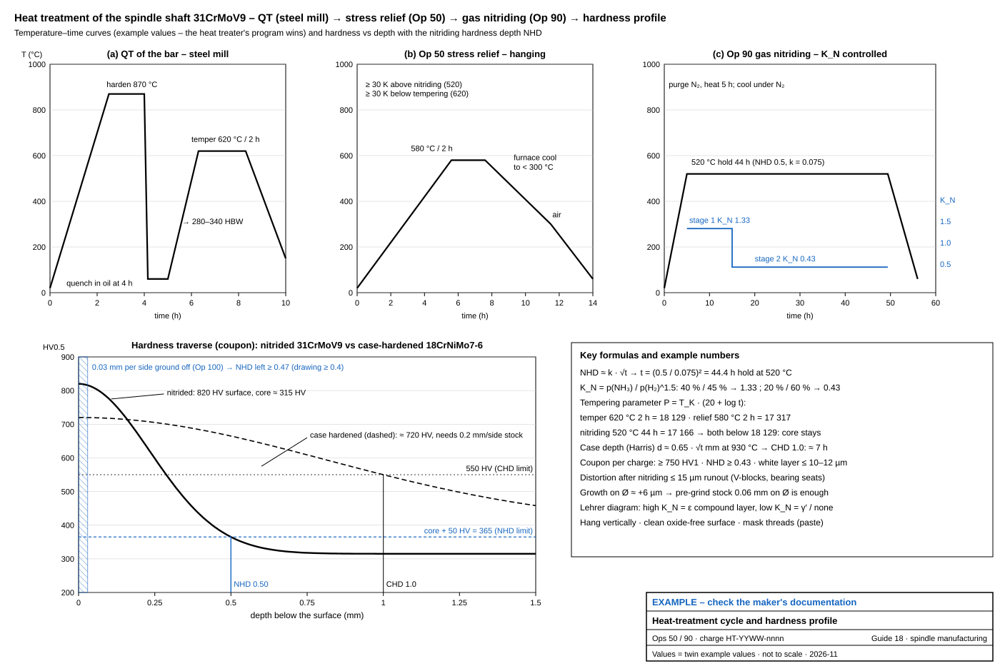
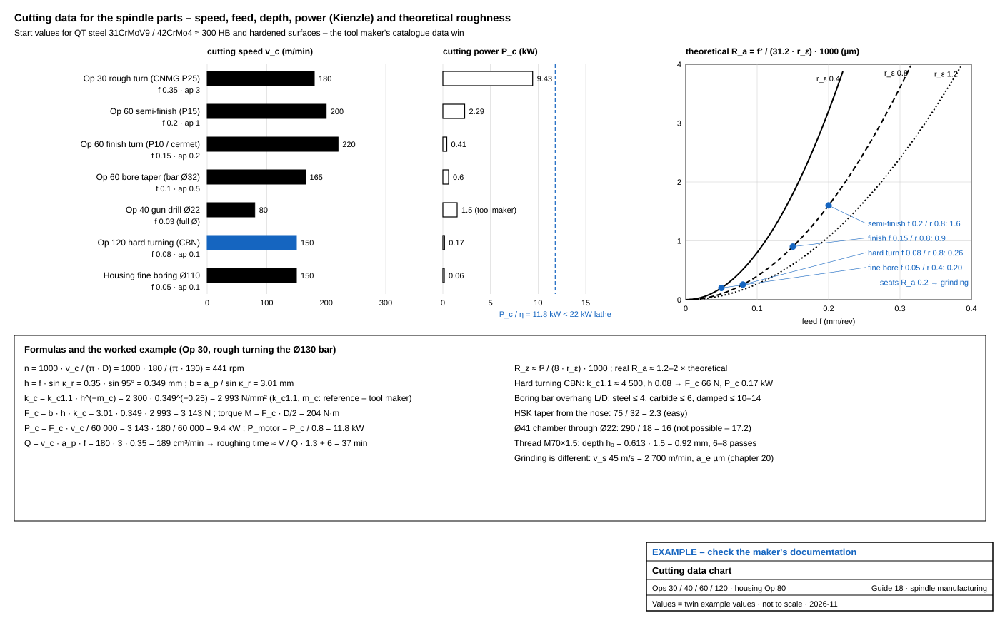
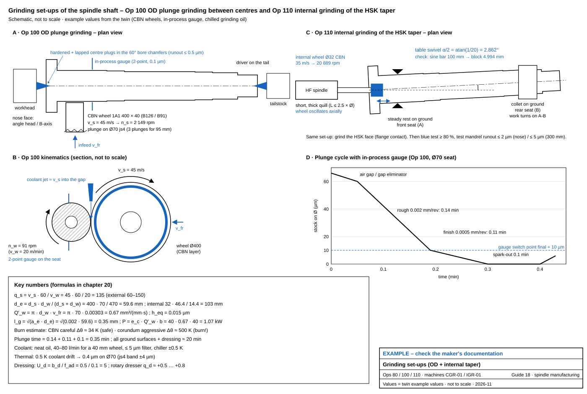
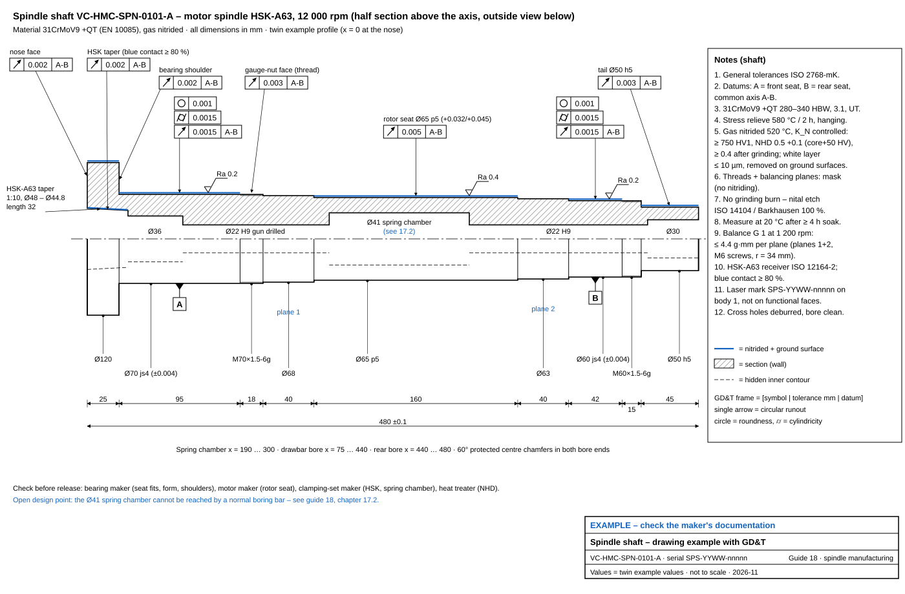
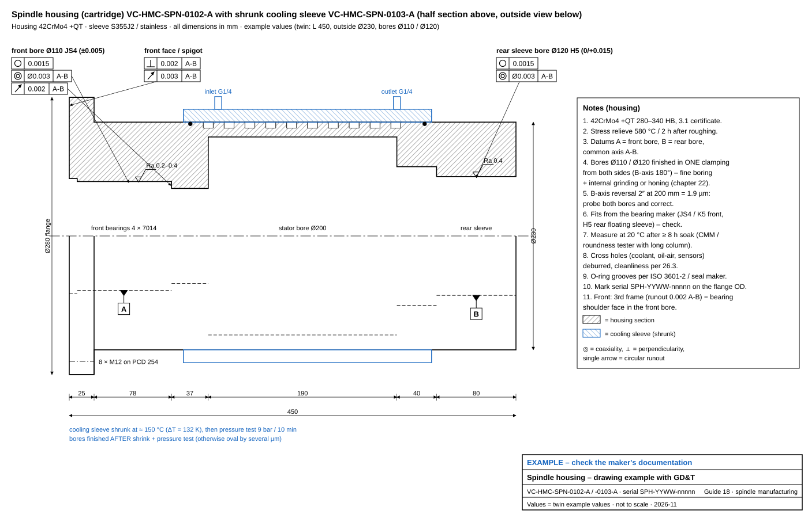
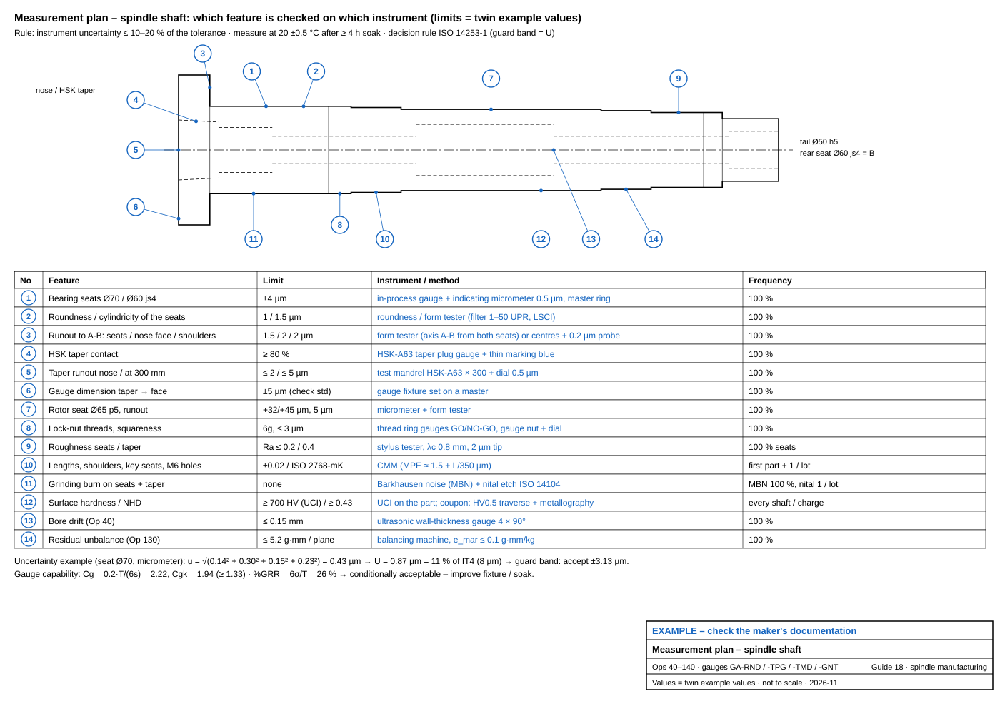
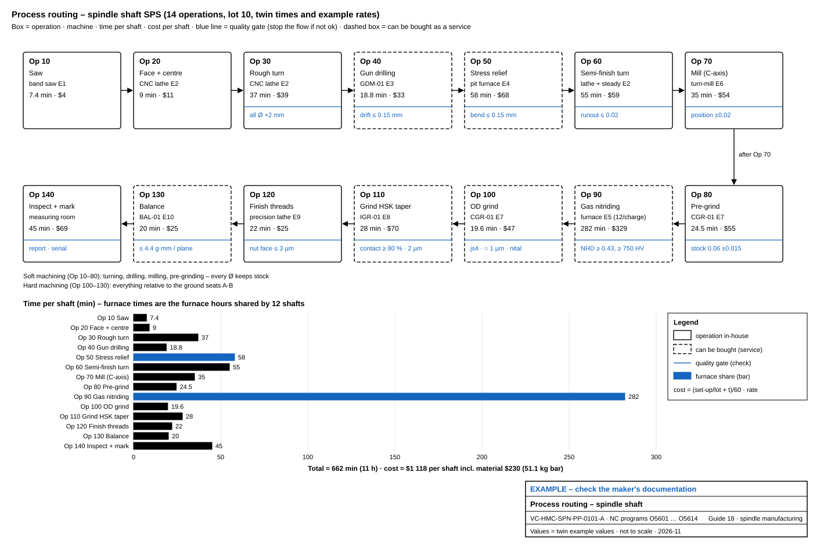
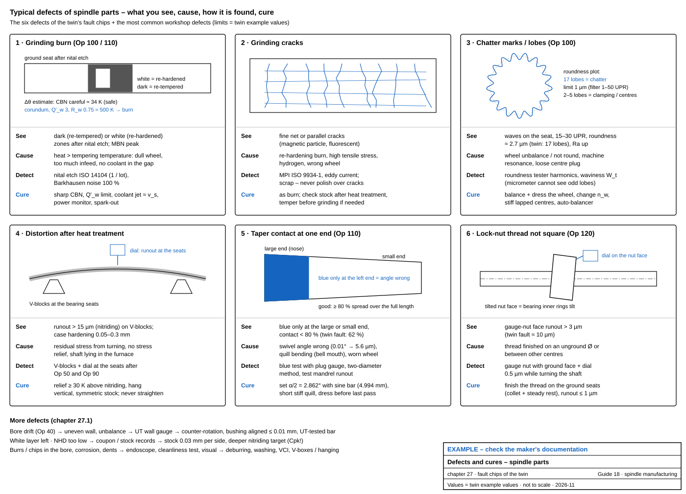

# 18 – Spindle Manufacturing: Motor-Spindle Shaft, Housing, Spacers, Drawbar – Process Twin and Real Manufacturing

> **All numbers in this guide are example values from the twin.** They are typical for an HMC motor spindle
> HSK-A63, 12 000 rpm, 15 kW, hybrid angular-contact bearings 4 × 7014 front / 2 × 7012 rear, built-in
> synchronous motor, drawbar with disc springs. Before you make a real spindle, replace them with the values
> from **your drawings**, the **catalogues of your bearing, motor, clamping-set and lock-nut suppliers**, the
> **offers of your heat treater and machine suppliers**, and **your own trials**. Values marked **"check"** are
> uncertain or depend on a supplier or a standard edition. Costs use example rates – **not** real prices.
> No product or brand name in this guide is a recommendation.

Source files: `web/spdmfg.js` (HMC build tab, item 4 – the process twin), `web/spd3d.js` (its 3D view),
`web/spindle.js` (shared design model: inputs, shaft profile, bearing arrangement, calculations, part list –
also used by the spindle **assembly** twin, Assembly tab item 2). Tab: **HMC build** (`#hmc`), button
**"4 · Spindle manufacturing"**.

Related guides: 12 (HMC build, worm + wheel manufacturing – same twin pattern), 14 (fits, materials, heat
treatment, grinding data), 15 (numbering), 16 (standards register).

---

## Contents

1. Purpose
2. Where in the twin
3. Concepts – simply explained
4. Calculations (with the example numbers)
5. Real manufacturing step by step (shaft 14 operations + process plans of housing, sleeve, spacers, drawbar, covers)
6. Checklists
7. Common mistakes and lessons
8. Limits of the twin
9. How to use chapters 10–15
10. Science principles
11. Detailed manufacturing specification (materials, heat treatment, fits, geometric tolerances, Ra, drawing notes, measuring plan, equipment buy specs + acceptance)
12. Identification and numbering
13. Standards
14. Worked example: shaft SPS-2646-00001
15. Data still needed
16. Glossary

**Part B – textbook, technical reference and design guide (added Nov 2026)**

17. Design data check before manufacturing (speed / power conflict, spring chamber, shaft mass, DFM rules)
18. Materials and heat treatment (steels, CHD / NHD / SHD, QT + tempering parameter, gas / plasma nitriding with K_N, case hardening, induction, spacers, hardness conversion, decision table, HT order)
19. Turning, hard turning, boring, threading, deep-hole drilling (Kienzle, power, roughness, cutting data, boring-bar L/D, hard turning vs grinding)
20. Grinding technology (kinematics, Q′_w, d_e, power, burn estimate, plunge cycle, CBN vs corundum, dressing, internal + taper, thread, coolant)
21. Tolerances, GD&T and surface specification (IT table, bearing seats, ISO 1101 callouts, runout chain, Ra / Rz, taper tolerances)
22. Housing, cooling sleeve, spacers – machining technology (bore methods, coaxiality from both sides, fine boring, honing)
23. Balancing of the rotor parts (plane split by the mass centre, e_mar, URR, correction masses, small parts, index balancing)
24. Measuring technology and uncertainty (instrument map, roundness filters, taper, uncertainty budget, ISO 14253-1, MSA)
25. Process planning and cost (routing sheet, machine-hour rate, lot size, capacity, make-or-buy, lead time)
26. Quality planning (control plan, PFMEA, cleanliness, first article)
27. Typical defects and cures (burn, cracks, chatter, distortion, taper, thread, … + burn inspection set-up)
28. Buy list – catalogue examples (lathes, grinders, taper grinding, heat treatment, balancing, measuring, wheels, tools, gun drilling, coolant, shopping list, make-or-buy)
29. Standards and glossary – additions for Part B

---

## 1. Purpose

The **motor spindle** is the heart of the HMC: it turns the tool at up to 12 000 rpm, holds it with
18 kN clamping force in an HSK-A63 taper, and must run true to **1–2 µm**. Most of that accuracy is made
when the **spindle shaft** and the **housing** are manufactured – no assembly trick can repair a bad taper
or an oval bearing seat.

This guide tells a small team **how to make the spindle parts in reality**:

* the **spindle shaft** (hollow, 480 mm long, nitrided, ground to js4, HSK taper ground to its bearing
  seats) – 14 operations from the bar to the released part, each with the **real equipment**,
* the **housing (cartridge)** with its bearing bores IT4, coaxial ≤ 3 µm, and the **cooling sleeve**,
* the **bearing spacers** ground in pairs to ±1 µm,
* the **drawbar + disc-spring pack**, the **covers + labyrinth**.

After reading it you can:

* write the **process plan** (route) for every spindle part,
* write the **purchase specification** of each machine (gun-drilling machine, nitriding furnace,
  cylindrical grinder, internal grinder, balancing machine, roundness tester) – or the **supplier
  qualification list** if you buy the operation,
* calculate **gun-drilling time, grinding time, nitriding time, balancing limits** with formulas,
* put the right **fits, geometric tolerances, Ra and notes on the drawing**,
* plan the **measuring** (what, how, which gauge, which limit),
* know the **7 typical faults**, where they start and which check finds them.

What this guide does **not** do: design the spindle (bearing selection, motor, clamping set – see
`spindle.js` and the assembly guide), or assemble it (Assembly tab, item 2). **When a supplier value
differs from this guide, the supplier value wins.**

---

## 2. Where in the twin

### 2.1 How to open

**HMC build** tab → button **"4 · Spindle manufacturing – digital twin (shaft + housing + spacers + drawbar)"**.

### 2.2 What is on the page (cards from top to bottom)

| Card | What you see |
|---|---|
| KPI row | shaft serial `SPS-2646-00001`, status (released / REJECT at Op …), time + cost per shaft, taper runout, residual unbalance |
| **Process twin** | 14 operation buttons, ▶ Play all, progress slider, step line, **2D scene** of the operation (shaft side view: upper half = section with the bore, lower half = outside view), info panel (steps, equipment, settings, checks), **Show 3D view**, fault chips |
| Inspection report | bore drift chart (Op 40), hardness traverse (Op 90), roundness plot (Op 100), blue contact of the taper (Op 110), balancing vectors (Op 130) + all check results – appears as the shaft reaches each operation |
| Part record – route, time, cost | set-up, minutes per shaft and cost of every operation, material, total |
| Lot simulation | 50 shafts with random variation (+ the active faults): mean, σ, **Cpk**, number out of limits, yield |
| Equipment list | per operation: machine (required capability), tooling, workholding, gauges, consumables |
| **Process plans – the other spindle parts** | housing · cooling sleeve · spacers · drawbar + springs · covers (tables, not animated) + the part list MAKE / BUY |
| Design + process inputs | all `spindle.js` design inputs + process inputs (turning, gun drilling, nitriding, grinding, balancing, tolerances, cost rates) |
| Calculations | 8 blocks with formulas and your numbers |
| Guide | faults → cause → found by → prevention, workshop rules |

**Colours in the 2D scenes:** grey = soft steel (hatched in the section), light grey = pre-ground, white-blue
= finish-ground, dark blue-grey line = nitrided surface, brown = anti-nitriding paste (masked), orange =
hot / carbide insert, beige = grinding wheel, blue = in-process gauge / oil.

### 2.3 Buttons

| Button | Does |
|---|---|
| ▶ Play all / ❚❚ Pause | runs all 14 operations (7 s each) |
| ◀ / ▶\| | previous / next operation |
| slider | progress inside the operation (checks appear at ≥ 92 %) |
| New shaft (random) | next serial = new random values |
| Download part record | JSON with design, every operation (equipment, settings, checks), verdict |
| Show 3D view | 3D scene of the same operation (lazy-loaded) |
| **Cut ¼ open** (in 3D) | removes a quarter of the shaft: you see the gun-drilled bore, the drill, the HSK taper and the internal grinding wheel |
| Fit view (in 3D) | camera back to the part |
| fault chips | switch one of the 7 faults on / off |
| Run 50 shafts | repeats the lot simulation |
| Example values | inputs back to the defaults |

### 2.4 Deep links (for work instructions and training)

| Link (add to the page address) | Opens |
|---|---|
| `?hritem=4#hmc` | the spindle manufacturing twin |
| `?hritem=4&smop=40&smu=0.5#hmc` | Op 40 gun drilling at 50 % |
| `?hritem=4&smop=40&smu=0.5&show3d&smcut#hmc` | the same with the 3D view, cut open |
| `?hritem=4&smop=110&smu=0.95&smf=taper#hmc` | Op 110 blue test with the "taper angle wrong" fault |
| `?hritem=4&smsn=7#hmc` | shaft no. 7 (other random values) |

Parameters: `smop` = operation number (10 … 140), `smu` = progress 0 … 1, `smf` = faults (comma list:
`drift, nit, chatter, taper, thread, burn, unbal`), `smsn` = serial, `show3d` = open the 3D view,
`smcut` = 3D cut view. For headless screenshots `shot3d` copies the 3D canvas into an image.

### 2.5 How to use the twin before the real manufacturing

1. Put your **real design data** into the inputs (bearing sizes, rotor seat, bore, speed, balancing grade).
2. Put **your heat treater's k-factor** (from coupons) and the **real cost rates** in.
3. Play the route: check every **equipment line** against your machines or supplier offers.
4. Switch each **fault** on: look where it starts and which check finds it – put that check into your
   control plan.
5. Run the **lot simulation**: every characteristic with Cpk < 1.33 needs a better process, a better
   machine or a wider tolerance (talk to design).
6. Download the **part record** → template for your real record (chapter 14).

---

## 3. Concepts – simply explained

### 3.1 The shaft you make

The shaft (x = 0 at the nose, towards the rear, total **L = 480 mm**):

| Zone | x (mm) | Ø (mm) | Function | Quality |
|---|---|---|---|---|
| Nose flange | 0 – 25 | 120 | HSK face, labyrinth, drive keys | face ⟂ 2 µm |
| Front bearing seat | 25 – 120 | 70 | 4 × 7014 (TBT) + spacer 15 | js4, roundness ≤ 1 µm |
| Front lock-nut thread | 120 – 138 | M70×1.5 | lock nut presses the bearings | 6g, square ≤ 3 µm |
| Body 1 | 138 – 178 | 68 | balancing plane 1 (8 × M6); its shoulder is the axial stop of the rotor | – |
| Rotor seat | 178 – 338 | 65 | motor rotor shrink fit | p5 |
| Body 2 | 338 – 378 | 63 | balancing plane 2 (8 × M6) | – |
| Rear bearing seat | 378 – 420 | 60 | 2 × 7012 (DB) | js4 |
| Rear lock-nut thread | 420 – 435 | M60×1.5 | rear lock nut | 6g |
| Tail | 435 – 480 | 50 | encoder ring, unclamp piston | h5 |

Inside: **HSK-A63 taper 1:10** (Ø48 → Ø44.8 over 32 mm), clamping-set cavity Ø36 (to x = 75),
**drawbar bore Ø22** gun-drilled (x = 75 … 440), rear bore Ø30.

Dimensioned drawing with GD&T: `docs/img/18_spindle_shaft_drawing.svg` (section 21.3).

### 3.2 Why hollow, why gun drilling

The drawbar runs through the shaft. A 22 mm hole 480 mm deep has **L/D ≈ 22**. A normal twist drill
wanders and jams above L/D ≈ 5–10. A **gun drill** (single cutting lip, guide pads, oil through the drill
at high pressure) drills straight: the **guide pads** rub on the bore wall and keep the drill on its line,
the oil pushes the chips out along the V-flute. With **counter-rotation** (the shaft turns one way, the drill
the other) the drift is smaller.

**Drift** = how far the bore centre is from the shaft axis at the exit. A drifted bore makes the **wall
thickness uneven** → the shaft is out of balance and bends differently when it warms up. That is why the
bore is drilled **early** (Op 40) and the outside is finished **later around the real bore**.

### 3.3 Why stress relief before nitriding

Rolling, rough turning and drilling leave stresses in the steel. In the nitriding furnace (520 °C, ~2 days)
these stresses relax – and the shaft **bends**. So the shaft is stress relieved at **580 °C** (above the
nitriding temperature, below the tempering temperature of the bar) **before** the shape is finished.
Never straighten a nitriding shaft by bending: the stress comes back in the furnace.

### 3.4 Gas nitriding – hard skin, no quench

Nitrogen from ammonia (NH₃) diffuses into the surface at ~500–530 °C. It forms hard nitrides with Cr, Mo, V
(that is why the steel is a **nitriding steel**, 31CrMoV9). There is **no quench** → very little distortion.

Layers from the surface inwards:

* **compound (white) layer** 5–10 µm – very hard but brittle → **ground off** bearing seats and taper,
* **diffusion zone** – the useful hard layer; its depth is the **nitriding hardness depth Nht**
  (depth where the hardness is core + 50 HV, ISO 18203 – check),
* **core** – quenched + tempered (≈ 300 HB), carries the load.

Depth grows with the **square root of time**: double depth needs **4 × the time**. The **nitriding
potential Kn** (gas composition, measured with an H₂ sensor) controls how fast and how thick the white
layer grows.

**Alternative: case hardening** (18CrNiMo7-6, carburise + quench + temper, ≈ 60 HRC, depth 0.8–1.2 mm).
Harder and deeper, but much more **distortion** (quench) → more grinding stock, and the bore can move.
Nitriding is the usual choice for precision motor spindles of this size; case hardening for heavy-duty
gear spindles (check with your design).

### 3.5 Pre-grind before nitriding

Nitriding barely changes the size (a few µm growth). So the shaft is **pre-ground** to final size +
**0.06 mm on Ø** before the furnace. After nitriding only **0.03 mm per side** is ground away: this removes
the white layer and keeps most of the hard layer (0.5 − 0.03 = 0.47 mm).

### 3.6 One reference axis A-B

The two bearing seats define the **axis of rotation A-B** of the finished spindle. Everything that must run
true – nose face, rotor seat, taper, thread faces – is made **relative to A-B**:

* all bearing seats, rotor seat and nose face are ground **in one set-up** between centres (Op 100),
* the taper is ground while the shaft **sits on its ground bearing seats** (Op 110) – not on the centres,
* the threads are finished while clamped on the **ground seats** (Op 120).

### 3.7 Protected centres

The gun drill removes the original centre holes. In Op 60 **60° chamfers** are turned into both bore ends.
For grinding, **hardened + lapped centre plugs** sit in these chamfers (runout ≤ 0.5 µm). After nitriding
the chamfers are re-lapped (Op 100).

### 3.8 HSK taper and taper contact

The HSK tool sits in the **taper 1:10** and on the **face** at the same time (double contact). The taper
must be **coaxial to A-B** (runout ≤ 2 µm at the nose) and have the **right angle**. Angle check: blue
the taper gauge very thinly, insert, turn slightly, pull out: the blue marks must cover **≥ 80 %** of the
taper, spread over the whole length. Contact only at one end = angle wrong.

### 3.9 Lock-nut threads square to the axis

The lock nut presses the bearing inner rings together. If the thread is not square to the axis, the nut
face wobbles and tilts the inner rings → runout and heat. So the thread is finished on the ground seats,
and checked with a **gauge nut** (ground face): face runout ≤ 3 µm.

### 3.10 Balancing (rigid rotor)

Every rotor has its mass centre slightly off the axis. The **permissible residual unbalance** (ISO 21940-11)
for balance grade G:

U_per = 9549 · G · m / n  [g·mm]  with G in mm/s, m in kg, n in rpm.

For G 1, m = 11.0 kg (finished shaft, twin profile with the spring bore), n = 12 000 rpm: **U_per = 8.7 g·mm** → the mass centre may be only **0.8 µm** off the
axis. The shaft is balanced alone (Op 130), then again as a full rotor in the assembly.

### 3.11 Temperature

Steel grows 11.5 µm per metre per kelvin. On Ø70: **0.8 µm per K**. The js4 band is ±4 µm. So grinding and
measuring are done in a **20 ±1 °C** room, the part **soaks** before measuring, the coolant is **chilled**.

---

## 4. Calculations (with the example numbers)

### 4.1 Input data (example values)

| Input | Value | Input | Value |
|---|---|---|---|
| Max. speed | 12 000 rpm | Bar Ø | 130 mm, 31CrMoV9 +QT |
| Motor power S1 / torque S6 | 15 kW / 120 N·m | Allowance after rough turning | 2 mm on Ø |
| Front bearings | 4 × 7014 (70 × 110 × 20) | Grinding stock after semi-finish | 0.4 mm on Ø |
| Rear bearings | 2 × 7012 (60 × 95 × 18) | Stock left by pre-grinding | 0.06 mm on Ø |
| Rotor seat | Ø65 × 160 | Gun drill v_c / f | 80 m/min / 0.03 mm/rev |
| Drawbar bore | Ø22 through | Nitriding T / Nht / k | 520 °C / 0.5 mm / 0.075 mm/√h |
| Balancing grade | G 1 | Grinding v_s / v_w | 45 m/s / 20 m/min |
| Clamping force | 18 kN | Plunge infeed rough / finish | 0.002 / 0.0005 mm per rev |

### 4.2 Bar, masses, chips

* Saw length = L + 10 = **490 mm**. Bar mass = π/4 · 130² · 490 · 7.85·10⁻⁶ = **51.1 kg**.
* Finished hollow shaft: Σ π·(r_o² − r_i²)·Δx·ρ = **11.0 kg** → **78 %** of the bar becomes chips (normal for a
  stepped hollow shaft; a forged or pre-turned blank saves material – ask for an offer).
* Removed bore core: π/4 · 22² · 365 · 7.85·10⁻⁶ = **1.09 kg**.

### 4.3 Rough turning

Q = v_c · f · a_p = 180 · 0.35 · 3 = **189 cm³/min**. Chip volume (bar → rough profile) ≈ 4 500 cm³.
t ≈ V/Q · 1.3 + 6 = 4 500/189 · 1.3 + 6 ≈ **37 min** (1.3 = air cuts and rapid moves).

Allowance check: a_R ≥ 2 · (drift + bend) + clean-up = 2 · (0.15 + 0.15) + 1.4 ≈ 2 mm on Ø.

### 4.4 Gun drilling

* n = 1000 · v_c / (π · d) = 1000 · 80 / (π · 22) = **1 157 rpm** (with counter-rotation: drill + work speed
  together, e.g. 580 + 580).
* v_f = f · n = 0.03 · 1 157 = **34.7 mm/min**.
* t = L / v_f + 5 = 480 / 34.7 + 5 ≈ **19 min**.
* L/D = 480 / 22 ≈ **22**.

**Drift → unbalance:** the removed core is not centred, so the shaft has an unbalance
U ≈ m_core · e / 2 (average offset over the length ≈ half the exit drift for a drift growing along the bore).
For e = 0.1 mm: U ≈ 1 089 g · 0.05 mm ≈ **54 g·mm** – six times U_per of the shaft (8.7 g·mm). That is why the
drift limit is tight (example **≤ 0.15 mm**) and why balancing correction capacity is limited on purpose.

### 4.5 Gas nitriding time

Nht ≈ k · √t → t = (Nht / k)² = (0.5 / 0.075)² = **44 h** hold at 520 °C (+ ≈ 12 h heat-up and cool-down).

| Target Nht | Hold time (k = 0.075) |
|---|---|
| 0.3 mm | 16 h |
| 0.4 mm | 28 h |
| 0.5 mm | 44 h |
| 0.6 mm | 64 h |

After grinding: Nht − a_P/2 = 0.5 − 0.03 = **0.47 mm** (drawing minimum 0.4 mm).
**k is an example – get it from your heat treater's coupons for your steel, temperature and Kn.**

Furnace cost per shaft = (44 + 12) h · 70 $/h / 12 shafts per charge ≈ **$329**.

### 4.6 Cylindrical grinding (Op 100)

* work speed n_w = 1000 · v_w / (π · d) = 1000 · 20 / (π · 70) = **91 rpm**,
* speed ratio q = v_s / v_w = 45 · 60 / 20 = **135** (good range ≈ 100–150),
* stock per side s = 0.06 / 2 = 0.03 mm; rough to 0.005: t_R = (0.03 − 0.005) / (0.002 · 91) = 0.14 min;
  finish t_F = 0.005 / (0.0005 · 91) = 0.11 min; + spark-out 0.1 min → **0.35 min per plunge**,
* front seat 95 mm long, wheel 40 mm → 3 plunges ≈ **1.3 min**,
* all ground surfaces + dressing + measuring ≈ **20 min**.

**Thermal:** Δd = α · ΔT · d = 11.5·10⁻⁶ · 0.5 · 70 = **0.4 µm** per 0.5 K coolant drift (js4 band ±4 µm).

### 4.7 Internal grinding of the taper (Op 110)

* half-angle of a 1:10 taper: α/2 = atan(1/20) = **2.862°**,
* wheel speed: n = v_s · 60 000 / (π · d) = 35 · 60 000 / (π · 32) = **20 889 rpm** → high-frequency
  spindle 30–60 krpm class,
* angle error effect: swivel 0.01° wrong over 32 mm → Δr = 32 · tan(0.01°) = **5.6 µm** → contact only at
  one end, blue test < 80 %.

### 4.8 Balancing (Op 130)

* U_per = 9549 · 1 · 11.0 / 12 000 = **8.7 g·mm**, **4.4 g·mm per plane** (two planes, symmetric approx. – the
  exact split by the mass-centre position is in chapter 23),
* mass-centre offset e = U / m = 8.7 / 11.0 = **0.8 µm**,
* correction capacity = m_max · r = 3 g · 34 mm = **102 g·mm per plane** (M6 balancing screws in body 1 Ø68, r = 34 mm),
* full rotor (shaft + rotor + nuts, 16 kg, spindle.js): U_per = 12.7 g·mm, 6.4 g·mm per plane.

### 4.9 Design checks (from spindle.js – for information)

| Check | Formula | Result |
|---|---|---|
| Torque at n_max | T = P / ω = 15 000 / 1 257 | 11.9 N·m |
| Base speed | n_b = P / T_max · 60 / 2π | 1 194 rpm |
| Speed factor front | n · d_m = 12 000 · 90 | 1.08·10⁶ mm/min (≤ ≈ 1.2–1.4·10⁶ hybrid + grease – check catalogue) |
| Drawbar force | F_clamp / i = 18 / 3 | 6 kN → spring pack 6.9 kN (+15 %) |
| Unclamp piston | F = F_spring × 1.88 (pack force at full 6 mm stroke) × 1.1 = 14.3 kN; A = F / p at 6 MPa = 2 378 mm² | Ø55 mm (solid) |
| Rotor shrink heating | ΔT = (δ + 0.0015·d)/(α·d) = (0.06 + 0.0975)/(11.5·10⁻⁶ × 65) = 211 K | ≈ 231 °C (check magnet limit) |
| Thermal growth | ΔL = α · L · ΔT | rear ≈ 78 µm (floating rear bearings), nose ≈ 4 µm |

The first bending critical speed of spindle.js is a very simple beam model – use a rotor-dynamics
calculation for the real design (**check**).

### 4.10 Time and cost per shaft (twin, lot 10)

| Op | min / shaft | Cost |
|---|---|---|
| 10 Saw | 7.4 | $4 |
| 20 Face + centre | 9 | $11 |
| 30 Rough turn | 37 | $39 |
| 40 Gun drilling | 18.8 | $33 |
| 50 Stress relief (furnace share) | 58 | $68 |
| 60 Semi-finish turn | 55 | $59 |
| 70 Mill (C-axis) | 35 | $54 |
| 80 Pre-grind | 24.5 | $55 |
| 90 Gas nitriding (furnace share) | 282 | $329 |
| 100 OD grind | 19.6 | $47 |
| 110 Grind HSK taper | 28 | $70 |
| 120 Finish threads | 22 | $25 |
| 130 Balance | 20 | $25 |
| 140 Inspect + mark | 45 | $69 |
| Material (51.1 kg × 4.5 $/kg) | | $230 |
| **Total** | **662 (11 h)** | **≈ $1 118** |

Nitriding is the biggest share – fill the furnace (charge size!) or buy the nitriding as a service.

---

## 5. Real manufacturing step by step

### 5.1 Spindle shaft – route overview

| Op | Operation | Machine | Key result |
|---|---|---|---|
| 10 | Saw | band saw | bar Ø130 × 490, heat no. |
| 20 | Face + centre | CNC lathe | L 480 ±0.1, centres form B |
| 30 | Rough turn | CNC lathe | all Ø +2 mm |
| 40 | Gun drilling | deep-hole drilling machine | Ø22 through, drift ≤ 0.15 |
| 50 | Stress relief | pit furnace | 580 °C 2 h, bend ≤ 0.15 |
| 60 | Semi-finish turn | CNC lathe + steady rest | ground Ø +0.4, taper, cavity, centre chamfers, threads rough |
| 70 | Mill (C-axis) | turn-mill centre | key seats, M6 holes, balancing holes, flats |
| 80 | Pre-grind | CNC cylindrical grinder | final +0.06 on Ø, masking |
| 90 | Gas nitriding | nitriding furnace (Kn control) | ≥ 750 HV, Nht 0.5 |
| 100 | OD grind | CNC cylindrical grinder | seats js4, rotor p5, nose face, roundness ≤ 1 µm |
| 110 | Grind HSK taper | universal internal grinder | contact ≥ 80 %, runout ≤ 2 µm |
| 120 | Finish threads | precision lathe | 6g, nut face ≤ 3 µm |
| 130 | Balance | balancing machine | ≤ U_per per plane |
| 140 | Inspect + mark | measuring room | report, SPS serial, preservation |

Flow diagram with machines and times: `docs/img/18_process_routing.svg` (section 25.1).

### 5.2 Op 10 – Saw

1. Take bar **Ø130 31CrMoV9 +QT** from the store. Check the **3.1 certificate** (chemistry, tensile test,
   hardness) and the **ultrasonic test** of the bar (the bore goes through the core – no pipe, no
   inclusions).
2. Saw to **490 mm** (5 mm facing allowance per end).
3. Stamp the **heat number** on the end face; open the part record (bar lot `LOT-BAR130-<YYWW>-nnn`).

Equipment: automatic band saw ≥ Ø150, bimetal blade 3/4 tpi. Check: length ±0.5 mm, certificate.

### 5.3 Op 20 – Face + centre

1. Chuck + steady rest (a 51 kg bar must not whip).
2. Face both ends to **480 ±0.1 mm**, drill centre holes **DIN 332-1 form B** (temporary – Op 40 removes them).
3. Check length and centre contact with blue.

### 5.4 Op 30 – Rough turn

1. Chuck on the tail end, live centre in the nose.
2. Rough all diameters in passes (a_p 3 mm, f 0.35, v_c 180), every diameter **+2 mm on Ø**.
3. Turn around, rough the tail end.

Check: diameters ±0.1 mm against the allowance.

### 5.5 Op 40 – Gun drilling the drawbar bore

1. Clamp in the **workhead chuck + steady rest**; push the **drill bushing** (carbide, Ø22) against the nose face.
2. Align the bushing to the work axis (≤ 0.01 mm) – a misaligned bushing is the first cause of drift.
3. Start slowly through the bushing (pilot), then drill **Ø22 through 480 mm**, workpiece and drill in
   **counter-rotation**, oil **≈ 60 bar** through the drill (tool maker's value).
4. Watch the **feed force** (rising force = worn tool / chip jam) and the chips (short and curled = good;
   long, blue = pads worn, too hot).
5. Measure: bore Ø (IT9: Ø22 0 / +52 µm), **drift at the exit** with an ultrasonic wall-thickness gauge at
   4 positions (wall_max − wall_min) / 2 ≤ **0.15 mm** (example).

### 5.6 Op 50 – Stress relief + check

1. Hang the shafts **vertically** on a rack (hooked in the rear bore).
2. Heat slowly to **580 °C**, hold **2 h**, cool in the furnace to < 300 °C, then still air.
   Rule: ≥ 30 K above the nitriding temperature and ≥ 30 K below the tempering temperature of the bar
   (from the certificate – **check**).
3. Check: hardness (≈ 300 HBW, Brinell or UCI), bend on V-blocks with a dial on the rotor seat ≤ **0.15 mm**.
   Larger bend → scrap or re-rough + relieve again. **No straightening.**

### 5.7 Op 60 – Semi-finish turn

1. Soft jaws on the tail Ø, hydraulic **steady rest on the front seat**.
2. Turn all ground diameters to **final + 0.4 mm on Ø**, the others to final size; chamfers, undercuts.
3. Bore the **HSK taper (+0.4 mm on Ø)** and the clamping-set cavity Ø36 with a carbide boring bar.
4. Turn **60° protected centre chamfers** into both bore ends.
5. Rough the lock-nut threads **M70×1.5** and **M60×1.5** (0.1 mm on the flanks – stays soft).

Check: runout to the centre chamfers ≤ 0.02 mm.

### 5.8 Op 70 – Mill with the C-axis

1. Clamp on the turned Ø, C-axis indexes the shaft (0.001°).
2. Mill 2 **drive-key seats** in the nose face; drill + tap the key and cover screw holes (example 6 × M6).
3. Drill + tap **2 × 8 × M6 balancing holes** in the two correction planes (body 1 and body 2) – **now**, while
   soft.
4. Mill the **wrench flats** on the tail.
5. **Deburr every cross hole, blow the bore clean** – a chip in the bore later scratches the drawbar.

Check: position ±0.02 mm, key-seat symmetry (CMM), thread plug gauge M6 6H.

### 5.9 Op 80 – Pre-grind

1. Centre plugs in the 60° chamfers, driver on the tail.
2. Grind bearing seats, rotor seat, tail and nose face to **final + 0.06 mm on Ø** (Al₂O₃ or CBN wheel).
3. Pre-grind the taper (+ stock).
4. Wash; **mask** the threads and the balancing planes with anti-nitriding paste (they must stay soft).

Check: stock left 0.06 ±0.015 mm, runout ≤ 6 µm.

### 5.10 Op 90 – Gas nitriding

1. Hang the shafts + a **test coupon** of the same heat and QT condition.
2. Purge with N₂, heat to **520 °C**, NH₃ atmosphere, **Kn controlled** (high at the start, then lower).
3. Hold **≈ 44 h** (for Nht 0.5 with k = 0.075 – heat treater's value), cool under N₂.
4. Coupon: **surface hardness ≥ 750 HV1** (31CrMoV9 ≈ 750–850 HV, reference data – check with your heat
   treater), **hardness traverse → Nht ≥ 0.43 mm** (min. 0.4 + grinding stock 0.03), **white layer
   ≤ 10–12 µm**; shaft **distortion** (runout) ≤ 15 µm.
5. Furnace record (T, Kn, time) + coupon report go into the part record (charge `HT-<YYWW>-nnnn`).

Cycle and hardness profile: `docs/img/18_heat_treatment_cycle.svg` (section 18.3); theory in chapter 18.

**Alternative case hardening:** 18CrNiMo7-6, carburise (CHD 0.8–1.2 mm) + quench + temper 58–62 HRC.
Then: grinding stock after hardening ≥ 0.2–0.3 mm per side, straightening forbidden, bore + outside both
ground; protect the bore with copper paint against carburising (check with the heat treater).

### 5.11 Op 100 – OD grinding (one set-up)

1. Re-lap the centre chamfers, fit hardened **centre plugs** (runout ≤ 0.5 µm).
2. Soak the shaft at 20 °C (≥ 2 h). Coolant chilled (±0.5 K).
3. Plunge grind (CBN, v_s 45 m/s, n_w 91 rpm on Ø70): **front seat Ø70 js4**, **rear seat Ø60 js4**,
   **rotor seat Ø65 p5**, tail Ø50 h5 – the **in-process gauge** stops the infeed; spark-out.
4. Grind the **nose face** with an angled wheel (⟂ to A-B ≤ 2 µm).
5. Measure roundness (≤ 1 µm), runout to A-B (≤ 1.5 µm), Ra ≤ 0.2 µm.
6. **Nital etch** (ISO 14104) the ground surfaces: no dark zones (grinding burn).

Set-up picture and grinding formulas: `docs/img/18_grinding_setup.svg`, chapter 20.

### 5.12 Op 110 – Internal grinding of the HSK taper

1. Hold the shaft on its **ground bearing seats** (collet + steady rests), runout of the seats ≤ 1 µm.
2. Swivel the table to **2.862°** (check with a master taper).
3. Internal high-frequency spindle (wheel Ø32, ≈ 21 000 rpm): grind the taper, oscillate, dress before the
   last pass; grind the HSK face in the same set-up.
4. **Blue test** with the HSK taper gauge: contact **≥ 80 %**, over the whole length.
5. **Test mandrel** in the taper: runout at the nose **≤ 2 µm**, at 300 mm **≤ 5 µm** (example – check the
   machine spec / ISO 10791 test you will run at the HMC acceptance).
6. **Gauge dimension** (taper position to face) with the gauge fixture – tolerance per the HSK standard
   (ISO 12164 – check).

### 5.13 Op 120 – Finish the lock-nut threads

1. Precision collet on the ground rear seat, steady rest on the ground front seat (runout ≤ 1 µm).
2. Finish turn **M70×1.5-6g** and **M60×1.5-6g** (hard-turning insert, full profile).
3. Thread ring gauges GO / NO-GO.
4. Screw on a **gauge nut** with a ground face, turn the shaft, dial on the nut face: **≤ 3 µm**.

If the threads were nitrided (not masked): **thread grinding** instead of turning.

### 5.14 Op 130 – Dynamic balancing

1. Shaft on the **roller supports** at the bearing seats, belt drive, **1 200 rpm**.
2. Measure in 2 planes (body 1, body 2): amount + angle.
3. Correct with **M6 balancing screws** (mass + angle from the machine); thread locker.
4. Verification run: residual **≤ 4.4 g·mm per plane** (G 1).
   Initial unbalance above the correction capacity (102 g·mm) → stop, check the bore drift.

### 5.15 Op 140 – Final inspection, marking, preservation

1. Soak ≥ 4 h at 20 ±0.5 °C.
2. **Roundness / form tester:** roundness of the seats, coaxiality of the seats, nose face runout.
3. Test mandrel runout (nose / 300 mm), gauge dimension, taper contact record.
4. **UCI hardness** on the nitrided body (≥ 700 HV on the part – the load changes the value, compare with
   the coupon), Ra, visual (no scratches on seats / taper), CMM: lengths, shoulders, key seats.
5. **Laser mark** `SPS-<YYWW>-<nnnnn>` on the body (not on a seat, not on the taper).
6. Clean, oil, **VCI bag**, store **hanging or in a V-box**. Reports go with the shaft to the assembly.

### 5.16 Process plan – spindle housing (cartridge)

Material 42CrMo4 +QT (or EN-GJS-600-3), outside Ø230 × 450 (example).

| Op | Operation | Equipment (capability) | Tolerance / check |
|---|---|---|---|
| 10 | Saw / buy forging, 3.1 certificate | band saw Ø ≥ 250 | blank Ø240 × 460 |
| 20 | Rough turn outside + bores (+2 mm) | CNC lathe swing ≥ Ø400 | ±0.2 |
| 30 | Stress relief 580 °C 2 h | furnace | bend ≤ 0.1 |
| 40 | Semi-finish turn, cooling grooves (helix or rings) outside, O-ring grooves | CNC lathe | groove depth ±0.05, O-ring groove per seal maker |
| 50 | Drill coolant, oil-air, sensor holes, bolt circles, tap | HMC with rotary table | position ±0.02, deburr cross holes |
| 60 | Shrink the cooling sleeve (≈ 150 °C), O-rings | induction heater / oven + press stand | ΔT = (U + 0.001·d)/(α·d) |
| 70 | Pressure test the cooling circuit 1.5 × p (e.g. 9 bar, 10 min) | test stand + gauge | no drop, no leak |
| 80 | **Finish the bores after the shrink**: front Ø110 + rear Ø120 in ONE set-up (fine boring + honing, or internal grinding) | horizontal fine-boring machine / jig borer + honing, or universal internal grinder | IT4 (Ø110: IT4 = 10 µm), e.g. JS4 / K5 per bearing maker – check · roundness ≤ 1.5 µm · **coaxial ≤ 3 µm** |
| 90 | Grind the front face + spigot to the bore axis | universal grinder | face ⟂ ≤ 2 µm, spigot runout ≤ 3 µm |
| 100 | Measure bores, coaxiality, faces (20 °C) | CMM / roundness tester with long column | report, serial `SPH-YYWW-nnnnn` |

**Why after the shrink:** the shrunk sleeve squeezes the housing; bores finished before would become oval
by several µm. Housing drawing with GD&T: `docs/img/18_housing_drawing.svg` (section 22.1).

### 5.17 Process plan – cooling sleeve

| Op | Operation | Equipment | Check |
|---|---|---|---|
| 10 | Turn from tube, inside to the shrink Ø | CNC lathe | inside Ø230 with interference (e.g. 0.08–0.12 mm – check with Lamé) |
| 20 | Ports (inlet / outlet) + threads | HMC | port size per hose |
| 30 | Shrink on the housing (housing Op 60) + pressure test (Op 70) | oven ≈ 150 °C | 1.5 × p, 10 min |

Shrink heating example: U = 0.12 mm, d = 230, s = 0.23: ΔT = (0.12 + 0.23)/(11.5·10⁻⁶ · 230) ≈ **132 K → ≈ 150 °C**.

### 5.18 Process plan – bearing spacers (inner + outer)

100Cr6 hardened 60–64 HRC, stabilised.

| Op | Operation | Equipment | Check |
|---|---|---|---|
| 10 | Turn from tube (+0.3 on faces, +0.2 on Ø) | CNC lathe | ±0.05 |
| 20 | Harden + deep-freeze / stabilise + temper | vacuum furnace + −80 °C box (check heat treater) | 60–64 HRC, dimensionally stable |
| 30 | Grind inner / outer Ø | cylindrical / internal grinder | inner spacer: slide fit on the shaft (≈ 5–10 µm clearance – check) |
| 40 | Grind + lap both faces **as a pair** | double-disc grinder or surface grinder + lapping machine | parallelism ≤ 1 µm, flatness ≤ 0.5 µm |
| 50 | Measure lengths, inner vs outer | comparator 0.1 µm + gauge blocks, 20 °C | length difference = preload offset **±1 µm** (bearing maker) |
| 60 | Mark the pair + direction, preserve | vibro-engraver | keep the pair together |

### 5.19 Process plan – drawbar + disc-spring pack + clamping set

Drawbar 42CrMo4 +QT; disc springs DIN EN 16983 (material e.g. 51CrV4 – check DIN EN 16984); HSK clamping set
bought.

| Op | Operation | Equipment | Check |
|---|---|---|---|
| 10 | Saw + turn the drawbar (guide Ø, threads) | CNC lathe with steady rest | straightness ≤ 0.05 |
| 20 | Gun drill the coolant hole (option: coolant through spindle) | gun-drilling machine | drift as shaft Op 40 |
| 30 | Nitride or induction harden the guide Ø | furnace / induction | ≥ 550 HV |
| 40 | Grind guide Ø (g5) + thread to the clamping set | cylindrical grinder | runout ≤ 0.01 |
| 50 | Spring pack: stack (series / parallel) for **F = 6.9 kN** at the clamped position | spring force tester (force–displacement curve) | force ±5 % at clamped + unclamped stroke |
| 60 | Pre-set the pack (load to flat 3×, then measure), guide rod | press + tester | record the curve |
| 70 | After assembly: clamping force with the HSK force gauge | HSK-A63 clamping force gauge | ≥ 18 kN |

**Design note (updated 11 Nov 2026):** disc springs for ≈ 7 kN need an outside Ø of ≈ 40 mm – more than the
Ø22 drawbar bore. The example shaft therefore has a **spring bore Ø41 × 110 mm** at x = 190–300 (under the rotor
seat Ø65, wall (65 − 41)/2 = 12 mm). The twin says it is bored **from the rear in Op 60** with a long anti-vibration
boring bar after gun drilling. **Correction (manufacturability, Nov 2026 review):** a normal boring bar cannot do this –
the Ø41 chamber lies between the Ø22 bore (x = 300–440) and the Ø30 rear bore (x = 440–480), so the tool must pass
through a Ø22 hole and then cut Ø41. That needs a special **chamber-boring (expanding) head** on the deep-hole machine
(weak, slow, chips hard to remove, Ø and position hard to measure). Better design options – decide with design:
(a) open the spring bore to the rear (Ø41 … Ø42 from x = 190 to the tail, then the tail and rear seat must be bigger
or the springs smaller, check the wall), (b) put the spring pack in a separate **spring sleeve** at the rear,
(c) smaller springs in a longer pack inside a Ø30–32 bore. See chapter 17.2. The shaft also steps down from the nose to the tail (body 1 Ø68, rotor seat Ø65, body 2 Ø63),
so that bearings, nut and rotor can slide on from the rear in assembly (guide 19, chapter 8). Confirm the spring
data with the spring and clamping-set maker, and check the 12 mm wall under the rotor shrink pressure, before the
drawing is released.

### 5.20 Process plan – covers + labyrinth

| Op | Operation | Equipment | Check |
|---|---|---|---|
| 10 | Rough + finish turn spigot, labyrinth grooves | CNC lathe | spigot h6 / H7 to the housing |
| 20 | Drill sealing-air + drain holes (drain at the bottom!) | HMC | position ±0.1 |
| 30 | Rotating labyrinth ring: turn, balance with the rotor | CNC lathe + balancing machine | radial gap 0.2–0.3 mm assembled |
| 40 | Face runout of the cover to the spigot | dial / CMM | ≤ 5 µm |

---

## 6. Checklists

### 6.1 Before the first shaft

* [ ] Drawing released: fits, ISO 1101 tolerances, Ra, heat-treatment note, nitriding masks, centre chamfers, marking position (chapter 11).
* [ ] Bar ordered: 31CrMoV9 +QT, EN 10085, **3.1**, ultrasonic tested, hardness window agreed.
* [ ] Gun-drilling: machine or supplier qualified with a **test bore** (drift measured).
* [ ] Heat treater: contract with **Nht, surface HV, white layer, coupon per charge, Kn record**, k-factor from trials.
* [ ] Grinders: roundness test piece ≤ 0.5 µm; CBN wheels; coolant chiller; 20 °C room.
* [ ] Taper gauge, test mandrel, gauge nut, thread ring gauges, roundness tester calibrated.
* [ ] Balancing machine: proving rotor test passed; set-up sheet for this shaft (planes, radii).
* [ ] NC programs `O56xx` proven; part-record template ready.

### 6.2 Per shaft (sign-off on the route card)

* [ ] Op 40 drift ≤ 0.15 mm · [ ] Op 50 bend ≤ 0.15 mm · [ ] Op 80 stock 0.06 ±0.015 · masking done
* [ ] Op 90 coupon: HV, Nht, white layer, distortion · [ ] Op 100 seats js4, roundness, runout, Ra, **nital etch**
* [ ] Op 110 contact ≥ 80 %, runout nose / 300 mm · [ ] Op 120 gauge nut ≤ 3 µm
* [ ] Op 130 residual ≤ U_per per plane · [ ] Op 140 report complete, serial marked, preserved

### 6.3 Final release

* [ ] All checks "ok", no open NCR. · [ ] Reports (CMM, roundness, coupon, balancing) attached.
* [ ] Serial `SPS-…` = part record = label on the VCI bag. · [ ] Stored hanging / V-box.

---

## 7. Common mistakes and lessons

### 7.1 The 7 faults of the twin

| Fault (chip) | Starts at | Found by | What the twin shows | Prevention |
|---|---|---|---|---|
| Gun drill drifts | Op 40 | wall thickness at the exit (Op 40); if missed: Op 130 | drift 0.5 mm → REJECT at 40; at 130 initial unbalance ≈ 140–155 g·mm > capacity 102 | counter-rotation, bushing aligned, new guide pads, feed-force monitor |
| Nitriding too shallow | Op 90 | coupon hardness traverse (Op 90) | Nht ≈ 0.23 mm, ≈ 640 HV → REJECT; after grinding < 0.4 mm | coupon in every charge, Kn record, contract limits |
| Grinding chatter | Op 100 | roundness (Op 100 / 140) | 17 lobes, roundness ≈ 2.7 µm, Ra up | balance + dress the wheel, lapped centre plugs |
| Taper angle wrong | Op 110 | blue test + mandrel (Op 110) | contact ≈ 62 %, angle error ≈ 5.8 µm, runout up | set angle with a master taper, stiff quill |
| Thread not square | Op 120 | gauge-nut face runout (Op 120) | ≈ 10 µm (limit 3) | clamp on the ground seats |
| Grinding burn | Op 100 | nital etch (Op 100) | dark zones → REJECT | coolant flow monitor, infeed limits, CBN |
| Balancing angle wrong | Op 130 | verification run (Op 130) | residual ≈ 0.5 × initial → REJECT | proving-rotor check each shift, set-up sheet |

### 7.2 More mistakes from practice

| Mistake | Result | Lesson |
|---|---|---|
| Outside finished before gun drilling | wall thickness uneven, unbalance | drill early, finish the outside around the bore |
| No stress relief, or below the nitriding temperature | shaft bends in the nitriding furnace | relief ≥ 30 K above nitriding |
| Straightening a bent shaft | bends again in the furnace / in use | no straightening; scrap or re-rough |
| Too much grinding stock after nitriding | hard layer ground away | pre-grind to 0.06 mm on Ø |
| Taper ground between centres | taper not coaxial to the real bearing axis | grind the taper on the ground seats |
| Measuring a warm shaft | 2–3 µm error on the seats | soak ≥ 2–4 h at 20 °C |
| Serial marked on a seat | damaged seat | mark on the body |
| Shafts stored lying on a bench | bent, dented seats | hang or V-box |
| Bores of the housing finished before shrinking the sleeve | oval bores | finish after the shrink + pressure test |
| Spacers ground separately | preload wrong | grind and measure inner + outer as a pair |
| Balancing holes drilled after nitriding | broken drills, cracks | drill them soft (Op 70), mask the planes |

Full defect catalogue with causes, detection and cures: chapter 27 and `docs/img/18_defects_cures.svg`.

---

## 8. Limits of the twin

* All values are **examples**; the random variation is a simple normal distribution per characteristic.
* Times use simple formulas (Q, L/v_f, plunge rates); real times come from your machine trials.
* The nitriding model (Nht = k·√t, exponential hardness profile) is a rough engineering model.
* Drift → unbalance uses a simple average offset; real drift is not a smooth curve.
* Grinding effects (chatter, burn) are switched by faults, not calculated from physics.
* The 3D machines are simplified pictures, not the real kinematics.
* The design values are a copy of `spindle.js` stored for this twin (local storage `hmcSpdMfg`) – the
  assembly twin keeps its own copy.
* The process plans of housing, sleeve, spacers, drawbar, covers are tables only (no simulation).

---

## 9. How to use chapters 10–15

| Chapter | Use it when … |
|---|---|
| 10 Science principles | you want to know **why** (gun drilling, nitriding diffusion, grinding heat, thermal growth, balancing, roundness) |
| 11 Detailed specification | you **draw** the parts (materials, fits, tolerances, Ra, notes), plan the **measuring**, **buy** machines or qualify suppliers |
| 12 Identification | you set up drawing numbers, serials, gauges, NC programs, records |
| 13 Standards | you write drawings, purchase orders and acceptance protocols |
| 14 Worked example | you want to see **one complete shaft record** – template for your first real shaft |
| 15 Data still needed | before the first real shaft: collect every item |
| 17–29 Part B | you need the **theory, formulas, real parameters, drawings and buy lists** behind the route: heat treatment, cutting, grinding, GD&T, balancing, measuring, cost, quality, defects, catalogue examples |

---

## 10. Science principles

### 10.1 Deep-hole drilling – why the drill stays straight

A gun drill has **one cutting lip off the centre**. The cutting force pushes the drill sideways against
the bore wall, where the **guide pads** take the force and burnish the wall. The force balance keeps the
drill on its path; the bushing gives the start direction. Drift comes from: bushing not on the work axis,
worn pads, unequal material (segregation in the bar core), wrong pressure (chips jam). **Counter-rotation**
averages out the side effects, because the workpiece turns as well.

### 10.2 Nitriding – diffusion

Nitrogen enters the surface and moves inwards by **diffusion**. For diffusion the depth grows like
x ≈ √(D·t) (D = diffusion coefficient, depends strongly on temperature). That is why Nht ≈ k·√t and why
higher temperature is faster but gives lower hardness (coarser nitrides). The **Kn** (nitriding potential)
sets how much nitrogen is offered at the surface: too high → thick, porous white layer; too low → slow,
shallow.

### 10.3 Why nitriding distorts little

No phase change to martensite and **no quench** → only small volume change in a thin layer (a few µm growth)
and the release of residual stresses. That is why stress relief before and pre-grinding to small stock work.

### 10.4 Grinding heat and burn

Almost all grinding energy becomes heat in the contact zone. If the coolant does not take it away, the
surface reaches tempering temperatures (re-tempered = softer) or even re-hardening (untempered martensite,
brittle) – **grinding burn**. It is invisible; the **nital etch** shows it as dark (tempered) or white
(re-hardened) zones. CBN wheels stay sharp and conduct heat → less burn.

### 10.5 Thermal growth

ΔL = α · L · ΔT, α = 11.5·10⁻⁶ /K for steel. Ø70: 0.8 µm/K; shaft 480 mm: 5.5 µm/K. A part from the 25 °C
workshop measured as if it were 20 °C is 4 µm "too big" on Ø70 – the whole js4 band.

### 10.6 Balancing – rigid rotor

Below about half of its first bending critical speed the rotor behaves rigid: an unbalance in any plane can
be corrected in **two planes**. The unbalance force F = U · ω² (U in kg·m). At 12 000 rpm (ω = 1 257 1/s)
U = 8.7 g·mm gives F = 8.7·10⁻⁶ · 1 257² ≈ **13.8 N** – small against the bearing preload, so it does
not shake the spindle. 140 g·mm (drift fault) gives ≈ 220 N.

### 10.7 Roundness and lobes

A ground surface that vibrates against the wheel gets **lobes** (wave count per revolution). The roundness
tester shows them as a star shape; the number of lobes points to the cause (wheel unbalance, machine
resonance, centre plug). Odd lobe numbers are invisible for a 2-point micrometer – that is why roundness is
measured on a rotary tester, not with a micrometer.

### 10.8 Taper contact and angle

The 1:10 taper has a half-angle of 2.862°. An angle error of only 0.01° shifts the radius by 5.6 µm over
32 mm. The tool then sits only at one end → it tilts under load, runout and chatter at the tool.

---

## 11. Detailed manufacturing specification

### 11.1 Materials (EN numbers + properties – check the standard for your size)

| Part | Material (EN no.) | Standard | Condition | Properties (approx., check) |
|---|---|---|---|---|
| Spindle shaft | **31CrMoV9 (1.8519)** | EN 10085 | +QT, then gas nitrided | d ≤ 100: Rp0.2 ≥ 800, Rm 1000–1200 N/mm², A ≥ 10 % (reference data); **for Ø130 bar the values are lower – check the table**; nitrided surface ≈ 750–850 HV |
| Shaft alternative | 18CrNiMo7-6 (1.6587) | EN ISO 683-3 | case hardened | surface 58–62 HRC, CHD 0.8–1.2 mm |
| Housing | 42CrMo4 (1.7225) | EN ISO 683-1 (former EN 10083-3) | +QT | Rp0.2 ≥ 650–750 depending on size (check) |
| Housing alternative | EN-GJS-600-3 | EN 1563 | as cast | Rm ≥ 600 N/mm², good damping |
| Cooling sleeve | S355J2 (1.0577) / stainless | EN 10025-2 | as rolled | weldable, corrosion protection needed for steel |
| Spacers | 100Cr6 (1.3505) | EN ISO 683-17 | hardened + stabilised | 60–64 HRC |
| Drawbar | 42CrMo4 (1.7225) | EN ISO 683-1 | +QT, guide nitrided / induction hardened | ≥ 550 HV on the guide |
| Disc springs | e.g. 51CrV4 (1.8159) | DIN EN 16983 / 16984 (check) | hardened, shot peened | per spring maker |
| Covers | C45 (1.0503) or aluminium | EN ISO 683-1 / EN 573 | +N / as delivered | – |

### 11.2 Heat treatment notes (on the drawing)

* Shaft, bar: **"+QT, hardness 280–340 HBW (check with supplier), 3.1 certificate, UT tested"**.
* After rough machining: **"Stress relieve 580 °C / 2 h, furnace cool to < 300 °C, hanging"**.
* Nitriding: **"Gas nitrided 520 °C, Kn controlled. Surface ≥ 750 HV1. Nht 0.5 +0.1 mm as nitrided
  (≥ 0.4 mm after grinding), ISO 18203 (check). Compound layer ≤ 10 µm, removed on surfaces marked ⓖ.
  Threads and balancing planes: no nitriding (mask). Coupon per charge."**
* Spacers: **"Harden + stabilise (sub-zero + temper), 60–64 HRC, dimensional stability required."**

### 11.3 Fits (ISO 286, numeric limits – example; final values from the bearing / motor maker)

| Feature | Nominal | Class | Limits (µm) | Min / max size (mm) |
|---|---|---|---|---|
| Front bearing seat (shaft) | Ø70 | js4 (IT4 = 8) | ±4 | 69.996 / 70.004 |
| Rear bearing seat (shaft) | Ø60 | js4 (IT4 = 8) | ±4 | 59.996 / 60.004 |
| Rotor seat (shaft) | Ø65 | p5 (IT5 = 13) | +32 / +45 | 65.032 / 65.045 |
| Tail (encoder, piston) | Ø50 | h5 (IT5 = 11) | 0 / −11 | 49.989 / 50.000 |
| Drawbar bore | Ø22 | H9 (IT9 = 52) | 0 / +52 | 22.000 / 22.052 |
| Housing front bearing bore | Ø110 | JS4 (IT4 = 10) – or K5 per bearing maker (check) | ±5 | 109.995 / 110.005 |
| Housing rear sleeve bore | Ø120 | H5 (IT5 = 15) – sliding sleeve (check) | 0 / +15 | 120.000 / 120.015 |
| Lock-nut threads | M70×1.5, M60×1.5 | 6g | per ISO 965 (check) | – |
| Cover spigot | per housing | h6 / H7 | per ISO 286 table | – |

Rotor seat: with the rotor sleeve bore from the motor maker, the interference must give the torque **and**
stay tight at 12 000 rpm (centrifugal growth) – use the motor maker's value (spindle.js example 0.06 mm).

### 11.4 Geometric tolerances (ISO 1101 – example values)

| Feature | Tolerance | Datum | Value |
|---|---|---|---|
| Bearing seats | roundness | – | 1 µm |
| Bearing seats | cylindricity | – | 1.5 µm |
| Bearing seats | circular runout | A-B | 1.5 µm |
| Nose face | axial runout | A-B | 2 µm |
| HSK taper | circular runout (at the nose) | A-B | 2 µm |
| HSK taper | test mandrel at 300 mm | A-B | 5 µm (check spec) |
| Rotor seat | circular runout | A-B | 5 µm |
| Thread M70×1.5 | gauge-nut face runout | A-B | 3 µm |
| Bearing shoulders | axial runout | A-B | 2 µm |
| Housing bores | coaxiality | common axis | 3 µm |
| Housing bores | roundness | – | 1.5 µm |
| Spacers | parallelism of faces | other face | 1 µm |

### 11.5 Surface roughness (ISO 21920 / former ISO 1302)

| Surface | Ra (µm) |
|---|---|
| Bearing seats, nose face, HSK taper | ≤ 0.2 (seats), ≤ 0.4 taper (check HSK) |
| Rotor seat | ≤ 0.4 |
| Bearing shoulders | ≤ 0.4 |
| Drawbar bore (gun drilled) | ≤ 1.6 (typical gun-drilled ≈ 0.4–1.6) |
| Turned surfaces | 1.6–3.2 |
| Spacer faces | ≤ 0.1 (lapped) |
| Housing bearing bores | ≤ 0.2–0.4 |

### 11.6 Drawing notes (shaft) – checklist

1. General tolerances ISO 2768-mK (unless stated).
2. Datum A = front bearing seat, B = rear bearing seat; common axis A-B.
3. Material, heat treatment, nitriding note (11.2), masks shown with a chain line.
4. "Grinding burn not allowed – nital etch ISO 14104 on surfaces ⓖ."
5. "Measure at 20 °C after ≥ 4 h soak."
6. "Balanced G 1 (ISO 21940-11) at 1 200 rpm, U_per ≤ 4.4 g·mm per plane, correction with M6 screws in
   planes 1 and 2 only."
7. "Mark serial SPS-YYWW-nnnnn (laser) on body 1 – not on functional surfaces."
8. "Edges of cross holes deburred, bore free of chips; centre chamfers 60° protected."
9. "HSK-A63 receiver per ISO 12164-2 (check edition) – taper contact ≥ 80 % with the taper gauge."

### 11.7 Measuring plan (shaft)

| Op | Characteristic | Limit | Method / gauge | Frequency |
|---|---|---|---|---|
| 10 | Bar hardness, certificate | 280–340 HBW (check) | 3.1 certificate | every bar |
| 20 | Length | 480 ±0.1 | caliper | every shaft |
| 40 | Bore Ø | Ø22 0/+52 µm | bore gauge | every shaft |
| 40 | Drift at the exit | ≤ 0.15 mm | ultrasonic wall thickness 4×90° | every shaft |
| 50 | Hardness / bend | ≈ 300 HBW / ≤ 0.15 | UCI or Brinell / V-blocks + dial | every shaft |
| 60 | Runout to chamfers | ≤ 0.02 | dial 0.002 | every shaft |
| 70 | Position of holes, key seats | ±0.02 | CMM / gauge pins | first part + 1 / lot |
| 80 | Stock left | 0.06 ±0.015 on Ø | micrometer | every shaft |
| 90 | Surface HV, Nht, white layer, distortion | ≥ 750 HV1, ≥ 0.43, ≤ 10–12 µm, ≤ 15 µm | coupon (HV0.5 traverse, metallography), dial | every charge / every shaft |
| 100 | Seat Ø | js4 | in-process + indicating micrometer 0.5 µm | every shaft |
| 100 | Roundness, runout A-B, face | 1 / 1.5 / 2 µm | roundness tester | every shaft |
| 100 | Ra | ≤ 0.2 | roughness tester | every shaft |
| 100 | Grinding burn | none | nital etch ISO 14104 | every shaft |
| 110 | Taper contact | ≥ 80 % | taper gauge + blue | every shaft |
| 110 | Runout nose / 300 mm | ≤ 2 / ≤ 5 µm | test mandrel + dial 0.5 µm | every shaft |
| 120 | Thread / squareness | 6g / ≤ 3 µm | ring gauges / gauge nut + dial | every shaft |
| 130 | Residual unbalance | ≤ 4.4 g·mm per plane | balancing machine | every shaft |
| 140 | Full report | all | roundness tester, CMM, UCI | every shaft |

Instrument map: `docs/img/18_measurement_plan.svg`; uncertainty, MSA and decision rules in chapter 24.

### 11.8 Equipment buy specs + acceptance (example values)

| ID | Equipment | Required capability (buy spec) | Acceptance test |
|---|---|---|---|
| E1 | Band saw | Ø ≥ 150, bimetal, length stop ±0.5 | 10 cuts: length ±0.5, squareness ≤ 0.5 mm |
| E2 | CNC lathe (rough / semi) | swing ≥ Ø400, centres ≥ 750 mm, ≥ 22 kW, steady rest Ø30–150, tailstock live centre | test bar: Ø IT7, runout ≤ 0.01 |
| E3 | **Gun-drilling machine** | drill Ø10–30, depth ≥ 600, counter-rotation, pump ≥ 100 bar / ≥ 60 l/min, filter ≤ 10 µm, whip guides, feed-force monitoring | test bore Ø22 × 480 in 31CrMoV9: drift ≤ 0.1 mm (check), Ø IT9, Ra ≤ 1.6 |
| E4 | Pit furnace (stress relief) | 650 °C, uniformity ±10 K, hanging height ≥ 700 mm, recorder | temperature uniformity survey (e.g. CQI-9 / AMS 2750 method – check) |
| E5 | **Gas nitriding furnace** (or supplier) | NH₃/N₂, Kn control (H₂ sensor), ±5 K at 520 °C, height ≥ 700 mm | coupon trial: HV, Nht, white layer within limits on 3 charges |
| E6 | Turn-mill centre / HMC + rotary axis | C-axis 0.001°, Y-axis, position ≤ 0.01 | test part: positions ±0.01 |
| E7 | **CNC cylindrical grinder** | centres ≥ 650, roundness capability ≤ 0.5 µm, 0.1 µm resolution, B-axis / angle head, wheel balancer, in-process gauge, chiller ±0.5 K | test piece roundness ≤ 0.5 µm, 25 parts Cpk ≥ 1.33 on js4 |
| E8 | **Universal internal grinder** | swivel table, HF internal spindle 30–60 krpm, workhead runout ≤ 0.5 µm | master taper: contact ≥ 85 %, runout ≤ 1 µm |
| E9 | Precision CNC lathe (hard turning) | spindle runout ≤ 1 µm, Z 0.1 µm, thermal stable | test thread: gauge-nut face ≤ 2 µm |
| E10 | **Balancing machine** | rotors 5–50 kg, Ø ≤ 300, 2 planes, e_mar ≤ 0.2 g·mm/kg (check – ≤ 0.1 recommended for the 11 kg shaft, see 23.2), proving rotor | ISO 21940-21 test with proving rotor (check) |
| E11 | **Roundness / form tester** | spindle accuracy ≤ 0.02 µm + 0.0003 µm/mm, resolution ≤ 0.05 µm, column ≥ 500 mm | glass hemisphere / flick standard calibration |
| E12 | CMM | MPE ≈ 1.5 + L/350 µm (check), 20 °C room | ISO 10360 test (check) |
| E13 | Hardness testers | Brinell / UCI (portable), micro-hardness HV0.5 / HV1 | reference blocks |
| E14 | Gauges | HSK taper gauge, test mandrel 300 mm (runout ≤ 1 µm), gauge nut, thread ring gauges, ultrasonic wall gauge | calibration certificates |
| E15 | Measuring room | 20 ±0.5 °C, gradient ≤ 0.5 K/m, vibration isolated | 24 h temperature log |

If you **buy** an operation (gun drilling, nitriding, precision grinding), use the same table as the
**supplier qualification list**: the supplier shows the machine capability and passes the same acceptance
test on your first parts.

---

## 12. Identification and numbering

All formats follow guide 15. New codes are marked **(proposal)** – the coordinator adds them to guide 15 §8a
when accepted. Group code `SPN` (spindle) already exists in guide 15 §3.

### 12.1 Drawings and part numbers

| Part | Drawing (proposal) | Serial / lot |
|---|---|---|
| Spindle shaft | `VC-HMC-SPN-0101-A` | serial `SPS-<YYWW>-<nnnnn>` **(proposal)** |
| Spindle housing (cartridge) | `VC-HMC-SPN-0102-A` | serial `SPH-<YYWW>-<nnnnn>` **(proposal)** |
| Cooling sleeve | `VC-HMC-SPN-0103-A` | via housing serial |
| Bearing spacers inner / outer (front pair) | `VC-HMC-SPN-0104-A` / `-0105-A` | pair mark `SPC-<YYWW>-<nnnnn>` **(proposal)** |
| Drawbar | `VC-HMC-SPN-0106-A` | lot |
| Disc-spring pack (bought springs) | BUY part `B-SPR-<5 digits>` | spring lot |
| Front cover / rear cover / labyrinth ring | `VC-HMC-SPN-0107-A` / `-0108-A` / `-0109-A` | lot |
| Process plan shaft | `VC-HMC-SPN-PP-0101-A` **(proposal)** | – |

The block **SPN-01xx** is for the manufactured spindle parts; the assembly guide uses its own block for the
spindle unit and its documents (coordinate – e.g. spindle unit serial `SPU-<YYWW>-<nnnnn>`, **proposal for
the assembly guide**).

### 12.2 Other codes

| Item | Format | Example |
|---|---|---|
| Bar lot | `LOT-BAR130-<YYWW>-<3 digits>` (guide 15 §8a) | `LOT-BAR130-2646-001` |
| Nitriding / relief charge | `HT-<YYWW>-<4 digits>` (guide 15 §8a) | `HT-2646-0031` |
| NC programs shaft | `O56<op/10, 2 digits>` **(proposal)** | `O5604` = Op 40 gun drilling, `O5610` = Op 100 OD grind |
| Gauges (new types) | `GA-RND` roundness tester, `GA-BAL` balancing machine, `GA-TPG` HSK taper gauge, `GA-TMD` test mandrel, `GA-UTW` ultrasonic wall gauge, `GA-GNT` gauge nut + 4 digits **(proposal)** | `GA-TPG-0001` |
| Equipment IDs | as guide 15 (e.g. `GDM-01` gun-drilling machine, `CGR-01` cylindrical grinder, `IGR-01` internal grinder, `BAL-01` balancing machine – **proposal**) | `CGR-01` |
| Part record file | `<serial>_part_record.json` | `SPS-2646-00001_part_record.json` |

---

## 13. Standards

Standards already in the register (guide 16): ISO 286-1/-2 (fits), ISO 1101 (geometric tolerances),
ISO 2768-1/-2 (general tolerances), ISO 21920 (surface texture), ISO 21940-11 (balance quality), DIN 332-1
(centre holes), ISO 14104 (nital etch), EN 10083 / EN ISO 683 (QT steels), ISO 6507-1 (Vickers), ISO 6508-1
(Rockwell), ISO 18203 (hardened layer depth), EN 10204 (3.1 certificates).

**Proposed additions for guide 16 (verify titles and editions before use):**

| Standard | Topic | Used for |
|---|---|---|
| EN 10085 | Nitriding steels – technical delivery conditions | 31CrMoV9 bar |
| EN ISO 683-3 / -17 | Case-hardening steels / ball and roller bearing steels | 18CrNiMo7-6, 100Cr6 |
| ISO 12164-1 / -2 | Hollow taper interface with flange contact surface (HSK) – shanks / receivers | HSK-A63 receiver in the shaft |
| ISO 1947 | System of cone tolerances for conical workpieces (check) | taper angle tolerance (AT class) |
| ISO 965-1 | ISO general purpose metric screw threads – tolerances | lock-nut threads 6g |
| ISO 12181-1 / -2 | GPS – roundness | roundness definition + filter |
| ISO 21940-21 | Mechanical vibration – rotor balancing – description and evaluation of balancing machines (check) | balancing machine acceptance |
| ISO 6506-1 | Brinell hardness test | bar / core hardness |
| DIN EN 16983 / 16984 | Disc springs – quality / calculation (check) | spring pack |
| ISO 10791 (relevant parts) / ISO 230-7 | Test conditions for machining centres / geometric accuracy of axes of rotation (check) | spindle runout acceptance at the HMC |
| ISO 492 | Rolling bearings – radial bearings – tolerances | bearing classes P4 / P2 |
| EN 12413 / ISO 16089 | Safety of bonded abrasive products / safety of grinding machines (check) | wheel speed marking, grinder safety |

---

## 14. Worked example: shaft SPS-2646-00001

Twin defaults (serial 1, no faults). Use this record as the template of your first real shaft.

| Op | Check | Value | Limit | Result |
|---|---|---|---|---|
| 10 | Heat number | H61301 | – | ok |
| 20 | Length | 480.08 mm | 480 ±0.1 | ok |
| 40 | Bore Ø | +7 µm | 0 … +52 | ok |
| 40 | Drift at the exit | 0.06 mm | ≤ 0.15 | ok |
| 50 | Hardness / bend | 303 HBW / 0.04 mm | ≥ 270 / ≤ 0.15 | ok |
| 60 | Runout to centre chamfers | 5 µm | ≤ 20 | ok |
| 70 | Hole / key-seat position | 14 µm | ≤ 20 | ok |
| 90 | Surface hardness (coupon) | 820 HV1 | ≥ 750 | ok |
| 90 | Nht (coupon) | 0.46 mm | ≥ 0.43 | ok |
| 90 | White layer / distortion / growth | 8.8 µm / 8.3 µm / +7.2 µm | ≤ 12 / ≤ 15 / info | ok |
| 100 | Front seat Ø70 js4 | +0.2 µm | ±4 | ok |
| 100 | Rear seat Ø60 js4 | +0.8 µm | ±4 | ok |
| 100 | Rotor seat Ø65 p5 | +37.2 µm | +32 … +45 | ok |
| 100 | Roundness seats | 0.23 µm | ≤ 1 | ok |
| 100 | Seat runout A-B / nose face / Ra | 0.84 µm / 1.22 µm / 0.18 µm | 1.5 / 2 / 0.2 | ok |
| 100 | Nital etch / Nht left | no indications / 0.43 mm | none / ≥ 0.4 | ok |
| 110 | Taper contact | 88 % | ≥ 80 | ok |
| 110 | Angle error / runout nose / 300 mm | 0.2 µm / 0.99 µm / 2.9 µm | ±2 / ≤ 2 / ≤ 5 | ok |
| 110 | Gauge dimension | 0.1 µm | ±5 (check) | ok |
| 120 | Gauge-nut face runout | 1.5 µm | ≤ 3 | ok |
| 130 | Initial unbalance plane 1 / 2 | ≈ 19 / 32 g·mm | ≤ 102 | ok |
| 130 | Residual plane 1 / 2 | ≈ 1.0 / 1.7 g·mm | ≤ 4.4 | ok |
| 140 | UCI hardness on the body | 798 HV | ≥ 700 | ok |

Verdict **RELEASED**. Time ≈ 662 min (11 h incl. furnace shares), cost **≈ $1 118** (material $230, nitriding
$329). The same shaft with the fault chips "gun drill drifts" + "taper angle wrong"
(`?hritem=4&smop=140&smf=drift,taper#hmc`) is rejected at Op 40 (drift 0.51 mm) and Op 110
(contact 62 %, runout 2.39 µm, mandrel 7.5 µm), and at Op 130 the unbalance (141 / 155 g·mm) is above the
correction capacity.

**Lot of 50 (defaults):** yield 48 / 50 = 96 %; Cpk ≥ 1.33 for most characteristics; **Nht after grinding
(Cpk ≈ 1.1)** and the seat diameters (≈ 1.3) are the weak points → ask the heat treater for a slightly deeper
target (0.55 mm) or smaller grinding stock; keep the coolant temperature stable.

---

## 15. Data still needed

| Data | From | Why |
|---|---|---|
| Final shaft drawing (all Ø, lengths, bore sections) | design | the twin profile is an example |
| Bore for the disc-spring pack: Ø41 × 110 mm at x = 190–300 in the example – **cannot be made with a normal boring bar** (chamber behind Ø22 / Ø30 bores); choose a design option of 5.19 / 17.2 and confirm with the spring + clamping-set maker | design + clamping-set maker | see 5.19 design note |
| Bearing seat + housing bore tolerances, shoulder runout, spacer offset | bearing maker | js4 / JS4 are examples |
| Rotor seat interference, heating temperature | motor maker | p5 is an example |
| HSK receiver dimensions + gauge dimension tolerance | ISO 12164-2 + clamping-set maker | taper + face |
| k-factor, Kn program, HV, white layer of your steel | heat treater (coupon trials) | nitriding time + limits |
| QT properties of the Ø130 bar | steel supplier / EN 10085 table | core strength |
| Gun-drilling parameters (v_c, f, pressure, flow) | tool maker | time + drift |
| Real cost rates + machine hours | your accounting / offers | cost per shaft |
| Balancing grade of the shaft vs the full rotor | design / ISO 21940-11 | G 1 or G 0.4 |
| Thread tolerances for the precision nuts | nut maker / ISO 965 | squareness, class |
| Real rotor-dynamics (critical speed) | calculation | spindle.js model is very simple |

---

## 16. Glossary

| Term | Meaning |
|---|---|
| A-B | common axis of the two bearing seats – the reference for all runout tolerances |
| Allowance / stock | extra material left for a later operation |
| BTA drilling | deep-hole drilling with chip removal through the tool tube (larger Ø than gun drilling) |
| CBN | cubic boron nitride – very hard abrasive for grinding hardened steel |
| Centre plug | hardened insert with a 60° cone that fits the bore chamfer – centre for grinding a hollow shaft |
| Compound (white) layer | thin, hard, brittle iron-nitride layer on the nitrided surface |
| Counter-rotation | workpiece and gun drill turn in opposite directions – less drift |
| Cpk | process capability index: distance of the mean to the nearer limit / 3σ (≥ 1.33 = capable) |
| Drift | offset of the bore centre from the shaft axis at the exit of a deep hole |
| Gun drill | single-lip deep-hole drill with guide pads and an internal oil channel |
| HSK | hollow taper shank (German "Hohlschaftkegel"), taper 1:10 + face contact |
| In-process gauge | measuring head on the grinder that measures the Ø while grinding and stops the infeed |
| js4 / JS4 | symmetric tolerance of grade IT4 (± half of IT4) for a shaft / hole |
| Kn | nitriding potential – controls nitrogen offered by the gas |
| Lobes | waves around the circumference (roundness error from vibration) |
| Nht | nitriding hardness depth – depth where the hardness is core + 50 HV |
| Nital etch | etching with nitric acid in alcohol that shows grinding burn |
| Plunge grinding | the wheel moves only radially into the part (no traverse) |
| Pre-grinding | grinding before heat treatment, leaving a small stock |
| QT (+QT) | quenched and tempered |
| Spark-out | grinding revolutions without infeed until the sparks stop |
| Steady rest | support with rollers / pads that holds a long part on a finished Ø |
| Taper contact | % of the taper surface that touches the gauge (blue test) |
| Test mandrel | ground precision bar with the tool taper, used to measure spindle runout |
| U_per | permissible residual unbalance (ISO 21940-11) |
| UCI | ultrasonic contact impedance – portable hardness test |
| Whip guide | support of the long gun drill between bushing and carriage |

---

# Part B – Textbook, technical reference and design guide (chapters 17–29)

Part A (chapters 1–16) explains the twin and the route of the example shaft. Part B is the **reference for the real
workshop**: materials and heat treatment, cutting and grinding technology, tolerances and GD&T, housing machining,
balancing, measuring and uncertainty, process planning and cost, quality planning, defects and cures, and the buy lists.
All numbers are **example values**; every calculation was checked with a small Python script. Values from catalogues
are marked "see datasheet" when they are not certain. **The maker's documentation always wins.**

**Drawings of Part B** (SVG files in `docs/img/`, copies in `web/img/`):

| Drawing | Shows | Section |
|---|---|---|
| `18_spindle_shaft_drawing.svg` | dimensioned shaft with datums A-B, fits, GD&T frames, Ra, notes | 21.3 |
| `18_housing_drawing.svg` | housing (cartridge) with bores, coaxiality, faces, cooling sleeve | 22.1 |
| `18_heat_treatment_cycle.svg` | QT, stress relief, gas nitriding cycle + hardness–depth profile | 18.3 |
| `18_cutting_data_chart.svg` | cutting data per operation, power and roughness | 19.3 |
| `18_grinding_setup.svg` | OD plunge grinding between centres + internal taper grinding on the seats | 20.1 |
| `18_measurement_plan.svg` | which feature on which instrument | 24.1 |
| `18_process_routing.svg` | operation flow with machines and times (14 operations) | 25.1 |
| `18_defects_cures.svg` | defect → cause → detection → cure | 27.1 |

---

## 17. Design data check before manufacturing (open points)

Before any chip is cut, the manufacturing engineer checks the design data. Four open points were found in the
review of November 2026.

### 17.1 Spindle speed and power – one value in all documents

| Source | Speed | Power | Used for |
|---|---|---|---|
| This guide, `web/spindle.js`, `web/spdmfg.js`, guide 19, guide 20, guide 12 Part 4 (HMC 500) | **12 000 rpm** | **15 kW S1** (≈ 22 kW S6), 120 N·m S6 | design of the spindle and its parts |
| `web/gcode.js` (machine HMC-01…03), guide 08, `config/factory.json` (`run_power_kw`) | **10 000 rpm** | **18 kW** | G-code simulation, cutting power checks, factory twin |

**Status: open conflict – not changed in the code.** The manufacturing data in this guide (balancing limit U_per,
n·dm, grinding of the rotor seat, bearing seats) are calculated for **12 000 rpm**. If the project decides for
10 000 rpm the shaft is not changed, but U_per grows (U_per ~ 1/n: 8.7 × 12 000 / 10 000 = 10.5 g·mm) and the
balancing becomes easier. If the decision is 18 kW, the motor maker must confirm the rotor seat (length, interference)
because the torque grows. **Action for the lead:** fix one spindle specification and change the other files to it.

### 17.2 The disc-spring chamber Ø41 cannot be bored with a normal bar

In the twin profile the spring chamber Ø41 × 110 mm (x = 190–300) is **closed on both sides** by smaller bores
(Ø22 at the front and the rear, Ø30 at the tail). A cutting edge for Ø41 cannot pass through Ø22. Rule for every
hollow spindle shaft:

> **Every inner diameter must be reachable from one end through bores that are equal or larger** (the bore
> diameters must grow from the inside to the open end), unless you accept special tools.

Options (for design to decide – see also 5.19):

| Option | What changes | + | − |
|---|---|---|---|
| A. Spring bore open to the rear | Ø42 from x = 190 to the tail | normal boring bar from the rear | thin wall at the tail (Ø50 − 42 = 4 mm per side) → tail, rear seat must grow or smaller springs |
| B. Separate spring sleeve | springs in a hardened sleeve screwed / pinned in the rear bore | shaft simple, sleeve easy to make and inspect | one more part, more length |
| C. Smaller springs | De 28–31.5 springs, more springs in series in a Ø30–32 bore | no chamber | longer pack, check force and stroke with the spring maker |
| D. Chamber boring | expanding chamber-boring head on the deep-hole machine | design unchanged | special tool, weak (L/D > 15), Ø and surface hard to measure |

### 17.3 Shaft mass – 11.0 kg, not 13.9 kg

The profile with the spring chamber and the stepped body (Ø68 / Ø65 / Ø63) gives a finished mass of
**m = Σ π·(r_o² − r_i²)·Δx·ρ = 10.99 kg** (checked with the same 1 mm strip integration as `spdmfg.js`).
Older text said 13.9 kg. All balancing values in this guide now use **11.0 kg**:
U_per = 9549 · 1 · 11.0 / 12 000 = **8.7 g·mm** (4.4 g·mm per plane).

### 17.4 Design-for-manufacture rules for spindle parts

1. **Bores grow towards the open end** (17.2); no undercut chambers.
2. **Shaft steps down from the nose to the tail** (already in the design): bearings, nut and rotor slide on from the
   rear; every ground diameter can be reached by the wheel in one set-up between centres.
3. **Grinding undercuts** (DIN 509 form E/F) at every ground shoulder – the wheel needs space, and the corner radius
   of the undercut lowers the notch stress.
4. **Same datum for drawing and machine**: bearing seats A and B = datum = measuring support = grinding support.
5. **Threads and balancing planes not nitrided** (mask) – or thread grinding after nitriding.
6. **Cross holes before heat treatment**, deburred; no burr in the bore.
7. **Wall thickness ≥ 8–10 mm** under shrink fits (rotor seat) – check with the Lamé formula (guide 19).
8. **One taper standard** (HSK-A63, ISO 12164-2) and its gauges bought before the first part.
9. **Tolerances only as tight as the bearing / motor maker needs** – each IT grade tighter costs a grinding pass
   and a measuring step.

---

## 18. Materials and heat treatment – textbook

### 18.1 Steels for spindle parts

Chemistry in mass-% (approximate ranges from the standards – **check the edition you order to**):

| Steel (EN no.) | C | Cr | Mo | Other | Treatment | Typical surface / core | Use in the spindle |
|---|---|---|---|---|---|---|---|
| **31CrMoV9 (1.8519)**, EN 10085 | 0.27–0.34 | 2.3–2.7 | 0.15–0.25 | V 0.10–0.20 | QT + gas nitriding | ≈ 750–850 HV / ≈ 300 HB | **spindle shaft (example)** |
| 34CrAlNi7-10 (1.8550), EN 10085 | 0.30–0.37 | 1.5–1.8 | 0.15–0.25 | Al 0.8–1.2, Ni 0.85–1.15 | QT + nitriding | ≈ 900–1 000 HV (Al nitrides), more brittle | shafts that need max. wear resistance |
| **16MnCr5 (1.7131)**, EN ISO 683-3 | 0.14–0.19 | 0.8–1.1 | – | Mn 1.0–1.3 | case hardening | 58–62 HRC / 30–40 HRC (size!) | small shafts, drawbar, sleeves |
| 18CrNiMo7-6 (1.6587), EN ISO 683-3 | 0.15–0.21 | 1.5–1.8 | 0.25–0.35 | Ni 1.4–1.7 | case hardening | 58–62 HRC / tough core | heavy gear spindles, large sections |
| **42CrMo4 (1.7225)**, EN ISO 683-1 | 0.38–0.45 | 0.9–1.2 | 0.15–0.30 | – | QT (+ nitriding or induction) | ≈ 600 HV nitrided / 280–340 HB | housing, drawbar, nuts |
| 100Cr6 (1.3505), EN ISO 683-17 | 0.93–1.05 | 1.35–1.60 | ≤ 0.10 | – | through hardening + stabilising | 60–64 HRC | spacers, centre plugs |
| EN-GJS-600-3, EN 1563 | (cast iron) | – | – | nodular graphite | as cast / annealed | Rm ≥ 600 N/mm² | housing (damping) |

**Why 31CrMoV9 for the example shaft:** good core strength after QT, Cr + Mo + V form fine, hard nitrides, little
distortion, no quench after nitriding, and it is easy to buy as bar in EN 10085.

### 18.2 Hardness depths – the three definitions (ISO 18203)

| Name | Symbol | Process | Limit hardness | Example on the drawing |
|---|---|---|---|---|
| Case-hardening hardness depth | **CHD** | carburising + hardening | **550 HV1** (standard limit) | "CHD 550 HV1 = 0.8 +0.3 mm" |
| Nitriding hardness depth | **NHD** (Nht) | nitriding, nitrocarburising | **core hardness + 50 HV** | "NHD = 0.5 +0.1 mm (core + 50 HV0.5)" |
| Surface hardening hardness depth | **SHD** | induction, flame, laser | **80 % of the minimum surface hardness** | "SHD 0.8 × 55 HRC = 1.5 +1 mm" |

The depth is found from a **hardness traverse** (a row of Vickers indents on a cut, polished coupon or part, every
0.05–0.1 mm). Draw the curve, cut it with the limit line → depth. The twin shows such a curve at Op 90.

### 18.3 Quench and temper (QT) – and why the later heat never must exceed the tempering

QT = harden (≈ 850–880 °C, quench in oil / polymer) + temper (≈ 550–680 °C). The **tempering parameter** of
Hollomon–Jaffe tells how much a later heat cycle softens the steel:

P = T · (C + log₁₀ t)   with T in K, t in h, C ≈ 20 for low-alloy steels.

Worked example – bar tempered at 620 °C for 2 h, then stress relief and nitriding:

| Cycle | T (K) | t (h) | P | Result |
|---|---|---|---|---|
| Tempering of the bar (steel mill) | 893 | 2 | 893 · (20 + 0.301) = **18 129** | reference |
| Stress relief Op 50 | 853 | 2 | 853 · 20.301 = **17 317** | < 18 129 → no softening |
| Gas nitriding Op 90 | 793 | 44.4 | 793 · (20 + 1.647) = **17 166** | < 18 129 → core keeps its hardness |
| Plasma nitriding (alternative) | 773 | 30 | **16 602** | even safer |

Stress relief at 580 °C would reach P = 18 129 only after 10^(18 129/853 − 20) = **18 h**. So 2 h is safe – but
**ask the steel mill for the real tempering temperature** (on the 3.1 certificate). Rule from Op 50: relief ≥ 30 K
above nitriding, ≥ 30 K below tempering.

### 18.4 Gas nitriding – control and process variants

**Nitriding potential:** K_N = p(NH₃) / p(H₂)^1.5   [bar^-0.5]

Example: furnace gas with 40 % NH₃ and 45 % H₂ (rest N₂) at 1 bar: K_N = 0.40 / 0.45^1.5 = **1.33** → in the
Lehrer diagram at 520 °C this is in the ε (compound layer) region → white layer grows fast. Second stage 20 % NH₃,
60 % H₂: K_N = 0.20 / 0.60^1.5 = **0.43** → γ′ region or below → the diffusion zone grows, the white layer stays
thin. This **two-stage process** (high K_N at the start for quick nitrogen pick-up, then low K_N) is standard for
spindles (one known commercial form is the "Floe" process; furnace makers have their own controlled processes).

| Process | T (°C) | Time for NHD 0.5 | White layer | Distortion | Notes |
|---|---|---|---|---|---|
| **Gas nitriding, K_N controlled** | 500–530 | ≈ 40–60 h | 0–12 µm (controlled) | very low | example of this guide; H₂ sensor for K_N |
| Plasma (ion) nitriding | 450–540 | similar or shorter | 0–10 µm, easy to avoid | very low | masking with metal covers (no paste), good for bores; hollow parts need care (hollow cathode) |
| Nitrocarburising (gas / salt bath) | 570–590 | 2–4 h | 10–20 µm ε | low | thin diffusion zone (≈ 0.1–0.3 mm) – **not enough** for bearing seats |
| Induction hardening | 850–950 local | seconds | none | medium | local, deep (1–3 mm) – drawbar, tail |

**Masking** (surfaces that must stay soft – threads, balancing planes): anti-nitriding paste (tin-based or
ceramic), copper plating (5–10 µm), or mechanical covers (plasma). Write the masked zones on the drawing (chain line).

**Size growth:** the nitrided layer grows by a few µm (twin: + 6 µm on Ø average). Pre-grind stock 0.06 mm on Ø is
enough for growth + distortion + white layer.

**Nitriding cost and time** – see 4.5 (44 h hold, ≈ $329 per shaft with 12 shafts per charge).

### 18.5 Case hardening (16MnCr5, 18CrNiMo7-6) – when nitriding is not enough

Steps: **carburise** 900–950 °C in endogas or low-pressure acetylene (LPC) → **diffusion** → **harden** from
≈ 830–860 °C (oil, polymer or high-pressure gas) → **temper** 160–200 °C (2 h) → optional **sub-zero** (−80 °C)
against retained austenite.

**Case depth (Harris):** total case depth d ≈ k · √t, with k = 802.6 / 10^(3720/T) [mm/√h], T in K.

* at 930 °C (1 203 K): k = 802.6 / 10^3.092 = **0.65 mm/√h**; at 950 °C: k = 0.73 mm/√h.

Worked example: CHD after grinding 1.0 mm, grinding stock 0.2 mm per side → CHD as hardened 1.2 mm. Rough rule
(check with the heat treater): CHD (550 HV) ≈ 0.7 × total case depth → total depth 1.71 mm →
t = (1.71 / 0.65)² ≈ **7.0 h** carburising at 930 °C.

| CHD after grinding | CHD as hardened (+0.2) | total case (÷ 0.7) | carburising time at 930 °C |
|---|---|---|---|
| 0.8 mm | 1.0 mm | 1.43 mm | 4.8 h |
| 1.0 mm | 1.2 mm | 1.71 mm | 7.0 h |
| 1.2 mm | 1.4 mm | 2.00 mm | 9.5 h |

**Grinding stock after case hardening** (per side) ≥ half of the runout after hardening + half the Ø-growth scatter
+ clean-up: example 0.15/2 + 0.03 + 0.05 = 0.155 → **0.2 mm per side**. Compare: nitriding needs only 0.03 mm per
side. That is the main reason why precision motor spindles of this size are nitrided.

**Distortion of case-hardened shafts** comes from the quench (martensite volume change ≈ +1 % in the case, thermal
stresses). Cures: vertical hanging, press quenching for discs, LPC + gas quench (more even), symmetrical design,
normalised / isothermally annealed blanks (FP-annealing), stress relief after roughing.

### 18.6 Induction hardening (drawbar guide, tail, piston rod)

The current flows in a skin; depth of the heated layer (reference depth):

δ ≈ 503 · √(ρ / (μ_r · f))  [m], above the Curie point μ_r = 1, ρ ≈ 1.2·10⁻⁶ Ω·m (hot steel)

| Frequency f | δ (hot) | Typical hardened depth |
|---|---|---|
| 10 kHz | 5.5 mm | 3–5 mm |
| 30 kHz | 3.2 mm | 2–3 mm |
| 100 kHz | 1.7 mm | 1–2 mm |
| 200 kHz | 1.2 mm | 0.8–1.5 mm |
| 400 kHz | 0.9 mm | 0.5–1 mm |

Drawbar guide Ø (42CrMo4, SHD ≈ 1 mm): f ≈ 100–200 kHz, scan hardening, water–polymer spray, temper 180 °C.
Result ≈ 52–56 HRC (550–620 HV) – matches the drawbar process plan (≥ 550 HV).

### 18.7 Spacers and centre plugs (100Cr6) – dimensional stability

Through hardening 830–860 °C, oil or salt bath, **sub-zero −80 °C** (retained austenite → martensite), temper
160–180 °C, or **stabilise at 200–240 °C** (a little softer, ≈ 58–60 HRC, but stable). Without stabilising, retained
austenite transforms slowly in use → the spacer grows by µm → preload changes. Ask the heat treater for the
retained-austenite limit (e.g. ≤ 5 %, X-ray measurement – check).

### 18.8 Hardness scales – approximate conversion (ISO 18265, steel; use only for orientation)

| HV | HRC | HB (approx.) | Where in the spindle |
|---|---|---|---|
| 300 | ≈ 30 | ≈ 285 | QT core of shaft / housing |
| 340 | ≈ 34 | ≈ 323 | upper bar limit (340 HBW) |
| 550 | ≈ 52 | – | CHD limit, drawbar guide |
| 700 | ≈ 60 | – | UCI minimum on the nitrided part |
| 750 | ≈ 62 | – | nitrided surface minimum (HV1) |
| 800 | ≈ 64 | – | typical 31CrMoV9 nitrided |

**Testing methods:** Brinell HBW 10/3000 (bar, core; ISO 6506-1), Rockwell HRC (case-hardened, ISO 6508-1), Vickers
HV1 / HV0.5 (layers and traverses, ISO 6507-1), **UCI** portable (ultrasonic contact impedance, ASTM A1038 – good on
finished parts, small indent), Leeb (rebound, only on heavy parts, not on thin nitrided layers).

### 18.9 Which heat treatment for the spindle shaft – decision table

| Criterion | Gas nitriding 31CrMoV9 | Case hardening 18CrNiMo7-6 | Induction 42CrMo4 |
|---|---|---|---|
| Surface hardness | 750–850 HV | 58–62 HRC (≈ 650–750 HV) | 52–58 HRC |
| Hard layer | 0.4–0.6 mm | 0.8–1.5 mm | 1–3 mm local |
| Distortion | very low (µm) | medium–high (0.05–0.3 mm) | medium |
| Grinding stock per side | 0.03 mm | 0.2–0.3 mm | 0.15–0.25 mm |
| Bore (Ø22, taper) | nitrided too (good for HSK taper wear) | bore distorts, taper must be ground with more stock | taper needs its own inductor |
| Cycle | long (2–3 days) | 1 day | minutes |
| Fatigue strength | high (compressive stress) | very high | high |
| **Choice for the HMC motor spindle** | **yes (example)** | heavy-duty gear spindles | small parts only |

### 18.10 What to write in the heat-treatment order

1. Part number, material, heat number, drawing revision, number of parts, masking drawing.
2. Process (e.g. "gas nitriding, K_N controlled, 2 stages"), temperature range, **NHD with limit definition**,
   surface hardness with load (HV1), compound layer max. (µm), porosity limit.
3. **Coupon**: same heat, same QT, size (e.g. Ø30 × 60), one per charge; report with hardness traverse and
   metallography photo.
4. Distortion limit (e.g. runout ≤ 15 µm on V-blocks at the bearing seats), handling (hanging), cleaning before
   (no oil, no fingerprints – nitriding needs a clean, oxide-free surface).
5. Records: furnace chart (T, K_N, time), charge number `HT-YYWW-nnnn`, CQI-9 / AMS 2750 pyrometry status (check).

---

## 19. Turning, hard turning, boring, threading, deep-hole drilling – cutting technology

### 19.1 Basic formulas

| Quantity | Formula | Units |
|---|---|---|
| Spindle speed | n = 1000 · v_c / (π · D) | rpm, v_c in m/min, D in mm |
| Feed rate | v_f = f · n | mm/min |
| Metal removal rate | Q = v_c · a_p · f | cm³/min (v_c m/min, a_p mm, f mm) |
| Chip thickness | h = f · sin κ_r | mm (κ_r = entering angle) |
| Chip width | b = a_p / sin κ_r | mm |
| Specific cutting force (Kienzle) | k_c = k_c1.1 · h^(−m_c) | N/mm² |
| Cutting force | F_c = b · h · k_c | N |
| Cutting power | P_c = F_c · v_c / 60 000 | kW |
| Motor power | P_mot = P_c / η (η ≈ 0.75–0.85) | kW |
| Torque at the work | M = F_c · D / 2000 | N·m |
| Theoretical roughness | R_z ≈ f² / (8 · r_ε) · 1000 ;  R_a ≈ f² / (31.2 · r_ε) · 1000 | µm (f, r_ε in mm) |

Kienzle data (reference values – **ask the tool maker**): QT steel 42CrMo4 / 31CrMoV9 at ≈ 300 HB:
k_c1.1 ≈ 2 100–2 500 N/mm², m_c ≈ 0.25. Hardened steel 58–62 HRC: k_c1.1 ≈ 4 000–5 000 N/mm² (rough).
The examples use **k_c1.1 = 2 300, m_c = 0.25** (QT) and **4 500, 0.24** (hard turning).

### 19.2 Worked example – rough turning the Ø130 bar (Op 30)

Data: v_c = 180 m/min, f = 0.35 mm, a_p = 3 mm, κ_r = 95° (CNMG insert in a 95° holder).

* h = 0.35 · sin 95° = **0.349 mm**, b = 3 / sin 95° = **3.01 mm**
* k_c = 2 300 · 0.349^(−0.25) = **2 993 N/mm²**
* F_c = 3.01 · 0.349 · 2 993 = **3 143 N**
* P_c = 3 143 · 180 / 60 000 = **9.4 kW** → motor P = 9.4 / 0.8 = **11.8 kW** → the 22 kW lathe (E2) has reserve
* n = 1000 · 180 / (π · 130) = **441 rpm**, torque M = 3 143 · 0.065 = **204 N·m** (check the lathe torque curve at
  441 rpm – at low speed the motor may give less than its rated power)
* Q = 180 · 3 · 0.35 = **189 cm³/min** (as 4.3)

### 19.3 Cutting data per operation (example start values)

| Op | Operation | Tool (class) | v_c (m/min) | f (mm/rev) | a_p (mm) | P_c (kW) | R_a theor. (µm) |
|---|---|---|---|---|---|---|---|
| 30 | Rough turn QT | CNMG 16 06 12, P25 CVD coated | 180 | 0.35 | 3 | 9.4 | – |
| 60 | Semi-finish turn | DNMG / VBMT, P15 coated, r_ε 0.8 | 200 | 0.2 | 1 | 2.3 | 1.6 |
| 60 | Finish turn (not ground Ø) | VBMT 16 04 04 / wiper, P10–P15 or cermet | 220 | 0.15 | 0.2 | 0.4 | 0.9 (r_ε 0.8) |
| 60 | Bore taper + cavity | boring bar Ø32 carbide, CCMT 09 T3 04 | 150–180 | 0.1 | 0.5 | ≈ 0.6 | 0.8 (r_ε 0.4) |
| 40 | Gun drilling Ø22 | single-lip carbide gun drill | 80 | 0.03 | (full Ø) | ≈ 1–2 (tool maker) | 0.4–1.6 |
| 120 | Hard turning (thread, faces) | CBN, low content (e.g. 45–65 %), chamfered edge | 150 | 0.08 | 0.1 | 0.17 | 0.26 (r_ε 0.8) |
| housing 80 | Fine boring Ø110 | fine-boring head, cermet or CBN, r_ε 0.4 | 150 | 0.05 | 0.1 | ≈ 0.06 | 0.2 |

### 19.4 Roughness from feed and nose radius

| f (mm) | r_ε (mm) | R_z theor. (µm) | R_a theor. (µm) | Use |
|---|---|---|---|---|
| 0.20 | 0.8 | 6.3 | 1.6 | semi-finish |
| 0.15 | 0.8 | 3.5 | 0.9 | finish turning |
| 0.10 | 0.4 | 3.1 | 0.8 | boring |
| 0.08 | 0.8 | 1.0 | 0.26 | hard turning |
| 0.05 | 0.4 | 0.8 | 0.20 | fine boring |

Real R_a is ≈ 1.2–2 × the theoretical value (vibration, edge wear, material side flow). A **wiper insert** allows
about 2 × the feed for the same R_a.

### 19.5 Boring bars – how long can they stick out?

| Bar | Max. overhang (L/D) | Example |
|---|---|---|
| Steel shank | ≤ 4 | – |
| Carbide shank | ≤ 6 | – |
| Damped (anti-vibration) steel | ≤ 10 | – |
| Damped, carbide reinforced | ≤ 14 (some makers more) | – |

* HSK taper + cavity from the nose: overhang ≈ 75 mm with a Ø32 bar → L/D = **2.3** – easy.
* Spring chamber Ø41 from the rear (twin design): overhang ≈ 290 mm, and the bar must pass Ø22 → bar ≤ Ø18 →
  L/D = 290 / 18 = **16** – beyond the limit of normal damped bars (see 17.2). Even with a Ø25 bar (only if the
  bore were opened to Ø30) L/D = **11.6** – damped bar needed.

### 19.6 Thread turning M70×1.5 and M60×1.5

* External thread depth h₃ = 0.613 · P = 0.613 · 1.5 = **0.92 mm** (radial infeed, ISO profile).
* 6–8 passes with **decreasing infeed** (constant chip area), modified flank infeed (3–5° less than the flank
  angle 30°) → less chatter and a better flank.
* Op 60: rough with 0.1 mm left on the flanks (soft); Op 120: finish on the ground seats (thread square to A-B).
* Check: ring gauges GO / NO-GO (ISO 1502), pitch diameter with 3 wires if needed, **gauge-nut face runout** ≤ 3 µm.

### 19.7 Hard turning or grinding?

| Criterion | Hard turning (CBN) | Grinding (CBN wheel) |
|---|---|---|
| Achievable IT / roundness | IT5–IT6 / 1–2 µm (very good lathes) | **IT3–IT4 / 0.3–1 µm** |
| R_a | 0.2–0.4 µm | **0.1–0.2 µm** |
| Several Ø + faces in one set-up | yes, flexible contour | yes with angle head / B-axis |
| Interrupted cut, thin nitrided layer | risk of edge chipping; layer 0.5 mm OK | no problem |
| Surface stress | compressive if the edge is fresh, white layer when worn | compressive if no burn |
| Investment | lower | higher |
| **Use on the spindle** | threads, faces, non-critical hard Ø | **bearing seats, rotor seat, taper, nose face** |

### 19.8 Deep-hole drilling – more data

| Item | Gun drilling | BTA (STS) drilling |
|---|---|---|
| Ø range | ≈ 1–40 mm | ≈ 16–200 mm |
| Coolant | through the drill, chips out along the V-flute | outside along the tool, chips through the tube |
| Pressure (Ø22, reference) | 40–80 bar (tool maker) | 10–30 bar |
| Straightness (drift) | ≈ 0.1–0.3 mm/m with counter-rotation (check) | similar |
| For the spindle | **Ø22 drawbar bore** | Ø > 30 bores, large hollow shafts |

The gun-drilling time is in 4.4 (19 min), the drift → unbalance link in 4.4 and 23.1.

---

## 20. Grinding technology – cylindrical, internal, taper, thread

### 20.1 Kinematics and formulas

| Quantity | Formula | Example Op 100 (Ø70 seat) |
|---|---|---|
| Wheel speed | v_s = π · d_s · n_s / 60 000 [m/s] | 45 m/s (Ø400 wheel → 2 149 rpm) |
| Work speed | v_w = π · d_w · n_w / 1000 [m/min] | 20 m/min → n_w = **91 rpm** |
| Speed ratio | q_s = v_s · 60 / v_w | 45 · 60 / 20 = **135** |
| Equivalent wheel Ø, external | d_e = d_s · d_w / (d_s + d_w) | 400 · 70 / 470 = **59.6 mm** |
| Equivalent wheel Ø, internal | d_e = d_s · d_w / (d_w − d_s) | 32 · 46.4 / 14.4 = **103 mm** (taper) |
| Depth of cut per work rev (plunge) | a_e = radial infeed per rev | 0.002 mm (rough) |
| Radial infeed speed | v_fr = a_e · n_w / 60 [mm/s] | 0.002 · 91 / 60 = 0.00303 mm/s |
| Specific removal rate | Q′_w = π · d_w · v_fr [mm³/(mm·s)] | π · 70 · 0.00303 = **0.67** |
| Equivalent chip thickness | h_eq = Q′_w / v_s | 0.67 / 45 000 mm = **0.015 µm** |
| Geometric contact length | l_g = √(a_e · d_e) | √(0.002 · 59.6) = **0.35 mm** |
| Grinding power | P = e_c · Q′_w · b [W], e_c = specific energy (J/mm³) | 40 · 0.67 · 40 = **1.07 kW** |
| Tangential force | F_t = P / v_s | 1 067 / 45 = **24 N** |

Typical **Q′_w**: finish 0.1–1, rough with CBN on hardened steel 1–5, high-performance CBN up to 10–20 mm³/(mm·s).
The example uses a careful 0.67 because only 0.03 mm per side is removed and the hard layer must not be burnt.
Typical **q_s**: external 60–150 (the guide uses 135), internal 50–100.

### 20.2 Grinding heat and the burn limit – estimate

Heat flux into the work: q_w = R_w · P / (l_g · b)   with R_w = share of heat going into the work
(CBN ≈ 0.2–0.4 because CBN conducts heat; corundum ≈ 0.6–0.8).

Maximum surface temperature rise (Jaeger moving band source, high speed):

Δθ_max ≈ 1.13 · q_w · √(a · l / v_w) / λ    (l = half contact length, a = 12 mm²/s and λ = 40 W/(m·K) for steel)

| Case | e_c (J/mm³) | Q′_w | R_w | a_e (mm) | P (W) | q_w (W/mm²) | Δθ_max |
|---|---|---|---|---|---|---|---|
| **A. CBN, careful (example Op 100)** | 40 | 0.67 | 0.2 | 0.002 | 1 067 | 15.5 | **≈ 34 K** – safe |
| B. Corundum, aggressive (wrong) | 50 | 3.0 | 0.75 | 0.009 | 6 000 | 154 | **≈ 500 K** – burn risk |

In case B the surface reaches ≈ 520 °C – the **nitriding / tempering temperature** – so the hard layer is
re-tempered (soft, tensile stress) or even re-hardened (untempered martensite, cracks). **This is grinding burn.**
The formula is an estimate (contact length, R_w and e_c are uncertain); use it to compare settings, and always
check with nital etch or Barkhausen noise (chapter 27).

**Rules against burn:** sharp wheel (dress on time), CBN for hardened steel, coolant jet at ≈ wheel speed straight
into the gap, Q′_w and a_e limited in the last 0.02 mm, spark-out, no "rubbing" with a dull wheel, monitor the
spindle power (a rising power at the same infeed = dull wheel).

### 20.3 The plunge cycle (in-process gauge controlled)

1. Rapid approach to the air gap, **gap eliminator** (acoustic emission sensor) detects the first contact.
2. **Rough** infeed 0.002 mm/rev until the gauge shows final + 0.010 mm (Ø) – most of the stock.
3. **Finish** infeed 0.0005 mm/rev until the gauge shows final size.
4. **Spark-out** (no infeed) 0.1 min ≈ 9 work revolutions – the elastic deflection of machine and part is removed.
5. Retract, measure, compensate the next part (closed loop).

Time per plunge (4.6): t = (0.025 / (0.002 · 91)) + (0.005 / (0.0005 · 91)) + 0.1 = 0.14 + 0.11 + 0.1 = **0.35 min**.

### 20.4 Grinding wheels – corundum or CBN?

| Item | Corundum (Al₂O₃, "A") | CBN ("B") |
|---|---|---|
| Hardness of grain | ≈ 2 000 HV | ≈ 4 500 HV |
| Use | soft QT steel (Op 80 pre-grind), general | **hardened / nitrided steel (Op 100, 110)** |
| Wheel speed | 30–50 m/s (vitrified) | 45–125 m/s (check machine + wheel marking) |
| Wear, dressing | wears fast, dress often | very low wear, dress rarely → stable size |
| Heat into work R_w | 0.6–0.8 | 0.2–0.4 → less burn |
| Price | low | high (≈ 10–30 × a corundum wheel – estimate) |

**Designation (ISO 525 / FEPA, read the label):**

* Corundum example: `1 – 500 × 40 × 203.2 – 89A 60 K 8 V – 50 m/s` → shape 1 (straight), size, abrasive type
  89A, grit 60, grade K (medium), structure 8, vitrified bond V, max. speed 50 m/s.
* CBN example: `1A1 – 400 × 40 × 127 – X 5 – B126 V C125 – 63 m/s` → shape 1A1, layer 5 mm, CBN grit B126 (≈ 126 µm),
  vitrified bond, concentration C125, max. speed.

Grit choice: rough / pre-grind B151–B126 (or 60–80 corundum); finish seats B91–B76 → R_a 0.1–0.2 µm; taper B91.

### 20.5 Dressing

* **Overlap ratio** U_d = b_d / f_ad (b_d = active width of the dresser, f_ad = dressing feed per wheel rev).
  Example b_d = 0.5 mm, f_ad = 0.1 mm → **U_d = 5** (U_d 2–3 rough = open wheel, 5–10 fine = smooth wheel).
* **Rotary diamond dresser** for CBN: speed ratio q_d = v_d / v_s ≈ +0.5 … +0.8 (same direction) for a sharp wheel,
  dressing infeed 0.5–2 µm per pass for vitrified CBN.
* After dressing a CBN wheel: **touch-dressing** with acoustic emission (AE) control, a few µm only.
* Dress before the last pass of the taper (Op 110) – the profile must be straight.

### 20.6 Internal grinding of the HSK taper (Op 110)

* Wheel Ø ≈ 0.6–0.8 × bore → Ø32 in the Ø44.8–48 taper; wheel speed 35 m/s → **20 889 rpm** (HF spindle
  30–60 krpm class).
* Equivalent wheel Ø internal is **large** (103 mm vs 59.6 external) → long contact, more heat, more risk of burn
  → smaller a_e, sharp wheel, oil coolant.
* The **quill** (wheel arbor) is the weak part: deflection δ = F · L³ / (3 · E · I) – keep it short and thick
  (L ≤ 2.5 × Ø if possible); a deflecting quill grinds a "bell-mouth" taper (contact only at one end).
* **Angle setting:** half angle α/2 = atan(1/20) = **2.8624°**. Check with a **sine bar 100 mm**:
  gauge block height h = 100 · sin 2.8624° = **4.994 mm**, or by grinding a test piece and measuring two Ø
  25 mm apart: difference must be 25 / 10 = **2.500 mm** (± a few µm).
* Wheel work speed on Ø46.4: n_w = 1000 · 20 / (π · 46.4) = **137 rpm**; q_s = 35 · 60 / 20 = **105**.
* HSK face (flange contact) in the **same set-up** – face and taper must fit each other (gauge dimension).

### 20.7 Thread grinding, face grinding, angle plunge

* **Thread grinding** (only if the threads were nitrided): single-rib wheel dressed to the ISO 60° profile, or
  multi-rib for plunge; pitch error ≤ 3 µm over 25 mm (example); machine class: universal grinder with thread option
  or special thread grinder.
* **Nose face**: angle-head or B-axis grinder, wheel side or angled wheel 30°; flatness / axial runout ≤ 2 µm.
* **Angle plunge** (wheel head at 30°): grinds Ø and the shoulder in one plunge → shoulder square to the seat.

### 20.8 Coolant for grinding (details: guide 28)

| Item | Recommendation (example) |
|---|---|
| Fluid | **neat grinding oil** for CBN and precision (better lubrication, less burn, no corrosion); emulsion 4–6 % if oil-mist protection is not possible |
| Jet speed | ≈ wheel speed (≈ 0.8–1 × v_s), coherent nozzle |
| Flow | rule of thumb ≈ 1–2 l/min per mm wheel width → 40 mm wheel: 40–80 l/min (check machine maker) |
| Filtration | ≤ 5 µm (precoat or back-flush filter, magnetic pre-separator) |
| Temperature | chiller ±0.5 K (Ø70: 0.4 µm per 0.5 K, see 4.6) |
| Oil mist | mist separator on the enclosure, fire protection (CO₂) for oil machines |

---

## 21. Tolerances, GD&T and surface specification

### 21.1 IT grades (ISO 286-1) in the spindle size ranges (µm)

| Size range (mm) | IT2 | IT3 | IT4 | IT5 | IT6 | IT7 | Spindle features |
|---|---|---|---|---|---|---|---|
| 18 – 30 | 2.5 | 4 | 6 | 9 | 13 | 21 | drawbar bore Ø22 (IT9 = 52) |
| 30 – 50 | 2.5 | 4 | 7 | 11 | 16 | 25 | tail Ø50 (h5), taper Ø44.8–48 |
| 50 – 80 | 3 | 5 | 8 | 13 | 19 | 30 | bearing seats Ø60 / Ø70, rotor seat Ø65 |
| 80 – 120 | 4 | 6 | 10 | 15 | 22 | 35 | housing bores Ø95 / Ø110 / Ø120 |
| 120 – 180 | 5 | 8 | 12 | 18 | 25 | 40 | nose flange Ø120 |
| 180 – 250 | 7 | 10 | 14 | 20 | 29 | 46 | housing outside Ø230 |

### 21.2 Bearing seats for super-precision spindle bearings (typical – the bearing catalogue wins)

| Seat | Fit (typical) | Fit result with a P4 bearing | Form (roundness / cylindricity) | Shoulder runout |
|---|---|---|---|---|
| Shaft, rotating inner ring | js3 – js4 (some makers k4 / "0 to +4 µm") | slight interference 0 … 4 µm | ≈ IT1 – IT2 (≈ 1–1.5 µm) | IT1 – IT2 |
| Housing, fixed (front) bearings | JS4 – JS5 / K5 | ≈ 0 … few µm clearance | ≈ IT2 | IT2 |
| Housing, floating (rear) bearings / sleeve | H4 – H5 | clearance ≈ 2 … 10 µm | ≈ IT2 | IT2 |

Read in the catalogue: the recommended **fit table per accuracy class**, the **form and runout table** of the seats,
and the shoulder diameters. The twin uses js4 (Ø70: ±4 µm) and roundness 1 µm.

### 21.3 GD&T symbols (ISO 1101) and the callouts on the shaft drawing

| Characteristic | Symbol (name) | Datum needed? | Callout on the shaft drawing (example) | Measured with |
|---|---|---|---|---|
| Roundness | circle ○ | no | ○ 0.001 on both bearing seats | roundness tester |
| Cylindricity | ⌭ (circle between two lines) | no | ⌭ 0.0015 on A and B | roundness tester with vertical axis |
| Straightness | — (line) | no | (on the axis of the seats, if required) | form tester |
| Flatness | ▱ (parallelogram) | no | ▱ 0.001 on spacer faces | interferometer / form tester |
| Perpendicularity | ⊥ | yes | ⊥ 0.002 A-B on the nose face (alternative to axial runout) | form tester |
| Parallelism | ∥ | yes | ∥ 0.001 spacer face to face | comparator |
| Coaxiality | ◎ | yes | ◎ Ø0.003 housing bores to common axis | CMM / roundness tester |
| Circular runout (radial / axial) | single arrow | yes | single-arrow 0.0015 A-B on seats; 0.002 A-B on nose face and shoulders | roundness tester, dial on centres |
| Total runout | double arrow | yes | double-arrow 0.003 A-B on rotor seat (option) | form tester |
| Position | ⌖ (target) | yes | ⌖ Ø0.02 for M6 key and balancing holes | CMM |
| Symmetry | three lines | yes | 0.02 for the drive-key seats | CMM |

**Datums:** A = front bearing seat, B = rear bearing seat, **common datum A-B** (written "A-B" in the frame).
A feature control frame is read: `[symbol | tolerance | datum]`, e.g. `[runout | 0.0015 | A-B]`.

### 21.4 The runout chain – why the shaft must be at the 1–2 µm level

The tool runout at the HMC acceptance (e.g. test mandrel at the nose ≤ 2–3 µm, check spec) is the sum of several
errors. For **independent** errors use the root-sum-square (RSS), for a **worst case** add them:

e_RSS = √(e₁² + e₂² + … ) ;  e_worst = e₁ + e₂ + …

Example (values are assumptions – check ISO 492 for the bearing class and your specs):

| Contribution | Value (µm) |
|---|---|
| Taper runout to A-B (Op 110) | 2.0 |
| Seat runout to A-B (Op 100) | 1.5 |
| Bearing inner-ring radial runout (super-precision class, assumed) | 1.5 |
| Mandrel + tool shank error (assumed) | 1.0 |
| **RSS** | √(4 + 2.25 + 2.25 + 1) = **3.1** |
| Worst case | **6.0** |

Lesson: with 3 µm required at the spindle nose, the shaft taper alone must be ≤ 2 µm, and the bearings must be
**phase-matched** (high points of shaft and bearing opposite – guide 19, step 6).

### 21.5 Surface parameters (ISO 21920-2; former ISO 4287)

| Parameter | Meaning | Typical spindle value |
|---|---|---|
| R_a | arithmetic mean deviation of the profile | seats ≤ 0.2 µm, taper ≤ 0.4 µm |
| R_z | mean of the max. peak-to-valley in 5 sampling lengths | seats ≤ 1.0–1.6 µm; R_z ≈ 4–7 × R_a for ground surfaces |
| R_mr(c) | material ratio at a cut depth c | bearing / sliding surfaces: e.g. R_mr(0.25 µm) ≥ 70 % (optional) |
| W_t / waviness | longer waves | grinding chatter shows here – keep W_t ≤ 1 µm (example) |

Measuring conditions: cut-off λc = 0.8 mm for R_a 0.1–2 µm, λc = 0.25 mm for R_a 0.02–0.1 µm; evaluation
length 5 × λc; stylus tip 2 µm radius (ISO 3274). **Write λc on the drawing** if it differs from the default.

### 21.6 Taper tolerances

* ISO 1947 gives **angle tolerance classes AT** (AT1 … AT12) – the angle tolerance is given as an angle (AT_α) or as
  a difference of the diameters over the taper length (AT_D) – **check the table values in the standard**.
* For HSK the receiver standard ISO 12164-2 fixes the taper, the face and the **gauge dimension** (distance of a
  gauge diameter to the face). Practically you check: **blue contact ≥ 80 %**, angle error over the taper length
  (twin: ±2 µm), gauge dimension (twin: ±5 µm – check the standard).
* For SK40 (7:24, ISO 7388-1 / DIN 69871 tools) the half angle is atan(7/48) = 8.297°; receiver taper class
  usually AT3–AT4 with the error direction "larger at the gauge line" (check the standard).

---

## 22. Housing, cooling sleeve, spacers – machining technology

### 22.1 Methods for the bearing bores (IT4, roundness ≤ 1.5 µm, coaxial ≤ 3 µm)

| Method | IT / roundness reachable | R_a | + | − |
|---|---|---|---|---|
| Fine boring on a jig borer / precise HMC | IT5–IT6 / 2–3 µm | 0.4–0.8 | one set-up for all bores, flexible | IT4 hard to reach on hardened or large bores |
| Fine boring + **honing** | IT4–IT5 / 1–2 µm | 0.1–0.3 | very round and straight, cross-hatch | honing follows the existing axis (does not correct position) |
| **Internal grinding** (universal internal grinder) | IT3–IT4 / 0.5–1 µm | 0.1–0.2 | corrects position and form; face in the same set-up | part must fit on the grinder, slow |
| **Jig grinding** | IT3–IT4 / 1 µm, position 1–2 µm | 0.2 | bores of any position | small removal rates |

**Example route (5.16 Op 80):** fine boring both bores in one clamping, then internal grinding (or honing) of
front Ø110 JS4 and rear Ø120 H5 (sleeve) from **both sides** with a 180° B-axis turn.

### 22.2 Coaxiality when the bores are machined from both sides

The rear bore Ø120 is larger than the front bore Ø110, so the tool for Ø120 cannot pass through Ø110 → the rear bore
is machined **from the rear** after the table turns 180° (HMC, jig borer, or grinder with swivel workhead).
Error from the turn: Δ = L · tan(Δθ) + position error of the rotary axis centre.

Example: B-axis reversal error 2 arc-seconds, distance from the B-axis centre to the bore 200 mm:
Δ = 200 · tan(2″) = **1.9 µm** → already more than half of the 3 µm coaxiality. Cures: probe both bores after the
turn and correct, use a **long boring bar supported in a steady bush** (line boring, both bores from one side when
the rear bore is ≤ the front bore – a design option for the housing), or internal grinding with measuring on the
machine.

### 22.3 Fine boring Ø110 – worked example

v_c = 150 m/min → n = 1000 · 150 / (π · 110) = **434 rpm**; f = 0.05 mm, r_ε = 0.4 mm →
R_z = 0.05² / (8 · 0.4) · 1000 = **0.78 µm**, R_a ≈ **0.2 µm**.
Bar deflection (Ø80 steel bar, overhang 250 mm, radial force 50 N in finishing):
I = π · 80⁴ / 64 = 2.01·10⁶ mm⁴; δ = F · L³ / (3 E I) = 50 · 250³ / (3 · 210 000 · 2.01·10⁶) = **0.6 µm**.
The bore taper (bell-mouth) from the deflection change along the bore is smaller than this – OK for IT5.

### 22.4 Honing

Cross-hatch angle: tan(α/2) = v_a / v_t. Example v_t = 30 m/min (rotation), v_a = 15 m/min (stroke):
α = 2 · atan(0.5) = **53°** (typical 40–60°). Stock 0.02–0.05 mm on Ø, stones diamond or CBN for steel, honing
oil. Honing makes the bore round and straight, **but cannot move the axis** – the position comes from fine boring.

### 22.5 Cooling sleeve and shrink fit

Shrink temperature (5.17): ΔT = (U + s) / (α · d) = (0.12 + 0.23) / (11.5·10⁻⁶ · 230) = **132 K** → ≈ 150 °C.
After the shrink: **pressure test** 1.5 × p, then finish the bores (the sleeve squeezes the housing).
Grooves (helix or rings): turning or milling, groove Ø ±0.05, O-ring grooves per the seal maker (ISO 3601-2).

### 22.6 Spacers – grinding to ±1 µm as a pair

* Double-disc grinding (both faces at once) → parallel faces; then **lapping** (flatness ≤ 0.5 µm, light bands
  with an optical flat: 1 band ≈ 0.3 µm).
* Measure inner and outer spacer **together** on a comparator with 0.1 µm resolution against gauge blocks (20 °C);
  the length difference = preload offset from the bearing maker (guide 19, 4.1).
* Mark the pair; never mix spacers of different pairs.

---

## 23. Balancing of the rotor parts – details

### 23.1 Shaft: split of U_per to the two planes by the mass-centre position (ISO 21940-11)

The 50 : 50 split of the twin (4.4 g·mm per plane) is an approximation. ISO 21940-11 allocates U_per to the
**bearing planes A and B** by the distances of the mass centre:

U_per,A = U_per · L_B / L ;  U_per,B = U_per · L_A / L   (L = bearing distance, L_A / L_B = distance of the mass centre from A / B)

| Value | Result |
|---|---|
| Mass m, mass centre x_S (1 mm strip integration of the twin profile) | **11.0 kg, x_S = 194.5 mm** from the nose |
| Bearing plane A (front seat centre), B (rear seat centre) | x_A = 72.5, x_B = 399.0 → L = **326.5 mm** |
| L_A = x_S − x_A, L_B = x_B − x_S | **122.0 mm, 204.5 mm** |
| U_per = 9549 · 1 · 11.0 / 12 000 | **8.74 g·mm** |
| U_per,A = 8.74 · 204.5 / 326.5 | **5.5 g·mm** (front, near the heavy nose) |
| U_per,B = 8.74 · 122.0 / 326.5 | **3.3 g·mm** (rear) |

The correction planes (body 1 at x ≈ 158, body 2 at x ≈ 358) lie between the bearings; for a rigid rotor the
limits can be transferred to them (ISO 21940-11 gives the rules – for simple cases use the bearing-plane values).
**Practical choice:** set the machine to 3.3 g·mm in both planes (safe) or to 5.5 / 3.3 by plane.

### 23.2 Can the balancing machine do it?

* **Minimum achievable residual unbalance** e_mar (g·mm/kg, from the maker, tested per ISO 21940-21):
  U_mar = e_mar · m. With e_mar = 0.2 g·mm/kg: U_mar = 0.2 · 11.0 = **2.2 g·mm** = **25 %** of U_per.
  Rule of thumb: machine + tooling errors ≤ ≈ 10–20 % of U_per (ISO 21940-14 explains the error assessment –
  check) → choose a machine with **e_mar ≤ 0.1 g·mm/kg** (U_mar = 1.1 g·mm) for this shaft.
* **Unbalance reduction ratio** URR = (U₁ − U₂) / U₁ ≥ 90–95 % per correction run (machine spec).
* Initial unbalance after gun drilling: ≈ 16 g·mm + drift part (twin); with drift 0.1 mm: 1 089 g · 0.05 mm = 54 g·mm
  total = 6 × U_per. Correction capacity 3 g × 34 mm = **102 g·mm per plane**.
* Force of the residual at 12 000 rpm: F = U · ω² = 8.74·10⁻⁶ kg·m · 1 257² = **13.8 N** (small); drift fault
  152 g·mm → **240 N** per plane.

### 23.3 Correction methods

| Method | How | Example data |
|---|---|---|
| **Balancing screws** (example) | M6 grub screws in 8 tapped holes per plane | masses (steel, approx.): M6×4 ≈ 0.43 g, M6×6 ≈ 0.74 g, M6×8 ≈ 1.05 g, M6×10 ≈ 1.36 g → at r = 34 mm: 15 / 25 / 36 / 46 g·mm |
| Drilling (removal) | radial holes in a balancing ring / body | mass = ρ · (π/4 · d² · depth + cone) – never in the bearing seats or thin walls |
| Split correction | the mass is divided onto the two neighbouring holes (45° apart) | the machine computes the split |
| Balancing rings (assembly) | rings with threaded holes at the rotor ends | guide 19 step 12 |

### 23.4 Small rotating parts (nuts, spacers, labyrinth ring, drawbar)

* Balance on a **precision arbor**; the arbor error enters the result: U_arbor = m · e. Example lock nut 0.35 kg on
  an arbor with 5 µm eccentricity → **1.75 g·mm** false unbalance. Cure: **index balancing** – measure, turn the
  part 180° on the arbor, measure again; the half difference is the part, the half sum is the arbor.
* Precision lock nuts are bought **pre-balanced** or with radial set screws (correct the nut face runout – guide 19
  step 7).
* Drawbar + spring pack: symmetric, balanced in the assembly with the rotor (guide 19 step 12).
* The **whole rotor** (shaft + rotor + nuts + drawbar, ≈ 16 kg) is balanced again: U_per = 12.7 g·mm (G 1) – guide 19
  step 12 and guide 20 (balancing grades, ISO 21940-11 chart).

---

## 24. Measuring technology and measuring uncertainty

### 24.1 Which instrument for which feature

| Feature (limit) | Instrument | Resolution / MPE needed (≈ 1/10 of the tolerance) | Where |
|---|---|---|---|
| Seat Ø js4 (±4 µm) | in-process gauge + indicating micrometer / snap gauge with master ring | 0.1–0.5 µm | grinder, measuring room |
| Roundness 1 µm, cylindricity 1.5 µm | **roundness / form tester** (rotary table or rotary spindle) | ≤ 0.05 µm | measuring room |
| Runout to A-B 1.5 µm, face 2 µm | form tester with two-seat alignment, or V-blocks / centres + dial 0.2 µm | ≤ 0.1 µm | measuring room |
| HSK taper contact ≥ 80 % | **HSK taper plug gauge** + marking blue (very thin, ≈ 2–3 µm) | – (visual %) | at the grinder |
| Taper runout nose / 300 mm | **test mandrel** HSK-A63 × 300 + dial 0.5 µm or probe | ≤ 0.2 µm | grinder / room |
| Gauge dimension (taper → face) | gauge fixture with dial, set on a master | ≤ 0.5 µm | room |
| Lengths, shoulders, key seats, hole positions | **CMM** (MPE ≈ 1.5 + L/350 µm) | – | room |
| R_a ≤ 0.2 µm | stylus roughness tester (2 µm tip) | 0.001 µm | room / at the machine |
| Thread 6g | ring gauges GO / NO-GO; gauge nut + dial for squareness | 0.5 µm (dial) | lathe |
| Unbalance | balancing machine | e_mar ≤ 0.1 g·mm/kg | balancing |
| Hardness, NHD | UCI (part), HV0.5 traverse (coupon), metallography | – | lab |
| Grinding burn | **nital etch** (ISO 14104) or **Barkhausen noise** | – | grinder / lab |
| Cracks | magnetic particle testing (ISO 9934-1, wet fluorescent) | – | lab |
| Bore drift | ultrasonic wall-thickness gauge 4 × 90° | 0.01 mm | gun-drilling |

### 24.2 Roundness measurement – what the numbers mean

* **Reference circle:** least-squares (LSCI, default), minimum zone (MZCI, smallest value), max. inscribed / min.
  circumscribed. Write on the drawing which one (ISO 12181) if not LSCI.
* **Filter (UPR = undulations per revolution):** 1–50 UPR (most common for ground seats), 1–150 or 1–500 UPR for
  short waves. The same part shows **different values with different filters** – always write the filter in the
  report.
* **Harmonic analysis:** the tester shows the amplitude of each wave number. 2 UPR = oval (clamping), 3–5 UPR =
  chuck jaws / centre plug, 15–30 UPR = grinding chatter (twin: 17 lobes), high UPR = wheel or dresser.
* A 2-point micrometer **cannot see odd lobes** (3, 5, 7 …) – a 3-lobed seat can measure "round" with a micrometer
  but be 2 µm out on the tester.

### 24.3 Measuring the taper

| Method | Measures | Comment |
|---|---|---|
| Blue contact with plug gauge | contact pattern ≥ 80 %, angle direction | quick, standard workshop method, needs a calibrated gauge |
| Air gauge taper plug (2 measuring planes) | Ø at two planes → angle error + size, number in µm | best for series, needs master |
| Two-diameter method on a CMM / form tester | angle and form | in the measuring room |
| Test mandrel + dial | runout of the taper axis to A-B | at nose and at 300 mm |

### 24.4 Uncertainty budget – example: seat Ø70 js4 with an indicating micrometer

| Source | Value | Distribution | u (µm) |
|---|---|---|---|
| Resolution 0.5 µm | 0.5 | rectangular, /√12 | 0.14 |
| Repeatability (10 readings, s) | 0.3 | normal | 0.30 |
| Master ring calibration U = 0.3 µm (k = 2) | 0.3 | normal, /2 | 0.15 |
| Temperature difference part – master 0.5 K | 11.5·10⁻⁶ · 70 · 0.5 = 0.40 µm | rectangular, /√3 | 0.23 |
| **Combined** u = √(0.14² + 0.30² + 0.15² + 0.23²) | | | **0.43** |
| **Expanded U = 2 · u** | | | **0.87 µm** |

U / T = 0.87 / 8 = **11 %** of the tolerance → acceptable (rule: ≤ 10–20 %).

### 24.5 Decision rule (ISO 14253-1) – guard band

To **prove conformance** the measured value must lie inside the tolerance **reduced by U**:
acceptance zone = ±(4 − 0.87) = **±3.13 µm**. A seat measured at +3.5 µm is inside the tolerance but **not proven**
– agree the decision rule with the customer (often written: "decision rule ISO 14253-1, guard band = U").

### 24.6 MSA – gauge capability

**Type 1 study** (one master, 25–50 repeats):
Cg = 0.2 · T / (6 · s) ;  Cgk = (0.1 · T − |x̄ − x_m|) / (3 · s) ;  required ≥ 1.33

Example: T = 8 µm, s = 0.12 µm, bias 0.1 µm → Cg = 1.6 / 0.72 = **2.22**, Cgk = (0.8 − 0.1) / 0.36 = **1.94** → capable.

**Gauge R&R** (operators × parts × repeats, AIAG MSA): %GRR = 6 · σ_GRR / T · 100.
Example σ_GRR = 0.35 µm → 6 · 0.35 / 8 = **26 %** → "conditionally acceptable" (< 10 % good, 10–30 % depends on
use, > 30 % not acceptable). Cure: better fixture, temperature soak, automatic gauge.

### 24.7 Temperature – the biggest error source

* Reference temperature 20 °C (ISO 1). Steel grows 11.5 µm/(m·K): Ø70 → 0.8 µm/K; shaft length 480 → 5.5 µm/K.
* Soak time: ≥ 2 h at the grinder, ≥ 4 h before final inspection (shaft 11 kg; thicker housing ≥ 8 h – check with a
  contact thermometer on the part: ΔT part–room ≤ 0.3 K).
* Gloves, no hand contact before measuring, masters stored next to the instrument.

### 24.8 Hardness, layer and burn tests on the part

* **UCI** on the nitrided body (load HV1 / HV5 – the lower the load, the more the thin layer counts; compare with
  the coupon).
* **Coupon** per charge: HV1 surface, HV0.5 traverse (→ NHD), metallography (white layer, porosity, grain-boundary
  nitrides).
* **Barkhausen noise (MBN)**: a magnetic probe measures the "noise" of the magnetic domain walls; it rises with
  tensile stress and lower hardness → burn shows as a peak. Fast, non-destructive, 100 % possible; calibrate with
  reference parts (good + burnt) and verify with nital etch.
* **Nital etch (ISO 14104)**: clean → etch in nitric acid / alcohol → rinse → bleach in HCl / alcohol (per the
  standard) → neutralise → inspect: dark grey = re-tempered, white with dark rim = re-hardened. Protect the part
  afterwards (oil). **Steps and concentrations from the standard** – the process is destructive to the surface
  finish only at the µm level, but it must be qualified.

---

## 25. Process planning and cost

### 25.1 Routing sheet – spindle shaft (twin values, lot 10)

| Op | Operation | Machine (ID) | Set-up (min) | Time / shaft (min) | Rate ($/h) | Cost / shaft | Main tools / gauges |
|---|---|---|---|---|---|---|---|
| 10 | Saw | band saw (E1) | 10 | 7.4 | 30 | $4 | bimetal band, stop |
| 20 | Face + centre | CNC lathe (E2) | 15 | 9 | 60 | $11 | CNMG, centre drill B6.3 |
| 30 | Rough turn | CNC lathe (E2) | 20 | 37.0 | 60 | $39 | CNMG 16 06 12 P25 |
| 40 | Gun drilling | GDM-01 (E3) | 30 | 18.8 | 90 | $33 | gun drill Ø22, bushing, UT wall gauge |
| 50 | Stress relief | pit furnace (E4), 12 per charge | 0 | 58 | 70 | $68 | rack, HBW tester |
| 60 | Semi-finish turn | CNC lathe + steady (E2) | 40 | 55 | 60 | $59 | VBMT, boring bar, 60° chamfer tool |
| 70 | Mill (C-axis) | turn-mill (E6) | 30 | 35 | 85 | $54 | end mill Ø10, taps M6, CMM |
| 80 | Pre-grind | CGR-01 (E7) | 30 | 24.5 | 120 | $55 | corundum / CBN wheel, micrometer |
| 90 | Gas nitriding | furnace (E5) or supplier, 12 per charge | 0 | 282 | 70 | $329 | coupon, HV tester |
| 100 | OD grind | CGR-01 (E7) | 40 | 19.6 | 120 | $47 | CBN wheel, in-process gauge, nital kit |
| 110 | Grind HSK taper | IGR-01 (E8) | 45 | 28 | 130 | $70 | Ø32 wheel, taper gauge, test mandrel |
| 120 | Finish threads | precision lathe (E9) | 30 | 22 | 60 | $25 | CBN thread insert, ring gauges, gauge nut |
| 130 | Balance | BAL-01 (E10) | 15 | 20 | 70 | $25 | M6 screws |
| 140 | Inspect + mark | measuring room (E11–E15) | 10 | 45 | 90 | $69 | roundness tester, CMM, UCI, laser |
| | Material 51.1 kg × 4.5 $/kg | | | | | $230 | |
| | **Total** | | **315** | **≈ 662** | | **≈ $1 118** | |

Cost per operation = (set-up / lot + time) / 60 · rate. Furnace "time" is the furnace hours shared by 12 shafts.

### 25.2 Machine-hour rate – how the $120/h of the grinder is built (example)

| Item | Formula | Example |
|---|---|---|
| Depreciation | price / life | $750 000 / 10 y = $75 000 / y |
| Interest | price / 2 · rate | 750 000 / 2 · 6 % = $22 500 / y |
| Space | m² · cost per m² | 30 m² · $200 = $6 000 / y |
| Maintenance, wheels, dressers | % of price | 5 % = $37 500 / y |
| **Fixed cost per year** | sum | **$141 000** |
| Hours used per year | shifts · days · h · utilisation | 1 800 h |
| Fixed cost per hour | 141 000 / 1 800 | $78.3 / h |
| Energy | kWh/h · price | ≈ $2 / h |
| Operator | wage incl. overhead | $40 / h |
| **Machine-hour rate** | | **≈ $120 / h** |

Lesson: the rate depends strongly on the **hours used**. At 900 h/year the same grinder costs ≈ $199/h.

### 25.3 Cost per shaft vs lot size (twin times and rates)

C = material + Σ (t_setup / lot + t_op) / 60 · rate     (Σ set-up = 315 min = $468 per lot)

| Lot | 1 | 2 | 5 | 10 | 25 | 50 |
|---|---|---|---|---|---|---|
| Cost per shaft | **$1 538** | $1 305 | $1 164 | **$1 118** | $1 090 | $1 080 |

The furnace share stays the same (charge of 12) – with a lot of 1 the furnace runs with 1 shaft and the nitriding
cost explodes (≈ 12 × $329) unless the shaft travels with other parts or goes to a supplier.

### 25.4 Capacity and make-or-buy

* Grinder hours per shaft (pre-grind + OD + taper + set-up shares) ≈ 24.5 + 19.6 + 28 + 11.5 = 84 min ≈ **1.4 h**.
  For 20 spindles / year: 28 h of grinding per year → a grinder bought only for spindle shafts would be used < 2 %.
* **Break-even** make vs buy for one operation: N = F / (p − v) (F = fixed cost per year in-house, p = buy price,
  v = variable cost in-house). Example HSK taper grinding: F = $90 000 / y, p = $350 per shaft at a spindle shop,
  v = $25 → N = 90 000 / 325 = **277 shafts / year** → for a few spindles per year: **buy**.
* Typical decision for a compressor factory that builds a few HMCs: **make** turning, milling, simple parts
  (covers, drawbar turning); **buy** gun drilling, nitriding, precision grinding, balancing **or buy the complete
  motor spindle** from a spindle maker (chapter 28.12).

### 25.5 Lead time (example)

| Step | Days |
|---|---|
| Bar order (31CrMoV9 Ø130, 3.1, UT) | 20–40 |
| Op 10–80 in-house | 3–5 |
| Transport + nitriding at a supplier (2-day cycle, waiting for a charge) | 7–15 |
| Op 100–140 | 2–3 |
| **Total** (first shaft) | **≈ 6–9 weeks** |

---

## 26. Quality planning – control plan, PFMEA, cleanliness, first article

### 26.1 Control plan – extract (format like AIAG / VDA)

| Op | Characteristic | Spec | Class | Method | Sample / frequency | Reaction plan |
|---|---|---|---|---|---|---|
| 40 | Bore drift | ≤ 0.15 mm | special (SC) | UT wall gauge 4 × 90° | 100 % | stop, check bushing + pads, scrap if > 0.3 |
| 90 | NHD (coupon) | ≥ 0.43 mm | critical (CC) | HV0.5 traverse | every charge | hold charge, re-nitride only after approval |
| 90 | Surface hardness | ≥ 750 HV1 | SC | HV1 coupon | every charge | hold charge |
| 100 | Seat Ø | 70 js4 | CC | in-process + micrometer | 100 %, SPC X̄-R 5 parts | adjust, check gauge master |
| 100 | Roundness | ≤ 1 µm | CC | roundness tester | 100 % | wheel balance + dress, check centres |
| 100 | Grinding burn | none | CC | nital etch / MBN | 100 % (MBN) / 1 per lot (nital) | scrap, review coolant + dressing |
| 110 | Taper contact | ≥ 80 % | CC | gauge + blue | 100 % | re-grind, check swivel with sine bar |
| 110 | Taper runout | ≤ 2 µm | CC | test mandrel | 100 % | re-grind on seats |
| 120 | Nut face runout | ≤ 3 µm | SC | gauge nut | 100 % | re-cut on ground seats |
| 130 | Residual unbalance | ≤ 4.4 g·mm per plane | SC | balancing machine | 100 % | re-balance; check proving rotor |

### 26.2 PFMEA – examples

S = severity, O = occurrence, D = detection (1–10). RPN = S·O·D is still common; the AIAG-VDA handbook (2019)
uses the **action priority (AP)** table instead – read AP from that table.

| Process step | Failure mode | Effect | S | Cause | O | Current control | D | RPN | Action |
|---|---|---|---|---|---|---|---|---|---|
| Op 40 gun drilling | drift > 0.15 | unbalance, uneven wall, thermal bending | 7 | bushing misaligned, worn pads | 4 | UT wall gauge 100 % | 3 | 84 | bushing check each set-up, pad wear counter |
| Op 90 nitriding | NHD too low | seat wear, bearing seat fretting → spindle failure | 8 | K_N too low, cycle cut short | 3 | coupon per charge | 3 | 72 | K_N record review before release |
| Op 100 grinding | burn | cracks, fatigue failure of the shaft | 9 | blocked nozzle, dull wheel | 3 | nital 1 per lot | 5 | 135 | **MBN 100 %**, coolant flow switch, power monitor |
| Op 100 grinding | chatter (lobes) | noise, bearing heat, runout | 6 | wheel unbalance | 4 | roundness 100 % | 2 | 48 | auto-balancer on the wheel |
| Op 110 taper | angle wrong | tool tilts, chatter, poor surface on the HMC | 7 | swivel set wrong | 3 | blue test 100 % | 3 | 63 | sine-bar check at set-up |
| Op 140 handling | dent on the seat | runout, noise | 6 | shaft laid on the bench | 3 | visual | 4 | 72 | V-boxes, hanging racks, training |

### 26.3 Technical cleanliness (ISO 16232 / VDA 19.1)

Particles in the spindle ruin bearings in minutes. Example specification for the shaft and housing before assembly
(**agree with the assembly and the bearing maker**):

| Item | Example limit |
|---|---|
| Largest metallic particle | ≤ 200 µm (no particle > 400 µm of any kind) |
| Residual dirt mass | ≤ 3 mg per part (gravimetric) |
| Extraction | pressure rinsing of the outside and the bore, filter 5 µm, particle counting with a microscope |
| Bore Ø22 | brush + rinse + blow, endoscope check for chips and burrs |
| Preservation | clean oil + VCI, caps on the bore ends |

### 26.4 First article and series release

* **First article inspection (FAI):** every drawing characteristic measured on shaft 1 (balloon drawing, report).
* **Process capability**: Cpk ≥ 1.33 on critical characteristics from ≥ 25 parts (or from the lot simulation for
  planning, chapter 2.5); machine capability Cmk ≥ 1.67 at the grinder acceptance (guide 28, MSA / Cm-Cmk).
* **Traceability:** bar lot → heat number → HT charge → shaft serial → spindle unit serial (chapter 12).

---

## 27. Typical defects and their cures

### 27.1 Defect catalogue

| Defect | What you see | Cause | Detected by | Cure / prevention |
|---|---|---|---|---|
| **Grinding burn** | dark (re-tempered) or white (re-hardened) zones after nital etch; MBN peak | heat > tempering temperature: dull wheel, too much infeed, no coolant in the gap | nital etch ISO 14104, Barkhausen noise, (micro-hardness) | sharp CBN, Q′_w limit, coolant jet at v_s, power monitoring, spark-out |
| **Grinding cracks** | fine net or parallel cracks (MPI) | re-hardening burn, high tensile stress | magnetic particle (ISO 9934), eddy current | as burn; scrap the part – never polish over cracks |
| **Chatter marks / lobes** | waves on the surface, 15–30 UPR in the roundness plot, R_a and W_t up | unbalanced or out-of-round wheel, machine resonance, loose centre plug | roundness harmonics, waviness | balance + dress wheel, change work speed (break the resonance), stiff centres |
| **Distortion after nitriding** | runout > 15 µm | residual stresses from turning, no stress relief, lying in the furnace | V-blocks + dial after HT | stress relief ≥ 30 K above nitriding, hang vertical, symmetrical stock |
| **Distortion after case hardening** | runout 0.05–0.3 mm, bore moved | quench stresses | runout, wall thickness | LPC + gas quench, more stock, press quench, design symmetry |
| **White layer left on the seat** | brittle surface, flaking in service | stock too small after nitriding | metallography on a coupon / test shaft | stock 0.03 mm per side, check the white layer thickness |
| **NHD too low after grinding** | hardness traverse < limit | too much stock ground off, shallow nitriding | coupon + stock records | deeper nitriding target, less stock (Cpk!) |
| **Taper contact at one end** | blue only at the large or small end | swivel angle wrong, quill bending, wheel worn conical | blue test, two-diameter method | sine-bar setting, short quill, dress before the last pass |
| **Thread not square** | gauge-nut face runout > 3 µm | thread made on unground Ø, between other centres | gauge nut + dial | finish on the ground seats |
| **Bore drift** | uneven wall, unbalance | bushing, pads, segregation in the bar core | UT wall gauge | counter-rotation, bushing alignment, UT-tested bar |
| **Burrs in cross holes / bore** | scratches on the drawbar, particles in bearings | no deburring | endoscope, cleanliness test | deburring tools, cleaning step, VDA 19 test |
| **Corrosion, fingerprints** | rust spots on seats | no preservation, sweat | visual | gloves, oil + VCI, dry storage |
| **Dents on seats** | local high point, noise | handling | visual, roundness | V-boxes, hanging, no metal-to-metal contact |

### 27.2 How to set up burn inspection

1. Make **reference parts**: one good, one with deliberate light burn (high infeed, no coolant) – keep them.
2. Calibrate the Barkhausen system on them (good / bad threshold) and confirm with nital etch.
3. 100 % MBN on all ground bearing seats + taper; nital etch on the first part of each lot and after every wheel
   change or dressing-program change.
4. Record MBN values per serial – a rising trend warns before parts fail.

---

## 28. Buy list – catalogue examples

**How to read these tables.** The "spec" comes from the calculations of this guide (chapters 4, 11.8, 18–24).
Maker and series are **examples from public catalogues** to show what to look for – not a recommendation and not a
complete market list. Designations change; **always check the current catalogue and datasheet**. Where a value is
not certain the table says "see datasheet". **Price class** (rough, 2026, excl. VAT – **estimate – ask for a quote**):
€ < 1 k€ · €€ 1–10 k€ · €€€ 10–50 k€ · €€€€ > 50 k€.

### 28.1 CNC lathes, turn-mill centres, hard-turning lathes (spec: E2, E6, E9 – swing ≥ Ø400, centres ≥ 750 mm, ≥ 22 kW, steady rest, C/Y axis; hard turning: spindle runout ≤ 1 µm)

| Maker | Series (example) | Key catalogue data to read | Price class | What to check |
|---|---|---|---|---|
| DMG MORI | CTX beta / CTX gamma TC (turn-mill with B-axis milling spindle), CLX (universal lathes) | swing, turning length, spindle power + torque curve, C/Y travel, tailstock force | €€€€ (estimate – ask for a quote) | steady-rest range Ø30–150, programmable tailstock, thermal compensation |
| EMAG | VL series (vertical pick-up lathes), VSC (vertical turning + grinding) | max. chuck Ø, part length, automation | €€€€ (estimate) | vertical machines suit discs / short parts – for the 480 mm shaft check the part length |
| INDEX | G series turn-mill (e.g. G200 / G220 class), C series | bar / chuck capacity, Y/B axes, turret positions | €€€€ (estimate) | counter-spindle for complete machining, steady rest |
| Hembrug | Mikroturn (hydrostatic hard-turning lathes) | spindle runout, form accuracy, R_a capability – see datasheet | €€€€ (estimate) | proof part in your hardened material (IT5, R_a 0.2), for threads + faces of Op 120 |
| Others (same class) | Okuma, Mazak (INTEGREX), Weiler (precision lathes), Monforts | see datasheet | €€€ – €€€€ | service in your country, control type (guide 08) |

### 28.2 Cylindrical and internal grinders (spec: E7, E8 – centres ≥ 650 mm, roundness ≤ 0.5 µm, 0.1 µm resolution, B-axis, in-process gauge, chiller; internal: swivel table, HF spindle 30–60 krpm)

| Maker | Series (example) | Key catalogue data to read | Price class | What to check |
|---|---|---|---|---|
| Studer (United Grinding) | **S33** (universal, centre distances 400 / 650 / 1000 mm – check), **S41** (larger universal), **S131 / S141** (universal internal grinders) | centre height, distance between centres, wheel Ø / speed, B-axis resolution, internal spindle speeds | €€€€ (estimate – ask for a quote) | test piece roundness ≤ 0.5 µm, taper grinding with the swivel table, gauge interface |
| Kellenberger | KEL-VITA, KEL-VARIA (universal / production) ; Voumard (internal) – check current names | same | €€€€ (estimate) | combination of OD + ID in one set-up |
| Junker | JUMAT / JUCENTER (CBN high-speed cylindrical) | wheel speed up to high m/s, CBN, automation | €€€€ (estimate) | built for series – check whether flexible enough for small lots |
| Danobat | cylindrical and internal grinders – see catalogue | see datasheet | €€€€ (estimate) | hydrostatic guides, internal spindle options |
| Others | Okamoto, Shigiya, Tschudin (centreless) | see datasheet | €€€ – €€€€ | service, spare wheels, chiller |

### 28.3 Jig grinding / taper grinding (classes)

| Class | Example makers | Use for the spindle | Price class | Check |
|---|---|---|---|---|
| Universal internal grinder with swivel table | Studer S131 / S141, Voumard (check) | **HSK / SK taper** in the shaft, held on the ground seats | €€€€ (estimate) | swivel accuracy, HF spindle, workhead runout ≤ 0.5 µm |
| Jig grinder | Moore Tool (Moore jig grinders), Hauser (check current owner) | housing bores, positions of holes | €€€€ (estimate) | contour grinding of tapers (U-axis) |
| Spindle repair shops (service) | regional spindle service companies, spindle makers' service | **taper re-grinding service** – qualify with a test shaft | per part | taper gauge certificate, blue contact report |

### 28.4 Heat treatment – furnaces and contract heat treaters (spec: E4, E5, chapter 18)

| Maker / type | Series (example) | Key data | Price class | What to check |
|---|---|---|---|---|
| Nitrex | gas nitriding furnaces with K_N control (Nitreg® process – check) | usable Ø × height (height ≥ 700 mm for hanging shafts), K_N control, H₂ sensor | €€€€ (estimate) | coupon trial on 3 charges, software records |
| Ipsen | vacuum and atmosphere furnaces (nitriding, hardening) – see catalogue | same | €€€€ (estimate) | uniformity survey ±5 K |
| ALD Vacuum Technologies | low-pressure carburising + gas quench (ModulTherm / SyncroTherm – check) | for case hardening option | €€€€ (estimate) | distortion data, cycle time |
| Aichelin | atmosphere / nitriding furnaces – see catalogue | same | €€€€ (estimate) | – |
| Rübig, PlaTeG (plasma) | plasma nitriding systems | for plasma nitriding option | €€€€ (estimate) | masking by covers, hollow-part experience |
| **Contract heat treaters** (recommended for small numbers) | Bodycote, Aalberts Surface Technologies, regional heat treaters (CQI-9 audited) | process list, certifications | per charge / per kg (ask for a quote) | NHD + HV + white layer + coupon in the contract (18.10), K_N record, lead time |

### 28.5 Balancing machines (spec: E10 – rotors 5–50 kg, Ø ≤ 300, 2 planes, e_mar ≤ 0.1 g·mm/kg, proving rotor)

| Maker | Series (example) | Key data | Price class | What to check |
|---|---|---|---|---|
| Schenck RoTec | horizontal hard-bearing machines (HM series – check model for 5–50 kg), CAB measuring units | rotor mass range, e_mar, URR, drive type (belt / end drive) | €€€ – €€€€ (estimate) | proving-rotor test per ISO 21940-21, roller supports for Ø60 / Ø70 seats |
| CEMB | horizontal balancing machines – see catalogue | same | €€€ (estimate) | same |
| Hofmann | horizontal balancing machines – see catalogue; also in-machine wheel balancers for grinders | same | €€€ (estimate) | same |
| Grinder wheel auto-balancer | Marposs (Dittel), SBS / Schmitt, Hofmann | balancing resolution, speed range | €€ (estimate) | interface to the grinder CNC |

### 28.6 Measuring equipment

| Item (spec) | Maker – series (examples) | Key data | Price class | What to check |
|---|---|---|---|---|
| CMM (MPE ≈ 1.5 + L/350 µm, E12) | Zeiss CONTURA / PRISMO / ACCURA; Hexagon (Leitz PMM-C, Leitz Reference, Global); Mitutoyo CRYSTA-Apex / LEGEX | MPE_E per ISO 10360-2, scanning probe, temperature range | €€€€ (estimate) | room 20 ±1 °C, rotary table option for shafts |
| Roundness / form tester (≤ 0.02 µm + 0.0003 µm/mm, column ≥ 500 mm, E11) | Taylor Hobson **Talyrond** (e.g. 300 / 500 series – check); Mahr **MarForm** MMQ series; Mitutoyo Roundtest; Jenoptik form testers | spindle accuracy radial / axial, column height, centring/levelling auto | €€€€ (estimate) | can it measure the two seats and build axis A-B? cylindricity, software filters |
| Surface roughness tester (R_a 0.05–0.4 µm) | Mahr MarSurf (PS 10 portable, GD / CD lab); Jenoptik Hommel-Etamic (Waveline W-series); Mitutoyo Surftest SJ-210 / SJ-410 | stylus 2 µm, λc 0.25 / 0.8, ISO 21920 parameters | € – €€€ | calibration standard, skid vs skidless for waviness |
| In-process gauging for grinders | **Marposs** (gauge heads + control, e.g. P7 family – check), **Movomatic**, Balance Systems | resolution 0.1 µm, Ø range, interface to the CNC | €€ – €€€ (estimate) | master ring, gap eliminator (AE), wheel balancer in the same unit |
| Indicating micrometers / micrometers | Mitutoyo (e.g. Digimatic series 293 micrometers), Mahr (Micromar, Millimess comparators) | resolution 0.5–1 µm, MPE | € | calibration, ceramic or carbide faces |
| Dial / probe comparators | Mahr Millimess / MarCator, Mitutoyo, Tesa | 0.2–0.5 µm | € | measuring force |
| HSK-A63 taper plug gauge, ring gauge, test mandrel HSK-A63 × 300 | gauge makers and calibration labs; HSK clamping-set makers (e.g. Ott-Jakob, Röhm, Schunk – ask) | gauge per ISO 12164-2, mandrel runout ≤ 1 µm, certificate | €€ (estimate) | calibration interval, blue contact master |
| SK40 taper gauges (ISO 7388-1 / DIN 69871) – if an SK variant is built | same | AT class | € – €€ | – |
| HSK clamping-force gauge | Ott-Jakob POWER-CHECK (check current model), other makers | range ≥ 25 kN for HSK-A63, interface | €€ | adaptor for HSK-A63 |
| UCI hardness tester | Waygate Technologies (Krautkrämer) MIC series; Screening Eagle / Proceq Equotip UCI | load HV1–HV10, probe types | €€ | calibration on nitrided reference blocks |
| Micro-hardness tester (HV0.5 traverses) | Struers Duramin, Buehler Wilson, Qness, EMCO-TEST DuraScan | automatic traverse software | €€€ | for the coupon lab (or buy as a service) |
| Barkhausen noise (MBN) | Stresstech Rollscan (check model), others | probes for shafts / bores | €€€ | calibration with good / burnt reference parts |
| Magnetic particle bench | Tiede, Magnaflux, Karl Deutsch | bench length ≥ 600 mm, fluorescent, demagnetising | €€€ | ISO 9934 compliance |
| UT wall-thickness gauge | Olympus / Evident, Waygate, others | resolution 0.01 mm | € – €€ | probe for curved surfaces |

### 28.7 Grinding wheels and dressing

| Item | Maker (examples) | Spec from this guide | Price class | What to check |
|---|---|---|---|---|
| Vitrified CBN wheels (Op 100, 110) | Norton / Saint-Gobain (incl. Winter superabrasives), Tyrolit, Krebs & Riedel, 3M (Winterthur) | 1A1 400 × 40, B126 / B91, vitrified, ≥ 45 m/s; internal Ø32 B91 on quill | €€ per wheel (estimate) | max. speed marking (EN 12413), bore fit, balance quality |
| Corundum wheels (Op 80 pre-grind) | same makers | 89A / sintered alumina, 60–80 grit, K–J grade, vitrified | € | speed marking |
| Rotary diamond dressers / dressing rolls | Dr. Kaiser, Saint-Gobain, Tyrolit | for CBN: profile, Ø, speed ratio | €€ | CNC dressing spindle on the grinder |

### 28.8 Cutting tools

| Item | Maker – series (examples) | Spec | Price class | What to check |
|---|---|---|---|---|
| Roughing / finishing inserts (QT steel) | Sandvik Coromant T-Max P (CNMG …, GC4425 / GC4415 class grades), Kennametal (KCP grades), Iscar, Seco | P15–P25, CVD coated | € per box | chip breaker for 0.35 mm feed |
| CBN for hard turning (Op 120) | Sandvik CB7015 / CB7025 (check), Kennametal KB-series, Seco Secomax CBN, Iscar CBN grades – see catalogue | low-CBN content for continuous, higher for interrupted cut | € – €€ per insert | edge preparation (chamfer + hone), wiper option |
| Damped boring bars | Sandvik Silent Tools, Kennametal, Seco Steadyline (check) | Ø16–32, L/D up to 10–14 | €€ | interface, coolant through |
| Threading | Sandvik CoroThread 266, others | 1.5 ISO full profile | € | grade for hardened steel |
| Gun drills Ø22 × ≥ 650 | Botek, Gühring, Sandvik Coromant deep-hole program – see catalogue | carbide tip, coolant hole | €€ per drill | regrinding service, pad geometry for 31CrMoV9 |
| Fine-boring heads (housing) | BIG KAISER (EWN digital – check), Wohlhaupter, Mapal | 1–2 µm adjustment | €€ | balancing for speed |
| Honing (housing) | Nagel, Gehring, Sunnen | Ø95–120, diamond stones | €€€ – €€€€ | if the bore route uses honing |

### 28.9 Gun-drilling machines (spec: E3)

| Maker | Series | Key data | Price class | Check |
|---|---|---|---|---|
| TBT (Tiefbohrtechnik) | ML / BW series – check | Ø range, depth, pump bar / l/min, counter-rotation | €€€€ (estimate) | test bore in your bar (drift) |
| IMSA, Galbiati, Unisig, others | see catalogue | same | €€€ – €€€€ | same |
| **Service (recommended for small numbers)** | deep-hole drilling job shops | per bore | quote | drift report per shaft |

### 28.10 Coolant and filtration for grinding (details guide 28)

| Item | Maker (examples) | Spec | Price class | Check |
|---|---|---|---|---|
| Grinding oil | Blaser, Castrol, Fuchs, Oelheld | low-viscosity neat oil for CBN, low mist | € per drum | approval by the grinder maker, flash point |
| Filtration | Vomat (precoat filters for oil), Knoll, Mayfran, Losma | ≤ 5 µm, flow 50–150 l/min per machine | €€ – €€€ | sludge handling, temperature control included? |
| Chiller | Hyfra, Technotrans, others | ±0.5 K, cooling power from the grinder load (≈ 5–10 kW) | €€ | stability spec, refrigerant |
| Mist separator | Absolent, Filtermist, Losma | for oil machines | €€ | fire protection |

### 28.11 Consolidated shopping list – spindle-part manufacturing cell (option "make everything")

| Pos | Item | Spec (guide section) | Qty | Price class |
|---|---|---|---|---|
| 1 | Automatic band saw | E1 | 1 | €€€ |
| 2 | CNC lathe with steady rest, 22 kW | E2, 28.1 | 1 | €€€€ |
| 3 | Turn-mill centre C/Y (or HMC with rotary table) | E6, 28.1 | 1 (or use the factory HMC) | €€€€ |
| 4 | Precision / hard-turning lathe | E9, 28.1 | 1 | €€€€ |
| 5 | Gun-drilling machine | E3, 28.9 | 1 | €€€€ |
| 6 | Pit furnace for stress relief | E4 | 1 | €€€ |
| 7 | Gas nitriding furnace with K_N control | E5, 28.4 | 1 | €€€€ |
| 8 | CNC universal cylindrical grinder + chiller + filter | E7, 28.2, 28.10 | 1 | €€€€ |
| 9 | Universal internal grinder (taper) | E8, 28.2 / 28.3 | 1 | €€€€ |
| 10 | Balancing machine | E10, 28.5 | 1 | €€€ – €€€€ |
| 11 | Roundness / form tester | E11, 28.6 | 1 | €€€€ |
| 12 | CMM | E12, 28.6 | 1 | €€€€ |
| 13 | Roughness tester, micrometers, comparators, masters | 28.6 | 1 set | €€ – €€€ |
| 14 | HSK gauges, test mandrel, gauge nut, thread gauges | E14, 28.6 | 1 set | €€ |
| 15 | Hardness testers (UCI + micro-HV) | E13, 28.6 | 1 each | €€ – €€€ |
| 16 | Barkhausen + nital etch station, MPI bench | 24.8, 27 | 1 each | €€€ |
| 17 | Measuring room 20 ±0.5 °C (≈ 30 m²) | E15 | 1 | €€€ – €€€€ |
| 18 | Wheels, dressers, inserts, gun drills (start stock) | 28.7, 28.8 | 1 set | €€ – €€€ |
| 19 | Washing / cleanliness station | 26.3 | 1 | €€ – €€€ |
| 20 | Laser marker | 5.15 | 1 | €€ |

Rough total: **several million €** – justified only for a spindle maker with hundreds of spindles per year.

### 28.12 Make-or-buy recommendation

| Option | What you do | Suits | Comment |
|---|---|---|---|
| **A. Buy complete motor spindles** (recommended for a compressor factory building a few HMCs) | specify (12 000 rpm or 10 000 rpm, 15 / 18 kW, HSK-A63, 18 kN, sensors) and buy from a spindle maker | < 20 spindles / year | makers e.g. GMN, Franz Kessler, Fischer Precise, Step-Tec, IBAG, Siemens Weiss Spindeltechnologie, Setco – **ask for a quote and the datasheet**; use guides 18–20 to judge the offer and to run the incoming test |
| B. Make the parts with bought operations | turning + milling in-house; buy gun drilling, nitriding, precision grinding, balancing; assemble in-house (guide 19) | 20–100 spindles / year | qualification list = 11.8 E-table; the critical know-how stays in-house (assembly, test) |
| C. Make everything | cell of 28.11 | > 100–200 spindles / year | high investment, long learning curve |

**Supplier questions** (for options A and B): capability proof (roundness test piece, taper contact report),
measuring equipment + calibration, heat-treatment records (K_N, coupon), burn inspection method (MBN / nital),
cleanliness spec, balancing grade and machine e_mar, lead time, price per lot of 1 / 5 / 10, warranty, repair service
and re-grinding of the taper.

---

## 29. Standards and glossary – additions for Part B

### 29.1 Standards used in Part B (verify titles and editions before use – proposals for guide 16)

| Standard | Topic | Section |
|---|---|---|
| ISO 18203 | Steel – determination of the thickness of hardened layers (CHD, NHD, SHD) | 18.2 |
| ISO 18265 | Metallic materials – conversion of hardness values | 18.8 |
| ASTM A1038 | Portable hardness testing by the UCI method | 18.8 |
| EN ISO 683-3 | Case-hardening steels (16MnCr5, 18CrNiMo7-6) | 18.1 |
| CQI-9 / AMS 2750 | Heat-treatment system assessment / pyrometry (check which one your customer uses) | 18.10 |
| ISO 525 | Bonded abrasive products – general requirements (designation) | 20.4 |
| EN 12413 | Safety requirements for bonded abrasive products | 20.4 |
| DIN 509 | Undercuts (grinding reliefs) | 17.4 |
| ISO 1502 | Screw thread gauges | 19.6 |
| ISO 12181-1 / -2, ISO 12180, ISO 12780 | GPS – roundness, cylindricity, straightness | 24.2 |
| ISO 21920-1 / -2 / -3 | GPS – surface texture profile (indication, parameters, operators) | 21.5 |
| ISO 3274 | Stylus instruments for surface measurement | 21.5 |
| ISO 1947 | System of cone tolerances | 21.6 |
| ISO 7388-1 / DIN 69871 | Steep taper (SK40) tool shanks | 21.6 |
| ISO 1 | Standard reference temperature 20 °C | 24.7 |
| ISO 14253-1 | Decision rules for verifying conformance | 24.5 |
| ISO/IEC Guide 98-3 (GUM) | Uncertainty of measurement | 24.4 |
| ISO 10360-2 | CMM acceptance and reverification | 28.6 |
| ISO 9934-1 | Magnetic particle testing | 24.8, 27 |
| ISO 14104 | Nital etch inspection of ground surfaces (already in the register) | 24.8 |
| ISO 21940-11 / -14 / -21 | Balancing – tolerances / error assessment / balancing machines | 23 |
| ISO 16232, VDA 19.1 | Technical cleanliness | 26.3 |
| AIAG-VDA FMEA handbook (2019), AIAG MSA, AIAG / VDA control plan | quality planning | 24.6, 26 |
| ISO 3601-2 | O-ring housing dimensions | 22.5 |

### 29.2 Glossary additions

| Term | Meaning |
|---|---|
| AP (action priority) | AIAG-VDA rule that ranks FMEA risks High / Medium / Low from S, O, D (replaces RPN) |
| Barkhausen noise (MBN) | magnetic method that detects grinding burn and stress changes, non-destructive |
| CHD / NHD / SHD | hardness depths for case hardening (550 HV), nitriding (core + 50 HV), surface hardening (80 % of min. surface hardness) |
| Cg / Cgk | gauge capability indices of a type-1 study |
| Chamber boring | machining a bore larger than the access bore with an expanding tool |
| Coupon | test piece of the same heat and condition that goes through the heat treatment with the parts |
| d_e (equivalent wheel Ø) | wheel Ø that gives the same contact length on a flat surface |
| e_mar | minimum achievable residual specific unbalance of a balancing machine |
| Gap eliminator | acoustic sensor that detects the first contact of the wheel and switches from rapid to grinding feed |
| GD&T | geometric dimensioning and tolerancing (ISO 1101 / ISO GPS) |
| Guard band | tolerance reduced by the measurement uncertainty for a safe acceptance decision |
| Hollomon–Jaffe parameter | P = T·(C + log t), compares tempering effects of different temperature–time cycles |
| Index balancing | turning a part 180° on its arbor to separate arbor and part unbalance |
| K_N | nitriding potential p(NH₃)/p(H₂)^1.5 |
| Kienzle formula | k_c = k_c1.1 · h^(−m_c), specific cutting force from chip thickness |
| Lehrer diagram | phase diagram (temperature vs K_N) showing when ε, γ′ or no compound layer forms |
| LPC | low-pressure carburising (in vacuum, with acetylene) |
| MSA / %GRR | measurement system analysis / gauge repeatability and reproducibility in % of the tolerance |
| Q′_w | specific material removal rate in grinding (mm³ per mm wheel width per s) |
| q_s | speed ratio wheel speed / work speed |
| R_w | share of grinding heat that flows into the workpiece |
| RSS | root-sum-square: statistical sum of independent errors |
| U_d | dressing overlap ratio |
| UPR | undulations per revolution (roundness filter / harmonic number) |
| URR | unbalance reduction ratio of one correction run |
| Wiper insert | turning insert with a flat behind the nose radius that smooths the feed marks |
