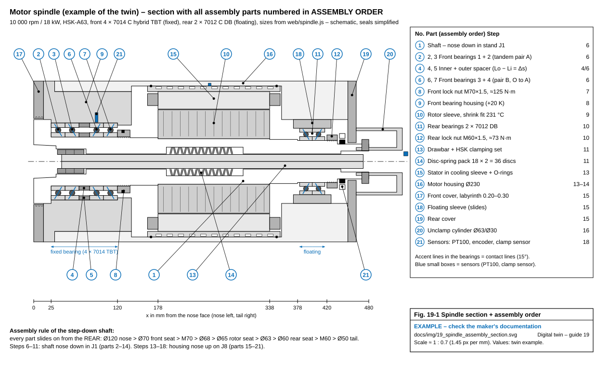
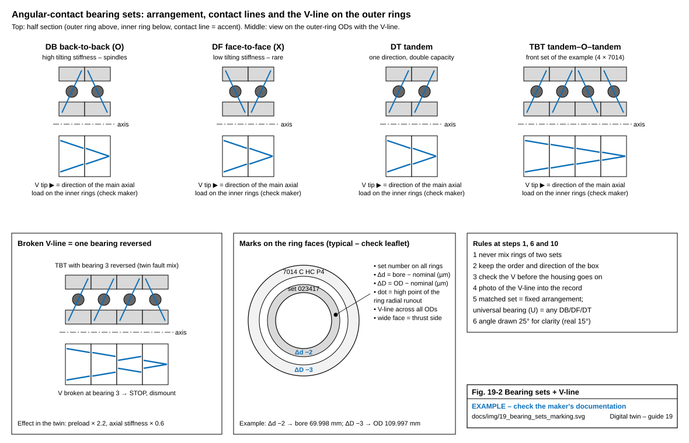
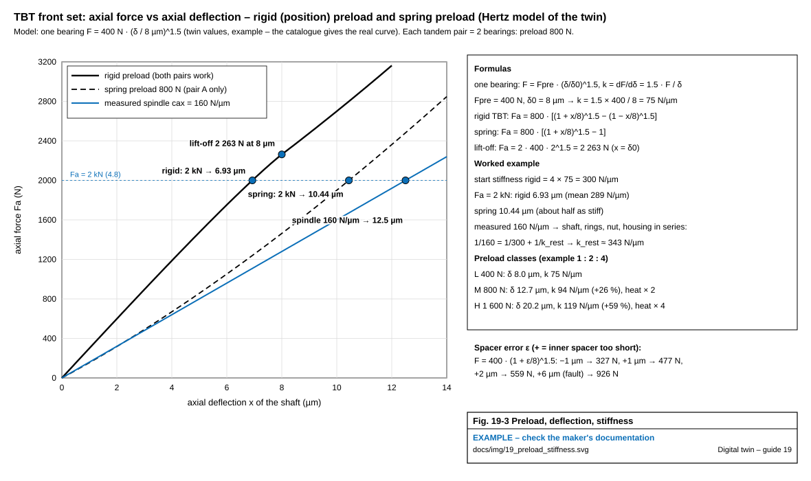
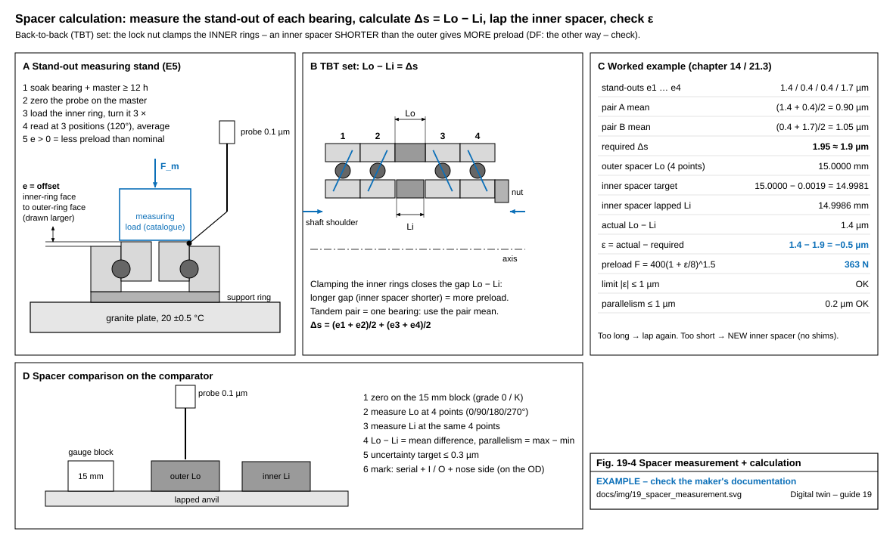
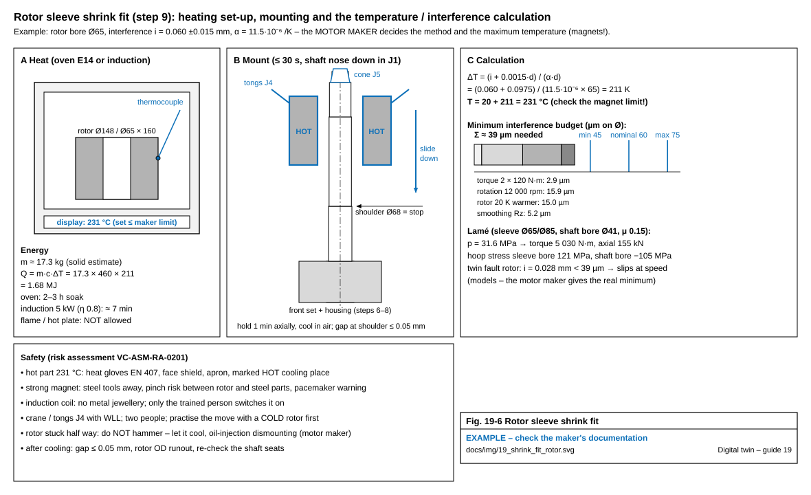
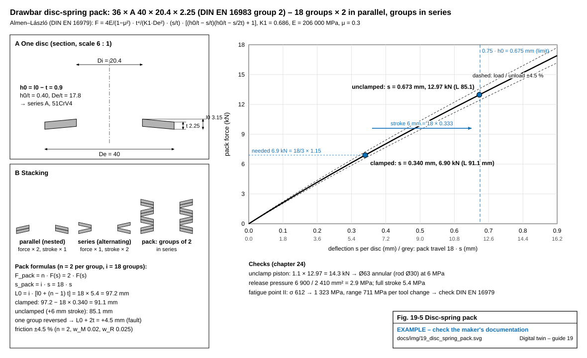
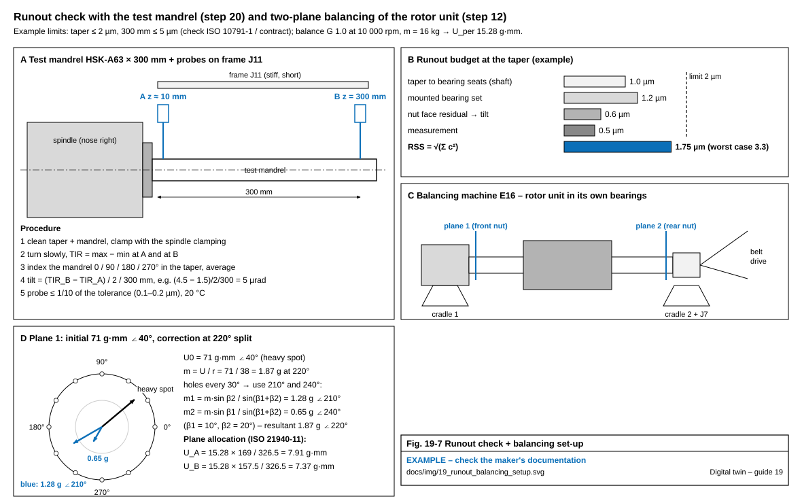
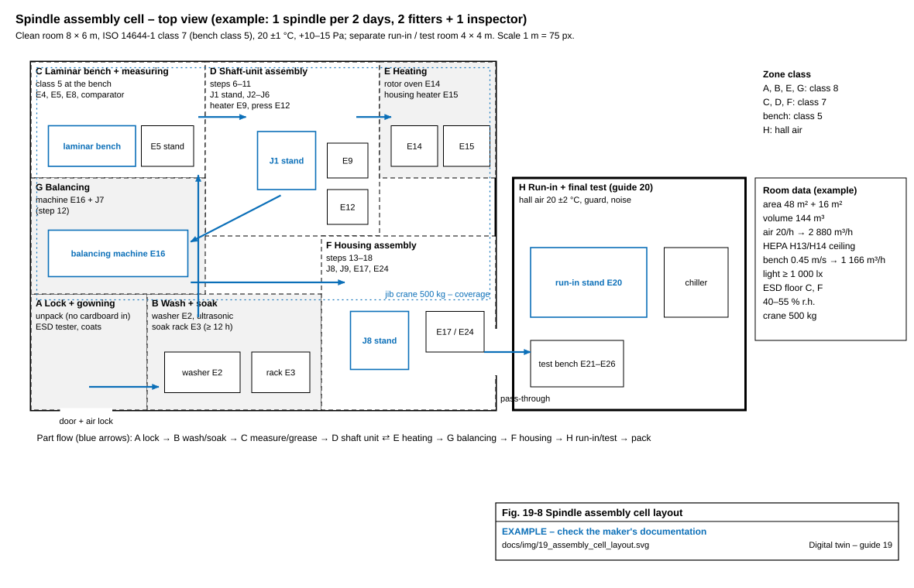

# 19 – Assembly: Motor Spindle – Assembly Twin and Real Assembly Instruction

> **All numbers in this guide are example values from the twin.** They are typical for a 10 000 rpm / 18 kW S1
> (115 N·m S1 up to 1 500 rpm, S6-40 %: 22 kW / 140 N·m – decided 2026-11-12) HSK-A63 motor spindle of a 500 mm pallet class HMC (front 4 × 7014 hybrid angular-contact bearings
> in TBT arrangement, rear 2 × 7012 DB floating, built-in synchronous motor, disc-spring drawbar).
> Before you assemble a real spindle, replace them with the values from **your drawings**, the
> **catalogues and mounting manuals of your bearing, lock-nut, motor, clamping-set and seal suppliers**, and
> **your own measurements**. Values marked **"check"** are uncertain or depend on a supplier or a
> standard edition. Costs use an example labour rate. They are **not** real prices.
> **When a supplier manual gives a different value, the supplier value wins.**

Source files: `web/asmsp.js` (Assembly tab, item 2 – 2D twin, simulation, tables), `web/asmsp3d.js`
(3D view), data from `web/spindle.js` (shared spindle design model: `SP_DEF`, `spGeom()`, `spCalc()`,
`SP_PARTS` – the same model as HMC build item 4, spindle manufacturing). Tab: **Assembly** (`#asm`), item 2.

Related guides: 12 (HMC build), 14 (bolt torques, fits, measuring), 15 (numbering), 16 (standards
register), 17 (rotary table assembly – the same twin pattern; general theory of fits, Lamé, VDI 2230,
bearing mounting, seals, cleanliness), 18 (spindle part manufacturing), 20 (spindle test station – bearing,
run-in, balancing and test theory, buy list).

---

## Contents

1. Purpose
2. Where in the twin
3. Concepts – simply explained
4. Calculations (with the example numbers)
5. Real assembly – the 21 steps
6. Checklists
7. Common mistakes and lessons
8. Limits of the twin (and design points to check)
9. How to use chapters 10–15
10. Science principles
11. Detailed specification (equipment, jigs, clean room, consumables)
12. Identification and numbering
13. Standards
14. Complete worked example: spindle SPU-2546-00001
15. Data you still need
16. Glossary (after the chapter "3D view")

**Part B – Technical reference for the spindle assembler**

17. The spindle section and the assembly order (drawing)
18. Clean zone, ESD and handling (ISO 14644-1 classes)
19. Bearing sets – arrangements DB / DF / DT / TBT, marking, V-line (drawing)
20. Preload of the angular-contact set – classes, stiffness, lift-off, fit and temperature effects, friction torque (drawing)
21. Spacer measurement and grinding calculation (drawing)
22. Grease filling – quantity and dosing
23. Shrink fit of the rotor sleeve – temperature, interference budget, Lamé, heating, safety (drawing)
24. Drawbar and disc-spring pack – DIN EN 16983 / 16979, stacking, friction, fatigue, stroke, clamping-force check (drawing)
25. Balancing in assembly – plane allocation, splitting a correction mass (drawing)
26. Runout and taper checks during assembly – test mandrel, runout budget
27. Sealing air, labyrinth and the cooling-jacket pressure test
28. Electrical checks – insulation, winding, sensors, encoder, back-EMF safety
29. Documentation – traveller, measurement record
30. Failure analysis of returned spindles – ISO 15243
31. The spindle assembly cell – layout (drawing)
32. Buy list – catalogue examples
33. Consolidated shopping list for one spindle assembly cell

---

## 1. Purpose

This guide tells a small team (2 fitters, one inspector) **how to assemble the HMC motor spindle in
reality** – from the box of released parts to a run-in, tested and packed spindle with a complete
assembly record.

After reading it you can:

* set up a **clean assembly room** at 20 °C and handle precision bearings correctly,
* **measure** bearings (stand-out, deviation marks), shaft seats and housing bores and calculate every fit,
* calculate and **grind the spacers** so that the bearing set gets the right **preload**,
* **grease** the bearings with a weighed quantity,
* **heat and mount** the front TBT set in the right order and direction (V-line),
* tighten the **precision lock nut** and **correct its runout** with the radial set screws (≤ 2 µm),
* **shrink** the motor rotor onto the shaft and the stator into the cooling sleeve,
* stack the **disc-spring pack**, check its force, fit the **unclamp cylinder** and measure the
  **clamping force** with an HSK gauge,
* **balance** the rotor unit in 2 planes to the G-grade,
* **run the spindle in** with a stepped speed program and temperature limits,
* do the **final test**: runout at the taper and at 300 mm, stiffness, thermal growth, vibration, noise,
* buy the right **equipment (E1–E26)** and design and make the **jigs (J1–J12)**.

The twin (Assembly tab, item 2) shows all 21 steps on a section of the spindle built from the shared
design model, draws the jigs in blue, simulates the measured values and shows what happens when one of
**8 typical assembly faults** is made. A 3D view shows the same step.

What this guide does **not** do: design the spindle (that is HMC item 4 / `spindle.js`) or replace the
mounting manuals of the bought parts.

---

## 2. Where in the twin

### 2.1 How to open

1. Start the twin (guide 01). Open `http://localhost:8080/` in the browser.
2. Click the tab **Assembly**.
3. Click the second button **"2 · Motor spindle – assembly twin"**. Item 1 (rotary table) is hidden,
   item 2 is shown.

The spindle data come from `web/spindle.js` (`SP_DEF`). If the spindle manufacturing twin publishes its
current design and shaft serial (`window.spMfg.M`, `window.spMfg.current()`), the assembly twin uses them;
otherwise it uses the defaults and the shaft serial `SPS-2546-0000n`.

### 2.2 What is on the page (cards from top to bottom)

| Card | What it shows | How to use it |
|---|---|---|
| **KPI row** | Spindle serial `SPU-2546-00001` + shaft serial; Status (accepted / REJECT at step n); Labour (h); Labour cost ($, 45 $/h example); Runout taper / 300 mm; Clamping force; Run-in ΔT max (+ stops, time); Vibration at nmax | Quick result of the simulated spindle |
| **Assembly twin – motor spindle** | Route bar with 21 steps; ▶ Play all, ◀, ▶\|, progress slider, **New spindle (random)**, **Download assembly record** | Click a step to jump to it. Red / orange marks = check failed / warning |
| Step line | the how-to line that is active now | follows the progress slider |
| Scene (left) | steps 6–11: section **nose down on the vertical stand J1**; steps 13–18 + 21: section **nose up on the housing stand J8**; parts come in step by step, the newest part is labelled in blue, jigs + devices in blue. Custom scenes: kit list + V-line (1), clean room (2), measuring stand + fit table (3), spacer grinding + preload curve (4), grease weighing (5), balancing machine + polar plot (12), spring-pack chart with the HSK gauge (17), run-in speed + temperature (19), final test (20) | watch how the part goes in and where you measure |
| Info panel (right) | step name + phase, how-to list, **Equipment (BUY)**, **Jigs (MAKE)**, **Torques** (where used), **Checks** (shown at ≥ 90 %), time × fitters | this is the work card of the step |
| **Show 3D view** + quarter cut | 3D model of the same step (chapter "3D view") | |
| **Inject an assembly fault** | 8 fault chips (7.1) | click one or more – the simulated values change at once |
| **Key calculations** | 11 boxes with the formulas and numbers of chapter 4 | check the design numbers |
| **Balancing, clamping, run-in, final test** | from step 12: polar plot; from 17: spring-pack curve; from 19: run-in ΔT + speed; from 20: final values in % of their limits + all checks | the final protocol view |
| **Assembly record** | 21 rows: minutes, fitters, measured values, result | click a row to jump |
| **Tightening torques + sequence** | 11 joints | copy into the work cards (check 4.9) |
| **Equipment to BUY** | E1–E26, capability, steps | purchasing list (11.1) |
| **Jigs + fixtures to MAKE** | J1–J12, design + function, steps | design list (11.2) |
| **Spindle clean room layout** | 8 zones, crane, part flow | room planning (11.3) |
| **Guide** | 9 rules + fault table with prevention | short version of chapters 6–7 |

### 2.3 Buttons

| Button | Effect |
|---|---|
| ▶ Play all / ❚❚ Pause | plays the 21 steps (≈ 6 s per step) |
| ◀ / ▶\| | previous / next step |
| progress slider | moves inside the step 0 … 100 %; checks appear at ≥ 90 % |
| New spindle (random) | next serial `SPU-2546-00002` … with new random values; the same serial always gives the same values (seed 7000 + serial) |
| Download assembly record | JSON file `SPU-2546-0000n_assembly_record.json` (fields in 12.4) |

### 2.4 Deep links

URL parameters (query part before `#asm`):

| Parameter | Meaning | Values |
|---|---|---|
| `asitem` | open Assembly item 2 | `2` |
| `asst` | step to open | 1 … 21 |
| `asu` | progress inside the step | 0 … 1 (without `asu` the step opens finished, checks visible) |
| `asf` | faults on | comma list of `mix`, `spacer`, `dirt`, `grease`, `nut`, `rotor`, `spring`, `oring` |
| `show3d` | open the 3D view | – |

| Link | Shows |
|---|---|
| `/?asitem=2&asst=6&asu=0.5#asm` | step 6, front bearings half way down, heater at 72 °C |
| `/?asitem=2&asst=6&asf=mix#asm` | V-line broken, bearing 3 reversed |
| `/?asitem=2&asst=4&asf=spacer#asm` | spacer 6 µm too short → preload 926 N instead of 400 N |
| `/?asitem=2&asst=7&asf=nut#asm` | nut runout not corrected |
| `/?asitem=2&asst=11&asf=spring#asm` | spring pack too long, spring force low |
| `/?asitem=2&asst=17&asf=spring#asm` | clamping force ≈ 11 kN instead of 18 kN |
| `/?asitem=2&asst=13&asf=oring#asm` | cooling jacket pressure test fails |
| `/?asitem=2&asst=19&asf=grease#asm` | run-in with temperature stops and long run-in time |
| `/?asitem=2&asst=20&asf=dirt,rotor#asm` | vibration + noise + unbalance shift at the final test |
| `/?asitem=2&asst=14&show3d#asm` | 3D: shaft unit lowered into the motor housing |

### 2.5 How to use the twin before the real assembly

1. **Train:** play all 21 steps together; each fitter explains 3–4 steps.
2. **Fault training:** one fault at a time – "where do we find it, what do we do?" (7.1).
3. **Work cards:** copy the info panel of each step into `VC-ASM-WI-0201-A-Snn` and replace the
   example values with your drawing and catalogue values.
4. **Purchasing + jig design:** Equipment and Jig cards with chapter 11.
5. **Record template:** use the JSON structure for the MES / paper record.

---

## 3. Concepts – simply explained

### 3.1 The spindle you assemble

From the nose (tool side) to the rear (x in mm from the nose face, example model):

| x (mm) | Part |
|---|---|
| 0–25 | nose flange Ø120 with the HSK-A63 taper inside; front cover with labyrinth around it |
| 25–120 | **front bearing set**: bearings 1 + 2 (tandem), inner + outer spacer 15 mm, bearings 3 + 4 (tandem); pair 1-2 against pair 3-4 back-to-back = **TBT**; in the **front bearing housing** |
| 120–138 | front precision lock nut M70×1.5 |
| 178–338 | **rotor sleeve** of the built-in motor (shrink fit on Ø65); **stator** around it in the **cooling sleeve** inside the **motor housing** |
| 378–420 | **rear bearing pair** 2 × 7012 DB in a **floating sleeve** (slides axially = takes the thermal growth) |
| 420–435 | rear lock nut M60×1.5 |
| 435–480 | tail: encoder ring, end of the drawbar |
| behind | rear cover + **unclamp cylinder** |
| inside | drawbar with the HSK clamping set (collet) at the front and the **disc-spring pack** |

The front set is the **fixed bearing** (takes the axial cutting force and gives the stiffness). The rear
set is the **floating bearing**: the shaft grows ≈ 79 µm towards the rear when it is 15 K warmer, and the
rear set must slide with it, otherwise the preload rises and the bearings overheat.

### 3.2 Clean room and 20 °C

A preloaded spindle bearing has no play. A 5 µm particle in the ball track makes a dent → noise,
vibration, early failure. The fits are a few µm: Ø110 steel grows 1.3 µm per K. So:

* separate room, filtered air, slight over-pressure, gowning; **no grinding, no shop compressed air**,
* parts soak ≥ 12 h at 20 ±1 °C before measuring,
* bearings are unpacked only on the laminar-flow bench.

The cleanliness class (ISO 14644-1 class 7–8 for the room, class 5 at the bench) is a common choice –
**check** what your bearing maker asks for.

### 3.3 Matched bearing sets and the V-line

Spindle bearings are bought as **matched sets** (or as "universal" bearings that can be combined). The
maker grinds the ring faces so that the set gets a defined preload in the arrangement. Every ring has:

* the **set number** (all rings of one set the same) – never mix two sets,
* **deviation marks**: bore deviation Δd and OD deviation ΔD in µm (actual size − nominal),
* a **V-line** across the outer rings: when the bearings are in the right order and direction, the line
  is continuous and forms a "V". The tip of the V points in the direction in which the set takes the
  main axial load (normally to the nose – **check the catalogue**).

### 3.4 Contact angle and the arrangement TBT

An angular-contact ball bearing carries axial load in one direction only. The line through the ball
contacts (red line in the section) is inclined by the contact angle (15° = "C" type, example).

* **Tandem (T):** two bearings with the same direction share the axial load → double axial capacity.
* **Back-to-back (B, "O"):** the contact lines open outwards → large distance between the load centres →
  high tilting stiffness. Good for spindles.
* **TBT:** tandem pair + tandem pair, back-to-back = 4 bearings with high stiffness in both directions.

A reversed bearing breaks the V-line, changes the load sharing and the preload → hot, less stiff.

### 3.5 Preload

Preload = an axial force pressed into the bearings **without** external load, so that there is no play
and the stiffness is high. Too little → chatter, low stiffness. Too much → heat, short life.

In a back-to-back pair with spacers, the lock nut clamps the inner rings together. The preload depends on
the **length difference** between the outer and inner spacer: an inner spacer **shorter** than the outer
gives **more** preload (back-to-back; for face-to-face it is the opposite – **check the catalogue**).
Because the ball contact is a Hertz contact, the force grows with the offset to the power 1.5: 1 µm
matters (4.1).

### 3.6 Grease quantity and run-in

Grease-lubricated spindle bearings need very little grease – typically **10–20 % of the free volume**
of the bearing (catalogue value). Too much grease is churned by the balls → heat → the twin's most
common reason for a hot spindle. After assembly the grease must be distributed by a **run-in**: speed in
steps, wait at each step until the temperature is stable, stop if a temperature limit is reached.

### 3.7 Lock-nut runout correction

A precision lock nut whose face is not exactly square to the shaft tilts the inner rings → runout at
the taper. Precision nuts have **radial set screws** (4–8). After tightening, the face runout is measured
(0.1 µm probe); the set screw at the **high point** is tightened a little – the nut deforms elastically
and the face runout goes down. Target ≤ 2 µm (example).

### 3.8 Shrink fits

* **Bearings on the shaft:** small interference (0 … +5 µm example); the inner ring is heated to ≈ 70 °C
  (never above 110 °C, induction heater) and slides on.
* **Rotor sleeve:** big interference (0.06 mm on Ø65 example) → heat to ≈ 231 °C (4.5). **Permanent
  magnets have a temperature limit** – the rotor maker decides the method (heating or oil-injection
  mounting).
* **Stator in the cooling sleeve:** heat the sleeve (≈ +60 K example).
* **Front bearing housing over the set:** +15–20 K, the outer rings have a small clearance.

### 3.9 Disc springs and clamping force

The drawbar is pulled to the rear by a **pack of disc springs**. The HSK clamping set (collet) turns
the drawbar force into a bigger **clamping force** on the tool (ratio i = 3 example). To release the tool
the **unclamp cylinder** pushes the drawbar forward (stroke 6 mm example), compressing the springs more.

Disc springs can be stacked:

* **in parallel** (same direction, nested): forces add, stroke stays,
* **in series** (alternating): strokes add, force stays.

A pack of 18 groups × 2 springs in parallel = 36 springs. One group stacked wrong changes length and
force – that is why you **count**, **measure the free length** and **measure the force**.

### 3.10 Balancing

A rotor with its mass centre e µm off the axis makes a force F = m·e·ω². The allowed residual unbalance
for a balance grade G (ISO 21940-11): Uper = 9549 · G · m / n (g·mm, m in kg, n in rpm). A spindle rotor
is long → balance in **2 planes** (front nut and rear nut / balancing ring). Correct by screws in the
threaded holes of the nuts or by drilling in the balancing ring.

### 3.11 Thermal growth

The motor and bearings heat the shaft (ΔT ≈ 15 K example). The steel grows 11.5 µm per m and K. Because
the front set is fixed, the nose moves only a little (shaft part ≈ 4 µm + housing growth), but the rear
end moves ≈ 79 µm → floating rear bearing. Measure the nose growth at the final test.

---

## 4. Calculations (with the example numbers)

### 4.1 Preload and spacer length

Inputs (example): light preload Fpre = 400 N per bearing, offset at light preload δ0 = 8 µm (example –
from the catalogue's preload / deflection data).

1. Measure the stand-out deviation e of each bearing on the measuring stand (+ = less preload than the
   catalogue nominal). Example: e1 = 1.4, e2 = 0.4, e3 = 0.4, e4 = 1.7 µm.
2. A tandem pair acts like one bearing: use the mean of the pair.
   **Δs = Lo − Li = (e1 + e2)/2 + (e3 + e4)/2 = (1.4 + 0.4)/2 + (0.4 + 1.7)/2 = 0.9 + 1.05 = 1.9 µm**
   → grind the inner spacer 1.9 µm shorter than the outer.
3. Spacer error **ε = Δs(actual) − Δs(required)**, + = inner spacer too short = more preload. Preload:
   **F = Fpre · (1 + ε/δ0)^1.5**
   * ε = +1 µm → F = 400 · 1.125^1.5 = 477 N (+77 N, +19 %)
   * ε = +6 µm (fault "spacer") → F = 400 · 1.75^1.5 = **926 N** → hot spindle
4. Limit: |ε| ≤ 1 µm.

The 1.5 exponent and δ0 are a model; your bearing catalogue gives the real preload – offset curve.
Theory, stiffness and worked examples: chapter 20; measuring and lapping the spacers: chapter 21.

> **Correction (Nov 2026):** an earlier version of this guide wrote ε = Δs(required) − Δs(actual). That sign is
> wrong: Δs = Lo − Li, and a **larger** Lo − Li (inner spacer shorter) gives **more** preload in a back-to-back set.
> **App note (fixed 2026-11-12):** `web/asmsp.js` used the old sign (`x.eps = x.ds - x.dsAct`, fault `dsAct = ds - 6`).
> It now uses `x.eps = x.dsAct - x.ds` and the `spacer` fault sets `dsAct = ds + 6`: the fault still gives 926 N, and
> "Lo − Li measured" and the preload error of a normal spindle now have the correct direction.

### 4.2 Speed factor

n·dm = 10 000 × 90 = **0.90·10⁶ mm/min** (dm = (70 + 110)/2 = 90). Hybrid bearings with grease are often
allowed up to ≈ 1.2–1.4·10⁶ (**check catalogue**). OK.

### 4.3 Grease quantity

Free volume (estimate – the catalogue gives the real value): V_free ≈ 0.15 · π/4 · (D² − d²) · B

* 7014: 0.15 × 0.785 × (110² − 70²) × 20 = 0.15 × 0.785 × 7 200 × 20 = **17.0 cm³**
* fill 15 % → **2.54 cm³** → × 0.9 g/cm³ = **2.29 g per bearing**
* 7012: V_free = 11.5 cm³ → 1.73 cm³ → **1.55 g per bearing**

Tolerance of the weighing ±5 % (example). The factor 0.15 for the free volume is a rough estimate.

### 4.4 Heating temperatures

| Part | Formula | Example |
|---|---|---|
| Bearing inner ring on Ø70 | ΔT = (i + s_mount) / (α·d) = (0.004 + 0.015) / (11.5·10⁻⁶ × 70) | **24 K** → heat to ≈ 70 °C (margin for the time), never > 110 °C |
| Front bearing housing (bore Ø110, clearance) | +20 K → bore grows 11.5·10⁻⁶ × 110 × 20 = 25 µm | free sliding |
| Rotor sleeve on Ø65 (interference 0.06) | see 4.5 | 211 K → 231 °C |

s_mount = extra clearance so the part slides while it cools (here 0.015 mm, example).

### 4.5 Rotor shrink temperature (spCalc)

ΔT = (i + 0.0015 · d) / (α · d) = (0.060 + 0.0975) / (11.5·10⁻⁶ × 65) = 0.1575 / 0.000 747 5 = **211 K**
→ **T ≈ 231 °C**. The 0.0015·d is the mounting clearance. **Check the magnet temperature limit** with the
rotor maker; if it is lower, use the method of the rotor maker (oil injection / hydraulic mounting).

### 4.6 Clamping force → spring pack → piston

1. Drawbar force: F_draw = Fclamp / i = 18 kN / 3 = **6.0 kN**
2. With +15 % for wear and friction: **F_spring = 6.9 kN** (spCalc)
3. Disc spring (example A 40 × 20.4 × 2.25, h0 = 0.9 – **check DIN EN 16983 / catalogue table**),
   Almen–László formula (DIN EN 16979 – check):
   F = 4E/(1 − μ²) · t⁴/(K1·De²) · (s/t) · [(h0/t − s/t)(h0/t − s/(2t)) + 1],
   δ = De/Di = 1.961, K1 = 0.686, E = 206 000 MPa, μ = 0.3 → F(s = 0.75 h0 = 0.675 mm) = **6.50 kN** per spring
4. 2 in parallel: each spring 3.45 kN → s_clamped = **0.340 mm**
5. Stroke 6 mm must be taken before s reaches 0.75·h0: per group 0.675 − 0.340 = 0.335 mm →
   n = 6 / 0.335 = 17.9 → **18 groups = 36 springs**, s_unclamped = 0.673 mm
6. Lengths: group l0 = h0 + 2·t = 5.4 mm → L0 = **97.2 mm**, clamped L = 97.2 − 18 × 0.34 = **91.1 mm**,
   unclamped 85.1 mm
7. Force unclamped: 2 × F(0.673) = **12.97 kN** (+88 % over the clamped force)
8. Piston: F_piston ≥ 1.1 × 12.97 = **14.3 kN**; at p = 6 MPa: A = 14 264 / 6 = 2 377 mm²;
   annular piston around a Ø30 rod: D = √(4A/π + 30²) = **Ø63 mm**
9. Release pressure (where the drawbar starts to move): p = 6 900 / (π/4 × (63² − 30²)) = **2.9 MPa**

**Design note (updated):** the first spCalc version sized the piston for only +25 % (Ø42.8 solid, too small).
It now uses the pack force at full stroke (+88 %) + 10 %: 14.3 kN → Ø55 solid at 6 MPa. Options:
a bigger piston (Ø63 annular, as the twin uses) or a longer pack with less rise. **Check with the real
clamping-set stroke and spring data.**

### 4.7 Balancing (spCalc)

Uper = 9549 · G · m / n = 9549 × 1.0 × 16 / 10 000 = **15.3 g·mm**, per plane ≈ **7.6 g·mm**.
Mass centre offset e = U / m = 15.3 / 16 000 g = **0.95 µm**.
Correction mass in the nut at r = 38 mm: initial 71 g·mm → m = 71 / 38 = **1.88 g**, placed 180°
opposite the heavy spot (or remove the same mass at the heavy spot).

### 4.8 Thermal growth, cooling, critical speed (spCalc)

* rear end: α·L·ΔT = 11.5·10⁻⁶ × 455 × 15 = **0.079 mm** → floating rear set
* nose (shaft only): 11.5·10⁻⁶ × 25 × 15 = **4.3 µm** (+ housing growth; limit at the test 15 µm, example)
* cooling water: ΔT_w = P_loss / (ṁ · c) = 1 600 / (4/60 × 4 186) = **5.7 K**
* first bending critical speed (simple beam model) ≈ 49 000 rpm ≥ 1.3 × 10 000 = 13 000 → OK (rough – a real rotor-dynamics calculation is needed)
* axial deflection at 2 kN: 2 000 / 160 = 12.5 µm (cax = 160 N/µm)

### 4.9 Lock-nut torque (example estimate)

The nut must clamp the inner rings with an axial force well above the preload and the axial cutting
force. Torque for an axial force F (thread M70×1.5, μ = 0.1 thread + face, example):

T = F · (0.16·P + 0.58·μ·d2 + μ·Dm/2)
= 15 000 × (0.16 × 1.5 + 0.58 × 0.1 × 69.0 + 0.1 × 82/2) / 1000 = 15 000 × (0.24 + 4.00 + 4.10) / 1000 ≈ **125 N·m**

Rear M60×1.5 with 10 kN: ≈ **73 N·m**. **Use the nut / bearing catalogue values when they exist** – the
clamp force (15 kN, 10 kN) here is an assumption.

Screw torques (μ ≈ 0.12, oiled, doc 14): M6 8.8 = 9.5 N·m, M8 10.9 = 34 N·m, M10 10.9 = 67 N·m, M12
10.9 ≈ 115 N·m (check doc 14).

### 4.10 Run-in model (twin)

Per speed step n: steady temperature rise ΔT_ss = 14 · (n/nmax)^1.2 · (F/Fpre)^0.6 K, plus a grease
churning peak 6 · (n/nmax) · e^(−t/10 min) K (× 3.6 when overfilled), time constant 9 min. Stop rule: stop
at 25 K, cool to 12 K, continue. Step change when |slope| < 0.06 K/min (min 15 min, max 60 min). Last step:
30 min hold. This is a teaching model – use the program of the bearing maker / your own experience.

> **Two run-in models in the project:** this Assembly page (`web/asmsp.js`) uses the simple model above. The **spindle
> test station** (guide 20 §8 and §24, `twin/spstation.py`) uses a more detailed 8-step program (1 250 … 10 000 rpm in steps of 1 250 rpm,
> dwells 10/10/10/10/15/15/15/30 min, step-up at |rate| < 0.06 K/min, last step < 0.1 K/min, max 60 min per step,
> ramps 50 / 200 rpm/s; about 1.95 h). For a real station follow guide 20 and the bearing maker.

### 4.11 Labour and time (twin)

Sum of (minutes × fitters) = 2 175 min = **36.3 h** labour; lead time 29.5 h + 12 h soak; at 45 $/h
(example) = **$1 631**.

---

## 5. Real assembly – the 21 steps

General rules for every step: gloves, clean tools, measure only at 20 °C, write every value into the
record with the gauge ID, mark every tightened screw. Times are twin examples.

### Step 1 – Kit + traceability (Prepare)

* **Goal:** every part present, released and traceable.
* **Equipment:** E25 scanner + MES tablet. **Jigs:** –
* **Procedure:** scan the serials: shaft `SPS-…`, front bearing housing `SBH-…`, motor housing `SMH-…`,
  cooling sleeve `SCS-…`, spacer pair `SPC-…`, bearing sets (B-part + supplier set number), nuts, motor
  kit (rotor + stator same kit number), drawbar, clamping set, springs (count!), cylinder, sensors. Check
  the V-line on the outer rings of each set (through the packing if possible). Check part records: shaft
  runout ≤ 2 µm, bores IT4, no open NCR.
* **Measurement / limit:** all serials present, 0 open NCR.
* **If not OK:** stop – no assembly with unreleased parts.
* **Record:** all serials, kit numbers, set numbers. **Time:** 30 min, 1 fitter.

### Step 2 – Clean room, wash, soak at 20 °C (Prepare)

* **Goal:** clean parts at room temperature.
* **Equipment:** E1 clean room, E2 washer, E3 soak rack, E4 laminar bench.
* **Procedure:** gowning; wash shaft, spacers, nuts, covers, housings (solvent, ultrasonic for small
  parts); blow out bores with **filtered** dry air (never bearings); bearings: follow the maker – many
  are mounted with their preservative, if washing is required use clean solvent and dry without spinning;
  soak ≥ 12 h, covered.
* **Measurement / limit:** room 20 ±1 °C; particles ≥ 0.5 µm ≤ class limit (class 7: 352 000 /m³ –
  check ISO 14644-1 table); filter patch of the shaft bore ≤ 2 mg (example).
* **If not OK:** wash again / wait.
* **Record:** room temperature, particle count, soak start + end. **Time:** 120 min.

### Step 3 – Measure bearings, seats, bores (Measure)

* **Goal:** actual sizes → fits and spacer difference.
* **Equipment:** E4, E5 bearing measuring stand, E6 bore gauges + micrometers, E11 probe 0.1 µm.
* **Procedure:** stand-out of each bearing under the catalogue measuring load; read and check the
  deviation marks; shaft seats Ø70 / Ø60 at 2 planes × 2 directions; housing bore Ø110, floating sleeve
  bore; calculate fits.
* **Limits (examples – check catalogue):** front + rear shaft fit 0 … +5 µm interference; front
  housing bore − OD 2 … 8 µm clearance; floating sleeve − rear OD 5 … 12 µm clearance.
* **If not OK:** select other bearings of the same class? **No** – a set stays a set. Re-work or replace
  the shaft / sleeve, or ask the bearing maker for a set with matching deviations.
* **Record:** 4 + 2 stand-outs, all deviation marks, all fits. **Time:** 120 min.

### Step 4 – Grind spacers to the measured offset (Measure)

* **Goal:** Lo − Li = Δs ±1 µm (4.1).
* **Equipment:** E7 surface grinder / lapping plate, E5 comparator, E6.
* **Procedure:** calculate Δs; grind / lap the inner spacer; measure both at 4 points; mark; wash.
* **Limit:** |Lo − Li − Δs| ≤ 1 µm, parallelism ≤ 1 µm.
* **If not OK:** too long → grind again; too short → **new inner spacer** (never shim).
* **Record:** Lo, Li, Δs, ε. **Time:** 90 min.

### Step 5 – Grease the bearings (Measure)

* **Goal:** exact grease quantity, clean.
* **Equipment:** E4 bench, E8 dosing unit + scale 0.01 g.
* **Procedure:** grease type from the catalogue; weigh 2.29 g (7014) / 1.55 g (7012) per bearing (4.3);
  put it between the balls from both sides; turn slowly by hand; cover.
* **Limit:** ±5 % of the target weight.
* **If not OK:** too much → remove with a clean spatula and weigh again.
* **Record:** grease type, batch, weight per bearing. **Time:** 45 min.

### Step 6 – Heat + mount the front TBT set (Shaft unit)

* **Goal:** 4 bearings + spacers in the right order and direction, seated.
* **Equipment:** E9 induction heater, E11 probe, E12 press. **Jigs:** J1 vertical stand, J2 push sleeve.
* **Procedure:** shaft nose-down in J1; heat bearing 1 to ≈ 70 °C, slide on, hold against the shoulder;
  bearing 2 (tandem), inner + outer spacer, bearings 3 + 4 (back-to-back to 1–2) – V points to the nose;
  after cooling press axially with J2 (force from the catalogue, only on the inner ring).
* **Limit:** temperature ≤ 110 °C; V-line continuous; no axial movement after pressing.
* **If not OK:** reversed bearing → dismount (puller on the inner ring), **inspect**, the maker decides
  whether the bearing may be used again.
* **Record:** heating temperatures, V-line photo. **Time:** 75 min, 2 fitters.

### Step 7 – Front lock nut: torque + runout correction (Shaft unit)

* **Equipment:** E10 torque wrench + hook spanner, E11 probe 0.1 µm. **Jigs:** J1, J3 nut runout fixture.
* **Torques:** nut ≈ 125 N·m (example, 4.9); seat first with ≈ 2× the torque, loosen, final torque; set
  screws per catalogue.
* **Procedure:** see 3.7; correct at the high point step by step; then measure the **friction torque**
  of the front set (preload check) and lock the set screws.
* **Limits:** nut face runout ≤ 2 µm; friction torque 0.35–0.70 N·m (example – take your bearing
  maker's value or your first good spindle as reference).
* **If not OK:** runout cannot be corrected → nut or thread faulty (check thread squareness 0.003);
  friction torque high → spacer / reversed bearing (back to step 4 / 6).
* **Record:** runout before + after, friction torque, torque. **Time:** 60 min.

### Step 8 – Front bearing housing over the front set (Shaft unit)

* **Equipment:** E15 housing heater, E13 crane, E11. **Jigs:** J1.
* **Procedure:** heat +20 K; lower slowly and level from above until the shoulder touches bearing 4;
  hold until cooled; check axial play.
* **Limit:** outer rings seated, axial play ≤ 1 µm (probe, example).
* **Record:** housing temperature, play. **Time:** 45 min, 2 fitters.

### Step 9 – Rotor sleeve shrink fit (Shaft unit)

* **Equipment:** E14 oven, E13 crane, E6. **Jigs:** J4 tongs + guide bush, J5 thread protector.
* **Procedure:** measure seat and bore (interference); heat to ≈ 231 °C (4.5 – magnet limit!); slide down
  quickly and straight to the shoulder Ø68 (body 1); hold ≈ 1 min; cool in air.
* **Limits:** interference 0.045 … 0.075 mm (example ±0.015); gap to shoulder ≤ 0.05 mm.
* **If not OK:** stuck half way → do **not** hammer; let cool, ask the rotor maker (oil-injection
  dismounting). Interference too small → reject the rotor or the shaft (a loose rotor moves → unbalance).
* **Record:** interference, temperature, gap. **Time:** 60 min, 2 fitters.

### Step 10 – Rear bearings (DB) + rear nut (Shaft unit)

* **Equipment:** E9, E10, E11. **Jigs:** J2, J5. **Torque:** rear nut ≈ 73 N·m (example).
* **Procedure:** heat, mount back-to-back with V-line, press after cooling; nut like step 7; check the
  floating sleeve slides over the outer rings.
* **Limits:** nut runout ≤ 2 µm, tail / encoder seat runout ≤ 3 µm.
* **Time:** 60 min.

### Step 11 – Drawbar + disc-spring pack (Shaft unit)

* **Equipment:** E12 press + force gauge, E10. **Jig:** J6 spring-pack compression tool.
* **Procedure:** stack 18 groups × 2 in parallel, alternating (drawing + picture on the work card),
  count; grease lightly (catalogue); measure L0; insert into the shaft; compress with J6 to the clamped
  length (91.1 mm); fit the drawbar nut / clamping set; read the force.
* **Limits:** L0 = 97.2 ±0.5 mm; spring force at clamped length ≥ 6.9 kN (−3 % tolerance in the twin).
* **If not OK:** L0 too long by ≈ 2·t → a group is stacked wrong → restack.
* **Record:** number of springs, L0, force. **Time:** 60 min, 2 fitters.

### Step 12 – Balance the rotor unit, 2 planes (Balance)

* **Equipment:** E16 balancing machine, E13. **Jig:** J7 balancing supports.
* **Procedure:** front bearing housing in cradle 1, J7 sleeve over the rear set in cradle 2 – the rotor
  turns in its own bearings; measure the initial unbalance in plane 1 (front nut) and plane 2 (rear nut);
  correct (m = U / r, 180° opposite); repeat; lock the screws (thread locker).
* **Limit:** residual per plane ≤ 7.6 g·mm (G1 at 10 000 rpm, 4.7).
* **Record:** initial + residual unbalance with angle, correction masses. **Time:** 90 min.

### Step 13 – Stator + cooling sleeve into the motor housing (Housing)

* **Equipment:** E15, E17 pressure test, E13, E24 electrical test. **Jigs:** J8 housing stand, J9 stator
  fixture. **Torque:** sleeve / stator clamp ring 6 × M8 10.9 = 34 N·m.
* **Procedure:** housing on its rear face; heat the sleeve (≈ 80 °C, stator maker's limit), insert the
  stator, cool; O-rings oiled with fitting sleeve; lower sleeve + stator into the housing; pressure test;
  electrical test.
* **Limits:** pressure test 1.5 × working pressure, 15 min, drop ≤ 0.1 bar (example); insulation
  ≥ 100 MΩ at 500 V DC (example – motor maker); winding resistance balance ≤ 2 %.
* **If not OK:** leak → O-ring cut → take out, new O-rings, check chamfers.
* **Time:** 90 min, 2 fitters.

### Step 14 – Insert the shaft unit, vertical (Housing)

* **Equipment:** E15, E13, E11. **Jig:** J8 guide rods + lifting adapter. **Torque:** front bearing
  housing 8 × M10 10.9 = 67 N·m crosswise in 3 stages.
* **Procedure:** turn the unit nose-up, lift at the nose; 3 guide rods in the housing face; lower
  tail-first slowly – the rotor goes into the stator without touching (air gap ≈ 1 mm); bolt; turn by hand.
* **Limits:** air gap even (±0.1 mm at 4 positions); shaft turns freely, even, no noise.
* **Time:** 75 min, 2 fitters.

### Step 15 – Front cover (labyrinth) + rear sleeve + cover (Housing)

* **Equipment:** E10, E6 feeler gauges. **Jig:** J10 centring ring. **Torques:** 6 × M6 8.8 = 9.5 N·m.
* **Procedure:** cover with J10, check gap at 4 positions, tighten crosswise; sealing-air test; from the
  rear: floating sleeve, rear cover; check the sleeve moves.
* **Limits:** labyrinth gap 0.20–0.30 mm; sleeve moves with ≤ 150 N (example).
* **Time:** 60 min.

### Step 16 – Unclamp cylinder + stroke setting (Clamping)

* **Equipment:** E19 hydraulic test unit, E10, E11. **Torque:** 6 × M8 10.9 = 34 N·m.
* **Procedure:** fit cylinder; bleed; raise the pressure slowly; note the release pressure; measure the
  drawbar stroke and tool ejection; set the gap piston ↔ drawbar in the clamped state.
* **Limits:** release pressure < supply 6 MPa (calc. 2.9 MPa); stroke 6 ±0.2 mm; ejection 0.4–0.6 mm
  (check clamping set).
* **Time:** 60 min.

### Step 17 – Clamping-force test, HSK gauge (Clamping)

* **Equipment:** E18 HSK-A63 clamping-force gauge, E19.
* **Procedure:** clean taper, insert gauge, release pressure → read force; 3 times, use the mean; check
  the 3 clamp-sensor positions; check tool ejection.
* **Limit:** 0.9 … 1.15 × 18 kN = **16.2 … 20.7 kN** (example tolerance – check clamping-set maker).
* **If not OK:** low → spring pack (step 11), friction in the clamping set, wrong stroke setting.
* **Time:** 45 min.

### Step 18 – Sensors + electrical test (Clamping)

* **Equipment:** E24. **Procedure:** PT100 at the front bearings, winding sensor, vibration sensor,
  encoder (gap gauge), clamp position sensor; insulation, winding resistance, plausibility at 20 °C,
  encoder amplitude; label + fix cables.
* **Limits:** sensor values 20 ±1 °C; encoder 0.8–1.2 Vpp (check maker).
* **Time:** 60 min.

### Step 19 – Run-in program (Test)

* **Equipment:** E20 run-in stand, E22, E23. **Jig:** J12 cradle.
* **Procedure:** cooling 20 °C, sealing air on; steps 2 000 / 4 000 / 6 000 / 8 000 / 10 000 rpm (10 000 = nmax);
  hold each step until stable; stop at 25 K, cool to 12 K, repeat; end 30 min at nmax.
* **Limits (examples – check bearing maker):** stop limit 25 K rise; stable rise at nmax ≤ 20 K; no
  irregular noise.
* **If not OK:** many stops → too much grease or preload too high; noise → dirt / damage → disassemble.
* **Record:** full temperature + speed log, stops, time. **Time:** ≈ 2–5 h.

### Step 20 – Final test (Test)

* **Equipment:** E21 test mandrel, E22 capacitive probes, E23 vibration + sound, E26 loading device,
  E18, E11. **Jigs:** J11 sensor frame, J12.
* **Procedure + limits (examples – agree with the HMC builder / contract, check ISO 10791-1):**

| Test | How | Limit (example) |
|---|---|---|
| Taper runout near the nose | probe on the mandrel at the taper, 4 × 90° mandrel turn averaged | ≤ 2 µm |
| Runout at 300 mm | same at 300 mm | ≤ 5 µm |
| Axial stiffness | load steps 0.5–2 kN, k = ΔF/Δx | ≥ 0.85 × 160 = 136 N/µm |
| Radial stiffness at the nose | load steps | ≥ 170 N/µm (example design value) |
| Thermal growth at the nose | axial probe, 60 min at nmax | ≤ 15 µm |
| Vibration velocity at nmax | housing, RMS 10–1000 Hz | ≤ 1.0 mm/s |
| Unbalance change after run-in | trim balancing instrument | ≤ 7.6 g·mm |
| Noise at 1 m | dB(A) | ≤ 75 dB(A) |
| Clamping force re-check | E18 | in 16.2–20.7 kN |

* **Time:** 180 min.

### Step 21 – Record, transport lock, packing (Test)

* **Procedure:** close the record; type plate `SPU-YYWW-nnnnn`; nose cap + taper cover; drawbar clamped;
  cooling channels blown empty and plugged; preservation (taper oil); desiccant + VCI film; crate with
  shock indicator, spindle lying on its housing.
* **Time:** 45 min.

### 5.22 Summary table

| # | Step | min × fitters | Key limit |
|---|---|---|---|
| 1 | Kit | 30 × 1 | 0 NCR |
| 2 | Clean, soak | 120 × 1 | 20 ±1 °C |
| 3 | Measure | 120 × 1 | fits 0…+5 / 2…8 µm |
| 4 | Spacers | 90 × 1 | ±1 µm |
| 5 | Grease | 45 × 1 | ±5 % |
| 6 | Front set | 75 × 2 | V-line, ≤ 110 °C |
| 7 | Front nut | 60 × 1 | ≤ 2 µm, 0.35–0.70 N·m |
| 8 | Bearing housing | 45 × 2 | play ≤ 1 µm |
| 9 | Rotor | 60 × 2 | 0.045–0.075 mm |
| 10 | Rear set | 60 × 1 | ≤ 2 µm |
| 11 | Spring pack | 60 × 2 | L0 ±0.5, ≥ 6.9 kN |
| 12 | Balance | 90 × 1 | ≤ 7.6 g·mm / plane |
| 13 | Stator | 90 × 2 | ≤ 0.1 bar drop |
| 14 | Insert | 75 × 2 | even air gap |
| 15 | Covers | 60 × 1 | 0.20–0.30 mm |
| 16 | Unclamp cyl. | 60 × 1 | 6 ±0.2 mm |
| 17 | Clamping force | 45 × 1 | 16.2–20.7 kN |
| 18 | Sensors | 60 × 1 | plausible |
| 19 | Run-in | 300 × 1 | ≤ 25 K stop, ≤ 20 K stable |
| 20 | Final test | 180 × 1 | table step 20 |
| 21 | Pack | 45 × 1 | record complete |

---

## 6. Checklists

### 6.1 Before the start (once per spindle)

* [ ] room 20 ±1 °C for ≥ 24 h, particle count OK, laminar bench running
* [ ] all gauges calibrated (labels), 0.1 µm probe checked on a gauge block
* [ ] heater, oven, housing heater temperature probes checked
* [ ] consumables (11.4) complete, grease within shelf life
* [ ] work cards `VC-ASM-WI-0201-A-S01…S21` printed / on the tablet
* [ ] all parts released, serials scanned

### 6.2 Per step sign-off

* [ ] values written with gauge ID and room temperature
* [ ] screws marked after final torque
* [ ] fitter + inspector initials, time

### 6.3 Final (before packing)

* [ ] all 21 steps OK, no open NCR
* [ ] run-in log + final test protocol attached
* [ ] balancing record (initial, residual, masses)
* [ ] clamping force protocol
* [ ] transport lock, preservation, crate

---

## 7. Common mistakes and lessons

### 7.1 The 8 faults of the twin

| Fault (chip) | Found at | Effect in the twin | Prevention |
|---|---|---|---|
| Bearing set mixed / one bearing reversed (`mix`) | step 6 V-line, step 7 friction torque, run-in, stiffness | preload × 2.2, axial stiffness × 0.6, hot | V-line check, sets in original packing, second person |
| Spacer ground 6 µm too short (`spacer`) | step 4 spacer check, step 7, run-in | preload 926 N | measure after grinding, write the sign on the card |
| Dirt in a bearing (`dirt`) | run-in noise, final vibration + noise | +1.1 mm/s, +9 dB | clean room, no shop air |
| Grease by eye, ≈ 3× too much (`grease`) | step 5 (not weighed), run-in stops | many stops, long run-in | weigh every portion |
| Nut runout not corrected (`nut`) | step 7, final taper + 300 mm runout | runout above limit | J3 + 0.1 µm probe, signed line |
| Rotor interference too small (`rotor`) | step 9 (warning), unbalance shift after run-in | vibration, unbalance change 28 g·mm | measure before heating, reject |
| Disc springs stacked wrong (`spring`) | step 11 L0 + force, step 17 clamping force | ≈ 60 % force | picture on the card, count, measure |
| Cooling-sleeve O-ring cut (`oring`) | step 13 pressure test | 1.4 bar drop | chamfers, fitting sleeve, oil |

### 7.2 More mistakes from practice

* Hitting a bearing or pressing over the balls → brinelling (noise from the first minute).
* Heating bearings with a flame or above 110 °C → hardness loss, grease destroyed, cage damage.
* Measuring warm parts → wrong spacer → wrong preload.
* Mixing inner and outer spacer of two spindles.
* Forgetting to lock the nut set screws → nut loosens → preload lost.
* Running to nmax at once with fresh grease → temperature runaway.
* Rotor touching the stator during insertion → damaged laminations or magnets.
* Floating sleeve too tight → rear bearings cannot slide → hot when warm.
* Balancing without the drawbar / clamping set that later runs in the spindle.
* Packing the spindle standing on its nose → brinelling in transport.

---

## 8. Limits of the twin (and design points to check)

* Measured values are **simulated** (random + faults); the formulas for preload, run-in and vibration
  are teaching models, not bearing-maker models.
* Limits are **examples** – agree real limits with the bearing maker, motor maker, clamping-set maker
  and the HMC builder.
* The drawing is simplified (no seals, sealing-air channels, cooling channels in detail, cables, encoder
  gear).

**Design points found while building the twin (check in `spindle.js` / the drawings):**

1. **Fixed (11 Nov 2026):** the first example model had a body Ø82 and a rotor seat Ø75 behind the
   front bearing seat Ø70, so the front bearings could not be slid on. The shaft now **steps down from the
   nose to the tail**: nose Ø120 → front seat Ø70 → nut M70 → body 1 Ø68 → rotor seat Ø65 → body 2 Ø63 →
   rear seat Ø60 → nut M60 → tail Ø50. Every part slides on **from the rear**; the shoulder of body 1 is the
   axial stop of the rotor. Rule for your own drawing: each diameter must be smaller than the bore of every
   part that has to pass over it.
2. **Fixed:** the shaft model now has a **disc-spring bore Ø41 × 110 mm** (x = 190–300, under the rotor
   seat, wall (65 − 41)/2 = 12 mm). It is bored from the rear in Op 60 of the manufacturing twin. Check the
   wall under the rotor shrink pressure with your CAD / FEM.
3. **Fixed:** spCalc now sizes the unclamp piston for the pack force at full stroke: 6.9 kN × 1.88 × 1.1 =
   14.3 kN → A = 2 378 mm² at 6 MPa → Ø55 solid (the twin uses an annular piston Ø63 with rod Ø30).
4. The motor housing wall outside the cooling sleeve is thin in the example (Ø230 outside, sleeve Ø216
   → 7 mm) – check strength and the O-ring grooves.
5. To make the front bearing housing slide over the front set from the rear, its rear shoulder bore
   (Ø104) must be larger than everything behind the front set except the rotor – that is why it is fitted
   **before** the rotor (step 8).
6. **Check (found Nov 2026):** the rotating mass `mRot = 16 kg` (shaft + rotor + nuts) looks low. A solid
   estimate of the rotor Ø148 / Ø65 × 160 gives ≈ 17.3 kg and the hollow shaft Ø65 / Ø22 × 480 ≈ 11 kg, so the real
   rotating mass may be ≈ 25–30 kg (laminations and magnets are lighter than solid steel – check CAD). A larger mass
   raises U_per (e.g. 28 kg → 22.3 g·mm) and lowers the critical speed. Also the comment of `dRotI` in
   `spindle.js` says "on Ø75" – the rotor seat is Ø65.
7. **Check:** disc-spring fatigue – the stress range per tool change is ≈ 711 MPa (chapter 24.4); confirm the
   life with the spring or clamping-set maker.

---

## 9. How to use chapters 10–15

* Chapter 10: the physics behind the limits – read once.
* Chapter 11: hand to purchasing (equipment) and to the jig designer (jig sheets).
* Chapter 12: numbers for parts, jigs, documents, records.
* Chapter 13: the standards to buy / check.
* Chapter 14: one full example – use it as a filled-in record template.
* Chapter 15: questions for your suppliers.
* **Part B (chapters 17–33):** theory, formulas, worked examples, drawings and catalogue examples for each
  assembly topic – start with the table at the top of Part B that links every step to its chapters.

---

## 10. Science principles

### 10.1 Hertz contact and preload

Ball–raceway contact: deflection δ ∝ F^(2/3), so F ∝ δ^1.5. Stiffness k = dF/dδ ∝ F^(1/3): doubling the
preload gives only 26 % more stiffness but much more heat. That is why spindles use light / medium preload
and get stiffness from the arrangement (TBT) and many bearings.

### 10.2 Heat from preload and grease

Bearing friction moment = load part (∝ preload) + viscous part (∝ (ν·n)^(2/3) · dm³ – grease churning).
Overfill raises the viscous part strongly until the grease is pushed out (run-in).

### 10.3 Shrink fits

Interference i creates a contact pressure p ≈ E·i/d · (1 − (d/D)²)/2 for a ring on a solid shaft (thin
ring approx.). Heating by ΔT enlarges the bore by α·d·ΔT – that is the mounting formula of 4.4/4.5.

### 10.4 Disc springs

Non-linear, degressive spring (Almen–László). In parallel the friction between the discs adds hysteresis
(force when releasing < force when compressing) – that is a reason for +15 % on the needed drawbar force.

### 10.5 Unbalance

F = U · ω² (U in kg·m): at 10 000 rpm, ω = 2π · 10 000 / 60 = 1 047 1/s; U = 15.3 g·mm = 15.3·10⁻⁶ kg·m →
F = 15.3·10⁻⁶ × 1 047² = **17 N** – small compared to the 400 N preload, but it makes vibration and marks on
the workpiece.

### 10.6 Thermal expansion

ΔL = α·L·ΔT, α(steel) = 11.5·10⁻⁶ /K. Fixed front, floating rear.

### 10.7 Measurement uncertainty

For a 2 µm runout limit use a probe of 0.1–0.2 µm (10:1 rule), measure at 20 °C, average 4 mandrel
positions. Accept only inside limit − uncertainty (ISO 14253-1).

---

## 11. Detailed specification

### 11.1 Equipment buy-spec sheets (E1–E26)

Calibration intervals are **examples** – set them in your calibration system (ISO 10012), calibrate
traceably (ISO/IEC 17025) where stated.

| ID | Equipment | Buy-spec (example) | Acceptance | Calibration (example) | Steps |
|---|---|---|---|---|---|
| E1 | Clean assembly room | 20 ±1 °C, ≤ 1 K/h, ISO 14644-1 class 7–8 (check), over-pressure 10–15 Pa (check), ≥ 1000 lx, ESD floor, gowning lock | 48 h temperature log, particle count | particle count + temperature yearly | 2 |
| E2 | Washing station | closed solvent washer, 2 baths, filter ≤ 10 µm (example), ultrasonic tank, filter patch kit | wash test part, patch | bath analysis weekly | 2 |
| E3 | Soak rack | shelves in the room, covers | – | – | 2 |
| E4 | Laminar-flow bench | vertical flow, HEPA H14, class 5 at the surface (check) | particle count | filter test yearly | 2, 3, 5 |
| E5 | Bearing measuring stand | measuring loads per catalogue, probe 0.1 µm, granite base | measure a reference bearing | 12 months | 3, 4 |
| E6 | Measuring set | bore gauges 0.001 + setting rings, micrometers 50–225, feelers, gauge blocks | certificates | 12 months | 3, 4, 9, 15 |
| E7 | Spacer grinder / lap | ±1 µm length, parallel ≤ 1 µm | test grind | geometry yearly | 4 |
| E8 | Grease dosing + scale | scale 0.01 g, syringes / cartridges | check weights | scale 12 months | 5 |
| E9 | Induction heater | 110 °C max set, probe, demagnetising, bores 50–120 | heat test ring | probe 12 months | 6, 10 |
| E10 | Torque tools | ISO 6789, 2–25 / 20–100 / 60–340 N·m, hook-spanner adapters, 0.5–6 N·m screwdriver | certificate | 12 months / 5 000 cycles (check ISO 6789-1) | 7, 10, 11, 15, 16 |
| E11 | Indicators | 2 × 0.001 test indicator, 1 × 0.1 µm electronic probe | certificate | 12 months | 3, 6–8, 10, 14, 16, 20 |
| E12 | Hand press + force gauge | 0–50 kN, digital force gauge | certificate | 12 months | 6, 11 |
| E13 | Crane 500 kg | slow ≤ 0.5 m/min, slings, nose lifting adapter | load test | per local law (check) | 8, 9, 12–14 |
| E14 | Rotor oven | ≤ 250 °C ±5 °C, part thermocouple | temperature survey | 12 months | 9 |
| E15 | Housing heater | ≤ 120 °C, Ø300 × 500 | temperature survey | 12 months | 8, 13, 14 |
| E16 | Balancing machine + field instrument | 2-plane, rotors 5–50 kg, residual ≤ 1 g·mm (check maker's proof test) | proof rotor test (ISO 21940-21 type – check) | yearly | 12 |
| E17 | Pressure test unit | 0–16 bar, class 0.6 / 0.1 % | hold test | 12 months | 13 |
| E18 | HSK clamping-force gauge | HSK-A63, 0–40 kN, ≤ 2 % | certificate | 12 months | 17, 20 |
| E19 | Hydraulic test unit | 0–10 MPa, transducer, 4/2 valve | – | transducer 12 months | 16, 17 |
| E20 | Run-in stand | inverter for the motor, chiller 20 ±0.5 °C, sealing air, logger ≥ 8 T + speed + vibration | run a reference spindle | logger 12 months | 19 |
| E21 | Test mandrel HSK-A63 300 mm | certificate with own runout | certificate | 12–24 months | 20 |
| E22 | Capacitive / eddy probes | ≤ 0.1 µm, ≥ 2 kHz, 2–3 channels | certificate | 12 months | 19, 20 |
| E23 | Vibration + sound meter | mm/s RMS 10–1000 Hz + spectrum; class 2 dB(A) | certificate | 12–24 months | 19, 20 |
| E24 | Electrical test set | insulation 500/1000 V, micro-ohm, sensor simulator, encoder tester | – | 12 months | 13, 18 |
| E25 | Scanner + MES tablet | DataMatrix on metal | read test | – | 1, 21 |
| E26 | Stiffness loading device | 0–5 kN axial + radial, probe 0.1 µm | – | force gauge 12 months | 20 |

### 11.2 Jig design specifications (J1–J12)

Sizes derived from the example spindle (nose Ø120, housing Ø230, shaft L 480, bearings 70/110, 60/95,
rotor Ø65 bore / Ø148 OD, unit mass ≈ 16 kg rotating + ≈ 10 kg front bearing housing – **check CAD**).
Drawing numbers `VC-ASM-JIG-02nn-A`, physical IDs `FIX-02nn` (guide 15 §8a, chapter 12). General tolerance
ISO 2768-mK; surfaces touching precision parts in PA / brass / PU or ground and chamfered; lifting
accessories (J4 tongs, J8 lifting adapter) marked with WLL, proof tested, inspected per local law.

#### J1 – Vertical assembly stand (`FIX-0201`)

| Item | Specification (example) |
|---|---|
| Function | holds the shaft nose-down for steps 6–11 |
| Design | welded frame S355, 3 legs, top plate 30 mm, height 750 mm; centring adapter with PA insert, recess Ø120.2 H8 × 10 for the nose face; Ø50 hole for the drawbar; turntable bearing so the shaft can turn by hand, locking pin |
| Load | 40 kg shaft unit + 2 kN axial press force (J2) – design for 5 kN |
| Checks | top plate flat ≤ 0.05, recess square to the turning axis ≤ 0.02 |

#### J2 – Bearing push sleeves (`FIX-0202`)

| Item | Specification |
|---|---|
| Front | steel tube, bore Ø70.5, end ring brass, face Ø71–Ø83 (inner ring only), length 200 |
| Rear | bore Ø60.5, face Ø61–Ø71, length 160 |
| Calc | press force from the catalogue (example ≤ 5 kN); contact pressure on brass 5 000 / (π/4 × (83² − 71²)) = 3.4 MPa – OK |

#### J3 – Nut runout fixture (`FIX-0203`)

Rigid arm (Al profile 40×40) clamped to J1, two probe holders (nut face at r ≈ 44, seat), indexing
ring with 8 marks at 45°. Stiffness: deflection < 0.1 µm at 1 N probe force (short arm ≤ 150 mm).

#### J4 – Rotor heating + mounting fixture (`FIX-0204`)

Heat-resistant tongs / 3-jaw gripper for the rotor Ø148 × 160, lifting eye, WLL 25 kg; guide bush
F7 guide bush × 40 on the tail Ø50 (PA can soften – use bronze); gloves. Time from oven to seated ≤ 30 s (practice
with a cold rotor first).

#### J5 – Mounting cone + thread protector (`FIX-0205`)

PA cone over M60 and the tail Ø50, outside Ø59.8 → Ø56, length 70.

#### J6 – Spring-pack compression tool (`FIX-0206`)

Frame bolted to the shaft tail / rear nut, threaded spindle M20 (trapezoidal Tr20×4 better), force gauge
0–20 kN in series, stroke ≥ 15 mm. Force 6.9 kN clamped, up to 13 kN when testing the unclamped length;
spindle stress 13 000 / 245 mm² = 53 MPa – OK.

#### J7 – Balancing supports (`FIX-0207`)

Rear support sleeve: bore Ø95 +0.005/+0.010 (clearance 5–10 µm over the rear outer rings), OD to the
cradle size of E16; front: front bearing housing sits directly in cradle 1 (Ø230).

#### J8 – Housing stand + insertion guide (`FIX-0208`)

Stand Ø300 plate with Ø120 hole for the tail / cylinder, height 330; 3 guide rods Ø16 h7 × 260, threaded
end M10 to fit the housing flange threads; lifting adapter in the HSK taper (expanding) or on the nose
thread, WLL 50 kg.

#### J9 – Stator insertion fixture (`FIX-0209`)

3-point lifting fixture for sleeve + stator (≈ 20 kg – check), centring cone, lead protection;
O-ring fitting sleeves with 15° lead-in.

#### J10 – Labyrinth gap gauge + centring ring (`FIX-0210`)

Feeler set 0.15–0.30, centring ring bore Ø120 g6 on the nose flange, OD in the cover recess → cover
concentric while tightening.

#### J11 – Test mandrel holder / sensor frame (`FIX-0211`)

Steel frame on the housing, probe holders at z = 10 mm and z = 300 mm + axial probe on the nose face;
thermally stable (Invar or steel with short distance), stiffness as J3.

#### J12 – Run-in cradle (`FIX-0212`)

Two half-shells Ø230 H7, clamp screws, base plate ≥ 200 kg (vibration-free), connections for cooling
(quick couplings), sealing air, hydraulic unclamp, cable tray.

### 11.3 Clean room specification (example)

| Item | Value (example – check) |
|---|---|
| Size | ≈ 8 × 6 m for the twin layout + separate run-in room |
| Temperature | 20 ±1 °C, ≤ 1 K/h, gradient ≤ 1 K/m |
| Air | filtered (HEPA at the inlet), over-pressure, ISO 14644-1 class 7–8 (check bearing maker) |
| Bench | laminar flow class 5 |
| Floor | sealed, ESD, cleanable |
| Light | ≥ 1000 lx at the benches |
| Rules | gowning, no food, no cardboard inside (unpack in the lock), no shop compressed air |

### 11.4 Consumables list (per spindle, example)

| Item | Quantity |
|---|---|
| Bearing grease (catalogue type) | ≈ 15 g (4 × 2.29 + 2 × 1.55 = 12.3 g + loss) |
| Assembly oil (thin, for seats) | 10 ml |
| Solvent (wash) | per washer |
| Lint-free cloths, nitrile gloves | 1 pack |
| O-rings cooling sleeve (+ spares) | 2 + 2 |
| Thread locker medium | few drops |
| Taper preservation oil, VCI film, desiccant | 1 set |
| Balancing screws M5 / M6 | set |

---

## 12. Identification and numbering

All formats follow guide 15. The codes first proposed here were accepted into guide
15 §8a (decisions D-17, D-19, D-24, D-25).

### 12.1 The spindle and its parts

| Item | Format | Example |
|---|---|---|
| Motor spindle assembly | `SPU-<YYWW>-<nnnnn>` | `SPU-2546-00001` (type plate + DataMatrix) |
| Spindle shaft (same code as the spindle manufacturing twin) | `SPS-<YYWW>-<nnnnn>` | `SPS-2546-00001` |
| Front bearing housing | `SBH-<YYWW>-<nnnnn>` | `SBH-2546-00001` |
| Motor housing | `SMH-<YYWW>-<nnnnn>` | `SMH-2546-00001` (not `HSG` – that is the rotary-table housing) |
| Cooling sleeve | `SCS-<YYWW>-<nnnnn>` | `SCS-2546-00001` |
| Ground spacer pair | `SPC-<YYWW>-<nnnnn>` | `SPC-2546-00001` (both spacers, marked inner / outer) |
| Bought parts | `B-<class>-<5 digits>` + supplier serial / set number; classes `BRG`, `NUT`, `MOT`, `CLS` (clamping set), `CYL`, `SEN` (check against guide 15) | `B-BRG-00041 set 023417` |

### 12.2 Jigs, equipment, gauges

| Item | Format | Example |
|---|---|---|
| Jig drawing | `VC-ASM-JIG-02nn-<rev>` | `VC-ASM-JIG-0206-A` (J6) |
| Jig physical ID (range `FIX-02nn` for spindle assembly jigs, guide 15 D-25) | `FIX-0201` … `FIX-0212` | `FIX-0203` = J3 |
| New gauge types (guide 15 §8a) | `GA-HSK` clamping-force gauge, `GA-BAL` balancing instrument, `GA-CAP` capacitive probe, `GA-VIB` vibration meter, `GA-SLM` sound level meter, `GA-TMD` test mandrel (not `MDR` = setting mandrel), `GA-BMS` bearing measuring stand, `GA-SCL` scale, `GA-INS` insulation tester + 4 digits | `GA-HSK-0001` |
| Existing gauge types | `GA-TQW`, `GA-DIA`, `GA-MIC`, `GA-PRS`, `GA-THM` | `GA-TQW-0011` |
| Equipment (guide 15 §8a, D-24) | `ASSY-SP1` vertical stand area, `BAL-01` balancing machine, `RUN-01` run-in stand (guide 15 §3.9 style) | `RUN-01` |

### 12.3 Documents

| Item | Format | Example |
|---|---|---|
| Work instruction (21 steps) | `VC-ASM-WI-0201-<rev>` | `VC-ASM-WI-0201-A` |
| Work card of a step | `VC-ASM-WI-0201-A-S<nn>` | `…-S07` (nut runout) |
| Run-in program | `VC-HMC-TP-0004-<rev>` (guide 15 §8a) | `VC-HMC-TP-0004-A` |
| Final test report | `VC-HMC-REP-<nnnn>-<rev>` | – |
| Risk assessment (J4, J8, oven, run-in stand) | `VC-ASM-RA-0201-<rev>` | – |
| NCR, work order | `NCR-<YYWW>-<nnnn>`, `WO-<YYWW>-<nnnn>` | `NCR-2546-0007` |

### 12.4 Assembly record – fields (JSON download)

| Field | Content |
|---|---|
| `spindle`, `shaft`, `bearing_set_front`, `bearing_set_rear`, `spacer_pair`, `motor_kit`, `front_bearing_housing`, `motor_housing` | serials |
| `faults` | injected faults (twin only) |
| `design` | nmax, Fclamp, preload, Uper, rotor temperature, springs, spring force |
| `steps[]` | `step`, `name`, `minutes`, `fitters`, `equipment[]`, `jigs[]`, `checks[]` (`check`, `value`, `result`) |
| `torques[]` | `joint`, `screws`, `cls`, `torque_Nm`, `sequence` |
| `verdict`, `note` | ACCEPTED / REJECT, "simulated example values" |

**Add in the real record:** fitter + inspector per step with time, gauge IDs + due dates, room
temperature, grease batch, stand-out values, spacer lengths, run-in log file, balancing printout, photos
(V-line, spring stacking), NCR numbers.

---

## 13. Standards

**Check the current edition of every standard** (guide 16 is the register; standards not yet in guide
16 are marked "new").

| Standard | What it covers | Used here |
|---|---|---|
| ISO 1 | reference temperature 20 °C | soak, measuring |
| ISO 14644-1 (new) | cleanrooms – classification of air cleanliness by particle concentration | clean room + bench class (check limits table) |
| ISO 492 (new) | rolling bearings – radial bearings – tolerances (classes 4, 2 …) | bearing bore / OD deviations (check) |
| ISO 15 / ISO 12044 (new, check titles) | boundary dimensions of radial bearings / angular contact ball bearings | 7014 / 7012 sizes |
| ISO 281 | bearing rating life | design (not assembly) |
| ISO 286-1/-2, ISO 1101 | fits, geometric tolerances | seats, jigs |
| ISO 21940-11 | rotor balancing, balance grades G | step 12, Uper |
| ISO 21940-21 (new, check) | balancing machines – description and evaluation | E16 acceptance |
| ISO 20816 series | machine vibration evaluation | vibration measurement method (spindle limits are contract values) |
| ISO 10791-1 (series) | test conditions for machining centres – geometric tests, horizontal spindle | taper / mandrel runout (check the tolerances) |
| ISO 230-1, ISO 230-3, ISO 230-7 | geometric accuracy; thermal effects; axes of rotation (check) | thermal growth test, spindle error motion |
| ISO 12164-1 / -2 (new) | hollow taper interface with flange contact surface (HSK) – shanks / receivers | HSK-A63 taper, test mandrel, clamping gauge |
| DIN EN 16983, DIN EN 16979 (new, check) | disc springs – quality / calculation | spring pack 4.6 |
| ISO 6789-1/-2 | torque tools | E10 |
| ISO 3744 / ISO 11201 (new, check) | sound power / emission sound pressure | noise test method |
| IEC 60034-1 (new) | rotating electrical machines – rating and performance | motor tests (insulation, temperature) – maker data first |
| ISO 14253-1 | decision rules with uncertainty | acceptance |
| ISO 10012, ISO/IEC 17025 | measurement management, calibration labs | calibration |
| ISO 12100 | risk assessment | J4, J8, oven, run-in stand |
| ISO 16090-1 | machining centre safety | spindle in the machine (not assembly) |
| VDI 2230-1 | bolted joints | screw torques (doc 14) |
| **Bearing, nut, motor, clamping-set maker instructions** | mounting, heating, grease, torques, preload, run-in | **win over this guide** |

---

## 14. Complete worked example: spindle SPU-2546-00001

Values from the twin (serial 1, no faults; seed 7001). Your values will differ.

| Step | Values |
|---|---|
| 1 Kit | shaft SPS-2546-00001, front set B-BRG-00041 set 023417, rear set B-BRG-00042 set 031875, spacer pair SPC-2546-00001, motor kit B-MOT-00004 kit 005101, SBH / SMH / SCS-2546-00001, 36 springs; NCR 0 |
| 2 Clean | room 20.1 °C, particles ≈ 90 000 /m³, soak 12 h |
| 3 Measure | stand-outs 1.4 / 0.4 / 0.4 / 1.7 µm; front fit −0.2 − (−2.7) = 2.5 µm interference; front bore − OD 1.5 − (−3.2) = 4.7 µm; rear fit 3.5 µm; sleeve − rear OD 7.4 µm – all OK |
| 4 Spacers | Δs = (1.4 + 0.4)/2 + (0.4 + 1.7)/2 = 1.9 µm; ground: Lo = 15.0000, Li = 14.9986 mm → Lo − Li = 1.4 µm, ε = 1.4 − 1.9 = −0.5 µm → OK (±1); preload 400 × (1 − 0.5/8)^1.5 ≈ 363 N (older app versions showed ≈ 438 N because of the old sign – fixed, see 4.1) |
| 5 Grease | 2.29 g × 4, 1.55 g × 2 |
| 6 Front set | 72 °C, V-line continuous |
| 7 Nut | 125 N·m (example); face runout before correction a few µm (twin: 1.5–10 µm) → ≤ 2 µm after; friction torque ≈ 0.5 N·m (read the exact values in the twin) |
| 8 Bearing housing | +20 K, play 0.3 µm |
| 9 Rotor | interference 0.060 mm, 231 °C, gap 0.02 mm |
| 10 Rear | runout 1.1 µm |
| 11 Springs | 36 = 18 × 2, L0 97.2 mm, force 6.98 kN |
| 12 Balance | initial 71 g·mm / 57 g·mm → masses 1.88 g / 1.5 g; residual ≈ 1 / 2.5 g·mm (≤ 6.4) |
| 13 Stator | drop 0.03 bar, insulation > 200 MΩ |
| 14 Insert | air gap 1.0 ±0.05 mm |
| 15 Covers | labyrinth 0.25 mm |
| 16 Unclamp | release ≈ 3.0 MPa, stroke 6.0 mm, ejection 0.5 mm |
| 17 Clamp | 18.3 kN mean |
| 19 Run-in | max ΔT 17.1 K, 0 stops, 1.8 h, end 15.8 K |
| 20 Final | taper 1.0 µm, 300 mm 2.8 µm, axial 167 N/µm, radial 203 N/µm, growth 10.1 µm, vibration 0.52 mm/s, 69 dB(A) |
| Result | **ACCEPTED**, labour 36.3 h, $1 631 (example) |

(Open `/?asitem=2&asst=20#asm` and press the steps to read the exact values of your browser – they are
generated by the fixed seed, small rounding differences are possible.)

---

## 15. Data you still need

| Data | From | Used in |
|---|---|---|
| Bearing sets: type, arrangement, preload class, preload – offset data, measuring load, deviation marks, V-line rule | bearing maker | steps 3, 4, 6, 4.1 |
| Recommended shaft / housing fits for your speed + preload | bearing maker | step 3 |
| Grease type, quantity per bearing, run-in program and temperature limits | bearing maker | steps 5, 19 |
| Max heating temperature (hybrid bearings, seals) | bearing maker | steps 6, 10 |
| Lock-nut torque, set-screw torque, runout correction method | nut maker | steps 7, 10 |
| Rotor interference, max mounting temperature (magnets), mounting / dismounting method | motor maker | step 9 |
| Stator fit, max temperature, insulation + winding test values | motor maker | step 13 |
| Clamping set: ratio i, drawbar force, stroke, ejection, tolerance of the clamping force | clamping-set maker | steps 11, 16, 17 |
| Disc-spring data (exact series, h0, l0, F) | spring maker | step 11, 4.6 |
| Shaft drawing with a real spring bore and a mountable step sequence (chapter 8) | spindle design (HMC item 4) | all |
| Cooling working pressure, O-ring sizes | design | step 13 |
| Final test limits (runout, stiffness, growth, vibration, noise) | HMC builder / contract, ISO 10791-1 | step 20 |
| Masses: shaft unit, housings, stator | CAD | J4, J8, J9, E13 |
| Real labour rate | finance | 4.11 |

---

## 3D view

Under the step animation: **"Show 3D view"** (files `web/asmsp3d.js` = the view, `web/asmsp3dx.js` = helpers:
materials, operator figure, equipment). The 3D view follows the same step and the same progress slider as the
2D section. Everything is drawn from simple shapes (no downloaded models), so it runs offline.

**What you see**

* The spindle parts are made from the same geometry as the 2D section: shaft with bore and spring bore,
  bearings (inner + outer ring, cage, dark ceramic balls), V-line marks, spacers, lock nuts with set screws,
  front bearing housing, rotor, stator with copper windings, cooling sleeve with O-rings, motor housing,
  covers, floating sleeve, unclamp cylinder with piston, drawbar with collet and every disc spring.
* **Parts** have their own colours. **Jigs and tools are blue** (the same blue as in 2D).
* A simple **operator** (clean-room coat, cap, mask, purple nitrile gloves) does every hand action. His arms
  bend by themselves to reach the part or the tool (2-bone arm model). When he stands between you and the
  work, he becomes transparent.
* **Labels**: white label = part (orange edge), blue label = tool / jig, dark label with green text = the
  display of the device (temperature, torque, force, runout …). Orange round numbers = screw order.
* The top line shows the step, the progress and **what the hands do now** (for example "carry the bearing 2
  to the shaft (V-line → nose)").
* **Quarter cut** (checkbox): one quarter of every part is cut away so you see the inside.

**What each step shows** (move the progress slider or press Play)

| Step | Action in 3D |
|---|---|
| 1 Kit | the operator walks along the bench and scans every part with the DMC scanner E25 (red laser line); the MES tablet counts "✓ n / 5"; the label shows the scanned serial |
| 2 Clean | small parts in a blue basket go into the ultrasonic tank E2 (shaking), then onto the soak rack E3; laminar-flow hood E4; displays for room temperature + particle count |
| 3 Measure | each front bearing is carried to the measuring stand E5, the measuring weight goes on, the display shows the stand-out (µm) from the record |
| 4 Spacer | the spacer pair sits on the 0.1 µm comparator and is turned to 4 points; display Lo − Li and the target |
| 5 Grease | each bearing goes onto the 0.01 g scale; the syringe E8 doses the grease while the other hand turns the bearing; the scale counts up to the target grams |
| 6 Front set | the induction heater E9 heats each bearing (the ring glows orange, display up to ≈ 72 °C); the operator carries it with both hands to the shaft and slides it down to its seat; then the spacers, bearings 3 + 4; at the end push sleeve J2 + hand press E12 with force gauge |
| 7 Nut | the nut is screwed on by hand (it turns while it goes down); hook spanner + torque wrench E10: seat with 2 × torque, loosen, final torque (display N·m); then probe E11 on fixture J3 touches the nut face, the shaft turns, the display "TIR" goes down while the small screwdriver corrects the set screw at the high point |
| 8 Bearing housing | the warm housing (light red) hangs on the crane E13 with 3 slings and is lowered over the bearings; the hands guide it; then the probe checks the axial play |
| 9 Rotor | the oven E14 door opens, the hot rotor (orange) is lifted with the tongs J4 (grey heat gloves), carried, slid down over the cone J5 and held ≈ 1 min; the glow fades |
| 10 Rear | the 2 rear bearings come from the heater, then the rear nut with torque wrench and probe (like step 7) |
| 11 Drawbar | drawbar + disc springs go into the bore; tool J6 is put on the tail; the handwheel turns, the springs get shorter (shown larger), the force gauge counts up to the spring force |
| 12 Balance | the unit turns on the balancing machine E16 (belt drive); display: unbalance plane 1 / 2; it stops with the correction point on top, gold correction screws go into the nuts; it turns again → residual unbalance. The red arrow shows the heavy point |
| 13 Stator | crane + fixture J9 lower cooling sleeve + stator into the housing; pressure test unit E17 with hose (display bar, then the pressure drop); insulation tester E24 with lead |
| 14 Insert | the whole shaft unit hangs on the lifting adapter in the nose and is lowered on the guide rods J8; then 8 bolts drop in and the torque wrench goes round in the crosswise order (numbers 1–8 on the bolts) |
| 15 Covers | front cover with centring ring J10; floating sleeve + rear cover come from below; 6 screws crosswise (9.5 N·m); feeler gauge in the labyrinth gap at 4 places (display mm) |
| 16 Unclamp | the cylinder comes from below; hydraulic unit E19 with hose: the pressure rises, the drawbar moves at the "start" pressure (display), the indicator shows the stroke (stroke shown 6 × larger), then release |
| 17 Clamp test | the HSK-A63 clamping-force gauge E18 goes into the taper; 3 cycles unclamp – clamp; display force 1/3, 2/3, 3/3 and the mean |
| 18 Sensors | PT100s, clamp sensor and encoder head move in one after the other; their cables grow to the test set E24; then the test values |
| 19 Run-in | spindle horizontal in cradle J12, chiller + hoses (blue in, red out, yellow air); it turns with the speed of the run-in program (red mark on the nose); coloured **temperature bands** on the housing (blue = 20 °C → green → yellow → red ≥ 50 °C) for front bearings, stator, rear bearings; PLC display rpm, ΔT, vibration |
| 20 Final test | test mandrel E21 + capacitive probes on frame J11 (mandrel in 4 positions, runout values); loading device E26 pushes (force → deflection → stiffness); then nmax: thermal growth + vibration |
| 21 Packing | cap on the nose, type plate; the crane lifts the spindle and turns it horizontal into the crate; VCI film; the lid closes |

**Buttons in the 3D panel**

* **Exploded view** – all parts move apart and get their names: shaft parts along the axis (bearings,
  spacers, nuts, rotor towards the tail; bearing housing and front cover towards the nose); motor housing,
  rear sleeve, rear cover and cylinder in a second row; cooling sleeve + stator in a third row; drawbar +
  springs beside the shaft (springs spread). Tools and the operator are hidden. Press again to put the parts
  back (animated). Not available in steps 1–5 (the parts lie on the bench) and step 21.
* **Follow** (blue = on) – the camera moves with the action (the part in the hands or the tool in use). It
  switches off when you move the view with the right mouse button or double-click.
* **Fit view** – frame the spindle again.
* **Click a part or a tool** – an info box opens: name, material, key dimension / limit, serial number,
  equipment + jigs, and the **checks from the assembly record** with their results (green = ok, red = bad)
  for the steps already done ("measured at step n" for later steps). For a tool: buy or make, the steps where
  it is used, the device id and (in live mode) its state and last values. When the mouse is over a part, the
  part is highlighted in blue.
* Mouse: drag = turn, wheel = zoom at the mouse, right drag = move.

**Live mode (station twin, Assembly item 3)**

The live station page uses the same 3D view (`create(el, getState)`). When the state has the extra field
`st.live = { rpm, T: {front, rear, stator}, vib, devices: {id: {state, last}} }`:

* the spindle turns with the **live speed** (run-in, final test, balancing),
* the temperature bands use the **live temperatures** front / rear / stator,
* every tool with a device id (IH-01 heater, TQ-01 torque wrench, IND-01 indicator, FG-01 force gauge,
  BAL-01, PRS-01, HSK-01, INS-01, RUN-01, PRB-01, …) gets a small **LED: green = online or sim, grey =
  offline**, and its display shows the last values of the device,
* a red **LIVE** badge is shown.

Without `st.live` everything is simulated from the assembly record (as before).

**Test links** (add to the page address)

| Link | Shows |
|---|---|
| `?asitem=2&asst=6&asu=0.3&show3d#asm` | step 6, bearing carried from the heater |
| `?asitem=2&asst=7&asu=0.85&show3d#asm` | step 7, runout correction with probe + screwdriver |
| `?asitem=2&asst=18&asu=1&show3d&as3ex#asm` | exploded view |
| `?asitem=2&asst=10&asu=1&show3d&as3pick=rotor#asm` | info box of the rotor (also for example `as3pick=E9`) |
| `?asitem=2&asst=6&asu=0.5&show3d&as3nocut#asm` | without the quarter cut |
| `?asitem=2&asst=19&asu=0.5&show3d&as3live#asm` | live mode with test values (9000 rpm, live temperatures, device LEDs) |

---

## 16. Glossary

| Term | Meaning |
|---|---|
| Back-to-back (B, O, DB) | two angular-contact bearings with the wide outer-ring faces together; contact lines form an "O" – high tilting stiffness |
| Balance grade G | ISO 21940-11 quality number (mm/s) = e·ω |
| Clamping set (collet) | parts in the spindle nose that grip the HSK tool and multiply the drawbar force |
| Contact angle | angle of the ball load line to the radial plane (15° = C, 25° = E) |
| Deviation marks | actual-minus-nominal values of bore / OD in µm, marked on the ring |
| Disc spring | conical washer spring; stacked in series / parallel to a pack |
| Drawbar | rod in the shaft bore that pulls the clamping set |
| Floating bearing | bearing set that can slide axially to take thermal growth |
| Friction torque | torque to turn the set slowly – indicator of the preload |
| Hybrid bearing | steel rings + ceramic (Si3N4) balls |
| HSK | hollow taper shank with face contact (ISO 12164) |
| Labyrinth | non-contact seal with a small gap (0.2–0.3 mm) + sealing air |
| Laminar-flow bench | bench with filtered, uniform downward air flow |
| Matched set | bearings ground together for a defined preload in an arrangement |
| n·dm | speed factor = rpm × mean bearing diameter |
| Preload | internal axial force in the bearings without external load |
| Run-in | first running with speed steps to distribute the grease |
| Set screws (radial) | small screws in a precision nut to correct its face runout |
| Shrink fit | interference fit mounted by heating the outer part |
| Spacer | ring between bearings; the length difference inner / outer sets the preload |
| Stand-out | face offset between inner and outer ring of a bearing under the measuring load |
| Tandem (T, DT) | two bearings in the same direction sharing the axial load |
| TBT | tandem – back-to-back – tandem (4 bearings) |
| Uper | permissible residual unbalance (g·mm) |
| V-line | V-shaped mark across the outer rings of a matched set: order + direction |
| ESD | electrostatic discharge – sparks from charged people that can damage sensors and encoders (chapter 18.4) |
| False brinelling | shallow marks at ball pitch from vibration without rotation (transport) – ISO 15243 |
| Fill factor | grease volume as a share of the free bearing volume (10–20 % for spindles, chapter 22) |
| Fluting | washboard pattern on a raceway from electric current through the bearing |
| ISO class (clean room) | ISO 14644-1 air cleanliness class: class 5 = 3 520 particles ≥ 0.5 µm per m³ |
| Lift-off force | axial force at which the unloaded half of a rigidly preloaded set becomes free (2.83 × pair preload in the Hertz model) |
| Polarisation index (PI) | insulation resistance after 10 min / after 1 min – dryness of a winding |
| RSS | root of the sum of squares – probable sum of independent errors |
| Universal bearing | single bearing ground so that any two give the catalogue preload in DB, DF or DT |
| U_mar | minimum achievable residual unbalance of a balancing machine (ISO 21940-21) |

---

# Part B – Technical reference for the spindle assembler (chapters 17–33)

Part A (chapters 1–16) tells you **what to do** in the 21 steps. Part B gives the **theory, the design values,
the formulas with worked examples, the drawings and the catalogue examples** behind the steps. All numbers are
again the example spindle of the twin (10 000 rpm / 18 kW, HSK-A63, front 4 × 7014 C hybrid TBT, rear 2 × 7012 C DB,
light preload 400 N per bearing, 18 kN clamping force). Every number in Part B was re-calculated with a
Python script (stdlib only). Values marked **"check"** depend on the maker or on the standard edition.

**Do not duplicate – link.** General assembly theory (ISO 286 fits, Lamé, VDI 2230 bolting, bearing mounting
methods, O-rings, technical cleanliness ISO 16232, ergonomics, MTM) is in **guide 17 chapters 17–31**. Part
manufacturing of shaft, spacers, drawbar and covers is in **guide 18**. Bearing life, Palmgren friction, thermal
preload change, balancing with influence coefficients, ISO 230-7 error motion, run-in theory and the test station
are in **guide 20 chapters 18–36**. Part B adds what is special for **assembling** the motor spindle.

| Step (Part A) | Read in Part B | Read elsewhere |
|---|---|---|
| 1 Kit, 21 Pack | 17 (section + order), 29 (traveller) | guide 15 numbering, guide 17 §27 |
| 2 Clean room | 18 (clean zone, ESD, gloves) | guide 17 §24 (ISO 16232) |
| 3 Measure, 4 Spacers | 19 (bearing sets), 20 (preload), 21 (spacer calculation) | guide 17 §18 (fits), guide 20 §19 |
| 5 Grease | 22 (grease quantity) | guide 20 §21 (lubrication) |
| 6, 7, 10 Bearings + nuts | 19, 20.7 (friction torque), 26 (runout) | guide 17 §19 (mounting), §20 (bolting) |
| 9 Rotor, 13 Stator | 23 (shrink fit, heating, safety) | guide 17 §18.3 (Lamé) |
| 11, 16, 17 Drawbar + clamping | 24 (disc-spring pack, clamping force, stroke) | guide 20 §30 |
| 12 Balance | 25 (balancing in assembly) | guide 20 §26 |
| 13, 15 Seals + cooling | 27 (labyrinth, sealing air, pressure test) | guide 17 §23 |
| 18 Electrical | 28 (insulation, winding, sensors, encoder) | guide 20 §28, §29 |
| 19, 20 Run-in + test | 26 (runout), 30 (what damage means) | guide 20 §24, §31, §32 |
| Cell planning + purchasing | 31 (layout), 32 (buy list), 33 (shopping list) | guide 20 §37–38 |

---

## 17. The spindle section and the assembly order

The drawing shows the example spindle (x = 0 at the nose face, all sizes from `web/spindle.js`). The numbers
are the **order in which the parts go in** – the same order as the 21 steps:

| No. | Part | Step | Key size (example) | Fit / limit (example) |
|---|---|---|---|---|
| 1 | Spindle shaft (nose down in J1) | 6 | L 480, seats Ø70 / Ø65 / Ø60 | seats js4, runout ≤ 2 µm |
| 2, 3 | Front bearings 1 + 2 (tandem pair A) | 6 | 7014 C, 70 × 110 × 20 | shaft 0 … +5 µm interference |
| 4, 5 | Inner + outer spacer | 6 | 15 mm, Lo − Li = Δs | ±1 µm (chapter 21) |
| 6, 7 | Front bearings 3 + 4 (tandem pair B, back-to-back to A) | 6 | 7014 C | V-line continuous |
| 8 | Front precision lock nut | 7 | M70 × 1.5 | ≈ 125 N·m, face runout ≤ 2 µm |
| 9 | Front bearing housing | 8 | bore Ø110 | 2 … 8 µm clearance over the OD |
| 10 | Rotor sleeve of the built-in motor | 9 | bore Ø65, OD Ø148, L 160 | 0.045 … 0.075 mm interference |
| 11 | Rear bearings (DB pair, floating) | 10 | 7012 C, 60 × 95 × 18 | shaft 0 … +5 µm |
| 12 | Rear precision lock nut | 10 | M60 × 1.5 | ≈ 73 N·m |
| 13 | Drawbar + HSK clamping set (collet) | 11 | bar Ø20 in bore Ø22 | clamping force 18 kN |
| 14 | Disc-spring pack | 11 | 36 × A 40 (18 groups × 2) | L0 97.2 mm, 6.9 kN at 91.1 mm |
| 15 | Stator in the cooling sleeve (+ 2 O-rings) | 13 | stator Ø200, sleeve Ø216 | pressure test 1.5 × p |
| 16 | Motor housing | 13–14 | Ø230 × ≈ 450 | air gap 1.0 ±0.1 mm |
| 17 | Front cover with labyrinth | 15 | gap 0.20–0.30 mm | concentric with J10 |
| 18 | Floating sleeve (rear) | 15 | bore Ø95, OD Ø120 | 5 … 12 µm clearance over the rear OD |
| 19 | Rear cover | 15 | – | 6 × M6 9.5 N·m |
| 20 | Unclamp cylinder | 16 | piston Ø63 / rod Ø30 | stroke 6 ±0.2 mm |
| 21 | Sensors: PT100 (front bearings, stator), encoder ring + head, clamp-position sensor | 18 | – | chapter 28 |

**Rule of the step-down shaft (chapter 8, point 1):** every part slides on from the rear, so every diameter
behind a seat must be smaller than the bore of the part that passes over it: Ø120 nose → Ø70 front seat → M70
→ Ø68 → Ø65 rotor seat → Ø63 → Ø60 rear seat → M60 → Ø50 tail.

**Fixed and floating:** parts 2–8 + 9 form the **fixed bearing** (axial position of the nose). Part 11 in
sleeve 18 is the **floating bearing**: the rear end grows 0.079 mm at +15 K (4.8), the sleeve slides.

---

## 18. Clean zone, ESD and handling

### 18.1 Why so clean – the numbers

* A spindle bearing at 10 000 rpm has a lubricant film of ≈ 0.1–0.5 µm (order of size – depends on speed and
  oil viscosity). A hard particle of **5 µm** is 10–50 × bigger than the film: it is rolled into the raceway and
  makes a dent → noise, vibration, start of fatigue (ISO 15243 "indentation from particles", chapter 30).
* Fits are 2–8 µm. A 10 µm chip under a bearing face tilts the ring: a 10 µm step under one side of the
  Ø110 face gives a tilt of 10 / 110 = 0.09 mrad → at 300 mm the mandrel moves ≈ 27 µm.
* The grease is the trap: a particle that lands on greased balls stays there.

### 18.2 Air cleanliness classes – ISO 14644-1

ISO 14644-1 class N allows **C_n = 10^N · (0.1 / D)^2.08** particles per m³ of size ≥ D (µm). Calculated
values (they agree with the table of the standard – check the current edition):

| ISO class | ≥ 0.5 µm per m³ | ≥ 1 µm per m³ | ≥ 5 µm per m³ | Typical use in the spindle cell |
|---|---|---|---|---|
| 5 | 3 520 | 832 | 29 | working surface of the laminar-flow bench (unpacking, greasing, measuring bearings) |
| 6 | 35 200 | 8 320 | 293 | very clean assembly rooms (high-speed grinding spindles) |
| 7 | 352 000 | 83 200 | 2 930 | spindle assembly room "at rest" (good target) |
| 8 | 3 520 000 | 832 000 | 29 300 | minimum for the assembly room, gowning lock, wash area |

Example from chapter 14: 90 000 particles ≥ 0.5 µm per m³ → **class 7** (limit 352 000) – OK, but not class 6.

How to get there (design values, example – **check with a clean-room planner**):

| Item | Value (example) | Note |
|---|---|---|
| Room size | 8 × 6 × 3 m = 144 m³ | chapter 31 layout |
| Air changes | 20–40 per hour for class 7 → 20 × 144 = **2 880 m³/h** filtered air | class 8: 10–20 per hour |
| Filters | supply air through HEPA H13/H14 (EN 1822) in the ceiling, pre-filters ePM1 (ISO 16890) in the AHU | – |
| Over-pressure | +10 … 15 Pa to the hall, door with gauge | air flows **out** when the door opens |
| Laminar-flow bench | 1.2 × 0.6 m, vertical flow 0.45 m/s ±20 % → 1.2 × 0.6 × 0.45 × 3 600 = **1 166 m³/h** | class 5 at the work surface |
| Temperature | 20 ±1 °C, ≤ 1 K/h, gradient ≤ 1 K/m | ISO 1; measuring room conditions |
| Humidity | 40–55 % r.h. | < 40 % → ESD risk; > 60 % → corrosion on bearing steel |
| Monitoring | hand-held particle counter weekly (0.5 + 5 µm), temperature logger | records in the room log |

### 18.3 People are the biggest particle source

* A person standing still emits ≈ 100 000 particles ≥ 0.5 µm per minute, walking ≈ 5 000 000 per minute
  (literature order of size). That is why: slow movements, no walking at the bench, coats closed.
* **Gowning (example):** lab coat or overall of low-lint polyester, hair cap, beard cover, overshoes or clean-room
  shoes, **powder-free nitrile gloves** (no latex – proteins, no cotton – lint; change after touching anything
  outside the clean list). Safety glasses where solvent or heat is used.
* **No:** cardboard, wood, paper towels, pencils, aerosol sprays, food, cosmetics, shop compressed air, grinding.
* **Unpack in the lock:** outer cardboard stays outside; the bearing in its inner bag goes in.

### 18.4 ESD – why a mechanical cell needs it

The **spindle encoder head, the clamp-position sensor and the PT100 / KTY leads** contain electronics or thin
wires. A person walking on a plastic floor can charge up to several kV. Rules (IEC 61340-5-1 – check edition):

* ESD floor or ESD mats at the benches, **wrist strap with 1 MΩ** resistor at the sensor workplace (step 18),
* ESD shoes or heel grounders, test the strap + shoes daily (tester at the door; typical pass window 0.75 … 35 MΩ
  for a wrist strap – check the tester),
* sensors stay in their ESD bags until fitting; plug connectors only at the grounded bench.
* A bonus: grounded people and benches attract less dust.

### 18.5 Handling rules for precision parts

| Part | Rule |
|---|---|
| Bearings | open only on the laminar bench; never spin a dry bearing by hand fast; never blow out with compressed air (balls spin → damage); lay them flat on a clean lint-free pad; keep the set together in its order |
| Shaft | on V-blocks with PA / PU inserts or in J1; never on the bearing seats; protect the taper with a cap |
| Spacers | ground faces never touch metal tables; store in a marked box "inner / outer – spindle no." |
| Rotor (magnets) | **strong magnetic field**: keep steel tools, watches, cards and pacemaker wearers away (≥ 1 m – check the motor maker); store on a non-magnetic table; it pulls itself onto steel parts |
| Gauges | at room temperature ≥ 2 h before use; handle gauge blocks with gloves (hand heat: a 100 mm block warms ≈ 1 K in a few minutes → 1.15 µm) |

---

## 19. Bearing sets – arrangements, marking, V-line

### 19.1 Arrangements and their codes

| Code (common use) | Name | Contact lines | Takes axial load | Use |
|---|---|---|---|---|
| DB | back-to-back ("O") | open to the outside → long lever between the load centres | both directions | spindle front + rear sets, high tilting stiffness |
| DF | face-to-face ("X") | cross between the bearings → short lever | both directions | less tilting stiffness, tolerates misalignment – rare in spindles |
| DT | tandem | parallel | one direction only (double capacity) | always combined with a DB/DF partner or a spring |
| TBT / QBC | tandem – back-to-back – tandem | O formed by two tandem pairs | both directions, high capacity | **front set of the example** |
| TT / QT | triple / quadruple tandem | parallel | one direction | heavy axial load + spring preload |

Makers use their own letters (e.g. SKF "DB, DF, DT, TBT, QBC …"; Schaeffler "UL / UM / UH" for universal
bearings with light / medium / heavy preload; NSK "DB, DF, DT, DBD, DBB"). **Read the set designation on the
box and compare it with the drawing** – check the catalogue for the exact letters.

### 19.2 Matched sets and universal bearings

* **Matched set:** the maker grinds the faces of the rings of one set together so that in the **given
  arrangement** (e.g. TBT) the set has the catalogue preload. The set number is laser-marked on every ring.
  Never mix rings of two sets, never change the arrangement.
* **Universal bearing (e.g. "U" suffix):** each single bearing is ground so that **any two** of the same type
  and preload class give the catalogue preload in DB, DF or DT. Flexible for spares – but the twin uses matched
  sets (simpler control).

### 19.3 Marks on a spindle bearing (typical – check the maker's leaflet)

| Mark | Where | Meaning |
|---|---|---|
| Designation | face of the outer ring | e.g. 7014 C (15°), hybrid, accuracy P4 |
| Set / serial number | inner + outer ring | the same number on all rings of the set |
| Δd_mp (bore deviation) | inner ring face, in µm | mean bore − nominal, e.g. −3 → bore Ø69.997 |
| ΔD_mp (OD deviation) | outer ring face, in µm | mean OD − nominal |
| Max. radial runout point | small dot / circle on the inner (and outer) ring | high point of the ring runout – used to **compensate** with the shaft high point |
| Thrust face | wide face of the outer ring (often marked) | the side that takes the axial load |
| **V-line** | across the ODs of all outer rings of the set | order + direction |

**Runout compensation (optional, for the best spindles):** turn each inner ring so that its high point is
180° from the high point of the shaft seat, and align the high points of all inner rings of the set. A
2 µm shaft runout and a 2 µm ring runout can then give ≈ 0 µm instead of 4 µm (best case) – measure; the
twin does not model this.

### 19.4 Reading the V-line

* The maker draws one straight line obliquely across the ODs of all outer rings of the set while the set is in
  the right order. After mounting, the marks on the rings must form **one continuous V** (or one straight line in
  a pure tandem set).
* The **tip of the V points in the direction of the main axial load on the inner rings** (common rule – read the
  leaflet of your maker; for the example the twin says "points to the nose").
* **Broken V** = one bearing reversed or in the wrong position → stop, dismount (twin fault `mix`: preload × 2.2,
  axial stiffness × 0.6).
* Take a **photo of the V-line** before the housing goes on (step 6, record).

---

## 20. Preload of the angular-contact set – theory and numbers

Guide 20 §19.4 explains rigid (position) and spring (constant force) preload and the classes. Here the
**numbers for assembly**: what one micrometre does.

### 20.1 The model

Hertz contact: the axial force of one bearing grows with the axial deflection δ to the power 1.5:

  **F = Fpre · (δ / δ0)^1.5**   (δ0 = deflection at the preload Fpre)

Stiffness = slope: **k = dF/dδ = 1.5 · F / δ**

Twin values: Fpre = 400 N, δ0 = 8 µm (example – the catalogue gives preload and stiffness per class)
→ **k = 1.5 × 400 / 8 = 75 N/µm per bearing** at the preload point.

### 20.2 Preload classes – what changes

Catalogue classes (names see guide 20 §19.4) are often in steps of ≈ 1 : 2 : 4 (example – **check the catalogue
table of your bearing**). With the model above:

| Class (example) | Preload per bearing | Deflection δ = 8 · (F/400)^(2/3) | Stiffness k = 1.5 F/δ | Heat (load part ∝ F) |
|---|---|---|---|---|
| L light | 400 N | 8.0 µm | 75 N/µm | 1 × |
| M medium | 800 N | 12.7 µm | 94 N/µm (+26 %) | 2 × |
| H heavy | 1 600 N | 20.2 µm | 119 N/µm (+59 %) | 4 × |

**Lesson:** 4 × the preload gives only 1.59 × the stiffness. For a 10 000 rpm grease spindle **light** is the
normal choice; stiffness comes from the TBT arrangement.

### 20.3 TBT set with rigid preload – worked example

Each tandem pair has 2 bearings in parallel: pair preload 800 N, pair stiffness 2 × 75 = 150 N/µm. An axial
force Fa moves the shaft by x: pair A is compressed (8 + x µm), pair B is unloaded (8 − x µm):

  **Fa = 800 · [(1 + x/8)^1.5 − (1 − x/8)^1.5]**

| Fa (N) | x rigid (µm) | x spring preload (µm) |
|---|---|---|
| 500 | 1.67 | 3.06 |
| 1 000 | 3.36 | 5.74 |
| 1 500 | 5.09 | – |
| 2 000 | 6.93 | 10.44 |
| 2 263 = lift-off | 8.00 | – |

* **Rigid** (both pairs work): start stiffness 150 + 150 = **300 N/µm**; at 2 kN x = 6.93 µm (mean 289 N/µm).
* **Lift-off:** pair B becomes free when x = 8 µm: Fa = 2 × 400 × 2^1.5 = **2 263 N** (= 2.83 × pair preload).
  Above lift-off the stiffness falls to one pair only – keep the axial cutting force below it.
* **Spring preload** (pair B pushed by springs with a constant 800 N): only pair A is stiff:
  x = 8 · [((800 + Fa)/800)^(2/3) − 1] → 10.44 µm at 2 kN – half the stiffness, but the preload does not rise
  with temperature.

**Model and real spindle.** The twin uses **cax = 160 N/µm** (measured 2 kN / 160 = 12.5 µm, 4.8). The ball
contacts alone give 300 N/µm. The rest (shaft, rings, nut, housing, test frame) acts as a spring in series:
1/160 = 1/300 + 1/k_rest → **k_rest ≈ 343 N/µm**. That is normal: the measured spindle stiffness is often
40–60 % of the bearing-only value. Use the catalogue stiffness for the set, then measure (step 20).

### 20.4 Preload change from the spacer error (link to 4.1)

ε = spacer error in µm (+ = inner spacer too short = more preload): F = 400 · (1 + ε/8)^1.5

| ε (µm) | −1 | −0.5 | +0.5 | +1 | +2 | +6 (fault `spacer`) |
|---|---|---|---|---|---|---|
| F (N) | 327 | 363 | 438 | 477 | 559 | 926 |

### 20.5 Preload change from the shaft fit – worked example

An interference i on the inner ring expands the inner raceway. For a ring on a (nearly) solid shaft of the same
steel the raceway diameter grows by ≈ **i · d / d_race** (Lamé, guide 17 §18.3). The radial approach Δr acts
like an axial offset **Δr / tan α** (the same rule as guide 20 §23.3).

Example: i = 2.5 µm (chapter 14), d = 70, raceway ≈ Ø80 (assumed), α = 15°:

1. Raceway growth: 2.5 × 70 / 80 = **2.19 µm** on the diameter → Δr = 1.09 µm
2. Axial equivalent: 1.09 / tan 15° = 1.09 / 0.268 = **4.08 µm**
3. Preload: F = 400 × (1 + 4.08 / 8)^1.5 = **742 N** (+86 %); with i = 1 µm: 1.63 µm → **529 N**.

**Read this correctly:** the model with the twin's δ0 = 8 µm **exaggerates** (the real offset at light preload
of a 7014 is usually larger, and the catalogue preload of a set is often given for the recommended fits). The
message is right: **every µm of fit changes the preload** – measure the seats (step 3), stay inside the window of
the bearing maker, and take the mounted preload from the maker's factor or software (e.g. SKF SimPro, Schaeffler
BEARINX – ask the maker).

### 20.6 Preload change from temperature

See guide 20 §23.3: an inner/outer ring temperature difference of 2 K gives ≈ 722 N, 5 K ≈ 1 312 N (same model).
That is why the run-in starts slowly, and why the assembly must be done at 20 °C (a warm shaft during spacer
measuring = wrong spacer).

### 20.7 Checking the preload after mounting – friction torque

The preload cannot be measured directly in the assembled set. Three indirect checks:

1. **Stand-out + spacer** (chapter 21) – the main control.
2. **Friction torque** of the front set at slow turning (step 7): wind a thin cord around the nut (r = 44 mm)
   and pull with a 0–50 N force gauge, or use a small torque sensor. T = F · r: 0.5 N·m → F = 0.5 / 0.044 =
   **11.4 N**. Turn at ≈ 10–30 rpm (constant), read the running value, not the breakaway peak.
3. **Axial stiffness** (step 20): load steps, k = ΔF / Δx.

Calculation check (Palmgren, guide 20 §22): load part M1 = f1 · F · dm with f1 = 0.001 · (400 / 30 000)^0.33 =
0.000 241 → 8.7 N·mm per bearing → **35 N·mm for 4 bearings**. At slow speed (ν·n < 2 000) the grease part is
M0 = 160·10⁻⁷ · f0 · dm³ = 160·10⁻⁷ × 2 × 90³ = **23 N·mm per bearing** (fresh grease, f0 = 2 – check) →
≈ 93 N·mm for 4. Sum ≈ **0.13 N·m**. Fresh, cold grease and the breakaway can give several times more. The twin
window 0.35–0.70 N·m is therefore only an **example**: set your own window from the first good spindles
(mean ± 3 standard deviations) and use it as a **comparison** value – a reversed bearing or a spacer 6 µm too short
gives a clearly higher torque.

---

## 21. Spacer measurement and grinding calculation

### 21.1 What "stand-out" means

Put a spindle bearing on a flat plate with its **back face** down and load the inner ring with the **measuring
load** of the catalogue (a dead weight or spring, e.g. ≈ 50–300 N for this size – **check the catalogue**). The
balls take up the internal clearance; the inner ring face then stands back from (or out of) the outer ring face.
The maker grinds the faces so that this offset gives the catalogue preload in the set. Deviations from the
nominal offset are what you measure (the twin calls them e1 … e4).

**Measuring stand (E5):** granite plate, hardened and lapped support ring under the outer ring, loading
sleeve on the inner ring with the weight, electronic probe 0.1 µm on the inner ring face, set to zero on a
master (a reference bearing or a gauge block stack), 20 ±0.5 °C, bearing soaked. Measure at 3 positions
(120°) and average; turn the inner ring a few times under load before reading (balls settle).

### 21.2 From stand-out to spacer difference (back-to-back TBT)

Sign rule of this guide (and the twin): **e > 0 = less preload than nominal**.

  **Δs = Lo − Li = (e1 + e2)/2 + (e3 + e4)/2**  → the inner spacer is ground **Δs shorter** than the outer one.

* Tandem pair = one bearing → use the mean of the two bearings of each pair (they share the load).
* For a **face-to-face (DF)** set the clamped rings are the outer rings → the rule turns round (the outer spacer
  must be shorter). **Check the catalogue** – the most common sign error.

### 21.3 Worked example (chapter 14 values)

| Item | Value |
|---|---|
| Stand-outs | e1 = 1.4, e2 = 0.4, e3 = 0.4, e4 = 1.7 µm |
| Pair means | (1.4 + 0.4)/2 = 0.90; (0.4 + 1.7)/2 = 1.05 µm |
| Required Δs | 0.90 + 1.05 = **1.95 ≈ 1.9 µm** (the twin shows 1 decimal) |
| Outer spacer (measured, 4 points) | 15.0001 / 14.9999 / 15.0001 / 14.9999 → mean **15.0000 mm**, parallelism 0.2 µm |
| Inner spacer target | 15.0000 − 0.0019 = **14.9981 mm** |
| Inner spacer after lapping | 14.9986 mm (mean of 4 points) – lapping stopped 0.5 µm early |
| Actual Δs | 15.0000 − 14.9986 = **1.4 µm** |
| Spacer error ε = Δs(actual) − Δs(required) | 1.4 − 1.9 = **−0.5 µm** (inner spacer 0.5 µm too long → a bit less preload) |
| Preload | 400 × (1 − 0.5/8)^1.5 = **363 N** – inside ±1 µm → OK |

### 21.4 How to grind / lap to 1 µm

* **Measure first, remove second:** a spacer that is too long can be lapped; one that is too short cannot be
  repaired (no shims – they settle). Leave the inner spacer from part manufacturing (guide 18 §5.18) **3–5 µm
  long**, so lapping always removes.
* **Lapping on a plate:** cast-iron plate, fine diamond or alumina paste (e.g. 3–9 µm grain), figure-8 movement,
  even pressure; removal ≈ 0.5–2 µm per minute (depends on paste and pressure – try on a scrap spacer first).
  Clean, cool 10 min, measure at 4 points, repeat.
* **Surface grinding** (precision surface grinder with magnetic chuck, then demagnetise) for larger removals;
  last 2–3 µm by lapping.
* **Comparator:** both spacers on the same anvil, probe 0.1 µm, set with a gauge block of 15 mm (grade 0 or K);
  measure inner and outer one after the other at the same 4 positions. Uncertainty target ≤ 0.3 µm (guide 17
  §25.5 shows how to build a budget).
* **Parallelism ≤ 1 µm:** a wedge spacer tilts the bearing rings → runout at the nose.
* Mark the pair: spindle serial + "I" / "O" + the side to the nose (vibro-pen on the OD, never on a face).

---

## 22. Grease filling – quantity and dosing

### 22.1 Formula

  **m = f · V_free · ρ**

* V_free = free volume inside the bearing (between the rings, minus balls and cage). **Best source: the
  catalogue** (some makers list a reference grease quantity per bearing – check). Quick estimate used by the twin:
  V_free ≈ 0.15 · π/4 · (D² − d²) · B.
* f = fill factor: for spindle bearings at high speed **10–20 %** (example – lower at higher n·dm; the maker
  states it). The twin uses 15 %.
* ρ = grease density ≈ 0.9 g/cm³ (check the data sheet of the grease).

### 22.2 Worked example

7014: V_free = 0.15 × π/4 × (110² − 70²) × 20 mm³ = **16.96 cm³**

| Fill f | Volume | Mass | Comment |
|---|---|---|---|
| 10 % | 1.70 cm³ | 1.53 g | very high speed |
| **15 % (twin)** | **2.54 cm³** | **2.29 g** | n·dm = 0.90·10⁶ |
| 20 % | 3.39 cm³ | 3.05 g | lower speed |
| 30 % | 5.09 cm³ | 4.58 g | too much for this speed → long run-in |

7012: V_free = 11.50 cm³ → 15 % → **1.55 g**. Total per spindle 4 × 2.29 + 2 × 1.55 = **12.26 g**.
Tolerance ±5 % → 7014 window **2.18 … 2.40 g**. Twin fault `grease` (by eye, ≈ 3 ×) = 6.9 g per bearing.

### 22.3 How to dose

1. Grease from a **fresh, closed** cartridge or tube (batch + expiry on the record). Discard the first few cm.
2. Fill a clean 5 ml syringe (no needle, or a wide blunt tip), weigh the syringe, dose, weigh again – the
   difference is the dosed mass (scale 0.01 g in a draught shield, laminar flow switched to low or a cover).
3. Put **half on each side** of the balls, into the space between cage and rings – not on the outside of the
   rings.
4. Turn the bearing slowly by hand 2–3 turns to spread.
5. Cover. Mount within the day.

Do **not** mix greases (different thickeners can soften each other); do not heat greased bearings above the
grease limit (data sheet – the induction heater must be set to the lower of the bearing and grease limits).

---

## 23. Shrink fit of the rotor sleeve – temperature, pressure, safety

### 23.1 Mounting temperature (4.5 repeated with all terms)

  **ΔT = (i_max + s_mount) / (α · d)**,  s_mount = 0.0015 · d (mounting clearance)

i = 0.060 mm, d = 65, α = 11.5·10⁻⁶ /K: ΔT = (0.060 + 0.0975) / (11.5·10⁻⁶ × 65) = **211 K** → T = 20 + 211
= **231 °C**. Use i_max (here 0.075 if you measured it) for the real part. **Check:** many NdFeB magnet grades
must not see 231 °C (typical maximum working temperatures, depending on grade, roughly 80 … 200 °C – the motor
maker's limit wins). If the limit is lower, the motor maker gives another method: heat only the steel sleeve
before magnet bonding, use an oil-injection (hydraulic) fit, or a smaller interference with a keyless locking
element.

### 23.2 Why the interference is so large – minimum interference budget

| Effect | Formula | Example value |
|---|---|---|
| Torque transmission (T_max = 140 N·m S6-40 % × safety 2) | p_need = 2 T / (μ π d² L) = 2 × 280 000 / (0.15 × π × 65² × 160) | 1.76 MPa → i ≈ **3.4 µm** |
| Rotation loosens the fit (rotor bore grows more than the hollow shaft) | disc model (plane stress), rotor Ø65/Ø148 as a solid disc, shaft Ø65/Ø41 at 10 000 rpm (growth ~ n²) | bore +12.4 µm, shaft +1.4 µm → loss **11.0 µm** on Ø |
| Rotor warmer than the shaft in operation (20 K) | α · d · ΔT = 11.5·10⁻⁶ × 65 × 20 | **15.0 µm** |
| Smoothing of the surfaces | ≈ 0.8 · (Rz_shaft + Rz_bore) = 0.8 × (2.5 + 4) | **5.2 µm** |
| **Sum = minimum interference** | 3.4 + 11.0 + 15.0 + 5.2 | **≈ 35 µm** |

The drawing value 0.060 ±0.015 mm (0.045 … 0.075) is above 35 µm → OK. The twin fault `rotor` (0.028 mm) is below:
the rotor can slip at speed → unbalance shift 28 g·mm (7.1). (Model: a laminated rotor with magnets is not a
solid disc – the motor maker gives the real minimum.)

### 23.3 Contact pressure and stresses (Lamé, same steel, guide 17 §18.3)

Assumed for the check: steel sleeve of the rotor Ø65 / Ø85 (the laminations outside it carry little hoop
stress – check the motor drawing), shaft under the rotor hollow Ø41 (spring bore, chapter 8 point 2), E = 210 GPa:

  **p = E · i / d · (1 − Q_A²)(1 − Q_I²) / [2 (1 − Q_A² Q_I²)]**,  Q_A = d / D_hub, Q_I = d_i / d

| i (mm) | p (MPa) | Transmissible torque μ = 0.15 (N·m) | Axial holding force (kN) |
|---|---|---|---|
| 0.045 | 23.7 | 3 773 | 116 |
| 0.060 | 31.6 | 5 030 | 155 |
| 0.075 | 39.5 | 6 288 | 194 |

Stresses at i = 0.060: hoop stress at the sleeve bore σ_t = p (1 + Q_A²)/(1 − Q_A²) = **121 MPa** (tension);
hoop stress at the spring bore of the shaft = −2p / (1 − Q_I²) = **−105 MPa** (compression) – both low for
31CrMoV9 QT. The large axial holding force is why a stuck rotor can only be removed with oil injection.

### 23.4 Heating method and energy

Rotor mass (solid estimate Ø148 / Ø65 × 160, ρ = 7.8 g/cm³) ≈ **17.3 kg**. Heat to +211 K with c = 460 J/(kg·K):

  **Q = m · c · ΔT = 17.3 × 460 × 211 = 1.68 MJ**

| Method | Time (example) | Remarks |
|---|---|---|
| Air-circulation oven 250 °C (E14) | 2–3 h (soak through) | even temperature, slow, safe for magnets if the limit allows; part thermocouple |
| Induction, 5 kW effective (η ≈ 0.8) | 1.68 MJ / 4 kW ≈ **7 min** (+ soak) | fast; only conductive steel heats; magnets may heat by eddy currents – **ask the motor maker**; temperature probe on the sleeve, ramp limit |
| Induction, 10 kW | ≈ 3.5 min | needs a coil around the sleeve, power control by temperature |
| Hot plate / flame | **not allowed** | uneven, overheating, magnets |

Only the steel sleeve (Ø65/Ø85, ≈ 3.0 kg) needs 0.29 MJ – heating the sleeve before the magnets / laminations
are added (motor maker's process) is much easier.

### 23.5 Mounting window and cooling

* The hot rotor loses its clearance quickly when it touches the cold shaft – practise with a cold rotor: **oven to
  seated ≤ 30 s** (J4 tongs, guide bush, mounting cone J5).
* Stop exactly at the shoulder (body 1); hold axially ≈ 1 min, then let it cool in air (no water, no compressed
  air – uneven shrink).
* Check after cooling: gap at the shoulder ≤ 0.05 mm (feeler), runout of the rotor OD (≤ 0.02 mm, example) and the
  shaft seats again (a shrink fit can bend a thin shaft).

### 23.6 Safety

Risk assessment (ISO 12100, `VC-ASM-RA-0201`): hot parts 231 °C → heat-resistant gloves (EN 407), face shield,
apron; marked hot zone; strong magnet → pinching between rotor and steel (keep fingers away from the open end;
steel tools away); induction coil → no metal jewellery, warning for pacemakers; crane/tongs with WLL; two people;
a cooling place with a sign "HOT".

---

## 24. Drawbar and disc-spring pack – design and checks

### 24.1 Disc springs – the standard (DIN EN 16983 / 16984, calculation DIN EN 16979 – check edition)

| Item | Value |
|---|---|
| Series (by proportions) | A: De/t ≈ 18, h0/t ≈ 0.4 (stiff) · B: De/t ≈ 28, h0/t ≈ 0.75 · C: De/t ≈ 40, h0/t ≈ 1.3 (soft) |
| Groups (by thickness) | group 1: t < 1.25 mm (no flats, cold formed) · **group 2: 1.25 ≤ t ≤ 6 mm** · group 3: t > 6 mm (with contact flats) |
| Material | 51CrV4 (1.8159) for group 2 (older name 50CrV4); C60S for thin springs |
| **Example spring A 40** | De 40, Di 20.4, t 2.25, h0 0.9, l0 = t + h0 = 3.15 mm; De/t = 17.8, h0/t = 0.40 |
| Force at s = 0.75 h0 (0.675 mm) | **6.50 kN** (Almen–László, 4.6 – compare with the catalogue table) |
| Force at flat (s = h0) | 8.46 kN (do not use – stay ≤ 0.75 h0) |

### 24.2 Stacking formulas

With n discs nested in parallel in one group and i groups in series (alternating):

* force of the pack: **F_pack = n · F_single(s)** (without friction)
* stroke of the pack: **s_pack = i · s**
* free length: **L0 = i · [l0 + (n − 1) · t]** = 18 × (3.15 + 2.25) = **97.2 mm**
* clamped length: L0 − i · s_c = 97.2 − 18 × 0.340 = **91.1 mm**; unclamped: 91.1 − 6 = **85.1 mm**
* rule for guidance: L0 ≤ 3 · De is preferred (97.2 / 40 = 2.4 ✓); guide on the inside (drawbar) with a
  small clearance (DIN gives the clearance for Di – check), hardened guide surface, light grease.

### 24.3 Friction in parallel stacks (hysteresis)

Each sliding surface adds friction (DIN EN 16979 gives a formula with factors w_M between discs and w_R at
the edge – typical 0.015–0.03 each, check):

  **F_load = F · n / (1 − w_M (n − 1) − w_R)**,  **F_unload = F · n / (1 + w_M (n − 1) + w_R)**

Example n = 2, w_M = 0.02, w_R = 0.025, F_single(s_c) = 3.45 kN: loading **7.23 kN**, unloading **6.60 kN**
(±4.5 %). The clamping force is created on **unloading** (the cylinder releases) → the lower value acts. This is
one reason for the +15 % reserve (4.6).

### 24.4 Stresses and fatigue – worked example

DIN EN 16979 stress points: σ_OM (top inner edge, static check), σ_II and σ_III (lower edges, tension – fatigue).
Calculated with the formulas of DIN EN 16979 (K1 = 0.686, K2 = 1.211, K3 = 1.363, K4 = 1 for group 2):

| State | s (mm) | σ_OM (MPa) | σ_II (MPa) | σ_III (MPa) |
|---|---|---|---|---|
| Clamped (lower stress σ_u) | 0.340 | −603 | **612** | 597 |
| Unclamped (upper stress σ_o) | 0.673 | −1 193 | **1 323** | 1 109 |

* Static: |σ_OM| = 1 193 MPa at full stroke – within the usual static limit for 51CrV4 (check the standard).
* Fatigue: stress range at point II: 1 323 − 612 = **711 MPa** per tool change. Look it up in the fatigue
  diagram of DIN EN 16979 for t = 1.25–6 mm: with σ_u ≈ 600 MPa this range is probably **in the limited-life
  zone** (check the diagram – the result depends on shot peening and surface). A machining centre with 100 000
  tool changes per year reaches 10⁶ cycles in 10 years.
* Better for long life: smaller stroke per disc (more groups → longer pack), or a pack with lower h0/t, or the
  clamping-set maker's ready spring pack (sized for ≥ 2·10⁶ cycles – ask). **Design point for the lead:**
  check the spring fatigue with the maker (chapter 8).

### 24.5 Unclamp stroke budget

| Part of the 6 mm stroke (example – check the clamping-set data) | Value |
|---|---|
| Collet opening travel (segments move out of the HSK undercut) | ≈ 4.5 mm (assumed) |
| Tool ejection (drawbar pushes the tool out of the taper) | 0.4–0.6 mm |
| Reserve + gap piston ↔ drawbar in the clamped state | ≈ 0.5–1 mm |

* The **gap piston ↔ drawbar** in the clamped state must never be zero – a piston that touches the rotating
  drawbar = wear, heat, and a lower clamping force (step 16). Typical 0.5–1 mm (check).
* Release pressure 2.9 MPa (4.6) < supply 6 MPa: margin 2.1 ×; the full unclamp needs 12.97 kN / 2 410 mm²
  = 5.4 MPa at the end of the stroke – close to 6 MPa → that is why the twin's piston is Ø63 annular (4.6 point 8).

### 24.6 Clamping-force check – how to read the result

Measure with an HSK-A63 clamping-force gauge (OTT-JAKOB POWER-CHECK 2 type or equivalent, chapter 32):

| Reading (target 18 kN, window 16.2–20.7 kN) | Probable cause | Action |
|---|---|---|
| 18.3 kN (chapter 14) | OK | record, repeat after run-in |
| ≈ 11 kN (60 %) | springs stacked wrong (fault `spring`), one group reversed | restack (step 11) – L0 check would have found it (+2 t = +4.5 mm) |
| 15 kN | friction in the collet (dry, dirty), wrong stroke setting | clean + grease per maker; check the gap piston ↔ drawbar |
| > 21 kN | wrong spring type or too many discs | count, check the spring part number |
| Falls over months (in the machine) | spring fatigue (24.4), collet wear | interval check every 3–6 months (guide 20 §30.3) |

---

## 25. Balancing in assembly

The full theory (influence coefficients, two-plane matrix, worked example) is in **guide 20 §26**. Here:
what is special at assembly step 12.

### 25.1 Permissible residual unbalance and plane allocation

U_per = 9 549 · G · m / n = 9 549 × 1.0 × 16 / 10 000 = **15.28 g·mm** (4.7). ISO 21940-11 allocates U_per to
the bearing planes A and B with the position of the mass centre (for planes near the bearings):

  **U_A = U_per · (L_B / L)**,  **U_B = U_per · (L_A / L)**

Bearing centres x_A = 72.5 mm, x_B = 399 mm (L = 326.5 mm); mass centre assumed at x = 230 mm (check CAD):
U_A = 15.28 × (399 − 230)/326.5 = **7.91 g·mm**, U_B = 15.28 × (230 − 72.5)/326.5 = **7.37 g·mm**. The twin's
equal split (7.64 g·mm per plane) is close – with a real mass centre use the formula.

### 25.2 Correction mass and splitting into two holes

Correction mass m = U / r: plane 1 initial 71 g·mm at r = 38 mm → **1.87 g** (4.7 rounds to 1.88 g) placed at
180° from the heavy spot. If the nut has threaded holes every 30° and the correction must go to 220° (holes at
210° and 240°):

  **m1 = m · sin β2 / sin(β1 + β2)**,  **m2 = m · sin β1 / sin(β1 + β2)**  (β1 = 10°, β2 = 20°)

m1 = 1.87 × sin 20° / sin 30° = **1.28 g at 210°**, m2 = 1.87 × sin 10° / sin 30° = **0.65 g at 240°**. Vector
check: the resultant is 1.87 g at 220.0° ✓. Choose the nearest balancing screw masses (weigh them, 0.01 g).

### 25.3 Practical rules at step 12

* Balance the **rotor unit as it will run**: shaft + bearings + nuts + rotor + drawbar + springs + clamping set,
  drawbar **clamped** (the clamping set moves when unclamped). No tool, or a balanced test mandrel.
* The unit turns in its **own bearings** (front bearing housing in cradle 1, J7 sleeve on the rear set) – the
  bearing runout is then part of the measurement, as in service.
* Balancing speed: low (e.g. 600–1 500 rpm on the machine – check the machine; rigid rotor: n_crit ≈ 48 800 rpm
  ≫ 10 000, guide 20 §26.2).
* Lock correction screws (medium thread locker, guide 17 §22), record mass + angle + radius.
* After the run-in: **trim balancing** on the test station (guide 20 §26.5), limit 7.64 g·mm shift.
* The balancing machine needs a proof-rotor test (ISO 21940-21) – minimum achievable residual unbalance U_mar
  ≤ 1 g·mm for this rotor size (spec E16).

---

## 26. Runout and taper checks during assembly

### 26.1 Where runout is measured – a chain of checks

| Stage | What | Limit (example) | Tool |
|---|---|---|---|
| Part release (guide 18) | shaft seats + taper runout to axis A-B | ≤ 2 µm | between centres |
| Step 3 | seat diameters + roundness | IT4 / ≤ 1.5 µm | bore gauge, micrometer |
| Step 7 | nut face runout after correction | ≤ 2 µm | 0.1 µm probe on J3 |
| Step 10 | tail / encoder seat runout | ≤ 3 µm | 0.001 test indicator |
| Step 14 | rotor turns freely, air gap even | ±0.1 mm | feelers / plastic gauges |
| Step 20 | taper (near nose) / 300 mm with test mandrel | ≤ 2 / ≤ 5 µm | test mandrel + probes |
| Step 20 (option) | error motion ISO 230-7 | contract | capacitive probes (guide 20 §31.3) |

### 26.2 The test mandrel method (ISO 10791-1 type test – check the tolerances)

1. Taper and mandrel clean (lint-free cloth + alcohol, no oil film), clamp with the spindle's own clamping.
2. Probe A at the taper end (≈ 10 mm from the nose face), probe B at **300 mm**.
3. Turn slowly (by hand / 10 rpm), read TIR = max − min.
4. **Index the mandrel** 4 × 90° in the taper and average – removes the mandrel's own runout from the result.
5. Evaluate tilt: (TIR_300 − TIR_A) / 2 / 300 mm, e.g. (4.5 − 1.5) / 2 / 300 = **0.005 mm/m = 5 µrad**
   (guide 20 §31.2).

### 26.3 Runout budget – example

The contributions are independent → add them as root of sum of squares (RSS) for the **probable** value and as a
sum for the **worst case**:

| Contribution (example) | µm |
|---|---|
| Taper to bearing seats (shaft grinding, guide 18) | 1.0 |
| Mounted front bearing set (inner-ring runout, class P4 / better, partly averaged) | 1.2 |
| Nut face residual runout → tilt of the inner rings | 0.6 |
| Measurement (mandrel after indexing, probe, temperature) | 0.5 |
| **RSS** = √(1.0² + 1.2² + 0.6² + 0.5²) | **1.75** |
| Worst-case sum | 3.3 |

The RSS value 1.75 µm is below the 2 µm limit, the worst case is not → expect a small reject rate; reduce the
largest contributor first (bearing runout compensation, 19.3; better nut correction).

### 26.4 Taper contact (HSK)

HSK-A63 has **taper + face contact** (ISO 12164): the taper has an interference with the tool; the face must
touch. Checks after assembly: face runout of the nose face (≤ 2 µm, example), clean taper (no marks), contact
pattern with a **taper gauge and marking paste only when the maker allows it** (the paste must be removed
completely). A damaged taper is re-ground on the shaft (guide 18 Op 110), never polished by hand.

---

## 27. Sealing air, labyrinth and the cooling-jacket pressure test

### 27.1 Labyrinth + sealing air

The front cover forms a **labyrinth** (gap 0.20–0.30 mm, several chambers) with the rotating nose flange.
Filtered **sealing air** flows out through the gap and keeps coolant and chips away (guide 17 §23.3, guide 20
§21.5).

Flow estimate: gap area A = π · D · h = π × 120 × 0.25 = **94.2 mm²**. With an outflow speed of 10–20 m/s
(a gap pressure of ≈ 500 Pa gives v ≈ 0.6 × √(2 × 500 / 1.2) ≈ 17 m/s):

| v (m/s) | Q = A · v |
|---|---|
| 10 | 57 l/min |
| 15 | 85 l/min |
| 20 | 113 l/min |

So expect **≈ 50–120 l/min** per spindle (check the spindle maker; typical supply 1–3 bar before a throttle).
Air quality: oil-free, dry, filtered – ISO 8573-1 class as the spindle maker states (e.g. particles class 1–2,
water class 3–4 – check). Assembly check (step 15): gap at 4 positions with feelers; air on: flow even around
the nose (thin paper strip or a smoke pen).

### 27.2 Cooling-jacket pressure test (step 13)

| Item | Value (example) |
|---|---|
| Working pressure | p_w = 5 bar (check design) |
| Test pressure | 1.5 × p_w = **7.5 bar**, 15 min |
| Medium | **water with corrosion inhibitor** (or the coolant) – not compressed air |
| Accept | drop ≤ 0.1 bar after stabilisation, no drops at the O-rings (paper towel) |

**Why water and not air – stored energy.** Volume of jacket + hoses V = 0.5 l:

* air (isothermal expansion work W = p1 · V · ln(p1/p0), p1 = 8.5 bar abs): **≈ 910 J** – like a 1 kg mass
  falling 90 m; a failing fitting becomes a projectile,
* water (W = p² · V / (2 K), K = 2.2 GPa): **≈ 0.06 J** – harmless.

**Why the temperature must be stable:** a completely filled, rigid water system changes its pressure by
β · ΔT · K = 2.1·10⁻⁴ × 0.1 × 2.2 GPa ≈ **0.46 bar per 0.1 K** (upper limit – hoses and the jacket stretch, so
the real value is lower). Test water and spindle at the same temperature, wait 5 min after pressurising, then
start the 15 min. With air (if a dry test is required, only at low pressure behind a guard) the effect is only
≈ 2.9 mbar per 0.1 K.

**Leak rate from pressure decay** (gas test): Q = ΔP · V / t, e.g. 30 mbar × 0.5 l / 900 s = **0.017 mbar·l/s**.

**O-rings** in the cooling sleeve (guide 17 §23.1): squeeze 15–25 %, lead-in chamfer 15–20°, edges broken,
oil or the maker's grease, fitting sleeve over the grooves. Cut O-ring = twin fault `oring` (1.4 bar drop).

---

## 28. Electrical checks of the motor spindle

### 28.1 Test list (step 13 stator, step 18 complete spindle)

| Test | How | Example limit (motor / sensor maker wins) |
|---|---|---|
| Insulation resistance winding – housing | insulation tester 500 V DC (windings ≤ 1 kV), 1 min, all phases together against PE | ≥ 100 MΩ (twin example); IEEE 43 minimum for random windings is much lower – the spindle maker's value counts |
| Polarisation index PI = R10min / R1min | 10 min test (optional) | ≥ 2 (dry, clean winding) |
| Winding resistance U-V, V-W, W-U | 4-wire (Kelvin) micro-ohmmeter, at known temperature | balance ≤ 2 % |
| Insulation sensors – winding | 500 V or lower as the sensor maker allows | ≥ 100 MΩ (check) |
| PT100 / KTY / PTC values | multimeter / sensor simulator, at 20 °C | see 28.3 |
| Encoder signals | oscilloscope or encoder tester: A/B sin/cos 1 Vpp, reference mark | 0.8–1.2 Vpp, Lissajous circle round |
| Clamp sensor | analog value in 3 states | maker's switch points |
| Protective earth (PE) | low-ohm measurement housing – PE pin | ≤ 0.1 Ω (example, IEC 60204-1 type check) |

### 28.2 Worked examples

* **Insulation – temperature correction** (rule of thumb from IEEE 43: R halves for every +10 K): 800 MΩ measured
  at 30 °C → at 20 °C ≈ **1 600 MΩ**, at 40 °C ≈ 400 MΩ. Always write the winding temperature next to the value.
* **PI:** R1min = 700 MΩ, R10min = 1 600 MΩ → PI = **2.29** ✓.
* **Winding resistance to 20 °C** (copper): R20 = R_T · (234.5 + 20) / (234.5 + T). 0.152 Ω at 21.5 °C →
  **0.1511 Ω**. Phases 0.1512 / 0.1520 / 0.1508 Ω → balance (max − min)/mean = **0.79 %** ✓ (≤ 2 %).
* **After the test:** discharge the winding (the tester does it – wait until 0 V); a winding stores charge like a
  capacitor.

### 28.3 Temperature sensors (guide 20 §28 for the theory)

* **PT100** (IEC 60751): R(T) = 100 · (1 + 3.9083·10⁻³ T − 5.775·10⁻⁷ T²) Ω → **107.79 Ω at 20 °C**, 123.24 Ω at
  60 °C; slope 0.389 Ω/K. Class A tolerance at 20 °C: ±(0.15 + 0.002 · 20) = **±0.19 K**.
  2-wire lead error: 2 × 0.1 Ω lead → 0.2 / 0.389 = **+0.51 K** → use 3- or 4-wire.
* **KTY84-130** (winding, if used): ≈ 1 000 Ω at 100 °C (check the data sheet; silicon sensor, polarity!).
* **PTC triplet** (winding protection, DIN 44081/44082 type): low resistance when cold (≈ ≤ 250 Ω per sensor),
  rises steeply at the nominal temperature – check that it is connected to the trip relay, not to an analog input.
* Plausibility at step 18: all sensors 20 ±1 °C in a soaked spindle (twin 20.2 / 20.3 °C).

### 28.4 Safety: a permanent-magnet motor is a generator

When the shaft of a synchronous (PM) spindle turns, the winding produces a voltage – also when the spindle is
**not connected**. Rough estimate for the example: base speed n_b = P / T_S1 = 18 000 W / 115 N·m = 156.5 1/s → **≈ 1 500 rpm**;
if the back-EMF reaches ≈ 380 V at base speed, then at 10 000 rpm it would be ≈ 380 × 10 000 / 1 500 ≈ **2.5 kV**
(simplified, linear). Rules: never spin the spindle fast with open terminals; at the run-in stand the drive must
have back-EMF protection (e.g. a voltage protection module – guide 20 §37.3); short or insulate the terminals
during transport; turning by hand (≤ 60 rpm) is safe but do not touch the bare pins.

### 28.5 Encoder mounting

The spindle encoder (magnetic ring on the tail + read head, e.g. Heidenhain ERM type – guide 20 §37.5):
gap between ring and head with the maker's **plastic gauge foil**, ring runout ≤ the maker's value (often
≤ 10–20 µm – check), cable fixed with strain relief, shield on the connector housing. Check with an encoder tester
(signal amplitude 0.8–1.2 Vpp, phase 90°, reference mark once per revolution).

---

## 29. Documentation – traveller, serial numbers, measurement record

The numbering is in chapter 12 (and guide 15), the JSON record fields in 12.4, the general document set in guide 17
§27. A **traveller** (route card) goes with the spindle from step 1 to step 21. Minimum layout:

| Block | Content |
|---|---|
| Header | `SPU-YYWW-nnnnn`, shaft `SPS-…`, work order `WO-…`, drawing + revision, work instruction `VC-ASM-WI-0201-<rev>` |
| Kit list | every serial / set number / batch (bearings, nuts, motor kit, springs count, grease batch) – scanned |
| Per step | step no., fitter, inspector (for key steps), date + time, room temperature, values with unit, limit, gauge ID + due date, OK / NOK, NCR no. |
| Key value sheet | stand-outs, Lo / Li / ε, grease masses, heater temperatures, nut torques + runouts, friction torque, rotor interference + temperature, L0 + spring force, unbalance initial/residual + angles + masses, pressure drop, IR + R values, air gap, labyrinth gap, release pressure, stroke, clamping force 3 ×, run-in log file, final test values |
| Photos | V-line, spring stacking, labyrinth gap, type plate |
| Release | final inspector signature, "ACCEPTED / REJECT", date |

**Measurement record – example lines (steps 4 + 7):**

| Step | Characteristic | Nominal / limit | Value | Gauge | OK |
|---|---|---|---|---|---|
| 4 | Required Δs | calc. from stand-outs | 1.9 µm | GA-BMS-0001 | – |
| 4 | Lo − Li measured | 1.9 ±1.0 µm | 1.4 µm | GA-DIA-0007 | ✓ |
| 4 | Parallelism inner spacer | ≤ 1 µm | 0.3 µm | GA-DIA-0007 | ✓ |
| 7 | Nut face runout after correction | ≤ 2 µm | 1.0 µm | GA-DIA-0008 | ✓ |
| 7 | Friction torque front set | own window | 0.48 N·m | GA-TQW-0021 | ✓ |

Keep the record **≥ the warranty period + the legal period** of your market (check), together with the run-in
log, so that a returned spindle (chapter 30) can be compared with its birth values.

---

## 30. Failure analysis of returned spindles – ISO 15243

### 30.1 Procedure for a returned spindle

1. **Incoming check before opening:** visual (crash marks, coolant), turn by hand (rough? noise?), runout at the
   taper, clamping force, insulation + winding resistance, sensor values, short run at low speed with vibration
   (spectrum: bearing frequencies, guide 20 §27.3) – write everything.
2. **Compare with the birth record** (chapter 29): runout, clamping force, run-in temperature, vibration.
3. **Disassemble in the clean room**, photograph every step; keep the bearings **in order and orientation**;
   keep the grease (sample in a clean glass – colour, smell, metal particles, water).
4. **Bearing inspection:** clean one bearing of each set gently, inspect raceways and balls under a magnifier /
   microscope; look at the **running track** (position and width of the contact band).
5. Classify the damage with **ISO 15243** (below), find the root cause, decide: new bearings (normally the whole
   set), re-grind shaft / taper, new springs, new seals.
6. 8D report / NCR, feed back into the work instruction (lessons in 7.2).

### 30.2 ISO 15243 damage modes – what they mean in a spindle

| ISO 15243 mode (sub-mode) | What you see | Typical spindle cause | Assembly lesson |
|---|---|---|---|
| Fatigue – subsurface initiated | flaking (spall) in the load zone, after long life | normal end of life, or too high preload / overload | preload right (20), run-in right |
| Fatigue – surface initiated | grey, frosted, micro-spalls ("glazing") | thin lubricant film, too little / old grease, too hot | grease quantity + type (22), cooling |
| Wear – abrasive | dull, worn raceways, larger clearance, grey grease | dirt in the bearing, failed labyrinth / sealing air | clean room (18), sealing air (27) |
| Wear – adhesive (smearing) | material transfer, smeared marks | balls skidding at high acceleration with low preload, too much grease | preload class, run-in |
| Corrosion – moisture | rust spots, pitting at ball pitch | coolant in the spindle, condensation, no sealing air at stand-still | sealing air always on, storage, VCI packing |
| Corrosion – frictional (fretting) | reddish marks on the bore / OD | loose fit, micro-movement of the ring | fits (step 3), nut torque |
| Corrosion – frictional (false brinelling) | shallow marks at ball pitch, no raised edge | vibration during transport without rotation | transport lock, crate with damping, spindle lying (step 21) |
| Electrical erosion – excessive current | craters, melted spots | welding current through the spindle | earthing during welding on the machine |
| Electrical erosion – current leakage | **fluting** (washboard pattern), dark grease | inverter common-mode currents through the bearing (hybrid ceramic balls prevent most of it) | hybrid bearings, motor cable shield, earthing |
| Plastic deformation – overload (true brinelling) | indentations at ball pitch with raised edges | crash, hammering, pressing over the balls, wrong mounting force path | push only on the mounted ring (J2), never hit |
| Plastic deformation – indentation from debris | many small dents with raised edges | particles rolled over | clean room, filtered air, closed packing |
| Fracture and cracking – forced / fatigue / thermal | cracked ring, broken cage | too tight fit, crash, heat cracks from skidding | fits, heating ≤ 110 °C, no flame |

### 30.3 Reading the running track of an angular-contact bearing

| Track (contact band) on the inner ring | Meaning |
|---|---|
| Even band, angled as the contact angle, full circle | normal preloaded running |
| Band moved far to one shoulder, wide | high axial load / too much preload (spacer, thermal) – check stand-out and spacer of this set |
| Band only over part of the circumference on the outer ring | outer ring not round / housing bore distorted, or radial load only |
| Band wanders (oblique) | ring tilted – nut face runout, dirt under the face |
| Two bands on one ring | bearing ran reversed for a time (V-line error) |

---

## 31. The spindle assembly cell – layout

Example for **1 spindle per 2 days** with 2 fitters (labour 36.3 h, 4.11) – adapt to your volume.

| Zone (layout) | Size (example) | Contents | Class / climate |
|---|---|---|---|
| A Lock + gowning | 2 × 2 m | bench, coat rack, shoe cleaner, ESD tester, unpacking table (cardboard stays here) | class 8 |
| B Wash + soak | 3 × 2 m | closed solvent washer E2, ultrasonic tank, drying, soak rack E3 | class 8, extraction |
| C Laminar bench + measuring | 3 × 2 m | laminar bench E4 (class 5), bearing measuring stand E5, comparator, scale E8, gauge cabinet | class 7, 20 ±0.5 °C |
| D Shaft-unit assembly | 3 × 3 m | vertical stand J1 + turntable, induction heater E9, hand press E12, J2–J6, torque tools E10 | class 7 |
| E Heating | 2 × 2 m | rotor oven E14, housing heater E15, "HOT" cooling place | class 8, extraction |
| F Housing assembly | 3 × 3 m | housing stand J8, stator fixture J9, pressure test E17, electrical test E24 | class 7–8 |
| G Balancing | 3 × 2 m | balancing machine E16 + J7 | class 8 |
| H Run-in + final test | separate room 4 × 4 m | run-in stand E20 / test station (guide 20), chiller outside, guard | hall air, 20 ±2 °C |
| Crane | 500 kg, covering D–G | slow speed ≤ 0.5 m/min | – |

**Flow:** A → B → C → D ⇄ E → G → F → H → packing. Clean parts move forward, never back through the lock. The
run-in stand is outside the clean room (noise, oil mist, chiller heat), connected by a pass-through door.

---

## 32. Buy list – catalogue examples

**How to read these tables.** The "spec" comes from the calculations of this guide. Maker and series are
**examples from public catalogues** to show what to look for – not a recommendation and not a complete market list.
Names change; **always check the current catalogue and datasheet**. Where a value is not certain the table says
"see datasheet". **Price class** (rough, 2026, excl. VAT – **estimate – ask for a quote**):
€ < 1 k€ · €€ 1–10 k€ · €€€ 10–50 k€ · €€€€ > 50 k€. (Same classes as guide 20 §37.)

### 32.1 Spindle bearings and precision lock nuts

**Spindle bearings:** use the list in **guide 20 §37.1** (SKF super-precision 7014 CD/HCP4A-type, Schaeffler
HCB7014-C-T-P4S-type, NSK 7014CTYNSULP4 / ROBUST-type, GMN hybrid) – same spec: front 4 × 7014 C 15° hybrid
TBT matched set, rear 2 × 7012 C DB, P4 or better, light preload ≈ 400 N per bearing. Order **matched sets with
the arrangement on the box**, ask for the stand-out / measuring-load data and the mounted-preload factor.

| Item | Spec (this guide) | Maker + series (examples – check) | Key data to read | Price class | Check |
|---|---|---|---|---|---|
| Precision lock nut front | M70 × 1.5, face runout ≤ 2 µm after correction, radial set screws | SKF KMT / KMTA precision lock nuts; Schaeffler (INA) ZM / ZMA; Spieth MSR / MSW | axial load capacity, tightening torque, set-screw torque, face runout | € each | runout correction method in the leaflet, hook spanner / pin wrench type |
| Precision lock nut rear | M60 × 1.5 | same series | same | € | same |
| Hook / face spanners + torque adapter | for the nut series | maker accessory (e.g. SKF HN / pin spanners) | – | € | effective length for the torque correction |

### 32.2 Heating equipment

| Item | Spec | Maker + series (examples – check) | Key data | Price class | Check |
|---|---|---|---|---|---|
| Bearing induction heater (E9) | bores 50–120 mm, 110 °C max set, temperature probe, auto-demagnetising, small yoke for 7012 / 7014 | **SKF TIH 030m** / TIH 100m; **Schaeffler HEATER10 / HEATER20** | max. workpiece mass, min. bore, power, temperature control mode | € – €€ | demagnetising residual (≤ 2 A/cm typical – see datasheet), smallest yoke fits Ø60 bore, set-point ≤ grease limit |
| Hot plate / oven for bearings (alternative) | 0–150 °C, even temperature | laboratory ovens e.g. **Memmert UF** series, **Binder** FD / ED series; electric hot plates of bearing makers | temperature uniformity, max. temperature | € – €€ | clean interior, timer |
| Rotor oven (E14) | ≤ 250 °C ±5 °C, inner space for Ø148 × 160 rotor, part thermocouple | **Memmert UF** (up to 300 °C – check), **Binder FED**, Nabertherm (TR series ovens – check) | max. temperature, uniformity, inner size | €€ | forced air, door switch, data logging |
| Induction for the rotor sleeve (option) | 5–10 kW, coil around Ø148 sleeve, temperature-controlled ramp to the motor maker's limit | **EFD Induction** (Minac mobile heaters), **simatherm** (Simatec – IH series, check), Ambrell (EKOHEAT – check) | power, frequency, coil design, controller with probe | €€ – €€€ | **ask the motor maker first** (magnets!); coil made for your part |
| Housing heater (E15) | ≤ 120 °C, Ø300 × 500 | oven as above or heating band / blanket with controller | – | € – €€ | even heating, no hot spots on the bore |
| Contact thermometer + crayons | type K, ±1 K; crayons 70 / 110 / 230 °C | Fluke 54 II type; **Tempilstik** crayons | accuracy, probe | € | calibration |

### 32.3 Clean zone and ESD

| Item | Spec | Maker + series (examples – **check**) | Key data | Price class | Check |
|---|---|---|---|---|---|
| Laminar-flow bench (E4) | 1.2–1.5 m wide, vertical flow 0.45 m/s, H14, class 5 at the work surface, low noise | **Spetec** (laminar flow benches – check series), **Kojair** (laminar flow cabinets – check), **Weiss Technik** (clean benches – check) | filter class, air speed, noise dB(A), work height | €€ | ergonomic height for bearings work, stainless top, no UV needed |
| Modular clean room / tent (E1 option) | class 7, 20 ±1 °C with the hall AHU | **Spetec** clean-room tents (check), **Schilling Engineering** (check), Max Petek Reinraumtechnik (check) | FFU number, class proof, temperature control | €€€ | temperature stability is the hard part – ask for a 48 h test |
| Particle counter | 0.3 / 0.5 / 5 µm, 2.83 l/min (0.1 cfm) | **Lighthouse HANDHELD 3016**, **TSI AeroTrak 9306**, Beckman Coulter MET ONE HHPC | channels, flow, calibration ISO 21501-4 | €€ | calibration certificate |
| ESD workplace set | mat + wrist strap 1 MΩ + common point + tester | **Desco**, **Wolfgang Warmbier**, 3M (SCS) | resistance values IEC 61340-5-1 | € | daily tester for strap + shoes |
| Gloves + clothing | powder-free nitrile clean-room gloves, low-lint coats | **Ansell BioClean**, Kimtech Pure (Kimberly-Clark) | particle release, size | € per box | no latex, no powder |
| Temperature + humidity logger | ±0.2 K, 1 min interval | Testo 176 / 184 type, any calibrated logger | accuracy | € | calibration |

### 32.4 Measuring: preload, friction torque, dimensions

| Item | Spec | Maker + series (examples – check) | Key data | Price class | Check |
|---|---|---|---|---|---|
| Bearing stand-out stand (E5) | granite, dead weights per catalogue, probe 0.1 µm | no standard catalogue item – build with Mahr / Mitutoyo / Tesa probes (J-design) or ask the bearing maker | – | €€ | master for zero, temperature |
| Inductive probes + amplifier (0.1 µm) | ±200 µm range, 0.01–0.1 µm resolution | **Mahr Millimar** C1200 / C1800 amplifier + P2000-type probes; **Tesa** TESATRONIC TT; Mitutoyo LVDT probes | resolution, linearity, interface | € – €€ | probe force, USB output |
| Test indicators 0.001 mm | lever type | **Mitutoyo** 513 series, **Mahr MarTest** 800 series, **Tesa TESATAST** | resolution, measuring force | € | – |
| Bore gauges + setting rings | Ø60 / Ø95 / Ø110 / Ø65, 0.001 mm | Mahr Marameter / Micromar, Mitutoyo, Tesa; setting rings grade 0 | repeatability | € – €€ | certificate |
| Dial comparator for spacers | 0.2 µm, rigid stand | Mahr Extramess / Millimess + stand; gauge block 15 mm grade 0 / K | resolution, stand stiffness | € – €€ | – |
| Small torque sensor (friction torque) | 0–2 N·m, ≤ 0.5 % | **HBK T22** (small ranges – check), **Kistler 4502A / 4503B** (check range) | range, accuracy, speed | €€ | adapter to the nut / shaft |
| Force gauge for cord method | 0–50 N, 0.01 N | Mark-10, Sauter, Imada (series see catalogue) | resolution | € | – |

### 32.5 Disc springs, drawbar, clamping

| Item | Spec | Maker + series (examples – check) | Key data | Price class | Check |
|---|---|---|---|---|---|
| Disc springs A 40 × 20.4 × 2.25 | DIN EN 16983 group 2, 51CrV4, shot-peened, 36 + spares per spindle | **Schnorr**, **Mubea**, **Christian Bauer** (catalogue tables) | F at 0.75 h0, l0, h0, tolerance class | € per pack | fatigue data (24.4), surface protection (phosphated + oiled) |
| HSK-A63 clamping set (collet + drawbar head) | 18 kN clamping force, ratio ≈ 3, stroke data | **OTT-JAKOB** HSK clamping sets; **Röhm** HSK clamping sets | clamping force vs drawbar force, stroke, ejection, max. speed | € – €€ | drawing interface to your shaft (bore Ø36 cavity) |
| Complete clamping unit (option) | ready drawbar + spring pack + clamping set | **OTT-JAKOB** spindle clamping units; **Röhm** | as above + pack length | €€ | buy complete = maker guarantees fatigue life |
| Release (unclamp) unit | hydraulic, piston ≥ Ø63 annular at 6 MPa, stroke 6 mm, position sensor | **OTT-JAKOB** release units (check), own design with seals from **Trelleborg** / Freudenberg | force, stroke, sensor | €€ | rotating vs stationary type |
| Clamping-force gauge (E18) | HSK-A63, 0–40 kN, ≤ 2 % | **OTT-JAKOB POWER-CHECK 2**; **Röhm F-senso spindle** (check); **Kemmler** clamping-force gauges (check); Diebold (check) | range, accuracy, display / data | €€ | adapter HSK-A63, calibration |
| Spring tester / press with force gauge (J6) | 0–20 kN, length measure 0.01 mm | own J6 + **HBK** / Kistler load cell, or a spring tester | – | € – €€ | – |

### 32.6 Balancing

| Item | Spec | Maker + series (examples – check) | Key data | Price class | Check |
|---|---|---|---|---|---|
| Horizontal balancing machine (E16) | rotors 5–50 kg, U_mar ≤ 1 g·mm, 2 planes, belt drive, own-bearing support | **Schenck** horizontal universal machines; **CEMB** horizontal machines; **Hofmann** | U_mar, unbalance reduction ratio (ISO 21940-21), speed range | €€€ – €€€€ | proof rotor test, supports for J7 |
| Field balancer (trim, test station) | 2 planes, phase reference | **Schenck SmartBalancer 4**; **CEMB N300** (check); SKF Microlog AX (guide 20 §37.7) | channels, accuracy, export | €€ | – |
| Balancing screws + scale | M5 / M6 set screws, scale 0.01 g | standard parts + laboratory scale | – | € | stainless, thread locker |

### 32.7 Test mandrels and runout

| Item | Spec | Maker + series (examples – check) | Key data | Price class | Check |
|---|---|---|---|---|---|
| Test mandrel HSK-A63 × 300 mm (E21) | runout on certificate ≤ 1–2 µm, balanced | **Kemmler** (test mandrels / Prüfdorne); **Haimer** (check); Kelch (check) | runout at 300 mm, balance grade | € – €€ | certificate, re-check interval (guide 20 §37.8) |
| Capacitive probes (E22) | ≤ 0.1 µm, ≥ 2 kHz | Micro-Epsilon capaNCDT, Lion Precision (guide 20 §37.5) | – | €€ – €€€ | – |

### 32.8 Grease and dosing

| Item | Spec | Maker + series (examples – check) | Key data | Price class | Check |
|---|---|---|---|---|---|
| Spindle bearing grease | synthetic, n·dm ≥ 1.1·10⁶, approved by the bearing maker | **Klüber Isoflex NBU 15**; others see guide 20 §37.2 | base-oil viscosity, speed factor, density, shelf life | € | the bearing maker's approval for hybrid 7014 |
| Dosing syringes | 3–10 ml barrels, blunt wide tips, clean | **Nordson EFD** Optimum syringe barrels (check), laboratory syringes | volume, cleanliness | € | one per grease type, labelled |
| Laboratory scale (E8) | 0.01 g, ≥ 200 g, draught shield | **Kern**, **Sartorius**, **Mettler Toledo** (series see catalogue) | readability, repeatability, calibration weight | € | interface USB / RS-232 for the record |

### 32.9 Electrical test

| Item | Spec | Maker + series (examples – check) | Key data | Price class | Check |
|---|---|---|---|---|---|
| Insulation tester (E24) | 250 / 500 / 1 000 V DC, PI function | **Megger MIT400/2** series (MIT420/2, MIT430/2); **Fluke 1587 FC** (insulation multimeter) | test voltages, range up to GΩ, PI/DAR | € | calibration |
| Micro-ohmmeter (winding resistance) | 4-wire, 0.1 mΩ resolution | **Megger DLRO10HD**; **Hioki RM3545** | resolution, test current, temperature compensation | € – €€ | – |
| Surge / winding analyser (option) | turn-to-turn insulation | Megger Baker (check), Schleich (check) | test voltage | €€ – €€€ | needs training |
| Encoder tester | 1 Vpp sin/cos, Lissajous | **Heidenhain PWM 21** (check), oscilloscope | signal types | €€ | adapter cables |
| PT100 simulator / calibrator | 0–200 °C, 4-wire | Fluke 712B type, Beamex (check) | accuracy | € | – |

### 32.10 Leak / pressure test

| Item | Spec | Maker + series (examples – check) | Key data | Price class | Check |
|---|---|---|---|---|---|
| Hand test pump (water) | 0–16 bar, with valve + gauge | **Rothenberger RP 50-S**, **REMS Push** (check) | max. pressure, tank | € | connection to the jacket |
| Digital test gauge | 0–16 bar, 0.05 % with logging | **WIKA CPG1500**, **Keller LEO** series | accuracy, logging | € | calibration certificate |
| Pressure-decay leak tester (option, air) | low pressure, automatic decay test | **ATEQ** (F-series – check), Uson, InterTech | resolution in Pa, test volume | €€ | guard for air tests |

### 32.11 Lifting and mechanics

| Item | Spec | Example | Price class | Check |
|---|---|---|---|---|
| Crane / jib crane (E13) | 500 kg, 2-speed or VFD ≤ 0.5 m/min fine speed | Demag, ABUS, Stahl (series see catalogue) | €€ | inspection per local law |
| Hydraulic hand press (E12) | 0–50 kN, digital force | Enerpac / Holmatro hand pump + cylinder; small workshop press | € – €€ | force display |
| Torque tools (E10) | ISO 6789, 2–25 / 20–100 / 60–340 N·m | Gedore, Stahlwille, Norbar, Hazet (guide 17 §32.4) | € | certificates |

---

## 33. Consolidated shopping list for one spindle assembly cell

Example for the cell of chapter 31 (1 spindle per 2 days, 2 fitters). Quantities and price classes are
**estimates – ask for quotes**. Test station equipment: guide 20 §38. Jigs J1–J12: make (chapter 11.2).

| Pos | Item | Qty | Key spec | Price class |
|---|---|---|---|---|
| 1 | Clean room (modular, class 7) incl. AHU, HEPA, 20 ±1 °C | 1 | 8 × 6 m, 2 880 m³/h, +10–15 Pa | €€€ – €€€€ |
| 2 | Laminar-flow bench | 1 | 1.2–1.5 m, class 5 | €€ |
| 3 | Particle counter + T/RH logger | 1 + 2 | 0.5 / 5 µm | €€ |
| 4 | ESD set (mats, straps, tester, floor in zone C/F) | 1 | IEC 61340-5-1 | € – €€ |
| 5 | Solvent washer + ultrasonic tank | 1 + 1 | closed, filter 10 µm | €€ |
| 6 | Bearing measuring stand (own design) + inductive probes | 1 | 0.1 µm | €€ |
| 7 | Measuring set (bore gauges, micrometers 50–225, setting rings, gauge blocks, comparator) | 1 | 0.001 mm | €€ |
| 8 | Lapping plate + pastes / precision surface grinder access | 1 | ±1 µm | € (plate) / €€€ (grinder) |
| 9 | Laboratory scale 0.01 g + syringes | 1 | – | € |
| 10 | Bearing induction heater | 1 | bores 50–120, 110 °C | € – €€ |
| 11 | Rotor oven ≤ 250 °C | 1 | inner space ≥ Ø200 × 250 | €€ |
| 12 | Housing heater / oven | 1 | ≤ 120 °C | € – €€ |
| 13 | Torque tools set + hook spanners | 1 | ISO 6789 | € – €€ |
| 14 | Test indicators + electronic probe | 3 + 1 | 0.001 / 0.1 µm | € – €€ |
| 15 | Small torque sensor or cord + force gauge | 1 | 0–2 N·m | € – €€ |
| 16 | Hydraulic hand press + force gauge | 1 | 0–50 kN | € – €€ |
| 17 | Jib crane 500 kg | 1 | fine speed | €€ |
| 18 | Balancing machine horizontal | 1 | 5–50 kg, U_mar ≤ 1 g·mm | €€€ – €€€€ |
| 19 | Pressure test pump + digital gauge | 1 | 0–16 bar | € |
| 20 | Hydraulic test unit (unclamp) | 1 | 0–10 MPa | €€ |
| 21 | Clamping-force gauge HSK-A63 | 1 | 0–40 kN | €€ |
| 22 | Electrical test set (insulation tester, micro-ohmmeter, encoder tester, PT100 simulator) | 1 | – | €€ |
| 23 | Test mandrel HSK-A63 × 300 | 1 (+1) | certificate | € – €€ |
| 24 | Scanner + MES tablet + label printer | 1 | DataMatrix on metal | € |
| 25 | Jigs J1–J12 (make) | 1 set | chapter 11.2 | €€ (material + work) |
| 26 | Consumables first year (grease, gloves, coats, solvent, O-rings, thread locker, VCI) | lot | 11.4 | € – €€ |

Rough total (without the run-in / test station of guide 20): **low to mid six-figure € range**, driven by the clean
room and the balancing machine – estimate only, ask for quotes. Cheaper start: laminar bench + clean tent instead
of a full clean room, balancing by a service partner for the first spindles.
