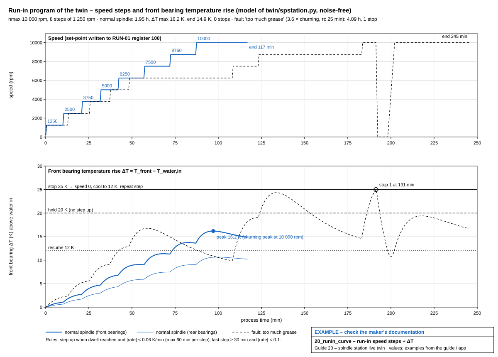
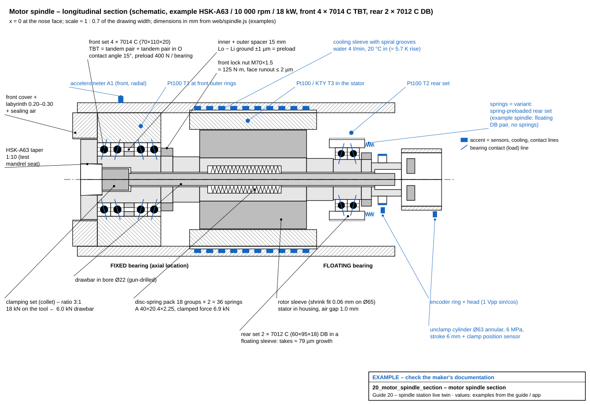
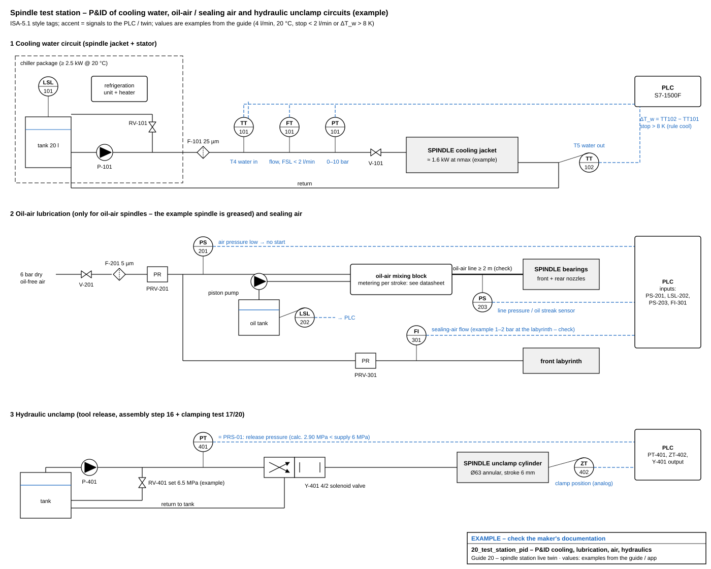
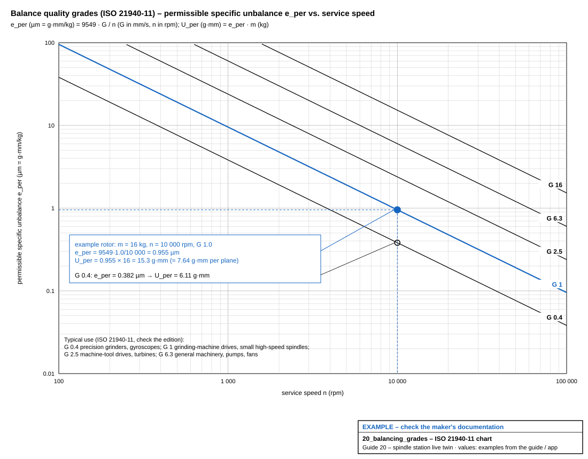
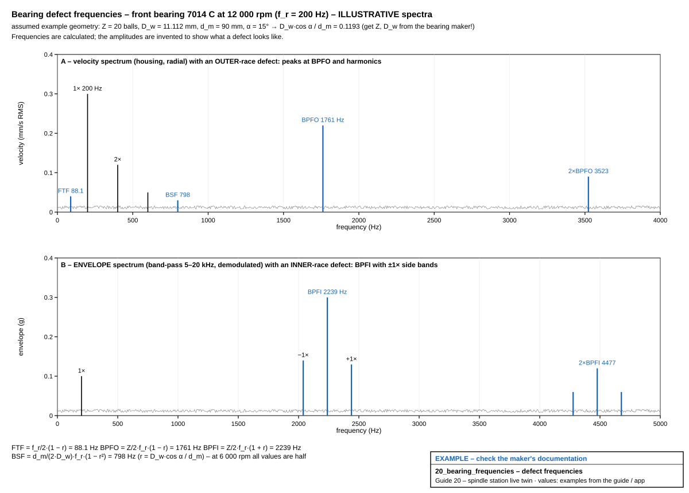
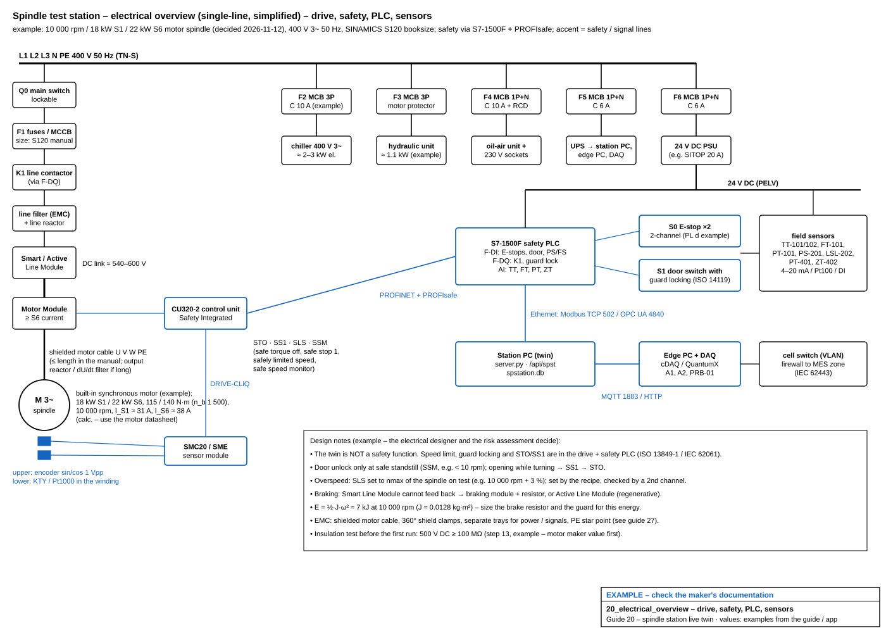
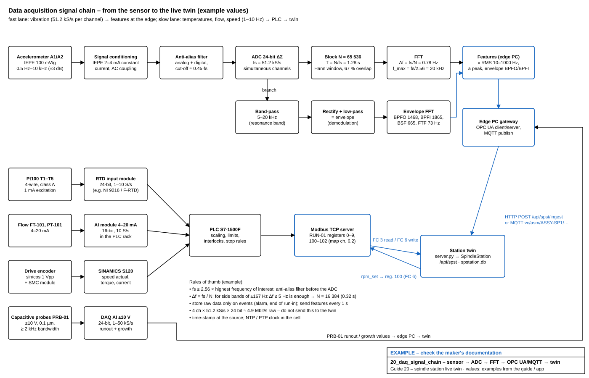
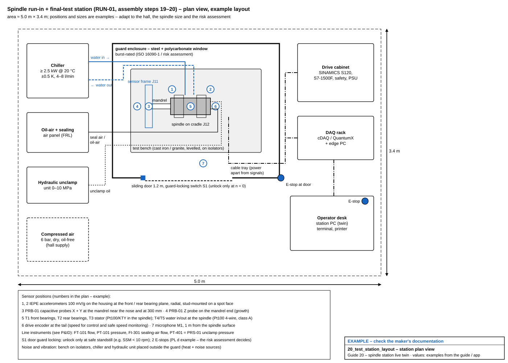

# 20 – Spindle Assembly + Test Station: the LIVE Digital Twin (ASSY-SP1) – Textbook, Technical Reference and Design Guide

> **All numbers in this guide are example values from the twin.** Limits, torques, temperatures,
> register numbers, IP addresses and topic names are examples. Before you use the station for real
> spindles, replace them with the values from **your drawings**, the **catalogues and manuals of your
> bearing, motor, clamping-set and device suppliers**, and **your own measurements**. Values marked
> **"check"** are uncertain or depend on a supplier or a standard edition.
> **When a supplier manual gives a different value, the supplier value wins.**

Source files: `twin/spstation.py` (station service: state, step engine, interlocks, run-in, SPC, database),
`twin/spdevices.py` (Modbus TCP client, MQTT 3.1.1 client, register map), `server.py` (HTTP routes
`/api/spst…`), `tools/spst_gateway.py` (example gateway), `tools/spst_modbus_sim.py` (Modbus TCP device
simulator), `tools/spst_mqtt_broker.py` (tiny MQTT test broker), `web/spst.js` + `web/spstui.js` (operator
terminal), `web/spindle.js` (design model of the example spindle: the same numbers as `_design()` in
`spstation.py`). Interface contract for the builders: `docs/20_contract_spst.md`. Tab: **Assembly**, item 3.

Related guides: 18 (making the shaft, housing, spacers, drawbar), 19 (the 21 assembly steps, equipment
E1–E26, jigs J1–J12, all checks explained, design calculations), 01 (twin core), 06 (SCADA, alarms, audit
trail), 07 (communication: OPC UA, MQTT, Modbus), 14 (engineering reference data), 15 (numbering),
16 (standards register), 27 (electrical installation, EMC).

**How this guide is built.**

* **Part A – chapters 1–16: the live station twin and how to use it** (the chapter numbers stay the same as
  before, because other guides and the code refer to them, e.g. "chapter 6.2" = Modbus register map).
* **Part B – chapters 17–36: textbook and design reference for the run-in and test station** – spindle types,
  bearings, life, lubrication, heat, thermal growth, run-in theory, dynamics, balancing, vibration, temperature,
  drive, tool clamping, runout, acceptance, data acquisition, control + safety, data model, SPC, troubleshooting.
* **Part C – chapters 37–42: buy list (catalogue examples), supplier questions, checklists, standards, glossary.**

Every formula has a worked example with the numbers of the example spindle. All computed numbers were
re-calculated with a small Python script (standard library) – if you change an input, calculate again.

---

## Contents

**Part A – the live station twin (how to use it)**

1. Purpose
2. Where in the twin
3. Concepts – simply explained
4. Architecture
5. Data model and API (with examples)
6. Devices, interfaces, Modbus register map, MQTT topics
7. Interlocks and roles
8. Run-in rules and formulas (the twin's model)
9. Commissioning step by step
10. Cybersecurity and IT basics
11. Checklists (station twin)
12. Common mistakes
13. Limits of the twin
14. Standards and references (IT, quality, communication)
15. Data still needed from suppliers
16. Operator terminal (web page)

**Part B – textbook and design reference: spindle run-in and test station**

17. The example spindle and the drawings of this guide
18. Spindle types – belt, gear, direct, motor spindle
19. Spindle bearings – arrangement, contact angle, preload
20. Bearing life – ISO 281 basic and modified life
21. Speed factor n·dm and lubrication (grease, oil-air)
22. Bearing heat – Palmgren friction torque
23. Thermal growth of the spindle (axial and radial)
24. Run-in – theory, temperature curve, step program
25. Spindle dynamics – stiffness, natural frequency, tap test, chatter
26. Balancing – ISO 21940-11, single and two planes, influence coefficients
27. Vibration monitoring – ISO 10816 / 20816, bearing frequencies, envelope
28. Temperature measurement – Pt100, Pt1000, KTY, thermocouples
29. Motor spindle drive – motor types, inverter, control, cooling, chiller sizing
30. Tool clamping – HSK / SK / BT, drawbar force, unclamp cylinder
31. Runout and geometric tests – test mandrel, ISO 230-7
32. Acceptance criteria of run-in and final test
33. Data acquisition – sampling, anti-aliasing, FFT
34. Station control and safety – PLC, guards, speed monitoring, burst energy
35. Data model for the live twin – registers, OPC UA, MQTT
36. SPC of test results and troubleshooting

**Part C – buying, checking, reference**

37. Buy list – catalogue examples per component group
38. Consolidated shopping list for one spindle test station
39. Questions to ask the suppliers
40. Checklists for the test station (design, first run, per spindle)
41. Standards register for the test station
42. Glossary

---

# PART A – THE LIVE STATION TWIN (HOW TO USE IT)

## 1. Purpose

Guide 19 shows a **simulated** spindle assembly: you click a step, the twin invents the measured values.
This guide describes the **live** twin of the real station **ASSY-SP1** in the spindle clean room:

* the twin knows **which spindle is on the bench** (serial `SPU-2646-00001`), which **work order** it
  belongs to and **which of the 21 steps** is running now,
* the **measured values come from the devices** (torque wrench, scale, balancing machine, run-in stand …)
  through gateways, Modbus TCP or MQTT – or from the built-in simulator while devices are missing,
* the twin **checks every value against its limits** and **blocks the sign-off** of a step when a value
  is missing or out of limits (interlock),
* the inspector signs the critical steps; every action is written into an **audit trail**,
* the **run-in** of the spindle is controlled live: speed steps, temperature stop rules, alarms,
* all records stay in a database: **traceability** for every spindle, **SPC** (Cpk) for every check.

After reading this guide you can run the station twin, connect the first real device, test the whole
data path with the simulators and explain to IT and to the quality department how it works.

---

## 2. Where in the twin

| What | Where |
|---|---|
| Browser page | `http://localhost:8080/` → tab **Assembly** → item **3** (operator terminal, chapter 16) |
| Station service | starts together with `python server.py` (no extra program) |
| Database | `data/spstation.db` (next to `data/history.db`; SQLite, WAL mode) |
| API | `http://localhost:8080/api/spst` (chapter 5) |
| Simulated twin (guide 19) | tab **Assembly** → item 2 – same 21 steps, same checks and limits |

Start: `python server.py` (or `start.bat`). The station thread starts by itself. At the first start the
database is created with **3 example work orders** (`WO-SP-2646-0001` qty 2, `-0002` qty 1, `-0003` qty 3).
The simulator is **on**, the simulated operator (**auto**) is **off**: the station waits for a person.

> **Tip – test on another port.** Never test on the port of the running twin. Start a second server with
> its own database: `python server.py --port 8084 --db C:\temp\spst\history.db`. The station database is
> then `C:\temp\spst\spstation.db`.

---

## 3. Concepts – simply explained

### 3.1 Simulation, digital model, digital shadow, digital twin

| Name | Data flow | Example in this project |
|---|---|---|
| Simulation / digital model | no live data, values are invented | Assembly item 2 (guide 19) |
| Digital shadow | real data flow **into** the model (one way) | the twin shows the torque the wrench measured |
| **Digital twin** | real data **in**, and the model **acts back** on the real process (two ways) | interlock blocks the sign-off; the run-in program sends the speed set-point to the run-in PLC |

The station twin is a **real digital twin** because of four things:

1. **Data from the station.** Values come from the devices, with time, device id and source
   (`src = device:TQ-01`). A person types a value only when the device has no interface (`src = manual`).
2. **State synchronisation.** The twin always knows the real state: which unit, which step, which values
   are still missing, which device is online. If the server restarts, it reloads the open unit from the
   database and continues at the same step.
3. **Closed loop.** The twin does not only watch. It **decides**: it refuses the sign-off of a step with a
   bad value (interlock), it stops the run-in when the bearing gets too hot, it writes the speed set-point
   back to the run-in PLC (Modbus register 100 or MQTT topic `…/RUN-01/cmd/rpm_set`).
4. **Traceability.** Every value, every signature, every NCR and every click is stored with user and time.
   For spindle `SPU-2646-00001` you can show years later who tightened the nut with which torque.

### 3.2 Words used in this guide

| Word | Meaning |
|---|---|
| Unit | one spindle in assembly, serial `SPU-YYWW-nnnnn` (YY = year, WW = ISO week; example `SPU-2646-00001`) |
| Work order (WO) | order to build a number of spindles, `WO-SP-YYWW-nnnn` |
| Step | one of the 21 assembly steps (keys `kit … pack`, same as guide 19) |
| Check | one value to measure in a step, id `<step>.<name>`, e.g. `nut.runout_after` |
| Result | the value of a check for one unit + status `ok / warn / bad / pending` |
| Interlock | a rule that blocks an action (here: the sign-off) until a condition is true |
| NCR | non-conformance report `NCR-nnnn`: decision **rework**, **scrap** or **concession** |
| Device | a measuring instrument or PLC with a fixed id (`TQ-01`, `RUN-01` …) |
| Gateway | a small program / PC that reads a device and sends the value to the twin |
| Proto | how a device talks to the twin: `sim`, `http`, `modbus`, `mqtt` |
| FPY | first pass yield = units accepted **without any NCR** ÷ finished units |

### 3.3 Status of a value

| Status | Rule (example) | Effect |
|---|---|---|
| `pending` | no value yet | sign-off blocked |
| `ok` | lo ≤ v ≤ hi | – |
| `warn` | outside lo/hi but inside the warn band (`wlo`/`whi`), or a "soft" check (asmsp.js gives only a warning) | sign-off allowed, shown orange |
| `bad` | outside the limits | alarm; sign-off blocked until an NCR decision |

Example `runin.stops`: lo = 0, hi = 0, whi = 2 → 0 stops = ok, 1–2 stops = warn, 3 stops = bad.

### 3.4 The values arrive in order

Some checks need several readings of the **same** device value: 4 bearing stand-outs, 3 clamping forces,
2 runouts with PRB-01. Rule: **a device value fills the first check of the current step that uses this
device + value key and is still `pending`.** So the 1st `standout_um` goes to `meas.standout_1`, the 2nd
to `meas.standout_2` and so on. When all are filled, more values are only stored in the device log.
To measure again, raise an NCR with decision **rework** (chapter 7).

---

## 4. Architecture

```
  CLEAN ROOM (station ASSY-SP1)                      STATION PC / SERVER (no internet)
 ┌──────────────────────────────┐
 │ SCN-01 scanner     (USB)     │──┐
 │ TQ-01 torque wrench (radio→USB)──┤  gateway PC
 │ SCL-01 scale       (RS-232)  │──┼─ tools/spst_gateway.py ── HTTP POST /api/spst/ingest ─┐
 │ IND-01 probe       (USB)     │──┘  (one per bench)                                       │
 │ BAL-01 balancer    (Ethernet)│──── Modbus TCP (twin polls, FC 3) ────────────────────────┤
 │ HSK-01 / FG-01 / PRS-01      │──── Modbus TCP or USB → gateway ──────────────────────────┤
 │ RUN-01 run-in stand PLC      │◄─── Modbus TCP: read values (FC 3), write rpm_set (FC 6) ─┤
 │ PC-01 / TH-01 room sensors   │──── MQTT publish vc/asm/ASSY-SP1/<dev>/<value> ─► broker ─┤
 └──────────────────────────────┘                                                          ▼
                                                     ┌────────────────────────────────────────┐
                                                     │ server.py → SpindleStation (thread)    │
                                                     │  device layer → mapping → step engine  │
                                                     │  interlocks · roles · NCR · run-in     │
                                                     │  SPC · KPI · audit trail               │
                                                     └───────┬───────────────┬────────────────┘
                                                             │               │
                                               data/spstation.db       HTTP / SSE /api/spst
                                               (SQLite, WAL)                  │
                                                     ┌───────────────────────┼───────────────────┐
                                                     ▼                       ▼                   ▼
                                           operator terminal          3D view (asmsp3d)    MES / ERP (later)
                                           (tablet at the bench)      shows the live step  WO in, records out
```

| Layer | Here | In a big factory (ISA-95 level) |
|---|---|---|
| Devices | 17 devices, chapter 6 | level 0–1 |
| Gateway / PLC | `spst_gateway.py`, run-in PLC | level 1–2 |
| Protocols | HTTP JSON, Modbus TCP, MQTT 3.1.1 | OPC UA, MQTT, Modbus, vendor protocols |
| Station service | `SpindleStation`, own thread, tick 0.5 s | MES station module / SCADA |
| Database | SQLite `spstation.db` | SQL server of the MES |
| Clients | browser, 3D, MES | HMI, MES, ERP, BI |

**Timing (example).** The station thread runs every 0.5 s. Modbus devices are read once per second.
The browser gets the full state every 1 s (`/api/spst/stream`). A device is **offline** when no data came
for **10 s** (simulated devices show `sim`).

---

## 5. Data model and API (with examples)

### 5.1 Database tables (`data/spstation.db`)

| Table | One row = | Main columns |
|---|---|---|
| `units` | one spindle | sn, wo, shaft_sn, status (`in_work/hold/accepted/rejected`), si (step index), step_state, started, finished |
| `results` | one measured value | sn, check_id, step, v (JSON), st, src, user, t, superseded (1 = replaced by a re-measure) |
| `signatures` | one step sign-off | sn, si, step, user, role, t |
| `ncr` | one NCR | id, sn, check_id, decision, text, user, role, t, closed |
| `events` | one audit trail line | t, sn, user, text (also refused actions: "REFUSED confirm: …") |
| `device_log` | one device message | t, device, vals (JSON), src, sn, mapped (filled checks) |
| `runin_samples` | one run-in sample (every 5 s process time) | sn, run, t, rpm, tf, tr, ts, win, wout, vib |
| `alarms` | one alarm | t, sev (`info/warn/alarm`), text, ack, ack_user |
| `workorders` | one work order | wo, qty, done, due, status |
| `devices` | device settings | id, proto, addr, enabled |
| `meta` | counters + settings | sn_seq, wo_seq, ncr_seq, sim, user |

**Backups:** stop the server (or use the SQLite backup command) and copy `spstation.db` **with** the files
`spstation.db-wal` and `-shm` if they exist (chapter 10).

### 5.2 Routes

| Method | Path | Answer |
|---|---|---|
| GET | `/api/spst` | full state (5.3) |
| GET | `/api/spst/stream` | the same state every 1 s (Server-Sent Events) |
| GET | `/api/spst/units` | all units, newest first: sn, wo, shaft_sn, status, started, finished, lead_h, fpy, ncr |
| GET | `/api/spst/unit?sn=SPU-2646-00001` | full record: unit, all results (also replaced ones), signatures, NCRs, events, device log |
| GET | `/api/spst/spc?id=nut.runout_after` | n, lo, hi, values, mean, sigma, Cp, Cpk |
| GET | `/api/spst/runin?sn=SPU-2646-00001` | run-in samples of the last run (`&run=1` for an older run) |
| GET | `/api/spst/export.csv` | all results as CSV (opens in Excel) |
| POST | `/api/spst` | actions (5.4) → `{ok: true, message}` or HTTP 400 `{ok: false, error}` |
| POST | `/api/spst/ingest` | device values from gateways (5.5) |

### 5.3 State (short form – full field list in `docs/20_contract_spst.md`)

```json
{ "station": "ASSY-SP1",
  "sim":  {"on": true, "auto": false, "speed": 1, "faults": []},
  "user": {"name": "Anna", "role": "operator"},
  "steps": [{"k": "nut", "no": 7, "n": "Front lock nut: torque + runout correction", "insp": false, "t_min": 60,
             "checks": [{"id": "nut.runout_after", "n": "Nut face runout after correction", "unit": "µm",
                         "lo": null, "hi": 2.0, "kind": "num", "dev": "IND-01", "key": "runout_um", "req": true}]}],
  "unit": {"sn": "SPU-2646-00001", "wo": "WO-SP-2646-0001", "status": "in_work", "si": 6, "step": "nut",
           "step_state": "running", "u": 0.5,
           "results": {"nut.torque": {"v": 124.5, "st": "ok", "src": "device:TQ-01", "t": 1794388180.1, "user": "TQ-01"},
                       "nut.runout_after": {"v": null, "st": "pending"}}},
  "devices": [{"id": "TQ-01", "proto": "http", "state": "online", "last": {"torque_nm": 124.5}}],
  "runin": {"active": false, "rpm_set": 0, "profile": [[1500, 10], [3000, 10]], "rules": []},
  "kpi": {"units": 3, "accepted": 2, "fpy": 0.5, "avg_lead_h": 31.0, "open_ncr": 1} }
```

`step_state`: `idle` (not started) → `running` (values missing) → `wait_confirm` (all required values
there) → next step `idle` … after `pack`: `done` and unit `accepted`.

Extra fields that the contract allows (the frontend may use them): step `t_min`, `insp`; check `key`,
`wlo`, `whi`, `soft`, `calc`, `auto`, `scale`, `pre`, `eq`; unit `step`, `step_started`, `repaired`;
device `enabled`, `err`, `values`; run-in `step_i`, `step_s`, `dT_max`, `flow_lpm`, `cooling`, `tripped`,
`finished`, `waiting`, `run`, `time_factor`, `source`, `msg`, rule `id`; queue `done`; kpi `rejected`,
`in_work`, `yield`, `ncr_total`; top level `faults_available`.

### 5.4 Actions – examples

PowerShell (Windows, no extra tools):

```powershell
$u = "http://localhost:8080/api/spst"
function Spst($body) { Invoke-RestMethod -Uri $u -Method Post -ContentType "application/json" -Body ($body | ConvertTo-Json -Compress) }
Spst @{action="login"; user="Anna"; role="operator"}
Spst @{action="new_unit"}                                  # next open work order, new serial
Spst @{action="start_step"}
Spst @{action="record"; id="kit.open_ncr"; v=0}            # manual value
Spst @{action="confirm"}                                   # sign-off (refused while values are missing)
Spst @{action="ncr"; id="clean.patch"; decision="rework"; text="wash the shaft again"}
Spst @{action="login"; user="Ivan"; role="inspector"}
Spst @{action="ncr"; id="rotor.interf"; decision="concession"; text="0.043 mm accepted by design, D. Lee"}
Spst @{action="hold"; reason="crane check"};  Spst @{action="release"}
Spst @{action="sim"; on=$true; auto=$true; speed=20; faults=@("grease")}
Spst @{action="runin"; cmd="ack"}
Spst @{action="device"; id="TQ-01"; proto="http"}
(Invoke-RestMethod "$u").unit | Format-List
```

curl (if installed):

```
curl -s -X POST http://localhost:8080/api/spst -H "Content-Type: application/json" -d "{\"action\":\"confirm\"}"
```

Answer when the interlock blocks (HTTP 400):

```json
{"ok": false, "error": "interlock: required check(s) still pending: kit.shaft_sn, kit.open_ncr"}
```

| Action | Fields | Who |
|---|---|---|
| `login` | user, role `operator / inspector / admin` | anybody |
| `logout` | – | – |
| `new_unit` | wo? (default: open WO with the earliest due date; a new WO is created when none is open), shaft_sn? (then the scanned shaft serial must be equal) | logged in |
| `start_step` | – | logged in |
| `record` | id, v (number, true/false or text) – only for `pending` checks of the current step | logged in |
| `confirm` | – | logged in; inspector/admin for `balance, clamp, runin, test` |
| `ncr` | id (check id, or `"unit"` for scrap), decision, text | logged in; concession: inspector/admin + text |
| `hold` / `release` | reason | logged in |
| `sim` | on?, auto?, speed? (1–20), faults? (list) | anybody (training PC – see chapter 10) |
| `runin` | cmd `start / stop / ack` | logged in (ack: anybody) |
| `ack` | id (alarm id or `"all"`) | anybody |
| `device` | id, proto?, addr?, enabled? | anybody (see chapter 10) |

### 5.5 Device ingest (gateways)

```json
POST /api/spst/ingest
{"device": "TQ-01", "values": {"torque_nm": 125.3, "angle_deg": 12}, "t": 1794388180.0}
```

or a list of such objects. **Keep-alive:** a gateway sends every 5 s `{"device": "TQ-01", "values": {},
"heartbeat": true}` (MQTT: topic `vc/asm/ASSY-SP1/TQ-01/heartbeat`), so the device stays `online` between
two measurements (offline after 10 s without any message).
The device must be set to `proto = http` first, otherwise the twin answers
with a clear error (this protects against two sources for one device). Answer example:
`{"ok": true, "message": "TQ-01: filled nut.torque"}`.

```powershell
Invoke-RestMethod -Uri http://localhost:8080/api/spst/ingest -Method Post -ContentType "application/json" `
  -Body '{"device":"TQ-01","values":{"torque_nm":125.3}}'
```

### 5.6 Checks per step (dev + key = which device value fills the check)

"manual" = typed by the operator; "calc" = calculated by the station; "auto" = filled by the run-in program.

| Step | Checks (id: device.key, limits – examples) |
|---|---|
| 1 kit | `kit.shaft_sn` SCN-01.code (starts `SPS-`), `kit.set_front` SCN-01.code (`B-BRG-00041…`), `kit.set_rear` SCN-01.code (`B-BRG-00042…`), `kit.motor_kit` SCN-01.code (`B-MOT-00004…`), `kit.open_ncr` manual = 0 |
| 2 clean | `clean.particles` PC-01.p05_m3 ≤ 352 000 /m³ (check), `clean.room_t` TH-01.t_c 19–21 °C, `clean.soak` manual yes, `clean.patch` manual ≤ 2 mg |
| 3 meas | `meas.standout_1…4` BMS-01.standout_um (info, in order), `meas.bore_mean` BMS-01.bore_um (info), `meas.fit_front` manual 0…5 µm, `meas.clr_front` manual 2…8 µm (0…2 warn), `meas.fit_rear` manual 0…5, `meas.clr_rear` manual 5…12 |
| 4 spacer | `spacer.ds_req` calc, `spacer.ds_meas` CMP-01.len_um, `spacer.ds_err` calc −1…+1 µm, `spacer.parallel` manual ≤ 1 µm, `spacer.preload` calc (info) |
| 5 grease | `grease.front` SCL-01.mass_g 2.18–2.40 g, `grease.rear` SCL-01.mass_g 1.48–1.63 g (both soft = warn), `grease.spread` manual |
| 6 front | `front.ring_temp` IH-01.temp_c 60–80 °C (40–110 warn), `front.vline` manual, `front.seated` manual |
| 7 nut | `nut.torque` TQ-01.torque_nm 118.8–131.2 N·m, `nut.runout_before` IND-01.runout_um (info), `nut.runout_after` IND-01.runout_um ≤ 2 µm, `nut.friction` manual 0.35–0.70 N·m |
| 8 fbh | `fbh.heat_dk` manual (info), `fbh.axial_play` IND-01.runout_um ≤ 1 µm |
| 9 rotor | `rotor.interf` manual 0.045–0.075 mm (soft), `rotor.temp` OV-01.temp_c ≤ 250 °C, `rotor.gap` manual ≤ 0.05 mm |
| 10 rear | `rear.torque` TQ-01.torque_nm 69.4–76.6, `rear.runout` IND-01 ≤ 2 µm, `rear.tail_runout` IND-01 ≤ 3 µm, `rear.sleeve` manual |
| 11 draw | `draw.count` manual = 36, `draw.L0` manual 96.7–97.7 mm (soft), `draw.force` FG-01.force_kn ≥ 6.69 kN |
| 12 balance | `balance.u0_1` BAL-01.u1_gmm, `balance.u0_2` BAL-01.u2_gmm (1st reading, info), `balance.ures_1` / `ures_2` (2nd reading) ≤ 6.37 g·mm |
| 13 stator | `stator.p_drop` PRS-01.p_bar ≤ 0.1 bar, `stator.r_ins` INS-01.r_mohm ≥ 100 MΩ, `stator.r_bal` manual ≤ 2 % |
| 14 insert | `insert.bolt_torque` TQ-01.torque_nm 63.7–70.3, `insert.gap_1…4` manual 0.9–1.1 mm, `insert.turn_torque` manual ≤ 0.8 N·m (soft) |
| 15 cover | `cover.torque` TQ-01.torque_nm 9.0–10.0, `cover.lab_1…4` manual 0.20–0.30 mm, `cover.air` manual, `cover.sleeve_force` manual ≤ 150 N |
| 16 unclamp | `unclamp.p_rel` PRS-01.p_bar × 0.1 → MPa, < 6 MPa, `unclamp.stroke` manual 5.8–6.2 mm, `unclamp.eject` manual 0.4–0.6 mm |
| 17 clamp | `clamp.f_1…3` HSK-01.force_kn (info, in order), `clamp.f_mean` calc 16.2–20.7 kN, `clamp.sensor` manual, `clamp.eject` manual |
| 18 sensors | `sensors.pt_front`, `sensors.pt_stator` manual 18–22 °C, `sensors.enc_a/b` manual 0.8–1.2 Vpp, `sensors.labelled` manual |
| 19 runin | `runin.dT_max` auto ≤ 25 K (≤ 27 warn), `runin.stops` auto 0 (1–2 warn), `runin.time_h` auto (info), `runin.dT_end` auto ≤ 20 K, `runin.vib_end` auto ≤ 1.0 mm/s (≤ 1.5 warn), `runin.noise` manual |
| 20 test | `test.runout_taper` PRB-01.runout_um ≤ 2 µm, `test.runout_300` PRB-01.runout_um (2nd) ≤ 5 µm, `test.k_ax` manual ≥ 136 N/µm, `test.k_rad` manual ≥ 170 N/µm, `test.growth` PRB-01.axial_um ≤ 15 µm, `test.vib` RUN-01.vib_mm_s ≤ 1.0 mm/s, `test.u_shift` manual ≤ 6.37 g·mm, `test.noise` manual ≤ 75 dB(A), `test.clamp` HSK-01.force_kn ≥ 16.2 kN |
| 21 pack | `pack.plate` SCN-01.code = unit serial, `pack.record` manual, `pack.lock` manual |

**Calculations of the station (example numbers):**

* Required spacer difference: Δs = (e1 + e2)/2 + (e3 + e4)/2.
  Example e = 1.36 / −0.33 / 0.90 / 1.41 µm → Δs = 0.51 + 1.16 = **1.67 µm**.
* Spacer error: err = measured − required = 1.99 − 1.67 = **+0.32 µm** (limit ±1 → ok).
* Expected preload: F = 400 N × (1 + ε/8)^1.5 with ε = required − measured = −0.32 µm →
  F = 400 × 0.96^1.5 = **376 N** per bearing.
* Clamping force mean: (18.54 + 19.10 + 18.38)/3 = **18.67 kN** (16.2 … 20.7 → ok).

### 5.7 SPC and KPIs

* **Mean** x̄ = Σx / n. **Sigma** s = √(Σ(x − x̄)² / (n − 1)).
* **Cpk** = min( (hi − x̄) / 3s , (x̄ − lo) / 3s ); with only one limit only that side.
  Example `nut.runout_after`: hi = 2 µm, x̄ = 1.0 µm, s = 0.4 µm → Cpk = (2 − 1.0)/(3 × 0.4) = **0.83**
  (target ≥ 1.33 – example). Cpk needs about 25–30 units of a stable process (check).
* **FPY** = units accepted without any NCR ÷ finished units. Example 2 of 3 → **0.67**.
* **Yield** = accepted ÷ finished. **Lead time** = finished − started (real clock time).
* `open_ncr` = rework NCRs whose value was not yet measured again.

---

## 6. Devices, interfaces, Modbus register map, MQTT topics

### 6.1 Device list – what real devices typically offer

The ids are fixed (frontend and 3D use them). Interfaces: **check with the supplier** – models differ.

| Id | Device (equipment no. in guide 19) | Values | Typical real interface (check with the supplier) | Suggested way into the twin |
|---|---|---|---|---|
| SCN-01 | DataMatrix scanner (E25) | `code` | USB HID (keyboard) or USB virtual COM; some Ethernet | gateway (HTTP) or the browser field |
| PC-01 | particle counter (E1) | `p05_m3` | RS-232/RS-485 Modbus RTU, Ethernet, sometimes MQTT | gateway or MQTT |
| TH-01 | room thermometer (E1) | `t_c` | 4–20 mA into a PLC, Modbus RTU/TCP, MQTT sensors | MQTT |
| BMS-01 | bearing measuring stand (E5) | `standout_um`, `bore_um` | probe interface box USB / RS-232, sometimes Ethernet | gateway |
| CMP-01 | length comparator 0.1 µm (E7) | `len_um` | USB / RS-232 (digital display) | gateway |
| SCL-01 | precision scale 0.01 g (E8) | `mass_g` | RS-232 / USB / Ethernet, ASCII command set | gateway |
| IH-01 | induction heater (E9) | `temp_c`, `state` | often none; some RS-232 or USB logging | separate thermocouple logger or manual |
| OV-01 | rotor oven (E14) | `temp_c` | controller with Modbus RTU/TCP (common) | Modbus via gateway |
| TQ-01 | torque wrench, wireless (E10) | `torque_nm`, `angle_deg` | radio receiver with USB / RS-232 / Ethernet; tool controllers: Open Protocol or OPC UA | gateway |
| IND-01 | electronic probe 0.1 µm (E11) | `runout_um` | USB interface (HID / COM) | gateway |
| FG-01 | force gauge (E12) | `force_kn` | USB / RS-232; amplifier with Modbus TCP | gateway or Modbus |
| BAL-01 | balancing machine (E16) | `u1_gmm`, `a1_deg`, `u2_gmm`, `a2_deg` | Ethernet: OPC UA, Modbus TCP, or a result file (CSV) | Modbus or file gateway |
| PRS-01 | pressure gauge / transducer (E17, E19) | `p_bar` | 4–20 mA transducer into a PLC/IO module, digital gauge USB | Modbus |
| HSK-01 | HSK clamping-force gauge (E18) | `force_kn` | USB / Bluetooth / RS-232 (check), many only display | gateway or manual |
| INS-01 | insulation / winding tester (E24) | `r_mohm` | USB / RS-232 / Ethernet, result memory | gateway |
| RUN-01 | run-in stand PLC (E20) | `rpm`, `t_front_c`, `t_rear_c`, `t_stator_c`, `t_win_c`, `t_wout_c`, `vib_mm_s`, `flow_lpm` | PLC: Modbus TCP and/or OPC UA, MQTT on newer PLCs | Modbus TCP (closed loop) |
| PRB-01 | capacitive probes + amplifier (E22) | `runout_um`, `axial_um` | analogue ±10 V into DAQ, or USB/Ethernet controller | gateway |

**When you buy a device, ask the supplier:** interface (USB / RS-232 / Ethernet), protocol (ASCII command
list, Modbus register list, OPC UA nodes), whether it sends values automatically or on request, the time
stamp, the unit and resolution, and a sample program or manual of the protocol.

### 6.2 Modbus TCP register map (example – the PLC programmer defines the real one)

Holding registers, function code 3 (read), address 0 = "40001". Values are **signed 16-bit**,
engineering value = raw × scale. One TCP server can carry several devices by **unit id**
(address string `host:port/unitN`, e.g. `127.0.0.1:5020/unit1`).

**RUN-01 run-in stand PLC (unit 1 in the simulator)**

| Register | Name | Scale | Example raw → value | R/W |
|---|---|---|---|---|
| 0 | rpm | 1 | 6000 → 6000 rpm | R |
| 1 | t_front_c | 0.1 | 312 → 31.2 °C | R |
| 2 | t_rear_c | 0.1 | 280 → 28.0 °C | R |
| 3 | t_stator_c | 0.1 | 351 → 35.1 °C | R |
| 4 | t_win_c | 0.1 | 201 → 20.1 °C | R |
| 5 | t_wout_c | 0.1 | 234 → 23.4 °C | R |
| 6 | vib_mm_s | 0.01 | 42 → 0.42 mm/s | R |
| 7 | flow_lpm | 0.1 | 40 → 4.0 l/min | R |
| 8 | status word | – | bit 0 = turning | R |
| 9 | heartbeat | – | counts up every cycle | R |
| 100 | rpm_set (speed set-point from the twin) | 1 | 6000 | **W** (FC 6) |
| 101 | time_factor (simulator only) | 1 | 100 = 100× faster | W |
| 102 | cmd (1 = run, 0 = stop) | – | 1 | W |

**Gauges with a measurement counter** – the twin takes a value only when the counter changes
(one measurement = one result; the first read after connecting only sets the base).

| Device (sim unit) | Register 0 | Register 1 | Register 2 | Register 3 | Counter |
|---|---|---|---|---|---|
| BAL-01 (unit 2) | u1_gmm × 0.01 | a1_deg × 0.1 | u2_gmm × 0.01 | a2_deg × 0.1 | register 4 |
| HSK-01 (unit 3) | force_kn × 0.01 | – | – | – | register 1 |
| FG-01 (unit 4) | force_kn × 0.01 | – | – | – | register 1 |
| PRS-01 (unit 5) | p_bar × 0.01 | – | – | – | register 1 |

Example: HSK-01 register 0 = 1854, register 1 changes from 6 to 7 → new value 18.54 kN →
fills the first pending `clamp.f_n`.

**Safety of the write:** the twin writes **only** registers 100–102 of RUN-01 and only once per change
(and every 10 s as a refresh). The PLC must check the set-point itself (max. speed, cooling on, guard
closed). The twin is **not** a safety function (chapter 13).

### 6.3 MQTT topics (MQTT 3.1.1, QoS 0)

| Topic | Payload | Direction |
|---|---|---|
| `vc/asm/ASSY-SP1/<device>/<value>` | number or text, or JSON `{"v": 125.3}` | device → twin |
| `vc/asm/ASSY-SP1/<device>` | JSON object `{"torque_nm": 125.3, "angle_deg": 12}` | device → twin |
| `vc/asm/ASSY-SP1/RUN-01/cmd/rpm_set` | number (rpm) | twin → run-in PLC |
| `vc/asm/ASSY-SP1/RUN-01/cmd/cmd` | 1 / 0 | twin → run-in PLC |
| `vc/asm/ASSY-SP1/RUN-01/cmd/time_factor` | number (simulator only) | twin → PLC simulator |

Examples: `vc/asm/ASSY-SP1/TQ-01/torque_nm` → `125.3`; `vc/asm/ASSY-SP1/TH-01/t_c` → `20.2`.
The twin subscribes `vc/asm/ASSY-SP1/#` on every broker named in the `addr` of an mqtt device
(default `127.0.0.1:1883`) and uses a message only when that device is set to `proto = mqtt`.
Keep-alive 30 s (PINGREQ), reconnect after 5 s.

### 6.4 Built-in simulator

| Setting | Effect |
|---|---|
| `sim.on = true` | devices with `proto = sim` answer when a step starts (values arrive one after the other, 2 s / speed apart); the run-in model runs when RUN-01 is `sim` |
| `sim.auto = true` | a **simulated operator** ("Sim operator", "Sim inspector") logs in, starts, types the manual values, decides NCRs and signs – the station looks alive. A full spindle takes about **2–2.5 min at speed 20** (about 45 min at speed 1) |
| `sim.speed` 1 … 20 | faster simulator; run-in process time = real time × speed × 5 |
| `sim.faults` | `mix, spacer, dirt, grease, nut, rotor, spring, oring` – the same faults and effects as asmsp.js (guide 19, 7.1) |

What the simulated operator does with a bad value (example policy): steps 1–18 → NCR **rework** (the cause
is repaired for this unit, e.g. the nut runout is corrected); run-in → one **rework** (repeat the run-in),
then **scrap**; final test → **scrap** by the inspector. Warnings (orange) are accepted.

| Fault | Where it shows in the live twin | What auto does |
|---|---|---|
| mix | `front.vline` = no (bad) | rework → repaired |
| spacer | `spacer.ds_err` ≈ −6 µm (bad) | rework (grind again) → repaired |
| nut | `nut.runout_after` = runout before (bad) | rework → repaired |
| spring | `draw.L0` warn, `draw.force` ≈ 4.2 kN (bad) | rework → repaired |
| oring | `stator.p_drop` ≈ 1.4 bar (bad) | rework → repaired |
| grease | `grease.*` ≈ 3× (warn) → run-in: temperature stop, long run-in | accepted with warnings |
| dirt | run-in vibration > 1.8 mm/s → abort, noise bad | rework once, then scrap |
| rotor | `rotor.interf` warn → final test vibration + unbalance shift bad | scrap |

---

## 7. Interlocks and roles

| No. | Rule | Error text (example) |
|---|---|---|
| I1 | record, confirm, start, NCR, new unit need a login | `login required` |
| I2 | a new unit only when no unit is in work or on hold | `unit … is still in work` |
| I3 | a step must be started before values are taken or it is signed | `start the step first` |
| I4 | **confirm is refused while a required check is pending** | `interlock: required check(s) still pending: …` |
| I5 | **confirm is refused while a check is bad without an NCR decision** (concession counts only when it is newer than the value) | `interlock: check(s) out of limits without NCR decision: …` |
| I6 | steps `balance, clamp, runin, test` are confirmed only by **inspector / admin** | `step balance must be confirmed by an inspector` |
| I7 | a value is recorded only for a pending check of the **current** step; to measure again → NCR rework | `… already has a value … raise an NCR with decision rework` |
| I8 | calculated checks cannot be typed | `… is calculated by the station` |
| I9 | concession needs inspector / admin **and** a text | `a concession needs the inspector role` |
| I10 | rework / concession only for a warn / bad check of the current step | `… is not out of limits` |
| I11 | scrap (any check or `"unit"`) rejects the unit, stops the run-in | – |
| I12 | on HOLD nothing can be recorded, started or confirmed until release | `unit … is on HOLD` |
| I13 | run-in confirm refused while the program runs; restart after an alarm needs `runin ack` | `run-in still running` |
| I14 | run-in results exist → restart only after a rework NCR | `run-in results exist …` |
| I15 | device values via HTTP only when the device is set to `http` (one source per device) | `device TQ-01 is set to proto 'sim' …` |
| I16 | kit: a scanned code must start with the expected part number; `pack.plate` must equal the serial; a given shaft serial must match the scan | status `bad` |

Every refused action is written into the audit trail ("REFUSED confirm: …") with the user.

| Role | May do |
|---|---|
| operator | start, record, confirm normal steps, NCR rework / scrap, hold / release |
| inspector | everything of the operator + confirm `balance, clamp, runin, test` + concession |
| admin | like inspector (for set-up and tests) |

**NCR decisions**

| Decision | Effect | NCR closed when |
|---|---|---|
| rework | the check (and its calculated partner, e.g. `spacer.ds_meas` + `spacer.ds_err`) goes back to `pending`; the old value stays in the database as "superseded" | the new value is ok / warn |
| concession | the bad value is accepted with a reason; sign-off possible | at once |
| scrap | unit `rejected`, finished | at once |

---

## 8. Run-in rules and formulas

### 8.1 Speed profile (example – the bearing / grease maker gives the real program)

| Speed step | 1 | 2 | 3 | 4 | 5 | 6 | 7 | 8 |
|---|---|---|---|---|---|---|---|---|
| rpm | 1 500 | 3 000 | 4 500 | 6 000 | 7 500 | 9 000 | 10 500 | 12 000 |
| minimum dwell (min) | 10 | 10 | 10 | 10 | 15 | 15 | 15 | 30 |

Go to the next step when the dwell is reached **and** the temperature is stable (|rate| < 0.06 K/min –
the code uses the absolute value, so a temperature that still **falls** fast after the grease peak also
blocks the step), and no hold rule is active; or after **60 min** at a step (`RUNIN_MAX_DWELL_MIN`). End:
≥ 30 min at nmax, no hold rule and |rate| < 0.1 K/min (or 60 min at nmax). The station writes the set-point
`rpm_set` to RUN-01 (closed loop). In the simulator the speed ramps up with **50 rpm/s** and down with
**200 rpm/s**.



The theory behind this program (why grease must be distributed, why the curve looks like this, how real
bearing makers write their programs) is in **chapter 24**.

### 8.2 Thermal model (used when RUN-01 is simulated – the same constants as asmsp.js)

Front bearing temperature rise ΔT (K, above the cooling water inlet):

* steady value: ΔT_ss = 14 × (n / nmax)^1.2 × (F / 400 N)^0.6 (+ 2.5 × n/nmax with dirt)
* grease churning: ch = C0 × (n / nmax) × k × e^(−t / τc), C0 = 6 K (× 3.6 with excess grease),
  τc = 10 min (25 min with excess grease), t = time at this speed step, k = 1 and × 0.55 after every stop
* first order: dΔT/dt = (ΔT_ss + ch − ΔT) / τ, τ = 9 min

Euler step every 5 s (0.083 min): ΔT_new = ΔT + (ΔT_ss + ch − ΔT) × 0.083 / 9.
Example: ΔT = 10 K, ΔT_ss + ch = 20 K → ΔT_new = 10 + 10 × 0.083/9 = **10.09 K**.

Example at nmax (12 000 rpm, F = 400 N): ΔT_ss = 14 K, ch at the start of the step = 6 K →
peak ≈ **16 K** (16.2 K), end ≈ **15 K** (14.9 K, ≤ 20 → ok). Total run-in ≈ **1.95 h** process time
(117 min, re-calculated noise-free with the code's rules; the random factor C0f = 1 ± 0.1 per unit changes
this only by about ±1 min). With the fault "too much grease" (C0 × 3.6, τc = 25 min) the temperature
reaches ≈ 24 K at 10 500 rpm, then **25 K at 12 000 rpm → 1 stop** (or just no stop, with C0f = 0.9);
run-in ≈ **3.4–4.1 h** instead of ≈ 1.95 h. (Correction: an older version of this guide said ≈ 2.2 h.)

Steady values of the model per speed step (F = 400 N, no fault):

| Step rpm | n/nmax | ΔT_ss front (K) | churn peak C0·n/nmax (K) | stator ΔT_ss (K) | water ΔT_w (K) | vibration (mm/s) |
|---|---|---|---|---|---|---|
| 1 500 | 0.125 | 1.15 | 0.75 | 1.47 | 0.45 | 0.125 |
| 3 000 | 0.25 | 2.65 | 1.50 | 3.75 | 0.92 | 0.139 |
| 4 500 | 0.375 | 4.31 | 2.25 | 6.55 | 1.52 | 0.162 |
| 6 000 | 0.5 | 6.09 | 3.00 | 9.78 | 2.23 | 0.195 |
| 7 500 | 0.625 | 7.96 | 3.75 | 13.37 | 3.03 | 0.237 |
| 9 000 | 0.75 | 9.91 | 4.50 | 17.29 | 3.92 | 0.289 |
| 10 500 | 0.875 | 11.93 | 5.25 | 21.51 | 4.89 | 0.350 |
| 12 000 | 1.0 | 14.00 | 6.00 | 26.00 | 5.93 | 0.420 |

(Water ΔT_w in the model = 5.73 × (n/nmax)^1.5 + 0.2 K offset.) With a wrong preload the same model gives:
spacer fault F ≈ 926 N → end ΔT ≈ 23 K (> 20 K → **bad**), reversed bearing (× 2.2 = 880 N) → ≈ 22.5 K
(**bad**) – the run-in finds both faults, as it should.

Other channels (model): rear ΔT_ss = 0.7 × ΔT_ss + 0.5 × ch (τ = 10 min); stator ΔT_ss = 4 × n/nmax + 22 ×
(n/nmax)^1.5 (τ = 15 min); cooling water rise ΔT_w = P / (ṁ × c) = 1600 W / (4/60 kg/s × 4186 J/kgK) =
**5.7 K** at nmax (× (n/nmax)^1.5); vibration v = 0.12 + 0.30 × (n/nmax)² mm/s = **0.42 mm/s** at nmax
(+ 1.5 × (n/nmax)^1.5 with dirt, + 0.9 × (n/nmax)² with a loose rotor).

Rate: rate = (ΔT_now − ΔT 2 min ago) / 2 min, in K/min.

### 8.3 Stop rules (examples – shown live in `runin.rules`)

| Rule id | Condition | Action |
|---|---|---|
| `stop` | front bearing ΔT ≥ **25 K** | speed 0, wait until ΔT ≤ **12 K**, repeat this speed step; stops + 1; alarm warn |
| `hold_dT` | ΔT > **20 K** | hold this speed (no step up) |
| `hold_rate` | rate > **1.0 K/min** | hold this speed |
| `vib` | vibration > **1.8 mm/s** | stop + alarm, run-in **aborted** (results are written, `runin ack` before a restart) |
| `cool` | water flow < **2 l/min** or water out − in > **8 K** | stop + alarm, run-in aborted |

Results at the end (or at an abort): `runin.dT_max`, `runin.stops`, `runin.time_h`, `runin.dT_end`
(mean of the last 2 min), `runin.vib_end` (mean of the last 2 min). The operator adds `runin.noise`.
Samples (every 5 s process time) are in `runin_samples` – `GET /api/spst/runin?sn=…`.

**Time base.** With the simulator on, the run-in runs faster: process time = real time × speed × 5
(speed 20 → 100× → 1.95 h in about 70 s). With the simulator off, the run-in runs in real time.
The factor is written to RUN-01 register 101 / topic `cmd/time_factor` so that the PLC simulator follows.

---

## 9. Commissioning step by step

**Rule: connect one device at a time. Test each with the simulators first.**

| Step | What | How to test | Accept when |
|---|---|---|---|
| 1 | Install | copy the project, `python server.py --port 8084 --db C:\twin_test\history.db` | page opens, `/api/spst` answers |
| 2 | Simulator run | `sim auto = true, speed = 20` | 1 spindle accepted in ≈ 2.5 min, all 21 steps signed |
| 3 | Fault drill | `faults = ["oring"]`, then `["dirt"]` … | NCR appears, unit reworked / scrapped as in 6.4 |
| 4 | Manual run | login, `start_step`, `record`, `confirm` by PowerShell (5.4) | interlock errors appear as in chapter 7 |
| 5 | Gateway test | `python tools/spst_gateway.py --server http://localhost:8084 --devices TQ-01,IND-01` | TQ-01 / IND-01 `online`, values with `src = device:TQ-01` |
| 6 | Modbus test | `python tools/spst_modbus_sim.py --port 5020`, then `device RUN-01 proto modbus addr 127.0.0.1:5020/unit1` | RUN-01 online, run-in uses Modbus values, the simulator prints "write unit 1 register 100 = 1500" |
| 7 | MQTT test | `python tools/spst_mqtt_broker.py --port 1883`, `device TQ-01 proto mqtt`, `spst_gateway.py --mode mqtt --devices TQ-01` | `nut.torque` filled by MQTT |
| 8 | First real device | e.g. torque wrench: write `read_device()` in the gateway for its interface | 10 tightenings: value in twin = value on the display (± resolution) |
| 9 | Next devices | one after the other, the run-in PLC last | each device: 10 values compared, offline alarm after unplugging (10 s) |
| 10 | Run-in PLC | PLC programmer implements the register map 6.2; first with the spindle **not** turning (set-point only) | set-point arrives, PLC limits it, stop rules tested with a forced temperature value |
| 11 | Pilot | 3 spindles with the real devices and paper record in parallel | all values equal, no missing data |
| 12 | Acceptance | quality signs the station: interlocks, roles, records, backup restore | checklist 11.3 complete |

---

## 10. Cybersecurity and IT basics

* **Network zone.** Station PC, gateways, run-in PLC and devices in one **cell zone** (own VLAN /
  switch). No internet. Only the MES / server zone may talk to the twin, through a firewall
  (IEC 62443 zones and conduits – check).
* **Open ports (example):** 8080 (HTTP, twin), 502 / 5020 (Modbus TCP – only inside the cell),
  1883 (MQTT – only inside the cell). Close everything else.
* **Modbus and MQTT 3.1.1 have no security** in this simple form (no login, no encryption). Use them only
  in the closed cell network. For a wider network use OPC UA with security or MQTT with TLS and user
  login (check with IT).
* **Accounts.** The twin login is **name + role only – no password** (training level). Before real
  production: real accounts (Windows / LDAP), passwords or badge reader, and the `sim` and `device`
  actions only for admin. Never share one account at the bench – the signature must be personal.
* **The server listens on 127.0.0.1** by default. `--host 0.0.0.0` opens it to the network – only in the
  cell zone.
* **Backups.** Every day: stop the server or use `sqlite3 spstation.db ".backup backup.db"`, copy
  `spstation.db` (+ `-wal`, `-shm`) to a second disk / server. Test a restore every 3 months.
  Keep the records as long as the quality system requires (e.g. 10 years – check).
* **Updates.** Only from a checked USB stick / internal file share. Python standard library only –
  no internet installation needed.
* **Clock.** All times come from the server clock. Set it from the factory time server (NTP inside the
  factory) – records with a wrong time are useless.

---

## 11. Checklists (station twin)

### 11.1 Before each shift
- [ ] Server runs, page shows the station, all real devices `online` (not `offline`)
- [ ] Simulator: `on` only where a device is still missing; `auto` = **off** in production
- [ ] `faults` = empty in production
- [ ] Open alarms read and acknowledged; open NCRs known
- [ ] Gauges: calibration date valid (sticker) – the twin does not know it (check)

### 11.2 Per spindle
- [ ] Log in with **your own** name before you work
- [ ] New unit for the correct work order; shaft serial scanned
- [ ] Each step: start → measure → all values green/orange → sign
- [ ] Red value: stop, NCR (rework / concession by inspector / scrap)
- [ ] Inspector signs balance, clamp, run-in, final test
- [ ] Pack: scan the type plate – must equal the serial

### 11.3 Acceptance of the station twin
- [ ] Every interlock of chapter 7 tested and refused with the right text
- [ ] Every device: 10 values compared with the device display
- [ ] Offline detection (unplug → `offline` + alarm after 10 s)
- [ ] Run-in stop rules tested (forced values), alarm + abort works
- [ ] Restart the server during a step → the unit continues at the same step
- [ ] Backup made and restored on another PC
- [ ] CSV export opened in Excel, unit record complete

---

## 12. Common mistakes

| Mistake | Effect | Prevention |
|---|---|---|
| Device left on `sim` when the real device is connected | simulated values in the record | check the device list: `src = sim` must not appear in production |
| Two sources for one device (gateway + simulator) | double values, wrong order | the twin accepts HTTP only for `proto = http` (I15) |
| Gauge sends a value on every key press / every second | extra values fill the next checks | gauge with a "send" button or counter register; gateway sends only new measurements |
| Wrong scaling in the PLC (×10 vs ×100) | 10× wrong value, wrong status | compare 10 values with the display during commissioning |
| Server clock wrong | times and lead times wrong | NTP inside the factory |
| One shared login at the bench | signatures worthless | personal accounts |
| Run-in PLC trusts the twin set-point blindly | overspeed risk if the twin has a bug | PLC limits speed and checks cooling itself |
| `sim auto` left on in production | the simulated operator signs steps | `auto` only on the training PC |
| No backup of `-wal` file | last changes lost | stop the server or use the SQLite backup command |
| Limits copied from this guide | wrong accept / reject | use the supplier and drawing values |

---

## 13. Limits of the twin

* The twin is **not a safety system.** E-stop, guards, overspeed and over-temperature protection belong
  in the PLC / drive (safety-rated, ISO 13849 / IEC 62061 – check). The twin only stops the run-in in
  software.
* Login without password – training level (chapter 10).
* The thermal model is simple (first order, example constants). It shows the behaviour, not the real
  temperature of your spindle. With a real RUN-01 the real values are used.
* SQLite is fine for one station. For many stations use the MES database.
* No electronic signature in the legal sense (no 21 CFR Part 11 / EU GMP Annex 11 functions) – check
  what your customers require.
* Gauge calibration status, operator qualification and material release are **not** checked by the twin.
* Lead time is real clock time; with the simulator it is minutes, not the planned ≈ 30 h.
* MQTT client: QoS 0 only (a message can be lost when the network breaks), no TLS. Modbus client:
  FC 3 / FC 6 only, 16-bit signed values.
* The simulated operator follows a fixed example policy for NCRs – real NCR decisions are made by people.

---

## 14. Standards and references (IT, quality, communication)

The technical standards of the test station (bearings, balancing, vibration, safety, sensors) are in
**chapter 41**.

**Check the current edition of every standard** (guide 16 is the register; "new" = not yet in guide 16).

| Standard | What it covers | Used here |
|---|---|---|
| IEC 62443 series (new) | security for industrial automation: zones, conduits, security levels | chapter 10 |
| ISO 22400-1/-2 (new) | KPIs for manufacturing operations management (e.g. lead time, yield, FPY-like quality ratios) | KPIs 5.7 |
| IEC 62264 / ISA-95 | enterprise–control integration, levels 0–4 | architecture chapter 4 |
| MQTT Version 3.1.1 (OASIS Standard, 2014; ISO/IEC 20922) | MQTT protocol | `twin/spdevices.py`, broker |
| Modbus Application Protocol Specification V1.1b3 + Modbus Messaging on TCP/IP Implementation Guide V1.0b | Modbus TCP | register map 6.2 |
| IEC 62541 (OPC UA) | secure industrial communication | recommended for real devices / PLC (guide 07) |
| ISA-18.2 / IEC 62682 | alarm management | alarm severities, acknowledge |
| ISO 9001 (clause 8.5.2 identification and traceability, 8.7 nonconforming outputs) | quality system | traceability, NCR |
| ISO 22514 series / ISO 21747 (check) | process capability (Cp, Cpk) | SPC 5.7 |
| ISO 13849-1 / IEC 62061 | functional safety of machine controls | run-in stand safety (not the twin) |
| ISO 10012, ISO 14253-1 | measurement management, decision rules | gauge calibration, accept / reject |
| ISO 21940-11, ISO 10791-1, ISO 14644-1 | balancing, spindle geometric tests, clean room | limits of the checks (guide 19) |

---

## 15. Data still needed from suppliers

| Data | From | Used in |
|---|---|---|
| Interface + protocol manual of each device (ASCII commands, Modbus registers, OPC UA nodes, result file format) | device suppliers | chapter 6, gateway |
| Does the device send automatically or on request; time stamp; resolution; unit | device suppliers | gateway, mapping 3.4 |
| Run-in program, temperature limits, stop / resume values | bearing + grease maker | chapter 8 |
| Run-in stand PLC: register list or OPC UA nodes, speed limit logic, cooling interlocks | PLC / stand supplier | 6.2, 9 step 10 |
| Vibration limit during run-in and at the final test | spindle design / contract | rules `vib`, `test.vib` |
| All check limits (torques, fits, runouts, forces) | drawings, catalogues (guide 19 chapter 15) | 5.6 |
| Network rules, accounts, backup place, record retention time | factory IT + quality | chapter 10 |
| Customer requirements for electronic records / signatures | customer / quality | chapter 13 |

---

## 16. Operator terminal (web page)

Where: `http://localhost:8080/` → tab **Assembly** → item **3** (direct link: `http://localhost:8080/?asitem=3#asm`).
Files: `web/spst.js` (the terminal), `web/spstui.js` (formatting + SVG charts), styles `.st-…` in `web/style.css`.
The page gets the station state **every second** from `/api/spst/stream` (Server-Sent Events) while item 3 is
on the screen; when the stream is not possible it asks `/api/spst` every 1.5 s. It stops when you leave the item.

> **Red banner "Station server not reachable – start python server.py (restart needed after update)"** means the
> page gets no answer from `/api/spst`. Start the twin (`python server.py` or `start.bat`). If the twin was already
> running **before** the station files were copied, stop it and start it again – an old server does not know the
> `/api/spst` routes (answer 404). The page tries again every 1.5 s by itself.

### 16.1 The screen from top to bottom

| Panel | What it shows / what you do |
|---|---|
| **KPI row** | station `ASSY-SP1`; **mode** SIM (all devices simulated) / LIVE (all real) / MIXED; logged-in user + role; unit serial, work order, shaft serial; status; step n / 21; units, FPY, open NCRs, alarms not acknowledged |
| **Control bar** | Login (name + role) / Log out · New unit (work order from the queue, optional shaft serial) · Simulator (on, auto operator, speed 1–20, fault chips) · Hold (reason) / Release |
| **Steps** (left) | the 21 steps: ✓ done, ▶ current, 🔒 later (locked). `INSP` = the inspector signs this step. Click a step to look at its checks (read only), "← back to current step" returns |
| **Step card** (middle) | name, phase, plan time, progress bar; **How to** lines + **equipment E…** (grey) and **jigs J…** (blue) – the same texts as item 2 (guide 19); **Start step**; check table; **interlock box** with **Confirm** |
| **Alarms + Events** (right) | alarms with Ack / Ack all; the last 30 events of the audit trail (all events of one unit: History) |
| **Live run-in** | opens by itself at step 19 (run-in) and 20 (final test); value tiles, Start / Stop / Ack, rules, speed profile, 4 trend charts |
| **Final test + assembly record** | from step 19: table of the run-in, final-test and packing checks; verdict; download of the record (JSON) and CSV of all results |
| **Devices** | the 17 devices: LED, protocol, address, state, last values, last seen; form "Change device" (protocol / address / enabled) |
| **History + SPC** | all units (click → full record: results, signatures, NCRs, run-in chart, audit trail, device log) and the SPC chart of one numeric check with mean, σ, Cp, Cpk |
| **3D view** | button "Show 3D view": the 3D model of item 2 follows the **live** step and progress; in the run-in the spindle turns with the real speed, the zones show the real temperatures, tools show device LEDs |

### 16.2 Colours and badges

| Sign | Meaning |
|---|---|
| green chip **✓ OK** | value inside the limits |
| yellow chip **! WARN** | slightly outside (warn band, or a "soft" check, e.g. grease weight) – does **not** block the sign-off; an NCR is possible |
| red chip **✗ BAD** | out of limits – **blocks the sign-off** until an NCR decision (rework, concession or scrap) |
| grey chip **open** | no value yet (pending) |
| coloured bar at the left of a table row | same colour as the status |
| source badge `TQ-01` (green) | the value came from the real device TQ-01 (`device:TQ-01`) |
| source badge `sim` (blue) | the value came from the built-in simulator (or the simulated operator) |
| source badge `manual` (yellow) | typed by a person – always check twice |
| source badge `calc` (grey) | calculated by the station from other values (e.g. spacer error = measured − required) |
| device LED green / blue / grey / red | online (real data in the last 10 s) / simulated / offline (no data) / error (e.g. Modbus connection refused) |
| blinking LED + "waiting for TQ-01 (sim)…" | the check waits for the next value of this device; "next from …" = the following check of the same device (values come **in order**, chapter 3.4) |
| `INSP` / "INSPECTOR SIGNS" | step 12, 17, 19, 20 – only an inspector (or admin) can confirm |
| KPI tile border | green = in work / accepted, yellow = hold / attention, red = rejected / alarm, blue = simulated |

All limits in the tables are marked "(example)": they are the example values of the twin – replace them with your drawings and catalogues.

### 16.3 One spindle step by step (operator)

1. **Log in**: type your name, choose `operator`, press **Log in**. The KPI row shows your name. Every value and
   signature carries this name.
2. **New unit**: choose the work order (or "next in queue"), type the shaft serial if you already know it (then the
   scanned serial in step 1 must be the same), press **New unit**. The station gives the serial `SPU-yyww-nnnnn`.
3. **Start step**: read the How-to lines, get the equipment and jigs, press **▶ Start step**. Now the station takes values.
4. **Values**:
   * **device checks** fill by themselves – the row says "waiting for TQ-01…"; tighten / measure with the device.
     If the device is broken or offline, press **✎ by hand** and type the value (source `manual`).
   * **manual checks**: type the number in the shown unit (dot or comma), or choose yes / no, press **Record** (or Enter).
   * **calc checks** appear by themselves when their input values are in.
5. **Confirm**: when all values are in, the box turns green: press **✍ Confirm step n**. This is your electronic
   signature. The next step is unlocked. After step 21 the unit is **ACCEPTED**.

Typed values stay in the boxes while the screen updates every second; you can type in peace.

### 16.4 When Confirm is refused (interlock)

Before you press Confirm the yellow box **"🔒 Confirm is locked (interlock)"** already lists why, e.g.:

* "the step is not started – press Start step"
* "3 value(s) still missing: …" → wait for the device or record the values
* "out of limits without NCR decision: Nut face runout after correction – press NCR… on the red line"
* "an inspector must sign this step (logged in as operator)"
* "the run-in program is still running"
* "unit is on HOLD – press Release"

If you press Confirm anyway, the station answers with its own text in a red box ("The station refused: interlock:
required check(s) still pending: nut.runout_after"). The refusal is also written into the audit trail
("REFUSED confirm: …"). **The station cannot be tricked by the page** – the check is done in the server.

**What to do with a red (BAD) value:** press **NCR…** on the row and choose

| Decision | When | Result |
|---|---|---|
| **rework** | the cause can be fixed (re-tighten, correct runout, re-weigh) | the check goes back to "open", measure again; the old value stays in the record as "replaced (rework)" |
| **concession** (inspector only, text needed) | the value is accepted as it is (e.g. customer agreed) | the step can be signed; the NCR is in the record |
| **scrap** | the part / unit cannot be used | the unit is **REJECTED**; start a new unit |

"Scrap unit…" under the Confirm button scraps the whole unit (NCR id `unit`).

### 16.5 How the inspector signs

Steps 12 (balancing), 17 (clamping force), 19 (run-in) and 20 (final test) carry `INSP`. The operator does the
work and records the values. Then the **inspector logs in on the same terminal** (name + role `inspector`), checks
the values and presses **Confirm** – the signature carries the inspector's name and role. After that the operator
logs in again. A concession (accepting a bad value) is also only possible as inspector.
(For a real plant: personal accounts with password, chapter 10 – the twin has no password.)

### 16.6 How to read the run-in panel

* **Tiles**: speed (actual / set), phase "step 5 / 8", front bearing temperature rise **ΔT** (= front bearing −
  cooling water in; stop at 25 K example), **rise rate** in K/min (hold above 1.0 K/min), vibration (stop above
  1.8 mm/s), water flow, number of temperature stops, process time and **source** (simulator or RUN-01 with its
  protocol). "⚠ waiting for RUN-01 data" = RUN-01 is set to a real protocol but sends nothing.
* **Rules**: the 5 rules of chapter 8.3; the active rule is red and marked "← ACTIVE".
* **Speed profile**: the example program (rpm over the minimum dwell time); the dotted line "now" = current speed step.
* **Charts** (one value type per chart, no double axes): speed with the set line; front / rear / stator temperature
  with the dashed **stop** line (water in + 25 K) and **hold** line (+20 K); cooling water in / out; vibration with the
  stop line 1.8 mm/s and the end limit 1.0 mm/s. Move the mouse over a chart to read the values.
  X axis = process time in minutes (in the simulator the run-in runs `time_factor` times faster than real time).
* Example: at 9000 rpm the front bearing shows 31.2 °C, water in 20.1 °C → ΔT = 11.1 K, rate 0.3 K/min → the
  station waits until the temperature is stable, then steps up to 10 500 rpm. With "too much grease" the curve rises
  steeply, hits 25 K, the speed drops to 0 (stop), cools to 12 K and the same step is repeated ("Stops" counts up).
* Buttons: **Start run-in** (step 19 after Start step; normally the start is automatic), **Stop** (no results – start again),
  **Ack alarms** (after a trip by vibration or cooling the program can start again only after Ack).

### 16.7 SPC and Cpk – with an example

In **History + SPC** choose a check, e.g. *7 · Nut face runout after correction [µm]* (upper limit 2.0 µm). The chart
shows every unit as a dot (red = out of limits), the dashed limit lines, the mean line and ±3σ lines.

Cpk = min( (upper − mean) / (3 σ) , (mean − lower) / (3 σ) )

Example: mean = 1.1 µm, σ = 0.25 µm, upper limit 2.0 µm (no lower limit):
Cpk = (2.0 − 1.1) / (3 × 0.25) = 0.9 / 0.75 = **1.20** → yellow ("watch"; usual target ≥ 1.33, below 1.0 the process
is not capable). Cp = (upper − lower) / 6σ exists only when both limits are given.
Cpk is meaningful only with **≥ 25–30 units** of a stable process – with 3 units it is only a demo.

### 16.8 Devices panel

The highlighted rows are the devices the current step waits for. To connect a real device: choose it in
"Change device", set the protocol (`http` = a gateway posts to `/api/spst/ingest`; `modbus` = the station polls
`host:port/unit`; `mqtt` = broker address), the address, keep "enabled", press **Save** (written into the audit
trail). The LED turns green when data arrives (10 s timeout). Test without hardware (chapter 6/9):
`python tools/spst_modbus_sim.py --port 5020`, then RUN-01 → `modbus`, address `127.0.0.1:5020/unit1`.

### 16.9 Simulator controls

* **simulator on** – all devices set to `sim` send simulated values; off = sim devices stay silent.
* **auto operator** – a simulated operator ("Sim operator") and inspector ("Sim inspector") log in and do all steps
  and new units by themselves – good for demonstrations; switch it off before you work yourself.
* **speed 1–20** – how fast the simulated steps and the run-in run.
* **fault chips** (bearing set mixed, spacer short, dirt, too much grease, nut runout, rotor fit, springs, O-ring) –
  the simulated devices then send the typical wrong values; watch where the interlock stops the unit (guide 19 chapter 12).

### 16.10 Common questions

| Question | Answer |
|---|---|
| "Record" gives "already has a value" | a value can be taken only once – to measure again raise an NCR **rework** |
| The device check does not fill | look at the LED in Devices: grey = no data (cable, gateway, address); blue = simulated but simulator off |
| The 3D view is empty | the 3D needs the model of item 2 (`asmsp.js`) – it is loaded with the page; reload the page |
| I closed the run-in panel | click its title – it opens by itself again at the next step change to run-in / test |
| Where is the full record? | Final test panel → "Assembly record (JSON)", or History → click the unit → "record JSON"; CSV of all units: "CSV export" |

---

# PART B – TEXTBOOK AND DESIGN REFERENCE: SPINDLE RUN-IN AND TEST STATION

Part A explains the software. Part B explains the **machine engineering** behind steps 19 (run-in) and
20 (final test): what happens inside the spindle, which values matter, how to calculate them, how to
measure them, and how to design and buy a test station. The design and assembly calculations that are
already in guide 19 (preload + spacer, grease quantity, shrink temperatures, spring pack, lock-nut torque)
are **not repeated** – links point to them.

---

## 17. The example spindle and the drawings of this guide

### 17.1 Example spindle data (the same numbers in `web/spindle.js` and `twin/spstation.py`)

| Item | Symbol | Value (example) | Used in chapter |
|---|---|---|---|
| Maximum speed | nmax | 12 000 rpm | 21, 24, 26, 29 |
| Motor power S1 / S6-40 % | P | 15 kW / ≈ 22 kW | 29 |
| Maximum torque (S6) | Tmax | 120 N·m | 29 |
| Tool interface | – | HSK-A63 | 30 |
| Clamping force on the tool | Fclamp | 18 kN | 30 |
| Front bearings | – | 4 × 7014 C (70 × 110 × 20), TBT, hybrid, 15° | 19–22 |
| Rear bearings | – | 2 × 7012 C (60 × 95 × 18), DB, floating sleeve | 19, 23 |
| Preload per bearing (light) | Fpre | 400 N | 19, 22 |
| Axial stiffness front set | cax | 160 N/µm | 25 |
| Rotating mass (shaft + rotor + nuts) | m | 16 kg | 25, 26, 34 |
| Balance grade | G | 1.0 mm/s | 26 |
| Shaft temperature rise in operation | ΔT | 15 K | 23 |
| Cooling water flow | Q | 4 l/min | 29 |
| Losses (motor + bearings) at nmax | P_loss | 1.6 kW | 22, 29 |
| Shaft length (nose → tail) | L | 480 mm | 23, 25 |

### 17.2 Drawings in this guide (SVG files in `docs/img/`, copies in `web/img/`)

| Figure | File | Chapter |
|---|---|---|
| Motor spindle section | `20_motor_spindle_section.svg` | 17, 18, 19 |
| Test station layout | `20_test_station_layout.svg` | 34, 38 |
| Test station P&ID (cooling, oil-air, sealing air, hydraulics) | `20_test_station_pid.svg` | 21, 29, 34 |
| Run-in curve of the twin | `20_runin_curve.svg` | 8, 24 |
| Bearing defect frequencies | `20_bearing_frequencies.svg` | 27 |
| ISO 21940-11 balance grades | `20_balancing_grades.svg` | 26 |
| DAQ signal chain | `20_daq_signal_chain.svg` | 33, 35 |
| Electrical overview | `20_electrical_overview.svg` | 29, 34 |

All drawings carry the title block **"EXAMPLE – check the maker's documentation"**. They are teaching
drawings, not manufacturing drawings.



How to read the section (from the nose = left to the tail = right):

1. **HSK-A63 taper** with the **clamping set** (collet) inside. The test mandrel sits here in the final test.
2. **Front bearing set** 4 × 7014 C: bearings 1 + 2 in tandem, spacer, bearings 3 + 4 in tandem, the two pairs
   back-to-back (**TBT**). The blue contact lines open outwards = **O arrangement** → high tilting stiffness.
   This set is the **fixed bearing**: it takes all axial forces.
3. **Front lock nut** clamps the inner rings; its face runout is corrected to ≤ 2 µm (guide 19 §3.7).
4. **Rotor sleeve** (shrink fit) and **stator** in the **cooling sleeve** with spiral grooves.
5. **Rear bearing pair** 2 × 7012 C DB in a **floating sleeve**: the sleeve slides axially when the shaft grows
   (≈ 79 µm at +15 K, chapter 23). The blue springs show the **variant** "spring-preloaded rear set"
   (chapter 19.4) – the example spindle has no springs.
6. **Tail** with the encoder ring; **unclamp cylinder** behind it.
7. **Sensors** (blue): Pt100 T1 front bearings, T2 rear bearings, Pt100/KTY T3 stator, accelerometer A1 on the
   housing, encoder head, clamp-position sensor.

---

## 18. Spindle types – belt, gear, direct, motor spindle

### 18.1 The four main drive concepts

| Type | How the motor drives the shaft | Typical speed range (example) | Strong points | Weak points |
|---|---|---|---|---|
| **Belt-driven spindle** | motor beside the spindle, toothed belt or poly-V belt, ratio 1:1 … 1:2 | up to ≈ 8 000–12 000 rpm | cheap, motor heat outside the spindle, easy to change motor | belt pull bends the shaft (radial load on the rear bearings), belt vibration, speed limit of the belt |
| **Gear spindle** | motor + 2-speed gearbox | up to ≈ 4 000–6 000 rpm | very high torque at low speed (heavy roughing, big boring bars) | gear noise and vibration, oil lubrication, heat, cost |
| **Direct-drive (coupled) spindle** | motor in line behind the spindle, flexible coupling | up to ≈ 15 000–20 000 rpm | no belt forces, motor heat outside | long machine, coupling alignment, coupling balance |
| **Motor spindle (built-in motor, "electro-spindle")** | rotor shrunk on the spindle shaft, stator in the housing | 10 000–60 000 rpm and more | compact, stiff, fast acceleration, no transmission | motor heat inside the spindle → cooling needed, expensive repair, run-in + test station needed |

The example spindle of this project is a **motor spindle** for a horizontal machining centre (HMC 40-taper
class, 12 000 rpm). Ranges in the table are rough typical values – the spindle makers' catalogues give real data.

### 18.2 Parts of a motor spindle (see the section drawing)

| Part | Job | Typical design (example) |
|---|---|---|
| Shaft | carries tool, bearings, rotor | nitrided 31CrMoV9 or case-hardened 18CrNiMo7-6 (guide 18) |
| Front bearings | fixed bearing, stiffness, axial load | 2–4 angular-contact ball bearings, often hybrid |
| Rear bearings | floating bearing, radial support | 1–2 angular-contact or cylindrical roller bearing |
| Built-in motor | torque | synchronous (permanent magnet) or asynchronous (induction) |
| Cooling sleeve | removes motor + bearing heat | water–glycol, spiral grooves, 2–8 l/min |
| Tool clamping | holds the tool | HSK, SK/BT, Capto; drawbar + disc springs + collet |
| Unclamp unit | releases the tool | hydraulic or pneumatic cylinder |
| Sealing | keeps coolant and chips out | labyrinth + sealing air |
| Sensors | protect + monitor | temperature, speed/encoder, clamp position, vibration, sometimes displacement |
| Rotary union (option) | coolant through the tool | 20–70 bar internal coolant |

### 18.3 How to choose (design guide)

* **Torque at low speed** decides between gear / belt (high torque) and motor spindle (high speed).
  Example: the motor spindle gives 120 N·m up to the base speed ≈ 1 194 rpm (chapter 29).
* **Highest speed** decides the bearing size and lubrication (n·dm, chapter 21).
* **Stiffness** decides the bearing arrangement and the nose design (chapters 19, 25).
* **Thermal stability** decides the cooling and the fixed / floating concept (chapter 23).
* A motor spindle **must** be tested on a run-in + test station after every assembly and repair – that is the
  station of this guide.

---

## 19. Spindle bearings – arrangement, contact angle, preload

Guide 19 explains the matched sets, V-line, TBT and the preload–spacer calculation (§3.3–3.5, §4.1). This
chapter adds the design theory.

### 19.1 Bearing types used in spindles

| Bearing type | Load | Speed | Stiffness | Typical place |
|---|---|---|---|---|
| Angular-contact ball bearing 15° ("C") | radial + axial (one direction) | highest | radial high, axial medium | front + rear of fast spindles |
| Angular-contact ball bearing 25° ("AC", "E") | more axial | high | axial high | front of spindles with high thrust |
| Hybrid (ceramic balls Si₃N₄) | same | + 20–30 % (rough, check) | slightly higher | high-speed spindles |
| Cylindrical roller bearing (NN30, N10) | radial only | medium–high | radial very high | rear of heavy lathes / milling spindles |
| Axial angular-contact (BTW / BAX, 60°) | axial both directions | medium | axial very high | lathe spindles with an NN30 |
| Tapered roller bearing | radial + axial | lower | very high | heavy, low-speed spindles |

**Why ceramic balls (hybrid bearings)?** Silicon nitride (Si₃N₄) has about 40 % of the density of steel
(≈ 3.2 g/cm³ vs 7.8 g/cm³), a higher Young's modulus (≈ 310 GPa vs 208 GPa) and a lower thermal
expansion (≈ 3.2·10⁻⁶ /K vs 11.5·10⁻⁶ /K). Lighter balls → smaller centrifugal force at high speed →
less heat and less preload rise. Values are typical material data – check the bearing catalogue.

### 19.2 Contact angle

The contact angle α is the angle between the load line (through the two ball contacts) and the radial plane.

* α = 15° (suffix C, e.g. 7014 C): best for speed, good radial stiffness.
* α = 25° (suffix AC / E): higher axial load and axial stiffness, a little slower.
* At high speed the centrifugal force pushes the ball outward: the **outer** contact angle gets smaller,
  the **inner** contact angle bigger – a reason why the bearing maker's software is needed at > 1·10⁶ n·dm.

### 19.3 Arrangements

| Code | Name | Picture of the load lines | Properties |
|---|---|---|---|
| DB | back-to-back, "O" | lines meet the axis outside the pair (pressure-cone apexes outside) | high tilting stiffness, takes axial load both ways – standard for spindle noses |
| DF | face-to-face, "X" | lines meet the axis between the bearings | low tilting stiffness, tolerates misalignment – rare in spindles |
| DT | tandem | lines parallel | double axial capacity in one direction, needs a counter bearing |
| TBT, QBC … | combinations | tandem pairs in O | 3–4 bearings: high axial capacity + stiffness both ways (the example front set) |

Effective spread: in an O arrangement the pressure-cone apexes lie **outside** the bearing pair. The
distance between them (effective spread) is larger than the bearing distance → high tilting stiffness. In an X
arrangement they lie between the bearings → small spread.

### 19.4 Preload – rigid (position) or spring (constant force)

| | Rigid (position) preload | Spring (constant force) preload |
|---|---|---|
| How | spacers / lock nut fix the axial position; preload = elastic deformation | springs push the outer rings of one set; preload = spring force |
| Stiffness | **high** (both sets carry) | lower (the spring side is soft axially) |
| Speed | limited: centrifugal force and ring temperature difference **raise** the preload | **high**: preload stays nearly constant |
| Thermal sensitivity | high (chapter 23.3) | low |
| Typical use | milling spindles, heavy cutting (example spindle front set) | grinding and high-speed spindles |
| Variant | switchable preload (hydraulic, two levels) | – |

**Preload classes** (catalogue names): light (L, "A"), medium (M, "B"), heavy (H, "C"); some makers also
"extra light". The example uses **light, 400 N per bearing** (check the real value in the catalogue table
for 7014 C hybrid).

**Stiffness grows slowly with preload** (Hertz contact, guide 19 §10.1): k ∝ F^(1/3).
Doubling the preload: 2^(1/3) = **1.26** → only +26 % stiffness, but much more heat (chapter 22).

### 19.5 Preload in the twin

The twin uses the Hertz law (guide 19 §4.1): F = Fpre · (1 + ε/δ0)^1.5 with δ0 = 8 µm (example).
The calculated `spacer.preload` of every unit is passed to the run-in model: ΔT_ss ∝ (F/Fpre)^0.6
(chapter 8.2). So a spindle with a too-short spacer runs hot in the twin, as in reality.

---

## 20. Bearing life – ISO 281 basic and modified life

### 20.1 Basic rating life L10

L10 = life in millions of revolutions that **90 %** of a large group of identical bearings reach.

  **L10 = (C / P)^p**   p = 3 for ball bearings, 10/3 for roller bearings

  **L10h = 10⁶ / (60 · n) · L10**   (hours at constant speed n in rpm)

* C = basic dynamic load rating (N) – **catalogue value** of the bearing.
* P = equivalent dynamic load (N): **P = X · Fr + Y · Fa** (X, Y from the catalogue table; for angular
  contact bearings they depend on Fa/Fr, the contact angle and f0·Fa/C0).

### 20.2 Worked example (front bearing 7014 C – all inputs are assumptions)

Assumed catalogue data: C = 48 kN, C0 = 30 kN (assumed for the example – **see datasheet**, values differ by
maker, cage and ball material). Assumed load per bearing in a typical milling cycle: Fr = 1 000 N,
Fa = 900 N (preload + share of the thrust). Assumed X = 0.44, Y = 1.23 (from a catalogue-type table – check).

1. P = 0.44 × 1 000 + 1.23 × 900 = 440 + 1 107 = **1 547 N**
2. L10 = (48 000 / 1 547)³ = 31.03³ = **29 871 million revolutions**
3. At a mean speed of 8 000 rpm: L10h = 10⁶ / (60 × 8 000) × 29 871 = **62 232 h**
4. At 12 000 rpm all the time: L10h = **41 488 h**

### 20.3 Modified rating life Lnm (ISO 281:2007)

  **Lnm = a1 · aISO · L10**

**a1 – reliability factor** (ISO 281:2007 values – check the edition):

| Reliability | 90 % | 95 % | 96 % | 97 % | 98 % | 99 % |
|---|---|---|---|---|---|---|
| a1 | 1 | 0.64 | 0.55 | 0.47 | 0.37 | 0.25 |

**aISO – life modification factor** for lubrication, contamination and fatigue limit. It depends on:

* **κ = ν / ν1** – viscosity ratio. ν = real kinematic viscosity of the oil (or grease base oil) at the
  operating temperature, ν1 = rated (needed) viscosity:
  ν1 = 45 000 · n^(−0.83) · dm^(−0.5) for n < 1 000 rpm; **ν1 = 4 500 · n^(−0.5) · dm^(−0.5)** for n ≥ 1 000 rpm
  (mm²/s, n in rpm, dm in mm).
* **ec** – contamination factor (ISO 281 table, ball bearings, dm < 100 mm – check):

| Cleanliness | ec |
|---|---|
| extreme cleanliness (particles ≈ size of the film) | 1 |
| high cleanliness (very fine filter, sealed + greased for life) | 0.8 … 0.6 |
| normal cleanliness | 0.6 … 0.5 |
| slight contamination | 0.5 … 0.3 |
| typical contamination | 0.3 … 0.1 |
| severe contamination | 0.1 … 0 |

* **Pu** – fatigue load limit (catalogue). A rough estimate for ball bearings is Pu ≈ C0 / 27 (check).

aISO formula for ball bearings, 1 ≤ κ < 4 (ISO 281; other κ ranges have other constants, aISO ≤ 50):

  **aISO = 0.1 · [1 − (2.5671 − 1.9987 / κ^0.071739)^0.83 · (ec · Pu / P)^(1/3)]^(−9.3)**

### 20.4 Worked example – modified life

* n = 8 000 rpm, dm = 90 mm → ν1 = 4 500 / (√8 000 × √90) = 4 500 / (89.44 × 9.487) = **5.30 mm²/s**
* Grease base oil at the operating temperature: assumed ν = 15 mm²/s (spindle greases have a thin base
  oil, ISO VG ≈ 15–25 class – see the grease datasheet) → κ = 15 / 5.30 = **2.83**
* Pu ≈ 30 000 / 27 = **1 111 N**; clean greased spindle: ec = 0.8 → ec·Pu/P = 0.8 × 1 111 / 1 547 = **0.575**
* aISO from the formula = very large → **limited to 50**.
  Lnm = 1 × 50 × 29 871 = 1.49·10⁶ million revolutions → ≈ **3.1 million hours** (meaningless high).
* Same bearing, slightly contaminated (ec = 0.3): aISO = **27** → ≈ 1.7 million hours.

**What this teaches:** a clean, correctly loaded spindle bearing practically never fails by fatigue.
Real spindle bearings fail by **grease ageing, contamination (coolant!), crashes, wrong preload, overheating**.
So the life of a greased spindle is set by the **grease life** (maker formula, often a few 10 000 h at low
n·dm, much less near the n·dm limit – check the bearing / grease maker), and by protection: sealing air,
clean assembly (guide 19 §3.2), the run-in (chapter 24) and monitoring (chapter 27).

---

## 21. Speed factor n·dm and lubrication (grease, oil-air)

### 21.1 The speed factor

  **n·dm = n (rpm) × dm (mm)**,  dm = (d + D) / 2

It measures the speed of the balls. Above the limit the lubricant film breaks down, the balls skid, the
temperature rises.

Worked example (example spindle at 12 000 rpm):

* front 7014: dm = (70 + 110) / 2 = 90 mm → n·dm = 12 000 × 90 = **1.08·10⁶ mm/min**
* rear 7012: dm = (60 + 95) / 2 = 77.5 mm → n·dm = 12 000 × 77.5 = **0.93·10⁶ mm/min**

### 21.2 Typical limits by lubrication (guide values – the bearing catalogue gives the real limit)

| Lubrication | Steel balls | Hybrid (ceramic balls) | Notes (typical – check) |
|---|---|---|---|
| Grease, standard spindle bearing | ≈ 0.8–1.0·10⁶ | ≈ 1.0–1.4·10⁶ | greased for life, simple, needs a run-in |
| Grease, high-speed series (e.g. sealed, special cage) | ≈ 1.0–1.3·10⁶ | ≈ 1.4–1.8·10⁶ | special grease, light preload |
| Oil-air (oil-air mixture, very small oil quantity) | ≈ 1.2–1.6·10⁶ | ≈ 1.8–2.5·10⁶ | needs oil-air unit, clean dry air |
| Oil-jet / under-race lubrication | ≈ 2·10⁶ | > 2.5·10⁶ | high power loss, for very high speed |

The example front set (1.08·10⁶, hybrid, grease) is inside the usual grease range of guide 19 §4.2
(1.2–1.4·10⁶ for hybrid + grease) – OK.

**Catalogue speed values.** Bearing tables list a **"limiting speed" (grease / oil-air)** for a single
bearing. For sets the speed must be reduced by a factor (e.g. ≈ 0.8 for a pair, ≈ 0.65–0.75 for
TBT/4 bearings, heavier preload lower – **check the catalogue factors**).

### 21.3 Grease lubrication

* Quantity: 10–20 % of the free volume (guide 19 §4.3: 2.29 g per 7014, 1.55 g per 7012 in the twin).
* Grease types for spindle bearings: synthetic base oil (ester / PAO), barium-complex or polyurea thickener,
  low base-oil viscosity. Example: **Klüber Isoflex NBU 15** (common spindle bearing grease),
  Klüberspeed BF 72-22 (high-speed spindle grease) – data see datasheet; the bearing maker's own greases
  (e.g. SKF LGLT 2, NSK MTE / MTS, Schaeffler Arcanol SPEED 2,6 – **check the names and the
  suitability in the current catalogue**).
* Grease must be **distributed** by a run-in (chapter 24) – otherwise it is churned → heat.

### 21.4 Oil-air lubrication

* A **piston distributor** gives a tiny oil quantity per stroke at a fixed interval. The oil is carried by a
  continuous air flow along the tube walls ("oil streak") to a nozzle that sprays into the bearing.
* Typical data to get from the bearing maker: oil quantity per bearing per hour (very small – a few
  hundredths to tenths of a cm³ per hour, **check**), oil viscosity (often ISO VG 32–68), air pressure
  (often 2–5 bar at the unit, **check**), nozzle diameter and position, tube length ≥ 1–2 m for a stable
  streak (check).
* Monitoring: air pressure switch (PS-201 in the P&ID), oil level (LSL-202), oil-streak or line pressure
  sensor (PS-203). The PLC must not start the spindle without lubrication.
* Advantages: higher speed, cool bearings, the air flow also keeps dirt out. Disadvantages: unit,
  tubes, clean dry air, oil mist exhaust.



### 21.5 Sealing air

Sealing air (clean, dry, oil-free) flows out through the front labyrinth and keeps coolant mist out of the
bearings. The test station gives sealing air during run-in and test (FI-301 in the P&ID). Air quality:
ISO 8573-1 class, e.g. 1:4:1 (particles : water : oil – **check with the spindle maker**).

---

## 22. Bearing heat – Palmgren friction torque

### 22.1 The formula

Palmgren split the friction torque of a rolling bearing into a speed part M0 and a load part M1:

  **M = M0 + M1**

  **M0 = 10⁻⁷ · f0 · (ν · n)^(2/3) · dm³**  (N·mm; valid for ν·n ≥ 2 000; ν in mm²/s, n in rpm, dm in mm)

  **M1 = f1 · P1 · dm**  (N·mm)

* f0 = factor for bearing type and lubrication (angular contact, grease: ≈ 2 when freshly greased,
  ≈ half of that after run-in – typical textbook values, **check**).
* f1 = 0.001 · (P0 / C0)^0.33 for angular-contact ball bearings (P0 = static equivalent load).
* P1 = load for the friction (angular contact: ≈ Fa − 0.1·Fr; here only the preload, P1 = 400 N).

Heat power: **N = M · ω = M · 2π·n / 60** (W, with M in N·m).

### 22.2 Worked example – one front bearing 7014 C at 12 000 rpm

Inputs: f0 = 1 (after run-in), ν = 15 mm²/s, n = 12 000 rpm, dm = 90 mm, P1 = P0 = 400 N, C0 = 30 kN (assumed).

1. ν·n = 15 × 12 000 = 180 000 → (ν·n)^(2/3) = 3 188
2. dm³ = 90³ = 729 000
3. M0 = 10⁻⁷ × 1 × 3 188 × 729 000 = **232 N·mm**
4. f1 = 0.001 × (400 / 30 000)^0.33 = **0.000 241** → M1 = 0.000 241 × 400 × 90 = **8.7 N·mm**
5. M = 232 + 8.7 = **241 N·mm = 0.241 N·m**
6. ω = 2π × 12 000 / 60 = **1 256.6 rad/s** → N = 0.241 × 1 256.6 = **303 W per bearing**

With fresh grease (f0 = 2): M0 = 465 N·mm → N ≈ **595 W** per bearing – **twice the heat**. This is
exactly what the run-in must remove: excess grease is pushed out of the ball path, f0 falls, the temperature
falls (the "churning peak" of the twin, chapter 24). At 6 000 rpm (f0 = 1): M = 155 N·mm → **97 W**.

**Check against the twin:** 4 front bearings × 303 W ≈ 1.2 kW, but the twin assumes **1.6 kW for motor +
all bearings** at nmax. Palmgren with these factors gives an **upper estimate** – for minimum-quantity
grease the real bearing loss is usually lower. For design use the bearing maker's tool (e.g. SKF
SimPro / bearing calculator, Schaeffler BEARINX, NSK, GMN software – ask the maker) and measure the
real heat on the test station: P = ṁ · c · ΔT_w (chapter 29.5).

### 22.3 Where the heat goes

| Path | Share (rough, depends on design) | What helps |
|---|---|---|
| outer ring → housing → cooling sleeve water | largest part | cooling close to the front bearings |
| inner ring → shaft → rotor → (rotor has no cooling!) | the shaft gets warmer than the housing | hollow shaft cooling (option), low preload |
| air flow (sealing air / oil-air) | small | – |

Because the **inner ring is hotter than the outer ring**, a rigid preload **rises** in operation (chapter 23.3).

---

## 23. Thermal growth of the spindle (axial and radial)

### 23.1 Basic law

  **ΔL = α · L · ΔT**   α(steel) = 11.5·10⁻⁶ /K (guide 19 §10.6)

### 23.2 Axial growth (worked examples, ΔT = 15 K)

* Shaft from the front set to the tail: L = 480 − 25 = 455 mm →
  ΔL = 11.5·10⁻⁶ × 455 × 15 = **0.0785 mm ≈ 79 µm** → the rear set must float (sliding sleeve).
* Nose part in front of the fixed bearing: L = 25 mm → ΔL = 11.5·10⁻⁶ × 25 × 15 = **4.3 µm**
  (plus the growth of the front housing; the final-test limit for the nose is 15 µm, `test.growth`).
* If the rear set were fixed too: 79 µm axial interference → the preload would rise by thousands of N →
  the bearings seize. This is why **one** fixed and **one** floating bearing are used.

### 23.3 Radial growth and thermally induced preload

* Shaft diameter Ø70 at +15 K: Δd = 11.5·10⁻⁶ × 70 × 15 = **12.1 µm** – the bearing inner rings grow with it.
* What matters is the **temperature difference inner ring – outer ring** ΔT_io. Example ΔT_io = 2 K at
  dm = 90 mm: Δd = 11.5·10⁻⁶ × 90 × 2 = **2.07 µm**, radial Δr = 1.035 µm.
  For a 15° contact the radial approach acts like an axial offset of Δr / tan α = 1.035 / 0.268 = **3.86 µm**.
  With the preload model of guide 19 §4.1 (δ0 = 8 µm): F = 400 × (1 + 3.86/8)^1.5 = **722 N** (+80 %).
* ΔT_io = 5 K: axial equivalent 9.66 µm → F = 400 × (1 + 9.66/8)^1.5 ≈ **1 312 N** (× 3.3).

**Lesson:** a rigidly preloaded spindle is very sensitive to the inner/outer ring temperature difference –
fast speed-ups from cold are dangerous. That is the reason for the **step-wise run-in** and for warm-up
programs in the machine. (The model is simplified – centrifugal force and housing growth also change the
preload; the bearing maker's software calculates all effects.)

### 23.4 Thermal test (final test, ISO 230-3 method)

* Spindle at nmax for 60 min (example), cooling at 20 °C, probe Z on the mandrel end face (PRB-01 `axial_um`),
  probes X/Y near the nose.
* Record growth vs time; it usually follows a first-order curve and settles after 30–60 min.
* Example limit: **≤ 15 µm** at the nose after 60 min (`test.growth`, example – contract value).
* The machine builder uses this curve for thermal compensation in the CNC.

---

## 24. Run-in – theory, temperature curve, step program

### 24.1 Why a run-in is needed

1. **Grease distribution.** After greasing (guide 19 step 5) the grease sits as a lump on the cage and balls.
   At the first revolutions the balls push it aside. Part goes to the "dead" spaces beside the ball path
   (reservoir), a thin film stays in the track. Until this is done, the grease is **churned** → high friction
   (f0 ≈ 2, chapter 22) → temperature peak.
2. **Channelling.** A good spindle grease forms a channel: the balls run in a clean track, the grease beside it
   bleeds base oil slowly into the contact. A correct run-in creates this state.
3. **Preload settles.** Rings, spacers and nut faces settle by a few tenths of a µm; the preload stabilises.
4. **Test of the assembly.** A wrong preload, too much grease, dirt, a reversed bearing or a loose rotor
   show up as abnormal temperature or vibration – **before** the spindle goes to the machine.

### 24.2 The temperature curve (first-order system)

A spindle at constant speed behaves like a first-order thermal system:

  **ΔT(t) = ΔT_ss · (1 − e^(−t/τ))**,  time constant τ = C_th / G_th (heat capacity / heat conductance)

* after 1 τ: 63 %, after 3 τ: 95 % of the final value.
* the twin uses τ = 9 min for the front bearings → after a 10 min dwell 67 %, after 15 min 81 %,
  after 30 min 96 % of the steady value (1 − e^(−t/9)).
* Superposed is the **churning peak**: ch = C0 · (n/nmax) · e^(−t/τc) (C0 = 6 K, τc = 10 min in the twin).
* The **rate** dΔT/dt shows when the curve is flat: the twin steps up when |rate| < 0.06 K/min.

Real values of τ depend on the spindle mass and cooling; measure them on your first spindles and adjust the
dwell times.

### 24.3 A typical step program (how bearing makers write it)

Bearing makers give run-in programs in their spindle bearing catalogues (check the current documents). The
common pattern (example – **not** a maker program):

| Phase | What | Typical rule (example) |
|---|---|---|
| 1 | start at ≈ 10–20 % of nmax | hold until the temperature is stable |
| 2 | increase in 6–10 steps of ≈ 10–15 % of nmax | at each step: wait for stable temperature, max. rise rate |
| 3 | temperature limit | if the bearing ΔT (or absolute T) passes the limit: stop, cool, repeat the step |
| 4 | final speed | run ≥ 30 min stable |
| 5 | record | temperatures, speed, vibration, time, stops |

The twin's program: 8 steps 1 500 … 12 000 rpm, dwell 10 / 10 / 10 / 10 / 15 / 15 / 15 / 30 min, stop 25 K,
resume 12 K, hold 20 K and 1.0 K/min (chapter 8). Guide 19 step 19 shows an older 6-step example
(2 000 … 12 000 rpm) – **the twin code uses the 8-step program of chapter 8.1**.


### 24.4 Worked example – reading the curve

* Normal spindle: the speed steps up at ≈ 0, 10.0, 20.8, 31.6, 41.9, 56.9, 71.9, 86.9 min (1 500 → 12 000 rpm). At 12 000 rpm the
  churning peak gives **16.2 K** at ≈ 97 min, then the curve falls to **14.9 K** (mean of the last 2 min) – ok
  (≤ 20 K). Run-in time **1.95 h**, 0 stops.
* Too much grease: the churning peak is 3.6 × larger and decays 2.5 × slower (τc = 25 min). The station waits
  the 60-min maximum at 7 500 rpm (|rate| stays above 0.06 K/min) and at 10 500 rpm (hold rule ΔT > 20 K), reaches
  24.3 K at 10 500 rpm and stops once at 12 000 rpm (at 191 min). After the stop the grease is "pushed out" (churning × 0.55). Total ≈ **4.1 h**, 1 stop
  (= `runin.stops` warn).

### 24.5 Run-in on the real station – rules for the PLC program

* Cooling water on and at 20 ± 0.5 °C **before** the start; sealing air on; lubrication (oil-air) on and
  checked; tool clamped (test mandrel or balanced dummy tool).
* Use the bearing temperature rise **above the water inlet** (ΔT), not the absolute temperature – that removes the
  effect of the room and water temperature.
* Measure on the **outer ring** as close as possible (Pt100 T1). The inner ring is hotter (chapter 23.3).
* The PLC (not the twin) holds the hard limits: max. speed, max. temperature, cooling + lubrication interlocks,
  vibration trip (chapter 34). The twin gives the step logic and records everything.
* After a repair, run the full program again; after transport, a short program (maker's advice – check).

### 24.6 What the run-in result tells you

| Observation | Likely cause | Action |
|---|---|---|
| many stops, long run-in | too much grease, preload too high | check grease weights (step 5), spacer (step 4) |
| final ΔT > 20 K (example limit) | preload too high, reversed bearing, wrong spacer | disassemble, measure (guide 19 §7) |
| vibration rising with speed² | unbalance (rotor moved) | check balance (chapter 26) |
| vibration rising, noise, high-frequency peaks | dirt / damaged bearing | stop, disassemble, clean, new bearings |
| rear hotter than front | rear sleeve stuck (not floating), rear preload too high | check sleeve force (`cover.sleeve_force`) |
| stator hot, bearings ok | motor current high, cooling flow low | check flow, drive parameters |


---

## 25. Spindle dynamics – stiffness, natural frequency, tap test, chatter

### 25.1 Static stiffness

  **k = ΔF / Δx**  (N/µm)

Measured on the test station with a loading device (E26) and a 0.1 µm probe, in load steps (e.g. 0.5 … 2 kN),
loading **and** unloading (hysteresis shows friction or play).

Worked examples (example numbers):

* Axial: 2 000 N → 12.5 µm → k_ax = 2 000 / 12.5 = **160 N/µm** (design `cax` = 160; limit `test.k_ax` ≥ 0.85 × 160
  = **136 N/µm**).
* Radial at the nose: 1 000 N → 5.6 µm → k_rad = 1 000 / 5.6 = **179 N/µm** (limit `test.k_rad` ≥ 170 N/µm, example).

The radial stiffness at the nose comes from: bearing stiffness (preload, arrangement), shaft bending between and
in front of the bearings (short overhang = stiff), housing and taper interface. Rule of design: keep the distance
nose → first bearing **short** and the bearing spread **≈ 2.5–3.5 × the front bearing bore** (common rule – check).

### 25.2 Natural frequency and critical speed

Single-mass model:

  **f_n = (1 / 2π) · √(k / m)**

* Example: tool-tip mode with k = 170 N/µm = 170·10⁶ N/m and modal mass m = 5 kg →
  f_n = √(170·10⁶ / 5) / 2π = **928 Hz**.
* With a slender tool: k = 50 N/µm, m = 1.5 kg → f_n = **919 Hz** (similar frequency, much lower stiffness).

**First bending critical speed of the rotor** (spCalc in `spindle.js`, simple beam between the bearing centres,
mass lumped at mid-span, 60 % of the rotating mass taking part):

1. Bearing centres: front set centre x = 25 + 95/2 = 72.5 mm, rear set centre x = 378 + 42/2 = 399 mm →
   span L = **326.5 mm**
2. Hollow section Ø65 / Ø22: I = π (0.065⁴ − 0.022⁴) / 64 = 8.65·10⁻⁷ m⁴
3. k = 48 · E · I / L³ = 48 × 210·10⁹ × 8.65·10⁻⁷ / 0.3265³ = **250 N/µm**
4. n_crit = 60 / 2π · √(k / (0.6 · m)) = 60 / 2π × √(250·10⁶ / 9.6) ≈ **48 800 rpm** (the twin rounds to ≈ 49 000)
5. Check: n_crit ≥ 1.3 × nmax = 15 600 rpm → **OK** (rough – the real rotor dynamics need an FE model with bearing
   stiffness; bearing stiffness lowers the critical speed a lot).

### 25.3 Frequency response function (FRF) and tap test

The FRF G(ω) = X(ω) / F(ω) (displacement per force, µm/N) shows how the spindle + tool answers a force at
every frequency. It is the basis for chatter prediction.

**Tap test (impact test) – how to do it:**

1. Clamp the tool (or test mandrel) in the spindle; spindle **not** turning.
2. Glue / wax a small accelerometer (e.g. 1–2 g, 10 mV/g … 100 mV/g) on the tool tip, opposite to the impact point.
3. Hit the tool tip with an **impact hammer** with a force sensor (small hammer, hard or medium tip – the tip
   decides the frequency range: steel tip ≈ up to 5–10 kHz, plastic tip lower).
4. Record force + acceleration (≥ 25.6 kS/s), 5–10 hits per direction, average.
5. Compute H1 = S_xf / S_ff (cross-spectrum / auto-spectrum); check **coherence** ≥ 0.9 near the modes.
6. Convert acceleration to displacement: X = A / (−ω²).
7. Read: natural frequencies, dynamic stiffness k_dyn = 1 / |G|max, damping ratio ζ (half-power bandwidth:
   ζ = (f2 − f1) / (2 f_n)).

Equipment: impact hammer (e.g. PCB 086C03 class – see datasheet), small accelerometer, 2-channel DAQ (NI 9234
class), software with FRF function (Dewesoft, HBK, MetalMax / CutPro type tools – ask the supplier).

### 25.4 Chatter and stability lobes – the basics

Chatter = self-excited vibration: the tool cuts the wavy surface of the previous tooth pass, the chip thickness
varies, the force varies, the vibration grows. Result: loud noise, bad surface, broken tools, **damaged spindle
bearings**.

Limit depth of cut for a single-degree-of-freedom system (orthogonal cutting, simplest model):

  **b_lim = −1 / (2 · K_s · Re[G]_min)**,  with Re[G]_min = −1 / (4 · k · ζ · (1 + ζ)) → **b_lim = 2 · k · ζ · (1 + ζ) / K_s**

* Example: k = 170 N/µm, ζ = 0.03, K_s = 2 000 N/mm² (steel, specific cutting force – example) →
  b_lim = 2 × 170·10⁶ × 0.03 × 1.03 / 2 000·10⁶ = **5.25 mm**
* Slender tool k = 50 N/µm → b_lim = **1.55 mm**

(For milling, the "mean number of teeth in cut" and directional factors change the value – use the Altintas
method or a software. These numbers only show the trend: **stiffness × damping** gives stability.)

**Stability lobes:** at some spindle speeds the tooth passing frequency is in phase with the natural frequency, and a
much deeper cut is stable. Best speeds approximately:

  **n_best ≈ 60 · f_n / (z · (N + 1))**,  N = 0, 1, 2 … (lobe number), z = number of teeth

Example f_n = 919 Hz, z = 4 teeth: N = 0 → 13 783 rpm (above nmax), **N = 1 → 6 892 rpm**, **N = 2 → 4 594 rpm**,
N = 3 → 3 446 rpm.

**Why this matters for the test station:** the station measures the static stiffness and (optionally) the FRF of
every spindle. A spindle with a low FRF peak stiffness or a shifted natural frequency has a problem (preload low,
taper contact bad, loose part) – a valuable final-test check (add `test.frf_f1` as a future check – suggestion).

---

## 26. Balancing – ISO 21940-11, single and two planes, influence coefficients

Guide 19 §3.10, §4.7 and step 12 cover the assembly balancing; guide 18 §3.10 covers the shaft. This chapter is the
theory and the trim balancing on the test station.

### 26.1 Unbalance and balance grade

A rotor with mass m whose mass centre is e off the axis has the unbalance **U = m · e** (g·mm). The force at speed ω:

  **F = U · ω²**

The balance grade G (mm/s) is the product e · ω (ISO 21940-11). The permissible residual unbalance:

  **U_per = 9 549 · G · m / n**  (g·mm, m in kg, n in rpm)   →   e_per = 9 549 · G / n (µm)

Worked examples (m = 16 kg, n = 12 000 rpm):

| Grade G | U_per total (g·mm) | per plane (½, symmetric rotor) | e_per (µm) |
|---|---|---|---|
| G 0.4 | 5.09 | 2.55 | 0.318 |
| **G 1.0 (example spindle)** | **12.73** | **6.37** | **0.796** |
| G 2.5 | 31.83 | 15.92 | 1.99 |
| G 6.3 | 80.21 | 40.11 | 5.01 |

* Check: e · ω = 0.796·10⁻³ mm × 1 256.6 1/s = **1.0 mm/s** = G 1.0 ✓
* Force at G 1.0: F = 12.73·10⁻⁶ kg·m × 1 256.6² = **20.1 N** (guide 19 §10.5).
* The station limits `balance.ures_1/2` and `test.u_shift` are **6.37 g·mm** per plane (= U_per / 2).
* The equal split per plane is a simplification – ISO 21940-11 gives rules for the allocation to the planes
  (depends on the distances of the planes to the bearings – check).



Typical grades (ISO 21940-11 examples – check the edition): G 0.4 precision grinder spindles; **G 1**
grinding-machine drives, small high-speed spindles; G 2.5 machine-tool drives, turbines; G 6.3 general machines.
Many spindle makers balance motor spindles to **G 0.4–G 1** at service speed.

### 26.2 Rigid or flexible rotor

* **Rigid rotor:** runs well below its first bending critical speed (here 12 000 vs ≈ 48 800 rpm) → balancing at
  low speed in 2 planes is valid at all speeds (ISO 21940-11).
* **Flexible rotor:** runs near or above a bending critical → modal balancing at speed (ISO 21940-12).

### 26.3 Single-plane balancing with the influence coefficient

Used for short rotors (disc-like) or for a trim in one plane on the test station.

1. Measure the initial vibration V0 (amplitude + phase, once-per-revolution reference from a key mark / encoder).
2. Add a known trial mass m_t at a known angle; measure V1.
3. Influence coefficient: **α = (V1 − V0) / m_t** (complex numbers: amplitude ∠ phase).
4. Correction mass: **m_c = −V0 / α**.

Worked example (vector numbers, example):

* V0 = 3.2 mm/s ∠ 40°, trial mass 2.0 g ∠ 0° at r = 38 mm, V1 = 5.1 mm/s ∠ 95°
* α = (V1 − V0) / 2.0 g = **2.09 (mm/s)/g ∠ 133.8°**
* m_c = −V0 / α = **1.53 g ∠ 86.2°** (at the same radius 38 mm) → remove the trial mass, fit 1.53 g at 86°.
* In unbalance units: 1.53 g × 38 mm = **58 g·mm** corrected.

### 26.4 Two-plane balancing (influence coefficient matrix)

For long rotors (the spindle rotor) unbalance in plane 1 changes the vibration at both bearings A and B.

```
  [V_A0]   [α_A1  α_A2]   [m1]   [0]
  [V_B0] + [α_B1  α_B2] · [m2] = [0]
```

Procedure: run 0 (no trial mass) → V_A0, V_B0; run 1 (trial in plane 1) → V_A1, V_B1; run 2 (trial only in plane 2)
→ V_A2, V_B2. Then α_A1 = (V_A1 − V_A0)/m_t, … and solve the 2 × 2 complex system.

Worked example (example values, trial mass 2 g ∠ 0° in each plane):

| Run | Bearing A | Bearing B |
|---|---|---|
| 0 initial | 4.0 ∠ 30° | 2.5 ∠ 200° |
| 1 trial plane 1 | 6.1 ∠ 62° | 3.0 ∠ 175° |
| 2 trial plane 2 | 4.6 ∠ 18° | 4.4 ∠ 232° |

Influence coefficients ((mm/s)/g): α_A1 = 1.72 ∠ 100.1°, α_B1 = 0.64 ∠ 119.8°, α_A2 = 0.54 ∠ 327.6°,
α_B2 = 1.32 ∠ 262.2°.
Solution: **m1 = 2.71 g ∠ 129.1°**, **m2 = 2.94 g ∠ 137.7°**. Check: with these masses the calculated vibration at A
and B is 0 (residual < 10⁻¹⁵ – the maths is exact; in practice a second trim run is common).

Balancing machines and field balancers do this calculation inside. Keep the **angle convention** (direction of
rotation, angle measured with or against rotation) the same in all runs – the most common error.

### 26.5 Balancing on the test station (trim balancing)

* After the run-in the unbalance can shift a little (rotor sleeve settles, grease moves). Check `test.u_shift`
  ≤ 6.37 g·mm (example) with a field balancer: accelerometer A1/A2 + once-per-rev reference.
* Correction: screws in the threaded holes of the nuts / balancing rings (guide 19 step 12).
* Balance with the **test mandrel or a balanced dummy tool**, never with an unbalanced tool.
* Tool holders are balanced separately (ISO 21940-11 / tool maker, e.g. G 2.5 at 25 000 rpm – check).

---

## 27. Vibration monitoring – ISO 10816 / 20816, bearing frequencies, envelope

### 27.1 What to measure

| Quantity | Unit | Good for | Frequency range (typical) |
|---|---|---|---|
| displacement | µm | low frequency, shaft movement (probes) | 0–200 Hz |
| velocity | mm/s RMS | overall machine condition, unbalance, misalignment | 10–1 000 Hz (ISO) |
| acceleration | m/s² or g | bearings, gears, high frequency | up to 10–20 kHz |
| envelope (demodulated acceleration) | g | early bearing damage (impacts) | band 5–20 kHz, spectrum up to ≈ 5 kHz |

Conversion for a single frequency f: **v = a / (2π f)**, **x = v / (2π f)**.
Example: a = 1 m/s² at 200 Hz → v = 1 / (2π × 200) = 0.000 796 m/s = **0.80 mm/s**.

### 27.2 ISO 10816-3 / ISO 20816-3 evaluation zones (machines > 15 kW on site – check the edition)

| Zone | Meaning | Group 2 (15–300 kW), rigid foundation: v RMS (mm/s) | flexible foundation |
|---|---|---|---|
| A | new machine | ≤ 1.4 | ≤ 2.3 |
| B | unlimited long-term operation | 1.4 … 2.8 | 2.3 … 4.5 |
| C | limited operation | 2.8 … 4.5 | 4.5 … 7.1 |
| D | damage possible | > 4.5 | > 7.1 |

These zones are for **general industrial machines**. Machine-tool spindles are much smoother: spindle makers and
contracts often require **≤ 1.0 mm/s RMS** (10–1 000 Hz) at nmax on the test stand – the twin uses this example
(`runin.vib_end`, `test.vib`), with a run-in trip at 1.8 mm/s. ISO 20816 gives the **method** (where, how,
which range); the limit is a **contract value**.

### 27.3 Bearing defect frequencies

With f_r = shaft frequency (Hz), Z = number of balls, D_w = ball diameter, d_m = pitch diameter, α = contact angle,
r = D_w · cos α / d_m:

| Name | Meaning | Formula |
|---|---|---|
| FTF | fundamental train (cage) frequency | f_r / 2 · (1 − r) |
| BPFO | ball pass frequency outer race (defect on the outer ring) | Z / 2 · f_r · (1 − r) |
| BPFI | ball pass frequency inner race | Z / 2 · f_r · (1 + r) |
| BSF | ball spin frequency (one point of the ball; a ball defect often shows at 2 × BSF) | d_m / (2 D_w) · f_r · (1 − r²) |

Worked example – front bearing 7014 C at 12 000 rpm. **Assumed geometry** (get the real Z and D_w from the bearing
maker – most makers publish the frequency factors): Z = 20, D_w = 11.112 mm, d_m = 90 mm, α = 15°.

* f_r = 12 000 / 60 = **200 Hz**; r = 11.112 × cos 15° / 90 = 11.112 × 0.9659 / 90 = **0.1193**
* FTF = 200 / 2 × (1 − 0.1193) = **88.1 Hz**
* BPFO = 20 / 2 × 200 × (1 − 0.1193) = **1 761 Hz**
* BPFI = 20 / 2 × 200 × (1 + 0.1193) = **2 239 Hz**
* BSF = 90 / (2 × 11.112) × 200 × (1 − 0.1193²) = **798 Hz** (2 × BSF = 1 597 Hz)
* At 6 000 rpm (run-in step 4) all values are half: FTF 44.0, BPFO 881, BPFI 1 119, BSF 399 Hz.
* Check: BPFO + BPFI = Z · f_r = 4 000 Hz ✓



How to read: an **outer race** defect (fixed in the load zone) gives clean peaks at BPFO and harmonics. An
**inner race** defect turns with the shaft through the load zone → BPFI with **side bands at ±1 × f_r**. A ball
defect → 2 × BSF with side bands at FTF. A cage problem → FTF and its harmonics.

### 27.4 Envelope analysis (demodulation)

A small spall makes a short impact at every ball pass. The impact excites high-frequency resonances (housing,
sensor) at several kHz. The low-frequency defect rate is hidden in the noise of the normal spectrum.

1. Band-pass filter the acceleration around a resonance band (e.g. 5–20 kHz).
2. Rectify and low-pass (= envelope, Hilbert transform in software).
3. FFT of the envelope → peaks at BPFO / BPFI / BSF / FTF and harmonics.

This is the standard early-warning method; the DAQ chapter 33 shows the chain. Simple diagnostic electronics
(e.g. ifm VSE) can calculate envelope values for given frequencies on board.

### 27.5 Sensor mounting

| Mounting | Usable upper frequency (typical, check the sensor datasheet) | Use |
|---|---|---|
| stud on a flat spot face, thin oil / grease film | highest (≈ 10 kHz and more) | fixed sensors on the station |
| adhesive (cyanoacrylate / mounting pad) | high | test, small spindles |
| magnet (flat) | medium (≈ 2–5 kHz) | quick checks, not for envelope at high frequency |
| hand probe | low (≈ 1 kHz) | never for acceptance |

Measure **radial** at the front and rear bearing planes (A1, A2 in the layout), and axial if needed. Same position
every time (marked spot faces) → results can be compared (trend, SPC).

---

## 28. Temperature measurement – Pt100, Pt1000, KTY, thermocouples

### 28.1 Platinum resistance thermometers (RTD) – IEC 60751

  **R(t) = R0 · (1 + A·t + B·t²)**  for 0 ≤ t ≤ 850 °C, A = 3.9083·10⁻³ /°C, B = −5.775·10⁻⁷ /°C²

| t (°C) | Pt100 (R0 = 100 Ω) | Pt1000 (R0 = 1 000 Ω) |
|---|---|---|
| 20 | 107.79 Ω | 1 077.9 Ω |
| 40 | **115.54 Ω** | 1 155.4 Ω |
| 60 | 123.24 Ω | 1 232.4 Ω |

Sensitivity of a Pt100 near 0 °C ≈ 100 × A = **0.39 Ω/K** (Pt1000: 3.9 Ω/K).

**Tolerance classes** (IEC 60751, t = temperature in °C, use the absolute value):

| Class | Tolerance | at 20 °C | at 40 °C |
|---|---|---|---|
| AA (1/3 B) | ±(0.10 + 0.0017·t) | ±0.13 K | ±0.17 K |
| A | ±(0.15 + 0.002·t) | ±0.19 K | ±0.23 K |
| B | ±(0.30 + 0.005·t) | ±0.40 K | ±0.50 K |
| C | ±(0.60 + 0.010·t) | ±0.80 K | ±1.00 K |

**Wiring:** 2-wire (lead resistance adds: 2 × 0.5 Ω = 1 Ω ≈ 2.6 K error for a Pt100!), 3-wire (compensated if the
leads are equal), **4-wire (best, use for T4/T5 water and T1)**. Pt1000 reduces the lead error 10 ×.
**Self-heating:** P = I² · R = (1 mA)² × 100 Ω = 0.1 mW – small; use ≤ 1 mA for Pt100.

For ΔT measurements (bearing − water in) use two sensors of the same class, or calibrate them together at one
temperature – then the ΔT error is much smaller than the absolute error.

### 28.2 KTY and PTC in motor windings

* **KTY84-130** (silicon sensor): ≈ 1 000 Ω at 100 °C, nearly linear; common in older motor spindles.
* **Pt1000** in the winding: many newer motors (check the motor datasheet).
* **PTC thermistor** (triplet): switching sensor for over-temperature protection, not for measurement.
* The drive reads the winding sensor (SMC / motor module) and protects the motor; the station reads it from the
  drive (chapter 34).

### 28.3 Thermocouples (IEC 60584)

| Type | Range (typical) | Class 1 tolerance, the larger value (t in °C, absolute; check IEC 60584-1) | Use here |
|---|---|---|---|
| K (NiCr-Ni) | −40 … 1 000 °C | ±1.5 °C or ±0.004·t | induction heater, oven (IH-01, OV-01) |
| T (Cu-CuNi) | −40 … 350 °C | ±0.5 °C or ±0.004·t | small temperature differences |
| J (Fe-CuNi) | −40 … 750 °C | ±1.5 °C or ±0.004·t | older equipment |

Thermocouples are less accurate than Pt100 at 20–60 °C and need cold-junction compensation – **for the run-in use
Pt100/Pt1000**.

### 28.4 Placement for the run-in

| Sensor | Where | Why |
|---|---|---|
| T1 front bearings | in a bore in the housing, touching the outer ring of the bearing nearest the nose (or of the most loaded bearing) | the run-in stop rule uses it |
| T2 rear bearings | at the outer ring of the rear set / floating sleeve | detects a stuck sleeve |
| T3 stator | in the winding (motor maker) | motor protection |
| T4 / T5 water | in the hoses at the spindle inlet / outlet, sensor tip in the flow | reference for ΔT, heat balance |
| room | 1 m from the station | test documentation (ISO 230-3) |

Response time matters: a sensor in a thick housing wall reacts minutes later. Use a thin protective tube, heat
conducting paste, and keep the sensor position the same for every spindle.

---

## 29. Motor spindle drive – motor types, inverter, control, cooling, chiller sizing

### 29.1 Asynchronous (induction) vs synchronous (permanent magnet) built-in motor

| | Asynchronous motor (ASM) | Synchronous motor (PMSM) |
|---|---|---|
| Rotor | squirrel cage (copper/aluminium bars) | permanent magnets on a sleeve |
| Rotor losses | yes (slip) → rotor and shaft get warm | very small → cooler bearings |
| Torque density | lower | **higher** (shorter motor, more torque) |
| Field weakening (high speed) | easy, wide constant-power range | needs current to weaken the magnet field; at high speed and inverter fault: high back-EMF → **voltage protection** needed (check the motor maker) |
| Mounting | rotor can be heated without limits (within material) | **magnet temperature limit** (guide 19 §4.5) |
| Typical | high speed, wide speed range | high torque, compact (example spindle) |

### 29.2 Inverter and electrical frequency

The inverter (frequency converter) makes a 3-phase voltage of variable frequency and amplitude from the DC link.

  **f = p · n / 60**  (synchronous motor; p = number of pole pairs)

Example n = 12 000 rpm: p = 1 → 200 Hz, **p = 2 → 400 Hz**, p = 3 → 600 Hz, p = 4 → 800 Hz. The inverter must support
this output frequency (and the right switching frequency – motor spindles often need ≥ 8 kHz switching or a sine
filter – check). Asynchronous motor: n = n_s · (1 − s), slip s ≈ 1–3 %; at 400 Hz, p = 2 and s = 2 %:
n = 12 000 × 0.98 = 11 760 rpm.

### 29.3 Control methods

| Method | How | Use |
|---|---|---|
| V/f (U/f) control | voltage proportional to frequency up to the base frequency, then constant voltage | simple fans, pumps; old grinding spindles; no encoder |
| Sensorless vector control | motor model estimates flux and speed | many spindle drives without encoder (check accuracy at low speed) |
| **Field-oriented (vector) control with encoder** | current split into flux part (Id) and torque part (Iq), speed from encoder | machining spindles: full torque at 0 rpm, orientation (tool change), rigid tapping |

### 29.4 Power, torque, base speed (example spindle)

* Torque at nmax in S1: T = P / ω = 15 000 / 1 256.6 = **11.9 N·m**
* Base speed (end of constant torque 120 N·m at S1 power): n_base = P / Tmax · 60 / 2π = 15 000 / 120 × 60 / 2π =
  **1 194 rpm** (spCalc `nBase`). Above it: constant power (field weakening).
* Motor current (estimate, U = 400 V, η = 0.93, cos φ = 0.9): I = P / (√3 · U · η · cos φ) = 15 000 / (1.732 ×
  400 × 0.93 × 0.9) = **25.9 A** (S1); S6 22 kW → **37.9 A** → choose the motor module for the S6 current and the
  peak current of the motor datasheet.
* DC link of a 400 V drive: ≈ 1.35 × 400 = **540 V** (uncontrolled infeed) up to ≈ 600 V (active infeed).
* Duty types (IEC 60034-1): S1 continuous, S6-40 % intermittent periodic (4 min on / 6 min no load in a 10 min cycle).

### 29.5 Cooling circuit and chiller sizing

Heat balance of the water:

  **Q = ṁ · c_p · ΔT_w**  →  **ΔT_w = Q / (ṁ · c_p)**

Worked example (twin values): Q = 1 600 W, flow 4 l/min water → ṁ = 4 / 60 = 0.0667 kg/s, c_p = 4 186 J/(kg·K):
ΔT_w = 1 600 / (0.0667 × 4 186) = **5.73 K** (the twin adds a 0.2 K offset → 5.9 K at nmax).

* With 30 % glycol (c_p ≈ 3 700 J/(kg·K), ρ ≈ 1.04 kg/l – check the glycol datasheet): ΔT_w = 1 600 / (0.0667 × 1.04 ×
  3 700) = **6.24 K**.
* Flow for ΔT_w = 3 K with water: ṁ = 1 600 / (4 186 × 3) = 0.127 kg/s = **7.6 l/min**.
* Chiller capacity: Q_chiller ≥ 1.3 × 1.6 kW = **2.08 kW** → choose a **2.5 kW class** chiller at 20 °C supply and the
  maximum hall temperature (chiller capacity falls with higher ambient – read the capacity curve). Temperature
  stability ±0.5 K or better (thermal growth test).
* **Dew point:** never cool below the dew point of the room (e.g. 20 °C water is safe at normal humidity; 12 °C water
  can make condensation inside the spindle → insulation fault).
* Pressure drop of the spindle jacket (spindle datasheet) + hoses + filter → pump head; the station rule stops the
  run-in at **flow < 2 l/min** or **ΔT_w > 8 K** (rule `cool`).
* Measure the real heat: Q = ṁ · c_p · (T5 − T4) at each run-in step – a good acceptance value and trend.



---

## 30. Tool clamping – HSK / SK / BT, drawbar force, unclamp cylinder

### 30.1 Tool interfaces

| Interface | Standard | Taper | Contact | Clamping | Speed / stiffness |
|---|---|---|---|---|---|
| **HSK-A** (e.g. A63) | ISO 12164-1 / -2 (DIN 69893) | hollow taper 1:10 | **taper + flange face** (double contact) | collet inside the taper, pulls outward | very good at high speed (the taper expands with the spindle); short |
| SK (steep taper, "CAT", "ISO") | ISO 7388-1 (DIN 69871), ASME B5.50 | 7:24 | taper only (face contact only with special designs) | pull stud + gripper | good, cheaper; at high speed the spindle mouth opens → tool moves axially |
| BT | ISO 7388-2 (JIS B 6339, MAS 403) | 7:24 | taper only (BBT: + face) | pull stud | as SK, symmetric flange |
| Capto (PSC) | ISO 26623 | polygon taper | polygon + face | segments | very stiff, high torque |

The example spindle uses **HSK-A63** (check the edition and the dimensions in ISO 12164).

### 30.2 Force chain (example values from `spindle.js` / guide 19 §4.6)

1. Clamping force on the tool: **18 kN** (clamping-set catalogue value for HSK-A63 – check)
2. Collet ratio i = 3 → drawbar force F_draw = 18 / 3 = **6.0 kN**
3. +15 % for wear and friction → spring pack force at the clamped position **6.9 kN**
4. Pack: 18 groups × 2 discs A 40 × 20.4 × 2.25 in parallel = **36 discs**, L0 = 97.2 mm
5. Unclamp force at full stroke 12.97 kN → piston force ≥ 14.3 kN; annular piston Ø62.7 → **Ø63** around a Ø30 rod
   (area 2 377 mm² at 6 MPa)
6. Pressure where the drawbar starts to move: p_rel = 6 900 N / (π/4 × (62.66² − 30²)) mm² = **2.90 MPa**
   (`unclamp.p_rel` must be < 6 MPa supply)

### 30.3 Measuring the clamping force

* **Clamping-force gauge** with an HSK (or SK/BT) shank: a load cell inside the gauge measures the pull-in force when
  the spindle clamps it. Examples: OTT-JAKOB POWER-CHECK 2 (with interchangeable adapters), devices from other
  clamping-set makers – see datasheet for range and accuracy.
* Procedure: clean taper, clamp 3 times, take the mean (`clamp.f_1…3` → `clamp.f_mean`, limits 16.2–20.7 kN =
  0.9 … 1.15 × 18 kN, example). Repeat after the run-in (`test.clamp` ≥ 16.2 kN).
* Interval in production: e.g. every 3–6 months in the machine (check the spindle maker) – falling force = tired
  springs, worn collet, dirty clamping set → tool can be pulled out = **safety risk**.

### 30.4 Unclamp cylinder and clamp-position sensor

* The cylinder (hydraulic or pneumatic, sometimes with a pneumatic–hydraulic booster) pushes the drawbar forward by the
  stroke (6 mm example); the tool is ejected 0.4–0.6 mm (`unclamp.eject`).
* An **analog position sensor** (inductive / Hall) at the drawbar end gives 3 states: unclamped, clamped with tool,
  clamped without tool (over-stroke). The PLC must only allow spindle rotation in "clamped with tool"
  (or "clamped without tool" for the run-in without a mandrel – spindle maker decides). `clamp.sensor` checks it.
* Rotating unclamp units must never touch the turning drawbar: the PLC locks the unclamp valve while n > 0.

---

## 31. Runout and geometric tests – test mandrel, ISO 230-7

### 31.1 Words

| Word | Meaning |
|---|---|
| runout (TIR, total indicator reading) | max − min reading of a probe on a turning surface |
| eccentricity e | distance of the surface centre to the axis; pure eccentricity gives TIR = 2 · e |
| error motion (ISO 230-7) | movement of the axis of rotation itself, separated from the part's shape: synchronous (repeats every revolution) and asynchronous (does not repeat) |
| tilt | angle between the mandrel axis and the axis of rotation |

### 31.2 Test with a test mandrel (final test step 20)

1. Clean the taper; clamp a **certified test mandrel** (HSK-A63, 300 mm, own runout on its certificate ≤ 1–2 µm –
   check) with the spindle clamping.
2. Probe near the nose (`test.runout_taper` ≤ 2 µm) and at 300 mm (`test.runout_300` ≤ 5 µm) – examples, check
   ISO 10791-1 tolerances and the contract.
3. Turn slowly by hand or at low speed; read TIR.
4. **Index the mandrel**: clamp it at 0°, 90°, 180°, 270° and average → removes the mandrel's own error.

Worked example: TIR at the nose 1.5 µm, at 300 mm 4.5 µm → tilt ≈ (4.5 − 1.5) / 2 / 300 mm = **0.005 µm/mm =
5 µrad**. A tilt points to a nut face runout (guide 19 §3.7) or a bad taper.

### 31.3 Error motion with capacitive probes (ISO 230-7)

* A precision ball or cylinder artefact on the spindle, 2 probes at 90° (X, Y) + 1 axial (Z) – non-contact,
  capacitive (≤ 0.01–0.1 µm resolution) or eddy-current.
* Measure at several speeds (e.g. 10 / 50 / 100 % nmax). Analysis: polar plot, synchronous and asynchronous error
  motion, after removing the fundamental (eccentricity of the artefact).
* Systems: Lion Precision Spindle Error Analyzer, Micro-Epsilon capaNCDT with software, IBS Precision Engineering
  (check). The twin's `PRB-01` gives `runout_um` and `axial_um` values (gateway).
* Donaldson reversal (turn the artefact 180° and the probe 180°) separates the artefact roundness from the spindle
  error – for very accurate spindles.

### 31.4 Measurement uncertainty

Rule: probe resolution ≤ 1/10 of the tolerance (guide 19 §10.7): for 2 µm → 0.2 µm or better. Temperature 20 °C ±1 K;
mandrel soaked; warm-up of the spindle defined (cold or after run-in – write it in the test record). Decision rule
ISO 14253-1: accept only inside "limit − uncertainty".


---

## 32. Acceptance criteria of run-in and final test

All limits are the **example limits of the twin** (`twin/spstation.py`). Replace them with the contract, the spindle
maker's test specification and the bearing maker's values.

### 32.1 Run-in (step 19, inspector signs)

| Check id | What | Limit (example) | Warn band | Source of the value |
|---|---|---|---|---|
| `runin.dT_max` | max. temperature rise front bearings | ≤ 25 K | 25–27 K warn | automatic (RUN-01) |
| `runin.stops` | number of temperature stops | 0 | 1–2 warn, > 2 bad | automatic |
| `runin.time_h` | run-in time | info | – | automatic |
| `runin.dT_end` | stable rise at nmax (mean of the last 2 min) | ≤ 20 K | – | automatic |
| `runin.vib_end` | vibration at the end (mean of the last 2 min) | ≤ 1.0 mm/s | 1.0–1.5 warn | automatic |
| `runin.noise` | noise smooth, no rumbling | yes | – | manual |

### 32.2 Final test (step 20, inspector signs)

| Check id | What | Limit (example) | Method (chapter) |
|---|---|---|---|
| `test.runout_taper` | taper runout near the nose | ≤ 2 µm | mandrel + probe, 4 × 90° (31) |
| `test.runout_300` | runout at 300 mm | ≤ 5 µm | same (31) |
| `test.k_ax` | axial stiffness | ≥ 136 N/µm (0.85 × 160) | load steps (25) |
| `test.k_rad` | radial stiffness at the nose | ≥ 170 N/µm | load steps (25) |
| `test.growth` | thermal growth at the nose, 60 min nmax | ≤ 15 µm | Z probe (23) |
| `test.vib` | vibration velocity at nmax | ≤ 1.0 mm/s RMS | A1/A2, 10–1 000 Hz (27); counts only at ≥ 0.95 × nmax |
| `test.u_shift` | unbalance change after the run-in | ≤ 6.37 g·mm | field balancer (26) |
| `test.noise` | noise at 1 m | ≤ 75 dB(A) | sound level meter class 2 (ISO 11201 type) |
| `test.clamp` | clamping force re-check | ≥ 16.2 kN | HSK gauge (30) |

### 32.3 Additional checks often found in spindle test specifications (suggestions – not yet in the twin)

| Check | Typical method | Why |
|---|---|---|
| heat balance Q = ṁ c_p ΔT_w at nmax | T4, T5, FT-101 | detects high losses (preload, motor) |
| run-up / run-down time | drive data | friction, drive tuning |
| motor current at nmax no load | drive | friction, bearing condition |
| envelope values at BPFO / BPFI | DAQ (27.4) | baseline for later diagnosis |
| FRF tool-tip mode | tap test (25.3) | dynamic stiffness |
| error motion at 3 speeds | ISO 230-7 (31.3) | precision spindles |
| sealing air flow + pressure | FI-301 | protection |
| encoder signal quality at speed | drive diagnosis | 1 Vpp amplitude 0.8–1.2 V (`sensors.enc_a/b`) |

---

## 33. Data acquisition – sampling, anti-aliasing, FFT

### 33.1 Sampling theorem and anti-aliasing

* **Nyquist:** to see frequency f_max you must sample at **f_s > 2 · f_max**. Practical DAQ rule: **f_s ≈ 2.56 · f_max**.
* Frequencies above f_s / 2 fold back ("alias") into the measured band and look like real peaks. An analog
  **anti-aliasing low-pass filter** before the ADC removes them. Delta-sigma ADCs (24-bit DAQ modules such as
  NI 9234) have a built-in filter that follows f_s (pass band ≈ 0.45 · f_s – check the datasheet).

### 33.2 FFT resolution

  **Δf = f_s / N**,  record time **T = N / f_s**,  number of useful lines ≈ N / 2.56

| f_s | N | Δf | T | f_max = f_s/2.56 |
|---|---|---|---|---|
| 51.2 kS/s | 65 536 | **0.78 Hz** | 1.28 s | 20 kHz |
| 51.2 kS/s | 16 384 | 3.13 Hz | 0.32 s | 20 kHz |
| 25.6 kS/s | 8 192 | 3.13 Hz | 0.32 s | 10 kHz |

Worked example: to separate BPFI = 2 239 Hz from its side bands at ± 200 Hz, Δf = 5 Hz is plenty → N = 16 384 at
51.2 kS/s (0.32 s per block). To separate 1 × (200 Hz) from a peak at 201 Hz you need Δf ≤ 0.5 Hz → N ≥ 102 400.

* **Window:** Hann window for spectra of running machines (reduces leakage); flat-top for accurate amplitudes;
  rectangular / force-exponential windows for tap tests.
* **Averaging:** 4–16 averages with 50–67 % overlap for stable spectra.
* **Speed changes:** during run-up use order tracking (spectrum vs speed) – the encoder signal is the reference.

### 33.3 Channels of the test station (example)

| Signal | Sensor | Rate | Path |
|---|---|---|---|
| vibration A1, A2 (+ axial option) | IEPE 100 mV/g | 51.2 kS/s | DAQ → edge PC (features) |
| runout / growth X, Y, Z | capacitive probes ±10 V | 1–50 kS/s (or 10 S/s for growth) | DAQ → edge PC |
| T1–T5 | Pt100 4-wire | 1–10 S/s | RTD module → PLC (or DAQ) |
| flow, pressures, position | 4–20 mA | 10 S/s | PLC AI |
| speed, torque, current, winding T | drive | 100 Hz (PROFINET) | drive → PLC |
| noise | microphone / sound level meter | 48 kS/s or meter value | DAQ / manual |

Data rate raw vibration: 4 channels × 51 200 S/s × 24 bit ≈ **4.9 Mbit/s** – store it only around events; send
**features** (RMS, peak, envelope values, temperatures) once per second to the PLC / twin.
IEPE sensitivity example: 100 mV/g → a 5 g peak = 0.5 V at the ADC.



### 33.4 Time and synchronisation

* Time-stamp at the source (DAQ / PLC), not at the twin.
* One clock for the cell: NTP from the factory time server (PTP IEEE 1588 if µs matters).
* The twin stores the station time (chapter 10 "Clock").

---

## 34. Station control and safety – PLC, guards, speed monitoring, burst energy



### 34.1 Tasks of the station PLC (RUN-01)

| Task | Example |
|---|---|
| sequence | prepare (cooling, lubrication, sealing air, clamp check) → run-in steps → final-test speeds → stop → release |
| speed set-point | from the twin (register 100) **limited** by the recipe nmax and SLS (chapter 6.2) |
| interlocks | no start without: flow ≥ 2 l/min, water temperature in band, air pressure, oil-air OK, clamped, door locked |
| hard limits | bearing temperature absolute max (e.g. 60–70 °C – maker value), ΔT_w, vibration trip – **independent** of the twin |
| data | scaled values in registers 0–9 (chapter 6.2), heartbeat register 9 |
| diagnostics | alarm messages, drive fault codes |

**State machine (example):** OFF → READY (utilities OK) → LOCKED (door locked, clamp OK) → RUNNING (speed steps) →
COOLING (temperature stop) → RUNNING … → STOPPING → STANDSTILL (SSM) → UNLOCKED. Every transition is logged.

### 34.2 Safety functions (IEC 61800-5-2 drive functions, ISO 13849-1 / IEC 62061)

| Function | Meaning | Use on the test station |
|---|---|---|
| STO – safe torque off | no torque-producing energy to the motor | E-stop (after SS1), door open at standstill |
| SS1 – safe stop 1 | braking, then STO | E-stop, door request while turning |
| SLS – safely limited speed | speed monitored below a limit | nmax of the spindle under test (e.g. 12 000 rpm + small margin) – prevents overspeed if a wrong recipe or the twin sends a wrong set-point |
| SSM – safe speed monitor | safe signal "speed below x" | guard locking release only below e.g. 10 rpm |
| SBC – safe brake control | – | motor spindles normally have no brake |

* **Guard locking** (ISO 14119): the door stays locked until SSM confirms standstill. Interlock with guard locking
  "power to unlock" type is common.
* **Performance level:** the risk assessment (ISO 12100) decides; PL d is common for spindle speed monitoring and
  guard locking (example – check).
* **The twin is not a safety function** (chapter 13).

### 34.3 Burst protection – kinetic energy

  **E = ½ · J · ω²**

* Rotor inertia estimate: J ≈ ½ · m · r_g² with m = 16 kg, r_g = 40 mm (example) → J = 0.5 × 16 × 0.040² =
  **0.0128 kg·m²**
* At 12 000 rpm (ω = 1 256.6 rad/s): E = 0.5 × 0.0128 × 1 256.6² = **10.1 kJ** (≈ the energy of a 1 t car at 16 km/h)
* A tool / holder (2 kg, r_g = 30 mm, J = 0.0009 kg·m²): E = **711 J**
* A tool fragment of 0.1 kg at r = 50 mm: v = ω · r = **62.8 m/s**, E = ½ · 0.1 · 62.8² = **197 J**

The guard must stop the fragment (sheet steel thickness / polycarbonate window thickness from ISO 16090-1 tables or
tests; polycarbonate windows age – replace by the maker's interval). **Never run a spindle on the test stand
without the guard closed** – also not "just a short test".

**Braking:** with 120 N·m braking torque t = J·ω / T = 0.0128 × 1 256.6 / 120 = **0.13 s** (torque-limited); at the
22 kW power limit: t ≈ E / P = 10 106 / 22 000 = **0.46 s**. The braking energy goes to a brake resistor (Smart Line
Module) or back to the grid (Active Line Module) – see the electrical overview.

### 34.4 Electrical design points (see the electrical overview figure)

* Mains → main switch → fuses → line contactor → filter + reactor → line module → DC link → motor module → shielded
  motor cable → spindle; encoder + winding sensor → sensor module → control unit (DRIVE-CLiQ).
* Safety PLC (F-CPU) reads E-stops and door switch (F-DI), drives the line contactor and guard lock (F-DQ), and
  commands STO/SS1/SLS via PROFIsafe.
* Separate 24 V supply (PELV) for PLC, sensors and safety; UPS for the station PC and DAQ.
* EMC: 360° shield connection, separate cable trays, star point PE (guide 27).

---

## 35. Data model for the live twin – registers, OPC UA, MQTT

### 35.1 What the twin needs from the test station

| Data | Today in the twin | Rate |
|---|---|---|
| speed actual | RUN-01 reg. 0 `rpm` | 1 s |
| temperatures front, rear, stator, water in/out | reg. 1–5 (× 0.1 °C) | 1 s |
| vibration | reg. 6 (× 0.01 mm/s) | 1 s |
| water flow | reg. 7 (× 0.1 l/min) | 1 s |
| status, heartbeat | reg. 8, 9 | 1 s |
| set-points from the twin | reg. 100 `rpm_set`, 101 `time_factor` (sim), 102 `cmd` | on change + 10 s refresh |
| runout, growth | PRB-01 `runout_um`, `axial_um` (gateway → `/api/spst/ingest`) | per measurement |
| clamping force | HSK-01 (Modbus with counter) | per measurement |

Register map details: chapter 6.2. MQTT topics: chapter 6.3.

### 35.2 Proposal: the same data as an OPC UA address space

For a real PLC (S7-1500 has an OPC UA server) the same values can be offered as OPC UA nodes. Example structure
(proposal – align with OPC UA for Machinery OPC 40001-1 and OPC UA for Machine Tools OPC 40501-1 – check the
companion specifications):

```
Objects
 └─ ASSY-SP1
     └─ RUN-01                      (object, type "SpindleTestStand" – own type)
         ├─ Identification          Manufacturer, SerialNumber, SoftwareRevision
         ├─ State                   Mode (OFF/READY/RUNNING/COOLING/…), Heartbeat
         ├─ Spindle                 SpeedActual [rpm], SpeedSetpoint [rpm] (writable, limited by PLC),
         │                          Torque [N·m], Current [A], WindingTemp [°C]
         ├─ Temperatures            FrontBearing, RearBearing, Stator, WaterIn, WaterOut [°C]
         ├─ Cooling                 Flow [l/min], Pressure [bar], HeatPower [W] (calc.)
         ├─ Vibration               VelocityRMS_A1, VelocityRMS_A2 [mm/s], EnvelopeBPFO, EnvelopeBPFI [g]
         ├─ Geometry                RunoutNose, Runout300, GrowthZ [µm]
         ├─ Alarms                  (OPC UA Alarms & Conditions)
         └─ Methods                 StartProgram(recipe), Stop(), AckAlarms()
```

Rules: engineering units in the nodes (EUInformation), source time stamp and **status code** (Good / Uncertain /
Bad) with every value, security mode Sign & Encrypt + user login outside the closed cell (chapter 10).

### 35.3 MQTT payload (if MQTT is used beyond the cell)

The twin accepts `vc/asm/ASSY-SP1/<device>/<value>` with a number or JSON. For a factory-wide broker a richer JSON is
better (proposal):

```json
{"ts": "2026-11-12T08:15:02.120Z", "device": "RUN-01", "seq": 18234,
 "values": {"rpm": 9000, "t_front_c": 31.2, "t_win_c": 20.1, "vib_mm_s": 0.29, "flow_lpm": 4.0},
 "quality": "good"}
```

Sparkplug B (Eclipse) adds birth/death certificates and a fixed topic structure – useful for many stations (guide 07).
The twin itself uses MQTT 3.1.1 with QoS 0 (chapter 13).

### 35.4 Records the station must keep per spindle

Serial, work order, all check values with source / user / time, run-in samples (every 5 s: rpm, T front / rear /
stator / water in / out, vibration), alarms, signatures, NCRs, test equipment ids (calibration!), software version of
the station. All of this exists in `spstation.db` except the test-equipment ids and calibration dates (suggestion
for a later version).

---

## 36. SPC of test results and troubleshooting

### 36.1 Control chart for a test value (individuals + moving range, I-MR)

Spindles are tested one by one → use an **I-MR chart**:

* centre line x̄ = mean of the values; moving range MR_i = |x_i − x_(i−1)|; MR̄ = mean of the MR
* **UCL = x̄ + 2.66 · MR̄**, **LCL = x̄ − 2.66 · MR̄** (2.66 = 3 / d2, d2 = 1.128 for n = 2)
* short-term sigma σ = MR̄ / 1.128

Worked example – `runin.dT_end` of 12 spindles (example values, K): 14.9, 15.3, 14.6, 15.8, 15.1, 14.7, 16.2, 15.0,
15.4, 14.8, 15.6, 15.2.

* x̄ = **15.22 K**, s (overall) = **0.47 K**, MR̄ = **0.755 K**
* UCL = 15.22 + 2.66 × 0.755 = **17.22 K**, LCL = 15.22 − 2.66 × 0.755 = **13.21 K**
* Capability against the limit 20 K (upper only): Cpk = (20 − 15.22) / (3 × 0.47) = **3.36** (overall s);
  with σ = 0.755 / 1.128 = 0.669 K: Cpk = **2.38** – very capable; the run-in limit is far away.
* Use the **control limits** (17.2 K) to see a change early: a spindle with 17.5 K is still "ok" by the 20 K limit but
  **out of control** → look for the cause (grease batch, spacer grinder, new bearing lot).

Common rules for "out of control" (Western Electric / Nelson type – check your quality manual): one point outside the
control limits; 7–9 points in a row on one side of the centre line; 6 points in a row rising or falling.

The station's SPC page (chapter 5.7, 16.7) shows mean, σ, Cp, Cpk for every numeric check.

### 36.2 Troubleshooting table – run-in and test station

| Symptom | Possible causes | Checks / actions |
|---|---|---|
| ΔT rises fast at low speed, many stops | too much grease, preload too high, reversed bearing, spacer error | grease weights (step 5), `spacer.ds_err`, V-line; twin faults `grease`, `spacer`, `mix` |
| ΔT stable but high at nmax (> 20 K) | preload high, rear sleeve stuck, cooling low | `cover.sleeve_force`, flow FT-101, ΔT_w |
| rear bearing hotter than front | floating sleeve blocked, rear preload high | sleeve force, rear clearance `meas.clr_rear` |
| stator hot, bearings normal | drive parameters, current high, flow low | drive diagnosis, chiller |
| ΔT_w > 8 K or flow < 2 l/min (rule `cool`) | filter blocked, hose kinked, pump, air in the loop | P&ID instruments, vent the loop |
| vibration ∝ n² (1× peak) | unbalance, rotor moved, wrong mandrel | trim balance, check rotor fit (fault `rotor`) |
| vibration with high-frequency peaks, envelope BPFO/BPFI | bearing damage, dirt | stop, disassemble, clean room check (fault `dirt`) |
| vibration at 2× and axial | misalignment of the cradle, bent mandrel, loose cradle | cradle, mandrel certificate |
| vibration only at one speed | resonance of the stand / cradle | tap test of the stand, stiffen, avoid the speed |
| runout high near the nose | dirty taper, nut face runout, mandrel error | clean, index mandrel, step 7 correction |
| runout grows more at 300 mm than at the nose | tilt: nut face, bearing seat, taper angle | chapter 31.2 |
| growth > 15 µm | preload high, cooling, front housing design | heat balance, longer test, compare spindles |
| clamping force low | springs tired / wrong stack, collet worn, dirty | spring force (step 11), clamping set |
| drive trips at speed | encoder signal low, current limit, overvoltage in braking | `sensors.enc_a/b`, drive log, brake resistor |
| RUN-01 offline in the twin | network, Modbus address / unit id, PLC stopped | chapter 9 step 6/10, heartbeat register 9 |
| twin shows sim values | device left on `sim` | chapter 12 |


---

# PART C – BUYING, CHECKING, REFERENCE

## 37. Buy list – catalogue examples per component group

**How to read these tables.** The "spec" comes from the calculations of this guide. Maker and model are
**examples from public catalogues** to show what to look for – not a recommendation and not a complete market list.
Designations change; **always check the current catalogue and datasheet**. Where a value is not certain the table
says "see datasheet". **Price class** (rough, 2026, excl. VAT – **estimate – ask for a quote**):
€ < 1 k€ · €€ 1–10 k€ · €€€ 10–50 k€ · €€€€ > 50 k€.

### 37.1 Spindle bearings (spec: front 4 × 7014, rear 2 × 7012, 15°, hybrid, P4 / ABEC 7 or better, matched / universal sets, light preload ≈ 400 N, n·dm ≥ 1.1·10⁶ with grease)

| Maker | Example designation (check) | Key catalogue data to read | Price class | Check in the datasheet |
|---|---|---|---|---|
| SKF super-precision | 7014 CD/HCP4A (70 series, 15°, hybrid); 7014 ACD/HCP4A (25°); 71914 CD/HCP4A (719 series, thinner section 70 × 100 × 16) | C, C0, Pu, limiting speed grease / oil-air, preload classes A/B/C (light/medium/heavy) for sets, axial stiffness per preload class | €€ per set (estimate – ask for a quote) | speed reduction factors for sets (DT, DB, TBT), set designation (e.g. QBCA), grease fill recommendation |
| Schaeffler FAG | HCB7014-C-T-P4S (B = spindle bearing, C = 15°, HC = hybrid); XCB7014-C-T-P4S (X-life Cronidur 30 rings + ceramic balls) | same as above; "UL" = universal light preload | €€ per set (estimate) | permissible n·dm, run-in instructions in the spindle bearing catalogue |
| NSK | 70BNR10H… (ROBUST high-speed series, 18°, ceramic balls) or 7014CTYNSULP4 (standard 15°, universal light preload) | same; ROBUST data sheets with speed values for grease / oil-air | €€ per set (estimate) | designation suffixes (cage, preload, accuracy), NSK grease MTS / MTE |
| GMN | GMN high-precision spindle bearings, series 70.. in hybrid ("HY") execution – designation see GMN catalogue | see datasheet | €€ per set (estimate) | GMN also builds complete spindles – can give run-in programs |

### 37.2 Lubrication

| Item | Spec (from chapter 21) | Example maker / product | Price class | Check |
|---|---|---|---|---|
| Spindle bearing grease | synthetic, low base-oil viscosity, n·dm ≥ 1.1·10⁶, approved by the bearing maker | **Klüber Isoflex NBU 15**; Klüberspeed BF 72-22; Klüber Isoflex Topas NB 52; bearing makers' greases (SKF LGLT 2, NSK MTS / MTE, Schaeffler Arcanol – check names) | € | base-oil viscosity at 40 °C, speed factor, temperature range, run-in advice, shelf life |
| Grease dosing | syringe or cartridge + scale 0.01 g | any laboratory scale with RS-232/USB (SCL-01, guide 19 E8) | € | resolution, interface for the gateway |
| Oil-air unit (only for oil-air spindles) | metering per bearing per hour from the bearing maker, air 2–5 bar (check), pressure + level monitoring, 24 V signals | **SKF Oil+Air** units (ex Vogel), SKF / Lincoln lubrication systems; **bielomatik** oil-air systems (check the current company / distributor) | €€ | metering volume per stroke, cycle time setting, monitoring outputs, tube length rules |
| Oil-streak / flow monitor | detects oil in the oil-air line | offered by the oil-air makers | € – €€ | response time, output signal |
| Sealing-air panel | FRL (5 µm + 0.01 µm coalescing filter), regulator, flow meter | Festo MS series, SMC AC series FRL; flow meters with analog output | € | air quality ISO 8573-1 class required by the spindle maker |

### 37.3 Drive for the test stand (spec: 15 kW S1 / 22 kW S6, I_S6 ≈ 38 A at 400 V, output frequency ≥ 400 Hz for p = 2 at 12 000 rpm, encoder sin/cos 1 Vpp, Safety Integrated SLS/SSM/STO/SS1)

| Maker | Example product family | Key data to read | Price class | Check |
|---|---|---|---|---|
| Siemens | **SINAMICS S120** booksize: CU320-2 PN control unit, Smart Line Module or Active Line Module, Single Motor Module (current class ≥ I_S6), SMC20 / SME20 sensor module; motors: 1FE1 built-in synchronous motors, 1PH2 built-in induction motors | max. output frequency in servo / vector control, current derating vs switching frequency, overload, Safety Integrated licence (Extended Functions for SLS/SSM) | €€€ (estimate – ask for a quote) | motor data set for a third-party spindle (motor data sheet: R, L, back-EMF, poles, rated / max current), back-EMF protection for PMSM at max speed |
| Fanuc | αi spindle amplifier (αiSP) + BiI built-in spindle motors | spindle motor list, output frequency, CNC needed | €€€ | works only with Fanuc CNC – for a stand-alone test stand usually not the first choice |
| Heidenhain | modular inverter system (supply unit + power modules) with TNC / test software | see datasheet | €€€ | needs Heidenhain control environment |
| Sieb & Meyer | high-frequency spindle drives (SD2S / SD4S families) – common in spindle test stands | output frequency up to several kHz, sensorless operation | €€ – €€€ | safety functions, encoder interface, PC software |

### 37.4 Chiller (spec: ≥ 2.5 kW at 20 °C supply and the max. hall temperature, ±0.5 K or better, 4–8 l/min at the pressure drop of spindle + hoses, water–glycol, flow + temperature signals)

| Maker | Example | Key data | Price class | Check |
|---|---|---|---|---|
| Hyfra | process / machine-tool chillers – series see catalogue | cooling capacity curve vs ambient, pump curve, tank volume | €€ | refrigerant (F-gas rules), controller interface (Modbus / analog), noise |
| technotrans | machine-tool and spindle cooling units – series see catalogue | same | €€ | – |
| Riedel Kältetechnik | process cooling units – series see catalogue | same | €€ | – |
| (others) | Pfannenberg, BKW, Hyfra-type compact units | same | €€ | materials compatible with the spindle (no brass if the maker forbids it), filter |

### 37.5 Sensors

| Item | Spec | Example maker / model (check) | Key catalogue data | Price class | Check |
|---|---|---|---|---|---|
| Accelerometer (A1, A2) | IEPE, 100 mV/g, 0.5 Hz–10 kHz, stud mount | **PCB 352C33** (lab type), PCB 603C01 (industrial); **Hansford HS-100** series; Wilcoxon 786A | sensitivity, frequency range ±3 dB, resonance, temperature range | € each | cable connector (M12 / 2-pin MIL), mounting thread |
| Vibration sensor + diagnosis electronics | accelerometer + box with RMS / envelope, Ethernet | **ifm VSA001** + **ifm VSE100 / VSE150** | number of inputs, frequency-selective monitoring, PROFINET/EtherNet/IP | €€ | software licence offline, OPC UA? (see datasheet) |
| Pt100 probes (T1, T2, T4, T5) | class A, 4-wire, Ø3–6 mm tip, short response | Jumo, Heraeus (elements), Omega, WIKA – type see catalogue | class, response time t0.5, tip size | € each | cable, connector, bending radius |
| Flow meter (FT-101) | 0.5–20 l/min, 4–20 mA, water–glycol | ifm SM series (magnetic-inductive); others | range, accuracy, pressure drop | € | conductivity limit of the medium |
| Pressure transducer (PT-101, PT-401) | 0–10 bar / 0–100 bar, 4–20 mA, 0.5 % | WIKA, ifm PN/PT series, Keller | accuracy class, overload | € | thread, medium |
| Capacitive displacement (PRB-01) | resolution ≤ 0.1 µm (better 0.01 µm), range 0.5–2 mm, bandwidth ≥ 2 kHz, ±10 V | **Micro-Epsilon capaNCDT 6200 / 6500** + CS05 / CS1 sensors; **Lion Precision** CPL190 / CPL290 drivers + capacitive probes; Lion Precision Spindle Error Analyzer | resolution at bandwidth, linearity, target material / grounding | €€ – €€€ | target grounding of a rotating mandrel, probe holder J11 |
| Eddy-current displacement (option) | ≤ 0.5 µm, oily environment | Micro-Epsilon eddyNCDT 3060 / 3070 | – | €€ | calibration to the target material |
| Clamping-force gauge (HSK-01) | HSK-A63, 0–40 kN, ≤ 2 % | **OTT-JAKOB POWER-CHECK 2** (with HSK-A63 adapter); devices from Roemheld / Hilma (check the program); **Kistler** piezo force sensors + charge amplifier for own fixtures (e.g. force link 9300 series – check range) | range, accuracy, data interface | €€ | interface (USB / Bluetooth / none) for the gateway |
| Clamp-position sensor (ZT-402) | analog inductive, 0–10 V / 4–20 mA | Balluff BAW analog sensors, others | linearity, temperature drift | € | spindle maker's switch points |
| Impact hammer (tap test) | 0–2 kN, 2.25 mV/N class | PCB 086C03 | sensitivity, tips | € | – |
| Sound level meter | IEC 61672-1 class 2 (class 1 better) | any certified maker | class, A-weighting, data out | € | calibrator |
| Spindle encoder (in the spindle) | sin/cos 1 Vpp, hollow shaft ring | Heidenhain ERM 2000 series (modular magnetic) – type see catalogue | line count, max. speed, signal amplitude | € – €€ | max. speed of the ring vs nmax |

### 37.6 Vibration and test data acquisition

| Item | Spec (chapter 33) | Example | Key data | Price class | Check |
|---|---|---|---|---|---|
| Chassis | 4–8 slots, USB or Ethernet | **NI cDAQ-9174** (USB) / NI cDAQ-9185 or -9189 (Ethernet) | slots, timing engines | €€ | driver version for offline PC |
| Vibration module | 4 ch IEPE, 24-bit, 51.2 kS/s per channel, anti-aliasing | **NI 9234** | input range ±5 V, IEPE 2 mA (check), simultaneous | €€ | – |
| RTD module | 8 ch Pt100, 4-wire | NI 9216 | accuracy, rate | €€ | – |
| Analog ±10 V module | 4 ch simultaneous | NI 9215 | 16-bit, 100 kS/s/ch | € – €€ | for capacitive probe outputs |
| All-in-one DAQ | universal inputs, IEPE, software | **Dewesoft SIRIUS** (+ DewesoftX software); **HBK QuantumX MX840B / MX410B** (+ catman) | channel types, sample rate, isolation | €€ – €€€ | offline licence, export formats, API (for the gateway) |
| Industrial monitoring | permanent, PLC interface | **ifm VSE100 / VSE150** | see 37.5 | €€ | – |

### 37.7 Balancing machines and field balancers

| Item | Spec | Example | Key data | Price class | Check |
|---|---|---|---|---|---|
| Horizontal balancing machine (assembly step 12) | rotors 5–50 kg, residual ≤ 1 g·mm, 2 planes, belt or end drive | **Schenck** universal horizontal balancing machines; **Hofmann**; **Hines**; CEMB – series see catalogues | minimum achievable residual unbalance (U_mar), unbalance reduction ratio (ISO 21940-21 test) | €€€ – €€€€ | proof-rotor test, interface (OPC UA / Modbus / CSV) for BAL-01 |
| Portable field balancer (test station trim) | 2 planes, phase reference, polar display | **Schenck SmartBalancer 4**; **SKF Microlog Analyzer AX** (balancing module); Fluke/Prüftechnik VIBXPERT II | number of channels, speed range, data export | €€ | sensor set, reference sensor, offline software |

### 37.8 Test mandrels, indicators, measuring tools

| Item | Spec | Example | Price class | Check |
|---|---|---|---|---|
| Test mandrel HSK-A63 × 300 mm | runout on the certificate ≤ 1–2 µm (check), hardened, ground | **Kemmler** test mandrels (Prüfdorne); other precision tool-holder makers | € – €€ | certificate, re-calibration interval |
| Test indicator 0.001 mm | lever type | **Mitutoyo** 513 series test indicators; Mitutoyo Digimatic 543 series | € | – |
| Electronic probe 0.1 µm (IND-01) | inductive probe + amplifier, USB | Mahr Millimar C1200-type amplifier + inductive probe; Mitutoyo, Tesa equivalents – check | € – €€ | interface for the gateway |
| Loading device for stiffness (E26) | 0–5 kN axial + radial, force sensor + probe | own design with a Kistler / HBK force sensor | €€ | stiffness of the loading frame ≫ spindle |

### 37.9 PLC, safety, drives accessories

| Item | Spec | Example | Price class | Check |
|---|---|---|---|---|
| Safety PLC | F-CPU, PROFINET + PROFIsafe, OPC UA server, Modbus TCP | **Siemens S7-1500F** (e.g. CPU 1515F-2 PN / 1516F-3 PN/DP) + ET 200SP F-DI / F-DQ | €€ | OPC UA licence size, Modbus TCP library |
| Safety relay alternative | configurable safety controller | **Pilz PNOZmulti 2** | € – €€ | speed monitoring module needed? |
| Guard locking switch | ISO 14119, power-to-unlock, PL d/e | **Pilz PSENmlock**; Euchner MGB / CTM | € | holding force ≥ need, escape release |
| E-stop | 2 NC, IEC 60947-5-5 | Siemens 3SU1, Pilz PIT es | € | – |
| 24 V supply | 20 A, PELV | Siemens SITOP | € | – |
| Brake resistor / braking module | for E = 10 kJ per stop, cycle | drive maker accessory | € | duty cycle |

### 37.10 Station mechanics and utilities

| Item | Spec | Example / note | Price class |
|---|---|---|---|
| Test bench | cast iron or granite plate ≈ 1.6 × 1.0 m, T-slots, on isolators | local machine builder | €€ |
| Run-in cradle J12 | V-blocks / clamp ring for housing Ø230, coolant + air connections | own design (guide 19 J12) | €€ |
| Guard enclosure | steel + polycarbonate window, interlocked sliding door | own design per ISO 16090-1 / risk assessment | €€ |
| Hydraulic unclamp unit | 0–10 MPa, small flow, 4/2 valve, pressure transducer | compact power unit (HAWE, Bosch Rexroth – series see catalogue) | €€ |

---

## 38. Consolidated shopping list for one spindle test station

Example for the 12 000 rpm HSK-A63 motor spindle (grease lubricated). Quantities and prices are **estimates – ask
for quotes**. (Assembly equipment E1–E19 is in guide 19 §11.1.)

| Pos | Item | Qty | Key spec | Price class |
|---|---|---|---|---|
| 1 | Test bench + isolators | 1 | 1.6 × 1.0 m, levelled | €€ |
| 2 | Run-in cradle J12 + sensor frame J11 | 1 + 1 | housing Ø230, probe holders | €€ |
| 3 | Guard enclosure with guard locking door | 1 | burst-rated (chapter 34.3) | €€ |
| 4 | Drive SINAMICS S120 (line module, motor module ≥ 45 A class, CU320-2, SMC) + cabinet | 1 | 400 V, ≥ 400 Hz, Safety Integrated | €€€ |
| 5 | Brake resistor / braking module | 1 | 10 kJ per stop | € |
| 6 | Safety PLC S7-1500F + I/O (F-DI, F-DQ, AI, RTD) | 1 | PROFINET, OPC UA, Modbus TCP | €€ |
| 7 | E-stops, guard locking switch, signal tower | 2 + 1 + 1 | PL d (example) | € |
| 8 | Chiller | 1 | ≥ 2.5 kW @ 20 °C, ±0.5 K | €€ |
| 9 | Cooling instruments FT-101, PT-101, TT-101, TT-102 | 1 set | 4–20 mA / Pt100 4-wire | € |
| 10 | Sealing-air panel (FRL + regulator + flow meter) | 1 | ISO 8573-1 class per spindle maker | € |
| 11 | Oil-air unit (only if oil-air spindles are tested) | 0–1 | – | €€ |
| 12 | Hydraulic unclamp unit + PT-401 | 1 | 0–10 MPa | €€ |
| 13 | Accelerometers IEPE 100 mV/g + cables | 3 | A1, A2, spare | € |
| 14 | DAQ: cDAQ chassis + NI 9234 + NI 9215 (or Dewesoft / QuantumX) | 1 | 51.2 kS/s | €€ |
| 15 | Edge PC (industrial, fanless) | 1 | runs DAQ software + gateway | € |
| 16 | Capacitive probes X/Y/Z + controller | 1 set | ≤ 0.1 µm, ≥ 2 kHz | €€ – €€€ |
| 17 | Test mandrel HSK-A63 × 300 mm | 1 (+1 spare) | certificate | € – €€ |
| 18 | Clamping-force gauge HSK-A63 | 1 | 0–40 kN | €€ |
| 19 | Field balancer (2-plane) | 1 | phase reference | €€ |
| 20 | Loading device for stiffness | 1 | 0–5 kN | €€ |
| 21 | Impact hammer + small accelerometer (FRF option) | 1 | – | € |
| 22 | Sound level meter class 2 + calibrator | 1 | – | € |
| 23 | Station PC (twin) + UPS + network switch / firewall | 1 | offline, cell VLAN | € – €€ |
| 24 | Cables, hoses, quick couplings, cable trays | lot | shielded motor cable | € – €€ |

Rough total: **mid five-figure to low six-figure € range** depending on drive, DAQ and probe choice – estimate only,
ask for quotes. The largest items are the drive cabinet, the capacitive probe system and the guard.

---

## 39. Questions to ask the suppliers

**Bearing maker**
1. Real C, C0, Pu, limiting speeds (grease / oil-air) for the set (TBT, DB) with our preload?
2. Preload class values and axial stiffness for 7014 C / 7012 C hybrid sets; preload offset curve (for the spacer model)?
3. Recommended grease, quantity per bearing, **run-in program** (steps, dwell, temperature limits)?
4. Number of balls, ball diameter, contact angle → defect frequency factors (chapter 27.3)?
5. Allowed temperature difference inner / outer ring; maximum operating temperature?
6. Calculation with your software for our load cycle (life, heat, preload change with speed)?

**Spindle / motor maker (if spindles or motor kits are bought)**
1. Motor data set for the drive (poles, R, L, back-EMF constant, rated / max current, max. frequency, winding sensor type)?
2. Cooling: flow, pressure drop, max. inlet temperature, dew-point rule, coolant (glycol %, materials)?
3. Test specification: vibration limit and method, temperature limits, thermal growth, runout, clamping force, noise?
4. Allowed switching frequency / sine filter / cable length?
5. Back-EMF at max speed (PMSM): protection needed (VPM, short-circuit braking)?

**Drive supplier**
1. Max. output frequency in servo / vector control for our motor; derating at the needed switching frequency?
2. Safety functions SLS / SSM / SS1 / STO – licences, PL / SIL, response times, encoder requirements?
3. Braking: resistor sizing for 10 kJ per stop, regenerative option?
4. Interfaces: PROFINET, OPC UA, data logging (trace) for run-up / run-down?

**Chiller supplier**
1. Capacity at 20 °C supply and our max. ambient; temperature stability; pump curve vs our pressure drop?
2. Flow / temperature signals, alarms, Modbus interface?
3. Refrigerant, F-gas obligations, noise, heat to the hall?

**Sensor / DAQ supplier**
1. Sensitivity, range, frequency response, mounting, temperature range; calibration certificate?
2. Software runs **offline** (licence without internet)? Export format (CSV, HDF5, TDMS), API for our gateway?
3. Envelope / order analysis included?

**Balancing machine / field balancer**
1. Minimum achievable residual unbalance and proof test (ISO 21940-21)?
2. Data interface (OPC UA / Modbus / file) for BAL-01?

---

## 40. Checklists for the test station (design, first run, per spindle)

### 40.1 Design review of the test station
- [ ] Speed range covers all spindles to be tested (nmax + margin for SLS)
- [ ] Drive output frequency ≥ p · nmax / 60 for every motor type
- [ ] Chiller capacity ≥ 1.3 × max. spindle loss; flow and pressure drop checked
- [ ] Sealing air and (if needed) oil-air available, monitored, interlocked
- [ ] Guard burst-rated for E = ½ J ω² of the largest rotor + tool; door with guard locking (SSM)
- [ ] Safety functions defined from the risk assessment (STO, SS1, SLS, SSM), PL verified
- [ ] Sensors: positions marked (spot faces), cables strain-relieved, connectors coded
- [ ] DAQ: f_s, N, window, features defined; time sync
- [ ] Data path to the twin tested with simulators (chapter 9)
- [ ] EMC: shielding, cable separation, PE (guide 27)

### 40.2 Before the first run-in on a new station
- [ ] Commissioning of the drive with a known spindle (reference spindle) – motor data set verified
- [ ] Direction of rotation correct (look at the encoder sign and the spindle maker's arrow)
- [ ] All interlocks tested: no flow → no start; door open → no start; unclamped → no start
- [ ] SLS tested with a too-high set-point → drive limits / stops
- [ ] Temperature and vibration trips tested with forced values in the PLC
- [ ] Reference spindle run: results recorded as the station baseline

### 40.3 Per spindle (run-in + final test)
- [ ] Spindle at room temperature ≥ 12 h; serial scanned; step 18 sensors checked
- [ ] Mounted in cradle J12, levelled, all hoses + cables connected, leaks checked
- [ ] Test mandrel or balanced dummy clamped; clamp sensor = "clamped with tool"
- [ ] Cooling 20 ± 0.5 °C, flow ≥ 4 l/min (example), sealing air on
- [ ] Guard closed and locked; run-in started from the twin (step 19)
- [ ] Watch the first steps; at a stop or alarm: follow the troubleshooting table (36.2)
- [ ] Final test values recorded (step 20); inspector signs
- [ ] Spindle cooled, mandrel removed, taper protected; station cleaned

### 40.4 Station maintenance (example intervals – adapt)
- [ ] Daily: chiller level and temperature, air filter drain, guard window intact
- [ ] Monthly: filter F-101, hoses, sensor cables, E-stop + door function test
- [ ] Yearly: calibration of probes, accelerometers, Pt100s, clamping-force gauge, mandrel; safety validation

---

## 41. Standards register for the test station

**Check the current edition of every standard** (guide 16 is the project register; this list is the technical
supplement for chapters 17–40; standards of chapter 14 are not repeated).

| Standard | Title / content (short) | Used in |
|---|---|---|
| ISO 281 | rolling bearings – dynamic load ratings and rating life (L10, aISO) | 20 |
| ISO 76 | rolling bearings – static load ratings | 20 |
| ISO 492 | radial bearings – tolerances (classes 4, 2) | 19 |
| ISO 15 / ISO 12044 | boundary dimensions / angular contact ball bearings (check titles) | 17, 19 |
| ISO 15243 | rolling bearings – damage and failures – terms, characteristics, causes | 27, 36 |
| ISO 21940-11 | balancing – rigid rotors, balance quality grades | 26 |
| ISO 21940-12 | balancing – flexible rotors | 26.2 |
| ISO 21940-21 | balancing machines – description and evaluation | 37.7 |
| ISO 10816-3 / ISO 20816-1, -3 | mechanical vibration – evaluation by measurements on non-rotating parts | 27.2 |
| ISO 13373-1, -2, -3 | condition monitoring – vibration monitoring, processing, diagnostics | 27, 33 |
| ISO 230-1 | test code for machine tools – geometric accuracy | 31 |
| ISO 230-3 | thermal effects | 23.4 |
| ISO 230-7 | geometric accuracy of axes of rotation (error motion) | 31.3 |
| ISO 10791-1 (series) | test conditions for machining centres | 31, 32 |
| ISO 12164-1 / -2 | hollow taper interface (HSK) – shanks / receivers | 30 |
| ISO 7388-1 / -2 | tool shanks with 7:24 taper (SK / BT types) | 30 |
| ISO 26623-1 | polygonal taper interface (Capto) | 30 |
| IEC 60751 | industrial platinum resistance thermometers | 28 |
| IEC 60584-1 | thermocouples – EMF tables and tolerances | 28 |
| IEC 60034-1 | rotating electrical machines – rating (duty types S1, S6) | 29 |
| IEC 61800-5-1 / -5-2 | adjustable speed drives – safety (electrical / functional, STO, SS1, SLS, SSM) | 34 |
| ISO 13849-1 / -2, IEC 62061 | functional safety of machine controls | 34 |
| ISO 12100 | risk assessment | 34 |
| ISO 14119 | interlocking devices with guards (guard locking) | 34 |
| ISO 16090-1 | machining centres – safety (guards, spindle speed) | 34.3 |
| IEC 60204-1 | electrical equipment of machines | 34.4 |
| ISO 8573-1 | compressed air – purity classes | 21.5 |
| IEC 61672-1 | sound level meters | 32 |
| ISO 11201 / ISO 3744 | emission sound pressure / sound power measurement | 32 |
| ISO 14253-1 | decision rules for conformity with uncertainty | 31.4 |
| IEC 62541 (OPC UA), OPC 40001-1 (Machinery), OPC 40501-1 (Machine Tools) | communication, information models | 35 |
| ISO 22514 series | statistical methods in process management – capability | 36 |
| **Bearing, spindle, motor, drive and clamping-set maker instructions** | data, run-in, limits | **win over this guide** |

---

## 42. Glossary

| Word | Meaning |
|---|---|
| aISO | life modification factor of ISO 281 (lubrication, contamination, fatigue limit) |
| Anti-aliasing filter | low-pass filter before the ADC that removes frequencies above f_s / 2 |
| Back-to-back (DB, "O") | bearing pair whose load lines open outwards – high tilting stiffness |
| Balance grade G | product e · ω in mm/s (ISO 21940-11), e.g. G 1.0 |
| Base speed | speed up to which the motor gives full torque; above it constant power |
| BPFO / BPFI / BSF / FTF | bearing defect frequencies: outer race, inner race, ball spin, cage |
| Burst protection | guard that stops fragments of a broken tool or rotor |
| C, C0 | dynamic / static load rating of a bearing |
| Channelling | state of a run-in grease: balls run in a clean track, grease beside it |
| Chatter | self-excited vibration during cutting |
| Churning | the balls move excess grease → heat |
| Coherence | quality value (0–1) of an FRF measurement |
| Contact angle α | angle of the load line to the radial plane (15°, 25°) |
| Critical speed | speed at which the rotor runs at its bending natural frequency |
| Dew point | temperature at which water condenses from the air |
| DRIVE-CLiQ | Siemens drive-internal communication (sensor modules, motor modules) |
| Envelope analysis | demodulation of high-frequency acceleration to find bearing impact rates |
| Error motion | movement of the axis of rotation itself (ISO 230-7) |
| Face-to-face (DF, "X") | bearing pair with crossing load lines |
| Field weakening | reducing the magnetic field above base speed to reach higher speed |
| FRF | frequency response function, displacement per force vs frequency |
| Guard locking | the guard stays locked until a safe condition (standstill) |
| Hybrid bearing | steel rings with ceramic (Si₃N₄) balls |
| IEPE | integrated electronics piezo-electric sensor (constant-current supply, e.g. 2–4 mA) |
| Influence coefficient | vibration change per unit trial mass (complex number) in balancing |
| κ (kappa) | viscosity ratio ν / ν1 |
| L10, L10h, Lnm | basic rating life (million rev / hours), modified life |
| n·dm | speed factor (rpm × mean diameter in mm) |
| Oil-air lubrication | tiny oil amounts carried by air to the bearing |
| Palmgren formula | M = M0 + M1 friction torque estimate |
| PL | performance level of a safety function (ISO 13849-1) |
| Preload | axial force in the bearings without external load |
| Pt100 / Pt1000 | platinum resistance thermometer with 100 / 1 000 Ω at 0 °C |
| Run-in | step-wise first run to distribute grease and check the assembly |
| S1 / S6 | continuous / intermittent periodic duty (IEC 60034-1) |
| SLS / SSM / SS1 / STO | safely limited speed / safe speed monitor / safe stop 1 / safe torque off |
| Stability lobes | chart of stable cutting depth vs spindle speed |
| TBT | tandem pair + tandem pair back-to-back (4 bearings) |
| TIR | total indicator reading (runout) |
| Time constant τ | time to 63 % of the final value of a first-order curve |
| U_per | permissible residual unbalance (g·mm) |
| V/f control | inverter control with voltage proportional to frequency |
| Vector control (FOC) | field-oriented control of flux and torque current |

---

**Next to read:** [21 – Industrial robot](21_industrial_robot.md) (the next project area). For the spindle itself go
back to [19 – Spindle assembly](19_spindle_assembly.md) (the 21 steps, equipment E1–E26, design calculations) and
[18 – Spindle manufacturing](18_spindle_manufacturing.md); for the electrical installation and EMC of the test station
read [27 – Installation: electrical, EMC](27_installation_electrical_emc.md); for OPC UA / MQTT details
[07 – Communication](07_communication.md).
