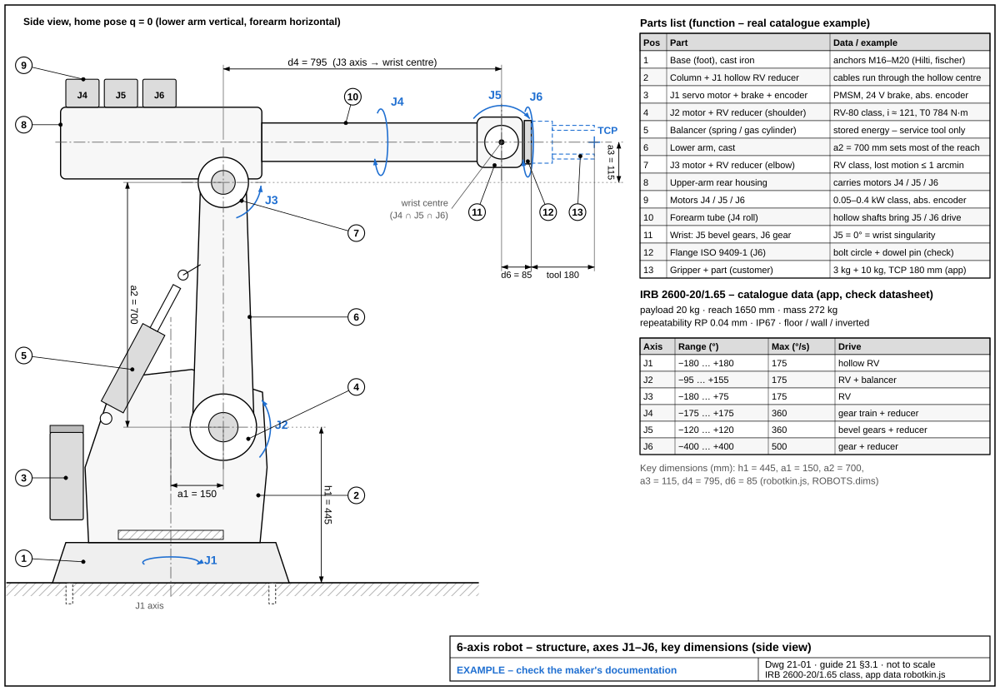
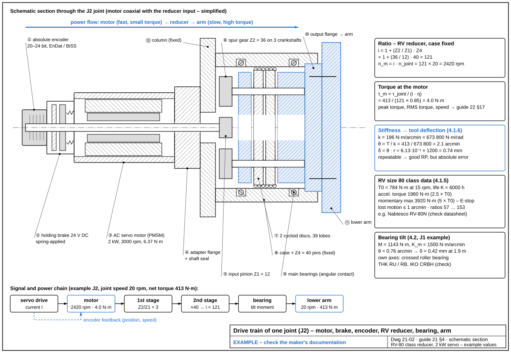
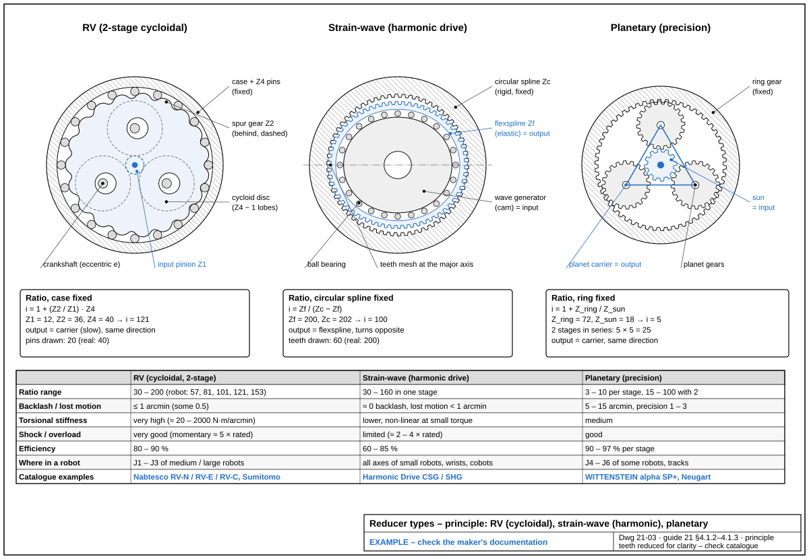
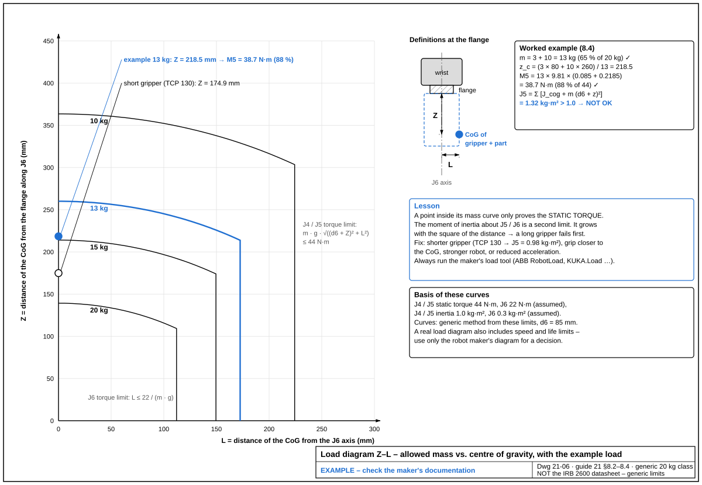
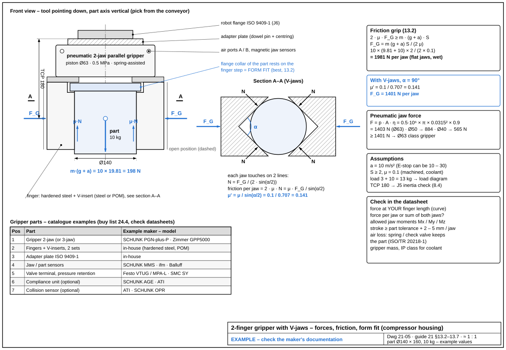
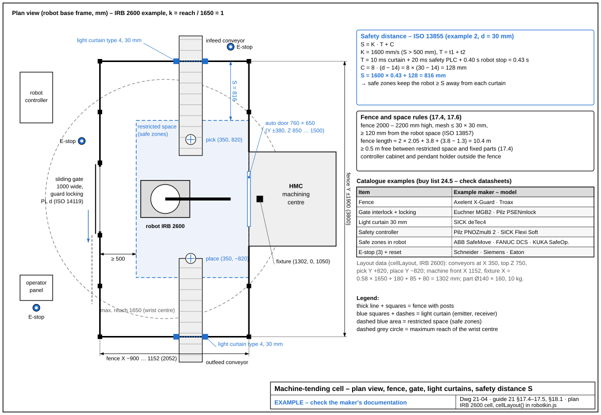
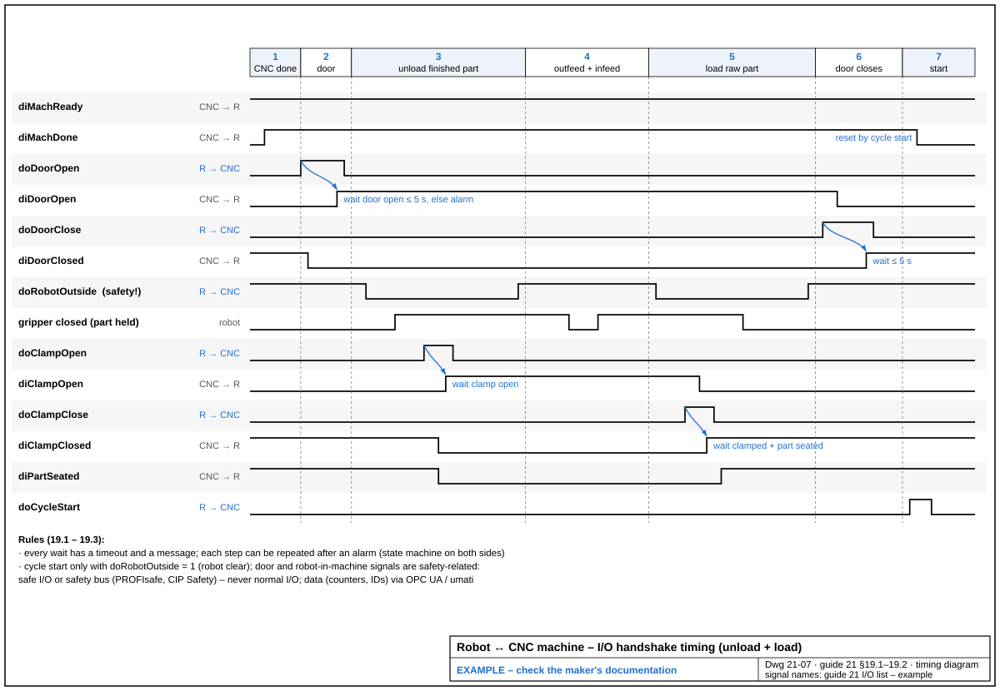

# 21 – Industrial robot: textbook, technical reference and design guide (6-axis robot, digital twin)

Browser tab: **Industrial robot** (`#robot`), item 1.
Source files: `web/robotkin.js` (kinematics, robot data, cell layout), `web/robotsim.js` (motion engine, program, part flow),
`web/robot.js` (page: tables, teach pendant, charts), `web/robot3d.js` (3D model), `web/robotdyn.js` + `web/robotdynui.js`
(dynamics, card "Mathematics + dynamics – live"). Contract for the builders: `docs/21_contract_robot.md`.

**For whom:** the mechanical engineer who plans, buys, installs and runs robot cells in the compressor factory.
The guide is three things in one:

| Part | Chapters | Use it for |
|---|---|---|
| **Textbook** – how a robot works | 1 – 9 | understand types, mechanics, drives, kinematics, motion, payload, mathematics |
| **Technical reference** – data, standards, formulas | 10 – 16, 25 – 26 | look up a value, a formula, a standard, a word |
| **Design guide** – how to design, buy and run a cell | 17 – 24, 27 – 29 | select a robot, design the gripper and the cell, integrate with the CNC, buy the parts (catalogue examples), maintain, calculate the cost |

> **All values are examples.** The robot data come from the public catalogues of four reference robots (as known when
> this was written). Check every value with the **current datasheet** of the supplier before you design a cell or buy a robot.
> The machining time, conveyor speed, gripper and part masses are invented examples for a compressor housing. Values marked
> "example – check the current datasheet" are typical values for the robot class, not the data of one product. Every computed
> number in this guide was checked with a Python script (stdlib only) or comes from the app code.

---

## Contents

**Part A – Textbook**
1. What is an industrial robot?
2. Robot types and when to use each
3. Mechanical structure – axis by axis
4. Drive train in detail: reducers, bearings, motors, encoders, brakes, balancing, cables
5. The four reference robots
6. Kinematics (coordinates, FK, IK, configurations)
7. Motion: profiles, MoveJ / MoveL, singularities, zones, motion parameters
8. Payload, load diagram, wrist torque and moment of inertia
9. Mathematical and dynamics principles (summary – full depth in guide 22)

**Part B – Technical reference**
10. Performance data and ISO 9283 (repeatability, accuracy, path, cycle)
11. Work envelope and reach
12. Mounting and foundation
13. End-effector (gripper) design
14. Frames and calibration (TCP, base / user frame, absolute accuracy)
15. Programming methods and robot languages
16. Teach pendant, operating modes and safety functions

**Part C – Design guide**
17. Cell design and safety standards (ISO 10218, ISO 12100, ISO 13849, ISO 13855, ISO 13857, ISO 14120, ISO/TS 15066)
18. The cell and the program in the app – cycle time
19. Integration with the CNC machine (machine tending)
20. Robot selection – step by step, with a worked selection for the compressor cell
21. Maintenance
22. Typical failures and troubleshooting
23. Costs and return on investment (ROI)
24. Buy lists – catalogue examples and the shopping list for the compressor cell
25. Standards register for robots
26. Glossary
27. What to check with the supplier before you buy
28. Checklists
29. How to use the page (item 1 of the Industrial robot tab)

---

# Part A – Textbook

## 1. What is an industrial robot?

An industrial robot is a machine with a **chain of joints** (axes) that moves a tool to any position and orientation
inside its work envelope. It is programmed, not built for one job: the same robot can load a machine today and
palletise boxes tomorrow.

**Definition (ISO 8373):** an *industrial robot* is an automatically controlled, reprogrammable, multipurpose manipulator,
programmable in three or more axes, which can be either fixed in place or mobile, for use in industrial automation applications.
The *robot system* = robot arm + controller + teach pendant + end-effector + any equipment, devices or sensors needed for the task.
The *robot cell* = robot system + guards + machines + conveyors + safety devices.

The most common type is the **6-axis articulated robot** (also called "vertical articulated robot"):

* 3 **main axes** (J1, J2, J3) bring the **wrist centre** to a position in space (X, Y, Z).
* 3 **wrist axes** (J4, J5, J6) turn the tool to the wanted orientation (A, B, C).
* 6 axes = 6 degrees of freedom = any position + any orientation (inside the limits).

### 1.1 Degrees of freedom (DOF)

A free rigid body in space has **6 DOF**: 3 translations (X, Y, Z) + 3 rotations (about X, Y, Z).

| Number of axes | What the robot can do | Example |
|---|---|---|
| 3 | position only (no orientation control) | Cartesian pick-and-place, simple delta |
| 4 | position + rotation about the vertical axis | SCARA, palletising robot, 4-axis delta |
| 5 | position + 2 orientations (tool roll not free) | some palletising / press-tending robots |
| 6 | any position + any orientation | standard articulated robot |
| 7 | 6 DOF + one extra ("redundant") – the elbow can move while the tool stays | 7-axis robot, human-like arm |

### 1.2 The parts of a robot system

| Part | What it is | Typical data (medium robot, example) |
|---|---|---|
| **Manipulator (arm)** | the mechanical arm with motors, gears, encoders, brakes | 150 – 1200 kg |
| **Controller** (cabinet) | computer + servo amplifiers + safety board + I/O | 400 V 3-phase, 2 – 8 kVA, 50 – 200 kg |
| **Teach pendant (FlexPendant, smartPAD, iPendant …)** | hand-held panel with enabling device and E-stop | 1 – 1.5 kg, cable 10 m |
| **End-effector (EOAT)** | gripper, welding gun, spindle, vacuum tool – made or bought by you | 0.5 – 50 kg |
| **Dress pack** | hoses and cables from the robot base to the tool | – |
| **Safety system** | fence, gate switch, light curtain, safety PLC / safe robot functions | – |
| **Software options** | collision detection, safe zones, conveyor tracking, vision, force control | – |

### 1.3 The robot in our factory

In our factory the robot is a **machine tender**: it takes raw compressor housings from a conveyor, loads them into a
machine, unloads the finished parts and puts them on the outfeed conveyor. One robot can replace the manual loading of
one machine in 2–3 shifts. Other robot jobs in a compressor plant:

| Job | Robot type | Remark |
|---|---|---|
| Machine tending of housings, crankshafts, cylinder heads | 6-axis articulated, 20 – 60 kg | this guide |
| Deburring / brushing of cast parts | 6-axis with spindle, force control | high stiffness needed |
| Washing / blowing of chips | 6-axis, IP67, washable | |
| Assembly of valves, small parts | SCARA or small 6-axis (3 – 7 kg) | high speed |
| Screwing of covers | 6-axis or SCARA with nut runner | torque / angle control |
| Leak test loading | 6-axis 20 – 60 kg | |
| Palletising of finished compressors | 4-axis palletiser or 6-axis 100 – 300 kg | |
| Welding of frames / tanks (air receivers) | 6-axis arc welding robot, hollow wrist | |
| Painting of tanks | explosion-proof painting robot (ATEX) | |
| Loading of heavy motors / compressor blocks | 6-axis 200 – 500 kg | |

---

## 2. Robot types and when to use each

### 2.1 Overview table (parameter ranges – examples, check the current datasheets)

| Type | Axes | Payload | Reach / stroke | Repeatability (ISO 9283) | Speed | Best for |
|---|---|---|---|---|---|---|
| **Articulated (6-axis)** | 6 | 0.5 – 2300 kg | 0.4 – 4.7 m | ±0.01 (small) … ±0.2 mm (very large) | 100 – 500 °/s per axis | machine tending, welding, handling, assembly – the "all-rounder" |
| **SCARA** | 4 (X-Y arm + Z + roll) | 1 – 50 kg (typ. 3 – 20) | 0.2 – 1.2 m radius, Z 100 – 400 mm | ±0.005 – ±0.025 mm (XY) | standard cycle 0.3 – 0.5 s | fast assembly, insertion, pick-and-place on a plane |
| **Delta (parallel)** | 3 – 4 (some 6) | 0.5 – 15 kg (typ. 1 – 8) | working Ø 0.5 – 1.6 m, height 0.2 – 0.5 m | ±0.02 – ±0.1 mm | 100 – 300 picks/min | very fast picking from a belt, packaging |
| **Cartesian / gantry** | 2 – 3 linear (+ 1 – 3 rotary) | 1 kg – 5 t | X up to 30 m and more, Z 0.5 – 3 m | ±0.01 – ±0.1 mm | 1 – 5 m/s | long distances, heavy parts, loading many machines from above |
| **Collaborative (cobot)** | 6 – 7 | 3 – 35 kg | 0.5 – 1.8 m | ±0.02 – ±0.1 mm | limited by the risk assessment (often 0.25 – 1 m/s near people) | work next to people without a fence, small batches |
| **7-axis (redundant)** | 7 | 5 – 50 kg | 0.8 – 2 m | ±0.05 – ±0.1 mm | | reaching around obstacles, inside machines, human-like motion |
| **Dual-arm** | 14 – 15 | 0.5 – 20 kg per arm | 0.5 – 1.2 m per arm | ±0.02 – ±0.1 mm | | assembly with two hands, small parts |
| **Palletising robot** | 4 (sometimes 5) | 100 – 800 kg (some more) | 2.4 – 3.2 m | ±0.1 – ±0.5 mm | 1000 – 2000 cycles/h | stacking boxes, bags, finished products |

### 2.2 Articulated robot (6-axis)

* **Principle:** serial chain of 6 revolute joints. J1 vertical, J2 and J3 parallel horizontal axes, spherical wrist J4–J6.
* **Strengths:** large work envelope compared to its floor space, reaches into machines from the side and from above,
  any orientation, very large choice of sizes and options (IP67, foundry, clean room, ATEX).
* **Weaknesses:** absolute accuracy without calibration only 0.5 – 2 mm, singularities, stiffness lower than a machine tool
  (serial chain – the errors of all axes add up).
* **Variants:** shelf-mounted (J2 lifted above the base), hollow wrist (cables inside the wrist – welding), parallel-link
  (J3 driven by a parallelogram – heavy robots, palletisers), "short-arm" high-payload versions.
* **When to use:** machine tending of CNC lathes and machining centres, handling 5 – 300 kg, welding, deburring.

### 2.3 SCARA (Selective Compliance Assembly Robot Arm)

* **Principle:** 2 parallel vertical revolute joints (like a human shoulder + elbow in the horizontal plane), a vertical linear
  axis Z (ball screw spline) and a roll axis. *Selective compliance:* soft in X-Y, stiff in Z – ideal for pushing a pin into a hole.
* **Typical data (example, 6 kg / 600 mm class):** repeatability XY ±0.02 mm, Z ±0.01 mm, standard cycle (25 mm up – 300 mm across –
  25 mm down and back, 2 kg) ≈ 0.4 s.
* **When to use:** valve assembly, screwing, small-part pick-and-place on one plane. Not for loading a horizontal spindle.

### 2.4 Delta robot (parallel kinematics)

* **Principle:** 3 arms from a fixed base to a small moving plate, each arm with a parallelogram, so the plate stays parallel
  to the base. All motors sit in the base → very light moving mass → very high accelerations (up to 100 – 150 m/s²).
* **When to use:** very fast picking of light parts (≤ 3 kg typical) from a belt with vision. Not for heavy parts or long reach.

### 2.5 Cartesian robot and gantry

* **Principle:** linear axes at right angles (X, Y, Z). Drives: toothed belt (fast, ±0.1 mm), rack and pinion (long strokes,
  ±0.05 – 0.1 mm), ball screw (precise, ±0.01 – 0.02 mm, short strokes ≤ 3 – 4 m), linear motor (fastest, most precise, expensive).
* **Kinematics are simple** (each axis = one coordinate), no singularities, accuracy ≈ repeatability after mapping.
* **When to use:** one gantry loads a line of 2 – 6 CNC machines from above; heavy parts (crankshaft, compressor block);
  the floor in front of the machines stays free for the operator and for chip conveyors.

### 2.6 Collaborative robot (cobot)

* **Principle:** a robot built for **collaborative operation**: torque sensing in each joint or a skin, rounded light design,
  speed and force limits in a certified safety controller. Four collaborative modes (from ISO 10218 / ISO/TS 15066):

| Mode | How it is safe | Example |
|---|---|---|
| Safety-rated monitored stop | robot stops when a person enters, continues after the person leaves | manual loading station inside the cell |
| Hand guiding | person moves the robot by hand with an enabling device | teaching, lifting aid |
| Speed and separation monitoring | robot slows down / stops depending on the distance to the person (scanner) | shared aisle |
| Power and force limiting (PFL) | contact allowed, but force and pressure below the body limits (table in 17.8) | screwing next to a worker |

* **Important:** the *application* is collaborative, not the robot. A cobot carrying a sharp cast part at 1 m/s is not safe.
  A risk assessment is always needed. Cobots are slower (payload and speed limited), so their cycle time is longer.
* **When to use:** small batches, frequent changeover, no space for a fence, ergonomic help for the operator.

### 2.7 7-axis robot

* One extra joint (usually in the upper arm). The elbow can swing ("null-space motion") while the tool stays still.
* Avoids obstacles and singularities, reaches into narrow machines. More expensive, more complex IK (no closed formula
  without an extra parameter, e.g. the elbow angle).

### 2.8 Dual-arm robot

* Two 6- or 7-axis arms on one torso (often with a waist axis). Assembly tasks that need two hands (hold + screw).
* Small payloads; used for small-part assembly and laboratory tasks.

### 2.9 Quick selection rule

| Question | Answer → type |
|---|---|
| Must the part enter a machine from the side and turn? | articulated |
| Parts on one plane, insertion from above, < 20 kg, fast? | SCARA |
| Light parts on a belt, > 100 picks/min? | delta |
| Several machines in a row, loading from above, heavy parts? | gantry |
| Operator works in the same space without a fence? | collaborative (with risk assessment) |
| Stacking boxes / bags on pallets? | palletising robot (4-axis) |

---

## 3. Mechanical structure – axis by axis

Every axis has the same **drive chain**:

```
servo amplifier → AC servo motor (+ holding brake + absolute encoder) → reducer (gear) → arm link
```

| Element | What it does | Why it is there |
|---|---|---|
| **AC servo motor** (permanent magnet) | gives torque and speed, controlled in a closed loop | fast, exact, high torque per kg |
| **Holding brake** (spring applied, opens with 24 V) | holds the axis when the power is off | without it the arm falls down by gravity when power is off or in an E-stop |
| **Absolute multi-turn encoder** (battery backed) | measures the motor angle, also counts turns when the power is off | robot knows its position at power-on – no homing run |
| **Reducer** | reduces speed, increases torque (ratio ≈ 1:50 … 1:200) | the motor is fast (3000–6000 rpm) with small torque; the arm needs slow speed and big torque |
| **Bearings** (in the reducer, crossed roller bearing) | carry the arm forces and the tilting moment | stiffness and accuracy |
| **Cable harness** | power + encoder cables, customer air + signals | goes through the hollow J1 and along the arm; must bend millions of times |

### 3.1 The axes

| Axis | Moves | Typical reducer | Special |
|---|---|---|---|
| **Base (foot)** | – | – | cast iron / cast steel, 4 anchor bolts or a floor plate with chemical anchors; carries the tilting moment of the arm |
| **J1 – rotation (column)** | the whole arm about the vertical axis | large **hollow RV (cycloidal) reducer** | hollow centre for the cables, mechanical stop + stop pins |
| **J2 – lower arm (shoulder)** | the lower arm forward / back | RV reducer on the side of the column | **highest gravity torque** of all axes → balancing device |
| **Balancing device** | – | spring pack or gas / hydraulic cylinder from the column to the lower arm | takes part of the gravity torque on J2 → smaller motor and reducer. **Stored energy – never open without the service tool** |
| **J3 – upper arm (elbow)** | forearm up / down | RV reducer at the elbow | with J2 it sets distance and height of the wrist centre |
| **Upper-arm rear housing** | – | – | carries the motors of J4, J5, J6 (medium / large robots) – their mass balances the forearm |
| **J4 – forearm roll** | rolls the forearm tube | gear train + reducer at the rear of the tube | hollow shafts inside bring J5 and J6 motion to the wrist |
| **J5 – wrist bend** | bends the tool | bevel gears + small reducer | J5 = 0° is the **wrist singularity** (see 7.4) |
| **J6 – flange roll** | turns the tool | gear + reducer | **ISO 9409-1 flange** with bolt circle and dowel pin |
| **Gripper** | – | – | made or bought by you; not part of the robot; must fit the load diagram |

**Small robots** (3 kg class) use **harmonic drives** (strain-wave gears): small, light, no backlash, but less stiff
and less overload capacity. **Medium and large robots** use **RV (cycloidal) reducers** on J1–J3: very stiff, high
shock-load capacity, low backlash (< 1 arcmin). Details and numbers: chapter 4.


*Figure 21-1 – 6-axis robot (IRB 2600 class): parts, axes J1–J6, key dimensions h1 a1 a2 a3 d4 d6 (example – check the maker's documentation).*

### 3.2 Why the wrist centre matters

On almost all industrial robots the axes J4, J5 and J6 **cross in one point** – the wrist centre. This makes the
calculation (inverse kinematics) simple: J1–J3 give the wrist-centre position, J4–J6 give the orientation. Both parts can
be solved one after the other with closed formulas (no iteration).

### 3.3 Structural parts – materials and design

| Part | Material (typical) | Design idea |
|---|---|---|
| Base, column | grey cast iron EN-GJL-250 / ductile iron EN-GJS-400, or cast steel | high mass and damping where mass does not cost speed |
| Lower arm | cast aluminium (AlSi7Mg T6) or ductile iron, sometimes welded steel (large robots) | box section, high bending stiffness EI |
| Upper arm, forearm | cast aluminium | light, because its mass is carried by J2 and J3 |
| Wrist | aluminium or magnesium housings, steel gears | very compact, as light as possible |
| Covers, seals | aluminium, plastics; radial shaft seals (FKM / NBR) | IP54 – IP67 protection |

**Why the outer links must be light:** every kg at the wrist needs torque on J2 and J3 (lever ≈ 1 m) and inertia on J1
(radius ≈ 1 m). 1 kg at 1.2 m from J1 adds m·r² = 1 × 1.2² = 1.44 kg·m² to the J1 inertia.

**Bending of an arm (example):** a lower arm as a box beam, length L = 0.7 m, load F = 1000 N at the end:
δ = F·L³ / (3·E·I). With an aluminium box 120 × 120 mm, 8 mm wall: E = 70 GPa, I = (0.12⁴ − 0.104⁴)/12 = 7.53·10⁻⁶ m⁴ →
δ = 1000 × 0.343 / (3 × 70·10⁹ × 7.53·10⁻⁶) = 0.22 mm. The gears usually twist more than the arm bends (chapter 4.1.6), so stiffness is mostly a gear question.

---

## 4. Drive train in detail: reducers, bearings, motors, encoders, brakes, balancing, cables


*Figure 21-2 – Drive train of J2: encoder, brake, servo motor, RV reducer (i = 121), main bearings, arm – with stiffness and torque callouts (example – check the maker's documentation).*

### 4.1 Reducers (gearboxes)

#### 4.1.1 Why a reducer?

A servo motor gives a small torque at a high speed. The arm needs a big torque at a low speed. The reducer with ratio n changes this:

```
output speed     ω_out = ω_motor / n
output torque    T_out = T_motor · n · η          (η = efficiency, 0.6 … 0.95)
inertia seen by the motor   J_ref = J_arm / n²    ("reflected inertia")
```

Example (IRB 2600 class, J1, estimate from the app): motor 3500 rpm, n = 120 → axis speed 3500 × 6 / 120 = **175 °/s**
(1 rpm = 6 °/s). Arm inertia 44.7 kg·m² (home pose, app estimate) → seen by the motor 44.7 / 120² = **0.0031 kg·m²**.

#### 4.1.2 The three main reducer types

| | **RV (cycloidal, 2-stage)** | **Strain-wave (harmonic drive)** | **Planetary (precision)** |
|---|---|---|---|
| Principle | 1st stage spur gears, 2nd stage cycloid discs rolling on pins | elastic flexspline deformed by an elliptical wave generator; 2 teeth difference | sun – planets – ring gear |
| Ratio range | 30 – 200 (robot: 57, 81, 101, 121, 153 …) | 30 – 160 in one stage (30, 50, 80, 100, 120, 160) | 3 – 10 per stage, 15 – 100 with 2 stages |
| Backlash / lost motion | ≤ 1 arcmin (some 0.5) | ≈ 0 backlash, lost motion < 1 arcmin | standard 5 – 15 arcmin, precision 1 – 3 arcmin |
| Torsional stiffness | very high (≈ 20 – 2000 N·m/arcmin by size) | lower, non-linear at small torque | medium |
| Shock / overload | very good (momentary ≈ 5 × rated) | limited (momentary ≈ 2 – 4 × rated; flexspline fatigue) | good |
| Efficiency | 80 – 90 % | 60 – 85 % (depends on speed, temperature) | 90 – 97 % per stage |
| Mass, size | heavier | very light, flat, hollow shaft possible | medium |
| Where in a robot | J1 – J3 of medium / large robots, J4 of large robots | all axes of small robots, wrists, cobots | J4 – J6 of some robots, linear tracks, gantries |
| Life rule | L10 = K·(N0/Nm)·(T0/Tm)^(10/3), K = 6000 h | L10 = 7000 h·(Tr/Tav)³·(Nr/Nav) | L10 from bearing life (exponent 10/3 or 3) |


*Figure 21-3 – Reducer principles: RV (cycloidal), strain-wave (harmonic drive), planetary – ratio formulas and comparison (example – check the maker's documentation).*

#### 4.1.3 Ratio formulas with examples

```
RV reducer (case fixed, output = carrier):   i = 1 + (Z2 / Z1) · Z4
   Z1 = input pinion teeth, Z2 = spur gear teeth, Z4 = number of pins (cycloid disc has Z4 − 1 lobes)
   Example: Z1 = 12, Z2 = 36, Z4 = 40   →   i = 1 + 3 × 40 = 121

Strain-wave (circular spline fixed, output = flexspline):   i = Zf / (Zc − Zf)     (output turns opposite)
   Example: Zf = 200, Zc = 202   →   i = 200 / 2 = 100

Planetary (ring fixed, input sun, output carrier):   i = 1 + Z_ring / Z_sun
   Example: Z_ring = 72, Z_sun = 18   →   i = 5;   two stages in series: 5 × 5 = 25
```

#### 4.1.4 Definitions: backlash, lost motion, hysteresis, stiffness

| Term | Meaning | Unit |
|---|---|---|
| **Backlash** | free angle of the output when the input is locked and the torque changes direction (no load) | arcmin (1 arcmin = 1/60°) |
| **Lost motion** | twist angle at a small reference torque (e.g. ±3 % of rated torque) – what the RV catalogue states | arcmin |
| **Hysteresis loss** | width of the torque–twist loop at zero torque after loading to rated torque in both directions | arcmin |
| **Torsional stiffness (rigidity)** | slope of the torque–twist curve: k = ΔT / Δθ | N·m/arcmin or N·m/rad |
| **Angular transmission error** | difference between ideal and real output angle in one output turn (no load) | arcsec |
| **Moment stiffness** | resistance of the output bearing against a tilting moment | N·m/arcmin |

1 arcmin = 1/60° = 2.909·10⁻⁴ rad. **Effect at the tool:** displacement δ = θ[rad] × r.

Example: 1 arcmin lost motion on J2 with the tool 1.2 m away → δ = 2.909·10⁻⁴ × 1200 = **0.35 mm**. This is why robots with
±0.04 mm repeatability must have gears with lost motion much smaller than 1 arcmin in the repeatable direction, and why the controller
always approaches a point in the same way (same direction of gravity load).

#### 4.1.5 Example reducer data (RV class, size "80" – example, check the current catalogue)

| Data | Value | Meaning |
|---|---|---|
| Rated output torque T0 | 784 N·m | torque for the rated life |
| Rated output speed N0 | 15 rpm | speed for the rated life |
| Rated life K | 6000 h | L10 at T0 and N0 |
| Allowable acceleration / deceleration torque | 1960 N·m (2.5 × T0) | normal start / stop peaks |
| Momentary maximum torque | 3920 N·m (5 × T0) | E-stop, collision – a limited number of times |
| Torsional rigidity | 196 N·m/arcmin | |
| Lost motion | ≤ 1 arcmin | at ±3 % of T0 |
| Ratios | 57, 81, 101, 121, 153 | |

#### 4.1.6 Twist of the gear → tool displacement (worked example)

```
k = 196 N·m/arcmin = 196 × 60 × 180/π = 673 800 N·m/rad
J2 net torque (app example with balancer) T = 413 N·m
twist θ = T / k = 413 / 673 800 = 6.13·10⁻⁴ rad = 2.1 arcmin
tool displacement δ = θ · r = 6.13·10⁻⁴ × 1200 mm = 0.74 mm
```

Chapter 9.11 uses a simpler round value (k = 1·10⁶ N·m/rad, r = 1100 mm → 0.45 mm). Both show the same lesson:
**gear twist under gravity gives tenths of a millimetre** – it is repeatable (same load → same twist), so the robot repeats well,
but the absolute position is off unless the controller models the stiffness (absolute-accuracy option, chapter 14.5).

#### 4.1.7 RV reducer life L10 (worked example)

The life of an RV reducer is set by its main bearings and pins. The catalogue formula:

```
L10 = K · (N0 / Nm) · (T0 / Tm)^(10/3)          [hours of operation]

Nm = Σ(ti·ni) / Σti                              mean output speed (motion phases)
Tm = [ Σ(ti·ni·Ti^(10/3)) / Σ(ti·ni) ]^(3/10)    mean equivalent torque
```

**Example – J2 of a 20 kg robot (load cycle estimated, RV size 80 from 4.1.5):**

| Phase | Time ti | Output speed ni | Torque Ti |
|---|---|---|---|
| Acceleration | 0.3 s | 14.6 rpm (mean) | 650 N·m |
| Constant speed | 0.5 s | 29.2 rpm (= 175 °/s) | 450 N·m |
| Deceleration | 0.3 s | 14.6 rpm | 250 N·m |
| Stop (dwell) | 1.0 s | 0 | (not in the life formula) |

```
Nm = (0.3×14.6 + 0.5×29.2 + 0.3×14.6) / 1.1 = 21.24 rpm
Tm = [ (0.3×14.6×650^(10/3) + 0.5×29.2×450^(10/3) + 0.3×14.6×250^(10/3)) / 23.36 ]^(0.3) = 485.7 N·m
L10 = 6000 × (15 / 21.24) × (784 / 485.7)^(10/3) = 20 900 h of motion
motion share = 1.1 / 2.1 = 52 %  →  clock hours = 20 900 / 0.524 = 39 900 h
at 6000 h per year (3 shifts)  →  about 6.7 years
```

Also check: peak 650 N·m < allowable acceleration torque 1960 N·m ✓; E-stop torque < 3920 N·m (ask the robot supplier – they
size the gears, you only influence the load and the program). **Lesson:** life goes with torque to the power 10/3 – 10 % more
torque gives (1/1.1)^(10/3) = 0.73 → 27 % less life. Wrong load data in the controller or a too heavy gripper shortens gear life fast.

#### 4.1.8 Strain-wave life (example)

```
L10 = 7000 h · (Tr / Tav)³ · (Nr / Nav)        Tr = rated torque at rated input speed Nr = 2000 rpm
Example (size 20 class, ratio 100, Tr = 34 N·m – example): Tav = 25 N·m, Nav = 1500 rpm input
L10 = 7000 × (34/25)³ × (2000/1500) = 23 480 h
```

#### 4.1.9 Selection rules for reducers

* Mean torque Tm ≤ rated torque; peaks in normal cycle ≤ allowable acceleration torque; E-stop / collision ≤ momentary max.
* Output speed ≤ allowed (also check the input speed and the temperature: oil / grease ≤ 60 – 80 °C).
* Tilting moment on the output bearing ≤ allowed moment (4.2).
* Lost motion and stiffness meet the accuracy target at the tool (δ = θ·r).
* For your own designs (rotary table, 7th axis, positioner): use the same rules. Planetary for linear tracks (rack and pinion),
  RV for positioners with large tilting moments.

### 4.2 Bearings – crossed roller bearing and the main bearing of the reducer

| Bearing | Construction | Strength |
|---|---|---|
| **Crossed roller bearing** | cylindrical rollers between inner and outer ring, every second roller turned 90° | one bearing carries radial + axial + tilting moment; very stiff, thin, preloaded |
| **Angular contact ball bearings (pair)** | integrated in RV reducers as main bearing | high tilting moment capacity |
| **Four-point contact bearing** | balls with 4 contact points | slewing rings of J1 of large robots, positioners |
| **Thin-section deep groove ball bearings** | wrist, J4 tube | light, small cross-section |

Check of a main bearing:

```
tilting moment     M = W1·l1 + W2·l2 + …          (forces × their distances to the bearing centre)
condition          M ≤ M_allowed  (catalogue)
tilt angle         θ = M / K_m       (K_m = moment stiffness, N·m/arcmin)
tool displacement  δ = θ[rad] · r
```

Example (J1 bearing, IRB 2600 class, static tilting moment estimate M = 1143 N·m (12.3), moment stiffness K_m = 1500 N·m/arcmin – example):
θ = 1143 / 1500 = 0.76 arcmin = 2.22·10⁻⁴ rad → at r = 1.9 m: δ = **0.42 mm**.

### 4.3 Servo motors

| Data | Typical range (robot motors, example) |
|---|---|
| Type | permanent-magnet synchronous motor (PMSM, "AC servo"), sinusoidal commutation |
| Rated power | 0.05 – 0.4 kW (small robots, wrists) · 0.5 – 3 kW (medium J1 – J3) · 3 – 7 kW (large J1 – J3) |
| Rated speed / max speed | 3000 rpm / 4000 – 6000 rpm |
| Peak torque | 3 – 4 × rated torque (for acceleration, a few hundred ms) |
| Supply | DC bus 560 – 750 V from 400 V AC, PWM inverter in the controller (servo amplifier) |
| Protection | IP65 – IP67, temperature sensor (PTC / KTY / PT1000) in the winding |
| Cooling | natural convection through the arm castings – motor size limited by the RMS torque (chapter 9.10) |

**Motor sizing (short, full method in guide 22):** peak motor torque ≤ motor maximum torque; RMS torque over the cycle ≤
rated torque; maximum speed ≤ max motor speed; inertia ratio J_load_reflected / J_motor usually ≤ 5 – 10 for a stiff servo loop.

### 4.4 Absolute encoders

| Data | Value (example) |
|---|---|
| Principle | optical or magnetic absolute encoder on the motor shaft, serial interface (EnDat, BiSS, manufacturer protocol) |
| Single-turn resolution | 17 – 24 bit (2²⁰ = 1 048 576 counts per motor turn) |
| Multi-turn | counts motor turns; kept by a **battery** when power is off (ABB SMB battery, FANUC pulse-coder battery) or by battery-free technology (Wiegand wire / gear multi-turn) on newer motors |
| Joint resolution | 360° / (2^bits × n) |

Example: 20-bit encoder, ratio n = 120: 360 / (1 048 576 × 120) = 2.86·10⁻⁶ ° per count → at 1.2 m: **0.06 µm**.
The encoder is never the limit for accuracy – gears, stiffness and temperature are.

**If the battery is empty and the power is off:** the multi-turn count is lost → the robot must be re-synchronised
(update revolution counters / mastering) at the calibration marks. Plan battery change before the alarm (chapter 21).

### 4.5 Holding brakes

* **Spring-applied, electrically released** (24 V DC). Power off or E-stop category 0 → brake closes.
* It is a **holding brake** with limited dynamic capacity: it can stop the axis in an emergency a limited number of times.
* **Holding torque rule (example):** brake torque at the motor ≥ 1.5 – 2 × the maximum gravity torque reflected to the motor.

Example J2 (IRB 2600 class, app estimate, worst case arm horizontal, no balancer, load 13 kg at 1.9 m):
gravity torque = (80.92 kg·m + 13 kg × 1.9 m) × 9.81 = 1036 N·m at the arm → at the motor 1036 / 120 = 8.6 N·m
(back-driving with η = 0.85: 1036 × 0.85 / 120 = 7.3 N·m) → brake ≥ 13 – 17 N·m.

* **Brake test:** modern controllers test the brakes cyclically (e.g. every 8 – 48 h). A failed brake test is a safety alarm –
  never ignore it; an axis with a weak brake can fall when the power goes off.
* **Brake release without power** (for rescue of a trapped person, or service): brake-release buttons or a release device –
  support the arm first (crane, wooden block), because the arm moves by gravity.

### 4.6 Balancing the gravity torque on J2

J2 carries the gravity torque of the whole arm. Three ways to reduce it:

| Method | How | + | − |
|---|---|---|---|
| **Spring balancer** | pre-loaded coil-spring pack in a cylinder from the column to the lower arm | simple, no pressure, no leaks | spring force not exactly proportional; heavy for big robots |
| **Gas (hydro-pneumatic) balancer** | cylinder with nitrogen gas (sometimes oil + gas accumulator) | compact, high force | pressure must be checked, gas may leak, temperature dependent; pressure equipment rules |
| **Counterweight** | mass on the other side of J2 (parallel-link palletisers) | exact at all poses, no maintenance | adds mass and inertia on J1, more space |
| (none) | strong motor + gear only | simple | only for small robots (IRB 120: no balancer) |

**Gravity torque of the arm on J2** (the code convention: q2 = 0 = lower arm vertical):

```
τ_g(q2) ≈ g · (m_la · a2/2 + m_out · a2) · sin q2        (outer links taken at the elbow – simplified)
```

App estimate, IRB 2600: m_la = 40.8 kg (lower arm), m_out = 95.2 kg (upper arm housing + forearm + wrist), a2 = 0.7 m:
m_la·a2/2 + m_out·a2 = 14.28 + 66.64 = **80.92 kg·m** → τ_g = 793.8 N·m × sin q2.

| q2 | Gravity torque (arm only) | Balancer gives (app model: 70 %) |
|---|---|---|
| 20° | 271.5 N·m | 190.1 N·m |
| 45° | 561.3 N·m | 392.9 N·m |
| 90° | 793.8 N·m | 555.7 N·m |

**Ideal spring balance (textbook result):** a spring with zero free length between a point at distance a above J2 (on the column)
and a point at distance b on the lower arm gives the torque

```
τ_s = k · a · b · sin q2        →  perfect balance at every angle if   k · a · b = m·g·r  (= 793.8 N·m here)
Example: a = 0.15 m, b = 0.25 m  →  k = 793.8 / (0.15 × 0.25) = 21 170 N/m = 21.2 N/mm
check q2 = 45°: spring length L = √(a² + b² − 2ab·cos q2) = 0.1788 m, force F = k·L = 3785 N,
torque = F·a·b·sin q2 / L = 561.3 N·m = gravity torque ✓
```

Real springs have a free length > 0 and are pre-loaded, so balance is good only over a range – that is why the robot maker
designs the attachment points carefully and why a robot must never be used with a different balancer setting.

**Counterweight:** the same 80.92 kg·m with a lever of 0.3 m needs 80.92 / 0.3 = **270 kg** – that is why counterweights are
only used where mass does not hurt (palletisers with parallel link).

**Gas balancer:** F = p·A. Example: piston Ø50 mm, p = 12 MPa → F = 12·10⁶ × π × 0.025² = 23 560 N. When the gas is compressed
by 20 % (V2 = 0.8·V1): isothermal p2 = 12 / 0.8 = 15.0 MPa, fast (polytropic n = 1.3): p2 = 12 × (1/0.8)^1.3 = 16.0 MPa.
So the force rises with stroke, like a spring.

> **Safety:** a balancer stores energy (spring pre-load or gas pressure). Only trained service staff with the special tool may
> remove or open it. Before work on J2: arm in the service position, support it, follow the manual.

### 4.7 Cable harness and dress packs

**Internal harness (robot maker):** motor power, encoder, brake cables + customer lines (air 2 – 4 × Ø8 – 12 mm, signals,
bus cable, sometimes power for a servo gripper). Runs from the base connector through the hollow J1, along the lower arm to the
upper arm. Designed for: 5 – 10 million cycles, torsion ±180 … ±360° per metre, bending radius ≥ 7.5 – 10 × cable diameter (dynamic).

**External dress pack (from the upper arm to the tool):**

| Item | Rule |
|---|---|
| Protective hose (corrugated tube) | polyamide; with ball joints / swivel at the upper arm and at the tool |
| Retraction system | spring or elastic return in the upper-arm holder, keeps the hose tight when J4 / J6 turn |
| Length | simulate the extreme poses (J4 ±, J5 ±, J6 ±); too short → torn, too long → catches on the machine |
| Rotary joint on J6 | air/electric swivel if J6 turns more than ±1 turn continuously |
| Materials | PUR hoses and cables (oil and coolant resistant), halogen-free, chip protection near CNC machines |
| Fixing | never fix cables tight to a moving part without a loop; use clamps with rounded edges |

The dress pack is the **number one wear part** of a machine-tending robot (chapter 22). Inspect it every month.

**Buy list – catalogue examples** for reducers, bearings, servo drives (own axes) and dress packs: tables 24.3 and 24.4.

---

## 5. The four reference robots (catalogue values – check with the current datasheet)

| | IRB 120-3/0.6 | IRB 2600-20/1.65 | IRB 4600-60/2.05 | IRB 6700-200/2.60 |
|---|---|---|---|---|
| Class | small | medium | medium-large | large |
| Typical use (app text) | assembly, small parts | machine tending, handling, arc welding | machine tending, palletising, cutting | spot welding, heavy handling, machine loading |
| Payload | 3 kg | 20 kg | 60 kg | 200 kg |
| Reach (wrist centre) | 580 mm | 1650 mm | 2050 mm | 2600 mm |
| Robot mass | 25 kg | 272 kg | 425 kg | 1170 kg |
| Repeatability (ISO 9283) | ± 0.01 mm | ± 0.04 mm | ± 0.06 mm | ± 0.05 mm |
| Protection | IP30 | IP67 | IP67 | IP67 |
| Mounting | floor, wall, ceiling, any angle | floor, wall, tilted, inverted | floor, tilted, inverted, shelf | floor |
| h1 / a1 / a2 / a3 / d4 / d6 (mm) | 290 / 0 / 270 / 70 / 302 / 72 | 445 / 150 / 700 / 115 / 795 / 85 | 495 / 175 / 900 / 175 / 960 / 135 | 780 / 320 / 1125 / 200 / 1142.5 / 200 |
| J1 range / max speed | ±165° / 250 °/s | ±180° / 175 °/s | ±180° / 175 °/s | ±170° / 110 °/s |
| J2 range / speed | ±110° / 250 | −95…+155° / 175 | −90…+150° / 175 | −65…+85° / 110 |
| J3 range / speed | −110…+70° / 250 | −180…+75° / 175 | −180…+75° / 175 | −180…+70° / 110 |
| J4 / J5 / J6 range (°) | ±160 / ±120 / ±400 | ±175 / ±120 / ±400 | ±400 / −125…+120 / ±400 | ±300 / ±130 / ±360 |
| J4 / J5 / J6 speed (°/s) | 320 / 320 / 420 | 360 / 360 / 500 | 250 / 250 / 360 | 190 / 150 / 210 |
| Reducers (app text – check) | harmonic drives on all axes | RV J1–J3, gear trains + reducers J4–J6 | RV J1–J3, gear trains + reducers J4–J6 | RV J1–J3 (J1 large hollow), gear trains J4–J6 |
| Balancing device | no | yes | yes | yes |
| Base footprint in the 3D model (mm) | 180 × 180 | 676 × 511 | 730 × 600 | 1000 × 870 |
| Controller (app text) | IRC5 Compact / OmniCore E10 | IRC5 / OmniCore V250XT | IRC5 / OmniCore V250XT | IRC5 / OmniCore V400XT |
| Acceleration time in the model | 0.15 s | 0.30 s | 0.40 s | 0.60 s |
| Payload / robot mass | 12 % | 7.4 % | 14 % | 17 % |

The **acceleration time is our estimate**, not a catalogue value (the real acceleration depends on the load and on the
pose; the controller calculates it with its dynamic model).

Arm dimensions: `h1` = floor → J2 axis, `a1` = J1 axis → J2 axis (forward), `a2` = lower arm (J2 → J3),
`a3` = J3 → forearm axis (offset up), `d4` = J3 → wrist centre along the forearm, `d6` = wrist centre → flange.
The page draws them to scale (card "Catalogue data").

**Reach check from the dimensions** (reach = a1 + a2 + √(d4² + a3²), wrist centre, arm stretched horizontally):

| Robot | a1 + a2 + √(d4² + a3²) | Catalogue |
|---|---|---|
| IRB 120 | 0 + 270 + √(302² + 70²) = 270 + 310.0 = **580.0 mm** | 580 mm ✓ |
| IRB 2600 | 150 + 700 + 803.3 = **1653.3 mm** | 1650 mm ✓ |
| IRB 4600 | 175 + 900 + 975.8 = **2050.8 mm** | 2050 mm ✓ |
| IRB 6700 | 320 + 1125 + 1159.9 = **2604.9 mm** | 2600 mm ✓ |

**What the table teaches:** the large robot is slower per axis (110 °/s vs 250 °/s) because the inertia grows with mass × r².
A bigger robot than needed costs cycle time (chapter 18: 35.9 s → 48.5 s for the same cell job scaled up).

**Buy list – catalogue examples** of comparable robots from other makers (FANUC, KUKA, Yaskawa) and of controller options: tables 24.1 and 24.2.

---

## 6. Kinematics

### 6.1 Coordinates

* **Base frame**: origin = centre of the robot foot on the floor, **X forward, Y left, Z up**, mm.
* **Tool frame (TCP)**: Z points out of the gripper. TCP = Tool Centre Point = the point the program moves.
  Our gripper: TCP 180 mm in front of the flange (IRB 2600, example).
* Orientation: **A B C** = rotation about Z, then Y, then X (Euler ZYX, degrees) – the same as on many teach pendants.
  Example: tool pointing down = A 0 / B 180 / C 0 (shown as 180 / 0 / 180 – the same orientation, other numbers).
  Tool horizontal forward (+X) = A 0 / B 90 / C 0.
* **Joint directions (code, ABB style):** J1 + = turn left seen from above; J2 + = lower arm tilts forward (J2 = 0 → lower arm
  vertical); J3 + = forearm tilts down (J3 = 0 → forearm horizontal at J2 = 0); J5 + = tool down. Zero pose: lower arm vertical,
  forearm horizontal forward, flange Z along +X.

Other makers use other conventions (e.g. Denavit–Hartenberg (DH) parameters, other zero poses, quaternions for orientation in ABB
RAPID, A B C in KUKA = Z-Y-X, W P R in FANUC = X-Y-Z fixed angles). **Always check the convention before you exchange points
between systems.**

### 6.2 Joint chain (forward kinematics, FK)

Joint angles q1 … q6 → TCP pose. The chain used in `robotkin.js` (ABB style zero pose: lower arm vertical, forearm horizontal):

```
T = Rz(q1) · Tz(h1) · Tx(a1) · Ry(q2) · Tz(a2) · Ry(q3) · Tz(a3) · Tx(d4) · Rx(q4) · Ry(q5) · Rx(q6) · Tx(d6) · Ry(90°) · Tool
```

`Rz, Ry, Rx` = rotation about an axis, `Tx, Tz` = straight move along an axis. Each is a 4×4 matrix; multiply from left to right.

**Wrist centre, side view** (in the arm plane, r = distance from the J1 axis):

```
b   = √(d4² + a3²)            β = atan(a3 / d4)
ψ   = q2 + q3 − β
r   = a1 + a2·sin q2 + b·cos ψ
z   = h1 + a2·cos q2 − b·sin ψ
x   = r·cos q1      y = r·sin q1
```

**Worked example, IRB 2600, q = (30°, 20°, −10°, 0°, 60°, 0°)** (numbers from the real code):

| Step | Formula | Value |
|---|---|---|
| b, β | √(795² + 115²), atan(115/795) | 803.27 mm, 8.23° |
| ψ | 20 − 10 − 8.23 | 1.77° |
| r | 150 + 700·sin 20° + 803.27·cos 1.77° = 150 + 239.4 + 802.9 | **1192.3 mm** |
| z | 445 + 700·cos 20° − 803.27·sin 1.77° = 445 + 657.8 − 24.8 | **1078.0 mm** |
| x, y | 1192.3·cos 30°, 1192.3·sin 30° | **1032.6 mm, 596.2 mm** |
| flange (code) | wrist centre + d6 along the tool axis | X 1057.7 / Y 610.7 / Z 998.1, A −150 / B 20 / C 180 |
| TCP with tool 180 mm | flange + 180 mm along tool Z | X 1111.1 / Y 641.5 / Z 829.0 |

Tool angle check: the tool axis is tilted by q2 + q3 + q5 = 20 − 10 + 60 = **70° down from horizontal** → B = 90 − 70 = 20°. ✓

### 6.3 Inverse kinematics (IK)

TCP pose → joint angles. This is what the robot does for every MoveL and every linear jog.

1. **Wrist centre** = TCP − tool length along tool Z − d6 along tool Z.
2. **J1** = atan2(y, x) (front) or + 180° (back).
3. **J2, J3** from the triangle J2 – J3 – wrist centre (law of cosines):

```
rr = √(x² + y²) − a1        zz = z − h1
D  = (rr² + zz² − a2² − b²) / (2·a2·b)        |D| > 1 → out of reach
γ  = ± acos(D)              (− = elbow up, + = elbow down)
α  = atan2(zz, rr) − atan2(b·sin γ, a2 + b·cos γ)
q2 = 90° − α                q3 = β − 90° − γ
```

4. **J4, J5, J6** from the rest rotation R36 = R03ᵀ · R_tool: q5 = ± acos(R36[0]), then q4 and q6 with atan2.

**Worked example** (back from the wrist centre of 6.2: x 1032.6, y 596.2, z 1078.0):

| Step | Value |
|---|---|
| J1 = atan2(596.2, 1032.6) | 30.0° |
| rr = 1192.3 − 150, zz = 1078 − 445 | 1042.3 mm, 633.0 mm |
| D = (1042.3² + 633² − 700² − 803.27²) / (2·700·803.27) | 0.313 |
| γ = −acos(0.313) (elbow up) | −71.77° |
| α = atan2(633, 1042.3) − atan2(803.27·sin γ, 700 + 803.27·cos γ) | 70.0° |
| q2 = 90 − 70.0 / q3 = 8.23 − 90 + 71.77 | **20.0° / −10.0°** ✓ |
| code result | q = (30.00, 20.00, −10.00, 0.00, 60.00, 0.00), configuration front / elbow up / wrist not flipped |

**Up to 8 solutions** for the same pose: front/back × elbow up/down × wrist flipped/not. For this example the code finds:

| Configuration | J1…J6 (°) | Inside the axis ranges? |
|---|---|---|
| front, elbow up | 30 / 20 / −10 / 0 / 60 / 0 | ✓ (chosen – nearest to the current position) |
| front, elbow up, wrist flipped | 30 / 20 / −10 / 180 / −60 / −180 | ✗ J4 > 175° |
| front, elbow down | 30 / 97 / −154 / 0 / 126 / 0 | ✗ J5 > 120° |
| back, elbow up, flipped | −150 / −75 / −63 / 0 / −112 / −180 | ✓ (possible, but far away) |

That is why a real robot stores the **configuration** (e.g. ABB `confdata`, KUKA `S/T`, FANUC `CONFIG` such as `N U T, 0, 0, 0`) with
every point: the same X Y Z A B C can mean very different arm poses. The page shows the current configuration on the teach pendant.

**Accuracy of the app's IK:** FK → IK → FK round trip on 1600 random poses for the 4 robots gives an error **< 1·10⁻¹⁰ mm** (9.12).

---

## 7. Motion

### 7.1 Trapezoid speed profile

Every axis accelerates, runs at constant speed and decelerates:

```
Tc = distance / v_max          (time at full speed)
Tc ≥ ta :  T = Tc + ta         (trapezoid)
Tc < ta :  T = 2·√(Tc·ta)      (triangle – the axis never reaches full speed)
```

The same for a straight TCP move with speed v and acceleration a (ta = v / a): **T = L / v + v / a**.

Real controllers use **jerk-limited (S-curve)** profiles and a **dynamic model**: the acceleration is the maximum that the motors
and gears allow at this pose and with this load. That is why entering the correct load data matters (chapter 8).

### 7.2 PTP (MoveJ) – joint interpolation

All 6 axes **start and stop together**. The axis that needs the longest time (the **lead axis**) sets T; the other axes run slower.
The TCP path is a curve (not a straight line) – fast and safe from singularities. Use MoveJ for free moves in the air.

**Example IRB 2600, home → pMachApp**: J2 −31.5°, J3 +39.2° (J1, J4, J6 do not move, J5 −37.6°, from 30° to −7.6°).
Lead axis J3: Tc = 39.2 / 175 = 0.224 s < ta = 0.30 s → triangle: T = 2·√(0.224 × 0.30) = **0.52 s** (code: 0.518 s, lead J3).

**Example IRB 2600, pMachApp → pOutAbove**: J1 turns 66.9° → Tc = 66.9 / 175 = 0.382 s ≥ 0.30 s → trapezoid T = 0.382 + 0.3 = **0.68 s**.

### 7.3 LIN (MoveL) – linear interpolation

The TCP moves on a **straight line** with a programmed speed (e.g. v500 = 500 mm/s), the orientation turns evenly.
The controller calculates the IK many times along the line (here every 5 mm). If an axis would be faster than its maximum,
the move becomes slower.

**Example IRB 2600, pMachApp → pMachLoad** (into the machine): L = 370 mm, v = 500 mm/s →
Tc = 370 / 500 = 0.74 s, T = 0.74 + 0.30 = **1.04 s** (code: 1.040 s, limited by the TCP speed).

Use MoveL for the last 100–300 mm before a pick or place point and inside machines (straight in, straight out).

Other motion types in real controllers: **MoveC / CIRC** (circular arc through 3 points), **spline** paths, **MoveAbsJ**
(joint target), conveyor tracking (the frame moves with the belt), **search** moves (stop on a sensor signal), force-controlled moves.

### 7.4 Singularities

At a singularity the robot loses one degree of freedom – some axes would need infinite speed.

| Singularity | When | What happens |
|---|---|---|
| **Wrist** | J5 = 0° (J4 and J6 on one line) | J4 and J6 turn fast in opposite directions |
| **Shoulder** | wrist centre on the J1 axis | J1 would turn 180° at once |
| **Elbow / reach** | arm fully stretched | J2/J3 very fast, then out of reach |

In the simulation: a MoveL that passes a singularity becomes slow (axis speed limit) or stops with the alarm
"LIN path passes a singularity / configuration change – use MoveJ". Linear jog stops near J5 = 0 – then jog J5 with joint jog.
**Rule for the cell layout:** put pick/place points where J5 is clearly not 0 (e.g. tool down at 45–100° of J5).

Example from the app cell (IRB 2600): at the conveyor points J5 = 84 – 103° (good). At the machine points J5 = −7.6° (pMachApp) and
−15° (pMachLoad) – near the wrist singularity. The MoveL into the machine still works (J4 and J6 do not need to turn, the move is a
pure translation), but in a real layout you would raise the robot base or lower the fixture so that |J5| ≥ 15 – 20° everywhere.

### 7.5 Corner zones (z50, fine)

`fine` = exact stop at the point. `z50` = the robot may round the corner within 50 mm and does not stop → faster cycles.
In this simulation every point is an exact stop, so real cycle times are a little shorter (typically 5–15 % of the robot motion time).

**Estimate of the saving:** a blended corner saves roughly one deceleration + acceleration ramp, i.e. 0.5 – 1 × ta per corner.
The app program has 8 points with a zone (z20 / z50). IRB 2600 (ta = 0.3 s): 8 × 0.15 … 0.3 s = 1.2 … 2.4 s of the 16.4 s
robot exchange time = 7 – 15 %.

Rules for zones:
* `fine` at every point where the gripper opens / closes, where a signal must be exact, inside fixtures.
* Big zones (z50 – z200) for free moves in the air (via points).
* The zone cannot be larger than about half of the segment length – the controller reduces it automatically.
* A zone needs the next motion instruction in advance (look-ahead). A `WaitDI` after a zone point makes the robot stop anyway.

### 7.6 Motion parameters in real robot languages (reference)

| Parameter | ABB RAPID | KUKA KRL | FANUC TP |
|---|---|---|---|
| TCP speed | `speeddata` v5 … v7000, vmax (v_tcp mm/s, v_ori °/s, v_leax, v_reax) | `$VEL.CP` (m/s), `$VEL_AXIS[i]` (%) | `500mm/sec`, `100%` (joint) |
| Zone / blending | `zonedata` fine, z0, z1, z5, z10, z15, z20, z30, z40, z50, z60, z80, z100, z150, z200 (mm) | `C_PTP`, `C_DIS` (`$APO.CDIS` mm), `C_VEL`, `C_ORI` | `FINE`, `CNT0 … CNT100` |
| Acceleration | `AccSet acc, ramp` (%) | `$ACC.CP`, `$ACC_AXIS[i]` | `ACC 0 … 150` |
| Tool | `tooldata` (TCP, mass, CoG, inertia) | `$TOOL`, `$LOAD` | `UTOOL`, `PAYLOAD` |
| Work object / frame | `wobjdata` | `$BASE` | `UFRAME` |
| Configuration | `confdata` (cf1, cf4, cf6, cfx) | Status S / Turn T | `CONFIG` (N/F, U/D, T/B, turn numbers) |
| Override | program speed % on pendant | `$OV_PRO` | override % |

### 7.7 Speed rules of thumb

| Situation | TCP speed (example) |
|---|---|
| Free move in the air (MoveJ) | 100 % joint speed, v1000 – vmax |
| Approach to a pick / place point (last 100 – 300 mm) | v300 – v500 |
| Inside a machine, close to fixtures | v200 – v500 |
| Insertion with tight fit / compliance | v20 – v100 |
| T1 teaching | ≤ 250 mm/s (ISO 10218-1) |
| Collaborative contact possible | from ISO/TS 15066 limits (17.8), often 0.2 – 0.5 m/s near the body |

---

## 8. Payload, load diagram, wrist torque and moment of inertia

### 8.1 The page check

```
total load m = part + gripper (+ adapter plate)            IRB 2600: 10 + 3 = 13 kg  of 20 kg  → 65 %  OK
gravity torque  M = m · g · lever                          J5 at pMachLoad: 13 × 9.81 × 0.265 = 33.8 N·m
lever J5 = horizontal distance wrist centre → load (d6 + TCP = 85 + 180 mm here)
```

Rules (page: ok ≤ 80 % of the max payload, warn 80–100 %, not ok > 100 %):

1. The max payload is only valid with the **centre of gravity close to the flange**. Every robot has a **load diagram**
   (allowed mass vs. distance of the CoG from the flange, Z and L). A long gripper reduces the allowed mass.
2. Check the allowed **wrist moments and moments of inertia** of J4/J5/J6 (datasheet).
3. Include the gripper, adapter plate, tool changer, cables and the heaviest part. Leave 10–20 % reserve for life time.
4. Enter the real tool load data (mass, CoG, inertia) in the controller – wrong load data = bad paths, overload, shorter gear life.

| Robot | Part + gripper (example) | Max payload | Use |
|---|---|---|---|
| IRB 120 | 1.5 + 0.8 = 2.3 kg | 3 kg | 77 % – OK, close to the limit |
| IRB 2600 | 10 + 3 = 13 kg | 20 kg | 65 % – OK |
| IRB 4600 | 30 + 6.2 = 36.2 kg | 60 kg | 60 % – OK |
| IRB 6700 | 36 + 6.2 = 42.2 kg | 200 kg | 21 % – oversized for this part |

(Part and gripper masses scale with the robot in the app: part mass = min(0.5 × payload, 12 × s³) kg, gripper 3 × s² kg, with
s = ∛(payload / 20) limited to 60 kg payload – see `cellLayout` in `robotkin.js`.)

### 8.2 How to read a load diagram

The load diagram (supplier datasheet) is a set of curves, one per mass (e.g. 10, 15, 20 kg):

* **Z** = distance of the load CoG from the flange **along** the J6 axis (mm).
* **L** = distance of the load CoG **from** the J6 axis (radial offset, mm).
* A load is allowed if its point (L, Z) lies **inside** the curve of its mass.
* The curves come from the allowed static **wrist torques** of J4 / J5 / J6 and the allowed **moments of inertia**.
* Many suppliers also allow a heavier load with **reduced acceleration** ("wrist down" or special load diagrams) – ask.


*Figure 21-4 – Load diagram Z–L with mass curves and the 13 kg example point (generic 20 kg class limits) (example – check the maker's documentation).*

### 8.3 Formulas

```
combined mass               m = Σ mi
combined CoG on the tool axis   z_c = Σ(mi·zi) / m              (zi from the flange)
static wrist torque J5 (tool horizontal)   M5 = m · g · (d6 + z_c)
static torque J6 (CoG off the axis by L, J6 axis horizontal)   M6 = m · g · L
moment of inertia about J5 (axis through the wrist centre, perpendicular to the tool)
                            J5 = Σ [ J_cog,i + mi · (d6 + zi)² ]   (parallel-axis theorem, Steiner)
moment of inertia about J6 (tool axis)   J6 = Σ [ J_cog,i + mi · Li² ]
solid cylinder, axis along the tool:   J_axial = m·r²/2        J_transverse = m·(3r² + h²)/12
box a × b:                             J = m·(a² + b²)/12
dynamic wrist torque        M5,dyn = M5 + J5 · α5     (α5 = angular acceleration of J5, rad/s²)
```

### 8.4 Worked example – gripper + compressor housing on a 20 kg class robot

Data (example, from the app cell for the IRB 2600): gripper 3 kg, CoG 80 mm from the flange, as a box 200 × 120 mm;
part (compressor housing) 10 kg, cylinder Ø140 × 160 mm, centre 260 mm from the flange (TCP 180 + h/2 80); d6 = 85 mm.
**Wrist limits: generic 20 kg class example values, not the datasheet of the IRB 2600: J4/J5 static torque 44 N·m, J6 22 N·m,
J4/J5 moment of inertia 1.0 kg·m², J6 0.3 kg·m². Use the real datasheet.**

| Step | Calculation | Result |
|---|---|---|
| Mass | 3 + 10 | **13 kg** (65 % of 20 kg) ✓ |
| Combined CoG | (3 × 80 + 10 × 260) / 13 | **218.5 mm** from the flange |
| J5 static torque | 13 × 9.81 × (0.085 + 0.2185) | **38.7 N·m** = 88 % of 44 N·m – close to the limit |
| Part J_cog (transverse) | 10 × (3 × 0.07² + 0.16²) / 12 | 0.0336 kg·m² |
| Part Steiner term | 10 × (0.085 + 0.260)² | 1.190 kg·m² |
| Gripper J_cog | 3 × (0.20² + 0.12²) / 12 | 0.0136 kg·m² |
| Gripper Steiner term | 3 × (0.085 + 0.080)² | 0.0817 kg·m² |
| **J5 inertia** | sum | **1.32 kg·m²** > 1.0 → **not OK** in this example |
| J6 inertia | 10 × 0.07² / 2 + 0.0136 | 0.038 kg·m² ✓ |
| J6 torque if the part sits 30 mm off the axis | 10 × 9.81 × 0.03 | 2.9 N·m ✓ |
| Dynamic J5 torque at α5 = 15 rad/s² | 38.7 + 1.32 × 15 | 58.5 N·m – the controller must reduce the acceleration |

**Lesson:** the mass check (65 %) looks fine, but the **inertia about the wrist** is the real limit, because it grows with the
**square** of the distance. Options:

| Option | Effect (computed) |
|---|---|
| Shorter gripper: TCP 130 mm instead of 180 mm (gripper CoG 58 mm) | J5 = **0.98 kg·m²** (just OK), M5 = 33.1 N·m, CoG 174.9 mm |
| Grip the part closer to its CoG (fingers around the middle of the housing) | lever shorter → same direction |
| Robot with a stronger wrist (35 – 60 kg class) | more margin, but slower and more expensive |
| Accept with reduced acceleration (supplier's load tool) | longer cycle |

This is exactly why the supplier's load-check tool (e.g. ABB RobotLoad, KUKA.Load, FANUC payload check) must be run before buying.

### 8.5 Double gripper – the payload doubles

With a double gripper the robot holds **the raw part and the finished part at the same time** during the exchange:
m = 2 × 10 kg + 6 kg gripper = **26 kg** → 130 % of a 20 kg robot ✗ → 43 % of a 60 kg robot ✓.
The app's double-gripper cycle estimate (chapter 18) does **not** check this – the robot selection must (chapter 20).

### 8.6 Load data in the controller

| Data | How to get it |
|---|---|
| Mass | weigh the gripper (+ adapter, + tool changer, + hoses that hang on it); part mass from the drawing / scale |
| CoG (x, y, z in the flange frame) | CAD model; or the controller's **load identification** routine (moves J5 / J6, measures torques) |
| Moments of inertia Ix, Iy, Iz about the CoG | CAD model; or load identification |
| Two load sets | gripper empty (tool load) + part (payload) – switch in the program when the gripper closes / opens |

Wrong load data → paths overshoot, collision detection false alarms or too insensitive, gears overloaded (shorter life, 4.1.7).

---

## 9. Mathematical and dynamics principles

This chapter gives the principles in short form, with example numbers. The full derivations and more worked examples are in
[guide 22](22_robot_math_dynamics.md). You can see every formula live in the card **"Mathematics + dynamics – live"** on the page.
Example robot: IRB 2600, tool 180 mm, load 13 kg (3 kg gripper + 10 kg part). Link masses are **estimates**.

### 9.1 The chain of principles

```
joint angles q ──FK──► tool pose p, R          (geometry: where is the tool?)
tool pose      ──IK──► joint angles q          (geometry backwards: which angles?)
joint speeds q̇ ──J───► tool speed v = J·q̇      (speed: how fast does the tool move?)
tool force F   ──Jᵀ──► joint torques τ = Jᵀ·F  (statics: which torque holds a force?)
start → target ──plan─► q(t), q̇(t), q̈(t)       (motion: trapezoid, PTP, LIN)
q, q̇, q̈        ──dyn──► τ = M·q̈ + C·q̇ + g      (dynamics: which torque moves the arm?)
joint torque τ ──gear─► motor τ_m = τ/(n·η)     (drive: what does the motor feel?)
```

### 9.2 Principle 1 – Rotation and transform matrices
A pose = position + orientation in one 4×4 matrix T = [R p; 0 1]. Links are chained by multiplying their matrices.
R⁻¹ = Rᵀ (the inverse of a rotation is its transpose). The pendant shows the orientation as A B C: R = Rz(A)·Ry(B)·Rx(C).

### 9.3 Principle 2 – Forward kinematics (FK)
```
T = Rz(q1)·Tz(h1)·Tx(a1)·Ry(q2)·Tz(a2)·Ry(q3)·Tz(a3)·Tx(d4)·Rx(q4)·Ry(q5)·Rx(q6)·Tx(d6)·Ry(90°)·T_tool
```
In the arm plane (r = distance from the J1 axis):
```
r_w = a1 + a2·sin q2 + d4·cos(q2+q3) + a3·sin(q2+q3)
z_w = h1 + a2·cos q2 − d4·sin(q2+q3) + a3·cos(q2+q3)
x = r_w·cos q1,  y = r_w·sin q1
```
Example q = (30°, 20°, 10°, 0°, 40°, 0°): wrist centre = (983.3, 567.7, 804.9) mm, TCP = (1061.8, 613.0, 555.9) mm.
Reach check: a1 + a2 + √(a3² + d4²) = 150 + 700 + 803.3 = 1653 mm (catalogue: 1.65 m).

### 9.4 Principle 3 – Inverse kinematics (IK) with the spherical wrist
J4, J5 and J6 cross in one point (the wrist centre), so position and orientation can be solved separately:
1. wrist centre: p_w = p_TCP − (d6 + L_tool)·z_tool
2. J1: q1 = atan2(y_w, x_w) = 30.0°
3. J2, J3 from the triangle lower arm a2 = 700, forearm b = √(115² + 795²) = 803.3 mm (law of cosines):
   cos γ = (L² − a2² − b²)/(2·a2·b) = −0.0309 → q2 = 20.00°, q3 = 10.00°
4. J4, J5, J6 from the remaining rotation R₃₆ = R₀₃ᵀ·R_target·Ry(90°)ᵀ = Rx(q4)·Ry(q5)·Rx(q6)

Up to **8 solutions** (front/back × elbow up/down × wrist flip): the "configuration" stored in every robot point.
|cos γ| > 1 → out of reach.

### 9.5 Principle 4 – Jacobian and singularities
```
v = J(q)·q̇      column i of J = [ z_i × (p − o_i) ;  z_i ]     (like v = ω × r)
```
Example: J1 at 20°/s (0.349 rad/s), TCP 1226 mm from the axis → v = 0.349 × 1226 = 428 mm/s.
**det J = 0 → singular**: wrist (q5 = 0), elbow (arm fully stretched), shoulder (wrist centre on the J1 axis).
Near a singularity a straight-line move (MoveL) needs huge joint speeds, so it becomes slow or stops. A MoveJ has no such problem.

### 9.6 Principle 5 – Statics (virtual work)
Power at the tool = power at the joints: Fᵀ·v = τᵀ·q̇, and v = J·q̇ → **τ = Jᵀ·F**.
Example: 100 N down at the TCP → J2 = 100 N × 1.076 m = 107.6 N·m, J3 = 83.7 N·m, J5 = 9.1 N·m.

### 9.7 Principle 6 – Motion planning (trapezoid, PTP, LIN)
```
T_c = Δq / v_max      T = T_c + t_a  (if T_c ≥ t_a)   or   T = 2·√(T_c·t_a)  (short move)
peak acceleration a = v_peak / t_a
```
- **PTP / MoveJ:** the slowest axis leads; all axes start and stop together. Example home → pick: J1 66.9° / 175°/s = 0.382 s,
  T = 0.382 + 0.3 = 0.682 s.
- **LIN / MoveL:** straight TCP line, IK at every step. Example 300 mm at 500 mm/s → T = 0.6 + 0.3 = 0.9 s.

### 9.8 Principle 7 – Dynamics: the equation of motion
```
τ = M(q)·q̈  +  C(q,q̇)·q̇  +  g(q)
    inertia    Coriolis +     gravity
               centrifugal
```
For one link: τ = I·α + m·g·r_horizontal. For 6 links the code adds Newton–Euler terms for all links beyond each joint:
```
τ_i = z_i · Σ_(k≥i) [ (c_k − o_i) × m_k·(a_k − g) + I_k·α_k + ω_k × (I_k·ω_k) ]
```
Three facts to remember:

| Fact | Example (IRB 2600, 13 kg load, estimate) |
|---|---|
| Inertia depends on the pose | J1 inertia: 25.6 kg·m² folded · 44.7 home · 141.3 stretched |
| Joints load each other (coupling) | J1 at a constant 175°/s gives −393 N·m centrifugal torque on J2 |
| Gravity is the big part for J2 / J3 | at the example pose: J2 603 N·m, J3 301 N·m |

Gravity by hand (J3, example pose) = Σ m·g·lever:
upper-arm housing 54.4 kg × (−36.6 mm) + forearm 27.2 kg × 436.2 mm + wrist 13.6 kg × 754.7 mm + load 13 kg × 812.0 mm,
all × 9.81 = −19.5 + 116.4 + 100.7 + 103.6 = **301.1 N·m** (the code gives the same). The negative term comes from the J4–J6 motors at
the rear: they are a counterweight.

### 9.9 Principle 8 – Balancing device
The spring on J2 gives back part of the gravity torque (estimate: τ_spring ≈ −0.7·g·(m_la·a2/2 + m_out·a2)·sin q2).
Example q2 = 20°: −603 − (−190) = **−413 N·m** left for motor + gear (32 % less), so a smaller motor and gear are possible.

### 9.10 Principle 9 – From joint to motor (drive train)
```
gear ratio      n = n_motor·6 / v_axis            J1: 3500 × 6 / 175 = 120
motor torque    τ_m = τ / (n·η)                    J1: 429 / (120 × 0.85) = 4.21 N·m
motor speed     n_m [rpm] = q̇ [°/s] · n / 6        J1: 87.5 × 120 / 6 = 1750 rpm
power           P = τ·ω                            J1: 429 × 1.527 rad/s = 655 W
reflected inertia  I_m = I_arm / n²                42.1 / 120² = 0.0029 kg·m²
motor sizing    peak |τ_m| ≤ motor max torque;  τ_RMS = √(Σ τ²·Δt / T) ≤ motor rated torque
```

### 9.11 Principle 10 – Load diagram and stiffness
- Wrist torque from the load: M = m·g·L. Example: 13 kg at 221 mm → 28 N·m on J5. The catalogue payload is only allowed close to the flange;
  check the **load diagram** with the supplier's tool.
- Gear twist: θ = τ / k, deflection δ ≈ θ·r. Example: 413 N·m / 1·10⁶ N·m/rad × 1100 mm ≈ 0.45 mm.
  This is why **repeatability** (±0.04 mm) is much better than **absolute accuracy** (often 0.5–1 mm without calibration).

### 9.12 How the principles were checked
| Check | Result |
|---|---|
| FK → IK → FK, 1,600 random poses, 4 robots | error < 1·10⁻¹⁰ mm |
| Jacobian against a numerical derivative | error < 2·10⁻⁶ |
| Joint power Σ τ·q̇ against the change of energy dE/dt | difference < 0.05 % |
| Gravity torque: code against the hand sum of mass × lever | identical (603.1 / 301.1 N·m) |

### 9.13 Where to go deeper

Guide 22 gives each principle step by step: rotation matrices and A B C angles, FK and IK by hand, Jacobian and
singularities, statics, motion planning, dynamics with worked torques and the balancer, motor sizing with peak and RMS torque,
reflected inertia, load diagram, stiffness and accuracy, and a formula sheet.
This guide 21 uses those results for design decisions (gears 4.1, payload 8, foundation 12, selection 20).

---

# Part B – Technical reference

## 10. Performance data and ISO 9283

ISO 9283 ("Manipulating industrial robots – Performance criteria and related test methods") defines **how** the numbers in a
datasheet are measured. Without the same test method, two datasheets cannot be compared.

### 10.1 The performance characteristics

| Characteristic | Symbol | Meaning |
|---|---|---|
| **Pose accuracy** | AP (AP_P position, AP_a/b/c orientation) | distance between the **commanded** pose and the **mean** of the reached poses |
| **Pose repeatability** | RP | radius of the sphere around the mean that contains the reached poses (mean + 3 σ) |
| Multi-directional pose accuracy variation | vAP | difference when the same pose is approached from 3 directions |
| Distance accuracy / repeatability | AD / RD | accuracy of a commanded distance between two poses |
| Pose stabilisation time, overshoot | – | time / overshoot until the robot is still within a band |
| Drift of pose characteristics | dAP, dRP | change of AP / RP over time (warm-up, 8 h) |
| **Path accuracy / path repeatability** | AT / RT | deviation of the real path from the commanded straight line / circle |
| Corner deviations | CR, CO | rounding error and overshoot at a sharp corner |
| Path velocity characteristics | AV, RV, FV | accuracy, repeatability and fluctuation of the TCP speed |
| Minimum positioning time | – | fastest time between poses at given distances |
| Static compliance | – | displacement per unit of load (mm/N) |
| Weaving deviations | – | for welding weave patterns |

### 10.2 Test conditions (summary)

* **Test cube** inside the most-used part of the work space, as large as possible. Test poses P1 – P5 on a diagonal plane of the cube:
  P1 at the centre, P2 – P5 near the corners (at 10 % of the diagonal from the corners).
* **Load:** 100 % of the rated load (CoG offset as stated); optional 10 %.
* **Speed:** 100 % of the rated speed; optional 50 % and 10 %.
* **Cycles:** 30 cycles for pose accuracy and repeatability (RP, AP); 10 cycles for path characteristics.
* Robot **warmed up**; temperature 20 °C ± 2 °C (or stated); measuring system (laser tracker, CMM, camera) much more accurate than the robot.

### 10.3 Pose repeatability RP – formula and worked example

```
mean position         x̄ = (1/n)·Σ xj      (same for ȳ, z̄)
distance of each      lj = √[(xj − x̄)² + (yj − ȳ)² + (zj − z̄)²]
mean distance         l̄ = (1/n)·Σ lj
standard deviation    S_l = √[ Σ(lj − l̄)² / (n − 1) ]
repeatability         RP = l̄ + 3·S_l
pose accuracy         AP_P = √[(x̄ − xc)² + (ȳ − yc)² + (z̄ − zc)²]     (xc, yc, zc = commanded)
```

**Example** (10 measurements instead of 30 to keep it short; deviations from the commanded point in mm, example data):

| j | x | y | z | lj (from the mean) |
|---|---|---|---|---|
| 1 | +0.012 | −0.008 | +0.005 | 0.0139 |
| 2 | −0.006 | +0.010 | −0.004 | 0.0135 |
| 3 | +0.015 | +0.003 | +0.008 | 0.0158 |
| 4 | −0.010 | −0.012 | +0.002 | 0.0164 |
| 5 | +0.004 | +0.009 | −0.010 | 0.0145 |
| 6 | −0.014 | +0.002 | +0.006 | 0.0163 |
| 7 | +0.008 | −0.015 | −0.003 | 0.0167 |
| 8 | +0.002 | +0.006 | +0.012 | 0.0127 |
| 9 | −0.009 | −0.004 | −0.008 | 0.0141 |
| 10 | +0.011 | +0.007 | +0.001 | 0.0121 |

```
mean x̄, ȳ, z̄ = 0.0013 / −0.0002 / 0.0009 mm
l̄ = 0.01459 mm     S_l = 0.00162 mm
RP = 0.01459 + 3 × 0.00162 = 0.0195 mm   →  datasheet would say "RP = 0.02 mm"
```

If the same robot has a systematic error of (+0.35, −0.20, +0.10) mm at this pose (calibration, gear twist), the pose accuracy is
AP = √(0.3513² + 0.2002² + 0.1009²) = **0.42 mm** – twenty times worse than the repeatability. That is normal.

### 10.4 Repeatability vs accuracy – what you need

| Programming method | What matters | Why |
|---|---|---|
| Teach every point in the real cell (touch up) | **repeatability** | the robot returns to the taught pose |
| Offline programming from CAD, vision-guided picking with a calibrated camera, many points from a pattern | **absolute accuracy** | the robot must reach a pose calculated in a model |
| Path processes (gluing, cutting, deburring) | **path accuracy AT** at the process speed | the path, not the points |

### 10.5 Cycle time data in datasheets

ISO 9283 does not define a "cycle time". Suppliers use an industry convention, e.g. the **25 × 300 × 25 mm cycle**:
25 mm up, 300 mm horizontal, 25 mm down, and back, with a stated load (e.g. 1 – 2 kg), coarse positioning.
Typical values (example): small 6-axis robot 0.5 – 0.6 s, SCARA 0.3 – 0.4 s. Useful to compare robots, useless for your
cycle – always simulate your own cell (chapter 18).

### 10.6 Other datasheet data and what they mean

| Data | Meaning / check |
|---|---|
| Max TCP speed | at the reach limit with J1 alone; your moves are slower |
| Axis speeds (°/s) | for the cycle-time estimate (7.1) |
| Max wrist torques / inertias | for the payload check (8.3) |
| Foundation loads (normal operation / E-stop) | for the anchors (12.3) |
| Power consumption (ISO cube, kW) | for the energy cost (23) |
| Noise level | usually < 70 – 75 dB(A) |
| Ambient temperature | +5 … +45 / +50 °C operation typical |
| Protection class (IP) | IP67 for coolant mist near CNC; "Foundry Plus" / washable versions for wet and dirty areas |

---

## 11. Work envelope and reach

### 11.1 Definitions

* **Reach** (datasheet) = largest horizontal distance from the J1 axis to the **wrist centre** (not to the TCP).
* **Work envelope** = all positions the wrist centre can reach with the axis ranges (side view = a curved area; top view =
  a ring limited by the J1 range). The page draws it (card "Work envelope (side view)").
* **TCP reach** depends on the tool and its orientation: with a tool pointing forward the TCP reach is larger, with a tool pointing
  down the usable height range changes.
* **Dead zone:** near the base and above the robot (shoulder singularity), the robot cannot work well.

### 11.2 Reach check of a point (worked example – IRB 2600, fixture load point)

```
TCP at pMachLoad = (1222, 0, 1050) mm, tool along +X, tool length 180 mm, d6 = 85 mm
wrist centre = TCP − (180 + 85)·x̂ = (957, 0, 1050)
radial distance from J1 axis = 957 mm  →  957 / 1650 = 58 % of the reach   (the app places the fixture this way)
in the arm plane: rr = 957 − 150 = 807 mm, zz = 1050 − 445 = 605 mm
distance J2 → wrist centre L = √(807² + 605²) = 1008.6 mm;  maximum a2 + b = 700 + 803.3 = 1503.3 mm  →  67 %
```

### 11.3 Layout rules for reach

* Keep all working points at **50 – 85 % of the reach** – near 100 % the robot is slow (elbow singularity) and inaccurate.
* Keep a margin of **≥ 100 – 200 mm** from the envelope edge for approach points, part size and later layout changes.
* Check the **axis ranges**, not only the distance: a point may be at 60 % of the reach but need J5 = 125° (outside ±120°).
* Check the pose with the **gripper and the part**: collisions of the forearm with the machine door are more common than reach problems.
* For a machine with a deep work area: check the forearm length (d4) – the wrist must go in, the upper-arm housing must stay out.

---

## 12. Mounting and foundation

### 12.1 Mounting positions

| Position | Remark |
|---|---|
| **Floor** | standard; all robots |
| **Pedestal / riser** | to reach higher, or to make a small robot work at table height (the app puts the IRB 120 on a 500 mm pedestal) |
| **Wall / tilted** | saves floor space; robot must be released for it (balancer and dynamic model are set for the angle) |
| **Inverted (ceiling, gantry)** | frees the floor; good for reaching into machines from above; check maintenance access |
| **Shelf** (robot on a raised shelf, arm working below) | IRB 4600 has a shelf option – work below the base level |
| **On a linear track (7th axis)** | one robot serves several machines; track repeatability ±0.05 – 0.1 mm |

The IRB 6700 in the app is "floor only"; the IRB 120 can be mounted at any angle (app data – check the datasheet).

### 12.2 Foundation – rules

| Item | Rule (example – check the robot manual) |
|---|---|
| Concrete | ≥ C25/30, reinforced, no joints under the robot base |
| Slab thickness | ≥ 150 – 200 mm small robots, 200 – 300 mm medium / large (or a separate foundation block) |
| Mounting surface flatness | ≤ 0.3 – 0.5 mm over the base plate (check datasheet) |
| Anchors | chemical (bonded) anchors M16 – M24, embedment as the anchor approval; or cast-in anchors |
| Base plate (sole plate) | steel 30 – 50 mm, levelled and grouted with non-shrink grout; robot bolted to the plate |
| Pedestal | welded steel, stiff: first natural frequency well above the robot's motion frequencies (e.g. > 20 – 30 Hz), deflection under the E-stop moment < 0.1 mm |
| Vibration | keep the robot off the slab of presses / forging hammers or isolate the foundation |

See guide 26 (installation, foundation and alignment) for concrete, anchors and grouting in detail.

### 12.3 Foundation loads and anchor forces (worked example)

The datasheet gives the loads at the base: vertical force Fz, horizontal force Fxy, tilting moment Mxy and torsion moment Mz,
each for **normal operation** and for **emergency stop** (much higher, because the brakes stop the arm in a fraction of a second).
**Always use the E-stop values for the anchors.**

**Static check by hand** (IRB 2600 class, app estimate): moving mass 75 % of 272 kg with CoG ≈ 0.45 m from J1, load 13 kg at 1.9 m:

```
M_static ≈ (0.75 × 272 × 0.45 + 13 × 1.9) × 9.81 = 1143 N·m
```

**Datasheet-style E-stop values (example – check the current datasheet):** Mxy = 8 kN·m, Fxy = 5 kN, Mz = 4 kN·m.
The E-stop moment is about 7 × the static moment – a hand estimate is not enough.

```
Weight W = (272 + 13) × 9.81 = 2796 N
4 anchors on a square, spacing s = 0.6 m (each bolt at distance s/2 from the tilting axis through the centre)

tension per bolt     F_t = Mxy / (2·s) − W / 4 = 8000 / 1.2 − 699 = 5968 N
shear from Fxy       F_v1 = Fxy / 4 = 1250 N
shear from Mz        F_v2 = Mz / (4·r),  r = s/√2 = 0.424 m  →  2357 N
worst shear (both in the same direction)   F_v ≈ 1250 + 2357 = 3607 N
```

Choose anchors with design resistance (tension and shear, combined interaction) above these values **with the anchor safety
factors** from the anchor approval (concrete cone, pull-out, edge distance). Bolt preload must be higher than the tension so that
the base never lifts (lifting = loss of accuracy and fatigue of the bolts). A pedestal adds its own height as lever:
M at the floor = M at the robot base + Fxy × pedestal height.

**Floor pressure** (static): W / base area = 2796 / (0.676 × 0.511) = **8.1 kPa** – no problem; the dynamic moment is what counts.

---

## 13. End-effector (gripper) design

### 13.1 Gripper types

| Type | Principle | Use | Data (example) |
|---|---|---|---|
| Pneumatic parallel gripper (2 jaws) | piston + wedge hook or lever | most machine tending | stroke 5 – 50 mm per jaw, force 100 – 5000 N, closing 0.05 – 0.3 s |
| Pneumatic 3-jaw centric gripper | 3 jaws at 120° | round parts (housings, flanges, shafts) – centres the part | as above |
| Electric (servo) gripper | motor + spindle / rack | variable stroke and force, part check by position | force 20 – 2000 N |
| Vacuum gripper | suction cups + ejector / pump | flat, smooth parts, cartons, sheet metal | Ø10 – 200 mm cups |
| Magnetic gripper | permanent magnet (switchable) or electro-magnet | steel parts, sheets | depends on thickness and air gap |
| Hydraulic gripper | hydraulic cylinder | very heavy parts, forging | high force |
| Needle / soft grippers | needles or soft fingers | textiles, food | – |
| Double gripper | two grippers turned by J6 (90° or 180°) or on a swivel unit | machine tending with short exchange time | mass doubles – see 8.5 |

### 13.2 Gripping force – friction grip (formula and worked example)

For a part held only by friction between 2 jaws (the part weight acts along the jaw faces):

```
2 · μ · F_G ≥ m · (g + a) · S        →     F_G = m · (g + a) · S / (2 · μ)
F_G = force of each jaw (N) · μ = friction coefficient · a = acceleration of the robot (m/s²) · S = safety factor (≥ 2)
```

Use **a for the worst case**: fast moves and especially the **emergency stop** (often 10 – 30 m/s² at the tool, check the supplier).
Friction coefficients (example): steel on steel dry 0.15 – 0.2, **with coolant / oil 0.1**, polyurethane pads on steel 0.3 – 0.5
(less with oil).

**Example – compressor housing 10 kg, a = 10 m/s², S = 2:**

| μ | F_G per jaw |
|---|---|
| 0.1 (machined, wet with coolant) | 10 × (9.81 + 10) × 2 / (2 × 0.1) = **1981 N** |
| 0.2 | **991 N** |
| 0.3 | **660 N** |

**V-jaws (prism) help:** each jaw touches the round part on 2 lines; with a V angle α the effective friction is μ' = μ / sin(α/2).
With α = 90°: μ' = 0.1 / 0.707 = 0.141 → F_G = **1401 N** (instead of 1981 N).

**Best: form fit.** Shape the fingers so that the part rests on a shoulder or in a pocket – then gravity and acceleration are carried by
the shape, and friction only holds the part against tilting. For the housing: fingers under the flange collar.

**Pneumatic jaw force:** F = p · A · η (simplified, one piston per jaw). Ø63 mm at 0.5 MPa, η = 0.9: 0.5·10⁶ × π × 0.0315² × 0.9 =
**1403 N**; Ø50 → 884 N; Ø40 → 565 N. Gripper catalogues give the force per jaw directly, **as a function of the finger length**
(longer finger → less force and higher jaw load moment). Check:

* allowed finger length and finger mass,
* allowed static moments on the jaw guide (Mx, My, Mz) – E-stop loads too,
* stroke: open width must clear the part with tolerance + 2 – 5 mm per jaw,
* **air loss:** spring-assisted closing or check valves keep the part (ISO/TR 20218-1: the part must not fall on loss of energy),
* sensors: jaw position (inductive / magnetic), part present (inductive / optical), analogue position sensor for part check.


*Figure 21-5 – 2-finger gripper with V-jaws: jaw force, friction, form fit under the collar, section A–A (example – check the maker's documentation).*

### 13.3 Finger design rules

* Material: tool steel / hardened steel for wear, aluminium for light fingers, inserts of plastic (POM, PA) to protect machined surfaces.
* Contact on **machined, functional surfaces only where allowed**; avoid sealing faces of the housing.
* Centre the part: V-shape or 3 jaws; lead-in chamfers on fingers.
* Fingers as short and light as possible (inertia 8.4); lightening holes; quick-change finger systems for product variants.
* Check the finger stiffness: deflection δ = F·L³ / (3·E·I) must stay small compared to the grip stroke.

### 13.4 Vacuum cups (formula and worked example)

```
theoretical holding force   F_th = Δp · A          (Δp = vacuum below atmosphere, A = cup area)
horizontal cup, lift vertically:   n · F_th ≥ m · (g + a) · S
vertical cup (shear, part on the side):   n · F_th ≥ m · (g + a) · S / μ
```

Example: cup Ø60 mm, Δp = 60 kPa: F_th = 60 000 × π × 0.03² = **169.6 N**. Part 4 kg, a = 5 m/s², S = 2:
* horizontal: need 4 × 14.81 × 2 = 118.5 N → 0.7 cups → **1 cup** (better 2 for tilting stability)
* vertical, μ = 0.5: need 237 N → 1.4 cups → **2 cups** (better 3 – 4)
Vacuum is not good for oily, porous or rough cast surfaces – compressor housings with coolant are normally gripped mechanically.

### 13.5 Tool changers and the robot flange

* **Robot flange: ISO 9409-1** – pitch circle diameter (e.g. 31.5, 40, 50, 63, 80, 100, 125, 160, 200 mm), number and size of bolts,
  centring diameter and one dowel pin hole for the angular position. Notation e.g. **ISO 9409-1-50-4-M6**.
* **Tool changer** (ISO 11593 terms): master on the robot, tool plates on each gripper; pneumatic locking with balls / cam,
  **fail-safe** (stays locked on air loss); passes air, electrical signals, bus, power. Repeatability ±0.01 – 0.015 mm.
  Adds 30 – 100 mm height and 0.3 – 10 kg – recalculate the load (8.4).
* Gripper adapter plate: steel or aluminium, dowel pin + centring, as thin as possible.

### 13.6 Compliance and insertion

* **Remote centre compliance (RCC) / float unit:** small lateral and angular play in the gripper; the chamfer guides the part
  into the fixture without jamming.
* **Insertion rule:** lateral position error < chamfer width (+ half the clearance); angular error small enough that the part does
  not wedge (wedging depends on the clearance and the friction).
* **Tolerance stack (worked example, RSS = root sum of squares):** robot RP ±0.04, gripper ±0.05, part dimension ±0.10,
  fixture locating ±0.20, part position on the conveyor ±0.50 mm:
  RSS = √(0.04² + 0.05² + 0.10² + 0.20² + 0.50²) = **±0.55 mm**, worst case sum = ±0.89 mm.
  With a centring stop on the conveyor (±0.10 instead of ±0.50): RSS = **±0.25 mm**.
  → fixture chamfers ≥ 1 mm × 30° give a safe insertion in both cases; without centring the worst case nearly uses the chamfer.

### 13.7 Gripper design checklist

* [ ] Mass, CoG, inertia calculated (8.4) and inside the load diagram, also with 2 parts (double gripper)
* [ ] Grip force with safety factor ≥ 2 at E-stop acceleration, μ for wet parts
* [ ] Part cannot fall on air loss / power loss
* [ ] Sensors: jaws open / closed, part present (each gripper side)
* [ ] Fingers do not touch sealing faces; chip and coolant resistant; blow-off nozzle for the fixture locating faces
* [ ] Collision with machine door / fixture checked in simulation, at all part variants
* [ ] Breakaway / collision protection (option: overload clutch on the flange)
* [ ] Spare fingers and wear parts defined

**Buy list – catalogue examples** for grippers, compliance units, tool changers, vacuum, valves and sensors: table 24.4.
Calibration tools (laser tracker, TCP units, dial indicator): table 24.6.

---

## 14. Frames and calibration

### 14.1 The frames

| Frame | Defined by | Used for |
|---|---|---|
| World | the cell | several robots / a track |
| **Base** | robot foot (X forward, Y left, Z up) | the default |
| **User frame / work object** | a fixture, a conveyor, a machine | points relative to the fixture – if the fixture moves, re-teach 3 points, not 100 |
| **Tool frame (TCP)** | the gripper or tool tip | moving and jogging in tool directions |
| Flange | J6 flange | origin of the tool data |

### 14.2 TCP calibration – the 4-point method

Move the tool tip to the **same fixed point** (a sharp pin) from **4 different orientations**. For each pose the controller knows the
flange position p_i and orientation R_i. The unknown tool vector t (in the flange frame) satisfies

```
p_i + R_i · t = p_tip       (same p_tip for all i)
→  (R_i − R_j) · t = p_j − p_i     for every pair  →  least-squares solution for t
```

**Worked example** (example data – a true tool t = (2.0, −1.5, 181.2) mm, nominal design value (0, 0, 180); pin at (1000, 0, 500)):

| Pose | Orientation A / B / C | Flange position (mm) |
|---|---|---|
| 1 | 0 / 180 / 0 | (1002.00, 1.50, 681.20) |
| 2 | 0 / 150 / 0 | (911.13, 1.50, 657.92) |
| 3 | 90 / 160 / 0 | (998.50, −60.09, 670.96) |
| 4 | 0 / 180 / 30 | (1002.00, 91.90, 656.17) |

Least-squares result: t = **(2.003, −1.500, 181.202) mm**; tip positions from the 4 poses agree within **0.005 mm** (residual = quality
figure – the real method gives 0.1 – 0.5 mm because the operator positions the tip by eye).
With the nominal tool (0, 0, 180) the computed tip differs by **1.2 mm** between pose 1 and pose 2 – the robot would "wobble"
around the TCP when you reorient it. Variants: 5- or 6-point method (also the tool Z and X directions), automatic TCP measurement with a
light barrier (welding torches, spindles).

### 14.3 User frame – the 3-point method (worked example)

Teach 3 points on the fixture or conveyor: P1 = origin, P2 = a point on the +X axis, P3 = a point in the XY plane (+Y side):

```
x̂ = (P2 − P1) / |P2 − P1|       ẑ = x̂ × (P3 − P1) / |…|       ŷ = ẑ × x̂
```

Example (conveyor surface, example data): P1 = (1000, 500, 750), P2 = (1600, 505, 751), P3 = (1003, 900, 750.5):

| Result | Value |
|---|---|
| x̂ | (0.99996, 0.00833, 0.00167) |
| ŷ | (−0.00834, 0.99996, 0.00122) |
| ẑ | (−0.00166, −0.00124, 1.00000) |
| Frame rotation about Z | 0.48° |
| Tilt of the conveyor surface | 0.12° |
| Point (100, 50, 0) in the user frame → base frame | (1099.58, 550.83, 750.23) |

The conveyor is turned 0.48° and tilted 0.12° compared with the drawing: over 600 mm that is 5 mm in Y – without a user frame every
point would need a touch-up.

### 14.4 Axis calibration (mastering, zero position)

Every axis has a zero mark (scribe marks, a pin, a calibration plate or an electronic mastering device). After a motor or encoder
change, a collision, or the loss of the encoder battery, the zero positions must be restored (ABB: update revolution counters /
fine calibration; KUKA: mastering with EMD; FANUC: zero-position mastering / quick mastering). A wrong zero on J2 by 0.01° moves the
tool by 0.01 × π/180 × 1200 = 0.21 mm.

### 14.5 Robot calibration – absolute accuracy

| Error source | Typical size (example) | Remedy |
|---|---|---|
| Geometric errors (link lengths, axis offsets, zero angles) | 0.5 – 2 mm at the tool | kinematic calibration (identify 20 – 40 parameters) |
| Gear twist / arm bending under load | 0.2 – 1 mm | compliance model in the controller + correct load data |
| Thermal growth | aluminium arm 1.5 m, +10 K: 23·10⁻⁶ × 1500 × 10 = **0.35 mm** (cast iron 0.17 mm) | warm-up program, temperature compensation, re-touch |
| Gear backlash / lost motion | 0.05 – 0.35 mm (4.1.4) | approach from the same side |
| Encoder / servo error | µm | – |

* **Method:** laser tracker or camera measures the TCP at 50 – 100 poses; software identifies the parameters; the controller uses the
  corrected model (ABB "Absolute Accuracy", KUKA "positionally accurate robot", FANUC "accuracy improvement" – names as known, ask).
* **Result (example):** absolute accuracy improves from 1 – 2 mm to about ±0.3 – 0.5 mm.
* Needed for offline programming without touch-up, robot exchange without re-teaching, vision-guided robots in large work areas.

---

## 15. Programming methods and robot languages

### 15.1 Methods

| Method | How | + | − | Use |
|---|---|---|---|---|
| **Teach pendant (online)** | jog the robot to each point, store it, write the logic on the pendant | simple, exact (repeatability) | robot stands still while teaching; slow for many points | machine tending, small changes, touch-up |
| **Offline programming (OLP) / simulation** | program and simulate in a 3D model on the PC (RobotStudio, KUKA.Sim, ROBOGUIDE, MotoSim; RoboDK, Process Simulate, DELMIA …) | no production stop, cycle time and reach checked before buying, collision check | needs calibrated frames; points need touch-up without absolute accuracy | new cells, complex paths, robot selection |
| **Lead-through / hand guiding** | move the robot by hand (force sensor or cobot joint torques) | fast, intuitive | less exact | cobots, painting (record a path), quick teaching |
| **CAD-to-path** | generate paths from CAD edges / surfaces | many points automatically | needs accuracy (14.5) | deburring, gluing, welding |
| **Sensor-guided** | vision / laser finds the part, robot corrects | no exact part position needed | camera calibration, lighting | bin picking, unsorted parts on a belt |
| **PLC-based programming** | robot moves commanded from the PLC by function blocks (e.g. KUKA mxAutomation, Siemens SIMATIC Robot Library and similar) | one language for the cell, PLC staff can maintain | not all robot functions | PLC-centred factories |

### 15.2 Robot languages

| Maker | Language | Remark |
|---|---|---|
| ABB | RAPID | structured text-like, modules, routines, `MoveJ/MoveL/MoveC` |
| KUKA | KRL (+ KUKA.PLC mxAutomation) | `PTP/LIN/CIRC`, Pascal-like |
| FANUC | TP (teach pendant) + KAREL | line-by-line TP programs, Karel for complex logic |
| Yaskawa | INFORM | `MOVJ/MOVL/MOVC` |
| Kawasaki | AS language | |
| Stäubli | VAL 3 | |
| Universal Robots | PolyScope (graphical) + URScript | cobots |
| Denso / Epson / Mitsubishi | PacScript / SPEL+ / MELFA BASIC | SCARA and small robots |

The structure is the same in all (points, motion instruction with speed and zone, tool, I/O, waits, loops). The app program in 18.2
uses a RAPID-like syntax.

### 15.3 Good program structure (machine tending)

* `main` = a loop that calls routines: `Unload`, `PlaceOut`, `PickIn`, `Load`, `StartMachine`, `Home`.
* **Home position** outside all machines; a routine "go home from anywhere" with safe intermediate points (after an alarm the robot can be
  anywhere – inside the machine!). Use world zones / position monitoring to know where the robot is.
* **Every wait with a timeout** and an operator message ("door did not open in 5 s").
* **Handshake with the machine** (chapter 19) – never start the machine without "robot outside" confirmed.
* Separate **load data** for gripper empty / gripper with part.
* Comments, a revision number, a backup after every change (and a copy in the factory's document system).
* Error recovery: part dropped, part missing, gripper sensor failed – each with a defined reaction.

---

## 16. Teach pendant, operating modes and safety functions

### 16.1 Operating modes (ISO 10218-1 / -2)

| Mode | Speed | Who / where | Needs |
|---|---|---|---|
| **T1 – manual reduced speed** | TCP **≤ 250 mm/s** | programmer inside the cell, teaching | enabling device held; hold-to-run |
| **T2 – manual high speed** (not simulated) | programmed speed | testing, only if allowed by the risk assessment | enabling device, extra measures |
| **AUTO** | programmed speed | nobody inside the fence | gate closed and interlocked; jogging not possible |

Why 250 mm/s: a person can react and step back; the kinetic energy of 13 kg at 0.25 m/s is ½ × 13 × 0.25² = **0.41 J**
(at 2 m/s it would be 26 J – 64 times more).

### 16.2 Enabling device (3-position switch)

Position 1 = released → stop. Position 2 = middle → motion allowed. Position 3 = pressed hard (panic) → stop.
A person in panic either lets go or squeezes – both stop the robot. **In the simulation:** hold the button with the
mouse or hold the **Space** key. The check box "keep pressed" is only a help for the mouse – never bridge a real enabling switch.

### 16.3 Stop categories (IEC 60204-1)

| Category | What happens | Robot use |
|---|---|---|
| **0** | power to the motors removed at once, brakes close | E-stop in some cases; hard on gears and brakes |
| **1** | controlled stop (on the path) with power, then power removed | E-stop (common), protective stop |
| **2** | controlled stop, power stays on, standstill monitored | operational stop, safe stop for collaboration |

### 16.4 Safety functions of the controller (examples – names differ by maker)

| Function | What it does | Typical PL |
|---|---|---|
| Emergency stop | pendant + external E-stops, cat. 0 or 1 | PL d, Cat. 3 |
| Protective stop | from the gate switch / light curtain | PL d, Cat. 3 |
| Enabling device | 3-position | PL d |
| Safe speed monitoring | e.g. TCP ≤ 250 mm/s in T1, reduced speed zones | PL d |
| **Safe zones / axis range limiting** (ABB SafeMove, KUKA SafeOperation, FANUC DCS) | robot (and tool) cannot leave a defined space – the fence can be closer, the machine door can be "robot-safe" | PL d |
| Safe tool orientation | e.g. a sharp tool never points at the operator side | PL d |
| Safe standstill | robot stopped and monitored while a person loads a station | PL d |
| Collision detection (not a safety function in most robots) | stops after a collision to limit damage | – |

### 16.5 Safety of the cell (summary – details in chapter 17)

* **Fence** ≥ 1.4 m high (ISO 10218-2, ISO 13857), designed to ISO 14120; distance to the robot reach following ISO 13857 / ISO 13855.
* **Interlocked gate** (safety switch with guard locking, ISO 14119): opening the gate in AUTO → protective stop.
  In the simulation: un-tick "safety gate closed" while the program runs in AUTO → alarm.
* **E-stop** on the teach pendant and at the gate (stop category 0 or 1).
* Safe speed and safe zones in the controller (e.g. SafeMove / Safe Operation) can make the fence smaller – check with the supplier.
* Risk assessment ISO 12100 for the whole cell (robot + gripper + machine + conveyors); the integrator is responsible (ISO 10218-2).

### 16.6 Jog functions on the page

| Function | What it does |
|---|---|
| Joints | J1 … J6 one by one (10 % of the max axis speed × override, TCP still ≤ 250 mm/s) |
| Linear BASE | TCP moves along X/Y/Z of the base frame; Rx/Ry/Rz turn the tool about the base axes (TCP stays) |
| Linear TOOL | TCP moves along X/Y/Z of the tool (Z = into the gripper direction) |
| Increment | continuous (hold) / 1 mm or 1° per click / 0.1 mm or 0.1° per click |
| Go home / gripper | MoveJ to pHome, gripper open / close |

Linear jog in the app: 250 mm/s × override; tool rotation 30 °/s × override (example values from `robotsim.js`).

---

# Part C – Design guide

## 17. Cell design and safety standards

### 17.1 The legal frame (Europe – check your country)

* The **robot** is "partly completed machinery" (it has a declaration of incorporation). The **robot cell** is a machine: the
  integrator (or you, if you build it) does the risk assessment, the technical file, the declaration of conformity and the CE mark.
* EU: Machinery Directive 2006/42/EC, replaced by the **Machinery Regulation (EU) 2023/1230**, which applies from **20 January 2027**.
* Machines placed on the market / put into service from 20 Jan 2027 – including own-built ones – follow Machinery Regulation (EU) 2023/1230; harmonised standards listed under the Directive do not automatically carry over (guide 16 §10).
* Harmonised standards give "presumption of conformity": ISO 10218-1 (robot), ISO 10218-2 (robot application / cell), ISO 12100,
  ISO 13849-1, ISO 13855, ISO 13857, ISO 14119, ISO 14120, IEC 60204-1. New editions **ISO 10218-1:2025 and ISO 10218-2:2025**
  were published (the collaborative content of ISO/TS 15066 is now included in part 2) – check which edition is harmonised / required
  for your project.

### 17.2 Risk assessment (ISO 12100) – the steps

1. **Limits of the machine:** use, foreseeable misuse, persons (operator, setter, maintenance, cleaner), space, time (life phases).
2. **Hazard identification:** mechanical (crushing between robot and fence / machine, impact, shearing, part thrown out), electrical,
   thermal (hot parts), noise, ergonomic, stored energy (balancer, air, hydraulic clamps), coolant / slippery floor.
3. **Risk estimation:** severity S, frequency / exposure F, probability of the event, possibility of avoidance P.
4. **Risk evaluation:** is the risk reduction enough?
5. **Risk reduction – 3-step method:** (1) inherently safe design (low speed, no pinch points, no sharp edges, enough distance);
   (2) safeguarding (fences, interlocks, light curtains, safe zones) + complementary measures (E-stop, trapped-person release);
   (3) information for use (signs, manual, training).
6. **Document** everything (technical file).

### 17.3 Required performance level (ISO 13849-1 risk graph)

| S (severity) | F (frequency / exposure) | P (avoidance) | PLr |
|---|---|---|---|
| S1 slight | F1 seldom | P1 possible | a |
| S1 | F1 | P2 scarcely possible | b |
| S1 | F2 frequent | P1 | b |
| S1 | F2 | P2 | c |
| S2 serious | F1 | P1 | c |
| S2 | F1 | P2 | d |
| S2 | F2 | P1 | d |
| S2 | F2 | P2 | e |

Robot cell safety functions (gate interlock, E-stop, light curtain, safe zones) are normally **PL d, Category 3** (ISO 10218 default).
Calculate the reached PL from the components' data (B10d, MTTFd, DC, CCF) – e.g. with a SISTEMA-type tool. See guide 24 (robot
control circuits) and guide 05 (PLC control).

### 17.4 Cell layout rules

* **Distance robot ↔ fence / walls:** keep ≥ 0.5 m free space (no crushing) between the robot's restricted space (incl. gripper + part) and
  fixed objects where a person may stand – or limit the robot's space with mechanical stops / safe zones.
* **Restricted space** = the space the robot can reach after limiting (mechanical stops on J1, safe axis ranges). **Operating space** =
  the part used by the program. The fence goes around the restricted space + the safety distance.
* **Operator access:** loading / unloading of material from outside (conveyor through a tunnel, drawer, rotary table) – nobody enters during
  production.
* **Maintenance access:** door ≥ 800 – 1000 mm wide, space around the robot ≥ 0.6 – 1 m for service of J1 motor, balancer and controller.
* **Controller cabinet outside the fence**, pendant holder outside, cable length to the robot (often 7 – 15 m standard).
* **Visibility:** the operator should see the cell from the control panel (polycarbonate windows or mesh).
* **Chips and coolant:** chip conveyor and coolant tank of the CNC must stay reachable; floor coating anti-slip.
* **Forklift / crane access** to change the robot or the gripper.
* **Light, noise, ventilation** (hot parts, coolant mist).

### 17.5 Safety distance – ISO 13855 (formula and worked examples)

```
S = K · T + C
S = minimum distance from the protective device to the hazard (mm)
K = approach speed of the body: 2000 mm/s (if S ≤ 500 mm) – if the result is > 500 mm, recalculate with 1600 mm/s (S ≥ 500 mm)
T = t1 + t2 = response time of the protective device + stopping time of the machine (incl. safety PLC / relay)
C = intrusion distance: light curtain with resolution d ≤ 40 mm: C = 8·(d − 14); for whole-body detection (d > 40 mm): C = 850 mm
```

**Example 1 – light curtain, finger resolution d = 14 mm:** t1 = 10 ms (curtain), safety PLC 20 ms, robot stopping time cat. 1 from full
speed = 0.40 s (example – take it from the robot's stopping-time / distance charts, ISO 10218-1 requires them in the manual):
T = 0.430 s → S = 2000 × 0.430 + 0 = 860 mm > 500 → S = 1600 × 0.430 = **688 mm**.

**Example 2 – same, d = 30 mm:** C = 8 × (30 − 14) = 128 mm → S = 1600 × 0.43 + 128 = **816 mm**.

**Example 3 – interlocked gate without guard locking:** the person must not reach the hazard before the robot has stopped: the gate must be
at S = 1600 mm/s × T from the nearest hazard (example T = 0.43 s → 688 mm). If this is not possible → **guard locking** (the gate stays locked
until the robot is stopped; ISO 14119), which is the normal solution for robot cells.

Ways to reduce S: shorter robot stopping time (lower speed near the opening – safe speed zone), safe zones that keep the robot away from the opening.
Note: ISO 13855 had a new edition in 2024 – check the current formula details. (The formula and examples above use the ISO 13855:2010 constants – check them against ISO 13855:2024.)

### 17.6 Safety distances against reaching – ISO 13857 (openings in the fence)

Reaching through regular openings (persons ≥ 14 years, ISO 13857 Table 4 – check the current standard):

| Opening e (mm) | Slot – min. distance (mm) | Square – min. distance (mm) | Round – min. distance (mm) |
|---|---|---|---|
| e ≤ 4 | ≥ 2 | ≥ 2 | ≥ 2 |
| 4 < e ≤ 6 | ≥ 10 | ≥ 5 | ≥ 5 |
| 6 < e ≤ 8 | ≥ 20 | ≥ 15 | ≥ 5 |
| 8 < e ≤ 10 | ≥ 80 | ≥ 25 | ≥ 20 |
| 10 < e ≤ 12 | ≥ 100 | ≥ 80 | ≥ 80 |
| 12 < e ≤ 20 | ≥ 120 | ≥ 120 | ≥ 120 |
| 20 < e ≤ 30 | ≥ 850 | ≥ 120 | ≥ 120 |
| 30 < e ≤ 40 | ≥ 850 | ≥ 200 | ≥ 120 |
| 40 < e ≤ 120 | ≥ 850 | ≥ 850 | ≥ 850 |

Example: mesh 30 × 30 mm (square, e = 30) → the robot's restricted space must be ≥ 120 mm behind the mesh. Mesh 40 × 40 → ≥ 200 mm.
**Height:** ISO 10218-2 asks for a perimeter guard of at least 1400 mm (reach-over checked with ISO 13857 tables); robot cells usually use
**2000 – 2200 mm** fences. Keep the gap at the floor small (reach-under, ISO 13857).

### 17.7 Fences and guards – ISO 14120, interlocks – ISO 14119

| Item | Rule (example) |
|---|---|
| Fence panels | welded wire mesh (e.g. 20 × 100 or 30 × 30 mm), posts on the floor with anchors; panels only removable with tools |
| Strength | must withstand foreseeable impacts – including a part thrown by the robot (calculate: E = ½·m·v², e.g. 10 kg at 2 m/s = 20 J) and people leaning |
| Windows | polycarbonate where coolant / chips can fly |
| Gate | interlocked (ISO 14119), with **guard locking** for robots with stopping time > access time; escape release from inside |
| Interlock device | coded safety switch (type 4 RFID or type 2 coded tongue), not easy to defeat; 2 channels to the safety PLC |
| Reset | reset button outside the cell with view into the cell; restart only after reset |

### 17.8 Collaborative applications – ISO/TS 15066 (now in ISO 10218-2:2025)

**Biomechanical limits for power and force limiting (quasi-static contact; transient contact = 2 × these values).
Values as known from ISO/TS 15066 Annex A – check the current standard:**

| Body region | Max. quasi-static force (N) | Max. pressure, example point (N/cm²) | Effective mass (kg) | Spring constant (N/mm) |
|---|---|---|---|---|
| Skull / forehead | 130 | 130 (middle of forehead) | 4.4 | 150 |
| Face | 65 | 110 (masticatory muscle) | 4.4 | 75 |
| Neck | 150 | 140 (neck muscle) | 1.2 | 50 |
| Back / shoulders | 210 | 160 (shoulder joint) | 40 | 35 |
| Chest | 140 | 120 (sternum) | 40 | 25 |
| Abdomen | 110 | 140 (abdominal muscle) | 40 | 10 |
| Pelvis | 180 | 210 (pelvic bone) | 40 | 25 |
| Upper arms / elbows | 150 | 220 (humerus) | 3 | 30 |
| Lower arms / wrists | 160 | 180 (forearm muscle) | 2 | 40 |
| Hands / fingers | 140 | 300 (finger pad, dominant hand) | 0.6 | 75 |
| Thighs / knees | 220 | 250 (thigh muscle) | 75 | 50 |
| Lower legs | 130 | 220 (shin) | 75 | 60 |

Face, skull and neck contact must be avoided in the design.

**Maximum relative speed for a transient contact (ISO/TS 15066 energy model):**

```
μ = (1/m_H + 1/m_R)⁻¹               reduced mass (m_H = body region, m_R = effective robot mass = M/2 + m_load)
E = F_max² / (2·k)                    allowed energy
v_max = F_max / √(μ · k)
```

| Example | Data | Result |
|---|---|---|
| Hand, transient, m_R = 10 kg | F = 2 × 140 = 280 N, k = 75 N/mm, m_H = 0.6 kg → μ = 0.566 kg | E = 0.52 J, **v_max = 1.36 m/s** |
| Hand, cobot 33 kg + load 5 kg | m_R = 33/2 + 5 = 21.5 kg → μ = 0.584 kg | **v_max = 1.34 m/s** |
| Chest, same cobot | F = 280 N, k = 25 N/mm, m_H = 40 kg → μ = 13.98 kg | E = 1.57 J, **v_max = 0.47 m/s** |

The pressure limits (small contact area, sharp edges of the part or gripper) often give **lower** speeds than the force limits – round
all edges (radius ≥ 5 mm), pad the gripper, keep the part edges away from the person. **Measure** forces and pressures in the real cell with a
force/pressure measuring device during commissioning.

### 17.9 Safety checklist for the cell layout

* [ ] Risk assessment ISO 12100 done; PLr for each safety function (17.3)
* [ ] Restricted space defined (mechanical stops / safe zones) and shown on the layout
* [ ] Fence height and openings to ISO 13857; strength checked; gates with guard locking (ISO 14119)
* [ ] Light curtains / scanners at the safety distance ISO 13855 with the robot's stopping time
* [ ] E-stops at every operator station and every gate; reset outside with view
* [ ] Robot ↔ CNC safety interface: robot zone inside the machine monitored, machine motion blocked while the robot is inside
* [ ] Stored energy: air dump valve (lockable), balancer warning, hydraulic clamps pressure release
* [ ] Lock-out / tag-out points for electrical, pneumatic and hydraulic energy
* [ ] Validation of the safety functions (ISO 13849-2), documented

**Buy list – catalogue examples** for fences, interlocks, light curtains, scanners, safety controllers: table 24.5; anchors and grout: table 24.6.

---

## 18. The cell and the program in the app – cycle time

### 18.1 Cell layout (example, scales with the robot reach, k = reach / 1650 mm)

| Element | IRB 2600 example |
|---|---|
| Infeed conveyor (raw parts) | along Y at X 350 mm, top Z 750 mm, parts move to the robot (−Y), pick at Y +820 |
| Outfeed conveyor (finished parts) | X 350 mm, place at Y −820, parts move away (−Y) |
| Machine | front face at X ≈ 1150 mm, door on the robot side, fixture centre (1302, 0, 1050), part axis horizontal along X |
| Machine door opening | Y −380 … +380 mm, Z 850 … 1500 mm (760 × 650 mm) |
| Part (compressor housing) | Ø140 × 160 mm, 10 kg |
| Gripper | pneumatic 2-finger, 3 kg, TCP 180 mm |
| Fence | X −900 … 1152 mm, Y ±1900 mm, height 2000 mm |
| IRB 120 | stands on a 500 mm pedestal (small robot) |

How the code places the fixture: fixture X = 0.58 × reach + tool length + d6 + part height / 2 = 957 + 180 + 85 + 80 = **1302 mm**
(the wrist centre at 58 % of the reach, see 11.2).


*Figure 21-6 – Machine-tending cell plan: fence, gate, light curtains, restricted space, safety distance S = 816 mm (ISO 13855) (example – check the maker's documentation).*

### 18.2 Program (single gripper) – syntax similar to real robot languages

```
PROC main()
  MoveJ pHome, v1000, fine, tGripper;
  WHILE TRUE DO
    WaitDI diMachDone, 1;              ! machine finished
    SetDO doDoorOpen, 1;  WaitDI diDoorOpen, 1;
    MoveJ pMachApp, v1000, z50, tGripper;
    MoveL pMachLoad, v500, fine, tGripper;  SetDO doGripClose, 1; WaitTime 0.4;   ! take finished part
    MoveL pMachApp, v500, z20, tGripper;
    MoveJ pOutAbove ... MoveL pOutPlace ... open gripper ... MoveL pOutAbove    ! finished part on the outfeed
    MoveJ pInfAbove; WaitDI diPartReady, 1; MoveL pInfPick; close gripper; MoveL pInfAbove  ! raw part
    MoveJ pMachApp (turns the part horizontal) ; MoveL pMachLoad; open gripper; MoveL pMachApp
    SetDO doDoorOpen, 0;  WaitDI diDoorClosed, 1;
    PulseDO doCycleStart;              ! machining 25 s (example)
    MoveJ pHome, v1000, fine, tGripper;
  ENDWHILE
ENDPROC
```

It is **not** a real controller program. Real languages: ABB RAPID, KUKA KRL, FANUC TP/Karel, Yaskawa INFORM. The
structure (points, MoveJ / MoveL, speed, zone, tool, I/O signals, wait) is the same in all of them.

**Teach points** (table on the page): pHome is a joint target (J = 0/0/0/0/30/0); the others are TCP poses in the base
frame (X Y Z A B C). **Touch up** = jog the robot to the real position and store the pose into the point – this is
how you correct points in the real cell (the real conveyor is never exactly where the drawing says).

| Point (IRB 2600) | X / Y / Z (mm) | Tool | Joints J1…J6 (°, app IK) |
|---|---|---|---|
| pHome | joint target | – | 0 / 0 / 0 / 0 / 30 / 0 |
| pMachApp | 852 / 0 / 1050 | along +X | 0 / −31.5 / 39.2 / 0 / −7.6 / 0 |
| pMachLoad | 1222 / 0 / 1050 | along +X | 0 / 0.8 / 14.3 / 0 / −15.0 / 0 |
| pOutAbove | 350 / −820 / 1170 | down | −66.9 / −0.6 / −12.3 / 0 / 102.9 / −66.9 |
| pOutPlace | 350 / −820 / 910 | down | −66.9 / −5.0 / 10.9 / 0 / 84.1 / −66.9 |
| pInfAbove | 350 / 820 / 1170 | down | 66.9 / −0.6 / −12.3 / 0 / 102.9 / 66.9 |
| pInfPick | 350 / 820 / 910 | down | 66.9 / −5.0 / 10.9 / 0 / 84.1 / 66.9 |

**Part flow in the simulation:** raw parts come on the infeed (200 mm/s, example) and queue at the pick position; the
gripper "sensor" checks that a part is there when it closes (otherwise alarm); the held part follows the gripper; in the
machine it sits in the fixture (axis along X); the door opens/closes in 1.5 s; the machine timer runs 25 s; finished parts
leave on the outfeed. At the start the machine already holds a finished part.

### 18.3 Cycle time (measured in the simulation, AUTO, override 100 %)

| Robot | 1st cycle (machine ready) | Steady cycle | Robot busy | Parts/h | Double gripper (estimate) |
|---|---|---|---|---|---|
| IRB 120 | 11.3 s | **35.9 s** | 11.3 s | 100 | 31.4 s → 115 parts/h |
| IRB 2600 | 16.9 s | **41.4 s** | 16.9 s | 87 | 34.2 s → 105 parts/h |
| IRB 4600 | 20.2 s | **44.5 s** | 20.1 s | 81 | 35.9 s → 100 parts/h |
| IRB 6700 | 24.7 s | **48.5 s** | 24.7 s | 74 | 37.4 s → 96 parts/h |

```
Single gripper:  cycle = machining time + robot exchange time      41.4 = 25 + 16.4 s (IRB 2600)
                 machine idle = cycle − machining = 16.4 s  →  machine utilisation 25 / 41.4 = 60 %
Double gripper:  machine idle ≈ door + in + take + turn 180° (J6) + put + out + door ≈ 9.2 s
                 cycle ≈ max(25 + 9.2, 9.2 + rest of the robot work 8.3) = 34.2 s  →  utilisation 73 %
Parts per hour = 3600 / cycle                                       3600 / 41.4 = 87
```

With a single gripper the **machine waits while the robot places and picks** – the machine is the expensive asset, so
a double gripper (or a buffer station) usually pays back. Cost: heavier gripper (check the payload – 8.5), more air valves,
more complex program.

### 18.4 Cycle time estimation method (by hand, before any simulation)

1. **List every step** of the program: moves, gripper actions, I/O waits, machine time.
2. **MoveJ:** for each axis Δq / v_max; the largest is Tc (lead axis); T = Tc + ta (or 2·√(Tc·ta) if Tc < ta).
3. **MoveL:** Tc = L / v (check also orientation change / 180 °/s in the app); T = Tc + ta.
4. **Add** gripper times (0.2 – 0.5 s each), door times, signal handshakes (0.1 – 0.3 s each in a real cell), sensor checks.
5. **Subtract** zone savings (7.5), or simply estimate with exact stops (conservative).
6. **Add 10 – 15 % margin** for the real controller, load, and later program changes; compare with the takt time.
7. Confirm with the supplier's simulation (OLP) before ordering.

**Worked example – IRB 2600 exchange, all moves by hand with the app's formulas** (axis speeds 175 °/s for J1 – J3, ta = 0.3 s):

| # | Step | Data | Calculation | Time (s) |
|---|---|---|---|---|
| 1 | Door open (wait) | – | door time | 1.50 |
| 2 | MoveJ pMachApp (from home) | lead J3 39.2° | 2·√(0.224 × 0.3) | 0.52 |
| 3 | MoveL pMachLoad | 370 mm, v500 | 0.74 + 0.3 | 1.04 |
| 4 | Grip close | – | | 0.40 |
| 5 | MoveL pMachApp | 370 mm, v500 | | 1.04 |
| 6 | MoveJ pOutAbove | lead J1 66.9° | 0.382 + 0.3 | 0.68 |
| 7 | MoveL pOutPlace | 260 mm, v300 | 0.867 + 0.3 | 1.17 |
| 8 | Grip open | – | | 0.40 |
| 9 | MoveL pOutAbove | 260 mm, v500 | 0.52 + 0.3 | 0.82 |
| 10 | MoveJ pInfAbove | lead J1 133.8° | 0.765 + 0.3 | 1.06 |
| 11 | MoveL pInfPick | 260 mm, v300 | | 1.17 |
| 12 | Grip close | – | | 0.40 |
| 13 | MoveL pInfAbove | 260 mm, v500 | | 0.82 |
| 14 | MoveJ pMachApp | lead J1 66.9° | | 0.68 |
| 15 | MoveL pMachLoad | 370 mm, v300 | 1.233 + 0.3 | 1.53 |
| 16 | Grip open | – | | 0.40 |
| 17 | MoveL pMachApp | 370 mm, v500 | | 1.04 |
| 18 | Door close (wait) | – | | 1.50 |
| 19 | MoveJ pHome (machine already running) | lead J3 39.2° | | 0.52 |
| | **Sum = robot busy** | | | **16.69** |

The app measures **16.9 s** – the 0.2 s difference comes from the simulation time steps at the end of each of the ~25 instructions.
Machine idle by hand = 16.69 − 0.52 (the last move runs during machining) = **16.2 s** (app: 16.4 s).
Same method for the other robots: IRB 120 11.1 s (app 11.3), IRB 4600 19.9 s (app 20.1), IRB 6700 24.4 s (app 24.7).

**Double-gripper estimate by hand:** steps that stay in the machine-idle time = 1 + 3 + 4 + 5 + 15 + 16 + 17 + 18 + J6 turn 180° (180 / 500 + 0.3 = 0.66 s)
= 1.5 + 1.04 + 0.4 + 1.04 + 1.53 + 0.4 + 1.04 + 1.5 + 0.66 = **9.11 s** (app: 9.2 s).

**Where the time goes (IRB 2600):** linear moves 8.6 s (52 %), joint moves 3.5 s (21 %), doors 3.0 s (18 %), gripper 1.6 s (10 %)
– of 16.7 s, rounded. So the biggest levers are: **faster MoveL near the points (v300 → v500 where safe), shorter approach
distances, a faster door, and the double gripper** – not a faster robot.

---

## 19. Integration with the CNC machine (machine tending)

### 19.1 Signals between robot and machine (I/O list – example)

| Signal | Direction | Meaning | Remark |
|---|---|---|---|
| diMachDone / "cycle complete" | CNC → robot | machining finished, spindle stopped, coolant off | M-code at the end of the CNC program sets it |
| diMachReady / "machine in auto, no alarm" | CNC → robot | robot may serve the machine | |
| doDoorOpen / doDoorClose | robot → CNC | request automatic door | the CNC moves the door (its own safety) |
| diDoorOpen / diDoorClosed | CNC → robot | door end positions (2 sensors) | |
| doClampOpen / doClampClose | robot → CNC | fixture / chuck command | robot only while it holds the part |
| diClampOpen / diClampClosed | CNC → robot | fixture state (pressure switch + position) | |
| diPartSeated | CNC → robot | part correctly on the locators (air-gap / back-pressure sensing) | before cycle start |
| doCycleStart | robot → CNC | start the CNC program | only with "robot outside" |
| doRobotOutside / "robot clear" | robot → CNC | robot is outside the machine work area | **safety-related** if the machine moves while the door is open |
| doBlowOn | robot → CNC | air blast on the fixture to clean chips | |
| diAlarm, program number, part type | CNC → robot | recipe / variant | via bus |

**Interface:** hard-wired 24 V DC I/O (simple, robust) or a fieldbus (PROFINET, EtherNet/IP), and OPC UA for data (counters, alarms,
part IDs; OPC UA companion specifications for robotics and machine tools / umati). **Safety signals** (E-stop chain, door interlock,
robot-in-machine) go over safe I/O or a safety bus (PROFIsafe, CIP Safety) – never over normal I/O.

### 19.2 Handshake sequence (unload + load)

```
CNC: cycle complete (diMachDone = 1), spindle stop, coolant off
Robot: request door open → wait door open (timeout 5 s → alarm)
Robot: MoveJ approach → MoveL in → close gripper → check "part in gripper"
Robot: request clamp open → wait clamp open → MoveL out (finished part)
... outfeed, infeed ...
Robot: MoveL in with raw part → request clamp close → wait clamp closed + part seated → open gripper → MoveL out
Robot: robot clear = 1 → request door close → wait door closed → pulse cycle start
CNC: runs the program; robot waits / does other work
```

Every wait has a **timeout and a message**; every step can be repeated after an alarm (state machine on both sides). The app uses a
simplified version: the fixture clamps "by itself" when the gripper opens.


*Figure 21-7 – Robot ↔ CNC I/O handshake timing for unload + load, with waits and timeouts (example – check the maker's documentation).*

### 19.3 Machine door, fixture, chips

| Topic | Rule (example) |
|---|---|
| Automatic door | pneumatic or electric, 1 – 2 s; opening ≥ part + gripper + 2 × 50 – 100 mm. App: 760 × 650 mm for a Ø140 part with a 2-finger gripper |
| Fixture / chuck | hydraulic or pneumatic clamping with pressure switches; locators with chamfers / pilot pins; **air-sensing** of seating (back-pressure ≤ 0.02 – 0.05 mm gap) |
| Chips | air blast or coolant flush of the locators before loading; chip guard on the gripper; robot never stays in the machine during machining |
| Coolant | IP67 robot, protective jacket for the robot in heavy coolant mist; dress pack with PUR; part drip-off before the outfeed |
| Part orientation | raw part orientation on the infeed defined by a centring stop / nest (13.6 tolerance stack) |
| Measuring / SPC | optional station for gauging every n-th part; robot can put a part into a "check" drawer |
| Buffer | input / output buffers (e.g. 30 – 60 min) let the cell run when nobody loads the conveyors |

### 19.4 Single gripper, double gripper or buffer station?

| Solution | Machine idle per part (IRB 2600 example) | + | − |
|---|---|---|---|
| Single gripper | 16.4 s | simple, light | machine waits long |
| Double gripper | ≈ 9.2 s | short exchange | 2 parts on the robot → payload (8.5), more expensive gripper |
| Single gripper + buffer station near the door | ≈ 10 – 12 s (estimate) | light gripper | extra station, more moves |
| Robot serves 2 machines | – | better robot utilisation (robot busy only 16.9 of 41.4 s) | layout, more complex program; machines wait for each other |

---

## 20. Robot selection – step by step

### 20.1 The procedure

| Step | What to do | Result |
|---|---|---|
| 1 | Define the task: parts (mass, size, variants), machines, takt time, shifts, buffer time | requirement sheet |
| 2 | **Choose the robot type** (2.9) | articulated / SCARA / gantry … |
| 3 | **Payload:** gripper + part(s) + changer + adapters; CoG and inertia; double gripper = 2 parts | mass, wrist torque, inertia (8.4) |
| 4 | **Reach:** all points (incl. approach, maintenance poses) at 50 – 85 % of the reach; axis ranges; collisions | reach class (11) |
| 5 | **Cycle time:** estimate (18.4), then supplier simulation; compare with the takt | speed class |
| 6 | **Accuracy:** repeatability vs tolerance stack (13.6); absolute accuracy if OLP / vision | RP class, calibration option |
| 7 | **Environment:** IP class, coolant, chips, temperature, cleanroom / ATEX | version |
| 8 | **Mounting:** floor / pedestal / inverted / track; foundation loads (12.3) | mounting, foundation |
| 9 | **Controller and options:** I/O, fieldbus, safety (safe zones), software options, language your staff knows | option list |
| 10 | **Supplier and service:** local service, spare parts, training, standardisation in the factory (one brand) | supplier |
| 11 | **Cost and ROI** (23) | decision |

### 20.2 Worked selection – compressor housing machine-tending cell

**Requirements (example):** compressor housing 10 kg, Ø140 × 160 mm, machining time 25 s, demand **900 parts/day**,
2 shifts × 7.5 h, OEE 85 %; coolant on the parts; one machine, conveyors in / out.

```
available time = 2 × 7.5 h × 3600 s/h × 0.85 = 45 900 s per day
takt time = 45 900 / 900 = 51.0 s per part
```

| Check | Option A: 20 kg class (IRB 2600-20), single gripper | Option B: 20 kg class, double gripper | Option C: 60 kg class (IRB 4600-60), double gripper |
|---|---|---|---|
| Payload | 13 kg = 65 % ✓ | 2 × 10 + 6 = 26 kg = 130 % ✗ | 26 kg = 43 % ✓ |
| Wrist inertia (8.4, generic limits) | 1.32 kg·m² – too high with TCP 180 → use TCP 130 (0.98) ✓ | ✗ | larger wrist ✓ (check) |
| Reach (fixture at 58 % / 67 %) | ✓ | ✓ | ✓ (more margin) |
| Cycle time | 41.4 s ≤ 51 s ✓ (19 % margin) | – | ≈ 35.9 s (app estimate for its larger cell) ✓ |
| Output per day | 45 900 / 41.4 = **1109** ✓ | – | ≈ 1279 |
| IP class | IP67 ✓ | | IP67 ✓ |
| Cost (23) | lowest | – | + robot and gripper cost |

**Decision (example):** **Option A** – the 20 kg class robot with a single gripper meets the takt with 19 % margin
(1109 / 900 = 1.23 → 23 % more output capacity than needed). Design actions: short gripper (TCP ≈ 130 mm, form-fit fingers under the flange),
check the wrist inertia with the supplier's load tool, raise the robot base or lower the fixture so that |J5| ≥ 15° at the machine
points (7.4), centring stop on the infeed conveyor (13.6). **Keep Option C as the upgrade path** if the demand grows above ≈ 1100 parts/day
(double gripper needs the larger robot because of the payload).

---

## 21. Maintenance

### 21.1 Maintenance plan (typical – always follow the robot manual)

| Interval (example) | Item | Action |
|---|---|---|
| Daily / each shift | robot, gripper, dress pack | visual check: leaks (oil, air), damaged hoses, loose parts, chips on the gripper |
| Weekly | gripper | clean jaws, check sensors and air pressure; check part-present function |
| Monthly | dress pack, cables | wear, kinks, abrasion at the upper arm and J6; retraction spring; fixing clamps |
| Every 6 months | mechanical stops, damping pads | check for damage after collisions |
| Every 6 – 12 months | balancing device | inspect, lubricate bearings / rods; gas balancer: check pressure (manual) |
| Every 6 – 12 months | controller | clean / replace fan filters, check fans, check cabinet temperature |
| Every 12 months | brakes | brake test results / manual brake check; safety functions test (E-stop, gate, enabling device) |
| 1 – 3 years or on alarm | **encoder battery** (SMB / pulse-coder battery) | replace with the controller on (otherwise the revolution counters are lost) |
| ≈ 10 000 – 20 000 h or 3 – 5 years (depends on duty and temperature) | **gear oil / grease** J1 – J6 | change oil / grease with the specified type and quantity; check old oil for metal particles |
| ≈ 20 000 – 30 000 h | cable harness (internal) | replace as preventive measure on high-duty robots (manual) |
| On condition | reducers | when backlash / noise / torque trend increases |

### 21.2 Backlash / lost motion check (method and worked example)

1. Robot in a defined pose, brakes engaged or servo on and still; other axes fixed.
2. Fix a dial indicator (0.001 mm) on a stand on the floor, touching the arm at a known radius r from the axis tested.
3. Push the arm with a defined force in one direction (e.g. 50 – 100 N, with a spring scale), release, read; push in the other direction, read.
4. Angle θ = δ / r. Compare with the new value and the limit from the manual.

Example: δ = 0.12 mm at r = 1000 mm → θ = 1.2·10⁻⁴ rad = **0.41 arcmin**. Record the value every year – a rising trend means wear
of the reducer (or loose bolts of the motor / gear).

### 21.3 Condition monitoring

* Motor **torque / current trend** per axis on the same test program (once a week): a rising friction torque = lubrication or gear wear.
* Gear **temperature** and **vibration** (accelerometer on the axis housing) – spectrum with tooth-mesh frequencies.
* Many controllers have a built-in service information system: operating hours per axis, gear load and remaining life estimate,
  collision counter – read it in the maintenance round (and send it to the SCADA / MES, guides 06 and 04).
* Oil analysis at the oil change: iron content, colour.

### 21.4 Spare parts (minimum stock, example)

| Part | Why |
|---|---|
| Encoder batteries | cheap, avoid re-synchronising |
| Dress pack hoses, clamps, retraction spring | most frequent wear |
| Gripper fingers, seals, sensors | wear and crashes |
| Servo motor J5 / J6 (wrist) | most exposed motors |
| Fuses, fan, filter of the controller | |
| Teach pendant (or one shared by several robots of the same type) | pendants break when dropped |
| Gear oil / grease of the specified type | |

---

## 22. Typical failures and troubleshooting

| Symptom | Possible cause | Check / remedy |
|---|---|---|
| Robot does not reach the point exactly / points "moved" | wrong TCP, wrong user frame, collision bent the gripper, zero position lost | check TCP with the pin (14.2), re-measure user frame (14.3), check calibration marks (14.4) |
| "Revolution counter not updated" / position lost after weekend | encoder battery empty | replace battery, update revolution counters at the marks |
| Collision detection alarm without collision | wrong load data, too sensitive, cable pulls on the arm | load identification (8.6), check dress pack |
| Motor over-temperature / overload alarm | load too high, too high acceleration, brake not opening, gear damage | check load data and cycle; check brake release voltage (24 V); check torque trend |
| Noise / vibration on one axis | gear wear, lack of lubrication, loose motor bolts | oil level / grease, backlash check (21.2), tighten bolts |
| Oil leak at an axis | shaft seal worn, over-filled, too high temperature | replace seal, correct oil quantity |
| Arm sags when power is off | brake worn, brake contaminated with oil | brake test, replace motor / brake – **dangerous** |
| Part slips / falls from the gripper | low air pressure, worn fingers, coolant (low μ), too high acceleration | grip force calc (13.2), pressure switch, form-fit fingers, check valve |
| "Gripper closed but no part" alarms | part not at the pick point, sensor misaligned | conveyor stop / centring, sensor position |
| Part jams in the fixture | tolerance stack too large, chips on locators, no chamfer | blow-off, chamfers, compliance unit (13.6) |
| MoveL stops "singularity" / joint jumps | path through J5 = 0 or configuration change | MoveJ for that segment, change orientation, change layout (7.4) |
| "Joint out of range" | point outside axis limits after a touch-up | re-teach with another configuration, check layout |
| Program waits forever | missing signal (door, clamp, part ready) | I/O view on the pendant; timeouts in the program (15.3) |
| Protective stop in AUTO | gate opened, light curtain, safety PLC fault | find the device; reset outside the cell |
| Dress pack torn | too short, J6 turned too far, catches on the machine | longer hose, retraction, limit J6 rotation in the program |
| Cycle time longer than planned | fine points everywhere, slow MoveL, waiting for the door / conveyor | cycle analysis (18.4), zones (7.5), double gripper |
| Controller does not start | fan / filter blocked (over-temperature), 24 V fault, main fuse | cabinet temperature, power supply LEDs, event log |

**General method:** read the event log (time, code), reproduce in T1 at low speed, change one thing at a time, document the fix.

---

## 23. Costs and return on investment (ROI)

### 23.1 Cost of a machine-tending cell (example – check local prices)

| Item | Cost (example, €) |
|---|---|
| Robot 20 kg class + controller + pendant + basic software options | 40 000 |
| Gripper (2-finger, sensors, fingers) + adapter | 12 000 |
| Fence, gate with guard locking, safety devices | 15 000 |
| Engineering, programming, CNC interface, installation, commissioning, CE | 45 000 |
| Conveyors / buffers (simple) | 8 000 |
| **Total** | **120 000** |

Rule of thumb: the robot itself is often only **30 – 40 %** of the cell cost.

### 23.2 Savings and payback (worked example)

```
labour saved: 2 operators (1 per shift, 2 shifts) × 45 000 €/year      = 90 000 €/year
maintenance of the cell                                                − 3 000 €/year
energy: 2.5 kW mean × 6000 h × 0.20 €/kWh                              − 3 000 €/year
net saving                                                              84 000 €/year

simple payback = 120 000 / 84 000 = 1.43 years
simple ROI = 84 000 / 120 000 = 70 % per year
NPV over 7 years at 8 %: −120 000 + 84 000 × Σ 1/1.08^t (t = 1…7) = −120 000 + 84 000 × 5.206 = +317 300 €
```

**Further benefits (often larger than labour):** stable cycle time (87 parts/h every hour, no breaks), third shift possible with a buffer,
less scrap from handling damage, ergonomics (no lifting of 10 kg parts ~1000 times per day), traceability.
**Double gripper value:** 87 → 105 parts/h (+21 %) on an expensive machining centre – if the machine hour costs 60 – 100 €/h, the extra output
often pays the extra gripper cost within months.

**Do not forget:** operator training, spare parts, program changes for new part variants, a person who can recover the cell after an alarm.

---

## 24. Buy lists – catalogue examples and the shopping list for the compressor cell

**How to use these tables:** the "Spec it must meet" column comes from the calculations in this guide. The makers and series are
**real catalogue examples** to start your search – not a recommendation of one supplier, and not the only choice. Key data are given only
where they are well known; otherwise the table says **"see datasheet"**. **Prices are rough classes – estimate, ask for a quote**
(2020s, Europe, without integration). Always ask 2 – 3 suppliers.

### 24.1 Robots (6-axis, for the machine-tending cell)

| Item | Spec it must meet (from this guide) | Catalogue examples (maker – model) | Key catalogue data | Price class (estimate – ask for a quote) | What to check in the datasheet |
|---|---|---|---|---|---|
| Robot 20 – 25 kg class (Option A, 20.2) | payload ≥ 13 kg with wrist inertia ≥ 1.0 kg·m² at the gripper CoG (8.4); reach ≥ 1.4 m (points at 58 – 67 %, 11.2); IP67; floor mount | ABB IRB 2600-20/1.65 | 20 kg, 1.65 m, RP 0.04 mm, IP67 (app data) | robot + controller ≈ 30 000 – 50 000 € | load diagram (Z, L), J4/J5/J6 torque and inertia, axis speeds, stopping distances, foundation loads |
| | | FANUC M-20iD/25 | 25 kg, reach ≈ 1831 mm, RP ±0.02 mm (check) | same class | as above; hollow wrist / dress pack |
| | | KUKA KR 20 R1810-2 | 20 kg, reach ≈ 1813 mm, RP ±0.04 mm (check) | same class | as above |
| | | Yaskawa Motoman GP25 | 25 kg, reach ≈ 1730 mm, RP ±0.02 mm (check) | same class | as above |
| Robot 50 – 60 kg class (Option C, double gripper) | payload ≥ 26 kg + inertia of 2 parts; reach ≥ 1.8 m | ABB IRB 4600-60/2.05 | 60 kg, 2.05 m, RP 0.06 mm (app data) | ≈ 45 000 – 75 000 € | as above |
| | | FANUC M-710iC/50 | 50 kg, see datasheet | same class | |
| | | KUKA KR 60 series (KR QUANTEC / KR 60-3 family) | see datasheet | same class | |
| Linear track (7th axis, if 1 robot serves 2 machines) | stroke = machine distance + 1 m; repeatability ≤ ±0.1 mm | robot makers' tracks (ABB IRBT, KUKA KL, FANUC/partners), Güdel TMF tracks | see datasheet | ≈ 20 000 – 60 000 € | load of the robot (E-stop!), speed, cable chain |

### 24.2 Controller options and software

| Item | Spec | Catalogue examples | Key data | Price class (estimate) | Check |
|---|---|---|---|---|---|
| Safe zones / safe speed | PL d, Cat. 3 (17.3); limit robot space at the machine door and fence | ABB SafeMove, KUKA SafeOperation, FANUC DCS (Dual Check Safety) | certified safety function in the robot controller | ≈ 3 000 – 8 000 € | which functions are included (zones, tool orientation, standstill), safety bus (PROFIsafe / CIP Safety) |
| Fieldbus | PROFINET or EtherNet/IP to the cell PLC (guide 07) | maker options (PROFINET device / controller, EtherNet/IP) | – | ≈ 1 000 – 3 000 € | device or controller role, number of I/O bytes |
| Collision detection | protects robot + gripper | ABB Collision Detection, FANUC Collision Guard, KUKA collision detection | software | often included / small option | sensitivity setting with load data |
| Offline programming / simulation | reach, cycle time, collision check before buying (15.1) | ABB RobotStudio, FANUC ROBOGUIDE, KUKA.Sim, Yaskawa MotoSim, RoboDK (multi-brand) | virtual controller of the same maker = realistic cycle times | ≈ 2 000 – 8 000 € per licence / year or perpetual | uses the real controller kernel? exports to the real robot? |
| Load check tool | wrist load (8.4) | ABB RobotLoad, KUKA.Load, FANUC payload check in ROBOGUIDE | free / included | – | gives the allowed acceleration for your load |

### 24.3 Reducers, bearings and drives (for your own axes: rotary table, positioner, gantry, track)

| Item | Spec | Catalogue examples | Key data | Price class (estimate) | Check |
|---|---|---|---|---|---|
| Cycloidal (RV) reducer | Tm ≤ rated, peaks ≤ acceleration torque, life ≥ 30 000 h (4.1.7), lost motion ≤ 1 arcmin | Nabtesco RV-N series (also RV-E, RV-C hollow) | sizes from ≈ 100 to several 1000 N·m rated; lost motion ≤ 1 arcmin – see datasheet | ≈ 1 500 – 8 000 € | rated torque at 15 rpm, momentary max, tilting moment of the main bearing, torsional rigidity |
| | | Sumitomo Fine Cyclo | see datasheet | similar | |
| Strain-wave gear | zero backlash, small size, ratio 50 – 160 (4.1.2) | Harmonic Drive CSG / SHG series (component sets and units) | ratios 50, 80, 100, 120, 160 – torque see datasheet | ≈ 500 – 3 000 € | rated / peak torque, K1/K2/K3 stiffness, life L10, lubrication |
| Precision planetary gearbox | linear track or gantry with rack and pinion; backlash ≤ 3 arcmin | WITTENSTEIN alpha SP+ / TP+, Neugart PLE / PLFE | see datasheet | ≈ 600 – 3 000 € | backlash class, max acceleration torque, radial load on the output |
| Crossed roller bearing | moment load of a rotary table (4.2) | THK RU / RB series, IKO CRBH | see datasheet | ≈ 200 – 2 000 € | moment load capacity, preload, mounting tolerances |
| Servo motor + drive | peak / RMS torque (guide 22) | Siemens SIMOTICS 1FK7 + SINAMICS S210, Beckhoff AM8000 + AX8000, Bosch Rexroth MS2N + ctrlX DRIVE | see datasheet | ≈ 1 000 – 4 000 € per axis | rated / peak torque, inertia, brake holding torque (4.5), absolute encoder type |

### 24.4 End-effector: grippers, compliance, tool changer, vacuum, sensors

| Item | Spec (from 13.2 – 13.6) | Catalogue examples | Key data | Price class (estimate) | Check |
|---|---|---|---|---|---|
| Pneumatic 2-jaw parallel gripper | jaw force ≥ 1400 N with V-jaws at μ = 0.1 (or ≥ 1981 N flat jaws); stroke ≥ part tolerance + 2 – 5 mm per jaw; IP for coolant | SCHUNK PGN-plus-P series; Zimmer GPP5000 series | size range for parts up to ≈ 30 kg – force and stroke see datasheet | ≈ 1 000 – 3 000 € per gripper | **force at your finger length** (curve), whether the force is per jaw or the sum of both jaws, allowed jaw moments Mx/My/Mz, gripper mass, spring-assisted version for air loss |
| Pneumatic 3-jaw centric gripper | round housings – centring | SCHUNK PZN-plus series; Zimmer GPD5000 series | see datasheet | ≈ 1 200 – 3 500 € | as above |
| Electric (servo) gripper | variable stroke, part check by position | SCHUNK EGK / EGU, Zimmer GEP2000 / GEH6000 | see datasheet | ≈ 2 000 – 5 000 € | force, IO-Link / fieldbus, holding on power loss |
| Double gripper swivel / base plate | 2 grippers at 90° or 180°; total mass in the 60 kg class robot load diagram (8.5) | custom adapter plate (in-house) or gripper makers' rotary modules | – | ≈ 1 000 – 4 000 € (design + manufacture) | mass, inertia, stiffness |
| Compliance / float unit | lateral float ≥ chamfer error (13.6) | SCHUNK AGE compensation units; ATI compliance devices | see datasheet | ≈ 500 – 2 000 € | lateral / angular play, locking for fast moves |
| Collision protection (overload clutch) | protect gripper and robot at crash | ATI collision sensors, SCHUNK OPR | see datasheet | ≈ 600 – 2 000 € | trip force / moment, auto reset, signal to the controller |
| Tool changer (only if several grippers) | payload class ≥ gripper + part; air + signals | ATI QC series; SCHUNK SWS series; Stäubli MPS | repeatability ≈ ±0.01 – 0.015 mm, fail-safe lock – see datasheet | ≈ 2 000 – 6 000 € master + 1 000 – 2 500 € per tool plate | static moment capacity, height added, air / electrical modules |
| Vacuum cups + ejector (flat parts, cartons) | Ø and number from 13.4 (e.g. 2 × Ø60 for 4 kg on a vertical face) | Schmalz (suction cups, SCPi compact ejectors), Piab (piCOMPACT ejectors, cups) | see datasheet | ≈ 100 – 1 000 € per circuit | vacuum level, suction rate, air consumption, cup material (oil-resistant NBR / FKM) |
| Valve terminal for the gripper | 5/2 or 5/3 valves, pressure retention | Festo VTUG / MPA-L, SMC SY / EX600 (fieldbus) | see datasheet | ≈ 500 – 2 000 € | fieldbus, 5/3 closed centre or check valves for air loss |
| Jaw and part sensors | jaw open / closed, part present | SCHUNK MMS magnetic switches; inductive sensors ifm / Balluff / SICK / Pepperl+Fuchs (M8 / M12, IP67) | – | ≈ 50 – 300 € each | switching distance, IP, cable for robot use (torsion) |
| Seating check in the fixture | air-gap sensing 0.02 – 0.05 mm | Festo SOPA air gap sensor | see datasheet | ≈ 500 – 1 500 € | measuring range, air quality |
| Dress pack (upper arm → tool) | torsion with J4 / J6, PUR, retraction (4.7) | igus triflex R; robot makers' dress packs | see datasheet | ≈ 1 000 – 4 000 € | bending radius, retraction system, fill level |

### 24.5 Safety components (chapter 17)

| Item | Spec | Catalogue examples | Key data | Price class (estimate) | Check |
|---|---|---|---|---|---|
| Fence system | height 2000 – 2200 mm; mesh opening vs distance (17.6); impact strength | Axelent X-Guard; Troax mesh panel systems | modular panels and posts – see catalogue | ≈ 100 – 200 € per metre run (panels + posts) | mesh size, impact test results, floor fixing |
| Gate interlock with guard locking | PL d / PL e, coded (ISO 14119), escape release | Euchner MGB2; Pilz PSENmlock; Schmersal AZM series | see datasheet | ≈ 300 – 1 200 € | PL / category, locking force, escape release, door handle module |
| Light curtain (if open loading station) | resolution 14 or 30 mm; S from ISO 13855 (17.5) | SICK deTec4 | type 4, PL e, resolution 14 / 30 mm – response time see datasheet | ≈ 800 – 2 500 € | response time t1, protective field height, muting |
| Safety laser scanner (area protection) | protective field ≥ S (ISO 13855) | SICK microScan3; Keyence SZ-V | PL d, type 3 – range see datasheet | ≈ 2 000 – 4 500 € | protective field range, number of field sets, response time |
| Safety controller | all cell safety functions PL d | Pilz PNOZmulti 2; SICK Flexi Soft; Siemens SIMATIC S7-1500F (with PROFIsafe) | see datasheet | ≈ 600 – 3 000 € | PL, number of safe I/O, safety bus to the robot |
| E-stop buttons, reset buttons | ISO 13850, IEC 60947-5-5 | Schneider Harmony XB4/XB5, Siemens SIRIUS ACT, Eaton RMQ | – | ≈ 30 – 100 € each | 2 NC contacts, positive opening |
| Air dump / soft-start valve | lockable, safe exhaust | Festo MS6-SV; SMC VP / safety exhaust valves | see datasheet | ≈ 400 – 1 500 € | PL rating, lock-out padlock |
| Force / pressure measuring device (only for collaborative) | verify ISO/TS 15066 limits (17.8) | biomechanical force / pressure measuring devices from safety test-equipment makers | – | rent or buy, ask | calibration, measuring range |

### 24.6 Installation, measuring and calibration tools

| Item | Spec | Catalogue examples | Key data | Price class (estimate) | Check |
|---|---|---|---|---|---|
| Chemical anchors | tension 5968 N and shear 3607 N per anchor with safety factors (12.3) | Hilti HIT-RE 500 V4 or HIT-HY 200 with HAS-U rods; fischer FIS EM Plus | see approval (ETA) | ≈ 10 – 30 € per anchor | design resistance in cracked concrete, edge distance, embedment |
| Non-shrink grout for the base plate | 20 – 50 mm layer | Pagel V1; Sika SikaGrout; Hilti grout | see datasheet | small | strength, pot life |
| Laser tracker (rent or service) | robot calibration, absolute accuracy (14.5) | Leica Absolute Tracker AT960 | MPE ≈ ±(15 µm + 6 µm/m) – check | buy ≈ 100 000 €+; calibration service per robot ≈ 2 000 – 6 000 € | accuracy, range, 6-DOF probe |
| Dial indicator + magnetic stand | backlash check 0.001 mm (21.2) | Mitutoyo, Käfer, Mahr | 0.001 mm resolution | ≈ 100 – 400 € | resolution, range |
| Spring scale / push-pull gauge | 50 – 100 N for backlash check | Sauter, Mecmesin, IMADA | – | ≈ 100 – 500 € | range |
| TCP check pin / TCP measuring unit | 4-point method (14.2) or automatic | turned steel pin on a plate (in-house); light-barrier TCP units (e.g. LEONI advintec TCP) | – | in-house / ≈ 3 000 – 8 000 € | for welding / spindle tools mainly |

### 24.7 Consolidated shopping list – compressor machine-tending cell (Option A, 20.2)

| Pos | Qty | Item | Spec (from this guide) | Example (choose one maker per item) | Price class (estimate – ask for a quote) |
|---|---|---|---|---|---|
| 1 | 1 | 6-axis robot 20 – 25 kg, IP67, with controller, pendant, 10 m cables | 13 kg load, J5 inertia ≥ 1.0 kg·m² at gripper CoG, reach ≥ 1.4 m | ABB IRB 2600-20/1.65 · FANUC M-20iD/25 · KUKA KR 20 R1810-2 · Yaskawa GP25 | 30 000 – 50 000 € |
| 2 | 1 | Safe-zone / safe-speed option | PL d, Cat. 3 | SafeMove / DCS / SafeOperation | 3 000 – 8 000 € |
| 3 | 1 | Fieldbus option | PROFINET (or EtherNet/IP) | maker option | 1 000 – 3 000 € |
| 4 | 1 | Offline programming licence | reach + cycle check | RobotStudio / ROBOGUIDE / KUKA.Sim / MotoSim | 2 000 – 8 000 € |
| 5 | 1 | Pneumatic 2-jaw (or 3-jaw) gripper, spring-assisted | ≥ 1400 N per jaw with V-jaws, TCP ≈ 130 mm | SCHUNK PGN-plus-P / PZN-plus · Zimmer GPP5000 / GPD5000 | 1 000 – 3 500 € |
| 6 | 2 sets | Gripper fingers (V-jaw, form-fit under the flange) + 1 spare set | hardened steel, POM inserts | in-house / gripper maker | 500 – 1 500 € |
| 7 | 1 | Adapter plate ISO 9409-1 (to the robot flange) | dowel pin + centring | in-house | 200 – 600 € |
| 8 | 1 | Compliance / float unit (optional) | lateral float ≥ 0.5 mm | SCHUNK AGE · ATI compliance | 500 – 2 000 € |
| 9 | 1 | Collision protection (optional) | trip at crash | ATI collision sensor · SCHUNK OPR | 600 – 2 000 € |
| 10 | 4 | Jaw / part sensors (2 jaw positions, 1 part present, 1 spare) | M8 / magnetic, IP67 | SCHUNK MMS · ifm · Balluff | 200 – 1 000 € |
| 11 | 1 | Valve terminal with pressure retention, fieldbus | 5/3 closed centre or check valves | Festo VTUG / MPA-L · SMC SY / EX600 | 500 – 2 000 € |
| 12 | 1 | Dress pack upper arm → gripper | air 2 × Ø8, sensor cables, retraction | igus triflex R · robot maker | 1 000 – 4 000 € |
| 13 | 1 | Air-gap seating sensor in the fixture (if the CNC does not have one) | 0.02 – 0.05 mm | Festo SOPA | 500 – 1 500 € |
| 14 | ≈ 11 m | Fence 2000 – 2200 mm, mesh ≤ 30 × 30 mm (distance ≥ 120 mm to the robot space). Length from the app fence X −900 … 1152, Y ±1900 mm: 2 × 2.05 + 3.8 + (3.8 − 1.3 machine front) = 10.4 m | ISO 14120, ISO 13857 | Axelent X-Guard · Troax | 1 100 – 2 200 € |
| 15 | 1 | Maintenance gate with guard-locking interlock + escape release | PL d / e, ISO 14119 | Euchner MGB2 · Pilz PSENmlock · Schmersal AZM | 300 – 1 200 € |
| 16 | 1 pair | Light curtain at the operator loading tunnel (only if conveyor ends are open) | 30 mm resolution, S = 816 mm (17.5, example) | SICK deTec4 | 800 – 2 500 € |
| 17 | 1 | Safety controller (if not done in the CNC / line safety PLC) | PL d, PROFIsafe to the robot | Pilz PNOZmulti 2 · SICK Flexi Soft · S7-1500F | 600 – 3 000 € |
| 18 | 3 | E-stop buttons (gate, operator panel, conveyor end) + 1 reset button | 2 NC, ISO 13850 | Schneider · Siemens · Eaton | 150 – 400 € |
| 19 | 1 | Air dump / soft-start valve, lockable | safe exhaust | Festo MS6-SV · SMC | 400 – 1 500 € |
| 20 | 4 (+ 4 for a sole plate) | Chemical anchors M16 – M20 | ≥ 6.0 kN tension, ≥ 3.6 kN shear per anchor with factors (example loads) | Hilti HIT-RE 500 V4 / HAS-U · fischer FIS EM Plus | 100 – 300 € |
| 21 | 1 | Steel base plate 30 – 40 mm + grout | flatness ≤ 0.3 – 0.5 mm | in-house + Pagel V1 / SikaGrout | 500 – 1 500 € |
| 22 | 2 | Conveyors in / out with centring stop and part-present sensor | ±0.1 mm centring (13.6), 200 mm/s | conveyor makers (belt / roller) | 6 000 – 10 000 € total |
| 23 | 1 set | Maintenance tools: dial indicator + stand, push-pull gauge, TCP pin | 21.2, 14.2 | Mitutoyo / Mahr · Sauter / Mecmesin | 300 – 1 000 € |
| 24 | 1 set | Spare parts (21.4): encoder batteries, dress-pack hoses, gripper seals, fuses, filters, gear oil | – | robot maker | 1 000 – 3 000 € |
| 25 | – | Integration: engineering, programming, CNC interface, installation, commissioning, CE (17.1) | – | integrator or own team | 30 000 – 50 000 € |

The sum of the classes is in the same range as the cost example in 23.1 (≈ 120 000 €). For **Option C** (double gripper) replace pos. 1 with a
50 – 60 kg robot (IRB 4600-60/2.05 · FANUC M-710iC/50 · KUKA KR 60 family) and pos. 5 with two grippers on a double-gripper plate.

---

## 25. Standards register for robots

Editions as known when this was written – **check the current edition** (see also guide 16, standards register of the whole project).

| Standard | Title (short) | What it gives you |
|---|---|---|
| ISO 8373 | Robotics – Vocabulary | definitions: industrial robot, manipulator, TCP, workspace, collaborative … |
| ISO 9283 | Manipulating industrial robots – Performance criteria and test methods | AP, RP, AT, RT … how datasheet values are measured (10) |
| ISO 9787 | Robots – Coordinate systems and motion nomenclatures | base, tool, world frames, axis directions |
| ISO 9946 | Robots – Presentation of characteristics | what a datasheet must show |
| ISO 9409-1 | Mechanical interfaces – Part 1: Plates | robot flange (pitch circle, bolts, dowel) (13.5) |
| ISO 9409-2 | Mechanical interfaces – Part 2: Shafts | shaft-type flanges |
| ISO 11593 | Automatic end effector exchange systems – Vocabulary | tool changers |
| ISO 14539 | Object handling with grasp-type grippers – Vocabulary | gripper terms |
| ISO 10218-1 | Robots and robotic devices – Safety requirements – Part 1: Industrial robots (2025 edition) | robot design: T1 ≤ 250 mm/s, enabling device, stopping functions, safety functions PL d |
| ISO 10218-2 | Part 2: Industrial robot applications and robot cells (2025 edition; includes collaborative content) | cell design, integration, safeguarding, validation |
| ISO/TS 15066 | Collaborative robots | body limits for PFL (17.8) – content moved into ISO 10218-2:2025 |
| ISO/TR 20218-1 | Safety design for industrial robot systems – End-effectors | gripper safety, loss of energy |
| ISO/TR 20218-2 | Manual load / unload stations | operator loading stations |
| ISO 11161 | Integrated manufacturing systems | several machines + robots as one system |
| ISO 12100 | Risk assessment and risk reduction | method (17.2) |
| ISO 13849-1 / -2 | Safety-related parts of control systems | PLr, PL, categories; validation |
| IEC 62061 | Functional safety of machinery control systems | alternative with SIL |
| IEC 60204-1 | Electrical equipment of machines | stop categories 0/1/2, wiring, tests |
| ISO 13850 | Emergency stop function | E-stop design |
| ISO 13855 | Positioning of safeguards (approach speeds) | S = K·T + C (17.5) (2024 edition) |
| ISO 13857 | Safety distances against reaching hazard zones | fence height, openings (17.6) |
| ISO 14118 | Prevention of unexpected start-up | lock-out, energy isolation |
| ISO 14119 | Interlocking devices associated with guards | gate switches, guard locking, defeat prevention |
| ISO 14120 | Guards – design and construction | fences, strength, fixing |
| ISO 4414 | Pneumatic fluid power – safety | gripper pneumatics, air dump |
| IEC 61131 / IEC 61499 | PLC programming | cell PLC (guide 05) |
| EU 2006/42/EC → (EU) 2023/1230 | Machinery Directive → Machinery Regulation (from 20 Jan 2027) | legal frame, CE marking |
| ANSI/A3 R15.06 (USA; RIA is now part of A3 – check current edition), CSA Z434 (Canada) | national adoptions of ISO 10218 | for export |

---

## 26. Glossary

| Word | Meaning |
|---|---|
| Absolute accuracy | how close the robot reaches a pose calculated in a model (AP) |
| Arcmin | 1/60 degree = 2.909·10⁻⁴ rad |
| Backlash | free play when the torque direction changes |
| Balancer | spring / gas cylinder that compensates gravity on J2 |
| Base frame | coordinate system at the robot foot |
| Blending / zone | rounding the corner between two moves without stopping |
| Brake test | automatic check that the holding brakes still hold |
| CoG | centre of gravity |
| Collaborative operation | robot and person work in the same space with special safety measures |
| Configuration | which of the up to 8 IK solutions (front/back, elbow up/down, wrist flip) |
| Dress pack | hoses and cables from the robot arm to the tool |
| Enabling device | 3-position switch on the pendant – middle position allows motion in T1 |
| End-effector (EOAT) | gripper or tool on the flange |
| FK / IK | forward / inverse kinematics |
| Flange | mechanical interface on J6 (ISO 9409-1) |
| Guard locking | the gate stays locked until the hazard has stopped |
| Harmonic drive / strain-wave gear | reducer with an elastic flexspline, zero backlash |
| Jacobian | matrix that converts joint speeds to tool speed |
| Lead axis | axis that needs the longest time in a MoveJ |
| Load diagram | allowed load mass vs CoG distance from the flange |
| Lost motion | twist at a small torque around zero (RV catalogues) |
| L10 life | life that 90 % of the units reach |
| Mastering | setting the zero positions of the axes |
| MoveJ / MoveL | joint-interpolated / linear move |
| OLP | offline programming on a PC |
| PFL | power and force limiting (collaborative mode) |
| PL / PLr | performance level (reached / required), ISO 13849-1 |
| Repeatability (RP) | how well the robot returns to the same taught pose |
| Restricted space | space the robot can reach after limiting devices |
| RV reducer | 2-stage cycloidal reducer, very stiff |
| Safe zones | controller function that keeps the robot inside certified limits |
| Singularity | pose where the robot loses a degree of freedom (J5 = 0, arm stretched, wrist centre on J1) |
| Steiner (parallel-axis) theorem | J = J_cog + m·r² |
| T1 / T2 / AUTO | operating modes: manual reduced speed / manual high speed / automatic |
| Takt time | available time / demand – the time per part the customer needs |
| TCP | tool centre point |
| Teach pendant | hand-held programming and operating panel |
| Touch up | store the current robot pose into an existing point |
| User frame / work object | coordinate system on a fixture or conveyor |
| Wrist centre | crossing point of J4, J5, J6 |

---

## 27. What to check with the supplier before you buy

| Topic | Question |
|---|---|
| Reach and envelope | Do all points (with gripper and part) lie inside the envelope with margin, also the approach points? Ask for a cell simulation (RobotStudio, KUKA.Sim, ROBOGUIDE …). |
| Load diagram | Mass + CoG + inertia of gripper + heaviest part inside the load diagram? Wrist moments OK? With 2 parts (double gripper)? |
| Cycle time | Simulated cycle time with real corner zones and real load; check against the takt time of the machine. |
| Accuracy | Repeatability is enough for loading a fixture? (Fixture lead-in chamfers ≥ 1–2 mm, compliance in the gripper.) Absolute accuracy needed (offline programming)? |
| Protection | IP class for coolant / chips near the machine (IP67 + "foundry" / washable version?). |
| Controller | I/O (PROFINET / EtherNet/IP), safety PLC functions (safe zones, safe speed), interface to the machine (door, cycle start, signals), language. |
| Dress pack | Customer air and signals to the upper arm; hose package to the gripper; bending radius. |
| Mounting | Floor load and anchors (tilting moment from the datasheet – normal and E-stop!), pedestal height, levelling. |
| Gripper | Single or double gripper, part-present sensors, gripping force (part must not slip at E-stop), loss of air → part held? |
| Safety | Who does the risk assessment and CE marking of the cell (integrator)? Fence, gate, light curtains, E-stop circuit. Stopping times and distances (cat. 0 / 1) for ISO 13855. |
| Service | Maintenance plan (gear oil, balancing device, battery of the encoders), spare parts, local service, training. |
| Energy and noise | Power supply (400 V, kVA), compressed air consumption, noise level. |
| Gear life | Expected reducer life for our cycle and load (they have the tool – 4.1.7)? |
| Delivery and support | Delivery time, warranty (months / hours), response time of service, remote support, spare parts availability for ≥ 10 years. |
| Software | Licences included (OLP, options), version upgrades, backup and restore procedure. |

---

## 28. Checklists

### 28.1 Planning and buying

- [ ] Robot chosen with ≥ 15 % payload reserve and all points inside the envelope (supplier simulation)
- [ ] Wrist torque and inertia checked with the supplier's load tool (8.4), also with a double gripper
- [ ] Cycle time estimated by hand (18.4) and simulated; margin ≥ 10 – 15 % to the takt
- [ ] Load data of the gripper measured / calculated and entered in the controller
- [ ] Foundation loads (E-stop) → anchors and slab checked (12.3)
- [ ] Gripper: force with S ≥ 2 at E-stop acceleration; part held on air loss; sensors (13)
- [ ] Cell layout: fence distance (ISO 13855/13857), gate interlock, E-stops, risk assessment (ISO 12100, ISO 10218-2)
- [ ] I/O list robot ↔ machine ↔ conveyors (door open/closed, machine done, cycle start, part present, gripper sensors) (19.1)

### 28.2 Commissioning

- [ ] Robot levelled and anchored; base plate grouted; bolts torqued and marked
- [ ] Axis calibration checked at the marks; TCP measured (4-point, 14.2); user frames taught (14.3)
- [ ] Safety functions tested and documented (E-stop, gate, enabling device, safe zones, light curtain)
- [ ] Points taught with touch up in the real cell (T1, 250 mm/s), configuration checked
- [ ] Program tested in T1, then in AUTO with reduced override, then 100 %
- [ ] Every wait has a timeout; recovery from every alarm tested (part dropped, door not open …)
- [ ] Cycle time measured and compared with the simulation
- [ ] Single vs double gripper decided from the machine utilisation

### 28.3 Production and maintenance

- [ ] Backup of the robot program and configuration stored in the document system
- [ ] Maintenance plan (21.1) in the CMMS with intervals; battery change planned
- [ ] Backlash values recorded at commissioning (reference for later, 21.2)
- [ ] Spare parts on stock (21.4)
- [ ] Operators and maintenance staff trained (recovery, T1 jogging, safety)

---

## 29. How to use the page (item 1 of the Industrial robot tab)

| Area | Use |
|---|---|
| Bar | choose the robot, **Run / Step / Stop**, **PP to main**, loop, **override** (5–100 %), sim speed 1× / 2× / 5×, **Reset cell**, alarm + **Reset alarm** |
| 3D twin | robot + cell; toggles: cell, work envelope, joint frames, TCP trail, ghost (target pose); buttons Fit / Iso / Front / Side / Top / Follow / Explode; click a part for its description |
| Teach pendant | mode T1 / AUTO, safety gate, enabling device (hold or Space), joint / linear jog, BASE / TOOL, increments, gripper, Go home, live TCP X Y Z A B C + configuration |
| Axes | range, max speed, live angle with a limit bar, live speed in °/s and % |
| Program | listing with the current line; click a line to move the program pointer (when stopped) |
| Teach points | select a row → **Touch up**, Go to point (MoveJ / MoveL 250 mm/s), Reset points |
| Live charts | joint angles, joint speeds in % of the max speed, TCP speed (dashed = 250 mm/s) – hover for values |
| Cycle time | per-instruction times of the last cycle, robot vs waiting, parts/h, double-gripper estimate |
| Catalogue | data of the reference robot + side view with h1 … d6 |
| Envelope + payload | wrist-centre envelope (side view), current arm, cell TCP points, payload check |
| Mathematics + dynamics – live | every formula of chapter 9 with live numbers (FK, IK, Jacobian, statics, torques, motor side) |
| Structure | every main part – what it is and why; click a row to highlight it in 3D |

**URL parameters:** `?rb=irb4600#robot` (robot: irb120, irb2600, irb4600, irb6700) · `&rbrun` (start the program in AUTO) ·
`&rbspeed=5` (sim speed) · `&rbff=60` (fast-forward 60 s at the start) · `&rbtest` (self test: full cycles for all 4 robots,
T1 speed check, jog and touch-up checks, results in the browser console) · 3D: `&rbex`, `&rbpick=j2`, `&rbview=side`.

Typical alarms: *axis limit*, *out of reach*, *LIN path passes a singularity – use MoveJ*, *gripper closed but no part found*,
*part released in the air*, *cycle start refused: door not closed*, *protective stop: safety gate open in AUTO*.
Correct the cause, press **Reset alarm**, then **Run** (continues with the current line).

**Exercises with the page (learning by doing):**

1. Choose IRB 2600, run in AUTO, read the cycle-time card – compare each line with the hand table in 18.4.
2. Set override 50 % – how much longer is the cycle? (Only the robot part grows; the machining time stays.)
3. In T1, jog J5 towards 0° with linear jog – see the singularity stop (7.4).
4. Select pMachLoad, jog 5 mm in −Y, **Touch up**, run – the robot uses the new point.
5. Switch to IRB 6700 – why is the cycle longer although the robot is "bigger"? (Lower axis speeds, longer acceleration time, larger cell.)
6. Open the gate in AUTO – protective stop; reset and continue.

---
**Next to read:** [22 – Robot mathematics and dynamics](22_robot_math_dynamics.md): all formulas step by step with worked numbers (kinematics, Jacobian, statics, motion planning, joint torques, motor sizing).
