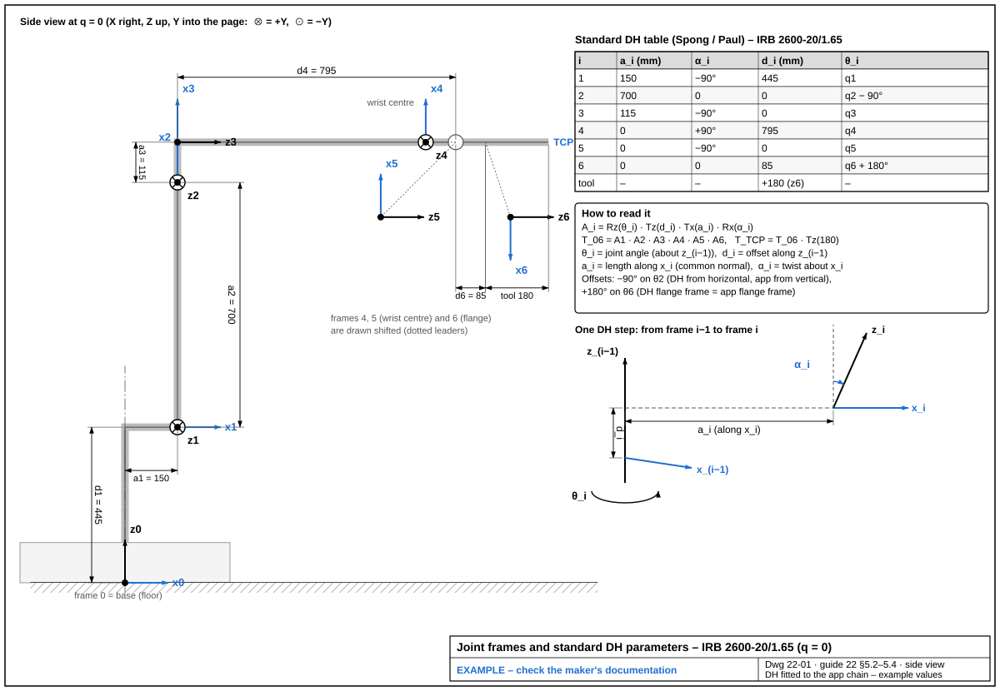
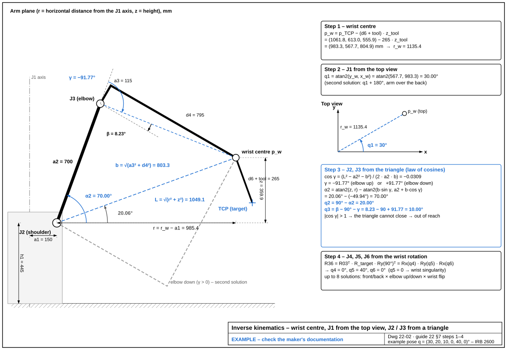
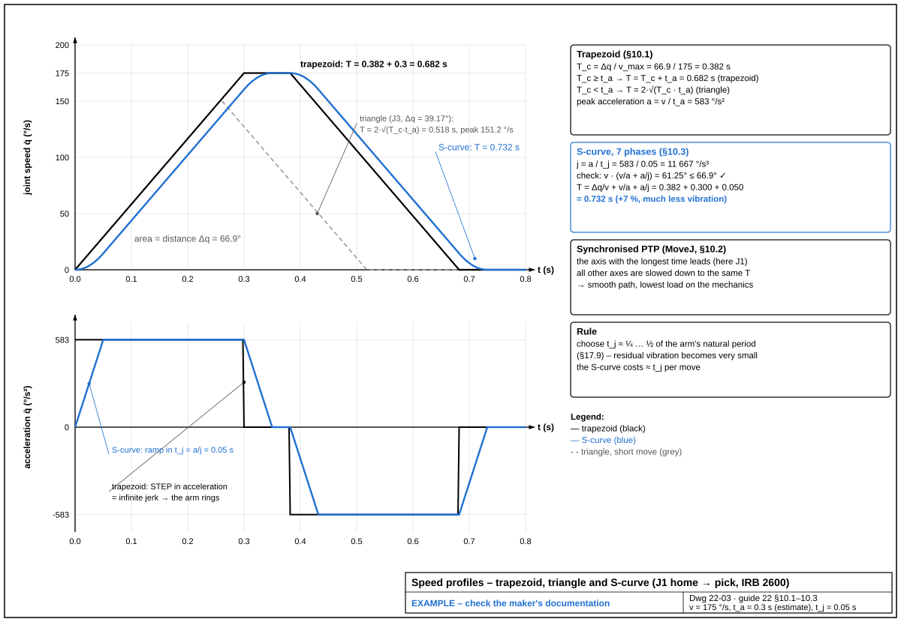
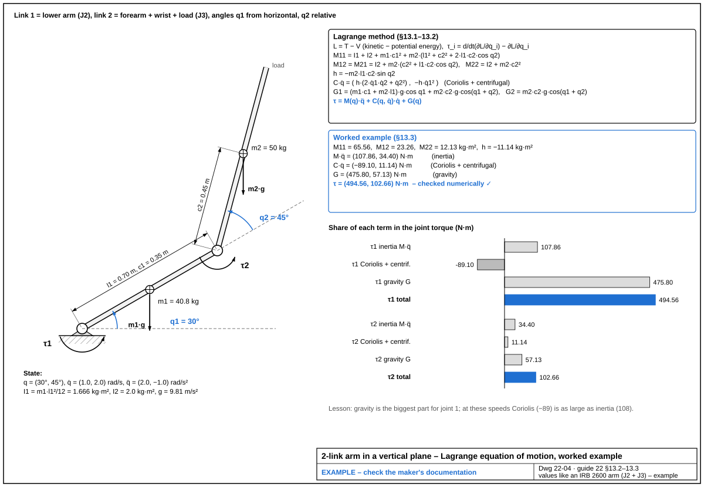
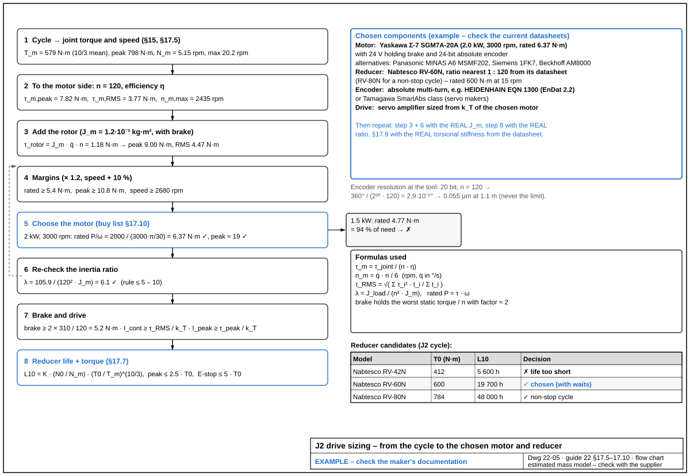

# 22 – Industrial robot: mathematics and dynamics, step by step

**For whom:** mechanical engineers who want to understand *how* a 6-axis robot calculates its motion and *why* a joint needs a given torque.
This guide is a textbook (theory), a technical reference (formulas, tables, values) and a design guide (how to size and check).
**Where to see it live:** tab **Industrial robot**, card **"Mathematics + dynamics – live"** (file `web/robotdynui.js`). The formulas are in
`web/robotkin.js` (geometry and motion) and `web/robotdyn.js` (forces and torques).
**All numbers are examples.** The worked examples use the robot **IRB 2600-20/1.65**, a gripper with TCP 180 mm and a load of 13 kg
(3 kg gripper + 10 kg part). The link masses are **estimates**, because the catalogue only gives the total mass (272 kg).
Every computed number in this guide was recalculated with a small Python copy of the app code (stdlib only).

How the numbers were checked (by the code itself, not by hand):

| Check | Result |
|---|---|
| Forward → inverse → forward kinematics, 1,600 random poses, 4 robots | position error < 1·10⁻¹⁰ mm |
| Jacobian against a numerical derivative of the forward kinematics | error < 2·10⁻⁶ (Python copy: 3·10⁻¹⁰) |
| Dynamics: joint power Σ τ·q̇ against the change of energy dE/dt (kinetic + potential) | difference < 0.05 % (Python copy, home → pick: < 0.001 %) |
| Gravity torque from the code against the hand sum of m·g·lever (§15.3) | the same: 603.1 and 301.1 N·m |
| Standard and modified DH tables (§5) against the app chain, 200 random poses | difference < 1·10⁻¹⁵ |
| Lagrange 2-link example (§13) against a numerical derivative of the Lagrangian | difference < 1·10⁻⁴ N·m |

---

## Contents

**Part A – Foundations**
1. The big picture – six questions, six tools
2. Vectors and matrices – the tools of the trade
3. Describing orientation – rotation matrix, Euler angles, axis–angle, quaternion
4. Homogeneous transforms and frames in the cell

**Part B – Kinematics**
5. Denavit–Hartenberg (DH) parameters – standard and modified
6. Forward kinematics (FK): joint angles → tool pose
7. Inverse kinematics (IK): tool pose → joint angles
8. Speeds – the Jacobian, singularities and manipulability
9. Statics – forces at the tool → joint torques: τ = Jᵀ·F

**Part C – Motion planning**
10. Trajectory planning – trapezoid, S-curve, polynomials, PTP, LIN, CIRC, blending

**Part D – Dynamics**
11. Rigid-body basics – mass, centre of mass, inertia tensor
12. Dynamics – the equation of motion
13. Lagrange method – worked 2-link example with M(q), C(q,q̇), G(q)
14. Newton–Euler method – recursive algorithm and the app's version
15. Dynamics – worked examples (IRB 2600, 13 kg load, estimated masses)
16. Payload, load diagram and payload identification

**Part E – Drive train**
17. Gear, motor and drive train – ratio, reflected inertia, RMS torque, motor sizing, reducer life, friction, elasticity,
    **buy list – catalogue examples** (servo motors, reducers, encoders, brakes)

**Part F – Accuracy and numerics**
18. Stiffness, accuracy and calibration mathematics – **buy list** of measurement tools (laser tracker, interferometer, ballbar)
19. Numerical methods used in robotics – **buy list** of kinematics/dynamics software

**Part G – Reference**
20. Where to see each formula on the page
21. Formula sheet
22. What to ask the robot supplier
23. Glossary
24. Exercises with answers

---

# Part A – Foundations

## 1. The big picture – six questions, six tools

| Question | Tool | Formula | Section |
|---|---|---|---|
| Where is the tool when I know the joint angles? | Forward kinematics (FK) | T = T₁·T₂·…·T₆ | 6 |
| Which joint angles put the tool at a given place? | Inverse kinematics (IK) | geometry + trigonometry | 7 |
| How fast does the tool move when the joints move? | Jacobian | v = J·q̇ | 8 |
| Which joint torques hold a force at the tool? | Statics | τ = Jᵀ·F | 9 |
| How do the joints move from A to B in the shortest time? | Motion planning | trapezoid speed profile | 10 |
| Which torques do the motors need while moving? | Dynamics | τ = M(q)·q̈ + C(q,q̇)·q̇ + g(q) | 11–17 |

The six tools depend on each other like this:

```
 joint angles q ──FK──► tool pose T          tool pose T ──IK──► joint angles q
 joint speeds q̇ ──J──► tool speed (v, ω)      tool force F ──Jᵀ──► joint torques τ (static)
 q(t), q̇(t), q̈(t) ──dynamics──► joint torque τ(t) ──gear──► motor torque, speed, power ──► motor/gear sizing
```

Symbols used everywhere:

| Symbol | Meaning | Unit |
|---|---|---|
| q₁ … q₆ | joint angles (J1 … J6) | ° (rad inside the formulas) |
| q̇, q̈ | joint speed, joint acceleration | °/s, °/s² (rad/s, rad/s² in formulas) |
| p = (x, y, z) | position of the TCP (tool centre point) | mm |
| R | orientation of the tool, a 3×3 rotation matrix | – |
| T | 4×4 homogeneous transform (R and p together) | – |
| v, ω | linear speed of the TCP, angular speed of the tool | mm/s or m/s, rad/s |
| J | Jacobian matrix (6×6) | m/rad (rows 1–3), – (rows 4–6) |
| F, M | force and moment at the tool | N, N·m |
| τ | joint torque | N·m |
| m, I | mass, mass moment of inertia | kg, kg·m² |
| n, η | gear ratio, gear efficiency | –, – |
| g | gravity 9.81 | m/s² |

Unit rules (the most common source of errors):
- **1 rad = 57.2958°**, 1° = 0.017453 rad. All trigonometry and all dynamics are done in rad.
- **1 rpm = 6 °/s = 0.10472 rad/s.**
- The app uses **mm** in the kinematics and **m** in the dynamics (`robotdyn.js` divides by 1000).
- Power P [W] = τ [N·m] · ω [rad/s]. Example: 429 N·m × 1.527 rad/s = 655 W.

---

## 2. Vectors and matrices – the tools of the trade

### 2.1 Vectors
A vector has a size and a direction. In the robot base frame it has three numbers: a = (aₓ, a_y, a_z).

| Operation | Formula | Meaning | Example (numbers) |
|---|---|---|---|
| Length (norm) | \|a\| = √(aₓ² + a_y² + a_z²) | size | \|(983.3, 567.7, 0)\| = 1135.4 mm (wrist centre distance from the J1 axis) |
| Unit vector | â = a / \|a\| | direction only | (983.3, 567.7, 0)/1135.4 = (0.866, 0.500, 0) = direction 30° |
| Dot product | a·b = aₓbₓ + a_yb_y + a_zb_z = \|a\|\|b\| cos θ | projection, angle between | z_tool · (0,0,−1) = 0.9397 → tool is 20° from vertical |
| Cross product | a × b = (a_yb_z − a_zb_y, a_zbₓ − aₓb_z, aₓb_y − a_ybₓ) | perpendicular vector, size \|a\|\|b\| sin θ | see below |

Two cross products appear again and again:

```
speed of a point on a turning body:   v = ω × r        (r = lever from the axis to the point)
moment of a force:                    M = r × F
```

**Example – TCP speed when only J1 turns.** ω = (0, 0, 0.349) rad/s (20 °/s about Z), r = (1.0618, 0.6130, 0) m (TCP, horizontal part):
```
v = ω × r = (0·0 − 0.349·0.6130,  0.349·1.0618 − 0·0,  0) = (−0.214, 0.371, 0) m/s   → |v| = 0.428 m/s = 428 mm/s
```
The app's Jacobian gives the same (−214, 371, 0) mm/s (§8.2).

### 2.2 The skew matrix
The cross product can be written as a matrix product: a × b = [a]ₓ·b with
```
        |  0   −a_z   a_y |
[a]ₓ =  |  a_z   0   −aₓ |       ([a]ₓ is "skew-symmetric": [a]ₓᵀ = −[a]ₓ)
        | −a_y  aₓ    0   |
```
This is used in the speed of a rotation matrix: Ṙ = [ω]ₓ·R. The app uses exactly this to get ω from two rotations 1 ms apart
(`angVel` in `robotdyn.js`): R(t+h)·R(t)ᵀ ≈ I + [ω]ₓ·h, so ω is read from the off-diagonal elements.

### 2.3 Matrices – what you need
| Item | Rule |
|---|---|
| Product C = A·B | C_ij = Σ_k A_ik·B_kj. Order matters: A·B ≠ B·A in general |
| Transpose Aᵀ | rows become columns; (A·B)ᵀ = Bᵀ·Aᵀ |
| Inverse A⁻¹ | A·A⁻¹ = I. Exists only if det A ≠ 0 |
| Determinant det A | a number. 0 = the matrix "loses a direction" (singular). For a rotation: det R = +1 |
| Solve A·x = b | Gaussian elimination (the app's `det` uses the same method with pivoting) |
| Pseudo-inverse | A⁺ = Aᵀ(A·Aᵀ)⁻¹ – the "best" inverse for non-square or nearly singular matrices (§7.7) |

### 2.4 Small angles
For small angles (in rad): sin θ ≈ θ, cos θ ≈ 1 − θ²/2, tan θ ≈ θ. A rotation by small angles (δx, δy, δz) is R ≈ I + [δ]ₓ.
Example: 0.41 mrad of gear twist at 1.1 m gives 0.41·10⁻³ × 1100 = 0.45 mm at the tool (§18.1).

---

## 3. Describing orientation

The **position** of the tool needs 3 numbers (x, y, z). The **orientation** also needs 3 numbers, but there are several ways to write them.
Each way has its use:

| Representation | Numbers | Good for | Problem |
|---|---|---|---|
| Rotation matrix R | 9 (3 free) | calculation, chaining | 9 numbers for 3 values; hard to read |
| Euler angles (A, B, C) | 3 | display on the teach pendant | gimbal lock; many conventions |
| Axis–angle (k, θ) | 4 (3 free) | "how much and about what" | axis undefined at θ = 0 |
| Quaternion (w, x, y, z) | 4 (3 free) | smooth interpolation (slerp), robot programs (ABB) | not intuitive |

### 3.1 Rotation matrix
A rotation matrix R holds the three axis directions (x, y, z) of a frame as its **columns**. Example: a rotation of 30° about Z:

```
           | cos30  −sin30  0 |   | 0.866  −0.500  0 |
Rz(30°) =  | sin30   cos30  0 | = | 0.500   0.866  0 |
           |   0       0    1 |   |   0       0    1 |
```
The three basic rotations (exactly as in `robotkin.js`):
```
        | 1   0    0  |          |  c   0   s |          | c  −s   0 |
Rx(θ) = | 0   c   −s  |  Ry(θ) = |  0   1   0 |  Rz(θ) = | s   c   0 |      c = cos θ, s = sin θ
        | 0   s    c  |          | −s   0   c |          | 0   0   1 |
```
Rx = roll, Ry = tilt, Rz = turn.

**Properties** – check them with any R:

| Property | Formula | Why it is useful |
|---|---|---|
| Columns are unit vectors and perpendicular | RᵀR = I | quick check of a matrix |
| Inverse = transpose | R⁻¹ = Rᵀ | no matrix inversion needed |
| Determinant | det R = +1 | −1 would be a mirror, not a rotation |
| Chaining | R_ac = R_ab·R_bc | walk along the robot |
| Rotates vectors | v_a = R_ab·v_b | change of frame |
| Eigenvalue 1 | R·k = k | k = rotation axis (§3.3) |
| Trace | r₁₁ + r₂₂ + r₃₃ = 1 + 2 cos θ | rotation angle |

**Composition – moving axes vs fixed axes.**
- **R = R₁·R₂ read left to right:** first R₁, then R₂ about the **new (moving)** axes. This is how the robot chain is read.
- **R = R₁·R₂ read right to left:** first R₂, then R₁ about the **fixed (base)** axes. Same matrix, other way to think.

**Example – order matters.** Rz(30°)·Ry(20°) and Ry(20°)·Rz(30°):
```
              | 0.8138  −0.5000  0.2962 |                 | 0.8138  −0.4698  0.3420 |
Rz30·Ry20 =   | 0.4698   0.8660  0.1710 |    Ry20·Rz30 =  | 0.5000   0.8660  0.0000 |
              |−0.3420   0.0000  0.9397 |                 |−0.2962   0.1710  0.9397 |
```
The tool x axis (first column) points to (0.814, 0.470, −0.342) in the first case and to (0.814, 0.500, −0.296) in the second.
A bigger example: Rz(90°)·Rx(90°) has columns x→(0,1,0), y→(0,0,1), z→(1,0,0); Rx(90°)·Rz(90°) has x→(0,0,1), y→(−1,0,0), z→(0,−1,0).
Totally different. **Never swap the order of rotations.**

### 3.2 Euler angles – the A B C on the teach pendant
Three angles about three axes, one after the other. There are 12 possible orders. The common ones:

| Convention | Formula | Used by (typical – check your controller) |
|---|---|---|
| Z-Y-X (moving) = X-Y-Z (fixed) "yaw–pitch–roll" | R = Rz(A)·Ry(B)·Rx(C) | KUKA (A, B, C); this app; ABB pendant Euler display |
| X-Y-Z fixed "roll–pitch–yaw" (W, P, R) | R = Rz(R)·Ry(P)·Rx(W) | FANUC (W, P, R) – same matrix form as above |
| Z-Y-Z | R = Rz(φ)·Ry(θ)·Rz(ψ) | some controllers, many textbooks |
| quaternion | (q1, q2, q3, q4) | ABB RAPID robtarget orientation |
| rotation vector | (Rx, Ry, Rz) = θ·k | Universal Robots |

⚠ Every robot maker uses its own angle convention. Always check which one the controller uses before you transfer points from CAD or offline programming.

**This app (`rotFromABC`, `abcFromRot`):** R = Rz(A)·Ry(B)·Rx(C). Read: turn A about Z, then tilt B about the new Y, then roll C about the newest X.
The reverse calculation:
```
B = asin(−r₃₁)          A = atan2(r₂₁, r₁₁)          C = atan2(r₃₂, r₃₃)          (if cos B ≠ 0)
```
**Example – the tool orientation at the example pose q = (30°, 20°, 10°, 0°, 40°, 0°):**
```
     | −0.8138  −0.5000   0.2962 |
R =  | −0.4698   0.8660   0.1710 |      B = asin(0.3420) = 20.0°
     | −0.3420   0.0000  −0.9397 |      A = atan2(−0.4698, −0.8138) = −150.0°     C = atan2(0, −0.9397) = 180.0°
```
**Two solutions.** (A + 180°, 180° − B, C + 180°) gives the same matrix. Here (−150°, 20°, 180°) = (30°, 160°, 0°): both were checked to give the same R.
In the same way, the "tool down" orientation of the cell is written as rotFromABC(0, 180, 0), but `abcFromRot` gives it back as (180°, 0°, 180°).
Both are correct. A pendant always shows one of the two. Do not be surprised.

Typical orientations in the cell (from `ORIENT` in `robotkin.js`):

| Name | A B C | Tool Z points | Used for |
|---|---|---|---|
| down | (0, 180°, 0) = (180°, 0, 180°) | −Z (to the floor) | pick from / place on the conveyors |
| front | (0, 90°, 0) | +X (forward) | load the machine fixture from the front |

### 3.3 Gimbal lock
At **B = ±90°** the first and the last rotation axes (Z and the newest X) lie on one line. Then only A − C (or A + C) is defined.
Example: (A, B, C) = (30°, 90°, 10°) and (40°, 90°, 20°) give **exactly the same** matrix (A − C = 20° in both). The app then returns
(20°, 90°, 0°) – it sets C = 0 (see `abcFromRot`, the branch `|cos B| < 10⁻⁶`).
Consequences:
- Near B = ±90° the displayed A and C jump wildly while the tool hardly moves. This is a problem of the *display*, not of the robot.
- Never interpolate Euler angles for a motion. Use quaternions or axis–angle (§3.5, §10.8). The app's LIN uses axis–angle (`slerpR`).

Do not confuse gimbal lock (a property of the 3 numbers) with a **wrist singularity** (q5 = 0, a property of the mechanism, §8.5).
They look similar because the robot wrist itself is an X-Y-X Euler mechanism.

### 3.4 Axis–angle and the Rodrigues formula
Every rotation is one turn by an angle θ about one axis k (unit vector) – Euler's theorem.
```
R = I + sin θ·[k]ₓ + (1 − cos θ)·[k]ₓ²                     (Rodrigues formula)
θ = acos((r₁₁ + r₂₂ + r₃₃ − 1)/2)
k = (r₃₂ − r₂₃, r₁₃ − r₃₁, r₂₁ − r₁₂) / (2 sin θ)
```
**Example – the tool orientation R above:** trace = −0.8138 + 0.8660 − 0.9397 = −0.8875
θ = acos((−0.8875 − 1)/2) = **160.69°**, k = (−0.2585, 0.9649, 0.0456). So the tool is turned 160.7° about an axis that points mostly along +Y.
The app's LIN interpolation (`slerpR`) works exactly like this: it finds the axis–angle of R₀ᵀ·R₁ and turns by s·θ for s = 0 … 1.
At θ = 180° the formula for k divides by sin θ = 0, so the code takes the axis from the diagonal of the matrix (special branch in `slerpR`).

### 3.5 Quaternions and slerp
A unit quaternion has 4 numbers: q = (w, x, y, z) = (cos(θ/2), k·sin(θ/2)), with w² + x² + y² + z² = 1.
- q and −q are the **same** rotation ("double cover").
- From R: w = ½√(1 + r₁₁ + r₂₂ + r₃₃), x = (r₃₂ − r₂₃)/(4w), y = (r₁₃ − r₃₁)/(4w), z = (r₂₁ − r₁₂)/(4w) (if w is not small).
- Back to R: r₁₁ = 1 − 2(y² + z²), r₁₂ = 2(xy − wz), r₁₃ = 2(xz + wy), r₂₁ = 2(xy + wz), r₂₂ = 1 − 2(x² + z²), r₂₃ = 2(yz − wx),
  r₃₁ = 2(xz − wy), r₃₂ = 2(yz + wx), r₃₃ = 1 − 2(x² + y²).
- Chaining: q_ac = q_ab ⊗ q_bc with (w₁,v₁)⊗(w₂,v₂) = (w₁w₂ − v₁·v₂, w₁v₂ + w₂v₁ + v₁ × v₂).

**Example – R of the example pose:** w = ½√(1 − 0.8875) = 0.1677, x = −0.2549, y = 0.9513, z = 0.0449.
Check: 2·acos(0.1677) = 160.69° – the same angle as the axis–angle in §3.4. ✓

**Slerp (spherical linear interpolation)** turns at constant angular speed from q₀ to q₁:
```
cos Ω = q₀·q₁ (4-element dot product; if < 0, use −q₁ to take the short way)
q(s) = [sin((1−s)Ω)·q₀ + sin(sΩ)·q₁] / sin Ω         s = 0 … 1
```
**Example – from "tool down" to "tool front"** (the reorientation between the conveyor and the machine):

| s | quaternion (w, x, y, z) | A B C of the result | Meaning |
|---|---|---|---|
| 0 | (0, 0, 1, 0) | (180, 0, 180) = (0, 180, 0) | tool down |
| 0.25 | (0.1951, 0, 0.9808, 0) | (180, 22.5, 180) = (0, 157.5, 0) | 22.5° turned |
| 0.50 | (0.3827, 0, 0.9239, 0) | (180, 45, 180) = (0, 135, 0) | half way |
| 0.75 | (0.5556, 0, 0.8315, 0) | (180, 67.5, 180) = (0, 112.5, 0) | 67.5° turned |
| 1 | (0.7071, 0, 0.7071, 0) | (0, 90, 0) | tool front |

q₀·q₁ = 0.7071 → Ω = 45° (half of the 90° rotation). The angle grows evenly: 22.5° per quarter. Interpolating Euler angles would not do this
in general. Note: from "down" to "down turned 90° about vertical" the dot product is −0.7071, so slerp uses −q₁ (short way).

---

## 4. Homogeneous transforms and frames in the cell

### 4.1 The 4×4 matrix
Position and rotation are put together in one 4×4 matrix:
```
T = | R   p |      R = 3×3 rotation, p = 3×1 position
    | 0   1 |
```
One multiplication T₁·T₂ does "rotate + move" in one step. This is how the links are chained (§6).
A point with coordinates P_b in frame b has coordinates P_a = T_ab·[P_b; 1] in frame a.

The basic transforms of the app (`Tr`, `Rx`, `Ry`, `Rz` in `robotkin.js`): Tx(a) = Tr(a,0,0), Tz(d) = Tr(0,0,d), and Rx/Ry/Rz with p = 0.

### 4.2 Inverse of a transform
```
T⁻¹ = | Rᵀ   −Rᵀ·p |        (no general 4×4 inversion needed)
      | 0      1   |
```
**Example – flange frame at the example pose:** p_flange = (1008.5, 582.2, 725.0) mm. −Rᵀ·p = (1342.2, 0.0, 283.0) mm.
This is the position of the robot base origin seen from the flange. Its y value is 0 because, with q4 = q6 = 0, the base origin lies in the
flange x–z plane.

**Example – a point on the gripper.** A point 50 mm along the tool x axis from the TCP: P = T_tcp·(50, 0, 0, 1) = (1021.1, 589.5, 538.8) mm.
Check: TCP + 50·(first column of R) = (1061.8 − 40.7, 613.0 − 23.5, 555.9 − 17.1) = (1021.1, 589.5, 538.8). ✓

### 4.3 Frames in a robot cell
| Frame | From → to | Who sets it | Example |
|---|---|---|---|
| World | the cell reference | layout drawing | floor corner of the cell |
| Base | world → robot base | installation, base calibration | robot at (2000, 1500, 0), turned 90° |
| Flange (tool0) | base → flange | the robot (FK) | §6 |
| Tool (TCP) | flange → tool tip | you (tool data) | (0, 0, 180) mm, 3 kg (gripper) |
| Work object / user frame | world → fixture | you (3-point calibration) | machine fixture, conveyor |
| Object frame | work object → part | you | part datum on the pallet |

The full chain for one point: **T_world,tcp = T_world,base · T_base,flange(q) · T_flange,tool** and the target is
**T_world,target = T_world,wobj · T_wobj,point**. The IK solves T_world,tcp = T_world,target for q.
Benefit: if the machine is moved 10 mm, you re-teach only the work object (3 points) and all program points move with it.

**Work-object 3-point method:** touch the origin O, a point X₁ on the x axis and a point Y₁ in the x–y plane:
```
x̂ = (X₁ − O)/|X₁ − O|      ẑ = x̂ × (Y₁ − O) / |x̂ × (Y₁ − O)|      ŷ = ẑ × x̂      R_wobj = [x̂ ŷ ẑ], p_wobj = O
```

---

# Part B – Kinematics

## 5. Denavit–Hartenberg (DH) parameters

### 5.1 Why DH
A 6-axis arm has 6 links. Each link transform needs in general 6 numbers. **Denavit and Hartenberg (1955)** showed that, with clever frame
placement, 4 numbers per link are enough: **a, α, d, θ**. One of them (θ for a rotary joint) is the joint variable; the other 3 are fixed
geometry. Almost every robot textbook, data sheet and simulation tool uses DH, so you must be able to read a DH table.

### 5.2 Standard DH (Spong / Paul convention)
Frame i is fixed to link i; its z_i axis lies on the axis of **joint i+1**.

| Parameter | Measured | Meaning |
|---|---|---|
| a_i (link length) | along x_i, from z_{i−1} to z_i | distance between two joint axes |
| α_i (link twist) | about x_i, from z_{i−1} to z_i | angle between two joint axes |
| d_i (link offset) | along z_{i−1}, from x_{i−1} to x_i | offset along the joint axis |
| θ_i (joint angle) | about z_{i−1}, from x_{i−1} to x_i | **joint variable** (rotary joint) |

```
A_i = Rz(θ_i) · Tz(d_i) · Tx(a_i) · Rx(α_i)

      | cθ   −sθ·cα    sθ·sα   a·cθ |
A_i = | sθ    cθ·cα   −cθ·sα   a·sθ |          T_06 = A₁·A₂·A₃·A₄·A₅·A₆
      | 0      sα        cα      d   |
      | 0      0         0       1   |
```

### 5.3 Modified DH (Craig convention)
Frame i lies on the axis of **joint i** itself. The parameters carry index i−1 for the "link before":
```
A_i = Rx(α_{i−1}) · Tx(a_{i−1}) · Rz(θ_i) · Tz(d_i)

      | cθ       −sθ        0       a_{i−1}     |
A_i = | sθ·cα    cθ·cα    −sα    −sα·d_i       |
      | sθ·sα    cθ·sα     cα     cα·d_i       |
      | 0         0         0       1           |
```
Modified DH is preferred for dynamics (the link frame sits at the joint where the torque acts). **Always check which convention a table uses** –
the numbers look similar but they are not interchangeable.

### 5.4 DH table of the IRB 2600-20/1.65 (example values, app conventions)
The tables below were found by fitting to the app chain and checked on 200 random poses (difference < 10⁻¹⁵). Joint angles q_i are the
**same** as on the app's pendant; only fixed offsets are added.

**Standard DH:**

| i | a_i (mm) | α_i | d_i (mm) | θ_i |
|---|---|---|---|---|
| 1 | 150 | −90° | 445 | q1 |
| 2 | 700 | 0 | 0 | q2 − 90° |
| 3 | 115 | −90° | 0 | q3 |
| 4 | 0 | +90° | 795 | q4 |
| 5 | 0 | −90° | 0 | q5 |
| 6 | 0 | 0 | 85 | q6 + 180° |
| tool | – | – | +180 (along z₆) | – |

**Modified DH:**

| i | α_{i−1} | a_{i−1} (mm) | d_i (mm) | θ_i |
|---|---|---|---|---|
| 1 | 0 | 0 | 445 | q1 |
| 2 | −90° | 150 | 0 | q2 − 90° |
| 3 | 0 | 700 | 0 | q3 |
| 4 | −90° | 115 | 795 | q4 |
| 5 | +90° | 0 | 0 | q5 |
| 6 | −90° | 0 | 0 | q6 + 180° |
| flange | – | – | 85, then tool 180 | – |

How to read the geometry from the table: a₁ = 150 (J2 axis is 150 mm in front of J1), d₁ = 445 (J2 axis 445 mm above the floor),
a₂ = 700 (lower arm), a₃ = 115 (forearm axis offset), d₄ = 795 (J3 to wrist centre), d₆ = 85 (wrist centre to flange).
These are exactly h1, a1, a2, a3, d4, d6 of the app (`ROBOTS[...].dims`).


*Figure 22-1 – Joint frames x_i, z_i of the IRB 2600 at q = 0 with the standard DH table (example – check the maker's documentation).*

The offset **−90° on θ₂** exists because DH measures the lower-arm angle from the horizontal x₁ axis, but the catalogue (and the app) measure
J2 from the vertical. The **+180° on θ₆** makes the DH flange frame equal to the app flange frame (tool Z out of the flange).

**Numeric A matrices at the example pose q = (30°, 20°, 10°, 0°, 40°, 0°)** (standard DH, mm):
```
A1 (θ=30°):            A2 (θ=−70°):            A3 (θ=10°):
| 0.866  0  −0.500  129.9 |   | 0.342  0.940  0  239.4 |   | 0.985  0  −0.174  113.3 |
| 0.500  0   0.866   75.0 |   |−0.940  0.342  0 −657.8 |   | 0.174  0   0.985   20.0 |
| 0     −1   0      445.0 |   | 0      0      1    0   |   | 0     −1   0        0   |
A4 (θ=0): Rx(90°) with d = 795    A5 (θ=40°): Rz(40°)·Rx(−90°)    A6 (θ=180°): Rz(180°) with d = 85

T_06·T_tool = | −0.8138  −0.5000   0.2962  1061.8 |
              | −0.4698   0.8660   0.1710   613.0 |
              | −0.3420   0.0000  −0.9397   555.9 |
              |  0        0        0          1   |
```
The same TCP (1061.8, 613.0, 555.9) mm as the app chain (§6.2). ✓

### 5.5 DH and the app chain – why the app does not use DH
The app chain is a "product of elementary transforms": every step is one simple Rx, Ry, Rz or translation, and the zero pose is the
**catalogue zero pose** (lower arm vertical, forearm horizontal). This is easier to read and to compare with the data sheet, and the joint
signs match the pendant. DH gives the same result with fewer parameters, and is the standard input for simulation tools, calibration
software and textbooks. Both are only different ways to write the same mechanism.

A third way, used in modern software and in calibration, is the **product of exponentials** (POE): T(q) = e^[S₁]q₁ · … · e^[S₆]q₆ · M, where
S_i is the screw axis of joint i in the zero pose and M the flange pose at zero. It needs no special frame rules and has no problem
with parallel axes (DH has: two parallel axes make d undefined – important in calibration, §18.3).

---

## 6. Forward kinematics (FK): joint angles → tool pose

### 6.1 The chain of this robot type
Coordinates: X forward, Y left, Z up, origin on the floor at the centre of the base. Zero pose: lower arm vertical, forearm horizontal.
Joint signs (ABB style): J1 + = turn left (seen from above); J2 + = lower arm tilts forward; J3 + = forearm tilts down; J5 + = tool down.

```
T = Rz(q1)·Tz(h1)·Tx(a1)·Ry(q2)·Tz(a2)·Ry(q3)·Tz(a3)·Tx(d4)·Rx(q4)·Ry(q5)·Rx(q6)·Tx(d6)·Ry(90°)·T_tool
```
Read it from left to right, like walking along the robot:

| Step | What it means | IRB 2600 value |
|---|---|---|
| Rz(q1) | the column turns (J1) | – |
| Tz(h1), Tx(a1) | up to the J2 axis and forward by the offset | h1 = 445 mm, a1 = 150 mm |
| Ry(q2), Tz(a2) | the lower arm tilts (J2) and goes up its length | a2 = 700 mm |
| Ry(q3), Tz(a3) | the elbow tilts (J3); the forearm axis is a3 above J3 | a3 = 115 mm |
| Tx(d4) | along the forearm to the **wrist centre** | d4 = 795 mm |
| Rx(q4)·Ry(q5)·Rx(q6) | the wrist: roll, bend, roll (J4, J5, J6) | – |
| Tx(d6), Ry(90°) | to the flange; tool Z points out of the flange | d6 = 85 mm |
| T_tool | flange to TCP | tool Z = 180 mm |

All three wrist axes cross in **one point**, the wrist centre. This "spherical wrist" is why the inverse kinematics can be solved with
simple geometry (§7).

The code (`fk` in `robotkin.js`) also stores 6 intermediate frames F[0] … F[5] (column, lower arm, upper arm, forearm, wrist, flange).
The 3D model draws the links with them, and the dynamics takes the joint axes and the link centres of mass from them.

Dimensions of all four robots in the app (catalogue-based examples, mm):

| Robot | h1 | a1 | a2 | a3 | d4 | d6 | b = √(a3²+d4²) | β = atan(a3/d4) |
|---|---|---|---|---|---|---|---|---|
| IRB 120-3/0.6 | 290 | 0 | 270 | 70 | 302 | 72 | 310.0 | 13.05° |
| IRB 2600-20/1.65 | 445 | 150 | 700 | 115 | 795 | 85 | 803.3 | 8.23° |
| IRB 4600-60/2.05 | 495 | 175 | 900 | 175 | 960 | 135 | 975.8 | 10.33° |
| IRB 6700-200/2.60 | 780 | 320 | 1125 | 200 | 1142.5 | 200 | 1159.9 | 9.93° |

### 6.2 Worked example – the wrist centre by hand
Pose q = (30°, 20°, 10°, 0°, 40°, 0°). In the vertical arm plane (r = distance from the J1 axis, z = height):

```
elbow:        r_e = a1 + a2·sin q2                    = 150 + 700·sin20°            = 389.4 mm
              z_e = h1 + a2·cos q2                    = 445 + 700·cos20°            = 1102.8 mm
wrist centre: r_w = r_e + d4·cos(q2+q3) + a3·sin(q2+q3) = 389.4 + 795·cos30° + 115·sin30° = 1135.4 mm
              z_w = z_e − d4·sin(q2+q3) + a3·cos(q2+q3) = 1102.8 − 795·sin30° + 115·cos30° = 804.9 mm
turn by J1:   x = r_w·cos q1 = 983.3 mm     y = r_w·sin q1 = 567.7 mm     z = 804.9 mm
```
The code gives the same wrist centre: (983.3, 567.7, 804.9) mm. With the wrist bent 40° and the tool 180 mm long:
**TCP = (1061.8, 613.0, 555.9) mm, A B C = (−150°, 20°, 180°)** (= (30°, 160°, 0°), §3.2).

The same in compact form (used by `envelope()` for the side view of the work envelope):
```
r_w = a1 + a2·sin q2 + b·cos(q2 + q3 − β)        z_w = h1 + a2·cos q2 − b·sin(q2 + q3 − β)
check: 150 + 239.4 + 803.3·cos21.77° = 1135.4 mm      445 + 657.8 − 803.3·sin21.77° = 804.9 mm  ✓
```

**The tool orientation by hand.** With q4 = q6 = 0 the whole arm is a turn about Z (q1) and a tilt about Y (q2 + q3 + q5 = 70°):
R = Rz(30°)·Ry(70°)·Ry(90°) = Rz(30°)·Ry(160°). The tool Z axis (third column) = (cos30·sin160, sin30·sin160, cos160) = (0.296, 0.171, −0.940).
It points 20° away from straight down, forward and outward. TCP = flange + 180·z_tool = (1008.5, 582.2, 725.0) + 180·(0.296, 0.171, −0.940)
= (1061.8, 613.0, 555.9) mm. ✓

### 6.3 The home pose – a second check
Home of the cell: q = (0, 0, 0, 0, 30°, 0). Wrist centre r = a1 + d4 = 945 mm, z = h1 + a2 + a3 = 1260 mm. The tool points 30° down:
TCP r = 945 + 265·cos30° = 1174.5 mm, z = 1260 − 265·sin30° = 1127.5 mm (265 = d6 + tool). The code gives (1174.5, 0, 1127.5) mm,
A B C = (180°, 60°, 180°) = (0°, 120°, 0°). ✓

### 6.4 Check of the catalogue reach
The maximum reach of the wrist centre (arm stretched) is a1 + a2 + √(a3² + d4²) = 150 + 700 + 803.3 = **1653 mm**.
The catalogue gives 1.65 m, so it agrees. The same check for all 4 robots:

| Robot | a1 + a2 + b | Catalogue reach |
|---|---|---|
| IRB 120 | 0 + 270 + 310.0 = 580 mm | 580 mm |
| IRB 2600 | 150 + 700 + 803.3 = 1653 mm | 1650 mm |
| IRB 4600 | 175 + 900 + 975.8 = 2051 mm | 2050 mm |
| IRB 6700 | 320 + 1125 + 1159.9 = 2605 mm | 2600 mm |

Catalogue reach is measured to the **wrist centre**, not to the TCP. With a 265 mm tool the TCP can reach further, but only with the tool
pointing outward. For design: keep the important wrist-centre positions inside about 85–90 % of the reach (stiffer, faster, no elbow
singularity). The cell layout of the app puts the machine fixture so that the wrist centre is at ≈ 58 % of the reach (`cellLayout`).

---

## 7. Inverse kinematics (IK): tool pose → joint angles

The program gives positions (pick point, machine point), but the motors need angles. IK solves this backwards in 4 steps.
For a robot with a spherical wrist the problem splits into two small problems (**Pieper's method**):
- the **position** of the wrist centre depends only on J1, J2, J3;
- the **orientation** of the tool is then made by J4, J5, J6.

### Step 1 – find the wrist centre
The wrist centre lies (d6 + tool length) behind the TCP, along the tool Z axis z_t (third column of R):
```
p_w = p_TCP − (d6 + L_tool)·z_t
```
Example: p_w = (1061.8, 613.0, 555.9) − 265·(0.2962, 0.1710, −0.9397) = **(983.3, 567.7, 804.9) mm** – the wrist centre of §6.2. ✓
If the tool points straight down, p_w is simply 85 + 180 = 265 mm **above** the TCP.
(The code first removes the tool offset to get the flange, then goes d6 back along z – same result. A tool with an x or y offset works too.)

### Step 2 – J1 from a top view
```
q1 = atan2(y_w, x_w) = atan2(567.7, 983.3) = 30.0°
```
A second solution is q1 + 180° (the robot reaches "over its back"), if the axis range allows it.
In the arm plane the horizontal distance is then r = ρ − a1 (front) or r = −ρ − a1 (back), with ρ = √(x_w² + y_w²) = 1135.4 mm.

### Step 3 – J2 and J3 from a triangle (law of cosines)
In the arm plane the shoulder (J2), the elbow (J3) and the wrist centre form a triangle:
- the side **a2 = 700 mm** (lower arm)
- the side **b = √(a3² + d4²) = √(115² + 795²) = 803.3 mm** (forearm, with its small offset angle β = atan(a3/d4) = 8.23°)

```
r = r_w − a1 = 1135.4 − 150 = 985.4 mm      z = z_w − h1 = 804.9 − 445 = 359.9 mm
L = √(r² + z²) = 1049.1 mm                     (shoulder → wrist centre)
cos γ = (L² − a2² − b²) / (2·a2·b) = −0.0309  →  γ = −91.77°   (elbow up; +91.77° = elbow down)
α2 = atan2(z, r) − atan2(b·sin γ, a2 + b·cos γ) = 20.06° − (−49.94°) = 70.00°     (lower arm angle from horizontal)
q2 = 90° − α2 = 20.00°
q3 = β − 90° − γ = 8.23 − 90 + 91.77 = 10.00°
```
We get exactly the angles we started with: the IK is the true inverse of the FK.
If |cos γ| > 1 the triangle cannot close: the point is **out of reach** (the code reports how many mm too far).

**Where the formulas come from.** The lower arm vector is a2·(cos α2, sin α2). The forearm vector (J3 → wrist centre) is b at the angle
α2 + γ, where γ = β − 90° − q3 is the angle between the two arm parts. So
```
r = a2·cos α2 + b·cos(α2 + γ)      z = a2·sin α2 + b·sin(α2 + γ)
r² + z² = a2² + b² + 2·a2·b·cos γ     → law of cosines for γ
(r, z) = rotation of (a2 + b·cos γ, b·sin γ) by α2   → α2 = atan2(z, r) − atan2(b·sin γ, a2 + b·cos γ)
```
The sign of γ chooses the elbow: γ < 0 = **elbow up** (the normal working posture), γ > 0 = **elbow down**.


*Figure 22-2 – IK geometry: wrist centre, J1 from the top view, J2/J3 from the law-of-cosines triangle (elbow up and down) (example – check the maker's documentation).*

### Step 4 – J4, J5, J6 from the wrist rotation
The arm (J1–J3) gives the forearm orientation R₀₃ = Rz(q1)·Ry(q2 + q3). The wrist has to produce the rest:
```
R₃₆ = R₀₃ᵀ · R_target · Ry(90°)ᵀ   and   R₃₆ = Rx(q4)·Ry(q5)·Rx(q6)
```
Multiply out the X-Y-X product:
```
                       |  c5        s5·s6                s5·c6            |
Rx(q4)·Ry(q5)·Rx(q6) = |  s4·s5     c4·c6 − s4·c5·s6    −c4·s6 − s4·c5·c6 |
                       | −c4·s5     s4·c6 + c4·c5·s6    −s4·s6 + c4·c5·c6 |
```
Compare element by element (indices 1-based):
```
q5 = ± acos(R₃₆[1,1]),  q4 = atan2(±R₃₆[2,1], ∓R₃₆[3,1]),  q6 = atan2(±R₃₆[1,2], ±R₃₆[1,3])
```
(upper signs for q5 > 0, lower signs for the "flipped" wrist q5 < 0.)
**Example:** at the example pose R₃₆ = [[0.7660, 0, 0.6428], [0, 1, 0], [−0.6428, 0, 0.7660]] = Ry(40°).
→ q5 = acos(0.7660) = 40.0°, q4 = atan2(0, 0.6428) = 0°, q6 = atan2(0, 0.6428) = 0°. ✓

**Wrist singularity in the IK:** if sin q5 ≈ 0 (code: |sin q5| < 10⁻⁵) only q4 + q6 is defined. The code keeps q4 at its present value and
puts the rest into q6. A solution with |sin q5| < sin 2° is flagged as "singular" (`sing`).

### 7.1 Up to 8 solutions – the "configuration"
| Choice | Options | Name on the pendant (typical) |
|---|---|---|
| J1 | front / back (over the head) | shoulder / front–back |
| J3 | elbow up / elbow down | elbow |
| J5 | positive / negative (J4 and J6 turn 180°) | wrist flip |

2 × 2 × 2 = **8 solutions** for one TCP pose. All 8 for the example pose (computed by the app's `ik`):

| # | J1 | Elbow | Wrist | q1 | q2 | q3 | q4 | q5 | q6 | Inside axis ranges? |
|---|---|---|---|---|---|---|---|---|---|---|
| 1 | front | up | no flip | 30.0 | 20.0 | 10.0 | 0.0 | 40.0 | 0.0 | **yes (chosen)** |
| 2 | front | up | flip | 30.0 | 20.0 | 10.0 | 180.0 | −40.0 | −180.0 | no (J4 > 175°) |
| 3 | front | down | no flip | 30.0 | 119.9 | −173.5 | 0.0 | 123.7 | 0.0 | no (J5 > 120°) |
| 4 | front | down | flip | 30.0 | 119.9 | −173.5 | 180.0 | −123.7 | −180.0 | no |
| 5 | back | up | no flip | −150.0 | −103.9 | −26.9 | −180.0 | 119.3 | 0.0 | no (J2 < −95°) |
| 6 | back | up | flip | −150.0 | −103.9 | −26.9 | 0.0 | −119.3 | 180.0 | no (J2) |
| 7 | back | down | no flip | −150.0 | −44.9 | −136.7 | −180.0 | 68.5 | 0.0 | no (J4) |
| 8 | back | down | flip | −150.0 | −44.9 | −136.7 | 0.0 | −68.5 | −180.0 | yes |

So 2 of the 8 lie inside the axis ranges (J1 ±180°, J2 −95/+155°, J3 −180/+75°, J4 ±175°, J5 ±120°, J6 ±400°).
The wrist flip is always (q4 + 180°, −q5, q6 + 180°) – check rows 1 and 2.

**How the page chooses:** among the solutions inside the ranges, the one **nearest to the present joint angles**, with the distance
Σ w_i·|q_i − q_ref,i| and weight w = 2 for J1–J3, 1 for J4–J6 (moving the big axes costs more). Joints with more than ±180° range
(J6: ±400°) can also add ±360°; the code (`wrapNear`) picks the value nearest to the present angle.
A real controller stores the configuration in each point (for example ABB `confdata`, KUKA `S/T`, FANUC `CONFIG: N U T`), so a MoveL
cannot suddenly flip the robot.

### 7.2 Numerical IK – when there is no closed formula
Robots without a spherical wrist (some welding robots, 7-axis robots, cobots with offset wrists) have no simple closed IK. Then the IK is
solved by iteration with the Jacobian (§8):

```
repeat:
   e = [ p_target − p(q) ;  ½·vee(R_target·R(q)ᵀ − R(q)·R_targetᵀ) ]       6×1 error (position in m, orientation in rad)
   Δq = J⁺·e           with J⁺ = Jᵀ·(J·Jᵀ + λ²·I)⁻¹                         (λ = 0: Newton / pseudo-inverse; λ > 0: damped least squares)
   q = q + Δq
until |e| is small
```
**Example (IRB 2600, Python copy of the app):** target = the example pose; start guess q = (20, 10, 25, 10, 30, −10)°.

| Iteration | λ = 0: position error | orientation error | λ = 0.05: position error | orientation error |
|---|---|---|---|---|
| 0 | 218.33 mm | 9.654° | 218.33 mm | 9.654° |
| 1 | 21.71 mm | 2.799° | 21.88 mm | 2.555° |
| 2 | 0.457 mm | 0.247° | 0.709 mm | 0.188° |
| 3 | 0.0040 mm | 0.0010° | 0.0222 mm | 0.0013° |
| 4 | < 0.0001 mm | < 0.0001° | 0.0004 mm | < 0.0001° |

Newton converges **quadratically** (the number of correct digits doubles each step). Damping makes it a little slower but **safe** near
singularities (§8.6). Numerical IK finds only **one** solution – the one near the start guess – so always start from the present pose.

| Method | Speed | All 8 solutions? | Near singularity | Used for |
|---|---|---|---|---|
| Closed form (this app) | very fast, exact | yes | special branch | 6-axis robots with spherical wrist |
| Newton / pseudo-inverse | 3–5 iterations | no | unstable | general robots |
| Damped least squares | 4–8 iterations | no | stable, small error | jogging, teleoperation, 7-axis |

---

## 8. Speeds – the Jacobian J

### 8.1 What it is
The Jacobian is a 6×6 matrix. It turns joint speeds into tool speeds:
```
| v |            v = linear speed of the TCP (3 values)
|   | = J(q)·q̇   ω = angular speed of the tool (3 values)
| ω |
```
Column i belongs to joint i. For a rotary joint with axis direction z_i that passes through the point o_i:
```
column i = | z_i × (p − o_i) |     (lever × turning = speed, like v = ω × r)
           |       z_i       |
```
This is the **geometric Jacobian** (`jacobian()` in `robotdyn.js`). The joint axes z_i and points o_i come from the FK frames:
J1 = Z of the column frame, J2 = Y of the lower-arm frame, J3 = Y of the upper-arm frame, J4 = X of the forearm frame (roll),
J5 = Y of the wrist frame, J6 = X of the wrist frame (flange roll) (`jointAxes()`). Units in the code: m/s per rad/s (rows 1–3) and
rad/s per rad/s (rows 4–6).

### 8.2 Worked example
At the example pose the full Jacobian (computed by the app code) is:

| Row | J1 | J2 | J3 | J4 | J5 | J6 |
|---|---|---|---|---|---|---|
| vₓ | −0.6130 | 0.0960 | −0.4737 | −0.0852 | −0.2157 | 0 |
| v_y | 1.0618 | 0.0554 | −0.2735 | 0.1475 | −0.1245 | 0 |
| v_z | 0 | −1.0760 | −0.8366 | 0 | −0.0906 | 0 |
| ωₓ | 0 | −0.5000 | −0.5000 | 0.7500 | −0.5000 | 0.2962 |
| ω_y | 0 | 0.8660 | 0.8660 | 0.4330 | 0.8660 | 0.1710 |
| ω_z | 1 | 0 | 0 | −0.5000 | 0 | −0.9397 |

How to read it:
- Column J1: ω_z = 1 (J1 turns about Z); v = (−0.613, 1.062, 0) = Z × TCP, the TCP moves on a circle of radius 1.226 m.
- Columns J2, J3, J5 have the same ω (0.5·(−1), 0.866, 0): the three axes are parallel (all horizontal, perpendicular to the arm plane).
- Column J6 has v = 0: the J6 axis goes **through** the TCP (the tool is along the flange axis), so J6 only turns the tool.

Only J1 turns at 20°/s = 0.349 rad/s. The TCP is r = 1226 mm from the J1 axis:
```
|v| = ω·r = 0.349 × 1226 = 428 mm/s       (the code: v = (−214, 371, 0) mm/s → 428 mm/s ✓)
```
The same 20°/s on J5 moves the TCP only about 0.349 × 265 = 92 mm/s, because the lever is short (column J5: √(0.2157² + 0.1245² + 0.0906²) = 0.265 m).
**Rule: the base axes move the tool fast, the wrist axes turn it.**

**Numerical check.** Move each joint by ±10⁻⁶ rad, compute the FK and divide the change by 2·10⁻⁶ rad. The difference to the formula is
3·10⁻¹⁰ in the Python copy (< 2·10⁻⁶ in the app's own test). This is the standard way to test a Jacobian code.

### 8.3 Geometric and analytic Jacobian
- **Geometric Jacobian** J: gives (v, ω), the physical angular speed. Used for statics (τ = Jᵀ·F), speed limits and singularities.
- **Analytic Jacobian** J_a: gives (ṗ, Φ̇), the rate of change of the Euler angles Φ = (A, B, C). Needed only if you control the angles themselves.

They are related by ω = E(Φ)·Φ̇. For Z-Y-X (A, B, C):
```
       | 0   −sin A   cos A·cos B |
E(Φ) = | 0    cos A   sin A·cos B |       det E = −cos B          J_a = | I   0    | · J
       | 1     0       −sin B     |                                     | 0  E⁻¹  |
```
At B = ±90° det E = 0: J_a is singular even if the robot is not. This is the gimbal lock of §3.3 again – a **representation singularity**.

### 8.4 Inverse velocity: q̇ = J⁻¹·v
For a LIN move the controller knows the TCP speed and needs the joint speeds: q̇ = J⁻¹·[v; ω]. This works as long as det J ≠ 0.
(The app's LIN planner does the same thing in a robust way: it solves the IK at many small steps and divides the joint changes by the time.)

### 8.5 Singularities: det J = 0
When det J = 0 the joints lose one direction of motion. To move the TCP that way anyway, q̇ = J⁻¹·v would need an
**infinite** joint speed. This arm type has 3 singularities, and the page watches all 3:

| Singularity | Condition | What happens | What to do |
|---|---|---|---|
| **Wrist** (most common) | q5 = 0 → J4 and J6 lie on one line | J4 and J6 spin fast in opposite directions | tilt the tool a few degrees, keep \|q5\| > 10° |
| **Elbow** | arm fully stretched, cos(q3 − β) = 0 | edge of reach, no speed outward | keep the points inside ~90 % of the reach |
| **Shoulder** | wrist centre on the J1 axis | J1 has to turn 180° at once | do not pass over the base axis |

For this arm the determinant splits into the three factors (checked on 50 random poses, error < 10⁻¹⁵):
```
det J = − a2 · b · cos(q3 − β) · r_w · sin q5            (lengths in m)
          │         │             │       └── wrist factor
          │         │             └── shoulder factor: r_w = a1 + a2·sin q2 + b·cos(q2 + q3 − β) (signed distance of the wrist centre from the J1 axis)
          │         └── elbow factor
          └── fixed lengths
```
Example pose: det J = −0.700 × 0.8033 × cos(1.77°) × 1.1354 × sin 40° = −0.700 × 0.8033 × 0.9995 × 1.1354 × 0.6428 = **−0.4102** (the code: −0.4102 ✓).
The tool length does not appear: moving the reference point of J along the tool changes J, but not its determinant.

The live card shows each factor with a traffic light (`robotdynui.js`):

| Indicator | ✓ ok | ⚠ near | ✕ singular |
|---|---|---|---|
| Wrist \|sin q5\| | > 0.17 (≈ 10°) | 0.035 … 0.17 (2° … 10°) | < 0.035 |
| Elbow \|cos(q3 − β)\| | > 0.17 | 0.035 … 0.17 | < 0.035 |
| Shoulder: wrist centre to J1 axis | > 150 mm | 40 … 150 mm | < 40 mm |

### 8.6 Manipulability and the speed blow-up near a singularity
The **manipulability** (Yoshikawa) measures how far the robot is from a singularity:
```
w = √det(J·Jᵀ)        (= |det J| for a 6×6 J)
```
The **condition number** κ = σ_max/σ_min (ratio of the largest and smallest singular value of J) is another measure: κ → ∞ at a singularity.

**Example 1 – wrist singularity.** Pose (0, 20°, 10°, 0, q5, 0), TCP moves 250 mm/s along base Y with constant orientation. q̇ = J⁻¹·v:

| q5 | det J (= −w) | J1 °/s | J4 °/s | J6 °/s |
|---|---|---|---|---|
| 40° | −0.4102 | 12.6 | −6.7 | 17.0 |
| 10° | −0.1108 | 12.6 | −55.7 | 62.9 |
| 5° | −0.0556 | 12.6 | −118.6 | 125.4 |
| 2° | −0.0223 | 12.6 | −306.6 | 313.1 |
| 1° | −0.0111 | 12.6 | −619.6 | 626.0 |
| 0.5° | −0.0056 | 12.6 | −1245.6 | 1252.0 |
| 0.1° | −0.0011 | 12.6 | −6253.6 | 6259.9 |

det J falls like sin q5 and the J4/J6 speeds grow like 1/sin q5. J4 can do 360°/s. At q5 = 1° it would need 620°/s, so the controller slows
the whole LIN move to 360/620 = 58 % → the TCP moves only 145 mm/s. At q5 = 0.1° it would crawl. This is what the page shows as
"limited by axis J4 speed (near singularity)".

**Example 2 – elbow singularity.** Pose (0, 30°, q3, 0, 40°, 0), TCP moves 250 mm/s along base X (outward). Stretched at q3 = β − 90° = −81.77°:

| q3 | det J | J2 °/s | J3 °/s | J5 °/s |
|---|---|---|---|---|
| 0° | −0.4457 | 19.2 | −28.2 | 9.0 |
| −60° | −0.1516 | 43.3 | −67.4 | 24.0 |
| −75° | −0.0418 | 103.9 | −179.6 | 75.6 |
| −80° | −0.0103 | 349.0 | −637.8 | 288.8 |
| −81° | −0.0044 | 780.0 | −1444.3 | 664.3 |
| −81.5° | −0.0015 | 2196.7 | −4095.6 | 1898.9 |

**Example 3 – shoulder singularity.** Pose (0, −30°, q3, 0, 40°, 0) with the wrist centre r_w from the J1 axis (arm pointing up), TCP moves
250 mm/s along base Y. The J1 speed is simply q̇1 = v / r_w:

| r_w | J1 °/s (code) | v / r_w by hand |
|---|---|---|
| 100 mm | 143.2 | 0.25/0.100 = 2.5 rad/s = 143.2°/s ✓ |
| 20 mm | 716.2 | 716.2°/s |
| 5 mm | 2864.8 | 2864.8°/s |

### 8.7 Living with singularities – damped least squares
Instead of q̇ = J⁻¹·v the controller (or a jog function) can use **damped least squares (DLS)**:
```
q̇ = Jᵀ·(J·Jᵀ + λ²·I)⁻¹ · [v; ω]
```
Far from a singularity λ hardly matters. Near it, the joint speeds stay limited, but the tool no longer follows the command exactly.
**Example:** q5 = 0.5°, command 250 mm/s along Y with constant orientation:

| λ | J4 °/s | J6 °/s | achieved v_y | unwanted tool rotation |
|---|---|---|---|---|
| 0 (exact inverse) | −1245.6 | 1252.0 | 250 mm/s | 0 |
| 0.01 | −195.7 | 199.9 | 190 mm/s | (0.048, 0.082) rad/s |
| 0.05 | −7.4 | 11.2 | 179 mm/s | (0.056, 0.097) rad/s |
| 0.1 | −0.5 | 4.2 | 178 mm/s | (0.056, 0.097) rad/s = 6.4°/s |

So DLS trades exactness for safe speeds. Industrial controllers use similar tricks (ABB `SingArea \Wrist`, KUKA "singularity-free" modes):
the orientation is allowed to deviate a little while passing the wrist singularity.

In the program, a **MoveL** near a singularity becomes very slow (the joint speed limit decides, and the page shows "limited by axis Jx"),
or it stops with an alarm. A **MoveJ** has no problem with singularities, because it plans in joint space.
The app's LIN planner also refuses a path where one joint would jump more than 30° between two steps ("passes a singularity /
configuration change – use MoveJ").

**Cell design rules against singularities:**
1. Teach approach directions with the tool tilted 10–20° from the vertical/horizontal if possible, so that q5 ≠ 0.
2. Place the machine and conveyors so that the important points are at 40–85 % of the reach (no elbow singularity).
3. Never let a LIN path cross the space directly above the robot base (shoulder singularity).
4. Test every LIN path in the simulation (offline programming) at 100 % speed and look at the joint speeds.

---

## 9. Statics – forces at the tool → joint torques: τ = Jᵀ·F

### 9.1 Where it comes from (virtual work)
The power at the tool equals the power at the joints:  Fᵀ·v = τᵀ·q̇. With v = J·q̇ this becomes Fᵀ·J·q̇ = τᵀ·q̇ for every q̇, so:
```
τ = Jᵀ·F         F = (Fₓ, F_y, F_z, Mₓ, M_y, M_z) = force and moment at the TCP (base frame)
```
This is the **duality** of speed and force: the same matrix J that maps joint speeds to tool speeds maps (transposed) tool forces to joint torques.
In a singular direction the robot cannot move – but it can **hold** any force in that direction with zero joint torque (the force goes
into the structure). Example: arm stretched, pull outward: J2 and J3 feel nothing, the bearings carry it all.

### 9.2 Worked example (and a hand check)
**Sign rule:** F is the force that the **robot applies** to the outside (part, fixture). τ is then the torque the joints must produce.
Example pose, the robot pushes 100 N **down** at the TCP (for example a press-in force):

| Joint | Code τ = Jᵀ·F | Hand check: F × horizontal lever |
|---|---|---|
| J2 | 107.6 N·m | 100 N × (1226 − 150) mm = 107.6 N·m |
| J3 | 83.7 N·m | 100 N × (1226 − 389.4) mm = 83.7 N·m |
| J5 | 9.1 N·m | 100 N × (1226 − 1135.4) mm = 9.1 N·m |
| J1, J4, J6 | 0 | a vertical force has no lever about a vertical axis (J1); J4 and J6 here: force through the axis |

A **hanging weight** is the opposite case: the robot must push **up**, so all signs flip (J2 = −107.6 N·m for 10.2 kg = 100 N).
This is the same sign as the gravity torques in §15 (−603 N·m on J2). The sizes are the same.

More cases at the same pose (code values, N·m):

| Load at the TCP | J1 | J2 | J3 | J4 | J5 | J6 | Hand check |
|---|---|---|---|---|---|---|---|
| 100 N along base +X | −61.3 | 9.6 | −47.4 | −8.5 | −21.6 | 0 | J1: M_z = x·F_y − y·Fₓ = −0.613 m × 100 N = −61.3 ✓ |
| 200 N along tool Z (pushing a part in) | 0 | 209.8 | 119.8 | 0 | 0 | 0 | the force line passes through the wrist centre → J4–J6 = 0 |
| 10 N·m about tool Z (screwing) | −9.4 | 0 | 0 | 7.7 | 0 | 10.0 | J6 = 10 (its own axis); J1 = 10 × cos(160°) = −9.4 |
| hold a 13 kg weight (robot pushes 127.5 N up) | 0 | −137.2 | −106.7 | 0 | −11.6 | 0 | = −1.275 × the 100 N row |

The page has a small calculator for this ("Static force at the TCP"): choose the force and its direction, and read the 6 torques.
It computes τ = Jᵀ·F with F = the force the robot applies. Its option "base −Z (down, e.g. press / weight)" therefore shows the
**press** signs; for a hanging weight read the same numbers with the opposite sign.

### 9.3 Design use of τ = Jᵀ·F
- **Process forces:** pressing, deburring, screwing, drilling. Check that the joint torques (process + gravity) are inside the motor and
  gear limits, and that the **stiffness** is enough (§18).
- **Force sensing without a sensor:** the controller measures motor currents → τ, then F = J⁻ᵀ·τ (minus the model torques). This is how
  collision detection and "lead-through" work (guide 23).
- **Cartesian stiffness:** if each joint has a stiffness k_i (N·m/rad), the TCP compliance is C = J·K_q⁻¹·Jᵀ (K_q = diag(k_i)).
  Example: 100 N down at the example pose, k2 = 1.0·10⁶, k3 = 0.6·10⁶, k5 = 0.1·10⁶ N·m/rad (estimates):
  δz = Σ J_z,i²·F/k_i = 1.076²·100/10⁶ + 0.8366²·100/(0.6·10⁶) + 0.0906²·100/10⁵ = 0.116 + 0.117 + 0.008 = **0.24 mm**.

---

# Part C – Motion planning

## 10. Trajectory planning – how the controller moves from A to B

**Path** = the geometric curve (where). **Trajectory** = path + timing (where and when). The planner makes q(t), q̇(t), q̈(t) for every
interpolation cycle (typically 4 ms, guide 23). The speed profile decides the cycle time and the loads on motors and gears.

### 10.1 The trapezoid speed profile
Each move has three phases: speed up (time t_a), constant speed, slow down (t_a). For one axis with distance Δq, maximum speed v_max
and acceleration time t_a:
```
time at full speed   T_c = Δq / v_max
if T_c ≥ t_a:  T = T_c + t_a              (trapezoid)
if T_c < t_a:  T = 2·√(T_c·t_a)           (triangle – short move, never reaches full speed)
peak acceleration a = v_peak / t_a
```
Where the formulas come from: the area under the speed curve is the distance. Trapezoid: Δq = v_max·(T − t_a) → T = Δq/v_max + t_a.
Triangle (acceleration a = v_max/t_a kept): Δq = a·(T/2)² → T = 2·√(Δq/a) = 2·√(T_c·t_a).

The app's normalised form (`trap`, `trapV` in `robotkin.js`), with τ = t/T and the acceleration fraction f = t_a/T (f = 0.5 for a triangle):
```
peak normalised speed  v_p = 1/(1 − f)
s(τ) = ½·v_p/f·τ²                  (0 ≤ τ < f)        speeding up
s(τ) = v_p·(τ − f/2)               (f ≤ τ ≤ 1 − f)    constant speed
s(τ) = 1 − ½·v_p/f·(1 − τ)²        (τ > 1 − f)        slowing down
q(t) = q₀ + (q₁ − q₀)·s(t/T)       q̇ = (q₁ − q₀)·s′/T       q̈ = ±(q₁ − q₀)·v_p/(f·T²)
```
The acceleration time t_a is an **estimate** per robot (`tacc`: IRB 120 0.15 s, IRB 2600 0.30 s, IRB 4600 0.40 s, IRB 6700 0.60 s).

**Example – triangle.** Home → pMachApp (in front of the machine), J3 leads with Δq = 39.17°:
T_c = 39.17/175 = 0.224 s < t_a = 0.3 s → T = 2·√(0.224 × 0.3) = **0.518 s**, peak speed 151.2°/s (never reaches 175°/s), acceleration 583°/s².

### 10.2 PTP (MoveJ): all axes start and stop together
The axis that needs the **longest** time leads. The other axes are slowed down so that they all arrive together (**synchronised PTP**).
This gives a smooth motion with the lowest load on the mechanics.

Example: home → pick on the IRB 2600 (catalogue axis speeds; t_a = 0.3 s is our estimate):

| Axis | Δq | v_max | Δq / v_max | Peak speed used | Peak acceleration |
|---|---|---|---|---|---|
| **J1 (leads)** | 66.9° | 175°/s | **0.382 s** | 175°/s | 583°/s² |
| J2 | −5.0° | 175°/s | 0.029 s | 13°/s | 44°/s² |
| J3 | 10.9° | 175°/s | 0.062 s | 29°/s | 95°/s² |
| J5 | 54.1° | 360°/s | 0.150 s | 142°/s | 472°/s² |
| J6 | 66.9° | 500°/s | 0.134 s | 175°/s | 583°/s² |

```
T = 0.382 + 0.3 = 0.682 s       (the code gives the same: T = 0.682 s, leading axis J1)
```
(home = (0, 0, 0, 0, 30°, 0); pick = pInfPick (350, 820, 910) mm, tool down → q = (66.9, −5.0, 10.9, 0, 84.1, 66.9)°.)
The path of the TCP in a PTP move is a curve, not a straight line. Use PTP for free moves in the air.

| PTP variant | How | Pro / contra |
|---|---|---|
| asynchronous | every axis runs its own fastest profile | shortest per axis, but axes stop one after the other; strange path |
| synchronised (this app, most robots) | all axes share T and f | smooth, predictable, lowest loads |
| phase-synchronised | also the accel/decel phases at the same times | path is the same at every override |
| time-optimal with dynamics | acceleration from the dynamic model (§12) | fastest; needs a good model (what real controllers do) |

### 10.3 S-curve (jerk-limited) profile
A trapezoid has **steps** in the acceleration. A step means infinite jerk (j = da/dt), which excites the arm's natural frequencies
(§17.9) – the arm "rings" at the end of the move. An S-curve ramps the acceleration up and down in a time t_j = a_max/j_max.
7 phases: jerk +, constant a, jerk −, constant v, jerk −, constant −a, jerk +.
```
If all phases are reached (Δq ≥ v·(v/a + a/j) and v ≥ a²/j):      T = Δq/v + v/a + a/j
```
**Example – J1, home → pick:** Δq = 66.9°, v = 175°/s, a = 583°/s², t_j = 0.05 s → j = 583/0.05 = 11 667°/s³.
Check: v·(v/a + a/j) = 175 × (0.30 + 0.05) = 61.25° ≤ 66.9° ✓.
T = 0.382 + 0.300 + 0.050 = **0.732 s** – only 0.05 s (7 %) longer than the trapezoid, but much less vibration.
Rule: the S-curve costs about t_j per move. With t_j ≈ ¼ … ½ of the natural period of the arm, the residual vibration becomes very small.


*Figure 22-3 – Speed and acceleration: trapezoid (0.682 s), triangle (0.518 s) and S-curve (0.732 s) (example – check the maker's documentation).*

### 10.4 Cubic and quintic polynomials
For moves with given start/end speeds, or through via points, polynomials are used. With s = t/T and Δq = q₁ − q₀:

| Polynomial | s-function | Boundary conditions | Peak speed | Peak acceleration | Jerk at start |
|---|---|---|---|---|---|
| Cubic (3rd order) | 3s² − 2s³ | q, q̇ at both ends | 1.5·Δq/T | 6·Δq/T² (at the ends: jump) | infinite (a jumps) |
| Quintic (5th order) | 10s³ − 15s⁴ + 6s⁵ | q, q̇, q̈ at both ends | 1.875·Δq/T | 5.774·Δq/T² (at s = 0.211) | 60·Δq/T³ |
| Trapezoid (t_a = 0.44·T) | §10.1 | q, q̇ | Δq/(T − t_a) | v/t_a | infinite |

General cubic with start/end speeds v₀, v₁: q(t) = a₀ + a₁t + a₂t² + a₃t³ with a₀ = q₀, a₁ = v₀, a₂ = (3Δq − (2v₀ + v₁)T)/T², a₃ = (−2Δq + (v₀ + v₁)T)/T³.

**Example – J1, Δq = 66.9° in the same time T = 0.682 s:**

| Profile | Peak speed | Peak acceleration | Remark |
|---|---|---|---|
| Trapezoid (app) | 175.0°/s | 583°/s² | uses the full speed |
| Cubic | 147.1°/s | 862°/s² (at start and end) | acceleration jumps to 862 at t = 0 |
| Quintic | 183.8°/s | 830°/s² | exceeds v_max = 175°/s → not allowed |

Shortest time with the limits v = 175°/s, a = 583°/s²:
cubic T = max(1.5·66.9/175, √(6·66.9/583)) = max(0.573, 0.829) = **0.829 s**; quintic T = max(0.717, √(5.774·66.9/583)) = **0.814 s**;
trapezoid **0.682 s**; S-curve **0.732 s**. So for point-to-point the trapezoid/S-curve is faster, and polynomials are used for smooth
paths through many points (splines, offline programming, CNC-like paths).

Values at quarter time (check of the formulas): cubic at s = 0.25 → q = 66.9·(3·0.0625 − 2·0.0156) = 10.45°, q̇ = 110.3°/s;
quintic → q = 6.92°, q̇ = 103.4°/s, q̈ = 808°/s². Both reach 33.44° (half way) at s = 0.5.

### 10.5 LIN (MoveL): straight line at the TCP
The TCP follows a straight line at speed v. The orientation turns evenly from start to end (an interpolation called "slerp", §3.5).
At every small step the controller solves the IK.
Example: 300 mm sideways at v = 500 mm/s → T = 300/500 + 0.3 = **0.9 s**.
If one joint would need more than its v_max (near a singularity, or a big turn of the wrist), the whole move is slowed down.
Use LIN for the last mm into a machine or onto a part, where the path must be exact.

How the app plans a LIN (`planLIN`):
1. Path length L and rotation angle θ (axis–angle of R₀ᵀ·R₁).
2. N = max(8, L/5 mm, θ/1°) IK steps along the line, starting from the present joints (so the configuration stays the same).
3. Time at full speed T_c = max(L/v, θ/180°/s) (180°/s = example orientation speed limit).
4. For each joint: needed time = (largest step × N) / v_max. If this is longer than T_c, the joint limits the move ("limited by axis Jx").
5. Trapezoid in s with t_a = min(t_acc, 0.4 s). A joint jump > 30° between two steps → "passes a singularity – use MoveJ".

**Example – into the machine:** pMachApp (852, 0, 1050) → pMachLoad (1222, 0, 1050), tool front, v = 500 mm/s.
L = 370 mm, θ = 0 → T_c = 370/500 = 0.74 s. The slowest joint (J2) would need only 0.20 s → the TCP speed decides.
T = 0.74 + 0.3 = **1.04 s**. Joints at the end: (0, 0.8, 14.3, 0, −15.0, 0)°.

### 10.6 CIRC (MoveC): circular arc
A circle through 3 points (start P₁, via P₂, end P₃). Centre = the point with equal distance to all three (intersection of the
perpendicular bisectors in the plane of the points). In the plane (2-D) with D = 2·[x₁(y₂ − y₃) + x₂(y₃ − y₁) + x₃(y₁ − y₂)]:
```
x_c = [(x₁²+y₁²)(y₂−y₃) + (x₂²+y₂²)(y₃−y₁) + (x₃²+y₃²)(y₁−y₂)] / D
y_c = [(x₁²+y₁²)(x₃−x₂) + (x₂²+y₂²)(x₁−x₃) + (x₃²+y₃²)(x₂−x₁)] / D
R = |P₁ − C|, arc angle φ = angle(P₃ − C) − angle(P₁ − C), arc length = R·φ
```
**Example:** P₁ = (900, −200), P₂ = (1100, 0), P₃ = (900, 200) mm at z = 900 mm (gluing a half-circle):
C = (900, 0), R = 200 mm, φ = 180°, arc = 628.3 mm. At 250 mm/s: 2.51 s (+ t_a). Centripetal acceleration v²/R = 250²/200 = 312.5 mm/s².
Rule: the controller limits v so that v²/R stays below its path acceleration limit – small radii force low speeds.

### 10.7 Blending (corner zones z10, z50, …)
The robot does not stop at a "fly-by" point; it leaves the first path at distance r (zone radius) before the corner and joins the next
path r after it. Simple parabolic blend (constant acceleration):
```
blend time t_b ≈ 2r/v         acceleration a = |v₂ − v₁| / t_b         largest distance from the corner (90° corner) e = r/(2√2)
```
**Example:** 90° corner, v = 500 mm/s, z50 (r = 50 mm): t_b = 0.2 s, |Δv| = √2 × 500 = 707 mm/s → a = 3536 mm/s² (0.36 g);
the path passes 17.7 mm from the corner point. A stop point ("fine") would cost about one t_a = 0.3 s extra here (one more slow-down + speed-up: two trapezoids
L₁/v + t_a and L₂/v + t_a instead of about (L₁ + L₂)/v + t_a).
Use **fine** where the robot must really be at the point (gripping, placing, into the fixture) and zones elsewhere – exactly as the app's
program does (z50 for MoveJ in the air, z20 out of the machine, fine at grip points).

### 10.8 Orientation interpolation
- **Never** interpolate A, B, C linearly (gimbal lock, uneven speed, sometimes the long way round).
- **Slerp** (quaternion) or **axis–angle** (the app's `slerpR`): constant angular speed about one fixed axis, shortest way.
- For several orientation points: "squad" (spline of quaternions) or "SLERP + blending".
- The orientation speed is limited separately (app: 180°/s example). Example: down → front (90°) alone needs at least 90/180 = 0.5 s.

### 10.9 What real controllers do in addition
- **S-curves (jerk limit):** the acceleration rises smoothly instead of jumping, which means less vibration.
- **Corner zones (z10, z50 …):** the robot does not stop at a point; it rounds the corner, which saves time.
- **Dynamic model:** the acceleration limit depends on the pose and the load, using the equations of §12.
  This is why the real t_a is not a fixed number. This page uses fixed t_a and exact stops, so it is a simpler model.
- **Look-ahead:** the controller plans several moves ahead to find the best zone speeds.
- **Path-accurate stopping:** in an emergency stop of category 1 the robot brakes **on the path** (guide 23).

---

# Part D – Dynamics

## 11. Rigid-body basics – mass, centre of mass, inertia tensor

### 11.1 Newton and Euler for one body
```
Newton (translation):  F = m·a_c                       (a_c = acceleration of the centre of mass)
Euler (rotation):      M_c = I_c·α + ω × (I_c·ω)       (about the centre of mass; the second term is gyroscopic)
```
For a body that turns about a **fixed axis** only, this becomes the familiar τ = I·α (I about that axis).

### 11.2 Inertia tensor
In 3-D the inertia is a symmetric 3×3 matrix:
```
     |  Iₓₓ  −Iₓᵧ  −Iₓ_z |       Iₓₓ = ∫(y² + z²) dm,  Iₓᵧ = ∫x·y dm, …
I =  | −Iₓᵧ   Iᵧᵧ  −Iᵧ_z |       In the principal axes (symmetry axes of a simple body) the off-diagonal terms are 0.
     | −Iₓ_z −Iᵧ_z  I_zz |
```
Turning the body turns the tensor: **I_world = R·I_body·Rᵀ**. The app stores only the three principal values (Iₓₓ, Iᵧᵧ, I_zz) in each link
frame and applies exactly this rotation (`Iw` inside `invDyn`).

### 11.3 Inertia of simple shapes (about the centre of mass)

| Shape | Axis | Formula | Example (numbers) |
|---|---|---|---|
| Solid cylinder, mass m, radius r, length L | long axis | m·r²/2 | lower arm 40.8 kg, r = 0.118 m: 0.284 kg·m² |
| Solid cylinder | across, through centre | m·(3r² + L²)/12 | lower arm, L = 0.70 m: 1.808 kg·m² |
| Thin rod | across, through centre | m·L²/12 | 40.8 × 0.49/12 = 1.666 kg·m² |
| Thin rod | across, through one end | m·L²/3 | 6.664 kg·m² |
| Hollow tube r_o, r_i | long axis | m·(r_o² + r_i²)/2 | forearm tube (estimate) |
| Box a × b × c | along a | m·(b² + c²)/12 | upper-arm housing 54.4 kg (app) |
| Solid sphere | any | 2/5·m·r² | 13 kg, r = 0.1 m: 0.052 kg·m² |
| Thin ring / disc rim | axis | m·r² | brake disc, flywheel |
| Point mass at distance d | axis | m·d² | load 13 kg at 1.0 m: 13 kg·m² |

**Example – the compressor housing (part) as a solid cylinder:** 10 kg, d = 140 mm, h = 160 mm:
axis I = 10 × 0.07²/2 = 0.0245 kg·m²; across I = 10 × (3 × 0.07² + 0.16²)/12 = 0.0336 kg·m².
The app uses for gripper + part (13 kg) I = m × (0.004, 0.004, 0.002) = (0.052, 0.052, 0.026) kg·m² – the same order of size.

### 11.4 Parallel-axis theorem (Steiner)
```
I_axis = I_c + m·d²        (d = distance between the axis and the parallel axis through the centre of mass)
```
**Example – lower arm about the J2 axis:** I = 1.808 + 40.8 × 0.35² = 1.808 + 4.998 = **6.806 kg·m²**.
The m·d² term is 73 % of the total. **Rule: for robot links the distance term usually dominates – the mass far from the axis is what counts.**
**Example – load about the J5 axis:** 13 kg with its centre 85 + 221 = 306 mm from the wrist centre: 13 × 0.306² + 0.052 = **1.27 kg·m²**.
(With the centre at 108 mm from the flange: 13 × 0.193² + 0.052 = 0.54 kg·m².) This is the number the load diagram limits (§16).

### 11.5 The estimated mass model of the app
The catalogue gives only the total mass. `massModel()` splits it and gives every link a simple shape:

| Body (frame) | Share | IRB 2600 mass | Centre of mass in the link frame (m) | Shape | Iₓₓ, Iᵧᵧ, I_zz (kg·m²) |
|---|---|---|---|---|---|
| Base (does not move) | 25 % | 68 kg | – | – | – |
| Column (turns with J1) | 25 % | 68.0 kg | (0.4·a1, 0, 0.65·h1) = (0.060, 0, 0.289) | box 0.9h1 × 0.8h1 × 0.9h1 | 1.63, 1.82, 1.63 |
| Lower arm | 15 % | 40.8 kg | (0, 0, a2/2) = (0, 0, 0.350) | cylinder L = a2, r = 0.14·a2 + 0.02 | 1.81, 1.81, 0.28 |
| Upper-arm housing + J4–J6 motors | 20 % | 54.4 kg | (−0.12·d4, 0, 0.8·a3) = (−0.095, 0, 0.092) | box 0.6d4 × 0.5d4 × 0.4d4 | 1.17, 1.49, 1.75 |
| Forearm tube | 10 % | 27.2 kg | (0.55·d4, 0, 0) = (0.437, 0, 0) | cylinder L = d4, r = 0.7·(0.14·d4 + 0.02) | 0.11, 1.49, 1.49 |
| Wrist | 5 % | 13.6 kg | (0.3·d6, 0, 0) = (0.026, 0, 0) | box 1.6d6 × d6 × d6 | 0.016, 0.029, 0.029 |
| Flange + load (gripper + part) | – | 13.0 kg | (0, 0, z) | m × (0.004, 0.004, 0.002) | 0.052, 0.052, 0.026 |

Masses of the moving links for the other robots (same shares): IRB 120: 6.2 / 3.8 / 5.0 / 2.5 / 1.2 kg; IRB 4600: 106.2 / 63.8 / 85.0 / 42.5 / 21.2 kg;
IRB 6700: 292.5 / 175.5 / 234.0 / 117.0 / 58.5 kg (column / lower arm / housing / forearm / wrist).

---

## 12. Dynamics – the equation of motion

### 12.1 One link first: Newton for rotation
For one arm that turns about one axis:
```
τ = I·α + m·g·r_horizontal
     │          └── gravity: weight × horizontal lever (always there, even at rest)
     └── inertia: mass moment of inertia × angular acceleration (only while the speed changes)
```
Example: a 13 kg load at 1.0 m on a horizontal arm. Gravity: 13 × 9.81 × 1.0 = 128 N·m. Inertia at α = 10 rad/s²:
I = m·r² = 13 kg·m² → 130 N·m. **Both are the same size.** This is why a fast robot needs strong motors even for light parts.

### 12.2 Six links: the equation of motion
For the whole arm all links push on each other:
```
τ = M(q)·q̈  +  C(q,q̇)·q̇  +  g(q)  (+ τ_friction)
     │           │             └── gravity torques (depend on the pose)
     │           └── Coriolis + centrifugal (depend on speed²) – one joint moving makes torque on the others
     └── mass matrix 6×6: inertia that each joint "feels" – changes with the pose
```
Important facts that a single link does not show (IRB 2600, 13 kg load with its centre 108 mm from the flange, estimated masses):
1. **The inertia changes with the pose.** The J1 inertia M₁₁ is **22.0 kg·m²** with the arm folded (q = 0, −40°, 60°, 0, 30°, 0),
   **44.7 kg·m²** at home (0, 0, 0, 0, 30°, 0) and **177.8 kg·m²** stretched horizontally (0, 90°, −81.77°, 0, 0, 0).
   So J1 can accelerate about **8 times** faster with the arm folded.
2. **Coupling.** J1 turning at a constant 175°/s (no acceleration) at home still loads J2 with **−359 N·m** of centrifugal torque,
   because the arm is thrown outward. In the home → pick move, J4 does not move at all, yet it needs 17 N·m (§15.5).
3. **Gravity is often the biggest part for J2 and J3**, and the balancing spring takes part of it (§15.4).

How to get one element of M with the inverse dynamics (the "unit acceleration" method, used for the numbers above):
M_ij = τ_i(q, q̇ = 0, q̈ = e_j) − τ_i(q, 0, 0), where e_j = 1 rad/s² on joint j only.

### 12.3 Properties of the equation of motion
| Property | Formula | Practical meaning |
|---|---|---|
| M is symmetric and positive definite | M = Mᵀ, q̇ᵀMq̇ > 0 | kinetic energy K = ½·q̇ᵀ·M·q̇ is always positive |
| Bounded | λ_min·I ≤ M ≤ λ_max·I | inertia between the folded and stretched values (22 … 178 kg·m² for J1) |
| Skew symmetry | Ṁ − 2C is skew-symmetric → q̇ᵀ(Ṁ − 2C)q̇ = 0 | Coriolis forces do no work; basis of stability proofs of controllers |
| Energy balance | τᵀ·q̇ = dE/dt (E = K + P) | used to check the code (§12.4) |
| Linear in the parameters | τ = Y(q, q̇, q̈)·π, π = 10 values per link (m, m·c, I) | masses and inertias can be identified by least squares (§16.3) |

### 12.4 Energy check of the code
The power the joints put in equals the change of energy of the arm: Σ τ_i·q̇_i = d/dt (Σ ½m·v_c² + ½ω·I·ω + m·g·z_c).
Home → pick move (Python copy, 13 kg load):

| t (s) | Σ τ·q̇ (W) | dE/dt (W) | Difference |
|---|---|---|---|
| 0.05 | 214.39 | 214.39 | 0.0001 % |
| 0.15 | 620.64 | 620.64 | 0.0000 % |
| 0.25 | 952.33 | 952.33 | 0.0002 % |
| 0.45 (braking) | −1071.71 | −1071.71 | 0.0005 % |

Negative power = the arm gives energy back (braking). The drive feeds it into the DC bus (brake resistor or regeneration, guide 23).

---

## 13. Lagrange method – worked 2-link example

### 13.1 The method
Lagrange works with **energy**, not forces:
```
L = K − P        (kinetic minus potential energy)
τ_i = d/dt (∂L/∂q̇_i) − ∂L/∂q_i
```
No internal (bearing) forces appear, which makes it elegant for small systems and for deriving closed formulas.
For 6 axes the formulas become very long, so computers use Newton–Euler (§14).

### 13.2 A 2-link arm in a vertical plane (like J2 + J3)
Angles: q1 = lower arm from the horizontal, q2 = forearm relative to the lower arm. Link 1: m1, length l1, centre at c1, own inertia I1.
Link 2: m2, centre at c2 from the elbow, own inertia I2.
```
M11 = I1 + I2 + m1·c1² + m2·(l1² + c2² + 2·l1·c2·cos q2)
M12 = M21 = I2 + m2·(c2² + l1·c2·cos q2)
M22 = I2 + m2·c2²
h   = −m2·l1·c2·sin q2
C   = | h·q̇2    h·(q̇1 + q̇2) |          C·q̇ = | h·(2q̇1q̇2 + q̇2²) |
      | −h·q̇1       0       |                 | −h·q̇1²          |
G1  = (m1·c1 + m2·l1)·g·cos q1 + m2·c2·g·cos(q1 + q2)
G2  = m2·c2·g·cos(q1 + q2)
τ   = M·q̈ + C·q̇ + G
```
The term 2h·q̇1·q̇2 is the **Coriolis** torque, the terms with q̇² are **centrifugal** torques.


*Figure 22-4 – 2-link arm in a vertical plane: Lagrange equation of motion and the share of each torque term (example – check the maker's documentation).*

### 13.3 Worked example (values like an IRB 2600 arm – example)
m1 = 40.8 kg, l1 = 0.70 m, c1 = 0.35 m, I1 = m1·l1²/12 = 1.666 kg·m²; m2 = 50 kg (forearm + wrist + load), c2 = 0.45 m, I2 = 2.0 kg·m².
State: q1 = 30°, q2 = 45°, q̇ = (1.0, 2.0) rad/s, q̈ = (2.0, −1.0) rad/s².
```
M11 = 1.666 + 2.0 + 40.8·0.35² + 50·(0.49 + 0.2025 + 2·0.7·0.45·cos45°) = 65.56 kg·m²
M12 = 2.0 + 50·(0.2025 + 0.315·0.7071) = 23.26 kg·m²       M22 = 2.0 + 50·0.2025 = 12.13 kg·m²
h   = −50·0.7·0.45·sin45° = −11.14 kg·m²
C   = | −22.27  −33.41 |       G = | (14.28 + 35.0)·9.81·cos30° + 22.5·9.81·cos75° |  = | 475.80 |  N·m
      |  11.14     0   |           | 22.5·9.81·cos75°                               |    |  57.13 |

M·q̈ = (65.56·2 − 23.26·1,  23.26·2 − 12.13·1) = (107.86, 34.40) N·m      (inertia)
C·q̇ = (−22.27·1 − 33.41·2,  11.14·1)        = (−89.10, 11.14) N·m      (Coriolis + centrifugal)
τ   = (107.86 − 89.10 + 475.80,  34.40 + 11.14 + 57.13) = (494.56, 102.66) N·m
```
Check by a numerical derivative of the Lagrangian: (494.56, 102.66) N·m ✓.
Check of the skew symmetry: Ṁ = [[2h·q̇2, h·q̇2], [h·q̇2, 0]] = [[−44.55, −22.27], [−22.27, 0]];
Ṁ − 2C = [[0, +44.55], [−44.55, 0]] – skew-symmetric ✓.

What the example teaches: gravity (476 N·m) is the biggest part for joint 1; the Coriolis/centrifugal part (−89 N·m) is of the same
order as the inertia part (108 N·m) at these speeds – it cannot be ignored on a fast robot.

---

## 14. Newton–Euler method

### 14.1 The recursive Newton–Euler algorithm (RNEA)
This is the standard way controllers compute the joint torques (fast: the effort grows only linearly with the number of axes).
**Forward pass** (from the base to the tool, i = 1 … 6) – speeds and accelerations of each link:
```
ω_i = ω_{i−1} + q̇_i·z_i
α_i = α_{i−1} + q̈_i·z_i + ω_{i−1} × (q̇_i·z_i)
a_i = a_{i−1} + α_{i−1} × r_{i−1,i} + ω_{i−1} × (ω_{i−1} × r_{i−1,i})        (origin of frame i)
a_ci = a_i + α_i × r_i,c + ω_i × (ω_i × r_i,c)                               (centre of mass)
start: ω_0 = α_0 = 0, a_0 = −g  (trick: gravity is included as an upward acceleration of the base)
```
**Backward pass** (from the tool to the base, i = 6 … 1) – forces and moments that link i−1 puts on link i:
```
f_i = f_{i+1} + m_i·a_ci
n_i = n_{i+1} + r_i,c × (m_i·a_ci) + r_{i,i+1} × f_{i+1} + I_i·α_i + ω_i × (I_i·ω_i)
τ_i = z_i · n_i        (only the part about the joint axis is the motor's job; the rest goes into the bearings)
```
At the tool, f₇ and n₇ = the process force/moment (0 in free motion).

### 14.2 How the app calculates it
`invDyn` in `robotdyn.js` uses the same physics in a direct form. For every joint i, add up for all links k beyond it (k ≥ i):
```
τ_i = z_i · Σ_k [ (c_k − o_i) × m_k·(a_k − g)  +  I_k·α_k  +  ω_k × (I_k·ω_k) ]
         │          │                │              │            └── gyroscopic term
         │          │                │              └── turning inertia of the link
         │          │                └── mass × (acceleration − gravity) of the link centre
         │          └── lever from the joint axis to the link centre of mass
         └── take only the part about the joint axis
```
This is Euler's equation for "all links beyond joint i" taken as one system, about a point on the joint axis.
The speeds and accelerations (a_k, ω_k, α_k) come from the exact kinematics by **central differences** with h = 1 ms:
the FK is evaluated at q, q + q̇h + ½q̈h², q − q̇h + ½q̈h², and
```
a_k = (c_k(t+h) − 2c_k(t) + c_k(t−h)) / h²       ω from R(t+h)·R(t)ᵀ (§2.2)       α_k = (ω(t+½h) − ω(t−½h)) / h
```
Gravity alone is computed in the same loop with a = 0 (`grav`), and dyn = τ − grav is the "inertia + Coriolis" column of the card.
The result was checked with an energy balance: the power of all joints Σ τ_i·q̇_i equals the change of kinetic + potential energy
to within 0.05 % (§12.4).

| Method | Effort for 6 axes | Gives | Used for |
|---|---|---|---|
| Lagrange (symbolic) | very long formulas | M, C, G explicitly | small systems, theory, control design |
| Recursive Newton–Euler | ≈ 1000 multiplications | τ for given q, q̇, q̈ | controllers (torque feedforward every ms) |
| App (direct sum + differences) | ≈ 3 FK + 21 sums | τ, gravity part | teaching, live card |
| Forward dynamics q̈ = M⁻¹(τ − Cq̇ − G) | RNEA 7 times + solve | motion for given τ | simulation (guide 23) |

---

## 15. Dynamics – worked examples (IRB 2600, 13 kg load, estimated masses)

### 15.1 Estimated mass model
The catalogue says only "272 kg". The page splits it like this (an **estimate**; the real values come from the supplier's
dynamic model or sizing tool):

| Body | Share | Mass | Centre of mass |
|---|---|---|---|
| Base (does not move) | 25 % | 68 kg | – |
| Column (turns with J1) | 25 % | 68.0 kg | 60 mm forward, 289 mm up |
| Lower arm | 15 % | 40.8 kg | middle of a2 (350 mm) |
| Upper-arm housing + J4–J6 motors | 20 % | 54.4 kg | **95 mm behind J3**: the motors act as a counterweight |
| Forearm tube | 10 % | 27.2 kg | 437 mm along the forearm |
| Wrist | 5 % | 13.6 kg | 26 mm beyond the wrist centre |
| Gripper + part | – | 13.0 kg | on the flange axis, see below |

**Where the load centre is.** In the live app (`loadOf` in `robotdynui.js`) the gripper (3 kg) sits at half the tool length (90 mm) and the
part (10 kg) at tool length + half the part height (180 + 80 = 260 mm): z = (3 × 0.090 + 10 × 0.260)/13 = **0.221 m** from the flange.
Without a part the load is 3 kg at 90 mm. The hand check in §15.3 and the dynamic example in §15.5 use **13 kg at 108 mm** (a more compact
gripper + part – example). Both cases are given where they differ.

### 15.2 Gear ratio and motor speed (estimate)
A servo motor of this size runs at about 3,500 rpm at the catalogue axis speed:
```
n = n_motor · 6 / v_axis        (6 converts rpm to °/s: 1 rpm = 6 °/s)
J1: n = 3500 × 6 / 175 = 120      J4: 3500 × 6 / 360 = 58      J6: 3500 × 6 / 500 = 42
```
The app (`drive()`): n_motor = 4500 rpm for payload ≤ 10 kg, 3500 rpm for ≤ 60 kg, 3000 rpm above; η = 0.85.

| Robot | n_motor | J1 | J2 | J3 | J4 | J5 | J6 |
|---|---|---|---|---|---|---|---|
| IRB 120 | 4500 | 108 | 108 | 108 | 84 | 84 | 64 |
| IRB 2600 | 3500 | 120 | 120 | 120 | 58 | 58 | 42 |
| IRB 4600 | 3500 | 120 | 120 | 120 | 84 | 84 | 58 |
| IRB 6700 | 3000 | 164 | 164 | 164 | 95 | 120 | 86 |

### 15.3 Gravity torque by hand – J2 and J3 at the example pose
Torque = Σ m·g·(horizontal lever from the joint axis). Example pose (30°, 20°, 10°, 0°, 40°, 0°), load 13 kg at 108 mm:

**J3** (axis 389.4 mm from the J1 axis):

| Body | m (kg) | Lever (mm) | m·g·lever (N·m) |
|---|---|---|---|
| Upper-arm housing + motors | 54.4 | −36.6 (behind J3) | −19.5 |
| Forearm | 27.2 | 436.2 | 116.4 |
| Wrist | 13.6 | 754.7 | 100.7 |
| Gripper + part | 13.0 | 812.0 | 103.6 |
| **Sum** | | | **301.1** |

**J2** (axis 150 mm from the J1 axis):

| Body | m (kg) | Lever (mm) | m·g·lever (N·m) |
|---|---|---|---|
| Lower arm | 40.8 | 119.7 | 47.9 |
| Upper-arm housing + motors | 54.4 | 202.8 | 108.2 |
| Forearm | 27.2 | 675.6 | 180.3 |
| Wrist | 13.6 | 994.1 | 132.6 |
| Gripper + part | 13.0 | 1051.4 | 134.1 |
| **Sum** | | | **603.1** |

The code gives the same: −603.1 and −301.1 N·m. The minus sign means the motor must hold the arm **back**; gravity pulls it forward.
Notice that the J4–J6 motors at the rear give −19.5 N·m: they balance part of the forearm. This is why designers put them there.
With the live-app load centre (221 mm) the load levers grow by 38.6 mm and the sums become **608.0 and 306.0 N·m**.
(The J5 gravity torque is −9.6 N·m with the load at 108 mm and −14.5 N·m with it at 221 mm.)

### 15.4 The balancing device on J2
The spring cylinder gives back part of the gravity torque. The model used here (an **estimate**):
```
τ_spring ≈ −0.7 · g · (m_lower arm · a2/2 + m_outer · a2) · sin q2         m_outer = housing + forearm + wrist = 95.2 kg
example q2 = 20°:  τ_spring = −0.7 × 9.81 × (40.8 × 0.35 + 95.2 × 0.70) × sin20° = −0.7 × 9.81 × 80.92 × 0.342 = −190 N·m
J2 motor + gear:   τ_net = τ_gravity − τ_spring = −603 − (−190) = −413 N·m   (32 % less)
```
Without the spring, J2 would need a bigger motor and a bigger reducer, which means more mass and more cost.
Real balancers are made so that they help most where gravity is highest.
⚠ **Safety:** the spring stores a lot of energy. Never open it without the supplier's service tool and procedure.

**A limit of every balancer.** The spring depends only on q2, but gravity depends on q2 **and** q3. Example at pMachApp
(q2 = −31.5°, q3 = +39.2°, load 13 kg at 221 mm): gravity = +134.3 N·m (arm leans back), spring = +290.7 N·m → net = **−156.5 N·m**.
Here the spring gives *more* than gravity and the motor must hold against the spring. The motor is sized for the worst case of
(gravity − spring) over the whole work space, not only for the case where the spring helps.

### 15.5 Dynamic torque while moving – home → pick, in the speed-up phase
At t = 0.15 s (J1 at 87.5°/s, accelerating at 583°/s² = 10.2 rad/s²), load 13 kg at 108 mm:

| Joint | Gravity | Inertia + Coriolis | Net (with balancer) | Motor τ_m = τ/(n·η) | Motor speed | Power |
|---|---|---|---|---|---|---|
| J1 | 0 | **429 N·m** | 429 N·m | 429/(120 × 0.85) = **4.21 N·m** | 87.5 × 120 / 6 = **1750 rpm** | 655 W |
| J2 | −289 | −102 | −396 | −3.88 N·m | −131 rpm | 45 W |
| J3 | −297 | 31 | −266 | −1.88 N·m | 285 rpm | −66 W (braking) |
| J4 | 0 | **17** (coupling only) | 17 | 0.25 N·m | 0 | 0 |
| J5 | −23 | 12 | −11 | −0.16 N·m | 684 rpm | −13 W |

(J2 net: −289.4 − 101.5 − (+4.8 balancer at q2 = −0.5°) = −395.7 N·m. Braking joints: τ_m = τ·η/n, see §17.2.)

**Hand check for J1** – corrected: the J1 inertia in this pose is M₁₁ = **43.9 kg·m²** (unit-acceleration method). Then
```
M₁₁·q̈₁ = 43.9 × 10.18 = 446.8 N·m
+ velocity coupling (Coriolis: J1 turns while J5 swings the load and J3 moves)  = −17.5 N·m
+ coupling from the accelerations of the other joints                          = −0.2 N·m
= 429.1 N·m  ✓
```
(An older version of this guide wrote "42.1 kg·m² × 10.2 rad/s² = 429 N·m": the product is right, but 42.1 is not the J1 inertia – it hides
the Coriolis part.) Power check: P = τ·ω = 429 N·m × 1.527 rad/s = 655 W ✓.

**With the live-app loads.** On the way to the pick the gripper is empty (3 kg at 90 mm): J1 313 N·m, J2 −291 N·m, J3 −192 N·m.
With the full 13 kg at 221 mm (part held): J1 452 N·m, J2 −400 N·m, J3 −261 N·m. The load changes J1 by almost 45 %.

### 15.6 Motor sizing: peak and RMS torque
A servo motor has two limits:
- **peak torque** (short time, in acceleration) ≥ the largest |τ_m| in the cycle
- **rated (continuous) torque** ≥ the **RMS** torque over the cycle, because heating goes with current², and current goes with torque:
```
τ_RMS = √( Σ τ_k²·Δt_k / T_cycle )
```
Example from the live page (IRB 2600, machine-tending loop, last 25 s): J2 peak about 780 N·m, RMS about 315 N·m at the joint.
On the motor side that is 780/(120 × 0.85) = 7.6 N·m peak and 315/102 = 3.1 N·m RMS.
The robot maker has already chosen the motors. Your job is to stay inside the **load diagram** (§16), so these limits are not exceeded.
A full step-by-step sizing of the J2 drive is in §17.6.

---

## 16. Payload, load diagram and payload identification

### 16.1 Load diagram
The catalogue payload (20 kg) is only allowed with the centre of gravity **close to the flange**. Further away, the torque on the
wrist axes grows:
```
static wrist torque  M = m · g · L        (L = distance flange → centre of gravity)
wrist inertia        J ≈ m · L²  (+ the part's own inertia)
```
Example: 13 kg at L = 221 mm → M = 13 × 9.81 × 0.221 = 28 N·m (about the flange). About the J5 axis itself the lever is d6 + L = 306 mm →
13 × 9.81 × 0.306 = 39.0 N·m. The robot data sheet has a **load diagram** (allowed mass vs. L and offset) and maximum wrist torques and
inertias for J4/J5/J6. Check your gripper + part in the supplier's tool (ABB RobotLoad, KUKA.Load, FANUC payload setting, …).
Enter the real load data into the controller: a wrong load gives worse path accuracy, wrong collision detection and a shorter gear life.

How to read a load diagram (typical shape): curves of constant mass in a (Z, L_xy) plane. Z = distance along the flange axis,
L_xy = offset from the flange axis. A 20 kg robot may allow e.g. 20 kg at Z ≤ 150 mm, but only ~12 kg at Z = 300 mm (example – check the sheet).
Design rules for the gripper:
1. Keep the centre of gravity of gripper + part as close to the flange as possible (short fingers, light aluminium body).
2. Check both cases: gripper empty and gripper with part (and double gripper with two parts).
3. Check the inertia J4/J5/J6 limits, not only the torque – long parts (shafts) can exceed the inertia with low mass.
4. Keep 10–20 % reserve for hoses, cables, and later changes.

### 16.2 Payload data in the controller
| Data | Symbol | Example (gripper + part) |
|---|---|---|
| Mass | m | 13.0 kg |
| Centre of gravity (in the tool0 / flange frame) | (x, y, z) | (0, 0, 221) mm |
| Principal axes orientation | q | (1, 0, 0, 0) |
| Principal moments of inertia about the centre of gravity | Iₓ, Iᵧ, I_z | 0.052, 0.052, 0.026 kg·m² |
In ABB RAPID this is the `loaddata` of the tool; in KUKA the `LOAD_DATA`; in FANUC the payload schedule.

### 16.3 Payload identification
If the load data are not known, the robot can measure them from the motor torques.

**Static method (2 measurements, simple).** Measure the joint torques with and without the load, with the tool horizontal
(pose q = 0: tool along +X). The torque **differences** come only from the load:
```
Δτ3 = −g·(m·0.880 + m·z)        (0.880 m = flange distance from the J3 axis at q = 0)
Δτ5 = −g·(m·0.085 + m·z)        (0.085 m = d6 = flange distance from the J5 axis)
```
**Example (values the app model gives for the real load):** Δτ3 = −140.30 N·m, Δτ5 = −38.99 N·m.
Subtract: (140.30 − 38.99)/9.81 = 0.795·m → **m = 12.99 kg**. Then m·z = 38.99/9.81 − 0.085 × 12.99 = 2.870 kg·m → **z = 0.221 m**. ✓
(Using 3 poses and least squares gives the same, and averages out measurement noise.)

**Dynamic method (what the controller's "load identification" does).** Because τ = Y(q, q̇, q̈)·π is linear in the 10 load parameters
π = (m, m·cₓ, m·c_y, m·c_z, Iₓₓ, Iᵧᵧ, I_zz, Iₓᵧ, Iₓ_z, Iᵧ_z), the robot runs a special exciting motion with J4, J5, J6 and solves
```
π = (YᵀY)⁻¹·Yᵀ·τ_measured            (least squares over hundreds of samples)
```
The friction must be modelled or removed (move both directions). Typical result accuracy: mass ±2–5 %, centre of gravity ±5–10 mm.

---

# Part E – Drive train

## 17. Gear, motor and drive train

You buy a robot as a complete product. The robot maker has already chosen the motors and gears. You still need this chapter when you
(a) check whether your cycle and load are inside the robot's limits, (b) build your own axis (7th axis track, turntable, gantry, positioner,
the rotary table of guide 17), or (c) talk with suppliers about life, stiffness and accuracy.

### 17.1 The drive chain of one joint
```
servo drive ──► servo motor (+ brake + absolute encoder) ──► reducer (ratio n, efficiency η, stiffness k) ──► link (arm)
   current I      τ_m, n_m, J_m                             τ = n·η·τ_m,  q̇ = n_m/n               J_L(q), gravity, process force
```

### 17.2 Motor-side formulas (as in `motorSide()` of `robotdyn.js`)
```
motoring (τ·q̇ ≥ 0, power flows motor → arm):   τ_m = τ / (n·η)
braking  (τ·q̇ < 0, the arm drives the motor):   τ_m = τ·η / n          (the gear losses now help the motor)
motor speed  n_m [rpm] = q̇ [°/s] · n / 6
joint power  P [W] = τ [N·m] · q̇ [rad/s]
```
Example (§15.5): J3, τ = −265.7 N·m, q̇ = +14.3°/s → braking → τ_m = −265.7 × 0.85/120 = −1.88 N·m; n_m = 14.3 × 120/6 = 285 rpm.

### 17.3 Choosing the gear ratio
1. **Speed:** n ≤ n_motor,max / q̇_joint,max. IRB 2600 J2: 3500 rpm × 6 / 175°/s = 120 (the app's rule).
2. **Torque:** with a bigger n the motor torque falls (τ_m = τ/(nη)), but the motor's own inertia counts n² times (§17.4).
3. **Optimal ratio for fast acceleration** (inertia matching): the motor torque for a given joint acceleration α is
   τ_m = (J_m·n + J_L/n)·α/η, which is smallest for **n_opt = √(J_L / J_m)**.
   Example J2 at home: J_L = 105.9 kg·m² (13 kg at 221 mm), J_m = 0.001 kg·m² → n_opt = √(105 900) = 325.
   The real choice (≈ 120) is lower, because the speed limit (point 1) decides. Robots are "speed-limited", not "acceleration-limited".

Typical reducers by joint (industrial 6-axis robots):

| Joint | Typical reducer | Typical ratio | Why |
|---|---|---|---|
| J1–J3 (medium/large robots) | RV / cycloidal (Nabtesco RV, Sumitomo Fine Cyclo) | 1:100 – 1:200 | high torque, high stiffness, high shock capacity, own main bearing |
| J4–J6 (medium/large robots) | small RV or gear train + strain-wave | 1:50 – 1:100 | compact, light |
| All axes (small robots, cobots) | strain-wave (Harmonic Drive CSG/SHG) | 1:50 – 1:160 | zero backlash, very compact, light |
| 7th axis track, gantry | planetary (WITTENSTEIN alpha, Neugart) + rack and pinion | 1:3 – 1:100 | low cost, good efficiency |

### 17.4 Reflected inertia and the inertia ratio
Through a gear with ratio n, the motor feels the arm inertia divided by n²:
```
J_reflected = J_L / n²          inertia ratio  λ = J_L / (n²·J_m)
J1 at home: 44.7 / 120² = 0.0031 kg·m²          J2 at home (13 kg at 221 mm): 105.9 / 120² = 0.0074 kg·m²
```
A typical servo rotor of this size has about 0.001–0.003 kg·m² (estimate), so the inertia ratio is about 1–7 (J2 with J_m = 0.001: λ = 7.4).

| Inertia ratio λ | Behaviour | Typical use |
|---|---|---|
| ≤ 1 … 3 | very stiff, fast position loop | robot base axes (guide 23 uses λ = 3 at the largest inertia to estimate J_m) |
| 3 … 10 | good with a stiff gear | robot axes, tables |
| 10 … 30 | needs careful tuning, low gains | belts, long shafts |
| > 30 | unstable or very slow | avoid – choose a bigger motor or a bigger ratio |

A ratio below about 5–10 keeps the position loop stiff and fast. This is one reason for the high ratios (100–170) of the RV reducers on J1–J3.
Note that λ changes with the pose (J_L from 22 to 178 kg·m² for J1, §12.2) – the servo must be stable for the whole range.

### 17.5 RMS torque of a duty cycle
```
τ_RMS = √( Σ τ_k²·Δt_k / T_cycle )        (include the stop/wait times with their holding torque)
```
**Example – J2, the duty cycle used for sizing** (computed with the app model, 1 ms steps): PTP home → pMachApp (T = 0.518 s, J3 leads,
triangle profile), wait 0.5 s, PTP back (0.518 s), wait 0.5 s. T_cycle = 2.04 s. Load 13 kg at 221 mm (part held).

| t (s) | Phase | q2 (°) | q̇2 (°/s) | q̈2 (°/s²) | Gravity | Inertia + Coriolis | Balancer | **Net J2 (N·m)** |
|---|---|---|---|---|---|---|---|---|
| 0.050 | speed up | −0.6 | −23.5 | −470 | −301 | −484 | 6 | **−791** |
| 0.130 | speed up | −4.0 | −61.1 | −470 | −252 | −458 | 38 | −749 |
| 0.200 | speed up | −9.4 | −93.9 | −470 | −173 | −415 | 91 | −678 |
| 0.259 | top speed | −15.8 | −121.7 | −470 | −81 | −362 | 151 | −593 |
| 0.320 | slow down | −22.3 | −93.1 | +470 | 11 | 480 | 211 | 281 |
| 0.390 | slow down | −27.7 | −60.3 | +470 | 84 | 436 | 258 | 261 |
| 0.470 | slow down | −31.0 | −22.7 | +470 | 127 | 408 | 286 | 249 |
| wait at pMachApp | hold | −31.5 | 0 | 0 | 134 | 0 | 291 | −156 |
| wait at home | hold | 0 | 0 | 0 | −310 | 0 | 0 | −310 |

Results over the whole cycle (joint side): **peak 798 N·m, RMS 430 N·m**. Motor side (n = 120, η = 0.85, braking with ×η):
**peak 7.82 N·m, RMS 3.77 N·m, highest speed 2435 rpm** (peak q̇2 of the triangle = 2 × 31.55°/0.518 s = 121.7°/s; × 120/6 = 2435 rpm).
This is a hard cycle (the robot moves half of the time). In the real machine-tending loop the robot waits for the machine most of the
time, so the RMS is lower (the live page showed about 315 N·m RMS, §15.6).

### 17.6 Motor sizing – worked example for J2
**Step 1 – requirements from the cycle** (above): τ_m,peak = 7.82 N·m, τ_m,RMS = 3.77 N·m, n_m,max = 2435 rpm.
**Step 2 – add the motor's own rotor.** The rotor must also be accelerated: τ_rotor = J_m·q̈·n. With J_m = 1.2·10⁻³ kg·m² (example, motor with brake):
q̈2 = 470°/s² = 8.2 rad/s² → motor acceleration 8.2 × 120 = 984 rad/s² → τ_rotor = 1.18 N·m.
New values over the cycle: **peak 9.00 N·m, RMS 4.47 N·m**.
**Step 3 – margins:** rated torque ≥ 1.2 × RMS = 5.4 N·m; peak torque ≥ 1.2 × peak = 10.8 N·m; rated speed ≥ 2435 rpm + 10 % = 2680 rpm.
**Step 4 – choose from the catalogue (buy list §17.10):** a **2 kW, 3000 rpm** motor has a rated torque of P/ω = 2000/(3000·π/30) = **6.37 N·m**
≥ 5.4 ✓, peak torque about 3× rated (≈ 19 N·m, see datasheet) ≥ 10.8 ✓, rated speed 3000 rpm ≥ 2680 ✓.
A 1.5 kW motor (rated 4.77 N·m) would be at 94 % of rated with no margin ✗.
**Step 5 – re-check with the real rotor inertia** of the chosen motor (datasheet value J_m, with brake): repeat step 2; check the
inertia ratio λ = 105.9 / (120²·J_m) (with J_m = 1.2·10⁻³: λ = 6.1 ✓).
**Step 6 – brake:** holding torque on the motor side ≥ the largest static joint torque / n with a safety factor ~2:
at home 310 N·m / 120 = 2.6 N·m → brake ≥ 5.2 N·m (in the whole work space the worst static case decides).
**Step 7 – drive (amplifier):** continuous current ≥ τ_RMS/k_T, peak current ≥ τ_peak/k_T (k_T = torque constant, N·m/A, datasheet).
**Step 8 – reducer** (§17.7).


*Figure 22-5 – J2 sizing flow: cycle → motor side → margins → chosen motor (SGM7A-20A) and reducer (RV-60N) (example – check the maker's documentation).*

### 17.7 Reducer selection – life and torque (RV example)
RV reducers are rated at a rated output speed N₀ = 15 rpm and a rated torque T₀ for a life K = 6000 h (Nabtesco method – check the current catalogue):
```
L₁₀ [h] = K · (N₀ / N_m) · (T₀ / T_m)^(10/3)
T_m = ( Σ N_i·t_i·|T_i|^(10/3) / Σ N_i·t_i )^(3/10)       (equivalent mean torque)
N_m = Σ N_i·t_i / T_cycle                                  (mean output speed)
Also: peak torque in acceleration ≤ allowable acceleration/deceleration torque (typically 2.5 × T₀);
      emergency stop torque ≤ momentary maximum torque (typically 5 × T₀) – see datasheet.
```
**Example – J2 cycle of §17.5:** T_m = 579 N·m, N_m = 5.15 rpm, peak 798 N·m, highest output speed 20.2 rpm.

| Reducer (rated torque T₀ at 15 rpm) | L₁₀ for this cycle | Peak check (2.5·T₀) | Decision |
|---|---|---|---|
| Nabtesco RV-42N (412 N·m) | 5,600 h | 1030 ≥ 798 ✓ | life too short ✗ |
| Nabtesco RV-60N (600 N·m) | 19,700 h | 1500 ✓ | ≈ 5 years at 4000 h/year – OK if the real cycle has waits |
| Nabtesco RV-80N (784 N·m) | 48,000 h | 1960 ✓ | ≈ 12 years at 4000 h/year, bigger and heavier |

Because of the exponent 10/3, **10 % less torque gives 42 % more life**. This is why the balancer, the light gripper and the correct
payload data matter so much for gear life.

### 17.8 Friction models
```
τ_f = [τ_C + (τ_S − τ_C)·e^(−(ω/ω_S)²)]·sign(ω) + b·ω
       Coulomb   Stribeck (breakaway)                  viscous
```
| Term | Meaning | Example J2 (estimate) |
|---|---|---|
| τ_C | Coulomb friction (constant while moving) | 15 N·m |
| τ_S | static / breakaway friction | 25 N·m |
| ω_S | Stribeck speed (how fast the friction falls) | 0.01 rad/s |
| b | viscous coefficient (grows with oil viscosity, falls when warm) | 10 N·m·s/rad |

| ω (rad/s) | 0.001 | 0.005 | 0.01 | 0.02 | 0.1 | 1.0 | 2.124 (121.7°/s) |
|---|---|---|---|---|---|---|---|
| τ_f (N·m) | 24.91 | 22.84 | 18.78 | 15.38 | 16.00 | 25.00 | 36.24 |

The dip at low speed (Stribeck effect) causes **stick–slip** and small "jerks" at very slow motions. Friction depends strongly on
temperature: a cold gear (morning start) can have 2–3× the warm friction. The controllers identify friction in the factory and
compensate it (guide 23). The app's dynamics does **not** include friction – add ~5–10 % of the rated torque as a rule of thumb.

### 17.9 Elasticity – natural frequency of a joint
The reducer is a torsion spring with stiffness k (N·m/rad). With the arm inertia J_L on it:
```
locked motor (motor held stiff):   f = (1/2π)·√(k / J_L)
two-mass (motor J_M = J_m·n² free): f_res = (1/2π)·√(k·(1/J_L + 1/J_M))
```
**Example J2 at home**, k = 8·10⁵ N·m/rad (estimate, same as guide 23), J_L = 105.9 kg·m²:
f_lock = √(8·10⁵/105.9)/(2π) = **13.8 Hz**.
With J_m = 1.2·10⁻³ kg·m² → J_M = 17.3 kg·m² → f_res = **36.9 Hz**; with J_m = 4.73·10⁻³ (guide 23's estimate) → J_M = 68.1 kg·m² → f_res = 22.1 Hz.
Consequences: the position loop bandwidth must stay well below f (guide 23); jerk time t_j ≈ 1/f (≈ 50–70 ms) avoids ringing (§10.3);
the arm is softer when stretched (J_L up to 178 kg·m² for J1 → f falls with √J_L).

### 17.10 Buy list – catalogue examples (drive train)
Models below really exist. Values are given only where they follow from the rating (e.g. rated torque = P/ω) or are well-known catalogue
values; everything else: **see datasheet**. Prices are rough classes – **estimate, ask for a quote**.

**Servo motors** (for own axes: track, turntable, positioner; robot spare motors come from the robot maker):

| Make / series | Type | Example size for the J2 example | Rated torque | Peak torque | Rotor inertia | Price class (estimate) |
|---|---|---|---|---|---|---|
| Yaskawa Σ-7 SGM7A | low inertia, 3000 rpm rated, up to 6000 rpm | SGM7A-20A (2.0 kW) | 6.37 N·m (= P/ω) | see datasheet (≈ 3×) | see datasheet | € 800–1,500 |
| Yaskawa Σ-7 SGM7G | medium inertia, 1500 rpm rated | SGM7G-13A (1.3 kW) | 8.28 N·m (= P/ω) | see datasheet | see datasheet | € 900–1,600 |
| Panasonic MINAS A6 MSMF | low inertia, 3000 rpm | MSMF202 (2.0 kW) | 6.37 N·m | see datasheet (≈ 3×) | see datasheet | € 600–1,200 |
| Siemens SIMOTICS S-1FK7 | compact / high dynamic, for SINAMICS S120/S210 | shaft height 63–80 | see datasheet (M₀) | see datasheet | see datasheet | € 1,000–2,500 |
| Siemens SIMOTICS S-1FT7 | high dynamic, high precision | shaft height 63–80 | see datasheet | see datasheet | see datasheet | € 1,500–3,500 |
| Beckhoff AM8000 (AM8052 …) | one-cable (OCT), EtherCAT drives AX5000/AX8000 | AM805x | see datasheet | see datasheet | see datasheet | € 800–2,000 |

Selection rule from §17.6: rated torque ≥ 5.4 N·m, peak ≥ 10.8 N·m, speed ≥ 2680 rpm, brake ≥ 5.2 N·m, absolute multi-turn encoder.
→ e.g. **Yaskawa SGM7A-20A with brake and 24-bit absolute encoder** (check peak and J_m in the datasheet, then redo §17.6 step 5).

**Reducers:**

| Make / series | Principle | Ratio range | Rated torque (examples) | Backlash / lost motion | Torsional stiffness | Price class (estimate) |
|---|---|---|---|---|---|---|
| Nabtesco RV-N (RV-42N / 60N / 80N / 100N) | 2-stage cycloidal, own main bearing | several ratios per size, robot joints typically ≈ 1:80 – 1:170 (see datasheet) | 412 / 600 / 784 / 1000 N·m at 15 rpm | ≤ 1 arcmin | see datasheet | € 1,500–4,000 |
| Sumitomo Fine Cyclo | cycloidal, low backlash | see datasheet | see datasheet | ≤ 1 arcmin class | see datasheet | € 1,500–4,000 |
| Harmonic Drive CSG / SHG (sizes 14–65) | strain-wave | 1:50, 80, 100, 120, 160 (size ≥ 20) | see datasheet | zero backlash, lost motion < 1 arcmin class | see datasheet | € 500–2,500 |
| WITTENSTEIN alpha SP+ | planetary | 1:3 – 1:100 | see datasheet | standard ≤ 3 arcmin, reduced ≤ 1 arcmin | see datasheet | € 600–2,000 |
| Neugart PLFE / PSFN | planetary | 1:3 – 1:100 | see datasheet | ≤ 1 … 3 arcmin | see datasheet | € 400–1,500 |

For the J2 example (T_m = 579 N·m, peak 798 N·m, 20 rpm, 20,000+ h): **Nabtesco RV-60N with the ratio nearest to 1:120 from its datasheet list** (or RV-80N for a
non-stop cycle). Then use the **real** ratio from the datasheet in §17.6 and the real torsional stiffness in §17.9.

**Encoders, brakes:**

| Item | Example (real products) | Key data | Remark |
|---|---|---|---|
| Absolute multi-turn motor encoder | HEIDENHAIN EQN 1300 / ECN 1100 series with EnDat 2.2 | singleturn 19–25 bit class, multiturn 12 bit (4096 rev) – see datasheet | digital, functional-safety versions available |
| Absolute encoder (Asian servo makers) | Tamagawa SmartAbs | 17–23 bit class – see datasheet | battery-backed multiturn |
| Integral motor holding brake | option of the servo motor (24 V DC, spring-applied) | holding torque ≈ rated torque – see datasheet | not a service brake |
| Separate safety brake | mayr ROBA-servostop, Kendrion permanent-magnet brakes | see datasheet | for own axes (vertical gantry Z) |

Encoder resolution at the tool: a 20-bit motor encoder (1,048,576 counts/rev) with n = 120 gives 360°/(2²⁰·120) = 2.9·10⁻⁶° at the joint
= **0.055 µm** at 1.1 m. Resolution is never the limit – gear backlash, elasticity and temperature are (§18).

---

# Part F – Accuracy and numerics

## 18. Stiffness, accuracy and calibration mathematics

### 18.1 Stiffness and deflection
The arm is not infinitely stiff. The reducers twist under torque:
```
twist angle θ = τ / k_gear      deflection at the tool δ ≈ θ · r
example: J2 torque 413 N·m, k_gear ≈ 1·10⁶ N·m/rad (estimate for an RV reducer of this size)
θ = 0.41 mrad → δ ≈ 0.41·10⁻³ × 1100 mm ≈ 0.45 mm
```
- **Repeatability** (±0.04 mm, catalogue): going back to the same taught point. This is good, because the same load gives the same deflection.
- **Absolute accuracy** (going to a calculated point): often 0.5–1 mm without compensation. The makers offer an
  "absolute accuracy" option, which calibrates the real a, d values and the gear stiffness.
  **Teach** critical points on the real robot, or calibrate the cell.

| Error source | Typical size (medium robot, example) | Repeatable? | Fix |
|---|---|---|---|
| Link lengths, joint zero offsets | 0.2 – 1 mm | yes | kinematic calibration (§18.3) |
| Gear elasticity (load dependent) | 0.1 – 0.5 mm | yes (same load) | stiffness model, correct load data |
| Backlash / lost motion | 0.02 – 0.1 mm | partly | approach from the same side |
| Temperature (arm warms up) | 0.1 – 0.3 mm after 1 h | slowly | warm-up program, re-reference |
| Encoder resolution | < 0.001 mm | yes | – |

### 18.2 The kinematic error model
Small errors δπ in the geometry (lengths, angles, joint zero offsets) give a small error of the TCP position:
```
δp = J_π · δπ          J_π = ∂p/∂π  (identification Jacobian, 3 rows per measured pose)
```
Measure the TCP at N poses (laser tracker), stack the equations, and solve by **least squares**:
```
δπ = (AᵀA)⁻¹·Aᵀ·δp       A = [J_π(q₁); J_π(q₂); …],  δp = measured − nominal (3N values)
```
Repeat 2–3 times (Gauss–Newton) because J_π depends on π a little.

### 18.3 Worked calibration example (simulated)
"True" robot: a2 = 700.5 mm (+0.5), d4 = 794.7 mm (−0.3), zero offset J2 = +0.02°, J3 = −0.03°. Measured: 12 random poses with ±0.02 mm
noise (σ). Identified parameters [δa2, δd4, δq2, δq3]:

| Iteration | RMS residual | δa2 (mm) | δd4 (mm) | δq2 (°) | δq3 (°) |
|---|---|---|---|---|---|
| start | 0.350 mm | 0 | 0 | 0 | 0 |
| 1 | 0.021 mm | 0.4999 | −0.2973 | 0.0197 | −0.0301 |
| 2 | 0.021 mm | same | same | same | same |

Position error over the 12 poses: **before** max 0.86 mm, mean 0.58 mm → **after** max 0.06 mm, mean 0.03 mm (= the measurement noise).
Rules: use 30–100 poses spread over the whole work space and all joint ranges; identify only parameters that are independent (with DH,
parallel axes J2/J3 make d unidentifiable → use modified DH with an extra β angle (Hayati) or POE, §5.5); add stiffness parameters if the load varies.

### 18.4 TCP calibration (4-point method) – least squares
Touch one fixed point P with the tool tip from 4 or more different orientations. For each pose i the robot knows the flange (R_i, p_i):
```
R_i·t + p_i = P  for all i     →    [R_i  −I]·[t; P] = −p_i     (3 equations per pose, 6 unknowns: tool offset t and point P)
solve by least squares
```
**Example (computed):** true tool t = (2.0, −1.5, 181.0) mm, fixed point P = (1000, 200, 500) mm, 4 orientations (A B C = (0,180,0),
(0,150,0), (30,160,20), (−40,165,−15)). The solution gives t = (2.0, −1.5, 181.0) and P = (1000, 200, 500) ✓.
Use orientations that differ by ≥ 30°; small differences make AᵀA nearly singular and the result noisy.

### 18.5 Buy list – measurement and calibration tools (catalogue examples)

| Tool | Example (real products) | Key data | Use | Price class (estimate, ask for a quote) |
|---|---|---|---|---|
| Laser tracker | Leica Absolute Tracker AT960 | MPE ±(15 µm + 6 µm/m) (check current datasheet); range see datasheet | robot calibration, cell layout, base/work-object frames | € 100k–200k (or rent / service) |
| Laser tracker | FARO Vantage, API Radian | see datasheet | same | € 80k–150k |
| Laser interferometer | Renishaw XL-80 | linear accuracy ±0.5 ppm | 7th axis track, gantry, machine tool axes | € 20k–35k |
| Ballbar | Renishaw QC20-W | see datasheet | circularity test of machine tools; robot circle test (small radius) | € 8k–15k |
| Robot calibration software | supplier option (e.g. ABB Absolute Accuracy, KUKA absolute accuracy), RoboDK calibration module | – | identification §18.2 | see supplier |

---

## 19. Numerical methods used in robotics

### 19.1 Finite differences
```
forward:   f′ ≈ (f(t+h) − f(t))/h                  error ~ h        (first order)
central:   f′ ≈ (f(t+h) − f(t−h))/(2h)             error ~ h²/6·f‴  (second order)
second:    f″ ≈ (f(t+h) − 2f(t) + f(t−h))/h²       error ~ h²/12·f⁗
```
**Example:** q(t) = sin(2π·t) (1 Hz motion, amplitude 1 rad), at t = 0.1 s:

| h | forward q̇ error | central q̇ error | central q̈ error (relative) |
|---|---|---|---|
| 50 ms | −0.66 rad/s | −0.083 rad/s | 0.82 % |
| 10 ms | −0.12 rad/s | −0.0033 rad/s | 0.033 % |
| 1 ms | −0.012 rad/s | −0.000033 rad/s | 0.0003 % |

Central differences are 100× better at h = 10 ms. The app uses central differences with **h = 1 ms** inside `invDyn` (error negligible),
and the live card gets q̇ and q̈ from the **50 ms** simulation history (also central, for unequal steps) – fine for display, but peaks of q̈
are smoothed a little. Too small h (< 10⁻⁷ s) is also bad: round-off errors of the computer grow like ε/h².

### 19.2 Integration of the equation of motion (simulation)
Forward dynamics gives q̈ = M⁻¹(τ − Cq̇ − G). To get q(t) it must be integrated:

| Method | Formula (x = [q, q̇], ẋ = f(x)) | Error per second | Cost per step |
|---|---|---|---|
| Euler (explicit) | x_{k+1} = x_k + h·f(x_k) | ~ h | 1 evaluation |
| Semi-implicit Euler | q̇ first, then q with the new q̇ | ~ h, but stable for springs | 1 (used in guide 23) |
| Runge–Kutta 4 | 4 evaluations, weighted 1-2-2-1 | ~ h⁴ | 4 evaluations |

**Example – the lower arm falling freely** (J = 6.806 kg·m², m·g·c = 40.8 × 9.81 × 0.35 = 140.1 N·m, released horizontal, no motor):
θ̈ = −(140.1/6.806)·cos θ = −20.58·cos θ. Exact reference after 0.5 s: θ = −122.64° (it has swung through the bottom).

| Method | h = 10 ms | h = 1 ms |
|---|---|---|
| Euler | error −0.40° | error −0.049° |
| RK4 | error 3.6·10⁻⁶° | error 3.5·10⁻¹⁰° |

RK4 with 10 ms is 100,000× more accurate than Euler with 10 ms. Stiff gear springs (f = 20–40 Hz) need small steps (≤ 1/20 of the period).

### 19.3 Other numerical tools in this guide
| Task | Method | Where |
|---|---|---|
| Solve J·q̇ = v, determinant | Gaussian elimination with pivoting | `det()` in `robotdyn.js` |
| Numerical IK | Newton / damped least squares | §7.2 |
| Calibration, payload, TCP | linear least squares (normal equations, better: QR) | §16.3, §18 |
| Angle from sin and cos | atan2(y, x) – never atan(y/x) (loses the quadrant) | IK |
| acos/asin of a rounded value | clamp to [−1, 1] first (the code does `Math.max(-1, Math.min(1, …))`) | IK, `abcFromRot` |

### 19.4 Buy list – software for kinematics and dynamics (examples)

| Software | What it does | Offline factory PC? | Price class (estimate) |
|---|---|---|---|
| Peter Corke Robotics Toolbox for Python (`roboticstoolbox-python`) | DH/ETS models, FK, IK (`ikine_LM`), Jacobian, RNEA (`rne`), trajectories | yes (install the wheels offline) | free (MIT licence) |
| MATLAB + Robotics System Toolbox | `rigidBodyTree`, `inverseKinematics`, `massMatrix`, `inverseDynamics`, trajectories | yes with a node-locked licence | € 3k–6k per seat (MATLAB + toolbox) |
| RoboDK | offline programming, post-processors for ABB/KUKA/FANUC, calibration module | yes (offline licence – check) | € 3k–10k |
| Robot maker tools: ABB RobotStudio, KUKA.Sim, FANUC ROBOGUIDE | exact virtual controller, cycle time, reach, load check | yes (licence file/dongle) | € 2k–8k |
| Load check: ABB RobotLoad, KUKA.Load | load diagram check (§16) | yes | free / with the robot |
| Pinocchio (C++/Python), Orocos KDL | fast RNEA, derivatives, for own software | yes | free (open source) |

---

# Part G – Reference

## 20. Where to see each formula on the page

| Formula | Card on the page | What to try |
|---|---|---|
| FK (§6) | Teach pendant: TCP X Y Z A B C | jog J2 and watch X and Z change |
| IK + configuration (§7) | Teach pendant: Linear jog, "Configuration" line | jog in Linear X: the 6 joints move together |
| Jacobian, singularities (§8) | Mathematics + dynamics → Jacobian table | jog J5 to 0°: "Wrist" turns red |
| τ = Jᵀ·F (§9) | Mathematics + dynamics → static force | change the direction to base +X |
| Trapezoid, PTP, LIN (§10) | Live charts (joint speeds %), Program, Cycle time | change the override; watch the leading axis reach 100 % |
| τ = M q̈ + C q̇ + g (§12–15) | Mathematics + dynamics → table and torque chart | run the program; peaks = acceleration; switch the robot to IRB 6700 |
| Balancer (§15.4) | Mathematics + dynamics → column "balancer" (J2 only) | jog J2 forward and backward and watch the sign |
| Motor side, peak, RMS (§17) | Mathematics + dynamics → columns gear n, motor τ_m, rpm, power, peak, RMS | compare J1 and J6 motor speeds |
| Mass model (§11.5) | Mathematics + dynamics → "Estimated mass model" (details) | switch robots: the masses scale with the catalogue mass |
| Payload (§16) | Work envelope + payload check | compare IRB 120 and IRB 4600 |

What the columns of the live table mean (`robotdynui.js`): q, q̇, q̈ (from the 50 ms history), gravity = grav, inertia + Coriolis = dyn,
balancer = bal, net τ = τ − bal (what motor + gear must give), gear n, motor τ_m, motor rpm, power (joint side, W), peak |τ| and RMS τ over the
last 25 s of simulated time. The chart shows net τ of J1, J2, J3 and J5.

---

## 21. Formula sheet

| Topic | Formula |
|---|---|
| Units | 1 rad = 57.296°, 1 rpm = 6 °/s, P = τ·ω |
| Cross product | v = ω × r, M = r × F |
| Basic rotations | Rx, Ry, Rz (§3.1); Rz(θ) = [[cos θ, −sin θ, 0], [sin θ, cos θ, 0], [0, 0, 1]] |
| Rotation properties | RᵀR = I, R⁻¹ = Rᵀ, det R = 1, trace = 1 + 2cos θ |
| Euler ZYX (A B C) | R = Rz(A)·Ry(B)·Rx(C); B = asin(−r₃₁), A = atan2(r₂₁, r₁₁), C = atan2(r₃₂, r₃₃) |
| Axis–angle | θ = acos((tr R − 1)/2), k = (r₃₂ − r₂₃, r₁₃ − r₃₁, r₂₁ − r₁₂)/(2 sin θ); R = I + sin θ[k]ₓ + (1 − cos θ)[k]ₓ² |
| Quaternion | q = (cos θ/2, k sin θ/2); slerp q(s) = [sin((1−s)Ω)q₀ + sin(sΩ)q₁]/sin Ω |
| Transform inverse | T⁻¹ = [Rᵀ, −Rᵀp; 0, 1] |
| Standard DH | A_i = Rz(θ_i)·Tz(d_i)·Tx(a_i)·Rx(α_i) |
| Modified DH | A_i = Rx(α_{i−1})·Tx(a_{i−1})·Rz(θ_i)·Tz(d_i) |
| Chain (FK) | T = Rz(q1)·Tz(h1)·Tx(a1)·Ry(q2)·Tz(a2)·Ry(q3)·Tz(a3)·Tx(d4)·Rx(q4)·Ry(q5)·Rx(q6)·Tx(d6)·Ry(90°)·T_tool |
| Wrist centre (FK) | r_w = a1 + a2 sin q2 + b cos(q2 + q3 − β), z_w = h1 + a2 cos q2 − b sin(q2 + q3 − β) |
| Wrist centre (IK) | p_w = p − (d6 + L_tool)·z_tool |
| J1 | q1 = atan2(y_w, x_w) (or + 180°) |
| Elbow triangle | cos γ = (L² − a2² − b²)/(2·a2·b), b = √(a3² + d4²), β = atan(a3/d4) |
| J2, J3 | α2 = atan2(z, r) − atan2(b sin γ, a2 + b cos γ); q2 = 90° − α2; q3 = β − 90° − γ |
| Wrist (X-Y-X) | q5 = ±acos(R₃₆[1,1]), q4 = atan2(±R₃₆[2,1], ∓R₃₆[3,1]), q6 = atan2(±R₃₆[1,2], ±R₃₆[1,3]) |
| Numerical IK / DLS | Δq = Jᵀ(JJᵀ + λ²I)⁻¹·e |
| Jacobian column | [z_i × (p − o_i); z_i] |
| det J (this arm) | det J = −a2·b·cos(q3 − β)·r_w·sin q5 |
| Manipulability | w = √det(JJᵀ) |
| Statics | τ = Jᵀ·F |
| Cartesian compliance | C = J·K_q⁻¹·Jᵀ |
| Trapezoid | T = Δq/v_max + t_a (or 2√(T_c·t_a) for short moves); a = v/t_a |
| S-curve | T = Δq/v + v/a + a/j (all phases reached) |
| Cubic / quintic | s = 3τ² − 2τ³ / s = 10τ³ − 15τ⁴ + 6τ⁵; peak speeds 1.5 / 1.875·Δq/T |
| Circle | centre from 3 points (§10.6), a_c = v²/R |
| Blend | t_b ≈ 2r/v, a = \|Δv\|/t_b, e = r/(2√2) for 90° |
| Equation of motion | τ = M(q)·q̈ + C(q,q̇)·q̇ + g(q) |
| Lagrange | τ_i = d/dt(∂L/∂q̇_i) − ∂L/∂q_i, L = K − P |
| Newton–Euler (app) | τ_i = z_i·Σ_{k≥i}[(c_k − o_i) × m_k(a_k − g) + I_kα_k + ω_k × I_kω_k] |
| Inertia | I_world = R I_body Rᵀ; Steiner I = I_c + m d² |
| Motor side | τ_m = τ/(n·η) (motoring), τ·η/n (braking); n_m [rpm] = q̇ [°/s]·n/6; P = τ·ω |
| Gear ratio (app) | n = n_motor·6/v_axis |
| Optimal ratio | n_opt = √(J_L/J_m) |
| RMS torque | τ_RMS = √(Σ τ²·Δt / T) |
| Reflected inertia | J_m,eq = J_L / n²; inertia ratio λ = J_L/(n²J_m) |
| RV life | L₁₀ = 6000·(15/N_m)·(T₀/T_m)^(10/3) h |
| Friction | τ_f = [τ_C + (τ_S − τ_C)e^(−(ω/ω_S)²)]sign ω + bω |
| Natural frequency | f = √(k/J)/(2π); two-mass f = √(k(1/J_L + 1/J_M))/(2π) |
| Balancer (estimate) | τ_spring ≈ −0.7·g·(m_la·a2/2 + m_out·a2)·sin q2 |
| Gear twist | θ = τ / k, δ ≈ θ·r |
| Calibration | δπ = (AᵀA)⁻¹Aᵀδp |
| Central differences | f′ ≈ (f₊ − f₋)/2h, f″ ≈ (f₊ − 2f + f₋)/h² |

---

## 22. What to ask the robot supplier
1. The dynamic model / sizing software for your load, and the motor and gear limits it checks.
2. The load diagram and the maximum wrist torques and inertias (J4/J5/J6) for your gripper + part.
3. The real acceleration in your cycle (it depends on the pose and the load), and the cycle time from their simulation software.
4. The absolute-accuracy option and the cell calibration method, if points are calculated (offline programming) and not taught.
5. The balancer service interval and procedure; the gear-oil change interval; the expected gear life at your RMS torque.
6. The DH (or their own) kinematic parameters and the Euler/quaternion convention of the controller, for your offline programming tool.
7. The singularity handling options (e.g. wrist singularity mode) and the configuration data format.
8. Stopping distances and times per axis (needed for the safety distance, guide 23).

---

## 23. Glossary

| Term | Meaning |
|---|---|
| A B C | three Euler angles shown on the pendant (here Z-Y-X) |
| Absolute accuracy | how close the robot goes to a *calculated* point |
| Axis–angle | rotation written as one axis k and one angle θ |
| Balancer | spring/gas cylinder on J2 that carries part of the gravity torque |
| Blending / zone | rounding a corner instead of stopping at the point |
| Configuration | which of the 8 IK solutions (front/back, elbow up/down, wrist flip) |
| Coriolis / centrifugal torque | torques caused by speeds (q̇²), not by accelerations |
| DH parameters | a, α, d, θ – 4 numbers per link that describe the geometry |
| Damped least squares (DLS) | Jacobian inverse with damping λ, safe near singularities |
| Duty cycle | repeating pattern of moves and waits used for sizing |
| Forward kinematics (FK) | joint angles → tool pose |
| Gimbal lock | Euler angles lose one degree of freedom (B = ±90°) |
| Homogeneous transform | 4×4 matrix with rotation and position |
| Inertia ratio | load inertia at the motor / motor rotor inertia |
| Inverse kinematics (IK) | tool pose → joint angles |
| Jacobian | matrix that maps joint speeds to tool speeds |
| Jerk | rate of change of acceleration (m/s³, °/s³) |
| LIN / PTP / CIRC | straight line / point-to-point (joint) / circular move |
| Load diagram | allowed payload mass vs. distance of its centre of gravity |
| Manipulability | √det(JJᵀ): distance from a singularity |
| Mass matrix M(q) | 6×6 inertia that the joints feel; depends on the pose |
| Newton–Euler | force/moment balance method for the joint torques |
| Lagrange | energy method for the equation of motion |
| Quaternion | 4 numbers for an orientation, good for interpolation |
| Reflected inertia | J_L/n²: load inertia seen at the motor |
| Repeatability | how close the robot returns to a *taught* point |
| RMS torque | root-mean-square torque – decides motor heating |
| RV reducer | 2-stage cycloidal reducer used in J1–J3 |
| Singularity | pose where det J = 0 and the robot loses a direction |
| Slerp | spherical linear interpolation of quaternions |
| Spherical wrist | J4, J5, J6 axes cross in one point (wrist centre) |
| Strain-wave gear | Harmonic Drive: flexspline + wave generator, zero backlash |
| Stribeck effect | friction falls from static to Coulomb at low speed |
| TCP | tool centre point |
| Wrist centre | crossing point of the J4, J5, J6 axes |

---

## 24. Exercises with answers
(IRB 2600 data, tool 180 mm, η = 0.85, n = 120 for J1–J3 unless stated. Answers were computed with the Python copy of the app.)

1. **Units.** J1 turns at 175°/s. What is it in rad/s, and how fast does the motor turn (n = 120)?
   *Answer:* 175 × 0.017453 = 3.054 rad/s; n_m = 175 × 120/6 = **3500 rpm** (exactly the motor speed used to choose n).
2. **FK.** Where are the wrist centre and the TCP at q = 0 (all joints zero)?
   *Answer:* wrist centre r = a1 + d4 = 945 mm, z = h1 + a2 + a3 = 1260 mm → (945, 0, 1260) mm. Tool along +X: TCP = (945 + 85 + 180, 0, 1260) = **(1210, 0, 1260) mm**.
3. **Reach.** Check the catalogue reach of the IRB 4600 (a1 175, a2 900, a3 175, d4 960).
   *Answer:* 175 + 900 + √(175² + 960²) = 175 + 900 + 975.8 = **2051 mm** (catalogue 2.05 m).
4. **IK triangle.** For the wrist centre (945, 0, 1260) mm find cos γ and q3 (elbow up).
   *Answer:* r = 945 − 150 = 795, z = 1260 − 445 = 815, L = 1138.5 mm; cos γ = (1138.5² − 700² − 803.3²)/(2·700·803.3) = 0.1432 → γ = −81.77°;
   q3 = 8.23 − 90 + 81.77 = **0°** ✓ (and α2 gives q2 = 0°).
5. **Configurations.** Why does the example pose have only 2 of 8 valid solutions?
   *Answer:* the other 6 violate the axis ranges (J4 ±175°, J5 ±120°, J2 −95°…) – see the table in §7.1.
6. **Euler angles.** Show that (A, B, C) = (−150°, 20°, 180°) and (30°, 160°, 0°) are the same orientation.
   *Answer:* rule (A + 180°, 180° − B, C + 180°): (−150 + 180, 180 − 20, 180 + 180) = (30°, 160°, 360° = 0°) ✓.
7. **Quaternion.** Write the quaternion of Rz(90°).
   *Answer:* θ = 90°, k = (0, 0, 1) → q = (cos45°, 0, 0, sin45°) = **(0.7071, 0, 0, 0.7071)**.
8. **Trapezoid.** J2 moves 40° (v_max = 175°/s, t_a = 0.3 s). Move time and peak speed?
   *Answer:* T_c = 40/175 = 0.229 s < 0.3 s → triangle: T = 2√(0.229 × 0.3) = **0.524 s**, peak speed 2·40/0.524 = **152.8°/s**.
9. **S-curve.** J1 moves 66.9° with v = 175°/s, a = 583°/s², j = 11 667°/s³. Move time?
   *Answer:* 66.9/175 + 175/583 + 583/11 667 = 0.382 + 0.300 + 0.050 = **0.732 s**.
10. **Singularity.** At the example pose det J = −0.410. What is det J if only q5 changes from 40° to 30°?
    *Answer:* det J ∝ sin q5: −0.410 × sin30°/sin40° = −0.410 × 0.778 = **−0.319**.
11. **Statics.** The robot presses 50 N straight down at the example pose. Torque on J2?
    *Answer:* τ2 = J_z2 · F_z = (−1.076) × (−50) = **53.8 N·m** (= 50 N × 1.076 m lever).
12. **Balancer.** What does the spring model give at q2 = 45°?
    *Answer:* −0.7 × 9.81 × 80.92 × sin45° = **−392.9 N·m**.
13. **Reflected inertia.** J1 stretched has 177.8 kg·m². What does the motor feel (n = 120)?
    *Answer:* 177.8/120² = **0.0123 kg·m²** – with a 0.001 kg·m² rotor the inertia ratio is 12 (hard to tune) → fast J1 moves with the arm stretched are critical.
14. **RMS.** A motor gives 10 N·m for 0.3 s, 4 N·m for 1.0 s and 0 for 0.7 s (cycle 2 s). RMS torque?
    *Answer:* √((10² × 0.3 + 4² × 1.0)/2) = √23 = **4.80 N·m**.
15. **Steiner.** A 13 kg sphere (r = 0.1 m) is 1.2 m from an axis. Inertia about the axis?
    *Answer:* 2/5 × 13 × 0.01 + 13 × 1.2² = 0.052 + 18.72 = **18.77 kg·m²** (the own inertia is only 0.3 %).
16. **Natural frequency.** k = 8·10⁵ N·m/rad, J1 at home 44.7 kg·m², motor held stiff. Frequency?
    *Answer:* √(8·10⁵/44.7)/(2π) = **21.3 Hz** → jerk time ≈ 1/21.3 = 47 ms.
17. **Gear life.** The equivalent torque of a cycle falls from 579 to 521 N·m (−10 %). How much longer does an RV reducer live?
    *Answer:* (579/521)^(10/3) = 1.11^3.33 ≈ **1.42 → +42 %**.
18. **Lagrange.** In the 2-link example (§13.3), what is τ1 if the arm is at rest (q̇ = q̈ = 0)?
    *Answer:* only gravity: **475.8 N·m**.

---

**Next to read: 23** – `23_robot_control_system.md`: how the controller uses this dynamic model (torque feedforward, collision detection), the servo loops of every joint, the safety system and the I/O with the cell.
