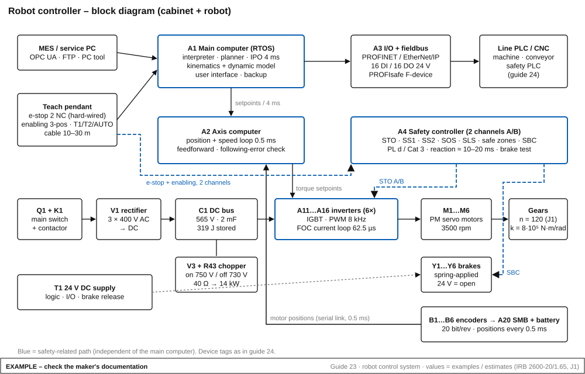
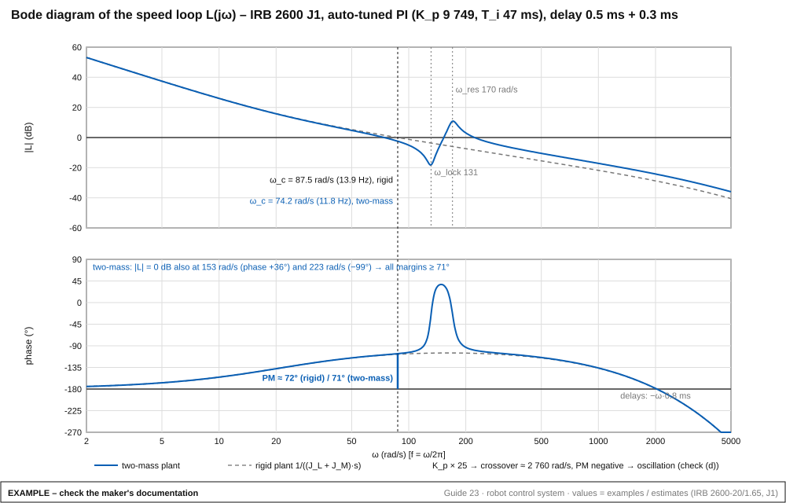
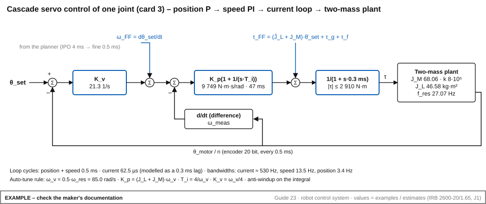
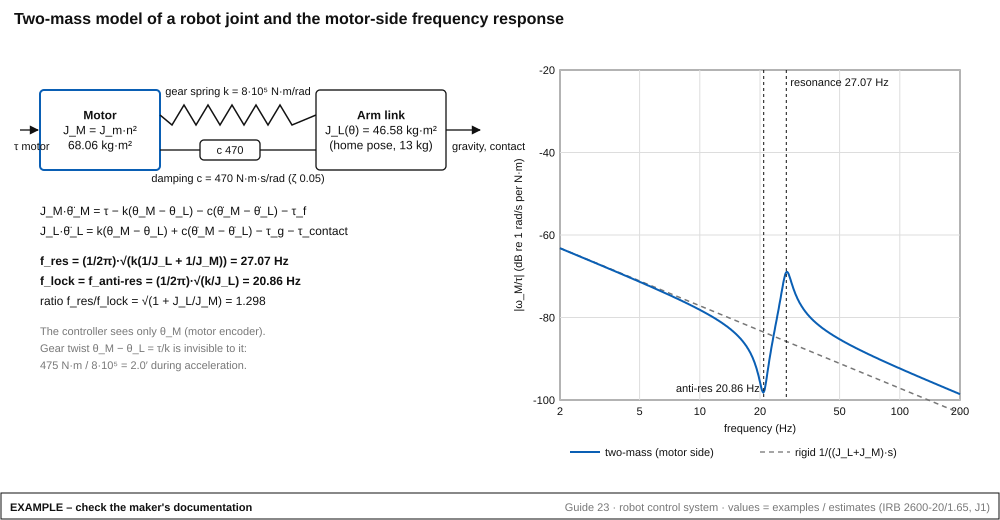
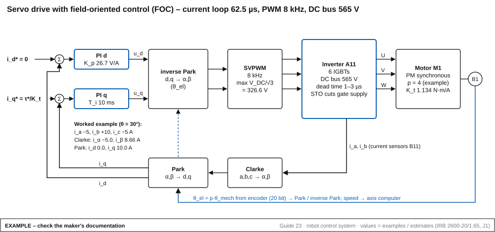
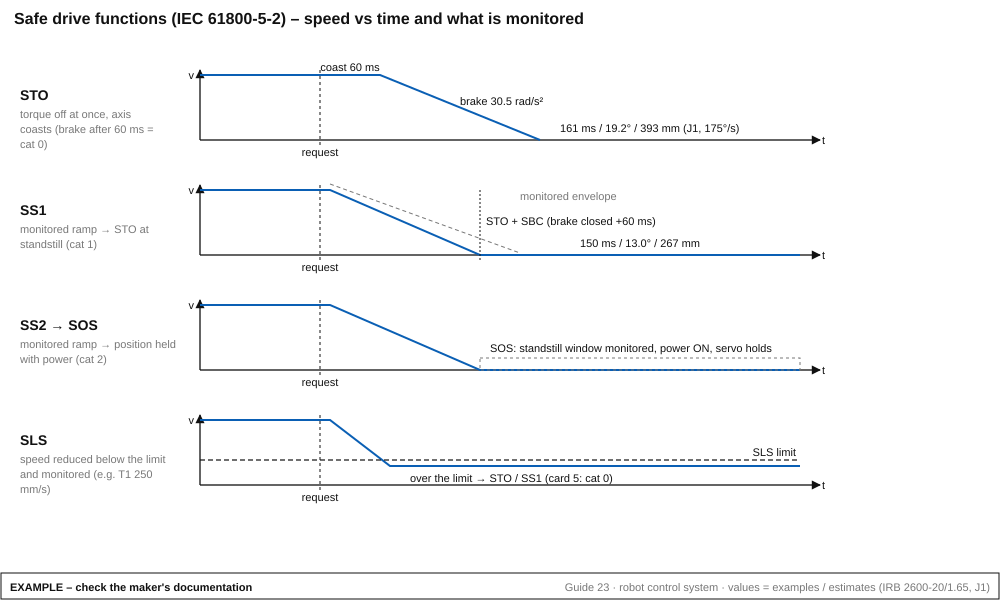
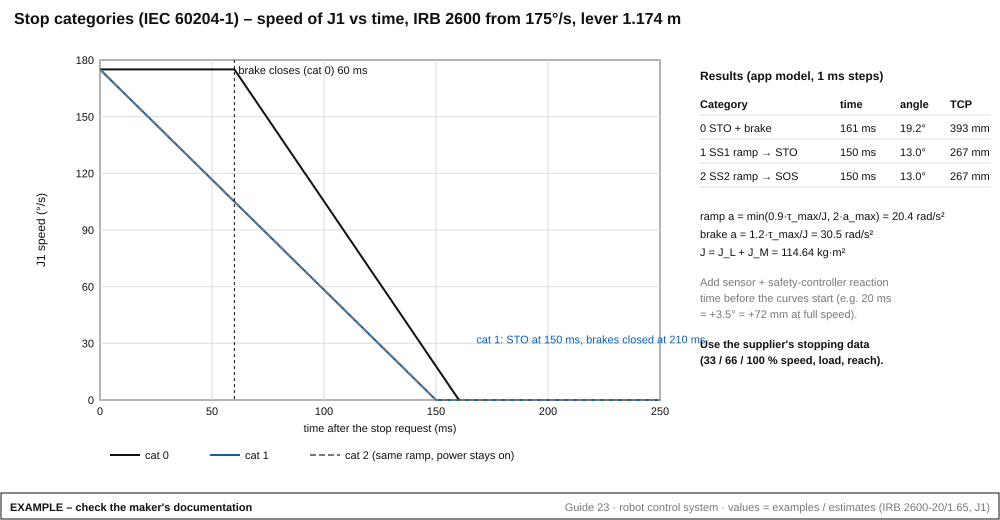
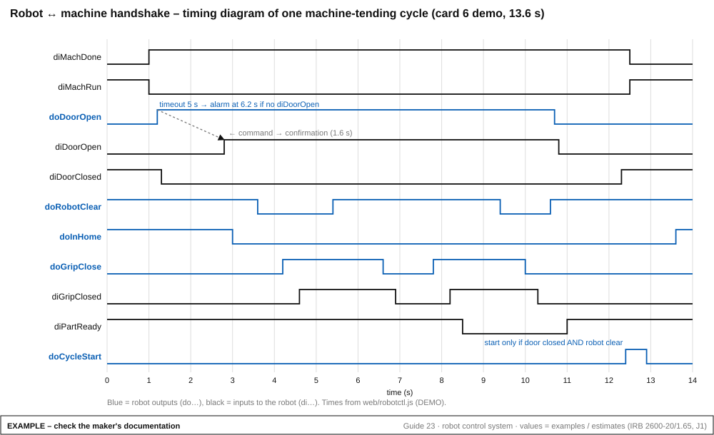

# 23 – Industrial robot: the control system – textbook, technical reference and design guide

**For whom:** mechanical engineers who plan a real robot cell and want to understand what the robot controller does,
how a joint is controlled, how the robot stops safely, how it talks to the machine and the line PLC – and what to buy.
**Where to see it live:** tab **Industrial robot** → button **"2 · Robot control system"** (file `web/robotctl.js`,
simulation core `web/robotctl_core.js`, self-checks `web/robotctl_test.js`). Deep link: `/?rbitem=2#robot`.
**All numbers are examples or estimates.** The worked examples use the robot **IRB 2600-20/1.65** at the home pose of the
item-1 cell (J = 0 / 0 / 0 / 0 / 30 / 0°) with 13 kg on the flange (3 kg gripper + 10 kg part). Motor inertia, gear stiffness,
friction and torque limits are **estimates** from simple sizing rules (section 6.2), because the catalogue does not give them.
Check every value with the robot supplier. Product names in chapter 25 are **catalogue examples**, not a recommendation;
prices are classes only – **estimate, ask for a quote**.

**Related guides (read them for depth – this guide does not repeat them):**
guide 21 (the robot itself: reducers, motors, encoders, brakes – §4), guide 22 (mathematics: kinematics, trajectory
planning §10, dynamics §11–14), guide 24 (electrical schematics: power stage, STO/SBC wiring, safety PLC, PL verification,
24 V supply, EMC), guide 05 (PLC), guide 07 (communication), guide 16 (standards register).

How the numbers were checked (by the code itself – open `/?rctest#robot`, the results are in the browser console;
all hand formulas in this guide were re-calculated with Python):

| Check | Result |
|---|---|
| (a) Only gravity, no motion: does the integral action hold the position? | motor-side error **0.0000′** for all 24 joints; the link sags by exactly τ_g/k (e.g. J2: 1.313′ = 1.312′ from the formula) |
| (b) PTP 30° with the auto-tuned gains, 4 robots × J1–J6 | **stable in 24 of 24** cases |
| (c) Torque feedforward | J1–J3: max following error **1.9–3.7× smaller** than with velocity feedforward only and **21–69× smaller** than without any feedforward (wrist axes: 1.0–2.9× and 13–33×) |
| (d) Too high gains | K_p × 25 → "oscillating" in 9 of 12 cases (J1–J3), K_p × 60 → "oscillating" in **12 of 12** |
| (e) Resonance frequency: free vibration in the simulation vs the formula | **0.0 %** difference (12 joints) |
| (f) Collision, J1, obstacle 20 kN/m: contact force with model vs without model | **454 / 1653 / 2174 / 2636 N** with model vs **560 / 3333 / 5647 / 7570 N** without (IRB 120 / 2600 / 4600 / 6700) |
| (f) Wrong payload data (declared 0 kg) on J2 at 50 % speed | false alarm on 3 of 4 robots; with the correct load no false alarm on any robot |
| Item switch 1 ↔ 2 | no console errors, item-1 3D view still renders (927 × 577 px) |

---

## Contents

**Part A – The controller**
1. Controller architecture – what is in the cabinet
2. Real-time computing and the cycle-time ladder
3. Motion pipeline – from a program line to motor current

**Part B – Control theory you need**
4. Control theory basics (feedback, Laplace, transfer functions, 1st/2nd order, Bode, margins, sampling)

**Part C – The joint servo**
5. Cascade control of one axis (card 3) – structure and tuning methods
6. The plant: two masses with an elastic gear, resonance, notch filters
7. Feedforward – where the path accuracy really comes from
8. Path accuracy and contour error
9. Servo drive internals (FOC, Clarke/Park, PWM, field weakening, motor check)
10. Encoders and resolution
11. Motor brakes and the brake test

**Part D – Observers and collision detection**
12. Observers (disturbance observer, momentum observer, Kalman basics)
13. Collision detection with the dynamic model (card 4)

**Part E – Safety**
14. Functional safety basics (IEC 61508, ISO 13849-1, IEC 62061, PL / SIL, PFH_D example)
15. Safe drive and robot safety functions (IEC 61800-5-2: STO, SS1, SS2, SOS, SLS, SLP, SBC …, safe zones)
16. Stop categories, stopping times and distances, safety distance
17. The safety state machine of the controller (card 5)

**Part F – Communication with the cell**
18. Fieldbus and I/O (PROFINET RT/IRT, EtherCAT DC, PROFIsafe / FSoE / CIP Safety, IO-Link, OPC UA)
19. Robot – PLC – CNC handshake design (card 6) with timing diagram

**Part G – Practice**
20. Programming + operation in short (card 7)
21. Commissioning and tuning procedure
22. Diagnostics and troubleshooting
23. Maintenance from the controller

**Part H – Reference and buying**
24. What to ask the robot supplier
25. Buy list – catalogue examples + consolidated shopping list
26. Standards register
27. Glossary
28. Checklists (design review, order, hand-over)
29. Formula sheet
30. How to use item 2 of the Industrial robot tab (page guide)

**Figures (SVG drawings in `docs/img/`):** 23-1 controller block diagram (§1.1) · 23-2 Bode diagram of the speed loop (§4.6) ·
23-3 cascade block diagram (§5.1) · 23-4 two-mass model + frequency response (§6.1) · 23-5 FOC drive (§9.3) ·
23-6 safe drive functions (§15.1) · 23-7 stop categories (§16.2) · 23-8 handshake timing diagram (§19.4).

---

# Part A – The controller

## 1. Controller architecture – what is in the cabinet

A robot system has three parts: the **robot arm** (motors, gears, encoders), the **controller cabinet** and the
**teach pendant**. Examples of controllers: ABB IRC5 / OmniCore, KUKA KR C5, FANUC R-30iB Plus, Yaskawa YRC1000. They all have
the same blocks:

| Block | What it does | Typical values (examples) | What fails / what to check |
|---|---|---|---|
| Main computer | program interpreter, path planner, interpolator (IPO), kinematics + dynamic model, user interface, files, network | IPO 4 ms (2–12 ms) = 250 setpoints/s | fan / filter, flash memory, missing backup |
| Axis computer | position + speed loops of all axes, feedforward, following-error check | 0.5 ms (0.125–1 ms) | encoder communication (SMB cable), following-error alarms |
| Servo drives (6×) | rectifier → DC bus → IGBT inverter per axis, current loop | DC bus ≈ 565 V, PWM 8 kHz, current loop 62.5 µs | IGBT over-temperature, motor-cable short circuit |
| Brake chopper + resistor | burns braking energy when the DC bus rises | on at ≈ 750 V, 40 Ω | "DC bus over-voltage" at fast stops |
| Safety controller | 2 channels, STO, SS1/SS2/SOS, SLS, safe zones, brake test | PL d / Cat 3, reaction ≈ 10–20 ms | channel discrepancy, configuration checksum |
| I/O + fieldbus | DI/DO 24 V, PROFINET / EtherNet/IP / EtherCAT, safe I/O (PROFIsafe, CIP Safety) | I/O cycle 2–4 ms | wire break, address conflict |
| 24 V power supply | logic, I/O, brake release | 24 V ± 10 % | gripper valves overload it → brakes do not open |
| Cooling | fans + heat exchanger | ambient 0–45 °C (check) | dirty filter → over-temperature |
| Teach pendant | screen, jog keys, e-stop, 3-position enabling device, mode switch | cable 10–30 m | damaged cable, worn enabling switch |
| In the robot: motors | PM synchronous servo motor + spring brake + encoder | 3000–4500 rpm | brake wear (brake test) |
| In the robot: SMB + battery | reads the encoders, counts motor revolutions, battery keeps them | battery 2–3 years (check) | empty battery → re-calibrate the revolution counters |

### 1.1 How the blocks are connected



*Figure 23-1 – Blocks of a robot controller with device tags as in guide 24. Blue dashed = safety path (independent of the main computer).*

Important design ideas:

1. **Separation of duties.** The main computer is fast to program but not safety-rated. The safety controller is slow to
   change, rated (PL d / SIL 2) and **independent**: it reads the encoder positions itself and can cut STO and the brakes
   even if the main computer is wrong.
2. **Timing hierarchy.** Each inner block runs faster than the block above it (chapter 2).
3. **One DC bus for all axes.** A braking axis feeds an accelerating axis; only the surplus goes to the chopper.
4. **Hard-wired where it matters.** The pendant e-stop and the enabling device go on two hard-wired channels (or a
   safety-rated wireless link), never only over normal Ethernet.

### 1.2 What the four big makers call these blocks (examples – check the current manuals)

| Block | ABB | FANUC | KUKA | Yaskawa |
|---|---|---|---|---|
| Controller | OmniCore (C30, E10, V250XT, V400XT …), older IRC5 | R-30iB Plus (A-cabinet, B-cabinet, Mate); newer R-50iA | KR C5 (KR C5 micro for small robots), older KR C4 | YRC1000 (YRC1000micro for small robots) |
| Pendant | FlexPendant | iPendant (touch) | smartPAD | programming pendant |
| Robot language | RAPID | TP (teach pendant) + KAREL | KRL | INFORM |
| Safety option | SafeMove | DCS (Dual Check Safety) | SafeOperation / SafeRangeMonitoring | FSU (Functional Safety Unit) |
| Offline / PC tool | RobotStudio | ROBOGUIDE | WorkVisual (configuration), KUKA.Sim | MotoSim |

### 1.3 The DC bus – worked example

The rectifier makes DC from the 3-phase grid. Without load the capacitors charge to the **peak** of the line-to-line voltage:

V_DC = √2 · V_LL = 1.41 × 400 V = **565 V**

Energy in the capacitors (example C = 2 mF): E = ½·C·V² = ½ · 0.002 · 565² = **319 J** (563 J at 750 V).
When an axis brakes, the motor works as a generator and pushes energy back. The capacitors can take only

E = ½·C·(V_on² − V_DC²) = ½ · 0.002 · (750² − 565²) = **243 J**

before the brake chopper switches on at 750 V (off again at 730 V – the hysteresis stops it from chattering).
Then the resistor burns P = V²/R = 750² / 40 = **14 kW**.
In the simulation of card 3 (one axis only, IRB 2600, 30° PTP at full speed) the DC bus reaches **725 V** for J1 (no chopper) and
**750 V** for J2 (chopper on, **117 J** burnt). With 6 axes braking together the chopper works much more – this is why its
resistor must be sized for the worst emergency stop, or the drive must feed the energy back to the grid
(guide 24 §2.1 sizes it for J1–J3 together: 33 Ω instead of 40 Ω).
**Safety:** the DC bus stays charged after power-off. Wait (see the label, e.g. 5 min) and measure before you open the drive.

**Design rule for the brake resistor (summary – the full worked example is in guide 24 §2.1):**

| Step | Formula | Meaning |
|---|---|---|
| 1 | E_k = Σ ½·J_i·ω_i² | kinetic energy of the axes that stop together |
| 2 | E_bus = η · E_k (η ≈ 0.75–0.8) | what comes back to the DC bus |
| 3 | E_chop = E_bus − ½·C·(V_on² − V_DC²) | what the resistor must burn |
| 4 | P_peak ≈ 2·E_bus / t_stop | peak power during the ramp |
| 5 | R ≤ V_on² / (1.2 · P_peak) | resistor value with 20 % reserve |
| 6 | P_avg = E_chop / (time between stops) | continuous rating of the resistor + its cooling |

Example J1 alone: E_k = ½ · 114.6 · 3.054² = **535 J** at full speed (J = J_L + J_M = 46.58 + 68.06 kg·m², ω = 175°/s).

---

## 2. Real-time computing and the cycle-time ladder

### 2.1 What "real-time" means

A **real-time** system must finish each calculation **before a fixed deadline**, every cycle. An office PC is "fast on
average"; a robot controller must be "never late". The measure is **jitter** = how much the start of a cycle varies.

| Term | Meaning | Example value |
|---|---|---|
| Cycle time T | time between two runs of a loop | 0.5 ms position loop |
| Jitter | variation of the cycle start | < 1–10 µs (good real-time OS); can be > 1 ms on a normal office OS |
| Latency | time from an event to the reaction | I/O input → robot reaction 10–30 ms |
| Deadline miss | calculation not finished in time | alarm "cycle overrun" → stop |

Robot controllers use a **real-time operating system** (RTOS – examples of this class: VxWorks, QNX, real-time Linux, or the
maker's own kernel; which one a product uses: see the datasheet). Often a normal OS runs beside it on another CPU core for the
user interface – the two are kept apart, so the user interface can hang but the motion does not.

### 2.2 The cycle-time ladder (examples)

| Level | Runs on | Cycle (example) | Per second | Output | Rule |
|---|---|---|---|---|---|
| Interpreter + planner | main computer | event-driven, ahead of the motion | — | path segments | look-ahead of 2–5 lines |
| Interpolator (IPO) | main computer | **4 ms** (2–12 ms) | 250 | joint setpoints θ_set for 6 axes | IPO ≈ 8 × position-loop cycle |
| Fine interpolation | axis computer | 0.5 ms | 2 000 | θ_set between two IPO points | quadratic / spline, not linear |
| Position loop | axis computer | **0.5–1 ms** | 1 000–2 000 | speed setpoint | ≥ 20 × position bandwidth |
| Speed loop | axis computer or drive | **125–250 µs** in many drives (in the app: 0.5 ms) | 4 000–8 000 | torque setpoint | ≥ 10 × speed bandwidth |
| Current loop (FOC) | drive | **62.5 µs** (16 kHz) | 16 000 | phase voltages | ≥ 10 × current bandwidth |
| PWM | drive | 125 µs (8 kHz) | 8 000 | IGBT switching | current loop = 1–2 × PWM frequency |
| Fieldbus I/O | I/O system | 1–4 ms (PROFINET RT) | 250–1 000 | DI/DO to the PLC | ≤ ½ of the fastest signal change |
| Safety controller | safety CPU | ≈ 2–4 ms cycle, reaction 10–20 ms | — | STO, SBC, safe outputs | inside the safety response time |

**Rule of thumb – the "factor 5 to 10" ladder:** every inner loop is 5–10 times faster (in bandwidth) than the loop around it,
and every loop is sampled 10–20 times faster than its own bandwidth. In the app: current loop ≈ 530 Hz bandwidth,
speed loop 13.5 Hz, position loop 3.4 Hz; the 2 kHz position/speed sampling is 2000 / 13.53 = **148 ×** the speed bandwidth.

**Worked example – how many calculations?** 6 axes × 2 000 position/speed updates + 6 × 16 000 current updates =
12 000 + 96 000 = **108 000** control updates per second, plus 250 inverse-kinematics solutions per second for a MoveL.

### 2.3 Why the cycle times matter for you

* **Shorter IPO** → smoother paths at high speed (smaller pieces between setpoints).
* **Shorter speed/current loop** → less delay → higher stable gains → stiffer axis (section 4.6: the delay eats the phase margin).
* **Fieldbus cycle** decides how fast a PLC signal reaches the robot (section 19.5).
* In a **PLC- or CNC-based robot** (robot kinematics running in a motion PLC or a CNC) you choose these cycle times yourself:
  ask the supplier which values were tested for your robot.

---

## 3. Motion pipeline – from a program line to motor current

```
MoveL p20, v500, z10, tGripper;
   │
   ▼  interpreter (reads 2–5 lines ahead = look-ahead)
   ▼  path planner (corner blending in the zone, speed + acceleration limits, dynamic model, jerk limit)
   ▼  interpolator IPO: every 4 ms a new setpoint θ_set for all 6 axes (MoveL: inverse kinematics every cycle)
   ▼  axis computer: fine interpolation 4 ms → 0.5 ms, position loop + speed loop + feedforward
   ▼  drive: current loop with field-oriented control (62.5 µs), PWM 8 kHz
   ▼  motor → gear (ratio n, elastic) → arm link
   ▲  encoder on the motor → SMB → axis computer (feedback every 0.5 ms)
```

| Stage | Cycle (example) | Per second |
|---|---|---|
| Interpolator (IPO) | 4 ms | 250 |
| Fine interpolation, position + speed loop | 0.5 ms | 2 000 |
| Current loop (FOC) | 62.5 µs | 16 000 |
| PWM | 125 µs (8 kHz) | 8 000 |
| Fieldbus I/O (PROFINET RT) | 2–4 ms | 250–500 |

**Worked example:** J1 of the IRB 2600 at its catalogue speed 175°/s moves 175 × 0.004 = **0.70° per IPO cycle**.
At the TCP (lever 1 174 mm at the home pose) that is 0.70 · π/180 · 1174 = **14.3 mm** per 4 ms. The axis computer cuts each
step into 8 steps of 0.5 ms. For a MoveL at v500 the TCP moves 500 × 0.004 = **2.0 mm** per IPO cycle.

**Fine interpolation.** In the simulation the fine interpolation is **quadratic** (a parabola through the last 3 IPO points
r₋₁, r₀, r₁). With u = 0 … 1 inside the IPO cycle:

θ_set(u) = r₀ + u·d₁ + ½·u²·d₂,  d₁ = (r₁ − r₋₁)/2,  d₂ = r₁ − 2·r₀ + r₋₁,  ω_set = (d₁ + u·d₂)/T_IPO,  θ̈_set = d₂/T_IPO²

A straight-line interpolation makes the velocity jump every 4 ms, and the speed loop answers with a torque saw-tooth of
≈ 300 N·m on J1 (we tested it – this is why real controllers use higher-order interpolation).

**Field-oriented control (FOC) in short words.** The drive measures the phase currents and turns them into two values in the
rotor frame (Clarke: a, b, c → α, β; Park: α, β → d, q with the rotor angle from the encoder). I_d (along the magnet field) is
kept at 0; I_q (across the field) makes the torque: **τ_m = K_t · I_q**. Example: K_t ≈ 1.13 N·m/A (estimate for a
3500 rpm motor on 400 V) → the J1 motor needs ≈ 28.5 / 1.13 = **25 A** for its maximum torque. Details with numbers: chapter 9.

**Look-ahead:** to blend a corner (z50 = start turning 50 mm before the point) the planner must know the next point. A `WaitDI`
or a `SetDO` with a condition stops the look-ahead → the robot makes an exact stop at the point before it. Use the "trigger"
instructions of the robot language (output set at a distance or time on the path) when an output must switch during the motion.

**Path planning details** (trapezoid / S-curve profiles, PTP synchronisation, blending, orientation interpolation): guide 22 §10.

---

# Part B – Control theory you need

## 4. Control theory basics

This chapter gives the minimum theory to understand servo tuning. Every formula has a number from the IRB 2600 J1 example.

### 4.1 Open loop and closed loop

* **Open loop:** the controller sends a command and does not check the result (a stepper motor without encoder).
* **Closed loop (feedback):** a sensor measures the result, the controller compares it with the setpoint and corrects the
  **error** e = setpoint − actual. All robot axes are closed loops.
* **Feedforward:** the controller also sends the command it **expects** to need (from a model), before any error appears.
  Feedback corrects the unknown, feedforward handles the known (chapter 7).

```
             e         u                       y
 r ──▶(+)──▶[ C(s) ]──▶(+)──▶[ G(s) plant ]──┬──▶ y
       ▲ −               ▲ + feedforward       │
       │                 │                     │
       └────────[ H(s) sensor ]◀───────────────┘
```

### 4.2 Laplace transform and transfer functions

The **Laplace transform** turns a differential equation in time into an algebraic equation in the variable s
(s = "derivative operator", unit 1/s). For a sine signal of angular frequency ω we put **s = j·ω**.

| Time domain | Laplace | Example |
|---|---|---|
| derivative dx/dt | s·X(s) | speed ω = s·θ |
| integral ∫x dt | X(s)/s | angle θ = ω/s |
| dead time (delay T_d) | e^(−s·T_d) | sampling + computation delay |
| step of height 1 | 1/s | position step |

A **transfer function** G(s) = output(s) / input(s). Important ones:

| Element | G(s) | Robot example |
|---|---|---|
| Gain | K | K_t: current → torque (1.13 N·m/A) |
| Integrator | 1/(J·s) | torque → speed of an inertia J (J = 114.6 kg·m² for J1) |
| First-order lag | 1/(1 + s·T) | closed current loop, T = 0.3 ms |
| Second-order system | ω_n² / (s² + 2ζω_n·s + ω_n²) | gear spring + arm |
| PI controller | K_p·(1 + 1/(s·T_i)) | speed controller |
| PID controller | K_p·(1 + 1/(s·T_i) + s·T_d) | rarely used on servo speed loops (noise) |
| Dead time | e^(−s·T_d) | 0.5 ms (sampling + speed measurement) |

### 4.3 Block-diagram algebra

| Connection | Result |
|---|---|
| Series G₁ then G₂ | G = G₁·G₂ |
| Parallel G₁ + G₂ | G = G₁ + G₂ |
| Feedback loop (C·G forward, H back) | T(s) = C·G / (1 + C·G·H) |
| Open-loop transfer function | L(s) = C·G·H (used for stability) |

**Worked example – P-controlled integrator (the position loop with an ideal speed loop):** C = K_v, G = 1/s, H = 1 →
T(s) = (K_v/s) / (1 + K_v/s) = 1 / (1 + s/K_v) → a first-order system with time constant 1/K_v.
For K_v = 21.3 1/s: T = 1/21.3 = **47 ms**, bandwidth f = K_v/(2π) = **3.4 Hz** (this is the position bandwidth of the app).

### 4.4 First-order system

G(s) = K / (1 + s·T). Step response: y(t) = K·(1 − e^(−t/T)).

| Time | Response | Example T = 0.3 ms (current loop of the app) |
|---|---|---|
| t = T | 63 % | 0.3 ms |
| t = 3T | 95 % | 0.9 ms |
| t = 5T | 99.3 % | 1.5 ms |
| Bandwidth (−3 dB) | f_bw = 1/(2π·T) | 1/(2π · 0.0003) = **530 Hz** |
| Phase lag at frequency f | φ = −atan(2π·f·T) | at 13.5 Hz: −1.5° |

### 4.5 Second-order system

G(s) = ω_n² / (s² + 2ζ·ω_n·s + ω_n²), ω_n = natural angular frequency, ζ = damping ratio.

| Value | Formula |
|---|---|
| Damped frequency | ω_d = ω_n·√(1 − ζ²) |
| Overshoot (step) | M_p = exp(−π·ζ / √(1 − ζ²)) |
| Settling time (2 %) | t_s ≈ 4 / (ζ·ω_n) |
| Resonance peak (ζ < 0.707) | M_r = 1 / (2ζ·√(1 − ζ²)) |

| ζ | Overshoot | Use |
|---|---|---|
| 0.05 | 85 % | gear mode of a robot joint (structural damping only) |
| 0.3 | 37.2 % | too lightly damped for a servo |
| 0.5 | 16.3 % | acceptable for speed loops |
| 0.707 | 4.3 % | "technical optimum" target |
| 1.0 | 0 % | critical damping – position loops of machine tools, no overshoot |

**Worked example – how long does a gear vibration ring?** The arm swings at f_lock = 20.86 Hz with ζ = 0.05:
t_s = 4 / (0.05 · 2π · 20.86) = **0.61 s**. Without a jerk filter (section 6.6) or active damping the TCP would
ring for more than half a second after every stop – this is why setpoint filters and notch filters exist.

### 4.6 Frequency response, Bode diagram, stability margins

Put s = j·ω into L(s) and plot **|L| in dB** (20·log₁₀|L|) and **phase in degrees** over log frequency – this is the
**Bode diagram**.

* **Crossover frequency ω_c:** where |L| = 1 (0 dB). Roughly the closed-loop bandwidth.
* **Phase margin PM** = 180° + phase(L(jω_c)). Needed: **PM ≥ 45°** (60–70° for a well-damped servo).
* **Gain margin GM** = how much the gain can rise until the phase is −180° at |L| = 1. Needed: **GM ≥ 6 dB**.
* Every delay T_d costs phase: **φ = −ω·T_d** (in rad). It does not change |L|. This is the main limit of fast loops.

**Worked example – Bode table of the speed loop of IRB 2600 J1** (rigid plant 1/(J·s), J = J_L + J_M = 114.64 kg·m²,
PI with K_p = 9 749 N·m·s/rad and T_i = 47.0 ms, delay 0.5 ms (0.25 ms zero-order hold + 0.25 ms speed from the encoder
difference) and the current loop 1/(1 + s·0.3 ms)):

L(jω) = K_p·(1 + 1/(jω·T_i)) · 1/(jω·J) · e^(−jω·0.5 ms) / (1 + jω·0.3 ms)

| ω (rad/s) | f (Hz) | \|L\| (dB) | phase (°) | Comment |
|---|---|---|---|---|
| 5 | 0.80 | +37.4 | −167.0 | PI integral dominates (−90° − 90°) |
| 21.26 | 3.38 | +15.1 | −136.0 | position bandwidth |
| 50 | 7.96 | +5.3 | −115.3 | |
| 85.04 | 13.53 | +0.3 | −107.9 | ≈ crossover (speed bandwidth ω_v) |
| 170 | 27.06 | −6.0 | −104.9 | at f_res (the rigid model ignores the resonance) |
| 300 | 47.75 | −11.0 | −107.8 | |
| 1 000 | 159.2 | −21.8 | −136.6 | delays start to cost phase |
| 2 000 | 318.3 | −28.8 | −178.9 | phase ≈ −180° → gain margin here ≈ 29 dB (rigid model) |



*Figure 23-2 – Bode diagram of the speed loop of IRB 2600 J1 with the auto-tuned gains.*

Crossover ω_c = 87.5 rad/s (13.9 Hz), **PM = 72.3°**. The phase at crossover = −90° (integrator 1/(J·s)) − 14.0° (PI zero:
atan(1/(ω·T_i)) = atan(1/(85.04 · 0.047)) = 14.0°) − 3.9° (delays: 85 · 0.8 ms = 0.068 rad) = −107.9°.

With the **two-mass plant** (section 6.3) the result is similar: ω_c = 74.2 rad/s (11.8 Hz), PM = 71.2°. Because of the
resonance peak, |L| crosses 0 dB two more times (153 rad/s with phase +36°, 223 rad/s with phase −99°) – both far from −180°,
so the smallest margin stays ≈ 71°. (This is why a Bode measurement is better than a single number: a higher resonance
peak could cross 0 dB where the phase is near −180°.)
Now raise K_p (two-mass plant, same delays):

| K_p factor | ω_c | Phase margin | Simulation (check (d)) |
|---|---|---|---|
| × 1 (auto-tune) | 74 rad/s (11.8 Hz) | 71° | stable, 24 of 24 |
| × 13.7 | 1 746 rad/s (278 Hz) | 12° | (not tested) – would ring strongly |
| × 25 | 2 763 rad/s (440 Hz) | negative (−29°) → unstable | "oscillating" in 9 of 12 (J1–J3) |

Above the resonance the motor "sees" only its own inertia J_M (the gear spring decouples the arm), so the crossover jumps to
≈ K_p/J_M = 9 749 · 25 / 68.06 = **3 581 rad/s**, where the delays cost 3 581 · 0.8 ms = 2.86 rad = **164°** of phase.
This is the reason given in card 3: the speed loop becomes so fast that the delays eat the phase margin.
(The simulation is non-linear – torque limit, friction – so it chatters at the limit instead of growing forever.)

### 4.7 Discrete-time control – sampling

Real controllers calculate at fixed sample times T_s. Consequences:

| Effect | Formula | Example (T_s = 0.5 ms) |
|---|---|---|
| Zero-order hold delay | ≈ T_s / 2 | 0.25 ms |
| Computation delay (output in the next cycle) | ≈ T_s | 0.5 ms (some drives: 0.5–1 T_s) |
| Speed from encoder difference | ω ≈ (θ_k − θ_k−1)/T_s → delay T_s/2 | 0.25 ms |
| Nyquist frequency | f_N = 1/(2·T_s) | 1 000 Hz – nothing above this can be controlled |
| Rule for the sample rate | f_s ≥ 10–20 × closed-loop bandwidth | 2 000 Hz ≥ 20 × 13.5 Hz ✓ |

**Discrete PI (as in the app code):** every 0.5 ms
e_ω = ω_cmd − ω_meas;  I = I + e_ω·T_s (only if the output is not at the torque limit = **anti-windup**);
τ_cmd = K_p·(e_ω + I/T_i) + τ_FF, limited to ±τ_max.

**Anti-windup** is important: if the integral keeps growing while the motor is at its torque limit, the axis overshoots badly
when the limit ends. The app stops the integration while the output is saturated ("conditional integration").

---

# Part C – The joint servo

## 5. Cascade control of one axis (card 3)

### 5.1 The control structure

All values are on the **joint side** (after the gear): rad, rad/s, N·m, kg·m².

| Loop | Formula | Unit of the gain | Cycle |
|---|---|---|---|
| Position (P) | ω_cmd = K_v · (θ_set − θ_motor/n) + ω_FF | K_v in 1/s | 0.5 ms |
| Speed (PI) | τ_cmd = K_p · (e_ω + (1/T_i)·∫e_ω dt) + τ_FF | K_p in N·m·s/rad (joint side), T_i in s | 0.5 ms |
| Current / torque | τ = τ_cmd / (1 + s·0.3 ms), \|τ\| ≤ τ_max | – | 62.5 µs (modelled as a lag) |

Feedforward (from the path planner + dynamic model):
ω_FF = dθ_set/dt,  τ_FF = (Ĵ_L + J_M)·θ̈_set + τ̂_gravity(θ_set) + τ̂_friction(ω_set).
On the motor side the speed gain is K_p/n²: for J1 of the IRB 2600: 9 749 / 120² = **0.677 N·m·s/rad** (motor side).



*Figure 23-3 – Cascade control of one joint as simulated in card 3.*

### 5.2 Why a cascade?

1. **Each loop handles its own disturbance fast:** the current loop removes voltage and back-EMF effects in < 1 ms, the speed
   loop removes friction and load torque, the position loop only has to handle what is left.
2. **Limits are easy:** the current limit (= torque limit) and the speed limit sit naturally between the loops.
3. **Tuning from inside to outside:** tune the current loop first, then speed, then position. Each outer loop sees the
   inner closed loop as a simple lag.
4. **Bandwidth ratio rule:** inner loop 4–10 × faster than the outer loop. In the app: speed/position = 13.5/3.4 = **4.0**
   (K_v = ω_v/4), current/speed = 530/13.5 = **39**.

### 5.3 Current-loop tuning – "technical optimum" (Betragsoptimum)

The plant of the current loop is the winding: I(s)/U(s) = (1/R) / (1 + s·T_el), T_el = L/R, plus a small lag T_σ
(PWM + sampling ≈ 1.5 × current-loop cycle). The **technical optimum** chooses the PI controller so that its zero cancels T_el:

**T_i = T_el,  K_p,i = L / (2·T_σ)** → closed loop ≈ 1 / (1 + s·2T_σ), overshoot 4.3 % (ζ = 0.707).

**Worked example (motor data are examples – take them from the motor datasheet):** R = 0.5 Ω, L_q = 5 mH, current-loop
cycle 62.5 µs → T_σ = 1.5 · 62.5 µs = 94 µs, T_el = 5 mH / 0.5 Ω = **10 ms**,
K_p,i = 0.005 / (2 · 94·10⁻⁶) = **26.7 V/A**, T_i = 10 ms, equivalent time constant 2T_σ = **0.19 ms**, bandwidth
1/(2π · 0.19 ms) = **849 Hz**. The app uses a slightly slower 0.3 ms (530 Hz) – a realistic value for a large robot motor.
In industrial drives the current loop is normally tuned automatically from the motor data (the motor's electronic nameplate).

### 5.4 Speed-loop tuning – "symmetric optimum" and the robot rule

For a plant "integrator 1/(J·s) + small lag T_Σ" the **symmetric optimum** gives:

**ω_c = 1/(a·T_Σ),  K_p = J / (a·T_Σ) = J·ω_c,  T_i = a²·T_Σ = a/ω_c,  PM = arcsin((a² − 1)/(a² + 1))**

| a | Phase margin | T_i | Comment |
|---|---|---|---|
| 2 | 36.9° | 2/ω_c | classic, fast, overshoot ≈ 43 % without setpoint filter |
| 4 | 61.9° | 4/ω_c | well damped – **this is the app rule T_i = 4/ω_v** |

**Worked example – why the delay rule alone does not work for robots:** J = 114.64 kg·m², T_Σ = 0.8 ms (0.5 ms delays + 0.3 ms
current loop), a = 2 → K_p = 114.64/(2 · 0.0008) = **71 652 N·m·s/rad**, ω_c = **625 rad/s (99 Hz)**, T_i = 3.2 ms.
But the gear resonance is at 170 rad/s (27 Hz)! A speed loop faster than the resonance excites it.
**In a robot the gear resonance, not the delay, limits the bandwidth.** So the app rule is:

### 5.5 Auto-tune – rule of thumb (button in card 3)

| Step | Rule | IRB 2600 J1 |
|---|---|---|
| 1 | ω_v = min(0.5 · ω_res, 2π · 80 Hz) | 0.5 × 170.1 = **85.0 rad/s** (13.5 Hz) |
| 2 | K_p = (J_L + J_M) · ω_v | (46.58 + 68.06) × 85.0 = **9 749 N·m·s/rad** |
| 3 | T_i = 4 / ω_v | **47.0 ms** |
| 4 | K_v = ω_v / 4 | **21.3 1/s** (position bandwidth 3.4 Hz) |

Bandwidth estimates: speed loop f_v ≈ K_p / (2π·J_total), position loop f_pos ≈ K_v / 2π.
Result (section 4.6): phase margin ≈ 71–72°, stable on all 24 joints.

### 5.6 Position-loop tuning

* **K_v** (also called "K_V factor" in machine tools, often in (m/min)/mm: K_v[1/s] = 16.67 × K_v[(m/min)/mm]).
  K_v = 21.3 1/s = 21.3 / 16.67 = **1.28 (m/min)/mm** (example).
* **Following error at constant speed without feedforward:** e = ω / K_v. Example at the peak speed of the 30° move:
  ω_peak = 2.309 rad/s (the move is too short to reach 175°/s – triangle profile, T = 0.454 s, a = 10.18 rad/s²) →
  e = 2.309 / 21.26 = 0.109 rad = **373′** if this speed were held. A first-order position loop with this profile gives a
  maximum of **320′** (hand calculation); the simulation shows **311′** (table 5.8).
* **No overshoot at the target:** the position loop must be slower than the speed loop (ratio ≥ 4).
* For machine tools all interpolating axes need the **same K_v** (contour error, chapter 8); for a robot the controller does
  this automatically.

### 5.7 Tuning methods compared

| Method | How | Good for | Limits |
|---|---|---|---|
| Rule of thumb (this app) | ω_v = 0.5 ω_res, K_p = J·ω_v, T_i = 4/ω_v, K_v = ω_v/4 | robot joints with a known resonance | needs J and ω_res |
| Technical optimum | T_i = T_el, K_p = L/(2T_σ) | current loops (PT1 plant) | not for integrating plants |
| Symmetric optimum | K_p = J/(aT_Σ), T_i = a²T_Σ | speed loops of stiff drives | ignores resonance |
| Ziegler–Nichols (ultimate gain) | raise K_p to the oscillation limit K_u, period T_u; PI: K_p = 0.45 K_u, T_i = T_u/1.2 | quick field tuning | aggressive, risky on a robot |
| "50 % of the buzz limit" (field practice) | raise K_p until the axis buzzes, take 50 % | real axes, with drive software | needs a careful operator |
| Frequency-response (FFT / Bode measurement) | drive excites with noise / chirp, measures L(jω) | best method: shows resonances, PM, GM | needs the drive tool |
| Model-based auto-tune of the drive | drive identifies J, friction, resonances, sets gains + filters | standard drives (one-button tuning) | check the result with a test move |

### 5.8 Results (card 3 defaults: J1, 30°, 100 % speed, IRB 2600)

| Setting | Max following error at the link | at the TCP | Comment |
|---|---|---|---|
| no feedforward | 311.3′ | 106 mm | the loop only reacts to errors → large lag |
| velocity feedforward only | 22.0′ | 7.5 mm | the inertia torque must still come from the error |
| velocity + torque feedforward (default) | **6.86′** | **2.34 mm** | **45× smaller** than without feedforward |
| + gear-twist compensation | 5.49′ | 1.9 mm | motor setpoint + τ/k |
| without jerk filter | 9.15′ | 3.1 mm | acceleration steps excite the 21 Hz mode |

TCP values: error (rad) × lever 1.174 m, e.g. 6.86′ = 6.86/3438 rad = 0.002 rad → **2.34 mm**.

Other KPIs of the default run: settling time **165 ms** to ±0.04 mm (the repeatability), overshoot **0.081 mm**,
peak motor torque **46 %** of the limit, motor-side following error 0.9–1.5′.

**Stability:** with K_p × 25 the IRB 2600 J1 chatters at the torque limit (torque std 66 % of τ_max, status "OSCILLATING").
The reason: the speed loop becomes so fast (K_p/J_M ≈ 3 600 rad/s) that the delays (0.5 ms sampling, speed from the encoder difference,
0.3 ms current loop) eat the phase margin (section 4.6). Big robots with large J_M need a higher factor (IRB 6700 J1 oscillates at × 60).

### 5.9 Tuning procedure for a real axis (step by step)

1. **Check the data first:** correct load data (mass, centre of gravity, inertia) and tool data. Wrong data → wrong feedforward.
2. **Current loop:** normally set automatically from the motor data; check the step response (rise ≈ 0.2–1 ms, overshoot < 10 %).
3. **Measure the resonance:** most controllers have a frequency-response test or a "tune" function. Note f_res and f_lock per axis at 2–3 poses (stretched / folded).
4. **Speed loop:** start low; raise K_p until the axis starts to buzz or the motor current gets noisy, then take **50 %** of that value. Stay below ≈ 0.5·f_res.
5. **Integral time:** T_i ≈ 4/ω_v; shorter T_i = faster correction of gravity / friction, but more overshoot.
6. **Notch / low-pass filter** on the torque setpoint at f_res if needed (section 6.5).
7. **Position loop:** K_v ≈ ω_v/4; raise it while there is no overshoot at the end of a move.
8. **Feedforward on** (velocity + torque, from the dynamic model) – this gives the path accuracy, not high gains.
9. **Check:** following error on a test path, settling time at exact points, no vibration at the TCP (accelerometer), current RMS within the motor rating.
10. **Save** the parameters and make a backup. Note: on industrial robots the supplier usually does steps 2–7; you check 8–10 and the load data.
    On a self-built axis (gantry, 7th axis, rotary table driven by a separate servo drive) you do all steps with the drive software.

---

## 6. The plant: two masses with an elastic gear, resonance, notch filters

### 6.1 The model



*Figure 23-4 – Motor + elastic gear + arm, and what the motor "sees" (blue) compared with a rigid arm (grey).*

J_M·θ̈_M = τ − k(θ_M − θ_L) − c(θ̇_M − θ̇_L) − τ_friction
J_L(θ)·θ̈_L + ½·J_L′(θ)·θ̇_L² = k(θ_M − θ_L) + c(θ̇_M − θ̇_L) − τ_gravity(θ_L) − τ_contact

Integration: semi-implicit Euler, dt = 100 µs (smaller for stiff wrist axes). The controller only sees the **motor** encoder
(θ_M), not the link. The arm values come from the tested dynamic model of guide 22 (`robotdyn.js`, not changed).

### 6.2 The joint data (estimates where marked)

| Value | How | IRB 2600, J1, home pose, 13 kg |
|---|---|---|
| Gear ratio n | n = motor rpm × 6 / axis speed = 3500 × 6 / 175 | **120** |
| Link inertia J_L | J_L = τ(q̈_J1 = 1 rad/s²) − τ(q̈ = 0) with invDyn | **46.58 kg·m²** |
| Max link inertia in the work space | max of J_L over a J2/J3 grid, full payload 20 kg | 204.19 kg·m² |
| Motor inertia J_m (estimate) | J_L,max / (J_m·n²) = 3 → J_m = 204.19 / (120² × 3) | **4.73·10⁻³ kg·m²** |
| Motor inertia at the joint J_M | J_m·n² = 4.73·10⁻³ × 14 400 | **68.06 kg·m²** |
| Gear stiffness k (estimate) | RV reducer + structure, by robot size | **8.0·10⁵ N·m/rad** (= 233 N·m/arc-min) |
| Max acceleration a_max (estimate) | catalogue speed / estimated acceleration time = 3.054 rad/s / 0.30 s | 10.18 rad/s² |
| Torque limit (joint) | 1.4 × (max gravity + J_L,max · a_max) = 1.4 × (0 + 204.19 × 10.18) | **2 910 N·m** |
| Motor max torque | τ_max/(n·η) = 2910 / (120 × 0.85) | **28.5 N·m** |
| Friction (estimate) | Coulomb 3 % + viscous 4 % of τ_max at max speed; the controller model knows 80 % of it | 87.3 N·m + 38.1 N·m·s/rad |
| Gear damping | ζ = 0.05 of the gear mode: c = 2ζ·√(k·J_r), J_r = 1/(1/J_L + 1/J_M) | 470 N·m·s/rad |

Estimates for the other robots: k = 4·10⁴ (IRB 120), 8·10⁵ (IRB 2600), 1.6·10⁶ (IRB 4600), 5·10⁶ N·m/rad (IRB 6700) for J1/J2;
J3 × 0.6; wrist axes 3–8 % of J1. Real values: ask the supplier (they know the "torsional rigidity" of the reducer, e.g. in
N·m/arc-min – guide 21 §4.1.4–4.1.6 explains stiffness, lost motion and twist of the reducer).

**Inertia ratio.** Servo practice: J_load / J_motor (both on the same side) between 1 and 5 for robots (up to 10 for slow
axes, < 3 for very dynamic axes). Here, at the worst pose: 204.19 / 68.06 = **3.0** (this is how J_m was estimated);
at the home pose 46.58 / 68.06 = **0.68**. A high ratio means a low anti-resonance and a soft axis.

### 6.3 Resonance and anti-resonance – the numbers that limit the tuning

**f_res = (1/2π) · √( k · (1/J_L + 1/J_M) )**   (free–free mode: motor and arm swing against each other)

= (1/2π) · √(8·10⁵ × (1/46.58 + 1/68.06)) = (1/2π) · √(28 930) = 170.1 / 6.283 = **27.07 Hz**

**f_lock = (1/2π) · √(k / J_L)** = √(8·10⁵ / 46.58) / 6.283 = **20.86 Hz** (the arm swings at this frequency when the motor is held stiff).

f_lock is also the **anti-resonance** seen from the motor: the transfer function from motor torque to motor speed is

ω_M(s)/τ(s) = (J_L·s² + c·s + k) / ( s · [ J_M·J_L·s² + c·(J_M + J_L)·s + k·(J_M + J_L) ] )

* the **zeros** (numerator = 0) are at √(k/J_L) = f_lock = 20.86 Hz → a deep notch in the Bode magnitude (the arm absorbs the
  motor's motion – the motor hardly moves, the arm swings);
* the **poles** (bracket = 0) are at √(k·(J_M + J_L)/(J_M·J_L)) = f_res = 27.07 Hz → a sharp peak.
* Ratio: f_res / f_lock = √(1 + J_L/J_M) = √(1 + 0.684) = **1.298** = 27.07 / 20.86 ✓.

Results of all robots (simulation = formula within 0.0 %): IRB 120 J1 47.3 Hz · IRB 2600 J1 27.1 / J2 23.9 / J3 35.4 Hz ·
IRB 4600 J1 21.9 Hz · IRB 6700 J1 19.7 / J2 16.5 Hz. Big robots have low resonance → lower gains → slower settling.

**Design consequences for a mechanical engineer:**

| To raise f_res … | Effect |
|---|---|
| stiffer reducer (larger size, higher torsional rigidity) | f ∝ √k: 2 × k → 1.41 × f |
| lighter arm / gripper / part | J_L smaller → f_lock and f_res higher |
| shorter lever (part close to the flange) | J_L ∝ m·r² |
| stiff base, foundation and robot riser | the "k" in series includes the riser! (riser stiffness ≥ 5–10 × reducer stiffness) |

### 6.4 Gear twist and static sag

Why is the link error larger than the motor error? The gear **twists** under torque: θ_twist = τ/k. During acceleration J1 needs
≈ J_L · θ̈ = 46.6 × 10.2 = 475 N·m → 475 / 8·10⁵ = 5.9·10⁻⁴ rad = **2.0′** of twist that the motor encoder cannot see.
For J2 the gravity torque also twists the gear at standstill: **static sag** = 305 / 8·10⁵ = 3.81·10⁻⁴ rad = **1.31′ = 0.47 mm** at the TCP,
although the motor side is held exactly (integral action, check (a)). Robots with an "absolute accuracy" option use a stiffness
model to compensate this (in card 3: "gear-twist compensation" → J2 error 12.0′ → 5.5′).

### 6.5 Filters against resonance: notch and low-pass

A **notch filter** (band-stop) on the torque setpoint removes the energy at the resonance frequency so the speed loop
does not excite it:

N(s) = (s² + 2ζ_z·ω_n·s + ω_n²) / (s² + 2ζ_p·ω_n·s + ω_n²)

* ω_n = centre frequency (= 2π · f_res), **depth** = ζ_z/ζ_p, **width** ≈ 2ζ_p · f_n (−3 dB band, approximate).

**Worked example (notch values are an example):** f_n = 27.07 Hz, ζ_z = 0.05, ζ_p = 0.5 → depth = 0.05/0.5 = 0.1 = **−20 dB**,
width ≈ 2 · 0.5 · 27.07 = 27 Hz.

| f (Hz) | \|N\| (dB) | phase (°) | Comment |
|---|---|---|---|
| 5 | −0.15 | −9.7 | |
| 13.53 | −1.58 | **−29.9** | at the speed-loop crossover: costs ≈ 30° of phase margin! |
| 20.86 | −6.47 | −51.5 | |
| 27.07 | **−20.0** | 0.0 | centre |
| 40 | −4.01 | +44.2 | |
| 80 | −0.59 | +18.7 | |

Lesson: a wide notch close to the crossover costs a lot of phase (71° → ≈ 41° here). Use a **narrow** notch
(smaller ζ_p) or place the crossover lower. A 2nd-order **low-pass** at 150 Hz (ζ = 0.7) costs only 7.3° at 13.5 Hz – it is
used against high resonances (> 5 × crossover) and encoder noise.

| Filter | When | Typical setting (example) |
|---|---|---|
| Notch (band-stop) | one sharp resonance near or above the crossover | f_n = measured f_res, depth −10 to −30 dB |
| Low-pass 1st / 2nd order | many high resonances, noise | f = 5–10 × speed bandwidth |
| Adaptive notch | resonance moves with pose / load (robots!) | drive tracks the peak automatically – ask the drive maker |
| Setpoint (jerk) filter | do not excite the arm by the command | length = 1 period of f_lock (section 6.6) |

**Important for robots:** f_res changes with the pose and the load (J_L(θ) changes up to 4×). A fixed notch at one pose can
be wrong at another pose. Robot controllers therefore use **model-based** gains and filters that follow the pose.

### 6.6 Jerk limit and input shaping (setpoint filters)

**Jerk limit (setpoint filter):** a moving average of the IPO setpoints over one period of f_lock
(1/20.86 Hz = 48 ms → 12 IPO cycles) turns the acceleration steps into ramps. The arm does not ring, the collision residual
becomes 2–3× cleaner, the move takes 48 ms longer.

Why one period? A moving average of length T_f has **zero gain** at f = 1/T_f, 2/T_f, … → it removes exactly the frequency
of the arm mode from the command.

**Input shaping (ZV shaper)** is the same idea with two impulses: ½ at t = 0 and ½ at t = half a period
= 1/(2 · 20.86) = **24 ms** (for ζ ≈ 0). It is shorter (24 ms extra instead of 48 ms) but more sensitive to a wrong frequency.
Many controllers offer "vibration suppression" or "path smoothing" options of this type.

---

## 7. Feedforward – where the path accuracy really comes from

### 7.1 The three feedforward terms

| Term | Formula | What it removes |
|---|---|---|
| Velocity feedforward | ω_FF = dθ_set/dt | the following error e = ω/K_v of the position loop |
| Acceleration (inertia) feedforward | τ_FF,a = (Ĵ_L(θ) + J_M)·θ̈_set | the speed error needed to make the acceleration torque |
| Gravity feedforward | τ_FF,g = τ̂_g(θ_set) | the integral having to "find" the gravity torque |
| Friction feedforward | τ_FF,f = F̂_c·sign(ω) + F̂_v·ω | the stick-slip at speed reversal ("quadrant glitch") |
| Full dynamic model | τ_FF = M(θ)·θ̈ + C(θ,θ̇)·θ̇ + g(θ) + friction | all of the above incl. coupling between axes (guide 22 §12) |

The app uses: ω_FF = dθ_set/dt, τ_FF = (Ĵ_L + J_M)·θ̈_set + τ̂_gravity(θ_set) + τ̂_friction(ω_set) (one axis, the model knows 80 %
of the friction).

### 7.2 Worked example – why 311′ → 22′ → 6.86′

| Step | Hand estimate | Simulation |
|---|---|---|
| no feedforward: position loop lags by ω/K_v | first-order loop, triangle profile 30°: **≈ 320′** | **311.3′** |
| + velocity FF: the speed loop needs e_ω = J·a / K_p = a/ω_v = 10.18 / 85.04 = 0.120 rad/s, which the position loop makes from e = e_ω/K_v | 0.120 / 21.26 = 0.00563 rad = **19.4′** | **22.0′** |
| + torque FF: only the model errors are left (friction 20 % unknown, gear twist 2.0′, interpolation) | a few arc-min | **6.86′** |

The acceleration torque at the peak: (J_L + J_M)·a = 114.64 × 10.18 = **1 167 N·m** (of which the link alone 474 N·m).
Coulomb friction 87.3 N·m, of which the model knows 80 % = 69.8 N·m.
**Lesson:** high gains cannot give path accuracy on an elastic robot (the resonance limits them). **A good dynamic model +
feedforward** does. This is why correct **load data** are so important (chapter 13 and 20).

### 7.3 Gear-twist compensation

Motor setpoint = θ_set + τ_FF/k (the twist the gear will have). Result in card 3: J1 6.86′ → 5.49′; J2 12.0′ → 5.5′
(J2 carries gravity). It needs a good stiffness value k for every axis – the "absolute accuracy" options of the makers
include such a stiffness model plus a calibration of the arm.

---

## 8. Path accuracy and contour error

### 8.1 Terms (ISO 9283 – performance criteria of industrial robots)

| Term | Meaning | Example (catalogue values – see the datasheet) |
|---|---|---|
| Pose repeatability RP | scatter when the robot returns to the same taught point | IRB 2600: ±0.04 mm (app data) |
| Pose accuracy AP | distance between a commanded (calculated) point and the real point | mm range without calibration; much smaller with an absolute-accuracy option – see datasheet |
| Path repeatability RT | scatter of the same path, many runs | see datasheet |
| Path accuracy AT | deviation of the real path from the commanded path | see datasheet (depends on speed!) |
| Following error | setpoint − actual of one axis at one time | 6.86′ = 2.34 mm in card 3 |
| Contour error | distance of the actual TCP from the **path** (not from the point at the same time) | what matters for gluing, cutting, welding |

Repeatability 0.04 mm at the lever of 1.174 m = 0.04/1174 rad = **0.12′** of J1 – a hundred times smaller than the dynamic
following error. **Taught points are repeatable; fast paths are not exact.** For process paths (sealing, deburring)
reduce the speed or use the path-accuracy options of the maker.

### 8.2 Contour error on a circle

Two axes, each a position loop with K_v (no feedforward), follow a circle of radius R at speed v. The actual circle is
smaller by

**ΔR ≈ v² / (2 · R · K_v²)**

Example: v = 0.5 m/s, R = 50 mm, K_v = 21.26 1/s → ΔR = 0.25 / (2 · 0.05 · 452) = **5.5 mm**.
At v = 0.1 m/s: **0.22 mm** (ΔR ∝ v²). With velocity + torque feedforward the error becomes much smaller – but the real answer
for small circles at high speed is: slower speed, or a machine with higher bandwidth.

### 8.3 Contour error from unequal gains

On a straight line at 45° with K_v,x = 21.26 1/s and K_v,y = 25 1/s, v = 0.5 m/s, the side deviation is

e_⊥ = v · sin θ · cos θ · (1/K_v,x − 1/K_v,y) = 0.5 · 0.5 · (0.04704 − 0.04000) = **1.76 mm**.

This is why CNC machines and robot controllers give all interpolating axes the **same** dynamic behaviour (same K_v, or
feedforward that hides the difference).

### 8.4 Sources of path error and their fix

| Source | Size (example) | Fix |
|---|---|---|
| Following error (dynamic lag) | mm at high speed | feedforward, lower speed |
| Gear twist under load | 1–2′ per axis | stiffness model (absolute accuracy option) |
| Gear backlash / lost motion | 0.5–1′ (see reducer data, guide 21 §4.1.4) | preload, compensation |
| Kinematic errors (DH lengths, offsets) | 0.5–2 mm | robot calibration (absolute accuracy) |
| Thermal growth of the arm | 0.1–0.5 mm (warm-up) | warm-up cycle, temperature compensation |
| Corner zone (z10, z50) | the zone size itself | `fine` / smaller zone where accuracy matters |
| Wrong TCP / work object | any size | TCP calibration, work-object measuring (chapter 21) |

---

## 9. Servo drive internals

### 9.1 The power stage in one picture

```
 DC bus +565 V ──┬────────┬────────┬───
                 T1       T3       T5        T1…T6 = IGBTs with free-wheeling diodes
                 ├─ U     ├─ V     ├─ W ──▶ motor (star point inside)
                 T2       T4       T6        gate drivers ← PWM from the current controller; STO cuts their supply
 DC bus  0 V  ───┴────────┴────────┴───      current sensors in 2–3 phases, DC-bus voltage measured
```

Each phase leg switches the motor terminal between +565 V and 0 V. The **duty cycle** (ON time / period) sets the average
voltage. With 8 kHz the period is 125 µs. **Dead time** (≈ 1–3 µs, example) between the upper and lower IGBT stops a short
circuit of the DC bus; it causes small voltage errors that the current loop corrects.

### 9.2 PWM and the maximum motor voltage

| Method | Max phase voltage (peak) | Max line-to-line (rms) with V_DC = 565.7 V |
|---|---|---|
| Sine PWM | V_DC / 2 = 282.8 V | 346 V |
| Space-vector PWM (SVPWM) | V_DC / √3 = 326.6 V (+15.5 %) | **400 V** |

So a 400 V drive can give the motor at most ≈ 400 V line-to-line – minus losses. This sets the **maximum speed** of the motor
(section 9.5).

### 9.3 Clarke and Park transforms – worked example



*Figure 23-5 – Field-oriented current control inside each servo drive (motor and controller values are examples).*

The motor has 3 phase currents i_a, i_b, i_c (sum = 0). The controller turns them into 2 DC values in the rotor frame:

**Clarke** (amplitude-invariant): i_α = i_a,  i_β = (i_a + 2·i_b)/√3
**Park** (θ = electrical rotor angle): i_d = i_α·cos θ + i_β·sin θ,  i_q = −i_α·sin θ + i_β·cos θ

**Example:** θ = 30° (electrical), measured i_a = −5.0 A, i_b = +10.0 A, i_c = −5.0 A (sum 0 ✓).
Clarke: i_α = −5.0 A, i_β = (−5 + 20)/√3 = **8.66 A**.
Park: i_d = −5.0 · 0.866 + 8.66 · 0.5 = −4.33 + 4.33 = **0.0 A**; i_q = −(−5.0) · 0.5 + 8.66 · 0.866 = 2.5 + 7.5 = **10.0 A**.
→ all current makes torque (I_d = 0, I_q = 10 A). The PI controllers for i_d and i_q work on these **DC values**; the result
(u_d, u_q) is transformed back (inverse Park + SVPWM) into the 3 phase voltages.

**Electrical frequency:** f_el = p · n/60 (p = pole pairs). Example p = 4, n = 3 500 rpm → f_el = **233 Hz**.
At PWM 8 kHz that is 8000 / 233 = **34 pulses** per electrical period; the 16 kHz current loop samples **69 times** per period.

### 9.4 Torque constant, back-EMF and the app estimate

For a PM synchronous motor: **K_t = √3 · K_e** (K_t in N·m/A, K_e = line-to-line rms back-EMF per rad/s).
The app estimates K_t = 0.6 · 400 · √3 / ω_mot: the motor is chosen so that its back-EMF at maximum speed is
0.6 × 400 V = **240 V** line-to-line rms (leaving voltage reserve for the current loop and the resistance drop).
At 3 500 rpm (ω_mot = 366.5 rad/s): K_t = 0.6 · 400 · 1.732 / 366.5 = **1.134 N·m/A**; K_e = 240/3.5 = **68.6 V per 1 000 rpm**
(line-to-line rms). J1 peak current: 28.53 N·m / 1.134 = **25.2 A**. (Same values as guide 24 §2.4.)

### 9.5 Voltage limit and field weakening

Voltage equations in the rotor frame (ω_e = electrical angular speed, ψ = magnet flux linkage):

u_d = R·i_d − ω_e·L_q·i_q,  u_q = R·i_q + ω_e·(L_d·i_d + ψ),  and √(u_d² + u_q²) ≤ V_DC/√3

**Worked example (motor data are examples):** p = 4, L_d = L_q = 8 mH, ψ = 0.134 V·s (from 240 V at 3 500 rpm), R neglected,
V_max = 565.7/√3 = 326.6 V.

| Load current I_q | Max speed with I_d = 0: n = 60·V_max / (2π·p·√(ψ² + (L·I_q)²)) |
|---|---|
| 0 A (no load) | **5 833 rpm** |
| 10 A | 5 005 rpm |
| 20 A | 3 740 rpm |
| 25.2 A (J1 peak) | **3 223 rpm** – below the 3 500 rpm needed! |

To reach 3 500 rpm at 25.2 A the drive injects a **negative I_d** that weakens the magnet field:
I_d = (√((V_max/ω_e)² − (L·I_q)²) − ψ) / L = **−4.9 A**; total current √(4.9² + 25.2²) = **25.7 A**.
This is **field weakening**. It costs current (heat) and the motor must be designed for it (demagnetisation limit – see the
motor datasheet). Check with the drive maker: the **torque–speed curve at your supply voltage** (a 380 V supply gives less
speed than 400 V or 480 V).

### 9.6 Drive protections

| Protection | What it watches | Typical reaction |
|---|---|---|
| Over-current | phase current > hardware limit (µs) | IGBTs off at once |
| Short circuit / earth fault | desaturation of an IGBT, sum current | off, fault |
| I²t motor | thermal model of the motor (peak ≈ 3 × rated for seconds) | current limited, then fault |
| I²t drive | thermal model of the IGBTs | current limited |
| Motor temperature | KTY / PT1000 sensor in the winding | warning, then stop |
| DC-bus over-voltage | V_DC > limit (e.g. ≈ 800 V class) | chopper; if not enough → fault |
| DC-bus under-voltage | mains dip | stop (cat 1 if energy is left) |
| Encoder fault | communication, plausibility | cat 0 stop |
| Following error | position error > limit | stop |

### 9.7 Motor sizing check – RMS torque (worked example)

A motor must handle the **peak** torque (≤ max torque of motor and drive) and the **RMS** torque (≤ rated torque, thermal).

τ_rms = √( Σ τ_i² · t_i / T_cycle )

Example cycle (values are examples, motor side): accelerate 20 N·m for 0.3 s, constant 3 N·m for 0.5 s, decelerate −16 N·m for
0.3 s, hold 2 N·m for 1.0 s → T = 2.1 s,
τ_rms = √((400·0.3 + 9·0.5 + 256·0.3 + 4·1.0)/2.1) = √(205.3/2.1) = **9.89 N·m**; peak/rms = 20/9.89 = 2.0.
Choose a motor with rated torque ≥ 9.89 N·m (+ margin for temperature) and peak torque ≥ 20 N·m. For a robot this is the
maker's job – but you **must** check it for a **7th axis, gantry or servo turntable** you buy separately.

---

## 10. Encoders and resolution

### 10.1 Types

| Type | Principle | Resolution (typical) | Use |
|---|---|---|---|
| Optical absolute (single-turn + multi-turn counter) | code disc + photo sensors | 20–26 bit/rev | most servo motors |
| Inductive / magnetic absolute | coils or magnets | 17–24 bit/rev | robust, compact |
| Resolver | rotating transformer, analogue | 12–16 bit after conversion | very robust, hot, old designs |
| Incremental (A/B/Z) | pulses, needs homing | 1 000–10 000 lines × 4 | simple axes, conveyors |
| Secondary (link-side) encoder | on the arm side of the gear | 20–27 bit | high-accuracy robots (measures the twist) |

**Battery-buffered multi-turn:** the robot keeps the revolution count with a battery when power is off (SMB). Battery-less
multi-turn encoders (mechanical gear or energy-harvesting counter) exist on some newer motors – see datasheet.

**Interfaces (examples):** EnDat 2.2, BiSS-C, HIPERFACE DSL (one cable with the motor power), Siemens DRIVE-CLiQ, plus the
makers' own serial protocols (FANUC, Yaskawa, Tamagawa-type). A **safety-rated** encoder (SIL 2 / PL d) is needed if the drive
must do SLS / SLP without a second encoder – check the encoder certificate.

### 10.2 Resolution – worked example

**Encoder resolution:** 20 bit/rev on the motor → 2π/(2²⁰ × 120) = 5.0·10⁻⁸ rad = 0.010 arc-sec = 0.06 µm at the TCP.
With 12 bit the speed signal is coarse and the holding torque gets noisy (std 0.57 % of τ_max instead of 0.01 %).

**Why the speed signal suffers:** the speed is the angle difference per sample. The smallest speed step:

| Encoder | Δθ (joint) | Δω = Δθ / 0.5 ms | Torque step K_p·Δω (K_p = 9 749) |
|---|---|---|---|
| 20 bit | 4.99·10⁻⁸ rad | 1.0·10⁻⁴ rad/s | **0.97 N·m** (0.03 % of τ_max) |
| 12 bit | 1.28·10⁻⁵ rad | 0.0256 rad/s | **249 N·m** (8.6 % of τ_max) |

A 12-bit encoder makes the speed controller jump by 249 N·m every time one count changes → noise, heat, humming.
**Rule:** high speed-loop gain needs high encoder resolution (≥ 20 bit on modern servo motors).

### 10.3 Encoder checks at commissioning and service

* Revolution counters updated (sync marks) after battery change or motor change.
* Shield of the encoder cable clamped; encoder cable separated from motor power cables (guide 24 §8).
* Check that the encoder error counter in the drive diagnostics stays at 0.

---

## 11. Motor brakes and the brake test

### 11.1 The holding brake

* **Spring-applied, electrically released:** 24 V = released, 0 V = closed (also at power failure). Wiring with two switches
  (SBC): guide 24 §2.3.
* **Holding brake, not a service brake:** it is designed to hold at standstill and to stop the axis only in an emergency
  (cat 0) – a limited number of emergency stops over its life (see the motor datasheet: "emergency stop energy per stop" and
  "number of emergency stops").
* **Closing time:** 20–100 ms (the app uses **60 ms** after the command).
* **Holding torque (app estimate):** 1.2 × τ_lim at the joint → 1.2 · 2 910 / (120 · 0.85) = **34.2 N·m** at the J1 motor.

**Energy for the brake in a cat 0 stop of J1 from full speed:** at most the kinetic energy
½ · J · ω² = ½ · 114.64 · 3.054² = **535 J** (less in reality – friction takes part of it). Compare with the brake datasheet.

### 11.2 The cyclic brake test

**Cyclic brake test:** the drive applies a test torque (here max(0.9 × max gravity, 0.6 × τ_max): J1 0.6 · 2 910 / (120 · 0.85)
= **17.1 N·m** motor) against the closed brake (holds **34.2 N·m**); motion must stay < e.g. 0.5° motor; interval e.g. 24–48 h.

| Step | What happens |
|---|---|
| 1 | robot moves to a safe test pose (no person, part fixed or no part) |
| 2 | brake closes (SBC), the drive keeps power |
| 3 | drive applies the test torque in one direction, then the other |
| 4 | safety controller checks the motor angle (e.g. < 0.5° motor) |
| 5 | PASS → normal operation; FAIL → warning, reduced operation, repair |

In card 5 the "worn brake on J2" holds only 45 % of its torque, which is less than the test torque → **FAIL**. Illustration
with the J1 numbers: 0.45 · 34.2 = 15.4 N·m < 17.1 N·m test torque → the motor slips → FAIL.

**Standards:** SBC and SBT (safe brake test) are functions of IEC 61800-5-2; ISO 10218-1 requires that the brakes are
checked. Gravity-loaded axes (J2, J3, a vertical 7th axis) are the most important: a failed brake = falling arm.

---

# Part D – Observers and collision detection

## 12. Observers

An **observer** estimates a value that is not measured, from values that are measured plus a model.
Robot controllers use observers for the external torque (collision detection), the load torque (disturbance compensation)
and for clean speed signals.

### 12.1 Disturbance observer (DOB)

Idea: the model says τ = J·θ̈ + friction + gravity. Everything the motor must deliver **more** than the model is a disturbance:

d̂ = Q(s) · ( τ_meas − Ĵ·θ̈_meas − τ̂_model )

Q(s) = low-pass filter (e.g. 1st order, 20–100 Hz) – needed because θ̈ from the encoder is very noisy.
The estimate d̂ can be fed back (subtracted from the torque command) → the axis becomes "stiffer" against load changes,
or it can be monitored (collision detection). Weakness: it needs the acceleration → noise.

### 12.2 Generalised-momentum observer (the method of the app)

The controller cannot measure the force at the TCP. It **estimates** the external torque from the motor current and the model:

**residual r = τ_measured − τ_model**, with τ_measured = K_t · I_q · n · η (from the current).

The simulation uses the standard **generalised-momentum observer** (1 axis), which avoids the noisy acceleration:

p = Ĵ·ω,   r = K_O · ( p − p₀ − ∫ (τ_meas − τ̂_gravity − τ̂_friction + ½·Ĵ′·ω² + r) dt ),   K_O = 60 1/s

→ r is the external torque, filtered with 1/K_O ≈ 17 ms (first order: ṙ = K_O·(τ_ext − r)). Without collision r stays small:
**1.6 %** of τ_max on IRB 2600 J1 (50 % speed, correct load), 1.4–2.1 % on the other robots.

| Observer gain K_O | Filter time 1/K_O | Effect |
|---|---|---|
| 20 1/s | 50 ms | very smooth residual, slow detection |
| **60 1/s (app)** | **17 ms** | balance |
| 200 1/s | 5 ms | fast detection, more noise → higher threshold needed |

### 12.3 Kalman filter – the basics

A **Kalman filter** is an observer that chooses its gain from the noise levels:

| Step | Formula (scalar form) |
|---|---|
| Predict | x̂⁻ = A·x̂ + B·u,  P⁻ = A·P·A + Q |
| Gain | K = P⁻ / (P⁻ + R) |
| Correct | x̂ = x̂⁻ + K·(z − x̂⁻),  P = (1 − K)·P⁻ |

Q = process noise (how much the true value can change per step), R = measurement noise variance, P = uncertainty of the estimate.

**Worked example (numbers are an example):** a slowly drifting value (A = 1, Q = 1·10⁻⁴) measured with noise variance R = 1·10⁻².
After a few dozen steps the gain settles at **K = 0.095** (closed form: P⁻ = (Q + √(Q² + 4QR))/2 = 1.05·10⁻³, K = P⁻/(P⁻ + R)).
The filter trusts each new measurement only 9.5 % → it removes noise but follows slow changes. In servo drives,
Kalman-type observers estimate speed and load torque from the encoder (less noise than a pure difference) – in the drive
parameters often called "speed observer" or "load observer".

---

## 13. Collision detection with the dynamic model (card 4)

### 13.1 Detection and reaction

**Reaction:** residual above the threshold for 1 ms (2 samples of 0.5 ms) → stop like category 1 (ramp with max torque, then STO,
the brake closes 60 ms later). Many controllers then move back a few mm to release a clamped person or part.

**Without a model** (card 4 comparison) the controller can only see a collision when the motor current is at the limit for
10 ms or the following error exceeds 1° – much later.

### 13.2 Worked example (card-4 defaults)

IRB 2600, J1, 30° move at 50 % speed, obstacle (spring 20 kN/m) at 60 % of the move,
threshold 8 % of τ_max = 0.08 × 2910 = 233 N·m (= 198 N at the TCP, lever 1.174 m).

| | contact → detected | max contact force | push-in after contact | contact → standstill |
|---|---|---|---|---|
| with model (residual > 8 %) | **19.8 ms** | **1 653 N** | 82.6 mm | 85 ms |
| without model (current at the limit 10 ms, or following error > 1°) | 110.8 ms | 3 333 N | 166.7 mm | 154 ms |

Check: F = k·δ = 20 000 N/m × 0.0826 m = 1 652 N. Most of the push-in comes from the stopping distance of the moving arm
(kinetic energy) – this is why fast detection **and** a low speed near people both matter (ISO/TS 15066 for collaborative robots).

### 13.3 Threshold design

| Rule | Example |
|---|---|
| Measure the max residual in normal production (all programs, all loads, cold + warm) | 1.6 % of τ_max |
| Threshold = 3–5 × the normal max residual | 8 % = 5 × 1.6 % |
| Lower threshold only in zones where collisions are likely (near fixtures, slow) | per-motion sensitivity (controller option) |
| Raise the threshold only after checking the load data | never "just raise it" |

**Stopping distance after a collision (estimate):**
s ≈ v·(t_detect + t_reaction) + v²/(2·a_stop). With v at the TCP = 50 % · 3.585 m/s = 1.79 m/s (J1 at 87.5°/s, lever 1.174 m)
the robot travels 1.79 m/s × 19.8 ms = **35 mm** before it even detects the contact – speed is the most important factor.

**Wrong payload data:** declare 0 kg while 13 kg hangs on the flange → on J2 the model misses gravity + inertia of 13 kg →
residual **> 8 %** without any collision → **false alarm** (seen on IRB 120, 2600, 4600 at 50 % speed). Fix the load data
(or run the load identification of the controller) – do not just raise the threshold, because a higher threshold means a
higher force in a real collision.

### 13.4 Collaborative limits (for orientation only)

ISO/TS 15066 (now taken into ISO 10218-2:2025) gives **body-region limits** for power and force limiting. Examples of the
quasi-static force limits (check the current standard before use): hand/fingers 140 N, lower arm 160 N, chest 140 N,
skull/forehead 130 N; transient contact may be higher (factor up to 2). Compare: the industrial robot in card 4 reaches
**1 653 N** even with model-based detection – an industrial robot without collaborative design and speed limits is **not**
safe for contact with people. Use fences, light curtains or scanners (chapter 16).

---

# Part E – Safety

## 14. Functional safety basics

### 14.1 The standards and how they fit together

| Standard | Scope | Measure |
|---|---|---|
| ISO 12100 | risk assessment for all machines | — |
| IEC 61508 | basic functional-safety standard (electrical / electronic / programmable) | SIL 1–4 |
| ISO 13849-1 / -2 | safety-related parts of machine controls (any technology), design + validation | PL a–e, Category B, 1, 2, 3, 4 |
| IEC 62061 | functional safety of machinery control systems | SIL 1–3 |
| IEC 61800-5-2 | safety functions of variable-speed drives (STO, SS1, SLS …) | SIL / PL per function |
| IEC 60204-1 | electrical equipment of machines, stop categories 0/1/2 | — |
| ISO 10218-1 / -2 (2025 editions) | robot (part 1) and robot cell / integration (part 2) safety | requires mostly PL d / SIL 2 |
| ISO 13855 | positioning of safeguards (safety distance) | — |
| ISO 14119 | interlocking devices (gate switches) | — |
| ISO 13850 | emergency stop function | — |

### 14.2 PL and SIL – the numbers

| PL (ISO 13849-1) | PFH_D (dangerous failures per hour) | ≈ SIL (IEC 62061) |
|---|---|---|
| a | 10⁻⁵ … < 10⁻⁴ | — |
| b | 3·10⁻⁶ … < 10⁻⁵ | SIL 1 |
| c | 10⁻⁶ … < 3·10⁻⁶ | SIL 1 |
| d | 10⁻⁷ … < 10⁻⁶ | **SIL 2** |
| e | 10⁻⁸ … < 10⁻⁷ | SIL 3 |

**Required PL (risk graph of ISO 13849-1):** S = severity (S1 slight, S2 serious), F = frequency/duration of exposure
(F1 seldom, F2 frequent), P = possibility of avoiding (P1 possible, P2 hardly possible).

| | P1 | P2 |
|---|---|---|
| S1 F1 | a | b |
| S1 F2 | b | c |
| S2 F1 | c | d |
| S2 F2 | **d** | e |

Robot cell: serious injury possible (S2), operator enters often for loading/teaching (F2), avoidance possible at reduced
speed (P1) → **PL_r = d** – the usual result, and the value ISO 10218 asks for most robot safety functions.

### 14.3 Category, MTTF_D, DC, CCF

| Parameter | Levels |
|---|---|
| Category | B, 1 (single channel, well-tried), 2 (single channel + test), **3 (two channels, single fault tolerant, most faults detected)**, 4 (two channels, faults always detected) |
| MTTF_D per channel | low 3–10 years, medium 10–30 years, high 30–100 years |
| DC_avg (diagnostic coverage) | none < 60 %, low 60–90 %, medium 90–99 %, high ≥ 99 % |
| CCF (common cause) | ≥ 65 points of measures needed for Cat 2, 3, 4 |

**Dual channel (Category 3)** in practice: every safety input has 2 contacts (A and B). The safety controller checks that both
open within the **discrepancy time** (e.g. 100 ms). One welded contact → A opens, B stays closed → fault, no reset until
repaired. This is what "Category 3" (ISO 13849-1) means: one fault does not lose the safety function, and it is detected.
Robot safety functions usually need **PL d / Category 3** (ISO 10218-1) – confirm with the risk assessment of your cell.

### 14.4 PFH_D – worked example of a two-channel subsystem

Simplified formula for a two-channel subsystem with diagnosis (IEC 62061, basic subsystem architecture D, equal channels):

PFH_D ≈ (1 − β)² · [ λ_D² · 2·DC · T₂/2 + λ_D² · (2 − 2·DC) · T₁/2 ] + β · λ_D

λ_D = 1/MTTF_D (per hour), β = common-cause factor, T₂ = diagnostic test interval, T₁ = mission time (or proof test interval).

**Example values:** MTTF_D = 100 years per channel → λ_D = 1/(100 · 8 760 h) = **1.14·10⁻⁶ /h**; DC = 90 %; β = 5 %;
T₂ = 24 h; T₁ = 20 years = 175 200 h.

| Term | Value |
|---|---|
| independent double failures | 0.9025 · [1.30·10⁻¹² · 1.8 · 12 + 1.30·10⁻¹² · 0.2 · 87 600] = **2.06·10⁻⁸** |
| common cause β·λ_D | 0.05 · 1.14·10⁻⁶ = **5.71·10⁻⁸** |
| **PFH_D** | **7.8·10⁻⁸ /h** → in the PL e / SIL 3 band by number; with Cat 3 and DC medium it is at least **PL d ✓** |

With better CCF measures (β = 2 %): PFH_D = 4.5·10⁻⁸ /h. **Lesson:** in a good two-channel design the **common-cause
failures** dominate → separate cable routes, different contactor types, over-voltage protection are as important as good parts.
For the whole function add input + logic + output: see the e-stop example of guide 24 §4.4 (sum 8.0·10⁻⁸ /h, achieved PL d,
limited by the robot subsystem rated PL d). Use the SISTEMA software (free, from IFA) with the makers' libraries for the real
verification.

**MTTF_D from B10_D (for mechanical / electromechanical parts):** n_op = d_op · h_op · 3 600 / t_cycle;
MTTF_D = B10_D / (0.1 · n_op). Example e-stop button: B10_D = 100 000, operated twice a day on 220 days → n_op = 440/year →
MTTF_D = 100 000 / 44 = **2 273 years** → capped at 100 years. (Contactor example: guide 24 §4.4.)

---

## 15. Safe drive and robot safety functions

### 15.1 Safety functions of IEC 61800-5-2 (drive level)

| Function | Name | What it does | Robot use |
|---|---|---|---|
| **STO** | Safe torque off | no torque-producing energy to the motor (gate drivers off) | end of every cat 0 / cat 1 stop |
| **SS1** | Safe stop 1 | monitored deceleration (or time delay), then STO | e-stop (cat 1), gate opened in AUTO |
| **SS2** | Safe stop 2 | monitored deceleration, then SOS | program stop with monitored standstill |
| **SOS** | Safe operating stop | power on, position held and monitored | operator loads a part while the robot waits |
| **SLS** | Safely limited speed | speed monitored below a limit | T1 ≤ 250 mm/s, reduced speed when a person is near |
| **SSM** | Safe speed monitor | safe output "speed below limit" | release a door when slow enough |
| **SLA** | Safely limited acceleration | acceleration monitored | rarely used on robots |
| **SLP** | Safely limited position | position within limits | safe axis ranges (soft fences) |
| **SLI** | Safely limited increment | limited movement step | jogging |
| **SDI** | Safe direction | movement in one direction only | e.g. away from the operator |
| **SBC** | Safe brake control | safe output to the holding brake | every stop with STO |
| **SBT** | Safe brake test | brake test function | cyclic brake test (chapter 11) |
| **SMT** | Safe motor temperature | temperature monitoring | — |



*Figure 23-6 – What the safe drive functions do (schematic; numbers from the IRB 2600 J1 example).*

**SS1 has variants:** SS1-t (time-controlled: STO after a fixed time, the drive brakes normally) and SS1-r / SS1-d
(ramp-monitored: the deceleration is checked against a safe envelope). Robots usually do a monitored ramp.

### 15.2 Robot-specific safety functions (safety options of the makers)

| Function | What it does | Example values |
|---|---|---|
| Safe joint ranges (axis limitation) | each axis within a safe angle range | J1 ±90° instead of ±180° → smaller fence |
| Cartesian safe zones | TCP, tool and flange (and arm parts) inside / outside 3D boxes or prisms | tool zone sphere r = 188 mm around the TCP (app) |
| Safe tool orientation | tool must not point at the operator | angle limit e.g. ± 30° |
| Safe TCP speed | Cartesian speed of tool points ≤ limit | 250 mm/s in T1 (ISO 10218-1) |
| Safe standstill | monitored standstill while a person is in a zone | SOS-type |
| Safe I/O | dual-channel inputs/outputs or a safe fieldbus | PROFIsafe, CIP Safety, FSoE |
| Contact / force supervision | for collaborative robots | see ISO 10218-2 |

**Safe zones (top view in card 5):** the tool zone (sphere around the TCP, here r = 188 mm), a cartesian fence limit and safe
axis ranges (e.g. ABB SafeMove, KUKA SafeOperation, FANUC DCS). The zone must be smaller than the fence **by the stopping
distance** (chapter 16) – the robot stops before the fence, not at the fence.

### 15.3 Other safety functions of the cell

| Function | Example values | Standard |
|---|---|---|
| Safely limited speed in T1 | TCP and flange ≤ 250 mm/s | ISO 10218-1 |
| Enabling device | 3 positions: released / middle = enable / pressed through = stop | IEC 60204-1 §10.9 |
| Safe zones + joint limits | tool zone, cartesian fence limit, safe axis ranges | ISO 10218-1/-2 |
| Cyclic brake test | test torque 17.1 N·m vs holding 34.2 N·m (J1 motor), < 0.5° motor, every 24–48 h (examples) | IEC 61800-5-2 (SBC/SBT), ISO 13849-1 |
| Collaborative operation | power + force limiting, speed + separation monitoring | ISO/TS 15066, ISO 10218-2:2025 |
| Guard locking | gate locked until the robot stands still | ISO 14119 |
| Muting of a light curtain | parts may pass, people may not | IEC 61496, ISO 13849-1 |

---

## 16. Stop categories, stopping times and distances, safety distance

### 16.1 Stop categories (IEC 60204-1) and safe stop functions (IEC 61800-5-2)

| | What happens | Safe functions |
|---|---|---|
| Category 0 | power off at once (STO) + brakes; the arm leaves the path | STO → SBC |
| Category 1 | controlled ramp on the path with max torque, then STO + brakes | SS1 → STO → SBC |
| Category 2 | controlled ramp, power stays on, standstill monitored | SS2 → SOS |

ISO 10218-1: the e-stop is category 0 or 1 (most modern robots: 1); the protective stop (gate) category 0, 1 or 2.

### 16.2 Worked example – stopping J1 of the IRB 2600 from 175°/s (3.054 rad/s), lever 1.174 m

| | deceleration | stop time | angle | at the TCP |
|---|---|---|---|---|
| cat 1 (ramp, servo) | a = min(0.9·τ_max/J, 2·a_max) = **20.4 rad/s²** | t = 3.054 / 20.4 = **150 ms** | v²/(2a) = 9.33/40.8 = 0.229 rad = **13.0°** | **267 mm** |
| cat 0 (coast 60 ms, then brake) | brake 1.2·τ_max/J = **30.5 rad/s²** | 60 + 100 = **161 ms** | 0.183 + 0.153 = 0.336 rad = **19.2°** | **393 mm** |

(J = J_L + J_M = 114.64 kg·m²; 0.9 · 2 910 / 114.64 = 22.8 > 2 · 10.18 = 20.4 → the ramp is limited by 2·a_max. The app
integrates in 1 ms steps; the continuous formulas give 269 mm / 395 mm.)



*Figure 23-7 – Calculated with the same model and 1 ms steps as `stopCurves()` in `web/robotctl_core.js`.*

The brake decelerates harder than the servo ramp here, but the 60 ms until the brake closes makes category 0 longer.
On the IRB 6700 (110°/s) both are ≈ 0.5 m at the TCP. **Use the supplier's stopping-distance diagrams** (they depend on speed, load and reach).

### 16.3 Stopping table at 33 / 50 / 66 / 100 % speed (IRB 2600 J1, same model, 1 ms steps)

ISO 10218-1 asks the robot maker to give stopping times and distances at 33 %, 66 % and 100 % of max speed, load and extension.
The same layout with the app model:

| Speed | Cat 1: time | Cat 1: angle | Cat 1: TCP | Cat 0: time | Cat 0: angle | Cat 0: TCP |
|---|---|---|---|---|---|---|
| 33 % (58°/s) | 50 ms | 1.4° | 29 mm | 94 ms | 4.4° | 91 mm |
| 50 % (88°/s) | 75 ms | 3.2° | 66 mm | 111 ms | 7.4° | 152 mm |
| 66 % (117°/s) | 100 ms | 5.8° | 118 mm | 127 ms | 10.8° | 222 mm |
| 100 % (175°/s) | 150 ms | 13.0° | 267 mm | 161 ms | 19.2° | 393 mm |

Observations: the cat 1 distance grows with v² (4 × distance at 2 × speed); cat 0 has a fixed 60 ms "blind" coast
(at 33 % speed the coast alone is 1.018 rad/s · 0.06 s = 3.5°). **Add the reaction time of sensors and the safety controller**
(e.g. 20 ms → +3.5° = +72 mm at full speed). In T1 (250 mm/s at the TCP = 12.2°/s of J1) the cat 1 stop takes ≈ 10 ms and 1.3 mm.

### 16.4 Safety distance (ISO 13855)

**S = K·T + C**

| Symbol | Meaning | Values |
|---|---|---|
| K | approach speed | 2 000 mm/s for S ≤ 500 mm (hand/arm); 1 600 mm/s for larger S (walking) |
| T | total stopping time = sensor + safety controller + robot reaction + robot stop | measured / from the datasheets |
| C | intrusion distance | light curtain: C = 8·(d − 14 mm), d = resolution; 0 for d ≤ 14 mm |

**Example – light curtain:** K = 2 000 mm/s (hand approach), T = robot stop 0.150 s + safety controller 0.02 s + light curtain
0.01 s = 0.18 s, C = 0 (14 mm resolution) → **S = 360 mm** (example – do the real calculation with the real stopping times).
**Example – interlocked gate (guide 24 §4.5):** K = 1 600 mm/s, T = 0.215 s → S = **344 mm**; with a 30 mm curtain C = 128 mm → 472 mm.

**Stopping-time measurement:** measure the real stopping time at commissioning (stopping-time meter or the controller's own
stop-distance log), at max speed, max load, worst pose. Repeat after changes and periodically (e.g. yearly).

---

## 17. The safety state machine of the controller (card 5)

### 17.1 States

```
 MOTORS OFF ──Motors ON (AUTO) / enabling middle (T1,T2)──▶ MOTORS ON ──Start──▶ RUNNING
     ▲                                                          │  ▲               │
     │ Reset (cause removed)                                    │  └──Stop (cat 2)─┘
 PROTECTIVE STOP ◀── gate open in AUTO, safe zone, SLS ─────────┤
 EMERGENCY STOP  ◀── e-stop pressed (release + Reset needed) ───┤
 SAFETY FAULT    ◀── channel discrepancy (repair, then Reset) ──┘
```

A stop never restarts by itself: release / close the cause, **Reset**, **Motors ON**, **Start** (IEC 60204-1, ISO 13849-1).

### 17.2 Events and reactions (as programmed in card 5)

| Event | In state | Stop category | Safe functions | New state | Restart |
|---|---|---|---|---|---|
| E-stop pressed | RUNNING | 1 | SS1 → STO → SBC | EMERGENCY STOP | turn the button + Reset |
| E-stop pressed | standing | 0 | STO → SBC | EMERGENCY STOP | turn the button + Reset |
| Gate opened | AUTO, RUNNING | 1 | SS1 → STO → SBC | PROTECTIVE STOP | close + Reset |
| Gate opened with channel B welded | any | 0 | STO → SBC | SAFETY FAULT | repair, then Reset (refused while the fault is present) |
| Enabling released / pressed through | T1/T2 moving | 1 | SS1 → STO | MOTORS OFF | middle position again |
| Mode changed | MOTORS ON / RUNNING | 1 (or 0 standing) | SS1 / STO | MOTORS OFF | Motors ON again |
| Stop button | RUNNING | 2 | SS2 → SOS | MOTORS ON | Start continues |
| Tool leaves safe zone | MOTORS ON / RUNNING | 1 | SS1 → STO | PROTECTIVE STOP | Reset |
| TCP > 250 mm/s in T1 | RUNNING (T1) | **0** | STO → SBC | PROTECTIVE STOP | Reset |

### 17.3 Operating modes

**T1** (≤ 250 mm/s, enabling device, teaching) · **T2** (full speed with enabling device, only if the risk assessment
allows) · **AUTO** (production, gates closed, start from the pendant or the line PLC).

---

# Part F – Communication with the cell

## 18. Fieldbus and I/O

### 18.1 Digital I/O 24 V – the basics

| Item | Typical value (examples – see the module datasheet) |
|---|---|
| Logic | 24 V DC, PNP ("sourcing" outputs, "sinking" inputs) is usual in Europe |
| Input type (IEC 61131-2) | type 1: ON 15–30 V, type 3: ON 11–30 V; OFF ≤ 5 V; 2–15 mA |
| Input filter | 3 ms standard (0.1–20 ms adjustable) – adds delay! |
| Output | transistor 0.5 A (2 A versions), short-circuit proof; relays for other voltages |
| Group outputs (GO / GI) | e.g. 8 bits = program number 0–255, error number |
| Robot I/O on the tool | air + signals through the arm (dress pack); IO-Link or a small fieldbus node on the arm |

### 18.2 Industrial Ethernet systems compared

| System | Principle | Cycle (typical examples) | Jitter / sync | Safety protocol | Typical makers |
|---|---|---|---|---|---|
| PROFINET RT (CC-A/B) | standard Ethernet frames, priority | 1–4 ms (down to 250 µs) | ≈ µs–100 µs | PROFIsafe | Siemens, robot I/O, valve terminals |
| PROFINET IRT (CC-C) | reserved time slots, synchronised switches | 31.25 µs – 4 ms (drives often 250 µs – 1 ms) | < 1 µs | PROFIsafe | Siemens motion (SINAMICS) |
| EtherCAT | one frame passes all slaves, processed "on the fly" | 100 µs – 1 ms (down to tens of µs) | distributed clocks < 1 µs | FSoE (Safety over EtherCAT) | Beckhoff, many drives |
| EtherNet/IP (+ CIP Sync / CIP Motion) | standard Ethernet + CIP objects | 1–10 ms (motion ≈ 1 ms) | IEEE 1588 PTP | CIP Safety | Rockwell, robots in America |
| Sercos III | ring, time slots | 31.25 µs – ms | < 1 µs | CIP Safety on Sercos | Bosch Rexroth |
| OPC UA (client/server, pub/sub) | information model over TCP or UDP | 0.1–1 s (monitoring) | not real-time (TSN later) | OPC UA Safety (new) | MES, digital twin |
| IO-Link | point-to-point 3-wire 24 V to sensors/actuators | 2–10 ms; COM1/2/3 = 4.8 / 38.4 / 230.4 kbit/s | — | IO-Link Safety | smart sensors, gripper |

### 18.3 EtherCAT distributed clocks – how it works

Every slave has a clock. The master measures the **propagation delay** of the frame to each slave and corrects each clock,
so all slaves take their inputs and set their outputs at the same moment (sync jitter well below 1 µs). For a multi-axis machine
this means: all axes sample their encoders at the same instant → the path calculation has no time skew.

**Worked example – EtherCAT frame time (estimate):** 20 slaves, 300 bytes of process data. At 100 Mbit/s one byte takes
80 ns. With the Ethernet + EtherCAT headers and ≈ 12 bytes of datagram overhead per slave the frame is ≈ 560 bytes →
560 × 0.08 µs = **45 µs** on the wire, plus ≈ 1 µs forwarding per slave (estimate – see the slave datasheet) → ≈ **65 µs**.
A 250 µs cycle has enough reserve; 62.5 µs would not.

### 18.4 Safety over the fieldbus ("black channel")

PROFIsafe, FSoE and CIP Safety put a **safety layer** on top of the normal bus: sequence number, CRC, address (F-address),
watchdog. The bus itself is not safety-rated ("black channel"); errors (lost, repeated, wrong, delayed telegram) are detected.

| Parameter | Meaning | Example |
|---|---|---|
| F-address | unique safety address of each device | set by DIP switch / tool, must match the configuration |
| F_WD_Time (watchdog) | max time between valid safety telegrams | e.g. 100–150 ms; too short → spurious stops, too long → slower reaction |
| Safety response time | worst case sensor → actuator | calculate with the maker's tool; enter into S = K·T + C |
| Passivation | device goes to the safe state (0) on an error | needs reintegration (acknowledge) |

### 18.5 Choice for our compressor factory (recommendation – example)

* **Line PLC ↔ robot ↔ machine:** PROFINET RT (or EtherNet/IP if the line is Rockwell) + **PROFIsafe** for e-stop, gate and
  "robot out of machine" signals. Hard-wired dual-channel e-stop between robot and machine as a fallback is common.
* **Servo axes you build yourself (rotary table, gantry):** EtherCAT or PROFINET IRT with drives that support it.
* **MES / digital twin:** OPC UA (Robotics companion specification) – read-only monitoring every 0.1–1 s.
* Network design (segments, switches, IP plan): guide 07 and guide 24 §7.

### 18.6 OPC UA for the MES and the digital twin

The OPC UA **Robotics companion specification (OPC 40010)** describes the robot as a standard information model
(motion device, axes, controller, safety state, operation mode, load, power-on time). Use it for monitoring every 0.1–1 s
(MES, OEE, digital twin) – **not** for the real-time handshake, which stays on the fieldbus.

---

## 19. Robot – PLC – CNC handshake design (card 6)

### 19.1 Signal list (matches the item-1 program)

| Signal | Type | Direction | Meaning |
|---|---|---|---|
| diMachDone | DI | machine → robot | part finished, machine in load position |
| diMachRun | DI | machine → robot | machining running |
| doDoorOpen | DO | robot → machine | command open (1) / close (0) |
| diDoorOpen / diDoorClosed | DI | machine → robot | confirmations from the door sensors |
| doRobotClear | DO | robot → machine | interlock: robot is out of the machine |
| doInHome | DO | robot → PLC | robot at home |
| doGripClose / diGripClosed / diGripOpen | DO / DI | robot ↔ gripper | valve command + end-position sensors |
| diPartReady | DI | conveyor → robot | raw part at the pick position |
| doPartTaken / diOutfeedFree | DO / DI | robot ↔ conveyor PLC | part taken (pulse) / place position free |
| doCycleStart | DO (pulse) | robot → machine | start machining (only with door closed + robot clear) |
| doProgRunning, doAutoOn, doMotorsOn, doError + goErrorNo | DO / GO | robot → PLC | robot status |
| diStart, diStop, diResetError, giProgNo | DI / GI | PLC → robot | remote commands in AUTO |
| siEstopLine / soEstopRobot, siGateClosed | safe I/O (PROFIsafe / CIP Safety or hard-wired) | both | e-stop both ways, gate |
| siMachDoorSafe / soRobotInZone | safe I/O | machine ↔ robot | safe interlock: the door may only move when the robot is out (safe zone) |

### 19.2 Handshake rules

1. **Command + confirmation:** doDoorOpen only says what the robot wants; diDoorOpen (a sensor) says what really happened.
2. **Timeout:** `WaitDI diDoorOpen, 1 \MaxTime:=5;` → after 5 s a clear alarm "door not open" instead of a crash
   (card 6: "door sensor broken" → command at t = 1.2 s, alarm at t = 1.2 + 5 = **6.2 s**, the robot does not enter).
3. **Interlocks on both sides:** the machine never closes the door / starts while doRobotClear = 0; the robot never enters
   while diDoorOpen = 0. Safety-relevant interlocks go over safe I/O or safe zones.
4. **Timing:** PROFINET 2–4 ms + PLC cycle 5–10 ms + robot I/O scan → 10–30 ms per signal (example). At 1 m/s that is
   10–30 mm → the robot waits at an exact point (fine) for critical signals.
5. **Same names** on the PLC and the robot side; document every signal with its address, type and owner.

### 19.3 Handshake patterns

| Pattern | How | Use | Weakness |
|---|---|---|---|
| Level signal | signal = state (1 as long as true) | doRobotClear, diDoorOpen | none – preferred for states |
| Pulse | 1 for a fixed time (e.g. 500 ms) | doCycleStart | lost if the receiver scans too slowly → pulse ≥ 3 × the slowest scan |
| 4-phase handshake | request ↑ → acknowledge ↑ → request ↓ → acknowledge ↓ | program-number transfer, part data | slower (4 bus transfers) but nothing is lost |
| Data + strobe | set data (giProgNo), then strobe; receiver reads on the strobe edge | job / program selection | data must be stable before the strobe (≥ 1 scan) |
| Toggle bit / heartbeat | one side toggles a bit every x ms, the other checks it | "partner alive" | — |

**Program-number transfer (4-phase, example):** PLC sets giProgNo = 12 → PLC sets diProgStrobe = 1 → robot reads 12, sets
doProgAck = 1 → PLC sets diProgStrobe = 0 → robot sets doProgAck = 0 → robot starts program 12. Each step has a timeout.

### 19.4 Timing diagram of the machine-tending cycle (card 6 demo, times in s)



*Figure 23-8 – Drawn from the exact demo sequence of `web/robotctl.js`.*

Full cycle of signals: **13.6 s**. Read it like this: every command (do…) is followed by its confirmation (di…); the
robot never moves into the machine before diDoorOpen = 1; the door never closes before doRobotClear = 1; the start pulse comes
only when diDoorClosed = 1 **and** doRobotClear = 1.

### 19.5 Timing budget – worked example

| Contribution | Value (example) |
|---|---|
| Sensor + input filter | 3 ms |
| PROFINET cycle (robot ↔ PLC) | 2 ms (worst case 2 cycles = 4 ms) |
| PLC cycle | 10 ms (worst case 2 cycles = 20 ms) |
| Robot I/O scan | 4 ms |
| **Typical one-way signal latency** | 2 + 10 + 4 + 4 ≈ **20 ms** |
| **Worst case** | 2·2 + 2·10 + 4 + 4 = **32 ms** |

At 1 m/s the robot moves **20–32 mm** while a signal travels. Decision rules:
* Signals that decide **whether the robot may enter** → robot waits at a `fine` point before the machine (no motion during the wait).
* Signals that only **save time** (pre-open the door) → can be set "on the fly" with trigger instructions.
* Safety signals → safe bus / hard-wired, and their worst-case time goes into T of ISO 13855.

### 19.6 Robot ↔ CNC machine interface (the HMC in our factory – see guide 08 and 12)

| Function | Signal from CNC | Signal from robot | Notes |
|---|---|---|---|
| Machine ready for load | "load position reached, spindle stopped, coolant off" (diMachDone) | — | CNC sets it at the end of the part program (M-code) |
| Door | door open / closed sensors | open / close command | door drive owned by the CNC/PLC |
| Fixture / zero-point clamp | clamped / unclamped sensors | clamp / unclamp request | robot must see "unclamped" before pulling the part |
| Air blow / cleaning | — | request blow-off | before placing the raw part |
| Cycle start | running | start pulse | interlocked: door closed + robot clear |
| Interlock | — | robot clear (safe output) | CNC must not move axes into the robot zone |
| Program / part type | — | part type code (group signal) | or from the MES |
| Faults | CNC alarm | robot alarm | both stop the cell in a defined way |

---

# Part G – Practice

## 20. Programming + operation in short (card 7)

| Part of a program | Example (RAPID-like syntax) | Why it matters |
|---|---|---|
| Module, routines | `MODULE MainModule`, `PROC main()`, `PROC rUnloadMachine()` | structure, restart from a routine |
| Tool data | `tooldata tGripper := [TRUE, [[0,0,180],…], [3,[0,0,90],…]]` | TCP + gripper mass (dynamics, collision detection) |
| Work object | `wobjdata wMachine` | move the fixture → re-measure 3 points, all points follow |
| Load data | `loaddata lPart := [10,[0,0,80],…]`, `GripLoad lPart;` | correct model after gripping (card 4) |
| Speed / zone data | `v300`, `vFast`, `fine`, `z50` | cycle time vs accuracy |
| Wait with timeout | `WaitDI diDoorOpen, 1 \MaxTime:=5;` | defined alarm instead of a crash |
| Error handler | `ERROR … IF ERRNO = ERR_WAIT_MAXTIME …` | defined reaction to timeouts |

Other robot languages (KUKA KRL, FANUC TP / KAREL, Yaskawa INFORM) use other words for the same ideas.

**Operating modes:** T1 (≤ 250 mm/s, enabling device, teaching) · T2 (full speed with enabling device, only if the risk assessment
allows) · AUTO (production, gates closed, start from the pendant or the line PLC).

**Restart after an error:** read the alarm → fix the cause → reset + motors on → the program pointer stays where it stopped →
the robot first returns to its path slowly ("regain path") → if the part state is unclear use a recovery routine (never
"PP to main" with a part in the gripper) → start in T1 if unsure, then AUTO.

**Backup:** all programs + system parameters + safety configuration (checksum) + calibration / revolution-counter data,
after every change and automatically every week.

---

## 21. Commissioning and tuning procedure

### 21.1 Commissioning checklist for a real robot cell

| # | Step | Check / record |
|---|---|---|
| 1 | Power | 400 V ± 10 %, 3 phases + PE, correct fuse / breaker size, phase sequence, no-load DC bus ≈ 565 V |
| 2 | Earthing (PE) + EMC | PE of robot, cabinet, fence, machine bonded; shields of motor + SMB cables clamped at both ends; loop impedance measured |
| 3 | Cables | routed without tension, protected against fork-lifts, bending radius OK; cabinet and robot plugs locked |
| 4 | E-stop chain test | every e-stop button (pendant, cabinet, cell, line) stops robot AND machine; both channels; reset needed; time measured |
| 5 | Safety configuration | zones, joint limits, speed limits, tool zone, brake test interval entered; checksum recorded; configuration report signed |
| 6 | Safety validation | each safety function tested with a written procedure (gate, light curtain, enabling, SLS 250 mm/s, zones); stopping times measured → ISO 13855 distances checked |
| 7 | Brake test | run the brake test on all axes; record result |
| 8 | Revolution counters / calibration | axes at sync marks, counters updated; calibration data saved |
| 9 | Load identification | run the load-identification routine for each gripper + part; enter tool and load data; check with card 4 that the residual is small |
| 10 | TCP calibration | 4-point (or more) TCP method with a reference tip; TCP error < 0.5 mm (example) |
| 11 | Work objects | measure fixture / conveyor frames with 3 points |
| 12 | I/O test | every DI / DO toggled and seen on the other side (PLC, machine, gripper); signal list signed |
| 13 | Handshake test | each handshake with its timeout: pull a sensor, block the door → correct alarm, no crash |
| 14 | Program test | T1 at low override → T2 / AUTO at 25 % → 100 %; collision-free with the worst part variant |
| 15 | Cycle-time test | 30 cycles in AUTO, measure cycle time and waiting times; compare with the simulation |
| 16 | Collision detection | sensitivity set per motion, tested with a soft obstacle at low speed |
| 17 | Backup + documents | full backup, safety report, I/O list, risk assessment, CE / declaration of conformity of the cell, operator training |

### 21.2 Tuning procedure for additional servo axes (7th axis, turntable, gantry)

| Step | Action | Tool | Accept when (example) |
|---|---|---|---|
| 1 | Enter motor + encoder data (electronic nameplate) | drive software | motor identified, encoder counts correct direction |
| 2 | Enter mechanics: ratio, lead, load inertia | drive software | position in mm/° correct (move 100 mm, measure) |
| 3 | Current loop auto-setting | drive software | step response rise < 1 ms, overshoot < 10 % |
| 4 | Inertia identification | drive one-button tune | J within ± 20 % of the calculation |
| 5 | Frequency response (Bode) measurement | drive software, FFT | find f_res, f_ar; PM ≥ 45°, GM ≥ 6 dB |
| 6 | Speed loop K_p, T_i; notch at f_res if needed | drive software | no buzz, PM ≥ 45° |
| 7 | Position loop K_v, feedforward on | drive software trace | following error ≤ spec, no overshoot |
| 8 | Test moves at 100 % speed and load | trace + accelerometer | settling time ≤ spec, current RMS ≤ rated |
| 9 | Safety functions (STO, SS1, SLS …) | drive safety tool | acceptance test report signed, checksum saved |
| 10 | Save + backup | — | parameter file archived with version |

---

## 22. Diagnostics and troubleshooting

| Symptom | Probable causes | Check | Fix |
|---|---|---|---|
| "Following error too high" alarm | collision, wrong load data, brake not opened, mechanical binding, gains too low | event log, motor current trace, brake release | correct load data, free the axis, check the 24 V brake supply |
| Axis buzzes / hums at standstill | speed gain too high, low encoder resolution, loose coupling | current trace FFT, gain values | reduce K_p, notch filter, check mechanics |
| TCP vibrates after stops | gear mode excited (f_lock), missing jerk filter, soft riser | accelerometer at the tool, FFT → frequency | stiffer riser, vibration-suppression option, lower acceleration |
| False collision alarms | wrong load / tool data, cable dress pack pulling, cold gear oil | residual trace, load data | load identification, dress-pack routing, warm-up |
| No collision detected on a crash | threshold too high, detection off for this motion | configuration | lower threshold, enable supervision |
| "DC bus over-voltage" at stops | chopper / resistor broken or too small, high mains voltage | resistor value + temperature, mains voltage | replace / resize the resistor (guide 24 §2.1) |
| "DC bus under-voltage" | mains dip, missing phase, loose connection | incoming voltage per phase | fix the supply, UPS for the logic |
| Brakes do not open, "brake fault" | 24 V too low (gripper valves overload the supply), brake coil open | 24 V at the motor connector | separate 24 V branch, replace the motor/brake |
| Brake test fails | worn / oily brake, test torque too high for the pose | brake test log | replace the brake/motor, check test settings |
| "Revolution counter not updated" | SMB battery empty, encoder cable unplugged | battery voltage | change the battery, update counters at sync marks |
| Encoder communication error | cable damage, shield, connector, EMC | cable continuity, shield clamps | replace cable, improve shielding |
| Safety controller "discrepancy" | welded contact, wiring fault, slow switch | channel status in the safety log | repair the device / wiring; never bridge |
| Protective stop without visible reason | gate switch misaligned, light curtain dirty, scanner field | safety I/O status | align, clean, check fields |
| Robot waits forever | handshake signal missing, no timeout programmed | I/O status page, program pointer | add timeouts, fix the sensor |
| Cycle time longer than simulated | `fine` points, waits, slow signals, speed limits in zones | cycle trace, I/O timing | zones instead of fine where possible, pre-signals |
| Path inaccurate at high speed | following error, wrong load data, missing absolute accuracy | path trace vs program | reduce speed, correct load data, accuracy option |
| Drive over-temperature | dirty filter, high ambient, high duty (RMS torque) | cabinet temperature, fan, RMS current | clean, cool the cabinet, reduce duty / acceleration |

---

## 23. Maintenance from the controller (example intervals – follow the supplier manual)

| Item | Interval (example) |
|---|---|
| Cabinet fans + filter | 6–12 months (dusty plant: 3) |
| SMB battery | 2–3 years or at the warning |
| Brake test | automatic every 24–48 h + at each service |
| Gear oil / grease | check yearly; change e.g. 20 000 h or 3–5 years |
| Cable harness + dress pack | visual every 6 months |
| Balancing device | inspect yearly |
| E-stop + enabling + gate test | monthly or per risk assessment |
| TCP / calibration check | after any crash, motor or gear change |
| Stopping-time measurement | yearly and after any change of speed, load or safety configuration |
| Backup check (restore test) | yearly |

---

# Part H – Reference and buying

## 24. What to ask the robot supplier

1. Controller model, cabinet size, cooling (ambient temperature range, air-conditioner option), power (kVA) and fuse.
2. Safety options: safe zones, SLS, safe tool orientation, safe I/O over PROFIsafe / CIP Safety; achieved PL / SIL and PFH_D per function.
3. **Stopping distances and times** (cat 0 / cat 1) for your robot, load and speed (33 / 66 / 100 %) – needed for the fence and light-curtain distances.
4. Brake test: is it automatic, which interval, what happens after a failed test.
5. Collision detection: how is it set (per motion, sensitivity %), reaction (stop + back-off), and how the load identification works.
6. Fieldbus options (PROFINET / EtherNet/IP / EtherCAT), number of I/O, cycle time, safe fieldbus, F_WD_Time / safety response time.
7. OPC UA (Robotics companion spec) or another MES interface; what data is available (states, cycle, alarms, service data).
8. Absolute-accuracy option (stiffness model + calibration) if you program offline or need positions without teaching.
9. Path-accuracy and vibration-suppression options; which servo parameters the user may change.
10. Additional axes: can the controller drive a 7th axis / turntable (drive size, motor list, cable lengths)?
11. Service: battery and fan intervals, gear-oil interval at your duty, spare-part list (motors, drives, SMB, pendant), response time.
12. Training (operator, programmer, maintenance) and the documents you get (manuals, circuit diagrams, safety configuration report).
13. Energy: DC-bus energy recovery (regenerative supply) or brake resistor; standby / energy-saving mode; power at idle.
14. Cyber security: user management, firewall, signed updates (IEC 62443 statements).

---

## 25. Buy list – catalogue examples

**How to read these tables.** "Spec it must meet" comes from the calculations of this guide. Makers and models are
**examples** from public catalogues (check the current catalogue – models change). Price classes are rough classes only –
**estimate, ask for a quote**: € < 1 k€, €€ 1–5 k€, €€€ 5–20 k€, €€€€ > 20 k€. Where a value is not certain the table says
**"see datasheet"**.

### 25.1 Robot controllers (normally bought together with the robot arm)

| Spec it must meet (from this guide) | Maker + model (example) | Key catalogue data | Price class | What to check in the datasheet |
|---|---|---|---|---|
| Drives a 20 kg / 1.65 m robot; 400 V 3-ph supply; PROFINET + PROFIsafe; safe zones; ≥ 16 DI/DO | ABB **OmniCore V250XT** (current) / **IRC5** (previous generation) | OmniCore family C30 / E10 / V250XT / V400XT; FlexPendant; RAPID; SafeMove option | bundled with the robot, €€€€ – estimate, ask for a quote | supply voltage range + kVA, ambient temperature, IP class, fieldbus options, additional-axis capacity |
| same, FANUC robot | FANUC **R-30iB Plus** (A- / B-cabinet, Mate); newer **R-50iA** | iPendant touch; DCS option; integrated vision options | bundled, €€€€ – estimate, ask for a quote | which cabinet for your robot, fieldbus boards, DCS functions included |
| same, KUKA robot | KUKA **KR C5** (KR C5 micro for small robots) | smartPAD; KRL; SafeOperation option; PROFINET / EtherNet/IP | bundled, €€€€ – estimate, ask for a quote | power, cabinet dimensions, safety interface (PROFIsafe / X11 hard-wired) |
| same, Yaskawa robot | Yaskawa **YRC1000** (YRC1000micro for small robots) | programming pendant; INFORM; FSU (Functional Safety Unit) option | bundled, €€€€ – estimate, ask for a quote | FSU functions, I/O boards, cabinet size |

### 25.2 Robot safety options

| Spec it must meet | Maker + option (example) | Key catalogue data | Price class | What to check |
|---|---|---|---|---|
| Safe zones (tool + arm), safe joint ranges, SLS 250 mm/s, SOS, safe I/O; PL d / Cat 3 (section 14) | ABB **SafeMove** (OmniCore: SafeMove basic / pro – see datasheet) | cartesian zones, tool speed / orientation supervision, standstill supervision, safe brake test, PROFIsafe | €€ – €€€, estimate, ask for a quote | number of zones, PL/SIL + PFH_D per function, reaction time, which functions need the "pro" level |
| same | FANUC **DCS** (Dual Check Safety: position/speed check, safe I/O connect) | joint + cartesian position check, speed check, safe I/O | €€ – €€€, estimate | which DCS packages are included, PFH_D, stopping-distance prediction |
| same | KUKA **SafeOperation** / **SafeRangeMonitoring** | cell area, workspaces, safe speed, safe tool | €€ – €€€, estimate | max number of zones, PROFIsafe / CIP Safety, reaction time |
| same | Yaskawa **FSU** | axis/tool zones, speed limits, safe I/O | €€ – €€€, estimate | functions, PL/SIL, interface |

### 25.3 Servo drives (for axes outside the robot: rotary table, 7th axis, gantry, conveyor positioning)

| Spec it must meet | Maker + model (example) | Key catalogue data | Price class | What to check in the datasheet |
|---|---|---|---|---|
| 400 V 3-ph; current loop ≤ 125 µs (62.5 µs preferred); peak ≥ 3 × rated current; STO + SS1 (+ SLS if people work near); PROFINET IRT or EtherCAT; ≥ 20-bit encoder | Siemens **SINAMICS S210** with 1FK2 motors | one-cable connection to the motor, PROFINET IRT, Safety Integrated STO / SS1 / SBC (basic), extended functions via the controller | €€ per axis – estimate, ask for a quote | power range, current-loop cycle, which safety functions need a licence, motor list |
| multi-axis, modular, extended safety (SLS, SOS, SLP) | Siemens **SINAMICS S120** (booksize, CU320-2, DRIVE-CLiQ) | common DC bus for many axes, Safety Integrated extended functions | €€ – €€€ per axis | current-controller cycle (servo default – see datasheet), safety licences, line module with energy recovery (Active Line Module) |
| multi-axis on EtherCAT, PC-based control | Beckhoff **AX8000** (AX86xx supply + AX81xx/AX82xx axis modules) | EtherCAT, one-cable technology (OCT), integrated TwinSAFE (STO/SS1; extended functions in the safety versions) | €€ per axis | control cycle times (see datasheet), safety version needed, DC-link capacity |
| single/dual axis, high dynamics | Yaskawa **Sigma-7 SERVOPACK** (SGD7S single, SGD7W dual) | MECHATROLINK-III / EtherCAT versions, 24-bit encoder motors (SGM7), frequency response 3.1 kHz (catalogue claim) | € – €€ per axis | interface version, safety module option (STO standard), successor Sigma-X |
| multi-Ethernet, safety on board | Bosch Rexroth **IndraDrive** (Cs compact, C/M) – newer **ctrlX DRIVE** | sercos III / PROFINET / EtherNet/IP / EtherCAT, Safety on Board | €€ per axis | firmware for the bus, safety level, motor list (MS2N etc.) |

### 25.4 Safety PLCs and safety relays (cell safety: e-stop, gates, light curtains, interlock with the machine)

| Spec it must meet | Maker + model (example) | Key catalogue data | Price class | What to check |
|---|---|---|---|---|
| PL e / SIL 3 logic; PROFIsafe master to robot + machine; ≥ 16 F-DI, ≥ 8 F-DQ; test pulses; response time fits S = K·T + C | Siemens **S7-1500F** (e.g. CPU 1513F / 1515F) + ET 200SP **F-DI 8×24VDC HF**, **F-DQ 4×24VDC PM** | TIA Portal + STEP 7 Safety, PROFIsafe, SIL 3 / PL e certified | €€ – €€€ | F-CPU size, safety licence, F-module response times, F_WD_Time |
| Small cell, configurable safety relay | Pilz **PNOZmulti 2** (base unit PNOZ m B0 / m B1) + expansion modules | PL e / SIL CL 3, configured with PNOZmulti Configurator, fieldbus modules for diagnostics | € – €€ | number of inputs/outputs, fieldbus module (PROFINET), safe link between units |
| EtherCAT cell (PC-based) | Beckhoff **TwinSAFE**: EL6910 (logic), EL1904 (4 safe inputs), EL2904 (4 safe outputs) | FSoE, SIL 3 / PL e, programmed in TwinCAT | € – €€ | logic capacity, FSoE to drives, response time |
| Classic hard-wired variant (guide 24 §5) | safety relays (e.g. Pilz PNOZ, Phoenix PSR, Siemens 3SK) | dual channel, monitored reset | € | contacts, PL, stop category 0/1 (delayed) |

### 25.5 Fieldbus I/O

| Spec it must meet | Maker + model (example) | Key catalogue data | Price class | What to check |
|---|---|---|---|---|
| PROFINET RT I/O, 24 V PNP inputs type 1/3, 0.5 A outputs, input filter adjustable | Siemens **ET 200SP** with IM 155-6 PN ST / HF | modular, 8/16-channel DI/DQ modules, F-modules on the same station | € – €€ | update time, number of modules, shared device (two controllers) |
| EtherCAT I/O | Beckhoff **EK1100** coupler + EL1008 (8 DI) / EL2008 (8 DO) | E-bus terminals, distributed clocks | € | supply current of the E-bus, DC support of the terminals |
| PROFINET I/O, other maker | WAGO **750 series** coupler (PROFINET version) / Beckhoff **EK9300** (PROFINET coupler) | modular I/O | € | conformance class, max cycle |
| Sensors / gripper I/O near the tool | IO-Link master (e.g. Balluff, ifm, Turck, Siemens ET 200SP CM 4×IO-Link) | 4–8 ports, PROFINET/EtherCAT | € | port class A/B (B = extra power for valves), IP67 version |
| Machine interlock "robot out of machine" | safe outputs on PROFIsafe or potential-free dual-channel contacts | see 25.4 | € | PL of the whole function |

### 25.6 Measurement and tuning tools

| Spec it must meet | Maker + model (example) | Key catalogue data | Price class | What to check |
|---|---|---|---|---|
| Measure 24 V signals, PWM, encoder signals; ≥ 4 channels, ≥ 100 MHz, isolated or with differential probes for drive work | e.g. PicoScope 4444 (differential inputs), Rohde & Schwarz RTB2000, Fluke ScopeMeter 190 series (isolated, handheld) | 4 channels, deep memory, FFT | €€ – €€€ | isolation rating (CAT III for 400 V), bandwidth, FFT function |
| Differential voltage probe for DC bus / motor (≥ 1 000 V) | e.g. Testec, PMK, Pico TA-series differential probes | ±700–1 400 V class | € | CAT rating, attenuation, bandwidth |
| Current clamp AC/DC for motor and 24 V currents | e.g. Fluke i30s / i310s class, Chauvin Arnoux | AC/DC, mV/A output to the scope | € | DC capability, bandwidth, range |
| Vibration at the tool (find f_lock, f_res) | ICP accelerometer (e.g. PCB 352C33, 100 mV/g) + IEPE input DAQ or the scope | 0.5 Hz – 10 kHz | € – €€ | sensitivity, mounting (magnet), IEPE supply |
| Drive tuning software (Bode, trace, auto-tune) | Siemens **SINAMICS Startdrive** (TIA Portal), Beckhoff **TwinCAT Drive Manager 2**, Yaskawa **SigmaWin+**, Rexroth **IndraWorks Ds** | trace, FFT / frequency response, one-button tuning | free – € (licence: see maker) | runs offline on the service laptop, version vs. drive firmware |
| Robot PC tools | ABB **RobotStudio**, FANUC **ROBOGUIDE**, KUKA **WorkVisual** / KUKA.Sim, Yaskawa **MotoSim** | offline programming, backup, safety configuration | € – €€ per licence | licence type (offline use on a factory PC), version vs. controller |
| Safety verification | **SISTEMA** (IFA, free) + makers' libraries | PL calculation ISO 13849-1 | free | library versions |
| Electrical tests | multimeter (e.g. Fluke 87V), insulation tester (e.g. Fluke 1587), loop-impedance tester | IEC 60204-1 §18 tests | € each | CAT rating, test voltages |
| Stopping-time measurement | stopping-time meter (from safety-service suppliers) or the robot's own stop-distance log | ms resolution | €€ (or as a service) | accuracy, accepted by your inspection body |

### 25.7 Consolidated shopping list – robot cell control (one machine-tending cell, example)

| # | Item | Qty | Spec (from this guide) | Example | Price class (estimate – ask for a quote) |
|---|---|---|---|---|---|
| 1 | Robot controller with pendant | 1 | for the chosen robot; 400 V; PROFINET + PROFIsafe | OmniCore V250XT / R-30iB Plus / KR C5 / YRC1000 | €€€€ (with robot) |
| 2 | Robot safety option | 1 | safe zones, SLS, SOS, safe I/O, PL d | SafeMove / DCS / SafeOperation / FSU | €€ – €€€ |
| 3 | Fieldbus option in the robot | 1 | PROFINET device + PROFIsafe F-device | maker option | € – €€ |
| 4 | Brake resistor check / energy option | 1 | sized for J1–J3 together (guide 24 §2.1) | included or option | € |
| 5 | Safety PLC | 1 | PL e, PROFIsafe, ≥ 16 F-DI / 8 F-DQ | S7-1500F + ET 200SP F / PNOZmulti 2 / TwinSAFE | €€ – €€€ |
| 6 | Fieldbus I/O station(s) | 1–2 | 32 DI / 16 DQ, PROFINET | ET 200SP / EK1100 + terminals | € – €€ |
| 7 | IO-Link master for the gripper | 1 | 4–8 ports, class B | from 25.5 | € |
| 8 | E-stop buttons + reset button | 3 + 1 | 2 NC, positive opening, ISO 13850 | any certified make | € |
| 9 | Coded gate switch with guard locking | 1 | PL e, RFID-coded, OSSD outputs | any certified make (ISO 14119) | € |
| 10 | Light curtain (if open loading station) | 1 | 14 mm or 30 mm, S = K·T + C from section 16.4 | any type-4 curtain (IEC 61496) | €€ |
| 11 | Servo drive for an extra axis (if any) | per axis | 400 V, current loop ≤ 125 µs, STO/SS1(/SLS), EtherCAT or PROFINET IRT | S210 / AX8000 / Sigma-7 / IndraDrive | €€ per axis |
| 12 | Network switch (managed, industrial) | 1 | PROFINET-capable, ring redundancy if needed | any industrial make | € |
| 13 | Oscilloscope + differential probe + current clamp | 1 set | section 25.6 | from 25.6 | €€ – €€€ |
| 14 | Accelerometer + DAQ | 1 | 100 mV/g, IEPE | from 25.6 | € – €€ |
| 15 | Software: robot PC tool, drive tool, PLC + safety, SISTEMA | 1 each | offline use on the factory PC | from 25.6 | € – €€ |
| 16 | Stopping-time measurement (device or service) | 1 | ms resolution | from 25.6 | €€ |
| 17 | Spare parts | 1 set | SMB battery, fan filters, fuses, 1 pendant cable, 1 brake-motor for J2 (ask supplier) | from the robot maker | €€ |

---

## 26. Standards register (for this guide – full register in guide 16)

| Standard | Title (short) | Where used in this guide |
|---|---|---|
| IEC 60204-1 | Electrical equipment of machines | stop categories 0/1/2 (§16), enabling device, e-stop, tests |
| IEC 61508 (parts 1–7) | Functional safety of E/E/PE systems | SIL basis (§14) |
| ISO 13849-1 / -2 | Safety-related parts of control systems | PL, Category, MTTF_D, DC, CCF (§14) |
| IEC 62061 | Functional safety of machinery control systems | SIL, PFH_D formula (§14.4) |
| IEC 61800-5-2 | Adjustable speed drives – functional safety | STO, SS1, SS2, SOS, SLS, SBC, SBT … (§15) |
| ISO 10218-1 / -2 (2025) | Robots – safety (robot / integration) | T1 250 mm/s, PL d, stopping data, collaborative operation |
| ISO/TS 15066 | Collaborative robots (content now in ISO 10218-2:2025) | force limits (§13.4) |
| ISO 12100 | Risk assessment | PL_r (§14.2) |
| ISO 13850 | Emergency stop | e-stop design |
| ISO 13855 | Positioning of safeguards | S = K·T + C (§16.4) |
| ISO 14119 | Interlocking devices | gate switches, guard locking |
| IEC 61496 | Electro-sensitive protective equipment | light curtains, scanners |
| ISO 9283 | Robot performance criteria | AP, RP, AT, RT (§8) |
| IEC 61131-2 | PLC equipment requirements | 24 V input types (§18.1) |
| IEC 61158 / IEC 61784 | Industrial communication networks | PROFINET, EtherCAT, PROFIsafe, FSoE, CIP Safety (§18) |
| OPC 40010 | OPC UA Robotics companion specification | MES interface (§18.6) |
| IEC 62443 | Industrial cyber security | supplier questions |

---

## 27. Glossary

| Term | Meaning |
|---|---|
| Anti-resonance | frequency where the motor hardly moves while the arm swings (f_lock = (1/2π)√(k/J_L)) |
| Anti-windup | stop the integrator while the output is at its limit |
| Axis computer | computer that runs the position and speed loops of all axes |
| Bandwidth | frequency up to which a loop follows its setpoint (−3 dB) |
| Bode diagram | gain (dB) and phase (°) of a transfer function over log frequency |
| Brake chopper | transistor + resistor that burns surplus DC-bus energy |
| Cascade control | loops inside loops: current inside speed inside position |
| Category (Cat) | structure of a safety function in ISO 13849-1 (B, 1–4) |
| CCF | common-cause failure – one cause kills both channels |
| Contour error | distance of the actual path from the commanded path |
| DC (diagnostic coverage) | share of dangerous faults that the diagnosis detects |
| DC bus | the 565 V direct-voltage link between rectifier and inverters |
| Discrepancy time | max time the two channels of a safety input may differ |
| Distributed clocks (DC) | EtherCAT synchronisation of all slave clocks |
| Feedforward | command from a model, sent before an error appears |
| Field weakening | negative I_d to run a PM motor above its voltage limit speed |
| FOC | field-oriented control – current control in the rotor frame (d/q) |
| Following error | setpoint minus actual position of an axis |
| FSoE | Fail Safe over EtherCAT |
| IPO | interpolator – calculates new axis setpoints every few ms |
| Jerk | rate of change of acceleration |
| Jitter | variation of the cycle start time |
| K_v | position-loop gain (1/s) = position bandwidth in rad/s |
| Look-ahead | the planner reads program lines ahead to blend corners |
| Momentum observer | estimates the external torque from p = J·ω without acceleration |
| MTTF_D | mean time to dangerous failure (per channel) |
| Notch filter | band-stop filter at a resonance frequency |
| Phase margin | 180° + phase of the open loop at its crossover – stability reserve |
| PFH_D | probability of dangerous failure per hour |
| PL / PL_r | performance level achieved / required (ISO 13849-1) |
| PROFIsafe | safety protocol on PROFINET / PROFIBUS |
| PWM | pulse-width modulation – how the inverter makes a variable voltage |
| Residual | estimated external torque (measured − model) |
| SBC / SBT | safe brake control / safe brake test |
| SIL | safety integrity level (IEC 61508 / 62061) |
| SLS / SLP / SOS | safely limited speed / position, safe operating stop |
| SMB | serial measurement board – reads encoders in the robot base |
| SS1 / SS2 | safe stop 1 (then STO) / safe stop 2 (then SOS) |
| STO | safe torque off – no torque-producing energy to the motor |
| Symmetric optimum | speed-loop tuning rule K_p = J/(aT_Σ), T_i = a²T_Σ |
| Technical optimum | current-loop tuning rule T_i = T_el, K_p = L/(2T_σ) |
| Transfer function | output/input in the Laplace domain, G(s) |
| Two-mass model | motor and arm connected by an elastic gear |

---

## 28. Checklists

### 28.1 Design review of the robot control (before ordering)

| # | Question | OK? |
|---|---|---|
| 1 | Risk assessment done (ISO 12100); PL_r per safety function written down | ☐ |
| 2 | List of safety functions: e-stop, gate, enabling, SLS T1, zones, machine interlock, (light curtain, muting) | ☐ |
| 3 | Stopping distances from the supplier at your load and speed; safety distances calculated (S = K·T + C) | ☐ |
| 4 | Safe zones smaller than the fence by the stopping distance | ☐ |
| 5 | Fieldbus + safe bus chosen and the same on robot, PLC and machine | ☐ |
| 6 | Signal list with names, addresses, owner, timeout for every handshake | ☐ |
| 7 | Brake resistor / energy recovery sized for the worst stop (guide 24 §2.1) | ☐ |
| 8 | Cabinet ambient temperature and cooling checked | ☐ |
| 9 | Additional servo axes: motor RMS / peak torque, inertia ratio, drive safety functions | ☐ |
| 10 | OPC UA / MES data list agreed | ☐ |

### 28.2 Order check (with the quotation)

| # | Item | OK? |
|---|---|---|
| 1 | Controller model + options (safety, fieldbus, accuracy, vibration suppression) listed in the quote | ☐ |
| 2 | PFH_D / PL per safety function given in writing | ☐ |
| 3 | Software licences for offline use (robot tool, drive tool, PLC) | ☐ |
| 4 | Documents: manuals, circuit diagrams, safety configuration report, spare-part list | ☐ |
| 5 | Training days and acceptance test (FAT / SAT) defined | ☐ |

### 28.3 Hand-over (after commissioning)

| # | Document / proof | OK? |
|---|---|---|
| 1 | Commissioning checklist 21.1 complete and signed | ☐ |
| 2 | Safety validation report with measured stopping times | ☐ |
| 3 | Safety configuration checksum recorded | ☐ |
| 4 | Full backup (programs, parameters, safety config, calibration) stored twice | ☐ |
| 5 | Load data of every gripper + part verified (card 4 residual small) | ☐ |
| 6 | I/O list and handshake tests signed | ☐ |
| 7 | Operator / maintenance training done | ☐ |
| 8 | CE declaration of conformity of the cell, risk assessment filed | ☐ |

---

## 29. Formula sheet

| Topic | Formula | Example (IRB 2600 J1) |
|---|---|---|
| DC bus | V_DC = √2 · V_LL | 1.41 × 400 = 565 V |
| Capacitor energy | E = ½·C·V² | ½ · 0.002 · 565² = 319 J |
| Chopper power | P = V²/R | 750²/40 = 14 kW |
| First-order bandwidth | f = 1/(2π·T) | T = 0.3 ms → 530 Hz |
| Second-order overshoot | M_p = exp(−πζ/√(1−ζ²)) | ζ = 0.707 → 4.3 % |
| Settling (2 %) | t_s = 4/(ζ·ω_n) | gear mode 0.61 s |
| Closed loop | T = CG/(1 + CGH) | position loop → 1/(1 + s/K_v) |
| Delay phase | φ = −ω·T_d | 3 581 rad/s × 0.8 ms = 164° |
| Position loop | ω_cmd = K_v·e_θ + ω_FF | K_v = 21.3 1/s |
| Speed loop | τ = K_p·(e_ω + ∫e_ω/T_i) + τ_FF | K_p = 9 749 N·m·s/rad, T_i = 47 ms |
| Motor-side gain | K_p,motor = K_p / n² | 0.677 N·m·s/rad |
| Technical optimum | T_i = L/R, K_p = L/(2T_σ) | 10 ms, 26.7 V/A (example motor) |
| Symmetric optimum | K_p = J/(aT_Σ), T_i = a²T_Σ, PM = asin((a²−1)/(a²+1)) | a = 4 → PM 61.9° |
| Resonance | f_res = (1/2π)·√(k·(1/J_L + 1/J_M)) | 27.07 Hz |
| Locked motor / anti-resonance | f_lock = (1/2π)·√(k/J_L) | 20.86 Hz |
| Tuning rule | ω_v = 0.5·ω_res, K_p = J·ω_v, T_i = 4/ω_v, K_v = ω_v/4 | 85 rad/s |
| Notch depth | depth = ζ_z/ζ_p | 0.05/0.5 = −20 dB |
| Torque feedforward | τ_FF = J·θ̈_set + τ_g + τ_f | error 311′ → 6.9′ |
| Following error (no FF) | e = ω/K_v | 2.309/21.26 = 373′ (steady) |
| Gear twist / sag | θ = τ/k, δ = θ·r | J2: 1.31′ = 0.47 mm |
| Circle contour error | ΔR = v²/(2·R·K_v²) | 0.5 m/s, R 50 mm → 5.5 mm |
| Clarke | i_α = i_a, i_β = (i_a + 2i_b)/√3 | −5 A, 8.66 A |
| Park | i_d = i_α cos θ + i_β sin θ, i_q = −i_α sin θ + i_β cos θ | 0 A, 10 A |
| Torque constant | K_t = √3·K_e | 1.134 N·m/A |
| Voltage limit (SVPWM) | V_ph,max = V_DC/√3 | 326.6 V |
| RMS torque | τ_rms = √(Σ τ_i²·t_i / T) | 9.89 N·m (example cycle) |
| Encoder resolution | Δθ = 2π/(2^bits · n) | 0.010 arc-sec |
| Collision residual | r = τ_meas − τ_model (momentum observer, K_O = 60 1/s) | 1.6 % normal, threshold 8 % |
| Contact force | F = k_contact · δ | 20 kN/m × 82.6 mm = 1 653 N |
| Stop distance (ramp) | φ = ω²/(2a), t = ω/a | 13.0°, 150 ms, 267 mm |
| Stop distance (cat 0) | φ = ω·t_coast + ω²/(2a_brake) | 19.2°, 161 ms, 393 mm |
| Safety distance | S = K·T + C (ISO 13855) | 2000 × 0.18 = 360 mm |
| PFH_D (2 channels) | ≈ (1−β)²[…] + β·λ_D | 7.8·10⁻⁸ /h |
| MTTF_D | B10_D / (0.1 · n_op) | 2 273 years (capped 100) |
| Kalman gain (scalar) | K = P⁻/(P⁻ + R) | 0.095 |

---

## 30. How to use item 2 of the Industrial robot tab (page guide)

Open the tab **Industrial robot** and click **"2 · Robot control system"** (or open `/?rbitem=2#robot`).

**Top bar:** choose the robot (the same 4 reference robots as item 1), take the pose from item 1 or use the home pose, and set
the load on the flange. All cards below use these settings.

| Card | What you can do | What to look at |
|---|---|---|
| 1 · Controller architecture | click a block of the cabinet drawing | info box: what it does, typical values, what fails; live values (DC bus, torque, safety state) from the servo replay |
| 2 · Motion pipeline | read the chain and the cycle table | example for the chosen joint: degrees and mm per IPO cycle, K_t and peak current |
| 3 · Joint servo simulator | choose joint, move size, speed; switch velocity FF, torque FF, jerk filter, gear-twist compensation; change K_v, K_p, T_i, gear stiffness, encoder bits; press **Auto-tune** | status (stable / poorly damped / oscillating), KPIs (max following error, settling, overshoot, peak torque), 4 charts, the model table with all numbers of this joint |
| 4 · Collision detection | set speed, obstacle position, contact stiffness, threshold; tick "wrong payload data" | residual vs threshold, contact force with and without model, the comparison table |
| 5 · Safety system | press E-STOP, Reset, open gate, enabling device (3 positions), mode T1/T2/AUTO, Motors ON, Start, Stop; simulate zone violation, SLS violation, welded channel; run the brake test (optionally with a worn J2 brake) | state machine, event log, last-stop speed curve with the other categories in grey, safe-zone top view, brake-test table |
| 6 · I/O + communication | play / step the handshake demo, tick "door sensor broken" | signal timing chart, explanation text, signal list; when item 1 runs its program, the card follows it live (read-only) |
| 7 · Programming + operation | read | program structure, modes, restart rules, maintenance |

**Useful URL switches (for tests and demos):** `&rcrb=irb4600` (robot), `&rcj=2` (joint 1–6), `&rckp=20` (K_p × factor –
stability demo), `&rcwrong` (wrong payload), `&rcsafe=estop|gate|t1|fault` (safety demo state), `&rcio=8` (handshake demo at
t = 8 s), `&rcblk=inv` (open an info box), `&rctest` (self-checks in the browser console).

**Exercises (try them):**
1. Card 3: switch off torque FF, then velocity FF → the following error grows 311′ / 22′ / 6.86′ (section 7.2).
2. Card 3: raise K_p slowly (or `&rckp=25`) → watch the status change to "oscillating" (section 4.6).
3. Card 3: halve the gear stiffness → f_res drops by √2 → auto-tune gives lower gains → slower settling.
4. Card 4: tick "wrong payload data" on J2 → false alarm; untick → no alarm (section 13.3).
5. Card 5: put the robot in T1 and simulate "speed > 250 mm/s" → stop category 0 (section 17.2).
6. Card 6: tick "door sensor broken" → alarm at 6.2 s, the robot does not enter (section 19.2).

---

*Previous: 22 – robot mathematics + dynamics.*

**Next to read: 24** – the control circuits (electrical schematics) of the robot cell (`docs/24_robot_control_circuits.md`,
item 3 of the robot tab).
