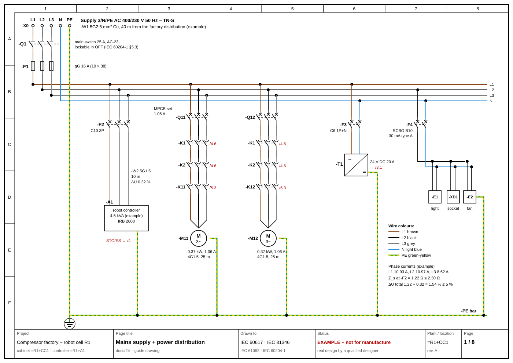
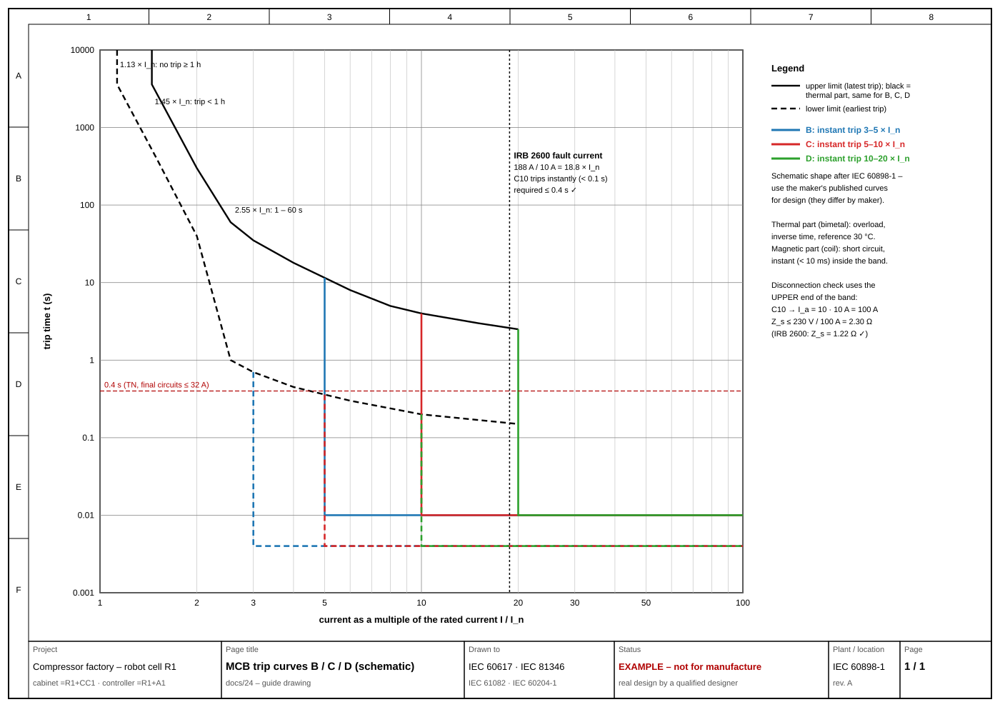
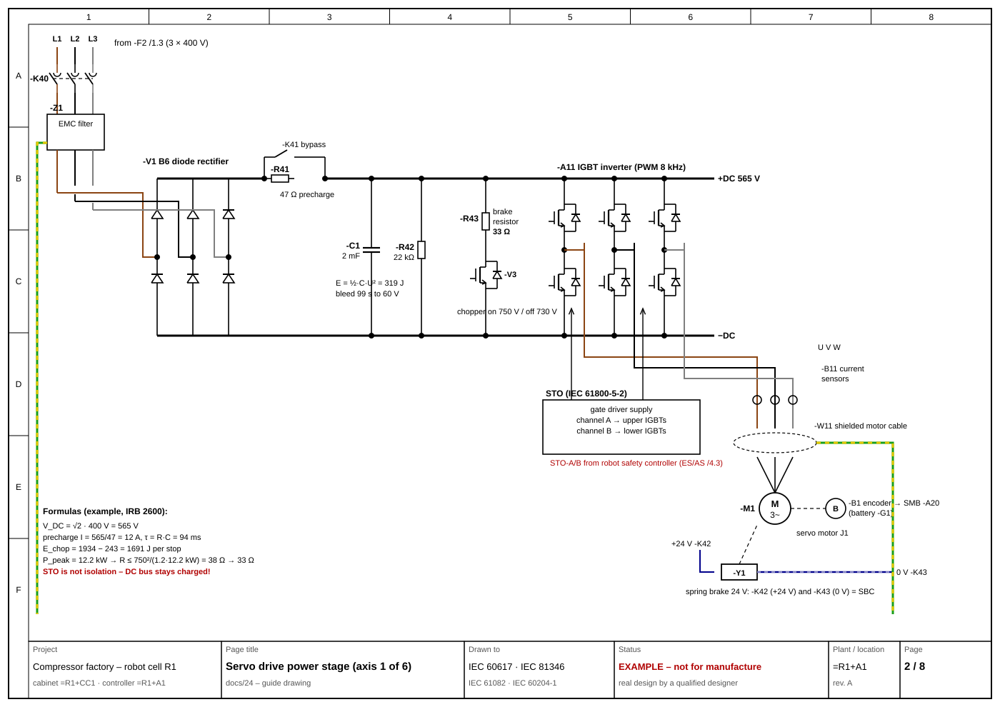
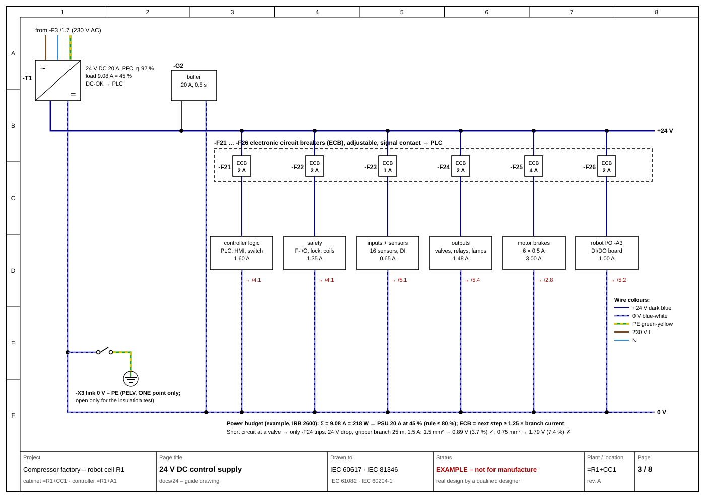
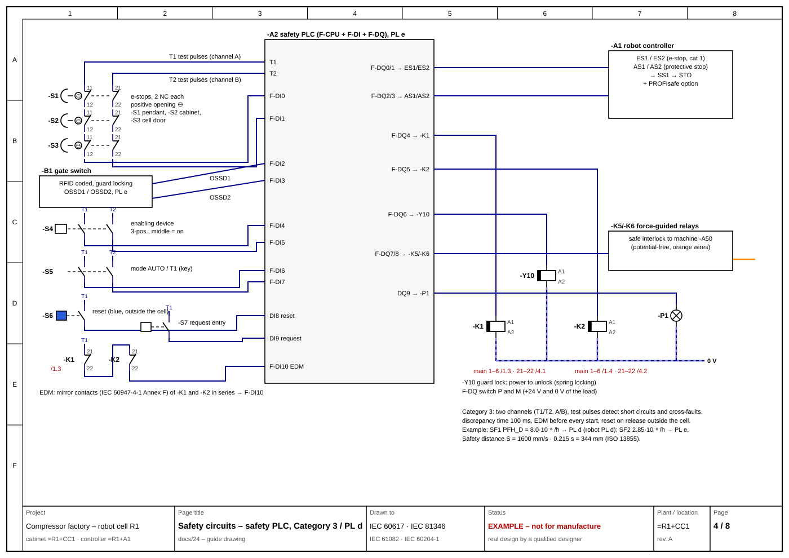
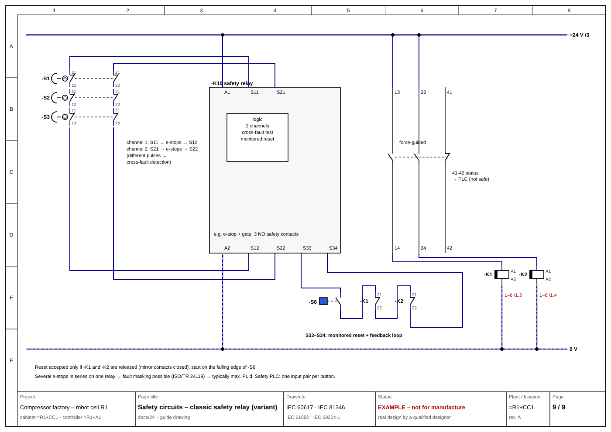
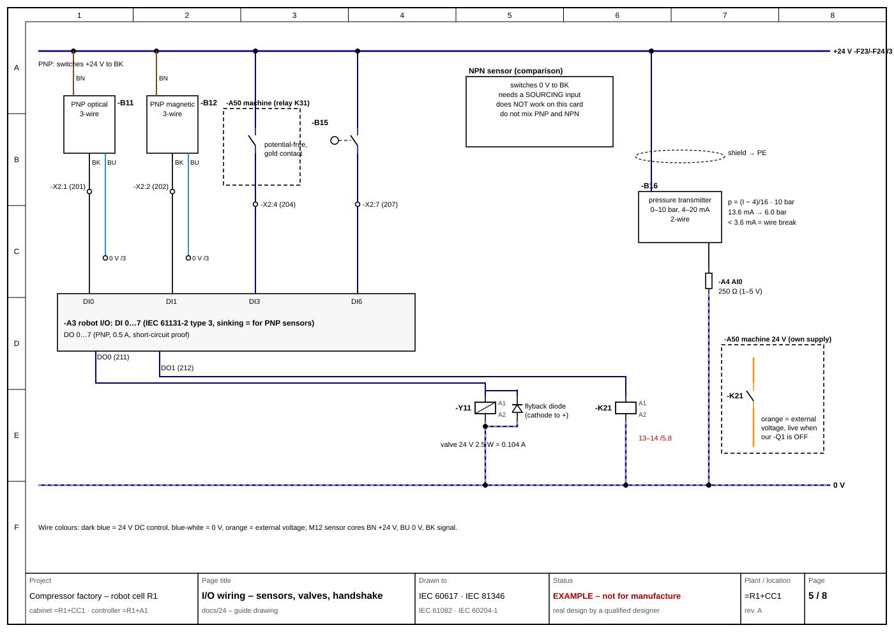
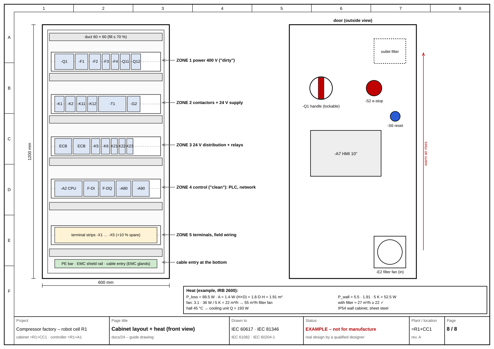

# 24 – Industrial robot: the control circuits (electrical schematics) – textbook, reference and design guide

**For whom:** mechanical engineers who plan a real robot cell and want to understand – and check – the electrical
drawings of it: the 400 V supply and its protection, the servo drive inside the robot controller, the 24 V control
supply, the safety circuits, the I/O wiring, the network, earthing / EMC, the control cabinet, the tests, and what to buy.

**Where to see it live:** tab **Industrial robot** → button **"3 · Control circuits"** (files `web/robotckt.js` = page,
`web/robotckt_pages.js` = the 9 drawing pages, `web/robotckt_sym.js` = symbols + drawing frame, `web/robotckt_calc.js` =
all calculations). Deep link: `/?rbitem=3#robot`, one page: `/?rbitem=3&ckpage=4#robot`.

> **All numbers are examples or estimates.** The worked examples use the robot **IRB 2600-20/1.65** (catalogue data of
> item 1) with an assumed controller power of **4.5 kVA**. The real design follows **IEC 60204-1** (electrical equipment
> of machines), **IEC 60364** (installation), **ISO 13849-1/-2** (safety of control systems), **ISO 10218-1/-2** (robots),
> the **robot supplier's manuals** – and it is made and signed by a **qualified electrical designer**.
> Product names in chapter 17 are **catalogue examples**, not a recommendation; prices are **estimates – ask for a quote**.

**Related guides (read them instead of repeating them here):**
[23 – robot control system](23_robot_control_system.md) (the controller from the inside: DC bus model, servo loops, stop
categories, safety states) · [27 – installation electrical + EMC](27_installation_electrical_emc.md) (factory supply,
transformer, short-circuit currents, selectivity with LSI breakers, RCD type B, surge protection, earthing system,
cable categories and segregation) · [16 – standards register](16_standards_register.md) · [15 – numbering and
identification](15_numbering_and_identification.md).

---

## Contents

**Part A – Using the page and reading drawings**
1. [Item 3 of the robot tab – the 9 schematic pages and how to use them](#1-item-3-of-the-robot-tab--the-9-schematic-pages-and-how-to-use-them)
2. [Electrical drawing standards – how a drawing set is built](#2-electrical-drawing-standards--how-a-drawing-set-is-built)
3. [Circuit theory you need](#3-circuit-theory-you-need)

**Part B – Power circuits**
4. [Mains supply and protection (page 1)](#4-mains-supply-and-protection-page-1)
5. [Contactors and relays](#5-contactors-and-relays)
6. [Servo drive power stage (page 2)](#6-servo-drive-power-stage-page-2)
7. [24 V DC control supply (page 3)](#7-24-v-dc-control-supply-page-3)

**Part C – Safety**
8. [Safety circuits with a safety PLC (page 4)](#8-safety-circuits-with-a-safety-plc-page-4)
9. [The classic variant with a safety relay (page 9)](#9-the-classic-variant-with-a-safety-relay-page-9)

**Part D – Signals, networks, EMC**
10. [I/O technology and wiring (page 5)](#10-io-technology-and-wiring-page-5)
11. [Fieldbus and network (page 6)](#11-fieldbus-and-network-page-6)
12. [Earthing, shielding, EMC (page 7)](#12-earthing-shielding-emc-page-7)

**Part E – Cabinet, wiring, tests, documents**
13. [Cabinet design and heat (page 8)](#13-cabinet-design-and-heat-page-8)
14. [Wiring practice](#14-wiring-practice)
15. [Testing and commissioning](#15-testing-and-commissioning)
16. [Documentation set and E-CAD tools](#16-documentation-set-and-e-cad-tools)

**Part F – Buying**
17. [Buy list – catalogue examples per component group](#17-buy-list--catalogue-examples-per-component-group)
18. [Consolidated shopping list (BOM) for the IRB 2600 cell](#18-consolidated-shopping-list-bom-for-the-irb-2600-cell)

**Part G – Reference**
19. [Troubleshooting table](#19-troubleshooting-table)
20. [Questions for the robot supplier, the electrical designer and the component sellers](#20-questions-for-the-robot-supplier-the-electrical-designer-and-the-component-sellers)
21. [Formula sheet](#21-formula-sheet)
22. [Standards register for this guide](#22-standards-register-for-this-guide)
23. [Glossary](#23-glossary)
24. [Checklists](#24-checklists)

### How the numbers were checked

Every number in this guide was recomputed by hand with a small Python script (standard library only) and compared with
the app code (`web/robotckt_calc.js`). The app also checks itself: open `/?rbitem=3&cktest#robot`, the results are in the
browser console.

| Check | Result |
|---|---|
| Formulas by hand vs code | I = 4500/(√3·400) = 6.495 A ✓ · ΔU (10 m, 1.5 mm²) = 0.318 % ✓ · ½·C·(750² − 565²) = 243.3 J ✓ · 750²/40 = 14 063 W ✓ · 24 V drop 1.786 V ✓ · V̇(36.1 W, 5 K) = 22.4 m³/h ✓ |
| Safety logic, 17 scenarios | e-stop → cat 1 (SS1 150 ms) → STO; reset refused while pressed; release + reset → running; gate locked → open refused; request entry → stop → unlock; short A–B → fault, cat 0, reset refused until repaired; K1 welded → EDM fault, conveyor stopped by K2, reset refused; OSSD2 stuck → discrepancy fault; T1: enabling released / panic → protective stop; T1 + gate open + enabling → robot jogs, conveyors stay off; main switch off → all off |
| Cross-references | 24 automatic references, e.g. -K1 coil /4.4, -K1 main contacts /1.3, -K1 mirror contact /4.8 |
| Item switch 1 ↔ 2 ↔ 3 | no console errors; item-1 3D view 942 × 618 px after the switch; item-3 animation pauses when hidden and restarts |
| All four robots (Python replica of `calc()`) | feed current, MCB, cable, ΔU, phase currents, main fuse, main switch, loop impedance, 24 V budget, ECB settings, brake resistor – all identical to the app (tables 4.10 and 6.6) |

**Key results for the IRB 2600 cell (example)** – you will meet each of them again with its formula:

| Quantity | Value | Chapter |
|---|---|---|
| Robot controller feed | 6.50 A → MCB **C10**, cable **5G1.5**, ΔU **0.32 %** | 4.8 |
| Cabinet phase currents | L1 10.93 / L2 10.97 / L3 8.62 A → **-F1 16 A gG**, **-Q1 25 A**, supply **5G2.5**, total ΔU **1.54 %** | 4.9 |
| Fault loop impedance | Z_s = **1.22 Ω ≤ 2.30 Ω** (C10) | 4.11 |
| 24 V control supply | **9.08 A** (218 W) → **20 A PSU** (45 %) | 7.3 |
| DC bus | **319 J** at 565 V, bleed **99 s** to 60 V, precharge **12 A**, τ **94 ms** | 6.2 |
| Braking (J1–J3 stop) | **1 691 J** to the resistor, **12.2 kW** peak → **33 Ω** | 6.4 |
| Safety response time | **0.215 s** → safety distance **344 mm** (interlocked gate) | 8.9 |
| PL of the e-stop function | PFH_D **8.0·10⁻⁸ /h** → **PL d** (robot subsystem limits) | 8.6 |
| Cabinet heat | **88.5 W** loss − **52.5 W** through the walls → fan **22 m³/h** (55 m³/h filter fan) | 13.4 |

---

# PART A – Using the page and reading drawings

## 1. Item 3 of the robot tab – the 9 schematic pages and how to use them

### 1.1 What the page is

Item 3 of the **Industrial robot** tab is a small **electrical drawing set** of one robot cell (cell R1 of the compressor
factory: robot + conveyors + CNC machine + safety fence). It is drawn like a real set made with an E-CAD tool: each page
has a frame, columns 1–8, rows A–F and a title block. The status field says **"EXAMPLE – not for manufacture"** – this is a
teaching set, not a buildable design.

Unlike a paper drawing, the page is **live**: the contacts move, the wires are coloured when they carry voltage, the
safety logic runs, and the numbers follow the robot you select.

### 1.2 The screen, from top to bottom

| Part | What it does |
|---|---|
| **Robot selector** | IRB 120 (1 kVA, single phase), IRB 2600 (4.5 kVA), IRB 4600 (7.5 kVA), IRB 6700 (12 kVA). All calculations, cable sizes, fuses, the brake resistor, the 24 V budget and the safety distance change with it. |
| **-Q1 button** | main switch ON / OFF (everything goes dead when OFF, like the real cell). |
| **E-stop button** | presses the e-stop on the teach pendant (-S1). |
| **Gate button** | opens / closes the cell door (-B1 with guard locking). |
| **Reset -S6** | the blue reset button outside the cell. |
| **Status chips** | robot state, conveyor state, safety PLC state, faults. |
| **Page buttons 1–9** | the 9 drawing pages (table 1.3). |
| **Drawing (sheet)** | the schematic. **Click any device** → information box: what it is, rating for the selected robot, why it is there, what to check, typical failure. |
| **Controls under the drawing** | page-specific buttons: fault injection, short circuits, EMC faults, enabling device, mode selector, event log. |
| **Extra tables** | page-specific tables: branches, servo axes, braking energy, 24 V budget, PL verification, signal list, network plan, layout rules, relay vs PLC. |
| **Card C – Calculations** | 19 checks: formula → numbers → result for the selected robot. |
| **Card D – Component list (BOM)** | every device with tag, description, rating, generic product type, quantity (the basis of chapter 18). |
| **Card E – Test + commissioning** | 15 tests in the right order with acceptance values (chapter 15). |
| **Card F – Legend** | all symbols drawn, device letters, wire colours (chapter 2). |

### 1.3 The 9 pages

| Page | Title | What you learn | Chapter |
|---|---|---|---|
| 1 | Mains supply + power distribution | TN-S supply, main switch -Q1, fuses -F1, MCBs, conveyor motors with safety contactors -K1/-K2 and MPCBs -Q11/-Q12, 24 V PSU feed, RCBO for light and socket, PE bar | 4 |
| 2 | Servo drive power stage (axis 1 of 6) | drive contactor, EMC filter, rectifier, DC bus with capacitors, precharge, bleed resistor, brake chopper + resistor, IGBT inverter, STO, holding brake (SBC), encoder; live DC-bus chart | 6 |
| 3 | 24 V DC control supply | PSU -T1, buffer -G2, six electronic circuit breakers -F21…-F26, 0 V–PE link -X3 (PELV), power budget | 7 |
| 4 | Safety circuits – safety PLC (dual channel) | e-stops, coded gate switch with guard locking, enabling device, mode selector, reset, request entry, EDM loop, safe outputs to the robot (ES/AS), to -K1/-K2, to the guard lock and to the machine | 8 |
| 5 | I/O wiring | PNP sensors, NPN for comparison, machine contacts, limit switch, valve with flyback diode, interposing relays, 4–20 mA transmitter, signal list | 10 |
| 6 | Fieldbus + network | PROFINET star + line, PROFIsafe, HMI, machine, firewall to the MES, network plan with names and IP addresses | 11 |
| 7 | Earthing, shielding, EMC | PE star, mounting plate, 360° shield clamps, separation, filter at the entry, 0 V earthing, flyback diodes; 5 typical faults to show | 12 |
| 8 | Cabinet layout + heat | front view of the mounting plate and the door, zones, ducts, heat calculation | 13 |
| 9 | Safety circuits – classic safety relay (variant) | e-stop chain on a safety relay, feedback loop, monitored reset; reacts to the same e-stop buttons | 9 |

### 1.4 How to use it – a 20-minute tour

1. Select **IRB 2600**. Open **page 1**. Switch **-Q1 ON**, switch the conveyors on (-K11/-K12). Watch the orange live
   paths. Click **-F2** and read its information box (C10 A, cable 1.5 mm²).
2. Press the **e-stop -S2**: -K1 and -K2 drop, the conveyors stop. Tick **"-K1 welded"** and repeat: the motor still stops
   because -K2 opens – this is redundancy. Reset is refused until the "weld" is repaired – this is EDM.
3. Open **page 2**, press the pendant e-stop: the axes brake, the DC bus rises to ≈ 754 V, the chopper fires (red band).
   Compare the live numbers with chapter 6.
4. Open **page 3**, press **"short circuit at a valve"**: only -F24 trips; the safety PLC, sensors and brakes keep 24 V.
   Open the link **-X3**: the 0 V floats (warning) – close it again.
5. Open **page 4**. Press each e-stop, open the gate, use **request entry**, switch to **T1**, try the enabling device
   (released / middle / panic). Inject **short A–B** and **OSSD2 stuck**. Read the event log: event → reaction → stop category.
6. Open **page 5** and start the robot program in item 1 (Run): the inputs and outputs follow the real program.
7. Open **page 7** and show each EMC fault: it is drawn in red with its symptom.
8. Open **page 8**: compare the heat numbers with chapter 13.
9. Open **page 9**: the same e-stops on a safety relay.
10. Scroll to **cards C–F**. Change the robot to IRB 6700 and see which values change (feed C25, 5G4, 12 Ω resistor …).

### 1.5 URL parameters (deep links, tests, screenshots)

| Parameter | Effect |
|---|---|
| `&rbitem=3` | open item 3 |
| `&ckpage=1…9` | open that drawing page |
| `&ckrb=irb4600` | select a robot |
| `&ckestop` | pendant e-stop pressed |
| `&ckgate` | gate opened after a request |
| `&ckcross` | short circuit channel A–B |
| `&ckweld` | -K1 welded, then e-stop |
| `&ckstuck` | gate OSSD2 stuck, gate opened |
| `&ckshort` | valve short circuit, -F24 trips |
| `&ckt1` | mode T1 |
| `&ckq1off` | main switch off |
| `&ckemc=pigtail\|peloop\|zero\|diode\|parallel` | show one EMC fault on page 7 |
| `&ckinfo=K1` | open the information box of a device |
| `&ckcard=calc\|bom\|test\|legend` | scroll to a card |
| `&cktest` | self-check of numbers and logic (browser console) |
| `&ckback` | switch to item 1, 2, back to 3 and report errors |

Example: `/?rbitem=3&ckpage=4&ckweld#robot` opens the safety page with a welded contactor.

### 1.6 The drawings in this guide

Besides the live pages, this guide contains eight static drawings in the same style (frame with columns 1–8 and rows
A–F, IEC 60617 symbols, IEC 81346 tags, cross-references `/page.column`, IEC wire colours, title block **"EXAMPLE – not
for manufacture"**). They work offline (plain SVG files in `docs/img/`) and can be printed on A3.

| Drawing | File | Chapter |
|---|---|---|
| Mains supply + power distribution | `img/24_mains_distribution.svg` | 4 |
| MCB trip curves B / C / D | `img/24_mcb_trip_curves.svg` | 4.3 |
| Servo drive power stage | `img/24_servo_power_stage.svg` | 6 |
| 24 V DC control supply | `img/24_24V_supply.svg` | 7 |
| Safety circuit Category 3 with safety PLC | `img/24_safety_circuit_cat3.svg` | 8 |
| Safety relay variant | `img/24_safety_relay_variant.svg` | 9 |
| I/O wiring | `img/24_io_wiring.svg` | 10 |
| Cabinet layout + heat | `img/24_cabinet_layout.svg` | 13 |

---

## 2. Electrical drawing standards – how a drawing set is built

### 2.1 The standards behind a drawing

| Standard | What it fixes | Where you see it |
|---|---|---|
| **IEC 61082-1** | rules for electrotechnical documents: types of diagrams, layout, line types, cross-references, page frames | page structure of all 9 pages |
| **IEC 81346-1/-2** | reference designations (device tags) and the letter codes for classes of objects | `-K1`, `=R1+CC1-K1:13` |
| **IEC 60617** (database) | graphical symbols | contacts, coils, fuses, motors, card F |
| **IEC 60204-1** | electrical equipment of machines: wire colours, push-button and lamp colours, protection, tests | colours, chapter 15 |
| **IEC 60445** | identification of conductors and terminals (L1/L2/L3, N, PE, U/V/W, A1/A2) | terminal names |
| **IEC 62491** | labelling of cables and cores | wire markers |
| **ISO 7200** | data fields in title blocks | title block |
| **IEC 61355** | classification of documents (document kind codes) | document numbering |

### 2.2 Kinds of documents in a set

| Document | Content | Who uses it |
|---|---|---|
| **Cover sheet + table of contents** | project, revision list, page list | everyone |
| **Single-line (overview) diagram** | the power path in one line per circuit | designer, installer |
| **Circuit diagram (schematic)** | every conductor, every contact, in the de-energised state | electrician, service – this is what the app shows |
| **Cabinet layout** | front view of the mounting plate and door, dimensions, ducts | panel builder |
| **Terminal diagram** | each terminal strip: terminal no., inner wire, outer cable core, jumpers | installer |
| **Cable list / cable plan** | each cable: tag, type, cores, length, from – to | installer, purchasing |
| **Connection (wiring) list** | every wire from – to with cross-section and colour (for wire processing machines) | panel builder |
| **PLC I/O overview** | each I/O address with its signal and terminal | programmer, commissioning |
| **Bill of materials (BOM)** | each device with order number and quantity | purchasing |
| **Device datasheets + certificates** | PFH_D, B10_D, UL / CE | safety validation |

### 2.3 The page frame and the cross-reference system

A real set (made with EPLAN, E3.series, WSCAD, AutoCAD Electrical …) has **pages**. Each page has a **frame** with
**columns 1–8** at the top and rows **A–F** at the side, and a **title block** at the bottom. The app draws its 9 pages the
same way.

* **Power flows from top to bottom** (or left to right on the drive page). Contacts are drawn in the **normal (unpowered,
  not actuated) state** in a paper drawing. In the app the **live view** draws a switched contact in its actual position
  and in **orange**.
* **Cross-reference `/4.6`** = page 4, column 6. Some tools add the row: `/4.6B` or `4.6`.
* **Contact image (contact mirror)**: under every contactor coil the tool prints a small table of its contacts with
  their page/column: e.g. under -K1: `1–2 /1.3`, `3–4 /1.3`, `5–6 /1.3`, `21–22 /4.8`. Each contact shows back where its
  coil is (`-K1 /4.4`). This is how you follow a signal through a 100-page drawing.
* **Potential (interruption) arrows**: a wire leaving a page ends with an arrow and the target (`→ /3.1 +24V`).

### 2.4 Reference designation – IEC 81346

The tag says **what** the object does (function), **what** it is (product) and **where** it is (location):

| Prefix | Aspect | Example | Meaning |
|---|---|---|---|
| `=` | function | `=R1` | robot cell 1 (the plant section) |
| `+` | location | `+CC1` | cell cabinet 1 |
| `-` | product | `-K1` | device K1 |
| `:` | terminal | `:13` | terminal 13 of that device |
| `#` | other aspect | rarely used | |

Full tag `=R1+CC1-K1:13` = plant R1, location cabinet CC1, device K1, terminal 13. The app uses `=R1+CC1` for the cell
cabinet and `=R1+A1` for the robot controller (title block).

**Device letters (IEC 81346-2, single-letter classes as used in the app):**

| Letter | Class | Examples in the app |
|---|---|---|
| A | assembly, PLC, controller, drive | -A1 robot controller, -A2 safety PLC, -A80 switch |
| B | sensor, encoder, transmitter | -B1 gate switch, -B11 optical sensor, -B16 pressure transmitter |
| C | capacitor | -C1 DC-bus capacitors |
| E | light, heater, fan | -E1 cabinet light, -E2 filter fan |
| F | protective device (fuse, MCB, ECB, RCD) | -F1, -F2, -F21 … -F26 |
| G | battery, buffer, generator | -G1 SMB battery, -G2 buffer module |
| K | relay, contactor, safety relay | -K1/-K2 safety contactors, -K21 interposing relay |
| M | motor | -M1 servo motor, -M11 conveyor motor |
| P | lamp, meter, display | -P1 reset lamp |
| Q | power switching (main switch, MPCB, power contactor) | -Q1, -Q11 |
| R | resistor | -R41 precharge, -R42 bleed, -R43 brake resistor |
| S | push button, switch, e-stop | -S1 … -S7 |
| T | transformer, power supply | -T1 24 V PSU |
| V | semiconductor (rectifier, IGBT) | -V1 rectifier, -V3 chopper |
| W | cable, conductor | -W1 supply cable, -W11 motor cable |
| X | terminal, plug, socket | -X0, -X2, -XD1 |
| Y | valve, brake, lock solenoid | -Y1 brake, -Y10 guard lock, -Y11 valve |
| Z | filter | -Z1 EMC filter |

> The **2019 edition of IEC 81346-2** uses **two-letter** subclasses (for example `-QA` for a contactor that switches
> power, `-KF` for a relay or PLC that processes signals, `-MA` for an electric motor). Many companies still use single
> letters (as the app does). Fix one system in the project's **drawing standard** at the start and use it everywhere –
> including the labels in the cabinet.

### 2.5 Symbols (IEC 60617, as used in the app – card F shows them drawn)

| Symbol | Meaning |
|---|---|
| contact with blade, open | **NO** contact (normally open): closes when actuated |
| contact with blade + small hook | **NC** contact (normally closed): opens when actuated |
| semicircle on the fixed contact | **contactor** main contact |
| × on the fixed contact | **circuit breaker** (MCB, MPCB) – trips by itself |
| bar on the fixed contact + rotary handle | **disconnector / main switch** (isolating) |
| rectangle with a line through | **fuse** |
| rectangle on a wire (A1–A2) | **coil** of a relay / contactor; thick left edge = safety relay / safety contactor |
| rectangle with a diagonal | **solenoid valve** coil |
| mushroom head + circle with arrow (⊖) | **emergency-stop** button, NC contact with **positive opening** |
| "E"-shape / key / triangle / bracket on a dashed link | push button / key switch / position switch / enabling device |
| ϑ | thermostat (temperature switch) |
| circle with M 3~ | 3-phase motor |
| circle with X | indicator lamp |
| triangle + bar | diode (conducts in the arrow direction) |
| transistor with gate + diode | IGBT with free-wheeling diode |
| earth symbol in a circle | protective earth **PE**; without circle = functional / shield earth |
| small open circle / filled dot | terminal / connection (wires joined) |
| dashed line | mechanical link (all parts belong to one device) |
| dashed ellipse around wires | cable shield |
| box with ~ and = | power supply / rectifier (AC → DC) |

### 2.6 Terminal names (IEC 60445 and maker practice)

| Terminals | Meaning |
|---|---|
| L1, L2, L3, N, PE | supply side |
| U, V, W (U1/V1/W1) | motor side |
| 1–2, 3–4, 5–6 | main contacts of a contactor / MPCB (odd = line side, even = load side) |
| 13–14, 23–24, 43–44 | auxiliary **NO** contacts (second digit 3–4 = NO) |
| 11–12, 21–22, 31–32 | auxiliary **NC** contacts (second digit 1–2 = NC); first digit = position number |
| 15–16–18 | change-over (CO) contact: 15 common, 16 NC, 18 NO (relays: 11–12–14) |
| A1–A2 | coil (A1 = +, A2 = −/0 V for DC coils) |
| S11–S12, S21–S22, S33–S34 | safety relay inputs and reset loop (Pilz-style, common) |
| T1/T2 (or T0/T1) | test-pulse outputs of a safety controller |

### 2.7 Wire numbering methods

| Method | How | + | − |
|---|---|---|---|
| **Potential numbering** | every electrically connected node gets one number (e.g. all wires of +24 V branch F23 = "23") | simple, few numbers | you cannot see the target |
| **Page-path numbering** | number = page + column + index, e.g. `4.6.1` | number tells where to look | changes when the drawing is re-arranged |
| **Destination (source/target) marking** | each wire end carries the address of the **other** end, e.g. `-K1:A1 / -X4:5` | fastest fault finding | long markers, expensive |
| **Signal numbering** | the wire takes the PLC address / signal name (e.g. `201` for A3.DI0) | links I/O list and wires | only for signal wires |

The app uses a mix that is common in practice: **signal wires** are numbered like their I/O (201…221 robot I/O,
401…406 safety inputs, 501…506 safety outputs – see the signal list, chapter 10.9).

**Rules:** one wire number per potential, printed markers at **both ends**, readable without removing the wire, the
same number in the drawing, the terminal plan and the cabinet.

### 2.8 Title block

The title block (ISO 7200 fields) at the bottom of each page holds: **company, project, plant/location designation,
page title, page number / total, document number, revision index with date and name, drawn / checked / approved,
status** (e.g. "for approval", "for manufacture", "as built"). The app's title block shows: project "Compressor factory
– robot cell R1", page title, robot / controller, "Drawn to IEC 60617 · 81346 · 60204-1", status **"EXAMPLE – not for
manufacture"** and page number.

### 2.9 Colours (IEC 60204-1, IEC 60445)

**Wire colours (cabinet wiring, IEC 60204-1 §13.2.4 recommends):**

| Conductor | Colour | Rule |
|---|---|---|
| L1 / L2 / L3 | brown / black / grey | IEC 60445 for cable cores; inside the cabinet IEC 60204-1 §13.2.4 recommends **black** for all AC/DC power |
| N | light blue | never use light blue for anything else |
| PE | green-yellow | only for PE |
| DC power (DC bus) | black | IEC 60204-1 |
| AC control | red | |
| DC control (+24 V / 0 V) | dark blue (0 V often blue-white) | IEC 60204-1 |
| interlock from an external supply | **orange** | stays live when the main switch is OFF – warning label! |
| sensor cable (M12) | BN brown +24 V, BU blue 0 V, BK black signal, WH white 2nd signal | IEC 60947-5-2 |
| PROFINET | green sheath | |

**Push-button colours (IEC 60204-1 §10.2):**

| Colour | Meaning | Example in the cell |
|---|---|---|
| red (on yellow background) | emergency stop | -S1, -S2, -S3 |
| black / grey / white (red allowed, but not near an e-stop) | stop / off | conveyor stop |
| white / grey / black / green (white preferred) | start / on | cycle start |
| blue | mandatory action (reset) | -S6 reset |
| yellow | abnormal condition, intervention | – |

**Indicator lamp colours (IEC 60204-1 §10.3):** red = emergency / dangerous, yellow = abnormal, blue = mandatory action
(e.g. "reset needed", -P1), green = normal, white = neutral information.

---

## 3. Circuit theory you need

You do not need to design a drive. You need a few laws to check the numbers in a drawing.

### 3.1 Ohm's law, power, energy

| Law | Formula | Units |
|---|---|---|
| Ohm | U = R · I | V = Ω · A |
| Power (DC, resistive AC) | P = U · I = I² · R = U² / R | W |
| Energy | E = P · t | J = W · s; 1 kWh = 3.6 MJ |
| Conductor resistance | R = L / (κ · A) | κ(Cu) = 56 m/(Ω·mm²) at ≈ 20 °C |
| Temperature effect | R_θ = R₂₀ · (1 + α·(θ − 20)), α(Cu) = 0.00393 /K | at 70 °C: 1 + 0.00393·50 = **1.20** (the factor 1.2 used in chapter 4) |

**Worked example (example values) – 24 V contactor coil 3 W:** I = P / U = 3 / 24 = **0.125 A**,
R = U² / P = 24² / 3 = **192 Ω**. A valve coil 2.5 W: I = 0.104 A, R = 230 Ω.

**Worked example – resistance of 10 m of 1.5 mm² copper (one conductor):** R = 10 / (56 · 1.5) = **0.119 Ω**.

### 3.2 Three-phase power

In a 400/230 V system the line-to-line voltage is √3 × the line-to-earth voltage: 230 · √3 = **398 V ≈ 400 V**.

| Quantity | Formula | IRB 2600 controller (example) |
|---|---|---|
| Apparent power | S = √3 · U · I | S = 4.5 kVA |
| Current | I = S / (√3 · U) | 4500 / (1.732 · 400) = **6.50 A** |
| Active power | P = S · cos φ | 4.5 · 0.95 = **4.28 kW** |
| Reactive power | Q = S · sin φ = S · √(1 − cos²φ) | 4.5 · √(1 − 0.95²) = **1.41 kvar** |
| Motor current | I = P_shaft / (√3 · U · η · cos φ) | 0.37 kW conveyor: 370 / (1.732 · 400 · 0.69 · 0.73) = **1.06 A** |

The motor takes P_in = 370 / 0.69 = 536 W of active power and S = 536 / 0.73 = 735 VA from the mains.

### 3.3 Power factor and harmonics in short

* **cos φ** (displacement factor) = phase shift between voltage and current of the 50 Hz wave. Motors: 0.7–0.85.
* **Power factor λ = P / S** also includes harmonics. A diode rectifier (drive, PSU without PFC) draws current in short
  pulses → λ ≈ 0.6–0.95 even when cos φ ≈ 1. A PSU **with PFC** (power-factor correction) reaches λ ≈ 0.98 – the app uses 0.98.
* Harmonics heat the neutral and transformers. Factory-level details: [docs/27 §A.12](27_installation_electrical_emc.md).

### 3.4 Inrush currents – why curve C, aM fuses and NTCs exist

| Load | Typical inrush (examples) | Duration | Consequence |
|---|---|---|---|
| DOL induction motor | 6–8 × I_n (app: 6 × 1.06 = 6.4 A) | 0.1–5 s | MPCB magnetic trip far above it (often ≈ 13 × the upper setting – see datasheet), aM fuses |
| servo drive with precharge | limited by the precharge resistor (12 A, chapter 6.3) | 0.5 s | MCB curve C |
| switched-mode PSU | 30–60 A peak (capacitor charging, limited by an NTC or electronics) | < 5 ms | MCB curve C, check datasheet |
| transformer | 10–15 × I_n first half cycle | 10–20 ms | curve D or MCCB setting |
| contactor coil (AC coils) | 6–10 × holding power | 1 cycle | DC coils (as in the app) have no inrush problem |
| lamps, heaters (cold) | incandescent 10–15 ×, LED drivers 20–60 A peak | ms | contactor rating AC-5b / relay inrush rating |

### 3.5 RC and RL circuits – time constants and stored energy

| Circuit | Formula | Where in this guide |
|---|---|---|
| Capacitor energy | E = ½ · C · U² | DC bus 319 J (chapter 6.2) |
| Capacitor charge / discharge | u(t) = U₀ · e^(−t/τ), τ = R · C; time to fall to U₁: t = R·C·ln(U₀/U₁) | bleed time 99 s, precharge τ 94 ms |
| Inductor energy | E = ½ · L · I² | coil switch-off spike (chapter 10.6) |
| Inductor current decay | i(t) = I₀ · e^(−t/τ), τ = L / R | drop-out delay of a contactor with a diode |
| Induced voltage | u = L · di/dt | hundreds of volts at switch-off without a suppressor |

**Worked example (example values) – contactor coil 3 W, L ≈ 0.5 H (assumed; real value: see datasheet):**
E = ½ · 0.5 · 0.125² = **3.9 mJ** per switch-off. With a free-wheeling diode the current decays with
τ = L / R = 0.5 / 192 = **2.6 ms** → the contactor opens later (chapter 10.6).

---

# PART B – Power circuits

## 4. Mains supply and protection (page 1)

**What page 1 shows:** TN-S supply 3/N/PE AC 400/230 V 50 Hz → terminals -X0 → main switch **-Q1** (lockable) → main fuses
**-F1** → busbars → branches: robot controller (**-F2**), conveyors (safety contactors **-K1/-K2**, motor-protective breakers
**-Q11/-Q12**, function contactors **-K11/-K12**, motors **-M11/-M12**), 24 V supply (**-F3 → -T1**), light + socket + fan
(**-F4**, RCBO 30 mA), PE bar.

The factory side (transformer, main distribution, line feeder, short-circuit currents, selectivity with LSI breakers, surge
protection) is in [docs/27 Part A](27_installation_electrical_emc.md). This chapter starts at the cell cabinet terminals -X0.

### 4.1 Earthing systems (IEC 60364-1) – what the letters mean

First letter = how the **source** (transformer star point) is earthed; second letter = how the **exposed metal parts** of
the machine are earthed; S / C = separate or combined N and PE.

| System | Source | Machine housings | N and PE | Protection against shock (indirect contact) | Use in a factory |
|---|---|---|---|---|---|
| **TN-S** | earthed | via a separate PE back to the source | separate along the whole way | overcurrent device (MCB, fuse) disconnects – fault current is a short circuit | **best for machines and EMC** (the app) |
| **TN-C** | earthed | via the PEN | combined (PEN) | overcurrent device | old installations; PEN carries load current → noise on "earth"; not allowed below 10 mm² Cu |
| **TN-C-S** | earthed | PEN up to a point, then separate | PEN split **once** in the main distribution | overcurrent device | common; after the split never join N and PE again |
| **TT** | earthed | own local earth electrode | separate | **RCD** needed (fault current flows through the soil, too small for an MCB) | rural supplies; condition R_A · I_Δn ≤ 50 V |
| **IT** | not earthed (or high impedance) | earthed locally | – | first fault: only an alarm (insulation monitoring device IEC 61557-8); second fault: disconnect | process plants, hospitals, some ships |

**Worked example (TT, example):** with a 30 mA RCD the earth electrode may have R_A ≤ 50 V / 0.03 A = **1 667 Ω**; with a
300 mA type B RCD for a drive: R_A ≤ 50 / 0.3 = **167 Ω**.

**TN-S** = the supply brings 5 conductors: L1, L2, L3, N and a separate PE. A short circuit L → housing becomes a short
circuit L → PE that trips the MCB quickly (protection by automatic disconnection of supply, IEC 60364-4-41).

### 4.2 The main switch – supply disconnecting device (IEC 60204-1 §5.3)

**Why:** one device that switches off **all** live conductors of the machine, can be **locked in OFF** with padlocks
(lock-out / tag-out before any work in the cell), and shows its position clearly.

| Requirement (IEC 60204-1 §5.3) | Meaning |
|---|---|
| type | switch-disconnector to IEC 60947-3 (utilisation category **AC-23B** for motor loads), or a circuit breaker suitable for isolation, or a plug ≤ 16 A / 3 kW |
| one per supply | each incoming supply has its own |
| isolation | one OFF position, contact gaps as for a disconnector, position indicated only when all contacts are really open |
| handle | external, operable from outside; **black or grey** – or **red on yellow** when it is also used as the emergency switching-off device |
| lockable | padlock(s) in OFF only |
| rating | ≥ sum of all running loads + largest motor start current |
| excepted circuits | circuits that stay live (socket, light for maintenance, interlocks from other machines) → own disconnector, **orange wires**, warning label (§5.3.5) |

**Example (app):** -Q1 = **25 A** 3-pole, AC-23, rotary handle on the door with door interlock, lockable in OFF.

### 4.3 Miniature circuit breakers (MCB) – IEC 60898-1 and IEC 60947-2

An MCB has two trip elements:

* **thermal** (bimetal) for overload – inverse time;
* **magnetic** (coil) for short circuit – instantaneous (< 10 ms).

| Curve | Magnetic trip band (IEC 60898-1) | For | C10 example |
|---|---|---|---|
| **B** | 3 – 5 × I_n | long cables, resistive loads, sockets, light | trips instantly between 30 and 50 A |
| **C** | 5 – 10 × I_n | general, small motors, PSUs, drives with precharge | **50 – 100 A** |
| **D** | 10 – 20 × I_n | transformers, big inrush | 100 – 200 A |
| K, Z (IEC 60947-2 types) | maker-specific (K high, Z low) | motors / semiconductors | see datasheet |

**Thermal part (IEC 60898-1, reference 30 °C):** at **1.13 × I_n** no trip within 1 h (conventional non-tripping current);
at **1.45 × I_n** trip within 1 h (conventional tripping current I₂); at 2.55 × I_n trip in 1 – 60 s (I_n ≤ 32 A).

**Design rule:** for the disconnection check use the **upper** end of the magnetic band (10 × I_n for C). That is what the
app does: I_a = 10 · 10 A = 100 A for the C10.

**Breaking capacity:** I_cn = 6 000 A or 10 000 A (IEC 60898-1, household/commercial) or I_cu / I_cs (IEC 60947-2,
industrial). It must be ≥ the prospective short-circuit current at the point of installation (chapter 4.7).

**Energy limiting class 3** = the MCB limits the let-through energy I²t strongly; the I²t value protects the cable
(chapter 4.12). Values: see datasheet.

**Number of poles:** 3-pole for the 3-phase robot feed; 1P+N or 2-pole for 230 V loads. In TN-S the N need not be switched
(but many factories require it – ask).

### 4.4 Fuses – gG, aM, gR/aR (IEC 60269)

| Class | Breaking range | Protects | Typical use in the cell |
|---|---|---|---|
| **gG** | full range (overload + short circuit) | cables, general | **-F1 main fuses 16 A** |
| **aM** | partial range (short circuit only, > ≈ 4 × I_n) | motor circuits, back-up with an overload relay | upstream of a motor starter |
| **gR / aR** (semiconductor, "ultra-fast") | full / partial | diode / IGBT bridges of drives | inside drives or as specified by the drive maker |
| **gPV** | full range, DC | photovoltaic | not used here |

**Sizes:** cylindrical **10 × 38 mm** (up to 32 A, holders on the DIN rail), 14 × 51, 22 × 58; **NH000/NH00** blade fuses up to
160 A. The conventional fusing current of a gG fuse is **I₂ = 1.6 × I_n** (for I_n ≥ 16 A) – larger than the 1.45 × I_n of
an MCB. This matters for the cable check (chapter 4.6).

**Why gG for -F1 and not an MCB?** Fuses have very high breaking capacity (≥ 50 – 120 kA, see datasheet) and are cheap,
and they make selectivity with downstream MCBs easier.

### 4.5 Motor-protective circuit breakers (MPCB) and coordination

An **MPCB** (IEC 60947-2 / -4-1) combines: an adjustable **thermal overload** (trip class 10: trips within 2 – 10 s at
7.2 × setting from cold), a fixed **magnetic** trip (often ≈ 13 × the upper setting – see datasheet), phase-loss
sensitivity, a manual ON/OFF switch and an optional auxiliary contact.

**Setting:** set the dial to the **name-plate current** of the motor. Example: -Q11 = 1.06 A. Choose a range whose
middle contains the setting (ranges differ by maker – chapter 17.3).

**Coordination with the contactor (IEC 60947-4-1):** after a short circuit at the motor terminals:

| Type | Condition after the short circuit | Use |
|---|---|---|
| **Type 1** | no danger to persons, but contactor and overload relay may be destroyed → replace parts | cheap, not for production lines |
| **Type 2** | no damage, only light welding of contacts that can be separated easily; the device works again | **standard for machines** |

The makers publish **coordination tables** (MPCB + contactor + conditional short-circuit current I_q, e.g. "50 kA at
400 V"). Use a tested combination from **one** maker's table.

### 4.6 Cable sizing – IEC 60364-5-52 (and IEC 60204-1 for the machine wiring)

**Step 1 – the three currents:** I_b (design current of the load) ≤ I_n (protective device) ≤ I_z (cable capacity), and
**I₂ ≤ 1.45 · I_z** (IEC 60364-4-43; I₂ = 1.45 · I_n for MCBs → automatically true; for gG fuses I₂ = 1.6 · I_n → check!).

**Step 2 – capacity:** I_z = I_table · f_temp · f_group.

**Table A – current-carrying capacity, copper, PVC insulation (70 °C), 30 °C ambient, 3 loaded conductors (IEC 60364-5-52 Table B.52.4):**

| mm² | A1 (single cores in conduit in an insulated wall) | B1 (single cores in conduit on a wall) | B2 (multicore cable in conduit / duct) | **C (multicore on a wall / tray, one layer)** | E (multicore in free air, perforated tray) |
|---|---|---|---|---|---|
| 1.5 | 13.5 | 15.5 | 15 | **17.5** | 18.5 |
| 2.5 | 18 | 21 | 20 | **24** | 25 |
| 4 | 24 | 28 | 27 | **32** | 34 |
| 6 | 31 | 36 | 34 | **41** | 43 |
| 10 | 42 | 50 | 46 | **57** | 60 |
| 16 | 56 | 68 | 62 | **76** | 80 |

Method C is the column used in the app (`AMP_C` in `robotckt_calc.js`: 17.5 / 24 / 32 / 41 / 57 / 76 / 96 / 119 A for
1.5 … 35 mm²; 2 loaded conductors: 19.5 / 27 / 36 / 46 / 63 / 85 / 112 / 138 A). Always check the table edition you use.

**Table B – temperature factor f_temp (ambient air, IEC 60364-5-52 Table B.52.14):**

| Ambient | 25 °C | 30 °C | 35 °C | 40 °C | 45 °C | 50 °C |
|---|---|---|---|---|---|---|
| PVC (70 °C) | 1.03 | 1.00 | 0.94 | **0.87** | 0.79 | 0.71 |
| XLPE / EPR (90 °C) | 1.02 | 1.00 | 0.96 | 0.91 | 0.87 | 0.82 |

**Table C – grouping factor f_group (IEC 60364-5-52 Table B.52.17):**

| Number of circuits / multicore cables | 1 | 2 | 3 | 4 | 6 | 9 |
|---|---|---|---|---|---|---|
| bunched in air, on a surface, in conduit | 1.00 | **0.80** | 0.70 | 0.65 | 0.57 | 0.50 |
| single layer on a wall, touching | 1.00 | 0.85 | 0.79 | 0.75 | 0.72 | 0.70 |
| single layer on a perforated tray, touching | 1.00 | 0.88 | 0.82 | 0.77 | 0.73 | 0.72 |

The app uses **f_group = 0.8** (two circuits bunched) and **f_temp = 1** (30 °C). IEC 60204-1 (Table 6) gives the machine
wiring capacity directly **at 40 °C**: these values are the 30 °C table × 0.87, e.g. method C 1.5 mm²: 17.5 · 0.87 = **15.2 A**,
2.5 mm²: 24 · 0.87 = **20.9 A**.

**Worked check at 40 °C (example):**

| Cable | I_z = I_table · 0.87 · 0.8 | Device | I_n ≤ I_z? | I₂ ≤ 1.45 · I_z? |
|---|---|---|---|---|
| robot feed 1.5 mm² | 17.5 · 0.696 = **12.2 A** | MCB C10 (I₂ = 14.5 A) | 10 ≤ 12.2 ✓ | 14.5 ≤ 17.7 ✓ |
| supply 2.5 mm² | 24 · 0.696 = **16.7 A** | gG 16 A (I₂ = 1.6 · 16 = 25.6 A) | 16 ≤ 16.7 ✓ | 25.6 ≤ 24.2 **✗** |
| supply 4 mm² | 32 · 0.696 = **22.3 A** | gG 16 A | ✓ | 25.6 ≤ 32.3 ✓ |

> **Lesson:** at 30 °C the 2.5 mm² supply cable is fine (I_z = 19.2 A, 1.45 · 19.2 = 27.8 A ≥ 25.6 A ✓). If the cable runs
> through a **40 °C** zone (roof, near furnaces) the **fuse condition I₂ ≤ 1.45 · I_z fails** – a gG 16 A needs I_z ≥
> 25.6 / 1.45 = **17.7 A** → use **4 mm²**. The app does not apply the temperature factor; the designer must.

**Minimum cross-sections:** IEC 60204-1 Table 5 gives minimum sizes by location and use (see the standard). Common practice
in the cabinet: power ≥ 1.5 mm², 24 V control 0.75 – 1.0 mm², signal wires 0.5 mm².

### 4.7 Short-circuit current, breaking capacity, SCCR

* **Prospective short-circuit current I_k** at the cabinet terminals comes from the factory supply ([docs/27 §A.6](27_installation_electrical_emc.md)).
  A rough single-phase estimate from the measured loop impedance: I_k1 ≈ U0 / Z_e = 230 / 0.25 = **920 A** (example).
  Close to a big transformer I_k3 can be 10 – 25 kA.
* Every device must withstand it: MCB I_cn / I_cu ≥ I_k, fuses (≥ 50 kA typical), MPCB I_cu (see datasheet).
* **Cabinet rating:** IEC 61439-1/-2 calls it the **rated conditional short-circuit current I_cc** of the assembly; in
  North America UL 508A Supplement SB calls it **SCCR** (short-circuit current rating). It is the **lowest** rating of the
  power-circuit components (raised by current-limiting fuses upstream). Write it on the name-plate.
* **Breaker vocabulary (IEC 60947-2):** I_cu = ultimate breaking capacity (may be destroyed after), I_cs = service breaking
  capacity (works again after), I_cw = short-time withstand (for delayed breakers).

### 4.8 The robot controller feed – worked numbers (IRB 2600, example)

**Robot controller current**
I_b = S / (√3 · U) = 4500 / (1.732 · 400) = **6.50 A**

**Protective device** (rule: I_b ≤ I_n ≤ I_z; with continuous load I_n ≥ 1.25 · I_b)
1.25 · 6.50 = 8.13 A → next size **MCB C10 A** (C-curve because the drive charges its capacitors at power-on; use the value
of the controller manual – many robot makers specify fuses or a specific breaker).

**Cable** (IEC 60364-5-52, copper PVC, method C = on a wall / tray, 3 loaded conductors, 30 °C; × 0.8 for grouping)
1.5 mm²: I_z = 17.5 A · 0.8 = 14 A ≥ 10 A → **5G1.5 mm²**

**Voltage drop** (3-phase): ΔU% = √3 · I · L · cos φ / (κ · A · U) · 100, κ(Cu) = 56 m/(Ω·mm²)
= 1.732 · 6.50 · 10 · 0.95 / (56 · 1.5 · 400) · 100 = **0.32 %**

(The simple formula ignores the reactance X ≈ 0.08 Ω/km – correct for small cross-sections. For big cables use
ΔU% = √3 · I · L · (R cos φ + X sin φ) / U · 100, [docs/27 §A.3](27_installation_electrical_emc.md).)

### 4.9 The cabinet supply – phase currents, main fuse, main switch, supply cable

**Phase currents** (PSU on L1 with its rated input current, light/socket/fan on L2):

| Load | L1 (A) | L2 (A) | L3 (A) |
|---|---|---|---|
| robot controller 4.5 kVA | 6.50 | 6.50 | 6.50 |
| 2 conveyor motors × 1.06 A | 2.12 | 2.12 | 2.12 |
| 24 V PSU 20 A, rated input 24 · 20 / 0.92 / (230 · 0.98) | 2.31 | – | – |
| socket 2.0 + light 0.2 + fan 0.15 (assumed) | – | 2.35 | – |
| **sum** | **10.93** | **10.97** | **8.62** |

Main fuses gG: I_n ≥ 1.25 · 10.97 = 13.7 A **and** ≥ 1.6 × biggest MCB (1.6 · 10 = 16 A, selectivity rule of thumb) →
**-F1 = 16 A gG**, main switch **-Q1 = 25 A** (smallest step ≥ 16 A). Supply cable 40 m: **2.5 mm²**
(I_z = 24 · 0.8 = 19.2 A ≥ 16 A; I₂ check 25.6 ≤ 1.45 · 19.2 = 27.8 A ✓),
ΔU = 1.732 · 10.97 · 40 · 0.9 / (56 · 2.5 · 400) · 100 = **1.22 %**. Total to the robot: 1.22 + 0.32 = **1.54 % ≤ 5 %**
(IEC 60204-1 §12.4) ✓.

Losses in the 40 m supply cable at full load (hot copper): P = 3 · I² · 1.2 · L / (κ · A) = 3 · 10.97² · 1.2 · 40 / (56 · 2.5)
≈ **124 W** – small, but it shows why long cables of small size waste energy.

### 4.10 The conveyor motor branch

**Conveyor motor** 0.37 kW, η 0.69, cos φ 0.73 (IE2, 4-pole, example):
I_n = P / (√3 · U · η · cos φ) = 370 / (1.732 · 400 · 0.69 · 0.73) = **1.06 A** → MPCB range around 1.06 A, set to 1.06 A;
start ≈ 6 · I_n = **6.4 A**; cable 4G1.5, 25 m: ΔU **0.10 %** (start, cos φ ≈ 0.4: **0.33 %** – far below the 10 % that
would weaken the start).

Chain per motor: -Q11 (MPCB: overload + short circuit + manual off) → **-K1 + -K2** (safety contactors in series, chapter 8)
→ **-K11** (function contactor, PLC) → -M11. The function contactor and the safety contactors are **separate devices** on
purpose: the function contactor switches thousands of times per day; the safety contactors only on a safety demand.

### 4.11 Fault loop impedance and disconnection time (TN-S)

In TN-S a fault L → housing drives a current I_k = U0 / Z_s around the loop: source → phase conductor → fault → PE → source.
The protective device must open within the time of IEC 60364-4-41 Table 41.1:

| System, U0 = 230 V | Final circuits ≤ 32 A | Distribution circuits and final circuits > 32 A |
|---|---|---|
| TN | **0.4 s** | 5 s |
| TT | 0.2 s | 1 s |

**Calculation** (TN-S, phase + PE same size, resistance at 70 °C ≈ 1.2 × value at 20 °C):
Z_s = Z_e + 1.2 · 2 · L_main/(κ·A_main) + 1.2 · 2 · L_feed/(κ·A_feed)
= 0.25 + 1.2 · 2 · 40/(56 · 2.5) + 1.2 · 2 · 10/(56 · 1.5) = 0.25 + 0.686 + 0.286 = **1.22 Ω**.
C-curve MCB trips magnetically at I_a = 10 · I_n = 100 A → Z_s ≤ U0 / I_a = 230/100 = **2.30 Ω** ✓
(fault current ≈ 230/1.22 = **188 A** → off in < 0.1 s; required 0.4 s). With the IEC 60909 minimum voltage factor
c_min = 0.95: 0.95 · 230 / 1.22 = **179 A** – still ≥ 100 A ✓.

**On site:** Z_e (the impedance of the factory supply) **must be measured**. The loop tester measures cold conductors →
accept when **measured Z_s ≤ 0.8 · Z_s,max** = 0.8 · 2.30 = **1.84 Ω** (rule of thumb, also used in docs/27).

**Service socket** (behind RCBO B10): Z_s = 0.25 + 0.686 + 1.2 · 2 · 3/(56 · 1.5) = **1.02 Ω ≤ 230 / (5 · 10) = 4.6 Ω** ✓.

### 4.12 Short-circuit withstand of the cable (adiabatic check)

The cable must survive the fault current until the device opens (IEC 60364-4-43): **I² · t ≤ k² · S²**,
k = 115 for Cu/PVC. For 1.5 mm²: k²S² = 115² · 1.5² = **29 756 A²s**. At 188 A the cable could carry the fault for
t = (k · S / I)² = (115 · 1.5 / 188)² = **0.84 s** – the MCB opens in < 0.1 s ✓. For high fault currents (kA) compare the
MCB's let-through I²t from its datasheet (energy-limiting class 3) with 29 756 A²s.

### 4.13 Selectivity (discrimination)

Only the device nearest to the fault should open, otherwise one short circuit at a valve socket stops the whole cell.

| Pair | Rule of thumb | Here | Better proof |
|---|---|---|---|
| gG fuse upstream of gG fuse | I_n,up / I_n,down ≥ **1.6** | – | maker's I²t tables |
| gG fuse upstream of an MCB | I_n,fuse ≥ 1.6 × I_n,MCB (overload range) | 16 A gG / C10 = 1.6 ✓ | in the short-circuit range only the maker's **selectivity table** gives the limit current (often only a few hundred A for such small ratios) |
| MCB upstream of MCB | usually **not** selective for short circuits | – | avoid; use fuses or selective main breakers (SHU) |
| 24 V PSU → ECB | ECB trips before the PSU current limit | chapter 7 | ECB datasheet |

> In the app -F1 16 A gG / -F2 C10 is a **rule-of-thumb** selection. If a robot-feed short circuit with hundreds of amps
> also melts -F1, the whole cell goes dark – acceptable for one cell, not for a line feeder ([docs/27 §A.8](27_installation_electrical_emc.md)).

### 4.14 RCD protection

**Sockets ≤ 32 A** for general use need a **30 mA RCD** (IEC 60364-4-41 §411.3.3) → **-F4 RCBO B10, 30 mA, type A**.
The robot controller feed normally has **no** 30 mA RCD (drives have leakage currents of several mA); if an RCD is
required there, use **type B** (smooth DC fault currents from the rectifier) and check the controller manual.

| RCD type | Detects | Use |
|---|---|---|
| AC | sinusoidal AC | not for machines |
| A | AC + pulsating DC | sockets, lights (-F4) |
| F | A + mixed frequency (single-phase inverters) | 1~ drives |
| B / B+ | F + smooth DC (up to 1 kHz / 20 kHz) | 3-phase drives |

**Leakage rule:** the continuous leakage must stay below ≈ 30 % of I_Δn (example: 30 mA RCD → ≤ 9 mA). Trip time
test: ≤ 300 ms at I_Δn, ≤ 40 ms at 5 × I_Δn (general type). Details, reinforced PE above 10 mA leakage: [docs/27 §A.10](27_installation_electrical_emc.md).

### 4.15 All four robots (example values – identical to the app)

| Robot | Controller | I_b | -F2 | Cable | -F1 / -Q1 | -W1 (40 m) | ΔU total | Z_s ≤ Z_max |
|---|---|---|---|---|---|---|---|---|
| IRB 120 | 1.0 kVA, 1~ 230 V | 4.35 A | C6, 2-pole | 3G1.5 | 10 A / 25 A | 5G1.5 | 1.63 % | 1.68 ≤ 3.83 Ω |
| IRB 2600 | 4.5 kVA, 3~ | 6.50 A | C10 | 5G1.5 | 16 A / 25 A | 5G2.5 | 1.54 % | 1.22 ≤ 2.30 Ω |
| IRB 4600 | 7.5 kVA, 3~ | 10.83 A | C16 | 5G2.5 | 32 A / 40 A | 5G6 | 1.03 % | 0.71 ≤ 1.44 Ω |
| IRB 6700 | 12 kVA, 3~ | 17.32 A | C25 | 5G4 | 40 A / 40 A | 5G10 | 0.93 % | 0.53 ≤ 0.92 Ω |

Phase currents (L1/L2/L3): IRB 120 3.28 / 4.47 / 6.47 A (single-phase controller on L3), IRB 4600 15.26 / 15.30 / 12.95 A,
IRB 6700 21.76 / 21.79 / 19.44 A. (Small controllers such as IRC5 Compact / OmniCore E10 are single-phase – check the
product specification.)

Why the big main fuses for IRB 4600 / 6700? The rule "≥ 1.6 × the biggest MCB" (1.6 · 16 = 25.6 → 32 A; 1.6 · 25 = 40 A)
dominates, not the load. The cable is then sized for the fuse (I_z ≥ I_n) **and** for the voltage drop.

---

## 5. Contactors and relays

### 5.1 What a contactor is

A **contactor** (IEC 60947-4-1) is a remote-controlled switch for power: a coil (A1–A2) pulls an armature that closes
3 main contacts (1–2, 3–4, 5–6) and auxiliary contacts (13–14 NO, 21–22 NC …). It is built for **millions** of operations
and for motor currents; a **relay** (IEC 61810) does the same for small signal currents.

### 5.2 Utilisation categories (IEC 60947-4-1, IEC 60947-5-1)

| Category | Load | Make / break duty | Example in the cell |
|---|---|---|---|
| **AC-1** | non-inductive or slightly inductive (heaters), cos φ ≥ 0.8 | makes and breaks I_e | cabinet heater |
| **AC-3** | squirrel-cage motor: starting, switching off **while running** | makes 6 × I_e, breaks 1 × I_e at reduced voltage | **-K1, -K2, -K11, -K12** |
| **AC-4** | motor: starting, **plugging, inching** (switching off during start) | makes and breaks 6 × I_e | jog / reversing duty → much shorter life |
| AC-5a / AC-5b | discharge lamps / incandescent lamps | inrush | lighting |
| AC-15 | AC control (coils of contactors, valves) | relay / auxiliary contacts | auxiliary contacts 230 V |
| DC-13 | DC control (electromagnets, valve coils) | inductive DC break | auxiliary contacts 24 V, relays switching valves |
| AC-23 / DC-23 | switch-disconnectors for motor loads (IEC 60947-3) | – | -Q1 |

**Reading a contactor rating:** "AC-3: 9 A / 4 kW at 400 V" means it may start and stop a 4 kW motor normally. For
**AC-4** duty the allowed current is much lower or the life much shorter – see the maker's AC-4 life curve.

**Example (app):** -K1/-K2/-K11/-K12 = AC-3 **4 kW** (≈ 9 A at 400 V). The conveyor motor takes 1.06 A → the contactor is
loaded at ≈ 12 % → very long electrical life and good margin against welding.

### 5.3 Mechanical and electrical life, B10_D

* **Mechanical life:** operations without load (typical 10 million – see datasheet).
* **Electrical life:** operations at the rated load (curves vs. current, AC-3 and AC-4). At low current the life is much higher.
* **B10_D** (ISO 13849-1): number of operations until 10 % of the devices have failed **dangerously** (e.g. contact welded).
  Contactors at low load: often 1 000 000 – 2 000 000 (example – from the maker's safety data). The app uses B10_D = 1 000 000.

Worked example in chapter 8.6: 42 240 operations / year → MTTF_D = 237 years, **T10_D = 23.7 years** (replace before).

### 5.4 Mirror contacts (IEC 60947-4-1 Annex F) and force-guided contacts (IEC 61810-3)

| Device | Property | Why it matters |
|---|---|---|
| **Contactor with mirror contact** (Annex F) | an auxiliary **NC** contact can never be closed while any **main** contact is closed (also when a main contact is welded) – test with a 0.5 mm gap | the NC tells the truth about the power contacts → **EDM feedback** (-K1/-K2 21-22 → F-DI10) |
| **Relay with force-guided (mechanically linked) contacts** (IEC 61810-3, formerly EN 50205) | NO and NC contacts are mechanically linked: if a NO welds, all NCs stay open ≥ 0.5 mm | **-K5/-K6** machine interlock, safety relay outputs |
| **Mechanically linked** (IEC 60947-5-1 Annex L) | the same idea for auxiliary contact blocks of control devices | auxiliary contactors in safety circuits |

> Do **not** use a normal auxiliary contact block of a different design for EDM unless the datasheet says "mirror contact".

### 5.5 The safety contactor pair -K1/-K2 – rules

1. **Two** contactors in series, each switched by its **own** safety output (F-DQ4 → -K1, F-DQ5 → -K2). Never two coils on one
   output: then one fault (welded output) removes both.
2. Both NC mirror contacts in series to the EDM input; the PLC checks **before** every start that the loop is closed.
3. Coil suppression with a **diode + Zener** or a varistor (fast release) – a plain diode delays the opening (chapter 10.6).
4. Over-dimension: load ≤ 50 % of AC-3 rating (here 12 %) → less contact wear, less welding risk.
5. Short-circuit protection coordinated **type 2** (so a short circuit does not weld them without notice).

### 5.6 Relays in the control circuit

| Relay type | Use in the cell | Key data |
|---|---|---|
| **Interposing (coupling) relay**, plug-in, 1 CO 6 A, coil 24 V DC with diode + LED | -K21…-K23 machine handshake | coil power ≈ 0.5 W, contact material **gold-plated** for small signals (≥ 1 mA, 5 V), AgNi for loads |
| **Safety relay with force-guided contacts** | -K5/-K6 | IEC 61810-3, B10_D see datasheet |
| **Solid-state relay** | fast switching of DC loads | no wear, but leakage current and no isolation in OFF – not for safety |

---

## 6. Servo drive power stage (page 2)

The robot controller is the supplier's product – you do not design its drives. But you must understand them to size the
feed, read alarms ("DC bus over-voltage"), work safely (stored energy) and – for your **own** drives (conveyor VFD, rotary
table, gantry) – size brake resistors and motor cables. The controller model behind the page is explained in
[docs/23 §1.1](23_robot_control_system.md).

### 6.1 The chain of one axis

All 6 axes share one DC bus:

**400 V → -K40 drive contactor → -Z1 EMC filter → -V1 diode rectifier → DC bus (+DC / −DC) with -C1 capacitors →
-V3 brake chopper + -R43 brake resistor → -A11 IGBT inverter → -B11 current sensors → -W11 shielded cable → -M1 motor**,
plus precharge (-R41 + bypass -K41), bleed resistor -R42, STO (gate driver supply, 2 channels), holding brake (-Y1 with
-K42/-K43, SBC) and encoder -B1 → SMB -A20 with battery -G1.

| Step | Formula / value (example) |
|---|---|
| DC bus voltage | V_DC = √2 · 400 V = **565 V** (no load) – same as item 2 |
| Energy in the capacitors (C = 2 mF) | E = ½·C·U² = ½ · 0.002 · 565² = **319 J** (563 J at 750 V) – **DANGER after switch-off** |
| Bleed resistor 22 kΩ | t(565 V → 60 V) = R·C·ln(565/60) = 22 000 · 0.002 · 2.24 = **99 s**; P = U²/R = 14.5 W. IEC 60204-1 §6.2.4: < 60 V within 5 s **or** a warning label with the waiting time → wait **and measure** |
| Precharge 47 Ω | I_peak = 565/47 = **12 A**, τ = R·C = 94 ms, bypass after ≈ 5τ = 0.47 s |
| Brake chopper | on at **750 V**, off at **730 V** (item 2) |
| PWM / current loop | 8 kHz / 62.5 µs (item 2) |

### 6.2 Rectifier and DC link capacitor

* **B6 diode bridge:** six diodes; the bus charges to the peak of the line-to-line voltage, √2 · 400 = 565.7 V ≈ **565 V**.
  Under load it sags (the app assumes ≈ 0.5 Ω equivalent source resistance in the page-2 animation). Diodes conduct one way
  only → **braking energy cannot return to the mains** → chopper or regenerative unit needed.
* **Ripple:** a B6 bridge gives 6 pulses per period = **300 Hz** ripple. Rough peak-to-peak estimate
  ΔU ≈ I_DC / (C · 300 Hz): at 4.28 kW, I_DC = 4275 / 565 = 7.6 A → ΔU ≈ 7.6 / (0.002 · 300) ≈ **13 V** (upper bound).
* **Ride-through:** how long the bus can feed the axes after a mains loss before under-voltage (e.g. 450 V):
  t = ½·C·(565² − 450²) / P = ½ · 0.002 · (319 225 − 202 500) / 4275 = **27 ms** – about one and a half mains periods.
  Longer dips → "DC bus under-voltage" alarm, robot stops.
* **Capacitor choice (for your own drives):** electrolytic capacitors rated for ≥ 400 – 450 V in series pairs, ripple
  current rating at 300 Hz and life at the hot-spot temperature (life halves every 10 K – see datasheet). Film capacitors
  in newer "slim DC link" drives (small C, more ripple, longer life).

### 6.3 Precharge and bleed resistor

* At switch-on the empty capacitors would draw a huge current from the mains. The **precharge resistor -R41 (47 Ω)**
  limits it to 565 / 47 = **12 A**; after ≈ 5 τ = 5 · 94 ms = **0.47 s** the bypass contactor -K41 shorts it.
* The precharge resistor absorbs ≈ the stored energy (319 J) each switch-on → it is a **pulse** resistor; frequent
  on/off cycling overheats it (many drives limit the number of power-ups per minute – see the drive manual).
* The **bleed resistor -R42 (22 kΩ)** discharges the bus after switch-off: 99 s to reach 60 V, 14.5 W continuous loss.
  Many drives discharge faster internally; the **label on the drive** gives the waiting time (often 5 – 15 min for big drives).

> **Safety rule:** after switching off -Q1, wait the time on the label, then **measure** +DC to −DC with a CAT III meter
> before touching. STO does **not** discharge the bus.

### 6.4 Braking energy and the brake resistor (J1–J3 stop together from full speed)

The axes stop synchronised (same ramp time). Item 2 shows **one** axis with a 40 Ω resistor; here the three main axes
brake together, so the resistor is sized for them.

1. Kinetic energy: E_k = Σ ½·J·ω² (J = link + motor inertia, joint side) = **2 528 J**
2. Into the DC bus: E_bus = η · E_k, η = 0.85 (gear) · 0.9 (motor + inverter) = 0.765 → **1 934 J**
3. The capacitors can take: E_cap = ½·C·(750² − 565²) = ½ · 0.002 · (562 500 − 319 225) = **243 J**
4. To the resistor: E_chop = 1 934 − 243 = **1 691 J** per full stop
5. Ramp time t_A = max(ω_j / a_j) = 0.317 s → peak braking power P = 2·E_k·η / t_A = **12.2 kW**
6. Resistor: R ≤ U² / (1.2 · P) = 750² / 14 630 = 38 Ω → **33 Ω** (750²/33 = 17.0 kW). The 40 Ω of item 2 (14.1 kW) would be too small for three axes.
7. Average power: one full stop every 10 s → P_avg = 1 691 / 10 = **169 W** (continuous rating of the resistor + its cooling)

The live chart on page 2 simulates exactly this (with friction and 150 W electronics losses): the bus dips to ≈ 546 V when
the axes accelerate, rises to ≈ **754 V** when they brake, the chopper fires (red band) and burns ≈ 1 160 J (less than
1 691 J because friction absorbs part of the energy).

**More numbers for the resistor datasheet (IRB 2600, example):**

| Quantity | Formula | Value |
|---|---|---|
| peak current through resistor and chopper IGBT | I = U / R = 750 / 33 | **22.7 A** |
| chopper on-time per stop (at full voltage) | t = E_chop / (U²/R) = 1691 / 17 045 | **0.099 s** |
| RMS current over a 10 s cycle | I_rms = 22.7 · √(0.099 / 10) | **2.3 A** (cable to the resistor: heat-resistant, shielded; size per drive manual) |
| relative duty (braking time / cycle) | ED = t_A / T = 0.317 / 10 | **3.2 %** |
| continuous power rating | P_cont ≥ P_avg with margin 1.5 – 2 | ≥ 169 W → choose ≈ **300 W** class |
| pulse energy rating | ≥ 1 691 J per pulse, repeated every 10 s | from the maker's pulse-load diagram |
| minimum resistance | R ≥ R_min of the chopper (IGBT current limit) | **see drive datasheet** |

**How to read a brake-resistor datasheet:** it gives R (Ω, tolerance ±10 %), continuous power P_DB, a **peak power or
pulse energy for a reference cycle** (e.g. "P_max for 12 s in a 120 s cycle"), max. voltage (≥ 800 – 900 V DC for 400 V
drives), IP rating, a **thermal switch** (NC, wire it to a drive input or the safety circuit so an overheated resistor
stops the drive), surface temperature (> 200 °C possible → mount outside the cabinet or at the top, keep cables away).

**All four robots (example values – the app's resistor choice 40 / 33 / 15 / 12 Ω):**

| Robot | E_k (J1–J3) | E_chop | P_peak | R ≤ 750²/(1.2·P) | R chosen | P at 750 V | P_avg (1 stop / 10 s) |
|---|---|---|---|---|---|---|---|
| IRB 120 | 92 J | 0 J (capacitors take it) | 0.9 kW | 521 Ω | 40 Ω | 14.1 kW | 0 W |
| IRB 2600 | 2 528 J | 1 691 J | 12.2 kW | 38.4 Ω | 33 Ω | 17.0 kW | 169 W |
| IRB 4600 | 8 355 J | 6 148 J | 30.2 kW | 15.5 Ω | 15 Ω | 37.5 kW | 615 W |
| IRB 6700 | 15 884 J | 11 908 J | 38.3 kW | 12.2 Ω | 12 Ω | 46.9 kW | 1 191 W |

(R is taken from the E12-type series 40, 33, 27, 22, 18, 15, 12 … Ω in the app.)

### 6.5 Regenerative alternative – active front end (AFE)

Instead of burning the energy, an **AFE** (IGBT rectifier) or a **regenerative unit** feeds it back to the mains, with
sinusoidal current (low harmonics).

**Is it worth it for one robot? (example):** 169 W average × 16 h × 220 days = **595 kWh/year**; at 0.15 €/kWh (example
price) ≈ **89 € per year**. An AFE costs much more → not worth it for a single robot cell. It pays for big presses, test
benches, lifting axes or many drives on a **common DC bus** (energy exchange between axes) – there, size it with the
drive maker.

### 6.6 IGBT inverter – what to know

* Six IGBTs with free-wheeling diodes form three half-bridges; **PWM at 8 kHz** (item 2) makes a sine-like current in the
  motor. The current sensors -B11 feed the current loop (62.5 µs).
* **Losses** (for your own drive sizing): conduction P_c ≈ V_CE(sat) · I_avg, switching P_sw = (E_on + E_off) · f_sw ·
  (U/U_ref) · (I/I_ref). Example with assumed datasheet values E_on + E_off = 1.5 mJ at 600 V / 25 A: at 565 V, 10 A, 8 kHz →
  P_sw = 1.5·10⁻³ · 8000 · (565/600) · (10/25) ≈ **4.5 W per IGBT**. Higher switching frequency = quieter motor, more loss.
* **Overload:** servo drives deliver ≈ 2 – 3 × rated current for ≈ 1 – 3 s (see drive datasheet); the app assumes peak
  current ≈ 3 × rated.

### 6.7 Motor cable effects – reflected wave, du/dt, filters

Fast IGBTs switch 565 V in ≈ 0.1 µs → **du/dt ≈ 565 V / 0.1 µs = 5.65 kV/µs**.

| Effect | Cause | Numbers (example) | Remedy |
|---|---|---|---|
| **reflected wave** (voltage doubling at the motor) | cable impedance ≠ motor impedance; above a critical length the wave reflects | critical length l_c ≈ v · t_r / 2 = 150 m/µs · 0.1 µs / 2 ≈ **7.5 m**; motor peak up to 2 × 565 = 1 130 V | motors with reinforced insulation (IEC 60034-25 / -18-41), keep cables short, **du/dt filter** or **sine filter** |
| **capacitive charging current** | cable capacitance to the shield, i = C · du/dt | 20 m × 0.2 nF/m (assumed) = 4 nF → 4 nF · 5.65 kV/µs ≈ **23 A spikes** | maximum cable length in the drive manual, output choke |
| **bearing currents** | common-mode voltage through bearing capacitance | pitting of bearings | insulated bearing, shaft earthing ring, symmetric shielded cable, 360° shield |
| **EMC emission** | high-frequency common-mode current in the shield | – | shielded motor cable, 360° at both ends (chapter 12) |

| Filter | What it does | When |
|---|---|---|
| **output choke** (motor reactor) | limits charging current, slightly reduces du/dt | long cables, several motors in parallel |
| **du/dt filter** | reduces du/dt to < ≈ 500 – 1000 V/µs and the peak voltage | old motors, long cables (> 50 – 100 m, see drive manual) |
| **sine filter** (LC) | nearly sinusoidal motor voltage | very long cables, standard motors, no shielding possible; voltage drop and switching-frequency limits |

For the robot itself the supplier specifies cable type and length – do not change them.

### 6.8 STO – safe torque off (IEC 61800-5-2)

Two independent channels switch off the **supply of the IGBT gate drivers** (STO-A upper drivers, STO-B lower drivers).
Without gate pulses the inverter cannot build a rotating field → **no torque**. It is fast, has no wear and is used at
the end of every stop category 0 or 1. **STO is not isolation:** the DC bus and the motor terminals stay at 565 V →
for electrical work use the main switch -Q1 and wait for the DC bus to discharge. Related functions: SS1 (controlled stop
then STO), SS2 / SOS (stop and hold position with power), SLS (safely limited speed) – see [docs/23 §5.2](23_robot_control_system.md).

### 6.9 Holding brake – SBC (safe brake control)

The brake is a **spring brake**: 24 V = released, 0 V = applied (also at power failure). Two switches, **-K42 in +24 V** and
**-K43 in 0 V**, controlled by the two channels of the robot safety controller → if one welds, the other still applies the
brake. A suppressor (diode / varistor) across the coil limits the switch-off spike. The cyclic **brake test** (item 2)
checks that the brake still holds.

### 6.10 Servo axes of the IRB 2600 (estimates from item 2)

K_t = 0.6 · 400 · √3 / ω_mot = **1.134 N·m/A** (3 500 rpm). Peak currents î: J1 25.2 A, J2 29.1 A, J3 9.9 A, J4 2.2 A,
J5 2.2 A, J6 1.0 A; rated current ≈ î/3 (servo motors allow ≈ 3 × rated current for short times). The "peak power"
column on page 2 = peak torque × max speed – an upper bound, they do not happen at the same time.

---

## 7. 24 V DC control supply (page 3)

One power supply **-T1** (230 V AC → 24 V DC), one **electronic circuit breaker (ECB)** per branch (-F21 … -F26), a buffer
module **-G2**, and **0 V earthed at ONE point** via the link terminal **-X3** (PELV).

### 7.1 SELV, PELV and the 0 V earthing

| System | Definition (IEC 60364-4-41, IEC 60204-1 §6.4) | 0 V | Use |
|---|---|---|---|
| **SELV** | safety extra-low voltage from a safety source (safety transformer / PSU with double insulation), **not earthed** | floating | hand-held devices, wet areas |
| **PELV** | protective extra-low voltage, same safe source, **earthed** circuit | **earthed at one point** | **machine control circuits** (IEC 60204-1 §9.4.3 prefers earthed control circuits) |
| FELV | extra-low voltage without safe separation | – | not allowed as protection |

**Why earth 0 V?** If 0 V floats, a first earth fault on +24 V is not seen; a second fault can switch on a valve by itself.
With 0 V earthed, an earth fault on +24 V is a short circuit → the ECB trips. **Exactly one** connection (open it only for
the insulation test). Alternative (rare): floating 24 V **with an insulation monitoring device**.

**Voltage limits:** IEC 61131-2 allows 24 V DC devices to work from **19.2 to 30 V** (−15 % / +20 % plus ripple); aim for
≥ 21.6 V at the farthest device (example acceptance value of card E).

### 7.2 Why ECBs and not normal fuses / MCBs?

A 24 V supply limits its current (e.g. 1.5 × rated for a short time); a fuse or MCB needs a big current to trip quickly →
the whole 24 V would collapse. An ECB switches off **only its branch** in milliseconds. Try "short circuit at a valve"
on page 3: only -F24 trips, the safety PLC, the sensors and the brakes keep their 24 V.

**Worked example (example values) – short circuit at the end of a 25 m branch, 0.75 mm²:**
loop resistance R = 2 · 25 / (56 · 0.75) = **1.19 Ω** → maximum current I = 24 / 1.19 = **20 A**. A B6 MCB needs
5 · 6 = **30 A** to trip magnetically → it does not trip instantly; it trips thermally after seconds or minutes, and in the
meantime the PSU is in current limit and **all** branches see a voltage dip → PLC reset. An ECB set to 2 A trips this
branch in milliseconds.

| ECB feature | Typical (see datasheet) |
|---|---|
| channels | 1, 4 or 8 per module; adjustable 0.5 – 10 A per channel |
| trip | 1.1 – 1.5 × setting after a delay (ms to s), active current limit at short circuit |
| inrush handling | capacitive loads up to tens of mF |
| switch-on sequence | channels switch on one after another (limits PSU inrush) |
| signal | group signal contact or IO-Link / status per channel |
| reset | button on the module or remote |

### 7.3 Power budget (IRB 2600, example)

| Branch | ECB | Loads | I (A) |
|---|---|---|---|
| Controller logic | -F21 2 A | PLC CPU 0.6, HMI 0.7, switch 0.3 | 1.60 |
| Safety | -F22 2 A | safety I/O 0.5, gate switch + lock 0.6, safety contactor coils 0.25 | 1.35 |
| Inputs + sensors | -F23 1 A | 16 sensors × 25 mA 0.4, DI logic 0.1, 24 inputs × 6 mA 0.15 | 0.65 |
| Outputs | -F24 2 A | gripper valves 0.21, vacuum valves 0.21, relays 0.06, lamps 0.4, gripper sensors 0.6 | 1.48 |
| Motor brakes | -F25 4 A | 6 brakes × 0.5 A (release current, estimate) | 3.00 |
| Robot I/O | -F26 2 A | DI/DO board + outputs | 1.00 |
| **Sum** | | ECB setting = next step ≥ 1.25 × load | **9.08 A = 218 W** |

PSU rule: load ≤ 80 % (inrush, ageing, extensions). 10 A would be 91 % → **-T1 = 24 V 20 A** (45 %), losses
218 · (1/0.92 − 1) = **19 W**, input at this load 218 / 0.92 / (230 · 0.98) = 1.05 A; **rated** input 24 · 20 / 0.92 /
(230 · 0.98) = **2.31 A** (used in the phase sum, chapter 4.9) → **MCB C6** (1.25 · 2.31 = 2.9 A; C curve for the PSU inrush).

All robots: IRB 120 7.9 A → 10 A PSU at 79 %; IRB 2600 9.08 A → 20 A at 45 %; IRB 4600 10.9 A → 20 A at 54 %;
IRB 6700 13.3 A → 20 A at 66 % (only the brake branch changes: 6 × 0.3 / 0.5 / 0.8 / 1.2 A; brake ECB 3 / 4 / 6 / 10 A).

### 7.4 PSU selection – what the datasheet must show

| Datasheet item | Requirement for -T1 (example) | Why |
|---|---|---|
| output | 24 V DC, **20 A**, adjustable 24 – 28 V | compensate cable drop |
| power reserve | **boost / power boost** e.g. 150 % for a few seconds (see datasheet) | starts capacitive loads, trips ECBs |
| derating | above **≈ 60 °C** typically ≈ 2.5 %/K (see datasheet). Example: 20 A at 65 °C → 20 · (1 − 0.025 · 5) = **17.5 A** | cabinet temperature |
| efficiency | ≥ 92 % (app value; modern units 93 – 95 %) | heat in the cabinet (chapter 13) |
| input | 100 – 240 V AC, PFC, wide range; hold-up time ≥ 20 ms | mains dips |
| signals | DC-OK relay contact (wire it to a PLC input) | diagnosis |
| approvals | IEC/EN 62368-1 or 61010-2-201, SELV/PELV output, UL 508 / UL 61010 | |
| mounting | DIN rail, **free space above and below** (e.g. 40 / 20 mm, see datasheet) | convection |

### 7.5 Buffer module – hold-up during a mains dip

The capacitor buffer **-G2** (24 V, 20 A, 0.5 s in the app) keeps the 24 V alive during short dips.
Energy needed: E = P · t = 218 W · 0.5 s = **109 J**. If the buffer may let the voltage fall from 24 V to 21 V:
C = 2 · E / (U₁² − U₂²) = 2 · 109 / (24² − 21²) = **1.6 F** – this is why buffers use double-layer (super) capacitors or
an internal boost converter. For longer outages use a **DC-UPS** with a battery (minutes) – e.g. so the PLC can save data
and report the outage.

### 7.6 Voltage drop on a 24 V branch

ΔU = 2 · L · I / (κ · A) (there and back). Gripper branch over the robot cable, L = 25 m, I = 1.5 A:
0.75 mm²: 2 · 25 · 1.5 / (56 · 0.75) = **1.79 V = 7.4 %** → too much; 1.5 mm²: **0.89 V = 3.7 %** ✓
(aim ≤ 5 %; 24 V devices work from 19.2 V, IEC 61131-2, but valves and brakes need more). At the gripper: 24.0 − 0.89 =
**23.1 V** ≥ 21.6 V ✓. If the robot cable has only thin cores, set the PSU to 24.5 – 25 V or put a small local supply on the arm.

### 7.7 24 V design rules (summary)

1. One PSU per cabinet (or one per voltage domain); **≤ 80 %** load; DC-OK to the PLC.
2. One ECB channel per **function group** (logic / safety / sensors / outputs / brakes) – a fault in the outputs must not
   kill the PLC or the safety I/O.
3. **0 V earthed at one point** via a disconnectable terminal (-X3), close to the PSU, labelled.
4. **Separate 0 V** return conductors per branch (no shared thin 0 V between the PLC and the valves).
5. Every DC coil with a suppressor (chapter 10.6).
6. Supplies from **another** machine stay separate → potential-free relay contacts, orange wires (chapter 10.7).

---

# PART C – Safety

## 8. Safety circuits with a safety PLC (page 4)

This is the most important page: it decides if a person is safe. The robot's own safety functions (stop categories,
SafeMove-type zones) are in [docs/23 §5](23_robot_control_system.md); here we treat the **cell** safety circuits and how
to prove them.

### 8.1 The way to a safety function (ISO 12100 → ISO 13849)

1. **Risk assessment (ISO 12100):** list hazards (robot motion, gripper, conveyor, machine door), estimate risk.
2. **Define safety functions (SF):** e.g. SF1 "e-stop → robot + conveyors stop", SF2 "gate opened → stop", SF3 "enabling
   released in T1 → stop", SF4 "gate locked until standstill".
3. **Required performance level PL_r** per SF from the risk graph (ISO 13849-1 Annex A):

| Severity S | Frequency / duration F | Possibility of avoidance P | PL_r |
|---|---|---|---|
| S1 slight (reversible) | F1 seldom | P1 possible | a |
| S1 | F1 | P2 scarcely possible | b |
| S1 | F2 frequent | P1 / P2 | b / c |
| S2 serious (irreversible, death) | F1 | P1 / P2 | c / d |
| S2 | F2 | P1 / P2 | **d** / e |

   A robot cell usually needs **PL_r = d** (S2, F2, P1 – a person can usually move away from a slow robot in T1; in AUTO
   the fence and interlocks keep people out). The 2023 edition of ISO 13849-1 refines the parameters – use the edition
   your notified body / customer asks for.
4. **Design** each SF (category, components, diagnostics).
5. **Verify** the achieved PL ≥ PL_r (PFH_D, category, MTTF_D, DC_avg, CCF, software) – SISTEMA.
6. **Validate** (ISO 13849-2): analysis + fault-injection tests.

### 8.2 Designated architectures – categories B, 1, 2, 3, 4 (ISO 13849-1 §6)

| Cat | Structure | Behaviour on a fault | MTTF_D per channel | DC_avg | CCF | Max PL |
|---|---|---|---|---|---|---|
| **B** | single channel, basic safety principles | a fault can lose the SF | low – medium | none | – | b |
| **1** | single channel + **well-tried components** and principles (e.g. positive-opening switch, contactor) | a fault can lose the SF, but is less likely | **high** | none | – | c |
| **2** | single channel + **test equipment** checks the SF periodically (test rate ≥ 100 × demand rate) | a fault between tests can lose the SF; detected at the test | low – high | low – medium | ≥ 65 | d |
| **3** | **two channels** (redundancy); a single fault does not lose the SF; the fault is detected **when reasonably practicable** | accumulation of undetected faults can lose the SF | low – high | low – medium | ≥ 65 | **d** (e with high MTTF_D + medium DC) |
| **4** | two channels; single fault always detected at or before the next demand; accumulation of 3 faults considered | SF always kept | **high** | **high** | ≥ 65 | e |

Each channel = **I → L → O** (input, logic, output). In the cell: e-stop contacts (I) → safety PLC (L) → contactor / STO (O).

### 8.3 The parameters – MTTF_D, DC, CCF

**MTTF_D** – mean time to dangerous failure of one channel (years):

| Band | ISO 13849-1:2015 |
|---|---|
| low | 3 ≤ MTTF_D < 10 years |
| medium | 10 ≤ MTTF_D < 30 years |
| high | 30 ≤ MTTF_D ≤ 100 years (capped at 100 per channel; Cat 4 allows up to 2 500 years) |

Channel value: 1 / MTTF_D,channel = Σ 1 / MTTF_D,i. Example: e-stop 100 + logic 100 + contactor 100 (all capped) →
1 / (3/100) = **33 years** = high.

For electromechanical parts: **MTTF_D = B10_D / (0.1 · n_op)**, n_op = d_op · h_op · 3600 / t_cycle (operations per year).

**DC – diagnostic coverage** of a part = detected dangerous failures / all dangerous failures:

| DC band | Range | Typical measure |
|---|---|---|
| none | < 60 % | – |
| low | 60 – < 90 % | plausibility check, cross-monitoring with low dynamics |
| medium | 90 – < 99 % | cross-monitoring of inputs **without** test pulses; EDM of contactors with indirect monitoring |
| high | ≥ 99 % | cross-monitoring **with test pulses** / dynamic signals; EDM with mirror contacts |

**DC_avg** = (DC₁/MTTF_D1 + DC₂/MTTF_D2 + …) / (1/MTTF_D1 + 1/MTTF_D2 + …).
**Worked example (example values):** input DC 90 % (MTTF_D 100 y), logic 99 % (100 y), output contactors with EDM 99 % (100 y):
DC_avg = (0.90 + 0.99 + 0.99) / 3 = **96 %** → medium.

**CCF – common-cause failure** score (ISO 13849-1 Annex F; Cat 2, 3, 4 need **≥ 65 of 100 points**):

| Measure | Points | Our cell (example) |
|---|---|---|
| separation of signal paths (separate cables / routing, clearances) | 15 | ✓ 15 |
| diversity (different technologies / makers in the two channels) | 20 | – 0 |
| protection against over-voltage, over-pressure, over-current … | 15 | ✓ 15 |
| well-tried components | 5 | ✓ 5 |
| FMEA in the design | 5 | ✓ 5 |
| competence / training of designers | 5 | ✓ 5 |
| EMC protection (IEC 61326-3-1 / 62061) | 25 | ✓ 25 |
| other influences (temperature, shock, vibration, humidity) | 10 | ✓ 10 |
| **sum** | **100** | **80 ≥ 65 ✓** |

### 8.4 PFH_D and PL

| PL | PFH_D (dangerous failures per hour) | SIL (IEC 62061) roughly |
|---|---|---|
| a | 10⁻⁵ ≤ PFH_D < 10⁻⁴ | – |
| b | 3·10⁻⁶ ≤ PFH_D < 10⁻⁵ | SIL 1 |
| c | 10⁻⁶ ≤ PFH_D < 3·10⁻⁶ | SIL 1 |
| **d** | **10⁻⁷ ≤ PFH_D < 10⁻⁶** | **SIL 2** |
| e | 10⁻⁸ ≤ PFH_D < 10⁻⁷ | SIL 3 |

For a channel structure the PFH_D comes from category + MTTF_D + DC_avg (ISO 13849-1 Annex K table or SISTEMA). For a
function built from certified subsystems: **PFH_D,SF = Σ PFH_D of the subsystems**, and the achieved PL cannot be better
than the **lowest PL** of a subsystem (simplified method ISO 13849-1 §6.3).

### 8.5 What each contact does – step by step

1. **T1 / T2:** the safety PLC sends two different pulse patterns (test pulses, ≈ 1 ms low every few ms). Channel A of every
   device is fed by T1, channel B by T2.
2. **-S1 (pendant), -S2 (cabinet), -S3 (cell door) e-stops:** two **NC** contacts per button, all channel-A contacts in series to
   **F-DI0**, all channel-B contacts in series to **F-DI1**. **Positive opening (⊖):** pressing the button forces the contacts open
   mechanically, even if a contact is welded. The button latches until it is turned.
3. **-B1 coded gate switch with guard locking:** RFID-coded actuator (cannot be cheated with a magnet), two semiconductor
   outputs **OSSD1/OSSD2** (with their own test pulses) to F-DI2/F-DI3, lock solenoid **-Y10** (power to unlock).
   One OSSD at 0 and the other at 1 for longer than the discrepancy time (e.g. 100 ms) = **fault**.
4. **-S4 enabling device (3 positions):** contacts closed only in the middle position (released and pressed-through = off) → F-DI4/F-DI5. Used in T1.
5. **-S5 mode selector (key):** 1-of-2 contacts AUTO / T1 → F-DI6/F-DI7 (exactly one must be 1).
6. **-S6 reset:** NO button **outside the cell, where the whole cell can be seen**, evaluated on release (falling edge).
7. **-S7 request entry:** asks for a stop + unlock.
8. **EDM loop:** the **mirror contacts** (NC 21-22) of **-K1** and **-K2** in series → F-DI10. Closed = both contactors really dropped.
9. **Outputs:** F-DQ0/1 → robot **ES1/ES2** (emergency stop), F-DQ2/3 → robot **AS1/AS2** (automatic / protective stop),
   F-DQ4 → -K1, F-DQ5 → -K2 (conveyor power), F-DQ6 → guard lock -Y10, F-DQ7/8 → -K5/-K6 (potential-free, dual channel to the
   machine: "robot out of the machine, door may move"), DQ9 → reset lamp -P1.

### 8.6 What happens (same states and stop categories as item 2)

| Event | Detected by | Outputs off | Robot | Conveyor | Restart |
|---|---|---|---|---|---|
| e-stop pressed | F-DI0 + F-DI1 = 0 | ES, AS, K1, K2, K5/K6 | **cat 1** (SS1: ramp 150 ms, then STO + brakes) if moving, else STO | cat 0 | turn the button + reset |
| gate opened (AUTO) | F-DI2 + F-DI3 = 0 | AS, K1, K2, K5/K6 | cat 1 → STO | cat 0 | close + reset |
| enabling released / panic (T1) | F-DI4 + F-DI5 = 0 | AS | cat 1 (or 0 when standing) | already off (gate open) | middle + reset |
| short circuit A–B | test pulses: input A sees the T2 pattern | all | **cat 0** | cat 0 | repair + reset |
| -K1 welded | EDM loop stays open after switch-off | (already off) | — | **stopped by -K2** | repair, then reset |
| gate OSSD2 stuck | discrepancy > 100 ms | all | cat 0 | cat 0 | repair + reset |
| main switch off | 24 V lost | all | STO | off | reset |

Stop categories (IEC 60204-1 §9.2.2): **cat 0** = power removed at once (STO, brakes); **cat 1** = controlled stop with power,
then power removed (SS1); **cat 2** = controlled stop, power stays (SOS). ISO 10218-1 allows cat 0 or cat 1 for the robot e-stop.

Guard locking: the gate opens only after the robot has stopped (request entry → protective stop → standstill → -Y10 unlocks).
This is needed when a person could reach the hazard before the robot has stopped (stopping time from item 2).

**Category 3 and PL d in plain words:** **redundancy** – two channels, a single fault (welded contact, broken wire, short
circuit) does not remove the safety function; **monitoring** – the fault is detected at or before the next demand (test
pulses, discrepancy time, EDM) → no restart; **numbers** – MTTF_D per channel medium or high (PL d in Cat 3 needs at least
"medium" with DC_avg medium, or "high" with DC_avg low), DC_avg ≥ 60 % (here ≈ 90 – 99 %), CCF ≥ 65 points.

### 8.7 PL verification example (SISTEMA-style, example values)

A safety function = input + logic + output. PFH_D values come from the device datasheets (or the SISTEMA libraries of the makers).

| SF1: e-stop → robot stop | PFH_D (1/h) | Basis |
|---|---|---|
| input: 3 e-stops, 2 NC each, test pulses | 2.0·10⁻⁸ | Cat 3, B10_D 100 000, DC 90 % |
| logic: safety PLC + F-DI + F-DQ | 2.0·10⁻⁹ | datasheet, PL e |
| output: robot safety inputs + STO | 5.8·10⁻⁸ | robot supplier, **PL d**, Cat 3 |
| **sum** | **8.0·10⁻⁸** | PFH_D says PL e, but the robot subsystem is PL d → **achieved PL d ≥ PL_r d ✓** |

| SF2: gate opened → conveyor stop | PFH_D (1/h) | Basis |
|---|---|---|
| input: coded gate switch -B1 | 1.5·10⁻⁹ | datasheet, PL e |
| logic: safety PLC | 2.0·10⁻⁹ | datasheet, PL e |
| output: -K1 + -K2 with EDM | 2.5·10⁻⁸ | Cat 3, DC 99 % |
| **sum** | **2.85·10⁻⁸** | **PL e ≥ PL_r d ✓** |

### 8.8 Worked B10_D example – the contactor output subsystem

**Step 1 – operations per year (contactors switch at every stop, example: one stop every 5 min):**
n_op = d_op · h_op · 3600 / t_cycle = 220 · 16 · 3600 / 300 s = **42 240** switchings per year.

**Step 2 – MTTF_D:** MTTF_D = B10_D / (0.1 · n_op) = 1 000 000 / (0.1 · 42 240) = **237 years** (counted as max. 100 years
per channel in Cat 3).

**Step 3 – useful life:** T10_D = B10_D / n_op = **23.7 years** → replace the contactors before the end of the 20-year
mission time (if the cell stops more often, T10_D becomes shorter – recompute!).

**Step 4 – PFH_D of the pair** with the IEC 62061 formula for a two-channel subsystem with diagnostics (basic subsystem
architecture D, simplified):

PFH ≈ (1 − β)² · [λ_D² · (DC₁ + DC₂) · T₂/2 + λ_D² · (2 − DC₁ − DC₂) · T₁/2] + β · (λ_D1 + λ_D2)/2

with λ_D = 1 / (237 years · 8 760 h) = **4.82·10⁻⁷ /h**, DC = 0.99 (mirror contacts), T₂ = diagnostic test interval = 300 s =
0.083 h, T₁ = mission time 20 years = 175 200 h, β = 0.05 (common-cause factor, example):

PFH ≈ 0.9025 · [2.3·10⁻¹³ · 1.98 · 0.042 + 2.3·10⁻¹³ · 0.02 · 87 600] + 0.05 · 4.82·10⁻⁷ ≈ **2.4·10⁻⁸ /h**

– practically the same as the 2.5·10⁻⁸ in the SF2 table. Note: the **β term dominates** (2.4·10⁻⁸): good CCF measures
(separate wiring, over-dimensioned contactors) are more important than better contactors. With β = 0.02: ≈ 1.0·10⁻⁸ /h.

### 8.9 Safety response time and safety distance (ISO 13855)

T = t_sensor + t_safety PLC + t_robot reaction + t_stop
= 0.020 + 0.030 + 0.015 + 0.150 (cat 1 stop of J1 from full speed, item 2) = **0.215 s**
(the TCP still moves ≈ 267 mm during the ramp).

S = K · T + C, K = 1 600 mm/s (walking speed), C = 0 for an interlocked gate without reach-through:
S = 1 600 · 0.215 = **344 mm** (IRB 120: 224 mm, IRB 4600: 424 mm, IRB 6700: 584 mm). **Measure the real stopping time**
at commissioning.

**Worst-case response time:** if the safety signal comes over PROFIsafe, the F-monitoring time (e.g. 100 ms) can add to the
response in the fault case: T_wc = 0.215 + 0.100 = 0.315 s → S = 1 600 · 0.315 = **504 mm** (example – use the worst case
the safety PLC tool calculates).

**ISO 13855 constants – the full set (horizontal / vertical approach, examples):**

| Protective device | Formula | Condition | Example (T = 0.215 s) |
|---|---|---|---|
| light curtain, resolution d ≤ 40 mm (finger / hand) | S = 2 000 · T + 8 · (d − 14) | if S ≤ 500 mm: keep it (min. 100 mm). If S > 500 mm: recompute with K = 1 600, but S ≥ 500 mm | d = 30: 2000 · 0.215 + 128 = 558 > 500 → 1600 · 0.215 + 128 = 472 → **S = 500 mm** |
| light curtain 40 < d ≤ 70 mm (arm) | S = 1 600 · T + 850 | – | 1 194 mm |
| multi-beam light barrier (2, 3, 4 beams) | S = 1 600 · T + 850 | beam heights per ISO 13855 (e.g. 400/900 mm, 300/700/1100 mm) | 1 194 mm |
| single beam | S = 1 600 · T + 1 200 | only where risk assessment allows | 1 544 mm |
| pressure-sensitive mat | S = 1 600 · T + 1 200 | – | 1 544 mm |
| interlocked guard (door) | S = 1 600 · T + C, C from reach-through openings (ISO 13857) | with guard locking: locked until standstill | 344 mm (C = 0) |
| two-hand control | S = 1 600 · T + 250 (C = 0 if covered) | – | 594 mm |

> **Note (app corrected 2026-11-12):** an older app version showed "1 600 · T + 128 = 472 mm". By ISO 13855
> the result must be at least **500 mm** once the K = 2 000 value exceeds 500 mm, so the correct example value is
> **500 mm** – the app (`lcDist` in `web/robotckt_calc.js`) now uses this rule (IRB 120: 2 000 · 0.140 + 128 = **408 mm**; IRB 4600: **552 mm**; IRB 6700: **712 mm**).

### 8.10 Test pulses and cross-fault detection

* A safety controller output **T1** sends +24 V with short **0 V pulses** (typically ≈ 0.2 – 1 ms, every few ms – see
  datasheet). Input F-DI0 must see **exactly** the T1 pattern.
* **Short circuit to +24 V** (wire touches another 24 V wire): the input stays at 1 without pulses → fault.
* **Cross-fault A–B** (channel A touches channel B): input A sees the pulses of T2 → fault.
* **Short to 0 V / wire break:** input 0 → the SF is demanded (safe state).
* Devices with **OSSD** outputs (gate switch, light curtain) make their own test pulses → the input is set to "OSSD" mode
  (no T1/T2), the PLC input must tolerate the pulse width.
* **Safe outputs** (F-DQ) also test themselves with short dark pulses (≈ 1 ms) – loads must not react to them (contactor
  coils do not; some electronic inputs do – check).
* **P/M switching** outputs switch both +24 V and 0 V of the load → a short circuit of the load wire to 24 V cannot
  energise the coil.

### 8.11 EDM – external device monitoring

* Read the **mirror contacts** of the contactors (or force-guided contacts of relays) in series.
* Check before **every** start: loop closed (contactors released). Check after switch-off: loop closes within a time
  (e.g. 300 ms) – else **fault, no restart**.
* Without EDM a welded contactor stays unnoticed → the next demand is served only by the second contactor (Cat 3 lost).

### 8.12 Interlocking devices – ISO 14119

| Type (ISO 14119) | Principle | Example | Defeat risk |
|---|---|---|---|
| 1 | uncoded, mechanical (cam / hinge switch) | hinge switch | medium |
| 2 | coded mechanical actuator (tongue) | tongue switch | medium |
| 3 | uncoded non-contact (inductive, magnetic) | magnetic reed switch | high (magnet) |
| 4 | coded non-contact (RFID, coded magnet) | **RFID gate switch -B1** | low with high coding |

**Coding level** (type 2 and 4): **low** = 1 – 9 code variants, **medium** = 10 – 1 000, **high** = > 1 000 (unique
code, taught-in). Low coding needs extra anti-defeat measures (hidden mounting, permanent fixing with one-way screws,
monitoring for plausibility).

**Guard locking:** needed when the **stopping time** is longer than the **time a person needs to reach the hazard** after
opening the guard (ISO 14119 §5.7, ISO 13855).

| Guard locking principle | Unlock by | Use |
|---|---|---|
| **spring force locking, power to unlock** (mechanical locking) | energising the solenoid (-Y10) | **personnel protection** (preferred – stays locked at power loss) |
| power to lock (magnetic locking) | de-energising | process protection only, or with risk assessment |

**Locking force:** the holding force F_Zh ≥ the forces expected (ISO 14119: F_Zh = F₁max / 1.3, see datasheet). The app's
BOM asks for **≥ 2 000 N**.

**Releases:** **escape release** (from inside, without tools – if a person can be locked in), **emergency release** (from
outside, only for emergencies), **auxiliary release** (with tool, for service). Fit an escape release on the cell door.

**Interlock with lock monitoring:** the gate signal must mean "**closed AND locked**" for the AUTO start.

### 8.13 Enabling devices, e-stops, mode selector

* **Enabling device** (IEC 60947-5-8): 3 positions – off / **enable (middle)** / off (panic, pressed through). Releasing
  or squeezing in panic stops the robot. In T1 the speed is limited to **250 mm/s** at the TCP (ISO 10218-1).
* **E-stop** (ISO 13850, IEC 60947-5-5): red mushroom on yellow, latching, positive opening, **self-monitoring contact
  block** (detects a contact block that fell off). Stop category 0 or 1. An e-stop is a **complementary** measure – it does
  not replace guards. B10_D of e-stops: often 100 000 – see datasheet. Low n_op (e.g. once a week = 52 / year) → huge
  MTTF_D (100 000 / (0.1 · 52) ≈ 19 000 years, capped at 100).
* **Mode selector**: lockable in each position, each position = **one** safety mode; a change of mode must not start motion.

### 8.14 Muting (in short)

**Muting** = temporary, automatic suppression of a light curtain so that **material** (a pallet on a conveyor) can pass,
but not a person. Muting sensors (2 or 4) recognise the pallet by its size and sequence and time; standards IEC 62046 and
IEC 61496 (ESPE), muting function must have the same PL as the SF. Use where the conveyor enters the cell through the fence
with a light curtain instead of a tunnel.

### 8.15 EN / IEC 62061 – the SIL route

IEC 62061 (machinery, electrical) is the alternative to ISO 13849 for complex electronic systems. It uses **SIL 1 – 3**,
the PFH of subsystems, the **hardware fault tolerance** (HFT) and the **safe failure fraction** (SFF) (or the 2021 edition's
architectural constraints) and requires a functional safety plan. Results are comparable: SIL 2 ≈ PL d, SIL 3 ≈ PL e. The
formula of chapter 8.8 is from this standard. Use one route consistently per project.

### 8.16 Validation – ISO 13849-2

Validation proves that the SF does what the specification says, in all modes and in the fault cases.

1. **Validation plan:** list of SFs, PL_r, documents, tests, who signs.
2. **Analysis:** check the circuit diagrams against the categories; FMEA of the circuit; fault lists (ISO 13849-2 Annex D for
   electrical components: short circuits between conductors, wire break, welded contacts, stuck outputs).
3. **Fault exclusions** documented (e.g. "short circuit between two cores in a protected cable in the cabinet is excluded").
4. **Tests:** function test of every SF; **fault injection** (open one wire, short A–B, bridge a mirror contact, remove a
   contact block) and observe the reaction and the restart lock.
5. **Software:** safety program reviewed, signature (CRC) recorded; every change → re-validation.
6. **Report:** SISTEMA report, test records, signatures. Part of the technical file for the CE marking.

---

## 9. The classic variant with a safety relay (page 9)

The e-stop chains go to a **safety relay -K10** (S11-S12 = channel 1, S21-S22 = channel 2; S11/S21 send different pulses
→ cross-fault detection). **Monitored reset** S33-S34: the reset button **-S6** in series with the mirror contacts of **-K1** and
**-K2** (feedback loop) – the relay starts only if both contactors have dropped, and only on the falling edge of the reset.
Outputs 13-14 / 23-24 (force-guided relays) switch -K1 / -K2; 41-42 is a status contact to the PLC (not safe).

| Topic | Safety relay | Safety PLC |
|---|---|---|
| logic | fixed, one function per device | programmable (certified blocks) |
| diagnosis | LEDs only | which button, which channel, which fault – on the HMI |
| several e-stops in series | fault masking possible (ISO/TR 24119) → lower DC, typically max. PL d | each button can have its own input pair |
| robot STO + conveyor + machine + locking | many relays + expansion modules | one system + PROFIsafe |
| changes | rewiring | software change + re-validation |
| cost | low for 1–2 functions | lower for a robot cell |

**Fault masking (ISO/TR 24119):** when several e-stops are wired in series to one input pair, a fault in one button (e.g.
one channel short-circuited) can be hidden when another button in the chain is pressed and released. ISO/TR 24119 limits
the DC that may be claimed depending on the number of devices in series and how often they are operated – with many buttons
in series the achievable PL often drops to PL c/d. The safety PLC solution with one input pair per button avoids it.

**Safety relay families** (catalogue examples, chapter 17.5): fixed function (e.g. e-stop + gate, 2 channels, 3 NO safety
contacts) or **configurable small controllers** (graphical software, 10 – 20 inputs) – the middle way between a relay and
a safety PLC.

---

# PART D – Signals, networks, EMC

## 10. I/O technology and wiring (page 5)

### 10.1 PNP and NPN, sourcing and sinking

| Term | Sensor output | Input module | Europe / Asia |
|---|---|---|---|
| **PNP = sourcing output** | switches **+24 V** to the signal wire | **sinking input** ("P-reading", load to 0 V) | standard in Europe |
| **NPN = sinking output** | switches **0 V** to the signal wire | **sourcing input** ("M-reading") | common in Japan / Asia |

* **PNP (sourcing) 3-wire sensor:** BN = +24 V, BU = 0 V, BK = signal; it switches **+24 V** to the input. A broken wire = 0
  (safe for "part present").
* **NPN (sinking) sensor:** switches **0 V**; it does **not** work on a PNP (sinking) input card – order the right type and
  do not mix. (Japanese machines and robots often have NPN or selectable inputs – ask.)
* **Mechanical contacts** from the machine (diMachDone, diDoorOpen, diDoorClosed) are potential-free relay contacts **in the machine**,
  supplied with **our** 24 V (dark blue) – use gold-plated contacts for these small currents.

### 10.2 Digital inputs – IEC 61131-2 types

| 24 V DC input type | ON (1) | OFF (0) | For |
|---|---|---|---|
| **Type 1** | 15 – 30 V, 2 – 15 mA | −3 – 5 V (or ≤ 0.5 mA) | mechanical contacts, 3-wire sensors |
| **Type 2** | 11 – 30 V, 6 – 30 mA | −3 – 5 V (or ≤ 2 mA) | 2-wire sensors with high leakage (old) |
| **Type 3** | 11 – 30 V, 2 – 15 mA | −3 – 5 V (or ≤ 1.5 mA) | 2-wire **and** 3-wire sensors, low power (most modern cards) |

Typical input current **6 mA** at 24 V (R_in ≈ 24 V / 6 mA = 4 kΩ). Between the ON and OFF limits the state is undefined –
a 2-wire sensor's leakage current or a long cable with leakage can produce false "1"s on a type 1 input.

**Input filter:** 3 ms typical (adjustable 0.1 – 20 ms) – too slow for fast counters; use fast inputs or counter modules.

### 10.3 Digital outputs

* 24 V, 0.5 A (or 2 A) per channel, **short-circuit proof**, PNP (sourcing). Check the **group current** limit (e.g. 4 A per
  8 outputs) and the total for the module.
* Lamp loads: inrush of filament lamps 10 – 15 × – use LED lamps.
* Capacitive loads (electronic inputs of another device): inrush may trip the output's protection.

### 10.4 Analog signals – 4–20 mA and 0–10 V

**4–20 mA (2-wire transmitter -B16, 0–10 bar):** p = (I − 4 mA) / 16 mA × 10 bar. Example: I = 13.6 mA →
p = (13.6 − 4)/16 · 10 = **6.0 bar**. Shunt 250 Ω → 1–5 V. I < 3.6 mA = wire break, I > 21 mA = short circuit
(NAMUR NE 43). Why 4 mA and not 0: a broken wire (0 mA) is seen as a fault, not as "0 bar". Shielded cable, shield on PE
in the cabinet.

**Loop burden check (example values):** the transmitter needs a minimum voltage (assumed **10 V**, see datasheet). Maximum
load at 22 mA (alarm current): R_max = (24 V − 10 V) / 0.022 A = **636 Ω**. Our loop: 250 Ω input + 2 · 25 m of 0.5 mm²
(R = 2 · 25 / (56 · 0.5) = 1.8 Ω) → voltage needed 10 + 0.022 · 251.8 = **15.5 V** ≤ 24 V ✓ (even at 19.2 V ✓).

**Scaling in the PLC (example, Siemens-style format):** 4–20 mA = 0 – 27 648 counts. 13.6 mA → (13.6 − 4)/16 · 27 648 =
**16 589 counts** → p = 16 589 / 27 648 · 10 = 6.0 bar.

| Signal | + | − | Rules |
|---|---|---|---|
| **4–20 mA** | immune to cable resistance, wire break detected, 2-wire supply in the loop | needs supply voltage headroom (burden) | standard for transmitters; HART possible |
| **0–10 V** | simple | voltage drop and noise on long cables, no wire-break detection (0 V = "zero") | input impedance ≥ 10 kΩ; short cables in the cabinet; with 1 mA input current over 2 × 50 m of 0.5 mm² the error is only 3.6 mV, but noise is the problem |
| Pt100 / Pt1000 | direct temperature | 3- or 4-wire needed for accuracy | – |

### 10.5 Wiring the digital output to a DC coil – the flyback diode

**Every DC coil needs a suppressor.** At switch-off the coil current continues; without a path the coil makes a spike of
−300 … −1 000 V (u = L · di/dt) that destroys the output and disturbs other signals.

### 10.6 Coil suppression – choose the right one

| Suppressor | Spike limited to | Drop-out delay | Use |
|---|---|---|---|
| **diode** (cathode to +) | ≈ 0.7 V | **long** (2 – 5 × slower, τ = L/R) | valves, relays where speed does not matter |
| **diode + Zener** (e.g. 36 – 48 V) | Zener voltage | short | **safety contactors**, fast valves |
| **varistor** (MOV) | varistor voltage (e.g. 40 – 60 V for 24 V) | short | AC and DC coils; has an **energy rating** |
| **RC element** | depends on R, C | short | AC coils |
| electronic (built-in) suppression | – | – | modern contactors (option module) |

**Energy check (example):** the varistor or Zener must absorb E = ½ · L · I² per switch-off. Valve coil 2.5 W (I = 0.104 A)
with L ≈ 1 H (assumed): E = ½ · 1 · 0.104² = **5.4 mJ**. Contactor coil 3 W, L ≈ 0.5 H (assumed): **3.9 mJ**. Small, but
it repeats at every cycle – check the **average power** rating of the suppressor for fast cycles. Real L: see datasheet.

**Valve plugs** (DIN EN 175301-803 form A/B/C) are available with LED + suppressor built in – order them that way (BOM: -Y11).

### 10.7 Interposing relays – connecting two controllers

**Interposing relays -K21…-K23** for the machine handshake: the **potential-free contact** goes into the machine's own 24 V
circuit (orange wires). Why: the two controllers keep separate 24 V / 0 V systems (no current loops, no mixing of 0 V, no
damage if one side has a fault, any voltage on the machine side). Orange = **still live when our main switch is OFF**.

Alternatives: optocoupler modules (fast, no wear), or a **fieldbus coupler** (PN/PN coupler between two PROFINET networks).
The **safety** signals between robot cell and machine go over **-K5/-K6** (force-guided, dual channel) or PROFIsafe – not over
normal relays.

### 10.8 IO-Link (IEC 61131-9)

**IO-Link** = point-to-point digital communication with sensors and actuators over the normal **3-wire unshielded M12
cable** (max. **20 m**). The master port (on a remote I/O block such as -A6) gives 24 V and exchanges data: process values,
parameters, diagnosis, device ID. Speeds: COM1 4.8, COM2 38.4, COM3 230.4 kbit/s. **Port class A** (4 pins, pin 2 extra
I/O) or **class B** (5 pins, extra galvanically separated actuator supply on pins 2/5). Benefits: parameters stored in the
master (automatic re-parametrisation after a sensor change), no analog cards, wire-break diagnosis. IO-Link Safety exists
for safety devices.

### 10.9 Signal list (names as in item 2)

| Address | Signal | Device | Terminal | Wire | Description |
|---|---|---|---|---|---|
| A3.DI0 | diPartReady | -B11 PNP optical | -X2:1 | 201 | raw part at the pick position |
| A3.DI1 | diGripClosed | -B12 PNP magnetic | -X2:2 | 202 | gripper closed + part present |
| A3.DI2 | diGripOpen | -B13 PNP magnetic | -X2:3 | 203 | gripper fully open |
| A3.DI3 | diMachDone | -A50 relay K31 | -X2:4 | 204 | machine finished, load position |
| A3.DI4 | diDoorOpen | -A50 relay K32 | -X2:5 | 205 | machine door fully open |
| A3.DI5 | diDoorClosed | -A50 relay K33 | -X2:6 | 206 | machine door closed |
| A3.DI6 | diOutfeedFree | -B15 limit switch | -X2:7 | 207 | place position free |
| A3.DI7 | diMachRun | -A50 relay K34 | -X2:8 | 208 | machine cycle running |
| A3.DO0 | doGripClose | -Y11 valve | -X2:11 | 211 | gripper close / open |
| A3.DO1 | doDoorOpen | -K21 → -A50 | -X2:12 | 212 | open the machine door |
| A3.DO2 | doCycleStart | -K22 → -A50 | -X2:13 | 213 | start machining (pulse) |
| A3.DO3 | doRobotClear | -K23 → -A50 | -X2:14 | 214 | robot outside the machine |
| A3.DO4 | doInHome | -P11 lamp | -X2:15 | 215 | robot in home |
| A4.AI0 | aiPressure | -B16 4–20 mA | -X2:21/22 | 221 | air pressure 0–10 bar |
| A2.F-DI0/1 | siEstop A/B | -S1…-S3 | -X4:1/2 | 401/402 | e-stop chain |
| A2.F-DI2/3 | siGateClosed A/B | -B1 OSSD | -X4:3/4 | 403/404 | gate closed + locked |
| A2.F-DI4/5 | siEnable A/B | -S4 | -X4:5/6 | 405/406 | enabling device middle |
| A2.F-DQ0/1 | soEstopRobot A/B | → -A1 ES1/ES2 | -X5:1/2 | 501/502 | robot e-stop |
| A2.F-DQ2/3 | soAutoStop A/B | → -A1 AS1/AS2 | -X5:3/4 | 503/504 | robot protective stop |
| A2.F-DQ7/8 | soRobotOutMach A/B | -K5/-K6 → -A50 | -X3:5/6 | 505/506 | safe: robot out of the machine |

The live view follows the item-1 program (window.rbSim) when it runs, else a demo of the item-2 handshake.

---

## 11. Fieldbus and network (page 6)

* **PROFINET** (EtherNet/IP and EtherCAT work the same way): **star** from a managed switch (-A80) to PLC, robot, HMI, machine,
  service port + **line** through 2-port devices (remote I/O -A6 on the conveyor; -A5 on the gripper via the robot arm cable).
* **Cycle:** PROFINET RT 1–4 ms (here 2 ms), IRT < 1 ms for motion; keep 20–30 % reserve.
* **PROFIsafe:** safety telegrams (CRC + counter + watchdog) on the same cable – the "black channel"; the bus may fail, the safety
  layer detects it. The F-monitoring time (e.g. 100 ms) adds to the safety response time in the fault case (chapter 8.9).
  Each F-device has a unique **F-destination address** (set by DIP switch or tool) – it must be unique in the network.
* **OT / IT separation:** the firewall -A90 lets only OPC UA (port 4840) to the MES (IEC 62443 zones + conduits); remote access only
  through a secure gateway.
* Plan every device name + IP (e.g. plc-r1 192.168.10.1, robot-r1 .10, hmi-r1 .20, cnc-r1 .30, io-conv .40, io-grip .41).

### 11.1 PROFINET cables and connectors

| Item | Rule (PROFINET installation guideline, examples) |
|---|---|
| cable | 4-core (2 pairs, 100 Mbit/s) shielded, **green** sheath, AWG 22; Cat 5e (8-core Cat 6 for Gigabit) |
| **type A** | fixed installation (solid cores) |
| **type B** | flexible, occasional movement (stranded) |
| **type C** | continuous motion: drag chain, robot dress pack (special stranding, torsion types for robot axes) |
| length | **max. 100 m** copper per link (port to port); fibre (POF 50 m, multimode 2 km, single-mode km) for more or between buildings |
| connectors | RJ45 IP20 in the cabinet; **M12 D-coded** (4-pin) IP67 in the field; M12 X-coded for Gigabit |
| shield | connected at **both ends** through the connector housings; the cabinet entry with a shield clamp |
| separation | from power cables per cable category (docs/27 §B.3), cross at 90° |
| test | certify each link (cable tester: length, NEXT, attenuation, shield continuity) |

### 11.2 Topologies and redundancy

| Topology | + | − |
|---|---|---|
| **star** (switch) | one broken cable affects one device | more cable |
| **line** (through 2-port devices) | little cable | a broken device/cable cuts the rest of the line |
| **ring with MRP** (media redundancy protocol) | one cable break tolerated, recovery ≤ 200 ms | needs MRP-capable switches/devices; for zero-loss use MRPD or S2 system redundancy |

**Conformance classes:** CC-A (basic RT), **CC-B** (with network diagnosis via SNMP/LLDP – required for process and good
practice), CC-C (IRT). The switch -A80 is a managed **PROFINET CC-B** switch (BOM).

### 11.3 Network plan (example)

| Device | PROFINET name | IP (example) | Data / cycle | Cable / plug | Length |
|---|---|---|---|---|---|
| -A2 PLC | plc-r1 | 192.168.10.1 | IO controller, RT 2 ms, F-host | Cat 6 S/FTP, RJ45 | in cabinet |
| -A1 robot controller | robot-r1 | 192.168.10.10 | 64 bytes in/out, 2 ms + PROFIsafe (F-monitoring 100 ms) | Cat 5e shielded, RJ45 | ≈ 10 m |
| -A7 HMI | hmi-r1 | 192.168.10.20 | OPC UA / PN, 100 ms | Cat 5e, RJ45 | in door |
| -A50 CNC | cnc-r1 | 192.168.10.30 | handshake, 4 ms | Cat 5e, M12 D | ≈ 15 m |
| -A6 remote I/O conveyor | io-conv | 192.168.10.40 | 16 DI/DO + IO-Link, 2 ms | M12 D-coded, PUR | ≈ 20 m |
| -A5 remote I/O gripper | io-grip | 192.168.10.41 | 8 DI/8 DO, 4 ms | robot arm cable | ≈ 12 m |
| -A90 firewall (cell side) | — | 192.168.10.254 | OPC UA 4840 to the MES, 500 ms | Cat 6 | — |

More on communication and OPC UA: [docs/07](07_communication.md) and [docs/23 §6.3](23_robot_control_system.md).

---

## 12. Earthing, shielding, EMC (page 7)

The physics of EMC, cable categories, segregation distances, filters and long motor cables are explained in
[docs/27 Part B](27_installation_electrical_emc.md), the earthing system and equipotential bonding of the factory in
[docs/27 §A.13](27_installation_electrical_emc.md). Here: the rules **inside the cell** as drawn on page 7.

Rules: **PE in star** to the PE bar (each device its own PE wire, no daisy chain, no loops) · galvanised **mounting plate** =
reference potential (large-area contact, no paint) · **shields 360° at BOTH ends** (motor, bus, encoder) with EMC glands / clamps ·
**power and signal cables apart** (≥ 200 mm or a metal separator, cross at 90°) · **filter at the cabinet entry**, input and output
cables apart · **0 V earthed at one point** · **flyback diode** at every DC coil · **equipotential bonding** of robot base, fence,
conveyors, machine and controller (e.g. 16 mm² Cu, short and direct).

| Typical fault | Symptom | Correct |
|---|---|---|
| shield on a pigtail | encoder / bus errors at fast motions | 360° clamp on the plate + EMC gland |
| PE loops | noise on analog signals, random bus errors | PE in star, short thick bonding |
| 0 V not earthed | earth faults not seen, outputs switch by themselves after a 2nd fault | PELV: 0 V – PE at ONE point |
| missing flyback diode | dead outputs, resets, noise | diode / suppressor at every DC coil |
| signal + motor cables together | position errors, sensor flicker under load | separate trays / separator |
| filter far from the entry | filter has no effect, other machines disturbed | filter at the entry, cables apart |
| painted mounting plate | shields + filter not earthed at high frequency | galvanised plate, contact washers |

**PE conductor sizes (IEC 60364-5-54, IEC 60204-1 §5.2):** PE = phase size up to 16 mm²; 16 mm² for 25 – 35 mm²; half the
phase size above. Leakage > 10 mA (drives with filters) → reinforced PE ≥ 10 mm² Cu or a second PE (docs/27 §A.10).

**Analog shield exception:** for very low-frequency analog signals some makers recommend the shield on **one** end to avoid
50 Hz loop currents – only if the equipotential bonding is poor; the better solution is good bonding + both ends.

---

# PART E – Cabinet, wiring, tests, documents

## 13. Cabinet design and heat (page 8)

### 13.1 Standards for the cabinet

| Standard | Scope | What it means for you |
|---|---|---|
| **IEC 60204-1** | electrical equipment of the machine (incl. its control cabinet) | the main standard for a robot cell |
| **IEC 61439-1/-2** | low-voltage switchgear assemblies (power distribution boards, control panels as assemblies) | **design verification** (temperature rise, short-circuit, dielectric) and **routine verification** of each panel; name-plate with I_nA, I_cc, IP |
| **UL 508A** | industrial control panels (USA / Canada) | listed components, SCCR on the name-plate, wire sizes in AWG – needed for export to North America |
| **IEC 60529** | IP codes | IP54 typical for the hall |
| **IEC 62208** | empty enclosures | the cabinet maker's declaration |

### 13.2 Layout rules (example)

Wall cabinet 600 × 1200 × 300 mm (example): power at the top (main switch, fuses, MCBs, MPCBs), then contactors + 24 V supply
+ ECBs, then the control part (safety PLC + I/O, switch, relays), terminals at the bottom, cable entry with EMC glands and the
PE bar at the bottom. Ducts between the DIN rails (fill ≤ 70 %, 20 % free rail space). Door: main switch handle, e-stop -S2,
reset -S6, HMI, fan inlet (bottom) + outlet filter (top). The robot controller is the supplier's own cabinet beside it.

| Rule | Why |
|---|---|
| power top / control middle / terminals bottom, cable entry at the bottom | short wiring, heat rises away from the electronics |
| ≥ 30–50 mm free above and below the PSU and the PLC | convection cooling (datasheet) |
| ducts filled ≤ 70 %, 20 % free rail space | room for changes |
| contactors and the drive in the "dirty" part, PLC and network in the "clean" part | EMC (page 7) |
| all terminals numbered as in the drawing, wire markers at both ends | testing and fault finding |
| main switch handle on the door, door locked when ON | IEC 60204-1 §5.3 |
| filter fan at the bottom (in), outlet at the top | warm air rises |
| operating devices 0.6 – 1.9 m above floor, terminals ≥ 0.2 m above floor | IEC 60204-1 §11.2 (access) |
| devices needing regular adjustment reachable without disconnecting | maintenance |

### 13.3 IP ratings (IEC 60529)

| Code | 1st digit (solids) | 2nd digit (water) | Use |
|---|---|---|---|
| IP20 | fingers (12.5 mm) | none | devices inside the cabinet |
| IP54 | dust-protected | splashing water | **cabinet in the hall** (the app) |
| IP55 | dust-protected | water jets | near coolant |
| IP65 | dust-tight | water jets | field devices, remote I/O |
| IP67 | dust-tight | temporary immersion | M12 sensors, valves |

A filter fan lowers the IP of the cabinet to the fan's IP (e.g. IP54 with standard filter mats, see datasheet).

### 13.4 Heat calculation (IRB 2600, example)

| Loss | W |
|---|---|
| 24 V supply -T1 at its load | 18.9 |
| safety PLC + I/O | 14 |
| Ethernet switch | 6 |
| contactor coils (4 × 3 W) | 12 |
| motor-protective breakers | 3.6 |
| MCBs / fuses at load | 9 |
| electronic circuit breakers | 6 |
| interposing relays + lamps | 4 |
| terminals + wiring (estimate) | 15 |
| **Σ P_loss** | **88.5** |

* Effective surface (IEC/TR 60890 surface rule, wall-mounted): A = 1.4·W·(H + D) + 1.8·D·H = 1.4 · 0.6 · 1.5 + 1.8 · 0.3 · 1.2 = **1.91 m²**
* Through the walls (sheet steel k = 5.5 W/(m²·K), inside max. 40 °C, hall 35 °C → ΔT = 5 K): P_wall = k·A·ΔT = 5.5 · 1.91 · 5 = **52.5 W**
* The fan must remove 88.5 − 52.5 = **36 W**: V̇ = 3.1 · P / ΔT = 3.1 · 36 / 5 = **22 m³/h** → filter fan **55 m³/h**
  (a filter halves the free-blowing flow: 55 / 2 ≈ 27 m³/h ≥ 22 m³/h ✓). 3.1 m³·K/(W·h) = 3600 / (ρ·c_p) = 3600 / (1.16 · 1005) for air at sea level.
* If the hall is **hotter** than the cabinet may be (e.g. 45 °C): a fan cannot cool → **air-conditioner** (set point 35 °C):
  Q_AC = P_loss + k·A·(T_amb − T_in) = 88.5 + 5.5 · 1.91 · (45 − 35) = **193 W** → choose a cooling unit ≥ 0.3 kW class.
* The robot controller has its own cooling; it puts ≈ 5 % of its rated power into the hall (IRB 2600: ≈ 225 W, estimate).

**Effective surface for other positions** (surface rule used by IEC/TR 60890 and the cabinet makers' tools – check the
edition you use; W, H, D in m):

| Mounting | A (m²) | 600 × 1200 × 300 |
|---|---|---|
| single, free-standing on all sides | 1.8·H·(W + D) + 1.4·W·D | 2.20 |
| **single, wall-mounted** | **1.4·W·(H + D) + 1.8·D·H** | **1.91** |

**Heat transfer coefficient k (typical):** painted sheet steel 5.5, stainless steel 3.7 – 4.5, aluminium 12, plastic
(polyester / polycarbonate) 3.5 W/(m²·K) (see the maker's data).

**Altitude factor for fans:** 3.1 (0 – 100 m), 3.2 (100 – 250 m), 3.3 (250 – 500 m), 3.4 (500 – 750 m), 3.5 (750 – 1 000 m) –
thinner air carries less heat.

**Full IEC/TR 60890 method:** it calculates the air temperature rise at mid-height and at the top of the enclosure from the
loss, the effective surface and factors for ventilation openings and internal partitions (valid for assemblies up to
3 150 A). The cabinet makers' software (e.g. Rittal Therm, Eldon/Pfannenberg tools) implements it – use it for the final
design.

**Why care:** electronics live about **half as long for every 10 K more** (Arrhenius rule of thumb). PSU capacitors and
PLC batteries are the first victims.

### 13.5 Cable entry

* **Gland plate** at the bottom; **EMC cable glands** (360° shield contact) for shielded cables; metric thread M16 – M40.
* **Split cable entry systems** (frames with grommets) for pre-assembled cables (robot cables with connectors) – IP54/IP65.
* Seal unused holes; keep the IP rating.
* Strain relief for every cable; PE bar near the entry.

---

## 14. Wiring practice

### 14.1 Conductors and ferrules

| Item | Practice |
|---|---|
| conductor class | fine-stranded (class 5, H05V-K / H07V-K) in the cabinet |
| ferrules | on every fine-stranded conductor in screw terminals; for push-in terminals: ferrules allowed (check datasheet); crimp with a quality square / trapezoid crimp tool |
| ferrule colours | two systems exist – **DIN 46228-4**: 0.5 white, 0.75 grey, 1.0 red, 1.5 black, 2.5 blue, 4 grey, 6 yellow; **French system**: 0.5 white, 0.75 blue, 1.0 red, 1.5 black, 2.5 grey, 4 orange, 6 green – use one in the factory |
| twin ferrules | two wires in one terminal point only with a twin ferrule |
| wire colours | chapter 2.9 |
| sizes | power ≥ 1.5 mm²; 24 V distribution 1.0 – 1.5 mm²; signals 0.5 – 0.75 mm²; PE ≥ phase size |

### 14.2 Terminals

| Technology | + | − |
|---|---|---|
| **screw** (UT / A-series screw) | universal, large wires | torque must be right, re-tighten after transport |
| **spring cage** (tension clamp) | vibration-proof, maintenance-free | needs a screwdriver to open |
| **push-in** (PT, TOPJOB S, A-series) | fastest, vibration-proof | rigid wires or ferrules |

**Torque:** use the value on the device (MCB, contactor, terminal) – typical small screw terminals 0.5 – 0.8 N·m, MCB/
contactor terminals higher (see datasheet). Use a torque screwdriver and mark checked screws (paint dot).

**Terminal strip order** (example -X2): field devices in the order of the signal list, separate strips for 400 V (-X1),
24 V field I/O (-X2), 0 V/PE link (-X3), safety (-X4/-X5); **disconnect / knife terminals** for the 0 V–PE link and for
measuring 4–20 mA loops; end plates, end clamps, group markers; spare terminals ≥ 10 %.

### 14.3 Labelling

* Device tag on the device **and** on the mounting plate next to it (visible when the device is removed).
* Wire markers at both ends (chapter 2.7). Cable markers with the cable tag (-W11) at both ends.
* Warning labels: "Main switch", **"Danger – external voltage"** (orange circuits), **DC bus waiting time**, "High leakage
  current – connect PE first", arc-flash/ voltage warning on the door (ISO 7010 W012).

### 14.4 Cable laying in the cabinet and the cell

* Ducts with a cover, ≤ 70 % fill; separate ducts (or ≥ 100 mm) for 400 V / drive cables and 24 V / bus.
* Robot dress pack: only cables for continuous flexing (torsion-rated for J1/J4/J6), with the bend radius of the datasheet.
* Drag chains: cables approved for the chain (e.g. ≥ 7.5 – 10 × d bend radius, see datasheet), no twisting, fixed at both ends.

---

## 15. Testing and commissioning

Order: first **without power**, then **with power**, then the **safety functions** (IEC 60204-1 §18, IEC 60364-6, ISO 13849-2).
The factory-level tests (supply, earthing, RCDs of the distribution) are in [docs/27 §A.15](27_installation_electrical_emc.md);
the whole commissioning sequence of the factory in [docs/28](28_installation_sequence_commissioning.md).

### 15.1 Tests of IEC 60204-1 §18 explained

| § | Test | Method | Acceptance (standard / example) |
|---|---|---|---|
| 18.2.2 | **Continuity of the protective bonding circuit** (test 1) | current **0.2 A – ≈ 10 A** from a separated source ≤ 24 V, between the PE terminal and each part of the bonding circuit | resistance within the expected value for length and size (example ≤ 0.1 Ω); IEC 60204-1 Annex gives values |
| 18.2.3 | **Fault loop impedance** (test 2) | loop tester at the protective devices | Z_s ≤ U0/I_a (2.30 Ω for C10; measured ≤ 0.8 × this) |
| 18.3 | **Insulation resistance** | **500 V DC** between power conductors (L1–L3, N connected) and PE; disconnect drives, filters, PSU, surge protectors | **≥ 1 MΩ** (PELV 24 V circuit: open -X3, 250 V DC, ≥ 0.5 MΩ example) |
| 18.4 | **Voltage test** (if required by the product standard) | 2 × rated voltage or 1 000 V, 50 Hz, ≥ 1 s, between power circuits and PE | no breakdown (components not rated for it are disconnected) |
| 18.5 | **Protection against residual voltages** | measure DC bus / capacitors after switch-off | < 60 V within 5 s, else warning label with the time |
| 18.6 | **Functional tests** | all functions, especially safety functions | as specified |

### 15.2 Full test table (card E)

| # | Test | How | Accept (example) |
|---|---|---|---|
| 1 | Visual inspection | drawing = installation, tags, colours, terminal torque, glands, covers, labels (DC-bus waiting time, external voltage) | all OK, red-marked drawing |
| 2 | PE continuity (§18.2.2) | test current ≥ 0.2 A from the PE bar to every housing (robot base, fence, conveyor, doors, motor) | ≤ 0.1 Ω (example) |
| 3 | Insulation resistance (§18.3) | 500 V DC between all power conductors and PE (drives, filters, PSU, surge protection disconnected); 24 V: open -X3, 250 V DC | ≥ 1 MΩ (power), ≥ 0.5 MΩ (PELV) |
| 4 | Fault loop impedance (§18.2.3) | measure Z_s at -F2 and at the socket | ≤ U0/I_a (here 2.30 Ω for C10) |
| 5 | RCD | tester at IΔn | ≤ 300 ms at 30 mA (≤ 40 ms at 5 × IΔn) |
| 6 | Supply + phase sequence | L–L, L–N, N–PE, clockwise field, conveyor direction | 400 V ± 10 %, N–PE < 2 V |
| 7 | 24 V system | polarity, voltage at the farthest device, ECB trip test per branch, 0 V–PE link | ≥ 21.6 V, only the shorted branch trips |
| 8 | Residual voltage (§18.5) | DC-bus voltage after switch-off | < 60 V in 5 s or warning label |
| 9 | I/O check | every input: actuate → LED → signal in the pendant; every output: force → moves; analog 4 / 12 / 20 mA | signal list ticked |
| 10 | Fieldbus | names, topology, cable certification, diagnostic counters after 24 h | no errors |
| 11 | Safety functions | every e-stop, **each channel separately** (open one wire → discrepancy fault, no reset); gate + locking; enabling 3 positions incl. panic; mode selector; reset only from outside; EDM (simulate a welded contactor); cross-fault (short A–B) | every expected reaction + stop category |
| 12 | Safety validation (ISO 13849-2) | validation plan, FMEA, fault-injection list, SISTEMA report, CCF score | PL ≥ PL_r for every function, report signed |
| 13 | Stopping time / distance | stop-time meter at max. speed + payload | ≤ calculation (0.215 s → S ≥ 344 mm) |
| 14 | Robot safety configuration | brake test, safe zones, safe speed, checksum | checksum documented |
| 15 | Documentation | as-built drawings, test reports, backups, validation report, instructions, CE declaration | complete before hand-over |

### 15.3 Fault-injection list for the safety validation (example)

| # | Fault injected | Expected reaction | Restart possible? |
|---|---|---|---|
| 1 | open channel A of -S2 only | discrepancy fault, stop | no, until repaired + reset |
| 2 | short channel A to channel B (e-stop chain) | cross-fault detected, cat 0 | no |
| 3 | short channel A to +24 V | test-pulse fault | no |
| 4 | bridge the mirror contact of -K1 (simulates welded K1) | EDM fault after next stop | no |
| 5 | remove the -K1 coil wire | EDM / feedback fault at start | no |
| 6 | gate switch -B1: disconnect OSSD2 | discrepancy fault | no |
| 7 | pull the PROFIsafe cable to the robot | F-communication fault → robot stop | no, until reintegration + reset |
| 8 | enabling device to panic position in T1 | protective stop | after release + middle |
| 9 | press reset with the gate open (AUTO) | refused | – |
| 10 | 24 V of the safety branch lost (-F22 off) | all safe outputs off | after restore + reset |

### 15.4 Test instruments needed

| Instrument | Tests | Chapter 17 |
|---|---|---|
| installation / machine tester (continuity 0.2 A / 10 A, insulation 250/500/1000 V, loop, RCD) | 2, 3, 4, 5 | 17.13 |
| true-RMS multimeter CAT III 1000 V / CAT IV 600 V | 6, 7, 8 | 17.13 |
| clamp meter (AC/DC, leakage clamp mA) | load currents, leakage | 17.13 |
| loop calibrator / mA clamp | 9 (4–20 mA) | 17.13 |
| phase-sequence indicator | 6 | 17.13 |
| stop-time measuring device | 13 | ask the robot supplier / safety service |
| PROFINET diagnosis tool / cable certifier | 10 | – |

---

## 16. Documentation set and E-CAD tools

### 16.1 What must be handed over

* Circuit diagrams **as built** (status "as built", revision list), cabinet layout, terminal and cable lists, PLC I/O list.
* BOM with order numbers, spare-parts list (wear parts: contactors, fans, filter mats, PSU, batteries).
* Device manuals and datasheets (safety values PFH_D / B10_D, certificates).
* Test reports (chapter 15), safety validation report, SISTEMA file, safety program signature, robot safety checksum.
* Parameter backups (robot, drives, PLC, HMI, switch), network plan.
* Instructions for use, maintenance plan (e.g. e-stop test, brake test, filter mats, re-tightening), EU declaration of
  conformity, CE marking (Machinery Regulation (EU) 2023/1230, from January 2027; until then Directive 2006/42/EC).

### 16.2 E-CAD tools

| Tool | Type | Strengths | Offline use |
|---|---|---|---|
| **EPLAN Electric P8** | commercial, market leader in Europe | device data from EPLAN Data Portal, automatic cross-references, terminal / cable plans, Pro Panel 3D | license activation needed – ask for an offline (dongle / local license server) option |
| **WSCAD SUITE** | commercial | electrical + cabinet + building in one; large parts library | ask for offline licensing |
| **Zuken E3.series** | commercial | object-oriented, strong for cable harnesses | ask |
| **AutoCAD Electrical** | commercial | familiar for AutoCAD users | subscription, online check-ins |
| **QElectroTech** | **free, open source (GPL)** | IEC symbols, cross-references, title blocks, terminal strips; runs fully offline | ✓ – good for learning and small projects |

**Recommendation for the factory:** let the system integrator deliver the drawings in his E-CAD format **and** as PDF;
require the native files (with the project database) as part of the contract so later changes are possible.

---

# PART F – Buying

## 17. Buy list – catalogue examples per component group

**How to read these tables.** "Spec it must meet" comes from the calculations of this guide (IRB 2600 cell). "Maker +
model" are **catalogue examples** from well-known makers – families that exist in the catalogues; the exact order number
depends on options (coil voltage, poles, auxiliary contacts) and must be taken from the current catalogue or the maker's
configurator. Where a value is not certain it says **"see datasheet"**. Equivalent products of other makers are fine if they
meet the spec.

**Price classes (rough, per piece, without installation – estimate, ask for a quote):**
**€** < 50 € · **€€** 50 – 300 € · **€€€** 300 – 1 500 € · **€€€€** > 1 500 €.

**General datasheet checks for every device:** rated voltage and current, ambient temperature range and derating, approvals
(CE, UL/cUL if export), terminal type and cross-section range, mounting (DIN rail 35 mm), dimensions (cabinet space), SISTEMA
/ safety data where it is a safety part, availability and spare-part supply time.

### 17.1 Main switch (supply disconnecting device) – -Q1

| Spec it must meet | Maker + model (example) | Key catalogue data | Price class | Check in the datasheet |
|---|---|---|---|---|
| 3-pole, **≥ 25 A**, AC-23B at 400 V, door-coupling rotary handle red/yellow or black, lockable in OFF (3 padlocks), IEC 60947-3, suitable for isolation | Siemens **3LD2** main / emergency-stop switch (25 A size) | 3-pole, rated operational current per size, padlockable handle | €€ | I_e at AC-23 400 V; handle colour; door interlock; shaft length for the cabinet depth (300 mm) |
| same | Siemens **3KD** switch disconnector (16 A … , with door handle) | larger range, auxiliary contacts available | €€ | as above |
| same | ABB **OT25F3** (OT series switch disconnector 25 A, 3P) + door handle + shaft | compact, padlockable handle kits | €€ | I_e AC-23A / AC-23B at 400 V (see datasheet), handle kit order no. |
| same | Schneider **Vario** / TeSys VCF (e.g. 25 A size), Eaton **P1-25** | – | €€ | as above |

### 17.2 Fuses, MCBs, RCBOs – -F1, -F2, -F3, -F4

| Spec it must meet | Maker + model (example) | Key catalogue data | Price class | Check in the datasheet |
|---|---|---|---|---|
| **-F1:** 3-pole fuse holder 10 × 38, **gG 16 A**, 400 V AC, ≥ 50 kA | Siemens **3NW7** cylindrical fuse holder + **3NW6** gG fuse links; ABB **E 93** holder + E9F gG fuses; Mersen / Bussmann 10 × 38 gG | 10 × 38 up to 32 A, breaking capacity see datasheet | € (fuse), €€ (holder) | gG (not aM), voltage 400/500 V, holder with blown-fuse indicator, touch protection |
| **-F2:** MCB **C10, 3-pole**, I_cn ≥ prospective I_k (6 kA or 10 kA) | Siemens **5SY** (5SY6 6 kA / 5SY4 10 kA, 3-pole C10); ABB **S200** (S203-C10, S200M 10 kA); Schneider **Acti9 iC60** (iC60N C10 3P) | IEC 60898-1 + IEC 60947-2, energy class 3 | € – €€ | curve C, I_cn / I_cu at 400 V, let-through I²t (cable check 4.12), auxiliary contact option |
| **-F3:** MCB **C6, 1P+N** for the PSU | same families (1P+N version) | – | € | PSU inrush within curve C (PSU datasheet) |
| **-F4:** RCBO **B10, 30 mA, type A**, 1P+N | Siemens **5SU1**; ABB **DS201**; Schneider **iDPN N Vigi / iC60 RCBO** | IEC 61009 | €€ | type A (not AC), I_Δn 30 mA, curve B10, width (modules) |

### 17.3 Motor-protective circuit breakers – -Q11, -Q12

| Spec it must meet | Maker + model (example) | Key catalogue data | Price class | Check in the datasheet |
|---|---|---|---|---|
| setting **1.06 A**, trip class 10, I_cu ≥ prospective I_k, type-2 coordination with the contactor, auxiliary contact 1 NO + 1 NC | Siemens **3RV2011** (size S00): range **0.9 – 1.25 A** (choose the range whose middle holds 1.06 A) + auxiliary switch 3RV2901 | ranges differ by maker | €€ | range, I_cu at 400 V, coordination table with 3RT2 |
| same | ABB **MS132-1.6** (range 1.0 – 1.6 A) | – | €€ | I_cs / I_cu, coordination with AF09 |
| same | Eaton **PKZM0-1,6** (range 1.0 – 1.6 A) | – | €€ | coordination with DILM |
| same | Schneider **GV2ME06** (range 1.0 – 1.6 A) | TeSys Deca | €€ | coordination with LC1D |

### 17.4 Contactors – -K1, -K2 (safety), -K11, -K12 (function)

| Spec it must meet | Maker + model (example) | Key catalogue data | Price class | Check in the datasheet |
|---|---|---|---|---|
| AC-3 **≥ 4 kW / 9 A at 400 V**, coil **24 V DC** (≈ 3 W), **mirror contact** NC (IEC 60947-4-1 Annex F) for -K1/-K2, suppressor module, B10_D for SISTEMA | Siemens **3RT2016** (S00, 4 kW, 24 V DC coil, integrated auxiliary contact 1 NO or 1 NC) + surge suppressor 3RT2916 | S00, 45 mm wide | € – €€ | "mirror contact" statement, coil power, B10_D / SISTEMA library, suppressor type (diode + Zener for fast release) |
| same | ABB **AF09** (AF09-30-10 / -01, electronic coil 24–60 V DC version) | wide coil range, low coil power | €€ | mirror contact, B10_D |
| same | Schneider **TeSys Deca LC1D09BL** (24 V DC low-consumption coil) | 4 kW AC-3 | €€ | mirror contact (aux block LADN), coil power |
| same | Eaton **DILM9-10(24VDC)** / DILM9-01 | 4 kW AC-3 | € – €€ | mirror contact, B10_D |

### 17.5 Safety controllers – -A2 (safety PLC) or -K10 (safety relay, page 9)

| Spec it must meet | Maker + model (example) | Key catalogue data | Price class | Check in the datasheet |
|---|---|---|---|---|
| **safety PLC:** PL e / SIL 3, **F-DI 16** with test pulses, **F-DQ 10** (PM switching), PROFINET + **PROFIsafe** to the robot, standard I/O | Siemens **SIMATIC S7-1500F** (e.g. CPU 1511F / 1513F) + ET 200SP **F-DI 8×24 V DC HF** (×2) + **F-DQ 4×24 V DC/2 A PM HF** (×3) | TIA Portal + STEP 7 Safety license | €€€€ | PFH_D per module, response time, test-pulse settings, license cost |
| smaller cell | Siemens **S7-1200F** (CPU 1214FC / 1215FC) + SM 1226 F-DI / F-DQ | PL e / SIL 3 | €€€ | number of F-I/O, PROFIsafe as F-host |
| without PROFINET-safety need | **SICK Flexi Soft** FX3-CPU0/1 + FX3-XTIO (8 in / 4 out) + gateway | free Flexi Soft Designer software | €€€ | gateway for the robot fieldbus, PFH_D |
| | **Pilz PNOZmulti 2** (base unit PNOZ m B0 / m B1 + expansion modules) | PNOZmulti Configurator | €€€ | as above |
| | Siemens **3SK2** (configurable safety relay, Safety ES software) | 20 F-DI class | €€€ | inputs / outputs count |
| **safety relay** (page 9 variant): e-stop + gate, 2 channels, cross-fault detection, monitored reset, 3 NO safety contacts | **Pilz PNOZ s4** (24 V DC, 3 NO + 1 NC); Siemens **3SK1111** (basic) / **3SK1121** (advanced); Phoenix **PSR-…** ; Schmersal **SRB-E** | PL e, Cat 4 (with suitable wiring) | €€ | max. PL with your wiring, B10_D of contacts, reset mode (monitored), contact expansion |
| contact expansion | **Pilz PNOZ s7**, Siemens 3SK1211 | force-guided | €€ | – |

### 17.6 E-stops, enabling devices, push buttons, lamps – -S2, -S3, -S4, -S6, -S7, -P1

| Spec it must meet | Maker + model (example) | Key catalogue data | Price class | Check in the datasheet |
|---|---|---|---|---|
| e-stop Ø 40 mm red mushroom, turn-to-release, yellow legend plate, **2 NC positive opening**, self-monitoring contact block, IEC 60947-5-5 / ISO 13850 | Schneider **Harmony XB4 / XB5** (XB4BS84… family) + NC blocks ZBE102; Siemens **SIRIUS ACT 3SU1** e-stop actuator + holder + 2 NC (self-monitoring version); **EAO Series 45 / 84** | Ø 22 mm mounting hole | € – €€ | B10_D (often 100 000 – see datasheet), positive opening mark ⊖, self-monitoring contact |
| enclosure for -S3 at the cell door | same makers, 1-hole yellow enclosure | IP66/67 | € | IP rating, cable entry |
| external enabling device (if needed besides the pendant) 3-position, 2 contacts | **IDEC HE5B / HE2B**; Euchner **ZSA / ZSM** | IEC 60947-5-8 | €€ | contacts per channel, panic function, B10_D |
| reset button blue illuminated 1 NO; request entry white | same families as above (illuminated push button, 24 V LED) | – | € | LED voltage 24 V DC, colour |
| pilot lights 24 V LED | same families | – | € | – |

### 17.7 Safety door switches with guard locking – -B1 / -Y10

| Spec it must meet | Maker + model (example) | Key catalogue data | Price class | Check in the datasheet |
|---|---|---|---|---|
| RFID coded (**high coding level**), guard locking **power to unlock**, holding force **≥ 2 000 N** (app BOM), 2 OSSD, PL e, lock monitoring, **escape release** | Euchner **MGB** system (handle module + locking module, escape release option) | holding force see datasheet (MGB: 2 000 N class) | €€€ | F_Zh, coding level, escape release, cable/plug, series connection rules |
| same | Pilz **PSENmlock** | high holding force (see datasheet) | €€€ | F_Zh, PL with series connection |
| same | Schmersal **AZM400** (high force) or **AZM300** (compact) | see datasheet | €€ – €€€ | F_Zh ≥ 2 000 N? (AZM300 may be lower – check) |
| same, compact | Euchner **CTM** (transponder with guard locking) | compact | €€ | **F_Zh – check ≥ 2 000 N**, else use a stronger type |

### 17.8 24 V power supply, buffer, ECBs – -T1, -G2, -F21 … -F26

| Spec it must meet | Maker + model (example) | Key catalogue data | Price class | Check in the datasheet |
|---|---|---|---|---|
| **24 V, 20 A**, 1-phase 100 – 240 V, PFC, η ≥ 92 %, boost ≥ 120 – 150 %, DC-OK contact, SELV/PELV | **PULS QS20.241** or **CP20.241** | 480 W class, DIN rail | €€€ | derating vs. temperature, boost duration, DC-OK, width |
| same | **Phoenix Contact QUINT4-PS/1AC/24DC/20** | SFB technology (high short-term current to trip breakers) | €€€ | as above |
| same | **Siemens SITOP** PSU6200 / PSU8200 24 V 20 A | – | €€€ | as above |
| buffer 24 V 20 A, ≥ 0.5 s at 218 W (109 J) | **PULS UB** series buffer; **Phoenix QUINT-BUFFER/24DC/24DC/20**; **Siemens SITOP BUF8600** | capacitor based | €€€ | hold-up time at your load, charging current |
| **ECB:** 6 channels (2 + 2 + 1 + 2 + 4 + 2 A settings), adjustable, signal contact | **Phoenix CBMC E4 24DC/1-10A** (4 channels, 1 – 10 A) ×2 | – | €€ | trip characteristic, capacitive load limit, sequential switch-on |
| same | **Siemens SITOP PSE200U** (4 channels, 3 – 12 A or 0.5 – 3 A versions) ×2 | – | €€ | channel range per version |
| same, single channel | **E-T-A ESX10-T** (plug-in, fixed ratings 0.5 – 12 A) ×6 on a socket module; **Murrelektronik MICO** | – | €€ | ratings available, signal contact |

### 17.9 Terminals and accessories – -X1 … -X5

| Spec it must meet | Maker + model (example) | Key catalogue data | Price class | Check in the datasheet |
|---|---|---|---|---|
| push-in feed-through 2.5 mm² (24 V I/O), 4 mm² (400 V), PE terminals green-yellow, **knife-disconnect terminal** for the 0 V–PE link, markers, end plates, jumpers | **Phoenix PT 2,5 / PT 4 / PT 2,5-PE** (push-in) or **UT** (screw) | – | € per piece | cross-section range, rated current/voltage, jumper system |
| same | **WAGO TOPJOB S 2002** series (2002-1201 grey, 2002-1204 blue, 2002-1207 PE) | – | € | – |
| same | **Weidmüller A-series** (A2C 2.5, A2C 2.5 PE) | – | € | – |
| wire markers, cable markers | same makers + label printer (e.g. Phoenix THERMOMARK, Weidmüller PrintJet, Brady) | – | €€ – €€€ (printer) | marker size per wire size |

### 17.10 Relays – -K21 … -K23 (interposing), -K5/-K6 (force-guided)

| Spec it must meet | Maker + model (example) | Key catalogue data | Price class | Check in the datasheet |
|---|---|---|---|---|
| plug-in relay, coil 24 V DC with diode + LED, 1 CO 6 A, gold-plated contact option for small signals | **Phoenix PLC-RSC-24DC/21** (6.2 mm, 1 CO 6 A); **Finder 38.51** (1 CO 6 A, 24 V DC) | 6.2 mm width | € | contact material (AgNi vs. AgNi + Au), min. switching load |
| force-guided relay 1 NO + 1 NC, 24 V DC, IEC 61810-3 | **Finder 7S** series; ELESTA SIM/SIR; Phoenix **PSR** relay modules | – | €€ | force-guided per IEC 61810-3, B10_D |

### 17.11 Brake resistors (for your own drives; the robot's resistor comes from the robot supplier)

| Spec it must meet | Maker + model (example) | Key catalogue data | Price class | Check in the datasheet |
|---|---|---|---|---|
| **33 Ω ±10 %**, ≥ 300 W continuous, pulse ≥ 1 691 J every 10 s (≥ 17 kW for 0.1 s), ≥ 850 V DC, IP20–IP54, thermal switch | **Michael Koch** braking resistor ranges; **Danotherm** braking resistors; **Siemens** SINAMICS braking resistors (drive-matched); Cressall, Frizlen | wire-wound / steel-grid / aluminium-housed | €€ – €€€ | pulse-load diagram, R tolerance, max. voltage, thermal switch rating, surface temperature, mounting distance |

For the robot: IRB 120 40 Ω, IRB 2600 33 Ω, IRB 4600 15 Ω, IRB 6700 12 Ω (example values of chapter 6.4) – but the robot
controller already contains its resistor; **never change it** without the supplier.

### 17.12 Cabinets, cooling, cables

| Spec it must meet | Maker + model (example) | Key catalogue data | Price class | Check in the datasheet |
|---|---|---|---|---|
| wall cabinet **600 × 1200 × 300 mm**, sheet steel, **IP54+**, galvanised mounting plate, gland plate | **Rittal AE** compact enclosure (600 × 1200 × 300 size); Eldon, Schneider **Spacial S3D** | – | €€€ | IP / IK rating, door hinge side, mounting plate usable area |
| floor-standing option (bigger cells) | **Rittal VX25** (e.g. 800 × 2000 × 600) | baying system | €€€ – €€€€ | – |
| filter fan **≥ 22 m³/h with filter** (55 m³/h free-blowing class) + outlet filter + thermostat 35 °C | **Rittal TopTherm** filter fan (55 m³/h class – confirm flow with filter in the datasheet); **Pfannenberg PF** series filter fan; thermostat Rittal SK 3110 class / Pfannenberg FLZ | – | €€ | flow **with** filter, IP with filter mat, voltage 230 V |
| cooling unit **≥ 193 W** (0.3 kW class) if the hall reaches 45 °C | **Rittal Blue e+** / TopTherm cooling unit (0.3 kW class); **Pfannenberg DTS** series | – | €€€ | cooling capacity at L35/L35 **and** at your hall temperature (e.g. L35/L45), condensate drain |
| supply cable 5G2.5 (40 m), robot feed 5G1.5 (10 m), motor 4G1.5 (25 m) | **Lapp ÖLFLEX CLASSIC 110** (PVC control/power cable), **ÖLFLEX CLASSIC 110 CY** (shielded); **Helukabel JZ-500**; NYY-J / H07RN-F for fixed / robust laying | – | € per m | cross-section, voltage 0.6/1 kV or 300/500 V, oil / UV resistance |
| shielded motor cable for VFD / servo (own drives) | Lapp **ÖLFLEX SERVO / VFD**; Helukabel **TOPFLEX-EMV**; igus **chainflex** servo cables (drag chain) | – | €€ per m | shield coverage, capacitance per m, bend radius, chain approval |
| drag-chain control / bus cables | **igus chainflex** (control, PROFINET types); Lapp ÖLFLEX FD / ETHERLINE FD | – | € – €€ per m | cycles guaranteed, bend radius |
| PROFINET cable | Siemens **6XV1840-2AH10** (FC Standard Cable GP 2×2); Lapp **ETHERLINE PN Cat.5e**; Helukabel **PROFInet** type A/B/C | green, 4-core | € per m | type A/B/C, fast-connect compatibility |

### 17.13 Test instruments

| Spec it must meet | Maker + model (example) | Key catalogue data | Price class | Check in the datasheet |
|---|---|---|---|---|
| installation tester: continuity ≥ 0.2 A, insulation 250/500/1000 V, loop impedance, RCD (type A/B), IEC 61557 | **Fluke 1664 FC**; **Metrel MI 3152 EurotestXC**; **Gossen Metrawatt PROFITEST MTECH+** | – | €€€ – €€€€ | RCD type B test, loop resolution 0.01 Ω, memory / report software |
| machine tester (IEC 60204-1: 10 A continuity, voltage test, residual voltage) | **Metrel MI 3394 CE MultiTesterXA**; **Gossen Metrawatt PROFITEST PRIME** | – | €€€€ | test functions for IEC 60204-1 §18 |
| true-RMS multimeter CAT III 1000 V / CAT IV 600 V | **Fluke 87V**; Fluke 1587 FC (insulation multimeter) | – | €€ – €€€ | CAT rating, LowZ / VFD filter mode |
| clamp meter AC/DC + leakage clamp | **Fluke 376 FC**; Fluke 368 FC (leakage) | – | €€ – €€€ | DC range (24 V branches), mA resolution for leakage |
| mA loop clamp / calibrator | **Fluke 773** / Fluke 789 | – | €€€ | – |

### 17.14 E-CAD software

| Need | Product (example) | Price class | Check |
|---|---|---|---|
| professional drawings, parts data, automatic reports | **EPLAN Electric P8** (+ Pro Panel for 3D cabinet) | €€€€ (license / subscription) | offline license, data portal access |
| alternatives | **WSCAD SUITE**, **Zuken E3.series**, AutoCAD Electrical | €€€ – €€€€ | file exchange with the integrator |
| free, offline, learning and small projects | **QElectroTech** (open source) | free | IEC symbol libraries, export to PDF/DXF |

---

## 18. Consolidated shopping list (BOM) for the IRB 2600 cell

Matches card D of the app (same tags and quantities; ratings for the IRB 2600). "Example product" = one catalogue example
from chapter 17; buy equivalent parts after the electrical designer's release.

| # | Tag | Description | Rating (example) | Example product (chapter 17) | Qty |
|---|---|---|---|---|---|
| 1 | -Q1 | main switch with door handle, lockable | 3-pole, 25 A, AC-23 | Siemens 3LD2 / ABB OT25F3 | 1 |
| 2 | -F1 | fuse holder + fuses | gG 16 A, 10 × 38 | Siemens 3NW7 + 3NW6 | 1 (+ 3 spare fuses) |
| 3 | -F2 | MCB robot controller | C10 A, 3-pole, 10 kA | Siemens 5SY4 / ABB S200M / Schneider iC60 | 1 |
| 4 | -F3 | MCB 24 V power supply | C6 A, 1P+N | same family | 1 |
| 5 | -F4 | RCBO light + socket + fan | B10 A, 30 mA, type A | Siemens 5SU1 / ABB DS201 | 1 |
| 6 | -Q11, -Q12 | motor-protective circuit breaker | 1.06 A setting (range around 1.0 – 1.6 A) | Siemens 3RV2011 / ABB MS132 / Eaton PKZM0 | 2 |
| 7 | -K1, -K2 | safety contactor | AC-3 4 kW, coil 24 V DC, NC mirror contact | Siemens 3RT2016 / ABB AF09 / Eaton DILM9 | 2 |
| 8 | -K11, -K12 | conveyor contactor | AC-3 4 kW, coil 24 V DC + suppressor | same | 2 |
| 9 | -M11, -M12 | conveyor gear motor | 0.37 kW, 400 V, IE2 | (conveyor supplier) | 2 |
| 10 | -T1 | 24 V power supply | 24 V DC, 20 A, 1-phase, PFC, DC-OK | PULS QS20.241 / Phoenix QUINT4 20 A / SITOP | 1 |
| 11 | -G2 | buffer module | 24 V, 20 A, 0.5 s | PULS UB / QUINT-BUFFER 20 A / SITOP BUF8600 | 1 |
| 12 | -F21 … -F26 | electronic circuit breakers | 6 channels, 1 – 10 A, signal contact | Phoenix CBMC E4 (×2) / SITOP PSE200U (×2) | 1 set (2 modules) |
| 13 | -A2 | safety PLC | F-CPU + F-DI 16 + F-DQ 10 (PM) + DI/DO, PROFINET/PROFIsafe | S7-1500F + ET 200SP F-modules | 1 |
| 14 | -A3 | robot I/O board | 16 DI / 16 DO 24 V | robot supplier option | 1 |
| 15 | -A4 | analog input | 4–20 mA, 2 ch, 16 bit | robot or remote I/O analog module | 1 |
| 16 | -A5, -A6 | remote I/O IP67 | 16 DI/DO, IO-Link, M12, PROFINET | e.g. Siemens ET 200eco PN / Balluff / Murrelektronik / Phoenix Axioline E | 2 |
| 17 | -A7 | HMI | 10 inch, PROFINET | e.g. Siemens TP1000 Comfort / Unified Basic class | 1 |
| 18 | -A80 | managed switch | 8 ports, PROFINET CC-B | e.g. Siemens SCALANCE XC208 / Phoenix FL SWITCH | 1 |
| 19 | -A90 | firewall / router | NAT, OPC UA port only | e.g. Siemens SCALANCE S / Phoenix mGuard | 1 |
| 20 | -S2, -S3 | e-stop buttons | 2 NC positive opening, self-monitoring | Schneider XB4 / Siemens 3SU1 / EAO 45 | 2 (+ 1 enclosure for -S3) |
| 21 | -S1, -S4 | e-stop + enabling device | in the teach pendant | robot supplier | 1 |
| 22 | -B1 | safety gate switch with guard locking | RFID high coding, 2 OSSD, PL e, ≥ 2 000 N, power to unlock, escape release | Euchner MGB / Pilz PSENmlock / Schmersal AZM400 | 1 |
| 23 | -S5 | mode selector | key, 1-of-2 contacts | often on the robot controller | 1 |
| 24 | -S6, -S7 | reset + request entry buttons | 1 NO, illuminated blue / white | XB4 / 3SU1 | 2 |
| 25 | -P1, -P11 | indicator lamps | 24 V LED | XB4 / 3SU1 | 2 |
| 26 | -K5, -K6 | relays with force-guided contacts | 1 NO + 1 NC, 24 V DC, IEC 61810-3 | Finder 7S / Phoenix PSR | 2 |
| 27 | -K21 … -K23 | interposing relays | 24 V DC coil + diode + LED, 1 CO 6 A | Phoenix PLC-RSC / Finder 38.51 | 3 |
| 28 | -B11 | optical sensor | PNP NO, 10–30 V DC, M12 | e.g. SICK / ifm / Balluff / Pepperl+Fuchs diffuse sensor | 1 |
| 29 | -B12, -B13 | cylinder sensors | PNP NO, 3-wire | magnetic slot sensor (cylinder maker) | 2 |
| 30 | -B15 | limit switch | roller lever, 1 NO, IP67 | e.g. Schmersal / Euchner / Siemens 3SE5 | 1 |
| 31 | -B16 | pressure transmitter | 0–10 bar, 4–20 mA, 2-wire, G1/4 | e.g. ifm / WIKA / Danfoss | 1 |
| 32 | -Y11 | gripper solenoid valve | 24 V DC 2.5 W, plug with LED + suppressor | e.g. Festo / SMC / Bosch Rexroth 5/2 valve | 1 |
| 33 | -X1 … -X5 | terminal strips | push-in 2.5 / 4 mm², PE, knife-disconnect for -X3 | Phoenix PT / WAGO TOPJOB S / Weidmüller A | 1 set (≈ 80 terminals + 10 % spare) |
| 34 | -W1 | supply cable | 5G2.5 mm² Cu, 40 m | Lapp ÖLFLEX CLASSIC 110 / NYY-J | 40 m |
| 35 | -W2 | robot controller feed | 5G1.5 mm², 10 m | ÖLFLEX CLASSIC 110 | 10 m |
| 36 | -W11 … | robot motor + SMB cables | shielded, robot class | robot supplier | 1 set |
| 37 | — | PROFINET cables | Cat 5e/6 shielded, green, RJ45 / M12 D | Siemens 6XV1840-2AH10 / Lapp ETHERLINE | 1 lot (≈ 80 m + connectors) |
| 38 | — | cabinet | 600 × 1200 × 300 mm, IP54, galvanised mounting plate | Rittal AE | 1 |
| 39 | -E2, -B9 | filter fan + outlet filter + thermostat | 55 m³/h, thermostat 35 °C | Rittal TopTherm / Pfannenberg PF | 1 set |
| 40 | -E1, -S9, -XD1 | cabinet light + door switch + socket | LED 230 V, socket 16 A | Rittal / Pfannenberg accessories | 1 set |
| 41 | — | EMC accessories | EMC cable glands, shield clamps, PE bar, ducts 60 × 60, DIN rails | e.g. Lapp SKINTOP MS-M BRUSH, Icotek, Rittal | 1 lot |
| 42 | (option) | cooling unit instead of fan if hall > 35 °C | ≥ 0.3 kW | Rittal Blue e+ / Pfannenberg DTS | 0 – 1 |
| 43 | (option) | brake resistor for own drives | per chapter 6.4 | Michael Koch / Danotherm / Siemens | as needed |
| 44 | (tools) | test instruments | chapter 17.13 | Fluke / Metrel / Gossen Metrawatt | 1 set (or rent / service company) |

**Spare parts to stock (example):** 1 contactor of each type, 1 MPCB, fuses (3 × 16 A gG), 1 interposing relay, 1 ECB module,
filter mats (4), 1 PSU (or a 24 V service unit), 1 e-stop contact block, 1 sensor of each type.

---

# PART G – Reference

## 19. Troubleshooting table

| Symptom | Likely causes | Check / measure | Chapter |
|---|---|---|---|
| -F2 trips at power-on of the robot controller | precharge relay defective, wrong MCB curve (B), short in the drive | MCB curve C (manual), drive alarm log, insulation | 4.3, 6.3 |
| -F1 blows together with -F2 | no selectivity at high fault current | maker's selectivity table, fault location | 4.13 |
| RCD trips randomly | drive leakage current on a 30 mA RCD, wet cable | leakage clamp, RCD type / rating | 4.14 |
| "DC bus over-voltage" alarm | brake resistor open / too high Ω, chopper defective, faster stops than designed, mains over-voltage | resistor Ω (cold), thermal switch, cycle data | 6.4 |
| "DC bus under-voltage" | mains dip, missing phase, loose terminal | voltage logger, phase sequence, terminal torque | 6.2 |
| robot stops with "brake" alarm | brake supply voltage low (long thin cable), brake worn | 24 V at the brake connector, brake test | 6.9, 7.6 |
| whole 24 V collapses at a short circuit | branch protected by an MCB / fuse instead of an ECB, PSU too small | ECB per branch, PSU boost | 7.2 |
| PLC resets when a valve switches | missing suppressor, shared 0 V, PSU at limit | scope on 24 V, suppressors | 7.7, 10.6 |
| discrepancy fault on the e-stop or gate | one channel open (loose wire, contact block), cable damaged, discrepancy time too short | channel voltage, wiring, contact block | 8.5, 8.10 |
| cross-fault alarm | channels A/B shorted (pinched cable), wrong T1/T2 assignment | resistance A–B, drawing | 8.10 |
| reset not accepted | EDM loop open (contactor stuck / welded / not wired), button pressed too long, gate open | F-DI10 state, mirror contacts | 8.11 |
| gate does not unlock | robot not at standstill, lock solenoid supply missing, request entry not processed | F-DQ6 state, -Y10 voltage | 8.12 |
| sensor input does not react | NPN sensor on a PNP card, wrong input type (2-wire on type 1), broken wire | sensor LED vs. input LED, voltage at the terminal | 10.1, 10.2 |
| output channel dead after weeks | missing flyback diode | suppressor at the coil | 10.5 |
| analog value jumps / noise | shield not connected, PE loop, cable beside motor cable | shield clamp, routing | 10.4, 12 |
| analog value 0 or alarm < 3.6 mA | wire break, transmitter supply too low (burden) | loop current, loop voltage | 10.4 |
| PROFINET device lost at robot motion | cable not for torsion, connector loose, shield problem | cable type C, diagnostic counters | 11.1 |
| encoder / bus errors at fast motion | pigtail shields, cables in parallel with motor cables | 360° clamps, separation | 12 |
| cabinet too hot in summer | filter mats clogged, fan too small, hall > 35 °C | thermometer, filter, chapter 13 calculation | 13.4 |

---

## 20. Questions for the robot supplier, the electrical designer and the component sellers

**Robot supplier**
1. Controller supply: voltage, phases, rated power (kVA), recommended fuse type and size, inrush current, leakage current, RCD type allowed?
2. External 24 V needed? Brake supply and current per axis? Voltage tolerance at the brakes?
3. Safety interface: ES / AS / GS inputs (dual channel, test-pulse tolerant?), PROFIsafe / CIP Safety, PL and PFH_D values of the robot safety functions (for SISTEMA).
4. Stop categories of each input (cat 0 / cat 1), reaction time, stopping times and distances per axis (data for ISO 13855).
5. Safe outputs (e.g. robot in zone, safe speed), SafeMove-type options, brake test.
6. DC-bus discharge time, warning labels; brake resistor (internal / external, rating) for our cycle.
7. Cable lengths, EMC requirements (shield clamping, earthing), cooling and ambient temperature limits.
8. I/O boards (PNP / NPN), fieldbus options, GSDML / EDS files, I-device configuration.

**Electrical designer / system integrator**
1. Which safety functions, PL_r, category; safety PLC or safety relay; which devices (datasheets with PFH_D / B10_D)?
2. Short-circuit current at the cabinet, selectivity of the fuses, cable sizes with the real routing, temperature and grouping.
3. TN-S / TN-C-S of the factory, earthing system, equipotential bonding plan.
4. Cabinet layout, heat calculation, IP rating, EMC zoning; IEC 61439 / UL 508A verification.
5. Terminal plans, cable lists, wire numbering method, E-CAD format and native files, as-built process.
6. Test plan (IEC 60204-1 §18) and validation plan (ISO 13849-2), who signs the reports, CE marking (Machinery Regulation (EU) 2023/1230).

**Component sellers (ask with every quotation)**
1. Exact order number with all options, delivery time, minimum order quantity, price validity.
2. Datasheet + SISTEMA library / safety values (PFH_D, B10_D, MTTF_D) for every safety component.
3. Coordination tables (MPCB + contactor, type 2) and selectivity tables (fuse / MCB).
4. Derating curves (temperature, altitude), approvals (CE, UL/cUL, CCC if needed).
5. Spare-part availability (years), successor product, local service and stock.
6. For the PSU / ECB: boost current, behaviour at short circuit, signal outputs.
7. For cabinets / cooling: cooling capacity at your hall temperature, filter mat class, noise.

---

## 21. Formula sheet

| What | Formula | Example (IRB 2600) |
|---|---|---|
| Ohm, power | U = R·I, P = U·I = U²/R | 3 W coil: 0.125 A, 192 Ω |
| Conductor resistance | R = L / (κ·A), R₇₀ ≈ 1.2·R₂₀ | 10 m 1.5 mm²: 0.119 Ω |
| 3-phase current | I = S / (√3 · U) | 4500 / (1.732 · 400) = 6.50 A |
| Active / reactive power | P = S·cos φ, Q = S·sin φ | 4.28 kW, 1.41 kvar |
| Motor current | I = P / (√3 · U · η · cos φ) | 370 / (1.732 · 400 · 0.69 · 0.73) = 1.06 A |
| Protective device | I_b ≤ I_n ≤ I_z; I₂ ≤ 1.45·I_z; I_n ≥ 1.25 · I_b | 8.1 A → C10 |
| Cable ampacity | I_z = I_table · f_temp · f_group | 17.5 · 0.8 = 14 A (1.5 mm²); at 40 °C 12.2 A |
| Voltage drop 3~ | ΔU% = √3·I·L·cos φ / (κ·A·U) · 100 | 0.32 % (10 m, 1.5 mm²) |
| Voltage drop 1~ / DC | ΔU = 2·L·I / (κ·A) | 24 V: 1.79 V (0.75 mm²) → 0.89 V (1.5 mm²) |
| Loop impedance | Z_s = Z_e + 1.2·2·L/(κ·A) ≤ U0 / I_a, I_a = 10·I_n (C) | 1.22 Ω ≤ 2.30 Ω |
| Cable short-circuit withstand | I²·t ≤ k²·S², k = 115 (Cu/PVC) | 1.5 mm²: 29 756 A²s; 0.84 s at 188 A |
| TT earth electrode | R_A · I_Δn ≤ 50 V | 30 mA → R_A ≤ 1 667 Ω |
| DC bus | V_DC = √2 · U_LL | 565 V |
| Capacitor energy | E = ½·C·U² | 319 J |
| Energy the bus can absorb | E = ½·C·(U₂² − U₁²) | 243 J (565 → 750 V) |
| Ride-through | t = ½·C·(U₁² − U_min²) / P | 27 ms (565 → 450 V, 4.28 kW) |
| Braking energy | E_chop = η·Σ½Jω² − E_cap | 1 934 − 243 = 1 691 J |
| Brake resistor | R ≤ U² / (1.2 · P_peak) | 750² / 14.6 kW → 33 Ω |
| Resistor peak current, on-time | I = U/R; t = E_chop / (U²/R) | 22.7 A; 0.099 s |
| Bleed time | t = R·C·ln(U0 / 60 V) | 99 s (22 kΩ) |
| Precharge | I = U/R, τ = R·C | 12 A, 94 ms |
| Reflected wave critical length | l_c ≈ v·t_r / 2 | 7.5 m (t_r 0.1 µs) |
| Coil energy | E = ½·L·I² | 3.9 mJ (0.5 H, 0.125 A) |
| 4–20 mA | p = (I − 4)/16 · range | 13.6 mA → 6.0 bar |
| Loop burden | R_max = (U_supply − U_min,transmitter) / I_max | (24 − 10)/0.022 = 636 Ω |
| PSU loading | ΣI ≤ 0.8 · I_PSU | 9.08 A → 20 A (45 %) |
| Buffer capacitance | C = 2·P·t / (U₁² − U₂²) | 1.6 F (218 W, 0.5 s, 24 → 21 V) |
| Safety distance | S = K·T + C (K = 1600 mm/s) | 1600 · 0.215 = 344 mm |
| Light curtain d ≤ 40 | S = 2000·T + 8·(d − 14); > 500 → 1600·T + 8(d − 14), min 500 | d = 30: 500 mm |
| PL check | PFH_D = Σ subsystems | 8.0·10⁻⁸ → PL d (robot PL d limits) |
| Contactor MTTF_D | MTTF_D = B10_D / (0.1 · n_op) | 237 years (cap 100) |
| T10_D | T10_D = B10_D / n_op | 23.7 years |
| DC_avg | Σ(DC_i/MTTF_D,i) / Σ(1/MTTF_D,i) | 96 % |
| PFH 2-channel (IEC 62061 arch. D) | (1−β)²[λ²(DC₁+DC₂)T₂/2 + λ²(2−DC₁−DC₂)T₁/2] + β(λ₁+λ₂)/2 | 2.4·10⁻⁸ /h |
| Cabinet surface | A = 1.4·W·(H+D) + 1.8·D·H (wall) | 1.91 m² |
| Heat through walls | P = k·A·ΔT | 5.5 · 1.91 · 5 = 52.5 W |
| Fan | V̇ = 3.1 · P / ΔT | 3.1 · 36 / 5 = 22 m³/h |
| Air-conditioner | Q = P_loss + k·A·(T_amb − T_in) | 193 W |

---

## 22. Standards register for this guide

Full factory register: [docs/16](16_standards_register.md).

| Standard | Title (short) | Used in chapter |
|---|---|---|
| IEC 60204-1 | Safety of machinery – electrical equipment of machines | 2, 4, 7, 13, 14, 15 |
| IEC 60364-1 / -4-41 / -4-43 / -5-52 / -5-54 / -6 | Low-voltage installations: earthing systems, shock protection, overcurrent, cable sizing, earthing, verification | 4, 12, 15 |
| IEC 60898-1 / IEC 60947-2 | MCBs / circuit breakers | 4 |
| IEC 60269 | Low-voltage fuses | 4 |
| IEC 60947-3 | Switch-disconnectors | 4 |
| IEC 60947-4-1 | Contactors and motor starters (Annex F: mirror contacts) | 4, 5 |
| IEC 60947-5-1 / -5-5 / -5-8 | Control devices / e-stop / enabling devices | 5, 8 |
| IEC 61810-3 | Relays with forcibly guided contacts | 5 |
| IEC 61008 / 61009 | RCCBs / RCBOs | 4 |
| IEC 61439-1/-2 | Low-voltage switchgear assemblies | 13 |
| UL 508A | Industrial control panels (North America) | 4, 13 |
| IEC 60529 | IP codes | 13 |
| IEC/TR 60890 | Temperature rise of assemblies by calculation | 13 |
| IEC 61800-5-1 / -5-2 | Drives: electrical safety / functional safety (STO, SS1 …) | 6 |
| IEC 60034-25 / -18-41 | Motors on converters: insulation | 6 |
| IEC 61131-2 / -9 | PLC I/O / IO-Link | 7, 10 |
| ISO 12100 | Risk assessment | 8 |
| ISO 13849-1 / -2 | Safety-related parts of control systems: design / validation | 8 |
| IEC 62061 | Functional safety of machinery control systems (SIL) | 8 |
| ISO/TR 24119 | Fault masking with series-connected interlocks | 9 |
| ISO 13850 | Emergency stop function | 8 |
| ISO 13855 | Positioning of safeguards (approach speeds) | 8 |
| ISO 13857 | Safety distances to prevent reaching | 8 |
| ISO 14119 | Interlocking devices with guards | 8 |
| ISO 14120 | Guards | 8 |
| IEC 61496 / IEC 62046 | ESPE (light curtains) / application of protective equipment | 8 |
| ISO 10218-1/-2 | Robots and robot systems – safety | 6, 8 |
| IEC 61784-3-3, PROFINET guidelines | PROFIsafe, PROFINET installation | 11 |
| IEC 62443 | Industrial cyber security | 11 |
| IEC 61082-1, IEC 81346-1/-2, IEC 60617, IEC 60445, ISO 7200 | Documentation, reference designation, symbols, conductor identification, title blocks | 2 |
| NAMUR NE 43 | Signal levels for failure information (4–20 mA) | 10 |
| Regulation (EU) 2023/1230 | Machinery Regulation (applies from 20 January 2027) | 16 |

---

## 23. Glossary

| Term | Meaning |
|---|---|
| AC-3 / AC-4 | contactor utilisation categories: normal motor switching / inching and plugging |
| AFE | active front end – regenerative IGBT rectifier |
| B10_D | operations until 10 % of devices fail dangerously |
| CCF | common-cause failure – one cause defeats both channels |
| cos φ | displacement factor between voltage and current |
| Cross-fault | short circuit between the two channels of a safety circuit |
| DC (diagnostic coverage) | share of dangerous failures that the diagnostics detect |
| DC bus / DC link | intermediate DC circuit of a drive (565 V) |
| Discrepancy time | max. time both channels may disagree before a fault is declared |
| du/dt | rate of voltage change at the inverter output |
| ECB | electronic circuit breaker for 24 V DC branches |
| EDM | external device monitoring – feedback of contactors to the safety controller |
| F-DI / F-DQ | fail-safe digital input / output |
| Force-guided contacts | NO and NC contacts mechanically linked (IEC 61810-3) |
| gG / aM | full-range general fuse / partial-range motor back-up fuse |
| Guard locking | device that keeps a guard closed until the hazard is gone |
| I_cn / I_cu / I_cs | breaking capacities of MCBs / circuit breakers |
| IGBT | insulated-gate bipolar transistor (switch of the inverter) |
| I_z, I_n, I_b | cable capacity, device rating, design current |
| Mirror contact | auxiliary NC that cannot be closed while a main contact is closed (IEC 60947-4-1 Annex F) |
| MPCB | motor-protective circuit breaker |
| MTTF_D | mean time to dangerous failure |
| OSSD | output signal switching device – the two safe semiconductor outputs of a sensor |
| PELV / SELV | earthed / unearthed protective extra-low voltage |
| PFH_D | probability of dangerous failure per hour |
| PL / PL_r | performance level achieved / required (a – e) |
| Positive opening | contact forced open mechanically by the actuator (⊖) |
| Precharge | limiting the inrush when charging DC-bus capacitors |
| PROFIsafe | safety protocol on PROFINET (black channel) |
| RCBO / RCD | residual current device (with / without overcurrent protection) |
| SBC | safe brake control |
| SCCR / I_cc | short-circuit current rating of a panel (UL / IEC) |
| SIL | safety integrity level (IEC 62061 / 61508) |
| SS1 | safe stop 1: controlled stop, then STO |
| STO | safe torque off |
| T10_D | time until 10 % dangerous failures – replace before |
| Test pulses | short 0 V pulses on safety signals to detect shorts and cross-faults |
| TN-S / TT / IT | earthing systems |
| Type 2 coordination | short-circuit coordination with no lasting damage |
| Z_s, Z_e | fault loop impedance total / of the supply |

---

## 24. Checklists

### 24.1 Design review of a drawing set (before ordering)

- [ ] Drawing standard fixed: IEC 81346 tags (single- or two-letter), wire numbering method, title block, revision rules
- [ ] Every page: frame, cross-references complete (each coil ↔ each contact), no "open" potentials
- [ ] Main switch: rating, AC-23, lockable, handle colour; excepted circuits in orange with label
- [ ] Every circuit: I_b ≤ I_n ≤ I_z, I₂ ≤ 1.45·I_z (fuses!), temperature + grouping factors, ΔU ≤ 5 %
- [ ] Short-circuit current known; breaking capacities and panel I_cc / SCCR ≥ I_k
- [ ] Loop impedance / disconnection time checked for every final circuit; RCD where needed (sockets 30 mA type A, drives type B if any)
- [ ] Motor branches: MPCB settings, type-2 coordination from the maker's table
- [ ] 24 V: PSU ≤ 80 %, ECB per function group, 0 V–PE link once, voltage at the farthest device
- [ ] Brake resistor (own drives): R ≥ R_min, P_cont, pulse energy, thermal switch wired
- [ ] Safety: SF list with PL_r, category, two channels on separate outputs, EDM, test pulses, reset outside, guard locking principle, SISTEMA report
- [ ] Safety distances calculated (ISO 13855) with the supplier's stopping times
- [ ] I/O: PNP/NPN consistent, input types, suppressors on every coil, interposing relays to foreign controllers
- [ ] Network: names, IPs, cable types A/B/C, lengths ≤ 100 m, firewall
- [ ] Cabinet: layout zones, heat calculation (summer!), IP rating, cable entry, 20 % spare space
- [ ] BOM with datasheets, safety values and spare parts list

### 24.2 Commissioning checklist

- [ ] Risk assessment (ISO 12100) done → PL_r for every safety function
- [ ] Drawings checked and released by the electrical designer (status "for manufacture", not "example")
- [ ] Z_e of the factory supply measured; fuse and cable sizes confirmed
- [ ] Main switch lockable, labels: main switch, external voltage (orange), DC-bus waiting time
- [ ] PE continuity, insulation, loop impedance, RCD tests passed and recorded
- [ ] 24 V: one 0 V–PE link only; voltage at the farthest device OK; ECBs set
- [ ] All shields 360° at both ends; power and signal cables separated; flyback diodes fitted
- [ ] I/O list checked signal by signal (both directions with the machine)
- [ ] Every e-stop and every channel tested; gate + locking + escape release; enabling device; mode selector; reset position
- [ ] EDM and cross-fault detection tested by fault injection
- [ ] Stopping times measured; safety distances / fence position confirmed
- [ ] Safety PLC program signature and robot safety checksum documented
- [ ] Cabinet temperature checked under full load in summer conditions
- [ ] As-built drawings, test reports, backups handed over

### 24.3 Purchasing checklist

- [ ] Every BOM line has: tag, spec from the calculation, order number, maker, quantity, datasheet
- [ ] Safety parts: SISTEMA data / certificates received
- [ ] Coil voltages all 24 V DC; sensor types all PNP (or as agreed)
- [ ] Spare parts ordered with the first delivery
- [ ] Test instruments available (own or service company)

---

*Previous: [23 – robot control system](23_robot_control_system.md).*

**Next to read: [27 – installation: electrical supply, protection, earthing, EMC and signal wiring](27_installation_electrical_emc.md)**
(how the cell cabinet is fed from the factory distribution), then [26 – installation: foundation and alignment](26_installation_foundation_alignment.md)
and [28 – installation sequence and commissioning](28_installation_sequence_commissioning.md).
