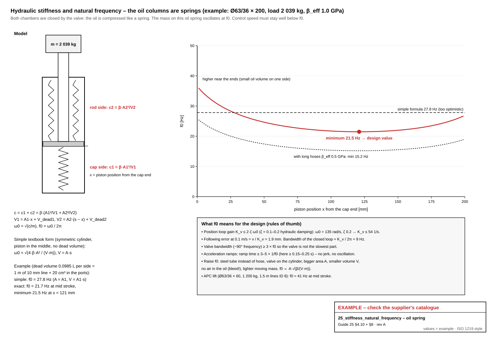
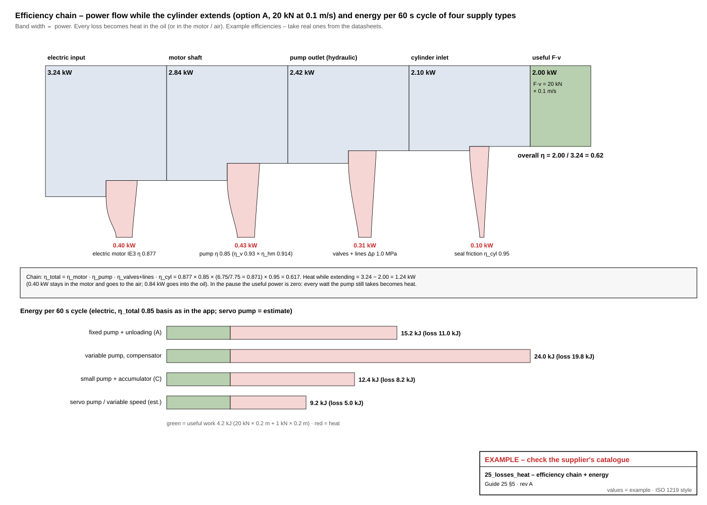
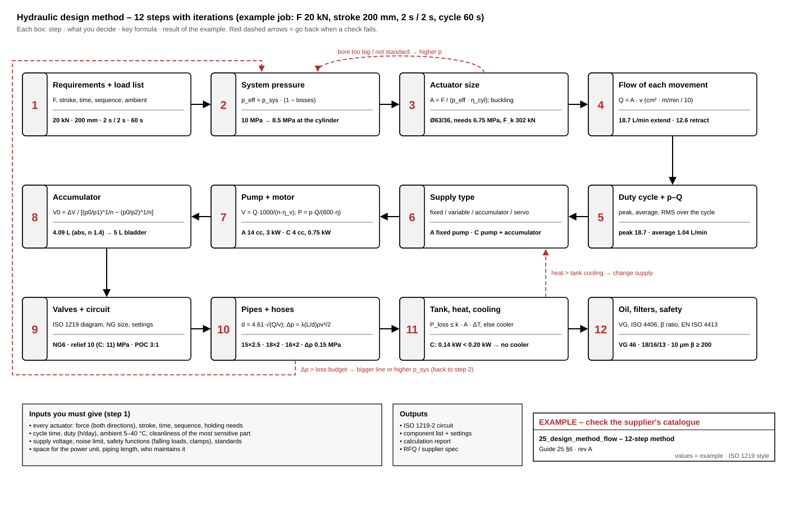
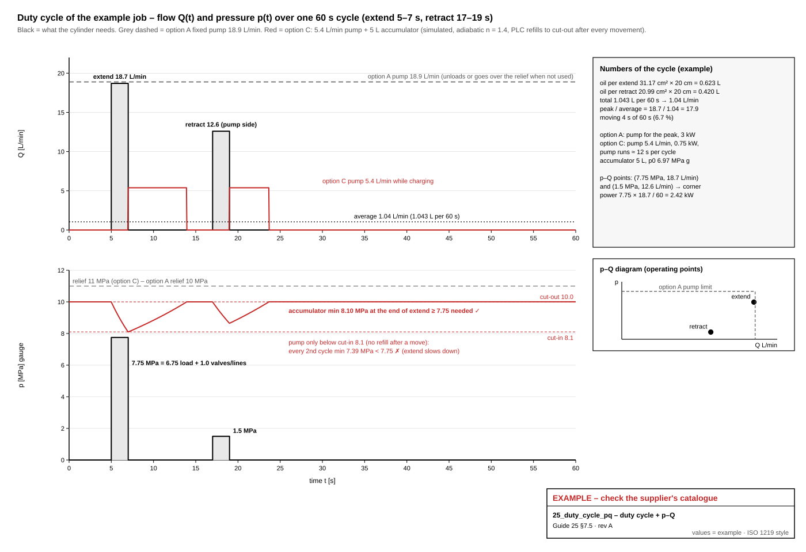
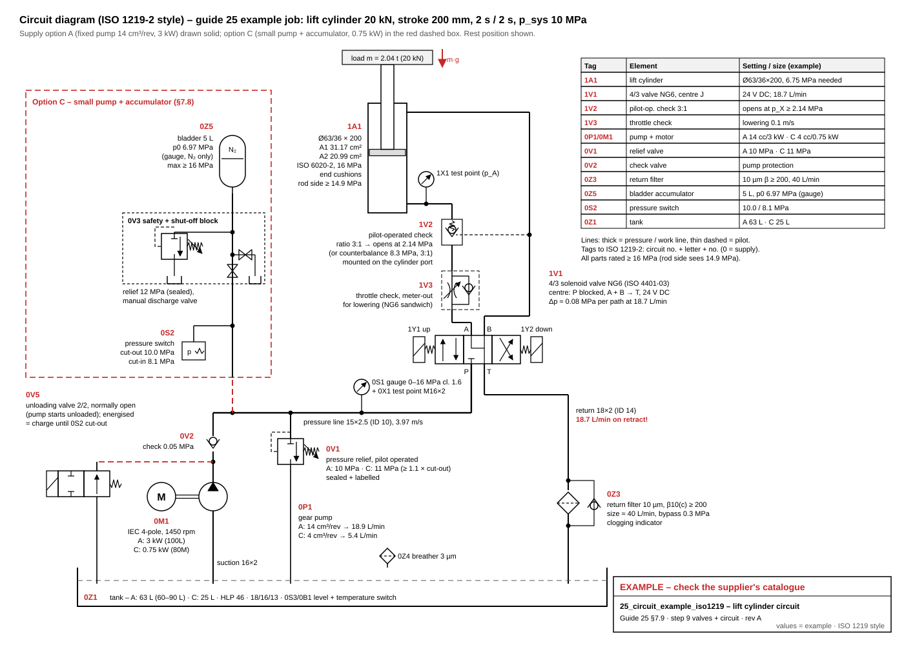
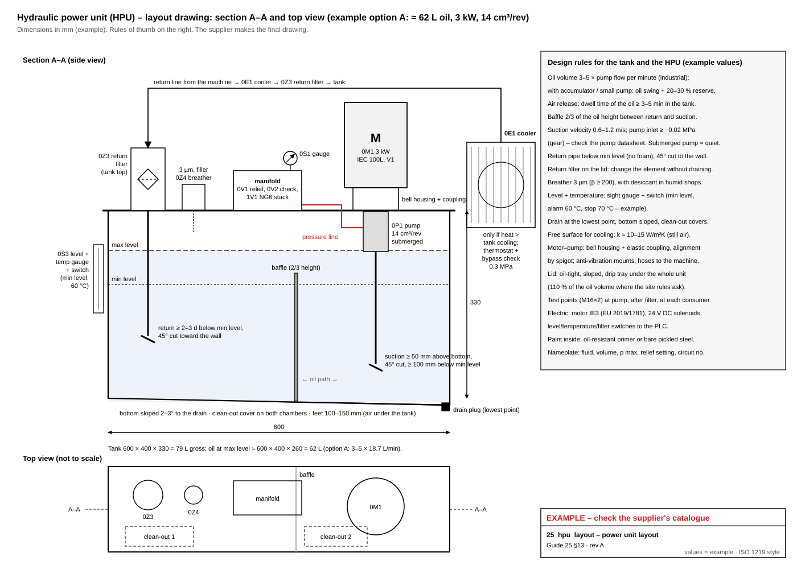
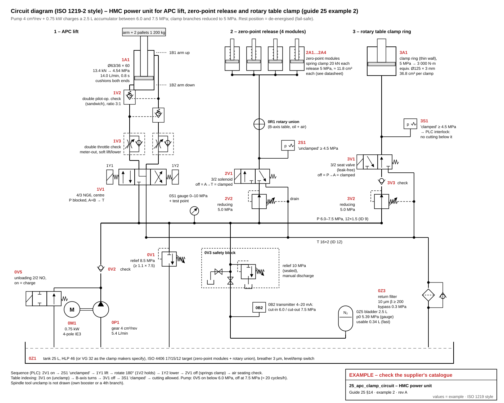

# 25 – Hydraulic system design: general method (textbook, reference, design guide)

> General method with theory, formulas and two worked examples. **All numbers are example values.** Check every
> component with catalogue data and your hydraulic supplier. Related: APC hydraulics in
> [09_pallet_changer_apc.md](09_pallet_changer_apc.md), rotary table clamp in [12_hmc_build.md](12_hmc_build.md).
> Element data book (93 elements, data ranges, failures): [29_hydraulic_elements_data.md](29_hydraulic_elements_data.md).
> Standard circuits and the sizing calculator: [30_hydraulic_circuits_sizing.md](30_hydraulic_circuits_sizing.md).

**For whom:** a mechanical engineer who must specify, check and buy hydraulic systems for a machine-tool / compressor
factory. Guide 25 is the **method** (how to think, in which order, with which formulas). Guide 29 is the **data book**
(what each element can do). Guide 30 is the **circuit book + calculator**. This guide links to 29 / 30 instead of
copying them.

**Two worked examples run through the whole guide:**

| | Example 1 – "the example job" | Example 2 – the HMC power unit of the twin |
|---|---|---|
| Actuators | 1 lift cylinder, vertical | APC lift cylinder + 4 zero-point modules + rotary-table clamp ring |
| Load | F = 20 kN, stroke 200 mm, 2 s up / 2 s down, every 60 s | lift 13.4 kN page mass / 16.6 kN real mass (60 mm, 0.8 s), release 5 MPa, clamp 5 MPa / 3 000 N·m |
| Result | Ø63/36, 18.7 L/min, 3 kW fixed pump **or** 0.75 kW + 5 L accumulator | lift Ø50/28 (decided 2026-11-12), 1.5 kW + 4 L accumulator, 10.0–11.5 MPa, two 5 MPa branches |
| Where | §7 (12 steps) | §14 |

**Drawings in this guide** (standalone SVG files in `docs/img/`, copies in `web/img/`):
`25_design_method_flow.svg` (§6) · `25_duty_cycle_pq.svg` (§7.5) · `25_circuit_example_iso1219.svg` (§7.9) ·
`25_losses_heat.svg` (§5) · `25_stiffness_natural_frequency.svg` (§4.10) · `25_hpu_layout.svg` (§13) ·
`25_apc_clamp_circuit.svg` (§14).

## Contents

1. Purpose and how to use this guide
2. Where in the twin
3. Units, symbols and basic concepts
4. Fluid mechanics for hydraulics (Pascal, continuity, Bernoulli, viscosity, Reynolds, pipe friction, local losses,
   orifice and gap flow, compressibility, stiffness and natural frequency, pressure transients, cavitation)
5. Energy, power and efficiency (pump, motor, cylinder, efficiency chain, losses → heat, energy per cycle)
6. The design method – overview (12 steps, flow chart, requirements specification)
7. The 12 steps with the example job (load cycle, force–velocity, p–Q, supply choice, pump, accumulator, valves,
   circuit, pipes, tank, oil, filters, safety, result sheet)
8. Control of hydraulic drives (on/off, proportional, servo; valve gains; position loop; bandwidth)
9. Thermal design (heat balance, tank cooling, cooler sizing, viscosity window, heaters)
10. Contamination control (ISO 4406, β ratio, filter placement and sizing, flushing ISO 23309)
11. Noise (pump, structure-borne, hoses, mounting)
12. Safety (EN ISO 4413, stored energy, accumulators, hoses, lockout, pressure tests)
13. Power unit (HPU) design and layout
14. Example 2 – HMC power unit: APC lift + zero-point release + rotary-table clamp
15. Commissioning (flushing, venting, setting reliefs, tests)
16. Maintenance and condition monitoring
17. Documentation (ISO 1219-2 circuit, component list, functional description)
18. Buy list – catalogue examples (power units, pumps, motors, valves, accumulators, filters, coolers, sensors, hoses,
    test equipment, fluids)
19. Consolidated shopping list – APC + clamp power unit
20. Questions for the supplier
21. Real-factory implementation
22. Checklists
23. Common mistakes
24. Errors found in the old guide, guides 29/30 and the app – corrections
25. Standards register
26. Limits
27. Glossary

---

## 1. Purpose and how to use this guide

Design a hydraulic system step by step so that it (a) gives the force and speed you need, (b) does not
waste energy as heat, (c) is safe when power, a hose or a valve fails, and (d) stays clean and reliable.

How to use it:

| You want to … | Read |
|---|---|
| understand why hydraulics behaves as it does (losses, heat, oscillation, shocks) | §3–5 |
| design a new system from a load list | §6–7, then §9–13 |
| check a supplier offer | §7 result sheet, §20 questions, §22 checklists |
| buy parts / compare catalogues | §18–19 (makers + models), element data in guide 29 |
| commission and maintain | §15–16 |
| see the method live | Hydraulics tab `#hyd` item 3 (preset "Guide 25 lift example") |

Rule of the guide: **every number has a formula and a worked example**. Numbers marked "example" are starting values –
the catalogue of the part you buy always wins.

## 2. Where in the twin

The **Hydraulics tab** `#hyd` is the hydraulic workbench of the twin:

| Page | Hydraulic part |
|---|---|
| Hydraulics `#hyd` item 1 | Element data book: every element with ISO 1219 symbol, data ranges, selection, failures (docs/29) |
| Hydraulics `#hyd` item 2 | 9 live standard circuits: lock, counterbalance, meter-in/out, sequence + reducing, regenerative, accumulator + unloading, motor + brake valve, supply types, synchronising (docs/30) |
| Hydraulics `#hyd` item 3 | System sizing calculator: this 12-step method live; preset "Guide 25 lift example" = the example below (docs/30 §5) |
| Pallet changer `#apc` | Lift cylinder, HPU, accumulator, zero-point release, ISO 1219 circuit |
| HMC build `#hmc` item 1 | Rotary table clamp ring (5 MPa), rotary union |
| HMC build item 4 / Assembly item 2 | Spindle tool-unclamp piston |
| AGV build `#agv` (lift type "hyd") | Hydraulic lift option for heavy AGVs |

Deep links: `/?hyitem=3&hcpreset=guide#hyd` (example 1), `/?hyitem=3&hcpreset=apc#hyd` and `&hcpreset=hmc`
(the presets behind example 2), `&hcsup=acc` (force the accumulator supply), `/?hyitem=1&hlel=acc_size#hyd`
(accumulator element page).

## 3. Units, symbols and basic concepts

### 3.1 The five ideas you need every day

- **Pressure p** makes **force**: F = p · A. **Flow Q** makes **speed**: v = Q / A.
- **Power** = p · Q. Hydraulic power that does no work (throttling, relief valve) becomes **heat**.
- **Gauge pressure** (what the gauge shows) vs **absolute pressure** = gauge + 0.1 MPa (1 bar). Gas laws
  (accumulator) need absolute pressure.
- **Duty cycle:** a chart of flow versus time over one machine cycle. It decides the pump type.
- **The load sets the pressure, the pump sets the flow.** A pump does not "make pressure"; the pressure rises until
  the oil can move the load (or until the relief valve opens).

### 3.2 Units and conversions

| Quantity | SI | Practical unit | Conversion |
|---|---|---|---|
| Pressure | Pa = N/m² | MPa = N/mm², bar | 1 MPa = 10 bar = 145 psi; 1 bar = 0.1 MPa = 14.5 psi |
| Flow | m³/s | L/min | 1 L/min = 1/60 000 m³/s = 16.67 cm³/s; 1 US gpm = 3.785 L/min |
| Displacement | m³/rev | cm³/rev ("cc") | 1 cm³ = 10⁻⁶ m³ |
| Power | W | kW | P [kW] = p [bar] · Q [L/min] / 600 = p [MPa] · Q [L/min] / 60 |
| Torque | N·m | N·m | T = V [cm³] · Δp [bar] / (20π) (ideal) |
| Kinematic viscosity | m²/s | mm²/s (= cSt) | 1 mm²/s = 10⁻⁶ m²/s |
| Dynamic viscosity | Pa·s | mPa·s (= cP) | η = ν · ρ; VG 46 at 40 °C: 46e-6 · 870 = 0.040 Pa·s |
| Bulk modulus | Pa | GPa | mineral oil ≈ 1.4–1.8 GPa (pure), design 1.0 GPa (with air + hoses) |
| Density | kg/m³ | kg/m³ | mineral oil ≈ 870 (850–890) at 15 °C |
| Area | m² | cm² | A [cm²] = π · D[mm]² / 400 |

Useful short forms (used in every step):

```
Q [L/min] = A [cm²] · v [m/min] / 10           (cylinder flow)
P [kW]    = p [bar] · Q [L/min] / (600 · η)      (drive power)
d [mm]    = 4.61 · √( Q [L/min] / v [m/s] )      (pipe inner diameter)
T [N·m]   = V [cm³] · Δp [bar] · η_hm / (20π)    (motor torque)
```

### 3.3 Symbols used in this guide

| Symbol | Meaning | Unit |
|---|---|---|
| A1, A2, A_rod | piston area, annulus (rod side) area, rod area | cm² |
| φ | area ratio A1/A2 | – |
| p_sys, p_eff | system pressure, pressure available at the actuator | MPa |
| Q, V_g | flow, displacement | L/min, cm³/rev |
| η_v, η_hm, η_t | volumetric, hydraulic-mechanical, total efficiency | – |
| β (also K) | bulk modulus of the oil (effective: β_eff) | GPa |
| ν, η | kinematic, dynamic viscosity | mm²/s, Pa·s |
| Re, λ, ζ | Reynolds number, pipe friction factor, local loss coefficient | – |
| Cd | discharge coefficient of an orifice | – |
| p0, p1, p2 | accumulator pre-charge, minimum and maximum working pressure (absolute in gas laws) | MPa |
| n | polytropic exponent of the gas (1.0 isothermal … 1.4 adiabatic) | – |
| K_q, K_c, K_p | valve flow gain, flow-pressure coefficient, pressure gain | – |
| ω0, f0, ζ_h | hydraulic natural frequency (rad/s, Hz), hydraulic damping ratio | – |

### 3.4 Open and closed circuit, valve-controlled and pump-controlled

| Type | How it works | Typical use |
|---|---|---|
| **Open circuit** | pump sucks from the tank, oil returns to the tank | almost all machine tools, presses, clamps |
| **Closed circuit** | pump outlet feeds the motor, motor outlet goes straight back to the pump inlet; a charge pump replaces leakage | hydrostatic drives (winches, travel drives), big rotary drives |
| **Valve-controlled** | constant pressure source (pump + relief / compensator / accumulator); a valve throttles to control speed | most industrial machines; simple, fast, but throttling = heat |
| **Pump-controlled** | the pump flow itself controls the actuator (variable displacement or variable speed) | servo pumps on presses, electro-hydrostatic actuators (EHA); efficient |

Details and energy comparison: §7.6.

---

## 4. Fluid mechanics for hydraulics

This chapter gives the physics behind every rule of thumb in the method. Each law: statement → formula → worked example
with the example job (pressure line ID 10 mm, 18.7 L/min, HLP 46, ρ = 870 kg/m³).

### 4.1 Pascal's law and hydrostatics

**Law:** pressure in a fluid at rest acts equally in all directions. In a closed system the same pressure acts on every
area.

```
F = p · A                      force on a piston
p = ρ · g · h                  hydrostatic pressure of a fluid column
F2 = F1 · A2 / A1              hydraulic lever (jack)
```

Example: cylinder Ø63 (A1 = 31.17 cm² = 31.17e-4 m²) at 6.75 MPa: F = 6.75e6 · 31.17e-4 = 21.0 kN (before friction).
Oil column 2 m high: p = 870 · 9.81 · 2 = 17 070 Pa = 0.017 MPa → hydrostatic pressure is negligible in industrial
hydraulics **except at the pump inlet** (suction head, §4.13).

Intensification (a direct result of Pascal): when the rod-side outlet is throttled, force balance p1·A1 = p2·A2 gives
p2 = p1 · A1/A2 = 10 · 1.485 = **14.85 MPa** (example job, meter-out with no load). Rate all rod-side parts for it.

### 4.2 Continuity (conservation of mass)

**Law:** for an incompressible fluid the flow is the same at every cross-section of a pipe: Q = A1·v1 = A2·v2.

```
v = Q / A
Q [L/min] = A [cm²] · v [m/min] / 10
```

Example 1 – cylinder: v = 0.2 m / 2 s = 0.1 m/s = 6 m/min → Q = 31.17 · 6 / 10 = **18.7 L/min**.
Example 2 – the same flow in the pressure line ID 10 mm: v = 18.7/60 000 / (π/4 · 0.010²) = **3.97 m/s**.
Example 3 – differential cylinder retracting at 0.1 m/s: pump gives 20.99 · 6 / 10 = 12.6 L/min into the rod side,
but **18.7 L/min leave the cap side** (continuity at the piston). The return line, the valve path A→T and the return
filter must pass 18.7 L/min, not 12.6.

### 4.3 Bernoulli and the energy equation

**Law:** along a streamline of a frictionless fluid the total energy is constant:

```
p + ρ·v²/2 + ρ·g·h = constant                     (ideal)
p1 + ρ·v1²/2 + ρ·g·h1 = p2 + ρ·v2²/2 + ρ·g·h2 + Δp_loss     (real, with losses)
```

What it means in hydraulics:

- The **dynamic pressure** ρv²/2 is small: at 3.97 m/s → 870 · 3.97² / 2 = **6 850 Pa = 0.0069 MPa**. The static
  pressure (MPa) dominates. Velocity matters because **losses are multiples of ρv²/2** (§4.6, §4.7).
- In an orifice the velocity becomes high (50–150 m/s), so the static pressure falls → this is the base of the orifice
  law (§4.8) and of cavitation (§4.13).
- At the pump inlet: p_inlet = p_atm − ρ·g·h_suction − ρv²/2 − Δp_loss must stay above the pump's minimum inlet
  pressure (typ. 0.08 MPa abs = −0.02 MPa gauge for gear pumps – see datasheet).

### 4.4 Viscosity and temperature

**Viscosity** is the internal friction of the oil. Kinematic viscosity ν [mm²/s] is used in catalogues; the ISO VG
number is ν at **40 °C** (ISO 3448: VG 46 = 41.4–50.6 mm²/s).

Viscosity falls strongly with temperature. The **Walther equation** (base of ASTM D341 charts) gives a straight line
on a special chart:

```
log10( log10( ν + 0.7 ) ) = A − B · log10( T [K] )
```

Two points (ν at 40 °C and 100 °C from the datasheet) fix A and B. Example HLP 46 with VI ≈ 100 (ν40 = 46,
ν100 = 6.8 mm²/s), computed with this equation:

| Temperature °C | 0 | 10 | 20 | 30 | 40 | 50 | 55 | 60 | 70 | 80 |
|---|---|---|---|---|---|---|---|---|---|---|
| ν VG 46 [mm²/s] (example) | 577 | 262 | 134 | 75 | 46 | 30 | 24.7 | 20.6 | 14.8 | 11.1 |

Other grades at the same VI (example): VG 32 → 336 mm²/s at 0 °C, 32 at 40 °C, 15.2 at 60 °C; VG 68 → 1 033 at 0 °C,
68 at 40 °C, 28.7 at 60 °C.

**Viscosity window** (typical pump and valve catalogues – check yours):

| Range | ν [mm²/s] | Meaning |
|---|---|---|
| optimum operating | 16–36 | best efficiency and life |
| allowed operating | 10–400 | short time / reduced load outside the optimum |
| minimum (hot, short) | ≈ 10 (gear) / 7 (some piston pumps) | film too thin → wear |
| cold start maximum | ≈ 800–1 000 (gear pumps up to 1 500–2 000) | above → suction cavitation, high drive torque |

With VG 46 (example, Walther values above) the optimum window 16–36 mm²/s is reached at **≈ 46–68 °C** oil
temperature, and the cold-start limit 800 mm²/s at ≈ −4 °C. For VG 32 the optimum window is ≈ 37–58 °C, for VG 68
≈ 54–77 °C. Rule: **choose the grade so that the normal oil temperature lies in the optimum window**. Indoor machine
tools with 40–55 °C oil: VG 32 or VG 46 (the clamp / spindle supplier may prescribe one).

**Viscosity index (VI, ISO 2909):** how flat the ν–T curve is. HLP mineral oil ≈ 95–105; HVLP (DIN 51524-3) ≥ 140 –
for large temperature ranges (outdoor, cold halls).

### 4.5 Laminar and turbulent flow – Reynolds number

```
Re = v · d / ν             (d = inner diameter, ν in m²/s)
Re < 2 300   laminar   (layers slide, loss ∝ v)
Re > ≈ 3 000 turbulent (eddies, loss ∝ v^1.75 … v²)
```

Example pressure line: Re = 3.97 · 0.010 / 46e-6 = **863** → laminar.
Same line at a cold start, 0 °C (ν ≈ 577 mm²/s): Re = 3.97 · 0.010 / 577e-6 = 69 → strongly laminar, and the loss is
12 × larger (§4.6). Industrial lines with VG 32–46 are mostly laminar; large return lines and flushing are turbulent.

### 4.6 Pipe friction – Darcy–Weisbach

```
Δp = λ · (L / d) · ρ · v² / 2
λ = 64 / Re                    laminar (Hagen–Poiseuille)
λ = 0.316 / Re^0.25            turbulent, smooth tube (Blasius, 3 000 < Re < 100 000)
```

(Some hydraulic books use λ = 75/Re for laminar flow in real tubes with entrance effects – more conservative.)

**Worked example 1 – pressure line, laminar.** Q = 18.7 L/min, ID 10 mm, L = 3 m, 40 °C:
v = 3.97 m/s, Re = 863, λ = 64 / 863 = 0.0742, ρv²/2 = 6 850 Pa
Δp = 0.0742 · (3 / 0.010) · 6 850 = **0.153 MPa** (old guide: 0.15 MPa ✓).

**Worked example 2 – the same line at 0 °C.** Re = 69, λ = 0.931 → Δp = 0.931 · 300 · 6 850 = **1.91 MPa**.
Cold oil eats 2 MPa of the 10 MPa budget in 3 m – that is why machines need warm-up or a heater (§9.5).

**Worked example 3 – return line, turbulent.** Q = 100 L/min, ID 20 mm, L = 5 m, oil at 60 °C (ν ≈ 20 mm²/s):
v = 5.31 m/s, Re = 5.31 · 0.020 / 20e-6 = 5 305 → turbulent, λ = 0.316 / 5 305^0.25 = 0.0370
Δp = 0.0370 · (5 / 0.020) · 870 · 5.31² / 2 = **0.113 MPa**.

**Worked example 4 – return line of the example job.** 18.7 L/min in tube 18×2 (ID 14), 3 m: v 2.02 m/s, Re 616,
Δp **0.040 MPa**; suction 5.4 L/min in 16×2 (ID 12), 0.5 m: v 0.79 m/s, Re 207, Δp 0.0035 MPa (same as guide 30 §5).

### 4.7 Local (minor) losses

Every bend, tee, fitting, port and valve passage adds

```
Δp = ζ · ρ · v² / 2
```

Typical ζ values (example – depends on the exact geometry; for valves always use the catalogue Δp–Q curve):

| Element | ζ (approx.) |
|---|---|
| 90° bend, bend radius R = 2·d | 0.15–0.3 |
| 90° sharp elbow (fitting) | 1.0–1.3 |
| 45° elbow | 0.3–0.5 |
| Tee, flow straight through | 0.2–0.5 |
| Tee, flow into the branch | 1.3–1.5 |
| Tee, flows join from both sides | ≈ 3 |
| Pipe inlet, sharp edge (from tank) | 0.5 |
| Pipe outlet into the tank | 1.0 |
| Sudden enlargement d1 → d2 | (1 − A1/A2)² (Borda–Carnot) |
| Ball valve fully open | 0.05–0.1 |
| Check valve (spring) | 2–3 + cracking pressure (use the catalogue) |
| Straight screw-in fitting / reducer | 0.1–0.5 |
| Hose crimp fitting | 0.2–0.5 |

Worked example – pressure line of the example job with 4 sharp elbows (4 × 1.2), 1 tee into the branch (1.3) and inlet
+ outlet ports (1.5): Σζ = 7.6 → Δp = 7.6 · 6 850 = **0.052 MPa**. Total pressure line ≈ 0.153 + 0.052 = 0.205 MPa;
plus valve 1V1 ≈ 0.08 + 0.04 MPa (guide 29 §7.1) → still inside the 1.0 MPa budget used in step 1–2.

Equivalent length: a local loss can be written as extra pipe length L_eq = ζ · d / λ (for the laminar line:
7.6 · 0.010 / 0.0742 ≈ 1.0 m).

### 4.8 Orifice and gap flow

**Sharp-edged orifice** (throttle, valve opening) – turbulent, almost independent of viscosity:

```
Q = Cd · A · √( 2 · Δp / ρ )          Cd ≈ 0.6–0.7 (sharp edge), 0.62 used in guide 30
```

Example: Ø2 mm, Cd 0.65, Δp 5 MPa → A = 3.14 mm², √(2·5e6/870) = 107.2 m/s →
Q = 0.65 · 3.14e-6 · 107.2 · 60 000 = **13.1 L/min**. Diameter needed for 18.7 L/min at 1 MPa: **3.57 mm**
(same as guide 29 §3). Heat in the orifice = Δp · Q = 5 MPa · 13.1 L/min / 60 = 1.1 kW.
Rule: double Δp → only 1.41 × flow (Q ∝ √Δp). That is why a plain throttle changes speed with the load and a
**pressure-compensated** flow valve (constant Δp over the throttle) is used when the speed must stay constant.

**Long, narrow throttle (capillary)** – laminar, depends on viscosity (and so on temperature):
Q = π · d⁴ · Δp / (128 · η · L). Used for damping orifices, not for speed control.

**Annular gap (leakage of a spool, piston, rotary union)** – laminar:

```
Q_L = π · d · h³ · Δp / (12 · η · l)     concentric gap; fully eccentric ≈ 2.5 × more
```

Example spool d = 10 mm, radial clearance h = 8 µm, sealing length l = 2 mm, Δp = 6.3 MPa, η = 0.040 Pa·s (VG 46,
40 °C): Q_L = π · 0.010 · (8e-6)³ · 6.3e6 / (12 · 0.040 · 0.002) = 1.06e-7 m³/s = **6.3 cm³/min**.
With h = 10 µm (wear): 12.4 cm³/min – leakage grows with **h³**. Hot oil (η half) doubles the leakage.
This is why a spool valve can never hold a load without drift (guide 30 §4.1: ≈ 20 mm/min with 63 cm³/min leakage).

### 4.9 Compressibility and bulk modulus

Oil is not rigid. The bulk modulus β tells how much pressure is needed to compress it:

```
ΔV = V · Δp / β            β = − V · dp / dV
```

| Case | β (example) |
|---|---|
| mineral oil, no air, 20–40 °C | 1.4–1.8 GPa (falls with temperature, rises with pressure) |
| steel tube (wall elasticity included) | effective 1.2–1.4 GPa |
| system with hoses | effective 0.5–1.0 GPa (hose alone ≈ 0.2–1 GPa) |
| design value for calculations | **1.0 GPa** (0.7 GPa with many hoses) |
| water-glycol HFC | ≈ 3.0 GPa |

Effective modulus of oil + container + air (springs in series):

```
1/β_eff = 1/β_oil + 1/β_container + (V_air/V) · 1/(n · p_abs)
```

Example – 1 % free air (measured at atmospheric pressure) in the oil:
at 0.5 MPa the air volume is still 0.28 % → β_eff = **0.25 GPa** (an 82 % drop!); at 10 MPa the air is compressed to
0.04 % → β_eff = 1.35 GPa. Air makes low-pressure systems soft and spongy → **bleed the system** (§15).

Example – oil spring-back of the example cylinder: cap-side oil at the end of stroke V = 0.623 + 0.0985 (line) =
0.722 L; at 7.75 MPa and β 1.0 GPa: ΔV = 0.722 · 7.75 / 1 000 = **5.6 cm³** → the piston can move 5.6 / 31.17 =
**1.8 mm** when the pressure changes from 0 to 7.75 MPa. Another example: 0.5 L under 10 MPa (β 1.4 GPa) shrinks by
3.6 cm³ (0.71 %). Compression of the oil is also the energy of the decompression shock when a big press opens –
decompress slowly.

### 4.10 Hydraulic stiffness and natural frequency of a cylinder drive

When the valve is closed (or at the centre of a servo valve), the oil in both chambers acts as two springs holding the
moving mass. Mass + oil spring = oscillator.



```
c_h = β · ( A1² / V1 + A2² / V2 )        hydraulic stiffness [N/m]
V1 = A1 · x + V_dead1,  V2 = A2 · (s − x) + V_dead2
ω0 = √( c_h / m ),  f0 = ω0 / (2π)
Simple textbook form (symmetric cylinder, piston in the middle, no dead volume):
ω0 = √( 4 · β · A² / (V · m) ),   V = total oil volume of both chambers = A · s
```

**Worked example (example job).** m = 20 000 / 9.81 = 2 039 kg, β_eff = 1.0 GPa, A1 = 31.17 cm², A2 = 20.99 cm²,
s = 200 mm, dead volume per side 0.0985 L (1 m of ID 10 line = 0.0785 L + 20 cm³ ports).

- Simple formula with A = A1 and V = A1 · s = 0.623 L:
  ω0 = √(4 · 1.0e9 · (31.17e-4)² / (0.623e-3 · 2 039)) = 174.9 rad/s → **f0 = 27.8 Hz**.
- Exact formula, piston at mid stroke (x = 100 mm): V1 = 0.410 L, V2 = 0.308 L →
  c_h = 1.0e9 · ((31.17e-4)²/0.410e-3 + (20.99e-4)²/0.308e-3) = 3.80e7 N/m → ω0 = 136.5 rad/s → **f0 = 21.7 Hz**.
- Minimum over the stroke (design value): **21.5 Hz at x ≈ 121 mm** (c_h = 3.71e7 N/m).
- With long hoses (β_eff 0.5 GPa): f0,min = 21.5 · √0.5 = **15.2 Hz**.

The simple formula is 30 % too optimistic here (it ignores dead volume and the smaller annulus). Use the exact one.

**APC lift (example 2, decided 2026-11-12: Ø50/28):** Ø50/28 × 60, 1 200 kg, 1.5 m lines ID 8 each side (+ 20 cm³ ports),
mid stroke: c_h = 3.84e7 N/m → f0 = **28.5 Hz** (25.6 Hz with the real lifted mass 1 480 kg; minimum over the stroke
27.8 Hz near the top) – short stroke, small volume = stiff. (The old Ø63/36 gave 40.9 Hz.)

What f0 means:

| Design question | Rule | Example job |
|---|---|---|
| fastest ramp without oscillation | ramp time ≥ 3–5 / f0 | ≥ 0.15–0.25 s |
| position loop gain | K_v ≤ 2 · ζ_h · ω0 (ζ_h ≈ 0.1–0.2) | ≤ 0.4 · 135 = 54 1/s |
| servo valve needed? | valve bandwidth ≥ 3 · f0 | ≥ 65 Hz → servo-proportional valve |
| raise f0 | bigger A, smaller V (valve on the cylinder), steel tube, no air, smaller m | – |

Peak pressure if a valve closes suddenly at full speed (no ramp, no damping, upper bound):
Δp ≈ v · √(c_h · m) / A1 = 0.1 · √(3.71e7 · 2 039) / 31.17e-4 = **8.8 MPa** on top of the load pressure, the
oil spring compresses by x = v/ω0 = 0.74 mm. For the APC lift (Ø50/28, 0.075 m/s, 1 200 kg, c 3.84e7): Δp ≈ **8.2 MPa** (9.1 MPa with 1 480 kg).
These peaks are why valves get soft-switching (ramp) options, why cylinders need cushions, and why every part must be
rated above the relief setting.

### 4.11 Pressure transients – water hammer (Joukowsky)

When the flow in a pipe is stopped faster than the pressure wave can run to the end and back, the kinetic energy of
the oil becomes a pressure peak:

```
a = √( β_eff / ρ )                  speed of the pressure wave
Δp = ρ · a · Δv                     Joukowsky (valve closes faster than t_c)
t_c = 2 · L / a                     critical closing time
```

Example – pressure line of the example job, valve 1V1 closes, v = 3.97 m/s:
a = √(1.0e9 / 870) = **1 072 m/s** (1 269 m/s with β 1.4 GPa); t_c = 2 · 3 / 1 072 = **5.6 ms**.
A solenoid valve switches in 20–50 ms > 5.6 ms → slower than t_c, the real peak is smaller than Joukowsky.
If it were instant: Δp = 870 · 1 072 · 3.97 = **3.70 MPa** (4.38 MPa with 1.4 GPa).
APC pressure line (Ø50/28 lift, 8.8 L/min in 12×1.5 → 2.31 m/s): Δp_max ≈ 2.2 MPa.

Remedies: lower line speed (pressure line ≤ 4–5 m/s), soft-switching valves or ramps, accumulator / hose near the
valve as a damper, valve near the actuator (short L), no air pockets. In a pump-and-accumulator system the
accumulator also damps pump ripple and switching peaks.

### 4.12 Thermal expansion of trapped oil

Oil expands ≈ 0.07 %/K (γ ≈ 7e-4 1/K). Trapped between two closed valves:

```
Δp ≈ β · γ · ΔT = 1.0e9 · 7e-4 · ΔT ≈ 0.7 MPa per K   (rigid steel; less with hoses)
```

A clamp line held by a pilot-operated check that warms by 10 K could rise by several MPa. Remedy: small pressure
relief (thermal relief) on long trapped lines, or reducing valves of the 3-way (relieving) type for clamp branches;
counterbalance valve setting ≥ 1.3 × load pressure partly for this reason (guide 30 §4.2).

### 4.13 Cavitation and aeration

- **Cavitation:** local pressure falls below the vapour pressure → vapour bubbles form and collapse with micro-jets
  (erosion, noise like "gravel"). Places: pump inlet (suction too long, strainer clogged, oil too cold, too high
  speed), behind fast orifices, in the rod side of an overrunning load without counterbalance valve.
- **Aeration:** dissolved air (mineral oil holds ≈ 9 % by volume at 1 bar) comes out at low pressure → foam, spongy
  drive, oil oxidation, "diesel effect" (bubbles ignite when compressed fast).
- Pump inlet rule: suction velocity 0.6–1.2 m/s, inlet pressure ≥ the datasheet minimum (gear ≈ 0.08 MPa abs, many
  piston pumps 0.08–0.09 MPa abs), pump below the oil level where possible (flooded inlet), no suction strainer finer
  than 100–150 µm, cold-start viscosity ≤ datasheet limit.
- Guide 30 shows cavitation in violet in the live circuits (pressure < −0.03 MPa).

---

## 5. Energy, power and efficiency



### 5.1 Hydraulic power

```
P_hyd = p · Q             [W] = [Pa] · [m³/s]
P [kW] = p [bar] · Q [L/min] / 600 = p [MPa] · Q [L/min] / 60
```

Example: 7.75 MPa · 18.7 L/min / 60 = **2.42 kW** at the pump outlet while the cylinder extends.

### 5.2 Pump efficiencies

| Efficiency | Definition | Typical (example, see datasheet) |
|---|---|---|
| volumetric η_v | Q_real / (V_g · n) – internal leakage | gear 0.90–0.95, vane 0.85–0.92, axial piston 0.93–0.97 |
| hydraulic-mechanical η_hm | ideal torque / real torque – friction, churning | 0.85–0.95 |
| total η_t = η_v · η_hm | hydraulic power out / shaft power in | gear 0.80–0.88, axial piston 0.85–0.92 |

```
Q = V_g · n · η_v / 1000                        [L/min], V_g in cm³, n in rpm
T_drive = V_g · p [bar] / (20π · η_hm)           [N·m]
P_shaft = p [bar] · Q / (600 · η_t)              [kW]
```

Example gear pump 14 cm³/rev, 1 450 rpm, η_v 0.93 (the app value): Q = 14 · 1 450 · 0.93 / 1 000 = **18.9 L/min**;
η_t 0.85 → η_hm = 0.85 / 0.93 = 0.914; drive torque at 77.5 bar = 14 · 77.5 / (20π · 0.914) = **18.9 N·m**;
a 3 kW 4-pole motor gives 3 000 / (2π · 1 430/60) = 20.0 N·m rated ✓.

Efficiencies change with pressure, speed and viscosity: η_v falls at high pressure, low speed and hot (thin) oil;
η_hm falls at low pressure and cold (thick) oil. Read the efficiency maps in the datasheet at **your** operating point.

### 5.3 Motor and cylinder efficiencies

```
Hydraulic motor:  n = Q · 1000 · η_v / V_g;  T = V_g · Δp [bar] · η_hm / (20π);  η_t = η_v · η_hm
Cylinder:         F = p · A · η_cyl           η_cyl ≈ 0.90–0.97 (seal friction; 0.95 in this guide)
Electric motor:   IE3 4-pole 50 Hz (IEC 60034-30-1): 0.75 kW 82.5 %, 1.1 kW 84.1 %, 1.5 kW 85.3 %,
                  2.2 kW 86.7 %, 3 kW 87.7 %, 4 kW 88.6 %, 5.5 kW 89.6 %, 7.5 kW 90.4 %  (nominal minimum values)
```

Since July 2021 / 2023 the EU motor regulation (EU) 2019/1781 asks for IE3 for most 0.75–1 000 kW motors (IE4 for
75–200 kW from July 2023) – check the current rule for your country and for motors on variable-speed drives.

### 5.4 Efficiency chain – worked example (option A, extending)

| Stage | Power | Efficiency | Loss (heat) |
|---|---|---|---|
| electric input | **3.24 kW** | – | – |
| motor shaft | 2.84 kW | η_motor 0.877 (IE3, 3 kW) | 0.40 kW (into the air) |
| pump outlet | 2.42 kW (7.75 MPa · 18.7 L/min) | η_pump 0.85 | 0.43 kW (into the oil) |
| cylinder inlet | 2.11 kW (6.75 MPa · 18.7 L/min) | valves + lines Δp 1.0 MPa → 6.75/7.75 = 0.871 | 0.31 kW (oil) |
| useful | **2.00 kW** = 20 kN · 0.1 m/s | η_cyl 0.95 | 0.11 kW (oil) |

η_total = 0.877 · 0.85 · 0.871 · 0.95 = **0.617**. Of the 3.24 kW, 1.24 kW becomes heat while extending.
**In the pause the useful power is zero** – everything the pump still takes is heat. That is why the choice of supply
type (step 6) decides the energy and the cooler much more than the efficiencies of the parts.

### 5.5 Losses → heat

```
P_loss [kW] = Δp [bar] · Q [L/min] / 600       for each throttled flow
```

| Loss source | Example (example job) |
|---|---|
| fixed pump over the relief, closed centre, pause | 100 bar · 18.7 / 600 = **3.12 kW** (all heat, all day) |
| fixed pump unloaded through a tandem centre, Δp ≈ 5 bar | 5 · 18.7 / 600 = 0.16 kW |
| throttle in meter-in (pump at 100 bar, load 64 bar) | 36 · 18.7 / 600 = 1.1 kW |
| valve 1V1, both paths (0.78 bar at 18.7 + 0.35 bar at 12.6 L/min) | ≈ 0.03 kW |
| pressure compensated pump standby (1 L/min leakage at 100 bar) | 0.17 kW |
| pressure reducing valve (clamp branch, 10 → 5 MPa, 0.1 L/min pilot + leakage) | 50 · 0.1 / 600 ≈ 0.01 kW |

### 5.6 Energy per cycle – the real comparison

Guide 30 §5 computes the energy of the example job for the supply options (electric, η_total 0.85 basis):

| Option | Energy / 60 s cycle | of which loss | Motor |
|---|---|---|---|
| fixed pump (peak flow) + tandem / unloading (A) | 15.2 kJ | 11.0 kJ | 3 kW |
| variable pump (pressure compensator) | 24.0 kJ | 19.8 kJ | 4 kW |
| small pump + accumulator (C) | 12.4 kJ | 8.2 kJ | 0.75 kW |
| servo pump / variable-speed pump drive (estimate, this guide) | ≈ 9.2 kJ | ≈ 5.0 kJ | ≈ 3 kW servo motor |

Useful work per cycle: 20 kN · 0.2 m + 1 kN · 0.2 m = **4.2 kJ**. Servo-pump estimate: hydraulic energy only at the
load pressure, 7.75 MPa · 0.623 L + 1.50 MPa · 0.420 L = 5.46 kJ, / 0.85 = 6.43 kJ, + standby 50 W · 56 s = 2.8 kJ →
9.2 kJ. (The variable pump looks bad here because it holds 10 MPa all the time with 1 L/min leakage and the cycle is
mostly pause.)

---
## 6. The design method – overview



### Example job
Lift cylinder: **F = 20 kN**, **stroke 200 mm**, extend **2 s**, retract **2 s**, cycle every **60 s**.

| # | Step | Result |
|---|---|---|
| 1 | Describe the job (force, stroke, time, sequence of every actuator) | load list |
| 2 | Choose system pressure | p_sys |
| 3 | Size cylinders / motors | bore, rod |
| 4 | Flow of every movement | Q |
| 5 | Duty cycle | peak vs average flow |
| 6 | Supply type | fixed pump / variable pump / pump + accumulator |
| 7 | Pump + motor | L/min, kW |
| 8 | Accumulator (if used) | litres |
| 9 | Valves + circuit | ISO 1219 diagram |
| 10 | Pipes and hoses | diameter, wall, Δp |
| 11 | Tank, heat, cooling | litres, kW |
| 12 | Oil, filters, safety | ISO VG, ISO 4406, ISO 4413 |

The method is **iterative**: when a later check fails (bore not standard, Δp too high, heat too high), go back
(red arrows in the flow chart). Typical loops: step 3 → 2 (higher pressure for a smaller bore), step 10 → 2 (line
losses too high), step 11 → 6 (too much heat → other supply type).

### 6.1 Requirements specification (what you write before step 1)

A good hydraulic specification answers these questions. Fill it in for every machine.

| Group | Item | Example job | Example 2 (HMC unit) |
|---|---|---|---|
| Function | what moves, in which order, what must be held | lift 2 t up/down, hold at top | APC lift, zero-point release, table clamp |
| Loads | force in both directions, mass, external forces | 20 kN up, 1 kN down, m 2 039 kg | 13.4 kN lift; 4 × 20 kN springs; 3 000 N·m |
| Motion | stroke, time / speed, accel. limits | 200 mm, 2 s / 2 s | 60 mm 0.8 s; release 0.8 s; clamp 0.5 s |
| Cycle | cycle time, pauses, duty h/day | 60 s, 2 shifts | pallet change every ≈ 344 s + indexing |
| Holding | hold under power loss? max drift | no fall, < 1 mm/h | arm must not fall; clamps stay clamped |
| Accuracy | position / speed / force accuracy | end stops only | end stops + pressure switches |
| Environment | ambient temp., dust, coolant, indoor | 5–40 °C, indoor | 15–35 °C, coolant mist near the table |
| Energy | electric supply, energy target | 400 V 50 Hz, low heat | 400 V 50 Hz, no cooler wanted |
| Noise | limit at 1 m | ≤ 70 dB(A) | ≤ 65 dB(A) (operator area) |
| Safety | falling loads, clamps, stored energy, PL | EN ISO 4413, POC on cylinder | + interlock "no cutting without clamp pressure" |
| Cleanliness | most sensitive component | standard valves → 18/16/13 | zero-point modules, rotary union → 17/15/12 |
| Maintenance | access, oil change, filter change, spares | filter indicator to the PLC | same + accumulator check yearly |
| Documents | circuit, BOM, manuals, CE / PED | ISO 1219-2, EN ISO 4413 check list | + PED documents for the accumulator |

### 6.2 Load cycle diagram and force–velocity diagram

Draw for every actuator: **force vs time**, **speed vs time** and **force vs speed**. From these come the pressure
and flow of each phase.

Force–velocity table of the example job (η_cyl 0.95, the pressures at the cylinder):

| Phase | Time | Force | Speed | Area working | Pressure needed | Flow (pump side) |
|---|---|---|---|---|---|---|
| wait | 0–5 s | 20 kN held | 0 | – | holding by 1V2 (no pump flow) | 0 |
| extend (up) | 5–7 s | 20 kN | +0.1 m/s | A1 31.17 cm² | 20 000 / (31.17e-4 · 0.95) = 6.75 MPa | 18.7 L/min |
| dwell | 7–17 s | 20 kN held | 0 | – | holding | 0 |
| retract (down) | 17–19 s | 1 kN (friction + lowering control) | −0.1 m/s | A2 20.99 cm² | 1 000 / (20.99e-4 · 0.95) = 0.50 MPa | 12.6 L/min |
| pause | 19–60 s | held | 0 | – | holding | 0 |

The pump must also overcome the line and valve losses (1.0 MPa budget): extend 7.75 MPa, retract 1.50 MPa. These are
the operating points of the **p–Q diagram** (§7.5).

Note on the vertical load: when lowering, the load **pulls** (overrunning load). The pump only fills the rod side; the
speed is controlled by the meter-out throttle or the counterbalance valve in the cap-side line (guide 30 §4.2–4.3).

---

## 7. The 12 steps with the example job

### 7.1 Step 1 – Describe the job (load list)

Load list = one line per actuator movement with start time, duration, force, stroke, direction and holding need.
In the twin, item 3 of the Hydraulics tab is a load-list editor (preset "Guide 25 lift example": t0 5 s, extend 2 s,
dwell 10 s, retract 2 s, F_ret 1 kN, vertical, clevis at both ends).

Checks at step 1:
- every force in **both** directions (also the small return force – it sets the return pressure),
- **accelerations**: F_acc = m · a. Example job: accelerating 2 039 kg to 0.1 m/s in 0.1 s needs 2 039 · 1 = 2.0 kN
  extra (10 %) → covered by the 15 % loss allowance; the APC lift uses the explicit factor (1 + a/g) (§14),
- friction of guides (1.1 × in docs/09), seal friction (η_cyl),
- the sequence: which movements can run at the same time? (the duty cycle adds their flows).

### 7.2 Step 2 – Choose the system pressure

Typical: machine-tool clamps 5–7 MPa, general industry 10–21 MPa, mobile 25–35 MPa. Higher pressure =
smaller parts but more leakage and noise. Example **p_sys = 10 MPa**, plan **≈ 15 % losses** →
p_eff = 8.5 MPa at the cylinder.

| Pressure class | Typical machines | Notes |
|---|---|---|
| 3–7 MPa | machine-tool clamps, tool unclamping boosters, zero-point modules, table clamps | low noise, low leakage, cheap aluminium manifolds possible |
| 10–16 MPa | general industrial (handling, lifts, small presses), ISO 6020-2 cylinders (16 MPa) | gear / vane pumps, NG6–NG10 valves |
| 21–25 MPa | presses, heavy handling, ISO 6022 cylinders (25 MPa) | axial piston pumps, steel tube + 24° fittings S series |
| 28–35 MPa | mobile hydraulics, compact high-force drives | piston pumps, special hoses (4SH / R13) |
| 50–70 MPa | workholding with hydraulic clamps (special), hydraulic tools | intensifiers, special fittings |

Rules: (1) all components (valves, fittings, cylinders) are available in your pressure class; (2) leave **≥ 10–15 %**
between the highest working pressure and the relief setting; (3) T ports and low-pressure parts have their own lower
limits (guide 29 §19); (4) rod-side intensification may exceed p_sys (§4.1).

Pressure steps used by the app: 6.3 · 10 · 16 · 21 · 25 · 31.5 · 35 MPa. ISO 2944 nominal pressures (R10 series) are 6.3 · 10 · 16 · 25 · 31.5 · 40 MPa; 21 and 35 MPa are common catalogue ratings.

### 7.3 Step 3 – Size cylinders / motors

```
A = F / (p_eff · η_cyl)            η_cyl ≈ 0.95 (seal friction)
A = 20 000 / (8.5e6 · 0.95) = 24.8 cm²
D = √(4A/π) = 56 mm → standard bore 63 mm (ISO 3320), rod 36 mm
A_piston = 31.2 cm²   A_annulus = 31.2 − 10.2 = 21.0 cm²
Pressure really needed = 20 000 / (31.2e-4 · 0.95) = 6.75 MPa
```
(Exact: A1 = 31.17 cm², A_rod = 10.18 cm², A2 = 20.99 cm², φ = A1/A2 = 1.485.)

**Standard series (ISO 3320):** bores 25 · 32 · 40 · 50 · 63 · 80 · 100 · 125 · 140 · 160 · 180 · 200 · 250 mm; rods
12 … 140 mm. Common rod pairs (φ ≈ 1.4 and ≈ 2): 63/36 and 63/45, 80/45 and 80/56, 100/56 and 100/70 …

**Buckling.** Long thin rods: check buckling, F_k = π²·E·I / L_k² (safety ≥ 3.5).
Example (guide 30 §5): extended length L ≈ 2 · 200 + 150 = 550 mm, pinned–pinned K = 1 → L_k = 550 mm,
I = π · 36⁴ / 64 = 82 448 mm⁴, slenderness λ = 4 · L_k / d = 61.1 < 85 → **Tetmajer** (not Euler) applies:
Euler would give 565 kN, Tetmajer (335 − 0.62 · λ) · A_rod = (335 − 37.9) · 1 018 mm² = **302 kN** → allowed
302 / 3.5 = 86 kN ≥ 20 kN ✓. Mounting factors K (L_k = K · L): fixed–free 2, pinned–pinned 1, fixed–guided pinned
0.7, fixed–fixed 0.5 (guide 29 §6.6).

**End cushioning.** The cushion must absorb E = ½ · m · v² + F_drive · s_cushion (+ m · g · s_cushion for a falling load
that is not held by back pressure). Example job: ½ · 2 039 · 0.1² = 10 J kinetic, but up to 2 039 · 9.81 · 0.020 =
400 J potential over a 20 mm cushion when lowering → check the cushion energy chart of the cylinder catalogue, or
slow down with the valve before the end (proportional valve ramp or end-position sensor + slow speed).

**Seals and speed.** Standard seals ≈ 0.008–0.5 m/s; > 0.5 m/s low-friction PTFE seals and cushions; < 0.01 m/s
stick-slip risk (PTFE, special guide rings).

**Hydraulic motor.** T = V_g · Δp · η_hm / (2π); speed n = Q · η_v / V_g. Example (guide 30 §6 preset): conveyor
250 N·m at 60 rpm, 16 MPa system → orbit motor 160 cm³/rev, 10.1 L/min. Low speed, high torque (LSHT) → orbit /
radial piston motor; high speed → gear / axial piston motor (guide 29 §5).

### 7.4 Step 4 – Flow of every movement

```
Q [L/min] = A [cm²] · v [m/min] / 10
v = 0.2 m / 2 s = 0.1 m/s = 6 m/min
Extend  Q = 31.2 · 6 / 10 = 18.7 L/min
Retract Q = 21.0 · 6 / 10 = 12.6 L/min (pump side)
```
On retract **18.7 L/min flows out of the piston side** – more than the pump gives. Size the return line for it.

Volumes: oil per extend 31.17 cm² · 20 cm = **0.623 L**, per retract 20.99 · 20 = **0.420 L**.

| Movement | Pump side flow | Outflow (to tank) | Volume |
|---|---|---|---|
| extend | 18.7 L/min into A1 | 12.6 L/min from A2 | 0.623 L |
| retract | 12.6 L/min into A2 | **18.7 L/min from A1** | 0.420 L |
| regenerative extend (option) | 18.7 L/min pump + 38.6 L/min from A2 = 57.3 L/min into A1 | 0 | v = Q/A_rod = 0.306 m/s (guide 30 §4.5) |

### 7.5 Step 5 – Duty cycle and p–Q diagram



Oil per extend 31.2 cm² · 20 cm = **0.62 L**, per retract **0.42 L**.
Average flow = 1.04 L / 60 s = **1.04 L/min**, peak 18.7 L/min.
Rule: peak ≫ average and long pauses → **small pump + accumulator**. Continuous flow → fixed or variable pump.

Numbers of the duty cycle (example):

```
peak flow           Q_pk  = 18.7 L/min
average flow        Q_avg = (0.623 + 0.420) L / 60 s · 60 = 1.04 L/min
peak / average      18.7 / 1.04 = 17.9
moving time         4 s of 60 s = 6.7 %
hydraulic peak      7.75 MPa · 18.7 L/min / 60 = 2.42 kW
```

**p–Q diagram:** plot each phase as a point (Q, p): extend (18.7 L/min, 7.75 MPa), retract (12.6 L/min, 1.5 MPa).
The supply must cover all points. A fixed pump is a vertical line at its flow up to the relief; a pressure-compensated
pump a horizontal line at the compensator; a power-limited pump a hyperbola p · Q = constant (guide 29 §4.7). Points
far below the supply curve = throttling losses.

**Decision guide from the duty cycle:**

| Duty cycle | Best supply (first choice) |
|---|---|
| nearly constant flow and pressure, one actuator | fixed pump (gear / vane), maybe a VSD |
| flow changes a lot, several actuators | variable pump (pressure compensated or load sensing) |
| short peaks, long pauses (peak/average ≥ 3, moving < 50 % of the cycle) | small pump + accumulator + unloading |
| clamping / holding with little flow | small pump + accumulator, or a hand-off "pressure-on-demand" pump |
| high power, changing load, energy matters | servo pump (variable speed) or EHA |

The app uses the same rule: accumulator when ratio ≥ 3, V0 ≤ 20 L and moving < 50 % of the cycle.

### 7.6 Step 6 – Supply type (open/closed, fixed/variable, valve/pump control)

**Option A – fixed pump for the peak flow.** Simple, cheap. In the pauses the pump must **unload** (tandem centre or
unloading valve) – never run against a closed centre (3.1 kW heat, §5.5).

**Option B – variable displacement pump with pressure compensator.** Flow on demand; standby loss = leakage at full
pressure. Load sensing (LS) adapts the pressure to the highest load + 1.5–2.5 MPa margin.

**Option C – small pump + accumulator + unloading.** The pump charges the accumulator in the pauses; the accumulator
gives the peak. Smallest motor, least energy for intermittent duty.

**Option D – pump-controlled drives (servo pump, EHA).**
- *Servo pump / variable-speed pump drive:* a servo or asynchronous motor on a frequency converter drives a fixed (or
  variable) pump; speed = flow, motor torque = pressure. The pump runs only when the actuator moves (or slowly to hold
  pressure). Typical for presses, injection moulding, press brakes. Energy saving 30–70 % vs constant-speed systems,
  lower noise and heat. Needs a pump rated for start-stop and low speed (internal gear or axial piston).
- *Electro-hydrostatic actuator (EHA):* a self-contained unit – servo motor + reversible pump + small accumulator/tank
  + cylinder – connected only by power and signal cables. No central HPU, no piping. Good for single axes; limited
  power (typ. up to some tens of kW) and heat dissipation; expensive per axis.

Comparison for the example job (energy per 60 s cycle, §5.6):

| Option | Motor | Energy / cycle | Heat / cycle | Cost (relative) | Comment |
|---|---|---|---|---|---|
| A fixed pump + tandem/unloading | 3 kW | 15.2 kJ | 11.0 kJ | low | needs 60–90 L tank |
| B variable pump | 4 kW | 24.0 kJ | 19.8 kJ | medium | bad for long pauses at full pressure |
| C pump + accumulator | 0.75 kW | 12.4 kJ | 8.2 kJ | low–medium | **chosen by the app** (ratio 17.9) |
| D servo pump | ≈ 3 kW servo | ≈ 9.2 kJ | ≈ 5.0 kJ | high | best energy, quiet; drive + control cost |

Open vs closed circuit: the example job uses an **open circuit** (cylinder, differential areas, tank needed for the
area difference). Closed circuits suit hydraulic motors with continuous reversing (no differential volume) or
cylinders with an EHA balancing the volume difference.

### 7.7 Step 7 – Pump + motor

```
P [kW] = p [bar] · Q [L/min] / (600 · η_total)       η_total ≈ 0.85
A: fixed pump for peak flow   78 bar · 18.7 / 510 = 2.9 kW  → 3 kW motor
B: pump + accumulator        100 bar · 2   / 510 = 0.39 kW → 0.55 kW motor
```
2 L/min refills the 1.04 L in ≈ 31 s < 56 s pause. ✓

(Naming: in this short table "B" = pump + accumulator. In the rest of this guide, in guide 30 and in the app the
accumulator option is called **C**, and **B** is the variable pump.)

**Note (real pump sizes – same as the app and guide 30 §5):** "B" above is the ideal 2 L/min pump. The smallest gear
pump of a normal industrial series is **4 cm³/rev** → 4 · 1 450 · 0.93 / 1 000 = **5.4 L/min** → peak power at
cut-out 100 bar · 5.39 / 510 = **1.06 kW** → motor **0.75 kW** (sized ≥ RMS power and ≥ peak / 1.5 = 0.70 kW). It
recharges 1.043 L in 1.043 / 5.39 · 60 = **11.6 s** of 60 s. A micro gear pump (< 2 cm³/rev) or a 6/8-pole motor
gives the 0.55 kW of the ideal case.

Pump selection rules:

| Formula / rule | Example |
|---|---|
| V_g = Q · 1 000 / (n · η_v) | option A: 18.7 · 1 000 / (1 450 · 0.93) = 13.9 → **14 cm³/rev** (18.9 L/min) |
| standard gear sizes (app list) 4 · 6 · 8 · 11 · 14 · 16 · 19 · 23 · 26 · 32 · 40 · 50 cm³ | |
| motor ≥ RMS power √(Σ P_i² · t_i / T) and ≥ peak / 1.5 | option A: RMS 0.61 kW, peak 3.70 kW → 3 kW (guide 30 §5) |
| pump max pressure ≥ relief setting; continuous rating ≥ working pressure | gear pumps typ. 16–25 MPa continuous |
| speed: 4-pole motor 1 450 rpm (50 Hz) / 1 750 rpm (60 Hz) | 2-pole (2 900 rpm) only if the pump allows it (noise!) |
| drive torque T = V_g · p / (20π · η_hm) | 14 cm³ at 77.5 bar: 18.9 N·m; 3 kW motor 20.0 N·m ✓ |

Pump types (details guide 29 §4): external gear (cheap, 16–25 MPa, noisy), internal gear (quiet, 25–30 MPa, good for
servo pumps), vane (quiet, 16–21 MPa, variable possible), axial piston (25–35 MPa, variable, best efficiency), radial
piston (very high pressure, small flow – clamping).

### 7.8 Step 8 – Accumulator

Use **absolute** pressures and **n = 1.4 (adiabatic)** for discharges shorter than about 1 min.
```
p1 = minimum working = 7.8 MPa g → 7.9 MPa abs
p2 = maximum (pump)  = 10  MPa g → 10.1 MPa abs
p0 = pre-charge ≈ 0.9 · p1 = 7.1 MPa abs
V0 = ΔV / [ (p0/p1)^(1/n) − (p0/p2)^(1/n) ] = 0.62 / (0.927 − 0.778) = 4.2 L → 5 L bladder
```
Isothermal (n = 1) gives only 3.2 L → too small.

**Exact numbers (as the app and guide 30 §5):** p1 = 6.75 MPa (cylinder) + 1.0 MPa (valves + lines) = **7.75 MPa g =
7.85 MPa abs**; p0 = 0.9 · 7.85 = **7.065 MPa abs = 6.97 MPa gauge** (pre-charge to set with nitrogen at the working
temperature); factor (7.065/7.85)^0.714 − (7.065/10.1)^0.714 = 0.9275 − 0.7747 = **0.1528** →
V0 = 0.623 / 0.1528 = **4.09 L → 5 L bladder accumulator**. Isothermal 3.11 L. (Rounding p1 to 7.9 abs gives 0.149 →
4.2 L; same 5 L choice.)

**Accumulator theory in short:**

```
p0 · V0^n = p1 · V1^n = p2 · V2^n          (gas, absolute pressure)
ΔV = V1 − V2 = V0 · [ (p0/p1)^(1/n) − (p0/p2)^(1/n) ]
n = 1.0   isothermal: slow (> 3 min), e.g. leakage make-up, holding
n = 1.4   adiabatic: fast (< 1 min), e.g. cylinder strokes
real N₂ above ≈ 20 MPa: n up to 1.6–1.8 → use the maker's software
```

| Rule | Value (example) |
|---|---|
| pre-charge bladder | p0 ≈ 0.9 · p1 (abs) – protects the bladder from closing the poppet at every cycle |
| pre-charge piston accumulator | p0 ≈ p1 − 0.5 … 1 MPa |
| pressure ratio bladder | p2 / p0 ≤ 4 (example 10.1 / 7.065 = 1.43 ✓) |
| margin | + 10–25 % on V0, then the next catalogue size (5 L ≥ 1.1 · 4.09 ✓) |
| temperature | pre-charge set at 20 °C rises ≈ 0.34 %/K: at 50 °C p0 is ≈ 10 % higher – set it at operating temperature or correct with p0,20 = p0,T · 293/(T+273) |
| flow | the oil valve of a bladder accumulator limits the flow (catalogue, e.g. 5 L: several 100 L/min – far above 18.7 ✓) |
| gas | **nitrogen only** – never oxygen or air (explosion risk with oil) |

**Control logic matters (found with the duty-cycle simulation, §7.5 chart):** the V0 formula assumes the movement
**starts at p2**. With a plain pressure switch (pump on below cut-in 8.1 MPa, off at 10 MPa) the extend can start at
≈ 8.6 MPa and then ends at **7.10 MPa (pump not counted) … 7.49 MPa (pump 5.4 L/min counted) < 7.75 MPa** needed – every second cycle is slow. Fix: the PLC charges the
accumulator to cut-out **after every movement** (or before the next start); then the minimum is 8.10 MPa ✓ and the pump
runs 11.6 s per cycle. Write this into the functional description (§17).

Stored energy (why accumulators are dangerous, §12): gas expanding from 10.1 MPa to the pre-charge 7.065 MPa gives
E = (p2·V2 − p0·V0)/(n − 1) = (10.1 · 3.874 − 7.065 · 5)/0.4 = **9.5 kJ** to the oil; if the shell bursts and the gas
expands to atmosphere: ≈ **72 kJ** (like 7 t falling 1 m).

### 7.9 Step 9 – Valves + circuit

| Valve | Function | Rule |
|---|---|---|
| Pressure relief | protects the system | ≈ 10 % above working pressure, below the weakest component rating |
| Directional 4/3 | extend / retract / stop | centre position by function: tandem (P→T) unloads a fixed pump; closed centre with accumulator |
| Flow control | speed | **meter-out** for loads that can run ahead (falling loads) |
| Pilot-operated check / counterbalance | holds a load | a spool valve leaks – the load sinks without it |
| Pressure reducing | lower pressure branch | e.g. clamps 5 MPa from 10 MPa |
| Pressure switch | "clamped" signal to the PLC, pump on/off | interlock: no machining without clamp pressure |

**Intensification:** throttling the rod side gives p_rod = p · A_piston / A_annulus = 10 · 31.2 / 21 =
**14.9 MPa**. Rate all rod-side parts for it.

**Centre position with holding valves:** with pilot-operated checks or a counterbalance valve the centre must connect
**A and B to T, P blocked** ("float" centre, e.g. Rexroth spool symbol "J" – always read the symbol in the datasheet,
the letters differ between makers). With a closed centre the pilot pressure stays trapped and the load creeps
(guide 30 §4.1, docs/09 §9.3). A fixed pump with a float-centre valve needs a separate unloading valve; with an
accumulator the P port is blocked anyway.

**The example circuit (ISO 1219-2):**



Component list and settings (example):

| Tag | Element | Data / setting (example) | Detail |
|---|---|---|---|
| 1A1 | double-acting cylinder, clevis both ends | Ø63/36 × 200, ISO 6020-2 (16 MPa), cushions | guide 29 §6.1 |
| 1V1 | 4/3 solenoid valve NG6 (ISO 4401-03), centre P blocked / A, B → T | 24 V DC, Δp ≈ 0.08 MPa per path at 18.7 L/min | guide 29 §7.1–7.2 |
| 1V2 | pilot-operated check on the cylinder cap port | ratio 3:1 → opens at p_X ≥ 6.42 / 3 = 2.14 MPa | guide 29 §10.2 |
| 1V2 (alt.) | counterbalance valve on the cap port | 1.3 × 6.42 = 8.3 MPa, ratio 3:1 – smoother lowering | guide 30 §4.2 |
| 1V3 | throttle check, meter-out for lowering | sandwich NG6 | guide 29 §9.5 |
| 0P1 / 0M1 | gear pump + IEC motor | A: 14 cm³/rev, 3 kW · C: 4 cm³/rev, 0.75 kW | §7.7 |
| 0V1 | pressure relief, pilot operated | A: 10 MPa · C: **11 MPa** (≥ 1.1 × cut-out 10 MPa) | §24 note |
| 0V2 | check valve pump outlet | cracking 0.05 MPa | guide 29 §10.1 |
| 0V3 | accumulator safety + shut-off block | relief 12 MPa sealed, manual discharge | §12.3 |
| 0V5 | unloading 2/2 solenoid valve, normally open | energised = charge until cut-out | guide 29 §8.8 |
| 0S1 / 0X1 | gauge 0–16 MPa class 1.6 + test point M16×2 | | guide 29 §15.5–15.6 |
| 0S2 | pressure switch / transmitter | cut-out 10.0, cut-in 8.1 MPa | guide 29 §8.10 |
| 0Z1 | tank | A: 63 L (60–90 L) · C: 25 L | §7.11, §13 |
| 0Z3 | return filter with indicator | 10 µm β10(c) ≥ 200, ≈ 40 L/min size, bypass 0.3 MPa | §10 |
| 0Z4 | breather filter | 3 µm | guide 29 §13.5 |
| 0Z5 | bladder accumulator | 5 L, p0 6.97 MPa (gauge), ≥ 16 MPa rating | §7.8 |

Valve size: max flow in any path 18.7 L/min → **NG6** (CETOP 03, ≈ 60–80 L/min class). NG10 from ≈ 60–120 L/min,
NG16 ≈ 300 L/min, NG25 ≈ 650 L/min (catalogue ranges, guide 29 §7).

### 7.10 Step 10 – Pipes and hoses

```
d [mm] = 4.61 · √( Q [L/min] / v [m/s] )
Speeds: suction 0.6–1.2 · return 2–3 · pressure 3–6 m/s
Pressure 18.7 L/min @ 4 m/s   → 10 mm   → tube 15×2.5 (EN 10305-4)
Return   18.7 L/min @ 2.5 m/s → 12.6 mm → 16 mm hose
Barlow:  σ = p·D_o/(2t) = 10 · 15 / 5 = 30 MPa < ≈ 60 MPa allowed (E235) ✓
Δp, 3 m, HLP 46 (ν = 46e-6 m²/s, ρ = 870 kg/m³):
Re = v·d/ν = 870 (laminar < 2 300), λ = 64/Re = 0.074
Δp = λ·(L/d)·ρv²/2 = 0.074 · 300 · 6 960 = 0.15 MPa ✓
```
(Exact: v = 3.97 m/s, Re = 863, ρv²/2 = 6 850 Pa, Δp = 0.153 MPa. Return as steel tube: 18×2 (ID 14), 2.02 m/s,
Δp 0.040 MPa; suction 16×2 (ID 12), 0.79 m/s – guide 30 §5.)

Where the 4.61 comes from: A = Q/v → π d²/4 = Q/(60 000 · v) → d = √(4 · Q / (π · 60 000 · v)) m = 4.607 · √(Q/v) mm.

**Wall thickness** (simplified, check the tube maker's pressure tables / EN 13480 for piping codes):
s = p · D_o / (2 · σ_allow) + c. Example 15 mm tube at 10 MPa, σ_allow 120 MPa (E355): s = 10 · 15 / 240 = 0.63 mm,
+ 0.65 mm allowances = 1.28 mm ≤ 2.5 ✓ (guide 29 uses 60 MPa for E235 with fatigue margin → 1.25 + 0.65 = 1.9 mm ✓).

**Hoses:** select by inner diameter (DN), working pressure (≥ relief, safety factor 4:1 to burst for dynamic use),
bend radius and temperature. 2-wire braid (EN 853 2SN / ISO 1436) for ≤ 16–40 MPa depending on DN; compact 2SC; spiral
4SP/4SH for high pressure / impulse. Example: DN 10 (3/8") 2SN ≈ 33 MPa working (see datasheet). Hose life:
≤ 6 years incl. ≤ 2 years storage (DIN 20066 guidance, guide 29 §14.2).

**Fittings:** 24° cone with elastomeric seal (ISO 8434-1), L series up to 15 mm tube for 25 MPa (catalogues often
31.5 MPa), S series for higher pressure. Ports ISO 1179 (G thread + ED seal) or ISO 6149 (metric O-ring). Never taper
threads.

### 7.11 Step 11 – Tank, heat and cooling

```
Fixed pump + closed centre: 100 bar · 18.7 / 600 = 3.1 kW heat all the time ✗
Fixed pump + tandem centre:  5 bar · 18.7 / 600 = 0.16 kW ✓
Tank (rule of thumb) 3–5 × pump flow per minute → 60–90 L (option A)
Tank surface A [m²] ≈ 0.065 · V[L]^(2/3) → 60 L ≈ 1.0 m²
Cooling P = k · A · ΔT = 12 · 1.0 · 30 = 0.36 kW  (k ≈ 10–15 W/m²K)
```
Loss > tank cooling → oil cooler. Oil temperature 40–55 °C. Option B (= accumulator option C): ≈ 20–30 L (rod volume +
accumulator oil + air release).
(Correction: the old line used 90 bar; the relief is at 100 bar → 3.12 kW.)

Option C of the app: loss 8.2 kJ / 60 s = **0.137 kW**; tank 25 L (≥ 3 × 5.4 L/min and ≥ 1.3 × moving oil + 8 L),
A = 0.065 · 25^(2/3) = 0.556 m², tank cooling 12 · 0.556 · 30 = **0.20 kW ≥ 0.137 kW → no cooler**; steady oil
temperature ΔT = 137 / (12 · 0.556) = 20.5 K → ≈ 45 °C at 25 °C ambient ✓. Full thermal design: §9.

### 7.12 Step 12 – Oil, filters, safety

- Oil HLP 46 (DIN 51524-2), working viscosity ≈ 16–36 mm²/s.
- Cleanliness ISO 4406: ≈ 18/16/13 normal valves, **16/14/11** proportional / servo valves.
- Return filter ≈ 10 µm (β ≥ 200), pressure filter before sensitive valves, tank breather filter.
- ISO 4413: relief on every pump; no falling loads on pressure loss; accumulator discharge valve +
  warning label; gauge ports; hose whip restraints; lockable energy isolation.

Details: oil (§4.4, §9), filters (§10), safety (§12).

### 7.13 Result sheet of the example job (what you send with the RFQ)

| Item | Option A | Option C (chosen by the app) |
|---|---|---|
| cylinder | Ø63/36 × 200, ISO 6020-2, pinned–pinned, cushions | same |
| working pressure | 6.75 MPa (cylinder), 7.75 MPa (pump) | same; accumulator 8.1–10 MPa |
| flows | 18.7 / 12.6 L/min, return 18.7 L/min | same (accumulator gives the peak) |
| pump / motor | gear 14 cm³/rev / 3 kW 4-pole IE3 | gear 4 cm³/rev / 0.75 kW 4-pole IE3 |
| accumulator | – | 5 L bladder, p0 6.97 MPa g, safety block |
| relief | 10 MPa | 11 MPa (cut-out 10 MPa) |
| valves | NG6 4/3 float centre + unloading, POC 3:1 or CBV 8.3 MPa, throttle check | same + unloading 2/2 + pressure switch |
| lines | 15×2.5 / 18×2 / 16×2, Δp 0.15 MPa | same |
| tank / cooler | 63 L, no cooler with unloading | 25 L, no cooler |
| filtration | 10 µm β ≥ 200 return, 3 µm breather, 18/16/13 | same |
| energy / cycle | 15.2 kJ | 12.4 kJ |

---
## 8. Control of hydraulic drives

### 8.1 Three levels of control

| Level | Valve | What you control | Typical accuracy | Cleanliness | Example in the factory |
|---|---|---|---|---|---|
| on/off (switching) | solenoid spool or seat valve | direction; speed by a fixed throttle; position by end stops / sensors | end stop ± 0.1 mm, mid-stroke ± a few mm | 18/16/13 | clamps, APC lift, tool unclamp |
| proportional | proportional valve (with or without spool feedback, OBE) | speed profile with ramps, pressure / force, soft positioning | ± 0.1–1 mm with position sensor | 16/14/11–17/15/12 | presses, handling with ramps |
| servo | servo valve / servo-proportional valve (zero lap) or servo pump | closed-loop position / force / speed with high bandwidth | ± 0.01 mm and better | 15/13/10–16/14/11 | test rigs, servo presses, injection moulding |

Element details: guide 29 §7.3–7.7.

### 8.2 Valve characteristics – flow gain and pressure gain

A control spool is an adjustable orifice (§4.8). For a 4/3 proportional valve with rated flow Q_N at the valve pressure
drop Δp_N (often 1 MPa total = 0.5 MPa per control edge – check the catalogue definition):

```
Q = Q_N · x · √( Δp_valve / Δp_N )          x = spool opening 0 … 1 (command)
Δp_valve = p_s − p_L − p_T                   (supply − load − tank)
```

Linearised around an operating point (x0, p_L0) – the **valve equation** used in every control textbook:

```
ΔQ = K_q · Δx − K_c · Δp_L
K_q = ∂Q/∂x   = Q_N · √( (p_s − p_L0) / Δp_N )                 flow gain
K_c = −∂Q/∂p_L = x0 · Q_N / ( 2 · √( Δp_N · (p_s − p_L0) ) )   flow-pressure coefficient
K_p = K_q / K_c = 2 · (p_s − p_L0) / x0                          pressure gain
```

**Worked example** (example job with a proportional valve, Q_N = 20 L/min at Δp_N = 1 MPa, constant supply 10 MPa from
the accumulator or a variable pump, load pressure p_L = 20 kN / 31.17 cm² = 6.42 MPa, tank ≈ 0):

| Quantity | Calculation | Result |
|---|---|---|
| valve Δp | 10 − 6.42 | 3.58 MPa |
| flow gain K_q | 20 · √3.58 | 37.8 L/min per unit command |
| flow at x0 = 0.5 | 0.5 · 37.8 | 18.9 L/min → v = 0.101 m/s ✓ (target 0.1) |
| K_c at x0 = 0.5 | 0.5 · 20 / (2 · √3.58) | 2.64 L/min per MPa |
| pressure gain K_p | 2 · 3.58 / 0.5 | 14.3 MPa per unit command |

Meaning: K_c is a "leak" that gives damping (the flow falls when the load pressure rises); K_p tells how stiff the
valve holds the load when it is near zero opening. A big K_q makes the drive fast but needs a stiffer loop.

Rule for the valve size: choose Q_N so that the **maximum** flow is reached at **70–90 % command** at the real valve
Δp. Too big a valve → poor resolution; too small → not enough speed at high load.

### 8.3 Position control loop basics

```
command x_set → controller (P, PI, + velocity feed-forward) → valve amplifier → spool x
→ flow Q = K_q·x → cylinder velocity v = Q / A → position x_act (integrator) → sensor → back to the controller
```

The cylinder is an **integrator** (flow → position), so a simple P controller already gives zero position error at
standstill. The loop gain is the **velocity gain K_v** [1/s] = speed per unit position error:

```
K_v = v_max / e_full                           (e.g. 0.1 m/s per 2 mm error = 50 1/s)
following error at constant speed: e = v / K_v
stability limit (hydraulic resonance): K_v ≤ 2 · ζ_h · ω0     (ζ_h ≈ 0.1–0.2)
closed-loop bandwidth ≈ K_v / (2π)
```

**Worked example** (example job, f0,min = 21.5 Hz → ω0 = 135 rad/s, ζ_h = 0.2):
K_v ≤ 2 · 0.2 · 135 = **54 1/s**. Following error at 0.1 m/s: e = 0.1 / 54 = **1.9 mm**. Bandwidth ≈ 54 / 2π ≈
**9 Hz**. Practical setting with margin: K_v ≈ 25–35 1/s; add **velocity feed-forward** (command speed → valve) to cut
the following error by 80–90 % without raising K_v.

Rules of thumb:

| Item | Rule |
|---|---|
| valve bandwidth (−90° point) | ≥ 3 × f0 of the drive (here ≥ 65 Hz → servo-proportional valve, not a standard proportional valve) |
| controller sample time | ≤ 1/10 of the loop period; for 9 Hz bandwidth ≤ 10 ms, better 1–2 ms (motion controller, not a slow PLC task) |
| position sensor | resolution ≤ 1/5 of the needed accuracy (magnetostrictive in-cylinder sensors typ. ≤ 0.002–0.01 mm – see datasheet) |
| raise f0 first | short lines, valve on the cylinder, steel tube, bleed air, bigger area – the controller cannot fix a soft drive |
| zero lap | servo valves have zero overlap → no dead zone; proportional valves with positive overlap need dead-band compensation |
| pressure / force control | measure p_A and p_B (two transducers), force = p_A·A1 − p_B·A2; for a soft load the force loop is easy, for a stiff load (press) it is fast and needs a high-response valve |

### 8.4 On/off drives done well

Most factory drives (clamps, APC) are on/off. Good practice: end-of-stroke sensors (switch the valve off at the end –
guide 30 §4.8 shows 15.7 kJ instead of 9 kJ when the valve stays on 1 s too long), throttles set for a soft stop,
soft-switching solenoids or small ramps (proportional) for big masses, pressure switches for "clamped" / "unclamped",
time-outs in the PLC with an alarm, and a manual override for service.

---

## 9. Thermal design

### 9.1 Heat balance

```
P_loss = P_in − P_useful = Σ (Δp_i · Q_i) + pump + motor losses (to the oil part)
C · dT/dt = P_loss − P_cool,   P_cool = k · A · (T_oil − T_amb) + P_cooler
C = m_oil · c_oil + m_steel · c_steel      c_oil ≈ 1.9 kJ/kgK, c_steel ≈ 0.46 kJ/kgK
steady state: T_oil = T_amb + P_loss / (k · A)        (no cooler)
time constant: τ = C / (k · A)
```

| k (heat transfer of the tank wall) | W/m²K |
|---|---|
| still air, poor circulation | 6–9 |
| free air circulation (normal) | 10–15 (12 used here) |
| fan blowing over the tank | 20–25 |
| tank in a closed cabinet | 3–6 |

Tank surface (oil-wetted, all sides) ≈ 0.065 · V[L]^(2/3) m² (rule of thumb for a cube-like tank on feet).

### 9.2 Worked examples

**A – the classic mistake (fixed pump against a closed centre, option A tank 60 L).**
Loss 100 bar · 18.7 / 600 = 3.12 kW, tank cooling 0.36 kW at ΔT 30 K.
C = 60 L · 0.87 kg/L · 1.9 + 40 kg steel · 0.46 = 117.6 kJ/K → heating rate (3.12 − 0.36) / 117.6 = 0.0235 K/s =
**1.41 K/min** → from 25 °C to 60 °C in **25 min**. Steady state would need ΔT = 3 120 / (12 · 1.0) = 261 K →
impossible → the oil overheats until it trips. Solutions: tandem centre / unloading (loss 0.16 kW) or a cooler.

**B – option C of the example (pump + accumulator, 25 L tank).**
Loss 0.137 kW (guide 30 §5), A = 0.556 m² → ΔT = 137 / (12 · 0.556) = **20.5 K** → oil ≈ 45 °C at 25 °C ambient ✓.
τ = C / (k·A) = (25 · 0.87 · 1.9 + 20 · 0.46) kJ/K / 6.67 W/K = 50.5 kJ/K / 6.67 W/K ≈ 7 600 s ≈ **2.1 h** →
steady temperature after ≈ 3 τ ≈ 6 h; the first shift runs cooler.

**C – example 2 (HMC unit, §14):** average loss ≈ 0.07 kW in a 25 L tank → ΔT ≈ 10 K. No cooler.

### 9.3 Cooler sizing

```
P_cooler = P_loss − P_tank            (at the highest ambient)
P01 = P_cooler · safety / (T_oil,in − T_air,in)     [kW/K]   (air/oil cooler catalogue value)
water cooler: water flow Q_w = P / (c_w · ΔT_w) = P [kW] / (4.18 · ΔT_w) · 60   [L/min]
```

Example (mistake case A with a cooler instead of unloading): P_cooler = 3.12 − 0.36 = 2.76 kW, oil in 55 °C, air in
30 °C, safety 1.2 → **P01 = 2.76 · 1.2 / 25 = 0.13 kW/K** (guide 29 uses 50 °C oil: 0.15 kW/K). Water/oil plate cooler
with 5 K water rise: Q_w = 2.76 / (4.18 · 5) · 60 = **7.9 L/min**.

Cooler types: **air/oil** (fan + aluminium core; needs clean air, dust filters on a machine shop floor; no water
risk), **water/oil plate or shell-and-tube** (compact, needs cooling water ≤ 25–30 °C, a leak can bring water into the
oil – use a double-wall plate or keep oil pressure > water pressure), **cooling of the tank by the machine coolant**
(rare). Cooler in the **return line** with a bypass check (0.2–0.5 MPa) so cold oil / pressure peaks do not burst the
core, and a thermostat (switch the fan at ≈ 45–50 °C, example).

### 9.4 The viscosity / temperature window as a design target

| Target | Example value (VG 46) |
|---|---|
| normal running | 45–55 °C (ν 36 … 25 mm²/s) – inside the optimum 16–36 |
| alarm | 60 °C (ν ≈ 21) |
| shut-down | 70 °C (ν ≈ 15; seals and oil life suffer – oxidation rate doubles every ≈ 10 K above 60 °C) |
| cold start | ≥ 10–15 °C before full load (ν ≤ 260 mm²/s); start unloaded |

### 9.5 Heaters and warm-up

Cold oil = high Δp (1.9 MPa in 3 m at 0 °C, §4.6), suction cavitation, slow valves. Indoors usually not needed; in a
cold hall: tank heater with thermostat, surface load low enough not to crack the oil (≈ 1 W/cm², see datasheet), or a
warm-up programme (pump circulates over a throttle). Energy to warm 25 L from 5 to 25 °C: 25 · 0.87 · 1.9 · 20 =
826 kJ → 1 kW heater ≈ 14 min (plus losses).

---

## 10. Contamination control

70–80 % of hydraulic failures come from dirty oil (common estimate in filter maker literature). Clean oil is the cheapest
reliability.

### 10.1 ISO 4406 cleanliness code

Three numbers = particle counts per mL ≥ 4 µm(c) / ≥ 6 µm(c) / ≥ 14 µm(c) (automatic particle counter calibrated to
ISO 11171). Each code number is a range; one step = double / half the particles.

| Code | Particles per mL | | Code | Particles per mL |
|---|---|---|---|---|
| 10 | > 5 – 10 | | 16 | > 320 – 640 |
| 11 | > 10 – 20 | | 17 | > 640 – 1 300 |
| 12 | > 20 – 40 | | 18 | > 1 300 – 2 500 |
| 13 | > 40 – 80 | | 19 | > 2 500 – 5 000 |
| 14 | > 80 – 160 | | 20 | > 5 000 – 10 000 |
| 15 | > 160 – 320 | | 21 | > 10 000 – 20 000 |

Example: 18/16/13 = 1 300–2 500 particles ≥ 4 µm, 320–640 ≥ 6 µm, 40–80 ≥ 14 µm per mL.
New oil from the drum is often 19/17/14 … 21/19/16 → **always fill through a filter**.

Typical targets (check the component maker – the most sensitive part sets the class):

| Component | Target ISO 4406 |
|---|---|
| servo valves | 15/13/10 – 16/14/11 |
| proportional valves | 16/14/11 – 17/15/12 |
| axial / radial piston pumps, vane pumps | 17/15/12 – 18/16/13 |
| directional and pressure valves (standard) | 18/16/13 |
| gear pumps, cylinders | 18/16/13 – 19/17/14 |
| zero-point modules, rotary unions, clamp elements | per maker, often 17/15/12 or better |

Pressure matters: above ≈ 21 MPa choose one class cleaner.

### 10.2 Filter rating – β ratio (ISO 16889)

```
β_x(c) = particles ≥ x µm upstream / particles ≥ x µm downstream     (multi-pass test)
efficiency = (1 − 1/β) · 100 %
```

| β_x(c) | Efficiency | Typical use |
|---|---|---|
| 75 | 98.7 % | older ratings |
| 200 | 99.5 % | standard return filters ("10 µm β10(c) ≥ 200") |
| 1 000 | 99.9 % | high-performance glass-fibre elements, pressure filters for servo valves |

Filter fineness to reach the class (guide value): 18/16/13 → 10–20 µm β ≥ 200; 17/15/12 → 10 µm; 16/14/11 → 5–10 µm
β ≥ 1 000; 15/13/10 → 3–5 µm β ≥ 1 000 (+ off-line filter).

### 10.3 Filter placement

| Position | Purpose | Fineness | Notes |
|---|---|---|---|
| suction (strainer) | protect the pump from big parts | 100–250 µm | only coarse; many piston pump makers forbid it (cavitation) |
| pressure filter | protect sensitive valves right after the pump | 3–10 µm, β ≥ 1 000 | no bypass or high-collapse element (≥ system pressure); clogging indicator |
| return filter | main system filter, catches wear and ingress | 10–20 µm, β ≥ 200 | sized for the **largest return flow** (area ratio!), bypass 0.25–0.35 MPa, indicator |
| off-line (kidney loop) | continuous fine filtration + water removal, independent of the duty cycle | 3–5 µm | 10–20 % of the tank volume per minute; can include a cooler |
| breather | stop dirt and moisture entering with air | 3 µm, desiccant option | size by the max air flow = max change of oil volume per minute |
| filling | clean new oil | 10 µm | quick coupling on the tank + filling unit |

### 10.4 Filter sizing – worked example (example job)

| Check | Rule | Example |
|---|---|---|
| return flow | largest flow back to the tank | 18.7 L/min (cap side when retracting), not 12.6 |
| filter size | nominal flow ≥ 2 × return flow (app rule) – or Δp_clean ≤ 0.05–0.1 MPa at operating viscosity from the catalogue curve | ≈ 40 L/min class |
| cold start | Δp at cold viscosity (e.g. 300 mm²/s) ≤ bypass setting, else bypass opens (unfiltered) | check the curve |
| element | glass fibre, 10 µm β10(c) ≥ 200, collapse ≥ 1 MPa (return) | – |
| indicator | visual + electric, switching at ≈ 75 % of the bypass setting (e.g. 0.2 MPa with 0.3 MPa bypass) | to the PLC |
| service life | dirt holding capacity / ingression rate – change at the indicator, not by calendar | log the dates |

### 10.5 Flushing (ISO 23309)

New piping contains chips, scale, weld beads and assembly dirt. Flush **before** the sensitive parts are connected.

1. Remove / bypass sensitive parts: servo/proportional valves (flushing plates), cylinders (connect A and B with a
   hose), accumulators (shut off), zero-point modules and rotary unions.
2. Flush with **turbulent flow** – target **Re ≥ 4 000** in every line (ISO 23309 – check the edition): Q_flush ≥
   4 000 · ν · π · d / 4. Example tube ID 10 mm: with VG 46 at 40 °C (ν 46 mm²/s) → 86.7 L/min; with warm oil ν 20
   mm²/s → **37.7 L/min**; ID 14: 52.8 L/min. That is **2–3 × the system pump flow** → use a flushing rig.
3. Warm the oil (40–60 °C) to lower ν, use the system fluid or a compatible flushing fluid.
4. Filter during flushing finer than the system filter (e.g. 3–5 µm β ≥ 1 000).
5. Take samples with a particle counter or bottle (ISO 4021 sampling); flush until the target class is reached
   (better: one class cleaner) and stable for ≥ 30 min.
6. Record: flow, temperature, duration, counts → flushing report (part of FAT / SAT).

### 10.6 Water and air

Water in mineral oil: keep below ≈ 200–300 ppm (saturation at 40 °C ≈ 200–400 ppm for many HLP oils – see the oil
datasheet). Free water → rust, additive loss, poor lubrication. Sources: humid air through the breather, coolant leaks
(machine tools!), water coolers. Remedies: desiccant breather, sealed tank, off-line filter with water-absorbing
element or vacuum dehydrator.

---

## 11. Noise

Hydraulic noise has three paths: **fluid-borne** (pressure ripple from the pump), **structure-borne** (vibration through
the tank, pipes and machine frame) and **air-borne** (sound radiated by surfaces).

| Source | Fact / formula | Remedy |
|---|---|---|
| pump pressure ripple | base frequency f = z · n / 60 (z = pistons, teeth, vanes) – 9-piston pump at 1 450 rpm: 217.5 Hz; 12-tooth gear: 290 Hz | quieter pump type (internal gear, vane, screw), lower speed, pulsation damper / short hose after the pump |
| pump speed and pressure | noise rises ≈ with speed and pressure; 2-pole (2 900 rpm) pumps are much louder than 4-pole | 4-pole motor, larger displacement at lower speed, servo pump that runs slowly in the pauses |
| structure-borne | motor-pump unit bolted rigidly to a thin tank lid = loudspeaker | anti-vibration mounts, bell housing with damping ring, stiff lid, submerged pump |
| pipes | rigid pipe from the pump to the machine carries the vibration | short hose (≥ 0.5–1 m, with a bend) after the pump, pipe clamps with elastomer inserts (DIN 3015 style) |
| valves | whistling at high Δp, cavitation in throttles | stage the pressure drop, avoid large Δp at small openings |
| relief valve | flow over the relief = noise + heat | unload the pump instead |

Sound rules: distance law (free field) −6 dB per doubling of distance → 1 m → 3 m: −9.5 dB. Two equal sources: +3 dB.
Workplace limits (EU 2003/10/EC): lower action 80 dB(A), upper action 85 dB(A), exposure limit 87 dB(A). The machine
maker must declare the emission sound pressure level at work stations if it exceeds 70 dB(A) (machinery rules). Pump
noise is measured to ISO 4412-1 – ask for the dB(A) value at your speed and pressure.

---

## 12. Safety (EN ISO 4413)

EN ISO 4413 (hydraulic fluid power – general rules and safety requirements for systems and their components) is the
harmonised standard for hydraulic systems on machines in the EU. Below is a working summary – read the standard
itself (current edition) for the exact requirements. The risk assessment follows EN ISO 12100; safety functions
(e.g. "prevent unexpected start", "hold load") are designed to EN ISO 13849-1 (performance level).

### 12.1 Design requirements (summary)

| Topic | Requirement (summary) | In the examples |
|---|---|---|
| overpressure | every pressure source protected by a relief valve; components rated for the max pressure incl. intensification and peaks | 0V1; rod side ≥ 14.9 MPa |
| unexpected movement | a load must not move on loss of power / pressure or valve failure if it creates a hazard; holding valves directly on the actuator (hose-burst protection) | 1V2 on the cylinder port |
| stored energy | accumulators: automatic discharge or reliable isolation when the machine is switched off; warning label; info on pre-charge; safety valve | 0V3 safety block, 0V5 |
| hoses | routing without twisting / abrasion; protection against whipping where a burst can hurt people; marked, life limited | whip restraints near the operator |
| energy isolation | lockable isolation of power and hydraulic energy; means to release pressure before maintenance | main switch + discharge valve |
| measurement | test points for pressure at the important places | 0X1, 1X1 |
| fluid | temperature limits, level monitoring, filtration with indicators | 0S3, 0Z3 indicator |
| documents | ISO 1219 circuit diagram, parts list, settings, operating and maintenance instructions | §17 |
| marking | components and ports identified as in the circuit diagram | tags on the manifold |

### 12.2 Hazards specific to hydraulics

- **Fluid injection:** a pinhole leak can inject oil through the skin even at moderate pressure – a medical emergency
  (surgery within hours). Never feel for leaks with the hand; use cardboard; wear glasses.
- **Hose burst / whip:** a burst hose at 10 MPa whips with great force. Use restraints (whip-checks), shields, route
  hoses away from operator positions.
- **Stored energy:** accumulators, trapped pressure behind pilot-operated checks and counterbalance valves, raised loads,
  springs (zero-point modules!) – all stay dangerous after the motor is switched off.
- **Hot surfaces:** oil 60–70 °C; pump and cooler surfaces can be hotter (burn thresholds EN ISO 13732-1).
- **Fire:** mineral oil mist ignites; near hot parts or welding use HFC/HFD fluids or shields.
- **Slip:** leaking oil on the floor – drip trays, leak-free fittings.

### 12.3 Accumulator safety

| Item | Rule (example) |
|---|---|
| safety + shut-off block | ball shut-off valve, safety relief valve (sealed, set ≤ accumulator max, above the system relief), manual discharge to tank, gauge port (guide 29 §12.5) |
| automatic discharge | solenoid discharge valve (normally open) that opens when the machine is switched off, or isolation + label |
| pre-charge | nitrogen only; check yearly with a charging and gauging unit (with the oil side at zero pressure) |
| PED 2014/68/EU | accumulators are pressure equipment; category from PS · V (gas group 2). Example 5 L × 330 bar = 1 650 bar·L → typically category III; the maker supplies the declaration of conformity and the manual |
| in-service inspection | national rules (e.g. BetrSichV in Germany) – intervals for external / internal inspection and strength test; keep the documents |
| label | "Caution – accumulator – discharge before work", pre-charge pressure, gas = nitrogen |

### 12.4 Lockout / depressurising before work (procedure example)

1. Lower or mechanically support all raised loads (APC arm down on its stops or blocked).
2. Stop the pump; switch off and **lock** the main isolator (personal lock + tag).
3. Open the accumulator discharge valve; wait until the gauge shows 0.
4. Release trapped pressure: operate the valves by manual override (with the pump off), open test points with a
   measuring hose into a container; remember pilot-operated checks hold pressure in the cylinder.
5. Check with gauges at the test points that every circuit is at 0 MPa.
6. Remember springs (zero-point modules, spring brakes) – they stay loaded.
7. After work: check, vent, set reliefs, test (§15).

### 12.5 Pressure tests (typical values – confirm with your specification and the component makers)

| Test | Typical value | Note |
|---|---|---|
| strength test of piping and manifolds (shop / FAT) | 1.5 × max working pressure (p_max = relief setting), hold ≥ 5–10 min, no leak, no permanent deformation | isolate parts with lower ratings (accumulator, sensors, filters, cylinders if not rated) |
| leak test of the whole system | 1.1 × working pressure (= relief setting) | after flushing, with the real oil |
| example job | relief 10 MPa (option A) → piping test 15 MPa; option C relief 11 MPa → 16.5 MPa – check that tube, fittings and valves are rated (ISO 6020-2 cylinder: 16 MPa nominal – test it separately to its own test pressure or isolate it) | |
| example 2 | relief 13 MPa → piping test 19.5 MPa (ISO 6020-2 cylinder: test to its own 24 MPa test pressure or isolate; accumulator isolated) | rotary union and zero-point modules to their catalogue test pressure only |

---

## 13. Power unit (HPU) design and layout



### 13.1 What an HPU contains

| Group | Elements (tags as in the circuits) |
|---|---|
| reservoir | tank with baffle, lid, clean-out covers, drain, level + temperature gauge and switch (0S3), breather (0Z4), filling coupling |
| drive | IEC motor (0M1), bell housing, elastic coupling, pump (0P1), anti-vibration mounts |
| pressure supply | check valve (0V2), relief (0V1), unloading valve / accumulator charging valve (0V5), pressure switch or transmitter (0S2), gauge + test points (0S1, 0X1) |
| storage | accumulator (0Z5) with safety and shut-off block (0V3) |
| conditioning | return filter with indicator (0Z3), pressure filter (if needed), cooler with thermostat (0E1), heater (if needed), off-line filter (optional) |
| control | manifold block / subplates with the directional valves (NG6 stack) or the valves at the machine; cable box / connector for all solenoids and switches |

### 13.2 Layout rules (also in the drawing)

| Rule | Value / reason |
|---|---|
| oil volume | 3–5 × pump flow per minute for industrial units; small accumulator units: oil swing + reserve (example C: 25 L) |
| dwell time | ≥ 3–5 min for air release and settling |
| baffle | between return and suction, ≈ 2/3 of the oil height, long oil path |
| suction | pipe end ≥ 50 mm above the bottom, ≥ 100 mm below min level, 45° cut; or submerged pump |
| return | below min level (no foam, no air entrainment), 45° cut toward the wall, away from the suction |
| lid | stiff, sealed, sloped; return filter and breather on the lid; motor-pump on the lid or beside the tank (flooded inlet = better suction) |
| bottom | sloped to the drain, feet 100–150 mm (air circulation, cleaning) |
| access | filter elements, level gauge, test points, gauges and manual overrides reachable without dismantling |
| drip tray | under the whole unit (site rules may ask for 110 % of the oil volume) |
| electrical | motor terminal box, 24 V DC solenoids with LED plugs, sensors on M12 connectors, cable box with terminal strip |
| noise | anti-vibration mounts, hose after the pump, bell housing damping ring (§11) |
| nameplate | fluid, volume, max pressure, relief setting, motor data, circuit number, maker, year |

### 13.3 Standard HPU or custom?

| Choice | When | Example products (§18.1) |
|---|---|---|
| compact unit (tank 2–40 L, motor ≤ 3–4 kW) | clamps, small axes, machine-tool units | HAWE compact units, Bosch Rexroth CytroPac, Parker / Hydac compact units |
| modular standard unit (tank 40–1 000 L) | general machines | Bosch Rexroth ABPAC, Hydac / Parker standard units |
| custom unit | special duty, several circuits, cooling, redundancy | any hydraulic system integrator |

---
## 14. Example 2 – HMC power unit: APC lift + zero-point release + rotary-table clamp

The second worked example uses the twin's own machine data: APC lift (docs/09, `web/apc.js` defaults), zero-point
modules (docs/09), rotary-table clamp ring 5 MPa / 3 000 N·m (docs/12) and the app presets "apc" and "hmc"
(`web/hydckt_size.js`). One HPU per HMC feeds all three circuits.

**Decided 2026-11-12 (user):** the APC lift cylinder is **Ø50/28** in a **10 MPa accumulator system** (app preset "apc").
This section was recalculated for that decision (before: Ø63/36 at 6.0–7.5 MPa). Verified with Python (stdlib).



### 14.1 Step 1 – load list

| Actuator | Data source | Load | Stroke / volume | Time | Holding need |
|---|---|---|---|---|---|
| 1A1 APC lift cylinder | docs/09 §4.4, §20.2, apc.js | page mass (arm + 2 pallets) 1 200 kg → F = m·g·(1 + a/g)·1.1 = 13.4 kN; **real lifted mass 1 480 kg** (carriage + rotor added, docs/09 §20.2) → **16.6 kN** (a = 4·s/t² = 0.375 m/s², 1.1 = guide friction) | 60 mm; 0.118 L up, 0.081 L down | 0.8 s up, 0.8 s down | arm must not fall (power or hose failure) |
| 2A1–2A4 zero-point modules | docs/09 §4.13, preset "apc" | spring clamped 20 kN each; hydraulic **release 5 MPa** | ≈ 11.8 cm³ each (equivalent Ø100 × 6 mm = 47.1 cm³ for 4) – **see datasheet** | release 0.8 s | clamped without oil (fail-safe) |
| 3A1 table clamp ring | docs/12 input table (Tcl 3 000 N·m, clamp ring 5 MPa), preset "hmc" | holding torque 3 000 N·m at **5 MPa** (equivalent piston 35 kN) | equivalent Ø125 × 3 mm = 36.8 cm³ per clamp – see datasheet | clamp 0.5 s | stays clamped at power loss (valve de-energised = clamp) |

Sequence (docs/09 §4.12 step chain): 2V1 on (unclamp, 0.8 s) → lift (0.8 s) → rotate 180° (2.5 s, POC holds the arm)
→ lower (0.8 s) → 2V1 off (springs clamp) → air seating check. Table clamp: unclamp → index → clamp, about 10 times per
pallet (example), cutting only with "clamped" signal.

### 14.2 Step 2 – pressures

```
Cylinder (decided)    Ø50/28: A1 = 19.635 cm², rod 6.158 cm², A2 = 13.477 cm²
Lift needs (real)     p = 16 581 N / (19.635e-4 m² · 0.95) = 8.89 MPa   (page mass 13 444 N: 7.21 MPa)
Line + valve losses   pressure line 12×1.5, 4 m, 8.8 L/min (laminar, ∝ Q): 0.146 MPa; valves 2 × 0.030 (∝ Q², 0.076 at 14 L/min);
                      meter-out throttle ≈ 0.30 → 0.51 MPa
→ minimum at the supply  8.89 + 0.51 = 9.40 MPa (page mass 7.71 MPa)
Lowest working pressure  p_min = 10.0 MPa → reserve (10 − 0.51)·19.635e-4·0.95 / 16 581 − 1 = +7 %  (page mass +32 %)
                      (25 % reserve would need 11.62 MPa at the supply – not chosen, see docs/09 §20.2 for the fixes)
Reducing valves 5.0 MPa need ≥ ≈ 0.5 MPa inlet margin → ≥ 5.5 MPa ✓ (supply ≥ 10 MPa)
Accumulator band      lowest 10.0, cut-in p_on = 10.8, cut-out p2 = 11.5 MPa; PLC start ≥ 10.7, alarm < 10.0 MPa
Relief 0V1 ≥ 1.1 · 11.5 = 12.65 → 13.0 MPa; accumulator safety block relief 14.0 MPa (sealed)
All parts rated ≥ 16 MPa (cylinder ISO 6020-2 16 MPa; NG6 valves 31.5 MPa class; transmitter 0–16 MPa)
```

### 14.3 Step 3 – actuators

- Lift Ø50/28 (docs/09 page rule: minimum bore 46.3 mm for 16.8 kN page force with 25 % at 10 MPa → Ø50). At the lowest
  working pressure 10.0 MPa, after the 0.51 MPa losses: 9.49e6 · 19.635e-4 · 0.95 = **17.7 kN ≥ 16.6 kN ✓ (+7 %)**; at the
  typical minimum 11.25 MPa during a change (pump helping): 20.0 kN (+21 %). Buckling: short stroke, even fixed–free
  (K = 2, L_k = 2 · (2·60 + 150) = 540 mm) gives λ = 4·540/28 = 77 → not critical (Euler 214 kN, Tetmajer 177 kN ≫ 16.6 kN).
  Lowering: the load pulls → meter-out throttles 1V3 + pilot-operated checks 1V2 (opening pressure 7.39 MPa / 3 = 2.46 MPa
  with ratio 3:1, static load pressure m·g/A1 = 14 519 / 19.635e-4 = 7.39 MPa real; 6.0 MPa page mass).
- Rod-side intensification if 1V3 closes completely during the lift: p2 = (p·A1 − m·g)/A2. Lightest real case (no pallets,
  ≈ 460 kg) at the relief 13 MPa: (13 · 1 963.5 − 460 · 9.81)/1 347.7 = **15.6 MPa ≤ 16 MPa ✓** (without any weight it would
  be 13 · 1.457 = 18.9 MPa) – so never set 0V1 above 13 MPa with an ISO 6020-2 cylinder.
- Zero-point modules: bought complete; the release pressure (5 MPa) and the maximum pressure come from the module
  datasheet; never feed them with the full 10–11.5 MPa – reducing valve 2V2.
- Clamp ring: bought or made to docs/12; holding torque proportional to pressure: at the switch point 4.5 MPa →
  3 000 · 4.5 / 5 = **2 700 N·m** (check that this still holds the cutting torque with safety).
- Natural frequency of the lift: **28.5 Hz** (page mass) / 25.6 Hz (real mass) (§4.10) → on/off control with throttles is
  fine; soft stops by throttle.

### 14.4 Steps 4–5 – flows and duty

```
Lift      Q = 19.635 cm² · 4.5 m/min / 10 = 8.84 L/min (v = 60 mm / 0.8 s = 75 mm/s); outflow rod side 6.06 L/min
          (peak 150 mm/s with the accumulator, triangle profile: 17.7 L/min)
Lower     pump side 13.477 · 4.5 / 10 = 6.06 L/min; outflow cap side 8.84 L/min (return line!)
Release   47.1 cm³ / 0.8 s = 3.5 L/min
Clamp     36.8 cm³ / 0.5 s = 4.4 L/min
Pallet change consumption  0.047 + 0.118 + 0.081 + 0.037 = 0.283 L in ≈ 6 s
Per pallet (343.5 s, docs/09 tcyc): change 0.283 L + 10 table clamps 0.368 L + leakage 0.15 L/min · 5.7 min 0.86 L = 1.51 L
Average 1.51 L / 5.725 min = 0.26 L/min; peak 8.84 L/min → peak / average ≈ 33 → small pump + accumulator
```

Leakage 0.15 L/min is an **estimate** (spool valves, two reducing valves with pilot flow, rotary union) – measure it at
commissioning (pump on-time per hour, §16).

### 14.5 Steps 6–8 – supply and accumulator

```
Pump          smallest gear pump 4 cm³/rev → 4 · 1 450 · 0.93 / 1 000 = 5.39 L/min
Motor         peak at cut-out 115 bar · 5.39 / (600 · 0.85) = 1.22 kW (for ≈ 2–4 s per charge)
              torque 4 · 115 / (20π · 0.9) = 8.1 N·m vs 1.1 kW 4-pole ≈ 7.3 N·m rated (111 %) → 1.5 kW (≈ 9.9 N·m)
Accumulator   worst draw without pump help = release + lift back to back = 0.047 + 0.118 = 0.165 L
              p_min = 10.0 g → 10.1 abs; p2 = 11.5 g → 11.6 abs; p0 = 0.9 · 10.1 = 9.09 abs = 8.99 MPa gauge
              factor (9.09/10.1)^0.714 − (9.09/11.6)^0.714 = 0.9275 − 0.8402 = 0.0873
              V0 = 0.165 / 0.0873 = 1.89 L; + 25 % = 2.36 L → 2.5 L would be the smallest size (isothermal: 1.42 L)
              start window with 2.5 L: p_start ≥ 11.10 MPa (only 0.4 MPa below the cut-out) → choose 4 L:
              p_start = p0·(V/(V·(p0/p_min)^0.714 − 0.165))^1.4 − 0.1 = 10.66 → start interlock ≥ 10.7 MPa
              check p2/p0 = 11.6 / 9.09 = 1.28 ≤ 4 ✓
              usable oil 4 L between 11.5 and 10.0 MPa: 0.349 L (fast) / 0.466 L (slow, isothermal)
Pressure after release + lift, no pump help: from 11.5 → 10.75 MPa; from 10.7 → 10.03 MPa (≥ 10.0 ✓, ≥ 9.40 needed ✓)
              with the pump loading during the change the minimum is ≈ 11.25 MPa (docs/09 §24.2 timing diagram)
Refill        during the 2.5 s rotation the pump gives 5.39 · 2.5 / 60 = 0.225 L ≥ the release + lift volume 0.165 L ✓
Holding       cut-in 10.8 / cut-out 11.5: 0.201 L (slow) / 0.15 L/min ≈ 80 s between charges; charge 0.201 / (5.39 − 0.15) · 60
              = 2.3 s → ≈ 43 pump load cycles per hour (unloading valve – the motor runs on, no motor starts)
```

Consistency: docs/09 §4.4 / §9.2 / §27 use the same numbers (4 L, p0 8.99 MPa, band 10.0 / 10.8 / 11.5 MPa, start ≥ 10.7,
alarm < 10.0). The app preset "apc" shows 2.5 L and 0.75 kW because it puts 10 MPa at the **top** of its band and uses a
15 kN design load (see §14.8).

**Control rule (same lesson as §7.8):** if a pallet change starts at 10.0 MPa, release + lift end at 9.40 MPa – exactly the
pressure the real mass needs, no reserve. The PLC must start the change only when 0B2 ≥ 10.7 MPa (or charge first) and
must recharge to the cut-out after every movement. Put it in the step chain as a start condition; alarm < 10.0 MPa.

Without accumulator (docs/09 alternative): pump 8.84 L/min (8 cm³/rev) at 10 MPa, relief 11 MPa, 10 · 8.84 / (60 · 0.85) =
1.73 kW → **2.2 kW** motor, running all the time with unloading – more heat and noise, but simpler.

### 14.6 Step 9 – valves and settings

| Tag | Element | Setting (example) | Why |
|---|---|---|---|
| 0V1 | pilot-operated relief | 13.0 MPa | ≥ 1.1 × cut-out 11.5 MPa; ≤ 13 MPa because of the rod-side intensification (§14.3) |
| 0V5 | unloading 2/2 NO solenoid valve | on below 10.8 MPa and after every movement, off at 11.5 MPa (from 0B2) | pump unloads in the pauses, motor keeps running |
| 0V2 | check valve | 0.05 MPa | holds the accumulator when the pump unloads |
| 0V3 | accumulator safety block | relief 14 MPa (sealed), manual discharge, shut-off | EN ISO 4413, PED |
| 0B2 | pressure transmitter 0–16 MPa, 4–20 mA | PLC thresholds cut-in 10.8 / cut-out 11.5 / start ≥ 10.7 MPa, alarm < 10.0 MPa | diagnosis + pump control; better than a mechanical switch |
| 1V1 | 4/3 NG6, centre P blocked, A + B → T | 24 V DC, Δp ≈ 0.03 MPa per path at 8.8 L/min | float centre for the pilot checks |
| 1V2 | double pilot-operated check (sandwich) | ratio 3:1 → opens at ≈ 2.5 MPa | arm cannot fall |
| 1V3 | double throttle check (sandwich), meter-out | set for 0.8 s and a soft stop (lowering orifice ≈ 1.8 mm²) | speed + cushioning |
| 2V2 / 3V2 | pressure reducing valves | 5.0 MPa each; drain free to tank | never more than the module / ring rating; 3-way (relieving) type takes thermal expansion |
| 2V1 | 3/2 solenoid valve, spring return | de-energised = A → T = modules clamped | fail-safe clamp by springs |
| 2S1 | pressure switch (or transmitter) | "unclamped" ≥ 4.5 MPa rising; "vented" ≤ 0.5 MPa | step chain condition; docs/09 uses two switches %I20.6 / %I20.7 |
| 3V3 | check valve before 3V1 | – | holds the clamp pressure if the header drops |
| 3V1 | 3/2 **seat** valve (leak-free), spring return | de-energised = P → A = clamped | holds pressure without leakage, clamps at power loss |
| 3S1 | pressure switch | "clamped" ≥ 4.5 MPa (2 700 N·m) | PLC interlock: no cutting below it |
| 0R1 | rotary union (B-axis) | oil ≥ 10 MPa rating (sees 5 MPa after 2V2) + air passages (docs/09 §5) | brings release oil to the turning table |

### 14.7 Steps 10–12 – lines, tank, oil, filters

| Line | Flow | Tube / hose | Velocity | Δp |
|---|---|---|---|---|
| pressure header | 8.84 L/min (17.7 peak) | 12×1.5 (ID 9), Barlow 13 · 12 / 3 = 52 MPa ≤ 60 ✓ | 2.31 m/s (4.6 peak), Re 452 | 0.146 MPa / 4 m |
| return header | 8.84 L/min (cap side when lowering) | 16×2 (ID 12) | 1.30 m/s | 0.047 MPa / 4 m |
| suction | 5.4 L/min | 16×2 (ID 12) | 0.79 m/s | 0.004 MPa |
| clamp / release branches | 4.4 L/min | 8×1 (ID 6) | 2.61 m/s | 0.56 MPa / 6 m – only while moving; at hold the full 5 MPa |

Cold oil (10 °C, ν ≈ 200 mm²/s) raises the pressure-header loss to ≈ 0.63 MPa → the real mass then needs ≈ 9.9 MPa →
oil ≥ 20 °C as a start condition (docs/09 §24.2). Heat: the pump is loaded ≈ 5 % of the time; average loss ≈ 0.09 kW → 25 L
tank (A 0.556 m², 0.20 kW cooling at ΔT 30 K) gives ΔT ≈ 13 K → **no cooler**. Oil: ISO VG 32 or 46 as the clamp and
rotary union makers specify (docs/12). Cleanliness target **17/15/12** (zero-point modules, rotary union) → return filter
10 µm β10(c) ≥ 200, breather 3 µm, filling through a filter; flush the branches before connecting the modules (docs/09 §5
step 7).

### 14.8 Result – compared with the app presets

| Item | This guide (example 2) = docs/09 (decided 2026-11-12) | App preset "apc" (docs/30 §6) |
|---|---|---|
| pressure | 10.0 (lowest) / 10.8 / 11.5 MPa accumulator, relief 13, safety block 14 | p_sys 10 MPa = top of the band (bottom ≈ 9.0 from the load), relief 11 |
| lift cylinder | **Ø50/28** (real mass 1 480 kg, 16.6 kN, reserve +7 % at 10 MPa) | **Ø50/28** (load 15 kN) |
| pump / motor | 4 cm³/rev, **1.5 kW** | 4 cm³/rev, 0.75 kW |
| accumulator | **4 L**, p0 8.99 MPa (start ≥ 10.7 MPa) | 2.5 L |
| tank / cooler | 25 L, none | 25 L, none |

Same cylinder and pressure class in the guide, docs/09 and the preset. The preset is the sizing method with a simpler
band and the page force; the machine (docs/09 §27) needs the band above 10 MPa, the 4 L accumulator and the 1.5 kW motor
because of the real lifted mass. Note: with 16.6 kN typed into the preset, its flat 15 % loss allowance would select Ø63
(A_req 20.6 cm² → Ø51.2) – the calculated losses here are only 0.51 MPa (5 %), which is why Ø50 is valid with the band of
§14.2.

---

## 15. Commissioning

### 15.1 Sequence (example – adapt to the supplier's commissioning manual)

| # | Step | How / value (example 1 / example 2) | Record |
|---|---|---|---|
| 1 | visual check | circuit vs. drawing, tags, hose routing, clamps, whip restraints, no open ports | check list |
| 2 | flushing | §10.5 – turbulent, sensitive parts bypassed, until target class (18/16/13 / 17/15/12) | flushing report |
| 3 | fill oil | through a 10 µm filter cart; oil type on the nameplate; level between marks | oil batch no. |
| 4 | pre-charge accumulator | nitrogen, oil side at 0 MPa: example 1: 6.97 MPa g, example 2: 8.99 MPa g (at 20 °C; correct for temperature) | value + date |
| 5 | electrical checks | motor direction (jog!), solenoid voltages 24 V DC, sensor signals to the PLC | I/O check list |
| 6 | first start | relief fully open (backed off), pump unloaded, jog motor, listen; pump must deliver within seconds (fill the pump case of piston pumps first!) | – |
| 7 | venting | move every actuator slowly over the full stroke several times with low pressure; open bleed screws at the high points; until movements are smooth (no air = no sponginess, §4.9) | – |
| 8 | set the relief | raise slowly to the setting with the flow blocked (valve centre / actuator at end stop): ex. 1 10 MPa (C: 11 MPa), ex. 2 13 MPa; seal and label | set value |
| 9 | set pump controls | compensator / pressure switch / transmitter thresholds: ex. 1 cut-out 10.0 / cut-in 8.1; ex. 2 cut-out 11.5 / cut-in 10.8, start ≥ 10.7, alarm < 10.0 MPa | values |
| 10 | set reducing valves | ex. 2: 2V2, 3V2 = 5.0 MPa (read at the test point downstream, with flow then without) | values |
| 11 | set holding valves | counterbalance (if used) 8.3 MPa; check that the load holds 10 min at the top with the pump off (drift < limit) | drift test |
| 12 | set speeds | throttles 1V3 for 2 s / 0.8 s strokes and soft stops; cushions | stroke times |
| 13 | functional test | every step of the sequence, interlocks (no cutting without 3S1, no lift without 2S1), emergency stop behaviour, power-loss test (clamps stay, arm holds) | test protocol |
| 14 | leak test | system at relief pressure, all joints dry after 15 min | – |
| 15 | temperature run | full cycle for several hours: oil temperature stabilises below the design value (ex. 1 C: ≈ 45 °C) | temperature log |
| 16 | oil sample | after the temperature run: ISO 4406 class, water ppm | lab / counter report |
| 17 | documents | as-built circuit, settings list, test reports, PED documents, manuals | handover |

### 15.2 Typical first-start problems

| Symptom | Likely cause | Fix |
|---|---|---|
| pump noisy, no flow | wrong rotation, suction leak, pump case not filled, air lock | correct, fill, vent |
| actuator jerks / spongy | air in the oil or in the cylinder | vent at high points, cycle slowly, wait for air release |
| pressure does not rise | relief backed off, unloading valve energised the wrong way, open centre | check the valve states |
| load drifts at stop | closed centre with pilot checks, leaking seat, temperature | float centre, clean, see §4.12 |
| oil hot after 1 h | pump not unloading, valve left on, relief too low (oil over relief) | end-of-stroke switching, unloading logic |

---

## 16. Maintenance and condition monitoring

### 16.1 Maintenance plan (example intervals – follow the maker's manual)

| Interval | Task |
|---|---|
| daily (operator) | oil level, leaks, unusual noise, oil temperature, filter indicator |
| weekly | check gauges vs. normal values, hoses for damage, drip tray |
| monthly | clean cooler fins, check breather (desiccant colour), accumulator pressure trend (from the PLC) |
| every 3–6 months | oil sample (particles, water); check pressure settings at the test points |
| yearly | accumulator pre-charge (oil side at 0 MPa), hose inspection and register, relief valve check, pump case drain test, insulation test of the motor |
| at indicator | change filter elements (never clean and re-use glass-fibre elements) |
| by oil analysis | oil change (not by calendar – often 4 000–10 000 h for HLP in clean systems) |
| 6 years | replace hoses (incl. ≤ 2 years storage, DIN 20066 guidance) or earlier by inspection |

### 16.2 Condition monitoring values

| Signal | Sensor | Normal (example) | Alarm / meaning |
|---|---|---|---|
| oil temperature | PT100 / switch in the tank | 40–55 °C | > 60 °C alarm, > 70 °C stop – unloading not working, cooler dirty |
| filter Δp | electric clogging indicator / Δp transmitter | indicator off | switching → change element; trend shows the dirt ingression rate |
| system pressure | transmitter 0B2 | ex. 2: 10.8–11.5 MPa cycling (≥ 11.2 MPa during a change) | slow pressure decay = internal leakage rising; < 10.0 MPa = alarm (real lift mass needs 9.4 MPa) |
| pump load cycles per hour | PLC counter (0V5 / pump on-time) | ex. 2: ≈ 43 / h (leakage 0.15 L/min, band 10.8–11.5 MPa, 4 L) | ≈ 85 / h → leakage doubled (worn valve, rotary union) |
| stroke times | PLC timers | 0.8 s lift | + 20 % → pressure low, pump worn, throttle shifted |
| case drain flow (piston pumps) | flow meter in the drain line (test) | new pump: e.g. 1–3 % of the max flow – see datasheet; A10VSO 18 has 26.1 L/min geometric flow → ≈ 0.3–0.8 L/min | 2 × the new value → plan the pump overhaul |
| motor current / power | drive / power meter | baseline per cycle | rising → mechanical friction, cold oil |
| oil level | level switch | between marks | falling = external leak |
| oil analysis | lab or online sensor | class ≤ target, water < 200–300 ppm, viscosity ± 10 % of new, acid number low | out of limit → find the cause, filter / change oil |

In the digital twin these values belong to the SCADA / condition-monitoring tags of each machine (see guide 06):
trend them, compare with the commissioning baseline, alarm on deviation.

### 16.3 Troubleshooting by symptom (short)

| Symptom | Check first |
|---|---|
| slow movement | pressure at the pump and at the actuator (test points), pump flow (flow meter), relief / compensator setting, internal leakage of the cylinder (end-position test) |
| no pressure | pump rotation, relief stuck open, unloading valve, pressure switch logic |
| overheating | throttling losses (where is Δp?), relief flow, cooler, oil level |
| noise | cavitation (inlet vacuum), air in the oil, pump wear, loose mounts |
| drift | holding valves (seat), cylinder seal bypass, thermal effects |
| foam in the tank | return line above the oil level, suction leak, wrong oil / water contamination |

---

## 17. Documentation

### 17.1 ISO 1219-2 circuit diagram

- Symbols to **ISO 1219-1**; drawing rules to **ISO 1219-2**: all elements in the rest (de-energised) position, energy
  flow from bottom (supply) to top (actuators), one circuit per actuator side by side, no geometric layout.
- Component identification (as used in the twin): **circuit number + code letter + number**, e.g. 0P1, 1V2, 2S1.
  Codes: P pump, M motor (prime mover), A actuator, V valve, S sensor / switch, B transducer, Z other (tank, filter,
  accumulator, cooler), X test points / connections, R rotary union (example 2). Check the edition you work to – the 2012
  edition adds installation numbers.
- Write the **settings** next to the symbols (relief 10 MPa, pre-charge 6.97 MPa, pressure switch 10.0 / 8.1 MPa …),
  tube sizes, hose types, port names (P, T, A, B, X, Y, L), solenoid names (1Y1, 1Y2).
- Title block: machine, circuit number, revision, date, drawn / checked, fluid, max pressure.

### 17.2 Component list (bill of materials)

Columns: tag · quantity · description · maker + type code · key data (size, pressure, setting) · supplier · spare part
yes/no. The app generates a parts list from the sizing (guide 30 §5 "Parts list"); §19 is the version for example 2.

### 17.3 Functional description

For each actuator: what it does, start conditions (interlocks), step sequence, valve states per step, signals and
time-outs, behaviour at emergency stop and power loss, manual mode. Example (example 2, step "lift"): start condition
"2S1 unclamped AND 0B2 ≥ 10.7 MPa AND operator outside"; action 1Y1 on; end condition "1B1 arm up" within 1.5 s, else
alarm "lift time-out"; power loss: 1V2 holds the arm, 2V1 off → modules clamp (the pallet is lifted – no harm).

### 17.4 Further documents

Calculation report (this method, numbers per step) · settings list (signed after commissioning) · flushing report and
oil sample · pressure test certificate · PED declaration + accumulator manual · EN ISO 4413 check list · hose register ·
spare parts list · operating and maintenance manual · electrical diagram of the HPU (motor, solenoids, sensors).

---
## 18. Buy list – catalogue examples

How to read these tables:
- **Spec** = what the calculation of this guide asks for (example 1 = E1, example 2 = E2).
- **Maker + model** = examples of well-known product series that fit. They are not a recommendation of one maker;
  ask 2–3 suppliers. Model names change – use the current catalogue.
- **Key data** = typical catalogue class of the series ("≈" = order of magnitude). Where we are not sure: "see
  datasheet". Never order from this table – order from the datasheet and the supplier's offer.
- **Price class** (estimate – ask for a quote): low < ≈ 300 € · medium ≈ 300–1 500 € · high ≈ 1 500–8 000 € ·
  very high > 8 000 € (single unit, order of magnitude only).

### 18.1 Hydraulic power units (complete HPU)

| Spec (from the guide) | Maker + model (examples) | Key data (class) | Price class | Check in the datasheet |
|---|---|---|---|---|
| E2: 1.5 kW, 5.4 L/min, 11.5 MPa cut-out (relief 13), 25 L, accumulator 4 L, 3 circuits | **HAWE** compact hydraulic power packs (e.g. types HK / HC / KA / MP families) with HAWE valve banks | compact units for machine tools and clamping, small motors, tank from a few litres – see datasheet | medium–high | pump size, tank volume, accumulator option, pressure switch, valve bank fits our 3 circuits |
| E1 option D / E2: compact unit with variable-speed drive | **Bosch Rexroth CytroPac** (compact unit with frequency-controlled pump drive, integrated cooling) | small tank (≈ 20 L class), motor power and max pressure – see datasheet | high | power vs our 0.75–3 kW (E2 1.5 kW), pressure, noise dB(A), integrated sensors, IO-Link / fieldbus |
| E1 option A: 3 kW, 18.9 L/min, 10 MPa, 63 L | **Bosch Rexroth ABPAC** (modular standard power units) | standard tank sizes, motor-pump groups, add-on valve plates – see datasheet | high | tank size, pump type, cooler, filter, valve plate pattern NG6 |
| any: standard / custom units | **Parker** hydraulic power units (compact and standard), **Hydac** power units (standard and custom) | see datasheet | medium–very high | as above + documentation package (ISO 1219, EN ISO 4413, PED) |

### 18.2 Pumps

| Spec | Maker + model (examples) | Key data (class) | Price class | Check |
|---|---|---|---|---|
| E1-C / E2: fixed gear pump **4 cm³/rev**, ≥ 10 MPa | **Bosch Rexroth AZPF** (external gear, F series), **Casappa** Polaris / Kappa series, **Marzocchi** ALP / GHP series, **Parker PGP** (gear) | external gear, small sizes from ≈ 1–4 cm³ upward; continuous pressure ≈ 17–25 MPa by size – see datasheet | low | smallest size, continuous / peak pressure, min. speed, inlet pressure, shaft + flange (SAE / European 4-bolt), noise |
| E1-A: fixed pump **14 cm³/rev**, 10 MPa, quiet | **Bosch Rexroth PGF** (internal gear), **Parker PGP** (gear), **Eaton/Danfoss Vickers** vane pumps (V10/V20, 20V/25V families) | internal gear: low noise, ≈ 16–25 MPa by size; vane: quiet, ≈ 14–21 MPa – see datasheet | low–medium | noise at 1 450 rpm and 10 MPa, efficiency η_v at our viscosity, inlet conditions |
| B: variable pump, pressure compensated, 18 cm³ class | **Bosch Rexroth A10VSO 18** (axial piston, open circuit, DR / DFR controls), **Parker PV016**, **Danfoss (Eaton Vickers) PVQ / PVH** | A10VSO: sizes 18 / 28 / 45 / 71 / 100 / 140, nominal ≈ 28 MPa, peak ≈ 35 MPa; Parker PV: sizes from 16 cm³, ≈ 35 MPa – see datasheet | medium–high | control type (DR pressure, DFR load sensing), response time, case drain line, min. inlet pressure, noise |
| D: servo pump drive | internal gear pump (e.g. **Rexroth PGF / PGH**, Eckerle, Voith IPV) or axial piston pump + servo motor + drive | start-stop and low-speed rated pump – see datasheet | high–very high | min. speed at pressure, 4-quadrant operation, pressure holding mode |
| clamping (very small flow, high pressure) | radial piston pumps (e.g. HAWE R / RZ types) | very high pressure, small flow – see datasheet | medium | – |

### 18.3 Electric motors (IEC, 4-pole, 50 Hz, IE3)

| Spec | Maker + model (examples) | Key data (class) | Price class | Check |
|---|---|---|---|---|
| E1-C: **0.75 kW**, frame 80M; E2: **1.5 kW**, frame 90L (peak 8.1 N·m at 11.5 MPa); B5 / B35 (V1 vertical on the lid) | **Siemens SIMOTICS GP / SD** (1LE1 series), **ABB** process / general performance (M3AA / M3BP families), **WEG W22** | IE3 η ≥ 82.5 % (IEC 60034-30-1), ≈ 1 400 rpm, 400 V Δ / 690 V Y or 230/400 V | low | mounting (B5 flange for the bell housing, V1 position allowed?), thermistor (PTC), protection IP55, duty S1 / S3 |
| E1-A: **3 kW**, frame 100L | same series | IE3 η ≥ 87.7 %, ≈ 1 430 rpm, rated torque ≈ 20 N·m | low | as above; starting current, soft starter or star-delta |
| D: servo motor for a servo pump | Siemens SIMOTICS S, Bosch Rexroth MS2N, etc. | torque at low speed, cooling | high | standstill torque (pressure holding), encoder, drive |

### 18.4 Directional valves (NG6 / NG10, ISO 4401)

| Spec | Maker + model (examples) | Key data (class) | Price class | Check |
|---|---|---|---|---|
| E1 / E2 1V1: 4/3 NG6, centre **P blocked, A + B → T**, 24 V DC, ≥ 18.7 L/min | **Bosch Rexroth 4WE6** (spool symbol for this centre, e.g. "J" – read the symbol), **Parker D1VW**, **Atos DHI**, **HAWE** NG6 spool valves | NG6 / ISO 4401-03: P, A, B ≈ 31.5–35 MPa, T lower (check), flow up to ≈ 60–80 L/min (performance limit curve) – see datasheet | low | spool symbol (centre!), T-port pressure limit, performance limit at our pressure, solenoid plug with LED + suppressor, manual override |
| E2 3V1: 3/2 **seat** valve, leak-free, NG6 | **Bosch Rexroth M-3SEW 6** (seat valve), **HAWE** seat valves (e.g. NBVP / G types), Sun / HydraForce cartridge poppet valves | leakage-free poppet, ≈ 31.5–42 MPa, small flow (≈ 25 L/min class for NG6) – see datasheet | low–medium | leakage "zero" spec, rest position (P→A), flow at 4.4 L/min |
| larger flows | Rexroth 4WE10, Parker D3W, Atos DHU / DKE | NG10: ≈ 100–120 L/min class | low–medium | – |
| proportional (option) | Rexroth 4WRE / 4WREE (with OBE), Parker D1FB / D1FC, Atos DHZO / DKZOR | rated flow at Δp_N, hysteresis, bandwidth – see datasheet | medium–high | Q_N definition (Δp per edge or total), response, cleanliness 16/14/11 |

### 18.5 Pressure valves

| Spec | Maker + model (examples) | Key data (class) | Price class | Check |
|---|---|---|---|---|
| 0V1 relief: E1 10 / 11 MPa, E2 13 MPa, ≥ 20 L/min | **Bosch Rexroth DBDS** (direct operated, inline / cartridge), Rexroth DB / DBW (pilot operated, DBW with unloading solenoid), **Sun Hydraulics** RDDA (direct) / RPEC (pilot) cartridges | direct: fast, small flow; pilot: flat p–Q curve; spring ranges in steps (e.g. up to 5 / 10 / 20 / 31.5 MPa) – see datasheet | low | spring range containing our setting, override (p–Q curve), sealable adjustment |
| 2V2 / 3V2 reducing 5.0 MPa, ≤ 5 L/min | **Bosch Rexroth DR6DP** (NG6 sandwich / subplate, direct operated), Rexroth DR (pilot), **Sun** PRDB (reducing / relieving cartridge), HAWE CDK / ADM types | 3-way (relieving) types protect against thermal rise – see datasheet | low | reducing **and relieving** function, drain (Y) to tank, pilot flow (adds to the leakage!), outlet range |
| E2 0V5 unloading / accumulator charging | Rexroth DA (pilot-operated unloading valve with check), HAWE accumulator charging valves (see catalogue), or a 2/2 solenoid valve + pressure transmitter (as drawn) | switching hysteresis fixed or adjustable – see datasheet | low–medium | hysteresis (cut-in / cut-out) range, integrated check valve |
| pressure switches 2S1 / 3S1 / 0S2 | **Hydac EDS 3000** (electronic pressure switch with display), mechanical piston switches (Rexroth HED, Hydac EDS / mechanical types) | switching points + hysteresis adjustable, PNP outputs, IO-Link options – see datasheet | low | switching accuracy, hysteresis, max pressure, connector M12 |

### 18.6 Flow valves

| Spec | Maker + model (examples) | Key data (class) | Price class | Check |
|---|---|---|---|---|
| 1V3 throttle check, meter-out, sandwich NG6 (double: A and B) | **Bosch Rexroth Z2FS 6** (double throttle check sandwich), **Parker** sandwich flow controls (series – see catalogue), **Atos** modular flow controls (see catalogue) | adjustable throttle + free return check, ≈ 31.5 MPa, ≈ 60–80 L/min class | low | meter-in or meter-out mounting orientation, lockable adjustment |
| pressure-compensated speed control | **Bosch Rexroth 2FRM 6** (2-way compensated flow valve), Parker / Sun compensated flow cartridges | flow ranges in steps (e.g. 0.2 … 32 L/min for 2FRM 6 class – see datasheet), Δp_min ≈ 0.6–1 MPa | low–medium | flow range around our 18.7 L/min, temperature compensation, min. Δp |

### 18.7 Load holding: pilot-operated checks and counterbalance valves

| Spec | Maker + model (examples) | Key data (class) | Price class | Check |
|---|---|---|---|---|
| 1V2 double pilot-operated check NG6 sandwich (E2), ratio ≈ 3:1 | **Bosch Rexroth Z2S 6** (sandwich), Rexroth SV / SL (inline pilot checks), **HAWE** releasable check valves (type RH family – check the catalogue) | pilot ratio (often ≈ 2.5–3 : 1, decompression versions higher), cracking pressure – see datasheet | low | pilot ratio, decompression stage, internal / external drain, mounting under the 4/3 valve |
| E1 1V2 alternative: counterbalance valve 8.3 MPa, ratio 3:1, on the cylinder port | **Sun Hydraulics** CB-series counterbalance cartridges (e.g. CBCA / CBCG – pilot ratio is part of the model code), **Bosch Rexroth FD** (counterbalance valve) / cartridge versions, **HAWE** lowering brake valves (LHK / LHDV types – check) | setting range, pilot ratio 3:1 / 4.5:1 / 10:1, vented / non-vented – see datasheet | low–medium | ratio (3:1 for this load), setting ≥ 1.3 × load pressure, vented if T back-pressure, line body for cylinder mounting |
| hose-burst protection | Rexroth / Hydac / Parker pipe-rupture valves | closes above set flow – see datasheet | low | closing flow vs our lowering flow |

### 18.8 Accumulators and safety blocks

| Spec | Maker + model (examples) | Key data (class) | Price class | Check |
|---|---|---|---|---|
| E1-C 0Z5: bladder **5 L**, p0 6.97 MPa, ≥ 16 MPa | **Hydac SB330** (bladder, sizes ≈ 0.5–50 L, 33 MPa class), **Parker / Olaer** EHV bladder accumulators, **Bosch Rexroth HAB** | max pressure (e.g. 33 MPa), max pressure ratio (≈ 4:1 for bladders), max flow of the oil valve – see datasheet | medium | PED category + declaration, gas valve type, bladder material for our oil (NBR for HLP), mounting clamps |
| E2: bladder **4 L**, p0 8.99 MPa | Hydac SB330-4, Olaer EHV 4, Rexroth HAB 4 | as above | low–medium | as above |
| small volumes (≤ 1–2 L), clamping circuits | **Hydac SBO** diaphragm accumulators, Parker / Rexroth diaphragm types | welded diaphragm types, high pressure ratio – see datasheet | low | not refillable / refillable gas side |
| 0V3 safety + shut-off block | **Hydac SAF** (SAF10 / SAF20 / SAF32 sizes); equivalent blocks from Rexroth / Parker (see catalogue) | shut-off ball valve, safety relief (TÜV / PED type-tested), manual + optional solenoid discharge – see datasheet | low–medium | relief setting ≤ accumulator max, type test certificate, solenoid discharge NO for auto-discharge |
| charging and gauging unit | Hydac FPU, Parker / Olaer charging kits | for nitrogen pre-charge checks | low | thread of the gas valve |

### 18.9 Filters

| Spec | Maker + model (examples) | Key data (class) | Price class | Check |
|---|---|---|---|---|
| 0Z3 return filter tank-top, **≈ 40 L/min**, 10 µm β10(c) ≥ 200, bypass ≈ 0.3 MPa, electric indicator | **Hydac RFM / RF** with Betamicron (BN4HC) elements, **Parker** tank-top return filters with Microglass III media, **Donaldson** return filters with Synteq XP media, **Argo-Hytos** tank-top return filters (E 0xx families) with EXAPOR MAX media | glass-fibre elements rated to ISO 16889 (β(c) values), Δp curves vs flow and viscosity – see datasheet | low | Δp clean at 18.7 L/min and 300 mm²/s cold start, bypass setting, dirt holding capacity, element availability |
| pressure filter (only for proportional / servo valves) 5 µm β ≥ 1 000, no bypass | Hydac DF / DFM, Parker 15P / 30P families, Argo-Hytos HD, Donaldson pressure filters | max pressure ≥ relief, high-collapse element (Δp collapse ≥ system pressure) – see datasheet | low–medium | collapse rating, indicator, element without bypass |
| 0Z4 breather 3 µm | Hydac BF / ELF (filler breathers), Parker, Argo-Hytos, Des-Case (desiccant) | air flow vs Δp – see datasheet | low | air flow ≥ max oil volume change (e.g. 18.7 L/min), desiccant for humid shops |
| off-line filter / filter cart for filling and flushing | Hydac OF5 / OLF, FCU particle counter carts; Parker / Argo-Hytos filter carts | flow, fineness – see datasheet | medium–high | flow for flushing (37–87 L/min for ID 10 lines, §10.5) |

### 18.10 Coolers

| Spec | Maker + model (examples) | Key data (class) | Price class | Check |
|---|---|---|---|---|
| air/oil cooler, **P01 ≈ 0.13 kW/K** (only if needed, §9.3) | **Hydac OK-ELD** (air/oil, AC motor fan), Hydac OK-EL, **AKG**, Emmegi, Thermal Transfer Products | P01 curves vs oil flow, Δp oil side, noise dB(A) – see datasheet | low–medium | P01 at our oil flow, Δp oil side (bypass check!), fan voltage, dust in the shop |
| water/oil plate cooler | **Hydac HEX S** (brazed plate), Alfa Laval / SWEP brazed plate, shell-and-tube types | P at water 25 °C, water flow (≈ 7.9 L/min for 2.76 kW at 5 K) | low | material vs water quality, double-wall option, oil-side Δp |

### 18.11 Sensors and measurement

| Spec | Maker + model (examples) | Key data (class) | Price class | Check |
|---|---|---|---|---|
| 0B2 pressure transmitter 0–16 MPa, 4–20 mA | **Hydac HDA 4000** series (HDA 4400 / 4700), **WIKA** S-20 / A-10, **Parker SensoControl** SCP sensors, ifm PT series | accuracy ≈ ± 0.25–1 % FS by type, overload ≥ 2 × range – see datasheet | low | accuracy class, overload / burst, pressure peaks (snubber), connector, IO-Link |
| pressure switches | Hydac EDS 3000, ifm PN, WIKA PSD | see §18.5 | low | – |
| temperature + level | Hydac ENS / ETS level and temperature sensors, Hydac FSA/FSK sight glasses | switching points, PT100 output – see datasheet | low | tank wall / lid mounting, length |
| gauges | WIKA 213.53 / 232.50 (glycerine filled), Hydac / Stauff gauges | class 1.0–1.6, range ≈ 1.5–2 × working pressure | low | range 0–16 MPa (E1), 0–16 MPa (E2, 10–11.5 MPa working), snubber, gauge isolator |
| test points | M16×2 test couplings (Minimess-style: Hydrotechnik, Stauff, Parker, Hydac) | ≈ 40–63 MPa class – see datasheet | low | thread to the port, protective caps |
| cylinder position sensors | inductive proximity switches (end positions), magnetostrictive in-cylinder sensors (MTS Temposonics, Balluff BTL) | see datasheet | low–high | pressure rating of the sensor tube, output |

### 18.12 Hoses, tubes and fittings

| Spec | Maker + model (examples) | Key data (class) | Price class | Check |
|---|---|---|---|---|
| hoses DN 10 / DN 12, ≥ 11 MPa working, 4:1 safety | **Parker** 2SN hoses (e.g. 301SN) and compact hoses, **Manuli** 2SN / 2SC families, **Gates** MegaSys (e.g. M3K / MXT) | working pressure by DN (2SN DN 10 ≈ 33 MPa – see datasheet), bend radius, temperature | low | hose + fittings of the **same system** (crimp spec), bend radius, abrasion sleeve, whip restraints |
| steel tube 15×2.5, 18×2, 16×2, 12×1.5, 8×1 (EN 10305-4, E235 / E355, zinc-nickel or phosphated) | tube from Parker, Voss, Stauff, Salzgitter / Benteler (EN 10305-4 stock) | pressure tables by OD × wall – see datasheet | low | max pressure per size, surface protection, cleanliness (capped, pickled) |
| 24° cone fittings, elastomeric seal, L series | **Parker EO / EO-2 (EO2-FORM)**, **Voss 2S / VOSSFORM SQR**, Stauff, Hydac | ISO 8434-1, L series up to 15 mm tube ≈ 25–31.5 MPa – see datasheet | low | L vs S series, assembly method (pre-assembly tool / forming machine), port thread ISO 1179 / 6149 |
| clamps | Stauff (DIN 3015 type) pipe clamps | – | low | spacing, elastomer inserts for noise |

### 18.13 Test and service equipment

| Spec | Maker + model (examples) | Key data (class) | Price class | Check |
|---|---|---|---|---|
| portable data recorder (pressure, temperature, flow) | **Hydac HMG 4000** / HMG 510, **Parker SensoControl ServiceMaster** (SCM series) | multi-channel, fast sampling for pressure peaks – see datasheet | high | number of channels, sampling rate, sensors included |
| flow meter / hydraulic tester (pump test, case drain) | **Webtec** hydraulic testers (HPM / DHT) and flow meters (CT / FT families), Hydac EVS, Parker SensoControl flow turbines | flow range, max pressure, loading valve for pump tests – see datasheet | medium–high | range covers 0.3 L/min (case drain) and 20 L/min (pump), viscosity correction |
| particle counter (portable / online) | Hydac FCU / CS series, Parker icount, Argo-Hytos OPCom | ISO 4406 output – see datasheet | high | calibration ISO 11171, water sensor |
| nitrogen charging kit | Hydac FPU, Parker / Olaer | gas valve adapters | low | – |

### 18.14 Hydraulic fluids

| Spec | Maker + product (examples) | Key data (class) | Price class | Check |
|---|---|---|---|---|
| HLP 46 (DIN 51524-2), VI ≈ 100+ | **Shell Tellus S2 MX 46**, **Mobil DTE 25** (VG 46), **Fuchs Renolin B** series VG 46 (e.g. Renolin B 15 VG 46 – check the current name) | ν40 ≈ 46 mm²/s, VI ≈ 98–110, zinc-containing AW – see datasheet | low (per litre) | DIN 51524-2 approval, listed by the pump maker (e.g. Bosch Rexroth fluid rating list RE 90235), seal compatibility, filterability |
| HLP 32 (if the clamp / spindle maker asks for VG 32) | Shell Tellus S2 MX 32, Mobil DTE 24, Fuchs Renolin B VG 32 | ν40 ≈ 32 | low | – |
| HVLP 46 (cold halls, large temperature range) | Shell Tellus S2 VX 46, Mobil DTE 10 Excel 46, Fuchs Renolin B 46 HVI | VI ≥ 140 | low–medium | shear stability |

Quantity: tank volume × 1.15 (lines + flushing): E1-A 63 L → ≈ 72 L; E2 25 L → ≈ 29 L plus flushing oil.

---

## 19. Consolidated shopping list – APC + clamp power unit (example 2)

All items "example – check the supplier's catalogue"; price class "estimate – ask for a quote".

| Pos | Tag | Qty | Item | Spec (from §14) | Example series (§18) | Price class |
|---|---|---|---|---|---|---|
| 1 | 0Z1 | 1 | tank / compact power pack | 25 L, baffle, lid, drain, clean-out | HAWE / Rexroth / Hydac compact unit | medium–high (complete unit) |
| 2 | 0M1 | 1 | electric motor | 1.5 kW 4-pole IE3 (frame 90L), B5 V1, PTC | Siemens SIMOTICS GP, ABB, WEG W22 | low |
| 3 | 0P1 | 1 | gear pump | 4 cm³/rev, ≥ 13 MPa continuous | Rexroth AZPF, Casappa, Marzocchi, Parker PGP | low |
| 4 | – | 1 | bell housing + elastic coupling + damping ring | for frame 90 / pump flange | KTR / R+W / Raja-Lovejoy type | low |
| 5 | 0V1 | 1 | pressure relief, pilot operated | 13 MPa, ≥ 10 L/min, sealed | Rexroth DB / Sun RPEC | low |
| 6 | 0V2 | 1 | check valve | 0.05 MPa | Rexroth S / Sun CXxx | low |
| 7 | 0V5 | 1 | unloading 2/2 solenoid valve NO | NG6 / cartridge, 24 V DC | Rexroth / HAWE / Sun | low |
| 8 | 0B2 | 1 | pressure transmitter | 0–16 MPa, 4–20 mA | Hydac HDA 4400, WIKA S-20 | low |
| 9 | 0Z5 | 1 | bladder accumulator | 4 L, p0 8.99 MPa g, PED | Hydac SB330-4, Olaer EHV, Rexroth HAB | low–medium |
| 10 | 0V3 | 1 | safety + shut-off block | relief 14 MPa sealed, manual + solenoid discharge | Hydac SAF10 | low–medium |
| 11 | 0Z3 | 1 | return filter + electric indicator | ≈ 40 L/min, 10 µm β10(c) ≥ 200, bypass 0.3 MPa | Hydac RFM, Argo-Hytos, Parker, Donaldson | low |
| 12 | 0Z4 | 1 | breather / filler | 3 µm | Hydac ELF / BF | low |
| 13 | 0S3 | 1 | level + temperature sensor, sight glass | min level, 60 °C alarm | Hydac ENS / FSK | low |
| 14 | 0S1, 0X1 | 1 + 4 | gauge 0–16 MPa + test points M16×2 | class 1.6 | WIKA 213.53, Minimess-style | low |
| 15 | 1V1 | 1 | 4/3 solenoid valve NG6, centre P blocked / A, B → T | 24 V DC, LED plugs | Rexroth 4WE6 (symbol "J" – check), Parker D1VW, Atos DHI | low |
| 16 | 1V2 | 1 | double pilot-operated check, sandwich NG6 | ratio ≈ 3:1 | Rexroth Z2S 6 | low |
| 17 | 1V3 | 1 | double throttle check, sandwich NG6 | meter-out | Rexroth Z2FS 6 | low |
| 18 | 1A1 | 1 | lift cylinder (if not part of the APC supply) | **Ø50/28 × 60** (decided 2026-11-12), cushions both ends, ISO 6020-2 16 MPa, cap-side test port | cylinder makers (Rexroth CDT3 – CDH1 25 MPa only if the band is raised, docs/09 §20.2; Parker HMI, Hänchen …) | medium |
| 19 | 1B1/1B2 | 2 | inductive sensors arm up / down | PNP, M12 | ifm, Balluff, Sick | low |
| 20 | 2V2, 3V2 | 2 | pressure reducing (relieving) valves | 5.0 MPa, drain to T | Rexroth DR6DP, Sun PRDB | low |
| 21 | 2V1 | 1 | 3/2 solenoid valve, spring return (off = A → T) | NG6 / cartridge, 24 V DC | Rexroth / HAWE | low |
| 22 | 3V1 | 1 | 3/2 seat valve leak-free (off = P → A) | NG6, 24 V DC | Rexroth M-3SEW 6, HAWE seat valve | low–medium |
| 23 | 3V3 | 1 | check valve | – | – | low |
| 24 | 2S1, 3S1 | 2 | electronic pressure switches | 4.5 MPa rising, display, PNP | Hydac EDS 3000, ifm PN | low |
| 25 | – | 1 | manifold / subplates for the NG6 stacks + cartridges | aluminium or steel, ISO 4401-03 | supplier | medium |
| 26 | – | set | tubes 12×1.5, 16×2, 8×1 + 24° fittings L series | EN 10305-4, ISO 8434-1 | Parker EO-2, Voss | low |
| 27 | – | set | hoses to the machine + whip restraints | 2SN DN 6 / 10 / 12, 4:1 | Parker, Manuli, Gates | low |
| 28 | 0R1 | 1 | rotary union (if not in the HMC table supply) | oil ≥ 10 MPa (sees 5 MPa after 2V2) + air passages | rotary union makers (Deublin, GAT, Kadant …) | medium–high |
| 29 | – | 30 L | hydraulic oil HLP 32 or 46 (as clamp maker specifies) | DIN 51524-2 | Shell Tellus S2 MX, Mobil DTE 24/25, Fuchs Renolin B | low |
| 30 | – | – | flushing service + oil sample + documents | 17/15/12 report, ISO 1219-2, PED, EN ISO 4413 list | supplier | medium |
| – | 2A1–2A4, 3A1 | – | zero-point modules and table clamp ring | bought with the APC / table (docs/09, docs/12) | – | – |

---

## 20. Questions for the supplier

1. Here is our load list and duty cycle (§7.13 / §14) – please confirm pump displacement, motor kW, accumulator size and
   the switching logic (charge after each movement).
2. Ratings of every component ≥ the relief setting; rod side ≥ p · A1/A2 (example 1: 14.9 MPa); T-port limits.
3. Δp–Q curves of the offered valves at our flows; centre symbols as specified (P blocked, A + B → T).
4. Holding valves: type (pilot check / counterbalance), ratio, setting, vented or not, mounted on the cylinder?
5. Accumulator: size, pre-charge, safety block with type-tested relief, automatic discharge at switch-off, PED category
   and documents, in-service inspection plan.
6. Heat balance at our maximum ambient (35–40 °C) – cooler needed? Oil temperature at steady state?
7. Cleanliness class at delivery, flushing method (Re, duration), particle count report at FAT; filter β values to
   ISO 16889.
8. Noise dB(A) at 1 m at our pressure and speed; anti-vibration measures.
9. EN ISO 4413 check list, ISO 1219-1/-2 circuit diagram with tags and settings, parts list with maker type codes,
   24 V DC solenoids with LED plugs, sensor interfaces (4–20 mA / IO-Link), CE.
10. Spare parts (seal kits, filter elements, one valve of each type), delivery time, service on site, training.
11. Energy: what is the energy per cycle of your offer (kJ) and the standby power? Is a variable-speed pump drive an
    option, and at what extra cost?
12. Oil type and approvals (pump maker list), quantity, first fill included?

---

## 21. Real-factory implementation

1. Make the load list and duty cycle yourself (you know the machine).
2. Send it to 2–3 hydraulic suppliers with: pressures, flows, duty cycle, ambient temperature, cleanliness
   class, voltage, standards (ISO 4413, ISO 1219 diagram).
3. Compare their HPU offers against your own calculation (pump size, accumulator, heat, filters).
4. FAT: pressure test 1.5 × max for piping/manifold, set relief valve, flush to the cleanliness class
   (oil sample report), check times and pressure switches with the PLC.
5. Keep a hydraulic logbook: oil samples, filter changes, accumulator pre-charge check (yearly).

Added steps for the compressor factory:

6. **Standardise**: one oil grade for all machine-tool HPUs (VG 32 or 46 as most clamp makers allow), one NG6 valve
   family, one fitting system (24° cone with soft seal), one sensor family (4–20 mA / IO-Link) → fewer spare parts.
7. **Connect to the twin**: pressure, temperature, level, filter indicator and pump on-time of every HPU as SCADA tags
   (guide 06); trend against the commissioning baseline (§16.2).
8. **Make vs buy**: buy complete compact units for the HMCs (example 2), engineer only the circuits and the interface;
   custom HPUs only where the duty is special (presses, test benches).
9. **Energy review**: for every HPU compute the energy per cycle (§5.6); fixed pumps running 16 h/day against a relief
   are the first candidates for unloading, accumulators or variable-speed drives.
10. **Safety file**: EN ISO 4413 check list, PED documents, hose register and lockout procedure per machine.

---
## 22. Checklists

### 22.1 Design (the original list)
- [ ] Load list with force, stroke, time, sequence for every actuator
- [ ] Duty cycle drawn, peak and average flow known
- [ ] Rod-side intensification checked
- [ ] Accumulator with absolute pressure and n = 1.4
- [ ] Relief setting < weakest component rating
- [ ] No fixed pump against a closed centre
- [ ] Held loads have pilot-operated checks / counterbalance valves
- [ ] Heat balance done, cooler decision written
- [ ] Cleanliness class matches the valves
- [ ] ISO 4413 review signed by the safety engineer

### 22.2 Design (added)
- [ ] Requirements specification filled in (§6.1), including holding needs, ambient, noise, cleanliness
- [ ] Forces in both directions and accelerations (F = m · a) included
- [ ] Buckling checked with the real mounting (Euler or Tetmajer, safety ≥ 3.5)
- [ ] Return line, valve path A→T and return filter sized for the cap-side outflow (φ · Q)
- [ ] Relief ≥ 1.1 × highest working pressure **and** ≥ 1.1 × accumulator cut-out
- [ ] Accumulator: p0 = 0.9 · p1 (abs), p2/p0 ≤ 4, + 10–25 % margin, switching logic "charge after each movement"
- [ ] Valve centre matches the holding valves (A + B → T with pilot checks / counterbalance)
- [ ] Line velocities: suction 0.6–1.2, return 2–3, pressure 3–6 m/s; Δp in the 1 MPa budget incl. local losses
- [ ] Viscosity at normal oil temperature inside 16–36 mm²/s; cold-start viscosity ≤ pump limit
- [ ] Natural frequency known for fast / controlled axes; ramps ≥ 3–5 / f0
- [ ] Trapped volumes protected against thermal pressure rise
- [ ] Energy per cycle compared for at least two supply types
- [ ] Every pressure source has a relief; every accumulator a safety block and automatic discharge
- [ ] Test points at pump, filter and each actuator

### 22.3 Offer check (supplier's HPU)
- [ ] Pump size and motor kW within ± 1 size of your own calculation – if not, ask why
- [ ] Accumulator size, pre-charge and PED documents stated
- [ ] Relief, pressure switch and reducing valve settings listed
- [ ] Valve Δp at your flows; centre symbols correct
- [ ] Heat balance at your max ambient; cooler yes/no justified
- [ ] Filter β ratings (ISO 16889), cleanliness class at delivery, flushing report promised
- [ ] Noise value, dimensions, weight, oil volume, documentation package

### 22.4 Commissioning (short)
- [ ] Flushed to the class, oil sample report
- [ ] Accumulator pre-charged (value, date, temperature)
- [ ] Motor direction checked by jogging
- [ ] System vented, movements smooth
- [ ] Relief set, sealed, labelled; switches set and checked
- [ ] Load-holding test (10 min, pump off) passed
- [ ] Power-loss test: clamps stay clamped, arm holds
- [ ] Temperature run: steady oil temperature below the design value
- [ ] As-built documents handed over

---

## 23. Common mistakes

1. Gauge pressure or isothermal law in the accumulator formula.
2. Fixed pump + closed centre → oil runs over the relief all day → heat.
3. Return line sized for pump flow, not for the piston-side outflow.
4. Forgetting rod-side intensification.
5. Holding loads with a spool valve only.
6. Relief set above the rating of the weakest part.
7. Pump sized for peak flow when the duty cycle has short peaks and long pauses.
8. Relief valve set equal to (or below) the accumulator cut-out pressure → the relief opens before cut-out, the pump
   never unloads, the oil heats (found in docs/09 and in the app's accumulator option, §24).
9. Accumulator sized from p2 but the movement starts at the cut-in pressure → too little oil (§7.8, §14.5).
10. Closed-centre 4/3 valve with pilot-operated checks → trapped pilot pressure, the load creeps.
11. Ignoring cold-start viscosity → cavitation at the pump, 2 MPa extra line loss.
12. Using the simple ω0 formula without dead volume → natural frequency 30 % too high → oscillating axis.
13. No end-of-stroke switching → the valve stays open after the stroke, the fixed pump dumps over the relief.
14. Pre-charging the accumulator with air or oxygen (explosion) or checking pre-charge with the oil side under pressure.
15. Filling new oil without a filter (new oil is often 19/17/14 or worse).
16. Flushing with the system pump (laminar, too slow) instead of a flushing rig with Re ≥ 4 000.
17. Taper threads (NPT, R) in hydraulic ports; mixing L and S series fittings or fittings of different makers.
18. Hose with the wrong bend radius, twisted or rubbing; no whip restraint near the operator.
19. Pressure switch with too small hysteresis → the pump motor switches every few seconds (use an unloading valve and a
    transmitter with a programmed hysteresis).
20. Reducing valve without a free drain → the drain back-pressure adds to the setting, the clamp pressure is wrong.

---

## 24. Errors found in the old guide, guides 29/30 and the app – corrections

All checked with Python (stdlib) scripts in the scratchpad of this task.

| # | Where | Old | Correct | Status |
|---|---|---|---|---|
| 1 | old guide 25 step 11 | fixed pump + closed centre "90 bar · 18.7 / 600 = 2.8 kW" | the relief is set to **100 bar** → 100 · 18.7 / 600 = **3.12 kW** (guide 30 §4.8 also uses 3.12 kW). 90 bar is only the Δp example in guide 29 §13.7 | corrected in §7.11 |
| 2 | old guide 25 step 7 | accumulator option "0.39 kW → 0.55 kW motor" with an ideal 2 L/min pump | real smallest gear pump 4 cm³/rev = 5.4 L/min → 1.06 kW peak → **0.75 kW** motor (same as the app and guide 30) | note added in §7.7 |
| 3 | old guide 25 step 8 | p1 7.8 MPa g → V0 4.2 L | exact p1 = 6.75 + 1.0 = 7.75 MPa g = 7.85 abs → **4.09 L** (5 L either way) | exact numbers added in §7.8 |
| 4 | old guide 25 step 7 / 11 | option names: "B" = pump + accumulator | in guide 30 and in the app **B = variable pump, C = pump + accumulator** | naming note added |
| 5 | app `web/hydckt_size.js` (accumulator option) and guide 30 §5 step 6 | relief R.relief = p_sys = 10 MPa **and** accumulator cut-out p2 = 10 MPa | a relief at the cut-out pressure opens before the pump can unload (relief cracking is below the setting) → relief ≥ 1.1 × cut-out = **11 MPa** (all parts ≥ 16 MPa), or keep the relief at 10 MPa and set cut-out ≈ 9 MPa (then re-size the accumulator). The app check only compares the relief with 1.1 × the working pressure (8.53 MPa) | **lead: change the app check and guide 30 §5 step 6** |
| 6 | guide 30 §5 step 4 | "78 bar · 18.9 / 510 = 2.87 kW" | 78 · 18.9 / 510 = 2.89 kW; the app uses 77.5 bar (6.75 + 1.0 MPa) → 77.5 · 18.88 / 510 = 2.87 kW ✓ | write "77.5 bar" in guide 30 (cosmetic) |
| 7 | app accumulator logic (duty-cycle simulation in this guide) | V0 sized for one stroke from p2, pressure switch with hysteresis 10 / 8.1 MPa | with a plain hysteresis the extend can start at ≈ 8.6 MPa and ends at **7.10–7.49 MPa < 7.75 needed** (7.10 without, 7.49 with the pump flow) every second cycle → the PLC must charge to cut-out after every movement (or the cut-in must be ≥ the pressure that still gives ΔV). Same for docs/09 / example 2 (start the pallet change only at ≥ 10.7 MPa since the 2026-11-12 decision Ø50/28 at 10 MPa; before ≥ 7.3 MPa) | rule added §7.8, §14.5, §17.3; **done 2026-11-12: docs/09 §9.2 item 4 + app sizing settings (relief 11 MPa, PLC charging logic)** |
| 8 | docs/09 §4.12 / §5.7 (already noted in docs/09 §9.2) | relief p + 10 % = 6.6 MPa with an accumulator charged to 7.5 MPa | relief ≥ 1.1 × cut-out | superseded 2026-11-12: band 10.0–11.5 MPa → relief 13 MPa in docs/09 and §14 |
| 9 | docs/09 §4.4 accumulator 1.4 L | isothermal, lift only | superseded 2026-11-12 (Ø50/28 at 10 MPa): release + lift 0.165 L, adiabatic V0 1.89 L → 2.5 L minimum, **4 L** chosen for the start window (≥ 10.7 MPa); `web/apc3d.js` now uses this method | §14.5 |
| 10 | app preset "apc" vs docs/09 | preset: Ø50/28 at 10 MPa; docs/09: Ø63/36 at 6 MPa | **decided 2026-11-12 by the user: Ø50/28 at 10 MPa** everywhere (docs/09, §14, apc.js default 10 MPa); the preset stays as it is (same bore and pressure class; simpler band, 15 kN) – §14.8 | **done** |
| 11 | guide 29 §3, 25 old | "Re = 870" | exact Re = 863 (v 3.97 m/s); λ 0.0742, Δp 0.153 MPa – rounding only | – |

No error found in the guide 29 key-formula table (all 23 values re-computed: pump 18.68 L/min, 2.86 kW, motor 378.8 N·m,
Euler 47.3 / 115.6 kN, accumulator 4.15 / 3.17 L, orifice 13.1 L/min / 3.57 mm, pipe 9.97 mm, Δp 0.15 MPa, heat
2.805 kW ✓).

---

## 25. Standards register

| Standard | Title / content (short) | Used in |
|---|---|---|
| EN ISO 4413 | Hydraulic fluid power – general rules and safety requirements for systems and their components | §12, everywhere |
| EN ISO 12100 | Safety of machinery – risk assessment and risk reduction | §12 |
| EN ISO 13849-1 / -2 | Safety-related parts of control systems (PL), validation | §12, §17.3 |
| IEC 60204-1 | Electrical equipment of machines | HPU electrics |
| Machinery Directive 2006/42/EC → Regulation (EU) 2023/1230 (applies from 20 January 2027) | CE marking of machines | §12 |
| PED 2014/68/EU | Pressure equipment (accumulators) | §12.3 |
| EN 14359 | Gas-loaded accumulators for fluid power applications | §12.3 |
| ISO 1219-1 / ISO 1219-2 | Graphical symbols / circuit diagrams | §17.1, drawings |
| ISO 2944 | Nominal pressures | §7.2 |
| ISO 3320 | Cylinder bores and rod diameters | §7.3 |
| ISO 6020-2 / ISO 6022 | Mounting dimensions of 16 MPa compact / 25 MPa cylinders | §7.3 |
| ISO 6099 | Cylinder mounting codes | guide 29 §6.6 |
| ISO 4401 | Mounting surfaces of 4-port directional valves (NG6 = ISO 4401-03 …) | §7.9 |
| ISO 5781 / ISO 6264 | Mounting surfaces of reducing / sequence valves; of relief valves | valves |
| ISO 8434-1 | 24° cone connectors (metal tube fittings) | §7.10 |
| ISO 1179 / ISO 6149 | Ports and stud ends (G thread / metric with O-ring) | §7.10 |
| ISO 6162 | SAE flange connections | guide 29 §14.4 |
| EN 853 / EN 856 / EN 857, ISO 18752 | Rubber hoses (wire braided / spiral) – being replaced by EN ISO 1436 / ISO 3862 – check | §7.10 |
| DIN 20066 | Hose assemblies – dimensions, requirements (incl. use period guidance) | §16.1 |
| EN 10305-4 | Seamless cold-drawn tubes for hydraulic systems | §7.10 |
| ISO 3448 | Viscosity grades (ISO VG) | §4.4 |
| ISO 2909 / ASTM D2270 | Viscosity index | §4.4 |
| ASTM D341 | Viscosity–temperature charts (Walther equation) | §4.4 |
| ISO 6743-4, ISO 11158 | Classification and specification of mineral hydraulic oils (HM, HV …) | §18.14 |
| DIN 51524-1 / -2 / -3 | HL / HLP / HVLP hydraulic oils | §7.12, §18.14 |
| ISO 15380 / ISO 12922 | Environmentally acceptable fluids / fire-resistant fluids | fluids |
| ISO 4406 | Cleanliness code (particles ≥ 4/6/14 µm(c)) | §10.1 |
| ISO 11171 / ISO 11500 | Calibration of particle counters / particle counting by light extinction | §10.1 |
| ISO 4021 | Extraction of fluid samples from lines | §10.5 |
| ISO 16889 | Multi-pass method for filter elements (β ratio) | §10.2 |
| ISO 2941 / ISO 3968 | Filter element collapse / burst; filter pressure drop vs flow | §10.4 |
| ISO 23309 | Flushing of hydraulic lines (cleaning by flushing) | §10.5 |
| ISO 15171-1 / -2 | Test point connections (diagnostic couplings) | §12, §18.11 |
| ISO 4409 | Positive-displacement pumps, motors – performance test | pump test |
| ISO 4412-1 | Noise of pumps – test code | §11 |
| ISO 10767-1 | Pressure ripple of pumps | §11 |
| IEC 60034-30-1 / (EU) 2019/1781 | Efficiency classes of motors / Ecodesign regulation for motors | §5.3 |
| EU 2003/10/EC | Noise at work (action / limit values) | §11 |
| EN ISO 13732-1 | Hot surfaces – burn thresholds | §12.2 |

Check the current edition of each standard before you write it into a contract.

---

## 26. Limits

Rules of thumb (pipe speeds, tank size, k value, losses 15 %) are starting values. Pressure drops in
valves come from the catalogue Δp–Q curves. Dynamic effects (pressure peaks, oscillation, cavitation) need
a supplier simulation or test.

Further limits of this guide: the catalogue tables (§18) are examples of product series, not checked against the
current price lists or model codes; the natural-frequency and Joukowsky values are linear estimates without damping;
the servo-pump energy is an estimate; leakage values (example 2: 0.15 L/min) must be measured; the safety chapter is a
working summary, not a replacement for EN ISO 4413, the PED and national rules.

---

## 27. Glossary

| Term | Meaning |
|---|---|
| HPU | Hydraulic power unit: tank, pump, motor, filters, relief valve |
| Accumulator | Pressure vessel with gas pre-charge; stores oil for short peaks |
| Annulus | Rod-side ring area of a cylinder |
| Meter-out | Throttle in the outlet line of the actuator |
| Tandem centre | 4/3 valve centre with P→T open, A and B blocked |
| ISO 4406 | Oil cleanliness code (particles ≥ 4/6/14 µm) |
| ISO 1219 | Symbols for hydraulic circuit diagrams |
| ISO 4413 | Safety rules for hydraulic systems |
| HLP 46 | Mineral hydraulic oil with anti-wear additives, viscosity class 46 |
| Absolute pressure | gauge pressure + 0.1 MPa; used in gas laws |
| Adiabatic / isothermal | gas change without / with full heat exchange (n = 1.4 / 1.0) |
| Bulk modulus β | stiffness of the oil against compression (Pa); effective value includes air and hoses |
| β ratio | filter efficiency number: particles upstream / downstream (ISO 16889) |
| Bleed-off | flow valve in a branch from the pump line to tank |
| Case drain | leakage line from the housing of a piston pump / motor to the tank |
| Cavitation | vapour bubbles at low pressure that collapse and erode surfaces |
| Closed circuit | pump and motor connected in a loop without the tank in the main flow |
| Counterbalance valve | load-holding valve opened by load + pilot pressure; smooth lowering |
| Cut-in / cut-out | pressures where the pump starts / stops charging the accumulator |
| Duty cycle | flow (and pressure) vs time over one machine cycle |
| EHA | electro-hydrostatic actuator: servo motor + pump + cylinder in one unit |
| Flow gain K_q | change of valve flow per change of spool opening |
| Float centre | 4/3 valve centre with A and B to T, P blocked |
| Intensification | rod-side pressure p · A1/A2 when the outlet is throttled |
| Joukowsky | pressure surge Δp = ρ · a · Δv when flow stops suddenly |
| K_v | velocity gain of a position loop (1/s) |
| Laminar / turbulent | layered flow (Re < 2 300) / eddy flow (Re > ≈ 3 000) |
| Load sensing (LS) | pump pressure follows the highest load pressure + margin |
| Natural frequency f0 | oscillation frequency of the mass on the oil spring |
| NG (nominal size) | valve size code (NG6 = CETOP 03 = ISO 4401-03) |
| P01 | specific cooling power of a cooler (kW per K temperature difference) |
| Pilot-operated check | check valve that a pilot pressure can open; leak-free load holding |
| Pre-charge p0 | nitrogen pressure in the empty accumulator |
| Proportional valve | valve whose opening follows an electric command continuously |
| Reynolds number Re | v · d / ν; laminar or turbulent |
| RMS power | √(Σ P² · t / T) – heating of an intermittently loaded motor |
| Servo pump | pump driven by a variable-speed (servo) motor; flow on demand |
| Tetmajer | buckling formula for short (non-slender) columns |
| Unloading | pump flow to tank at low pressure when no flow is needed |
| Viscosity index VI | how little the viscosity changes with temperature |
| Walther equation | log log (ν + 0.7) = A − B · log T: straight line on ASTM D341 charts |
| ζ (zeta) | local loss coefficient: Δp = ζ · ρ v² / 2 |

Next to read: [29 (elements data)](29_hydraulic_elements_data.md), [30 (circuits + sizing)](30_hydraulic_circuits_sizing.md).
