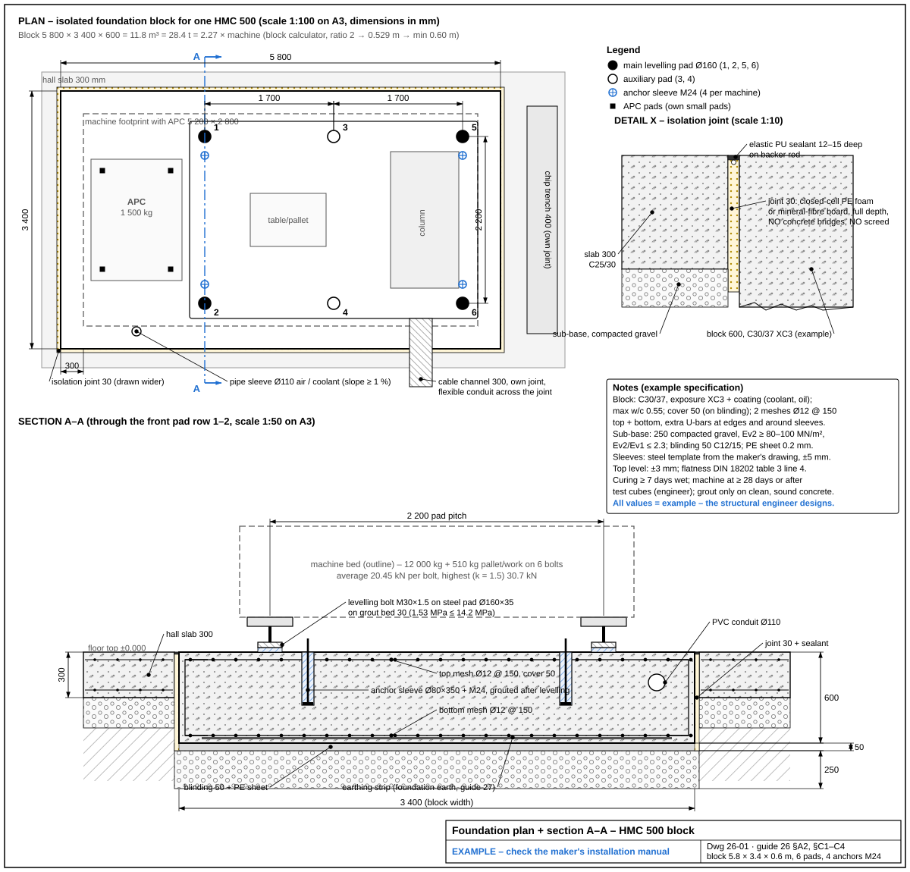
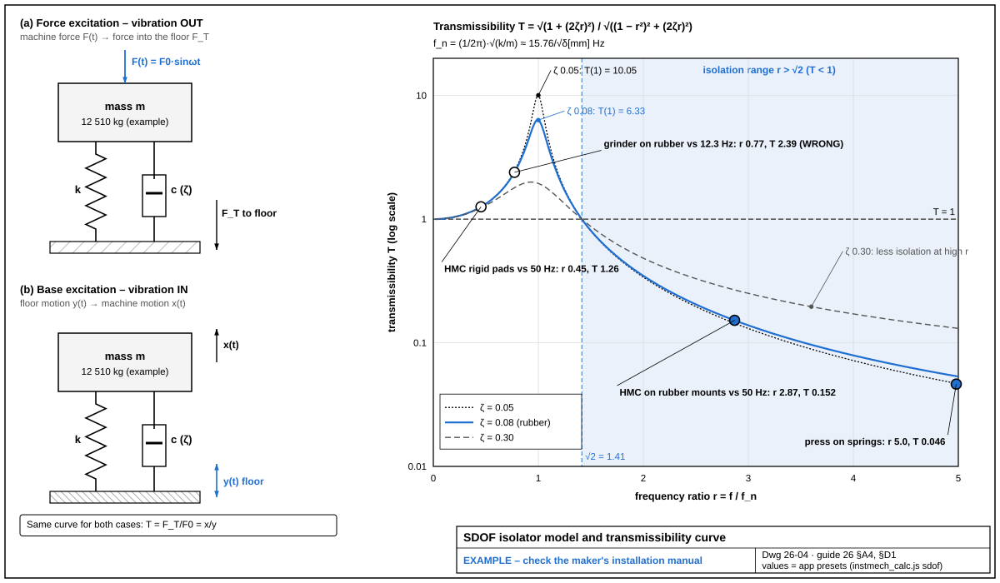
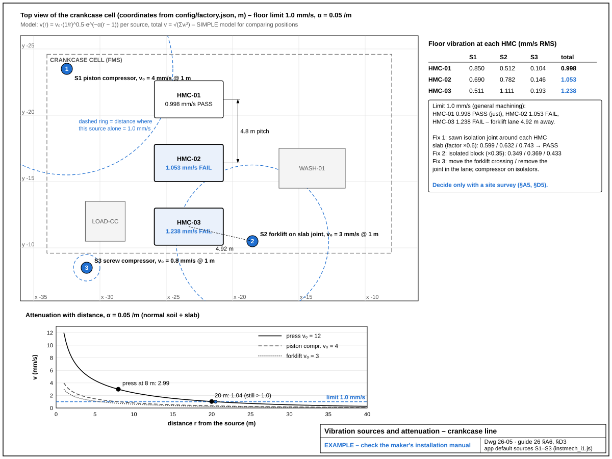
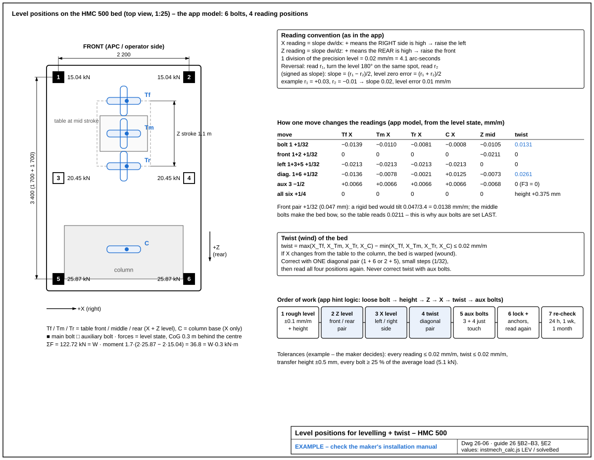
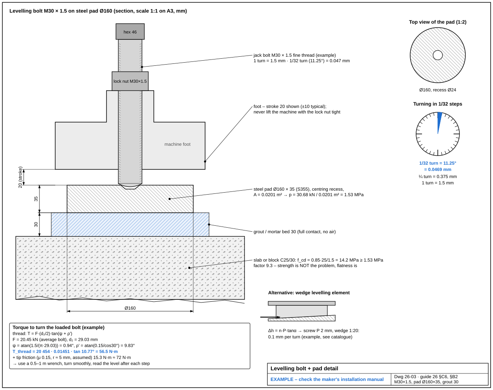
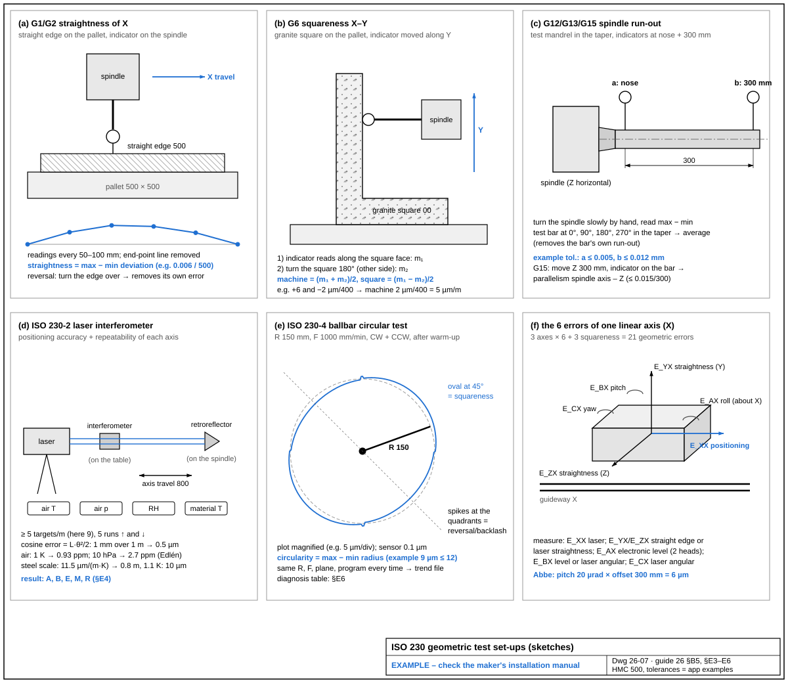
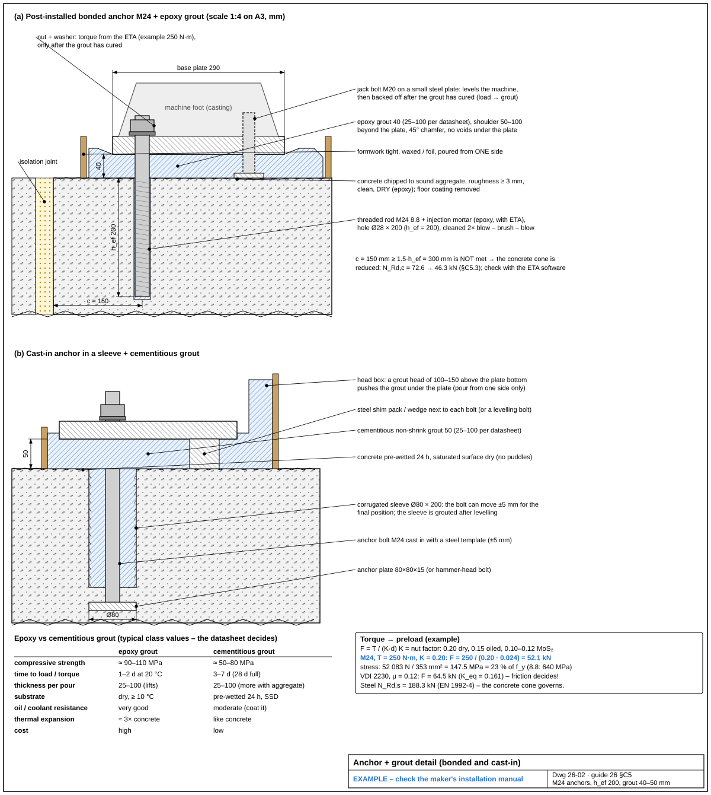
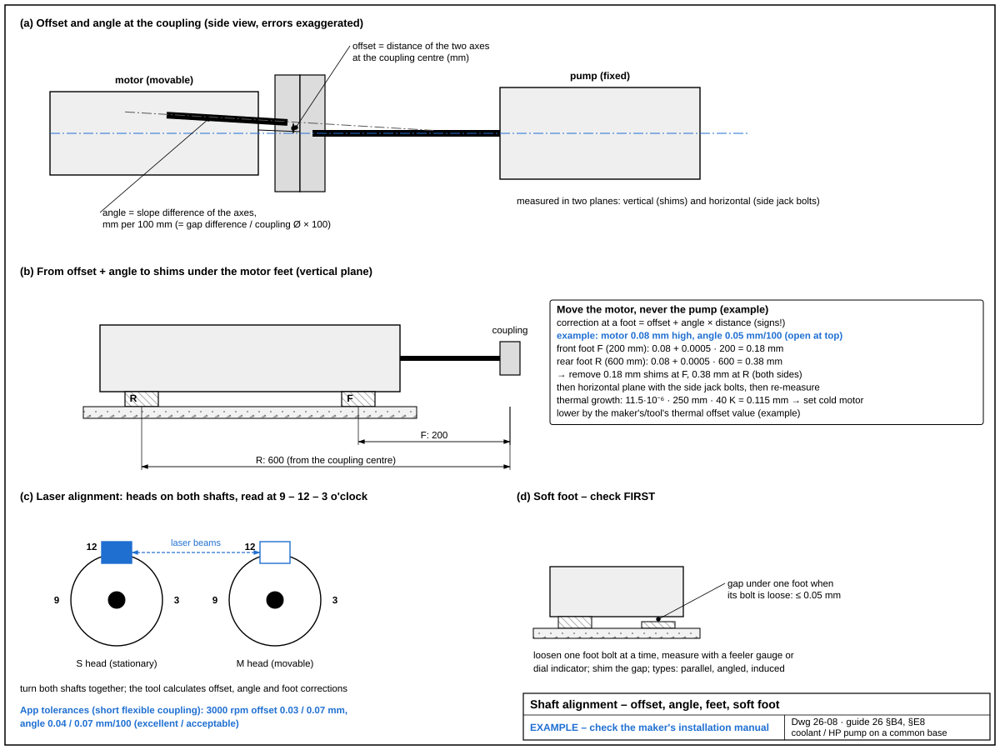

# 26 – Installation 1 + 2: foundation, anchoring, vibration isolation, levelling, alignment, geometric acceptance

**For whom:** mechanical engineers who must install the CNC machines of the crankcase line in a real factory hall and
want to know, step by step, what the floor must carry, when a machine needs its own foundation block, how to stop
vibration, how to level and align the machine, and how to accept its geometry. This guide is three books in one:

1. a **user guide** for items 1 and 2 of the Installation tab (Parts A and B),
2. a **textbook** with the theory, formulas and worked numbers (Parts C, D, E),
3. a **design + purchasing reference** with drawings, catalogue examples, checklists and standards (Part F).

**Where to see it live:** tab **Installation** → buttons **"1 · Foundation, anchoring, vibration isolation"** and
**"2 · Levelling, alignment, geometric acceptance"**. Files: `web/instmech.js` (entry, lazy build, test switches),
`web/instmech_i1.js` (item 1), `web/instmech_i2.js` (item 2), `web/instmech_calc.js` (all calculations),
`web/instmech_ui.js` (cards, info boxes, chart), `web/instmech.css`.
Deep links: `/?initem=1#inst`, `/?initem=2#inst`, one card: `/?initem=2&imcard=sim#inst`
(cards: `floor block mount vib lim plan ask` in item 1, `inst proc sim align geo pos ask2` in item 2).

> **All numbers are examples.** The reference machine is the **HMC 500** of the crankcase line (typical catalogue class):
> machine 12 000 kg, pallet 110 kg + workpiece 400 kg, APC 1 500 kg, coolant tank 800 L, chip conveyor 600 kg,
> footprint with APC 2.8 m × 5.2 m, height 3.0 m, 6 levelling bolts M30 × 1.5, optional anchors M24, moving column
> 1 800 kg at 0.6 g, spindle 6 000 rpm. The real values come from the **machine maker's installation manual and
> foundation drawing**, the **structural / geotechnical engineer** (slab, block, reinforcement, soil) and the standards
> named in each section. Product names in Part F are **catalogue examples**, not a recommendation – always read the
> current datasheet and approval (ETA) and ask for a quote.

**Drawings in this guide** (standalone SVG files in `docs/img/`, copies in `web/img/`):

| Dwg | File | Content |
| --- | --- | --- |
| 26-01 | `26_foundation_plan_section.svg` | plan + section A–A of the isolated block, joint detail, notes |
| 26-02 | `26_anchor_grout_detail.svg` | bonded anchor + epoxy grout, cast-in anchor + cementitious grout, torque → preload |
| 26-03 | `26_levelling_bolt.svg` | levelling bolt M30 × 1.5, pad Ø160, grout bed, 1/32 turn, torque |
| 26-04 | `26_transmissibility.svg` | SDOF model (force / base excitation) + transmissibility curves with the app presets |
| 26-05 | `26_vibration_layout.svg` | vibration sources around the crankcase line + attenuation curve |
| 26-06 | `26_level_positions.svg` | level positions Tf / Tm / Tr / C, bolt forces, reading signs, twist, order of work |
| 26-07 | `26_geometry_tests.svg` | set-ups: straightness, squareness, run-out, laser, ballbar, 6 errors of an axis |
| 26-08 | `26_shaft_alignment.svg` | offset / angle, foot corrections, laser heads, soft foot |

## Contents

* [0. How the numbers were checked](#0-how-the-numbers-were-checked)
* **PART A – Item 1 in the app: foundation, anchoring, vibration isolation**
  * [A1. The floor – can the slab carry the machine?](#a1-the-floor--can-the-slab-carry-the-machine)
  * [A2. Isolated foundation block](#a2-isolated-foundation-block)
  * [A3. Mounting options](#a3-mounting-options)
  * [A4. Vibration – sources and the isolation calculator](#a4-vibration--sources-and-the-isolation-calculator)
  * [A5. Vibration limits and the site survey](#a5-vibration-limits-and-the-site-survey)
  * [A6. Floor plan – vibration sources around the line](#a6-floor-plan--vibration-sources-around-the-crankcase-line-simple-model)
  * [A7. Questions for the maker and the builder (item 1)](#a7-questions-for-the-maker-and-the-builder-item-1)
* **PART B – Item 2 in the app: levelling, alignment, geometric acceptance**
  * [B1. Instruments](#b1-instruments-for-levelling-alignment-and-acceptance-card-21)
  * [B2. Levelling procedure – step by step](#b2-levelling-procedure--step-by-step-for-the-hmc-500-card-22)
  * [B3. Levelling simulator – the model behind it](#b3-levelling-simulator--the-model-behind-it-card-23)
  * [B4. Alignment of the elements + shaft alignment](#b4-alignment-of-the-elements-to-each-other-card-24)
  * [B5. Geometric acceptance tests G1–G17](#b5-geometric-acceptance--tests-g1g17-card-25)
  * [B6. Positioning ISO 230-2, ballbar, test piece](#b6-positioning-iso-230-2-ballbar-iso-230-4-test-piece-card-26)
  * [B7. Questions for the maker + acceptance checklist](#b7-questions-for-the-maker-and-acceptance-checklist-card-27)
* **PART C – Textbook: concrete, slab, soil, foundation block, anchors, levelling elements**
  * [C1. Concrete technology for machine foundations](#c1-concrete-technology-for-machine-foundations)
  * [C2. Slab-on-ground design basics](#c2-slab-on-ground-design-basics-tr34--en-1992)
  * [C3. Soil: plate-load test, bearing capacity, settlement](#c3-soil-plate-load-test-bearing-capacity-settlement)
  * [C4. Foundation block design (static + dynamic)](#c4-foundation-block-design-static--dynamic)
  * [C5. Anchoring and grouting technology](#c5-anchoring-and-grouting-technology)
  * [C6. Levelling elements and anti-vibration mounts](#c6-levelling-elements-and-anti-vibration-mounts)
* **PART D – Textbook: vibration**
  * [D1. Single-degree-of-freedom theory](#d1-single-degree-of-freedom-sdof-theory)
  * [D2. Two degrees of freedom and rocking](#d2-two-degrees-of-freedom-and-rocking-modes)
  * [D3. Wave propagation in soil](#d3-wave-propagation-in-soil-and-slabs)
  * [D4. Vibration criteria](#d4-vibration-criteria-vc-curves-iso-20816-vdi-2056)
  * [D5. Vibration measurement](#d5-vibration-measurement)
* **PART E – Textbook: levelling, alignment and geometric accuracy**
  * [E1. Units and conversions](#e1-units-and-conversions)
  * [E2. Levelling and alignment metrology](#e2-levelling-and-alignment-metrology--the-instruments-in-depth)
  * [E3. Geometric accuracy theory (ISO 230-1)](#e3-geometric-accuracy-theory-iso-230-1)
  * [E4. ISO 230-2 statistics in full](#e4-iso-230-2-statistics-in-full)
  * [E5. Thermal behaviour: ISO 230-3 and the hall](#e5-thermal-behaviour-iso-230-3-and-the-hall)
  * [E6. Ballbar diagnosis (ISO 230-4)](#e6-ballbar-diagnosis-iso-230-4)
  * [E7. ISO 10791 – parts and test pieces](#e7-iso-10791--parts-and-test-pieces)
  * [E8. Shaft and coupling alignment](#e8-shaft-and-coupling-alignment)
* **PART F – Practice: maintenance, troubleshooting, buying, checklists, standards**
  * [F1. Re-levelling intervals and maintenance](#f1-re-levelling-intervals-and-maintenance)
  * [F2. Troubleshooting table](#f2-troubleshooting-table)
  * [F3. Buy list – catalogue examples](#f3-buy-list--catalogue-examples)
  * [F4. Consolidated shopping list for installing 3 HMCs](#f4-consolidated-shopping-list-for-installing-3-hmcs)
  * [F5. Checklists](#f5-checklists)
  * [F6. Questions for suppliers](#f6-questions-for-suppliers)
  * [F7. Standards register](#f7-standards-register)
  * [F8. Glossary](#f8-glossary)

---

## 0. How the numbers were checked

Two independent ways:

1. **By the code itself** – open `/?initem=1&imtest#inst` and `/?initem=2&imtest#inst`; the results are in the browser
   console as lines `IMTEST1 …` / `IMTEST2 …`.
2. **By Python scripts** (stdlib only) for this guide: every formula of `instmech_calc.js` (floor check, block, SDOF,
   reaction, attenuation, the 6-bolt levelling model, ISO 230-2 with the same random generator) was re-written in Python
   and gave the same numbers as the JavaScript (cross-checked in headless Chrome). All new textbook examples (Westergaard,
   TR34, plate test, bearing capacity, soil springs, 2-DOF, anchors, torque, thermal, metrology) were also calculated there.

| Check | Hand calculation | Code |
| --- | --- | --- |
| Total weight | 16 170 kg · 9.81 = 158.63 kN | 158.63 kN ✓ |
| Highest pad load | 1.5 · 12 510 · 9.81 / 6 = 30 681 N | 30.68 kN ✓ |
| Pressure under a Ø160 pad | 30.68 kN / 0.020106 m² = 1.526 MPa ≤ f_cd 14.17 MPa | 1.526 / 14.17 ✓ |
| Average floor load | 158.63 / (5.2 · 2.8) = 10.89 kN/m² | 10.89 ✓ |
| Punching (h 300, d 250) | u₁ = 2π(0.08 + 0.5) = 3.644 m; v = 30.68/(3.644·0.25) = 33.7 kPa ≤ 0.456 MPa | 0.0337 / 0.456 ✓ |
| Ground pressure | (158.63 + 147.9) / 19.72 = 15.54 kPa | 15.54 ✓ |
| Block (ratio 2) | 25 020 kg / 2 400 / 19.72 m² = 0.529 m → min 0.60 m; real 28 397 kg = 2.27 ×; soil 20.35 kPa | ✓ |
| Natural frequency | √(150·10⁶ / 12 510) / 2π = 17.43 Hz; 15.76/√0.818 = 17.42 Hz | 17.428 / 17.424 ✓ |
| Transmissibility | r = 2.869 → T = 1.1003 / 7.2457 = 0.1519 | 0.1519 ✓ |
| Special values | T(r = 1, ζ = 0.05) = 10.05; T(√2) = 1; T(3, ζ = 0) = 1/8 | 10.050 / 1.0000 / 0.1250 ✓ |
| Column reaction | 1 800 · 0.6 · 9.81 = 10 595 N; ΔF per pad = 14 833 / 2.2 / 3 = 2 247 N | ✓ |
| Rocking tilt | rigid 1 000 kN/mm: 0.0020 mm/m; rubber 25 kN/mm: 0.0817 mm/m | ✓ |
| Spindle unbalance G 2.5 | 25 kg · 3.979 µm · 628.3² = 39.3 N | 39.27 N ✓ |
| Vibration with distance | 12 · (1/8)^0.5 · e^(−0.05·7) = 2.990 mm/s; at 20 m 1.038 mm/s | 2.990 / 1.038 ✓ |
| Floor plan default | HMC-01 0.998, HMC-02 1.053, HMC-03 1.238 mm/s; slab cut ×0.6 → 0.599 / 0.632 / 0.743 | ✓ |
| Levelling model | ΣF = 122.72 kN = W; moment 1.7·(2·25.87 − 2·15.04) = 36.8 = W·0.3 ✓; all bolts + ¼ turn → + 0.375 mm | ✓ |
| Levelling hints | 50 random installed states → all 50 levelled, at most 12 hint steps | ✓ |
| ISO 230-2 small hand set | x̄↑₁ = 2.00, s↑₁ = 0.7071, B₁ = 2.00, R₁ = 4.828; axis: E = 4.80, B = 2.40, R = 5.169, A = 7.887, M = 2.60 | ✓ |
| ISO 230-2 app example | before comp. A 13.67, E 12.04, M 10.48, B 2.19, R 3.78 µm; after A 4.91, E 2.93, M 1.17 | ✓ |
| Shaft check | 2 950 rpm, offset 0.03, angle 0.04 → excellent; offset 0.09 → NOT OK | ✓ |
| Item switch 1 ↔ 2 ↔ 3 ↔ 1 (`&imback`) | no console errors | ✓ |

> Note on the old table: "R = 4.828" in the hand set is the repeatability **at target 1** (R₁). The axis value R
> (maximum over all targets) is 5.169 µm (target 2: 2·0.8367 + 2·0.5477 + 2.4).

---

# PART A – Item 1 in the app: foundation, anchoring, vibration isolation

## A1. The floor – can the slab carry the machine?

**What:** the hall floor is a reinforced concrete slab on the ground. It must carry the machine, keep its level for years
and not crack under the levelling pads.
**Why:** a CNC machine is only as accurate as its floor. If the floor bends or settles 0.1 mm over the machine length
(≈ 3.4 m), the bed tilts by 0.1/3.4 = 0.03 mm/m – more than the whole levelling tolerance (0.02 mm/m).
**How:** get the slab data → calculate the loads → compare with the maker's foundation drawing → check flatness.
**Check:** slab ≥ maker minimum, concrete ≥ C25/30 (C30/37 where coolant can reach the concrete, §C1.2), pad pressure ≤
f_cd, flatness DIN 18202.
**Typical mistake:** placing the machine across an existing slab joint or crack.

### A1.1 Loads of the HMC 500 (example)

| Part | Mass (kg) | Where it stands |
| --- | --- | --- |
| Machine (column, table, magazine) | 12 000 | 6 levelling bolts |
| Pallet + workpiece on the table | 510 | (on the machine) |
| Pallet changer (APC) | 1 500 | own small pads |
| 2nd pallet + workpiece on the APC | 510 | APC |
| Coolant tank 800 L full (≈ 1.0 kg/L) + tank 250 kg | 1 050 | own feet |
| Chip conveyor | 600 | own feet |
| **Total** | **16 170** | |

### A1.2 Checks with worked numbers (the app card "1.1 Floor check")

1. **Total weight:** W = Σm · g = 16 170 · 9.81 = **158.6 kN**.
2. **Load on the bed pads:** (12 000 + 510) · 9.81 = 122.7 kN on 6 bolts → average 20.45 kN.
3. **Highest pad load:** the pads are not equal (centre of gravity near the column, dynamic loads). Use an
   uneven + dynamic factor k = 1.5 (example): F_pad = 1.5 · 122.7 / 6 = **30.7 kN**.
4. **Pressure under the pad** (steel pad Ø 160 mm, A = π·0.08² = 0.0201 m² = 201 cm²):
   p = 30.7 kN / 0.0201 m² = **1.53 MPa**. Concrete C25/30: f_cd = α_cc · f_ck / γ_c = 0.85 · 25 / 1.5 = **14.2 MPa** →
   OK (factor 9.3). (α_cc = 0.85 is used in Germany / UK national annexes; the EN default is 1.0 → 16.7 MPa.)
   EN 1992-1-1 §6.7 even allows a higher pressure on a small area inside a large block: F_Rdu ≤ 3.0·f_cd·A_c0 =
   42.5 MPa · 0.0201 m² = 854 kN – the concrete under a pad is never the problem if it is sound.
5. **Average floor load:** q = 158.6 / (5.2 · 2.8) = **10.9 kN/m²** ≤ rated floor load (example 20 kN/m²) → OK.
6. **Punching under a pad** (EN 1992-1-1 §6.4, simplified, no shear reinforcement, soil reaction ignored = safe side):
   slab h = 300 mm, d ≈ h − 50 = 250 mm. Control perimeter u₁ = 2π(a + 2d) = 2π(0.08 + 0.50) = 3.64 m.
   v = F/(u₁·d) = 30.7 / (3.64 · 0.25) = 33.7 kPa = **0.034 MPa**.
   Resistance v_Rd,min = 0.035 · k^1.5 · √f_ck with k = 1 + √(200/d) = 1 + √0.8 = 1.894 (≤ 2) → 0.035 · 2.607 · 5 =
   **0.456 MPa** → OK.
7. **Ground pressure** (45° load spread through the slab): A_eff = (5.2 + 0.6)(2.8 + 0.6) = 19.72 m²,
   slab weight 19.72 · 0.3 · 25 = 147.9 kN → q = (158.6 + 147.9) / 19.72 = **15.5 kPa** ≤ soil (example 150 kPa) → OK.
8. **Slab thickness:** 300 mm ≥ maker minimum (example 250 mm) → OK.

**Lesson:** for a 12 t machine on a 300 mm slab the *strength* is far from the limit. What really decides is the
**stiffness and flatness** of the floor, the **joints and cracks**, and the **vibration** at the position. A slab of
150 mm screed on insulation is never a machine floor. The textbook check of the slab bending (Westergaard / TR34, §C2)
gives the same lesson: stress 0.54 MPa against 1.56 MPa allowed, but a local "dimple" of 63 µm under one pad.

### A1.3 Floor requirements (typical values – the maker's foundation drawing decides)

| Item | Small VMC (3–6 t) | HMC 500 (12–16 t) | Large HMC / grinder (20–40 t) |
| --- | --- | --- | --- |
| Slab thickness | ≥ 200 mm | ≥ 250–300 mm | own block 600–1 200 mm |
| Concrete (EN 206) | C25/30 | C25/30 – C30/37 | C30/37 |
| Reinforcement | 1 mesh | 2 meshes Ø10–12 @ 150 | 2 meshes Ø12–16 @ 150 + edge bars |
| Flatness DIN 18202 table 3 | line 3 | line 3 or 4 | line 4 + grout |
| Floor level under the machine | ±5 mm | ±3–5 mm | ±3 mm |
| Soil | compacted gravel, plate-load test E_v2 ≥ 80–100 MN/m² (§C3) | | |
| Surface | oil-/coolant-resistant coating – **not under the grout area** | | |

DIN 18202, table 3 (flatness = max. gap under a straight edge, for measuring-point distance):

| Line | 0.1 m | 1 m | 4 m | 10 m | 15 m |
| --- | --- | --- | --- | --- | --- |
| 3 – floors, screeds | 2 mm | 4 mm | 10 mm | 12 mm | 15 mm |
| 4 – same, increased requirements | 1 mm | 3 mm | 9 mm | 12 mm | 15 mm |

The levelling bolts take the rest (bolt stroke ≈ ±10 mm), so the floor does not need to be "machine flat" – but it
must be **stable**. For AGV docking areas the flatness matters more (a wheel in a dip changes the transfer height,
interface A11 in §B4); there ask for line 4 or a local FM2 class (TR34 free-movement classes).

## A2. Isolated foundation block

**What:** a separate reinforced concrete block under one machine, cut free from the hall slab by an isolation joint.
**Why:** mass + stiffness + separation: vibration from outside is reduced, and the machine keeps its level even if the
hall floor moves.

### A2.1 When do I need one? (rules of thumb)

- The slab is thinner than the maker's minimum, cracked, or has a joint under the machine.
- The floor vibration at the position is above the maker's limit (survey, §A5), or a press / hammer / large
  piston compressor is nearer than ≈ 15–30 m.
- Precision machines: jig grinder, crankshaft grinder, CMM, measuring room.
- Very heavy or very long machines (point loads the slab cannot spread, long beds).
- The maker asks for it in the foundation drawing (then it is a contract item).
- **HMC 500 on a good 300 mm C25/30 slab: usually NOT needed** – levelling bolts on steel pads are standard.
  (In the line: HMC-01…03 on the slab; GRIND-01 on an isolated block.)

### A2.2 Sizing (worked example, app card "1.2")

Rule of thumb: **block mass ≥ 1.5–3 × machine mass** (more for machines with large moving masses or impacts).

| Step | Formula | Example (ratio 2) |
| --- | --- | --- |
| Block mass | m_block = ratio · m_machine | 2 · 12 510 = 25 020 kg |
| Plan | (L + 2·margin) × (B + 2·margin) | (5.2 + 0.6) × (2.8 + 0.6) = 5.8 × 3.4 = 19.72 m² |
| Depth | H = m_block / (ρ·A), ρ = 2 400 kg/m³ | 25 020 / 2 400 / 19.72 = 0.529 m → **min 0.60 m** |
| Real block | V = A·H | 11.8 m³ = 28.4 t = 2.27 × machine |
| Soil | (m_block + m_machine)·g / A | (28 397 + 12 510)·9.81 / 19.72 = 20.3 kPa |

The textbook part (§C4) adds the **dynamic** check of this block: on compacted gravel it has a vertical natural
frequency of ≈ 26 Hz with very high radiation damping (D ≈ 0.87) and a rocking frequency of ≈ 29 Hz.

### A2.3 Construction sequence

1. Mark the position from the reference lines (§B4); saw-cut and break the old slab.
2. Excavate, compact, 200–300 mm gravel, plate-load test (example E_v2 ≥ 80–100 MN/m², E_v2/E_v1 ≤ 2.3, §C3.1).
3. 50 mm blinding concrete, PE sheet (separation + moisture), joint filler boards at the sides.
4. Reinforcement with **spacers** (cover 40–50 mm); anchor sleeves held in a **steel template** made from the maker's
   drawing; cable conduits, pipe sleeves, earthing strip (item 3, guide 27).
5. Inspection before the pour (photos, positions ±5 mm); pour in one go; vibrate (poker every ≈ 0.5 m); finish top ±5 mm
   (±3 mm if the maker asks).
6. **Curing:** keep wet / covered ≥ 7 days. Strength at 7 days ≈ 68 % (slow cement, class S), ≈ 78 % (class N),
   ≈ 82 % (rapid, class R) of the 28-day value (EN 1992-1-1 §3.1.2, §C1.4). Load with the machine at ≥ 7 days **only**
   if the engineer confirms it (cube / cylinder results); precision levelling is better after 28 days (shrinkage
   continues for years in a thick block, §C1.5).
7. Close the joint with elastic sealant; place the machine; level; grout; cure; torque the anchors; re-level.

### A2.4 Parts of the foundation (click them in the drawing in the app)

| Part | Example | Typical mistake |
| --- | --- | --- |
| Isolation joint | 20–50 mm, soft closed-cell filler (PE foam, cork, mineral fibre) + elastic sealant on top | concrete bridges, screed over the joint, steel plate welded across |
| Levelling pad | steel Ø160 mm or 200 × 200, 30–40 mm thick, fully bedded | pad on dust / loose concrete → level lost after weeks |
| Anchor sleeve / anchor | M24, embedment 10–12·d, edge distance ≥ 5–10·d (full concrete cone needs ≥ 1.5·h_ef, §C5.3) | drilling into reinforcement, too close to the joint |
| Grout | epoxy 90–110 MPa or cement non-shrink 50–70 MPa, 25–50 mm | cement grout on dry dusty concrete; epoxy on wet concrete; torque before curing |
| Conduits | covered floor channel / sleeves, 40 % spare, power and signal separate | forgotten → core drilling through the new block |
| Pipe sleeve | air / coolant, slope ≥ 1 % | rigid pipe across the joint (vibration bridge) |
| Chip trench (optional) | 400 mm wide, own joint | trench weakening the block edge |
| Blinding + gravel | 50 mm + 250 mm, PE sheet | pouring on soft, wet soil |
| Reinforcement | 2 meshes Ø12 @ 150, cover 50 | mesh lying on the bottom (no spacers) |

The app draws the **top view** (block, joint, machine footprint with APC, 6 pads, anchors, conduits, chip trench, section
line A–A, dimensions) and the **section A–A** (slab 300, block H, joint, reinforcement, sleeves, pads, grout, bed,
blinding, gravel). The dimensions follow the block calculator. Drawing 26-01 above is the same block as a printable
sheet with a joint detail and a specification block.

## A3. Mounting options

| Mounting | Stiffness | Isolation | Pros | Cons | Use for |
| --- | --- | --- | --- | --- | --- |
| Anchored + grouted | very high | none (the block gives it) | best dynamic stiffness, no walking | hard to re-level | large HMC, heavy lathes |
| **Levelling bolts on steel pads** | high | none | standard, quick, easy re-levelling | needs a good slab; anchors against walking | **HMC 500 (our line)**, VMC |
| Anti-vibration levelling mounts (rubber) | low–medium, f_n 10–25 Hz | above ≈ 20–50 Hz | no drilling, cuts high-frequency noise | rocks with fast heavy axes, creep | light machines, washers, measuring devices |
| Springs / air springs + inertia block | low, f_n 2–6 Hz | very good above 5–15 Hz | strongest isolation in and out | expensive, needs damping | presses (vibration out), grinders / CMM (vibration in) |

Anchors and grout (examples – the anchor approval (ETA) and grout data sheet decide): cast-in sleeve M24 / 250–300 mm;
chemical anchor M24, hole Ø28, 210–300 mm deep, hole cleaned "blow – brush – blow" twice; undercut anchor for dynamic
loads; **anchor torque from the anchor approval** (example 200–300 N·m for M24), in a cross pattern, then re-check level.
Detail drawing 26-02 and the full design method are in §C5.

## A4. Vibration – sources and the isolation calculator

### A4.1 Sources (examples)

| Source | Frequency | Level on the floor (example) | Action |
| --- | --- | --- | --- |
| Mechanical press / punch | impacts, slab 10–40 Hz | 10–15 mm/s at 1 m, 1–3 mm/s at 10 m | spring isolators, distance ≥ 20–30 m |
| Piston air compressor | 12.3 Hz (740 rpm) + 2× | 3–5 mm/s at 1 m | own base on isolators, flexible hoses |
| Screw compressor, pumps, fans | 25–50 Hz, 100 Hz | 0.5–1 mm/s | usually OK on rubber mounts |
| Forklift / AGV over a joint | 5–15 Hz shocks | 2–5 mm/s near the joint | no joints in lanes near precision machines |
| Own moving column | 2–20 Hz reversals | F = m·a = 10.6 kN | stiff mounting + anchors |
| Spindle unbalance | 100 Hz at 6 000 rpm | F ≈ 40 N (G 2.5) | balanced tools |
| Neighbouring machining centres | 5–100 Hz | 0.3–1 mm/s at 3 m | keep ≥ 3–5 m between rigid machines |

### A4.2 One-degree-of-freedom isolator (the calculator)

A machine of mass m on mounts with total stiffness k and damping ratio ζ (theory in §D1):

- natural frequency **f_n = (1/2π)·√(k/m)**
- static deflection **δ = m·g/k** → because √(g/δ)/2π with δ in mm gives **f_n ≈ 15.76/√δ[mm] Hz** (√9 810 / 2π = 15.76)
- frequency ratio **r = f/f_n** (f = disturbing frequency)
- transmissibility **T = √(1 + (2ζr)²) / √((1 − r²)² + (2ζr)²)** = vibration out / vibration in
- T < 1 (isolation) only when **r > √2 ≈ 1.41**; good isolation needs **r ≥ 3**; at r = 1 T ≈ 1/(2ζ) (resonance).

**Worked example – HMC on rubber levelling mounts** (6 × 25 kN/mm = 150 kN/mm, ζ = 0.08) against a screw compressor (50 Hz):

1. δ = 12 510 · 9.81 / 150 000 N/mm = **0.818 mm**
2. f_n = √(150·10⁶ / 12 510)/2π = 109.5/6.283 = **17.43 Hz** (rule: 15.76/√0.818 = 17.42 Hz ✓)
3. r = 50 / 17.43 = **2.87**
4. T = √(1 + (2·0.08·2.87)²) / √((1 − 8.23)² + 0.459²) = 1.100 / 7.246 = **0.152** → 85 % isolation
   (= 20·log₁₀(1/0.152) = 16.4 dB).

Other presets in the app:

| Case | δ | f_n | Disturbance | r | T | Meaning |
| --- | --- | --- | --- | --- | --- | --- |
| HMC on rigid steel pads (6 × 1 000 kN/mm), ζ 0.05 | 0.020 mm | 110 Hz | 50 Hz | 0.45 | 1.26 | rigid: no isolation (and none wanted) |
| Grinder 8 t on rubber (8 × 10 kN/mm), ζ 0.08 | 0.98 mm | 15.9 Hz | piston compressor 12.3 Hz | 0.77 | **2.39** | **amplified – wrong mount** |
| Press 25 t on springs (δ = 10 mm), ζ 0.05 | 10 mm | 4.98 Hz | 25 Hz | 5.0 | 0.046 | 95 % stays in the press |

The chart in the app shows T against r (log scale, one axis), the isolation range r > √2 shaded, your mount (ζ) and a
reference curve ζ = 0.30, and the live point. The "disturbing source" list fills typical frequencies: piston compressor
740 rpm → 12.3 Hz, screw compressor motor 2 970 rpm → 49.5 Hz, press impact → slab ≈ 25 Hz, forklift bumps ≈ 8 Hz,
spindle 6 000 rpm → 100 Hz.

### A4.3 Reaction force of the moving column and rocking

- Inertia force: F = m·a = 1 800 · 0.6 · 9.81 = **10.6 kN** at every axis start and stop.
- Rocking moment (CoG 1.4 m above the pads): M = 10.6 · 1.4 = **14.8 kN·m**.
- Pad force change (span 2.2 m, 3 pads per side): ΔF = 14.8 / 2.2 / 3 = **± 2.25 kN per pad** (static ≈ 20 kN).
- Pad deflection change: rigid pad 1 000 kN/mm → 2.25 µm → tilt 2·2.25/2.2 = **0.002 mm/m** (fine);
  hard elastomer 100 kN/mm → 22.5 µm → 0.020 mm/m (already the full levelling tolerance);
  rubber mount 25 kN/mm → 90 µm → tilt **0.082 mm/m** → ≈ 0.08 mm motion 1 m above the pads at every reversal.
  **This is why a fast HMC is mounted rigidly.**
- The slab itself also gives: Westergaard (§C2.3) gives 63 µm under 30.7 kN on a k = 50 MN/m³ subgrade, so
  ΔF = 2.25 kN adds ≈ 4.6 µm → 0.004 mm/m. Still small – but twice the "rigid pad" value. A good subgrade matters.
- Spindle unbalance (rotor 25 kg, balance grade G 2.5 → e·ω = 2.5 mm/s): ω = 628.3 rad/s, e = 3.98 µm,
  F = m·e·ω² = 25 · 3.98·10⁻⁶ · 628.3² = **39 N** at 100 Hz – small, but it runs for hours (and bad tools are much worse).

## A5. Vibration limits and the site survey

Two different things:

**(a) Vibration of the machine itself** (motors, pumps, spindles on their bearing housings) – ISO 10816-3, now
**ISO 20816-3:2022 (replaces ISO 10816-3)**, velocity RMS 10–1000 Hz (mm/s):

| Group / foundation | A/B (new) | B/C (long run OK) | C/D (damage) |
| --- | --- | --- | --- |
| Group 2 (15–300 kW), rigid | 1.4 | 2.8 | 4.5 |
| Group 2 (15–300 kW), flexible | 2.3 | 4.5 | 7.1 |
| Group 1 (300 kW–50 MW), rigid | 2.3 | 4.5 | 7.1 |
| Group 1 (300 kW–50 MW), flexible | 3.5 | 7.1 | 11.0 |

The twin uses warn 4.5 / alarm 7.1 mm/s for the HMCs. VDI 2056 is withdrawn (you still see its classes in old manuals,
§D4.3). Check the current edition of ISO 20816-3 for your contract – the zone values are agreed between buyer and maker.

**(b) Vibration of the floor at the machine position** (examples – the maker's spec decides):

| Machine | Floor limit (velocity RMS) | Other forms |
| --- | --- | --- |
| General machining (HMC, VMC, lathe) | ≤ 1.0 mm/s | amplitude ≤ 2–5 µm (10–100 Hz) |
| Precision machining, fine boring, honing | ≤ 0.5 mm/s | ≤ 1–2 µm; ≤ 0.005 g |
| Grinding, jig grinder | ≤ 0.25 mm/s | ≤ 0.5–1 µm |
| CMM / measuring room | ≤ 0.1 mm/s | maker's curve (VC-A 50 µm/s) |

The units convert with the frequency (§D5.2): 0.005 g at 25 Hz = 0.049 m/s² → v = a/(2πf) = 0.31 mm/s →
x = v/(2πf) = 2.0 µm (peak values).

### A5.1 Site vibration survey – procedure

1. Positions: every future machine (corners + centre), the sources, the joints between.
2. Instrument: velocity sensor (geophone) or accelerometer (100 mV/g, better a seismic type ≈ 1 V/g for very low
   levels) + analyser / logger, calibrated; mounted on bare concrete (glued disc or magnet on a glued steel plate),
   never on a loose tile.
3. 3 directions, 1–200 Hz (or as the maker says), RMS + peak + FFT spectrum (+ 1/3-octave if a VC criterion is used).
4. A full working shift with all sources running (press, compressor start/stop, forklift, crane); note events.
5. Evaluate: worst 1-minute RMS, peaks, dominant frequencies (→ isolation calculator).
6. Report with recommendation (OK / move / block / isolate the source).
7. After installation: repeat on the machine base, machine OFF and ON; keep as baseline for condition monitoring.

**Typical mistake:** measuring on Sunday, when the press and compressors are off. More detail on sensors, FFT settings
and evaluation: §D5.

Distance rules (rules of thumb, check by survey): precision machines ≥ 20–30 m from presses / hammers, ≥ 10 m from
piston compressors; no slab joints or traffic lanes within 2–3 m. **Open trenches:** a trench screens surface waves
only if it is deep compared with the wave length λ = c/f – about **0.6 λ** close to the source and **≈ 1.3 λ** far from
it (Woods). At 25 Hz in normal soil (c ≈ 200 m/s) λ = 8 m → a trench of ≈ 5–10 m depth: not practical. The practical
solution is a sawn isolation joint around a block, distance, and isolating the source (§D3.3).

## A6. Floor plan – vibration sources around the crankcase line (SIMPLE model)

The app shows the crankcase cell with HMC-01/02/03 at x = −23.3 m, y = −21.2 / −16.4 / −11.6 m (4.8 m pitch, read from
`config/factory.json`), LOAD-CC and WASH-01. You can **drag** sources, add more (press, piston / screw compressor,
forklift, forging hammer), choose floor damping, foundation type and floor limit.

Model (Bornitz type, surface waves): **v(r) = v₀ · (1/r)^0.5 · e^(−α(r − 1))**, r in m, v₀ = level at 1 m (§D3).
α = 0.02 (rock / stiff), 0.05 (normal soil + slab), 0.10 /m (soft). Foundation factor: continuous slab 1.0, slab cut
around ×0.6, isolated block ×0.35. Several uncorrelated sources: **v = √(Σ vᵢ²)**.

Source levels in the app (v₀ at 1 m): press 250 t 12 mm/s, piston compressor 4, screw compressor on mounts 0.8,
forklift on a slab joint 3, forging hammer 40 mm/s.

Worked: press v₀ = 12 mm/s, α = 0.05: at 8 m v = 12 · 0.354 · e^(−0.35) = **2.99 mm/s**; at 20 m
v = 12 · 0.224 · e^(−0.95) = **1.04 mm/s** – still above 1.0 → a press needs isolators AND distance (alone it reaches
1.0 mm/s only at ≈ 20.5 m; a forging hammer at ≈ 38.5 m).

Default example (piston compressor S1 at (−32.5, −23.5), forklift S2 on a slab joint at (−18.5, −10.5), screw
compressor S3 at (−31, −8.5); α 0.05, limit 1.0 mm/s):

| Machine | S1 distance / v | S2 distance / v | S3 distance / v | Total √Σv² | Slab cut ×0.6 |
| --- | --- | --- | --- | --- | --- |
| HMC-01 | 9.48 m / 0.850 | 11.73 m / 0.512 | 14.85 m / 0.104 | **0.998** PASS (just) | 0.599 |
| HMC-02 | 11.62 m / 0.690 | 7.61 m / 0.782 | 11.03 m / 0.146 | **1.053** FAIL | 0.632 |
| HMC-03 | 15.04 m / 0.511 | 4.92 m / 1.111 | 8.30 m / 0.193 | **1.238** FAIL | 0.743 |

HMC-03 fails mainly because the forklift lane is 4.9 m away. Choose "slab cut around" (×0.6) and all three pass, or drag
the forklift crossing further away and watch the numbers. Dashed rings show the distance at which each source alone
falls below the limit (piston compressor 8.0 m, forklift 5.75 m, screw compressor 1 m).

> The model is good for **comparing positions**, not for design: soil layers, joints and resonances can change the
> result by a factor of 3. Decide with a survey and a specialist.

## A7. Questions for the maker and the builder (item 1)

Maker: foundation drawing (pad / anchor positions, static + dynamic pad loads, slab, block yes/no); allowed floor
vibration (value, frequency range, unit: mm/s RMS, µm, g); levelling elements supplied (thread, pitch, pads); anchors
(type, torque); grout (product, thickness, who); weights incl. coolant, chip conveyor, APC, centre of gravity; moving
masses and accelerations; connection positions for conduits; room conditions (20 ± 2 °C, gradient ≤ 1 K/m, no sun /
draught).

Builder / structural engineer: as-built slab (or core drilling + rebar scan); soil report; block design (reinforcement,
joint detail, sleeve template, earthing strip); concrete test results at 7 and 28 days; flatness report (DIN 18202);
floor coating not under the grout.

**Checklist before the machine arrives:** ☐ survey report OK ☐ foundation cured (date + strength) ☐ sleeves / conduits
at drawing position ±5 mm ☐ reference lines marked ☐ pads, grout, anchors on site ☐ rigging route free (item 5).
The full checklists are in §F5, all supplier questions in §F6.

---

# PART B – Item 2 in the app: levelling, alignment, geometric acceptance

Item 2 has seven cards. The numbers on the cards come from `instmech_calc.js` (`LEV`, `solveBed`, `hint`, `iso2302`)
and the tables in `instmech_i2.js` (`TESTS`, `IFACES`, `SHAFT`).

## B1. Instruments for levelling, alignment and acceptance (card 2.1)

**What:** the measuring tools of the installer and the acceptance engineer – from a spirit level to a laser
interferometer. Click a row in the app to open an info box (what / why / how / typical mistake).
**Why:** you cannot set 0.02 mm/m with a builder's level (0.5 mm/m). Each test needs an instrument that is
≥ 4–10 × better than the tolerance.
**How:** rule: instrument uncertainty ≤ ¼ … ⅒ of the tolerance (ISO 230-9 / ISO 14253-1 decision rules). Let
instruments reach room temperature; check them by reversal; calibration certificates valid.
**Check:** calibration date, reversal test of the level before use, temperature of machine and instruments written in
the report. **Typical mistake:** measuring right after unpacking the instruments from a cold car.

| Instrument | Resolution / accuracy (example) | Used for | How to use – and the typical mistake |
| --- | --- | --- | --- |
| **Precision spirit level** 200–300 mm | 0.02 mm/m per division (0.01 for precision) | levelling, twist, roll of axes | reversal test before use (§E2.1); 30 min to room temperature; do not hold the vial by hand. Mistake: reading in one direction only, dirty surface |
| **Electronic level** | 1 µm/m, ±2 % of reading | levelling, angular deviations (ISO 230-1), twist with 2 heads | zero by reversal, warm-up, certificate. Mistake: vibrating floor without averaging |
| **Granite square** / cylinder square | grade 00: 2–3 µm / 500 mm | squareness X–Y, Y–Z, Z–X | clean, same temperature, 3-point support, reverse the square. Mistake: square on chips |
| **Test mandrel** 300 mm | run-out < 2 µm | spindle run-out, spindle parallel to Z | clean taper, 4 positions turned 90°, average. Mistake: dirty taper → 10 µm "run-out" |
| **Dial / digital indicator** | 0.001 mm | straightness with straight edge, parallelism, run-out | short, stiff stand, probe perpendicular, small preload. Mistake: long wobbly stand |
| **Laser interferometer** | ±0.5 µm/m (with environment compensation) | ISO 230-2 positioning, pitch / yaw, compensation tables | environment compensation on, cosine error < 1 µm, short dead path, warm machine. Mistake: cold machine in the morning |
| **Ballbar** | 0.1 µm sensor resolution | ISO 230-4 circularity, backlash, squareness, servo match | same radius, feed, plane, program every time. Mistake: comparing different radii / feeds |
| **Laser tracker / total station** | ±0.02 mm + 5 µm/m / ±1 mm | line alignment: machines, APC, robot, conveyors, AGV docks | stable floor markers, measure twice, note temperature. Mistake: aligning to the neighbour, not the datum |
| **Levelling bolt** M30 × 1.5 | 1 turn = 1.5 mm, 1/32 turn = 0.047 mm | height of each support point | oiled thread, lock nut, centred pad. Mistake: turning while the anchors clamp the bed |

**What 0.02 mm/m means:** slope 0.02 mm/m = 20 µm height change per metre = 0.0011° = 4.1 arc-seconds. Over the 3.4 m
pad pattern of the HMC that is 0.068 mm – less than the thickness of a sheet of paper (0.1 mm). More units in §E1,
instruments in depth in §E2, catalogue examples in §F3.

## B2. Levelling procedure – step by step for the HMC 500 (card 2.2)

**What:** bring the machine bed level and free of twist on its 6 levelling bolts, at the right height for the pallet
changer / robot / AGV interfaces.
**Why:** the bed is scraped and measured level at the maker. If you support it twisted, the guideways twist:
straightness, squareness and the B-axis position change (geometric errors of 10–30 µm).
**How:** rough levelling → main-point levelling → twist removal → auxiliary bolts → height → lock + anchors → re-check
after 24 h, 1 week, 1 month.
**Check:** all readings ≤ 0.02 mm/m (example) in X and Z at front / middle / rear table position and at the column base;
twist ≤ 0.02 mm/m; every bolt carries load.
**Typical mistake:** levelling with the auxiliary bolts (they then lift the bed and bend it) or levelling only at one
table position (twist not seen).

1. **Prepare.** Floor clean, steel pads placed on the marked positions (bedded in mortar or on the grout bed if the maker
   says so), bolts oiled and turned in so that all 6 have ≈ 10 mm stroke both ways. Room temperature stable (≥ 24 h),
   machine at room temperature (after transport: wait 12–24 h).
2. **Place the machine** on the 4 main bolts (corners 1, 2, 5, 6). Auxiliary bolts 3, 4 *not* touching. Remove transport
   locks only as the manual says (some stay until levelling is done).
3. **Rough levelling** with a 0.1 mm/m level on the table: ±0.1 mm/m in X and Z. Set the height for the interfaces
   (APC / AGV transfer height ±0.5 mm, example) – the height is easy now, hard later.
4. **Main-point levelling** with the 0.02 mm/m precision level (reversal-checked). Level on the table at **mid stroke**:
   X direction and Z direction. Correct Z with the front or rear pair, X with the left or right side. Small steps
   (1/32 turn), wait 1 min, read again.
5. **Twist removal.** Move the table to the **front end** and the **rear end** of Z, read X at each position, and read X on
   the column base. If the X reading changes along Z the bed is twisted: raise one diagonal corner pair (e.g. 1 + 6) or
   lower it, until the X readings agree within 0.02 mm/m.
6. **Auxiliary bolts.** Turn 3 and 4 down until they just touch (bolt becomes hard), then the maker's extra (example
   ⅛–¼ turn by feel / torque) – the readings must *not* change. If a reading changes, the aux bolt lifts or bends the bed.
7. **Lock.** Lock nuts tight while holding the bolt. If anchored: tighten the anchors in a cross pattern to the
   anchor-maker torque, read again. If grouted: pour, cure, then torque, read again.
8. **Record** all readings, bolt turns, temperature, date → protocol.
9. **Re-check** after 24 h, 1 week and 1 month (the floor and grout settle); then every 6–12 months, and after any crash.

Tolerances (examples – the maker's manual decides):

| Item | Example |
| --- | --- |
| Level X and Z, every position | ≤ 0.02 mm/m |
| Twist (change of X reading along Z) | ≤ 0.02 mm/m |
| Height of the transfer plane | ±0.5 mm |
| Re-check drift after 1 month | ≤ 0.01–0.02 mm/m |
| Precision machine (grinder) | ≤ 0.01 mm/m |

**Order matters: Z first, then X, then twist, then auxiliary bolts.** Each correction changes the other readings a
little – read everything again after each step.

## B3. Levelling simulator – the model behind it (card 2.3)

**What:** a model of the HMC bed on its 6 jack bolts. Turn the bolts (±1/32 or ±¼ turn each, all six ±1/32 or ±⅛) and
read the precision level at four positions, like the installer does. Buttons: "next step hint", "do the hint step for
me", "reset to random installed state". Checks: readings, twist, height, bolt loads – all four green = **LEVELLED – PASS**.

### B3.1 Model data (examples, `LEV` in `instmech_calc.js`)

| Item | Value | Meaning |
| --- | --- | --- |
| Weight on the bolts W | 12 510 kg · 9.81 = 122.72 kN | machine + pallet + workpiece |
| Centre of gravity | x_g = 0, z_g = +0.3 m | 0.3 m behind the bed centre (column at the rear) |
| Bolt positions | x = ±1.1 m, z = −1.7 / 0 / +1.7 m | 1–2 front, 3–4 middle (auxiliary), 5–6 rear |
| Bolt stiffness k | 1 000 kN/mm per bolt (≈ 1 kN/µm) | bolt + pad + concrete |
| Twist stiffness K_c | 2 800 (≈ 0.2 kN/µm at a corner) | the bed can warp (mode x·z) |
| Bow stiffness K_b | 7 400 (≈ 1 kN/µm at a middle bolt ≈ 48·EI/L³ of a cast box bed) | the bed can bend along Z (mode z² − s) |
| Thread | M30 × 1.5: 1 turn = 1.5 mm, 1/32 turn = 0.0469 mm | bolts sit on 1/32-turn steps |
| Tolerances | 0.02 mm/m readings + twist, ±0.5 mm height, each bolt ≥ 25 % of the average (5.11 kN) | |
| Reading positions | Tf (z −1.3), Tm (z −0.75), Tr (z −0.2): X + Z; C column base (z +1.2): X only | |

### B3.2 The equations (energy minimum)

Bed height (mm, x z in m → slope in mm/m):

**w(x, z) = w₀ + a_x·x + a_z·z + c·x·z + b·(z² − s)**, with s = mean z² of the bolts = (4·1.7²)/6 = 1.927 m².

- w₀ = height, a_x / a_z = rigid tilts, c = twist, b = bow.
- Bolt i with extension e_i pushes with F_i = k·(e_i − w(x_i, z_i)) if this is > 0, else F_i = 0 (a bolt cannot pull).
- Equilibrium: ΣF_i = W, ΣF_i·x_i = W·x_g, ΣF_i·z_i = W·z_g (rigid modes) and ΣF_i·x_i z_i = K_c·c,
  ΣF_i·(z_i² − s) = K_b·b (elastic modes). This is a 5 × 5 linear system; the program solves it, frees bolts with negative
  force and solves again (active set).
- Readings: X slope ∂w/∂x = a_x + c·z, Z slope ∂w/∂z = a_z + c·x + 2b·z. **Twist** = max − min of the four X readings.
- Sign convention: **X reading + = right side high → raise the left; Z reading + = rear high → raise the front.**

### B3.3 The level state (worked numbers)

For a level bed (all slopes 0) the bolt forces must satisfy the 5 equations with 6 unknowns; the app takes the solution
closest to equal sharing (least squares):

| Bolt | 1 | 2 | 3 | 4 | 5 | 6 |
| --- | --- | --- | --- | --- | --- | --- |
| Force (kN) | 15.04 | 15.04 | 20.45 | 20.45 | 25.87 | 25.87 |
| Extension e = F/k (µm) | 15.04 | 15.04 | 20.45 | 20.45 | 25.87 | 25.87 |

Check: ΣF = 2·(15.04 + 20.45 + 25.87) = 122.72 kN = W ✓; moment about the middle row 1.7·(2·25.87 − 2·15.04) =
36.8 kN·m = W·z_g = 122.72·0.3 ✓. The rear bolts carry 72 % more than the front ones because the column is at the rear.

### B3.4 How one move changes the readings (from the level state)

| Move | Tf X | Tm X | Tr X | C X | Z at Tm | Twist | Lesson |
| --- | --- | --- | --- | --- | --- | --- | --- |
| bolt 1 +1/32 (+0.047 mm) | −0.0139 | −0.0110 | −0.0081 | −0.0008 | −0.0105 | 0.0131 | one corner changes everything, and twists |
| front 1 + 2 +1/32 | 0 | 0 | 0 | 0 | **−0.0211** | 0 | rigid tilt would be 0.047/3.4 = 0.0138; the middle bolts make the bed bow |
| left 1 + 3 + 5 +1/32 | −0.0213 | −0.0213 | −0.0213 | −0.0213 | 0 | 0 | a whole side = pure X tilt (0.047/2.2) |
| diagonal 1 + 6 +1/32 | −0.0136 | −0.0078 | −0.0021 | +0.0125 | −0.0073 | **0.0261** | a diagonal pair is the twist tool |
| aux 3 −1/2 turn | +0.0066 | +0.0066 | +0.0066 | +0.0066 | −0.0068 | 0 | bolt 3 is free (F₃ = 0): a loose aux bolt |
| all six +1/4 turn | 0 | 0 | 0 | 0 | 0 | 0 | height +0.375 mm, no slope |

### B3.5 A full levelling session (app default, seed 3)

The default "installed" state (each bolt ±0.35 mm random, a height offset, auxiliary bolts often not touching) reads:
Tf X +0.091 / Z +0.087, Tm X +0.105 / Z +0.082, Tr X +0.119 / Z +0.076, C X +0.153 mm/m; twist 0.062 mm/m; height
−0.96 mm; bolt forces 7.7 / 16.0 / 53.7 / 0 / 0 / 45.4 kN (bolts 4 and 5 loose!). The hint button gives this sequence
(it follows the real order of work: loose bolt → height → Z → X → twist → auxiliary bolts):

| Step | Hint text (shortened) | Move |
| --- | --- | --- |
| 1 | main bolt 5 carries only 0.0 kN (loose) | bolt 5 +⅛ turn (0.188 mm) |
| 2 | height at the table −0.97 mm from target | all six +21/32 turn (0.984 mm) |
| 3 | Z level at Tm +0.085 mm/m (rear high – raise the front) | front 1 + 2 +5/32 (0.234 mm) |
| 4 | X level at Tm +0.105 mm/m (right high – raise the left) | left 1 + 3 + 5 +5/32 (0.234 mm) |
| 5 | twist 0.039 mm/m from the table to the column | diagonal 1 + 6 −1/16 (−0.094 mm) |
| 6 | auxiliary bolt 4 carries only 0.0 kN | bolt 4 +7/32 (0.328 mm) |
| 7 | X level at Tm +0.018 mm/m | left side +1/32 |
| 8 | auxiliary bolt 3 carries only 3.3 kN | bolt 3 +1/32 |
| 9 | fine correction – a reading still outside 0.02 mm/m | left side −1/32 |
| – | "All readings within tolerance, no twist, all bolts loaded. Now tighten the lock nuts / anchors in a cross pattern, read again, and re-check after 1 week and 1 month." | PASS |

The self-test runs this from 50 random states: all 50 reach PASS, at most 12 hint steps. The hint logic never goes in
a circle because every suggested move must lower a "merit" value (distance from levelled).

**Real life vs the model:** a real bed also bends locally, the floor gives a little and the level needs 1 min to settle –
the sequence of work is the same. Wait after each move, and read *all* positions again.

## B4. Alignment of the elements to each other (card 2.4)

**What:** the line is a chain: machine ↔ pallet changer ↔ AGV / RGV ↔ conveyors ↔ robot. Each interface must be at the
right position and height.
**Why:** a pallet that arrives 1.5 mm too high hits the locating pins; a robot 2 mm off picks wrong. Errors add up if
each element is aligned only to its neighbour.
**How:** 1) Set ONE datum: main line axis + cross axis + height reference (floor bolts / brass markers, laser lines).
2) Mark the reference lines on the floor before the machines come. 3) Place each element to the datum (total station /
laser tracker), not to its neighbour. 4) Fine-tune interface heights with the levelling bolts. 5) Re-teach robot frames
and AGV docking positions after the final position.
**Check:** measured interface table all within tolerance, recorded with date and temperature.
**Typical mistake:** painting the reference lines after the machines are placed, or using the hall wall as reference
(walls are not straight).

### B4.1 Datum and reference lines

- **Main axis** of the line (along the HMCs, y = −21.2 … −11.6 m in the layout) and **cross axes** through each machine
  centre, from the hall grid.
- Set 2 permanent **floor markers** (stainless / brass bolts, drilled + glued) at each end of every axis, measured with a
  total station; draw chalk / paint lines between them.
- **Height datum**: one floor marker with a known level (e.g. ±0.000 = finished floor at HMC-02); all transfer heights
  refer to it (laser level / tracker).
- Tolerances for marking: ±1 mm over the line length (tracker), lines checked by a second person.

**Why one datum (error chain):** if each of 3 machines is placed ±1 mm to its neighbour, the third can be ±3 mm from the
line (worst case) or ±√3 = ±1.7 mm (statistical). Placed to one datum, every machine stays within ±1 mm.

### B4.2 Typical interface tolerances (examples)

| Interface | Position | Height | Angle |
| --- | --- | --- | --- |
| Stand-alone machine to layout | ±5–10 mm | – | ±0.5° |
| Machine in a linked line (pallet system / RGV) | ±1–2 mm | ±0.5 mm | ≤ 0.3 mm/m |
| AGV docking with mechanical centring | ±1 mm (AGV ±5–10 mm before centring) | ±0.5 mm | – |
| Robot to machine / fixture | ±1 mm, then re-teach frames | ±1 mm | base ≤ 0.5 mm/m |
| Conveyor to robot / machine | ±2 mm lateral | ±1 mm | – |

### B4.3 Interface check – the measured example set in the app (edit the deviations)

| # | Interface | Nominal | Tol. ± | Measured dev. (example) | Instrument | Result |
| --- | --- | --- | --- | --- | --- | --- |
| A1 | HMC-01 centre to line reference axis (across) | 0 | 2 mm | 1.2 | total station / tape | PASS |
| A2 | Pitch HMC-01 → HMC-02 (along line) | 4 800 | 1 mm | 0.6 | total station / laser tracker | PASS |
| A3 | HMC-01 rotation to the line axis | 0 | 0.3 mm/m | 0.12 | total station, 2 points | PASS |
| A4 | Pallet transfer height: APC load station vs AGV deck | 1 100 | 0.5 mm | 0.3 | precision level + height gauge | PASS |
| A5 | APC arm to table transfer position | maker | 0.2 mm | 0.15 | indicator on the pallet | PASS |
| A6 | Robot base to machine fixture reference | 0 | 1 mm | 0.8 | laser tracker | PASS |
| A7 | Robot base level | 0 | 0.5 mm/m | 0.2 | precision level | PASS |
| A8 | Conveyor top height at robot pick point | 850 | 1 mm | **1.4** | level + height gauge | **FAIL** |
| A9 | Conveyor lateral position to robot | 0 | 2 mm | 0.9 | tape / tracker | PASS |
| A10 | AGV docking station position (along / across) | 0 | 1 mm | −0.6 | tracker, docking pins | PASS |
| A11 | AGV docking height vs load station | 0 | 0.5 mm | 0.4 | level + feeler gauge | PASS |
| A12 | Chip conveyor discharge over the chip cart / trench | 0 | 20 mm | 12 | tape | PASS |

Result: 11 of 12 interfaces within tolerance. A8 fails: the conveyor is 1.4 mm too high at the pick point → adjust the
conveyor feet (not the robot program), then check A9 again.

**Angle error moves far points (A3):** 0.12 mm/m rotation of HMC-01 shifts a point 2.6 m from the machine centre (APC
load station) by 0.12 · 2.6 = 0.31 mm – that is why the rotation has its own tolerance.

### B4.4 Shaft alignment (pump / chip conveyor / coolant HP pump)

Motor and pump on a common base, flexible coupling: align with a laser shaft-alignment tool (two heads, turn the shafts
180°, read offset and angle). First remove **soft foot** (one motor foot not touching: ≤ 0.05 mm, shim it). Tolerances
in the app (typical industry table for short flexible couplings):

| Speed (rpm) | Offset excellent / acceptable (mm) | Angle excellent / acceptable (mm per 100 mm) |
| --- | --- | --- |
| 0–1 000 | 0.07 / 0.13 | 0.06 / 0.10 |
| 1 000–2 000 | 0.05 / 0.10 | 0.05 / 0.08 |
| 2 000–3 000 | 0.03 / 0.07 | 0.04 / 0.07 |
| 3 000–4 000 | 0.02 / 0.05 | 0.03 / 0.06 |
| 4 000–6 000 | 0.01 / 0.03 | 0.02 / 0.05 |

Calculator example: 2 950 rpm, offset 0.03 mm, angle 0.04 mm/100 → **excellent**; offset 0.09 mm → **NOT OK –
re-align**; 1 480 rpm with 0.08 / 0.05 → acceptable. Theory, foot corrections and thermal growth: §E8 and Dwg 26-08.

## B5. Geometric acceptance – tests G1–G17 (card 2.5)

**What:** after levelling, the machine geometry is checked: straightness, squareness, parallelism of the pallet, spindle
run-out, B-axis indexing – the same tests as in the maker's final inspection (FAT).
**Why:** transport and a different floor change the geometry. The test proves that the machine is as delivered, and the
report is the base for warranty claims.
**How:** warm up the machine first (spindle 50 % speed + all axes moving for 1 h, example). Room 20 ± 2 °C, gradient
≤ 1 K/m. Measure with the instruments of §B1, compare with the maker's FAT values, sign the protocol.
**Check:** every value ≤ tolerance AND close to the FAT value of the same machine (a big change = something moved, even
if still in tolerance).
**Typical mistake:** measuring a cold machine, or "correcting" squareness with the levelling bolts instead of finding the
real cause.

> **Standard number:** the app writes "ISO 10791-2" in this card. For a machining centre with a **horizontal spindle**
> (our HMC) the geometric tests are in **ISO 10791-1** (ISO 10791-2 is for vertical spindles). The test content in the
> table is typical for both; use ISO 10791-1 in the contract (see the note in §F7).

| # | Test | Standard | Instrument | Tolerance (example) | Measured (example) | Use of tol. |
| --- | --- | --- | --- | --- | --- | --- |
| G1 | Straightness of X motion – vertical plane (XY) | ISO 10791-1 / ISO 230-1 | straight edge + indicator, or laser | 0.010 mm / 500 | 0.006 | 60 % |
| G2 | Straightness of X motion – horizontal plane (ZX) | ISO 10791-1 | straight edge + indicator | 0.010 / 500 | 0.007 | 70 % |
| G3 | Angular deviation of X (pitch / yaw / roll) | ISO 230-1 | electronic level, laser angular optics | 0.060 mm / 1000 | 0.035 | 58 % |
| G4 | Straightness of Y motion (column vertical) | ISO 10791-1 | granite square + indicator | 0.010 / 500 | 0.008 | 80 % |
| G5 | Straightness of Z motion (table) | ISO 10791-1 | straight edge + indicator | 0.010 / 500 | **0.012** | **120 % FAIL** |
| G6 | Squareness X – Y | ISO 10791-1 | granite square + indicator | 0.020 / 500 | 0.011 | 55 % |
| G7 | Squareness Y – Z | ISO 10791-1 | granite square + indicator | 0.020 / 500 | 0.009 | 45 % |
| G8 | Squareness Z – X | ISO 10791-1 | granite square + indicator | 0.020 / 500 | 0.014 | 70 % |
| G9 | Flatness of the pallet surface | ISO 10791-1 | precision level grid or straight edge | 0.015 mm (500 × 500) | 0.008 | 53 % |
| G10 | Parallelism pallet surface – X motion | ISO 10791-1 | indicator on the spindle | 0.020 / 500 | 0.010 | 50 % |
| G11 | Parallelism pallet surface – Z motion | ISO 10791-1 | indicator on the spindle | 0.020 / 500 | 0.013 | 65 % |
| G12 | Spindle taper run-out at the nose | ISO 10791-1 / ISO 230-7 | test mandrel + indicator 0.001 | 0.005 mm | 0.003 | 60 % |
| G13 | Run-out at 300 mm from the nose | ISO 10791-1 | test mandrel + indicator 0.001 | 0.012 mm | 0.009 | 75 % |
| G14 | Spindle axial (face) run-out | ISO 230-7 | indicator on the ball at the bar end | 0.005 mm | 0.002 | 40 % |
| G15 | Parallelism spindle axis – Z motion | ISO 10791-1 | test mandrel + indicator, move Z 300 mm | 0.015 / 300 | 0.010 | 67 % |
| G16 | B-axis indexing accuracy (rotary pallet) | ISO 230-2 (rotary) | autocollimator + polygon, or laser + rotary reference | 10 arc-sec | 6.2 | 62 % |
| G17 | Ballbar circularity XY (R 150, F 1000) | ISO 230-4 | ballbar | 0.012 mm | 0.009 | 75 % |

Result in the app: **16 of 17 tests pass; highest use of tolerance G5 (120 %)**. Typical order of actions: re-check
levelling + twist (§B3) → repeat the test warm → only then ask the maker for adjustment (gibs, column squareness,
compensation).

How to read the results:

- "mm / 500" = maximum deviation over a measuring length of 500 mm (scale it for other lengths per the standard, with a
  minimum tolerance; e.g. ISO 230-1 rounds to the next 0.001 mm and keeps a minimum value).
- Compare with the **FAT value** of the same machine. A change of more than ≈ 30 % of the tolerance means something moved
  (transport, floor, levelling).
- Straightness and parallelism failing together with twist → re-level first. Squareness failing alone → usually the maker
  adjusts (or CNC squareness compensation).
- Run-out failing → clean the taper, test with a second test bar, then the spindle (bearing, drawbar).

Warm-up before measuring (example): room at 20 ± 2 °C for ≥ 24 h, gradient ≤ 1 K/m, no sun / open door near the machine;
warm-up program spindle 50 % of max speed + all axes moving over 80 % of the stroke, 60 min (or the maker's program);
write down room, machine and instrument temperatures at the start and end of every test. Thermal tests themselves:
ISO 230-3 (§E5).

## B6. Positioning ISO 230-2, ballbar ISO 230-4, test piece (card 2.6)

**What:** laser interferometer measurement of the X axis: deviations at 9 target positions (0 … 800 mm, irregular
spacing: 0, 103.2, 197.9, 305.4, 401.1, 495.7, 602.7, 698.4, 800 mm), 5 runs forward (↑) and 5 backward (↓). The program
calculates the ISO 230-2 values A, B, E, M, R.
**Why:** these numbers are in every machine catalogue and acceptance contract. They show pitch error, thermal growth,
backlash and repeatability.
**How:** per target: mean x̄↑, x̄↓, standard uncertainty s↑, s↓; reversal B_i = x̄↑ − x̄↓; repeatability
R_i = max(2s↑ + 2s↓ + |B_i|, 4s↑, 4s↓); accuracy A = max(x̄ + 2s) − min(x̄ − 2s); systematic E = max x̄ − min x̄ (both
directions); mean bidirectional M from (x̄↑ + x̄↓)/2. Full statistics with a hand example: §E4.
**Check:** A, B, R, E ≤ the contract values (example A ≤ 0.012 mm, R ≤ 0.006 mm, B ≤ 0.004 mm, E ≤ 0.008 mm for 800 mm
with linear scales).
**Typical mistake:** running the test with a different program (feed, dwell, overrun) than the maker – B and R change.

App example results (same numbers in Python and in the browser):

| Value | Meaning | Before compensation | After pitch-error compensation | Example limit |
| --- | --- | --- | --- | --- |
| A | accuracy (all errors incl. 2s) | **13.67 µm FAIL** | 4.91 µm | 12 µm |
| E | systematic positional deviation | **12.04 µm FAIL** | 2.93 µm | 8 µm |
| M | mean bidirectional positional deviation | 10.48 µm | 1.17 µm | – |
| B | reversal value (backlash, friction) | 2.19 µm | 2.19 µm | 4 µm |
| R | bidirectional repeatability | 3.78 µm | 3.78 µm | 6 µm |

Before compensation the curve rises: a linear error of 10.5 µm over 800 mm (ball-screw lead error, or a screw about 1.1 K
warmer: 11.5 µm/(m·K) · 0.8 m · 1.1 K = 10.1 µm). The gap between ↑ and ↓ is the reversal B. After compensation the
slope is gone – A and E drop; **B and R stay** (compensation cannot remove backlash or scatter).

### B6.1 Ballbar ISO 230-4 – typical diagnoses (example R 150 mm, F 1 000 mm/min)

| Pattern on the plot | Cause | Example value |
| --- | --- | --- |
| Circularity (total) | all errors together | 9 µm (limit 12 µm) |
| Steps at the axis reversal (quadrant) | backlash / lost motion | 2 µm |
| Short spikes at reversal | friction, servo gain / reversal compensation | 3 µm |
| Oval at 45° | squareness error between the two axes | 12 µm/m |
| Oval along one axis | scale mismatch (positioning) or servo mismatch | 3 µm |
| Waves | ball-screw cyclic error, vibration | < 1 µm |

### B6.2 Test piece ISO 10791-7 (machining test, example)

| Feature | Checks | Example tolerance |
| --- | --- | --- |
| Outer square sides (contour milling) | straightness, squareness, parallelism | 0.010–0.020 mm |
| Circle Ø (circular interpolation) | roundness | 0.015 mm |
| Diamond (45° square) | straightness of 2-axis moves | 0.015 mm |
| Small angles 3° | smooth 2-axis interpolation | 0.020 mm |
| Bored holes | position, roundness | ±0.020 / 0.010 mm |
| Face (fly cut) | flatness, step between passes | 0.010 mm |

Material, tools, cutting data from the standard (example: aluminium or cast iron, 160 mm piece). For the crankcase line
the **real run-off part** (item 5, guide 28) is also cut and measured on the CMM (C_mk ≥ 1.67, example).

## B7. Questions for the maker and acceptance checklist (card 2.7)

**Ask the maker:**
1. Levelling tolerance (mm/m), twist limit, at which positions, with which level.
2. Levelling elements: bolt thread + pitch, which are main / auxiliary bolts, aux-bolt preload rule.
3. Transport locks: which ones, when to remove.
4. FAT protocol (geometry + ISO 230-2 + ballbar) of THIS machine – as reference for the SAT.
5. Acceptance test list (ISO 10791-1 test numbers), tolerances, who brings the instruments (laser, ballbar).
6. Warm-up program and room conditions for the acceptance.
7. Re-levelling interval and procedure; anchor torque.
8. Interface heights / positions for APC, AGV, robot – drawing with tolerances.

**Acceptance checklist (SAT, geometry part):** ☐ room temperature log 24 h ☐ levelling protocol (readings, twist, bolt
turns) ☐ anchors torqued / grout cured (date) ☐ geometry tests G1–G17 within tolerance and near FAT ☐ ISO 230-2 for X, Y,
Z (and B) – A, B, R, E ☐ ballbar XY, YZ, ZX – baseline file saved ☐ test piece ISO 10791-7 measured ☐ interface check
A1–A12 recorded ☐ re-check dates planned: +1 week, +1 month, every 6–12 months.

---

# PART C – Textbook: concrete, slab, soil, foundation block, anchors, levelling elements

## C1. Concrete technology for machine foundations

### C1.1 Strength classes (EN 206 / EN 1992-1-1)

"C25/30" means: characteristic cylinder strength f_ck = 25 MPa / cube strength f_ck,cube = 30 MPa (5 % fractile at 28
days). The other properties follow from f_ck (EN 1992-1-1 table 3.1):

| Property | Formula | C20/25 | C25/30 | C30/37 | C35/45 |
| --- | --- | --- | --- | --- | --- |
| Mean strength f_cm | f_ck + 8 | 28 | 33 | 38 | 43 MPa |
| Design strength f_cd (α_cc = 0.85) | 0.85·f_ck/1.5 | 11.33 | 14.17 | 17.00 | 19.83 MPa |
| Design strength f_cd (α_cc = 1.0) | f_ck/1.5 | 13.33 | 16.67 | 20.00 | 23.33 MPa |
| Mean tensile strength f_ctm | 0.30·f_ck^(2/3) | 2.21 | 2.56 | 2.90 | 3.21 MPa |
| Tensile 5 % f_ctk,0.05 | 0.7·f_ctm | 1.55 | 1.80 | 2.03 | 2.25 MPa |
| Elastic modulus E_cm | 22·(f_cm/10)^0.3 | 30.0 | 31.5 | 32.8 | 34.1 GPa |

**Simple rule:** concrete is strong in compression (14–20 MPa design) and weak in tension (≈ 1.5–2 MPa). It cracks in
tension – that is why we add reinforcement, joints and curing.

### C1.2 Exposure classes – coolant, oil, forklifts

EN 206 chooses the minimum class, maximum water/cement ratio (w/c) and minimum cement content from the **environment**
(recommended values of EN 206 Annex F – the national annex may differ):

| Class | Environment (examples in a machining hall) | max w/c | min class | min cement (kg/m³) |
| --- | --- | --- | --- | --- |
| XC1 | dry indoor floor, far from coolant | 0.65 | C20/25 | 260 |
| XC2 | wet, rarely dry (foundation in wet soil) | 0.60 | C25/30 | 280 |
| XC3 | moderate humidity; indoor area with coolant splash / washing | 0.55 | C30/37 | 280 |
| XC4 | cyclic wet and dry (washer area, outdoor) | 0.50 | C30/37 | 300 |
| XA1 | slightly aggressive chemical environment | 0.55 | C30/37 | 300 |
| XA2 | moderately aggressive | 0.50 | C30/37 | 320 |
| XF1 | freeze–thaw without de-icing salt (loading dock) | 0.55 | C30/37 | 300 |
| XM1 / XM2 / XM3 (DIN 1045-2, German national) | wear: forklift on rubber tyres / steel or hard tyres / chains | – | C30/37 / C35/45 / C35/45 | – |

What about **oil and coolant**? Pure mineral oil does not attack hardened concrete much, but it soaks in, weakens the
bond of grout and coatings and is a fire load. Emulsions (6–8 % oil in water), cutting oils with fatty acids, cleaning
agents and bacteria (acids) are slightly aggressive. Practice for the HMC area:

- concrete **C30/37, w/c ≤ 0.55** (XC3 + XA1 style), dense, well cured;
- **oil-/coolant-resistant coating** (epoxy or PU floor coating) on the slab – but **not under the grout area** (grout
  must bond to clean concrete; the coating is cut back 50–100 mm around each grout pad);
- drip trays under the machine and the coolant tank; sealed joints.

So the app default C25/30 is fine for the *strength* check (factor 9), but for *durability* where coolant reaches the
concrete C30/37 is the better choice.

**Concrete cover** (EN 1992-1-1 §4.4.1): c_nom = c_min,dur + Δc_dev. For structural class S4: c_min,dur = 15 mm (XC1),
25 mm (XC2/XC3), 30 mm (XC4); Δc_dev = 10 mm → c_nom = 25 / 35 / 40 mm. Concrete poured on blinding / prepared ground:
c_min ≥ 40 mm; directly on soil: ≥ 75 mm. Our block: **50 mm on blinding** ✓.

### C1.3 Cement, mix and heat of hydration

| Cement type (EN 197-1) | Character | Use |
| --- | --- | --- |
| CEM I 42.5 R | fast, high early strength, high heat | thin slabs, fast programs |
| CEM II/A-LL or II/B-S 42.5 N | normal | general slabs and blocks |
| CEM III/A 32.5 N / 42.5 N (slag) | slow, low heat, better chemical resistance | **thick blocks (≥ 0.6 m)**, aggressive environments |

A thick block heats up during hydration (example 25–40 K in the core). If the surface cools faster than the core,
the surface cracks. Rules: low-heat cement, maximum core–surface temperature difference ≈ 20 K, cover with insulating
blankets in cold weather, no cold water on a hot surface. Typical mix for a machine block (example – the concrete plant
designs it): C30/37, CEM III/A 42.5 N 320 kg/m³, w/c 0.50, aggregate 0/16 or 0/32 mm, consistency F3–F4, plasticiser,
no fibres needed (reinforced).

### C1.4 Curing and strength development

Curing = keeping the young concrete wet and warm enough so the cement can react. EN 13670 curing classes 1–4 (class 2–3
typical for a machine foundation): keep wet / covered for ≥ 7 days (longer when cold).

Strength with time (EN 1992-1-1 §3.1.2): **f_cm(t) = β_cc(t)·f_cm**, **β_cc(t) = exp(s·(1 − √(28/t)))**, s = 0.20
(cement class R), 0.25 (N), 0.38 (S):

| Age | 3 d | 7 d | 14 d | 28 d | 90 d |
| --- | --- | --- | --- | --- | --- |
| class R (s 0.20) | 66 % | 82 % | 92 % | 100 % | 109 % |
| class N (s 0.25) | 60 % | 78 % | 90 % | 100 % | 112 % |
| class S (s 0.38) | 46 % | 68 % | 85 % | 100 % | 118 % |

Example: C25/30, class N, 7 days: f_cm(7) = 0.779 · 33 = **25.7 MPa** – enough to carry the pad pressure 1.53 MPa many
times, but shrinkage and creep are still large → set the machine early only if the engineer agrees; final precision
levelling after 28 days.

### C1.5 Shrinkage, creep, curling and cracks

Concrete shortens as it dries (**drying shrinkage**) and as the cement reacts (**autogenous shrinkage**). EN 1992-1-1
§3.1.4: ε_cs = ε_cd + ε_ca.

Worked example (block 0.6 m, drying from the top only → notional size h₀ ≈ 2·600 = 1 200 mm, indoor RH 50 %, C25/30,
cement class N):

- ε_cd,0 ≈ 0.52 ‰ (table 3.2), k_h = 0.70 (h₀ ≥ 500 mm) → ε_cd,∞ = 0.36 ‰
- ε_ca,∞ = 2.5·(f_ck − 10)·10⁻⁶ = 0.04 ‰ → total ε_cs,∞ ≈ **0.40 ‰**
- time function β_ds(t) = t / (t + 0.04·√h₀³) = t / (t + 1 663 days):

| Age | 28 days | 1 year | 10 years | final |
| --- | --- | --- | --- | --- |
| ε_cs (‰) | 0.03 | 0.10 | 0.29 | 0.40 |

Free shortening of the 5.8 m block: 0.40 ‰ · 5 800 = **2.3 mm** over its life; a 20 m slab panel: 8.0 mm.
Temperature does the same: α = 10·10⁻⁶ /K, 20 K, 6 m → 1.2 mm.

**Lessons for the machine:**
- A thick block keeps moving slowly for **years** (only ≈ 25 % of the shrinkage in the first year) → plan re-levelling
  (§F1); do not grout and finish the precision levelling in the first week.
- **Curling:** the top of a slab dries and shrinks more than the bottom → slab edges and corners lift (0.5–2 mm at a
  joint). Never put a machine across or near a joint.
- **Creep:** under a constant load concrete keeps deforming (creep factor φ ≈ 2–3). Pad loads are small (1.5 MPa), so
  creep under the pads is small – but uneven loads (rear pads 25.9 kN vs front 15.0 kN) cause slightly uneven creep →
  another reason for re-levelling after 1 month.

**Cracks:** crack width limit w_max ≈ 0.3 mm (XC1–XC4, EN 1992-1-1 table 7.1N). Minimum reinforcement prevents a few wide
cracks and gives many fine ones: A_s,min = k_c·k·f_ct,eff·A_ct/σ_s (EN 1992-1-1 §7.3.2). Simple rule used for
blocks and slabs (ACI 318 temperature + shrinkage steel): **≥ 0.18 % of the section**:

| Section | 0.18 % | Per face | Example bars |
| --- | --- | --- | --- |
| Block 600 mm | 1 080 mm²/m | 540 mm²/m | Ø12 @ 200 = 565 mm²/m (Ø12 @ 150 = 754 chosen) |
| Slab 300 mm | 540 mm²/m | 270 mm²/m | Ø10 @ 150 = 524 mm²/m (two layers) |

### C1.6 Joints

| Joint | Purpose | Detail (example) |
| --- | --- | --- |
| Sawn contraction joint | controls where the slab cracks | saw cut depth h/4 – h/3 within 6–24 h after the pour, spacing ≈ 6 m (TR34: ≤ 6 m for plain slabs), sealed |
| Construction joint | end of a day's pour | dowels (smooth bars Ø20–25 @ 300) or keyed; never under a machine |
| Isolation joint | separates a block or a column from the slab | 20–50 mm compressible filler full depth + elastic sealant (Dwg 26-01, detail X) |
| Movement / expansion joint | large temperature / shrinkage movement | 20–30 mm, armoured edges in traffic lanes |

Rules for machines: no joint of any type under a machine; ≥ 1–2 m from a contraction joint for precision machines; joints
in forklift / AGV lanes armoured and flush (a bump = a vibration source, §A6).

## C2. Slab-on-ground design basics (TR34 / EN 1992)

### C2.1 The idea

A slab on the ground is a plate on an elastic bed. The load is spread by the slab bending and carried by the soil. The
two key numbers are the **slab stiffness** (E, h) and the **subgrade modulus k** (how much pressure per mm of
settlement the ground gives).

### C2.2 Subgrade modulus k

k = pressure / settlement under a large plate (classically a Ø762 mm plate), unit MN/m³ = N/mm²/mm.

| Soil (typical values – the geotechnical report decides) | k (MN/m³) |
| --- | --- |
| Soft clay / silt | 10–25 |
| Firm clay | 25–45 |
| Loose sand | 15–30 |
| Medium dense sand, gravelly sand | 40–80 |
| Dense well-graded gravel, compacted sub-base (E_v2 ≥ 100 MN/m²) | 80–150 |

(E_v2 from the Ø300 plate test of §C3.1 is a different number from k; the conversion depends on the soil – ask the
geotechnical engineer.)

### C2.3 Westergaard – interior load (the classic formula)

Radius of relative stiffness: **l = [E·h³ / (12·(1 − ν²)·k)]^¼**

Interior stress under a circular load P of radius a (Westergaard, with the equivalent radius
b = √(1.6a² + h²) − 0.675h if a < 1.724h, else b = a):

**σ = 0.316·P/h² · [4·log₁₀(l/b) + 1.069]**  and deflection **δ = P / (8·k·l²)**

Worked example – one HMC pad on our slab (P = 30.68 kN, a = 80 mm, h = 300 mm, E = 31 476 MPa, ν = 0.2):

| k (MN/m³) | l (mm) | σ (MPa) | δ (µm) |
| --- | --- | --- | --- |
| 30 | 1 252 | 0.563 | 82 |
| **50** | **1 102** | **0.540** | **63** |
| 80 | 980 | 0.518 | 50 |
| 100 | 927 | 0.507 | 45 |

(b = √(1.6·80² + 300²) − 0.675·300 = 114.1 mm.) Design flexural strength (TR34 style, plain concrete):
f_ctd,fl = (1.6 − h/1000)·f_ctk,0.05/γ_m = 1.3 · 1.795 / 1.5 = **1.56 MPa** ≥ 0.54 MPa → factor 2.9.

**Lessons:** (1) the stress hardly depends on k – the slab is strong enough; (2) the **deflection** depends strongly on k:
63 µm on k = 50, 45 µm on k = 100. Load changes (pallet moving, column reaction ±2.25 kN → ±4.6 µm) move the pad up and
down – a good sub-base keeps the machine level.

### C2.4 TR34 – ultimate capacity (Meyerhof yield-line formulas)

TR34 (Concrete Society, UK, "Concrete industrial ground floors") checks the collapse load of the slab with yield lines.
Plain or lightly reinforced slab: moment capacity M_n = M_p = f_ctd,fl·h²/6 = 1.56 · 300² / 6 = **23.3 kN·m/m**.

- a/l → 0: **P_u = 2π·(M_p + M_n)** = 2π · 46.7 = 293 kN
- a/l ≥ 0.2: **P_u = 4π·(M_p + M_n) / (1 − a/(3l))** = 601 kN
- our a/l = 80/1 102 = 0.073 → interpolate: **P_u ≈ 405 kN** ≫ 30.7 kN (factor 13).

TR34 also checks punching at the face of the load and at the critical perimeter 2d (like §A1.2 step 6), edge and corner
loads (a pad near a joint has about half the capacity of an interior pad!) and the floor flatness classes (FM1–FM4,
free / defined movement for racking and AGVs).

### C2.5 EN 1992 approach

EN 1992-1-1 designs the slab as a reinforced plate: bending (with soil springs in a FE model or with the formulas
above), punching §6.4, crack control §7.3, partially loaded areas §6.7. A structural engineer does this; your job is to
give **correct loads**: static pad loads (from §B3.3 or the maker), dynamic factor, point loads of APC, coolant tank,
chip conveyor, forklift wheel loads, and the **allowed deformation** (the maker's levelling tolerance).

## C3. Soil: plate-load test, bearing capacity, settlement

### C3.1 Plate-load test (DIN 18134)

A Ø300 mm steel plate is pressed into the compacted sub-base in steps up to ≈ 0.5 MPa (first loading), unloaded, and
loaded again (second loading). The **deformation modulus**:

**E_v = 1.5·r·Δσ/Δs**  (r = plate radius = 150 mm; Δσ, Δs between 0.3·σ_max and 0.7·σ_max)

Worked example: Δσ = 0.2 MPa; first loading Δs₁ = 1.10 mm, second loading Δs₂ = 0.55 mm:
E_v1 = 1.5 · 150 · 0.2 / 1.10 = **40.9 MN/m²**, E_v2 = 1.5 · 150 · 0.2 / 0.55 = **81.8 MN/m²**,
ratio E_v2/E_v1 = **2.0** → requirement (example) E_v2 ≥ 80 MN/m² and E_v2/E_v1 ≤ 2.3 → **OK** (just).
A high ratio means the layer was loose and is only compacted by the test → compact again.

Other checks: dynamic plate (light falling weight, E_vd, fast for many points), Proctor density (≥ 97–100 % D_pr),
nuclear density gauge.

### C3.2 Bearing capacity (Terzaghi / EN 1997-1 Annex D style, simplified)

**q_ult = c·N_c + γ·D·N_q + 0.5·γ·B·N_γ** (shape, depth and inclination factors left out = safe side here)

N_q = e^(π·tan φ)·tan²(45° + φ/2), N_c = (N_q − 1)·cot φ, N_γ = 2·(N_q − 1)·tan φ.

Worked example – the block of §A2 (B = 3.4 m) on dense sand φ = 32°, c = 0, γ = 19 kN/m³, embedment D = 0.6 m:
N_q = 23.18, N_γ = 27.72, N_c = 35.49 →
q_ult = 19 · 0.6 · 23.18 + 0.5 · 19 · 3.4 · 27.72 = 264 + 895 = **1 159 kPa**; with a global factor 3 → 386 kPa ≫ 20.3 kPa.
**Bearing capacity is never the problem for machine foundations – settlement and stiffness are.**

### C3.3 Settlement

Elastic settlement of a footing: **s = q·B·(1 − ν²)·I / E_s** (I ≈ 1.0 for a rigid rectangular footing, simplified).

Worked: q = 20.35 kPa, B = 3.4 m, ν = 0.3, E_s = 50 MPa: s = 20 350 · 3.4 · 0.91 / 50·10⁶ = **1.26 mm**.
If the soil is 10 % softer on one side, the differential settlement is ≈ 0.13 mm over 3.4 m = **0.037 mm/m** – twice the
levelling tolerance. That is why: compact evenly, no soft spots (old pits, pipes), test several points, and re-level.

Consolidation settlement of clay (time-dependent, months–years) must be checked by the geotechnical engineer if there
is clay or fill below the hall.

## C4. Foundation block design (static + dynamic)

### C4.1 Design steps

1. Loads: static (machine + block weight), dynamic (unbalance, inertia of moving axes, impact), from the maker.
2. Size from rules: mass ratio, plan = footprint + margin (≥ 300 mm), depth ≥ 0.6 m and ≥ needed for anchors (h_ef +
   100 mm) and stiffness (length/depth ≤ ≈ 8–10 for a "rigid" block).
3. Static check: soil pressure, settlement (§C3), reinforcement (§C1.5), punching under pads.
4. **Dynamic check:** natural frequencies of the block on the soil (vertical, horizontal, rocking), amplitudes under the
   machine forces, transmitted vibration.
5. Details: isolation joint, sleeves, conduits, earthing, chip trench distance, coating.

### C4.2 The rules of DIN 4024 and ACI 351.3 (ideas)

- **DIN 4024-1** (machine foundations, flexible structures) / **DIN 4024-2** (rigid block foundations) (check current status – 1988 / 1991 editions) and
  **ACI 351.3R** (foundations for dynamic equipment) all say: keep the natural frequencies of the foundation away from
  the operating frequencies – typically **at least ±20 %** (frequency ratio not between 0.8 and 1.2), better ±30 %.
- **Tuning:** "high-tuned" (f_n above the operating frequency – stiff, typical for blocks under slow machines) or
  "low-tuned" (f_n well below – soft, spring foundations).
- Amplitude limits (velocity, displacement) from the maker or from charts (e.g. Blake / Richart charts in ACI 351.3);
  for machine tools usually the maker's floor limit (§A5).
- Mass ratio rules: block ≥ 2–3 × rotating machines (reciprocating 3–5 ×); for machine tools 1.5–3 × (§A2.2).
- The centre of gravity of machine + block should be close (≤ 5 % of the block dimension) to the centre of the base area
  → even soil pressure, little rocking.
- Embedment (sides in contact with soil) adds stiffness and damping – but for an **isolated** block we cut the sides
  free with the joint; then only the base works.

### C4.3 The block on the soil as a spring (Lysmer / Richart, equivalent circle)

Soil shear modulus G = ρ·V_s² (V_s = shear wave speed). Compacted gravel: ρ = 1 900 kg/m³, V_s = 200 m/s →
G = **76 MPa**, ν = 0.3. Equivalent radius r₀ = √(A/π) = √(19.72/π) = **2.505 m**.

| Mode | Stiffness | Damping (radiation) |
| --- | --- | --- |
| Vertical | **k_z = 4·G·r₀/(1 − ν)** | B_z = (1 − ν)/4 · m/(ρ·r₀³), D_z = 0.425/√B_z |
| Rocking | **k_ψ = 8·G·r₀ψ³/(3·(1 − ν))**, r₀ψ = (4·I_base/π)^¼ | much lower than vertical (≈ 0.05–0.3) |
| Horizontal | k_x = 32·(1 − ν)·G·r₀/(7 − 8ν) | medium |

Worked example (block 28 397 kg + machine 12 510 kg = 40 907 kg):

- k_z = 4 · 76·10⁶ · 2.505 / 0.7 = **1 088 kN/mm** → f_z = √(1.088·10⁹/40 907)/2π = **25.96 Hz**
- B_z = 0.175 · 40 907 / (1 900 · 2.505³) = 0.240 → D_z = 0.425/√0.240 = **0.87** – very high radiation damping (energy
  goes away into the ground as waves). Against a 25 Hz press-slab excitation (r = 0.963) the amplification is only
  T = 1.16 – no dangerous resonance in the vertical direction.
- Rocking about the long axis: I_base = 5.8 · 3.4³/12 = 19.0 m⁴ → r₀ψ = 2.218 m; k_ψ = 3.16·10⁹ N·m/rad; mass moment
  of inertia about the base edge axis ≈ 94 000 kg·m² (block + machine as a box with CoG 2.0 m above the base) →
  **f_ψ ≈ 29 Hz**. Rocking has little radiation damping → keep the CoG low and central.

These formulas are for a first check. A specialist uses frequency-dependent impedance functions (Gazetas) or FE.

### C4.4 Isolation materials under a block or a machine

| Material | Typical natural frequency on it | Damping ratio ζ | Notes (typical – datasheet decides) |
| --- | --- | --- | --- |
| Natural rubber mounts | 8–25 Hz | 0.02–0.05 | low damping, creep, oil attacks it |
| Neoprene (CR) mounts | 10–25 Hz | 0.03–0.05 | oil-resistant better than NR |
| Butyl / high-damping rubber | 10–20 Hz | 0.10–0.20 | stiffness depends on temperature |
| PU elastomer mats (e.g. Getzner Sylomer®, Sylodyn®) | 8–25 Hz (depends on load and thickness) | ≈ 0.04–0.12 (loss factor ≈ 0.1–0.25) | full-area or strip bearings under blocks; choose the type by the static pressure – see datasheet |
| Cork / cork-rubber | 15–30 Hz | 0.05–0.08 | old solution, ages |
| Steel springs + viscous dampers (e.g. GERB) | 2–6 Hz | springs alone ≈ 0.005; with dampers 0.05–0.15 | strongest isolation, seismic stops, need an inertia block |
| Air springs (e.g. Bilz) | 1–3 Hz | 0.05–0.10 | levelling valves keep the height; CMM, measuring rooms |

Two practical points: (1) elastomers are **stiffer dynamically than statically** (factor ≈ 1.2–2) → use the dynamic
stiffness from the datasheet for f_n; (2) an elastomer works only in its **design pressure range** – too little load =
too stiff, too much = creep and failure.

### C4.5 Spring-damper foundation – worked example (grinder GRIND-01)

Grinder 8 t near the piston compressor (12.3 Hz). On rubber mounts it was **amplified** (T = 2.39, §A4.2). Better:
grinder on an inertia block 16 t, together on steel spring units with viscous dampers, target f_n = 4 Hz.

1. Total mass m = 8 000 + 16 000 = 24 000 kg.
2. Total stiffness k = m·(2π·f_n)² = 24 000 · (2π · 4)² = **15.16 kN/mm**.
3. Static deflection δ = g/(2π·f_n)² = 9.81 / 631.7 = **15.5 mm**.
4. 8 spring units: k = 1.895 kN/mm and load 24 000 · 9.81 / 8 = **29.4 kN** per unit → choose units for ≈ 30 kN with
   ≈ 1.9 kN/mm (catalogue, §F3.3).
5. r = 12.3 / 4 = 3.075 → T = **0.139** with ζ = 0.10 (0.124 with ζ = 0.05) – **17 × better** than the rubber mounts.
6. Dampers are needed so the block does not swing at start-up, when the grinder spindle passes 4 Hz, and after shocks.
7. Check the inertia block for its own bending modes (> 2 × the highest exciting frequency of interest) and add seismic /
   transport stops.

## C5. Anchoring and grouting technology

### C5.1 Anchor types

| Type | How it holds | Pros | Cons | Use |
| --- | --- | --- | --- | --- |
| Cast-in anchor bolt (J-bolt, hammer-head, plate) | mechanical, embedded during the pour | highest capacity, dynamic loads | position fixed → sleeve / template needed | new blocks |
| Anchor in a cast sleeve / pocket | bolt in a corrugated sleeve, grouted after levelling | ±5 mm position play, free length | more work | new blocks (our Dwg 26-02 b) |
| Bonded (chemical) anchor: threaded rod + injection mortar (epoxy / vinylester) | bond along the hole | any position, high load, cracked concrete approvals | hole cleaning critical, curing time, temperature | existing slabs, our HMCs |
| Undercut anchor | mechanical interlock in an undercut at the hole bottom | best for dynamic and cracked concrete, no expansion stress | special drill, limited sizes | dynamic loads |
| Heavy-duty expansion (sleeve) anchor | friction from expansion | quick, no curing | expansion stress, edge distance, loosens under vibration | light machines, brackets |
| Concrete screw | thread cut into the concrete | quick, removable | smaller loads | light equipment, guards, cable trays |

Post-installed anchors in Europe need a **European Technical Assessment (ETA)** to EAD 330499 (bonded) / EAD 330232
(mechanical) and are designed to **EN 1992-4**. Use the option "cracked concrete" (C1/C2 seismic categories if needed).

### C5.2 Steel resistance

M24, property class 8.8 (f_uk = 800 MPa, f_yk = 640 MPa), stress area A_s = 353 mm²:

- EN 1992-4: N_Rk,s = A_s·f_uk = 282.4 kN; γ_Ms = 1.2·f_uk/f_yk = 1.5 → **N_Rd,s = 188.3 kN**
- shear: V_Rk,s = 0.5·A_s·f_uk = 141.2 kN; γ_Ms = 1.25 → V_Rd,s = 113.0 kN
- (EN 1993-1-8 for a bolt in steel: F_t,Rd = 0.9·f_ub·A_s/γ_M2 = 0.9 · 800 · 353 / 1.25 = 203.3 kN)

### C5.3 Concrete cone resistance (EN 1992-4, single anchor)

**N⁰_Rk,c = k₁·√f_ck·h_ef^1.5** (N, MPa, mm), k₁ = 7.7 (post-installed, cracked), 11.0 (post-installed, uncracked),
8.9 (cast-in, cracked), 12.7 (cast-in, uncracked). Critical edge distance c_cr,N = 1.5·h_ef, spacing s_cr,N = 3·h_ef.

Worked example – M24, h_ef = 200 mm, C25/30, cracked, post-installed:
N⁰_Rk,c = 7.7 · 5 · 200^1.5 = **108.9 kN** → N_Rd,c = 108.9/1.5 = **72.6 kN** (far from edges).

Near the isolation joint, edge distance c = 150 mm < c_cr,N = 300 mm:

- area ratio A_c,N/A⁰_c,N = (c + 1.5·h_ef)·(3·h_ef) / (3·h_ef)² = 450 · 600 / 600² = 0.75
- edge factor ψ_s,N = 0.7 + 0.3·c/c_cr,N = 0.7 + 0.3 · 0.5 = 0.85
- N_Rk,c = 108.9 · 0.75 · 0.85 = 69.4 kN → **N_Rd,c = 46.3 kN** (36 % less).

**Bond (combined pull-out and concrete) for a bonded anchor:** N⁰_Rk,p = π·d·h_ef·τ_Rk. With τ_Rk = 10 MPa (example –
the ETA gives τ for cracked / uncracked and temperature range): π · 24 · 200 · 10 = 150.8 kN → N_Rd,p = 100.5 kN.

The smallest value governs (here the concrete cone near the edge: 46.3 kN). Other failure modes to check: splitting
(edge distance, member thickness h ≥ 2·h_ef), pry-out in shear, concrete edge in shear. Use the anchor maker's software
(e.g. Hilti PROFIS Engineering, fischer FIXPERIENCE) with the ETA – it checks all modes.

### C5.4 What load do the HMC anchors carry?

The HMC does not lift off: weight 122.7 kN, rocking ΔF ±2.25 kN per pad. The anchors are there to stop **walking**
(slow sliding under thousands of axis reversals) and for safety (crash, earthquake).
- Horizontal inertia force 10.6 kN; friction of the pads μ ≈ 0.15 (oily steel) · 122.7 = 18.4 kN – static OK, but
  vibration lets the machine creep.
- With 4 anchors M24 preloaded to 52 kN each: clamping friction 0.2 · 52 = 10.4 kN per anchor; shear per anchor
  10.6/4 = 2.65 kN ≪ V_Rd,s 113 kN. Anchors are not highly stressed – the preload and the hole quality matter.

### C5.5 Torque and preload: F = T / (K·d)

The simple "nut factor" formula: **F = T/(K·d)**, K ≈ 0.20 (dry steel), 0.15 (oiled), 0.10–0.12 (MoS₂ paste).

| M24, d = 0.024 m | K | T (N·m) | Preload F | Bolt stress (A_s 353 mm²) | % of f_y (8.8) |
| --- | --- | --- | --- | --- | --- |
| example | 0.20 | 200 | 41.7 kN | 118 MPa | 18 % |
| **example** | **0.20** | **250** | **52.1 kN** | **147.5 MPa** | **23 %** |
| example | 0.20 | 300 | 62.5 kN | 177 MPa | 28 % |
| oiled | 0.15 | 250 | 69.4 kN | 197 MPa | 31 % |

More exact (VDI 2230): **T = F·(0.16·P + 0.58·d₂·μ_G + D_Km/2·μ_K)**. M24 × 3: P = 3 mm, d₂ = 22.051 mm, D_Km ≈ (36 +
26)/2 = 31 mm. With μ = 0.12: T/F = 0.48 + 1.535 + 1.86 = 3.875 mm → F = 250 000 / 3.875 = **64.5 kN** (K_eq = 0.161);
with μ = 0.14: 56.3 kN. **Friction changes the preload by ±20–30 %** → always use the anchor maker's torque (it is set for
the expansion / mortar), clean and as-supplied threads, a calibrated torque wrench, cross pattern, two passes.

A long free bolt keeps its preload better: stretch δ = F·L/(E·A_s) = 52 083 · 400 / (210 000 · 353) = 0.28 mm for
400 mm free length. If the grout or the base creeps 0.02 mm, the bolt loses only 7 % of the preload; with 50 mm free
length it would lose ≈ 57 %. That is the reason for the sleeve (Dwg 26-02 b) and for not bonding the upper part of the
bolt (bond breaker / sleeve).

### C5.6 Installation of a bonded anchor (sequence)

1. Locate rebar (cover meter / scan); drill with the drill bit diameter from the ETA (M24 → typically Ø28) to the depth
   h₀ ≥ h_ef; hammer drill or diamond core (core drilling needs the approval for it + roughening).
2. Clean: **blow – brush – blow, twice** (or as the ETA says; some mortars allow less cleaning with hollow drill bits +
   vacuum). Dust in the hole can halve the bond.
3. Inject from the bottom without air pockets; discard the first strokes until the colour is even.
4. Insert the rod with slow turning to the marked depth; respect gel time and cure time (temperature table in the ETA:
   e.g. hours at 20 °C, much longer at 5 °C).
5. Do not load or torque before the cure time; then torque with the ETA value.
6. Document: product, batch, hole data, temperature, cure time, torque, installer (the installer should be trained).

### C5.7 Grouting

**Purpose:** full, stiff, permanent contact between the machine base (or base plate, sole plate, pad) and the
foundation. Two families (values = typical class, the datasheet decides):

| Property | Epoxy grout | Cementitious non-shrink grout |
| --- | --- | --- |
| Compressive strength | ≈ 90–110 MPa | ≈ 50–80 MPa (28 d) |
| Early strength | high after 1–2 days at 20 °C | 3–7 days to torque |
| Shrinkage | very low | "non-shrink" = controlled expansion (≈ 0 to +0.5 %) |
| Pour thickness | ≈ 25–100 mm per lift (heat!) | ≈ 25–100 mm; more with added aggregate |
| Substrate | dry, clean, ≥ 10 °C | pre-wetted 12–24 h, saturated surface dry (no water standing) |
| Bond to concrete | very high | good |
| Chemical / oil resistance | very good | moderate → coat the shoulder |
| Thermal expansion | ≈ 25–35·10⁻⁶/K (≈ 3 × concrete) | ≈ 10·10⁻⁶/K (like concrete) |
| Creep under sustained load | must be checked (datasheet creep test) | low |
| Typical use | compressors, heavy dynamic machines, chocking, oily areas | general machine bases, anchor pockets, base plates |
| Cost | high | low |

Rules for a good grout job:

- **Surface:** chip off laitance to sound aggregate (≥ 3–6 mm roughness), remove coating, oil, dust; for epoxy dry, for
  cement saturated surface dry.
- **Thickness:** at least the minimum of the datasheet (often 25 mm) and enough for flow under wide plates; large
  thickness → aggregate-filled grade or lifts (epoxy heat).
- **Formwork:** tight (grout is fluid), waxed / foil; 25–50 mm gap on the far side, **head box** on the pour side;
  pour from **one side** only so the air escapes (never from two sides – air trap).
- **Shoulder:** 50–100 mm beyond the plate, 45° chamfer; expansion joints in long epoxy pours (e.g. every 1–1.5 m).
- **Temperature:** materials and concrete 10–30 °C; epoxy cure time doubles about every 10 K colder.
- **After cure:** back off or remove jack bolts if the load should go into the grout; then torque anchors; re-check level.
- **Test:** cubes / prisms of the grout batch; tap test (hollow sound = void); for epoxy, effective bearing area
  ≥ 80–90 % under the plate (maker's rule).

### C5.8 Chocks (alternative to full grouting)

Cast **epoxy chocks** (e.g. Chockfast-type resins) or adjustable steel chocks under each foot are standard for marine and
compressor installations: the machine is levelled on jack bolts, dams are made around each foot, resin is poured
(typically 20–50 mm thick), and after curing the jack bolts are backed off. Allowed bearing pressure on epoxy chocks is
limited by creep (see datasheet; typically a few MPa) – the pad check of §A1.2 (1.53 MPa) shows the principle.

## C6. Levelling elements and anti-vibration mounts

### C6.1 Types

| Element | Adjust | Stiffness | Use |
| --- | --- | --- | --- |
| Jack bolt in the machine foot + steel pad (our HMC) | thread pitch (M30 × 1.5: 1.5 mm/turn) | very high (≈ 1 kN/µm incl. pad + concrete) | machining centres, lathes |
| Wedge levelling element (steel wedges, screw drive) | Δh = n·P·tan α (e.g. P 2 mm, wedge 1:20 → 0.1 mm/turn) | high | machines with feet without jack bolts, heavy presses |
| Levelling mount with elastomer pad ("AV mount", "machine mount") | screw + rubber | low–medium (10–100 kN/mm) | light machines, washers, conveyors |
| Spherical levelling feet (Elesa, Ganter, KIPP style) | thread, ball joint | medium | conveyors, guards, small machines |
| Steel shim packs (stainless, slotted, 0.05–3 mm) | shims | very high | motors, pumps, base plates before grouting |
| Spring / air-spring isolators | spring compression / air pressure | low | isolation (§C4.5) |

### C6.2 Jack bolt – the numbers

- Height per turn = pitch P. M30 × 1.5: 1 turn = 1.5 mm, ¼ turn = 0.375 mm, 1/32 turn (11.25°) = **0.0469 mm**.
  Over the 3.4 m bed, 0.047 mm at one end = 0.0138 mm/m (rigid tilt) – so 1/32 turn is the right step for a 0.02 mm/m
  tolerance.
- **Torque to turn the loaded bolt:** T = F·(d₂/2)·tan(ψ + ρ′) + tip friction.
  F = 20.45 kN, d₂ = 30 − 0.6495·1.5 = 29.03 mm, ψ = atan(P/(π·d₂)) = 0.94°, ρ′ = atan(μ/cos 30°) = atan(0.15/0.866) =
  9.83° → T_thread = 20 454 · 0.01451 · tan 10.77° = **56.5 N·m**; tip friction (μ 0.15, effective radius ≈ 5 mm,
  assumed) 15.3 N·m → **≈ 72 N·m**. With a 0.5 m wrench that is 144 N hand force – OK; at the rear bolts (25.9 kN)
  ≈ 91 N·m. Oil the thread and the tip.
- Pad pressure: 1.53 MPa at the highest load (§A1.2); pad steel S235/S355, thickness ≥ 25–40 mm so it does not bend.

### C6.3 Anti-vibration levelling mounts – how to choose

1. Load per mount = machine weight (with the uneven share!) / number of mounts → choose a size whose **rated load range**
   contains it (not too low – then the mount is too stiff and isolates nothing).
2. Read the **static deflection** δ or the natural frequency at that load in the catalogue curve.
3. f_n ≈ 15.76/√δ[mm] (use dynamic stiffness if given) → r = f_disturbing/f_n ≥ 3 for good isolation.
4. Check the **rocking** under the machine's own accelerations (§A4.3 / §D2.3): on 25 kN/mm mounts the HMC tilts
   0.082 mm/m at every column reversal → **not acceptable for an HMC**, fine for a washer or a CMM.
5. Oil / coolant resistance of the elastomer (NBR, CR better than NR), temperature range, creep (re-level after 1 week).

Typical catalogue load / stiffness classes (example ranges only – each maker's table decides):

| Mount size class | Rated load per mount | Static deflection at rated load | f_n |
| --- | --- | --- | --- |
| small (M12–M16) | 2–8 kN | 1–3 mm | 9–16 Hz |
| medium (M20) | 8–20 kN | 1–2.5 mm | 10–16 Hz |
| large (M24–M30) | 20–60 kN | 0.5–2 mm | 11–22 Hz |
| "rigid" levelling mount, hard pad | 20–100 kN | 0.05–0.3 mm | 30–70 Hz |

---

# PART D – Textbook: vibration

## D1. Single-degree-of-freedom (SDOF) theory

### D1.1 The model

Mass m, spring k, viscous damper c (Dwg 26-04). Equation of motion with a force F(t):

**m·ẍ + c·ẋ + k·x = F(t)**

| Quantity | Formula | HMC on rubber mounts (example) |
| --- | --- | --- |
| Undamped natural circular frequency | ω_n = √(k/m) | √(150·10⁶ / 12 510) = 109.5 rad/s |
| Natural frequency | f_n = ω_n/2π | 17.43 Hz |
| Static deflection | δ = m·g/k → f_n = 15.76/√δ[mm] | 0.818 mm → 17.42 Hz |
| Critical damping | c_c = 2·√(k·m) = 2·m·ω_n | 2 · 12 510 · 109.5 = 2.74·10⁶ N·s/m |
| Damping ratio | ζ = c/c_c | 0.08 (rubber 0.05–0.1) |
| Damped natural frequency | f_d = f_n·√(1 − ζ²) | 17.37 Hz (almost the same) |
| Loss factor (elastomer datasheets) | η ≈ 2ζ | 0.16 |
| Quality factor at resonance | Q = 1/(2ζ) | 6.25 |

### D1.2 Free vibration and how to measure damping

After a knock, the amplitude decays: x(t) = X·e^(−ζω_n t)·cos(ω_d t + φ).
**Logarithmic decrement** δ_log = ln(x₁/x₂) = 2πζ/√(1 − ζ²) (x₁, x₂ = two successive peaks).

- ζ = 0.08 → δ_log = 0.504 → each peak is 1/1.656 of the one before.
- From a measurement (hammer test on the machine base): x₁ = 1.00, x₂ = 0.60 → δ_log = ln(1/0.6) = 0.511 →
  ζ = δ_log/√(4π² + δ_log²) = **0.081**.
- Half-power bandwidth method in the FFT: ζ ≈ (f₂ − f₁)/(2·f_n), with f₁, f₂ the frequencies where the amplitude is
  1/√2 of the peak.

### D1.3 Force excitation – vibration going OUT

F(t) = F₀·sin(ωt), r = ω/ω_n:

- amplitude of the machine: **X = (F₀/k) / √((1 − r²)² + (2ζr)²)** (dynamic magnification of the static deflection)
- force into the floor: **F_T = F₀·T**, with T = √(1 + (2ζr)²)/√((1 − r²)² + (2ζr)²)

Example – spindle unbalance F₀ = 39.3 N at 100 Hz on the HMC on rubber mounts (f_n 17.43 Hz): r = 5.74 →
X = 39.27/150·10⁶/32.0 ≈ **8.2 nm** (nothing), F_T = 39.27 · 0.0425 = **1.67 N** into the floor. On rigid pads the
whole 39 N go into the floor – still small. Unbalance is a *machine* problem (spindle bearings, surface finish), not a
floor problem.

### D1.4 Base excitation – vibration coming IN

Floor motion y(t) = Y·sin(ωt) → machine motion **X/Y = T** (the same formula). Relative motion between machine and floor
(spring deflection): Z/Y = r²/√((1 − r²)² + (2ζr)²).

### D1.5 Isolation efficiency and the design rules

| r = f/f_n | T (ζ = 0.08) | Isolation 1 − T | Meaning |
| --- | --- | --- | --- |
| < 0.7 | ≈ 1.0–1.9 | none | "rigid" range – floor motion passes 1 : 1 |
| 1 | 6.33 | − | resonance: amplified 1/(2ζ) |
| √2 = 1.41 | 1.00 | 0 % | crossover |
| 2 | 0.35 | 65 % | weak isolation |
| 2.87 | 0.152 | 85 % | our HMC example |
| 5 | 0.05 | 95 % | press on springs |

Rules: (1) **f_n ≤ f_disturbing/3** for good isolation; (2) never let a strong excitation sit near r = 1;
(3) more damping lowers the resonance peak but raises T at high r (ζ = 0.30 at r = 3: T = 0.25 instead of 0.125 with
ζ = 0) – use dampers that act mainly at low frequency, or accept it; (4) isolation in dB = 20·log₁₀(1/T) (0.152 →
16.4 dB).

### D1.6 Rigid mounting vs isolation – the basic conflict

Soft mounts isolate, but the machine then moves on its mounts under its own forces (axis acceleration): for the HMC the
rocking tilt was 0.082 mm/m on rubber vs 0.002 mm/m on rigid pads (§A4.3). **Machining centres with heavy, fast axes are
mounted rigidly; the floor / block must then be quiet.** Isolation is used for the *source* (press, compressor) or for
*receivers* without big moving masses (CMM, grinder on an inertia block).

## D2. Two degrees of freedom and rocking modes

### D2.1 Two masses in series

Machine m₂ on mounts k₂, standing on a block m₁ which stands on the soil k₁:

**[m₁ 0; 0 m₂]·ẍ + [k₁ + k₂, −k₂; −k₂, k₂]·x = 0** → two natural frequencies from
m₁m₂·ω⁴ − (m₁k₂ + m₂(k₁ + k₂))·ω² + k₁k₂ = 0.

Worked example: block m₁ = 28 397 kg on soil k₁ = 1 088 kN/mm (§C4.3), HMC m₂ = 12 510 kg on rubber mounts
k₂ = 150 kN/mm: **f₁ = 15.99 Hz** (machine mainly moving on its mounts, slightly lower than 17.43 Hz because the block
also moves) and **f₂ = 33.94 Hz** (block bouncing on the soil). Above f₂ the double isolation falls with ≈ 1/r⁴ instead of
1/r² – that is why a machine on mounts on an inertia block on springs gives the best isolation (CMM rooms).

### D2.2 Tuned mass damper (vibration absorber)

A small mass m_a on a spring k_a tuned to the problem frequency (√(k_a/m_a) = ω_problem) cancels the motion of the main
mass at that frequency; it needs damping to be robust. Used on long machine columns, boring bars (damped boring bars),
gantries – not usually on floors.

### D2.3 Rocking modes

A machine on mounts has 6 rigid-body modes (3 translations, 3 rotations). Because the centre of gravity is above the
mounts, horizontal motion and rocking are **coupled**. Uncoupled rocking estimate:

**f_ψ = (1/2π)·√((Σk_z·x_i² − m·g·h) / I)**

HMC on 6 rubber mounts 25 kN/mm at x = ±1.1 m: Σk_z·x² = 6 · 25·10⁶ · 1.21 = 1.815·10⁸ N·m/rad;
I (box 2.2 × 2.8 m, CoG 1.4 m above the mounts) = 12 510 · ((2.2² + 2.8²)/12 + 1.4²) = 37 740 kg·m² →
**f_ψ = 11.0 Hz** (the gravity term m·g·h = 1.7·10⁵ is negligible). On rigid pads (1 000 kN/mm): ≈ 70 Hz.

Lesson: on soft mounts the **rocking frequency (11 Hz) is lower than the bounce frequency (17.4 Hz)** and lies right in
the range of axis reversal rates (2–20 Hz) → the machine sways. Mount planes at CoG height or wide mount spacing raise
it; rigid mounting removes the problem.

## D3. Wave propagation in soil and slabs

### D3.1 Wave types

| Wave | Speed (typical soil) | Geometric decay with distance r | Share of energy from a surface source |
| --- | --- | --- | --- |
| P-wave (compression) | 300–1 500 m/s (gravel ≈ 400–800) | 1/r (body), 1/r² along the surface | ≈ 7 % |
| S-wave (shear) | 100–400 m/s (gravel ≈ 200) | 1/r (body), 1/r² along the surface | ≈ 26 % |
| **Rayleigh (surface) wave** | ≈ 0.92–0.95 × V_s | **1/√r** | **≈ 67 %** |
| Bending waves in a slab | depends on frequency (dispersive) | slab joints reflect them | – |

So far from a machine on the floor, the **Rayleigh wave** dominates → geometric exponent n = 0.5 in the app model.

### D3.2 The attenuation formula (Bornitz)

**v(r) = v₁·(r₁/r)ⁿ·e^(−α·(r − r₁))**

- n = 0.5 surface waves, 1 body waves, 2 body waves along the surface
- material damping coefficient **α = 2π·f·ζ_soil / c** (1/m), or α = π·f·η/c with loss factor η

Worked: f = 25 Hz, ζ_soil = 0.05, c = 200 m/s → α = 2π · 25 · 0.05 / 200 = **0.039 /m** (the app uses 0.05 /m for
"normal soil + slab", 0.02 for rock / stiff soil, 0.10 for soft soil). α grows with frequency:

| f (Hz) | α (/m), ζ 0.05, c 200 m/s | wave length λ = c/f |
| --- | --- | --- |
| 10 | 0.016 | 20 m |
| 25 | 0.039 | 8 m |
| 50 | 0.079 | 4 m |

**High frequencies die out fast, low frequencies travel far** – a press (10–40 Hz) and a forging hammer (5–20 Hz) are felt
across the whole hall; a 100 Hz pump is local.

### D3.3 Barriers

- **Open trench** (Woods 1968): effective when the depth is about **0.6 λ** close to the source ("active isolation") and
  ≈ 1.3 λ further away ("passive isolation"), with 70–80 % amplitude reduction behind it. At 25 Hz (λ = 8 m) that means
  ≈ 5–10 m depth – rarely practical. A filled trench (bentonite, foam) is less effective.
- **Isolation joint around a block / sawn slab:** cuts the slab bending waves that travel along the slab (the app factor
  ×0.6 for a sawn slab, ×0.35 for an isolated block are rough examples).
- **Isolate the source:** spring isolators under the press / compressor (vibration stays in the machine, §A4.2, T = 0.046).
- **Distance:** doubling the distance from 10 m to 20 m reduces v by 1/√2 · e^(−0.5) = 0.43 (α 0.05).

## D4. Vibration criteria: VC curves, ISO 20816, VDI 2056

### D4.1 Generic floor criteria (Gordon / Ungar; ISO 2631 base curve) – 1/3-octave RMS velocity

| Criterion | Velocity (µm/s RMS, 1/3 octave, 8–80 Hz) | Typical use |
| --- | --- | --- |
| Workshop (ISO 2631, 8 × base) | 800 | distinct feeling; workshops |
| Office (4 ×) | 400 | offices |
| Residential day (2 ×) | 200 | – |
| Operating theatre (1 ×) | 100 | 100× microscopes, sensitive work |
| **VC-A** | **50** | 400× microscopes, **CMMs, optical balances**, precision grinding |
| VC-B | 25 | 1 000× microscopes, lithography 3 µm |
| VC-C | 12.5 | photolithography 1 µm |
| VC-D | 6.25 | electron microscopes |
| VC-E | 3.1 | the most demanding |

(VC-A in dB: 20·log₁₀(50·10⁻⁶ / 10⁻⁹) = 94 dB re 1 nm/s.) Note: VC values are **per 1/3-octave band**, the overall RMS
over all bands is larger. Compare like with like.

### D4.2 Machine-tool floor limits

Maker limits are usually overall RMS velocity (e.g. ≤ 0.5–1 mm/s, 1–100 Hz) or displacement (µm) per frequency band.
Our examples are in §A5 (general machining 1.0 mm/s, precision 0.5, grinding 0.25, CMM 0.1 mm/s ≈ VC-A level).

### D4.3 Machine condition: ISO 10816-3 → ISO 20816-3; old VDI 2056 / ISO 2372

| Old ISO 2372 / VDI 2056 class | good / allowable / just tolerable / not allowed boundaries (mm/s RMS) |
| --- | --- |
| Class I / group K (small machines < 15 kW) | 0.71 / 1.8 / 4.5 |
| Class II / group M (medium 15–75 kW, or up to 300 kW on special foundations) | 1.12 / 2.8 / 7.1 |
| Class III / group G (large on rigid foundations) | 1.8 / 4.5 / 11.2 |
| Class IV / group T (large on soft foundations, turbo) | 2.8 / 7.1 / 18 |

Today: ISO 20816-1 (general), ISO 20816-3 (industrial machines > 15 kW, table in §A5), ISO 10816-7 (pumps – check status; may be replaced by ISO 20816-7). The HMC
values in the twin (warn 4.5, alarm 7.1 mm/s) follow the ISO 10816-3 group 2 style – source to cite: ISO 20816-3:2022 (replaces ISO 10816-3).

## D5. Vibration measurement

### D5.1 Sensors

| Sensor | Measures | Range (typical) | Good for | Notes |
| --- | --- | --- | --- | --- |
| ICP/IEPE accelerometer 100 mV/g | acceleration | 0.5 Hz – 10 kHz | machines, bearings | standard condition monitoring |
| Seismic accelerometer ≈ 1 V/g (or 10 V/g) | acceleration | 0.1 – 500 Hz | **floor surveys, low levels** | heavy, low noise |
| Geophone (velocity coil) | velocity | 1(4.5) – 300 Hz | floor / building vibration | no power needed, robust |
| Proximity probe (eddy current) | relative displacement | 0 – 1 kHz | shaft vibration in plain bearings | needs a target |
| Laser vibrometer | velocity, no contact | wide | light / hot parts | expensive |
| MEMS sensors | acceleration | 0 – 1 kHz | cheap wireless monitoring | higher noise floor |

**Mounting** decides the upper frequency: stud mount (to ≈ 10 kHz) > glued > magnet on a flat spot (≈ 2–5 kHz) > hand-held
probe (< 1 kHz). For a floor survey: glue a steel disc on bare concrete and use a magnet, or glue the sensor.

Signal level check: 0.001 g on a 100 mV/g sensor = 0.1 mV – close to the noise of many meters → use a 1 V/g seismic sensor
for floors with 0.1–0.5 mm/s.

### D5.2 Acceleration, velocity, displacement – conversions (sine)

**v = a/(2πf), x = v/(2πf)**; **peak = √2·RMS**, peak-to-peak = 2·peak.

| Case | a | v | x |
| --- | --- | --- | --- |
| 1 mm/s RMS at 10 Hz | 0.063 m/s² RMS (6.4 mg) | 1 mm/s RMS = 1.41 mm/s peak | 22.5 µm peak = 45 µm p-p |
| 1 mm/s RMS at 100 Hz | 0.63 m/s² RMS | 1 mm/s RMS | 2.25 µm peak |
| 0.005 g peak at 25 Hz | 0.049 m/s² | 0.31 mm/s peak | 2.0 µm peak |
| 0.01 m/s² at 5 Hz | 0.01 m/s² | 0.32 mm/s | – |

Lesson: the same 1 mm/s means 10 × more displacement at 10 Hz than at 100 Hz. Low frequencies move the machine; high
frequencies show bearings and gears. Velocity (10–1 000 Hz) is the best single number for machine condition.

**Crest factor** = peak/RMS: √2 = 1.41 for a pure sine, 3–6 for impacts (press, forklift on a joint) → for impacts report
peak *and* RMS.

### D5.3 FFT basics

- Sampling rate f_s ≥ 2.56 × the highest frequency of interest (anti-alias filter).
- Frequency resolution **Δf = f_s/N**; record time **T = 1/Δf = N/f_s**.
  Example: f_s = 2 560 Hz, N = 4 096 → Δf = 0.625 Hz, T = 1.6 s, 1 600 useful lines (0–1 000 Hz).
- Window: **Hanning** for random and continuous signals, flat-top for accurate amplitudes of sine peaks, rectangular /
  force-exponential for hammer tests.
- Averaging: 8–16 linear averages with 50–67 % overlap for a stable spectrum; peak-hold to catch events.
- Units: spectrum in mm/s RMS per line; overall RMS = √(Σ line²) over the band (Parseval).
- Orders: for rotating machines plot against rpm-multiples (1× unbalance, 2× misalignment, ball-pass frequencies for
  bearings).

### D5.4 1/3-octave analysis

Band centre frequencies f_c = 1 000·2^(n/3) Hz (nominal: 1, 1.25, 1.6, 2, 2.5, 3.15, 4, 5, 6.3, 8, 10, 12.5, 16, 20, 25,
31.5, 40, 50, 63, 80, 100 Hz); bandwidth = (2^(1/6) − 2^(−1/6))·f_c = **0.2316·f_c** (exact centres 0.98, 1.23, 1.55 …
78.75, 99.2 Hz). VC criteria and building vibration (DIN 4150-2/-3) use 1/3-octave RMS velocity.

### D5.5 Site survey – detailed procedure and report

1. **Plan:** layout with future machine positions and all sources; operating schedule of sources (press shifts,
   compressor duty cycle, forklift routes).
2. **Instruments:** 3-axis seismic accelerometer or geophone, analyser / data logger with FFT + 1/3 octave + time history,
   calibration certificate, field calibrator (e.g. 1 g at 159.2 Hz) – check before and after.
3. **Mounting:** bare structural concrete; glue steel discs; note slab thickness, joints, coatings.
4. **Measurements:** background with all sources OFF (night) for reference; normal production for ≥ 1 shift; special
   events (press at full tonnage, compressor start, forklift over the joint, crane).
5. **Evaluation:** overall RMS (1–80 or 1–100 Hz), 1/3-octave spectrum vs criterion, FFT peaks (identify each source by
   its frequency), worst 1-minute value, peak values and crest factor; transfer from source to receiver (simultaneous
   measurement) gives the real attenuation α for the site.
6. **Report:** positions, photos, sensor data, settings, results vs limits, sources identified, recommendation (OK / move /
   block / isolate source), and the baseline file.
7. **After installation:** measure on the machine base (machine off / idle / cutting) – keep as baseline for condition
   monitoring (the twin's 4.5 / 7.1 mm/s limits).

---

# PART E – Textbook: levelling, alignment and geometric accuracy

## E1. Units and conversions

1 rad = 206 265 arc-seconds. A slope in mm/m is the angle in milliradians.

| Value | mm/m | µm/m | arc-seconds | degrees |
| --- | --- | --- | --- | --- |
| 1 mm/m (= 1 mrad) | 1 | 1 000 | 206.3 | 0.0573° |
| 0.1 mm/m (rough level) | 0.1 | 100 | 20.6 | 0.0057° |
| **0.02 mm/m (precision level, 1 div)** | 0.02 | 20 | **4.1** | 0.00115° |
| 0.01 mm/m | 0.01 | 10 | 2.06 | 0.00057° |
| 1 arc-second | 0.00485 | 4.85 | 1 | 0.00028° |
| Starrett-style 0.0005 in/ft | 0.0417 | 41.7 | 8.6 | – |
| 0.005 in/ft (machinist level) | 0.417 | 417 | 86 | – |

Useful facts:
- **Height over a length = slope × length:** 0.02 mm/m over 3.4 m = 0.068 mm.
- A vial with 0.02 mm/m per 2 mm division has a radius of curvature R = 2 mm / 2·10⁻⁵ = **100 m**.
- Straightness and squareness tolerances are written as "0.010 mm / 500 mm" = 20 µm/m = 4.1 arc-seconds as an angle.
- Abbe: an angle error θ at an offset h gives a position error **h·θ**: 20 µrad × 300 mm = 6 µm.
- Cosine error: **L·(1 − cos θ) ≈ L·θ²/2**: 1 mm misalignment over 1 m (θ = 0.001) → 0.5 µm.

## E2. Levelling and alignment metrology – the instruments in depth

### E2.1 Precision spirit levels

Types: **block level** (flat base, 150–300 mm), **frame level** (square frame 200 × 200 mm, can be put on a vertical face),
**cylinder level** (V-base for shafts). Sensitivity 0.1, 0.05, 0.02, 0.01 mm/m per division (DIN 877).

**Reversal test** (always before use, and to measure a surface when the level is not perfect):
read r₁ (bubble movement as a signed slope), turn the level 180° on exactly the same spot, read r₂ (same sign rule):

- **surface slope θ = (r₁ − r₂)/2**, **level zero error e = (r₁ + r₂)/2**
- example: r₁ = +0.03, r₂ = −0.01 mm/m → θ = 0.02 mm/m, e = 0.01 mm/m (adjust the level if |e| > ½ division)

(The app info box says "half the difference is the level error" – that is true if you record the bubble position
relative to the *room* (e.g. "towards the window") instead of the signed slope. Both are the same physics; just keep one
rule in the protocol.)

Practice: let it reach room temperature (≥ 30 min, a hand warms one end and tilts the vial), wait 30–60 s for the bubble,
read both bubble ends, clean surfaces and base, never slide the level (scratches).

### E2.2 Electronic levels and inclinometers

Pendulum / capacitive / force-balance sensors with resolution 1 µm/m (0.2 arc-second) or better. Advantages: digital
reading, logging, **differential measurement** with two sensors (one reference on the bed, one moving – the floor tilt
and vibration cancel), automatic roll / pitch profiles along an axis (ISO 230-1 angular errors E_AX, E_BX), flatness
grids (Union-Jack / Moody method) with software.

### E2.3 Autocollimator

An optical telescope sends a collimated beam to a flat mirror and measures the angle of the reflected beam: resolution
0.1–0.05 arc-second (0.1″ = 0.48 µm/m), range ± a few arc-minutes, distance up to 5–30 m. Uses: straightness by the
**step method** (mirror on a foot moved in steps), pitch / yaw of an axis, **rotary indexing with a polygon** (12- or
24-sided, B-axis test G16), squareness with an optical square.

### E2.4 Straightness from angle readings (step method) – worked example

Level (or autocollimator) moved in steps of L = 200 mm along a 1 m guideway, readings θ in µm/m:
+10, +6, 0, −4, −8. Height rise per step = θ·L:

| Point x (mm) | 0 | 200 | 400 | 600 | 800 | 1 000 |
| --- | --- | --- | --- | --- | --- | --- |
| Step rise (µm) | – | 2.0 | 1.2 | 0 | −0.8 | −1.6 |
| Cumulative height (µm) | 0 | 2.0 | 3.2 | 3.2 | 2.4 | 0.8 |
| Minus end-point line (0.8·x/1000) | 0 | 1.84 | 2.88 | 2.72 | 1.76 | 0 |

**Straightness (end-point reference) = 2.88 − 0 = 2.88 µm**; with a least-squares reference line 2.90 µm (ISO 230-1 allows
both; state which one). The curve is convex (a "hump"): typical of a guideway worn at the ends or a bed supported too high
in the middle (aux bolts too high!).

### E2.5 Straight edges, squares, mandrels, indicators

| Item | Grades / accuracy (typical) | Notes |
| --- | --- | --- |
| Granite straight edge / square (DIN 876 / DIN 875) | grade 00: ≈ 2–3 µm over 500 mm; grade 0 ≈ 2 × | stable, non-magnetic, no rust; support on the Bessel / Airy points |
| Steel / cast-iron straight edge | similar grades | sensitive to temperature (hand heat) |
| Cylindrical square | ≈ 2 µm over 300 mm | rolls → set by touching a line |
| Test mandrel (taper + ground cylinder) | run-out ≤ 2 µm, cylinder 300 mm | taper must match the spindle (HSK-A63, SK40/BT40, CAT40) |
| Dial / digital indicator | 0.001 mm resolution, ≈ 2–4 µm error over 1 mm | short travel indicators for geometry |
| Lever test indicator | 0.001–0.002 mm | small spaces, perpendicular contact (cosine error of the lever!) |

Granite reference supported on **Bessel points** (0.2203·L from each end) has minimum length change; on **Airy points**
(0.2113·L) the end faces stay parallel. Wrong supports bend a long straight edge by several µm.

### E2.6 Laser interferometer

Principle: a HeNe laser (λ ≈ 633 nm), a beam splitter and two retroreflectors; the fringe count measures displacement
with nm resolution. The wavelength in air depends on air temperature, pressure and humidity (Edlén equation):
≈ **−0.93 ppm per K**, **+0.27 ppm per hPa**, ≈ −0.01 ppm per % RH → the weather station is part of the system. The
**machine scale** (ball screw / linear scale) grows with its temperature (steel 11.5 µm/(m·K)) → material temperature
sensors and normalisation to 20 °C (ISO 1).

Error sources: cosine error (align the beam: < 1 mm drift over the travel), Abbe offset (beam far from the tool point),
dead path (distance between interferometer and the start point – keep short), air turbulence (cover the beam), vibration.

Optics: linear (positioning), angular (pitch, yaw), straightness (with Wollaston prism), rotary (with a rotary indexer),
flatness (mirrors). ISO 230-2 procedures in §E4.

### E2.7 Laser tracker, total station, alignment lasers

- **Laser tracker:** follows a spherically mounted retroreflector (SMR, e.g. 1.5"), measures 3-D points with
  interferometer / absolute distance meter + angle encoders. Typical accuracy class ±(15 µm + 6 µm/m) (e.g. at 10 m:
  75 µm). Use: placing machines, robot base, conveyors, AGV docks to the line datum; robot calibration.
- **Total station:** angles to 0.5–1″ and distance to ≈ 1 mm + 1 ppm; the surveyor's tool for floor markers and the
  hall grid.
- **Geometry / alignment lasers** (rotating plane lasers, sweep lasers, e.g. Hamar-, Easy-Laser-type systems): flatness of
  large surfaces, straightness of long guideways, parallelism of rolls / rails, level of a whole line in one set-up.
- **Rotating construction laser:** ±0.1 mm/m class – good for floor marking and rough levels, not for machine levelling.

### E2.8 Decision rule – is the instrument good enough?

ISO 14253-1 / ISO 230-9: conformance is proven only if the measured value is inside the tolerance **minus the
measurement uncertainty U**. Rule of thumb: U ≤ 1/4 … 1/10 of the tolerance.
Example: G1 tolerance 10 µm, straight edge + indicator U ≈ 2 µm → measured 6 µm ≤ 10 − 2 = 8 µm → conforms;
measured 9 µm → cannot be proven (inside the uncertainty zone) → measure with a better method or agree in the contract.

## E3. Geometric accuracy theory (ISO 230-1)

### E3.1 Error sources in a machine tool

| Source | Examples | Effect |
| --- | --- | --- |
| Geometric (kinematic) errors | guideway straightness, squareness, ball-screw lead error | systematic, repeatable → can be measured and compensated |
| Thermal errors | spindle growth, ball-screw growth, column bending by hall gradients | slow drift during the day (§E5) |
| Static stiffness | deflection under workpiece weight and cutting force | depends on the load |
| Dynamic errors | servo following error, vibration, reversal spikes | depends on feed and acceleration (ballbar, §E6) |
| Installation | foundation, levelling, twist | changes straightness and squareness → this guide |
| Wear, crashes | guideway wear, misaligned spindle | slowly or suddenly |

### E3.2 The 21 geometric errors of a 3-axis machine

Every linear axis (carriage on guideways) has **6 error motions** (Dwg 26-07 f). ISO 230-1 notation **E_ab**: error in
direction / about axis **a** of the motion along axis **b**.

| Axis X | Axis Y | Axis Z | Name | What it is |
| --- | --- | --- | --- | --- |
| E_XX | E_YY | E_ZZ | positioning error | wrong position along the axis (ball-screw lead, scale, temperature) |
| E_YX | E_XY | E_XZ | straightness (1) | sideways deviation in the first perpendicular direction |
| E_ZX | E_ZY | E_YZ | straightness (2) | sideways deviation in the second perpendicular direction |
| E_AX | E_BY | E_CZ | roll | rotation about the axis of motion |
| E_BX | E_AY | E_AZ | pitch | rotation about a horizontal perpendicular axis |
| E_CX | E_CY | E_BZ | yaw | rotation about the vertical / remaining axis |

(Which angle is called pitch or yaw depends on the axis orientation; the E_ab names are unambiguous.)
That is 3 × 6 = 18 errors, plus **3 squareness errors** between the axes: E_C(0X)Y (Y to X), E_B(0X)Z (Z to X),
E_A(0Y)Z (Z to Y) → **21 geometric errors**. A 5-axis machine adds errors of the rotary axes (location errors such as
E_X0B, E_Z0B, E_A0B, E_C0B and the error motions of the rotary axis itself).

### E3.3 Why angles matter more than straightness: the Abbe principle

An angular error θ of a carriage creates a position error **h·θ** at the tool, where h is the distance between the
measuring scale (or the guideway) and the tool point. HMC example: pitch error of the X carriage 20 µrad (= 0.02 mm/m),
tool point 300 mm above the X scale → **6 µm** error at the workpiece, although the guideway "straightness" may be only
2 µm. That is why ISO 230-1 measures pitch, yaw and roll separately (G3), and why **twist of the bed** (a roll / pitch
error along Z) appears as a straightness and squareness error at the spindle.

### E3.4 Squareness – definition and measurement

Squareness = the angle between two axes of motion minus 90°, measured as the deviation of the reference straight lines of
the two axes, e.g. "0.020 mm / 500 mm" (= 40 µrad = 8.3 arc-seconds).

Methods: granite square + indicator (with reversal, Dwg 26-07 b), laser straightness + optical square, ballbar (oval at
45°, §E6), CMM / artefact (ball plate).

**Square reversal worked example:** indicator on the spindle moved 400 mm in Y along the square face: change m₁ = +6 µm;
square turned 180° (other face, same set-up): m₂ = −2 µm → machine squareness = (m₁ + m₂)/2 = **+2 µm/400 mm = 5 µm/m**;
square error = (m₁ − m₂)/2 = 4 µm/400 mm. Without reversal you would have reported 6 µm – 3 × too much.

### E3.5 Straightness measurement methods

| Method | Range | Accuracy (typical) | Notes |
| --- | --- | --- | --- |
| Straight edge + indicator | ≤ 1–2 m | 1–3 µm | reversal removes the edge error |
| Taut wire + microscope | long beds (5–20 m) | 5–20 µm | horizontal plane only (sag) |
| Precision / electronic level, step method | any length | 1–2 µm/m | vertical plane only (gravity) |
| Autocollimator, step method | ≤ 30 m | 0.5 µm/m | both planes |
| Laser straightness optics | ≤ 20–30 m | ±(0.5–2.5)% of reading | both planes, fast |
| Alignment laser with PSD | ≤ 30 m+ | ≈ 5–10 µm | long rails, lines |

### E3.6 Reversal techniques – the general idea

A measurement contains **machine error + instrument error**. Turning the instrument (or the part) by 180° changes the
sign of one of them. Two measurements → two equations → both errors separate:
- level reversal (§E2.1), square reversal (§E3.4), straight edge reversal (turn it over),
- **Donaldson reversal** for spindle run-out (part turned 180° on the spindle, indicator moved to the other side),
- test mandrel turned 0°/90°/180°/270° in the taper and averaged (G12/G13).

## E4. ISO 230-2 statistics in full

### E4.1 Test conditions

- Machine warmed up, temperature recorded (machine, air, instrument); environment compensation of the laser on.
- Targets P_j: at least **5 per metre** and at least 5 in total, **irregular spacing** (so that periodic errors of the
  screw are not hidden). App: 9 targets over 800 mm.
- **5 runs in each direction** (standard test cycle, linear: 0 → 800 → 0, with a small overrun beyond the end targets so
  that every target is approached in the right direction). Dwell at each target long enough for a stable reading.
- Feed as agreed (e.g. 1–2 m/min or rapid for "positioning" tests); same program as the maker for comparison.

### E4.2 Definitions (per target j, direction ↑ or ↓, n = 5 runs)

| Symbol | Formula | Meaning |
| --- | --- | --- |
| x_ij↑ | measured − target | positional deviation of run i |
| x̄_j↑ | (1/n)·Σ x_ij↑ | mean unidirectional positional deviation |
| s_j↑ | √(Σ(x_ij↑ − x̄_j↑)²/(n − 1)) | estimator of the unidirectional repeatability (standard uncertainty) |
| R_j↑ | 4·s_j↑ | unidirectional repeatability at the target |
| B_j | x̄_j↑ − x̄_j↓ | reversal value at the target |
| x̄_j | (x̄_j↑ + x̄_j↓)/2 | mean bidirectional positional deviation |
| R_j | max(2s_j↑ + 2s_j↓ + abs(B_j); R_j↑; R_j↓) | bidirectional repeatability at the target |

Axis values:

| Axis value | Formula |
| --- | --- |
| **B** reversal value of the axis | max abs(B_j) |
| **R** bidirectional repeatability | max R_j |
| **E** bidirectional systematic positional deviation | max(x̄_j↑, x̄_j↓) − min(x̄_j↑, x̄_j↓) |
| **M** range of mean bidirectional positional deviation | max x̄_j − min x̄_j |
| **A** bidirectional accuracy of positioning | max(x̄_j↑ + 2s_j↑; x̄_j↓ + 2s_j↓) − min(x̄_j↑ − 2s_j↑; x̄_j↓ − 2s_j↓) |

Unidirectional values (A↑, R↑, E↑ …) exist too. ISO 230-2 (current edition 2014) is the base; older catalogues may quote
**VDI/DGQ 3441** (withdrawn) or JIS B 6201 / B 6190 values – these use different statistics (e.g. ±3s), so numbers are
not directly comparable.

### E4.3 Hand example (2 targets, the app self-test set)

Target 1 (0 mm): ↑ runs 1, 2, 3, 2, 2 µm; ↓ runs 0, 0, 1, 0, −1 µm. Target 2 (100 mm): ↑ 4, 4, 5, 5, 6; ↓ 2, 3, 3, 2, 2.

| | x̄↑ | s↑ | x̄↓ | s↓ | B_j | x̄_j | R_j |
| --- | --- | --- | --- | --- | --- | --- | --- |
| Target 1 | 2.00 | 0.7071 | 0.00 | 0.7071 | 2.00 | 1.00 | 2·0.7071 + 2·0.7071 + 2.00 = **4.828** |
| Target 2 | 4.80 | 0.8367 | 2.40 | 0.5477 | 2.40 | 3.60 | 1.673 + 1.095 + 2.40 = **5.169** |

s↑ of target 1: deviations −1, 0, +1, 0, 0 → Σ² = 2 → √(2/4) = 0.7071.

Axis: **B = 2.40**, **R = 5.169**, **E = 4.80 − 0.00 = 4.80**, **M = 3.60 − 1.00 = 2.60**,
**A** = max(2.00 + 1.414; 0 + 1.414; 4.80 + 1.673; 2.40 + 1.095) − min(2.00 − 1.414; 0 − 1.414; 4.80 − 1.673;
2.40 − 1.095) = 6.473 − (−1.414) = **7.887 µm**.

### E4.4 The app example (9 targets, 800 mm)

| Target (mm) | x̄↑ | x̄↓ | s↑ | s↓ | B_j | R_j |
| --- | --- | --- | --- | --- | --- | --- |
| 0 | −0.28 | −2.06 | 0.30 | 0.40 | 1.78 | 3.18 |
| 103.2 | 2.32 | 0.59 | 0.24 | 0.40 | 1.73 | 3.02 |
| 197.9 | 4.18 | 2.34 | 0.26 | 0.28 | 1.84 | 2.91 |
| 305.4 | 5.32 | 3.64 | 0.58 | 0.47 | 1.68 | 3.78 |
| 401.1 | 5.31 | 3.12 | 0.47 | 0.29 | 2.19 | 3.71 |
| 495.7 | 4.99 | 3.16 | 0.31 | 0.41 | 1.83 | 3.27 |
| 602.7 | 5.85 | 4.45 | 0.35 | 0.20 | 1.40 | 2.48 |
| 698.4 | 7.56 | 6.17 | 0.25 | 0.31 | 1.39 | 2.51 |
| 800 | 9.98 | 8.64 | 0.41 | 0.19 | 1.33 | 2.53 |

→ A = 13.67, B = 2.19 (at 401.1 mm), E = 12.04, M = 10.48, R = 3.78 µm (at 305.4 mm). After the compensation table:
A = 4.91, E = 2.93, M = 1.17, B and R unchanged.

### E4.5 Reading the curves – what causes what

| Pattern of the mean deviation curve | Typical cause | Cure |
| --- | --- | --- |
| Straight rising / falling line | ball-screw lead error, screw temperature, scale factor | pitch-error / linear compensation; check thermal state |
| Periodic wave (period = screw lead) | screw run-out, bearing, coupling | maker; compensation cannot follow fast waves |
| Gap between ↑ and ↓ constant | backlash, friction (reversal) | backlash compensation, preload, maintenance |
| Large scatter (s) | loose parts, vibration, unstable temperature, servo | find the cause – compensation does not help |
| Curve changes during the day | thermal | ISO 230-3 tests, warm-up, room temperature |

**Pitch-error compensation:** the CNC stores a correction value for each compensation point (e.g. every 25–50 mm); the
laser software creates the table from the ISO 230-2 run. Repeat after any change of the screw, the scale or the
foundation, and do the measurement **warm**.

## E5. Thermal behaviour: ISO 230-3 and the hall

### E5.1 Thermal expansion – the numbers

**ΔL = α·L·ΔT** – steel / cast iron α ≈ 10.5–11.5 µm/(m·K), concrete ≈ 10, aluminium 23, granite ≈ 6–8.

| Case | Calculation | Result |
| --- | --- | --- |
| X ball screw 0.8 m, 1 K warmer | 11.5 · 0.8 · 1 | 9.2 µm |
| same, 1.1 K (app example slope) | 11.5 · 0.8 · 1.1 | 10.1 µm |
| Column, spindle 1 m above the base, 2 K | 11.5 · 1.0 · 2 | 23 µm |
| Pump centre height 250 mm, 40 K hotter in operation | 11.5 · 0.25 · 40 | 0.115 mm (shaft alignment, §E8) |

### E5.2 Temperature gradients bend the structure

A beam with a temperature difference ΔT between top and bottom (depth h) bends with curvature **κ = α·ΔT/h**.
- Simply supported bed, length L: centre bow **δ = κ·L²/8**. HMC bed 3.4 m, depth 0.6 m, top 1 K warmer
  (sun, lamps, hall air layering): κ = 10.5·10⁻⁶ · 1 / 0.6 = 1.75·10⁻⁵ /m → δ = 1.75·10⁻⁵ · 3.4² / 8 = **25 µm**.
- Cantilever column 2.8 m, depth 1.0 m, front 0.5 K warmer than the back: κ = 5.75·10⁻⁶ /m → tip deflection
  κ·L²/2 = **23 µm** – directly a Y/Z position error at the spindle.

That is why the room spec says **gradient ≤ 1 K/m, 20 ± 2 °C, no sun, no door draught, no heater blowing on the
machine** – and why the geometric tests are made after warm-up with a temperature log.

### E5.3 ISO 230-3 tests

- **ETVE – environmental temperature variation error:** machine switched on but not moving, displacement sensors between
  spindle (test mandrel) and table, logged over 12–24 h (or longer) together with room temperature → shows how much the
  hall moves the machine. Example result: 12 µm in Z over a day with 3 K room variation.
- **Thermal distortion caused by the spindle:** spindle runs at a speed (e.g. 50 % / 100 %) for 4–8 h, then stops;
  drift in X, Y, Z and tilt measured with 5 sensors on a test mandrel (ISO 230-3 set-up). Typical HMC: Z growth 10–30 µm,
  stabilising after 1–2 h → the reason for warm-up programs and spindle growth compensation.
- **Thermal distortion caused by moving linear axes:** axis moves back and forth; positioning measured at intervals →
  screw growth (hollow-cooled screws or linear scales reduce it).

### E5.4 The hall: design values for thermal stability

| Item | General machining (example) | Precision (grinding, fine boring) | Measuring room |
| --- | --- | --- | --- |
| Temperature | 20 ± 3 °C (often 17–27 °C allowed with compensation) | 20 ± 1–2 °C | 20 ± 0.5–1 °C |
| Change per hour | ≤ 1–2 K/h | ≤ 0.5–1 K/h | ≤ 0.3–0.5 K/h |
| Vertical gradient | ≤ 1 K/m | ≤ 0.5 K/m | ≤ 0.3 K/m |
| Sun, doors, heaters | none on the machine | none | none, air lock |

Measures: insulated roof, no skylights above precision machines, air curtains at doors, displacement ventilation from the
floor, coolant temperature control (± 1 K of the room), cabinet cooling exhaust away from the machine.

## E6. Ballbar diagnosis (ISO 230-4)

### E6.1 Test

A telescopic bar with a precision length sensor between two magnetic precision balls (one on the spindle, one on the
table); the machine moves a circle of radius R (e.g. 150 mm, extension bars 50 / 100 / 300 mm) at feed F (e.g. 1 000
mm/min), clockwise and counter-clockwise, usually 360° + overshoot, in XY, YZ and ZX planes (partial arcs if a plane is
restricted). ISO 230-4 result: **circular deviation G** (max − min radius) for each direction, **circular hysteresis H**
(difference CW / CCW). The software splits the plot into error components.

### E6.2 Diagnosis table

| Plot pattern | Error | Typical cause | Action |
| --- | --- | --- | --- |
| Oval along 45° / 135° | squareness | column / axes not square, twist of the bed | re-level (twist), then squareness compensation or mechanical adjustment |
| Oval along an axis | scale mismatch | different positioning error of the two axes, thermal | ISO 230-2 + compensation, temperature |
| Steps at the quadrants (axis reversal) | backlash / lost motion | screw nut, thrust bearing, coupling | backlash compensation, mechanical repair |
| Spikes at the quadrants | reversal spikes | friction, servo response at reversal | reversal spike / friction compensation (maker) |
| Different shape CW vs CCW | servo mismatch / lateral play | different gains (position loop) of the axes, play in guides | servo tuning; tighten gibs |
| Cyclic waves | cyclic error | screw pitch error, encoder interpolation, vibration | maker |
| Radius different from the set radius | scale error | thermal growth, scale | positioning test |
| Straightness-like "flat" sides | straightness | guideway, twist | geometry test, levelling |

### E6.3 Use as a health check

Same program, same R, F, plane, warm-up, every 1–3 months and after a crash → trend of circularity, backlash and
squareness. Example limit (app): circularity 12 µm at R 150 / F 1 000, measured 9 µm (75 %). The ballbar is the cheapest
way to see that a machine (or its foundation) has changed.

## E7. ISO 10791 – parts and test pieces

| Part | Title (short) | Use in our project |
| --- | --- | --- |
| ISO 10791-1 | geometric tests – machines with **horizontal spindle** (horizontal Z) | **HMC 500 acceptance (G-tests)** |
| ISO 10791-2 | geometric tests – vertical spindle / universal heads with vertical primary rotary axis | VMC of the line |
| ISO 10791-3 | geometric tests – machines with integral indexable or continuous universal heads | machines with universal heads |
| ISO 10791-4 | accuracy and repeatability of positioning of linear and rotary axes | X, Y, Z, B (with ISO 230-2) |
| ISO 10791-5 | accuracy and repeatability of positioning of work-holding pallets | **pallet changer repeatability** |
| ISO 10791-6 | accuracy of speeds and interpolations (kinematic, circular tests) | ballbar, contouring |
| ISO 10791-7 | accuracy of finished test pieces | machining test (§B6.2) |
| ISO 10791-8 | contouring performance in the three coordinate planes | circular / contour tests |
| ISO 10791-9 | tool change and pallet change times | cycle-time acceptance |
| ISO 10791-10 | thermal distortion | with ISO 230-3 |

**Test piece (ISO 10791-7):** a cube-like part (e.g. 160 mm, aluminium or cast iron) with an outer square, a 45° diamond,
a circle, small 3° angles, bored holes and a flat face; machined with the standard's tools and data, then measured on a
CMM. It shows the combined result of geometry, servo and thermal behaviour. For the crankcase line add the real part
(C_mk ≥ 1.67 example, guide 28).

**Pallet changer (ISO 10791-5):** repeatability of the pallet position after many changes (e.g. 5–10 changes per pallet,
indicator on a reference on the pallet): typical class 2–5 µm – important for our two-pallet HMC and the AGV supply.

## E8. Shaft and coupling alignment

### E8.1 Definitions

Two shafts joined by a coupling (motor + pump of the coolant system, high-pressure coolant pump, chip conveyor drive,
central filter, hydraulic unit):

- **Offset (parallel misalignment):** distance between the two shaft axes at the coupling centre (mm), in the vertical
  and the horizontal plane.
- **Angle (angular misalignment):** slope difference of the two axes, written as mm per 100 mm (or as a gap difference
  over the coupling diameter: angle = Δgap/D·100). Example: gap difference 0.06 mm over a 120 mm face → 0.05 mm/100.

Misalignment loads the bearings and seals (force ≈ coupling stiffness × misalignment), raises vibration at **1× and 2×
rpm** (axial vibration is a typical sign) and temperature, and destroys couplings.

### E8.2 Methods

| Method | Accuracy | Notes |
| --- | --- | --- |
| Straight edge + feeler gauge | 0.05–0.1 mm | only rough |
| Rim-and-face (dial indicators) | 0.01–0.02 mm | bracket sag must be measured and corrected |
| Reverse dial (two rim indicators) | 0.01 mm | good for long spacers; graphical / calculator |
| **Laser shaft alignment** (two heads, 9–12–3 o'clock or continuous sweep) | ≈ 0.001–0.01 mm | fast, calculates foot corrections, soft-foot and thermal-growth functions |

### E8.3 From the measurement to the shims (worked example)

Motor (movable) – feet F at 200 mm and R at 600 mm from the coupling centre; measured in the vertical plane: motor shaft
**0.08 mm high** at the coupling centre, angle **0.05 mm/100 mm** (open at the top, i.e. the motor shaft rises away from
the coupling):

- correction at a foot = offset + angle × distance (same sign convention as the tool!)
- front feet: 0.08 + 0.0005 · 200 = **0.18 mm**; rear feet: 0.08 + 0.0005 · 600 = **0.38 mm**
- → remove 0.18 mm shims under both front feet and 0.38 mm under both rear feet; then horizontal plane with the side jack
  bolts; tighten in steps; measure again (as-left values in the protocol).

### E8.4 Soft foot

A soft foot = one foot does not sit flat when its bolt is loose (frame bent or base uneven). Tightening it bends the
motor housing and the bearing bores. Check before alignment: loosen one foot bolt at a time, measure the lift with a
feeler gauge or an indicator: **≤ 0.05 mm** (typical); correct with shims (parallel soft foot) or by machining /
step shims (angled soft foot). Max 3–4 shims per foot, stainless, clean; no painted or rusty shims.

### E8.5 Thermal growth

Motor and pump warm up differently in operation: pump centre height 250 mm, 40 K hotter: 11.5·10⁻⁶ · 250 · 40 =
**0.115 mm** growth. The cold alignment is set with a **target offset** so that the shafts are aligned when warm (values
from the pump / motor maker or measured hot). Many laser tools have a thermal-growth input.

### E8.6 Tolerances

The app uses the typical table for short flexible couplings (§B4.4). For spacer couplings, gear couplings and high
speeds use the coupling maker's tolerance (often given per 100 mm spacer length). Tighter is better for bearings and
seals – but "excellent" values cost time; "acceptable" is the minimum for acceptance.

---

# PART F – Practice: maintenance, troubleshooting, buying, checklists, standards

## F1. Re-levelling intervals and maintenance

| When | What | Limit (example) | Who |
| --- | --- | --- | --- |
| 24 h after levelling | read all 4 positions + twist | drift ≤ 0.01 mm/m | installer |
| 1 week | readings, lock nuts, anchor torque check (only to the ETA value – do not over-torque bonded anchors) | ≤ 0.01–0.02 mm/m | installer |
| 1 month | readings, twist, interface heights A4 / A11, ballbar baseline repeated | ≤ 0.02 mm/m | installer + maintenance |
| 3 and 6 months (first year) | readings + ballbar (the foundation still shrinks, §C1.5) | ≤ 0.02 mm/m | maintenance |
| Every 6–12 months | readings, twist, ballbar, grout and sealant visual check, vibration on the base | ≤ 0.02 mm/m | maintenance |
| Monthly | ballbar 10-minute test (same program) | circularity trend < +30 % | maintenance |
| Yearly | ISO 230-2 (laser) of X, Y, Z; geometry spot checks G1, G6, G12 | contract values | service / maker |
| After a crash, earthquake, floor works nearby, moving the machine | full levelling + geometry + ballbar | as SAT | maker / service |

Maintenance of the foundation itself: joint sealant (replace when cracked – coolant in the joint washes out the filler
and corrodes rebar), floor coating, drip trays, cracks (mark ends with date, measure width; > 0.3 mm or growing → engineer),
grout shoulders (cracks, oil soaking → clean and coat), anchors (rust, loose nuts).

Records: keep a **foundation & levelling log** per machine (readings, temperatures, bolt turns, ballbar files, vibration
baseline). The twin can store these values as maintenance records (guide 04 / 06 style).

## F2. Troubleshooting table

| Symptom | Likely cause | Check | Fix |
| --- | --- | --- | --- |
| Level drifts after weeks | pad on dust / loose concrete, grout void, slab settling, shrinkage | tap test around pads, readings over time | re-bed pads, re-grout, re-level; check soil if continuing |
| X reading differs table vs column (twist) | uneven support, aux bolt too high, bed wound | readings at Tf / Tr / C; aux bolt loads | diagonal pair correction; reset aux bolts (§B2 step 6) |
| Straightness of Z (G5) fails | twist / bow of the bed, aux bolts lifting the middle | re-level first, then repeat warm | if still failing → maker (guideway, gibs) |
| Squareness X–Y fails alone | column adjustment, transport damage | reversal measurement, ballbar oval at 45° | maker adjustment or CNC squareness compensation |
| Spindle run-out G12 high | dirty taper, test bar error, spindle damage | clean, 4-position test, second bar | spindle service |
| ISO 230-2: rising line | lead error / thermal | temperature log, repeat warm | pitch compensation (warm!) |
| ISO 230-2: big B | backlash, worn nut / bearing | ballbar steps at quadrants | backlash compensation, repair |
| ISO 230-2: big scatter R | loose parts, vibration, servo | vibration on the base, re-tighten | find cause |
| Chatter marks / poor surface | floor vibration, tool, spindle | survey: floor spectrum vs chatter frequency | isolate source, block, tool data |
| Machine "walks" slowly | no anchors, oily pads, high accelerations | mark the pad positions | anchors / friction pads / grout |
| Rocking visible at axis reversal | soft mounts (rubber) under a fast machine | tilt on the level during jog | rigid pads (§A4.3) |
| Vibration got worse after installing AV mounts | f_n near the disturbing frequency (r ≈ 1) | f_n = 15.76/√δ vs source frequency | stiffer / softer mounts, spring system (§C4.5) |
| Grout cracked | shrinkage, too thick lift (epoxy heat), no expansion joints, loaded too early | crack map, datasheet | inject / replace, follow pour rules (§C5.7) |
| Anchor turns / no torque | hole not cleaned, mortar not cured, oversize hole | pull test, installation log | re-drill (offset ≥ 2–3 d), new anchor per ETA |
| Pallet does not transfer smoothly | interface height (A4 / A11), floor flatness at the AGV dock | level + height gauge | levelling bolts / dock shims / floor grinding |
| Motor-pump vibration at 1× and 2× rpm, axial | misalignment, soft foot | laser alignment, soft-foot check | re-align (§E8) |
| Machine accuracy changes during the day | thermal (hall, sun, doors, coolant) | ETVE test, temperature log | room measures (§E5.4), warm-up, compensation |

## F3. Buy list – catalogue examples

**How to read these tables:** the *specification* comes from this guide; the *maker + model* is a catalogue example of a
product of that type (not a recommendation, not complete); *key data* is what the catalogue publishes – where we are not
sure of the exact value we write **"see datasheet"**. **Price class (estimate – ask for a quote):** € < 1 k€,
€€ 1–10 k€, €€€ 10–50 k€, €€€€ > 50 k€ (per item / per typical package, 2026 order of magnitude only).

### F3.1 Grout and chocking compounds

| Spec from this guide | Maker + product (example) | Key catalogue data | Price class | Check in the datasheet |
| --- | --- | --- | --- | --- |
| Cementitious non-shrink flowable grout, 25–100 mm, under pads / base plates / anchor pockets | Sika **SikaGrout®-212** (and other SikaGrout grades for larger thickness) | cement-based, shrinkage-compensated, pourable; strength, yield per bag: see datasheet | € (per 25 kg bag) | strength 1/7/28 d, flow time, min / max thickness, expansion, yield (L/bag), temperature range |
| same | Fosroc **Conbextra GP** / **Conbextra HF** | cementitious, non-shrink, flowable / high flow: see datasheet | € | as above + pot life |
| same, precision machine bases | Master Builders Solutions **MasterFlow® 928** | cementitious precision grout: see datasheet | € | as above |
| Epoxy grout for dynamic machines, oily areas, anchor bolts | Sika **Sikadur®-42** (e.g. "-42 HE") | 3-component epoxy grout: see datasheet | €–€€ (per kit) | compressive strength, creep, max lift thickness, exotherm, min temperature, effective bearing area |
| same | Fosroc **Conbextra EP** range | epoxy grouts, grades by pour thickness: see datasheet | €–€€ | as above |
| same | Master Builders Solutions **MasterFlow® 648** | epoxy grout: see datasheet | €–€€ | as above |
| Epoxy chocks under feet (alternative to full grout) | ITW Philadelphia Resins **Chockfast® Orange** | epoxy chocking compound: allowable pressure, thickness: see datasheet | €–€€ | allowable bearing pressure (creep), thickness range, temperature |

### F3.2 Anchors

| Spec from this guide | Maker + product (example) | Key catalogue data | Price class | Check in the datasheet / ETA |
| --- | --- | --- | --- | --- |
| Bonded anchor M24, h_ef ≈ 200 mm, cracked concrete, dynamic | **Hilti HIT-RE 500 V4** injection mortar + threaded rod (HAS-U or 8.8 rod) | epoxy mortar with ETA (bonded anchors and rebar): τ_Rk, cure times: see ETA | € (cartridge + rods) | ETA number, τ_Rk cracked / uncracked, temperature range, drill Ø, cleaning method, gel / cure time, torque, min edge / spacing, seismic C1/C2 |
| same | **fischer FIS EM Plus** + threaded rod | epoxy injection mortar with ETA: see ETA | € | as above |
| same | **Würth WIT-PE 500** (epoxy) or WIT-VM 250 (vinylester) | injection mortars with ETA: see ETA | € | as above |
| Heavy-duty mechanical anchor (no curing time) | **Hilti HSL-4** heavy-duty sleeve anchor | sizes and loads: see ETA | € | size range (check M24 availability), h_ef, torque, cracked concrete approval |
| Undercut anchor for dynamic loads | **Hilti HDA** (HDA-P / HDA-T) | offered up to M20 (check catalogue) – for M24 use bonded or cast-in | € | size range, special drill bit, setting tool |
| Undercut anchor, smaller loads | **fischer Zykon FZA** | see ETA | € | size range |
| Cast-in foundation bolt in a sleeve | foundation bolts (e.g. DIN 529 type) or anchor bolts with plate; corrugated steel sleeves | bolt grade 8.8, length = h_ef + grout + plate + nut | € | material, thread length, sleeve Ø and length, template |
| Design software | Hilti PROFIS Engineering, fischer FIXPERIENCE | EN 1992-4 checks of all failure modes | free / account | use the ETA of the chosen product |

### F3.3 Levelling elements, mounts, isolation

| Spec from this guide | Maker + product (example) | Key catalogue data | Price class | Check in the datasheet |
| --- | --- | --- | --- | --- |
| Steel levelling pads Ø160 × 35 for M30 jack bolts | usually **supplied by the machine maker**; else local machine shop (S355, centring recess) | – | € | flatness, recess matching the bolt tip |
| Wedge levelling elements (heavy machines, presses) | **AirLoc** levelling wedges / mounts; **NIVELL** wedge levelling elements; **Bilz** levelling elements | load range, height adjustment, adjustment per turn: see catalogue | € per element | rated load, adjustment range, Δh per turn, anchoring option, elastomer or steel pad |
| Anti-vibration levelling mounts (washer, conveyors, light machines) | **Fibet** AV mounts; **AirLoc**; **NIVELL**; **Bilz** | rated load, static deflection, f_n curves: see catalogue | € | load per mount within range, dynamic stiffness, oil resistance (NBR / CR), f_n at your load |
| Steel spring units + viscous dampers (grinder on inertia block, press) | **GERB** spring units + VISCODAMPER® | load per unit, vertical / horizontal stiffness, damping: see catalogue | €€–€€€ (package with design) | example need: ≈ 30 kN, ≈ 1.9 kN/mm per unit (§C4.5); damper resistance; seismic stops |
| Air springs / active levelling (CMM, measuring room) | **Bilz** air spring isolators (e.g. BiAir® range) | f_n ≈ 1–3 Hz class, levelling valves: see datasheet | €€–€€€ | load, f_n, levelling accuracy, air supply quality |
| Elastomer bearings under an inertia block / floating floor | **Getzner Sylomer®** (lower loads), **Sylodyn®** (higher loads) | static load range per type, dynamic stiffness, loss factor: see datasheet | € per m² (mat) | choose the type for the actual static pressure; dynamic stiffness at the frequency; creep |
| Levelling feet for conveyors / guards | KIPP, Ganter, Elesa levelling feet | load, thread, ball joint: see catalogue | € | load rating, thread, anti-slip pad |
| Precut stainless shims (motors, base plates) | assortments from bearing / alignment tool suppliers (e.g. with the shaft-alignment tool) | 0.05–3 mm, slot sizes A–D | € | thickness tolerance, material 1.4301 |

### F3.4 Precision levels and electronic levels

| Spec from this guide | Maker + product (example) | Key catalogue data | Price class | Check in the datasheet |
| --- | --- | --- | --- | --- |
| Rough level 0.1 mm/m class (rough levelling, conveyors) | **Starrett No. 98** machinist level | ≈ 0.005 in/ft (≈ 0.42 mm/m) per graduation – too coarse for final levelling | € | graduation value, base length |
| Precision level 0.02 mm/m, 200–300 mm (main tool) | **Mitutoyo 960 series** precision levels (block / frame, 0.02 mm/m versions) | sensitivity per division, base length: see catalogue | € | 0.02 mm/m per division, base flat + V-groove, adjustable zero, certificate |
| Precision level (inch shops) | **Starrett No. 199** master precision level | ≈ 0.0005 in/ft (≈ 0.042 mm/m) per graduation – see datasheet | € | graduation value |
| Frame level 200 × 200, 0.02 mm/m | **Fowler** / **Wyler SPIRIT** frame levels | see catalogue | € | squareness of the frame faces, certificate |
| Electronic level (2 sensors for differential + twist), PC software | **Wyler BlueLEVEL** (+ Wyler software, e.g. LEVELSOFT / MT-SOFT) | resolution, range, wireless: see datasheet | €€ | resolution ≤ 1 µm/m, linearity, temperature drift, differential mode, logging |
| Digital inclinometer (shaft, angles) | **Wyler Clinotronic** (e.g. Clinotronic PLUS / S) | range ± 45°, resolution: see datasheet | € | resolution, accuracy, reversal function |

### F3.5 Granite square, straight edge, test mandrel, indicators

| Spec from this guide | Maker + product (example) | Key catalogue data | Price class | Check |
| --- | --- | --- | --- | --- |
| Granite square, grade 00, ≈ 500 × 400 mm (G4, G6–G8) | Starrett **Tru-Stone** granite squares; Mitutoyo granite products; local granite makers to DIN 875 | grade 00 per DIN 875: see certificate | €–€€ | grade, size, certificate, lifting holes, weight (≈ 30–60 kg) |
| Granite / steel straight edge 500–1 000 mm, grade 00 (G1, G2, G5) | same makers, DIN 876 | see certificate | €–€€ | grade, Bessel point marks |
| Test mandrel HSK-A63 (or SK40 / BT40), 300 mm, run-out ≤ 2 µm (G12–G15) | **Haimer** test mandrels; **BIG Daishowa** test bars; **Kelch** | run-out of the cylinder to the taper: see certificate | €–€€ | taper type = spindle, length, certificate, ball end for G14 |
| Digital indicator 0.001 mm | **Mitutoyo 543 series ABSOLUTE Digimatic** (order no. by range – see catalogue) | 0.001 mm resolution, data output | € | resolution, error (µm), measuring force, data output |
| Lever test indicator 0.001–0.002 mm | **Mitutoyo 513 series** | see catalogue | € | resolution, lever length |
| Magnetic stand, fine adjustment | Mitutoyo **7000 series** magnetic stands; Noga | holding force, arm length | € | stiffness (short arms!), fine adjust |
| Torque wrench 60–340 N·m (anchors M24 ≈ 250 N·m) | **Norbar**, **Stahlwille**, **Gedore** | accuracy ±4 % (ISO 6789 class), calibration certificate | € | range, certificate |

### F3.6 Laser interferometer, ballbar, tracker, total station

| Spec from this guide | Maker + product (example) | Key catalogue data | Price class | Check |
| --- | --- | --- | --- | --- |
| ISO 230-2 positioning, pitch / yaw, compensation tables | **Renishaw XL-80** + XC-80 environmental compensator | linear accuracy ±0.5 ppm (with compensation), range 80 m, max speed 4 m/s, resolution 1 nm | €€€ (buy) / service day €€ | optics set (linear, angular, straightness, rotary XR20), software, calibration certificate |
| same, metrology labs | **Keysight 5530** dynamic calibrator | see datasheet | €€€ | as above |
| 6-D in one set-up (positioning + straightness + angles) | **API XD Laser** | see datasheet | €€€ | which errors at once, accuracy |
| Ballbar ISO 230-4, monthly checks | **Renishaw QC20-W** (Bluetooth) | sensor resolution 0.1 µm, accuracy ±1.25 µm (at 20 °C), standard length 100 mm, extensions 50 / 150 / 300 mm, measuring range ±1 mm | €€ | software diagnosis, partial arc (220°) option, calibrator |
| Grid encoder for free-form and small circles | **Heidenhain KGM** (e.g. KGM 182 / 282) | see datasheet | €€€ | radius range, dynamic tests |
| Line alignment (machines, APC, robot, conveyors, AGV docks) | **Leica Absolute Tracker AT960** | MPE ±(15 µm + 6 µm/m) | €€€€ (buy) / service day €€ | range, SMR sizes, probe, software (e.g. SpatialAnalyzer / PolyWorks) |
| same | **FARO Vantage** laser tracker | see datasheet | €€€€ | as above |
| same | **API Radian** laser tracker | see datasheet | €€€€ | as above |
| Floor markers, hall grid | **Leica Nova TS60** / TS16 total station (surveyor) | angle accuracy class 0.5″ (TS60) – see datasheet | €€€€ / surveyor day € | angle + distance accuracy |

### F3.7 Shaft alignment and vibration

| Spec from this guide | Maker + product (example) | Key catalogue data | Price class | Check |
| --- | --- | --- | --- | --- |
| Laser shaft alignment (coolant pumps, HP pump, filters, hydraulics) | **Pruftechnik ROTALIGN touch**; **OPTALIGN** touch / smart RS5 | sensor resolution / accuracy: see datasheet; soft foot, thermal growth, multi-coupling functions | €€ | functions you need (soft foot, thermal growth, cardan), reports |
| same, entry / mid class | **SKF TKSA 31 / 41 / 51 / 71** | see datasheet | €–€€ | as above |
| same | **Easy-Laser XT440 / XT660 / XT770** | see datasheet; XT660/770 also geometry (flatness, straightness) | €€ | as above |
| Vibration meter for maintenance (overall mm/s, bearing condition) | **Fluke 805 FC**; **ADASH A4900 Vibrio M**; **PCE** PCE-VT series | velocity 10–1 000 Hz RMS, bearing parameter: see datasheet | € | ISO 20816 bands, sensor type, data export |
| Vibration tester with diagnosis | **Fluke 810** | automatic fault diagnosis: see datasheet | €€ | as above |
| Route-based analyser + FFT (condition monitoring) | **SKF Microlog Analyzer** (e.g. CMXA 80 / dBX); **ADASH A4400 VA4 Pro** | channels, FFT lines, frequency range: see datasheet | €€–€€€ | channels, 1/3 octave, time recording, software |
| Floor survey sensors (low level) | seismic accelerometers: **PCB 393B04** (≈ 1 V/g), **PCB 393B31** (≈ 10 V/g); **Brüel & Kjær** seismic accelerometer (e.g. Type 8340) | sensitivity, noise floor, frequency range: see datasheet | € per sensor | noise floor ≪ 0.01 mm/s in the band, low-frequency limit, mounting |
| Field calibrator | **PCB 394C06** handheld shaker | 1 g at 159.2 Hz (reference) – see datasheet | € | reference level, frequency |
| Survey service | vibration consultant (VDI / ISO qualified) | 1 shift + report | €–€€ | instruments, criteria, report content (§D5.5) |

## F4. Consolidated shopping list for installing 3 HMCs

Assumptions (example): 3 × HMC 500 on the existing 300 mm slab (no blocks), 6 levelling bolts each (pads by the maker),
4 bonded anchors M24 each, grout pads 300 × 300 × 40 mm under each levelling pad, line alignment by a surveyor and a
tracker service, geometry acceptance by the maker with our own instruments for re-checks.

### F4.1 Consumables

| # | Item | Calculation | Quantity (example) | Price class |
| --- | --- | --- | --- | --- |
| 1 | Steel levelling pads Ø160 × 35 (if not supplied) | 3 × 6 + 2 spare | 20 | € |
| 2 | Threaded rods M24 × 330 8.8 (galvanised), nuts, washers | 3 × 4 + 2 spare | 14 sets | € |
| 3 | Injection mortar (epoxy, ETA) | hole Ø28, rod M24, h_ef 200: π/4·(28² − 24²)·200 = 32.7 mL net per hole, × ≈ 1.8 waste → 59 mL; 12 holes → 0.71 L | 2–3 cartridges (≈ 500 mL each – check the maker's volume table) + mixers + dispenser | € |
| 4 | Hole cleaning kit (brushes Ø28, air nozzle, pump) | per ETA | 1 kit | € |
| 5 | Grout for the pads (cementitious or epoxy) | 0.3 · 0.3 · 0.04 m = 3.6 L per pad; 18 pads = 64.8 L; +20 % = 77.8 L | cementitious ≈ 7 bags of 25 kg (if ≈ 12.5 L per bag – check yield) or ≈ 78 L epoxy kits | € |
| 6 | Formwork material, foam strips, wax / foil | – | 1 set | € |
| 7 | Stainless floor markers (datum bolts) + epoxy | main axis 2 + 3 cross axes × 2 + 1 height datum = 9 | 12 (with spare) | € |
| 8 | Precut stainless shim assortment | motors, pumps, conveyors | 1 box | € |
| 9 | Floor paint / chalk lines for the reference lines | – | 1 | € |
| 10 | Joint sealant + backer rod (repair of slab joints near the machines) | – | as needed | € |
| 11 | Drip trays / coating repair around the machines | – | 3 | € |

### F4.2 Instruments and services (buy or rent)

| # | Item | Buy / rent / service | Quantity | Price class |
| --- | --- | --- | --- | --- |
| 1 | Precision level 0.02 mm/m, 200 mm (two allow simultaneous X + Z or twist reading) | buy | 2 | € each |
| 2 | Rough level 0.1 mm/m, 300 mm | buy | 1 | € |
| 3 | Electronic level set, 2 sensors + software | buy (or rent for SAT) | 1 set | €€ |
| 4 | Granite square grade 00 + straight edge 1 000 mm | buy (or the maker brings them for SAT) | 1 + 1 | €–€€ |
| 5 | Test mandrel for the spindle taper, 300 mm | buy | 1 | €–€€ |
| 6 | Digital indicators 0.001 mm + lever indicator + 2 magnetic stands | buy | 2 + 1 + 2 | € |
| 7 | Torque wrench 60–340 N·m with certificate | buy | 1 | € |
| 8 | Long wrench / socket for M30 jack bolts (≈ 72–91 N·m to turn, §C6.2) | buy | 1 | € |
| 9 | Ballbar (QC20-W class) | buy – used monthly on 3 HMCs + VMC | 1 | €€ |
| 10 | Laser interferometer (XL-80 class) | service provider / maker for SAT; buy only if many machines | 1 service visit | €€ (service) |
| 11 | Laser tracker (line alignment day) | service provider | 1–2 days | €€ (service) |
| 12 | Total station – floor markers and grid | surveyor | 1 day | € |
| 13 | Laser shaft-alignment tool | buy (maintenance team) | 1 | €€ |
| 14 | Vibration meter (maintenance) | buy | 1 | € |
| 15 | Floor vibration survey (before and after) | consultant | 2 visits | €–€€ |
| 16 | Thermometers / data loggers (room, machine, 3 positions + gradient) | buy | 4 | € |

## F5. Checklists

### F5.1 Before the machine arrives (foundation)

☐ maker foundation drawing (rev.) received and checked ☐ slab data (thickness, class, rebar) confirmed by core / scan
☐ no joint or crack under the footprint ☐ vibration survey OK at all positions ☐ block (if any) poured, cured, cube
results ≥ required ☐ flatness report DIN 18202 ☐ sleeves, conduits, pipe sleeves at ±5 mm ☐ coating cut back at grout
areas ☐ reference lines + floor markers measured and documented ☐ height datum set ☐ room temperature stable, log running
☐ pads, grout, anchors, shims on site, datasheets / ETA in the folder ☐ rigging route and crane / skates (item 5).

### F5.2 Levelling

☐ machine acclimatised 12–24 h ☐ levels reversal-checked, temperature-equalised ☐ pads clean, centred, bedded ☐ 4 main
bolts carry, aux bolts free ☐ rough level ±0.1 mm/m + transfer height ☐ Z then X at Tm ☐ twist Tf / Tr / C ≤ 0.02 mm/m
☐ aux bolts just touching, readings unchanged ☐ lock nuts ☐ readings + bolt turns + temperatures recorded.

### F5.3 Anchoring and grouting

☐ rebar scanned before drilling ☐ drill Ø / depth per ETA ☐ holes cleaned 2× blow – brush – blow ☐ mortar batch, temperature,
gel / cure time logged ☐ concrete prepared (rough, clean; dry for epoxy, SSD for cement) ☐ formwork tight, head box, one-side
pour ☐ grout test specimens taken ☐ cure time respected ☐ jack bolts backed off (if the design says so) ☐ anchors torqued
in cross pattern, two passes ☐ level re-checked after torque.

### F5.4 Acceptance (SAT, geometry)

☐ temperature log 24 h, gradient ≤ 1 K/m ☐ warm-up program run ☐ G1–G17 measured, compared to FAT ☐ ISO 230-2 X, Y, Z, B
☐ ballbar XY / YZ / ZX baseline saved ☐ test piece ISO 10791-7 + real part measured ☐ interface table A1–A12 ☐ vibration
on the base (off / idle / cutting) ☐ protocol signed, deviations listed with actions and dates.

### F5.5 Handover to maintenance

☐ foundation & levelling log ☐ re-check plan (§F1) in the maintenance system ☐ ballbar program + baseline file ☐ vibration
baseline + limits (4.5 / 7.1 mm/s) in the twin ☐ spare pads, shims, anchor and grout datasheets ☐ instrument calibration
dates.

## F6. Questions for suppliers

**Machine maker:** foundation drawing with static + dynamic pad loads and CoG; slab minimum or block; allowed floor
vibration (value, unit, frequency band); levelling elements (thread, main / aux, preload rule); anchors (needed? type,
torque); grout (product, thickness, who pours); levelling tolerance and positions; transport locks; FAT protocol of this
machine (geometry, ISO 230-2, ballbar, test piece); SAT test list with ISO 10791-1 numbers; warm-up program; room
conditions; re-levelling interval; interface drawing (APC, AGV, robot) with tolerances.

**Structural engineer / builder:** slab and block design to EN 1992-1-1 / TR34 with our loads; exposure class and
concrete spec (C30/37, w/c, cement for thick blocks); reinforcement and cover; joint layout (none under machines);
isolation joint detail; sleeve template; curing plan; concrete test plan (7 / 28 d); flatness class; coating.

**Geotechnical engineer:** soil profile, groundwater, k-value or E_v2 targets, bearing, settlement (incl. differential),
soil dynamic data (V_s, damping) if a dynamic check is needed.

**Grout supplier:** product for our case (dynamic, oil, thickness), strength at 1 / 7 / 28 d, creep (epoxy), max lift,
temperature limits, surface preparation, yield, on-site training / supervision, test specimens.

**Anchor supplier:** ETA and design (PROFIS / FIXPERIENCE) for M24, h_ef 200, C25/30–C30/37, cracked, edge 150 mm;
installation training; drill and cleaning tools; torque; temperature / cure tables.

**Isolation supplier (springs, mats, air springs):** natural frequency and damping at our load, dynamic stiffness,
creep, levelling, seismic / transport stops, design calculation, installation support.

**Instrument suppliers / service providers:** calibration certificates (ISO 17025), uncertainty of the method, software and
report format (ISO 230-2 / -4), training, rental terms; for trackers: accuracy at the distances of our line, how they tie
to our floor markers.

**Vibration consultant:** sensors (seismic?), criteria (maker limit, VC curve), duration and events, report contents
(§D5.5), recommendations with numbers.

## F7. Standards register

| Standard | Title (short) | Used in |
| --- | --- | --- |
| EN 206 | concrete – specification, performance, production, conformity (exposure classes) | §C1.2 |
| EN 197-1 | cement – composition, specifications | §C1.3 |
| EN 1992-1-1 (Eurocode 2) | design of concrete structures (f_cd, punching §6.4, §6.7, shrinkage §3.1.4, cracks §7.3) | §A1, §C1, §C2 |
| EN 1992-4 | design of fastenings for use in concrete | §C5 |
| EN 13670 | execution of concrete structures (curing classes) | §C1.4 |
| DIN 1045-2 | German national application of EN 206 (XM wear classes) | §C1.2 |
| Concrete Society TR34 | concrete industrial ground floors | §C2 |
| DIN 18202 | tolerances in building construction (flatness) | §A1.3 |
| DIN 18134 | plate-load test | §C3.1 |
| EN 1997-1 (Eurocode 7) | geotechnical design (bearing, settlement) | §C3 |
| DIN 4024-1 / -2 | machine foundations (flexible / rigid) | §C4.2 |
| ACI 351.3R | foundations for dynamic equipment | §C4.2 |
| EAD 330499 / EAD 330232 | European assessment documents for bonded / mechanical anchors (basis of ETAs) | §C5.1 |
| VDI 2230 | systematic calculation of bolted joints | §C5.5 |
| API RP 686 | machinery installation and installation design (grouting chapter) | §C5.7 |
| ASTM C1107 | packaged dry hydraulic-cement grout (non-shrink) | §C5.7 |
| ISO 20816-1 / -3 (replaces ISO 10816-1 / -3) | mechanical vibration – evaluation of machine vibration | §A5, §D4.3 |
| VDI 2056, ISO 2372 (withdrawn) | old vibration severity classes | §D4.3 |
| ISO 2631-2 | human exposure to building vibration (base curve) | §D4.1 |
| DIN 4150-2 / -3 | vibration in buildings (effects on people / structures) | §D5.4 |
| ISO 21940-11 (formerly ISO 1940-1) | rotor balancing, balance grades G | §A4.3 |
| ISO 1 | reference temperature 20 °C | §E2.6 |
| ISO 230-1 | geometric accuracy of machines (no load / quasi-static) | §B5, §E3 |
| ISO 230-2 | accuracy and repeatability of positioning of NC axes | §B6, §E4 |
| ISO 230-3 | thermal effects | §E5 |
| ISO 230-4 | circular tests (ballbar) | §B6.1, §E6 |
| ISO 230-7 | geometric accuracy of axes of rotation (spindles) | §B5 |
| ISO 230-9 / ISO 14253-1 | measurement uncertainty / decision rules | §B1, §E2.8 |
| ISO 10791-1 … -10 | test conditions for machining centres (**-1 = horizontal spindle → HMC**) | §B5, §E7 |
| DIN 875 / DIN 876 / DIN 877 | squares / straight edges and surface plates / spirit levels | §E2 |
| VDI/DGQ 3441 (withdrawn) | old statistical positioning test | §E4.2 |
| ISO 6789 | torque tools | §F3.5 |

> **Note for the app (item 2, card 2.5):** the test table writes "ISO 10791-2" for the HMC; for a horizontal-spindle
> machining centre the correct reference is **ISO 10791-1** (ISO 10791-2 = vertical spindle). The rest of the project
> (HMC tab) already uses ISO 10791-1.

## F8. Glossary

| Term | Meaning |
| --- | --- |
| Abbe error | position error = offset × angle error (h·θ) |
| Active / passive isolation | isolating a source (vibration out) / a receiver (vibration in) |
| APC | automatic pallet changer |
| Auxiliary bolt | middle levelling bolt (3, 4) that only supports – set last, must not lift the bed |
| Ballbar | telescopic bar for circular tests (ISO 230-4) |
| Blinding | thin lean concrete layer (≈ 50 mm) under a foundation |
| Bornitz formula | attenuation of vibration with distance: geometric × material damping |
| Concrete cone | the cone of concrete that breaks out when an anchor is pulled |
| Cover | concrete between the reinforcement and the surface |
| Crest factor | peak / RMS of a signal |
| Curling | edges of a slab lifting because the top shrinks more than the bottom |
| Damping ratio ζ | damping / critical damping; rubber 0.05–0.1 |
| Datum | the one common reference (line axis, cross axis, height) for all elements |
| E_v2 | deformation modulus from the second loading of a plate-load test (MN/m²) |
| ETA | European Technical Assessment – approval document of an anchor product |
| Exposure class | environment class of concrete (XC, XA, XF, XM …) |
| FAT / SAT | factory / site acceptance test |
| f_cd, f_ck | design / characteristic compressive strength of concrete |
| Grout | flowable mortar (cementitious or epoxy) that fills the gap under a machine base |
| h_ef | effective embedment depth of an anchor |
| Head box | funnel on the pour side of grout formwork that gives pressure |
| Isolation joint | joint that separates a block from the slab (soft filler + sealant) |
| Jack bolt | levelling bolt in the machine foot pushing on a pad |
| k (subgrade modulus) | soil pressure per settlement (MN/m³) |
| Laser tracker | 3-D point measuring instrument with a laser beam to a reflector |
| Log decrement | ln of the ratio of two successive peaks in free vibration |
| Main bolt | corner levelling bolt (1, 2, 5, 6) that sets the level |
| Nut factor K | factor in F = T/(K·d) |
| Pitch-error compensation | CNC table that corrects the positioning error per position |
| Plate-load test | test of soil stiffness with a Ø300 plate |
| Radius of relative stiffness l | slab-on-ground parameter (Westergaard) |
| Rayleigh wave | surface wave that carries most vibration energy from a floor source |
| Reversal | measuring twice with the instrument turned 180° to separate instrument and machine errors |
| RMS | root mean square – the "effective" value of a vibration signal |
| Soft foot | a machine foot that does not sit flat when its bolt is loose |
| Squareness | deviation of the angle between two axes from 90° |
| SSD | saturated surface dry – concrete wet inside, no water on the surface (for cement grout) |
| Straightness | deviation of a motion from a straight line, perpendicular to the motion |
| Transmissibility T | vibration out / vibration in of an isolator |
| Twist (wind) | warping of the bed: the X slope changes along Z |
| VC curves | generic vibration criteria for sensitive equipment (VC-A … VC-E) |
| w/c | water / cement ratio (lower = denser, more durable concrete) |
| Westergaard | classic theory of slabs on elastic ground |

---

**Next to read: 27** – Installation 3 + 4: electrical supply, protection, earthing, EMC and signal wiring
(`docs/27_installation_electrical_emc.md`).
