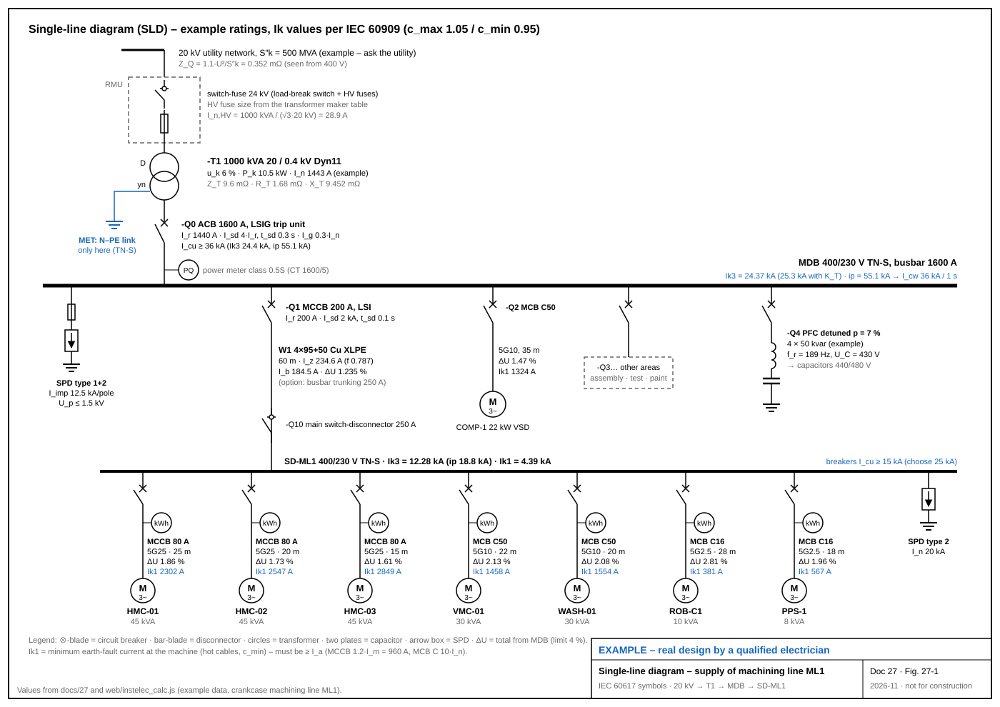
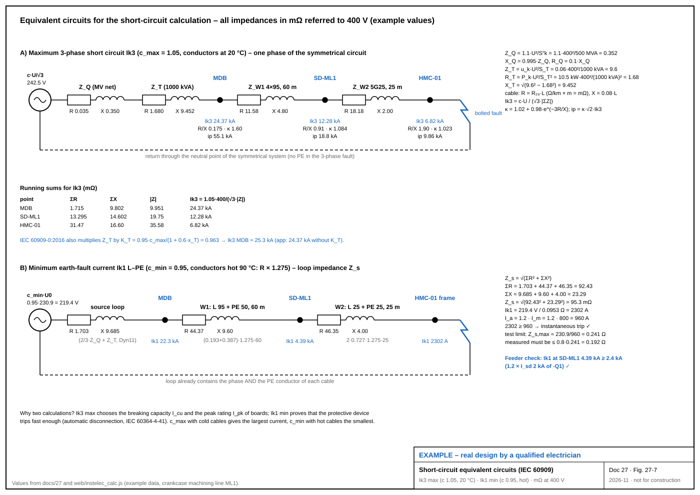
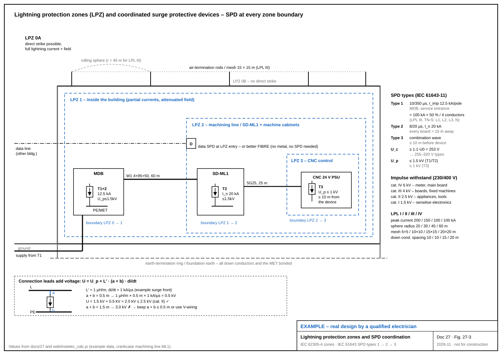
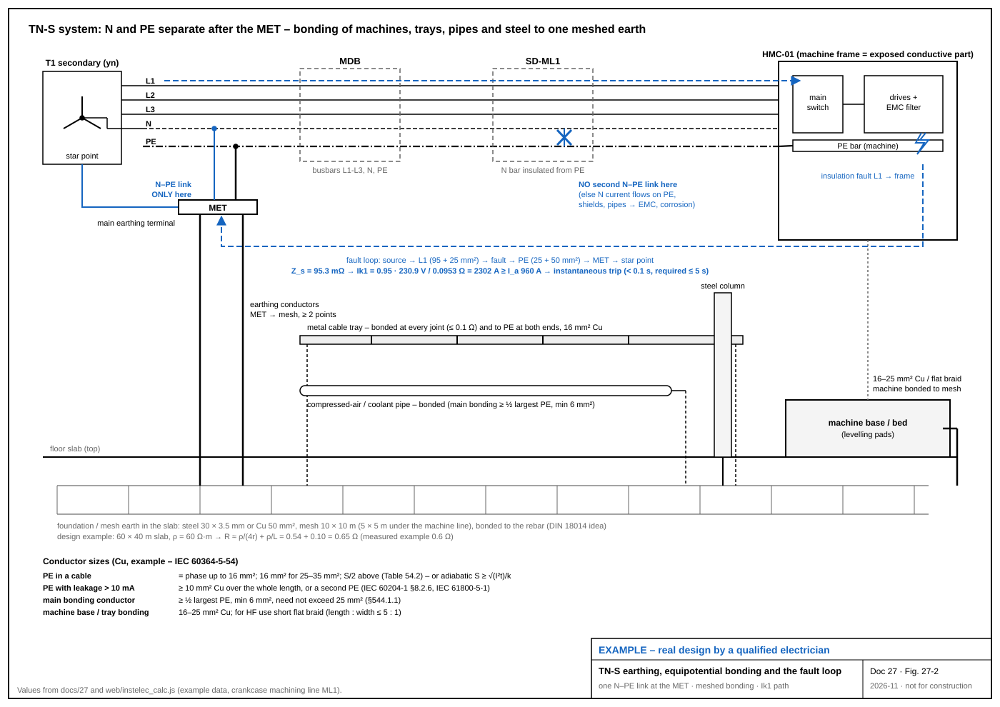
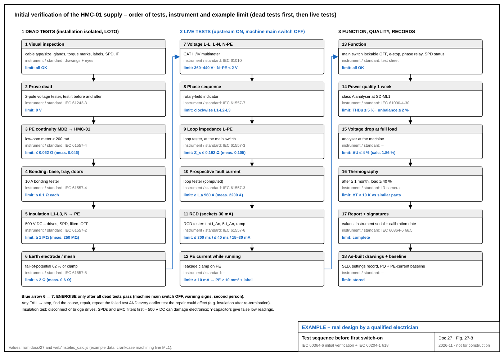
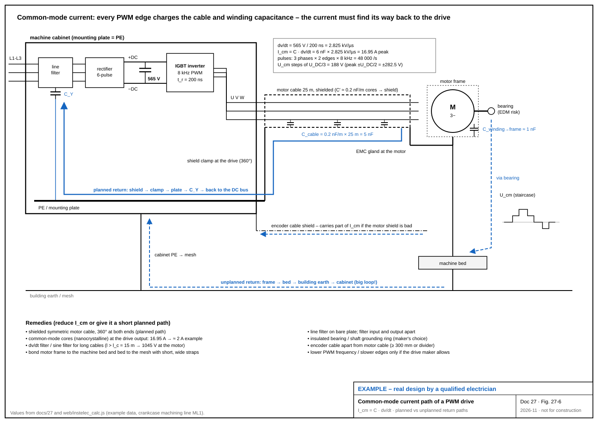
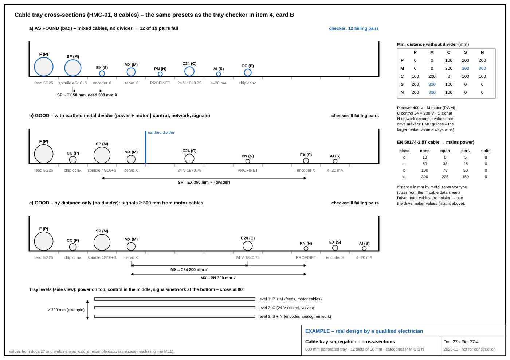
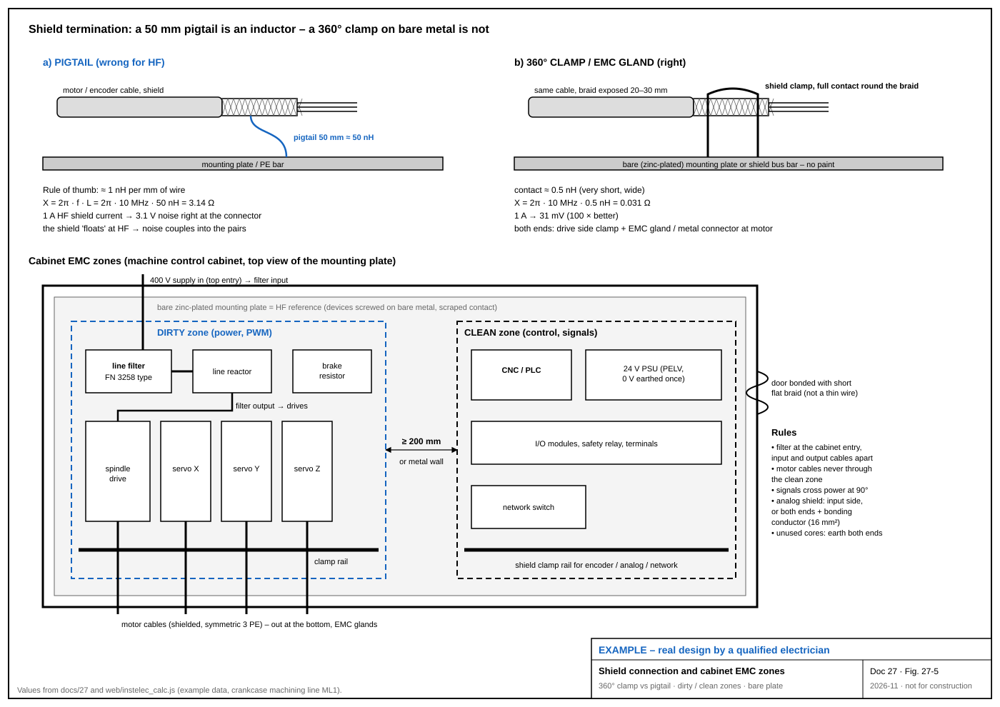

# 27 – Installation: electrical supply, protection, earthing, EMC and signal wiring – textbook, reference and design guide

**For whom:** mechanical engineers who plan the installation of the CNC machines of the crankcase line and must talk with
the electrician, the machine maker and the utility. Simple English, short sentences, formulas with example numbers,
tables, procedures, real drawings and a buy list with catalogue examples.

**Where to see it live:** tab **Installation** →
* item **3 · Electrical installation – supply, cables, protection, earthing** (`/?initem=3#inst`)
* item **4 · Electrical noise (EMC), cable routing, signal wiring** (`/?initem=4#inst`)

Files: `web/instelec.js` (entry, lazy build, self-check) · `web/instelec_calc.js` (all formulas and tables) ·
`web/instelec_i3.js` (item 3 page) · `web/instelec_i4.js` (item 4 page) · `web/instelec_ui.js` (helpers) · `web/instelec.css`.
Drawings of this guide: `docs/img/27_*.svg` (copies in `web/img/`).

> **All numbers are examples.** They use typical catalogue and table values (IEC 60364-5-52 Annex B, IEC 60228,
> typical transformer data). The **real design, the calculations, the installation work and the tests must be done by a
> qualified electrician / electrical designer** under the local rules (IEC 60364 + national version, utility rules) and
> the **machine maker's installation manual**. When the manual says something different, the manual wins.
> Product names in Part F are **catalogue examples**, not a recommendation. Prices are **estimates – ask for a quote**.
> When this guide is not sure about a catalogue value it writes **"see datasheet"** – it never guesses.

**Related guides (read them instead of repeating them here):**
[24 – robot control circuits](24_robot_control_circuits.md) (the same rules inside one cabinet: MCB curves, gG fuses
and the I₂ ≤ 1.45·I_z check at 40 °C, 24 V PELV supply, contactors, safety circuits, cabinet heat) ·
[26 – foundation and alignment](26_installation_foundation_alignment.md) (items 1 and 2) ·
[28 – installation sequence and commissioning](28_installation_sequence_commissioning.md) (item 5) ·
[16 – standards register](16_standards_register.md) · [07 – communication](07_communication.md) (PROFINET / OPC UA).

---

## Contents

* [How the numbers were checked](#how-the-numbers-were-checked)

**[PART A – Electrical installation (item 3)](#part-a--electrical-installation-item-3)**

* [A.0 How to use item 3 – a 15-minute tour](#a0-how-to-use-item-3--a-15-minute-tour)
* [A.1 The power path – single-line diagram (card A)](#a1-the-power-path--single-line-diagram-card-a)
* [A.2 Example load list (same machines as `config/factory.json`)](#a2-example-load-list-same-machines-as-configfactoryjson)
* [A.3 Formulas (all used in the page)](#a3-formulas-all-used-in-the-page)
* [A.4 Worked example – HMC-01 (card B2 shows the same steps live)](#a4-worked-example--hmc-01-card-b2-shows-the-same-steps-live)
* [A.5 The line feeder, simultaneity and busbar trunking](#a5-the-line-feeder-simultaneity-and-busbar-trunking)
* [A.6 Short circuit and breaking capacity (card C)](#a6-short-circuit-and-breaking-capacity-card-c)
* [A.7 Earth-fault loop and disconnection time (TN-S)](#a7-earth-fault-loop-and-disconnection-time-tn-s)
* [A.8 Selectivity](#a8-selectivity)
* [A.9 Inrush current](#a9-inrush-current)
* [A.10 RCD type, leakage current, reinforced PE (card D)](#a10-rcd-type-leakage-current-reinforced-pe-card-d)
* [A.11 Surge protection (SPD)](#a11-surge-protection-spd)
* [A.12 Power quality – harmonics, power factor, unbalance (card E)](#a12-power-quality--harmonics-power-factor-unbalance-card-e)
* [A.13 Earthing and equipotential bonding (card F)](#a13-earthing-and-equipotential-bonding-card-f)
* [A.14 Machine connection (card G)](#a14-machine-connection-card-g)
* [A.15 Tests before the first switch-on (card H – tickable checklist)](#a15-tests-before-the-first-switch-on-card-h--tickable-checklist)
* [A.16 Questions before the order](#a16-questions-before-the-order)

**[PART B – Electrical noise (EMC), cable routing, signal wiring (item 4)](#part-b--electrical-noise-emc-cable-routing-signal-wiring-item-4)**

* [B.0 How to use item 4 – a 10-minute tour](#b0-how-to-use-item-4--a-10-minute-tour)
* [B.1 Why drives make noise (card A)](#b1-why-drives-make-noise-card-a)
* [B.2 Coupling paths](#b2-coupling-paths)
* [B.3 Cable categories and segregation (card B – live tray checker)](#b3-cable-categories-and-segregation-card-b--live-tray-checker)
* [B.4 Shielding, cabinet zones, filters, long motor cables (card C)](#b4-shielding-cabinet-zones-filters-long-motor-cables-card-c)
* [B.5 Signal wiring (card D)](#b5-signal-wiring-card-d)
* [B.6 Fault simulator (card E)](#b6-fault-simulator-card-e)
* [B.7 Troubleshooting (card F)](#b7-troubleshooting-card-f)
* [B.8 EMC installation checklist](#b8-emc-installation-checklist)

**[PART C – Textbook: power systems for a machine shop](#part-c--textbook-power-systems-for-a-machine-shop)**

* [C.1 Three-phase power, phasors and the neutral](#c1-three-phase-power-phasors-and-the-neutral)
* [C.2 Symmetrical components and voltage unbalance](#c2-symmetrical-components-and-voltage-unbalance)
* [C.3 The per-unit method](#c3-the-per-unit-method)
* [C.4 Transformers](#c4-transformers)
* [C.5 LV switchgear and circuit breakers](#c5-lv-switchgear-and-circuit-breakers)
* [C.6 Busbar trunking vs cable](#c6-busbar-trunking-vs-cable)
* [C.7 Cable sizing in full](#c7-cable-sizing-in-full)
* [C.8 Voltage drop and motor starting](#c8-voltage-drop-and-motor-starting)
* [C.9 Short-circuit calculation IEC 60909 step by step](#c9-short-circuit-calculation-iec-60909-step-by-step)
* [C.10 Earth-fault loop and automatic disconnection](#c10-earth-fault-loop-and-automatic-disconnection)
* [C.11 Earthing systems and earth electrodes](#c11-earthing-systems-and-earth-electrodes)
* [C.12 Equipotential bonding and HF bonding](#c12-equipotential-bonding-and-hf-bonding)
* [C.13 Lightning and surge protection](#c13-lightning-and-surge-protection)
* [C.14 RCD and RCM and the leakage current of drives](#c14-rcd-and-rcm-and-the-leakage-current-of-drives)
* [C.15 Power quality](#c15-power-quality)
* [C.16 Energy metering and monitoring (ISO 50001)](#c16-energy-metering-and-monitoring-iso-50001)

**[PART D – Textbook: EMC, cable routing and signal integrity](#part-d--textbook-emc-cable-routing-and-signal-integrity)**

* [D.1 EMC basics – source, path, victim](#d1-emc-basics--source-path-victim)
* [D.2 The four coupling mechanisms with formulas](#d2-the-four-coupling-mechanisms-with-formulas)
* [D.3 Common mode and differential mode](#d3-common-mode-and-differential-mode)
* [D.4 Skin effect – why HF current flows on the surface](#d4-skin-effect--why-hf-current-flows-on-the-surface)
* [D.5 Shields and transfer impedance](#d5-shields-and-transfer-impedance)
* [D.6 Cable segregation – EN 50174-2 and drive maker rules](#d6-cable-segregation--en-50174-2-and-drive-maker-rules)
* [D.7 EMC standards for machines and drives](#d7-emc-standards-for-machines-and-drives)
* [D.8 EMC filter design](#d8-emc-filter-design)
* [D.9 Ferrites and common-mode cores](#d9-ferrites-and-common-mode-cores)
* [D.10 Bearing currents and remedies](#d10-bearing-currents-and-remedies)
* [D.11 Long motor cables – reflected wave, dv/dt and sine filters](#d11-long-motor-cables--reflected-wave-dvdt-and-sine-filters)
* [D.12 Signal integrity – encoders and industrial Ethernet](#d12-signal-integrity--encoders-and-industrial-ethernet)

**[PART E – Testing, commissioning, maintenance](#part-e--testing-commissioning-maintenance)**

* [E.1 Initial verification – IEC 60364-6 sequence](#e1-initial-verification--iec-60364-6-sequence)
* [E.2 Measuring – practical notes for each test](#e2-measuring--practical-notes-for-each-test)
* [E.3 Power-quality logging (IEC 61000-4-30 class A)](#e3-power-quality-logging-iec-61000-4-30-class-a)
* [E.4 Thermography](#e4-thermography)
* [E.5 Periodic inspection and maintenance](#e5-periodic-inspection-and-maintenance)
* [E.6 Commissioning records (what to keep)](#e6-commissioning-records-what-to-keep)
* [E.7 Master troubleshooting table](#e7-master-troubleshooting-table)

**[PART F – Buy list: catalogue examples](#part-f--buy-list-catalogue-examples)**

* [F.1 How to use these tables](#f1-how-to-use-these-tables)
* [F.2 Distribution transformer](#f2-distribution-transformer)
* [F.3 LV switchboards (IEC 61439-2)](#f3-lv-switchboards-iec-61439-2)
* [F.4 Circuit breakers (ACB, MCCB, MCB)](#f4-circuit-breakers-acb-mccb-mcb)
* [F.5 Busbar trunking (IEC 61439-6)](#f5-busbar-trunking-iec-61439-6)
* [F.6 Cables](#f6-cables)
* [F.7 Cable trays and dividers](#f7-cable-trays-and-dividers)
* [F.8 Surge protective devices](#f8-surge-protective-devices)
* [F.9 RCD type B and RCM](#f9-rcd-type-b-and-rcm)
* [F.10 Power-factor correction and harmonic mitigation](#f10-power-factor-correction-and-harmonic-mitigation)
* [F.11 EMC parts](#f11-emc-parts)
* [F.12 Power meters](#f12-power-meters)
* [F.13 Test instruments](#f13-test-instruments)
* [F.14 Thermal cameras](#f14-thermal-cameras)
* [F.15 Consolidated shopping list – supply of the 3-HMC line (ML1, example)](#f15-consolidated-shopping-list--supply-of-the-3-hmc-line-ml1-example)

**[PART G – Reference](#part-g--reference)**

* [G.1 Test and deep-link parameters (for screenshots)](#g1-test-and-deep-link-parameters-for-screenshots)
* [G.2 Standards register (this guide)](#g2-standards-register-this-guide)
* [G.3 Glossary](#g3-glossary)
* [G.4 Checklists](#g4-checklists)
* [G.5 Questions for the machine maker, the electrician and the utility](#g5-questions-for-the-machine-maker-the-electrician-and-the-utility)
* [G.6 Errors found, corrections and additions in this edition](#g6-errors-found-corrections-and-additions-in-this-edition)

---

## How the numbers were checked

Every main formula was calculated by hand (below) and the page re-calculates it in the self-check
`/?initem=3&ietest#inst` (lines `IETEST ok …` in the browser console and in a hidden `<pre id="ieTestOut">`).
All new numbers of this edition (Parts C – E) were re-calculated with a small Python script (standard library only)
that copies the formulas of `web/instelec_calc.js`.

| Check | Hand value | Page |
|---|---|---|
| Transformer + MV source reactance | X = 0.350 + 9.452 = 9.802 mΩ | ✓ |
| Ik3 at the main board | 1.05·400/(√3·9.951 mΩ) = 24.37 kA | ✓ |
| Ik3 at SD-ML1 | 1.05·400/(√3·19.75 mΩ) = 12.28 kA | ✓ |
| Line load | 0.6 × 213 kVA = 127.8 kVA → 184.5 A → 200 A, 4×95+50, ΔU 1.235 % | ✓ |
| HMC-01 design current | 45 000/(√3·400) = 64.95 A | ✓ |
| HMC-01 cable | 25 mm², I_z = 127 × 0.96 × 0.73 = 89.0 A | ✓ |
| HMC-01 voltage drop | 0.622 % (branch) + 1.235 % (feeder) = 1.86 % | ✓ |
| HMC-01 Ik3 / Ik1 | 6.82 kA / 2 302 A ≥ 960 A → instantaneous trip | ✓ |
| THDi / THDu (3–4 % reactor, 268.5 kW drives) | 36.7 % / 3.77 %, PF 0.911 | ✓ |
| Common-mode current | 6 nF × 2.825 kV/µs = 16.95 A | ✓ |
| Induced spike | 190.6 nH × 16.95 A / 200 ns = 16.2 V | ✓ |
| Pigtail 50 mm at 10 MHz | 2π·10⁷·50·10⁻⁹ = 3.14 Ω | ✓ |
| Reflected wave | l_c = 150 m/µs × 200 ns / 2 = 15 m; 565 × 1.85 = 1 045 V | ✓ |
| Tray checker | "bad" layout fails (12 of 19 pairs), "good" layouts pass, removing the divider fails | ✓ |
| Item switch 3 ↔ 4 ↔ 1 ↔ 2 ↔ 5 (`&ieback`) | no console errors, scope restarts and is sized | ✓ |
| **New in this edition (guide only, Python check)** | peak current ip, K_T factor, adiabatic PE check, arc energy, PFC resonance, earth electrodes, K-factor, unbalance (IEC), filters, ferrites | – |

---

# PART A – Electrical installation (item 3)

Part A follows the cards of item 3 from top to bottom. Each chapter says what the card shows, the worked numbers,
and what to check. The theory behind each step is in Part C (power systems) – links are given.

## A.0 How to use item 3 – a 15-minute tour

| Card | What you see | What you do | Theory |
|---|---|---|---|
| A – single-line diagram | the power path 20 kV → transformer → MDB → SD-ML1 → 7 machines + compressor | click a device: info box *what / rating / why / check / typical mistake* | [C.4](#c4-transformers), [C.5](#c5-lv-switchgear-and-circuit-breakers) |
| B – inputs + cable table | transformer size, u_k, S″k, feeder type and length, method, insulation, ambient, grouping, k_s, ΔU limit | change one input, watch every cable, breaker and Ik follow | [C.7](#c7-cable-sizing-in-full) |
| B2 – worked example | the 9 steps for one machine (choose it with the machine selector) | compare with chapter A.4 | [C.8](#c8-voltage-drop-and-motor-starting) |
| C – protection | Ik3 per point, I_cu needed, earth-fault loop, selectivity, inrush | switch "machines with input transformer"; switch feeder LSI ↔ TM | [C.9](#c9-short-circuit-calculation-iec-60909-step-by-step), [C.10](#c10-earth-fault-loop-and-automatic-disconnection) |
| D – RCD + leakage | RCD types, leakage calculator, reinforced PE | enter number of filters and leakage per filter | [C.14](#c14-rcd-and-rcm-and-the-leakage-current-of-drives) |
| E – power quality + SPD | harmonics estimate, unbalance calculator, SPD table | choose drive input (none / reactor / AFE), other drive power | [C.15](#c15-power-quality), [C.13](#c13-lightning-and-surge-protection) |
| F – earthing | TN-S, bonding table, earth measurement, "why no clean earth" | read | [C.11](#c11-earthing-systems-and-earth-electrodes), [C.12](#c12-equipotential-bonding-and-hf-bonding) |
| G – machine connection | procedure, voltage limits, phase rotation, transformer tap calculator | enter measured voltage → best tap | A.14 |
| H – tests | tickable checklist with limits and example values | tick, enter measured values | [Part E](#part-e--testing-commissioning-maintenance) |
| I – questions | list for machine maker, electrician, utility | copy into the request for quotation | [G.5](#g5-questions-for-the-machine-maker-the-electrician-and-the-utility) |

**Tip:** use the deep links of chapter G.1 to open one card or one machine directly (for screenshots or meetings).

## A.1 The power path – single-line diagram (card A)

A **single-line diagram (SLD)** draws the three phases as one line. Every board, breaker, cable and its rating is on it.
Ask the electrician for the SLD **before** the machines arrive – all sizes, settings and test limits come from it.



The same diagram as text (for a quick copy into an e-mail):

```
20 kV utility (S″k 500 MVA) ─ RMU ─ T1 1000 kVA 20/0.4 kV Dyn11, u_k 6 %
                                        │  N–PE link at the MET (one point, TN-S)
                                     -Q0 ACB 1600 A
═══════════════ MDB 400/230 V TN-S  (Ik3 24.4 kA) ═══════════════  SPD type 1+2
   │ -Q1 200 A (LSI)        │ -Q2 50 A          │ -Q3 …              │ -Q4 PFC 7 % detuned
   W1 4×95+50 Cu XLPE 60 m  COMP-1 22 kW VSD    other areas
   │ -Q10 main switch
═══════════════ SD-ML1 machining line (Ik3 12.3 kA) ═══════════════  SPD type 2
 80 A   80 A   80 A   C50    C50     C16    C16
 5G25   5G25   5G25   5G10   5G10    5G2.5  5G2.5
 HMC-01 HMC-02 HMC-03 VMC-01 WASH-01 ROB-C1 PPS-1
```

| Device | What it is | Example rating | Why it matters |
|---|---|---|---|
| RMU + transformer -T1 | 20 kV ring main unit, Dyn11 transformer (delta MV, star with neutral LV) | 1000 kVA, u_k 6 %, P_k 10.5 kW | sets Ik at 400 V; the yn neutral is needed for TN-S |
| MET | main earthing terminal | Cu bar | N and PE are joined **only here** (TN-S) |
| -Q0 ACB | main breaker, electronic trip LSIG | 1600 A, I_cu ≥ 36 kA (Ik3 24.4 kA, but peak ip 55.1 kA > 2.1 × 25 kA – see C.9; the app applies this check) | protects transformer + busbar, selective to feeders |
| MDB | main LV board (IEC 61439) | busbar 1600 A, I_cw ≥ 36 kA (peak check, see C.9) | all energy passes; must survive Ik3 **and** the peak ip |
| SPD 1+2 | surge protection at the entrance | I_imp 12.5 kA/pole, U_p ≤ 1.5 kV | lightning / switching surges |
| -Q4 PFC | detuned capacitor bank | 7 % reactors, e.g. 4 × 50 kvar | cos φ correction without resonance (C.15.7) |
| -Q1 + W1 | feeder breaker + cable / busbar trunking to the line | 200 A, 4×95+50 or 250 A busbar | carries the whole line |
| SD-ML1 | sub-distribution next to the line | one breaker per machine, SPD 2, energy meters | short machine cables, kWh per machine |
| machine breaker + cable | one per machine | e.g. MCCB 80 A + 5G25 for an HMC | cable protection + automatic disconnection |

Click every device in the drawing: the info box shows *what / rating / why / check / typical mistake*.

**How to read an SLD (checklist):** (1) follow the energy from the top; (2) at every breaker read I_n / I_r, trip type,
I_cu; (3) at every cable read type, size, length; (4) at every board read busbar rating, I_cw / I_pk, Ik3; (5) find the
N–PE link (must be once); (6) find SPDs, meters, PFC; (7) compare the machine data (kVA, breaker) with the maker's manual.

## A.2 Example load list (same machines as `config/factory.json`)

| Machine | Connected S (kVA) | Run P (kW) | cos φ | Route length L (m) |
|---|---|---|---|---|
| HMC-01 / 02 / 03 | 45 each | 18 each | 0.92 | 25 / 20 / 15 |
| VMC-01 boring | 30 | 11 | 0.92 | 22 |
| WASH-01 washer | 30 | 12 | 0.95 | 20 |
| ROB-C1 robot cell | 10 | 3.5 | 0.95 | 28 |
| PPS-1 pallet pool + load station + chip conveyors | 8 | 2.6 | 0.85 | 18 |
| **Σ SD-ML1** | **213** | **83.1** | | |
| COMP-1 screw compressor 22 kW VSD (from the MDB) | 30 | 18 | 0.95 | 35 |

**Connected load** = name plate of the machine (all drives + auxiliaries at the same time) – it decides the machine
cable and breaker. **Run power** = average when machining – much lower; it decides the energy cost, not the cable.
Example: an HMC at its connected load takes P = √3 · 400 V · 64.95 A · 0.92 = **41.4 kW**; while machining only ≈ 18 kW.

## A.3 Formulas (all used in the page)

| Quantity | Formula | Note |
|---|---|---|
| design current | I_b = S / (√3 · U) | U = 400 V |
| breaker | I_b ≤ I_n ≤ I_z and I₂ ≤ 1.45·I_z | IEC 60364-4-43. I₂ = conventional tripping current: MCB 1.45·I_n, MCCB (IEC 60947-2) 1.30·I_r → fulfilled automatically; **gG fuse 1.6·I_n → check!** (see C.7.6 and [docs/24 §4.6](24_robot_control_circuits.md)) |
| cable capacity | I_z = I_tab · k_θ · k_group | IEC 60364-5-52 Tables B.52.x, B.52.14, B.52.17 |
| line design load | S_d = k_s · Σ S_connected | k_s = simultaneity (0.5–0.7 in machine shops) |
| voltage drop | ΔU % = √3 · I · L · (R cos φ + X sin φ) / U · 100 | R at operating temperature: R₂₀ · (1 + 0.00393·(θ − 20)) |
| MV source | Z_Q = 1.1 · U² / S″k, X_Q = 0.995 Z_Q, R_Q = 0.1 X_Q | IEC 60909 |
| transformer | Z_T = u_k · U² / S_T, R_T = P_k · U² / S_T², X_T = √(Z_T² − R_T²) | |
| max short circuit | Ik3 = c_max · U / (√3 · Z) | c_max = 1.05, cold conductors (20 °C) |
| peak current | ip = κ · √2 · Ik3, κ = 1.02 + 0.98 · e^(−3R/X) | IEC 60909 – guide only, not in the page |
| min earth fault | Ik1 = c_min · U0 / Z_loop | c_min = 0.95, hot conductors, phase + PE; source loop = 2/3·Z_Q + Z_T (Dyn) |
| disconnection | Ik1 ≥ I_a | I_a = current for instantaneous trip: MCB C 10·I_n, D 20·I_n, MCCB 1.2·I_m |
| max loop impedance | Z_s,max = U0 / I_a | on site: measured Z_s ≤ 0.8 · Z_s,max |
| adiabatic check | I² · t ≤ k² · S² | k = 143 for Cu/XLPE, 115 for Cu/PVC (C.7.7) – guide only |
| quick Ik3 check | Ik3 ≈ I_nT / u_k | 1443 A / 0.06 = 24 kA |

Tables used (Cu, 3 loaded conductors, 30 °C): **XLPE method E** 1.5…300 mm² = 23, 32, 42, 54, 75, 100, 127, 158, 192,
246, 298, 346, 399, 456, 538, 621 A; method C and PVC tables are in `instelec_calc.js` (and in C.7.2). Temperature factor
XLPE: 35 °C 0.96, 40 °C 0.91; PVC: 35 °C 0.94, 40 °C 0.87. Grouping, single layer touching on a perforated tray: 2 → 0.88,
3 → 0.82, 4 → 0.77, 6–7 → 0.73, ≥ 8 → 0.72. Resistance R₂₀: 10 mm² 1.83, 25 mm² 0.727, 50 mm² 0.387, 95 mm² 0.193 Ω/km,
reactance X ≈ 0.08 Ω/km.

## A.4 Worked example – HMC-01 (card B2 shows the same steps live)

Inputs: S = 45 kVA, L = 25 m, cos φ 0.92, XLPE, method E (perforated tray), 35 °C, 7 cables touching, feeder 4×95+50 60 m.

1. **Design current:** I_b = 45 000 / (1.732 × 400) = **64.95 A**.
2. **Breaker:** next standard size ≥ 64.95 A → **80 A** (MCCB, I_m = 10 · I_n = 800 A). Use the size from the maker's manual.
3. **Derating:** f = k_θ · k_group = 0.96 × 0.73 = **0.701**.
4. **Cable:** I_tab ≥ I_n / f = 80 / 0.701 = 114.2 A → 16 mm² has 100 A (too small), **25 mm² has 127 A** →
   I_z = 127 × 0.701 = **89.0 A**. Check 64.95 ≤ 80 ≤ 89.0 ✓ → cable **5G25** (PE 25 mm²).
   I₂ check: MCCB I₂ = 1.30 × 80 = 104 A ≤ 1.45 × 89.0 = 129.1 A ✓.
5. **Voltage drop:** R = 0.727 × 1.275 = 0.927 Ω/km, X = 0.08 Ω/km, sin φ = 0.392.
   ΔU = 1.732 × 64.95 A × 0.025 km × (0.927 × 0.92 + 0.08 × 0.392) / 400 × 100 = 1.732 × 64.95 × 0.025 × 0.8842 / 4
   = **0.622 %**. Feeder (A.5) 1.235 % → total **1.86 % ≤ 4 %** ✓.
6. **Max short circuit at the machine:** source R = 0.035 + 1.68 = 1.715 mΩ, X = 0.350 + 9.452 = 9.802 mΩ;
   feeder 95 mm², 60 m: R = 0.193 × 60 = 11.58 mΩ, X = 4.8 mΩ; machine cable: R = 0.727 × 25 = 18.18 mΩ, X = 2.0 mΩ.
   R = 31.47 mΩ, X = 16.60 mΩ, Z = 35.58 mΩ → Ik3 = 1.05 × 400 / (1.732 × 0.03558) = **6.82 kA**.
   At the SD-ML1 busbar (where the breaker sits) Ik3 = **12.28 kA** → breaker **I_cu ≥ 15 kA** (choose 25 kA).
7. **Min earth fault L–PE:** source loop R = 2/3 × 0.035 + 1.68 = 1.703 mΩ, X = 2/3 × 0.350 + 9.452 = 9.685 mΩ;
   feeder (phase 95 + PE 50, hot): (0.193 + 0.387) × 1.275 × 60 = 44.37 mΩ, X = 2 × 0.08 × 60 = 9.6 mΩ;
   machine cable (25 + 25, hot): 2 × 0.927 × 25 = 46.35 mΩ, X = 4.0 mΩ.
   Z_s = √(92.43² + 23.29²) = **95.3 mΩ** → Ik1 = 0.95 × 230.9 / 0.0953 = **2 302 A**.
   I_a = 1.2 × 800 = 960 A → 2 302 ≥ 960 ✓ → **instantaneous trip (< 0.1 s)**, required ≤ 5 s (I_n > 32 A).
8. **Test limit:** Z_s,max = 230.9 / 960 = 0.241 Ω → measured value must be ≤ 0.8 × 0.241 = **0.192 Ω**.
9. **Inrush:** drive with precharge ≈ 2 × I_b = 130 A < lowest magnetic trip 0.8 × 800 = 640 A ✓.

All seven machines with the same rules (default inputs, identical to the page):

| Machine | I_b (A) | Breaker | Cable | I_z (A) | ΔU branch / total | Ik3 at machine | Ik1 | I_a | Z_s / Z_s,max |
|---|---|---|---|---|---|---|---|---|---|
| HMC-01 | 64.95 | MCCB 80 A | 5G25 | 89.0 | 0.622 / 1.86 % | 6.82 kA | 2 302 A | 960 A | 95.3 / 240.6 mΩ |
| HMC-02 | 64.95 | MCCB 80 A | 5G25 | 89.0 | 0.497 / 1.73 % | 7.53 kA | 2 547 A | 960 A | 86.1 / 240.6 mΩ |
| HMC-03 | 64.95 | MCCB 80 A | 5G25 | 89.0 | 0.373 / 1.61 % | 8.39 kA | 2 849 A | 960 A | 77.0 / 240.6 mΩ |
| VMC-01 | 43.30 | MCB C50 | 5G10 | 52.6 | 0.898 / 2.13 % | 4.33 kA | 1 458 A | 500 A | 150.5 / 461.9 mΩ |
| WASH-01 | 43.30 | MCB C50 | 5G10 | 52.6 | 0.841 / 2.08 % | 4.62 kA | 1 554 A | 500 A | 141.2 / 461.9 mΩ |
| ROB-C1 | 14.43 | MCB C16 | 5G2.5 | 22.4 | 1.575 / 2.81 % | 1.10 kA | 381 A | 160 A | 575.7 / 1 443 mΩ |
| PPS-1 | 11.55 | MCB C16 | 5G2.5 | 22.4 | 0.727 / 1.96 % | 1.64 kA | 567 A | 160 A | 386.9 / 1 443 mΩ |
| COMP-1 (from MDB) | 43.30 | MCB C50 | 5G10 | 52.6 | 1.47 % | 3.62 kA | 1 324 A | 500 A | – |

ROB-C1 and PPS-1 use 2.5 mm² because of the **minimum-size rule** (2.5 mm² in the page); 1.5 mm² would carry the current.
The robot cell feed inside the cell is calculated in [docs/24 §4.8–4.9](24_robot_control_circuits.md).

**Why not size with the run power?** 18 kW / 0.92 = 19.6 kVA → 28 A → 6 mm². But the maker's 80 A breaker would then
not protect a 6 mm² cable (I_z ≈ 38 A) – the cable could burn before the breaker trips. Always use the connected load /
the maker's fuse size.

**Same machine at 40 °C ambient (`&iet=40`):** f = 0.91 × 0.73 = 0.664 → I_tab ≥ 80 / 0.664 = 120.4 A → 25 mm² still
fits (I_z = 127 × 0.664 = 84.4 A ≥ 80 A); MCCB I₂ = 104 A ≤ 1.45 × 84.4 = 122.3 A ✓. **But if the machine maker asks for
gG 80 A fuses instead of an MCCB:** I₂ = 1.6 × 80 = 128 A > 122.3 A ✗ → **35 mm²** (I_z = 158 × 0.664 = 105.0 A,
1.45 × 105.0 = 152.2 A ✓). At 35 °C the 25 mm² passes just (1.45 × 89.0 = 129.1 ≥ 128). The page does not run this fuse
check – the designer must (same lesson as [docs/24 §4.6](24_robot_control_circuits.md)).

## A.5 The line feeder, simultaneity and busbar trunking

Σ connected = 213 kVA. Not all machines take their peak at the same time → simultaneity factor k_s.
S_d = 0.6 × 213 = **127.8 kVA** → I_b = 127 800 / (1.732 × 400) = **184.5 A** → feeder breaker **200 A**.
Cable on the main tray with 3 feeders: f = 0.96 × 0.82 = 0.787 → I_tab ≥ 200 / 0.787 = 254 A → **95 mm² (298 A)**,
I_z = 234.6 A; PE = S/2 → 50 mm² → **4×95+50**. ΔU = 1.732 × 184.5 × 0.06 × (0.246 × 0.92 + 0.08 × 0.392) / 400 × 100
= **1.235 %** (the page allows half of the total limit for the feeder).

Check k_s with reality: the average running load of the line is only 83 kW (≈ 90 kVA, 130 A). Measure a similar line
with a power analyser if possible. Plan **20–30 % spare** (one more machine).

**"4×95+50" in practice:** 4 cores of 95 mm² (L1, L2, L3, N) + PE 50 mm². Real products: a 4-core cable with a
concentric copper screen used as PE (type NYCWY 4×95/50, IEC 60502-1 style) or a 4-core cable plus a separate 50 mm²
green-yellow PE laid in the same tray. A 5-core 5×95 is simpler to terminate. **Adiabatic check of the 50 mm² PE:** see
C.10.4 – it is at the limit when -Q1 has a 0.1 s short-time delay.

**Busbar trunking** (option in card B): 250 A aluminium trunking along the line with tap-off boxes. Very flexible when
machines move or are added; more expensive for one fixed set of machines. With the example data of the page
(R = 0.27 mΩ/m hot, X = 0.10 mΩ/m) the voltage drop is **1.38 %** – about the same as the 4×95 cable (1.235 %); Ik3 at
SD-ML1 falls to 11.05 kA. (The earlier edition said "lower voltage drop" – that is not true for this example; see C.6.)
Check joint torque, IP rating and the earth continuity of the housing (it is often the PE).

## A.6 Short circuit and breaking capacity (card C)

| Point | Ik3 max | Peak ip (guide) | Needed I_cu (example) |
|---|---|---|---|
| MDB busbar | 24.4 kA (25.3 kA with K_T) | 55.1 kA | 25 kA is **not** enough for the peak → choose **36 kA** (I_pk 75.6 kA) |
| SD-ML1 busbar | 12.3 kA | 18.8 kA | 15 kA (choose 25 kA) |
| HMC-01 terminals | 6.8 kA | 9.9 kA | machine's SCCR ≥ 6.8 kA (ask the maker!) |

A breaker with I_cu < Ik3 can explode. A machine has a **short-circuit current rating (SCCR)** – ask the maker for it.
Ask the utility for S″k (min / max). A bigger transformer (1600 kVA) raises Ik3 at the MDB to ≈ 38 kA.
Why the peak matters and how K_T changes Ik3: chapter C.9.



## A.7 Earth-fault loop and disconnection time (TN-S)

In TN-S a fault L → machine frame becomes a short circuit L → PE. The breaker must open fast enough
(IEC 60364-4-41 Table 41.1, U0 = 230 V):

| Circuit | TN, max disconnection time | TT |
|---|---|---|
| final circuits ≤ 32 A (sockets, small loads) | 0.4 s | 0.2 s |
| final circuits > 32 A, distribution circuits | 5 s | 1 s |

Easy to meet when **Ik1 ≥ I_a** (instantaneous trip). If Ik1 is too small (long thin cable): bigger cable, lower I_m
setting, electronic trip unit with earth-fault (G) function, or RCD. The page increases the cable size automatically
and shows "sized by: disconnection (loop)". Feeder -Q1: Ik1 at SD-ML1 = **4 392 A** ≥ I_a = 1.2 × I_sd = 1.2 × 2 000 A
= 2 400 A ✓. Detail and the PE adiabatic check: C.10.

## A.8 Selectivity

Only the breaker nearest to the fault should trip – otherwise one HMC fault stops the whole line.

| Check | Example | Result |
|---|---|---|
| overload: I_n,up / I_n,down ≥ 1.6 | 200 / 80 = 2.5 | ✓ |
| current selectivity: Ik3 at SD ≤ 0.8 · I_sd,up | 12.3 kA vs 1.6 kA | ✗ (not by current alone) |
| time selectivity: upstream LSI with t_sd = 0.1 s | machine breaker clears in < 10 ms | ✓ selective |

With a thermal-magnetic feeder breaker (no delay) a short circuit above ≈ 1.6 kA in a machine cable trips both breakers.
Use an **electronic LSI trip unit** on the feeder and confirm with the **breaker maker's selectivity tables**.
A complete setting example for -Q0 / -Q1 / machine breakers (time grading 0.3 s → 0.1 s → instantaneous) is in C.5.5.

## A.9 Inrush current

| Load | Typical inrush | Breaker |
|---|---|---|
| servo / spindle drive system with precharge | 1–2 × I_n for a few ms | MCB C / MCCB I_m 10× |
| machine with input transformer (e.g. 400/200 V for Japanese machines) | 10–15 × I_n,trafo, first half cycle | MCB D or MCCB I_m 12–14× |
| DOL motor | 6–8 × I_n for 1–5 s | motor-protective breaker, class 10 |
| 24 V switched-mode supply | 30–60 A < 5 ms | C curve / inrush limiter |

Example with input transformer: 12 × 64.95 = 779 A. MCCB I_m = 10 × 80 = 800 A has a lower tolerance 640 A → may trip at
power-on. Set I_m = 14 × 80 = 1 120 A (lower limit 896 A ✓), then re-check Ik1: 2 302 A ≥ 1.2 × 1 120 = 1 344 A ✓.
(Switch "machines with input transformer" in card B.)

**Why a transformer has inrush:** at switch-on near the voltage zero crossing the core flux can rise to ≈ 2 × the
normal peak plus the remanent flux → the core saturates → the magnetising current becomes 10–15 × I_n for one half
cycle and decays in 0.1–1 s. The same happens to the factory transformer T1 (≈ 8–12 × 1443 A) – the MV protection of the
utility and the HV fuses are chosen for it (transformer maker table).

## A.10 RCD type, leakage current, reinforced PE (card D)

| RCD type | Detects | Use |
|---|---|---|
| AC | sinusoidal AC only | not for machines |
| A | AC + pulsating DC | sockets, lights, 30 mA |
| F | A + mixed frequencies up to 1 kHz | single-phase inverters |
| **B** (B+) | F + **smooth DC**, up to 1 kHz (B+ 20 kHz) | **3-phase drives** |

**Why type B:** an earth fault behind the 3-phase rectifier (on the DC bus) is **smooth DC**. It saturates a type A RCD
→ it does not trip any more – not even for other faults. IEC 60364-5-53 §531.3.3 and the drive warning label
(IEC 61800-5-1) ask for type B.
**Normal practice in TN-S:** the machine feed has **no RCD**; protection is the automatic disconnection by the breaker (A.7).
RCD only where required (TT system, fire-risk areas 300 mA type B, local rule). Alternative: **RCM type B** (residual
current monitor, IEC 62020) gives an alarm when the insulation becomes bad, without tripping.

**Leakage current** of EMC filters (Y-capacitors to PE) and motor-cable capacitance. Example: 3 filters × 6 mA + 10 mA
cable = **28 mA**. One phase lost → filter part ≈ 3 × 18 + 10 = 64 mA. An RCD must not trip by itself: leakage ≤ 30 % of
I_Δn → I_Δn ≥ 28 / 0.3 = 93 mA → **100 mA type B** at least; a 30 mA RCD is impossible.

**Reinforced PE** (IEC 61800-5-1 §4.3.5.5.2: touch current > 3.5 mA AC; IEC 60204-1 §8.2.6 – §8.2.8 in the 2005 edition:
> 10 mA): (a) PE ≥ **10 mm² Cu** (16 mm² Al) over the whole length, or (b) a **second PE** of the same size with its own
terminal, or (c) automatic disconnection if the PE breaks. Warning label "High leakage current – connect PE first".
A 5G25 cable (PE 25 mm²) fulfils (a). Theory of leakage and RCD trip times: C.14.

## A.11 Surge protection (SPD)

| Type | Test wave | Where | Example |
|---|---|---|---|
| 1 | 10/350 µs (lightning current) | MDB, if lightning protection system or overhead line | I_imp 12.5 kA/pole, U_p ≤ 1.5 kV |
| 2 | 8/20 µs | SD-ML1 and every board > 10 m from type 1 | I_n 20 kA |
| 3 | combination wave | ≤ 10 m before sensitive devices (CNC control supply) if the maker asks | U_p ≤ 1 kV |

Connection leads as short as possible: **a + b ≤ 0.5 m** (≈ 1 kV per metre at a surge). Back-up fuse per SPD maker.
Check the status window after every thunderstorm. Standards: IEC 60364-4-44 §443, IEC 60364-5-53 §534, IEC 61643-11.
Zones, coordination and the lead-length calculation: C.13 and the drawing below.



## A.12 Power quality – harmonics, power factor, unbalance (card E)

A 6-pulse diode rectifier draws current only at the voltage peaks → harmonics 5, 7, 11, 13 …
Harmonic voltage at the main board: U_h = h · X_source · I_h (the reactance rises with h).

Example (the self-check value): drives **268.5 kW** on the transformer, X_source = 9.80 mΩ,
I1 = 268 500 / (1.732 × 400 × 0.95) = 408 A. **Note:** card E opens with line drives 54 + 11 + 3.5 kW (HMC × 3, VMC,
robot run power) + compressor 18 kW + "other drives" 200 kW = **286.5 kW** → I1 = 435 A, THDu = **4.03 %** (still ≤ 5 %);
THDi and PF do not depend on the power. The self-check uses 268.5 kW (the digits look swapped – both values are examples).

| Drive input | I5 / I7 / I11 / I13 (% of I1) | THDi | THDu at the MDB | true PF λ |
|---|---|---|---|---|
| no reactor | 80 / 60 / 20 / 12 | 103 % | ≈ 11 % ✗ | 0.68 |
| **3–4 % line reactor or DC choke** | 33 / 13 / 8 / 5 | **36.7 %** | **3.77 %** ✓ | **0.911** |
| active front end (AFE) | 2 / 1.5 / 1 / 1 | ≈ 3 % | < 0.5 % | ≈ 1.0 |

Hand check (reactor): U5 = 5 × 0.0098 × 134.6 = 6.60 V, U7 = 3.64 V, U11 = 3.52 V, U13 = 2.60 V →
√(6.60² + 3.64² + 3.52² + 2.60²) = 8.71 V → 8.71 / 230.9 = **3.77 %**. λ = cos φ1 / √(1 + THDi²) = 0.97 / √(1 + 0.367²) = **0.911**.

Rules: every 6-pulse drive with a 3–4 % reactor or DC choke (most CNC drive systems include it – check); AFE for large
drive groups; capacitor banks only **detuned (7 %)**; goal THDu ≤ 5 % (IEC 61000-2-4 class 2 limit 8 %).

**Voltage unbalance** = max deviation from the mean / mean × 100. Example 402 / 398 / 405 V: mean 401.7 V, max deviation
3.67 V → **0.91 %** ✓ (limit 2 %, IEC 61000-2-4, IEC 60204-1 §4.3.2). 1 % voltage unbalance → 6–10 % current unbalance in
motors and drives. (The exact IEC definition with symmetrical components gives **1.01 %** for the same voltages – C.2.)

**Before acceptance:** 3-phase **power analyser** (IEC 61000-4-30 class A) at SD-ML1 for one week: U, I, THDu, THDi per
harmonic, unbalance, PF, dips, flicker. Keep the record as the baseline for later problems. Theory: C.15.

## A.13 Earthing and equipotential bonding (card F)



* **TN-S:** transformer star point earthed; N and PE separate from the MET to every board and machine. **N–PE link only at
  the MET.** A second link in a sub-board (TN-C-S by mistake) makes neutral current flow on PE, shields and pipes →
  EMC problems, corrosion, RCDs trip.
* **PE** = protective earth (safety, carries the fault current). **Functional earth / bonding** = low-impedance reference
  for electronics and EMC (carries HF noise current). Both are part of **one** earthing system.
* **Foundation / mesh earth** in the floor slab (e.g. 10 × 10 m … 5 × 5 m mesh, steel 30 × 3.5 mm or Cu 50 mm², bonded to
  the rebar), connected to the MET at several points.
* **Bonding:** machine base (16–25 mm² Cu, flexible braid where it moves), conveyors, cable trays (bonded at every joint),
  pipework, steel structure – short conductors to the nearest PE / mesh point.

| Conductor | Size (Cu, example) | Rule |
|---|---|---|
| PE in the cable | = phase up to 16 mm²; 16 mm² for 25–35; S/2 above | IEC 60364-5-54 Table 54.2 |
| PE with high leakage | ≥ 10 mm² or two PE | IEC 60204-1 §8.2.6 / IEC 61800-5-1 |
| main bonding | ≥ ½ largest PE, min 6 mm², max needed 25 mm² | IEC 60364-5-54 §544.1.1 |
| machine base to mesh | 16–25 mm² | good EMC practice |

**Earth resistance measurement (fall-of-potential, 62 % rule):** open the link at the MET (with permission, installation
dead or safe); current spike at ≥ 5 × the mesh diagonal away, voltage spike at 62 % of that distance; repeat at 52 % and
72 % – the three readings must agree within ±5 %. Example result 0.6 Ω (design value e.g. ≤ 2 Ω – utility / local rule).
For single rods: clamp method (two-clamp tester) without disconnecting. Electrode formulas and the Wenner soil test: C.11.

**Why NOT a separate "clean earth" rod for the CNC:** it has 10–100 Ω to the main earth. In a fault or lightning several kV
appear between the CNC and the building → danger and destroyed interfaces; in normal use 50 Hz and HF currents flow
through the signal cables that connect the two earths. IEC 61000-5-2 and the drive makers: **one common meshed system**;
control HF noise with low inductance (short, wide bonding, 360° shields), not with separate earths.

## A.14 Machine connection (card G)

Procedure:
1. Lock-out / tag-out the machine breaker in SD-ML1; prove dead.
2. Pull the cable on the tray; enter at the maker's gland plate (top or bottom entry), EMC gland if required, strain relief.
3. **Connect PE first**, then L1-L2-L3 (N only if the maker needs it – most CNCs do not).
4. Cable lugs matching the conductor class (pressed lugs / ferrules for fine-stranded), crimp tool + die of the lug maker,
   torque per the terminal label, mark the screws.
5. Insulation + continuity tests (A.15).
6. Power on upstream with the machine main switch **OFF** → measure voltage L-L, N–PE and **phase rotation** at the main switch.
7. If the machine has its own transformer: set the tap (below).
8. Main switch ON together with the maker's engineer; check pump directions with a short jog.

| Quantity (IEC 60204-1 §4.3.2) | Limit |
|---|---|
| voltage | 0.9 … 1.1 × U_n (360–440 V) |
| frequency | 0.99 … 1.01 × f_n continuous, 0.98 … 1.02 short time |
| harmonics | 2nd–5th ≤ 10 % sum, 6th–30th ≤ 2 % additional |
| unbalance | ≤ 2 % |
| interruptions / dips | ≤ 3 ms interruption; dips ≤ 20 % for ≤ 1 cycle, > 1 s apart |

**Phase rotation:** wrong rotation runs hydraulic, coolant and chip-conveyor pumps backwards (pump damage in minutes;
servo drives do not care). Fix: swap **two phases at the machine end**, not in the board.
**Transformer tap** (e.g. 200 V machine): secondary U = 200 × U_meas / tap. Measured 408 V: tap 400 V → 204.0 V (+2.0 %),
tap 415 V → 196.6 V (−1.7 %) → choose **415 V**; re-measure at full load. Change taps only with the machine isolated.

**Terminations – typical torque and lug rules (example, the terminal label wins):**

| Conductor | Lug / ferrule | Tool | Typical torque (example) |
|---|---|---|---|
| 25 mm² fine-stranded (class 5) | tubular Cu lug DIN 46235 style, M8 | hydraulic / ratchet crimp tool with the matching die (hexagon) | M8: see terminal / lug datasheet |
| 25 mm² into a box terminal | ferrule 25 mm² (or none if the terminal is approved for it) | square / trapezoid crimp | see terminal datasheet |
| 95 mm² class 2 | tubular lug M12 | hydraulic 6–12 t | M12: see busbar maker |
| busbar joints in the MDB | – | torque wrench, mark with a paint stripe | per IEC 61439 assembly maker |

Never use a lug for the wrong conductor class (class 2 stranded vs class 5 fine-stranded): the crimp will be loose
and get hot (a thermography check after one month finds it, E.5).

## A.15 Tests before the first switch-on (card H – tickable checklist)

Order: **dead** tests (visual, continuity, insulation) → **live** tests (voltage, rotation, loop, RCD) → function and power
quality. Standards: IEC 60364-6 (initial verification of the installation) and IEC 60204-1 §18 (machine).



| # | Test | Instrument | Limit (example) | Example value |
|---|---|---|---|---|
| 1 | visual inspection (cable type / size, glands, torque, labels, SPD) | eyes, drawing | all OK | ✓ |
| 2 | LOTO, prove dead | 2-pole tester (IEC 61243-3) | 0 V | ✓ |
| 3 | PE continuity MDB → HMC-01 | low-ohm meter ≥ 0.2 A | ≤ 1.5 × 0.041 = 0.062 Ω | 0.046 Ω |
| 4 | PE continuity base, doors, tray, conveyor → machine PE | 10 A for the machine | ≤ 0.1 Ω each | 0.03 Ω |
| 5 | insulation of the cable (L1, L2, L3, N → PE), drives / SPDs / filters disconnected | 500 V DC (IEC 61557-2) | ≥ 1 MΩ | 250 MΩ |
| 6 | insulation of the machine power circuit (maker) | 500 V DC | ≥ 1 MΩ | 18 MΩ |
| 7 | phase sequence | IEC 61557-7 | clockwise | ✓ |
| 8 | voltage L-L at the terminals | multimeter CAT III | 360–440 V | 403 V |
| 9 | voltage N–PE | multimeter | < 2 V | 0.4 V |
| 10 | loop impedance L–PE at the main switch | loop tester (IEC 61557-3) | ≤ 0.192 Ω | 0.105 Ω |
| 11 | prospective fault current | loop tester | ≥ I_a = 960 A | 2 200 A |
| 12 | RCD 30 mA (sockets): trip time at I_Δn | IEC 61557-6 | ≤ 300 ms (5·I_Δn ≤ 40 ms) | 24 ms |
| 13 | RCD trip current | ramp | 15–30 mA | 22 mA |
| 14 | earth electrode / mesh resistance | earth tester (62 %) | ≤ 2 Ω | 0.6 Ω |
| 15 | PE current while running | leakage clamp | > 10 mA → PE ≥ 10 mm² + label | 24 mA (PE 25 mm² ✓) |
| 16 | power analyser 1 week: THDu | IEC 61000-4-30 class A | ≤ 5 % | 3.1 % |
| 17 | voltage unbalance | power analyser | ≤ 2 % | 0.6 % |
| 18 | function: main switch locks OFF, e-stop, phase relay, SPD status; records signed | test sheet | all OK | ✓ |

PE continuity hand check: feeder PE 50 mm² 60 m = 0.387 × 0.060 = 0.0232 Ω + machine PE 25 mm² 25 m = 0.727 × 0.025 =
0.0182 Ω → 0.041 Ω. Insulation test: **disconnect drives, SPDs, EMC filters** first (or test all lines bridged against PE) –
500 V DC can damage electronics and filter capacitors give false low readings. Record instrument serial numbers and
calibration dates in the report (IEC 60364-6 §6.5). Why the measured loop value (0.105 Ω) is close to the calculated
95.3 mΩ: the tester measures cold cables (R₂₀) and the real transformer; details in E.3.

## A.16 Questions before the order

**Machine maker:** connected kVA, rated current, recommended breaker type / size, SCCR · supply 3×400 V ± 10 %, 50 Hz,
TN-S, N needed? · inrush (input transformer, taps) · leakage current, allowed RCD type, reinforced / second PE · cable entry,
gland, terminal size · drive input (reactor / AFE), THDi, regeneration · EMC class (IEC 61800-3 C2 / C3) · dips, UPS for the CNC.
**Electrician:** SLD with Ik3 / Ik1 per board and machine · cable sizing with derating, ΔU, 20–30 % reserve · selectivity
study + settings record · earthing drawing (MET, mesh, bonding) · SPD concept · harmonics / PFC · IEC 60364-6 test report ·
as-built drawings. **Utility / factory:** S″k min / max, MV earthing, transformer data and tap, lightning protection.
The full list with reasons is in G.5.

---

# PART B – Electrical noise (EMC), cable routing, signal wiring (item 4)

Part B follows the cards of item 4. The theory (coupling, shields, filters, standards) is in Part D.

## B.0 How to use item 4 – a 10-minute tour

| Card | What you see | What you do | Theory |
|---|---|---|---|
| A – why drives make noise | dv/dt, common-mode current, induced spike, reflected wave, live inputs | change rise time, cable length, distance, loop width – watch the volts | [D.2](#d2-the-four-coupling-mechanisms-with-formulas), [D.3](#d3-common-mode-and-differential-mode) |
| B – tray checker | 600 mm tray, 12 slots, 8 cables of HMC-01, divider | place cables, add dividers, try presets bad / good / nodiv | [D.6](#d6-cable-segregation--en-50174-2-and-drive-maker-rules) |
| C – shielding + filters | pigtail vs 360°, cabinet zones, filter table, reflected-wave calculator | change pigtail length, frequency, cable length | [D.5](#d5-shields-and-transfer-impedance), [D.8](#d8-emc-filter-design), [D.11](#d11-long-motor-cables--reflected-wave-dvdt-and-sine-filters) |
| D – signal wiring | cable types, 4–20 mA budget, 24 V drop, PELV | enter supply, transmitter voltage, length | [D.12](#d12-signal-integrity--encoders-and-industrial-ethernet) |
| E – fault simulator | 7 typical wiring mistakes with simulated scope traces | choose a fault, read symptom / measurement / fix, press "Apply the fix" | B.6 |
| F – troubleshooting | symptom → cause → measurement → fix | use it on site | [E.7](#e7-master-troubleshooting-table) |

## B.1 Why drives make noise (card A)

A servo or spindle drive switches the DC bus (√2 × 400 V = 565 V) to the motor with IGBTs, 8 000 times per second per
phase, each edge in 100–300 ns. Every small capacitance then carries a current pulse:

* **edge steepness:** dv/dt = U_DC / t_r = 565 V / 200 ns = **2.83 kV/µs** (100 ns → 5.65 kV/µs)
* **common-mode capacitance:** cable cores → shield C' ≈ 0.2 nF/m × 25 m = 5 nF + winding → frame 1 nF = **6 nF**
* **common-mode current:** I_cm = C · dv/dt = 6 nF × 2.825 kV/µs = **16.95 A peak** (upper estimate – cable inductance
  spreads the edge; measured peaks of 2–20 A are common)
* **how often:** 3 phases × 2 edges × 8 kHz = **48 000 pulses per second**



This current must return to the drive. Planned path: motor-cable shield + PE → drive (short, low inductance). Unplanned
paths: machine frame, signal shields, network cables, bearings → encoder errors, network dropouts, bearing damage.
Remember: at 10 MHz a 1 m earth wire (≈ 1 µH) has ≈ 63 Ω – "earth" is not a clean 0 V for HF.

## B.2 Coupling paths

| Path | How | Formula | Remedy |
|---|---|---|---|
| conductive | shared wire / earth impedance | U = I · Z | separate returns, mesh, short wide bonding |
| capacitive | cables close together, fast voltage change | I = C · dv/dt | distance, earthed shield, divider |
| inductive | current change near a signal loop | U = M · di/dt = A · dB/dt | twisted pairs, distance, 90° crossing |
| radiated | cable as antenna (λ/4 at 30 MHz = 2.5 m) | E ∝ I · f · l | 360° shields, filters, closed cabinet |

**Inductive example:** victim loop width w = 10 mm (two separate wires), parallel length l = 10 m, distance r = 100 mm:
M = μ0/(2π) · l · ln((r + w)/r) = 2·10⁻⁷ × 10 × ln(1.1) = **190.6 nH**; di/dt = 16.95 A / 200 ns = 8.5·10⁷ A/s →
U = M · di/dt = **16.2 V** spike – enough to disturb an RS-422 encoder (threshold ±0.2 V) or an analog input.
Distance 300 mm → 5.6 V; twisted pair (w ≈ 1 mm, and the twists cancel) → < 1.7 V.
**Capacitive example:** next to an **unshielded** motor cable, 20 pF/m × 10 m = 200 pF × 2.825 kV/µs = **0.57 A** spikes
into the victim → that is why motor cables are always shielded.

## B.3 Cable categories and segregation (card B – live tray checker)

| Cat. | Cables | Noise | Sensitivity |
|---|---|---|---|
| P | 400 V supply, DOL motors, heaters | medium | low |
| M | motor cables from drives (PWM) | very high | low |
| C | 24 V DC / 230 V AC control, valves, relays | medium | medium |
| S | encoder, analog 4–20 mA / ±10 V, probes | low | very high |
| N | PROFINET / EtherCAT / Ethernet | low | high |

Minimum separation **without** an earthed metal divider (centre to centre, example values from drive makers' EMC guides,
IEC 61000-5-2 / EN 50174-2 idea – use the larger value of your drive / machine maker):

| | P | M | C | S | N |
|---|---|---|---|---|---|
| **P** | 0 | 0 | 100 mm | 200 mm | 200 mm |
| **M** | 0 | 0 | 200 mm | 300 mm | 300 mm |
| **C** | 100 mm | 200 mm | 0 | 100 mm | 100 mm |
| **S** | 200 mm | 300 mm | 100 mm | 0 | 0 |
| **N** | 200 mm | 300 mm | 100 mm | 0 | 0 |

Rules: an **earthed metal divider** (continuous, bonded at every joint) or separate metal trays allows closer spacing ·
noisy cables on one side, sensitive on the other, control in the middle · **cross at 90°** · several tray levels: power on
top, signals at the bottom (or as the maker says) · no coils of spare length next to motor cables · tray earthed and
bonded at every joint.



**Tray checker (how to use):** 8 cables of HMC-01 in a 600 mm perforated tray, 12 slots of 50 mm. Click a cable in the
palette, then an empty slot; click a placed cable to take it out; click a boundary to add / remove an earthed divider.
Presets: **as found (bad)** → 12 of 19 pairs fail (e.g. spindle cable SP 50 mm from encoder EX, needed 300 mm) ·
**good – with divider** (divider between motor cables and the rest) → pass · **good – by distance** (signals ≥ 300 mm from
motor cables) → pass. Remove the divider from the "good" layout and it fails again.

**How the checker decides (same rule as `checkTray`):** for every pair of placed cables it takes the required distance
from the matrix; distance = slot difference × 50 mm; the pair passes if the distance is large enough **or** an earthed
divider stands between them. Pairs with requirement 0 are not counted (that is why there are 19 pairs, not 28).

## B.4 Shielding, cabinet zones, filters, long motor cables (card C)



* **360° at both ends** for motor and encoder cables: EMC gland at the motor, shield clamp on the bare mounting plate
  directly at the drive, metal connector shells.
* **Pigtail:** ≈ 1 nH per mm. 50 mm → 50 nH → X = 2π · 10 MHz · 50 nH = **3.14 Ω** → 1 A shield current gives **3.1 V**
  noise right at the connector. A 360° clamp (≈ 0.5 nH) gives ≈ 31 mV.
* **Analog shields:** at the input side, or at both ends **plus a bonding conductor** (e.g. 16 mm² Cu) parallel to the
  cable so that the 50 Hz potential difference does not drive current through the shield.
* **Symmetric shielded motor cable** (3 phases + 3 PE arranged symmetrically, overall shield) for drives ≥ 1.5 kW – the
  fields cancel and the HF current returns on the shield.
* **Cabinet EMC zones:** dirty zone (line filter, drives, motor cables, brake resistor) apart from the clean zone (CNC /
  PLC, 24 V supply, I/O, network): ≥ 200 mm or a metal wall. Bare zinc-plated mounting plate = HF reference. Filter at the
  cabinet entry; its input and output cables apart. Doors bonded with braids.
* **Common-mode cores** (nanocrystalline ferrite rings) on the motor cable at the drive: reduce I_cm and bearing currents.
* **Long motor cables – reflected wave:** critical length l_c = v · t_r / 2 = 150 m/µs × 200 ns / 2 = **15 m**. Cable
  25 m > l_c → peak at the motor U_pk ≈ U_DC · (1 + Γ) = 565 × 1.85 = **1 045 V** (Γ ≈ 0.85). Standard 400 V motors are made
  for ≈ 1 000–1 350 V peak (IEC 60034-25 / IEC TS 60034-17 – check the motor maker); inverter-duty motors ≥ 1 500 V.
  Long cables → **dv/dt filter** (≈ 0.5–1 kV/µs) or **sine filter**; they also reduce leakage current and drive over-current alarms.
* **Flyback diode / RC** on every coil (valves, relays, contactors).

## B.5 Signal wiring (card D)

| Signal | Cable | Rules | Max length (example) |
|---|---|---|---|
| encoder (RS-422, EnDat, serial) | maker's cable, twisted pairs, pair + overall shield | 360° both ends, no terminal splices | per maker (50–100 m) |
| 24 V PNP sensor, 3-wire | M12 4-pin PUR | brown +24 V, blue 0 V, black signal; 0 V return in the same cable | ≈ 30 m |
| 4–20 mA | shielded twisted pair 2 × 0.5 mm² | shield at input side (or both + bonding) | km by budget – noise limits |
| ±10 V analog (old drives) | shielded twisted pair | differential input, short | < 10–20 m |
| PROFINET / EtherCAT | Cat 5e shielded 4-wire, green (PROFINET type A fixed / B flexible / C high-flex) | ≤ 100 m per link, bend radius ≥ 8–10 × D fixed, 15–20 × D moving, shielded RJ45 / M12 D-coded, no splices | 100 m |
| between buildings, > 100 m, very noisy areas | fibre: POF ≤ 50 m, PCF ≤ 100 m, multimode ≤ 2 km, single-mode ≫ 10 km | no earth loop, immune to noise and lightning | – |

**4–20 mA loop budget:** R_max = (U_s − U_tx,min) / 20 mA = (24 − 12) / 0.02 = 600 Ω; minus the 250 Ω input = 350 Ω for the
cable; loop resistance 2 × 0.0178 / 0.5 = 0.0712 Ω/m → **4 916 m**. Length is rarely the limit – noise is.
**24 V drop:** ΔU = 2 · I · L / (κ · A) = 2 × 2 × 30 / (56 × 0.75) = **2.86 V** → 21.1 V at the load < 21.6 V target
(24 V − 10 %) → use 1.5 mm² (1.43 V → 22.6 V) or a local supply. IEC 61131-2 allows 19.2–30 V incl. ripple.
**Separate 0 V reference:** the CNC and the robot cell each have their own 24 V supply with 0 V earthed at **one** point
(PELV). Signals between them through potential-free relay contacts or opto-couplers – never join the two 0 V systems, never
use PE as signal return. (24 V supply design inside a cabinet: [docs/24 chapter 7](24_robot_control_circuits.md).)

## B.6 Fault simulator (card E)

| Wiring mistake | Trace (simulated) | Symptom on the machine | Measurement | Fix |
|---|---|---|---|---|
| shield on a pigtail | encoder differential signal with spikes at every PWM edge (20.8 µs) | encoder alarm, axis stops at high speed | scope + differential probe on the encoder pair; HF clamp on the shield | 360° clamps both ends, no paint, metal connector shells |
| motor + encoder in one tray, no divider | following-error spikes > ±20 µm when the spindle accelerates | following-error spikes, surface marks, "excess following error" | CNC servo trace: following error + spindle current | separate trays / divider, ≥ 300 mm, 90° crossing |
| no common-mode core / filter on a long motor cable | shaft voltage steps up to ≈ 18 V with sudden collapses (discharges) | bearing noise after months, fluting | shaft-voltage probe + scope; HF clamp on motor PE | CM cores, dv/dt / sine filter, symmetric cable, shaft grounding ring / insulated bearing |
| PE / bonding loop | 50 + 150 Hz current ≈ 3 A in a signal shield | hum on analog, random bus errors, warm shields; 50 Hz marks with ±10 V axes | AC clamp meter on shield / PE | bonding conductor parallel to the cable, meshed earthing, no daisy-chained PE |
| 0 V not earthed (floating) | input voltage with sensor OFF wanders 3–12 V, spikes over the 15 V ON threshold | random PLC input, earth fault not detected | multimeter 0 V–PE; scope | PELV: earth 0 V at one point |
| network along the spindle cable | frames received drop to 0–60 % during spindle run-up | network dropouts, "device failure" / watchdog | port statistics (CRC, lost frames), cable certifier | ≥ 300 mm or divider, industrial shielded cable + connectors, fibre |
| long unshielded analog | pressure reading 3 bar with 50 Hz ripple and dips below the 2 bar alarm | false alarms, jumping values, surface marks (±10 V reference) | scope at the input, calibrator | shielded twisted pair, shield at input side, 4–20 mA, input filter |

Press **Apply the fix** – the trace becomes clean (green) and the status shows "FIXED". The spike period 20.8 µs is
1 / (3 × 2 × 8 kHz) – one edge of any phase – and the simulator uses the same numbers as card A.

## B.7 Troubleshooting (card F)

| Symptom | Likely cause | Measurement | Fix |
|---|---|---|---|
| encoder alarm at high speed / spindle run-up | pigtail, shared tray, loose connector shell | scope + differential probe; HF clamp on shield | 360° clamps, separate routing, maker's cable |
| following-error spikes, surface marks | coupling into encoder / scale cable, PE loop | CNC servo trace vs spindle load | segregation, divider, bonding conductor |
| random PLC input | 0 V floating, missing flyback diode, input cable at a motor cable | 0 V–PE voltage; scope; check diodes | PELV, diodes / RC, re-route |
| network dropouts | network along motor cable, bad RJ45 shield, > 100 m, unmanaged switch | port statistics, cable certifier | re-route ≥ 300 mm, industrial parts, fibre |
| analog value jumps | unshielded analog, shield both ends without bonding | scope; clamp meter on shield | shielded twisted pair, shield at input side |
| bearing noise after months | bearing currents (common-mode voltage) | shaft-voltage probe; vibration spectrum | CM cores, symmetric cable, grounding ring / insulated bearing |
| RCD trips at power-on | filter leakage, wrong RCD type | leakage clamp around all lines | no 30 mA RCD on drives; type B ≥ 100–300 mA |
| neighbour machine disturbed | no line filter, filter on painted plate | HF clamp on supply cable | filter at entry, bare plate, cables apart |
| warm PE / 50 Hz hum | second N–PE link, PE loop | clamp meter on PE and N at each board | remove the extra N–PE link, bonding conductor |
| DC-bus under-voltage at spindle acceleration | voltage drop, weak supply, high THDu | power analyser at the machine | bigger cable, transformer tap, reactors |

**Procedure:** (1) write down when the fault happens (which axis, spindle speed, time, other machines running);
(2) cheapest measurement first (clamp meter on PE / shields, port statistics); (3) oscilloscope with a **differential**
probe – never "float" a scope by removing its PE; (4) change **one** thing at a time and record the result.
A longer table that also covers supply problems is in E.7.

## B.8 EMC installation checklist

- [ ] Tray layout drawn: categories P / M / C / S / N, dividers, 90° crossings
- [ ] Trays earthed and bonded at every joint (≤ 0.1 Ω example), dividers continuous
- [ ] Motor and encoder cables = maker's types; shields 360° at both ends, no pigtails, no paint under clamps
- [ ] Symmetric shielded motor cables; common-mode cores / dv/dt filters where the maker requires (long cables)
- [ ] Line filter at the cabinet entry on bare metal; input and output cables apart
- [ ] Cabinet: dirty and clean zones apart; doors bonded
- [ ] 24 V: 0 V earthed at one point (PELV); flyback diodes / RC on all coils
- [ ] Analog: shielded twisted pair; bonding conductor where shields are earthed at both ends
- [ ] Network: industrial shielded cable, shielded connectors, ≤ 100 m, certified; fibre between buildings
- [ ] Only one N–PE link (MET); machine bases bonded to the mesh
- [ ] Baseline: PE / shield currents, network port statistics and power-analyser record stored after commissioning

---

# PART C – Textbook: power systems for a machine shop

This part explains the theory behind item 3, step by step, with the same example numbers. Read it once; then use
it as a reference when you check the electrician's documents.

## C.1 Three-phase power, phasors and the neutral

**Phase and line voltage.** The transformer gives three sine voltages of the same size, shifted by 120°:
U_L1 = 230.9 V ∠ 0°, U_L2 = 230.9 V ∠ −120°, U_L3 = 230.9 V ∠ +120° (phase-to-neutral, "U0"). The voltage between two
phases is the difference of two phasors: U_12 = U_L1 − U_L2 = √3 · 230.9 V ∠ +30° = **400 V**. A phasor is an arrow that
turns with 50 Hz; its length is the r.m.s. value, its angle the time shift (360° = 20 ms, 120° = 6.67 ms).

| Quantity | Formula (balanced load) | HMC-01 at connected load (example) |
|---|---|---|
| apparent power | S = √3 · U · I | √3 · 400 · 64.95 = 45.0 kVA |
| active power | P = S · cos φ | 45.0 · 0.92 = 41.4 kW |
| reactive power | Q = S · sin φ | 45.0 · 0.392 = 17.6 kvar |
| current from power | I = P / (√3 · U · cos φ) | 41 400 / (1.732 · 400 · 0.92) = 64.95 A |
| energy | E = P · t | 18 kW run × 8 h = 144 kWh per shift |

**Star and delta.** A load element between L and N (star) sees 230.9 V; between two lines (delta) it sees 400 V.
Example heater element 40 Ω (washer): star → I = 230.9 / 40 = 5.77 A, P = 3 · 230.9² / 40 = **4.0 kW**; delta → each element
400 / 40 = 10 A (line current √3 · 10 = 17.3 A), P = 3 · 400² / 40 = **12 kW** – three times more. A wrong connection
burns the heater (or gives one third of the power).

**Neutral current.** With a balanced 3-phase load the three currents add to zero → no neutral current. With single-phase
loads it does not: I_N = √(I1² + I2² + I3² − I1·I2 − I2·I3 − I3·I1) for resistive loads. Example 20 / 15 / 10 A:
I_N = √(400 + 225 + 100 − 300 − 150 − 200) = √75 = **8.66 A**. With third harmonics (PCs, LED drivers) the 3rd-harmonic
currents of the three phases are **in phase** and add in N: I_N can be larger than the phase current (C.7.5).
Most CNC machines need **no N** (3-wire + PE); they make their own 230 V / 24 V inside with a control transformer.

**Power in a distorted system.** With harmonics, S² = P² + Q² + D² (D = distortion power). The true power factor
λ = P / S = cos φ1 / √(1 + THDi²) – the formula of card E.

## C.2 Symmetrical components and voltage unbalance

Any unbalanced set of three phasors can be split into three balanced sets (Fortescue, 1918):

| Component | Rotation | What it does |
|---|---|---|
| positive sequence U₁ | L1 → L2 → L3 (normal) | makes the motor torque |
| negative sequence U₂ | L1 → L3 → L2 (reverse) | brakes the motor, heats the rotor, DC-bus ripple in drives |
| zero sequence U₀ | all three in phase | flows only through N / earth (earth faults, triplen harmonics) |

With the operator a = 1 ∠ 120°: U₁ = (U_a + a·U_b + a²·U_c)/3, U₂ = (U_a + a²·U_b + a·U_c)/3, U₀ = (U_a + U_b + U_c)/3.

**Exact unbalance (IEC 61000-4-30):** u₂ = U₂ / U₁ × 100 %. From the three line-line magnitudes only:
β = (U12⁴ + U23⁴ + U31⁴) / (U12² + U23² + U31²)², u₂ = √[(1 − √(3 − 6β)) / (1 + √(3 − 6β))].
Example 402 / 398 / 405 V → β gives u₂ = **1.01 %** (checked also with complex phasors). The simple "max deviation /
mean" of the page gives 0.91 % – close, but a class-A analyser shows the IEC value. Limit 2 % (IEC 61000-2-4 class 2,
EN 50160, IEC 60204-1).

**Why 1 % voltage unbalance gives 6–10 % current unbalance:** the negative-sequence impedance of a motor is about its
locked-rotor impedance, ≈ 1/6 … 1/7 of the normal impedance → I₂/I_n ≈ u₂ × (I_start / I_n) ≈ 1 % × 6–7 = 6–7 %.
Derating of standard motors (NEMA MG 1 curve, approximate): 2 % → 0.96, 3 % → 0.90, 4 % → 0.82, 5 % → 0.75 of rated power.
Drives: higher ripple current in the DC-link capacitors and uneven input diode currents (shorter life).

**Earth faults with symmetrical components:** Ik1 = 3 · c · U0 / |Z₁ + Z₂ + Z₀| (Z₁ = Z₂ for static equipment). For a
Dyn transformer the MV network has **no** zero-sequence path to the LV side, the transformer Z₀ ≈ Z_T → the source part of
the loop is (2·Z_Q + 0 + 3·Z_T) / 3 = **2/3·Z_Q + Z_T** – exactly the "source loop" of the page.

## C.3 The per-unit method

Per-unit (p.u.) = value / base value. It makes transformers of different voltages comparable and catches unit errors.

| Base | Formula | Example (S_b = 1000 kVA, U_b = 400 V) |
|---|---|---|
| power | S_b | 1000 kVA |
| current | I_b = S_b / (√3 · U_b) | 1443 A |
| impedance | Z_b = U_b² / S_b | 0.16 Ω = 160 mΩ |
| MV source | z_Q = c · S_b / S″k | 1.1 · 1 / 500 = 0.0022 p.u. = 0.352 mΩ |
| transformer | z_T = u_k | 0.06 p.u. = 9.6 mΩ |

Ik3 at the MDB in p.u.: z = |1.715 + j9.802| / 160 = 0.0622 p.u. → Ik3 = 1.05 / 0.0622 × 1443 A = **24.37 kA** (same as
the page). The quick rule Ik3 ≈ I_nT / u_k = 1443 / 0.06 = 24.06 kA is the same idea without the MV part and without c.

## C.4 Transformers

### C.4.1 Vector group and why Dyn11

The code **Dyn11** reads: HV winding **D**elta, LV winding star (**y**) with the **n**eutral brought out, clock number
**11** = the LV voltage phasor stands at 11 o'clock when the HV phasor stands at 12 → LV **leads** HV by 30°.

| Feature | Reason it matters for a factory |
|---|---|
| delta on MV | third harmonics (and all zero-sequence currents) of the LV loads circulate in the delta and do not reach the utility; earth faults on LV do not load the MV earthing |
| star + neutral on LV | gives 230 V and the earthed star point for TN-S |
| clock number | must be the same for transformers in parallel (Dyn11 ∥ Dyn11) |
| Yyn0 | cheap but the neutral can carry only ≈ 10 % unbalance – not for factories |
| Dyn5 | used in some countries; not parallel with Dyn11 |

**Parallel operation conditions:** same vector group, same ratio (± 0.5 %), u_k within ± 10 %, power ratio ≤ 3 : 1.

### C.4.2 Short-circuit voltage u_k, regulation and losses

u_k = the voltage (in % of U_n) that drives the rated current through the shorted transformer. 6 % is standard for
630–2500 kVA distribution transformers. Big u_k → lower Ik (cheaper switchgear) but larger voltage drop under load:
ΔU ≈ (u_R · cos φ + u_X · sin φ) · load factor. Example at full load, cos φ 0.92: u_R = P_k / S = 10.5 / 1000 = 1.05 %,
u_X = √(6² − 1.05²) = 5.91 % → ΔU ≈ 1.05 × 0.92 + 5.91 × 0.392 = 0.97 + 2.32 = **3.3 %** at 100 % load (≈ 2 % at 60 %).

**Losses (example data):** no-load loss P₀ ≈ 1.5 kW (core, always present while energised) and load loss P_k = 10.5 kW at
rated current (copper, ∝ load²). Efficiency η = P / (P + P₀ + x² · P_k), x = load factor:

| Load x | Losses P₀ + x²·P_k | η at cos φ 0.92 |
|---|---|---|
| 0.50 | 1.5 + 0.25 · 10.5 = 4.13 kW | 99.11 % |
| 0.64 | 5.80 kW | 99.02 % |
| 1.00 | 12.0 kW | 98.71 % |

Maximum efficiency at x = √(P₀ / P_k) = √(1.5 / 10.5) = 0.38. Energy per year: P₀ · 8 760 h = **13 140 kWh** even with no
production; load loss at x = 0.6 for 4 000 h = 0.36 · 10.5 · 4 000 = **15 120 kWh**. EU Ecodesign Regulation 548/2014
(amended 2019/1783, "Tier 2") sets maximum P₀ and P_k per kVA – ask for the Tier 2 values in the datasheet.

### C.4.3 Off-circuit tap changer

Distribution transformers have an off-circuit tap changer, typically ± 2 × 2.5 % on the HV side (see datasheet). It
corrects a permanently high or low MV voltage. Example: MV measured 20.6 kV → LV no-load 400 × 20.6 / 20 = **412 V**.
Tap +2.5 % (more HV turns) → 412 / 1.025 = **402 V**. Change taps only de-energised and earthed (MV switching by
authorised persons). Do not compensate a voltage **drop** under load with the tap (the no-load voltage would then be too
high at night).

### C.4.4 Harmonics and the K-factor

Harmonic currents raise the eddy-current loss in the windings ∝ (I_h · h)². The **K-factor** (UL 1561 / IEEE C57.110 idea):
K = Σ (I_h / I_rms)² · h². Drive current with 3–4 % reactor (1 / 0.33 / 0.13 / 0.08 / 0.05 for h = 1/5/7/11/13):
I_rms / I1 = √(1 + 0.33² + 0.13² + 0.08² + 0.05²) = 1.065, K = (1 + 0.33² · 25 + 0.13² · 49 + 0.08² · 121 + 0.05² · 169) / 1.065² = **5.07**.
Derating of a standard transformer (IEEE C57.110 method) with an eddy-loss share P_EC = 8 % (example – see the transformer
test report): I_max = √[(1 + P_EC) / (1 + K · P_EC)] = √(1.08 / 1.405) = **0.877** of rated current – if the transformer fed
**only** such drives. In our factory the drives are ≈ 30 % of the load, the mixed K is much smaller; still: tell the
transformer maker the harmonic spectrum, ask for a K-rated or harmonic-designed unit when drives are > 30–40 % of the load.

### C.4.5 Sizing the transformer with diversity (example load list of the whole factory)

| Area | Connected | Demand factor | Demand S (kVA) |
|---|---|---|---|
| machining line ML1 (A.5) | 213 kVA | 0.6 | 127.8 |
| compressors COMP-1…3 | 3 × 30 kVA | 0.8 | 72.0 |
| assembly + test benches | 150 kVA | 0.5 | 75.0 |
| washing / paint shop | 120 kVA | 0.7 | 84.0 |
| second machining line ML2 (future, as ML1) | 213 kVA | 0.6 | 127.8 |
| HVAC + lighting + offices | 160 kVA | 0.8 | 128.0 |
| **Σ demand** | | | **614.6 kVA** |

With 25 % growth reserve: 614.6 × 1.25 = **768 kVA** → standard sizes 630 / 800 / 1000 kVA → 800 kVA would be fully
used; choose **1000 kVA** (harmonics, ambient, future). Utilisation now 614.6 / 1000 = 61 %. Larger is not free: P₀ grows,
Ik3 grows (1600 kVA → 38 kA). Alternative: 2 × 630 kVA (redundancy, but 2 × P₀ and a bus coupler).

**Cast resin vs oil:** cast-resin (dry) transformers can stand inside the hall near the loads (no oil pit, fire class F1);
classes per IEC 60076-11: environment **E0/E1/E2** (condensation, pollution), climate **C1/C2** (operation / transport
down to −5 / −25 °C), fire **F0/F1**. Typical choice indoors: **E2-C2-F1**. Oil transformers are cheaper and quieter but
need an oil pit / bund and fire separation. Cooling: AN (natural air); AF fans add ≈ 30–40 % temporary capacity (see
datasheet). Temperature monitoring: PT100 / PTC sensors in each LV winding → alarm and trip relay.

## C.5 LV switchgear and circuit breakers

### C.5.1 IEC 61439 switchboards – what to ask for

An LV switchboard is an "assembly" that must be **design-verified** by the original manufacturer (IEC 61439-1/-2, the
old "type tested") and **routine-verified** by the panel builder (every board).

| Rating (IEC 61439) | Meaning | Example MDB |
|---|---|---|
| U_n, U_i, U_imp | rated / insulation / impulse voltage | 400 V / 1000 V / 8 kV |
| I_nA | rated current of the assembly (main busbar) | 1600 A |
| I_nc | rated current of each circuit (in the assembly, with neighbours loaded) | feeder 200 A |
| RDF | rated diversity factor (e.g. 0.8 for 4–5 circuits) | per maker |
| I_cw | rated short-time withstand current, 1 s | 36 kA |
| I_pk | rated peak withstand current = n · I_cw (n = 2.1 for 20–50 kA at cos φ 0.25) | 75.6 kA ≥ ip 55.1 kA ✓ |
| I_cc | conditional short-circuit current (with a protective device) | per maker |
| IP / IK | protection against solids / water, and impacts | IP31 indoor, IP54 dusty |
| form of separation | internal walls (below) | form 3b or 4b |
| arc-fault test | IEC TR 61641 (arcing in the assembly) | ask for it for the MDB |

**Forms of internal separation (IEC 61439-2):**

| Form | Busbars ↔ units | Units ↔ units | Terminals ↔ units | Use |
|---|---|---|---|---|
| 1 | no separation | no | no | small boards |
| 2a / 2b | separated | no | 2a: terminals not separated from busbar; 2b: separated | simple distribution |
| 3a / 3b | separated | separated | 3a: terminals not separated from busbar; 3b: separated | work on one feeder while others run |
| 4a / 4b | separated | separated | terminals of each unit separated (4a in the same compartment, 4b separate) | MDB, motor control centres – safest for maintenance |

### C.5.2 ACB, MCCB, MCB – which where

| Device | Standard | Range | Breaking capacity | Typical use here |
|---|---|---|---|---|
| ACB (air circuit breaker) | IEC 60947-2 | 630–6300 A | I_cu 50–150 kA; **I_cw** (can stay closed in a fault for 0.5–1 s → time selectivity) | -Q0 main incomer, bus coupler |
| MCCB (moulded case) | IEC 60947-2 | 16–1600 A | I_cu 25–150 kA; current-limiting | -Q1 feeder, machine breakers ≥ 63 A |
| MCB (miniature) | IEC 60898-1 (household style) / IEC 60947-2 | 0.5–125 A | I_cn 6 / 10 / 15 / 25 kA | small branches C16, C50 |
| MPCB (motor-protective) | IEC 60947-2 / -4-1 | 0.1–100 A | 50–100 kA typical | DOL motors (see [docs/24 §4.5](24_robot_control_circuits.md)) |
| fuse gG / aM | IEC 60269 | 2–1250 A | 50–120 kA | back-up, cheap high I_cu, SPD back-up |

**I_cu and I_cs:** I_cu = ultimate breaking capacity (the breaker may be damaged after the test); I_cs = service breaking
capacity (still usable), given in % of I_cu (25 / 50 / 75 / 100 %). For the MDB choose I_cs = 100 % I_cu if possible.

### C.5.3 Electronic trip units – L, S, I, G

| Function | Settings | What it protects | Typical range |
|---|---|---|---|
| **L** long time (overload) | I_r, t_r (time at 6 · I_r) | cable / transformer overload | I_r = 0.4–1 × I_n; t_r 3–24 s |
| **S** short time | I_sd, t_sd, I²t ON/OFF | short circuits far away, with delay for selectivity | I_sd = 1.5–10 × I_r; t_sd 0.05–0.4 s |
| **I** instantaneous | I_i (or OFF) | close short circuits, no delay | 2–15 × I_n (or OFF on ACBs with high I_cw) |
| **G** ground fault | I_g, t_g | earth faults with too low current for S / I (long cables) | 0.2–1 × I_n; t_g 0.1–1 s |

G uses the vector sum of L1 + L2 + L3 (+ N with a 4th sensor). In TN-S with N loaded **the N sensor is mandatory**,
otherwise the N current looks like an earth fault.

### C.5.4 Selectivity, back-up and zone-selective interlocking

| Method | How it works | Limits |
|---|---|---|
| current selectivity | upstream instantaneous threshold > max fault current downstream | only with large impedance between (long cables) |
| time selectivity | upstream S delayed t_sd 0.1 / 0.2 / 0.3 s; downstream clears first | upstream must withstand Ik for t_sd (I_cw, cable I²t) |
| energy selectivity | current-limiting downstream MCCB lets through less energy than the upstream trip energy | only from maker tables |
| ZSI (zone-selective interlocking) | downstream breaker that sees the fault sends a "restrain" signal upstream; without it the upstream trips almost instantly | wiring between trip units; same maker |
| back-up (cascading) | upstream breaker helps a downstream breaker with low I_cu (e.g. MCB 10 kA used where Ik = 15 kA) | only with the maker's back-up table; selectivity is then lost |

Rule of thumb: **use maker tables**, not general rules, in the short-circuit range. Software: Siemens SIMARIS design,
ABB e-Design / DOC, Schneider Ecodial, Eaton xSpider; ETAP / SKM / DIgSILENT for big plants.

### C.5.5 Setting example for the line (example – the selectivity study decides)

| Breaker | Rating | L | S | I | G | Reason |
|---|---|---|---|---|---|---|
| -Q0 ACB | 1600 A | I_r = 0.9 × 1600 = 1440 A (≈ I_nT 1443 A), t_r 12 s | I_sd = 4 × I_r = 5 760 A, t_sd 0.3 s, I²t OFF | **OFF** (I_cw 36 kA / 1 s) | I_g = 0.3 × 1600 = 480 A, t_g 0.4 s (N sensor!) | selective to all feeders; protects T1 against overload |
| -Q1 MCCB LSI | 200 A | I_r = 200 A (I_b 184.5 A) | I_sd = 10 × I_r = 2 000 A, t_sd 0.1 s | see C.10.4 (instantaneous override) | – | selective to machine breakers; Ik1 at SD 4 392 A ≥ 1.2 · 2 000 A |
| HMC MCCB | 80 A | I_r = 80 A | – | I_m = 10 × 80 = 800 A (14 × with input transformer) | – | Ik1 2 302 A ≥ 960 A |
| VMC / WASH MCB | C50 | – | – | 5–10 × I_n | – | Ik1 ≥ 500 A |

Time grading: 0.3 s (Q0) – 0.1 s (Q1) – instantaneous (machines): ≥ 0.1–0.2 s between steps (breaker opening time +
tolerance). Write all settings into a **settings record** and photograph the dial settings after commissioning.

### C.5.6 Arc flash – the basic idea (IEEE 1584, NFPA 70E, EN 50110)

A fault through air (dropped tool, wrong racking) makes an electric arc of several thousand °C. The heat on the worker
depends on the **arc current** (smaller than the bolted Ik) and above all on the **clearing time**. The incident energy E
(cal/cm² at the working distance, 455 mm) is used to choose the PPE. Thresholds: 1.2 cal/cm² = onset of a second-degree
burn; NFPA 70E PPE categories 1 / 2 / 3 / 4 = 4 / 8 / 25 / 40 cal/cm².

Illustration with the older **IEEE 1584-2002** LV equations (box, solidly earthed, gap 32 mm switchgear / 25 mm panel,
distance 455 mm) – real studies must use the **IEEE 1584-2018** model in software:

| Place | Bolted Ik3 | Arc current I_a | Clearing time | Incident energy |
|---|---|---|---|---|
| MDB, fault on the busbar, cleared by -Q0 (t_sd 0.3 s + opening) | 24.37 kA | 11.3 kA | 0.35 s | **12.9 cal/cm²** (cat. 3) |
| MDB with maintenance switch / arc-flash relay | 24.37 kA | 11.3 kA | 0.05 s | **1.8 cal/cm²** |
| SD-ML1 busbar, cleared by -Q1 (t_sd 0.1 s + opening) | 12.28 kA | 6.9 kA | 0.15 s | **3.3 cal/cm²** (cat. 1) |
| SD-ML1 with instantaneous trip | 12.28 kA | 6.9 kA | 0.05 s | **1.1 cal/cm²** |

Lesson: **time selectivity makes arc flash worse**. Remedies: work dead (EN 50110-1 – the normal rule), maintenance mode
switch on the ACB (ERMS, temporary instantaneous setting), ZSI, arc-flash detection relays (light + current),
remote racking, arc-resistant switchgear (IEC TR 61641). Label each board with the incident energy after the study.

## C.6 Busbar trunking vs cable

| Item | Cable 4×95+50 Cu, 60 m | Busbar trunking 250 A Al, 60 m (page example data) |
|---|---|---|
| rating | I_z = 234.6 A (derated) | 250 A (derate above 35 °C, page: −1 %/K) |
| R / X | 0.193 Ω/km (20 °C), 0.08 Ω/km | 0.27 / 0.10 mΩ/m (hot) |
| ΔU at 184.5 A | **1.235 %** | **1.38 %** |
| Ik3 at SD-ML1 | 12.28 kA | 11.05 kA |
| PE | 50 mm² core | housing (check its cross-section / R_PE 0.40 mΩ/m) |
| flexibility | new machine = new cable from SD-ML1 | tap-off box (plug-in under load for some types) |
| fire load | PVC/XLPE insulation | low; fire barriers at walls |
| cost (one fixed line) | lower | higher; pays off when ≥ 6–8 tap-offs or frequent re-layout |
| installation | pulling, bending radius 12 × D | hangers every 2–3 m, joint torque, IP class, expansion units |

Busbar trunking systems are type-tested to IEC 61439-6. Use them along long lines with many machines (e.g. one 400 A
trunking along both lines ML1 + ML2) and where the layout will change. The voltage drop is **not automatically lower** –
it depends on the size you choose (Cu 400 A trunking would give less).

## C.7 Cable sizing in full

### C.7.1 The procedure (IEC 60364-4-43, -5-52, -5-54)

1. Design current I_b (connected load or maker's data).
2. Protective device I_n ≥ I_b (and inrush, C.5).
3. Installation method (table C.7.2) → table current I_tab for the insulation (PVC 70 °C / XLPE 90 °C).
4. Correction factors: ambient k_θ, grouping k_g, (soil thermal resistivity, depth for buried cables), harmonics k_h.
5. I_z = I_tab · k_θ · k_g · k_h ≥ I_n, and I₂ ≤ 1.45 · I_z.
6. Voltage drop ≤ limit (C.8).
7. Short-circuit withstand I²t ≤ k²S² (C.7.7) – phase **and** PE.
8. Automatic disconnection: Ik1 ≥ I_a (C.10).
9. PE size (Table 54.2 or adiabatic), N size (harmonics).
10. Mechanical: minimum size, bending radius, oil / UV / drag-chain resistance, fire (CPR class EN 50575 in the EU).

### C.7.2 Installation methods and the table values used by the page

| Method (IEC 60364-5-52 Table B.52.3) | Example |
|---|---|
| A1 / A2 | single cores / multi-core in conduit in a thermally insulated wall |
| B1 / B2 | single cores / multi-core in conduit or trunking on a wall |
| **C** | multi-core clipped direct on a wall, or on an **unperforated** tray |
| D1 / D2 | in a duct in the ground / direct in the ground |
| **E** | multi-core in free air or on a **perforated tray / ladder** (most common in factories) |
| F / G | single cores touching / spaced in free air |

Copper, 3 loaded conductors, 30 °C air (values of `instelec_calc.js`):

| mm² | 1.5 | 2.5 | 4 | 6 | 10 | 16 | 25 | 35 | 50 | 70 | 95 | 120 | 150 | 185 | 240 | 300 |
|---|---|---|---|---|---|---|---|---|---|---|---|---|---|---|---|---|
| XLPE E (A) | 23 | 32 | 42 | 54 | 75 | 100 | 127 | 158 | 192 | 246 | 298 | 346 | 399 | 456 | 538 | 621 |
| XLPE C (A) | 24 | 33 | 45 | 58 | 80 | 107 | 138 | 171 | 209 | 269 | 328 | 382 | 441 | 506 | 599 | 693 |
| PVC E (A) | 18.5 | 25 | 34 | 43 | 60 | 80 | 101 | 126 | 153 | 196 | 238 | 276 | 319 | 364 | 430 | 497 |
| PVC C (A) | 17.5 | 24 | 32 | 41 | 57 | 76 | 96 | 119 | 144 | 184 | 223 | 259 | 299 | 341 | 403 | 464 |
| R₂₀ (Ω/km) | 12.1 | 7.41 | 4.61 | 3.08 | 1.83 | 1.15 | 0.727 | 0.524 | 0.387 | 0.268 | 0.193 | 0.153 | 0.124 | 0.0991 | 0.0754 | 0.0601 |

Note: the page uses the "multi-core" columns. Use the national annex values of your country for the real design.

### C.7.3 Ambient temperature factor k_θ (Table B.52.14, air)

| Ambient | 20 °C | 25 °C | 30 °C | 35 °C | 40 °C | 45 °C | 50 °C |
|---|---|---|---|---|---|---|---|
| XLPE | 1.08 | 1.04 | 1.00 | 0.96 | 0.91 | 0.87 | 0.82 |
| PVC | 1.12 | 1.06 | 1.00 | 0.94 | 0.87 | 0.79 | 0.71 |

Formula behind the table: k_θ = √[(θ_max − θ_amb) / (θ_max − 30)], e.g. XLPE at 40 °C: √(50/60) = 0.913 ≈ 0.91.
Use the **highest** ambient along the route (under the roof, near furnaces, in the sun).

### C.7.4 Grouping factor k_g (Table B.52.17, single layer, touching)

| Number of circuits | 1 | 2 | 3 | 4 | 5 | 6 | 7 | 8 | 9+ |
|---|---|---|---|---|---|---|---|---|---|
| perforated tray (item 4, method E) | 1.00 | 0.88 | 0.82 | 0.77 | 0.75 | 0.73 | 0.73 | 0.72 | 0.72 |
| wall / unperforated tray (item 3, method C) | 1.00 | 0.85 | 0.79 | 0.75 | 0.73 | 0.72 | 0.72 | 0.71 | 0.70 |

Several layers or several trays above each other give lower factors (Table B.52.20/21 – see the standard). Cables spaced
by ≥ 1 diameter need less derating. A cable loaded below 30 % of its I_z does not count in the group (IEC note).

### C.7.5 Harmonics on the neutral (IEC 60364-5-52 Annex E)

Third-harmonic currents add in N. Reduction factors for 4- and 5-core cables:

| 3rd harmonic in phase current | Size chosen on phase current | Size chosen on neutral current |
|---|---|---|
| 0 – 15 % | 1.00 | – |
| 15 – 33 % | 0.86 | – |
| 33 – 45 % | – | 0.86 |
| > 45 % | – | 1.00 |

Example (office / IT sub-board, not a CNC): I_b = 39 A, 40 % third harmonic → I_N = 3 × 0.40 × 39 = **46.8 A** > phase
current → size on the neutral: I_tab ≥ 46.8 / 0.86 = 54.4 A → XLPE E: 6 mm² has 54 A ✗ → **10 mm²** (without harmonics
6 mm² would carry 39 A). CNC machines with 3-phase drives make almost no 3rd harmonic; their N (if any) carries little.

### C.7.6 The I₂ ≤ 1.45 · I_z rule and fuses

The device must trip within the conventional time at I₂. MCB: I₂ = 1.45 · I_n → automatically fulfilled when I_n ≤ I_z.
MCCB/ACB (IEC 60947-2): I₂ = 1.30 · I_r → fulfilled. **gG fuse: I₂ = 1.6 · I_n** (for I_n ≥ 16 A) → I_n ≤ I_z / 1.103 =
0.906 · I_z needed. Worked numbers at 40 °C for HMC-01 are in A.4; the same lesson for a 2.5 mm² robot supply is in
[docs/24 §4.6](24_robot_control_circuits.md) (fuse 16 A gG needs 4 mm² at 40 °C).

### C.7.7 Short-circuit withstand – the adiabatic equation

For faults shorter than 5 s, all heat stays in the conductor: **I² · t ≤ k² · S²**, so t_max = (k · S / I)².

| Conductor / insulation | k (A·√s/mm²) | From → to |
|---|---|---|
| Cu / PVC (≤ 300 mm²) | 115 | 70 → 160 °C |
| Cu / XLPE, EPR | 143 | 90 → 250 °C |
| Al / PVC | 76 | 70 → 160 °C |
| Al / XLPE | 94 | 90 → 250 °C |
| bare Cu PE, not in a cable (normal conditions) | 159 | 30 → 200 °C (IEC 60364-5-54 Table A.54.5, see standard) |

Examples (Cu/XLPE):

| Cable | k²S² (A²s) | Fault current | t_max | Device time | Result |
|---|---|---|---|---|---|
| 25 mm² HMC phase | 143² · 25² = 12.78 · 10⁶ | Ik3 12.28 kA at SD-ML1 | 0.085 s | MCCB 80 A, current-limiting, < 10 ms | ✓ (use the let-through I²t of the datasheet) |
| 25 mm² HMC PE | 12.78 · 10⁶ | Ik1 2 302 A | 2.41 s | instantaneous < 0.1 s | ✓ |
| 95 mm² feeder phase | 143² · 95² = 184.6 · 10⁶ | Ik3 24.37 kA at MDB | 0.31 s | -Q1 S 0.1 s | ✓ |
| 50 mm² feeder PE | 143² · 50² = 51.1 · 10⁶ | Ik1 at feeder start, c_max: 24.66 kA | **0.084 s** | -Q1 S 0.1 s | **✗ marginal → C.10.4** |
| 2.5 mm² robot feed | 143² · 2.5² = 0.128 · 10⁶ | – | – | MCB C16 class 3 let-through (see datasheet) | check datasheet |

### C.7.8 Practical rules

* Parallel cables: same type, length, size and route; each I_z ≥ I_n / n; above 2 × 240 mm² consider busbar trunking.
* Minimum bending radius of power cables ≈ 12–15 × D fixed (see datasheet); drag chains: special cables (≥ 7.5–10 × D).
* Reserve: 20–30 % on feeders, + one spare machine branch in SD-ML1.
* Aluminium for large feeders (cheaper, lighter): needs bimetal lugs and re-torque per maker; not for machine connections.
* Fire: EU Construction Products Regulation – class e.g. Cca-s1,d1,a1 in escape routes (national rule); halogen-free (LSZH)
  in offices.

## C.8 Voltage drop and motor starting

### C.8.1 Formulas and limits

| Circuit | ΔU (V) | ΔU (%) |
|---|---|---|
| 3-phase | √3 · I · L · (R cos φ + X sin φ) | ÷ U (400 V) × 100 |
| 1-phase (L + N) | 2 · I · L · (R cos φ + X sin φ) | ÷ U0 (230 V) × 100 |
| DC / 24 V | 2 · I · L / (κ · A) | ÷ 24 V × 100 |

Limits (IEC 60364-5-52 Annex G, informative): installations supplied from the public LV network 3 % lighting / 5 % other;
from a private transformer 6 % / 8 % – counted from the LV origin. The page uses **4 %** total from the MDB (example
design limit – machine makers often ask ± 10 % at the machine **including** the utility tolerance, so keep the cable part
small). Machine side: IEC 60204-1 asks 0.9–1.1 × U_n at the terminals.

### C.8.2 Motor starting dip (example)

A DOL pump motor in the washer: 11 kW, η 0.91, cos φ 0.85 → I_n = 11 000 / (√3 · 400 · 0.85 · 0.91) = **20.5 A**;
starting current 7.5 × I_n = **154 A** at cos φ_start ≈ 0.35 (sin 0.937). Source impedance up to SD-ML1 (20 °C):
R = 13.30 mΩ, X = 14.60 mΩ.
* dip at SD-ML1 = √3 · 154 · (0.01330 · 0.35 + 0.01460 · 0.937) / 400 × 100 = **1.22 %** – the other machines see this.
* dip at the motor (+ 5G10, 20 m: R = 1.83 × 20 = 36.6 mΩ, X = 1.6 mΩ) = **2.18 %**.

| Starting method | Starting current | Dip at SD-ML1 (example) | Use |
|---|---|---|---|
| DOL | 7.5 × I_n = 154 A | 1.22 % | small motors, pumps |
| star-delta | 1/3 → 51 A | 0.41 % | fans, pumps without load torque |
| soft starter | 2–4 × I_n | 0.3–0.7 % | pumps, conveyors (harmonics only during start) |
| VSD | ≈ 1 × I_n | negligible | spindles, compressors, anything with speed control |

Limits: dip at the motor terminals during start ≤ 10–15 % (torque ∝ U²); repeated dips at other equipment are limited by
flicker rules (C.15.8). Big DOL motors (> 30 kW) on a weak supply → soft starter or VSD.

## C.9 Short-circuit calculation IEC 60909 step by step

### C.9.1 The method

1. Draw the SLD; mark the fault points (MDB, SD-ML1, machine).
2. Put an equivalent voltage source c · U_n / √3 at the fault point; all other sources are short-circuited.
3. Find the impedance of every element referred to the fault voltage level (network, transformer, cables, busbars,
   motors that feed back).
4. Add them (R and X separately) up to the fault point.
5. Ik3 = c · U_n / (√3 · |Z|); peak ip = κ · √2 · Ik3; thermal equivalent I_th for the fault duration.
6. Repeat with c_min and hot conductors for the minimum currents (Ik1, Ik2).

**Voltage factor c (IEC 60909-0 Table 1):**

| Voltage | c_max | c_min |
|---|---|---|
| LV 100–1000 V, tolerance + 6 % (e.g. 230/400 V systems) | 1.05 | 0.95 |
| LV, tolerance + 10 % | 1.10 | 0.95 |
| MV / HV > 1 kV | 1.10 | 1.00 |

### C.9.2 The impedances – all values of the example

| Element | Formula | R (mΩ) | X (mΩ) |
|---|---|---|---|
| MV network (S″k 500 MVA) | Z_Q = c·U²/S″k = 0.352; X = 0.995·Z, R = 0.1·X | 0.035 | 0.350 |
| transformer 1000 kVA, 6 %, P_k 10.5 kW | Z_T = 9.6; R_T = P_k·U²/S² = 1.68; X_T = √(Z² − R²) | 1.680 | 9.452 |
| **Σ at MDB** | | **1.715** | **9.802** |
| feeder 4×95, 60 m (20 °C) | 0.193 · 60; 0.08 · 60 | 11.58 | 4.80 |
| **Σ at SD-ML1** | | **13.295** | **14.602** |
| HMC cable 5G25, 25 m | 0.727 · 25; 0.08 · 25 | 18.18 | 2.00 |
| **Σ at HMC-01** | | **31.47** | **16.60** |

Results: Ik3 = 24.37 / 12.28 / 6.82 kA. Two-phase fault Ik2 = (√3/2) · Ik3 → 10.6 kA at SD-ML1.

### C.9.3 Peak current ip and the board rating

The first current peak contains a DC offset that depends on R/X: κ = 1.02 + 0.98 · e^(−3R/X), ip = κ · √2 · Ik3.

| Point | R/X | κ | ip | Board / breaker check |
|---|---|---|---|---|
| MDB | 1.715 / 9.802 = 0.175 | 1.60 | **55.1 kA** | I_cw 25 kA → I_pk = 2.1 · 25 = 52.5 kA ✗; I_cw 36 kA → 75.6 kA ✓ |
| SD-ML1 | 0.91 | 1.084 | 18.8 kA | I_cu 25 kA → making capacity I_cm = 2.1 · 25 = 52.5 kA ✓ |
| HMC-01 | 1.90 | 1.023 | 9.9 kA | machine SCCR |

The making capacity of a breaker is I_cm = n · I_cu (IEC 60947-2 Table 2: n = 2.1 for 20–50 kA). Close to the transformer
the R/X is small → large κ → **check the peak, not only the r.m.s. value**.

### C.9.4 Refinements the page does not do

* **Transformer correction factor K_T** (IEC 60909-0:2016): K_T = 0.95 · c_max / (1 + 0.6 · x_T), x_T = X_T / Z_b =
  9.452 / 160 = 0.0591 → K_T = 0.9975 / 1.0354 = **0.963**. Z_T is multiplied by K_T → Ik3 MDB = **25.26 kA**, SD-ML1
  12.47 kA (+3.6 % / +1.5 %). With the page value 24.37 kA a 25 kA board looks OK – with K_T it is not. Another reason for
  **36 kA** at the MDB.
* **Motor contribution:** DOL induction motors feed the fault for some cycles (≈ I_start). IEC 60909 includes them if Σ
  I_rM > 1 % of Ik without motors. Drives with diode rectifiers do **not** feed back; AFE drives only briefly (see maker).
* **Breaking current I_b and thermal equivalent:** far from generators I_b ≈ Ik. The thermal equivalent for a duration
  T_k: I_th = Ik · √(m + n) ≈ Ik (m ≈ 0 for T_k ≥ 0.1 s and small κ). To compare with a 1 s rating: I_th,1s = Ik · √T_k,
  e.g. SD-ML1 12.28 kA for 0.1 s ↔ 3.9 kA for 1 s.
* **MV utility data min / max:** ask for both S″k values; the minimum gives the smallest Ik1 (longest trip times).

### C.9.5 Hand check vs software

Hand calculation (this chapter) is good to check the order of magnitude (± 5 %). The real study uses software with the
maker's breaker curves and cable data (SIMARIS design, Ecodial, e-Design, ETAP, …). Ask for the **printed report** with the
input data (S″k, transformer, cable lengths) and compare 3 values with your hand calculation.

## C.10 Earth-fault loop and automatic disconnection

### C.10.1 The loop

Loop = source winding → phase conductors → fault → PE conductors → MET → star point (drawing in A.13). With symmetrical
components (C.2) the source part is 2/3·Z_Q + Z_T. Cables count **twice** (phase + PE) with their **hot** resistance
(× 1.275 for XLPE at 90 °C) and c_min = 0.95 → the **smallest** current. Example HMC-01: Z_s = 95.3 mΩ → Ik1 = 2 302 A.

### C.10.2 Disconnection condition

Z_s · I_a ≤ U0 (IEC 60364-4-41 §411.4.4) with I_a = current that operates the device within the required time (0.4 s / 5 s).

| Device | I_a for "instantaneous" | Z_s,max at U0 230.9 V |
|---|---|---|
| MCB B16 / C16 / D16 | 5·16 = 80 A / 10·16 = 160 A / 20·16 = 320 A | 2.89 / 1.44 / 0.72 Ω |
| MCB C50 | 500 A | 0.462 Ω |
| MCCB 80 A, I_m 800 A ± 20 % | 1.2 · 800 = 960 A | 0.241 Ω |
| MCCB 80 A, I_m 1 120 A (input transformer) | 1 344 A | 0.172 Ω |
| gG fuse 80 A, 5 s | read the 5 s current from the fuse time-current curve (see datasheet) | U0 / I_a(5 s) |
| RCD 300 mA | 5 · I_Δn = 1.5 A (≤ 40 ms) | very large – solves long cables |

### C.10.3 Touch voltage – why fast disconnection and bonding matter

During the HMC-01 fault, the fault current flows in the PE conductors: R_PE = (0.387 · 60 + 0.727 · 25) · 1.275 = 52.8 mΩ.
The machine frame rises to U = 2 302 A · 0.0528 Ω ≈ **122 V** against the MET (reactance neglected). That is above the
50 V AC touch-voltage limit – it is allowed only because the breaker opens in < 0.1 s. The **local bonding** of the
machine base to the mesh (A.13) lowers the voltage between the frame and nearby steel / floor much further.

### C.10.4 Finding: adiabatic check of the feeder PE 50 mm²

For an earth fault right at the **start** of the feeder (in the MDB outgoing compartment) the PE carries almost the
full Ik1 of the source: with c_max and cold conductors Ik1 = 1.05 · 230.9 V / 9.83 mΩ = **24.66 kA**.
Allowed time for 50 mm² Cu/XLPE: t = (143 · 50 / 24 660)² = **0.084 s**. -Q1 with S-function t_sd = 0.1 s (+ opening
time) is **too slow** → the PE could overheat (k²S² = 51.1·10⁶ A²s < 24.66² · 10⁶ · 0.1 = 60.8·10⁶ A²s).
Options for the designer (any one):
1. Prove with the **let-through I²t curve** of the real -Q1 (a current-limiting MCCB with an instantaneous override at high
   current – see datasheet – clears 24 kA in a few ms).
2. Set / choose an instantaneous threshold that lies **above** the largest downstream fault (12.28 kA × 1.2 = 14.7 kA) and
   **below** 24.66 kA → close faults instantaneous, line faults still selective.
3. Zone-selective interlocking between -Q1 and the machine breakers.
4. Larger PE: 70 mm² (t_max 0.165 s) or 95 mm² (0.30 s), or 5 × 95 mm².
The page does not check this; the electrician must (lead: candidate for a future self-check line).

## C.11 Earthing systems and earth electrodes

### C.11.1 Earthing systems (IEC 60364-1)

| System | Source | Exposed parts | Protection | Use |
|---|---|---|---|---|
| **TN-S** | star point earthed | PE separate from N everywhere | breakers (Ik1 large), RCD optional | **factories with own transformer – best for EMC** |
| TN-C | earthed | PEN combined | breakers; no RCD possible | old installations, ≥ 10 mm² Cu; bad for EMC |
| TN-C-S | earthed | PEN up to a point, then N + PE | breakers | public supply to buildings; separate N/PE before the first sensitive board |
| TT | earthed | own local earth electrode | RCD needed (Ik1 small) | public LV supply in some countries |
| IT | isolated or high impedance | earthed | insulation monitor, first fault alarms only | hospitals, process plants, ships |

### C.11.2 Soil resistivity

Typical values (IEC 60364-5-54 Annex B, approximate): marshy land a few Ω·m – 30 Ω·m · silt 20–100 · humus 10–150 · clayey
sand 50–500 · siliceous sand 200–3 000 · stony ground 1 500–3 000 Ω·m. Wet → lower, frozen / dry → much higher (seasonal
factor 1.5–3).

**Wenner four-pin measurement:** 4 rods in a line, equal spacing a, depth ≤ a/20; current between the outer pins,
voltage between the inner pins → R = U / I → ρ = 2π · a · R. Example a = 3 m, R = 3.2 Ω → ρ = 2π · 3 · 3.2 = **60.3 Ω·m**.
Repeat with a = 1, 2, 4, 8 m to see the layers (a ≈ the depth you "see").

### C.11.3 Electrode formulas (homogeneous soil)

| Electrode | Formula | Example |
|---|---|---|
| vertical rod, length L, diameter d | R = ρ/(2πL) · [ln(8L/d) − 1] ≈ ρ / L | ρ = 100 Ω·m, 3 m, 20 mm → **32.3 Ω** (≈ ρ/L = 33.3 Ω) |
| horizontal strip, length L | R ≈ 2ρ / L | 20 m strip → **10 Ω** |
| n rods in parallel (spacing ≥ L) | R ≈ R_rod / n × (1.1 … 1.3) | 4 × 3 m → 32.3 / 4 × 1.2 ≈ **9.7 Ω** |
| mesh / foundation earth, area A, total conductor length L_t | R ≈ ρ / (4r) + ρ / L_t, r = √(A/π) (Laurent) | 60 × 40 m, 10 m mesh: r = 27.6 m, L_t = 7 × 40 + 5 × 60 = 580 m; ρ = 60 Ω·m → 0.54 + 0.10 = **0.65 Ω** (100 Ω·m → 1.08 Ω) |

The building foundation / mesh is the best electrode (large area, deep, wet concrete). Rods alone rarely reach < 2 Ω in
normal soil. Design rule for new halls: **foundation earth electrode** (DIN 18014 idea: steel ring + mesh ≤ 20 × 20 m,
connected to the rebar every 2 m, connection lugs at every column and at the MET).

### C.11.4 Measuring the earth resistance

| Method | Principle | When |
|---|---|---|
| fall-of-potential (3-pole), 62 % rule | current probe far away (≥ 5 × electrode diagonal), voltage probe at 62 %; repeat at 52 % and 72 % (± 5 %) | new mesh, MET link opened (with permission) |
| 4-pole (selective with clamp) | as above, plus a current clamp to measure one down conductor / one rod without disconnecting | lightning-protection down conductors |
| stakeless (two clamps) | one clamp injects, the other measures the loop | single rods in a multi-earthed system; not for the mesh |
| Wenner | soil resistivity (C.11.2) | before the design |

## C.12 Equipotential bonding and HF bonding

* **Protective equipotential bonding** (IEC 60364-4-41 §411.3.1.2): at the MET connect PE, earthing conductor, metal pipes
  (water, gas, compressed air), building steel, ducts, lightning protection – main bonding ≥ ½ largest PE, min 6 mm².
* **Supplementary bonding** near machines: machine bases, conveyors, tray systems, coolant tanks, handrails.
* **Functional (EMC) bonding – the mesh:** IEC 61000-5-2 / ITU-T K.27 "common bonding network" (CBN): many short
  connections make a low-impedance mesh for HF. A single "star earth" works only at low frequency.

**Why short beats thick (inductance of a conductor, L ≈ 0.2 · l · [ln(2l/r) − 0.75] µH for a round wire, l in m):**

| Bond | L | X at 10 MHz |
|---|---|---|
| round wire 16 mm² (r = 2.26 mm), 1 m | 1.21 µH | **75.8 Ω** |
| flat strip 100 × 1 mm, 1 m (L ≈ 0.2 · l · [ln(2l/(w+t)) + 0.5]) | 0.70 µH | **43.8 Ω** |
| flat strip 100 × 1 mm, 0.3 m | 0.137 µH | **8.6 Ω** |

Rules: length : width ≤ 5 : 1 for HF straps; bond at both ends of cable trays and at every joint (≤ 0.1 Ω example), use the
tray as a "parallel earthing conductor" for signal cables, scrape paint or use toothed washers, protect against corrosion.

## C.13 Lightning and surge protection

### C.13.1 Lightning protection (IEC 62305)

| Part | Content |
|---|---|
| 62305-1 | general: lightning current parameters, lightning protection levels LPL I–IV |
| 62305-2 | risk assessment: R1 loss of life (tolerable 10⁻⁵ /year), R2 public service, R4 economic loss; flash density N_g |
| 62305-3 | external LPS: air termination (rolling sphere, mesh, protective angle), down conductors, earth termination |
| 62305-4 | electrical and electronic systems: lightning protection zones (LPZ), bonding, shielding, SPD coordination |

| LPL | I | II | III | IV |
|---|---|---|---|---|
| max. peak current (10/350 µs) | 200 kA | 150 kA | 100 kA | 100 kA |
| rolling sphere radius | 20 m | 30 m | 45 m | 60 m |
| mesh size | 5 × 5 m | 10 × 10 m | 15 × 15 m | 20 × 20 m |
| down conductor spacing (typ.) | 10 m | 10 m | 15 m | 20 m |

**Zones:** LPZ 0A (direct strike), 0B (no direct strike, full field), LPZ 1 (inside the building), LPZ 2 (inside a shielded
room / board area), LPZ 3 (inside a device). Every cable that crosses a zone boundary gets bonded or an SPD (drawing A.11).

### C.13.2 SPD parameters (IEC 61643-11)

| Parameter | Meaning | Example choice (TN-S 230/400 V) |
|---|---|---|
| U_c | max. continuous voltage | ≥ 1.1 · U0 = 253 V → 255 / 275 / 320 V types |
| I_imp | impulse current 10/350 µs (type 1) | LPL III/IV: 100 kA × 50 % into the installation / 4 conductors (L1-L3 + N) = **12.5 kA per pole** |
| I_n / I_max | nominal / max discharge current 8/20 µs (type 2) | 20 kA / 40 kA |
| U_p | voltage protection level | ≤ 1.5 kV (type 1/2), ≤ 1 kV (type 3) |
| I_SCCR | short-circuit current rating of the SPD + its back-up fuse | ≥ Ik3 at the board (24.4 kA at the MDB) |
| I_fi | follow-current interrupt (spark gaps) | ≥ Ik at the board |

Configuration in TN-S: "4+0" (L1, L2, L3, N each to PE) or "3+1" (L to N with varistors, N–PE with a spark gap; required
in TT). Coordination: a type-1 spark gap and a type-2 varistor need ≈ 10 m cable between them **unless** the maker
declares them energy-coordinated (combined type 1+2 devices solve this).

### C.13.3 Lead length and protective distance

The SPD leads add L · di/dt. With ≈ 1 µH/m and a surge front of ≈ 1 kA/µs, every metre adds ≈ 1 kV:
a + b = 0.5 m → U = U_p + 0.5 kV = 1.5 + 0.5 = **2.0 kV** ≤ 2.5 kV (impulse withstand category II) ✓; with a + b = 1.5 m
it would be 3.0 kV ✗. **V-wiring** (the line goes into the SPD terminal and out again) makes a + b ≈ 0.

Impulse withstand categories at 230/400 V (IEC 60664-1): IV 6 kV (origin), III 4 kV (boards, fixed machines), II 2.5 kV
(appliances), I 1.5 kV (protected electronics). Beyond ≈ 10 m after an SPD the voltage can rise again by reflection →
type 3 close to sensitive equipment, or bonding + shielding.

## C.14 RCD and RCM and the leakage current of drives

### C.14.1 How an RCD works

A summation current transformer around L1, L2, L3 (+ N): normally the currents add to zero. A leakage current to PE
makes a difference current I_Δ → the RCD trips. RCD types: AC, A, F, B, B+ (A.10). Type B needs electronics (a second
core with an oscillator) to "see" smooth DC.

**Trip times (IEC 61008 / 61009 / 62423, general type):**

| Current | General (non-delayed) | Type S (selective) |
|---|---|---|
| 0.5 · I_Δn | must **not** trip | must not trip |
| 1 · I_Δn | ≤ 300 ms | 130–500 ms |
| 2 · I_Δn | ≤ 150 ms | 60–200 ms |
| 5 · I_Δn | ≤ 40 ms | 50–150 ms |

Selectivity between RCDs: upstream type S and I_Δn,up ≥ 3 × I_Δn,down (e.g. 300 mA S upstream of 30 mA).

### C.14.2 Where the leakage of a drive comes from

| Source | Frequency | Example size |
|---|---|---|
| EMC filter Y-capacitors (balanced in theory) | 50 Hz (tolerance unbalance, phase loss) | one 0.1 µF capacitor L–PE: I = U0 · 2πf · C = 230.9 · 314 · 0.1 µF = **7.3 mA** |
| filter Y-capacitor 47 nF at 230 V | 50 Hz | **3.4 mA** |
| rectifier common-mode voltage | 150 Hz | several mA |
| motor cable + winding capacitance | PWM frequency and its harmonics (kHz) | 10–100 mA r.m.s. on long cables |
| DC fault behind the rectifier | 0 Hz (smooth DC) | fault – only type B sees it |

**RCM instead of RCD:** a residual current monitor (IEC 62020-1, type B for drives) measures the PE / residual current
continuously and gives a pre-warning (e.g. at 50 % of the response value) and an alarm – the machine keeps running,
the maintenance team finds the creeping insulation fault. Response values and frequency ranges: see datasheet.

## C.15 Power quality

### C.15.1 Fourier – why a rectifier makes harmonics

Any periodic signal = sum of sines at whole multiples of 50 Hz (Fourier series). A 6-pulse rectifier with a large DC
choke draws a block-shaped current: 120° on, 60° off. Its spectrum has only h = 6k ± 1 = 5, 7, 11, 13, 17, 19 … with the
ideal amplitude I_h = I1 / h → 20 %, 14.3 %, 9.1 %, 7.7 % … and THDi = √(π²/9 − 1) = **31.1 %** (checked numerically).
With a small or no choke the current becomes two narrow peaks per half cycle → much higher 5th and 7th (80 / 60 %, card E).

### C.15.2 Definitions

| Quantity | Formula | Note |
|---|---|---|
| THDi | √(Σ_{h≥2} I_h²) / I1 | relative to the fundamental of that moment |
| TDD | √(Σ I_h²) / I_L | relative to the maximum demand current I_L (IEEE 519) – better at low load |
| THDu | √(Σ U_h²) / U1 | at the bus, depends on the source impedance |
| harmonic voltage | U_h = h · X_source · I_h | reactance rises with h |
| true PF λ | P / S = cos φ1 / √(1 + THDi²) | displacement factor × distortion factor |

### C.15.3 Limits

**IEEE 519-2022 (current at the PCC, 120 V – 69 kV):**

| I_sc / I_L | < 20 | 20–50 | 50–100 | 100–1000 | > 1000 |
|---|---|---|---|---|---|
| TDD limit | 5 % | 8 % | 12 % | 15 % | 20 % |

Voltage limits ≤ 1 kV: individual harmonic 5 %, THDu 8 %. Example at the 400 V MDB (if it were the PCC): I_sc (without c)
= 23.2 kA, I_L = 614.6 kVA / (√3 · 400) = 887 A → I_sc / I_L = 26 → TDD ≤ 8 %. The drives alone give
√ΣI_h² = 0.367 × 408 A = 150 A → TDD = 150 / 887 = **16.9 %** ✗ → in a real plant the PCC is the 20 kV side, but the
example shows why many drives need reactors **and** sometimes an active filter.

**IEC 61000-3-12 (equipment 16–75 A per phase, Table 3 balanced three-phase, current limits in % of I_ref):**

| R_sce (min.) | I5 | I7 | I11 | I13 | THC | PWHC |
|---|---|---|---|---|---|---|
| 33 | 10.7 | 7.2 | 3.1 | 2 | 13 | 22 |
| 66 | 14 | 9 | 5 | 3 | 16 | 25 |
| 120 | 19 | 12 | 7 | 4 | 22 | 28 |
| 250 | 31 | 20 | 12 | 7 | 37 | 38 |
| ≥ 350 | 40 | 25 | 15 | 10 | 48 | 46 |

(Values as recalled from the standard – check the current edition.) R_sce = S_sc / S_equ. At the HMC-01 terminals
S_sc = U² / Z = 400² / 35.58 mΩ = 4.50 MVA → R_sce = 4.50 MVA / 45 kVA = **100**. A drive with I5 = 33 % needs R_sce ≥ 250–350
→ the maker states "compliant if S_sc ≥ … at the connection point" – compare with your value (here not met at the machine
terminals, usually met at the PCC on 20 kV).

**IEC 61000-2-4 (compatibility levels in industrial plants):** class 1 (sensitive) THDu 5 %, class 2 (public / normal
industry) 8 %, class 3 (heavy industry, drives) 10 %. **EN 50160** (public supply): THDu ≤ 8 % (10-min values, 95 % of a
week), unbalance ≤ 2 %, flicker P_lt ≤ 1.

### C.15.4 Remedies for harmonics

| Remedy | Effect | Example |
|---|---|---|
| line reactor 3–4 % / DC choke | THDi 100 % → 35–45 % | standard in CNC drive packages (check) |
| 12-pulse / 18-pulse rectifier with phase-shifting transformer | THDi ≈ 10 % / 5 % | large drives > 200 kW |
| passive tuned filter (LC tuned near 4.7th) | sinks 5th harmonic | fixed large loads |
| **active harmonic filter (AHF)** | injects the opposite harmonics; THDi < 5 % | sizing: harmonic current √ΣI_h² = 0.367 × 408 = 150 A, + 20 % → **≥ 180 A** (e.g. 200 A unit) |
| **AFE drive** (active line module) | THDi ≈ 3 %, regenerative, PF ≈ 1 | spindle drive groups, presses |
| detuned PFC | avoids resonance, absorbs a bit of 5th | always when capacitors and drives share a bus |

### C.15.5 Power-factor correction (PFC) – detuned bank, worked example

**Need:** P = 0.85 × 614.6 kVA = 522 kW at cos φ1 0.85 → target 0.96:
Q_C = P · (tan φ1 − tan φ2) = 522 · (0.620 − 0.292) = **171 kvar** → choose **4 × 50 kvar = 200 kvar** in steps
(controller switches them). After: Q = 323.8 − 200 = 123.8 kvar → cos φ = 522 / √(522² + 123.8²) = **0.973**.

**Why detuned – resonance check without reactors:** the capacitor and the source reactance make a parallel resonance at
h_r = √(S_sc / Q_C), S_sc = U² / Z_MDB = 400² / 9.951 mΩ = 16.08 MVA:

| Steps on | Q_C | h_r | Risk |
|---|---|---|---|
| 1 | 50 kvar | 17.9 | near 17th / 19th |
| 2 | 100 kvar | 12.7 | **near 13th** |
| 3 | 150 kvar | 10.4 | **near 11th** |
| 4 | 200 kvar | 9.0 | between 7th and 11th |

The resonance sweeps through the drive harmonics → amplified voltages, burnt capacitors. **Detuned bank:** a reactor in
series with each step, p = X_L / X_C = 7 % → series resonance f_r = 50 / √0.07 = **189 Hz** (h = 3.78) – below the 5th
harmonic, so the bank is inductive for all drive harmonics. Consequences:
* capacitor voltage rises: U_C = U / (1 − p) = 400 / 0.93 = **430 V** → capacitors rated **440 V or 480 V**;
* a capacitor rated Q_r at 440 V gives only Q_eff = Q_r · (400/440)² / (1 − 0.07) = 0.889 · Q_r → for 50 kvar effective
  per step you need ≈ 56 kvar at 440 V (makers sell "50 kvar detuned steps at 400 V" – compare like with like);
* current of the 200 kvar bank: 200 000 / (√3 · 400) = 289 A → switch, fuses and cables for ≥ 1.3–1.5 × (harmonics +
  capacitor tolerance) → ≈ 400 A;
* p = 14 % (f_r 134 Hz) where 3rd harmonics are high; p = 5.67 % (210 Hz) in some markets – choose with the analyser data.

### C.15.6 Voltage dips, interruptions and ride-through

| Standard | Content |
|---|---|
| EN 50160 | dips are classified by residual voltage and duration; tens to hundreds per year are normal in many grids |
| IEC 61000-4-11 / -4-34 | dip immunity tests (equipment ≤ 16 A / > 16 A); class 3 example: 0 % for 1 cycle, 40 % for 10 cycles, 70 % for 25 cycles, 80 % for 250 cycles (50 Hz) |
| SEMI F47 | semiconductor tools: ride through 50 % for 200 ms, 70 % for 0.5 s, 80 % for 1 s |
| IEC 60204-1 §4.3.2 | machines: interruption ≤ 3 ms, dip ≤ 20 % for ≤ 1 cycle |

**DC-bus energy (example):** C = 2 mF, 565 V → 460 V (under-voltage trip): W = ½ · C · (U1² − U2²) = ½ · 0.002 ·
(565² − 460²) = **108 J** → at 18 kW machining power: 108 J / 18 kW = **6 ms**. A machine under load cannot ride through a
real dip – the CNC must stop safely and re-start. Options: kinetic buffering (the spindle feeds energy back while it
slows), capacitor modules, **UPS for the CNC control and PC only** (keeps the program and positions), dynamic voltage
restorer for very sensitive plants.

**UPS sizing (example):** CNC control + PC + network = 1.5 kW for 10 min at 90 % inverter efficiency → battery energy
1 500 W × 10/60 h / 0.9 = **278 Wh** (+ ageing reserve 25 %). Type VFI "online" (IEC 62040-3) for sensitive loads.

### C.15.7 Flicker

Fast repeating voltage changes (spot welders, large DOL starts, arc furnaces) make lights flicker. Short-term severity
P_st (10 min) and long-term P_lt (2 h): limits P_st ≤ 1.0, P_lt ≤ 0.65 for equipment (IEC 61000-3-3 / -3-11), P_lt ≤ 1 in
the public grid (EN 50160). Measure with a class-A analyser (IEC 61000-4-15 flickermeter).

## C.16 Energy metering and monitoring (ISO 50001)

**ISO 50001** is a management system: energy policy → energy review (where does the energy go?) → baseline and **EnPIs**
(energy performance indicators, e.g. kWh per crankcase) → action plan → measure → improve (Plan-Do-Check-Act).

**Metering plan (example for ML1):**

| Point | Meter class | CT | Data |
|---|---|---|---|
| MDB incomer | class 0.2S / 0.5S, power quality (harmonics, dips) | 1600/5 A | U, I, P, Q, E, THD, dips, 15-min demand |
| feeder -Q1 (SD-ML1) | 0.5S | 250/5 A | P, E, THD |
| each machine branch | 0.5S or 1 | 100/5 A (HMC: 64.95 A → 3.25 A secondary) | E (kWh), P, idle detection |
| compressed air | flow + pressure + kWh | – | specific power kW/(m³/min) |

**CT rules:** primary ≥ 1.2 × I_b, accuracy class 0.5S (accurate from 1 % to 120 % of rating), burden of meter + wires ≤
CT rating (e.g. 2.5–5 VA), **never open the secondary under load** (dangerous voltage) – short it with the test terminal
block first. Billing meters need MID approval (EU 2014/32/EU).

**Communication:** Modbus RTU (RS-485) or Modbus TCP is standard; PROFINET or OPC UA via module / gateway (see datasheet).
The digital twin reads the values (see [docs/07](07_communication.md) and [docs/06 SCADA](06_scada.md)).

**What monitoring gives (example):** HMC-01 runs 4 000 h/year at 70 % machining (18 kW) and 30 % idle (4 kW):
E = 4 000 · (0.7 · 18 + 0.3 · 4) = **55 200 kWh** → at 0.20 €/kWh (example) 11 040 € per year. Auto-standby (chip
conveyor, coolant pump, hydraulics off) during 1 000 h of breaks saves 4 kW · 1 000 h = 4 000 kWh ≈ 800 €/year per machine.
Also: peak-demand control (15-min maximum), early detection of a failing spindle bearing (power rises), PF and THD trend.

---

# PART D – Textbook: EMC, cable routing and signal integrity

## D.1 EMC basics – source, path, victim

**Electromagnetic compatibility (EMC)** = equipment works in its environment without disturbing others and without being
disturbed (EU EMC Directive 2014/30/EU). Every problem has three parts:

| Part | In a machine shop | What you can change |
|---|---|---|
| **source** | IGBT edges of drives, contactor coils, welding, DOL starts, lightning, radios | slower edges, filters, RC / diodes on coils |
| **coupling path** | shared impedance, capacitance, mutual inductance, radiation | distance, shields, dividers, bonding, twisted pairs |
| **victim** | encoders, analog inputs, touch probes, networks, PLC inputs | differential inputs, filtering, fibre, shielding |

**Decibels** (used in all EMC data sheets): voltage ratio in dB = 20 · log10(U2/U1); 20 dB = × 10, 40 dB = × 100,
6 dB ≈ × 2. dBµV = 20 · log10(U / 1 µV): 1 mV = 60 dBµV, 1 V = 120 dBµV.

## D.2 The four coupling mechanisms with formulas

| Mechanism | Physics | Formula | Example (from B.2) |
|---|---|---|---|
| conductive (common impedance) | two circuits share a wire / earth | U = I · (R + jωL) | 1 m earth wire ≈ 1 µH → 63 Ω at 10 MHz |
| capacitive (electric field) | voltage change on a nearby conductor | I = C_c · dv/dt | 200 pF × 2.825 kV/µs = 0.57 A |
| inductive (magnetic field) | current change near a loop | U = M · di/dt, M = μ0/(2π) · l · ln((r + w)/r) | 190.6 nH × 8.5·10⁷ A/s = 16.2 V |
| radiated (far field) | cable = antenna above ≈ λ/10 | E ∝ I · f · l / d | λ/4 at 30 MHz = 2.5 m |

**How the inductive spike falls with distance and loop width (l = 10 m, I_cm = 16.95 A in 200 ns):**

| Distance r | Loop width w | M | Spike U |
|---|---|---|---|
| 100 mm | 10 mm | 190.6 nH | 16.2 V |
| 300 mm | 10 mm | 65.6 nH | 5.6 V |
| 100 mm | 1 mm (twisted pair, before cancellation) | 19.9 nH | 1.7 V |

Twisting cancels most of the rest (each twist reverses the loop) → the remaining voltage is far below 1 V.

## D.3 Common mode and differential mode

* **Differential mode (DM):** the wanted current flows out on one conductor and back on the other (L1 → motor → L2).
  Noise in DM is filtered by X-capacitors and series chokes.
* **Common mode (CM):** the same current flows on **all** conductors in the same direction and returns over PE, shield,
  frame or earth. I_cm = I_L1 + I_L2 + I_L3 (the sum, which is zero for a perfect load). CM noise is filtered by
  CM chokes (all conductors through one core) and Y-capacitors to PE.

The 2-level inverter cannot make a balanced 3-phase voltage at every instant: the CM voltage U_cm = (U_a + U_b + U_c) / 3
jumps in steps of U_DC / 3 = **188 V** between ± U_DC / 2 = ± **282.5 V** at every switching edge (drawing B.1). This CM
voltage drives the CM current through the cable and winding capacitance (C · dv/dt = 16.95 A peak in the example) – it
is the main source of bearing currents, leakage current and EMC problems of drives.

## D.4 Skin effect – why HF current flows on the surface

At high frequency the current crowds to the conductor surface. Skin depth δ = √(ρ / (π · f · μ)), copper
ρ = 1.72·10⁻⁸ Ω·m:

| f | 50 Hz | 10 kHz | 100 kHz | 1 MHz | 10 MHz |
|---|---|---|---|---|---|
| δ (Cu) | 9.33 mm | 0.66 mm | 0.21 mm | 0.066 mm | 0.021 mm |

Consequences: for HF, **surface** (flat braid, many thin strands, the tray surface) matters, not the cross-section;
a 25 mm² round wire is not better than a 6 mm² wire at 10 MHz – both are inductors. A good shield of only 0.1 mm thickness
carries the MHz noise current on its inner surface and keeps the outside field small.

## D.5 Shields and transfer impedance

**Transfer impedance Z_T** (Ω/m) describes a shield: a current I_s on the shield makes a voltage U = Z_T · l · I_s
inside (between core and shield). Low Z_T = good shield.

| Shield | Z_T at low frequency | Z_T at 10–30 MHz | Note |
|---|---|---|---|
| single braid, 85 % coverage | ≈ R_DC ≈ 5–15 mΩ/m | rises (holes, braid inductance) | standard motor / control cable |
| braid + foil | ≈ R_DC | stays low longer | encoder, network cables |
| solid tube / conduit | R_DC | falls (skin effect inside the wall) | best, expensive |

Examples (25 m cable, 1 A shield current): Z_T = 10 mΩ/m → U = 0.01 · 25 · 1 = **0.25 V** inside; a better cable with
1 mΩ/m → **25 mV**. Real values: see the cable datasheet (often given in mΩ/m at 30 MHz). The termination is part of the
shield: a 50 mm pigtail (3.14 Ω at 10 MHz) is far worse than the cable itself – 360° clamps (B.4).

**Shield earthing rules (summary):**

| Signal | Shield earthed | Why |
|---|---|---|
| motor cable (PWM) | both ends, 360° | HF return path for I_cm, keeps the field inside |
| encoder / digital (MHz) | both ends, 360° | HF protection needs both ends |
| network (Ethernet) | both ends via connector shells | as the standard requires (IEC 61918) |
| analog 4–20 mA / ±10 V (low frequency, high impedance) | input side, or both ends + bonding conductor 16 mm² | avoids 50 Hz current in the shield |
| thermocouple / strain gauge | one end at the amplifier | µV signals |

## D.6 Cable segregation – EN 50174-2 and drive maker rules

**EN 50174-2** (information-technology cabling inside buildings) gives a minimum segregation **A = S × P** between IT cables
and power cables (S = separation by "segregation class" and type of metal separator, P = power cabling factor depending
on the number of circuits). Segregation distance S (mm) for P = 1 (EN 50174-2 Table 4 as commonly published – check the
current edition):

| Segregation class (from the IT cable datasheet) | no separator / open tray | open metal separator | perforated metal | solid metal |
|---|---|---|---|---|
| d (best IT cables, screened) | 10 | 8 | 5 | 0 |
| c | 50 | 38 | 25 | 0 |
| b | 100 | 75 | 50 | 0 |
| a (unscreened, poor) | 300 | 225 | 150 | 0 |

These distances assume normal mains power cables. **Motor cables of drives are much noisier** → use the larger values
of the drive / machine maker (matrix of B.3: 300 mm between motor cables and encoder / network without divider).
Other rules: IEC 61918 / IEC 61784-5-3 (fieldbus installation), IEC 61000-5-2 (earthing and cabling), IEC 60204-1 §13
(machine wiring).

**Tray system design rules:**
* metal trays, electrically continuous (bonded at every joint, ≤ 0.1 Ω example), bonded to PE at both ends and every 10–20 m;
* earthed metal divider over the full length (not interrupted at bends);
* sensitive cables in the corners of a U-shaped tray (the tray shields them best there);
* crossings at 90°, never parallel in the same duct over long distances;
* power on top, control in the middle, signals / network at the bottom (≥ 300 mm vertical spacing between tray levels, example);
* separate entries in the machine cabinet for power and signals.

## D.7 EMC standards for machines and drives

| Standard | Scope | Key content |
|---|---|---|
| IEC 61000-6-2 | generic immunity, industrial environment | test levels below |
| IEC 61000-6-4 | generic emission, industrial | class A limits |
| IEC 61000-6-1 / -6-3 | residential / light industry | stricter |
| **IEC 61800-3** | product standard for adjustable-speed drives | categories C1–C4, emission and immunity |
| IEC 60204-1 §4.4.2 | machine EMC | refers to the above |
| IEC 61000-4-x | test methods | -2 ESD, -3 radiated, -4 EFT/burst, -5 surge, -6 conducted RF, -8 power-frequency field, -11 dips |

**Immunity test levels (IEC 61000-6-2, industrial – values as commonly applied, check the edition):**

| Test | Level |
|---|---|
| ESD (61000-4-2) | ± 4 kV contact, ± 8 kV air |
| radiated RF (61000-4-3) | 10 V/m, 80 MHz – 1 GHz; 3 V/m 1.4 – 6 GHz |
| burst / EFT (61000-4-4) | ± 2 kV on power, ± 1 kV on signal lines |
| surge (61000-4-5) | ± 2 kV line–earth, ± 1 kV line–line (AC power) |
| conducted RF (61000-4-6) | 10 V, 150 kHz – 80 MHz |
| power-frequency magnetic field (61000-4-8) | 30 A/m |

**IEC 61800-3 categories:**

| Category | Where | Who installs | Typical filter |
|---|---|---|---|
| C1 | first environment (residential), < 1000 V | anyone | strong external filter |
| C2 | first environment, fixed installation | EMC-competent professional | internal / external filter |
| **C3** | **second environment (industry)**, < 1000 V | professional | internal filter of most industrial drives |
| C4 | > 1000 V or ≥ 400 A, or complex systems in the second environment | EMC plan agreed with the user | per EMC plan |

Conducted emission limits for C3 (I ≤ 100 A, quasi-peak, typical): 100 dBµV (0.15–0.5 MHz), 86 dBµV (0.5–5 MHz),
90 → 70 dBµV (5–30 MHz) – see the standard. A factory with its own transformer is "second environment"; if the same LV
network also supplies offices or houses, it is "first environment" → C2.

## D.8 EMC filter design

A mains filter is a low-pass: series inductance (DM and CM chokes) + X-capacitors (L–L) + Y-capacitors (L–PE).
Second-order LC section: corner frequency f₀ = 1 / (2π · √(L · C)), above it the attenuation rises ≈ 40 dB per decade.

Example CM section: L_cm = 1 mH, C_Y = 47 nF → f₀ = 1 / (2π · √(1·10⁻³ · 47·10⁻⁹)) = **23.2 kHz** → attenuation at
150 kHz (start of the conducted-emission band) ≈ 40 · log10(150 / 23.2) = **32 dB** (ideal; real filters are limited by
parasitics above a few MHz). The price: each Y-capacitor of 47 nF leaks 230 V · 2π · 50 Hz · 47 nF = **3.4 mA** to PE (C.14).

**Installation decides the result:**
* filter on the **bare** mounting plate, close to the cabinet entry (large-area contact = HF earth);
* input and output cables **apart** (else the noise jumps over the filter);
* shielded or short cable from filter to drive;
* filter rating ≥ I_b at the cabinet ambient (derating above 40–50 °C, see datasheet);
* filters for IT systems (no Y-capacitors) are different – never use a TN filter in an IT network.

## D.9 Ferrites and common-mode cores

A ring core around all phase conductors (not PE) adds inductance only for the common-mode current.
L per turn = μ0 · μr · A_e / l_e.

Example nanocrystalline core 63 × 38 × 25 mm, μr ≈ 20 000 (at low kHz – falls at MHz, see datasheet):
A_e = (63 − 38)/2 · 25 = 312.5 mm², l_e = π · (63 + 38)/2 = 158.6 mm → L = 4π·10⁻⁷ · 20 000 · 312.5·10⁻⁶ / 0.1586 = **49.5 µH**
(one turn). With the CM capacitance 6 nF the CM circuit becomes an LC: Z₀ = √(L / C) = √(49.5 µH / 6 nF) = 90.8 Ω, ringing at
1 / (2π√(LC)) = 292 kHz; peak current ≈ U_step / Z₀ = 188 V / 90.8 Ω = **2.1 A** instead of 16.95 A (example – the real
reduction depends on μr at the edge frequency; makers give "kit per drive size").

| Type | Material | Use |
|---|---|---|
| nanocrystalline / amorphous ring | very high μr up to ≈ 1 MHz | motor cable CM current, bearing currents (on all 3 phases, not PE) |
| MnZn ferrite | high μr, kHz – few MHz | CM chokes in filters |
| NiZn ferrite (snap-on, split) | lower μr, high resistance, 10–300 MHz | signal / network / USB cables, radiated problems (retrofit) |

## D.10 Bearing currents and remedies

| Type | Cause | Typical motors |
|---|---|---|
| capacitive (dv/dt) bearing current / EDM | CM voltage charges the rotor via winding–rotor capacitance; the grease film breaks down → spark | small and medium motors, spindles |
| circulating HF current | CM current in the stator induces a shaft voltage end-to-end → current loop through both bearings | large motors (> 100 kW) |
| rotor earth current | CM current returns via shaft → bearing → driven machine → earth (bad motor earthing) | coupled machines, gearboxes |

**Bearing voltage ratio** BVR = C_wr / (C_wr + C_rf + 2·C_b) ≈ 2–10 %. Example: 5 % of the CM peak 282.5 V = **14 V**
(the simulator shows up to ≈ 18 V) – the lubricating film breaks down at about 5–30 V → microscopic craters → "fluting"
(washboard pattern) after months.

**Remedies (combine):** symmetric shielded motor cable with 360° ends · CM cores at the drive · dv/dt or sine filter ·
HF bonding motor frame ↔ machine bed ↔ mesh · shaft grounding ring (brush / micro-fibre ring) on the drive end ·
insulated bearing (ceramic-coated or hybrid ceramic balls) on the non-drive end – always as the motor maker says.

## D.11 Long motor cables – reflected wave, dv/dt and sine filters

The motor cable is a transmission line (impedance Z₀ ≈ 50–150 Ω, wave speed v ≈ 150 m/µs ≈ half the speed of light). The
motor winding has a much higher HF impedance → reflection factor Γ = (Z_M − Z₀) / (Z_M + Z₀) ≈ 0.8–0.9. If the wave travels
to the motor and back in less than the rise time, the reflection does not add fully. Critical length
**l_c = v · t_r / 2 = 150 m/µs × 200 ns / 2 = 15 m**. Above l_c the peak approaches U_DC · (1 + Γ) = 565 × 1.85 = **1 045 V**
(+ overshoot of the drive, and up to 2 × U_DC in special cases). Insulation stress also comes from the rise time at the
motor (partial discharge in the first turns).

| Remedy | Effect | Notes |
|---|---|---|
| inverter-duty motor (IEC TS 60034-25 / -18-41) | insulation for ≥ 1 500 V peak | standard for servo / spindle motors – check |
| dv/dt filter (output reactor + damping) | dv/dt ≈ 0.5–1 kV/µs, peak ≤ 1 000 V | small voltage drop; cable length per maker |
| sine filter (LC) | almost sinusoidal voltage, no CM reduction unless "CM sine filter" | larger, voltage drop 5–10 %; not for highly dynamic servo axes |
| shorter cable | below l_c | layout |

## D.12 Signal integrity – encoders and industrial Ethernet

### D.12.1 Encoders

| Interface | Signal | Notes |
|---|---|---|
| TTL / RS-422 square wave | 5 V differential, 120 Ω termination, receiver threshold ± 0.2 V | lines A, /A, B, /B, Z, /Z; length 50–100 m by maker |
| 1 Vpp sine/cosine | analog differential, interpolated in the drive | sensitive to noise → best shield practice |
| EnDat 2.2, DRIVE-CLiQ, BiSS, Hiperface DSL | serial digital, CRC-checked, propagation-delay compensated | only maker cables / connectors |

**Propagation delay:** ≈ 5 ns/m → 100 m cable = 500 ns each way, 1 µs round trip → limits the clock of serial protocols
(EnDat measures and compensates the delay). **Reflections:** Γ = (Z_L − Z₀) / (Z_L + Z₀) → terminate with Z₀ (120 Ω).
**Supply voltage drop:** a 5 V encoder taking 250 mA over 50 m of 0.5 mm² wire: ΔU = 2 · 0.25 · 50 / (56 · 0.5) = **0.89 V**
→ 4.11 V at the encoder < 4.75 V (5 V − 5 %) → use **sense lines** (the drive regulates the voltage at the encoder) or
thicker supply wires – the maker cables include them.

### D.12.2 Industrial Ethernet (PROFINET, EtherCAT, EtherNet/IP)

| Item | Value / rule |
|---|---|
| speed | 100 Mbit/s (Fast Ethernet), 2 pairs; 1 Gbit/s needs 4 pairs Cat 5e/6 |
| channel length | ≤ 100 m (90 m installation + 10 m patch, ISO/IEC 11801 model) |
| cable | shielded 4-wire star-quad, impedance 100 Ω; PROFINET type A (fixed), B (flexible), C (high-flex / drag chain) |
| connectors | RJ45 IP20 shielded, M12 D-coded IP67; field-assembly connectors with 360° shield contact |
| shield | both ends via connector shells; the device earths it (IEC 61918) |
| test | certification tester: wire map, length, NEXT, return loss, insertion loss, shield continuity |
| diagnostics | managed switches: port statistics (CRC errors, lost frames), PROFINET diagnostics, SNMP |
| between buildings / high-noise zones | fibre (multimode 50/62.5 µm up to 2 km at 100 Mbit/s, single-mode longer; POF ≤ 50 m, PCF ≤ 100 m) |

Network design (topology, VLANs, OPC UA to the twin) is in [docs/07](07_communication.md).

---

# PART E – Testing, commissioning, maintenance

## E.1 Initial verification – IEC 60364-6 sequence

IEC 60364-6 asks for **inspection** (visual, dead) and **testing** in a fixed order, so that a dangerous fault is found
before the installation is energised. The order in the standard (§6.4.3; clause numbers below follow the common
edition – they can differ slightly between editions and national versions) and how it maps to the HMC-01 example:

| Step (IEC 60364-6) | What | Example limit | Drawing A.15 # |
|---|---|---|---|
| 6.4.2 inspection | correct equipment, IP, cable sizes, protective devices and settings, labels, access, documents | all OK | 1 |
| 6.4.3.2 continuity of protective conductors and bonding | low-ohm meter ≥ 200 mA (IEC 61557-4) | R_PE ≈ calculated (0.041 Ω) | 3, 4 |
| 6.4.3.3 insulation resistance | 500 V DC for circuits up to 500 V | ≥ 1 MΩ | 5 |
| 6.4.3.4 SELV / PELV / electrical separation | 250 V DC | ≥ 0.5 MΩ | (control circuits, docs/24) |
| 6.4.3.5 floor / wall resistance | only where non-conducting location is used | – | – |
| 6.4.3.6 protection by automatic disconnection: earth electrode, loop impedance, RCD | loop tester, RCD tester, earth tester | Z_s ≤ 0.192 Ω, RCD ≤ 300 ms | 6, 9–11 |
| 6.4.3.7 additional protection (RCD 30 mA) | RCD tester | t ≤ 300 ms at I_Δn | 11 |
| 6.4.3.8 polarity / 6.4.3.9 phase sequence | rotary field indicator (IEC 61557-7) | clockwise | 8 |
| 6.4.3.10 functional tests | switchgear, interlocks, e-stops | works | 13 |
| 6.4.3.11 voltage drop | calculation or measurement | ≤ design limit | 15 |

**Insulation resistance limits (IEC 60364-6 Table 6.1):**

| Circuit voltage | Test voltage DC | Minimum |
|---|---|---|
| SELV / PELV | 250 V | 0.5 MΩ |
| up to 500 V (incl. 400 V) | 500 V | 1.0 MΩ |
| above 500 V | 1 000 V | 1.0 MΩ |

Disconnect drives, SPDs, filters, PSUs before the test, or test L1+L2+L3+N bridged against PE only. For the machine
itself IEC 60204-1 §18.3 asks 500 V DC, ≥ 1 MΩ between power circuits and PE (some parts, e.g. busbars, may be lower – see
the standard).

## E.2 Measuring – practical notes for each test

| Test | Practical note |
|---|---|
| PE continuity | null the test leads first; measure each PE path from the MET / board PE bar to the machine PE; compare with R = ρ · L / A |
| insulation | wait until the reading is stable (60 s); record also the polarisation index (10 min / 1 min) for motors; discharge the cable after the test |
| loop impedance | the tester measures cold cables and the real transformer; at high Ik (> 1 kA) use a high-current loop tester or calculate the transformer part; compare with **0.8 × Z_s,max** (temperature + c_min margin). IEC 60364-6 Annex C (informative) uses the factor 2/3 for the same purpose – the electrician follows the national rule |
| RCD | test at I_Δn and 5 · I_Δn, ramp test for the actual trip current, test button only proves the mechanism; type B RCDs also with smooth DC (tester must support it) |
| earth electrode | open the MET link only with permission and with the installation in a safe state; 62 % method ± 5 % agreement |
| phase sequence | at the machine main switch, before the main switch is turned on |
| PE current | clamp meter with a low range (mA) and a bandwidth up to kHz (true r.m.s.) around the PE conductor only |

**Why the measured loop impedance (0.105 Ω) is not the calculated 95.3 mΩ:** the calculation uses hot cables
(× 1.275) and c_min; the tester measures at ≈ 20 °C with the real network – but adds lead and contact resistance and
the real transformer tap. Accept if measured ≤ 0.192 Ω (0.8 × 0.241 Ω); investigate if it is much larger than calculated
(loose terminal!).

## E.3 Power-quality logging (IEC 61000-4-30 class A)

* Where: MDB incomer (baseline of the factory), SD-ML1 (the line), one HMC terminal (worst case).
* How long: **one full production week** (weekday pattern + weekend), 10-min aggregation, events with waveform capture.
* What: U and I r.m.s., THDu, THDi and harmonics 2…50, unbalance u₂, P, Q, S, PF, cos φ, flicker P_st / P_lt, dips / swells
  / interruptions (start, depth, duration), frequency, transients (if the analyser can).
* Evaluation: against EN 50160 / IEC 61000-2-4 class 2 (THDu ≤ 8 %, design goal ≤ 5 %; u₂ ≤ 2 %; P_lt ≤ 1) and against
  the machine maker's supply specification.
* Keep the report as the **baseline**: later problems are compared with it ("THDu was 3.1 %, now 6.5 % → what changed?").

## E.4 Thermography

Infrared camera check of terminals, breakers, busbar joints, cable lugs, capacitor banks, filters:
* **when:** after ≥ 1 month of operation (connections settle), then yearly; at ≥ 40 % of rated load (better ≥ 60 %);
* **how:** open covers only with a safe procedure (arc-flash PPE, C.5.6) or use IR windows in the MDB; emissivity set
  (painted / insulated surfaces ≈ 0.9; bare copper and aluminium are reflective → measure on the insulation or a label);
* **evaluation (temperature rise, example criteria in the style of NETA MTS / VdS 2858):**

| ΔT to a similar component under the same load | ΔT to ambient | Action |
|---|---|---|
| 1–3 K | 1–10 K | possible deficiency – watch |
| 4–15 K | 11–20 K | probable deficiency – repair at the next stop |
| > 15 K | 21–40 K | repair soon |
| – | > 40 K | major – repair immediately |

Load correction (I²R heating): ΔT at full load ≈ ΔT_measured · (I_rated / I_measured)². Example: 8 K at 50 % load →
8 · (1 / 0.5)² ≈ **32 K** at full load → "repair soon", not "watch".

## E.5 Periodic inspection and maintenance

**Germany – DGUV Vorschrift 3 (guide values, the employer's risk assessment decides):**

| Equipment | Interval | By |
|---|---|---|
| fixed electrical installations and equipment | 4 years | electrician |
| installations in "rooms of special type" (wet, dusty, fire risk) | 1 year | electrician |
| RCDs in fixed installations – test button | 6 months (users) | user |
| RCDs in non-stationary installations (construction sites) | monthly test button; trip test by electrician yearly | user / electrician |
| portable equipment | 6 months guide value (construction sites 3 months); extend up to 1 year (workshops) / 2 years (offices) if the error rate < 2 % | electrician or trained person |

**Elsewhere:** IEC 60364-6 chapter 6.5 (periodic verification: interval by type of installation, e.g. industrial
installations typically 3 years or less – national rule), insurance rules (Germany: clause SK 3602 with guideline VdS 2871, thermography guideline VdS 2858), and the machine
maker's maintenance plan. Write the intervals into the maintenance system (MES/CMMS).

**Maintenance plan (example):**

| Item | Interval | Task |
|---|---|---|
| MDB, SD-ML1 | yearly | thermography under load, clean dust, check torque marks, SPD status windows, trip unit event log |
| ACB -Q0 | yearly / per maker (operations) | mechanical operation, trip test via test kit, contact wear indicator |
| MCCB / RCD | yearly | operate manually; RCD trip-time test |
| PFC bank | 6 months | capacitor current per step (≥ 90 % of rated), reactor temperature, fans, filters, contactor contacts |
| transformer T1 | yearly | temperature records, dust, connection torque, winding temperature sensors |
| earthing | 4 years / after construction work | earth resistance, bonding continuity |
| SPDs | after every thunderstorm (status window), yearly | replace modules with red flag |
| power quality | yearly 1-week log, or permanent meter | compare with the baseline |
| machine cables in drag chains | per maker | insulation test, visual for abrasion |

## E.6 Commissioning records (what to keep)

SLD as built · cable list (type, size, length, route) · protection settings record (dial photos) · Ik3 / Ik1 study ·
test report IEC 60364-6 with instrument serial numbers and calibration dates · earth resistance report · power-quality
baseline report · thermography report · SPD and PFC data sheets · machine maker's acceptance of the supply.

## E.7 Master troubleshooting table

| Symptom | Likely cause | Measurement | Fix |
|---|---|---|---|
| machine breaker trips at power-on | inrush of an input transformer > I_m lower tolerance | trip unit log; clamp meter with inrush function | I_m 14 × (re-check Ik1), D-curve MCB, pre-magnetising (maker) |
| feeder -Q1 trips together with a machine breaker | no time selectivity (TM trip unit) or wrong t_sd | settings record, trip log | LSI with t_sd 0.1 s, check selectivity table |
| breaker trips after hours, warm | overload, high ambient, harmonics, loose terminal | current log, thermography | correct I_r, cable / ambient, tighten |
| voltage at the machine < 360 V at full load | voltage drop, low tap, overloaded transformer | analyser at MDB and at the machine | larger cable, transformer tap, load balancing |
| drive DC-bus under-voltage alarm during spindle acceleration | supply dip, weak source, THDu | analyser with event capture at the machine | cable size, reactors, check other machines starting |
| capacitor bank fuses blow / capacitors bulge | resonance (non-detuned bank), over-voltage, ageing | THDu per step, capacitor current | detuned bank 7 %, 440/480 V capacitors |
| THDu high at the MDB | drives without reactors, resonance | analyser harmonic spectrum | reactors / DC chokes, AFE, active filter |
| neutral warm in an office sub-board | 3rd harmonics (IT loads) | clamp meter on N with harmonic display | size N for harmonics (C.7.5) |
| RCD trips at power-on | filter leakage, wrong RCD type | leakage clamp around all lines | no 30 mA RCD on drives; type B ≥ 100–300 mA; RCM instead |
| RCD does not trip at the test | type A blinded by DC, defective | RCD tester with DC test | type B; replace |
| SPD status red after a storm | SPD has done its job (overloaded) | status window, remote contact | replace module; check back-up fuse |
| tingling on a machine frame / pipe | broken PE, missing bonding, N–PE link at the wrong place | PE continuity, clamp meter on PE and N | repair PE, bond, remove extra N–PE link |
| encoder alarms, network dropouts, random inputs | EMC: see B.7 | see B.7 | see B.7 |
| bearing failure after months on a drive motor | bearing currents | shaft voltage, vibration spectrum | D.10 |
| energy meter reads wrong / negative | CT direction (P1/P2), phase mix-up, wrong CT ratio | meter phasor display | correct wiring / ratio setting |

---

# PART F – Buy list: catalogue examples

## F.1 How to use these tables

* **Spec** = what the calculation of this guide requires. The product must meet it – check the **datasheet**, not the
  brochure. Three makers are given where possible, so you can compare offers.
* **Key catalogue data** = values that are typical for the product family. Where this guide is not sure, it writes
  **"see datasheet"**. Ranges change with new editions of catalogues.
* **Price class** (rough, per piece, without installation – **estimate, ask for a quote**; scale for this chapter):
  **€** < 300 € · **€€** 300 – 3 000 € · **€€€** 3 000 – 30 000 € · **€€€€** > 30 000 €.
* Product names are examples, not a recommendation. The electrician / panel builder normally buys through the
  wholesaler; you use these tables to check the offer.

## F.2 Distribution transformer

| Spec it must meet | Maker + model (example) | Key catalogue data | Price class | Check in the datasheet |
|---|---|---|---|---|
| 1000 kVA, 20 / 0.4 kV, **Dyn11**, u_k **6 %**, cast resin, indoor E2-C2-F1, off-circuit taps ± 2 × 2.5 %, PT100 in each LV winding + temperature relay, Ecodesign Tier 2 | Siemens **GEAFOL** cast-resin transformer | cast resin, class F insulation (see datasheet), IEC 60076-11 classes as ordered | €€€€ | P₀ and P_k (Tier 2), noise L_WA, AF fan option, enclosure IP, terminal positions |
| same | ABB **RESIBLOC** | glass-fibre reinforced resin, high mechanical strength (see datasheet) | €€€€ | climate class C2 / C3, P₀ / P_k, partial discharge ≤ 10 pC (routine test) |
| same | Schneider Electric **Trihal** | cast resin, E2-C2-F1 (see datasheet) | €€€€ | losses class, temperature monitoring unit (type see datasheet), IP enclosure |
| oil alternative (outdoor / kiosk) | any maker, hermetically sealed, ONAN | cheaper, quieter | €€€ – €€€€ | oil pit / bund, fire separation, ester oil option |

## F.3 LV switchboards (IEC 61439-2)

| Spec it must meet | Maker + model (example) | Key catalogue data | Price class | Check in the datasheet |
|---|---|---|---|---|
| MDB: I_nA 1600 A, **I_cw 36 kA 1 s**, **I_pk ≥ 75.6 kA**, form 4b (or 3b), IP31 / IP54, ACB withdrawable, IEC TR 61641 arc test | Siemens **SIVACON S8** | busbar up to 7 000 A, I_cw up to 150 kA (see datasheet), forms up to 4b | €€€€ | design-verification certificate, I_cw / I_pk of the chosen busbar, RDF |
| same | ABB **MNS** (MNS 3.0 / MNS Digital) | modular withdrawable / plug-in technology, forms up to 4b (see datasheet) | €€€€ | as above, arc-fault containment |
| same | Schneider **Okken** (large MDB) / **PrismaSeT P** (up to ≈ 4 000 A, see datasheet) | Okken for MCC + PCC up to high currents (see datasheet) | €€€ – €€€€ | busbar I_cw for 1 s, internal separation form |
| SD-ML1: I_nA 250–400 A, I_cw ≥ 15 kA (choose 25 kA), form 2b, 7 outgoing + 2 spare, SPD 2, meters | Siemens SIVACON S4 / ALPHA, ABB System pro E power, Schneider PrismaSeT G/P | wall or floor-standing distribution boards | €€ – €€€ | I_cw / I_pk of the busbar, temperature rise verification, space for meters / CTs |

## F.4 Circuit breakers (ACB, MCCB, MCB)

| Spec it must meet | Maker + model (example) | Key catalogue data | Price class | Check in the datasheet |
|---|---|---|---|---|
| **-Q0** ACB 1600 A, 3 or 4 poles, **I_cu ≥ 36 kA** (I_cs = 100 %), I_cw 36 kA 1 s, withdrawable, LSIG trip unit with N sensor, maintenance mode (ERMS), Modbus / PROFINET | Siemens **3WA** air circuit breaker + ETU600 trip unit (see datasheet) | 630–6 300 A family | €€€€ | I_cu / I_cs / I_cw at 415 V, trip unit functions (LSIG, ZSI, ERMS), communication module |
| same | ABB **Emax 2** (E2.2 for 1600 A) + Ekip Touch | 250–6 300 A family (E1.2 … E6.2) | €€€€ | as above; Ekip Hi-Touch for ZSI / power quality |
| same | Schneider **MasterPact MTZ** (MTZ1 / MTZ2) + MicroLogic X | 630–6 300 A family | €€€€ | as above; digital modules |
| **-Q1** MCCB 200 A, electronic **LSI**, I_cu ≥ 25 kA (at the MDB 24.4 kA → choose **36 kA**), t_sd adjustable 0.1 s, let-through curves for C.10.4 | Siemens **3VA2** with ETU5xx (LSI) | 100–1 000 A frames, breaking capacity classes (see datasheet) | €€ – €€€ | I_cu at 415 V, I_sd / t_sd ranges, instantaneous override, I²t let-through curves |
| same | ABB **Tmax XT** (XT4 250 A frame) + Ekip LSI | XT1 – XT7 family 160–1 600 A | €€ – €€€ | same |
| same | Schneider **ComPacT NSX250** + MicroLogic 5.2 (LSI) | NSX 100–630 A family | €€ – €€€ | same |
| HMC branch MCCB 80 A, I_cu ≥ 15 kA at SD-ML1 (choose 25 kA), I_m adjustable 10–14 × | Siemens 3VA1 / 3VA2 (100 A frame), ABB Tmax XT2, Schneider ComPacT NSX100 (TM-D 80 A or MicroLogic) | – | €€ | adjustable I_m range, I_cu at 415 V, selectivity table with -Q1 |
| MCB C50 / C16, I_cn ≥ 15 kA at SD-ML1 (or back-up table) | Siemens **5SY** / 5SL, ABB **S200** / S800 (high-performance), Schneider **Acti9 iC60** | IEC 60898-1 / IEC 60947-2 ratings (see datasheet) | € | breaking capacity at 400 V by IEC 60947-2, energy class 3, back-up table with the upstream breaker |

## F.5 Busbar trunking (IEC 61439-6)

| Spec it must meet | Maker + model (example) | Key catalogue data | Price class | Check in the datasheet |
|---|---|---|---|---|
| 250 A (or 400 A for ML1 + ML2), Al or Cu, IP55, tap-off boxes with MCCB / fuse, housing as PE (check R_PE), I_cw ≥ 12.3 kA | Siemens **SIVACON 8PS** – system **BD2** (160–1 250 A range, see datasheet) | plug-in tap-off units, IP54/55 | €€€ – €€€€ (per run) | R / X per metre (hot), voltage drop table, I_cw, fire barriers, tap-off spacing |
| same | Schneider **Canalis KS** (100–1 000 A range, see datasheet) | tap-off every 0.5–1 m (see datasheet) | €€€ – €€€€ | as above |
| same | ABB / **Zucchini** MR / SCP families (see datasheet) | – | €€€ – €€€€ | as above |

## F.6 Cables

| Spec it must meet | Maker + model (example) | Key catalogue data | Price class | Check in the datasheet |
|---|---|---|---|---|
| feeder **4×95+50** (or 5×95), Cu, XLPE, 0.6/1 kV, tray installation, CPR class per national rule | Nexans / Prysmian / Lapp / Helukabel: **N2XY** (XLPE), **NYCWY 4×95/50** (concentric PE screen), NYY-J 5×95 (PVC) | IEC 60502-1 / national types | €€€ (per 60 m) | conductor class, R₂₀, outer diameter (tray fill), bending radius, CPR class |
| machine feed **5G25** (HMC), flexible, oil-resistant | Lapp **ÖLFLEX CLASSIC 110** 5G25; Helukabel **JZ-600** 5G25 | 0.6/1 kV (see datasheet), fine-stranded class 5 | €€ (per 25 m) | U0/U, oil resistance, temperature, outer diameter for the gland |
| same with overall screen (EMC at machine entry, if the maker asks) | Lapp **ÖLFLEX CLASSIC 110 CY**; Helukabel **JZ-600-Y-CY** | Cu braid (coverage see datasheet) | €€ | screen coverage %, transfer impedance |
| motor cable from drive (if supplied by you): symmetric 3 + 3 PE, overall screen | Lapp **ÖLFLEX SERVO 2YSLCY-JB**; Helukabel **TOPFLEX-EMV-2YSLCY-J** / TOPFLEX-EMV-UV-2YSLCYK-J; Lapp ÖLFLEX EMV-FC (if in the current catalogue – check) | PE/XLPE core insulation (low capacitance), symmetric design | €€ | capacitance per metre, transfer impedance, drag-chain rating if moving |
| encoder / feedback | drive maker's cables only (e.g. Siemens **MOTION-CONNECT 500 / 800PLUS**, Heidenhain cables) | pre-assembled, tested | €€ | length, connector type, drag-chain rating |
| PROFINET type A fixed | Siemens **IE FC TP Standard Cable GP 2×2** (6XV1840-2AH10); Lapp **ETHERLINE PN Cat.5e** | 100 Ω, star-quad, green | € (per 10 m) | type A / B / C, outer diameter for FastConnect plugs |
| 4–20 mA analog | 2 × 0.5 mm² twisted pair, overall screen (e.g. Lapp UNITRONIC LiYCY (TP), Helukabel PAAR-TRONIC-CY) | – | € | screen, pair twist, outer diameter |

## F.7 Cable trays and dividers

| Spec it must meet | Maker + model (example) | Key catalogue data | Price class | Check in the datasheet |
|---|---|---|---|---|
| perforated steel tray 600 × 60 mm, hot-dip galvanised, **continuous earthed divider**, bonded joints, load per span | **OBO Bettermann** RKS-Magic / MKS trays with separator (see catalogue) | quick-connect joints with electrical continuity (see datasheet) | €€ (per 3 m) | load-span diagram, divider order code, electrical continuity of joints, corrosion class |
| same | **Niedax** RL / MKR trays with divider (see catalogue) | – | €€ | same |
| wire mesh tray for signal / network level | **Legrand Cablofil** CF54 / CF105 series (see catalogue) | light, open, good for short drops | €–€€ | earth continuity accessory, dividers |
| bonding straps / braids | OBO, Niedax, Phoenix, Erico: flat Cu braid 16–25 mm² with lugs | – | € | cross-section, length ≤ 5 × width for HF |

## F.8 Surge protective devices

| Spec it must meet | Maker + model (example) | Key catalogue data | Price class | Check in the datasheet |
|---|---|---|---|---|
| **MDB type 1+2**, TN-S 4+0 (or 3+1), I_imp ≥ 12.5 kA/pole, U_p ≤ 1.5 kV, U_c ≥ 255 V, I_SCCR / I_fi ≥ 25 kA | **DEHN DEHNventil** M2 TNS 255 (combined type 1+2, see datasheet) | spark-gap based, I_imp per pole and U_p see datasheet | €€ | I_imp per pole, U_p, follow-current extinguishing, max back-up fuse |
| same | **Phoenix Contact FLASHTRAB SEC** (T1+T2, see datasheet) | – | €€ | same |
| same | **OBO V50** (type 1+2, 12.5 kA per pole class, see datasheet) | – | €€ | same |
| **SD-ML1 type 2**, I_n 20 kA, I_max 40 kA, U_p ≤ 1.5 kV, remote signalling contact | **DEHN DEHNguard** M TNS 275 FM; **Phoenix VALVETRAB SEC** T2; **OBO V20** | varistor based (see datasheet) | €–€€ | U_c, I_n / I_max, U_p, back-up fuse, FM contact |
| type 3 at the CNC control supply | DEHN DEHNrail M; Phoenix PLT-SEC / PT 2-PE; OBO ÜSM (see datasheet) | – | € | U_p ≤ 1 kV, rated load current |
| data line SPD (copper Ethernet between buildings) | DEHN DEHNpatch; Phoenix DT-LAN / BLOCKTRAB (see datasheet) | – | € | category (Cat 5e / 6), PoE, U_p line–line |

## F.9 RCD type B and RCM

| Spec it must meet | Maker + model (example) | Key catalogue data | Price class | Check in the datasheet |
|---|---|---|---|---|
| RCD **type B** (or B+), 4-pole, I_Δn 100 or 300 mA, short-time delayed (S) if upstream of other RCDs | **Doepke DFS 4 B** (variants SK / NK, see datasheet) | up to 125 A (see datasheet) | €€ | I_n, I_Δn, type B / B+ frequency range, I_nc with back-up fuse |
| same | **Siemens 5SV3** type B / B+ (SIQUENCE, see datasheet) | – | €€ | same |
| RCM type B (monitoring instead of tripping), pre-warning, relay outputs, Modbus | **Bender RCMA** series (e.g. RCMA423, see datasheet); Bender RCMS (multi-channel) | AC/DC-sensitive measuring current transformer + relay | €€ | response range, frequency range, CT window size (5G25 / 4×95 must fit) |
| electronic trip unit G function in the breaker (alternative) | ACB / MCCB of F.4 with G | – | – | N sensor, I_g range |

## F.10 Power-factor correction and harmonic mitigation

| Spec it must meet | Maker + model (example) | Key catalogue data | Price class | Check in the datasheet |
|---|---|---|---|---|
| detuned PFC 200 kvar at 400 V, **p = 7 %** (f_r 189 Hz), capacitors 440/480 V, 4 × 50 kvar steps (or 25 + 25 + 50 + 50 + 50), controller, fans | **Schneider VarSet** detuned (DR) cubicle (see datasheet) | complete cubicle | €€€ | effective kvar at 400 V, p %, capacitor voltage, losses, controller (THD alarm) |
| components for a panel builder | **TDK (Epcos)** PhaseCap capacitors + detuning reactors + BR6000 / BR7000 controller (see datasheet) | – | €€ – €€€ | capacitor voltage, inrush-limiting contactors, reactor linearity |
| active harmonic filter ≥ 180 A (C.15.4) | **Schaffner ECOsine Active Sync**; ABB PQF; Schneider AccuSine (see datasheet) | parallel connection with CTs | €€€ – €€€€ | compensation current, harmonic range, response time |
| passive harmonic filter for a single large drive | **Schaffner ECOsine** passive (FN 34xx series, see datasheet) | THDi ≈ 5–10 % at full load (see datasheet) | €€ – €€€ | THDi vs load, capacitive at low load? |
| line reactor 3–4 % for a drive (if not built in) | **Siemens SINAMICS line reactor** for the drive frame size; Schaffner RWK line reactors (see datasheet) | u_k 2–4 % | €–€€ | u_k at rated current, losses, rated current ≥ drive input |

## F.11 EMC parts

| Spec it must meet | Maker + model (example) | Key catalogue data | Price class | Check in the datasheet |
|---|---|---|---|---|
| 3-phase filter for drives, ≥ 65 A at cabinet temperature, 480 V class, low leakage version if RCD | **Schaffner FN 3258** (sizes up to 180 A, choose 75 A or 100 A rating, see datasheet) | book-style for drive cabinets | €€ | rated current at 50 °C, leakage current (normal / phase loss), insertion loss curve |
| common-mode cores for motor cables | **VAC VITROPERM** nanocrystalline cores; **Würth** WE-CMBNC / **TDK** ferrite rings (see datasheet) | μr, A_e, l_e | € | impedance vs frequency, saturation current, inner diameter |
| snap-on ferrites for signal / network cables | **Würth WE-STAR-TEC** / WE-AFB; TDK ZCAT (see datasheet) | impedance at 100 MHz | € | cable diameter, impedance curve |
| EMC cable glands (360° shield contact) | **PFLITSCH blueglobe TRI**; **Lapp SKINTOP MS-SC-M**; **icotek** EMC entry systems (see catalogue) | metal, IP68 (see datasheet) | € | clamping range, shield contact type |
| shield clamps on a busbar / mounting plate | **Phoenix Contact SK 8 / SK 14 / SK 20 / SK 35** + NLS busbar; **Weidmüller KLBÜ** | clamping range per size | € | clamping range vs cable outer diameter under the jacket |
| flyback diodes / RC suppressors | contactor maker's plug-in modules (Siemens 3RT2 RC/varistor, ABB, Schneider) | – | € | voltage, effect on release time |

## F.12 Power meters

| Spec it must meet | Maker + model (example) | Key catalogue data | Price class | Check in the datasheet |
|---|---|---|---|---|
| machine / feeder meter, class 0.5S, x/5 A CT inputs, Modbus TCP | **Siemens SENTRON PAC3200** | class 0.5S active energy (see datasheet), Ethernet Modbus TCP | €€ | accuracy class, communication options (PROFINET module?), harmonic values |
| incomer meter with power quality, class 0.2S, harmonics, PROFINET / Modbus | **Siemens SENTRON PAC4200** | class 0.2S (see datasheet), expansion modules | €€ | harmonic orders, logging, PQ events |
| same | **Janitza UMG 96-PA** (machine) / **UMG 509-PRO** (incomer, with RCM channels) | class 0.5S / 0.2S (see datasheet) | €€ – €€€ | harmonic orders, memory, residual current inputs, OPC UA / Modbus |
| same | **Schneider PowerLogic PM5000** series (e.g. PM5560) | class 0.5S or 0.2S depending on model (see datasheet) | €€ | as above |
| CTs | 100/5 A, 250/5 A, 1600/5 A, class 0.5S, 2.5–5 VA; split-core for retrofit | – | € | ratio, class, burden, window size |

## F.13 Test instruments

| Spec it must meet | Maker + model (example) | Key catalogue data | Price class | Check in the datasheet |
|---|---|---|---|---|
| multifunction installation tester: continuity 200 mA, insulation 250/500/1000 V, loop (high-current), RCD incl. **type B**, earth, phase sequence (IEC 61557) | **Fluke 1664 FC** | Fluke Connect, RCD type B test (see datasheet) | €€ | type B RCD test, loop resolution (mΩ), CAT rating |
| same | **Metrel MI 3152** EurotestXC (or MI 3155 EurotestXD) | – | €€ | same |
| same | **Gossen Metrawatt PROFITEST** MTECH+ / MXTRA / PRIME | – | €€ | same |
| power-quality analyser **IEC 61000-4-30 class A**, 4 voltages + 4 currents, flexible CTs, 1-week logging | **Fluke 1777 / 1775 / 1773** | class A (1775/1777, see datasheet) | €€€ | class A certificate, harmonics to 50th, transients, memory |
| same | **Hioki PQ3198** | class A (see datasheet) | €€€ | same |
| earth tester: 3-/4-pole, selective (clamp), stakeless, Wenner | **Fluke 1625-2 GEO** | – | €€ | selective / stakeless kit included? |
| insulation tester (motors, cables), up to 1 kV (5 kV for MV) | **Megger MIT400** series (MIT420/2) / **MIT515** (5 kV) | PI / DAR (see datasheet) | €€ | test voltages, PI function |
| leakage clamp meter (mA, true r.m.s., up to kHz) | Fluke 368 FC / 369 FC; Hioki CM4002 (see datasheet) | – | € – €€ | resolution, bandwidth, jaw size |
| scope with differential probes (EMC troubleshooting) | isolated-channel scope (e.g. Fluke ScopeMeter 190 series) or bench scope + differential probe | CAT III isolated inputs | €€ – €€€ | bandwidth ≥ 100 MHz, CAT rating |

## F.14 Thermal cameras

| Spec it must meet | Maker + model (example) | Key catalogue data | Price class | Check in the datasheet |
|---|---|---|---|---|
| electrical inspection: ≥ 160 × 120 px (better 320 × 240), NETD ≤ 0.05 K, focusable, report software | **FLIR E8 Pro / E54 / T540** | resolution increases with model (see datasheet) | €€ – €€€ | detector resolution, NETD, lens options, IR windows compatible |
| same | **Fluke TiS20+ / TiS60+** | (see datasheet) | €€ | same |
| IR windows in MDB doors | IRISS, FLIR IR windows (see datasheet) | – | € – €€ | transmission, IP / arc rating |

## F.15 Consolidated shopping list – supply of the 3-HMC line (ML1, example)

| # | Item | Spec (from this guide) | Example | Qty | Class |
|---|---|---|---|---|---|
| 1 | feeder breaker -Q1 in the MDB | MCCB 200 A LSI, I_cu 36 kA, t_sd 0.1 s, let-through proof C.10.4 | 3VA2 / Tmax XT4 / NSX250 | 1 | €€ – €€€ |
| 2 | feeder cable W1 | 4×95+50 Cu XLPE 0.6/1 kV (or 5×95), 60 m + 10 % | N2XY / NYCWY | 66 m | €€€ |
| 3 | sub-distribution SD-ML1 | 250–400 A, I_cw ≥ 15 kA (25 kA), main switch-disconnector 250 A, form 2b, IP54 | SIVACON / System pro E / PrismaSeT | 1 | €€€ |
| 4 | HMC breakers | MCCB 80 A, I_cu ≥ 25 kA, I_m 10–14 × | 3VA / XT2 / NSX100 | 3 (+ 1 spare) | €€ |
| 5 | VMC, WASH breakers | MCB C50, I_cn ≥ 15 kA | 5SY / S200 / iC60 | 2 | € |
| 6 | robot, pallet pool breakers | MCB C16 | 5SY / S200 / iC60 | 2 | € |
| 7 | SPD type 2 in SD-ML1 | I_n 20 kA, U_p ≤ 1.5 kV, FM contact | DEHNguard / VALVETRAB / V20 | 1 | €–€€ |
| 8 | machine meters | class 0.5S, Modbus TCP, CTs 100/5 A | PAC3200 / UMG 96-PA / PM5560 | 3 (+4 others) | €€ |
| 9 | RCM type B (optional, per machine) | AC/DC sensitive, pre-warning | Bender RCMA | 3 | €€ |
| 10 | machine cables HMC | 5G25 flexible, 25 / 20 / 15 m + 10 % | ÖLFLEX CLASSIC 110 / JZ-600 | 66 m | €€ |
| 11 | cable lugs, glands | 25 mm² tubular lugs M8, EMC glands for the cable OD | – | set | € |
| 12 | cable tray | 600 × 60 perforated, hot-dip galvanised, earthed divider, bends, supports | OBO / Niedax | ≈ 60 m | €€€ |
| 13 | signal tray level | wire mesh 300 mm | Cablofil | ≈ 60 m | €€ |
| 14 | bonding | 16–25 mm² Cu braids for machine bases and tray joints; mesh connection lugs | – | set | € |
| 15 | network cable | PROFINET type A + FastConnect plugs | IE FC TP GP 2×2 | ≈ 300 m | €€ |
| 16 | test service | IEC 60364-6 initial verification + 1-week PQ log + thermography after 1 month | electrician / service company | 1 | €€ – €€€ |
| 17 | PFC (factory level, not only ML1) | 200 kvar detuned 7 % | VarSet / TDK | 1 | €€€ |

The machine makers supply the machine-internal parts (drives, filters, motor cables, encoder cables). Ask them which
**line filter, reactor and EMC category** are built in (A.16) – then you do not buy them twice.

---

# PART G – Reference

## G.1 Test and deep-link parameters (for screenshots)

| Parameter | Effect |
|---|---|
| `/?initem=3#inst`, `/?initem=4#inst` | open item 3 / 4 |
| `&ieinfo=T1` (`Q0 MET MDB SPD1 Q1 W1 Q10 SD SPD2 Q2 COMP Q3 Q4 Qb:HMC-01 Wb:HMC-01 Lb:HMC-01`) | open an info box of the single-line diagram |
| `&iem=HMC-02` | select a machine (worked example, test limits) |
| `&iefeed=bus` · `&iet=40` · `&ieks=0.8` · `&ietrafo` | busbar feeder · ambient 40 °C · simultaneity 0.8 · machines with input transformer |
| `&ietray=bad\|good\|nodiv` | tray preset |
| `&iefault=pigtail\|tray\|ferrite\|peloop\|zero\|net\|analog` · `&iefix` | fault simulator mode · show the fixed trace |
| `&iecard=sld\|calc\|work\|prot\|rcd\|pq\|earth\|conn\|test\|ask\|noise\|seg\|shield\|signal\|sim\|trouble` | scroll to a card |
| `&ietest` | self-check lines `IETEST ok/FAIL …` (console + hidden `<pre id="ieTestOut">`) |
| `&ieback` | item switch test 3 → 4 → 1 → 2 → 5 → 3 → 4 |
| `&iehold` | test only: keeps the load event pending for headless screenshots |

## G.2 Standards register (this guide)

| Standard | Title (short) | Used in |
|---|---|---|
| IEC 60364-1 | LV installations – fundamentals, earthing systems | C.11 |
| IEC 60364-4-41 | protection against electric shock (disconnection times) | A.7, C.10 |
| IEC 60364-4-43 | protection against overcurrent (I_b ≤ I_n ≤ I_z, I₂ ≤ 1.45 I_z, adiabatic) | A.3, C.7 |
| IEC 60364-4-44 §443 | protection against transient over-voltages | A.11, C.13 |
| IEC 60364-5-52 | wiring systems, current-carrying capacity (Annex B), voltage drop (Annex G), harmonics (Annex E) | C.7, C.8 |
| IEC 60364-5-53 | switching and protective devices, RCD types §531, SPD §534 | A.10, C.13 |
| IEC 60364-5-54 | earthing arrangements, PE sizes, soil (Annex B) | A.13, C.11 |
| IEC 60364-6 | verification (initial and periodic) | A.15, E.1 |
| IEC 60909-0 | short-circuit currents in three-phase AC systems | C.9 |
| IEC 60947-2 | circuit breakers (I_cu, I_cs, I_cw, I_cm) | C.5 |
| IEC 60898-1 | MCBs for household and similar | C.5 |
| IEC 60269 | LV fuses (gG, aM) | C.7.6 |
| IEC 61439-1/-2/-6 | LV switchgear assemblies, busbar trunking | C.5.1, C.6 |
| IEC TR 61641 | arcing in assemblies | C.5.6 |
| IEEE 1584 (2002 / 2018) | arc-flash incident energy | C.5.6 |
| NFPA 70E / EN 50110-1 | electrical safety at work | C.5.6 |
| IEC 60076-1/-11 | power transformers / dry-type transformers | C.4 |
| EU 548/2014 + 2019/1783 | Ecodesign for transformers | C.4.2 |
| IEEE C57.110 | transformer derating for harmonics | C.4.4 |
| IEC 60204-1 | electrical equipment of machines (supply, PE, tests §18) | A.10, A.14 |
| IEC 61800-3 / -5-1 | adjustable-speed drives: EMC / safety (leakage, PE) | A.10, D.7 |
| IEC 61000-2-4 | compatibility levels in industrial plants | C.15.3 |
| IEC 61000-3-12 | harmonic current limits 16–75 A | C.15.3 |
| IEC 61000-3-3 / -3-11 | flicker limits | C.15.7 |
| IEC 61000-4-2/-3/-4/-5/-6/-8/-11/-34 | immunity tests | D.7, C.15.6 |
| IEC 61000-4-30 / -4-15 | power-quality measurement (class A) / flickermeter | E.3 |
| IEC 61000-5-2 | earthing and cabling for EMC | A.13, D.6 |
| IEC 61000-6-2 / -6-4 | generic immunity / emission, industrial | D.7 |
| IEEE 519-2022 | harmonic control at the PCC | C.15.3 |
| EN 50160 | voltage characteristics of public networks | C.15 |
| EN 50174-2 | IT cabling – installation planning (segregation) | D.6 |
| IEC 61918 / IEC 61784-5-3 | fieldbus installation (PROFINET) | D.12 |
| ISO/IEC 11801 | generic cabling (channel 100 m) | D.12 |
| IEC 62305-1…4 | lightning protection | C.13 |
| IEC 61643-11 / -21 | SPDs for power / data lines | C.13 |
| IEC 60664-1 | insulation coordination (impulse categories) | C.13.3 |
| IEC 61008 / 61009 / 62423 / 62020 | RCCB / RCBO / type B RCD / RCM | C.14 |
| IEC 61557-1…-8 | test instruments for LV installations | E.1 |
| IEC 61010 | safety of measuring instruments (CAT ratings) | E.1 |
| IEC 60034-25 / TS 60034-17 / -18-41 | motors on converters, insulation | D.11 |
| IEC 61131-2 | PLC I/O voltage ranges | B.5 |
| IEC 62040-3 | UPS performance classes | C.15.6 |
| ISO 50001 | energy management | C.16 |
| DGUV Vorschrift 3 (DE) | periodic testing intervals | E.5 |
| DIN 18014 (DE) | foundation earth electrodes | C.11.3 |
| EU 2014/30/EU, 2014/35/EU, 2014/32/EU | EMC, low-voltage, measuring-instruments directives | D.1, C.16 |

Full project register: [docs/16](16_standards_register.md).

## G.3 Glossary

| Term | Meaning |
|---|---|
| ACB / MCCB / MCB | air / moulded-case / miniature circuit breaker |
| AFE | active front end – IGBT rectifier, low harmonics, regenerative |
| AHF | active harmonic filter |
| BVR | bearing voltage ratio |
| c_max / c_min | IEC 60909 voltage factors (1.05 / 0.95 for 400 V) |
| CM / DM | common mode / differential mode |
| CPR | EU Construction Products Regulation (fire class of cables) |
| CT | current transformer |
| detuned PFC | capacitor bank with series reactors (p = 7 %) |
| Dyn11 | delta HV / star LV with neutral, LV leads by 30° |
| EnPI | energy performance indicator (ISO 50001) |
| ERMS | energy-reducing maintenance switch (temporary instantaneous trip) |
| gG / aM | full-range / motor back-up fuse |
| I_a | current that makes the device trip within the required time |
| I_b, I_n, I_z, I₂ | design current, rated current, cable capacity, conventional tripping current |
| I_cu / I_cs / I_cw / I_cm | ultimate / service breaking capacity, short-time withstand, making capacity |
| I_pk / ip | peak withstand current of a board / peak short-circuit current |
| Ik3 / Ik1 / Ik2 | 3-phase / line-to-earth / 2-phase short-circuit current |
| K_T | transformer impedance correction factor (IEC 60909-0:2016) |
| K-factor | harmonic heating factor for transformers |
| κ | peak factor of the short-circuit current |
| LPL / LPZ | lightning protection level / zone |
| LSI(G) | long-time, short-time, instantaneous, ground-fault trip functions |
| MDB / SD | main distribution board / sub-distribution |
| MET | main earthing terminal |
| PCC | point of common coupling (where the utility measures) |
| PE / PEN / N | protective earth / combined PE+N / neutral |
| PELV / SELV | earthed / unearthed safety extra-low voltage |
| p.u. | per unit |
| PQ | power quality |
| R_sce | short-circuit ratio of IEC 61000-3-12 |
| RCD / RCM | residual current device (trips) / monitor (alarms) |
| RDF | rated diversity factor of an assembly |
| RMU | ring main unit (MV switchgear) |
| SCCR | short-circuit current rating of a machine / panel |
| SLD | single-line diagram |
| SPD, U_c, U_p, I_imp, I_n | surge protective device; max continuous voltage, protection level, impulse / nominal discharge current |
| TDD / THD | total demand distortion / total harmonic distortion |
| TN-S / TN-C / TT / IT | earthing systems |
| u_k | short-circuit voltage of a transformer |
| u₂ | negative-sequence voltage unbalance |
| Z_s | earth-fault loop impedance |
| Z_T (shield) | transfer impedance of a cable shield (Ω/m) |
| ZSI | zone-selective interlocking |

## G.4 Checklists

**Design review (before the order):**
- [ ] Load list with connected kVA from the machine makers; k_s justified (measurement of a similar line)
- [ ] Transformer size with 20–30 % reserve; Dyn11; u_k; losses Tier 2; K-factor / harmonic spectrum given to the maker
- [ ] SLD with Ik3, ip, Ik1 at every board and machine; MDB I_cw / I_pk ≥ ip (here 36 kA / 75.6 kA)
- [ ] Every circuit: I_b ≤ I_n ≤ I_z, I₂ ≤ 1.45 I_z (fuses!), temperature + grouping, ΔU ≤ limit, Ik1 ≥ I_a
- [ ] Adiabatic check of phase **and PE** conductors with the real clearing time (C.10.4)
- [ ] Selectivity study with maker tables; settings record; arc-flash study for MDB / SD
- [ ] Earthing drawing: one N–PE link, foundation / mesh earth, bonding of machine bases, trays, pipes
- [ ] SPD concept (type 1+2 / 2 / 3), lead lengths, back-up fuses
- [ ] Harmonics: reactors / AFE in every drive; detuned PFC; THDu target ≤ 5 %
- [ ] RCD / RCM concept consistent with drive leakage; reinforced PE ≥ 10 mm²
- [ ] Tray plan with categories P / M / C / S / N, dividers, levels, crossings
- [ ] Metering plan (ISO 50001), communication to the twin

**Installation (on site):** see B.8 (EMC) plus: lugs and tools correct, torque marked, labels at both cable ends, glands
sealed, fire barriers at wall penetrations, tray bonding at every joint, SPD leads ≤ 0.5 m, CT polarity marked.

**Commissioning:** the 18 steps of A.15 / E.1, 1-week PQ log, thermography after 1 month, records of E.6.

## G.5 Questions for the machine maker, the electrician and the utility

**Machine maker (each machine):**
1. Connected load kVA, rated current, power factor; recommended upstream breaker type and size (MCCB / fuse, curve).
2. SCCR of the machine (kA) – compare with Ik3 at the terminals (HMC-01: 6.82 kA).
3. Supply: 3 × 400 V ± 10 %, 50 Hz, TN-S; is N needed; maximum unbalance and THDu allowed.
4. Inrush current (input transformer? tap range?) – sets I_m (A.9).
5. Leakage current (normal / phase loss), allowed RCD type and I_Δn, need for reinforced PE (A.10).
6. Cable entry (top / bottom), gland size, terminal size and type, max conductor size.
7. Drive input: reactor / DC choke / AFE; harmonic spectrum or THDi; minimum S_sc for IEC 61000-3-12 compliance.
8. EMC category of the drives (C2 / C3), internal line filter, motor-cable lengths and types.
9. Dip ride-through, UPS recommendation for CNC control.
10. Bonding points on the machine base; requirements for the floor mesh.

**Electrician / electrical designer:**
1. SLD with Ik3 / ip / Ik1 per board and machine; software report with input data.
2. Cable list with derating factors, ΔU, reserve; PE adiabatic proof.
3. Selectivity study, settings record, arc-flash labels.
4. Earthing and bonding drawing; earth resistance design and measurement.
5. SPD concept; PFC and harmonic concept; metering plan.
6. IEC 60364-6 test report with instrument data; as-built documents.

**Utility / factory owner:** S″k max / min at the 20 kV connection; MV earthing (isolated / compensated / low-impedance);
protection settings of the utility; transformer ownership and tap; PCC location and harmonic / flicker limits;
lightning risk assessment (IEC 62305-2) of the building.

## G.6 Errors found, corrections and additions in this edition

| Where | Old statement | Correction |
|---|---|---|
| A.5 busbar trunking | "lower voltage drop" | with the page's example data (250 A Al, 0.27/0.10 mΩ/m) ΔU = 1.38 % vs 1.235 % for the cable – about equal, not lower |
| A.6 / card C | MDB I_cu 25 kA enough for Ik3 24.37 kA | peak ip = 55.1 kA > 52.5 kA (= 2.1 × 25 kA) and IEC 60909-0:2016 K_T gives 25.3 kA → **36 kA** board / ACB (the old text already said "choose 36 kA for reserve" – now it is a requirement) |
| A.5 feeder PE 50 mm² | no adiabatic check | at the feeder start the 50 mm² PE allows only 0.084 s; -Q1 t_sd 0.1 s is too slow unless let-through / instantaneous override / ZSI / larger PE (C.10.4) |
| A.12 harmonics | "drives 268.5 kW" | card E opens with 286.5 kW (line drives 86.5 + other 200) → THDu 4.03 %; the self-check uses 268.5 kW (THDu 3.77 %) – both ≤ 5 % |
| A.4 at 40 °C | not discussed | with gG fuses instead of MCCB, 25 mm² fails I₂ ≤ 1.45 I_z at 40 °C → 35 mm² (consistent with docs/24) |
| B.1 | 1 µH at 10 MHz "≈ 60 Ω" | 2π · 10⁷ · 10⁻⁶ = 62.8 Ω ≈ 63 Ω |

---

**Remember:** this guide teaches the method. The real design, work and tests are done by a **qualified electrician**.

*Next to read: 28 – installation sequence: transport, rigging, utilities, commissioning, run-off
([docs/28](28_installation_sequence_commissioning.md)).*
