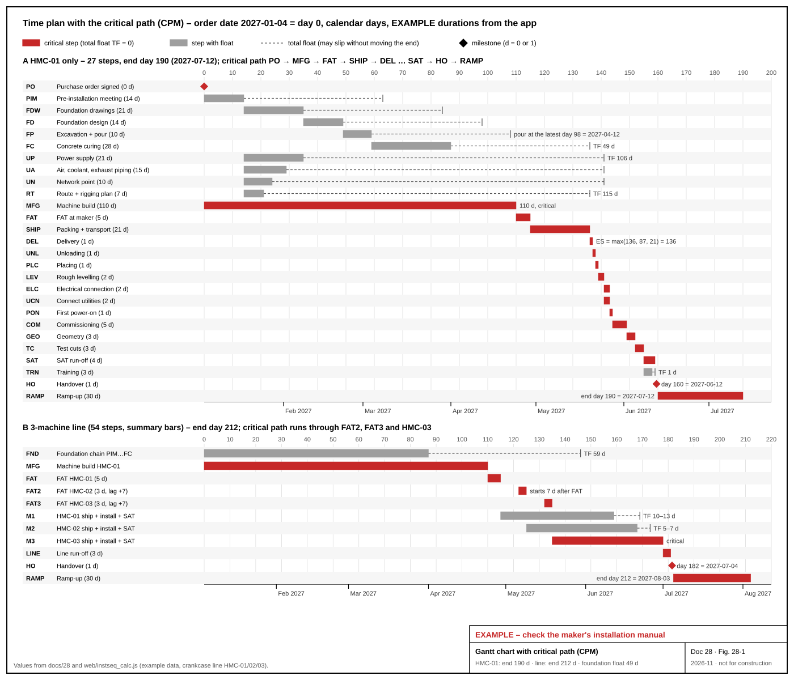
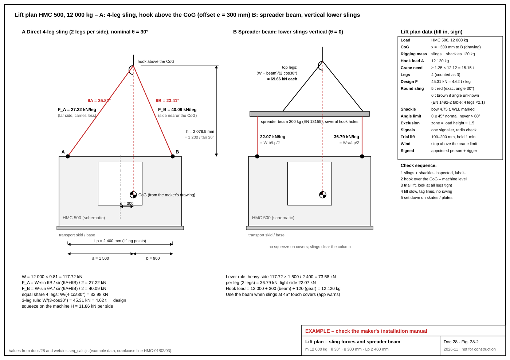
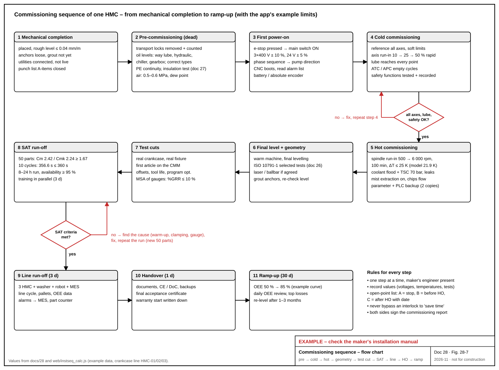
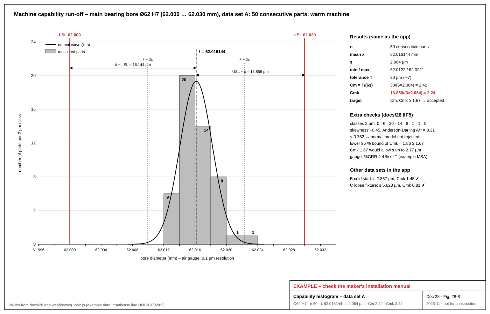
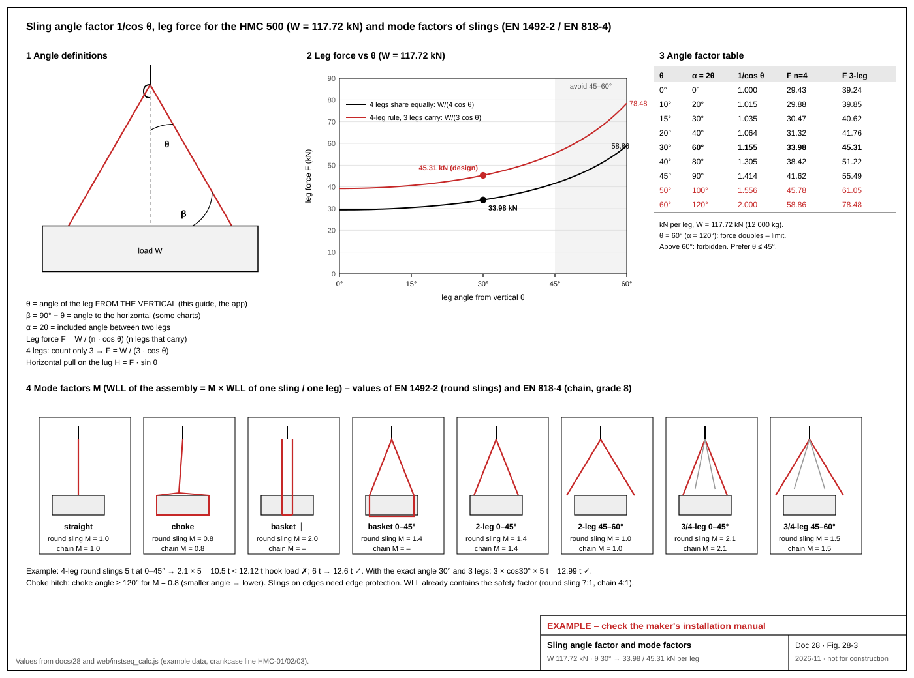
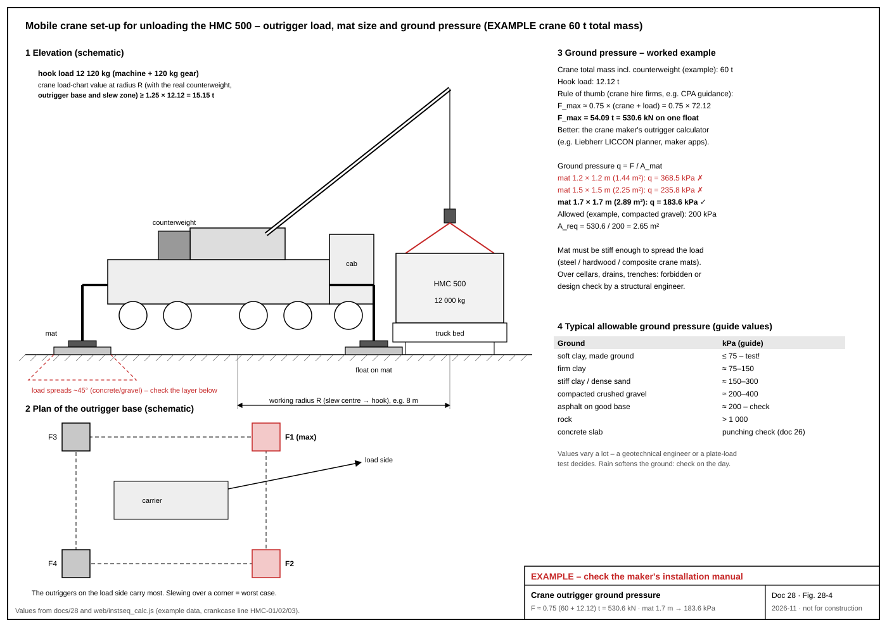
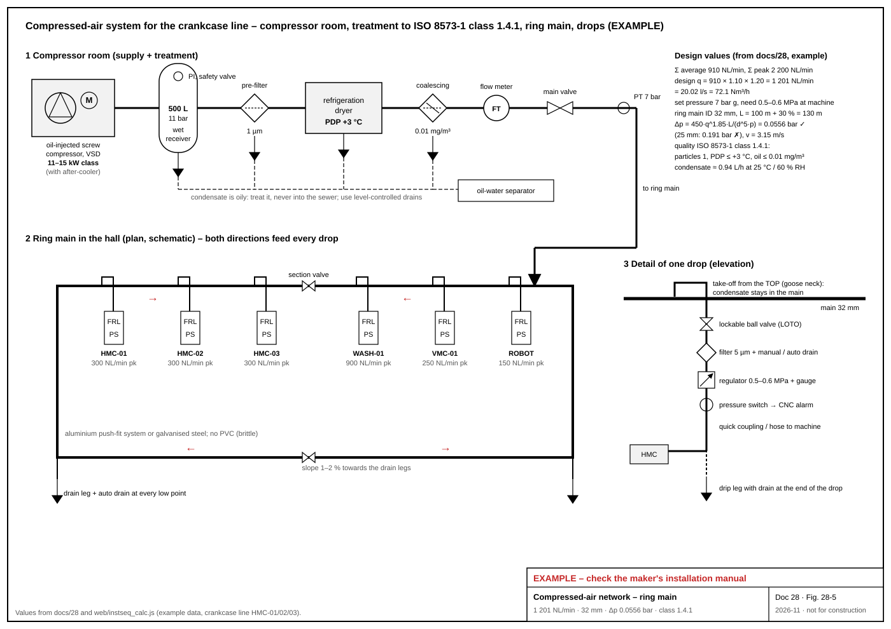
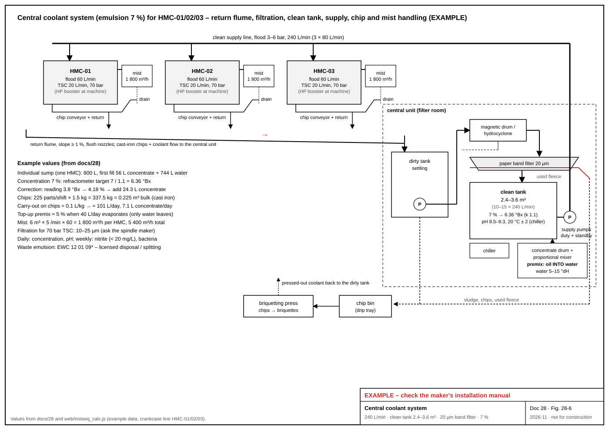

# 28 – Installation sequence: time plan, contracts, transport, rigging, utilities, commissioning, run-off – textbook, reference and design guide

**For whom:** mechanical engineers who plan and run the installation of CNC machines in a real factory – here the
**HMC 500** reference machine and the **3-machine crankcase line** (HMC-01/02/03) of the twin. This guide is three books
in one:

1. a **user guide** for item 5 of the Installation tab (Part A),
2. a **textbook** with theory, formulas and worked numbers: project management, contracts, rigging, utilities,
   commissioning and acceptance statistics (Parts B–F),
3. a **design + purchasing reference** with drawings, catalogue examples, checklists, supplier questions, standards and
   a glossary (Part G).

**Where to see it live:** tab **Installation** → button **"5 · Installation sequence"**
(files `web/instseq.js` = page, `web/instseq_calc.js` = all calculations, `web/instseq_text.js` = checklists and tables,
`web/instseq.css`). Deep link: `/?initem=5#inst`.

> **All numbers are examples.** The real values come from the **machine maker's installation manual**, the certified
> foundation drawing, the rigging company's lifting plan, the crane's load chart, the coolant data sheet, the contract
> and your own site. Lifting plans are made and signed by a competent person (rigger / appointed person); electrical work
> is done by a qualified electrician. Product names in Part G are **catalogue examples**, not a recommendation. Prices are
> **estimates – ask for a quote**. When this guide is not sure about a catalogue value it writes **"see datasheet"** – it
> never guesses.

**Related guides (read them instead of repeating them here):**
[26 – foundation, anchoring, vibration, levelling, alignment, geometric acceptance](26_installation_foundation_alignment.md)
(items 1 + 2: slab and block design, concrete curing, anchors, grout, levelling, ISO 230 / ISO 10791 tests) ·
[27 – electrical supply, protection, earthing, EMC](27_installation_electrical_emc.md) (items 3 + 4: cable sizing,
breakers, TN-S, tests before the first switch-on, PROFINET / encoder wiring) ·
[07 – communication](07_communication.md) (OPC UA, MTConnect, network zones) ·
[12 – HMC build](12_hmc_build.md) · [09 – pallet changer](09_pallet_changer_apc.md) ·
[16 – standards register](16_standards_register.md).

**Drawings in this guide** (standalone SVG files in `docs/img/`, copies in `web/img/`):

| Dwg | File | Content |
| --- | --- | --- |
| 28-1 | `28_gantt_critical_path.svg` | Gantt chart of the app's CPM plan: HMC-01 (end day 190) and the 3-machine line (end day 212), floats |
| 28-2 | `28_lift_plan.svg` | lift plan: 4-leg sling with CoG offset (27.22 / 40.09 kN), spreader beam (22.07 / 36.79 kN), lift data sheet |
| 28-3 | `28_sling_angle_factor.svg` | angle definitions, leg force vs angle, angle-factor table, mode factors (straight, choke, basket, multi-leg) |
| 28-4 | `28_crane_outrigger_ground_pressure.svg` | mobile crane set-up, outrigger force 530.6 kN, mat size, ground pressure table |
| 28-5 | `28_air_network_ring_main.svg` | compressor room, receiver, dryer, filters, drains, ring main, drops with filter-regulator |
| 28-6 | `28_coolant_central_system.svg` | central coolant system: flume, pre-separator, band filter, clean tank, mixer, chips, mist |
| 28-7 | `28_commissioning_sequence.svg` | commissioning flow chart from mechanical completion to ramp-up with gates |
| 28-8 | `28_capability_histogram.svg` | run-off histogram of data set A with LSL/USL, mean, ±3s, Cm 2.42 / Cmk 2.24 |

## Contents

* [0. Overview – the five items of the Installation tab](#0-overview--the-five-items-of-the-installation-tab)
* [0.1 How the numbers were checked](#01-how-the-numbers-were-checked)
* **PART A – Item 5 in the app: how to use it**
  * [A0. A 15-minute tour of item 5](#a0-a-15-minute-tour-of-item-5)
  * [A1. Project time plan (card A) – CPM](#a1-project-time-plan-card-a--the-critical-path-method-cpm)
  * [A2. Responsibilities – RACI (card B)](#a2-responsibilities--raci-card-b)
  * [A3. Site preparation (card D)](#a3-site-preparation-card-d)
  * [A4. Transport and rigging (card E)](#a4-transport-and-rigging-card-e)
  * [A5. Utilities (card F)](#a5-utilities-card-f)
  * [A6. Commissioning (card G)](#a6-commissioning-card-g)
  * [A7. Acceptance – FAT, SAT, run-off (card H)](#a7-acceptance--fat-sat-run-off-card-h)
  * [A8. Checklists (card C)](#a8-checklists-card-c--one-per-card)
  * [A9. Typical mistakes and their cost](#a9-typical-installation-mistakes-and-their-cost-examples)
  * [A10. Questions for the machine maker](#a10-questions-for-the-machine-maker-ask-at-the-pre-installation-meeting)
  * [A11. Test and deep-link parameters](#a11-test-and-deep-link-parameters-all-with-initem5--inst)
* **PART B – Textbook: project management for a machine installation**
  * [B1. Work breakdown structure (WBS)](#b1-work-breakdown-structure-wbs)
  * [B2. CPM theory in depth](#b2-cpm-theory-in-depth)
  * [B3. PERT – three-point estimates and probability](#b3-pert--three-point-estimates-and-the-probability-to-finish-on-time)
  * [B4. Resources and levelling](#b4-resources-and-resource-levelling)
  * [B5. Gantt chart and milestones](#b5-gantt-chart-and-milestones)
  * [B6. Earned value basics](#b6-earned-value-basics)
  * [B7. Risk register](#b7-risk-register-probability--impact)
  * [B8. Meetings, reports and change control](#b8-meetings-reports-and-change-control)
* **PART C – Contracts, Incoterms, payment, warranty**
  * [C1. The purchase contract – what must be inside](#c1-the-purchase-contract--what-must-be-inside)
  * [C2. Incoterms 2020 for a machine import](#c2-incoterms-2020-for-a-machine-import)
  * [C3. Payment milestones and bank guarantees](#c3-payment-milestones-and-bank-guarantees)
  * [C4. Warranty, penalties, insurance](#c4-warranty-penalties-liquidated-damages-insurance)
* **PART D – Site preparation, transport and rigging engineering**
  * [D1. Site survey: access, doors, floor load along the route](#d1-site-survey-access-doors-floor-load-along-the-route)
  * [D2. Utilities readiness](#d2-utilities-readiness--the-ready-for-machine-check)
  * [D3. Transport preservation](#d3-transport-preservation-vci-humidity-shock-and-tilt-transport-locks)
  * [D4. Rigging fundamentals: WLL, safety factors, slings](#d4-rigging-fundamentals-wll-safety-factors-sling-types)
  * [D5. Shackles, eyebolts, lifting points, beams](#d5-shackles-eyebolts-lifting-points-spreader-and-lifting-beams)
  * [D6. Centre of gravity by weighing](#d6-centre-of-gravity-by-weighing)
  * [D7. Mobile cranes: load charts and ground bearing](#d7-mobile-cranes-load-charts-and-ground-bearing-pressure)
  * [D8. Forklifts](#d8-forklifts-capacity-plate-load-centre-floor-load)
  * [D9. Skates, air pads, jacking](#d9-skates-air-pads-jacking-and-skidding)
  * [D10. Rules: LOLER, DGUV, BS 7121, ASME B30](#d10-rules-loler-dguv-bs-7121-asme-b30)
  * [D11. Lift plan template](#d11-lift-plan-template)
* **PART E – Utilities engineering**
  * [E1. Compressed air](#e1-compressed-air)
  * [E2. Coolant (metalworking fluid)](#e2-coolant-metalworking-fluid)
  * [E3. Chips](#e3-chips)
  * [E4. Oil-mist extraction](#e4-oil-mist-extraction)
  * [E5. Network commissioning](#e5-network-commissioning-ip-plan-vlan-opc-ua-mtconnect)
* **PART F – Commissioning and acceptance: theory**
  * [F1. Commissioning phases](#f1-commissioning-phases)
  * [F2. Run-in, lubrication, hydraulics](#f2-run-in-of-axes-and-spindle-lubrication-and-hydraulic-systems)
  * [F3. Safety validation](#f3-safety-validation-at-commissioning)
  * [F4. FAT and SAT protocols](#f4-fat-and-sat-protocols)
  * [F5. Machine capability Cm / Cmk](#f5-machine-capability-cm--cmk-iso-22514-3-vdma-8669)
  * [F6. Measurement system analysis (MSA)](#f6-measurement-system-analysis-msa)
  * [F7. Process capability Cp / Cpk / Pp / Ppk](#f7-process-capability-cp--cpk--pp--ppk)
  * [F8. Cycle-time proof](#f8-cycle-time-proof--statistics)
  * [F9. Availability run and OEE](#f9-availability-run-and-oee)
  * [F10. Documentation, CE, Machinery Regulation](#f10-documentation-handover-ce-ukca-machinery-regulation-20231230)
  * [F11. Training plan](#f11-training-plan)
  * [F12. Ramp-up curve](#f12-ramp-up-curve)
* **PART G – Practice: buying, checklists, standards**
  * [G1. Buy list – catalogue examples](#g1-buy-list--catalogue-examples)
  * [G2. Consolidated shopping list for installing the 3-HMC line](#g2-consolidated-shopping-list-for-installing-the-3-hmc-line)
  * [G3. Extra checklists](#g3-extra-checklists)
  * [G4. Questions for suppliers](#g4-questions-for-suppliers)
  * [G5. Standards register](#g5-standards-register)
  * [G6. Glossary](#g6-glossary)
  * [G7. Errors found and corrections in this edition](#g7-errors-found-and-corrections-in-this-edition)

---

## 0. Overview – the five items of the Installation tab

| Item | Topic | What you find there | Guide |
|---|---|---|---|
| 1 | Foundation, anchoring, vibration isolation | slab load, isolated foundation block, anchor bolts / levelling mounts, vibration from neighbours | `docs/26_installation_foundation_alignment.md` |
| 2 | Levelling, alignment, geometric acceptance | levelling sequence with a precision level, twist, alignment to APC / robot / conveyor, ISO 230 / ISO 10791 tests | `docs/26_installation_foundation_alignment.md` |
| 3 | Electrical installation | supply, transformer, cable size, voltage drop, fuses / breakers, earthing, TN-S | `docs/27_installation_electrical_emc.md` |
| 4 | Electrical noise (EMC), cable routing, signal wiring | noise sources, shields 360°, cable separation, filters, signal wiring | `docs/27_installation_electrical_emc.md` |
| 5 | Installation sequence (this guide) | time plan with critical path, RACI, site preparation, transport + rigging, utilities, commissioning, FAT / SAT, run-off with Cmk, checklists, typical mistakes | **this file** |

Item 5 is the "glue": it puts items 1–4 into the right order in time and adds everything that is not foundation or
electrics. Where depth is needed it points to the other items ("details in item 1 …").

**How the five items fit together in time (HMC-01 plan, example):**

| Phase | Days (from order) | Item | What happens |
|---|---|---|---|
| Planning | 0–35 | 5 | order, pre-installation meeting, foundation drawing from the maker |
| Civil work | 35–87 | 1 | foundation design, pour, **28 days curing** (float 49 d) |
| Utilities | 14–35 | 3, 5 | power cable + breaker (item 3), air / coolant / exhaust piping, network point |
| Machine at the maker | 0–136 | 5 | build 110 d, FAT 5 d, packing + transport 21 d |
| Placing | 136–141 | 5, 1, 2 | delivery, unloading, moving in, rough levelling |
| Connection | 141–144 | 3, 4, 5 | electrical connection + tests, utilities, first power-on |
| Commissioning + acceptance | 144–160 | 5, 2 | commissioning, final levelling + geometry, test cuts, SAT, training, handover |
| Ramp-up | 160–190 | 5 | production ramp-up to the target OEE |

Shared example data (used by all items): HMC 500, mass 12 000 kg (+ coolant tank 800 L, chip conveyor 600 kg, APC),
footprint with APC ≈ 2.8 m × 5.2 m, height 3.0 m; 3×400 V TN-S, 45 kVA, run 18 kW; air 0.5–0.6 MPa, class 1.4.1,
≈ 300 NL/min peak; coolant emulsion 6–8 %; room 20 ± 2 °C. Line: HMC-01/02/03 at 4.8 m pitch, cycle 345 s + 15 s pallet change.

### 0.1 How the numbers were checked

Two independent ways:

1. **By the code itself** – open `/?initem=5&istest#inst`; the results are printed in the browser console (lines
   `ISTEST …`).
2. **By Python scripts** (stdlib only) for this guide: every function of `instseq_calc.js` (CPM forward + backward pass
   for both scopes, sling statics, forklift, air demand + pressure drop, coolant, mist, chips, spindle run-in model, the
   deterministic random generator and the capability data sets) was re-written in Python and gave the **same numbers**.
   All new textbook examples (PERT, earned value, mode factors, outrigger pressure, CoG weighing, condensate, leakage,
   receiver, MSA, confidence bounds, normality test, OEE, ramp-up) were also calculated there.

| Check | Result |
|---|---|
| CPM, HMC-01 only | end day **190** → **2027-07-12** (PO 2027-01-04); handover day 160 (2027-06-12); delivery day 136; foundation float **49 d** (pour at the latest 2027-04-12); TRN float 1 d ✓ |
| CPM, 3-machine line | 54 steps, end day **212** → **2027-08-03**; handover day 182 (2027-07-04); critical path PO → MFG → FAT → FAT2 → FAT3 → SHIP3 → … → SAT3 → LINE → HO → RAMP ✓ |
| CPM what-if MFG = 60 d | end day 141, foundation becomes critical (float 0): PO → PIM → FDW → FD → FP → FC → DEL … ✓ |
| Sling force | 117.72 / (4·cos 30°) = **33.98 kN**; 3-leg rule 45.31 kN; CoG offset 300 mm: 27.22 / **40.09 kN** per leg; design 45.31 kN = 4.62 t → sling 5 t, shackle 4.75 t ✓ |
| Spreader beam | lower legs 22.07 / 36.79 kN, top legs 69.66 kN ✓ |
| Forklift | 16 000 × 1 900 / 2 300 = **13 217 kg** ≥ 12 000 kg ✓ |
| Air | Σ 910 NL/min → design 1 201 NL/min = 20.02 l/s; Δp (32 mm, 130 m, 8.013 bar a) = **0.0556 bar**; 25 mm = 0.191 bar ✗ ✓ |
| Coolant | 800 L × 7 % = 56 L + 744 L; target reading 6.36 °Bx; correction 24.3 L ✓ |
| Mist, chips | 1 800 m³/h per machine; 225 parts × 1.5 kg = 337.5 kg = 0.225 m³ per shift ✓ |
| Spindle run-in model | 100 min, max 21.9 K (limit 25 K); skipped run-in 30.3 K ✓ |
| Capability (data set A) | x̄ = 62.016144 mm, s = 2.064 µm, **Cm = 2.42, Cmk = 2.24** ✓ (Python `statistics.stdev` gives the same) |
| Process preview | x̄ 62.015574, R̄ 5.356 µm, σ̂ 2.303 µm, Cp 2.17, Cpk 2.09, Pp 1.83, Ppk 1.76 ✓ |
| Cycle time | 10 cycles, mean 356.6 s ≤ 360 s, worst 359.2 s ✓ |
| PERT (new) | mean end 195.5 d, σ 10.69 d, P(end ≤ 200 d) = 66 % ✓ |
| Outrigger (new) | 0.75 × (60 + 12.12) t = 54.09 t = 530.6 kN; mat 1.7 m → 183.6 kPa ✓ |
| MSA (new) | EV 0.177, AV 0.127, GRR 0.218 µm → %GRR 4.36 % of T, ndc 14 ✓ |
| Item switch 1 → 5 → 2 → 5 (`&isback`) | no console errors, item 5 built once and shown again ✓ |

---

# PART A – Item 5 in the app: how to use it

## A0. A 15-minute tour of item 5

| Card | Name | What you do there | Chapter |
|---|---|---|---|
| A | Project time plan | edit durations in the table, change the order date, switch scope "HMC-01 only" / "3-machine line"; read the critical path and the float of each step in the Gantt chart | A1, B2–B5 |
| B | Responsibilities (RACI) | check that every step has exactly one A; see who does what | A2 |
| C | Progress | progress bar per phase from the five checklists | A8 |
| D | Site preparation | requirement table with values and consequences | A3, D1, D2 |
| E | Transport + rigging | rigging calculator (mass, legs, angle, CoG offset, spreader), forklift check, sling + shackle choice | A4, D4–D11 |
| F | Utilities | compressed-air demand + pipe size, coolant mix + refractometer correction, chips, mist, network | A5, E1–E5 |
| G | Commissioning | ordered steps, spindle run-in chart and G-code program | A6, F1–F3 |
| H | Acceptance | FAT vs SAT, capability with data sets A / B / C, histogram, process preview, cycle-time proof | A7, F4–F9 |
| – | Mistakes + questions | typical mistakes with cost, questions for the maker | A9, A10 |

**Tour:** (1) Card A: change "MFG" from 110 to 60 days → the foundation becomes critical (red). Set it back.
(2) Card E: set the angle to 45° → the app warns that the slings touch the covers → tick "spreader". (3) Card F: set the
pipe to 25 mm → Δp 0.191 bar "too small". (4) Card H: switch the data set to B → Cmk 1.45 "not accepted".
(5) Card C: tick a few checklist items → the progress bars move.

## A1. Project time plan (card A) – the critical path method (CPM)

### A1.1 What and why
A CNC machine is ready at the maker 4–6 months after the order. In the same time the buyer must get the foundation
drawing, design and pour the foundation, let it **cure 28 days**, bring power, air, coolant, exhaust and network to the
place, plan the route and book the crane. If one of these is late, the machine waits in storage and the maker's fitter
must be booked again.

### A1.2 The steps (HMC-01 only, durations in calendar days – example)

| ID | Step | d | Predecessors | Responsible (R) |
|---|---|---|---|---|
| PO | Purchase order signed (milestone) | 0 | – | Buyer |
| PIM | Pre-installation meeting + layout approval | 14 | PO | Maker |
| FDW | Maker sends foundation + installation drawings | 21 | PIM | Maker |
| FD | Foundation design (structural engineer) | 14 | FDW | Civil |
| FP | Excavation, reinforcement, concrete pour | 10 | FD | Civil |
| FC | Concrete curing – 28 days | 28 | FP | Civil |
| UP | Power supply: cable, breaker, distribution | 21 | PIM | Electrician |
| UA | Air, coolant, mist-exhaust piping | 15 | PIM | Buyer |
| UN | Network point + MES interface plan | 10 | PIM | Buyer |
| RT | Route survey, rigging plan, crane booked | 7 | PIM | Rigger |
| MFG | Machine build at the maker | 110 | PO | Maker |
| FAT | FAT at the maker's plant | 5 | MFG | Maker |
| SHIP | Packing (VCI, locks) + transport | 21 | FAT | Maker |
| DEL | Delivery + delivery inspection | 1 | SHIP, FC, RT | Buyer |
| UNL | Unloading | 1 | DEL | Rigger |
| PLC | Moving in, placing on the foundation | 1 | UNL | Rigger |
| LEV | Rough levelling, anchors (item 2) | 2 | PLC | Maker |
| ELC | Electrical connection + checks (item 3) | 2 | LEV, UP | Electrician |
| UCN | Connect air, coolant, chips, exhaust, network | 2 | LEV, UA, UN | Buyer |
| PON | First power-on | 1 | ELC, UCN | Maker |
| COM | Maker's commissioning | 5 | PON | Maker |
| GEO | Final levelling + geometry checks | 3 | COM | Maker |
| TC | Test cuts with the crankcase | 3 | GEO | Maker |
| SAT | Run-off at site (Cmk, cycle time, 24 h run) | 4 | TC | Maker |
| TRN | Training | 3 | TC | Maker |
| HO | Handover, documents, final acceptance | 1 | SAT, TRN | Maker (A = buyer) |
| RAMP | Production ramp-up to target OEE | 30 | HO | Buyer |

### A1.3 The formulas
* Day 0 = morning of the order date. A step with ES = 0 and d = 5 runs on days 0…4; **EF = ES + d = 5** (the morning after).
* **Forward pass:** ES = max(EF of all predecessors + lag), EF = ES + d.
* **Backward pass** (from the project end E = largest EF): LF = min(LS of all successors − lag), LS = LF − d.
* **Total float** TF = LS − ES (how many days the step may slip without moving the end).
* **Free float** FF = min(ES of the successors) − EF (slip that does not move any other step).
* **Critical path** = chain of steps with TF = 0.
* Calendar date of the last day of a step = order date + EF − 1.

### A1.4 Worked example (by hand)
Machine branch: PO 0→0, MFG 0→110, FAT 110→115, SHIP 115→136.
Foundation branch: PIM 0→14, FDW 14→35, FD 35→49, FP 49→59, FC 59→87.
DEL needs SHIP, FC and RT: ES(DEL) = max(136, 87, 21) = **136**.
DEL 136→137, UNL 137→138, PLC 138→139, LEV 139→141, ELC and UCN 141→143 (UP finished on day 35, UA 29, UN 24),
PON 143→144, COM 144→149, GEO 149→152, TC 152→155, SAT 155→159, TRN 155→158, HO 159→160, RAMP 160→**190**.
End date = 2027-01-04 + 189 days = **2027-07-12**.

Backward: LS(DEL) = 136 → LF(FC) = 136 → LS(FC) = 108 → **TF(FC) = 108 − 59 = 49 days**. LS(FP) = 98 → the concrete must
be poured at the latest on 2027-01-04 + 98 = **2027-04-12**. TRN: LF = LS(HO) = 159, LS = 156 → TF = 1 day.

Critical path: **PO → MFG → FAT → SHIP → DEL → UNL → PLC → LEV → ELC (and UCN) → PON → COM → GEO → TC → SAT → HO → RAMP**.

Full table of the app (verified with Python):

| ID | d | ES | EF | LS | LF | TF | FF | last day |
|---|---|---|---|---|---|---|---|---|
| PO | 0 | 0 | 0 | 0 | 0 | **0** | 0 | 2027-01-04 |
| PIM | 14 | 0 | 14 | 49 | 63 | 49 | 0 | 2027-01-17 |
| FDW | 21 | 14 | 35 | 63 | 84 | 49 | 0 | 2027-02-07 |
| FD | 14 | 35 | 49 | 84 | 98 | 49 | 0 | 2027-02-21 |
| FP | 10 | 49 | 59 | 98 | 108 | 49 | 0 | 2027-03-03 |
| FC | 28 | 59 | 87 | 108 | 136 | 49 | 49 | 2027-03-31 |
| UP | 21 | 14 | 35 | 120 | 141 | 106 | 106 | 2027-02-07 |
| UA | 15 | 14 | 29 | 126 | 141 | 112 | 112 | 2027-02-01 |
| UN | 10 | 14 | 24 | 131 | 141 | 117 | 117 | 2027-01-27 |
| RT | 7 | 14 | 21 | 129 | 136 | 115 | 115 | 2027-01-24 |
| MFG | 110 | 0 | 110 | 0 | 110 | **0** | 0 | 2027-04-23 |
| FAT | 5 | 110 | 115 | 110 | 115 | **0** | 0 | 2027-04-28 |
| SHIP | 21 | 115 | 136 | 115 | 136 | **0** | 0 | 2027-05-19 |
| DEL | 1 | 136 | 137 | 136 | 137 | **0** | 0 | 2027-05-20 |
| UNL | 1 | 137 | 138 | 137 | 138 | **0** | 0 | 2027-05-21 |
| PLC | 1 | 138 | 139 | 138 | 139 | **0** | 0 | 2027-05-22 |
| LEV | 2 | 139 | 141 | 139 | 141 | **0** | 0 | 2027-05-24 |
| ELC | 2 | 141 | 143 | 141 | 143 | **0** | 0 | 2027-05-26 |
| UCN | 2 | 141 | 143 | 141 | 143 | **0** | 0 | 2027-05-26 |
| PON | 1 | 143 | 144 | 143 | 144 | **0** | 0 | 2027-05-27 |
| COM | 5 | 144 | 149 | 144 | 149 | **0** | 0 | 2027-06-01 |
| GEO | 3 | 149 | 152 | 149 | 152 | **0** | 0 | 2027-06-04 |
| TC | 3 | 152 | 155 | 152 | 155 | **0** | 0 | 2027-06-07 |
| SAT | 4 | 155 | 159 | 155 | 159 | **0** | 0 | 2027-06-11 |
| TRN | 3 | 155 | 158 | 156 | 159 | 1 | 1 | 2027-06-10 |
| HO | 1 | 159 | 160 | 159 | 160 | **0** | 0 | 2027-06-12 |
| RAMP | 30 | 160 | 190 | 160 | 190 | **0** | 0 | 2027-07-12 |

Note the difference between total and free float on the foundation chain: PIM … FP each have **TF = 49 d but FF = 0** –
if PIM slips, the whole chain behind it moves, but the end date does not move until the 49 days are used up. Only FC, the
last step of the chain, has FF = 49 d.

What-if (type it into the table): machine build 60 days instead of 110 → SHIP ends on day 86, but FC ends on day 87 →
the **foundation becomes critical**, end day 141. This is the typical situation for a stock machine: the foundation is
the bottleneck.



### A1.5 The 3-machine line
Scope "3-machine crankcase line" adds the HMC-02 and HMC-03 chains: the maker finishes one machine every week
(FAT2 starts 7 days after FAT ends – a lag "FAT+7"), FAT of machines 2/3 takes 3 days, one installation team works machine
after machine (LEV2 after LEV, ELC2 after ELC, COM2 after COM …), and a **line run-off** (3 days, all machines + washer
+ robot + MES) comes before the handover. Result: end day **212 (2027-08-03)**, handover day 182 (2027-07-04); the
critical path runs through the maker's build slots (FAT2, FAT3) and the installation of HMC-03.

Key numbers of the line plan (Python check of the app):

| Step | ES | EF | TF | Comment |
|---|---|---|---|---|
| FAT (HMC-01) | 110 | 115 | 0 | |
| FAT2 | 122 | 125 | 0 | 115 + 7 days lag |
| FAT3 | 132 | 135 | 0 | 125 + 7 days lag |
| SHIP / DEL HMC-01 | 115 / 136 | 136 / 137 | 10 | HMC-01 now has 10 days float |
| SHIP2 / DEL2 | 125 / 146 | 146 / 147 | 5 | |
| SHIP3 / DEL3 | 135 / 156 | 156 / 157 | 0 | critical |
| SAT3 | 175 | 178 | 0 | |
| LINE | 178 | 181 | 0 | 3-day line run-off |
| HO | 181 | 182 | 0 | 2027-07-04 |
| RAMP | 182 | 212 | 0 | 2027-08-03 |
| Foundation chain | – | FC 87 | 59 | more float than for one machine |

**Resource check:** with a second installation team (removing the "one team" links LEV2 → LEV etc.) the end stays at day
212 – the deliveries are 10 days apart and one team finishes each machine before the next one arrives. A second team
would cost money and bring nothing (see B4).

---

## A2. Responsibilities – RACI (card B)

R = responsible (does the work), A = accountable (decides and signs – exactly one per step), C = consulted, I = informed,
A/R = both. Columns: Buyer · Maker · Electrician · Civil contractor · Rigger.

| Step | Buyer | Maker | Electrician | Civil | Rigger |
|---|---|---|---|---|---|
| Purchase order | A/R | I | | | |
| Pre-installation meeting + layout | A | R | C | C | C |
| Foundation drawings | I | A/R | | I | |
| Foundation design / pour | A | C / I | | R | |
| Curing | I | | | A/R | |
| Power supply | A | C | R | | |
| Air, coolant, exhaust, network | A/R | C | | | |
| Route + rigging plan | A | C | | | R |
| Machine build, packing, transport | I | A/R | | | I |
| FAT | A | R | | | |
| Delivery inspection | A/R | C | | | C |
| Unloading, placing | A | C | | I | R |
| Levelling | A | R | | C | |
| Electrical connection | A | C | R | | |
| First power-on | A | R | C | | |
| Commissioning | C | A/R | I | | |
| Geometry, test cuts, SAT, training, handover | A | R | | | |
| Ramp-up | A/R | C | | | |

Typical gap: "the maker will do it". The maker supervises unloading and placing, but the **buyer** usually books and pays
the rigger, the crane, the foundation and the utilities (check the Incoterms and the contract – Part C).

**RACI rules (textbook):**
1. Exactly **one A** per row – two "accountables" means nobody is accountable.
2. At least one **R** per row; an "A" without "R" is fine only when the A also does the work (A/R).
3. Too many **C** slow the project; too few **I** cause surprises.
4. Each party reads and signs its column at the pre-installation meeting.
5. A row that nobody wants is a risk – put it in the risk register (B7).

---

## A3. Site preparation (card D)

| Requirement | Value (example) | If not done |
|---|---|---|
| Access route + door | door ≥ machine width + 200 mm, height ≥ transport height + 200 mm (≥ 3.0 m × 3.4 m) | machine must be split – extra fitter days |
| Floor load along the route | skate load = m·g / 3 (4 skates, one may lift) = 12 000 × 9.81 / 3 = **39.2 kN**; steel plates ≥ 20 mm | cracked slab, broken drain |
| Crane / forklift | capacity ≥ 1.25 × hook load at the real radius / load centre | overturning, dropped machine |
| Clean, dry area | roof tight, no condensation, no grinding dust | rust, dirt in the spindle taper |
| Room temperature | 20 ± 2 °C, gradient ≤ 1 K/m, change ≤ 1 K/h | thermal errors |
| Lighting | ≥ 500 lx at machining areas (EN 12464-1) | measuring errors |
| Service space | ≥ 800–1000 mm on service sides; cabinet door opens fully | dismantling for every repair |
| Chip / coolant drainage | bin place, bund, oil-proof floor | pollution, slippery floor |
| Compressed air point | 0.5–0.6 MPa, class 1.4.1, ≥ 300 NL/min peak | pressure alarms |
| Network point | RJ45 Cat 6 / fibre, labelled, IP + firewall rule | MES weeks late |
| Power | 3×400 V ±10 %, TN-S, 45 kVA (item 3) | power-on delayed |

**Why 20 ± 2 °C:** ΔL = α·L·ΔT = 11.5 µm/(m·K) × 1 m × 3 K = **34.5 µm** – more than the whole 30 µm tolerance of the
Ø62 H7 bore. (Thermal theory of the hall: guide 26, §E5.)

**Practical tip:** tape the machine outline 1:1 on the floor, including APC, chip conveyor, coolant tank pull-out,
cabinet door swing and the service space. Let maintenance walk around it.

Depth: route survey and floor load along the route in D1, utilities readiness in D2.

---

## A4. Transport and rigging (card E)

### A4.1 Sling force
Angle θ is measured **from the vertical**.

**F = m·g / (n·cos θ)**

Example: m = 12 000 kg, n = 4, θ = 30°: W = 12 000 × 9.81 = 117.72 kN; F = 117.72 / (4 × 0.8660) = **33.98 kN** (3.46 t).

| θ | 1/cos θ | F per leg (n = 4) | F per leg, 3-leg rule |
|---|---|---|---|
| 0° | 1.000 | 29.43 kN | 39.24 kN |
| 15° | 1.035 | 30.47 kN | 40.62 kN |
| 30° | 1.155 | 33.98 kN | 45.31 kN |
| 45° | 1.414 | 41.62 kN | 55.49 kN |
| 60° | 2.000 | 58.86 kN (limit – never more) | 78.48 kN |

**4-leg rule:** a machine is stiff and the slings are never exactly equal → one leg is often slack. EN 13414-1 (and
EN 818-4 for chains) rates a 4-leg sling like a 3-leg sling: F = W / (3·cos θ) = 117.72 / (3 × 0.866) = **45.31 kN** (4.62 t).

**CoG offset** (exact 2-D statics, hook above the CoG): lifting points A and B at ±Lp/2 = ±1 200 mm, CoG offset
e = +300 mm towards B. Horizontal distances a = 1 500 mm, b = 900 mm, hook height h = 1 200 / tan 30° = 2 078.5 mm.
θA = atan(1500/2078.5) = 35.82°, θB = atan(900/2078.5) = 23.41°.
F_A = W·sin θB / sin(θA + θB) = 117.72 × 0.3973 / 0.8593 = 54.44 kN per side → **27.22 kN per leg**;
F_B = W·sin θA / sin(θA + θB) = 117.72 × 0.5852 / 0.8593 = 80.18 kN per side → **40.09 kN per leg**.
The side **nearer** to the CoG carries more. Horizontal squeeze on the machine H = 54.44 × sin 35.82° = 31.86 kN.

**Design force** = largest case = 45.31 kN = 4.62 t → **round sling WLL 5 t (red, EN 1492-2)**, **bow shackle 4.75 t**.
At θ = 45° the app shows that the slings touch the column covers → use a **spreader beam**.

> **Two ways to rate a multi-leg sling (important).** The app sizes each leg with the *exact* angle (30°): 4.62 t per
> leg ≤ 5 t. The marking tables of EN 1492-2 / EN 818-4 use *angle bands* and fixed mode factors: a 4-leg assembly of
> 5 t round slings is rated 2.1 × 5 = **10.5 t for 0–45°** – less than the 12.12 t hook load. This is allowed only when
> the angle is known and controlled (fixed sling lengths, measured). If the angle is not controlled, use the band rule →
> **6 t slings (2.1 × 6 = 12.6 t ✓)**. See D4.4 and the drawing 28-3.

**Spreader beam:** lower slings vertical, F = W·b/Lp per side (lever rule). With e = 300 mm and 2 legs: 117.72 × 1500/2400
= **73.58 kN** on the heavy side = 36.79 kN per leg (4 legs), light side 22.07 kN per leg. Top legs: (W + beam) / (2·cos θ)
= (117.72 + 2.94) / (2 × 0.866) = 69.66 kN. The beam has several hook holes so the hook can sit above the CoG.



Colour code of round slings (EN 1492-2): violet 1 t, green 2 t, yellow 3 t, grey 4 t, red 5 t, brown 6 t, blue 8 t, orange 10 t+.
WLL already contains the safety factor (round sling 7:1, chain 4:1); choke hitch × 0.8.

### A4.2 Forklift at a bigger load centre
Moment about the front axle: Q·(c₀ + x) = Q_act·(c + x) → **Q_act = Q·(c₀ + x)/(c + x)**.
16 t forklift rated at c₀ = 1 200 mm, x = 700 mm, real CoG c = 1 600 mm: Q_act = 16 000 × 1 900 / 2 300 = **13 217 kg**
≥ 12 000 kg → OK, margin 10 %. Fork extensions and mast tilt reduce it further – read the capacity plate (D8).

### A4.3 Procedure for the lift
1. Lifting points and CoG from the maker's drawing (never guess). 2. Lifting plan with masses, slings, crane radius,
signed. 3. Inspect slings / shackles (label, cuts). 4. Exclusion zone, one signal person. 5. Trial lift 100–200 mm, hold
1 min, check level and brakes. 6. Lift slowly, no swinging; never stand under the load. 7. Set down on skates / plates.

### A4.4 Transport locks, corrosion protection, delivery
* **Transport locks** (axis shipping brackets, spindle-head support, APC lock): remove only **after** placing and **before**
  the first axis move. Paint red, count, keep with the machine for later moves.
* **VCI film + desiccant**: machine wrapped in volatile corrosion inhibitor film. Unpack in a dry hall at room temperature;
  let a cold machine warm up for 24 h (condensation – D3.3).
* **Shock / tilt indicators**: check before signing. If triggered: "accepted with reservation", photos, inform maker and
  insurer at once.
* **Delivery inspection**: indicators, packing, photos, boxes vs packing list, serial number, remarks on the CMR signed by the driver.
* **Skates**: 4 × 6 t, count 3 carrying (39.2 kN each); steel plates over joints; walk slowly; air pads need a sealed smooth floor.
* **Crane**: capacity at the radius ≥ 1.25 × hook load; example hook load 12 000 + 120 kg rigging = 12 120 kg → ≥ 15.15 t.

---

## A5. Utilities (card F)

### A5.1 Compressed air
**Quality ISO 8573-1** – class written as particles.water.oil. Example **1.4.1**: particles class 1, pressure dew point
≤ +3 °C (refrigeration dryer), oil ≤ 0.01 mg/m³. (Full table in E1.1.)

| Class | Particles (per m³, 0.1–0.5 / 0.5–1 / 1–5 µm) | Dew point | Oil |
|---|---|---|---|
| 1 | ≤ 20 000 / 400 / 10 | ≤ −70 °C | ≤ 0.01 mg/m³ |
| 2 | ≤ 400 000 / 6 000 / 100 | ≤ −40 °C | ≤ 0.1 |
| 3 | – / 90 000 / 1 000 | ≤ −20 °C | ≤ 1 |
| 4 | – / – / 10 000 | ≤ +3 °C | ≤ 5 |
| 5 | – / – / 100 000 | ≤ +7 °C | – |

**Demand of the line (example):**

| Consumer | n | average NL/min | peak NL/min |
|---|---|---|---|
| HMC 500 | 3 | 120 | 300 |
| Washer WASH-01 | 1 | 400 | 900 |
| VMC-01 | 1 | 100 | 250 |
| Robot cell | 1 | 50 | 150 |

Σ average = 360 + 400 + 100 + 50 = 910 NL/min (Σ peak 2 200 NL/min – the peaks do not all come at the same time).
Design q = 910 × 1.10 (leakage) × 1.20 (reserve) = **1 201 NL/min = 20.02 l/s = 72.1 Nm³/h**.
Compressor ≈ 6–7 kW per Nm³/min → ≈ 7.8 kW.

**Pressure drop** (Atlas Copco empirical formula): **Δp = 450 · q^1.85 · L / (d^5 · p)**
(Δp bar, q l/s free air, L m including fittings, d mm inner diameter, p bar absolute).
Example: L = 100 m + 30 % fittings = 130 m, p = 7 + 1.013 = 8.013 bar a:
* d = 32 mm: 450 × 20.02^1.85 × 130 / (32^5 × 8.013) = 450 × 255.7 × 130 / (33 554 432 × 8.013) = **0.0556 bar** ✓ (≤ 0.1 bar)
* d = 25 mm: **0.191 bar** ✗ (too small)
* Ring main (approximation: q/2 and L/2 → Δp × 0.139): 25 mm → 0.0265 bar.

Air speed: v = q·(1.013/p) / A = 0.02002 × 0.1264 / (π·0.032²/4) = **3.15 m/s** (main pipe ≤ 6–8 m/s).

**Installation rules:** ring main with 1–2 % slope to drains, condensate drain at every low point, **drops as goose neck
from the TOP of the main**, at the machine a lockable shutoff valve, filter-regulator 0.5–0.6 MPa, pressure switch.
Chain: compressor → after-cooler → receiver → dryer → 1 µm filter → 0.01 µm coalescing filter → ring main.
(Many plants put the 1 µm pre-filter *before* the dryer and the coalescing filter after it, as in drawing 28-5 – both
orders exist; follow the dryer maker.) Depth: E1.

### A5.2 Coolant
* First fill: concentrate = V·c = 800 × 7 % = **56 L** + water **744 L**. **O-I-W: oil into water.**
* Refractometer: concentration % = k × reading °Brix. With k = 1.1: target reading = 7 / 1.1 = **6.36 °Bx**.
* Correction: reading 3.8 → 1.1 × 3.8 = 4.18 %. Concentrate to add x = V·(c₂ − c₁)/(100 − c₂) = 800 × (7 − 4.18)/93 = **24.3 L**.
* Water quality (example): hardness 5–15 °dH, chlorides < 50 mg/L, water pH 6.5–8, emulsion pH 8.5–9.3, nitrite < 20 mg/L.
* Central system (one tank + flume for the line) vs individual tanks: central = stable quality, less work; one bad batch
  stops all machines.
* Daily: measure concentration and pH; top up with a weak premix (water evaporates – E2.6 shows how to choose the %).
Depth: E2.

### A5.3 Chips and oil mist
* Chips per shift = 7.5 h × 3600 / 360 s × 3 machines = 225 parts × 1.5 kg = **337.5 kg = 0.225 m³** (bulk 1 500 kg/m³, example).
  Grey cast iron: short dusty chips → hinged-belt / scraper conveyor, magnetic separator, draining bins.
* Mist extraction Q = V_enclosure × air changes = 6 m³ × 5 /min × 60 = **1 800 m³/h per machine**, 5 400 m³/h for 3 HMC
  (supplier rule 3–8 air changes per minute; high-pressure through-spindle coolant → upper value). Drain back to the tank;
  make-up air for the hall.
Depth: E3, E4.

### A5.4 Network
Labelled point (Cat 6 / fibre), fixed IP from the OT plan, firewall rule. Interfaces: **OPC UA** (port 4840, umati / OPC 40501),
**MTConnect** (HTTP agent, read-only), **PROFINET** to a line PLC. Test: ping, browse OPC UA, check status / part counter /
alarm / spindle load in the MES. See the **Communication** tab (button in card F) and `docs/07_communication.md`. Depth: E5.

---

## A6. Commissioning (card G)

| # | Step | How | What goes wrong otherwise |
|---|---|---|---|
| 1 | Unlock transport locks | remove and count all brackets | axis moved against a lock → bent screw / coupling |
| 2 | Oil levels | way lube, hydraulic, spindle chiller, gearbox; correct oil types | dry pump, foaming oil |
| 3 | First power-on | e-stop pressed → main switch ON → measure 3×400 V and 24 V → release e-stop → CNC boots | destroyed power supplies |
| 4 | Alarm check | clear each alarm only when understood | hidden faults |
| 5 | Reference / home | low speed, check soft limits | crash into table / APC |
| 6 | Axis run-in | full stroke at 10 → 25 → 50 % rapid, listen | transport damage found too late |
| 7 | Spindle run-in | step-up program, temperature watch | bearing damage (15 000–40 000 €) |
| 8 | Lubrication check | oil at every carriage / ball nut; test level + pressure switches | dry carriage |
| 9 | Safety function test | door interlock, every e-stop, enabling device, APC guard; record each | injured operator |
| 10 | Backups | parameters, PLC/ladder, compensation tables, macros, tool data – 2 copies, dated | weeks of downtime after a board failure |

Also check the **phase sequence** (coolant / hydraulic pump direction) at power-on, and re-check the **levelling** after the
first warm run (item 2). Electrical tests before the first switch-on: guide 27, §A.15.



### A6.1 Spindle run-in program (example)
500 rpm 10 min → 1 000 rpm 10 → 2 000 rpm 10 → 3 000 rpm 10 → 4 000 rpm 15 → 5 000 rpm 15 → 6 000 rpm 30 = **100 min**.
Next step only when the housing temperature is stable (≤ 1 K in 10 min). Example limit: rise ≤ 25 K above room.

```
O9001 (SPINDLE RUN-IN - EXAMPLE, CHECK THE MAKER'S PROGRAM)
G91 G28 Z0 ;
G90 ;
M03 S500 ;
G04 X600. ; (10 MIN - WATCH TEMPERATURE)
S1000 ;
G04 X600. ;
...
S6000 ;
G04 X1800. ; (30 MIN)
M05 ;
M30 ;
```
(Fanuc: G04 X in seconds with decimal point.) The app's illustration model (first-order lag τ = 12 min, steady rise
22·(n/6000)^1.3 K plus extra heat while fresh grease is not spread) gives max **21.9 K** for the step-up program and
**30.3 K** (> limit) when the spindle goes to 6 000 rpm at once. Use the maker's program and limits; run a short warm-up
every morning and after stops > 2 days. Theory: F2.

---

## A7. Acceptance – FAT, SAT, run-off (card H)

| | FAT (at the maker) | SAT (at your site) |
|---|---|---|
| Purpose | prove the spec before shipping (cheap to fix) | prove it after transport, on the real foundation and utilities |
| Geometry | full ISO 10791 set, laser, ballbar | selected checks after final levelling |
| Part | test part or real part | **real crankcase**, real fixture, tools, material |
| Capability | Cmk on test part (if agreed) | **Cmk ≥ 1.67, 50 consecutive parts** |
| Cycle time | real program | again with real logistics (APC, robot, MES) |
| Run time | 4–8 h | 8–24 h continuous |
| Payment | often 10–30 % | often 10–20 % |

### A7.1 Capability formulas
* mean x̄ = Σx / n; standard deviation s = √(Σ(x − x̄)² / (n − 1))
* **Cm = T / (6s)**, **Cmk = min(USL − x̄, x̄ − LSL) / (3s)** – machine capability, short term, 50 consecutive parts. Target ≥ 1.67.
* **Cp = T / (6σ̂)**, **Cpk = min(USL − x̄, x̄ − LSL) / (3σ̂)** – process capability, long term, σ̂ = R̄/d₂ from subgroups
  (d₂ = 2.326 for n = 5). Target ≥ 1.33.
* Pp / Ppk: same with the overall s (includes shifts between subgroups) → Ppk ≤ Cpk.
Theory, sample size, normality and confidence bounds: F5–F7.

### A7.2 Worked example – main bearing bore Ø62 H7 (62.000 … 62.030 mm, T = 30 µm)
Data set A (50 consecutive parts, warm machine, generated deterministically in `instseq_calc.js`, 0.1 µm resolution):

```
62.0161 62.0154 62.0188 62.0152 62.0142 62.0159 62.0142 62.0197 62.0202 62.0157
62.0168 62.0156 62.0136 62.0183 62.0178 62.0181 62.0141 62.0190 62.0170 62.0161
62.0130 62.0181 62.0149 62.0178 62.0158 62.0156 62.0153 62.0158 62.0151 62.0156
62.0169 62.0175 62.0183 62.0160 62.0144 62.0135 62.0165 62.0122 62.0128 62.0221
62.0162 62.0189 62.0142 62.0159 62.0143 62.0173 62.0160 62.0150 62.0127 62.0177
```
Σx = 3 100.8072 → x̄ = **62.016144 mm**; s = **2.064 µm**; min 62.0122, max 62.0221.
Cm = 30 / (6 × 2.064) = **2.42**. Cmk = min(30 − 16.144, 16.144) / (3 × 2.064) = 13.856 / 6.192 = **2.24** → proved.

| Data set | x̄ (mm) | s (µm) | Cm | Cmk | Result |
|---|---|---|---|---|---|
| A warm machine | 62.01614 | 2.064 | 2.42 | 2.24 | accepted |
| B cold start drift (first parts larger) | 62.01760 | 2.857 | 1.75 | **1.45** | not accepted – warm up first |
| C loose fixture / pallet offsets | 62.01632 | 5.623 | 0.89 | 0.81 | not accepted – fix the clamping |

Process preview (25 samples of 5 over several days): x̄ = 62.01557, R̄ = 5.36 µm → σ̂ = 5.36/2.326 = 2.303 µm →
Cp = 2.17, **Cpk = 2.09** (≥ 1.33); overall s = 2.727 µm → Pp = 1.83, Ppk = 1.76.

The histogram in the app has one y-axis (number of parts per 2 µm class), LSL/USL lines, the mean and the normal curve.
Drawing 28-8 shows the same data:



### A7.3 Cycle-time proof
Quote 360 s floor-to-floor (345 s machining + 15 s pallet change, from `config/factory.json`). 10 measured cycles
(example): 354.1, 356.2, 353.5, 359.2, 359.0, 356.4, 356.8, 357.4, 356.6, 357.0 s → mean **356.6 s**, worst 359.2 s.
Rule (example): mean ≤ quote and no cycle > quote + 2 % (367.2 s) → proved. Line output = 3 × 3600 / 356.6 = **30.3 parts/h**
before OEE losses. Measure from cycle start to the next cycle start, real program, override 100 %. Statistics: F8.

### A7.4 Continuous run (8–24 h)
| Criterion | Limit (example) |
|---|---|
| Run time | ≥ 8 h, 24 h for a line |
| Machine-caused stops | 0 (or availability ≥ 95 %) – define what counts before |
| Alarms | no repeating alarm |
| Quality | all parts in tolerance, SPC stable |
| Thermal drift | bore within tolerance from cold start to 8 h |
| Leaks / noise | none |

### A7.5 Documents to hand over
Operating manual (users' language) · maintenance + lubrication plan · electrical drawings **as built** (IEC 60204-1 §17) ·
hydraulic / pneumatic diagrams (ISO 1219) · parameter + PLC backup (2 copies) · spare + wear parts list · **EU declaration of
conformity + CE** (Machinery Directive 2006/42/EC → Machinery Regulation (EU) 2023/1230) · test reports (FAT, SAT, geometry,
laser, ballbar, capability, safety) · foundation drawing as built with levelling values · training records. Depth: F10.

### A7.6 Training
| Group | Duration (example) | Content |
|---|---|---|
| Operators (all shifts) | 2–3 days | panel, modes, part change, offsets, alarms, daily checks, safety |
| Setters / programmers | 3–5 days | programming, work offsets, probing, tool management |
| Maintenance – mechanical | 2–3 days | lubrication, filters, wipers, levelling check, spindle care, APC |
| Maintenance – electrical | 2–3 days | drawings, diagnosis, drive alarms, battery change, backup/restore, safety tests |

---

## A8. Checklists (card C + one per card)

Five tickable checklists (64 items): 1 planning + site preparation · 2 transport, delivery, rigging · 3 placing + utilities ·
4 commissioning · 5 acceptance + handover. Card C shows a progress bar per phase. The ticks are kept in the browser
(`localStorage` key `dt.instseq.v1`); if the browser blocks storage the page still works (ticks live until reload).
`&ischk=all` shows all ticked (for screenshots, not saved). The full lists are in `web/instseq_text.js` – print the
app page or copy them into your project folder. Extra checklists for the textbook parts: G3.

---

## A9. Typical installation mistakes and their cost (examples)

| Mistake | What happens | Cost (example) |
|---|---|---|
| Foundation started late | machine waits 2–4 weeks, fitter re-booked | 5 000–15 000 € + lost production |
| Door / route / floor not checked | machine dismantled, floor cracked | 10 000–40 000 €, 1–2 weeks |
| Wrong lifting points, no spreader | bent covers … dropped machine | 2 000 € … total loss |
| Transport locks removed before moving | ball screw / guide / coupling damage | 5 000–25 000 € |
| Power-on with locks mounted | overload, bent bracket, coupling | 1 000–10 000 € |
| Stored outside / no VCI check | rust, regrinding | 5 000–30 000 € |
| Shock indicator ignored at delivery | insurance refuses | full repair |
| Wrong phase sequence | pumps backwards, pump damage | 500–5 000 € |
| Wet / oily air | valves, air seal, rust in taper | 2 000–20 000 €/year |
| Water into concentrate / wrong % | unstable emulsion, bacteria, rust | 1 000–3 000 € per cleaning |
| Spindle run-in skipped | spindle rebuild | 15 000–40 000 €, 2–6 weeks |
| No backup | days–weeks downtime | – |
| Levelling not re-checked after 1–3 months | geometry drift, scrap | scrap + re-levelling |
| Run-off with a test piece | problems found in production | weeks of rework |
| Network / MES not planned | no data, no OEE | IT project 2–8 weeks late |
| Crane mats too small / ground not checked (new) | outrigger sinks, crane tips | total loss, injuries |
| Eyebolts loaded at an angle (new) | eyebolt bends or breaks (DIN 580 allows much less at 45°) | dropped load |
| Incoterm misunderstood (new) | nobody booked the unloading crane on delivery day | truck waiting costs, 1 day lost |
| Gauge not capable (new) | Cmk "fails" because of the gauge, not the machine | days of argument at SAT |

---

## A10. Questions for the machine maker (ask at the pre-installation meeting)

1. Certified foundation drawing: static + dynamic loads per pad, anchor type / positions, slab thickness, isolation joint?
2. Transport dimensions and mass per package; lifting points, CoG, spreader beam needed; can the machine be split?
3. Which transport locks, where, how many, in which order to remove?
4. Who unloads and places (Incoterms, rigger)? Who is liable for rigging damage?
5. Utility list: kVA, fuse, cable; air pressure, class, NL/min peak + average; coolant type, tank volume; exhaust m³/h?
6. Room conditions for the guaranteed accuracy: temperature range, gradient, humidity, floor vibration limit?
7. Commissioning: days, people, instruments brought; what must the buyer provide (crane, oil, coolant, helpers)?
8. Spindle run-in program and temperature limits; daily warm-up program?
9. FAT / SAT content: geometry tests, part, number of parts for Cmk, cycle time, run time, limits?
10. Which documents, which language, when (some before delivery for planning)?
11. Training content, days, number of people, where?
12. Recommended spares for 2 years; delivery time of spindle and main drives?
13. Network interface included (OPC UA, MTConnect, PROFINET), data points, licences?
14. Warranty start (delivery, SAT or final acceptance?) and service response time?

More questions for riggers, crane hire, compressor, coolant and filter suppliers: G4.

---

## A11. Test and deep-link parameters (all with `/?initem=5 … #inst`)

| Parameter | Effect |
|---|---|
| `&isscope=line` | 3-machine line plan |
| `&isstart=2027-01-04` | order date |
| `&isdur=FC:35,MFG:90` | change durations |
| `&issel=FC` | select a step |
| `&ismass=12000 &islegs=2\|4 &isangle=45 &iscog=300 &isspreader` | rigging calculator |
| `&isd=25 &isring` | air pipe diameter, ring main |
| `&isdata=A\|B\|C` | run-off data set |
| `&isskip` | spindle run-in skipped (comparison curve) |
| `&ischk=all\|none` | checklist state for screenshots (not saved) |
| `&iscard=plan\|raci\|progress\|site\|rig\|util\|comm\|accept\|mistakes\|maker` | scroll to a card |
| `&istest` | self-check lines `ISTEST …` in the console |
| `&isback` | item switch test 1 → 5 → 2 → 5 (`ISBACK …`) |
| `&ishold` | test only: keeps the load event pending for headless screenshots |
| `&theme=dark` | dark theme |

---

# PART B – Textbook: project management for a machine installation

## B1. Work breakdown structure (WBS)

**What:** a WBS splits the whole project into smaller and smaller pieces until each piece (a *work package*) has one
owner, a duration, a cost and a clear "done" test. The app's 27 steps are the lowest level of such a WBS.

**Rule of thumb:** a work package is 1–20 working days and has one A in the RACI. "100 % rule": the children of a node
contain 100 % of its work – nothing missing, nothing twice.

Example WBS for installing HMC-01 (codes are examples):

| Code | Level 2 | Level 3 work packages (app IDs) |
|---|---|---|
| 1 | Management | 1.1 contract + PO (PO) · 1.2 pre-installation meeting (PIM) · 1.3 plan, risk register, reports |
| 2 | Civil | 2.1 foundation drawing (FDW) · 2.2 foundation design (FD) · 2.3 pour (FP) · 2.4 curing (FC) |
| 3 | Utilities | 3.1 power (UP) · 3.2 air, coolant, exhaust (UA) · 3.3 network (UN) |
| 4 | Machine supply | 4.1 build (MFG) · 4.2 FAT · 4.3 packing + transport (SHIP) |
| 5 | Logistics on site | 5.1 route + rigging plan (RT) · 5.2 delivery (DEL) · 5.3 unloading (UNL) · 5.4 placing (PLC) |
| 6 | Installation | 6.1 levelling (LEV) · 6.2 electrical connection (ELC) · 6.3 utilities connection (UCN) |
| 7 | Commissioning | 7.1 power-on (PON) · 7.2 commissioning (COM) · 7.3 geometry (GEO) |
| 8 | Acceptance | 8.1 test cuts (TC) · 8.2 SAT · 8.3 training (TRN) · 8.4 handover (HO) |
| 9 | Ramp-up | 9.1 ramp-up (RAMP) · 9.2 re-levelling after 1–3 months |

The WBS is also the structure of the **budget** (cost per code) and of the **document folder**.

## B2. CPM theory in depth

### B2.1 Network types
* **Activity on node (AON, precedence diagram)** – each step is a box, arrows are dependencies. The app uses AON.
* **Activity on arrow (AOA)** – older; needs "dummy" activities. Not used here.

### B2.2 Dependency types and lags

| Type | Meaning | Example in an installation | In the app |
|---|---|---|---|
| FS (finish-to-start) | B starts when A ends | pour (FP) → curing (FC) | normal arrow |
| FS + lag | B starts *lag* days after A ends | FAT2 starts 7 d after FAT (maker's slot) | `FAT+7` |
| SS (start-to-start) | B starts when A starts (+ lag) | cable pulling starts 3 d after tray mounting starts | – (use FS with shorter steps) |
| FF (finish-to-finish) | B ends when A ends (+ lag) | documentation finishes with commissioning | – |
| SF | rare | – | – |
| Negative lag ("lead") | B starts before A ends | – avoid, hard to control | – |

### B2.3 Forward and backward pass – the algorithm
1. Sort the steps so that each step comes after all its predecessors (topological order).
2. **Forward:** ES = max over predecessors (EF + lag); first steps ES = 0. EF = ES + d.
3. Project end E = max EF.
4. **Backward** (reverse order): LF = min over successors (LS − lag); last steps LF = E. LS = LF − d.
5. Floats and the critical path (below).

The JavaScript (`cpm()` in `instseq_calc.js`) does exactly this in 10 lines; a spreadsheet can do it too (one column ES
with `MAX(...)`, one column LF with `MIN(...)`).

### B2.4 The four float types

| Float | Formula | Meaning | HMC-01 example |
|---|---|---|---|
| Total float TF | LS − ES = LF − EF | slip without moving the project end | foundation chain 49 d |
| Free float FF | min(ES of successors − lag) − EF | slip without moving *any* other step | FC 49 d, but PIM … FP 0 d |
| Interfering float IF | TF − FF | float that is "shared" with the following steps | PIM: 49 − 0 = 49 d |
| Independent float | max(0, min ES(succ) − max LF(pred) − d) | float even if predecessors end late and successors start early | FC: 136 − 108 − 28 = 0 → 0 d |

**Why it matters:** a planner who sees "TF 49 d" on PIM may think PIM is relaxed. But the 49 days belong to the whole
chain PIM → FDW → FD → FP → FC. If PIM uses 30 days of it, only 19 days are left for the concrete. **Track the latest
pour date (day 98 = 2027-04-12), not the float of a single step.**

### B2.5 Near-critical paths
A path with small float (e.g. < 10 % of the project length) is **near-critical** – a small delay makes it critical. In
the line plan HMC-02 has only 5 days float, HMC-01 10 days. Watch them like critical steps.

### B2.6 Calendars
The app counts **calendar days** (curing runs 7 days a week). Real plans mix calendars: curing and transport = 7 days,
installation teams = 5 or 6 days, the maker = his factory calendar with holidays. Converting: 10 working days (5-day
week) ≈ 14 calendar days. Concrete curing below +5 °C is slower – add days (guide 26 §C1.4).

### B2.7 Crashing and fast-tracking
* **Crashing** = shorten a critical step by spending money (overtime, second shift, air freight). Only crash *critical*
  steps; the cheapest day first. Example: air freight instead of sea saves ≈ 14–20 days of SHIP but costs much more
  (ask the forwarder).
* **Fast-tracking** = run steps in parallel that were in series (e.g. training parallel to SAT – already done in the
  app). Risk: rework.

## B3. PERT – three-point estimates and the probability to finish on time

For uncertain steps give three durations: optimistic a, most likely m, pessimistic b.

**t_e = (a + 4m + b) / 6**  ·  **σ = (b − a) / 6**  ·  path: **T = Σ t_e**, **σ_T = √(Σ σ²)** (only the uncertain steps).

Example – the critical path of HMC-01, four uncertain steps (example values):

| Step | a | m | b | t_e | σ | σ² |
|---|---|---|---|---|---|---|
| MFG | 90 | 110 | 150 | 113.33 | 10.00 | 100.00 |
| SHIP | 14 | 21 | 35 | 22.17 | 3.50 | 12.25 |
| COM | 3 | 5 | 10 | 5.50 | 1.17 | 1.36 |
| SAT | 3 | 4 | 8 | 4.50 | 0.83 | 0.69 |

Mean end = 190 + (3.33 + 1.17 + 0.50 + 0.50) = **195.5 days**; σ_T = √(100 + 12.25 + 1.36 + 0.69) = **10.69 days**.

Probability to finish by day D: z = (D − T)/σ_T, P = Φ(z) (normal table):

| D | z | P(end ≤ D) |
|---|---|---|
| 190 (the "plan") | −0.51 | **30 %** |
| 200 | 0.42 | 66 % |
| 210 | 1.36 | 91 % |

90 % confidence: T + 1.2816 σ = **209.2 days** (≈ 2027-07-31); 95 %: 213.1 days.
**Lesson:** a plan made only with "most likely" values is met only 3 times in 10. Agree dates with the customer of the
parts (here: the compressor assembly) with a buffer, or crash the machine build.

**Limits of PERT:** it looks only at one path; a parallel path (the foundation, 49 d float) can become critical when the
machine comes early. Monte-Carlo simulation (many random runs of the whole network) handles that – a spreadsheet with
random durations and 1 000 recalculations is enough.

## B4. Resources and resource levelling

A plan without resources assumes unlimited people. Real limits: one maker's commissioning engineer, one rigging crew,
one crane day, one electrician team.

* **Resource loading:** add up the people needed per day from the Gantt chart.
* **Resource levelling:** move steps with float so that the peak demand stays below the limit. If that is not enough,
  the end date moves (resource-constrained critical path).
* **In the app:** the 3-machine line models "one installation team" with extra links (LEV2 after LEV, ELC2 after ELC,
  COM2 after COM …). These are *resource links*, not technical ones.

Example: the deliveries of the line are 10 days apart (day 136, 146, 156). One team needs LEV → COM = 10 days per machine
(day 139 → 149 for HMC-01). The resource links never delay anything: LEV2 could start on day 141 (after LEV), but HMC-02
is placed only on day 149; COM2 could start on day 149 (after COM), but PON2 ends on day 154. So the end stays day 212
even with two teams (verified by removing the links). **One team is enough – a second team costs money and brings nothing.**

## B5. Gantt chart and milestones

* **Gantt chart** = bars on a time axis (drawing 28-1). Show: critical steps in one colour, float as a thin line,
  milestones as diamonds, the "today" line, and the baseline (original plan) under the actual bar.
* **Milestones** (duration 0, or a 1-day step) for payments and gates: PO, foundation ready (FC end), FAT passed,
  delivery, first power-on, SAT passed, handover, ramp-up target reached.
* **Milestone trend chart:** each week, plot the forecast date of each milestone. A rising line = slipping.

| Milestone (example) | Planned day | Date | Linked payment / gate |
|---|---|---|---|
| PO signed | 0 | 2027-01-04 | down payment |
| Foundation ready | 87 | 2027-03-31 (latest pour 2027-04-12) | "ready for machine" |
| FAT passed | 115 | 2027-04-28 | payment before shipping |
| Delivery | 136 | 2027-05-20 | delivery payment |
| First power-on | 144 | 2027-05-27 | – |
| SAT passed | 159 | 2027-06-11 | acceptance payment |
| Handover | 160 | 2027-06-12 | warranty starts (if so agreed) |
| Ramp-up target | 190 | 2027-07-12 | – |

## B6. Earned value basics

Earned value management (EVM) answers "are we late and over budget?" with one set of numbers.

| Symbol | Name | Meaning |
|---|---|---|
| BAC | budget at completion | total budget |
| PV | planned value | budget of the work planned until today |
| EV | earned value | budget of the work really done until today |
| AC | actual cost | money really spent until today |
| SV = EV − PV | schedule variance | < 0 = late |
| CV = EV − AC | cost variance | < 0 = over budget |
| SPI = EV / PV | schedule performance index | < 1 = late |
| CPI = EV / AC | cost performance index | < 1 = over budget |
| EAC = BAC / CPI | estimate at completion | forecast of the final cost |
| ETC = EAC − AC | estimate to complete | money still needed |
| VAC = BAC − EAC | variance at completion | forecast over/under run |

Example (installation budget for the line *without* the machines, example values in k€): BAC = 300, at week 10:
PV = 120, EV = 100, AC = 110 → SV = −20, CV = −10, **SPI = 0.833**, **CPI = 0.909**, EAC = 300 / 0.909 = **330 k€**,
ETC = 220 k€, VAC = −30 k€. Meaning: 17 % behind plan, every euro buys 0.91 € of work; forecast 30 k€ over budget.

How to measure EV simply: "0/100" (a package counts only when finished) for short packages, "50/50" for packages up to
2 weeks, or measured % (e.g. metres of pipe installed) for long ones.

## B7. Risk register (probability × impact)

Score: probability P 1–5 (1 = rare, 5 = almost sure), impact I 1–5 (1 = < 1 day / < 1 k€, 5 = > 4 weeks / > 100 k€ or
injury). **Risk = P × I**: 1–4 low (watch), 5–9 medium (plan an action), 10–25 high (act now, owner reports weekly).

| # | Risk | P | I | P×I | Action (owner) | After action P×I |
|---|---|---|---|---|---|---|
| 1 | Machine build late (maker capacity) | 3 | 4 | 12 | penalty clause, monthly build photos, FAT date fixed in PO (Buyer) | 2 × 4 = 8 |
| 2 | Foundation drawing late → pour after day 98 | 2 | 4 | 8 | drawing due date in contract; start excavation design early (Civil) | 1 × 4 = 4 |
| 3 | Concrete too cold, strength late | 2 | 3 | 6 | winter concreting plan, maturity sensors (Civil) | 1 × 3 = 3 |
| 4 | Door / route too small | 2 | 4 | 8 | route survey with tape and drawing (Rigger) | 1 × 4 = 4 |
| 5 | Crane ground fails (outrigger sinks) | 1 | 5 | 5 | ground check, mats sized (D7) (Rigger) | 1 × 5 = 5 |
| 6 | Transport damage | 2 | 4 | 8 | shock / tilt indicators, insurance, inspection on arrival (Buyer) | 2 × 3 = 6 |
| 7 | Power supply not ready | 2 | 3 | 6 | electrician start on day 14, test before delivery (Electrician) | 1 × 3 = 3 |
| 8 | Cmk not reached at SAT | 3 | 3 | 9 | gauge MSA before SAT, warm-up, fixture check (Maker) | 2 × 3 = 6 |
| 9 | MES connection late | 3 | 2 | 6 | IP plan + OPC UA test with a laptop before delivery (Buyer IT) | 2 × 2 = 4 |
| 10 | Rigging accident | 1 | 5 | 5 | lift plan, competent rigger, exclusion zone (Rigger) | 1 × 5 = 5 |

Impact 5 risks with injury potential stay on the list even after actions – they are **controlled, not removed**.

## B8. Meetings, reports and change control

| Meeting | When | Who | Output |
|---|---|---|---|
| Kick-off / pre-installation meeting | week 1–2 | buyer, maker, civil, electrician, rigger | layout signed, RACI, plan, open questions |
| Weekly site meeting | every week from foundation start | site lead + all active parties | plan update, risk register, open-point list |
| FAT | day 110–115 | buyer's engineer + quality at the maker | FAT protocol, open points |
| Pre-delivery check | 1–2 weeks before delivery | buyer, rigger, maker | "ready for machine" checklist (D2) signed |
| Daily toolbox talk | each installation day | site team | safety, today's tasks, lifts |
| SAT closing | end of SAT | buyer, maker | SAT protocol, acceptance or open points |

**Change control:** every change of scope, date or price is written on a change request (what, why, cost, days), signed
by both sides **before** the work. Verbal changes during commissioning are the main source of later disputes.

---

# PART C – Contracts, Incoterms, payment, warranty

> This is technical background for an engineer, not legal advice. Use the company's lawyer and the purchasing department.

## C1. The purchase contract – what must be inside

| Part | Content | Why it matters for the installation |
|---|---|---|
| Technical specification | machine data, options, control, accuracy (ISO 230 / ISO 10791 values), cycle time of the real part | basis of FAT / SAT |
| Scope of supply | machine, APC, conveyor, coolant tank, tooling, fixtures, software, documents, training, spares | prevents "not included" |
| Interfaces / buyer's scope | foundation, utilities, unloading, crane, oil and coolant first fill, helpers | RACI (A2) in the contract |
| Delivery term | Incoterm 2020 + named place, delivery date | who pays and who carries the risk (C2) |
| Acceptance | FAT and SAT content, criteria (Cmk, cycle time, run time), who measures, retest rules | turns "it works" into numbers |
| Payment | milestones, guarantees | C3 |
| Warranty | period, start, response time, exclusions | C4 |
| Penalties | late delivery, missed performance | C4 |
| CE / legal | EU declaration of conformity, Machinery Regulation, language of documents | legal to operate (F10) |
| Data / software | licences, parameter backup, OPC UA / MTConnect interfaces, remote service access | MES + cyber security |

## C2. Incoterms 2020 for a machine import

Incoterms (ICC, version 2020) define **where the risk passes** from seller to buyer and **who pays** transport,
insurance, export and import clearance. They do *not* define when ownership passes or the payment. Always write the
Incoterm **with a named place**, e.g. "DAP Buyer's plant, Hall 3, Musterstadt, Incoterms® 2020".

| Incoterm | Seller delivers / risk passes | Main transport paid by | Export clearance | Import clearance + duties | **Unloading at the buyer's plant** | Comment for a 12 t machine |
|---|---|---|---|---|---|---|
| EXW Ex Works | at the seller's plant, **not loaded** | buyer | buyer | buyer | buyer | buyer even loads at the maker – rarely sensible |
| FCA Free Carrier | handed to the buyer's carrier (loaded if at the seller's plant) | buyer | seller | buyer | buyer | good when the buyer has a forwarder |
| CPT / CIP | handed to the first carrier; seller pays to the named place (CIP: + insurance, high cover) | seller | seller | buyer | buyer | risk passes early, cost late – read carefully |
| FOB / CFR / CIF | sea only, on board the ship at the port | FOB: buyer · CFR/CIF: seller | seller | buyer | buyer | for sea freight of containers / break bulk |
| DAP Delivered at Place | at the named place, **ready for unloading** on the truck | seller | seller | buyer | **buyer** | very common for machines: buyer books the crane |
| DPU Delivered at Place Unloaded | at the named place, **unloaded** | seller | seller | buyer | **seller** | seller's rigger unloads – placing still to define |
| DDP Delivered Duty Paid | at the named place, import cleared, ready for unloading | seller | seller | **seller** | buyer | seller pays duties and import VAT handling |

**Key point for the plan:** with DAP or DDP the **buyer** must have the crane, rigger and route ready on delivery day
(steps RT, UNL in the app). "Placing on the foundation" is *never* covered by an Incoterm – write it in the contract
(who places, who levels, who is liable).

## C3. Payment milestones and bank guarantees

Typical structure (example – every contract is different):

| Milestone | % | Amount for one machine of 650 000 € (example) | Proof |
|---|---|---|---|
| Down payment with order | 30 % | 195 000 € | against an advance-payment guarantee |
| After FAT, before shipping | 40 % | 260 000 € | signed FAT protocol |
| After delivery | 20 % | 130 000 € | delivery note / CMR without major damage |
| After SAT / final acceptance | 10 % | 65 000 € | signed acceptance certificate |
| **Total** | 100 % | 650 000 € | |

**Bank guarantees (bonds):**
* **Advance-payment guarantee** – the seller's bank pays back the down payment if the seller does not deliver.
* **Performance bond** – often 5–10 % of the price, until acceptance.
* **Warranty bond** – replaces a retention (e.g. the last 10 %) during the warranty period.
* **Letter of credit (L/C)** – the buyer's bank pays when the documents (bill of lading, invoice, FAT certificate …) are
  presented; common for imports from far away.

Rule: the money still unpaid at SAT should be large enough to motivate the maker to close the open points.

## C4. Warranty, penalties (liquidated damages), insurance

**Warranty (example terms):** 12–24 months; start = final acceptance (best for the buyer), SAT, or delivery + x months
(whichever is earlier – read it!). Spindle often 12 months or x hours. Response time e.g. 24 h phone, 48–72 h on site.
Exclusions: wear parts, crashes, wrong coolant / air, missing maintenance – keep the maintenance records (F10).

**Liquidated damages (LD) for late delivery – example:** 0.5 % of the price per full week of delay, cap 5 %.
For 650 000 €: 3 250 € per week, maximum 32 500 €. Compare with your real loss: if the line makes 30.3 parts/h, a week of
missing production can cost more than the cap → LDs are a motivation, not a full compensation. Performance LDs (e.g.
for a cycle time above the quote) are agreed in the same way.

**Insurance:**
| Policy | Covers | Who |
|---|---|---|
| Cargo / transport insurance | damage during transport (CIP / CIF seller must buy it, others: check) | per Incoterm |
| Erection all risk (EAR) / contractor's all risk (CAR) | damage during installation and testing | maker or buyer – define |
| Liability (rigger, crane hire) | damage to third parties, building | rigger / crane company – ask for the certificate |
| Machinery breakdown | after handover | buyer |

**Shock indicator triggered → "accepted with reservation"** on the CMR + photos + written notice to carrier and insurer
within the deadline (often a few days; for CMR road transport, hidden damage must be reported within 7 days, Art. 30 CMR).

---

# PART D – Site preparation, transport and rigging engineering

## D1. Site survey: access, doors, floor load along the route

### D1.1 The route survey (walk it with a tape, a drawing and the rigger)
1. **From the road to the hall:** gate width and height, turning radius of the truck (a 13.6 m semi-trailer needs a
   swept circle of ≈ 25 m – ask the haulier), overhead lines, slope, ground under the crane position (D7).
2. **Door:** clear width ≥ transport width + 200 mm, clear height ≥ transport height on skates/forklift + 200 mm.
   Example HMC: ≥ 3.0 m × 3.4 m. Remember the rails / door frame / sprinkler pipes above the door.
3. **Inside the hall:** aisle width, columns, cable trays, pipes, crane runway height, lights, sprinkler heads; corners
   where the load must turn (diagonal of the machine footprint: √(2.8² + 5.2²) = 5.9 m with APC – often the APC is
   transported separately).
4. **Floor along the whole route:** slab thickness, joints, trenches, drain covers, ramps, old repairs, cellar below.
5. **Final position:** foundation ready (curing!), reference lines marked, anchor positions (guide 26), free space for
   the skates to come out, lifting point for jacks.

### D1.2 Floor load along the route – the numbers

| Load case | Formula | Example (12 000 kg) | Check |
|---|---|---|---|
| Machine on 4 skates, one may lift (3 carry) | F = m·g / 3 | 117.72 / 3 = **39.24 kN** per skate | skate rating ≥ 4 t; plate below |
| Skate on a steel plate 400 × 400 mm | q = F / A | 39.24 / 0.16 = **245 kPa** | slab punching + subgrade (guide 26 §A1.2, §C2) |
| Forklift front tyre (laden) | F = front axle load / tyres | e.g. 34 000 kg front axle (see datasheet) / 4 tyres = **83.4 kN** | much higher than the skates! |
| Trench / drain cover | rated class (EN 124: A15 … F900 = test load in kN) | a 39 kN skate on a B125 cover is risky | bridge it with steel plates / beams |

**EN 124 cover classes** (test load): A15 = 15 kN (pedestrians), B125 = 125 kN (car parks), C250, D400 (roads),
E600, F900 (heavy forklifts, docks). The test load is a breaking test, not a working load – use a large margin and steel
plates.

**Pushing force on skates:** F_push ≈ µ·W. With rolling resistance µ ≈ 0.02 (steel rollers on steel plates, example):
0.02 × 117.72 = **2.35 kN**; on a 1 % slope add W × 0.01 = **1.18 kN**. On a slope always use a winch or a tug with brake,
never people only.

## D2. Utilities readiness – the "ready for machine" check

Sign this list with the maker **1–2 weeks before delivery** (it is the gate before step DEL):

| Area | Ready when … | Measured / proof |
|---|---|---|
| Foundation | ≥ 28 days cured (or strength test), surface ±5 mm, anchor sleeves at drawing position, reference lines | concrete report, survey |
| Power | cable pulled, breaker set, tested, locked off, labelled | test report (guide 27 §A.15) |
| Earthing | PE and bonding conductor at the machine position | continuity value |
| Compressed air | drop with valve, filter-regulator, pressure switch; pipe blown out | pressure 0.5–0.6 MPa, dew point ≤ +3 °C |
| Coolant | tank / flume cleaned, concentrate + water quality checked, refractometer on site | water hardness, pH |
| Exhaust | mist duct to the machine roof flange, fan tested | flow m³/h |
| Chips | bin / central channel at the conveyor discharge | height checked |
| Network | port labelled, IP reserved, firewall rule, OPC UA test from a laptop | ping, browse |
| Hall | roof tight, lighting, temperature 20 ± 2 °C possible, no dust work nearby | logger record 1 week |
| Logistics | route clear, crane booked + ground checked, skates / plates on site | lift plan signed |
| People | electrician, rigger, maker's engineer, helpers booked for the days | names, phone numbers |
| Supplies | oils (types per lube plan), coolant concentrate, shims, grout, cleaning material | delivery notes |

## D3. Transport preservation: VCI, humidity, shock and tilt, transport locks

### D3.1 Corrosion protection with VCI
**VCI = volatile corrosion inhibitor.** The film or paper slowly releases inhibitor molecules that form a thin protective
layer on bare steel inside the closed package. Rules:
* the package must be **closed** (inhibitor stays inside); a torn film loses protection;
* typical protection time: months (the film maker states it – see datasheet);
* combine with **desiccant bags** (silica gel / clay) when there are big temperature changes (sea freight);
* bare surfaces (table, spindle taper, guideways) additionally get a rust-preventive oil or wax;
* a **humidity indicator card** inside the package shows if the desiccant is used up (colour change at e.g. 30/40/50 % RH).

The desiccant quantity is calculated by the packer with DIN 55474 (units of desiccant per m² of barrier film, transport
time and climate) – ask for the calculation for sea freight.

### D3.2 Shock and tilt indicators
* **Shock indicator** (label or impact recorder): a small glass tube or spring turns red when the package sees more than
  its rated acceleration (rated in g, e.g. several labels from about 25 g up – choose by the package mass from the
  maker's table, see datasheet). Heavier packages use **lower** g-ratings.
* **Tilt indicator**: shows tilting beyond a set angle (e.g. 80–90°) – a 12 t machine must never tip.
* **Electronic data logger** (shock + tilt + temperature + humidity, with time stamp): shows **when** and **where**
  damage happened – useful for long sea / road transport and expensive machines.
* Rule: check **before** signing the CMR. Activated → "accepted with reservation: shock indicator red", photos,
  inform the maker and insurer at once.

### D3.3 Condensation when a cold machine comes into a warm hall
Water condenses when the metal surface is colder than the **dew point** of the hall air.
Magnus formula: γ = ln(RH) + 17.62·T/(243.12 + T), **T_dew = 243.12·γ / (17.62 − γ)** (T in °C, RH as fraction).

Example: hall 20 °C, 60 % RH → γ = ln 0.60 + 17.62 × 20 / 263.12 = −0.5108 + 1.3393 = 0.8285 → T_dew = 243.12 × 0.8285 /
(17.62 − 0.8285) = **12.0 °C**. A machine that arrives at 5 °C sweats until its surface is above 12 °C. At 50 % RH the dew
point is 9.3 °C. → **Leave the film closed 12–24 h** until the machine has the hall temperature, then unpack.

### D3.4 Transport locks
| Lock | Where | Removed when |
|---|---|---|
| Axis brackets (X, Y, Z) | between moving and fixed parts, painted red / yellow | after placing, before the first axis move |
| Spindle-head support | under the head (vertical axis) | after placing, with the brake / power available as the manual says |
| APC / pallet lock | pallet changer arm, table | after placing |
| Doors, covers, tool magazine | straps, wedges | after placing |
| Counterweight / hydraulic balance | lock bolt | per manual, before first Y move |

Count them against the list in the manual, store them with the machine (for the next move), and record it in the
commissioning report.

## D4. Rigging fundamentals: WLL, safety factors, sling types

### D4.1 Words
* **WLL (working load limit)** – the maximum mass a lifting accessory may lift in a straight vertical pull. Marked on
  the label / tag. Already contains the safety factor.
* **MBL / MBS (minimum breaking load / strength)** – the force at which it breaks in a test.
* **Safety factor (design factor)** SF = MBL / WLL.
* **Mode factor M** – multiplies the WLL for a hitch or a multi-leg assembly (drawing 28-3).
* **Lifting accessory** (sling, shackle, beam) vs **lifting equipment** (crane, hoist, forklift) – different inspection rules.

### D4.2 Typical safety factors (check the product standard / datasheet)

| Item | Typical SF | Standard |
|---|---|---|
| Round slings, webbing slings (polyester) | 7 : 1 | EN 1492-1 / -2 |
| Chain slings grade 8 | 4 : 1 | EN 818-4 |
| Wire rope slings | 5 : 1 | EN 13414-1 |
| Shackles | ≥ 5 : 1 (many makers 6 : 1 – see datasheet) | EN 13889, US Fed. Spec RR-C-271 |
| Hooks, chain components | 4 : 1 | EN 1677 |
| Eyebolts / eye nuts | see the standard / datasheet | DIN 580 / DIN 582 |
| Spreader / lifting beams | design + proof test per standard | EN 13155, ASME B30.20 / BTH-1 |

### D4.3 Sling types – which for a machine?

| Type | + | − | Typical use at machine installation |
|---|---|---|---|
| **Round sling** (polyester, EN 1492-2) | soft, light, does not scratch paint, colour = WLL | cut by sharp edges (use edge protection), UV, heat > 100 °C, acids | machine lifts, with protection sleeves |
| **Webbing (flat) sling** (EN 1492-1) | wide contact, easy to handle | same as round sling, more edge-sensitive | lighter parts, covers |
| **Chain sling** grade 8 / 10 / 12 (EN 818-4) | robust, adjustable length (shorteners), heat tolerant | heavy, can damage paint, not on sharp edges without protection | multi-leg sling with adjustable legs to level the load |
| **Wire rope sling** (EN 13414-1) | strong, small diameter | kinks, broken wires, stiff | crane rigging, heavy industry |

**Grade 8 chain – single-leg WLL (EN 818-4):** 6 mm 1.12 t · 7 mm 1.5 t · 8 mm 2.0 t · 10 mm 3.15 t · 13 mm 5.3 t ·
16 mm 8.0 t · 18 mm 10 t · 20 mm 12.5 t · 22 mm 15 t. Grade 10 / 12 chains carry about 25 % / 50 % more for the same size
(see the maker's catalogue).

### D4.4 Mode factors and the angle factor



| Hitch / assembly | Round / webbing sling M (EN 1492) | Chain sling M (EN 818-4) |
|---|---|---|
| Straight (vertical) | 1.0 | 1.0 |
| Choke | 0.8 | 0.8 |
| Basket, parallel legs | 2.0 | – (2-leg rule) |
| Basket, β 0–45° | 1.4 | – |
| Basket, β 45–60° | 1.0 | – |
| 2-leg, β 0–45° | 1.4 | 1.4 |
| 2-leg, β 45–60° | 1.0 | 1.0 |
| 3- and 4-leg, β 0–45° | 2.1 | 2.1 |
| 3- and 4-leg, β 45–60° | 1.5 | 1.5 |

(β here = leg angle from the vertical, the same as θ in this guide.) Where do the numbers come from? 2 × cos 45° = 1.41 → 1.4;
3 × cos 45° = 2.12 → 2.1 (a 4-leg sling is counted as 3 legs); 2 × cos 60° = 1.0; 3 × cos 60° = 1.5.

**Worked example – choose the sling for the HMC (W = 12.12 t hook load incl. 120 kg gear):**

| Method | Calculation | Result |
|---|---|---|
| Exact angle (app) | per leg 45.31 kN = 4.62 t → round sling 5 t | ✓ only if θ = 30° is controlled |
| Band rule, round slings 5 t | 2.1 × 5 = 10.5 t < 12.12 t | ✗ |
| Band rule, round slings 6 t | 2.1 × 6 = 12.6 t ≥ 12.12 t | ✓ |
| Chain grade 8, 13 mm (5.3 t) | 2.1 × 5.3 = 11.13 t | ✗ |
| Chain grade 8, 16 mm (8 t) | 2.1 × 8 = 16.8 t | ✓ |
| Chain grade 10, 13 mm (6.7 t, see datasheet) | 2.1 × 6.7 = 14.07 t | ✓ |
| Exact angle, 13 mm grade 8, 3 legs at 30° | 3 × cos 30° × 5.3 = 13.77 t | ✓ only with controlled angle |

## D5. Shackles, eyebolts, lifting points, spreader and lifting beams

### D5.1 Shackles
* **Bow (anchor) shackle** – for multi-leg or slings with angle (the bow lets the sling sit at an angle).
  **D (chain) shackle** – straight pull only.
* **Pin types:** screw pin (quick, may unscrew – mouse it with wire), **bolt type with nut + split pin** (for long or
  permanent lifts – preferred for machine installation).
* **Side load reduces the WLL**: typical maker tables: in-line 100 %, 45° side load 70 %, 90° side load 50 % (check the
  maker's table).
* Example: design force 4.62 t per leg → **bow shackle 4.75 t** (typical size 3/4", see datasheet for pin and body
  dimensions) – make sure the sling eye fits the bow (round sling on the bow, not on the pin; pin on the lifting lug).

### D5.2 Eyebolts DIN 580 – the angle trap
DIN 580 eyebolts are rated for an **axial (vertical) pull**. At an angle the WLL drops strongly; a sideways pull in the
plane of the eye is forbidden.

| Size | Axial WLL (1 bolt) | 2 bolts, 45° (total for the pair) |
|---|---|---|
| M20 | 1.2 t | 0.86 t |
| M24 | 1.8 t | 1.3 t |
| M30 | 3.2 t | 2.3 t |
| M36 | 4.6 t | 3.3 t |
| M42 | 6.3 t | 4.5 t |
| M48 | 8.6 t | 6.1 t |

(Values of the DIN 580 table for C15E; check the marking on the bolt and the maker's table.)
**Example:** 4 × M30 eyebolts with a 4-leg sling at 45°, counted as 2 pairs: 2 × 2.3 t = **4.6 t ≪ 12 t ✗**. Even M48:
2 × 6.1 = 12.2 t – no margin. → For a 12 t machine use the maker's **lifting bars / lugs**, **rotating lifting points**
(rated for all directions) or a **spreader beam** with vertical legs. Screw eyebolts in fully (shoulder flat on the
surface), thread engagement ≥ 1.5 d in steel / ≥ 2 d in cast iron (typical rule – check).

### D5.3 Rotating / swivel lifting points
Bolt-on lifting points that turn and tilt into the pull direction keep their WLL in all directions (or have a marked
reduced value at 90° – read the label). Tighten with the specified torque. Good for machine parts without maker lugs.

### D5.4 Spreader beam vs lifting beam

| | Spreader beam | Lifting beam |
|---|---|---|
| How it works | top legs from the hook to the beam ends; beam is in **compression** | one hook point in the middle; beam is in **bending** |
| Headroom | needs height for the top legs | low headroom |
| Weight | light (a strut) | heavier (bending) |
| Use | wide loads, vertical lower legs, no squeeze on covers | low halls, under a crane hook with little height |
| Standard | EN 13155, ASME B30.20 / BTH-1 | same |

With several hook holes the hook can be put above the CoG (e = 300 mm in the example → hook hole 300 mm off centre).

## D6. Centre of gravity by weighing

The maker's drawing gives the CoG. If it is missing (or for a machine with options), weigh it.

**Plan position with 4 load cells** (or 4 jacks with pressure gauges) at the corners of a rectangle a × b
(cell 1 at (0,0), cell 2 at (a,0), cell 3 at (a,b), cell 4 at (0,b)):

**W = R1 + R2 + R3 + R4**,  **x = a·(R2 + R3)/W**,  **y = b·(R3 + R4)/W**

Example (a = 2.4 m, b = 4.0 m): R = 2 600 / 3 400 / 3 200 / 2 800 kg → W = 12 000 kg; x = 2.4 × 6 600 / 12 000 = **1.32 m**
(0.12 m off the centre line 1.20 m); y = 4.0 × 6 000 / 12 000 = **2.00 m** (centred).

**Height of the CoG by tilting:** lift one side so that the base tilts by α and weigh again. For a rigid body turning about
the pivot: x' = x·cos α − z·sin α → **z = (x·cos α − x') / sin α**.
Example: α = 5°, x = 1.32 m, measured x' = 1.210 m → z = (1.3150 − 1.2100) / 0.08716 = **1.20 m** above the pivot line.
A high CoG makes the load tip easily on skates and forklifts – the rigger needs z.

## D7. Mobile cranes: load charts and ground bearing pressure

### D7.1 Reading a load chart
A load chart gives the allowed load for **radius × boom length × counterweight × outrigger base × slewing zone**.

| Rule | Why |
|---|---|
| Radius = from the slewing centre to the hook, **measured at the set-down position too** | the load is often heavier at the set-down radius |
| Gross load = machine + slings + shackles + spreader beam + hook block (if the chart does not include it – read the notes) | e.g. 12 000 + 120 + 300 + hook block |
| Use ≤ 75–80 % of the chart value for a planned lift with uncertainty (app: chart ≥ 1.25 × hook load = 80 %) | dynamic effects, wind, CoG error |
| Same outrigger base and counterweight as in the chart column | half-extended outriggers → much lower capacity |
| Wind limit from the crane manual; a large flat load catches wind | stop the lift above the limit |

Illustration only (not a real crane – read the real chart):

| Radius | 6 m | 8 m | 10 m | 12 m |
|---|---|---|---|---|
| Chart value (illustration) | 32 t | 24 t | 19 t | 15 t |
| Needed: 1.25 × 12.12 t = 15.15 t | ✓ | ✓ | ✓ | ✗ (15 < 15.15) |

→ With this illustrative chart, the truck must stand so that the radius stays ≤ 10 m at pick-up **and** set-down.

### D7.2 Outrigger force and ground pressure



The heaviest outrigger force occurs when the boom is over (or near) one outrigger. Best source: the crane maker's
outrigger-force calculator / data sheet. Planning rule of thumb (used by crane-hire associations, e.g. CPA guidance):

**F_max ≈ 0.75 × (crane total mass + load)**

Example: crane 60 t total (example) + 12.12 t → F_max = 0.75 × 72.12 = **54.09 t = 530.6 kN**.

**Ground pressure under the mat: q = F / A_mat ≤ q_allow**

| Mat | Area | q | vs 200 kPa (compacted gravel, example) |
|---|---|---|---|
| 1.2 × 1.2 m | 1.44 m² | 368.5 kPa | ✗ |
| 1.5 × 1.5 m | 2.25 m² | 235.8 kPa | ✗ |
| 1.7 × 1.7 m | 2.89 m² | **183.6 kPa** | ✓ |

Required area = 530.6 / 200 = 2.65 m². The mat must be stiff enough to spread the load over its whole area (steel,
hardwood or composite crane mats; a thin plywood sheet does not). On a concrete slab: punching check by a structural
engineer (guide 26 §A1.2). Never over cellars, drains, fresh fill or trenches without a design check.

## D8. Forklifts: capacity plate, load centre, floor load

* **Rated capacity Q at load centre c₀** (e.g. 16 t at 1 200 mm). Larger load centre → less capacity (A4.2:
  13 217 kg at c = 1 600 mm).
* The **capacity plate** shows reduced values for higher lift heights, attachments (fork positioner, side shift), fork
  extensions. Only the plate counts.
* Heavy forklifts for 12–16 t (counterbalance class) weigh about as much as their load again – the **front axle load**
  (laden) is the floor load case (D1.2). Ask for the datasheet: front axle load laden, tyre type (solid / pneumatic),
  contact pressure.
* Forks must reach under the full machine base or use the maker's fork pockets; the CoG must be between the forks.
* Travel with the load low and tilted back; on slopes the load uphill.
* Two forklifts lifting one machine ("tandem lift") need a special plan – avoid.

## D9. Skates, air pads, jacking and skidding

### D9.1 Machine skates (rollers)
* Load per skate: plan with 3 carrying skates out of 4 (39.24 kN for the HMC) → skates rated ≥ 4 t each; typical choice
  4 × 6 t or 2 fixed + 1–2 steerable skates.
* Steel rollers need steel plates (high line pressure); polyurethane rollers protect the floor but have lower rating
  and higher rolling resistance.
* Use a **turntable / swivel top** skate for steering; put rubber pads or wood between skate top and machine base.

### D9.2 Air pads (air casters)
An air pad floats the load on a thin film of air. Lift force F = p · A_eff.
Example: 4 pads with effective area 0.2 m² each (example) for W = 117.72 kN → p = 117.72 / (4 × 0.2) = **147 kPa ≈ 1.5 bar**.
Need: a **sealed, smooth, crack-free floor** (no joints wider than a few mm, no slope), enough compressed air (flow per
pad – see datasheet; the 1 201 NL/min plant air may not be enough → rent a compressor), and a team to steer – air pads
have almost no friction (µ ≈ 0.001–0.005), so the load also moves on a tiny slope.

### D9.3 Jacking
To put skates under or remove them, lift one end with hydraulic jacks (toe jacks if the base is low).
Heavy end with CoG offset: F = W·a/L = 117.72 × 1 500 / 2 400 = **73.58 kN**; with 2 jacks **36.79 kN = 3.75 t each** →
choose jacks of e.g. 10 t (use ≤ 50–80 % of the rating as a company rule; toe jacks have a lower rating on the toe than
on the head). Rules: one end at a time, cribbing (wood blocks) follows the load, never work under a load held only by
hydraulics, jacks on steel plates, lock rings / mechanical lock nuts where available.

### D9.4 Skidding
For very heavy loads: steel skid tracks with PTFE pads and a hydraulic push-pull unit. Not needed for a 12 t HMC, but used
for presses and large gantry machines.

## D10. Rules: LOLER, DGUV, BS 7121, ASME B30

| Rule | Country | Key content for a machine installation |
|---|---|---|
| **LOLER 1998** (Lifting Operations and Lifting Equipment Regulations) | UK | every lift planned by a competent person, supervised, carried out safely; **thorough examination**: lifting accessories at least every 6 months, other lifting equipment every 12 months (or per an examination scheme), plus after installation / damage |
| **PUWER 1998** | UK | general work-equipment rules |
| **BS 7121** (Code of practice for safe use of cranes) | UK | appointed person, lift plan, lift categories (basic / standard / complex), crane supervisor, signaller |
| **Betriebssicherheitsverordnung (BetrSichV)** | DE | risk assessment, inspection by a competent person (*befähigte Person*) |
| **DGUV Vorschrift 52 / 53** (cranes) | DE | crane operation, crane operator training and appointment |
| **DGUV Regel 109-017** (load-handling attachments) | DE | use and inspection of slings, shackles, beams: inspection at least yearly by a competent person; chains with additional crack test at longer intervals (check the current text) |
| **EN 13000** | EU | mobile crane design (load charts, limiters) |
| **EN 13155** | EU | non-fixed load-lifting attachments (spreader beams, lifting beams) |
| **ASME B30.5 / B30.9 / B30.20 / B30.26** | US | mobile cranes / slings / below-the-hook devices / rigging hardware |
| **OSHA 29 CFR 1926 Subpart CC, 1910.184** | US | cranes in construction, slings |

**Lift categories (BS 7121 idea):** *basic* (simple, repeated) → *standard* → *complex* (heavy, near limits, tandem,
over people, unknown CoG). A 12 t machine lift with an offset CoG is at least "standard" → a written lift plan.

## D11. Lift plan template

| Field | HMC-01 example |
|---|---|
| Lift ID / date / time | L-HMC01-01, 2027-05-21, 07:00 |
| Load | HMC 500 base machine, 12 000 kg (maker's drawing no. …) |
| CoG | x = +300 mm towards B, height z from drawing |
| Rigging | 4 × round sling 6 t (band rule) or 5 t (controlled 30°), 4 × bow shackle 4.75 t, edge protection; or spreader beam 300 kg |
| Rigging mass | 120 kg (+ 300 kg beam) |
| Gross load | 12 120 kg (12 420 kg with beam) + hook block if not in chart |
| Crane | type, counterweight, outrigger base, max radius 10 m, chart value at radius ≥ 1.25 × gross load |
| Ground | outrigger force 530.6 kN (example), mats 1.7 × 1.7 m, ground ≥ 200 kPa (checked by …) |
| Exclusion zone | barrier + signs, radius ≥ 1.5 × lift height (company rule – example) |
| People | appointed person, crane operator, rigger / slinger, signaller (one!), tag-line handlers |
| Communication | radio check on channel …, hand signals agreed |
| Weather | wind limit from the crane manual, no lift in thunderstorm |
| Sequence | 1 inspect gear · 2 attach · 3 trial lift 100–200 mm, hold 1 min · 4 check level, brakes · 5 lift, slew slowly · 6 set down on skates / plates · 7 release |
| Emergency | what to do if the load hangs / crane fails; first-aid, phone numbers |
| Signatures | appointed person, crane operator, buyer's site lead |

---

# PART E – Utilities engineering

## E1. Compressed air



### E1.1 ISO 8573-1:2010 – the full class table
Class written as **[particles : water : oil]**, e.g. 1.4.1. Reference conditions 20 °C, 1 bar(a), 0 % RH.

**Particles (solid)**

| Class | 0.1–0.5 µm (per m³) | 0.5–1 µm | 1–5 µm |
|---|---|---|---|
| 0 | as specified by the user, stricter than class 1 | | |
| 1 | ≤ 20 000 | ≤ 400 | ≤ 10 |
| 2 | ≤ 400 000 | ≤ 6 000 | ≤ 100 |
| 3 | not specified | ≤ 90 000 | ≤ 1 000 |
| 4 | not specified | not specified | ≤ 10 000 |
| 5 | not specified | not specified | ≤ 100 000 |
| 6 | mass concentration 0 < C_p ≤ 5 mg/m³ | | |
| 7 | 5 < C_p ≤ 10 mg/m³ | | |
| X | C_p > 10 mg/m³ | | |

**Water**

| Class | Pressure dew point (PDP) | | Class | Liquid water C_w |
|---|---|---|---|---|
| 0 | as specified, stricter than class 1 | | 7 | ≤ 0.5 g/m³ |
| 1 | ≤ −70 °C | | 8 | 0.5 < C_w ≤ 5 g/m³ |
| 2 | ≤ −40 °C | | 9 | 5 < C_w ≤ 10 g/m³ |
| 3 | ≤ −20 °C | | X | > 10 g/m³ |
| 4 | ≤ +3 °C | | | |
| 5 | ≤ +7 °C | | | |
| 6 | ≤ +10 °C | | | |

**Oil (total: aerosol + liquid + vapour)**

| Class | Oil |
|---|---|
| 0 | as specified, stricter than class 1 |
| 1 | ≤ 0.01 mg/m³ |
| 2 | ≤ 0.1 mg/m³ |
| 3 | ≤ 1 mg/m³ |
| 4 | ≤ 5 mg/m³ |
| X | > 5 mg/m³ |

**Typical choices (examples – the machine maker decides):**

| Use | Class | Treatment |
|---|---|---|
| Machine tool: spindle air seal, taper blow, APC, tool clamp | 1.4.1 (sometimes 1.4.2) | refrigeration dryer + 1 µm + 0.01 µm filters |
| Air gauges (measuring air), air bearings | 1.4.1 or better (some ask 1.3.1) | + point-of-use fine filter, stable pressure |
| Washer blow-off | 2.4.2 | refrigeration dryer + filters |
| Pipes outdoors / frost | water class 2–3 (PDP −40 / −20 °C) | desiccant dryer |
| Painting, food contact, breathing | special – food ISO 8573-1 class 0 or 1 oil; breathing air EN 12021 | separate system |

### E1.2 Compressor types

| Type | Size range (typical) | Oil | + | − |
|---|---|---|---|---|
| Piston | small, < 10–20 kW | lubricated or oil-free | cheap, high pressure | noisy, intermittent duty, oil carry-over |
| **Oil-injected screw** | 4–250 kW | injected | continuous duty, efficient, quiet in canopy | needs oil removal (filters) |
| Oil-free screw | 15–900 kW | none in the air | class 0 oil possible | expensive |
| Scroll | 1.5–30 kW | oil-free | quiet, clean | small flows |
| Centrifugal (turbo) | > 200 kW | oil-free | very large flows | not for small plants |

**VSD (variable speed drive):** the motor speed follows the demand → no unload running, stable pressure (± 0.1 bar).
Typical saving vs load/unload: tens of percent at varying demand (maker data). A good choice when the demand varies
(washer blow-off peaks).

### E1.3 Sizing the compressor station (example)
* Average design demand 1 201 NL/min = **1.2 m³/min** (incl. 10 % leakage + 20 % reserve).
* Sum of peaks 2 200 NL/min – not simultaneous; the receiver buffers short peaks (E1.4).
* Specific power of an oil-injected screw at 7 bar ≈ 6–7 kW per m³/min → 1.2 × 6.5 = **7.8 kW** shaft power at the
  average → choose a **VSD compressor of the 11–15 kW class** whose flow range covers ≈ 0.5–2.2 m³/min (check the FAD
  table in the datasheet, ISO 1217 Annex C/E).
* **Redundancy N+1:** a second (smaller fixed-speed or used) compressor as standby – production stops without air.
* Energy cost (example): 7.8 kW × 6 000 h × 0.20 €/kWh = **9 360 € per year** – over 10 years far more than the
  compressor price. **Heat recovery:** most of the electrical power becomes heat in the oil and air; a heat-recovery
  kit can heat water for the washer or the building (recoverable share: maker data).

### E1.4 Receiver size
**Fixed-speed (load/unload) compressor** – Atlas Copco formula: **V = 0.25 · q_C · p₁ · T₀ / (f_max · Δp · T₁)**
(V litres, q_C compressor FAD l/s, p₁ inlet pressure bar(a), T₀ receiver air temperature K, T₁ inlet temperature K,
f_max max. load cycles per second, Δp pressure band bar).
Example: q_C = 30 l/s, p₁ = 1 bar, T₀ = 313 K, T₁ = 293 K, f_max = 1/30 s⁻¹, Δp = 0.5 bar →
V = 0.25 × 30 × 1 × 313 / (0.0333 × 0.5 × 293) = **481 L → 500 L**.

**Peak buffer** (any compressor): **V = q_excess · t · p_atm / Δp_allowed**.
Example: the washer needs 500 NL/min above average for 10 s, allowed drop 0.5 bar →
V = (500/60) × 10 × 1.013 / 0.5 = **169 L**. With a VSD compressor the receiver can be smaller, but a 300–500 L receiver
is still good practice (pressure stability, condensate separation).

### E1.5 Dryers and pressure dew point

| Dryer | PDP | Energy / loss | Use |
|---|---|---|---|
| **Refrigeration** | +3 to +7 °C | small electric power | indoor plants, class 4 water – standard for machine tools |
| Heatless desiccant | −40 / −70 °C | purge air (often ≈ 15–20 % of the flow) | outdoor pipes, critical air |
| Heated / blower purge desiccant | −40 °C | heater energy, less purge | large flows |
| Heat-of-compression (HOC) | ≈ −20 to −40 °C | uses compressor heat | oil-free compressors |
| Membrane | variable | purge air | small point-of-use |

**PDP vs atmospheric dew point:** PDP is measured *at line pressure*. Air with PDP +3 °C at 7 bar has an atmospheric dew
point of about −20 °C (when it expands) – so no water appears at the machine as long as the pipe stays above +3 °C.

**How much water? (example, Magnus formula for vapour density)** Intake air 25 °C, 60 % RH: 13.78 g/m³. After the
refrigeration dryer (PDP +3 °C at 8.013 bar a): saturated vapour 5.95 g per m³ of compressed air = 5.95 × 1.013 / 8.013 =
0.752 g per m³ of free air. Water removed = (13.78 − 0.75) × 72.1 m³/h = **939 g/h ≈ 0.94 L/h ≈ 7.5 L per 8-h shift**.
In summer (35 °C, 70 % RH) much more → size the drains and the oil-water separator for the worst month.

### E1.6 Filters
| Grade (typical) | Removes | Where |
|---|---|---|
| General purpose / pre-filter, 1 µm | particles, liquid water + oil droplets | before or after the dryer (maker), protects the coalescer |
| High-efficiency coalescing, 0.01 µm, ≤ 0.01 mg/m³ oil | oil aerosol | after the dryer → oil class 1 |
| Activated carbon | oil vapour, smell (≤ 0.003 mg/m³ class) | food / measuring air |
| Dust filter after desiccant dryer | desiccant dust | after desiccant dryers |
| Point-of-use 5 µm + regulator | pipe scale, rest of condensate | at each machine drop |

Change the element per the Δp indicator or at least yearly (see datasheet); a blocked filter costs energy
(every 0.1 bar extra Δp ≈ 0.7 % more compressor energy, from the "1 bar ≈ 7 %" rule).

### E1.7 Condensate drains and oil-water separator
* **Level-controlled (zero-loss) drains** at receiver, dryer, filters and every low point of the ring main; timer drains
  blow off compressed air.
* Condensate from oil-injected compressors contains oil → **oil-water separator** before the sewer (local limit for
  hydrocarbons, often ≤ 20 mg/L – check the local water authority).

### E1.8 Ring main design rules
1. **Ring (loop)**: each drop is fed from two sides → about ½ flow and ½ length per side (the app's approximation:
   Δp × 0.139 for the same diameter). Section valves isolate parts for work.
2. **Velocity:** main ≤ 6–8 m/s, drops ≤ 15 m/s (example rule); low velocity lets water drop out.
3. **Slope 1–2 %** in flow direction to **drain legs** with auto drains at the low points.
4. **Drops from the top** (goose neck) – condensate in the main does not run into the machine.
5. **Total pressure drop** compressor outlet → farthest drop ≤ 0.1 bar for the pipes (excluding treatment).
6. **Material:** aluminium push-fit systems (fast, clean, no corrosion), stainless steel, galvanised steel (rust inside
   with time), copper (small sizes). **No PVC** (brittle, can shatter). PA/PE only where allowed by the system maker.
7. **Size for the future:** one size up costs little now and saves energy for 20 years.
8. **Blow out** the pipe before connecting the machines; then pressure test (e.g. 1.5 × max working pressure, per the
   pipe maker).

**Pressure drop table** – q = 20.02 l/s, L = 130 m (100 m + 30 % fittings), 7 bar g, straight line (Python check of the
app formula):

| d (mm) | 16 | 20 | 25 | **32** | 40 | 50 | 63 |
|---|---|---|---|---|---|---|---|
| Δp (bar) | 1.780 | 0.583 | 0.191 ✗ | **0.0556 ✓** | 0.0182 | 0.0060 | 0.0019 |
| v (m/s) | 12.6 | 8.1 | 5.2 | 3.15 | 2.0 | 1.3 | 0.8 |

Note: the formula has d⁵ – one size smaller roughly triples Δp. Check what inner diameters your pipe system really
offers (they are not always 32 mm – then take the next larger size).

**Drop to one HMC:** q = 300 NL/min peak = 5 l/s, L = 5 m, d = 16 mm → Δp = 450 × 5^1.85 × 5 / (16⁵ × 8.013) = **0.0053 bar**,
v = 3.1 m/s ✓.

### E1.9 Pressure budget – why the compressor runs at 7 bar
| Item | bar |
|---|---|
| Needed at the machine (upper value of 0.5–0.6 MPa) | 6.00 |
| Drop: hose + filter-regulator at the machine | 0.30 |
| Ring main (E1.8) | 0.06 |
| Dryer | 0.20 |
| Filters (pre + coalescing, used elements) | 0.20 |
| Compressor control band | 0.20 |
| **Set pressure** | **6.96 → 7.0 bar g** |

**Rule:** every 1 bar higher pressure ≈ **7 % more energy** → 0.07 × 7.8 kW ≈ 0.55 kW. Do not "solve" a pipe that is too
small by raising the pressure.

### E1.10 Leakage – the hidden cost
Leak flow through a hole (choked flow, discharge coefficient 0.65, 7 bar g, 20 °C), cost with 6.5 kW per m³/min,
6 000 h/year, 0.20 €/kWh (examples):

| Hole Ø | Leak (l/s free air) | Energy (kWh/year) | Cost (€/year) |
|---|---|---|---|
| 1 mm | 0.80 | 1 877 | 375 |
| 2 mm | 3.21 | 7 507 | 1 501 |
| 3 mm | 7.22 | 16 891 | 3 378 |
| 5 mm | 20.05 | 46 919 | 9 384 |

(Published leak tables often show higher values because they assume a discharge coefficient near 1 – the order of
magnitude is what matters.) The 10 % leakage allowance of the design (109 NL/min) costs ≈ 0.71 kW → **≈ 850 € per year**.
Old plants often lose 20–30 %.

**Measuring leakage at commissioning – pressure decay test** (no consumption, compressor off):
**q_leak = V · (p₁ − p₂) / (t · p_atm)** (NL/min with V in litres, p in bar, t in min).
Example: system volume 1 500 L (receiver 500 L + pipes + dryer), pressure falls 7.0 → 6.5 bar in 10 min →
q = 1 500 × 0.5 / (10 × 1.013) = **74 NL/min** = 6.2 % of the design flow ✓. Find the leaks with an ultrasonic leak
detector and tag them.

### E1.11 Commissioning measurements (compressed air)
| Measure | Instrument | Example acceptance |
|---|---|---|
| Pressure at the drop under load | calibrated gauge / data logger | ≥ 0.5 MPa while all machines run |
| Pressure dew point at the machine inlet | portable dew-point meter | ≤ +3 °C |
| Oil content | test tube / analysis, or certificate of the filter train | ≤ 0.01 mg/m³ |
| Flow / consumption | thermal mass flow meter in the main | ≈ average 910 NL/min (+ leakage) |
| Leakage | pressure decay or flow at no production | ≤ 10 % |
| Drains | open the test button | condensate leaves, no air loss |

## E2. Coolant (metalworking fluid)



### E2.1 Types

| Type | Mineral oil in the concentrate | Appearance in use | + | − |
|---|---|---|---|---|
| Straight (neat) oil | 100 % (not mixed) | oil | best lubrication (grinding, gear cutting) | mist, fire risk, no cooling |
| Emulsion ("soluble oil", macro-emulsion) | ≈ 40–70 % | milky white | good lubrication + cooling, universal | bacteria, needs care |
| Semi-synthetic (micro-emulsion) | ≈ 5–40 % | translucent | stable, clean, good for filters | foams more, skin |
| Synthetic (solution) | 0 % | clear | very stable, good cooling, grinding | less lubrication, residues |

Cast-iron crankcase machining: emulsion or semi-synthetic, 5–8 % (example 7 %). Cast iron needs good **corrosion
protection** (graphite + fine chips rust fast) and good **filtration** (graphite fines).

### E2.2 Emulsion chemistry in short
* An emulsion = oil droplets in water (**O/W**), stabilised by **emulsifiers** (soap-like molecules: one end likes oil,
  the other water). Macro-emulsion droplets ≈ 1–10 µm (white), micro-emulsion < 1 µm (translucent).
* Other components: **corrosion inhibitors** (amines, borates), **biocides / fungicides**, **EP / lubricity additives**,
  **defoamers**, **complexing agents** (against hard water).
* **Oil into water (O-I-W)**: pouring concentrate into water gives fine stable droplets. Water into concentrate passes
  through a water-in-oil phase → thick, unstable "mayonnaise" emulsion. Use a proportional mixer.
* **Hard water** (Ca²⁺, Mg²⁺) uses up emulsifier → soap scum, unstable emulsion. **Soft water** (< ≈ 5 °dH) → foam.
  1 °dH = 10 mg CaO per litre = 0.178 mmol/L. Example 10 °dH = 1.78 mmol/L.
* **Tramp oil** (way lube, hydraulic leaks) floats on top or emulsifies → bacteria food, wrong refractometer reading.
  Remove with a skimmer / coalescer.

### E2.3 Concentration control
* **Refractometer:** concentration % = k × reading (°Brix); k from the coolant datasheet (example 1.1). Target reading
  7 / 1.1 = **6.36 °Bx**. Temperature-compensated digital refractometers are easier to read.
* **Titration (alkalinity)** – more accurate when there is a lot of tramp oil (tramp oil raises the refractometer reading).
* Window example: 6–8 %. Too low → rust, bacteria, tool wear. Too high → skin problems, foam, residue, cost.

**Correction formulas** (app):
* too low: **add concentrate x = V·(c₂ − c₁)/(100 − c₂)** – reading 3.8 °Bx → 4.18 % → 800 × 2.82 / 93 = **24.3 L**.
* too high: **add water ≈ V·(c₁ − c₂)/c₂** – reading 7.5 °Bx → 8.25 % → 800 × 1.25 / 7 = **143 L** water (the tank must
  have room – otherwise remove emulsion first).

### E2.4 Daily / weekly checks (example plan – follow the coolant supplier and local rules)

| Check | Frequency (example) | Limit (example) | Action |
|---|---|---|---|
| Concentration (refractometer) | daily | 6–8 % | correct (E2.3) |
| pH | daily–weekly | 8.5–9.3 | < 8.5: bacteria → supplier, biocide / renew |
| Appearance, smell, tramp oil | daily | no smell, no oil layer | skim, find the leak |
| Nitrite | weekly | < 20 mg/L (Germany: TRGS 611) | renew partially, check water |
| Bacteria / fungi (dip slide) | weekly–monthly | e.g. ≤ 10⁵ CFU/ml (supplier value) | biocide, system clean |
| Water hardness (make-up water) | monthly | 5–15 °dH | softener / blend |
| Chlorides, conductivity | monthly | e.g. chlorides < 50 mg/L in make-up water | rust risk |
| Temperature | continuous | ≈ room temperature (20 ± 2 °C for precision) | chiller |

German rules: **TRGS 611** (nitrite, amines), **DGUV Regel 109-003** (work with metalworking fluids: checks, skin
protection, records). Keep a coolant logbook – it is part of the warranty proof.

### E2.5 Top-up – which concentration?
Water evaporates (only water leaves), but emulsion is also carried out on chips and parts (water + concentrate leave).
**c_top = c × carry-out / (carry-out + evaporation)**.
Example: chips per day 3 shifts × 337.5 kg = 1 012.5 kg, carry-out 0.1 L/kg → 101 L/day; evaporation 40 L/day →
c_top = 7 × 101 / 141 = **5.0 %**. Concentrate use = 101 × 0.07 = **7.1 L/day**. If evaporation dominates (hot summer, few
chips) the top-up is only 1–2 % – that is the "1–2 % premix" rule.

### E2.6 Bacteria and fungi
* Signs: pH falls, smell ("Monday morning smell" = anaerobic bacteria in still tanks), slime, blocked filters, dark colour.
* Causes: low concentration, tramp oil, dead legs in pipes, still tanks over the weekend, dirt.
* Remedies: correct concentration, circulate at weekends (timer), skim tramp oil, clean dead legs, biocide only per supplier
  instructions, and when it is too late: **system cleaner** (circulate 1–2 % cleaner 24 h, drain, clean, rinse, refill).

### E2.7 Individual tanks vs central system

| | Individual tank per machine (800 L) | Central system for the line |
|---|---|---|
| Investment | low, delivered with the machine | high (flume, filter, pumps, piping) |
| Quality control | 3–6 tanks to check | one tank, automatic dosing |
| Stability | small volume reacts fast | large volume, stable temperature + concentration |
| Filtration | basic (machine's filter) | fine (band / drum / precoat), better for TSC |
| Chips | each conveyor to a bin | central chip handling, briquetting |
| Risk | one machine down | one bad batch / pump failure stops the line (→ standby pump) |
| Floor | simple | flume or pipe trenches – plan before the foundation! |

### E2.8 Filtration technologies

| Technology | Principle | Fineness (typical, see datasheet) | Notes |
|---|---|---|---|
| Settling tank / chip basket | gravity | coarse | first stage |
| Magnetic separator / drum | magnets catch ferrous fines | ferrous particles, good for cast iron | no media cost |
| Hydrocyclone | centrifugal force, density | ≈ tens of µm | no media; needs pressure |
| Gravity paper-band filter | fleece on a bed, cake builds up | ≈ 20–50 µm | simple; used fleece is waste |
| Vacuum band filter | fleece + vacuum | ≈ 10–30 µm | central systems |
| Drum filter (permanent media) | self-cleaning drum, scraper | ≈ 20–50 µm | no fleece cost |
| Precoat filter | filter aid cake | ≈ 3–5 µm | grinding, honing |
| Bag / cartridge filter | depth media | 5–25 µm | before the TSC high-pressure pump |
| Centrifuge | high g | very fine | polishing a side stream |

Through-spindle coolant at 70 bar: ask the spindle and pump maker – typical requirement 10–25 µm.

### E2.9 Tank sizing and temperature
* **Turnover rule:** tank volume ≥ (8–15) × flow per minute (example rule) for settling, foam release and stable
  temperature. Individual: 800 L / (60 + 20 L/min) = 10 min ✓. Central: 3 × 80 = 240 L/min → **2.4–3.6 m³** clean tank.
* First fill of a 3 000 L central system at 7 %: 210 L concentrate + 2 790 L water.
* **Heating:** ΔT per pass = P / (ρ·c·Q). Example: 10 kW (pumps + cutting heat into the coolant) into 240 L/min = 4 kg/s,
  c ≈ 4.1 kJ/(kg·K) → ΔT = 10 / (4 × 4.1) = **0.61 K per pass**; the tank heats up hour by hour → a **chiller** keeps
  20 ± 2 °C (precision bore!).

### E2.10 Coolant life, renewal and disposal
* Life (examples): individual sumps 6–12 months, well-kept central systems several years.
* Renewal: drain → system cleaner → mechanical cleaning (chips, sludge, dead legs) → rinse → refill O-I-W.
* **Waste:** used emulsion = hazardous waste, European Waste Catalogue code **12 01 09*** (machining emulsions and solutions
  free of halogens). Licensed collector or on-site splitting (chemical splitting, ultrafiltration, vacuum evaporator);
  never into the sewer. Keep the waste records.
* **Skin protection plan:** protect (gloves where allowed – not near rotating spindles), clean (mild cleaner),
  care (cream); occupational health checks per local rules.

## E3. Chips

### E3.1 How much volume?
**Chip volume ratio R = bulk volume of chips / solid volume of the removed metal.**

| Chip form (rough guide values) | R |
|---|---|
| Cast iron, short / powder chips | ≈ 3–10 |
| Short broken steel chips | ≈ 10–30 |
| Helical / snarled long chips (steel, aluminium) | ≈ 30–100 or more |

Example HMC: 1.5 kg chips per crankcase. Solid volume = 1.5 / 7.2 kg/L = 0.208 L. Bulk density 1 500 kg/m³ →
R = 7 200 / 1 500 = **4.8**. Per shift: 337.5 kg = 46.9 L solid metal → **0.225 m³** of chips; per machine 15 kg/h.
A 1 m³ bin under the line is full after ≈ 4.4 shifts.

### E3.2 Chip conveyors

| Type | Best for | Not for |
|---|---|---|
| Hinged steel belt | long and short steel chips, large amounts | fine cast-iron dust (falls through, jams) |
| Scraper conveyor | short chips, cast iron, aluminium, sludge | long snarled chips |
| Magnetic conveyor | ferrous fines, cast iron | non-ferrous |
| Screw (auger) | short chips, small space, inside the machine | long chips |
| Conveyor with drum filter | chips + coolant filtration in one unit | very large chips |

Choose with the machine maker; discharge height must fit the bin or the central flume. Capacity of a conveyor ≫ the
average 15 kg/h (peaks during roughing).

### E3.3 Central chip handling and briquetting
* Flume (coolant flushes chips to a central unit), push-bar trough or tipping containers + forklift.
* **Briquetting press** (cast-iron chips): reduces volume, recovers coolant, raises the scrap price. Example: briquette
  density 5 kg/L → 337.5 kg/shift = 67.5 L instead of 225 L bulk (**3.3 × less**); with ≈ 10 % adhering emulsion
  ≈ 34 kg emulsion per shift goes back to the dirty tank instead of the scrap yard.
* **Chip wringer / centrifuge**: alternative for coolant recovery.

## E4. Oil-mist extraction

### E4.1 Where the mist comes from
High spindle speed, flood coolant on rotating tools and **through-spindle coolant at 70 bar** atomise the coolant.
Mist = aerosol (droplets ≈ 0.1–10 µm) + vapour. Fine droplets < 2.5 µm reach the lungs.

### E4.2 Exposure limits (check your national law)
* There is **no single harmonised EU limit** for metalworking-fluid mist; countries use national limits or guidance.
* USA: **NIOSH REL 0.4 mg/m³ (thoracic) / 0.5 mg/m³ (total particulate)** for MWF aerosols; OSHA PEL 5 mg/m³ for mineral
  oil mist.
* Germany: assessment under the hazardous-substance rules (TRGS / DGUV information on metalworking fluids); UK: HSE
  guidance. → Ask the occupational-safety specialist for the limit that applies.
* Good practice: enclosed machines + extraction; measure at the operator after commissioning.

### E4.3 Collector types

| Type | Principle | + | − |
|---|---|---|---|
| Mechanical / media (multi-stage) | impingement + coalescing filters + HEPA after-filter | high efficiency incl. smoke | filter cost |
| Centrifugal (rotating drum) | droplets thrown out | compact, low running cost | lower efficiency on fine smoke unless + after-filter |
| Electrostatic | droplets charged + collected on plates | low Δp | cleaning, less for heavy oil, ozone check |
| Combined with HEPA (H13) final stage | – | clean air back into the hall | higher Δp, cost |

### E4.4 Filter classes
* **ISO 16890** (general ventilation): ePM1, ePM2.5, ePM10, coarse – with % efficiency (e.g. ePM1 80 %).
* **EN 1822** (EPA / HEPA / ULPA, at the most penetrating particle size): **E10 ≥ 85 %, E11 ≥ 95 %, E12 ≥ 99.5 %,
  H13 ≥ 99.95 %, H14 ≥ 99.995 %**, U15–U17 higher.
* (Old EN 779 classes F7–F9 are replaced by ISO 16890.)

### E4.5 Flow sizing
1. **Air-change method (app):** Q = V_enclosure × n × 60 = 6 m³ × 5 /min × 60 = **1 800 m³/h** per HMC (n = 3–8 per minute;
   upper values for 70 bar TSC). Line: 5 400 m³/h.
2. **Opening method (check):** Q = Σ openings × capture velocity. Example: 0.15 m² of gaps at 1 m/s → 540 m³/h – smaller
   than the air-change value, so the air-change value governs.
3. Do not extract so much that coolant is sucked out (wet duct, coolant loss) – the supplier's experience counts.

**Duct size:** d = √(4Q / (π·v)). One HMC: 0.5 m³/s at 12 m/s → **230 mm → DN 250**; central duct for 3 HMC: 1.5 m³/s at
15 m/s → **357 mm → DN 355/400**. Slope the ducts back to the collector or machine, drain at low points, avoid long
horizontal runs.

### E4.6 Recirculate or exhaust? Fire?
* Recirculation (clean air back into the hall) saves heating energy; requires high efficiency (HEPA stage) and monitoring.
* Exhaust to outside: needs **make-up air** for the hall (else doors whistle and dust comes in).
* **Straight oil** mist is combustible – fire dampers / extinguishing as required; water-based emulsion is much lower risk.

### E4.7 Commissioning (mist)
Measure the flow at the duct (Pitot tube or vane anemometer: Q = v_mean × A), record the filter Δp ("clean" value),
check the drain back to the tank, and measure the operator exposure after a few weeks of production.

## E5. Network commissioning: IP plan, VLAN, OPC UA, MTConnect

### E5.1 IP plan (example)
One VLAN per line / zone; the firewall controls traffic between zones (IEC 62443 "zones and conduits" idea, see
guide 07). A /24 network has 254 usable addresses.
The binding values are in guide 15 §3.13 (master IP and host-name plan, `VC-ITS-NET-0001`); the table below is a short
excerpt – address rule `10.<VLAN>.0.<host>`.

| VLAN | Name | Subnet (example) | Devices |
|---|---|---|---|
| 10 | `ENT-OFFICE` – office / ERP | 10.10.0.0/16 | PCs, ERP |
| 20 | `DMZ` | 10.20.0.0/24 | .100 time server · .101 B2MML / ERP gateway · .102 historian mirror · .103 patch server · .104 maker's secure remote-access gateway `vc-dmz-ra01` (time-limited, logged) |
| 30 | `OT-L3-OPS` – MES, MQTT broker, historian | 10.30.0.0/24 | .100 MES · .101 / .102 MQTT broker · .103 historian · .104 WMS · .105 DNC server · .110 syslog · .111 network management · .112 DNS |
| 40 | `OT-L2-SUP` – SCADA, fleet manager, twin | 10.40.0.0/24 | .100 / .101 SCADA A / B · .102 digital twin · .103 AGV fleet manager · .104 edge gateway · .110 engineering station · .120 / .121 operator clients |
| 51 | `OT-L1-MCH-L2` – crankcase FMS cell | 10.51.0.0/24 | .1 gateway · .2 – .7 cell switches · .11 PLC-01 · .51 HMC-01 · .52 HMC-02 · .53 HMC-03 (CNC) · .100 / .101 HMI LOAD-CC / WASH-01 · .150 – .155 I/O stations, washer VFD |
| 52 | `OT-L1-MCH-L1L3` – cylinder + crankshaft lines | 10.52.0.0/24 | .12 PLC-02 · .13 PLC-03 · .51 – .54 VMC-01, HONE-01, LATHE-01, GRIND-01 (CNC) |
| 53 | `OT-L1-ASM-TST` – assembly, robot, test | 10.53.0.0/24 | .14 PLC-04 · .15 PLC-05 · .55 robot controller ROBOT-01 · .101 / .102 HMI TEST-01 / TEST-02 |
| 54 | `OT-L1-LOG-ASRS` – AS/RS | 10.54.0.0/24 | .31 PLC-ASRS-RAW · .32 PLC-ASRS-FG |
| 60 | `OT-L1-AGV-WIFI` – AGVs | 10.60.0.0/24 | .51 / .52 AGV-01 / AGV-02 · .150 / .151 chargers |

Rules: fixed IPs (or DHCP reservations) for machines, a label on each machine and port, documented in the as-built
network drawing; no direct internet access for CNCs; change default passwords; back up switch configurations.

### E5.2 Physical layer
* Copper: Cat 6A S/FTP, channel ≤ 100 m (90 m installed + 10 m patch cords); industrial RJ45 or M12 X-coded at the machine.
* Fibre for long runs, between buildings or through areas with strong EMC.
* Industrial managed switches (DIN rail, 24 V DC, VLAN, port mirroring, diagnostics via SNMP / PROFINET).
* EMC: separate data cables from power cables (guide 27 §B.3, §D.12).

### E5.3 OPC UA connection – step by step
1. CNC: enable the OPC UA server option (licence!), set the IP, note the **endpoint URL**, e.g. `opc.tcp://10.51.0.51:4840` (HMC-01, guide 15 §3.13).
2. Choose the **security policy** (e.g. Basic256Sha256) and mode **SignAndEncrypt**; avoid "None" in production.
3. **Exchange certificates:** the client certificate must be trusted by the server and vice versa (trust lists).
4. User authentication (user name / password or certificate).
5. Browse the address space; for machine tools look for the **umati / OPC 40501-1 "Machine Tools"** companion
   specification (state, program, override, part counter, alarms).
6. Create **subscriptions** (not polling) for state, part counter, alarms, spindle load.
7. Test with a generic OPC UA client on a laptop **before** the MES team connects.

### E5.4 MTConnect
* Read-only, HTTP + XML (or JSON). An **agent** (often on an edge PC) answers `/probe` (device model), `/current` (latest
  values) and `/sample` (time series). Common defaults: agent HTTP port 5000, adapter (SHDR) port 7878 – check the
  installation.
* Good for monitoring and OEE; for writing (programs, orders) use OPC UA.

### E5.5 Network commissioning test list
| Test | Pass when |
|---|---|
| Link LED + speed at the switch port | 100 / 1 000 Mbit/s full duplex |
| Ping from the edge PC / MES | < 1 ms in the LAN, no loss over 1 000 pings |
| OPC UA browse with certificate | connected with SignAndEncrypt |
| Values in MES vs CNC screen | state, program, part counter, alarm, spindle load identical |
| Alarm test | a test alarm on the CNC appears in the MES with the right time stamp (NTP time server set!) |
| Firewall | only the planned ports open (e.g. 4840) – port scan from another VLAN |
| Backup | CNC network settings + certificates saved |

---

# PART F – Commissioning and acceptance: theory

## F1. Commissioning phases

| Phase | Machine state | Typical content | Gate / record |
|---|---|---|---|
| **Mechanical completion** | placed, connected, not powered | levelling (rough), anchors, utilities connected, cables terminated, punch list | "ready for pre-commissioning" |
| **Pre-commissioning** (dead checks) | isolated, locked out | transport locks, oil levels, insulation + PE tests (guide 27), air pressure / dew point, coolant filled | test sheets |
| **First power-on** | powered, e-stop pressed | voltages, phase sequence, boot, alarm list | power-on record |
| **Cold commissioning** | powered, no cutting | reference, axis run-in, lubrication, ATC / APC, safety functions | safety test record |
| **Hot commissioning** | running at speed, coolant | spindle run-in, coolant + TSC, chips, mist, warm-up, backups | temperature log, backup date |
| **Performance tests** | production-like | final levelling + geometry, test cuts, capability, cycle time, continuous run | FAT/SAT protocol |
| **Handover** | in production | documents, training, acceptance certificate | signed certificate |

The "cold / hot" words come from process plants: *cold* = without the real process medium/energy, *hot* = with it.
Drawing 28-7 shows the sequence with the gates.

## F2. Run-in of axes and spindle, lubrication and hydraulic systems

### F2.1 Axis run-in
* Low speed first (10 → 25 → 50 % rapid), full stroke, 10–15 min per step, then all axes together.
* Watch: noise (a dented guide or a loose coupling shows here), following error and motor current (rising load at one
  position = tight spot), temperature of ball-screw nut and support bearings (example: rise ≤ 15–20 K after 30 min at
  50 % rapid – use the maker's value), lubrication arriving at each carriage.
* After run-in: **backlash and pitch compensation** are checked by the maker (laser – guide 26 §B6).

### F2.2 Spindle run-in
* **Why:** fresh grease in the bearings must be spread; too much speed too early → grease churning → heat → bearing
  damage. Oil-air spindles need stable oil-air supply before high speed.
* **How:** step-up program (A6.1, 100 min example), next step only when the temperature is stable (≤ 1 K in 10 min).
* **Limits (example, app):** housing rise ≤ 25 K above room; the app's model gives 21.9 K for the step-up program and
  30.3 K when 6 000 rpm is used at once.
* **Every day:** warm-up program 10–15 min (after stops > 2 days longer) – also for thermal stability of the bore size
  (data set B in A7.2 shows what a cold machine does to Cmk).

### F2.3 Lubrication systems on a machining centre

| System | Where | How it works | Commissioning check |
|---|---|---|---|
| Single-line (resistance / metering) | way lube for guides and ball screws | pump gives pulses, metering units at each point | oil film at every carriage, pressure switch alarm |
| Progressive distributor | grease points | distributors feed outlets one after the other; a blocked outlet stops all (with indicator) | cycle indicator moves |
| Oil-air | high-speed spindle bearings | tiny oil drops carried by air to the bearing | air pressure, oil quantity, sensor |
| Grease for life | many spindles, motors | sealed | run-in (F2.2) |
| Circulating oil | gearbox, hydraulic unit | pump + filter + cooler | level, flow, temperature |

**Oil types (examples – only the lubrication plan counts):** way lube with stick-slip additives ISO VG 68 (CGLP per
DIN 51502 / ISO 6743-13 class G); hydraulic oil HLP 32 or 46 (DIN 51524-2); spindle bearings special high-speed grease
or oil-air oil per spindle maker. Mixing oil types can attack seals or foam – label every tank.

### F2.4 Hydraulic unit (clamping 7 MPa example)
* Fill through a filter (new oil is often dirtier than the system needs).
* **Cleanliness ISO 4406** – three numbers = classes of particles ≥ 4 / ≥ 6 / ≥ 14 µm per mL; example targets: general
  hydraulics 18/16/13, proportional / servo valves 16/14/11 (component maker decides). Take an oil sample after flushing.
* Check accumulator pre-charge (nitrogen; a common rule is ≈ 0.9 × minimum working pressure – maker value),
  pressure switch settings, clamping pressure at the pallet, leaks.

## F3. Safety validation at commissioning

* **Who:** the machine maker (he signs the declaration of conformity); the buyer witnesses and keeps the record.
* **What:** every safety function: door interlock in AUTO (no spindle, no axes with the door open), every e-stop,
  enabling device in setup mode, reduced speeds in setup mode (ISO 16090-1 / maker), APC guard / light curtain, spindle
  stop time, brake of the vertical axis (gravity-loaded axis must not drop).
* **Standard basis:** functional safety validation per ISO 13849-2 (the designed PL must be reached), IEC 60204-1 §18
  (electrical tests), ISO 16090-1 (machining-centre safety).

**Safety distance of a light curtain – ISO 13855 example:** S = K·T + C.
T = 0.3 s (stopping time of the APC drive + curtain response, measured), resolution d = 14 mm → C = 8·(d − 14) = 0.
With K = 2 000 mm/s: S = 600 mm > 500 mm → recalculate with K = 1 600 mm/s: S = 480 mm → below 500 → **S = 500 mm**
(the minimum for this case). Measure the stopping time at commissioning and again yearly – worn brakes increase T.

## F4. FAT and SAT protocols

**Structure of a protocol (both FAT and SAT):**

| Section | Content | Example criterion |
|---|---|---|
| 1 Identification | machine, serial no., options, software versions, date, persons | – |
| 2 Documents | drawings, manuals, CE / DoC draft (FAT), final (SAT) | list complete |
| 3 Visual + completeness | scope of supply vs contract, labels, paint | no missing item |
| 4 Safety functions | list from F3, each with result | all pass |
| 5 Geometry | ISO 10791-1 tests G1 … (guide 26 §B5), laser ISO 230-2, ballbar ISO 230-4 (§B6) | within the contract tolerances |
| 6 Functions | ATC, APC, coolant, chips, probes, options | all work |
| 7 Part test | real crankcase (SAT) or test piece ISO 10791-7 (FAT) | first article OK on the CMM |
| 8 Capability | 50 parts, Cm / Cmk of critical features (F5), gauge MSA (F6) | Cmk ≥ 1.67 |
| 9 Cycle time | 10 cycles (F8) | mean ≤ 360 s |
| 10 Run test | 8–24 h (F9) | availability ≥ 95 %, no repeated alarm |
| 11 Open points | A = must close before shipping / acceptance, B = date, C = minor | signed list |
| 12 Signatures | buyer, maker | – |

**Rules:** write the criteria in the contract (C1) – a protocol cannot add new criteria later. Agree who measures (whose
CMM, whose gauge), the environment (temperature) and what happens if a test fails (retest once, new parts).

## F5. Machine capability Cm / Cmk (ISO 22514-3, VDMA 8669)

### F5.1 Idea
A **machine capability study** (machine performance study) looks only at the short-term variation of the machine:
one operator, one material batch, one tool set, warm machine, **consecutive parts, no adjustment**. Other sources
(material batches, operators, tool changes, temperature over days) come later in the process capability (F7).
Therefore the target is higher: **Cm ≥ 2.0 (some customers) / Cmk ≥ 1.67** vs Cpk ≥ 1.33.

### F5.2 Formulas (normal distribution)
**Cm = (USL − LSL) / (6s)**  ·  **Cmk = min(USL − x̄, x̄ − LSL) / (3s)**  ·  s = √(Σ(x − x̄)² / (n − 1)).
For a one-sided tolerance (e.g. only a maximum roughness) only Cmk with the existing limit is used.
With other distributions (e.g. a run-out, which is bounded at 0) ISO 22514-2 / -3 use quantile methods:
Cm = T / (X₉₉.₈₆₅ − X₀.₁₃₅).

### F5.3 Sample size and conditions
* Usually **n = 50** consecutive parts (25 is a minimum in some company rules; small n gives a wide uncertainty).
* Measure in the production order, write the part number on each part, keep the data.
* Resolution and capability of the gauge first (F6) – otherwise the study measures the gauge.

### F5.4 Check the normal distribution
Data set A (Python): skewness **+0.45**, excess kurtosis ≈ 0.03, Anderson-Darling **A²* = 0.31 < 0.752** (5 % critical
value) → the normal model is not rejected. Also look at the histogram (drawing 28-8, classes 2 µm: 0 · 6 · 20 · 14 · 8 · 1 · 1 · 0)
and a probability plot (points on a straight line). A clear trend (data set B) or two groups (data set C, alternating
pallets) are **not** normal – find the cause instead of calculating an index.

### F5.5 Uncertainty of the result – confidence bounds
n = 50 is a sample, so Cmk is an estimate. Approximate lower 95 % bound (one-sided):
**Cmk_low ≈ Cmk − 1.645 · √(1/(9n) + Cmk²/(2(n − 1)))** = 2.238 − 1.645 × √(0.00222 + 0.05111) = **1.86** ≥ 1.67 ✓.
Cm lower bound: Cm · √(χ²₀.₀₅;₄₉ / 49) = 2.42 × √(33.93 / 49) = **2.02**.
Inverse view: for Cmk = 1.67 with the same mean the spread may be s ≤ 13.856 / (3 × 1.67) = **2.77 µm**.

### F5.6 Reading data sets B and C
* **B (cold start):** first parts larger (thermal growth of spindle / bore), s = 2.857 µm, Cmk 1.45 → warm-up program,
  start the study after the warm-up.
* **C (loose fixture / pallet offsets):** two groups (odd / even pallets), s = 5.623 µm, Cmk 0.81 → pallet offsets,
  clamping force, locating surfaces cleaned.

## F6. Measurement system analysis (MSA)

### F6.1 Resolution
Rule: resolution ≤ 5 % of the tolerance (VDA 5; AIAG uses 10 %). T = 30 µm → ≤ 1.5 µm. Air gauge 0.1 µm ✓, digital
bore gauge 1 µm ✓ (just), dial bore gauge 2 µm ✗.

### F6.2 Type-1 study (repeatability + bias on a master)
Measure a master ring (certified value x_m) 25–50 times. **Cg = 0.2·T / (6·s_g)**, **Cgk = (0.1·T − |x̄_g − x_m|) / (3·s_g)**,
both ≥ 1.33. Example: s_g = 0.25 µm, bias 0.2 µm → Cg = 6 / 1.5 = **4.0**, Cgk = (3 − 0.2) / 0.75 = **3.73** ✓.

### F6.3 Gage R&R (average and range method, AIAG MSA)
10 parts × 3 operators × 3 trials (example values): mean range R̄ = 0.30 µm, difference of operator means X̄_diff = 0.25 µm,
range of part means R_p = 7.0 µm. Constants: K1 = 0.5908 (3 trials), K2 = 0.5231 (3 operators), K3 = 0.3146 (10 parts).

| Quantity | Formula | Result |
|---|---|---|
| Repeatability EV | R̄ · K1 | 0.30 × 0.5908 = **0.177 µm** |
| Reproducibility AV | √((X̄_diff·K2)² − EV²/(n·r)) | √(0.01710 − 0.00105) = **0.127 µm** |
| GRR | √(EV² + AV²) | **0.218 µm** |
| Part variation PV | R_p · K3 | **2.202 µm** |
| %GRR of the tolerance | 6·GRR / T | 1.307 / 30 = **4.36 %** ✓ |
| %GRR of the total variation | GRR / √(GRR² + PV²) | **9.85 %** ✓ |
| ndc (distinct categories) | 1.41 · PV / GRR | **14** (≥ 5 ✓) |

Criteria (AIAG): %GRR < 10 % acceptable, 10–30 % conditionally (cost / importance), > 30 % not acceptable.
**VDA 5** uses the expanded measurement uncertainty U instead: capability ratio Q_MP = 2U / T ≤ 30 % (example limit).

### F6.4 Practical points
Measure parts at 20 °C (or compensate: 11.5 µm/(m·K) for steel, cast iron ≈ 10–11 µm/(m·K) – a Ø62 bore 5 K too warm
is ≈ 3.4 µm larger with 11 µm/(m·K)), clean bores, same measuring position (depth, angle), master ring at the gauge,
calibration certificates traceable.

## F7. Process capability Cp / Cpk / Pp / Ppk

| Index | Spread used | Formula | Typical target |
|---|---|---|---|
| Cp | within subgroups σ̂ = R̄/d₂ (or s̄/c₄) | T / (6σ̂) | ≥ 1.33 |
| Cpk | same | min(USL − x̄, x̄ − LSL) / (3σ̂) | ≥ 1.33 |
| Pp | overall s of all values | T / (6s) | ≥ 1.33 (initial studies often ≥ 1.67) |
| Ppk | same | min(USL − x̄, x̄ − LSL) / (3s) | |

d₂: n = 2 → 1.128, 3 → 1.693, 4 → 2.059, **5 → 2.326**.
App example (25 subgroups of 5): σ̂ = 5.356 / 2.326 = 2.303 µm → Cp 2.17, Cpk 2.09; overall s = 2.727 µm → Pp 1.83, Ppk 1.76.
**Pp < Cp** means the process mean moves between subgroups (days, tools, temperature) – that is normal; a big difference
is a reason to look for the cause.

**X̄-R control chart limits** (n = 5: A₂ = 0.577, D₃ = 0, D₄ = 2.114): X̄ chart 62.015574 ± 0.577 × 0.005356 →
UCL **62.01866**, LCL **62.01248** mm; R chart UCL = 2.114 × 5.356 = **11.32 µm**.

**Index ↔ defects (normal, one side, centred process):** Cpk 1.00 → 1 350 ppm per side, **1.33 → 33 ppm**,
**1.67 → 0.27 ppm**, 2.00 → 0.001 ppm.

## F8. Cycle-time proof – statistics

* **Definition first:** floor-to-floor = from cycle start of part n to cycle start of part n+1 (includes pallet change,
  measuring, tool changes), real program, override 100 %, real tools.
* 10 cycles (app): mean **356.62 s**, s = 1.81 s, worst 359.2 s. 95 % confidence interval of the mean:
  ± t₀.₉₇₅;₉ · s / √n = ± 2.262 × 1.81 / √10 = **± 1.29 s** → upper bound 357.9 s < 360 s ✓.
* Rule (example): mean ≤ quote and no single cycle > quote + 2 % (367.2 s).
* Output: 3 × 3 600 / 356.62 = **30.28 parts/h**; per 7.5-h shift 227 parts at 100 % availability.
* Measure with the CNC cycle timer or the MES time stamps (better than a stopwatch); list tool changes and probing
  separately to find the optimisation potential.

## F9. Availability run and OEE

**OEE = Availability × Performance × Quality**
* Availability A = run time / planned time
* Performance P = (parts × ideal cycle time) / run time
* Quality Q = good parts / all parts

Example shift: planned 450 min, downtime 45 min → run 405 min, A = 405 / 450 = **0.900**; 64 parts at ideal 356.6 s →
P = 64 × 356.6 / (405 × 60) = **0.939**; 63 good → Q = **0.984**; **OEE = 0.900 × 0.939 × 0.984 = 83.2 %**.

**Availability run (SAT):** 24 h, one machine-caused stop of 40 min → A = (1 440 − 40) / 1 440 = **97.2 %** ≥ 95 % ✓.
Agree **before** the run what counts as "machine-caused" (a missing blank, a tool from stock, a network fault of the
buyer's MES are not the machine's fault).

## F10. Documentation handover, CE, UKCA, Machinery Regulation 2023/1230

### F10.1 Legal frame (EU)
* **Machinery Directive 2006/42/EC** applies until **19 January 2027**; the **Machinery Regulation (EU) 2023/1230** applies
  from **20 January 2027**. The HMCs of this plan are delivered in May–June 2027 → they are placed on the market under the
  **Regulation**. Ask the maker to confirm that his declaration of conformity refers to 2023/1230.
* Machines placed on the market / put into service from 20 Jan 2027 – including own-built ones – follow Machinery Regulation (EU) 2023/1230; harmonised standards listed under the Directive do not automatically carry over (guide 16 §10).
* New points of the Regulation (short): instructions may be **digital** (paper on request), more attention to
  **protection against corruption / cyber attacks** of safety functions, rules for machines with self-evolving
  behaviour, updated list of high-risk machinery (Annex I).
* The maker keeps the technical file (risk assessment, calculations, test reports) for 10 years; the buyer gets the
  **EU declaration of conformity**, the CE marking on the machine and the instructions.
* **Assembly of machinery:** when HMCs, robot cell, washer and conveyors are linked into one line with a common safety
  system, the line can be an "assembly of machinery" – someone (often the integrator or the buyer) becomes its
  manufacturer and must do the risk assessment and the CE conformity for the whole line. **Decide who in the contract.**
* Partly completed machinery (e.g. a robot without gripper) comes with a **declaration of incorporation** and
  **assembly instructions**.
* UK: UKCA under the Supply of Machinery (Safety) Regulations 2008 (check the current recognition of CE in Great Britain).

### F10.2 Standards used for a machining centre (examples)
EN ISO 12100 (risk assessment) · ISO 16090-1 (safety of machining centres) · IEC 60204-1 (electrical equipment) ·
ISO 13849-1/-2 (safety-related control) · ISO 14119 (interlocks) · ISO 14120 (guards) · ISO 13850 (emergency stop) ·
ISO 13857 / ISO 13855 (safety distances) · ISO 20607 (instruction handbook).

### F10.3 Document list (handover)

| Document | Content | Why |
|---|---|---|
| Operating manual | language of the operators, safety instructions | Machinery Regulation (EU) 2023/1230 / Machinery Directive 2006/42/EC |
| Maintenance + lubrication plan | intervals, oil types, quantities | needed for warranty |
| Electrical drawings (as built) | with all changes made during commissioning | IEC 60204-1 §17 |
| Hydraulic + pneumatic diagrams | ISO 1219 symbols | fault finding |
| Parameter + PLC backup | CNC parameters, ladder, compensation tables, macros | 2 copies, dated |
| Spare + wear parts list | part numbers, recommended stock | with prices if agreed |
| EU declaration of conformity + CE | and risk assessment summary | legal to operate |
| Test reports | FAT, SAT, geometry, laser, ballbar, capability, safety test | baseline for later checks |
| Foundation + installation drawing | as built, with levelling values | for re-levelling after 3–6 months |
| Training records | names, contents, signatures | proof of instruction |
| Network documentation (new) | IP, VLAN, OPC UA endpoints, certificates, licences | MES and cyber security |
| Coolant / air logbook start values (new) | concentration, pH, dew point at handover | warranty disputes |

## F11. Training plan

| Group | People (example, 3 shifts) | Days | Person-days | Sign-off |
|---|---|---|---|---|
| Operators | 6 (2 per shift) | 2–3 | 12–18 | practical test: part change, offsets, alarms |
| Setters / programmers | 2 | 3–5 | 6–10 | program change, probing, tool data |
| Maintenance – mechanical | 2 | 2–3 | 4–6 | lubrication round, filter change, level check |
| Maintenance – electrical | 2 | 2–3 | 4–6 | backup / restore, battery change, safety test |
| Supervisors / quality | 2 | 1 | 2 | OEE, SPC, coolant logbook |

Rules: train **on the installed machine** with the real part; train trainers (one per shift) for new staff later;
keep a training matrix (names × skills × date); repeat safety instruction yearly.

## F12. Ramp-up curve

Production does not jump to the target OEE on day one. A simple model:
**OEE(t) = OEE_target − (OEE_target − OEE_start) · e^(−t/τ)**. Example: start 50 %, target 85 %, τ = 2 weeks:

| Week | 0 | 1 | 2 | 4 | 8 |
|---|---|---|---|---|---|
| OEE | 50.0 % | 63.8 % | 72.1 % | 80.3 % | 84.4 % |
| Parts / week (3 HMC, 120 h, 356.6 s) | 1 817 | 2 318 | 2 621 | 2 917 | 3 066 |

At the target 85 %: 3 × 120 × 3 600 / 356.62 × 0.85 = **3 089 parts per week**. The app's RAMP step (30 days) is the
first part of this curve. Plan the customer's demand with this curve, not with the target.

**Typical ramp-up losses:** small stops (chip jams, probe alarms), tool life not yet optimised, operators still learning,
first-off inspection waiting times. Track the top-5 losses daily (Pareto) and close them one by one.

---

# PART G – Practice: buying, checklists, standards

## G1. Buy list – catalogue examples

**How to read these tables:** the *specification* comes from this guide; the *maker + model* is a catalogue example of a
product of that type (not a recommendation, not complete); *key data* is what the catalogue publishes – where we are not
sure of the exact value we write **"see datasheet"**. **Price class (estimate – ask for a quote):** € < 1 k€,
€€ 1–10 k€, €€€ 10–50 k€, €€€€ > 50 k€ (per item / per typical package, 2026 order of magnitude only).
Many items (cranes, heavy forklifts, air pads, skates, laser) are better **rented** or bought as a **service** with
the operator.

### G1.1 Slings, chains, shackles, lifting points

| Spec from this guide | Maker + product (example) | Key catalogue data | Price class | Check in the datasheet |
| --- | --- | --- | --- | --- |
| Round slings, polyester, EN 1492-2, WLL 6 t (band rule) or 5 t (controlled 30°), length so that θ ≈ 30°, 4 pcs | **SpanSet** round slings (standard polyester and high-performance ranges) | WLL by colour (red 5 t, brown 6 t), length: see catalogue | € per sling | WLL straight / choke / basket, length tolerance, label, protective sleeve, edge protection system |
| same | **Dolezych DoRo®** round slings | EN 1492-2, colour code: see catalogue | € | as above, cut-resistant sleeves |
| 4-leg chain sling grade 8 16 mm (16.8 t at 0–45°) or grade 10 13 mm, with shorteners | **RUD** chain systems (**VIP** grade 100, **ICE** grade 120) | WLL per leg and assembly table: see catalogue | €–€€ | grade, nominal size, WLL 1/2/3–4 legs by angle band, shortening hooks, ID tag / RFID |
| same | **pewag winner** chain systems (grade 10 / 12 ranges) | see catalogue | €–€€ | as above |
| Bow shackle 4.75 t, bolt type with nut + split pin, 4 pcs | **Crosby G-2130** (bolt type anchor shackle) / **G-209** (screw pin) | WLL 4¾ t size 3/4": see datasheet | € | WLL, MBL (design factor), pin Ø, inside width / length (sling fits?), side-load table |
| same | **Green Pin** bolt-type / standard anchor shackles | WLL 4.75 t class: see datasheet | € | as above, certificate |
| Rotating lifting points M24–M30 for parts without lugs | **RUD VLBG** rotating load rings, **RUD PowerPoint** range | WLL per thread, all directions: see datasheet | € | WLL at 0° / 90°, tightening torque, thread engagement, marking |
| same | **JDT (J.D. Theile)** lifting points | see catalogue | € | as above |
| Eyebolts DIN 580 / eye nuts DIN 582 (light parts only) | any DIN 580 maker | axial WLL + angle table (D5.2) | € | material C15E, marking, angle table |
| Edge protection | sleeves and corner protectors from the sling maker | cut resistance: see datasheet | € | suitable for the sling type |
| Load link / dynamometer to check the real weight | **Straightpoint** (Crosby) load cells, **Tractel Dynafor** | capacity e.g. 25 t: see datasheet | €€ | capacity, accuracy, wireless display, certificate |

### G1.2 Spreader and lifting beams

| Spec from this guide | Maker + product (example) | Key catalogue data | Price class | Check |
| --- | --- | --- | --- | --- |
| Spreader beam ≥ 15 t, span 2.4 m, several hook holes / adjustable | **Modulift** modular spreader beams (MOD range) | capacity vs span tables: see catalogue | €€ (buy) / € (rent) | capacity at the span and sling angle, mass, top-leg angle, certificate EN 13155 |
| Fixed beam for the HMC (made locally) | local fabricator, design per EN 13155 / ASME BTH-1, proof test | design calc + test certificate | €€ | calculation, proof load test, marking (WLL, self-weight) |

### G1.3 Skates, jacks, cribbing

| Spec | Maker + product (example) | Key data | Price class | Check |
| --- | --- | --- | --- | --- |
| Machine skates 4 × ≥ 6 t (3 carry 39.2 kN each), 2 steerable | **Hilman Rollers** roller sets | capacity per roller, steel / polyurethane wheels: see catalogue | €€ set | capacity, roller material, swivel top, height, floor protection |
| same | **GKS-Perfekt** transport skates | see catalogue | €€ | as above |
| same | other European makers (e.g. Wagner, local rigging suppliers) | see catalogue | €–€€ | as above |
| Hydraulic jacks 10 t, 2–4 pcs + hand pump 700 bar | **Enerpac RC** series cylinders (e.g. RC-106 10 t), hand pump **P-392** | stroke, collapsed height: see datasheet | € each | capacity, stroke, min height, saddle, lock nut, gauge |
| Toe jacks for low bases | **Enerpac** toe jacks | toe and head capacity: see datasheet | € | capacity on the toe (lower than on the head), min toe height |
| Cribbing / hardwood blocks, steel plates 20 mm (400 × 400 and larger) | local supplier | – | € | plate flatness, edges deburred |

### G1.4 Air pads

| Spec | Maker | Key data | Price class | Check |
| --- | --- | --- | --- | --- |
| 4-module air-caster set ≥ 15 t, for a sealed floor | **AeroGo** air casters / rigging systems | capacity per module, air pressure + flow: see datasheet | €€–€€€ (often rented) | air consumption at load (compressor needed?), floor requirements, steering |
| same | **Solving** air-film movers | see datasheet | €€–€€€ | as above |

### G1.5 Forklifts and cranes (usually hired with operator)

| Spec | Maker + model (example) | Key data | Price class | Check |
| --- | --- | --- | --- | --- |
| Heavy forklift 16 t at 1 200 mm (Q_act 13.2 t at 1 600 mm) | **Kalmar DCG160-12** class (similar classes from other heavy-truck makers) | rated capacity / load centre: see datasheet | hire per day | capacity plate with attachments, front axle load laden, tyre type, mast height, fork length |
| Mobile crane, chart ≥ 15.15 t at the needed radius | **Liebherr LTM 1060-3.1 / LTM 1090-4.2** class, Tadano, Grove | load chart, outrigger base, counterweight: see load chart | hire per day/hour | chart value at radius incl. hook block, outrigger force (maker tool), access, set-up area, operator certificate |
| Outrigger mats sized for 530 kN on 200 kPa ground (≥ 2.65 m²) | composite outrigger pads (e.g. **DICA**), steel / timber crane mats | rated load, size: see datasheet | €–€€ (often supplied by the crane company) | area, rated load, stiffness, handling weight |

### G1.6 Transport preservation and monitoring

| Spec | Maker + product (example) | Key data | Price class | Check |
| --- | --- | --- | --- | --- |
| Shock indicator labels on the crate | **ShockWatch** (e.g. ShockWatch 2 labels) | g-ratings chosen by package mass: see datasheet | € | rating for the package mass, activation evidence, instructions label |
| Tilt indicator | **TiltWatch** (Plus / XTR) | tilt angle: see datasheet | € | angle, tamper evident |
| Electronic shock + tilt + climate logger | **ShockWatch ShockLog**, **testo 184** loggers (e.g. G1 with shock) | ranges, memory, battery: see datasheet | €–€€ | measured axes, g-range, time stamp, report software (offline use) |
| VCI film for wrapping | **Cortec VpCI-126** film | protection time, thickness: see datasheet | € per roll | metals protected, time, size, recyclability |
| Desiccant bags (DIN 55473 units) + humidity indicator cards | packing suppliers | units per bag | € | quantity per DIN 55474 calculation |

### G1.7 Compressed air

| Spec from this guide | Maker + product (example) | Key catalogue data | Price class | Check in the datasheet |
| --- | --- | --- | --- | --- |
| Oil-injected screw, VSD, 11–15 kW, 7 bar, FAD range covering 0.5–2.2 m³/min | **Atlas Copco GA 11 VSD+ / GA 15 VSD+** | FAD vs pressure, specific power: see datasheet | €€–€€€ | FAD at 7 bar (ISO 1217 Annex E), min/max flow of the VSD range, noise, integrated dryer option, heat recovery |
| same | **Kaeser** SK / ASD series with SFC (VSD) | see datasheet | €€–€€€ | as above, control (SIGMA CONTROL) |
| same | **BOGE** S-4 series (VSD versions) | see datasheet | €€–€€€ | as above |
| Air receiver 500 L, 11 bar, galvanised, with safety valve and zero-loss drain | any approved maker (EU Pressure Equipment Directive 2014/68/EU / simple pressure vessels 2014/29/EU) | volume, PS: see datasheet | € | PS, test certificate, inspection rules (national) |
| Refrigeration dryer PDP +3 °C for ≥ 1.2 m³/min (+ summer margin) | **Atlas Copco FX** range, **Kaeser Secotec**, **BEKO DRYPOINT RA** | flow at reference conditions + correction factors: see datasheet | €–€€ | correction factors for 35 °C / 7 bar, Δp, refrigerant, energy |
| Filters 1 µm + 0.01 µm (+ carbon for measuring air) | **Parker OIL-X**, **Atlas Copco UD+ / DD+ / PD+**, **Donaldson** compressed-air filters | flow, Δp, oil carry-over: see datasheet | € | grade, flow at 7 bar, Δp clean, element life, ISO 12500 test data |
| Zero-loss drains + oil-water separator | **BEKO BEKOMAT** drains, **BEKO ÖWAMAT** separators | flow / compressor size: see datasheet | € | sized for summer condensate, discharge limit |
| Aluminium ring main (32 mm ID class → check real ID), push-fit | **Parker Transair**, **Teseo** (HBS/AP), **Atlas Copco AIRnet** | inner diameters, pressure rating, fittings: see catalogue | €€ (line) | real ID (Δp!), max pressure / temperature, drop brackets, section valves |
| Filter-regulator + lockable valve + pressure switch at each drop | **Festo MS6** series, **SMC AW / AC** series, **Norgren Excelon** | flow at Δp, filter grade: see datasheet | € per drop | flow at 0.1 bar Δp, auto drain, lockable shut-off (LOTO), gauge |
| Portable dew-point meter | **Vaisala** hand-held dew-point meters, **CS Instruments** (e.g. DP 400 mobile) | range −60 … +20 °C class: see datasheet | €€ | accuracy at +3 °C, response time, sampling cell |
| Thermal mass flow meter in the main | **CS Instruments VA 500 / VA 520**, **SUTO S401** | range, pipe size: see datasheet | €–€€ | pipe ID, range, output (4–20 mA, Modbus) for the energy monitoring |
| Ultrasonic leak detector / acoustic camera | **Fluke ii900 / ii910**, **UE Systems Ultraprobe**, **SDT** | sensitivity: see datasheet | €€–€€€ | distance, leak-rate estimate, report |

### G1.8 Coolant and its care

| Spec | Maker + product (example) | Key data | Price class | Check |
| --- | --- | --- | --- | --- |
| Emulsion / semi-synthetic for grey cast iron, 5–8 %, boron- and formaldehyde-donor-free if required | **Blaser Swisslube** (Blasocut, B-Cool, Vasco ranges), **FUCHS ECOCOOL**, **Castrol Hysol / Alusol** | refractometer factor k, pH, recommended %: see datasheet | € per 200 L drum | k factor, materials (cast iron!), water hardness range, foam, skin compatibility, SDS, approvals of the machine maker |
| Digital refractometer 0–53 % Brix | **ATAGO PAL-1**, ATAGO MASTER series (hand) | resolution 0.1 % Brix, temp. compensation: see datasheet | € | range, ATC, IP rating |
| same | other makers (some metrology suppliers sell refractometers – see catalogue) | – | € | – |
| pH meter / strips, nitrite strips, dip slides | coolant supplier kits; e.g. Merck / MQuant test strips | ranges: see datasheet | € | range, reading interval |
| Proportional mixer (concentrate into water) | **Dosatron** proportional dosing pumps, mixers from the coolant supplier | dosing range %, flow: see datasheet | € | dosing range covers 5–8 %, flow L/min, materials |
| Tramp-oil skimmer / coalescer | **Abanaki** belt skimmers, coalescers from filter makers | removal rate: see datasheet | € | removal rate, tank access |

### G1.9 Central coolant filtration, chip conveyors, briquetting

| Spec | Maker (example) | Key data | Price class | Check |
| --- | --- | --- | --- | --- |
| Central filtration ≈ 240 L/min, cast iron, 20 µm (TSC 10–25 µm), clean tank 2.4–3.6 m³ | **Knoll** (band / drum / vacuum filters), **MAYFRAN** (e.g. ConSep separators, filters), **LiquidTool**, **LOSMA** | flow, fineness, tank volume: see datasheet | €€€–€€€€ | fineness at flow, media cost per year, sludge discharge, standby pump, chiller, footprint, flume design |
| Chip conveyor for cast-iron fines (scraper / magnetic / with drum filter) | **MAYFRAN**, **Knoll**, **LNS** (Turbo conveyors) | type, capacity, discharge height: see datasheet | €€ | type for cast iron, discharge height, filter integrated, coolant return |
| Briquetting press for cast-iron chips | **RUF**, **WEIMA** | throughput kg/h, briquette size / density: see datasheet | €€€ | throughput ≫ 15 kg/h per machine, coolant recovery, noise |

### G1.10 Oil-mist collectors

| Spec | Maker (example) | Key data | Price class | Check |
| --- | --- | --- | --- | --- |
| Per HMC ≈ 1 800 m³/h, emulsion mist, final stage H13 if air is recirculated | **Absolent** multi-stage filter units | flow, stages, filter classes: see datasheet | €€ | flow at real Δp, filter classes (EN 1822 / ISO 16890), filter life, drain, noise, mounting on the roof of the HMC |
| same | **Filtermist** FX range (centrifugal) | flow: see datasheet | €–€€ | efficiency on smoke, after-filter option |
| same | **LOSMA** mist collectors | see datasheet | €–€€ | as above |
| same | **Nederman** oil-mist filters | see datasheet | €–€€ | as above |

### G1.11 Network

| Spec | Maker + product (example) | Key data | Price class | Check |
| --- | --- | --- | --- | --- |
| Managed industrial switch, 8 ports, VLAN, DIN rail 24 V | **Siemens SCALANCE XC208**, **Hirschmann (Belden)** RSP / BOBCAT, **Moxa EDS-408A** | ports, VLAN, redundancy, PROFINET: see datasheet | € | VLAN, IGMP, ring redundancy, temperature range, PROFINET conformance class |
| Industrial firewall / secure router between OT and IT | **Siemens SCALANCE SC-600** (e.g. SC642-2C), **Moxa EDR-810**, **Phoenix Contact mGuard** | throughput, VPN: see datasheet | €–€€ | rule sets, VPN for remote service, logging |
| OPC UA test client | **Unified Automation UaExpert** (free download, runs offline) | – | free | – |
| MTConnect agent | open-source **cppagent** (MTConnect Institute) on the edge PC | – | free | adapter for the CNC brand |

### G1.12 Capability measurement

| Spec | Maker + product (example) | Key data | Price class | Check |
| --- | --- | --- | --- | --- |
| CMM for first-article and SAT (crankcase, bores 62 H7) | **Zeiss CONTURA / ACCURA**, **Mitutoyo CRYSTA-Apex S / V**, **Hexagon GLOBAL S** | measuring volume, MPE_E (ISO 10360-2): see datasheet | €€€€ | volume for the crankcase, MPE at 20 °C, temperature range, software, probe system |
| Air plug gauge Ø62 H7 + digital column / electronic unit | **Marposs**, **Stotz**, **Mahr Millimar** | resolution 0.1 µm, range: see datasheet | €€ | measuring range, nozzles at the right depth, master rings, air quality needed (class!) |
| Digital / dial bore gauge 50–100 mm | **Mitutoyo** bore gauges (series 511 dial type), **Mahr Micromar 844 N**, **Diatest** | resolution 1–2 µm: see datasheet | € | resolution (≤ 1.5 µm for T = 30 µm), repeatability, setting ring |
| Setting / master ring Ø62 | DIN 2250-C setting rings (many makers) with calibration certificate | tolerance class: see datasheet | € | certificate, traceability |

### G1.13 Software (offline-capable)

| Use | Product (example) | Note |
| --- | --- | --- |
| Project plan, CPM, Gantt | **GanttProject**, **ProjectLibre** (free, offline); MS Project; Primavera P6 | CPM with floats, baselines |
| MSA, capability, SPC | **Minitab** (desktop), **Q-DAS solara.MP** (MSA) + **qs-STAT** (capability) | VDA 5 / AIAG MSA / ISO 22514 methods |
| Spreadsheet | any | the formulas of A1, F5–F7 fit in one sheet |

### G1.14 Temperatures, run-in

| Spec | Maker + product (example) | Key data | Price class | Check |
| --- | --- | --- | --- | --- |
| Contact thermometer with surface probe (spindle housing) | **Fluke 54 II**, **testo** thermometers | accuracy: see datasheet | € | probe type, accuracy ± 0.5 K class |
| Temperature / humidity loggers for the hall (1 week before delivery) | **testo 174H / 175**, other loggers | range, interval: see datasheet | € | export without cloud (offline) |
| Thermal camera | see guide 27 §F.14 | – | – | – |

## G2. Consolidated shopping list for installing the 3-HMC line

### G2.1 Buy (stays in the plant)

| # | Item | Qty | Spec (from this guide) | Price class |
|---|---|---|---|---|
| 1 | Round slings 6 t, length for θ ≈ 30° | 4 | EN 1492-2, with sleeves | € |
| 2 | Bow shackles 4.75 t, bolt type | 4 | EN 13889 / maker cert. | € |
| 3 | Edge protection set | 1 | for round slings | € |
| 4 | Steel plates 20 mm, 400 × 400 and 1 000 × 2 000 | 8 + 4 | deburred | € |
| 5 | Hydraulic jacks 10 t + hand pump + hoses | 4 + 1 | 700 bar | €€ |
| 6 | Cribbing blocks (hardwood) | 1 set | – | € |
| 7 | Compressor VSD 11–15 kW + standby | 1 + 1 | E1.3 | €€€ |
| 8 | Receiver 500 L + drains | 1 | E1.4 | € |
| 9 | Refrigeration dryer + filters 1 µm / 0.01 µm | 1 set | class 1.4.1 | €€ |
| 10 | Oil-water separator | 1 | E1.7 | € |
| 11 | Aluminium ring main ≈ 100 m + 6 drops + section valves | 1 | 32 mm class (check real ID) | €€ |
| 12 | Filter-regulator + lockable valve + pressure switch | 6 | at each drop | €€ |
| 13 | Thermal mass flow meter in the main | 1 | energy monitoring | €–€€ |
| 14 | Coolant concentrate first fill (3 × 56 L individual or 210 L central) + reserve | 2–3 drums | E2 | €–€€ |
| 15 | Refractometer, pH and nitrite strips, dip slides | 1 set | E2.4 | € |
| 16 | Proportional mixer | 1 | 5–8 % | € |
| 17 | Central coolant system (if chosen) incl. flume | 1 | 240 L/min, 20 µm | €€€€ |
| 18 | Mist collectors | 3 | 1 800 m³/h each | €€–€€€ |
| 19 | Chip bins with drip tray / briquetting press (optional) | 3 / 1 | E3 | € / €€€ |
| 20 | Managed switch + firewall + cabling | 1 set | E5 | €€ |
| 21 | Air plug gauge Ø62 H7 + master ring | 1 | 0.1 µm | €€ |
| 22 | Bore gauge + setting ring (backup) | 1 | ≤ 1.5 µm | € |
| 23 | Temperature loggers (hall) | 3 | 20 ± 2 °C proof | € |
| 24 | Shock / tilt indicators (if the buyer arranges transport) | 3 sets | by package mass | € |

### G2.2 Rent or buy as a service

| # | Service | When | Note |
|---|---|---|---|
| 1 | Mobile crane with operator + mats (or heavy forklift 16 t) | 3 unloading days (UNL on day 137, 147, 157 of the line plan) | lift plan, ground check |
| 2 | Rigging company with skates / air pads | 3 × 1–2 days | competent rigger, insurance |
| 3 | Spreader beam ≥ 15 t (if the slings touch covers) | with the crane | EN 13155 certificate |
| 4 | Load link to check the weight | with the crane | – |
| 5 | Leak survey (ultrasonic) | after commissioning + yearly | – |
| 6 | CMM measurement (if no own CMM) | test cuts + SAT | accredited lab or the maker |
| 7 | Laser / ballbar (guide 26) | SAT + yearly | – |
| 8 | Coolant supplier start-up service | first fill + 4 weeks | water analysis, training |

## G3. Extra checklists

### G3.1 Lift day
☐ lift plan signed and on site ☐ crane set up per plan (outrigger base, counterweight, mats) ☐ ground as checked, no rain
damage ☐ wind below the limit ☐ slings / shackles inspected, labels readable ☐ load weight confirmed (drawing / load link)
☐ CoG marked on the machine ☐ exclusion zone barriers ☐ one signaller, radio check ☐ tag lines ☐ trial lift 100–200 mm,
1 min ☐ skates / plates ready at the set-down point ☐ transport locks still fitted.

### G3.2 Compressed air before the first machine connection
☐ pipe blown out ☐ pressure test passed ☐ drains work (test button) ☐ dew point ≤ +3 °C at the farthest drop ☐ pressure
under load ≥ 0.5 MPa ☐ leak test ≤ 10 % ☐ shut-off valves lockable ☐ flow meter reading recorded.

### G3.3 Coolant first fill
☐ tank / flume cleaned (no chips, no rust preventive) ☐ water hardness measured ☐ concentrate type approved by the machine
maker ☐ premix O-I-W with the mixer ☐ concentration measured (6.36 °Bx for 7 % with k 1.1) ☐ pH recorded ☐ logbook started
☐ skimmer running ☐ mist collector drain back to the tank.

### G3.4 Network
☐ IP plan approved ☐ port labelled ☐ VLAN set ☐ firewall rules ☐ NTP time ☐ OPC UA certificate trusted ☐ MES values = CNC
values ☐ backups of switch config and CNC network settings.

### G3.5 SAT day
☐ criteria from the contract printed ☐ gauge MSA done (%GRR ≤ 10 %) ☐ machine warm (warm-up program) ☐ hall temperature
logged ☐ 50 parts numbered in order ☐ cycle timer / MES time stamps ready ☐ run-test rules ("what counts as a stop")
signed ☐ open-point list template.

### G3.6 First 4 weeks of ramp-up
☐ daily OEE with top-5 losses ☐ coolant logbook daily ☐ air pressure / dew point weekly ☐ tool life data collected
☐ level check after 4 weeks (re-level after 1–3 months, guide 26 §F1) ☐ open points from SAT closed ☐ backups after every
parameter change.

## G4. Questions for suppliers

**Rigging company / crane hire**
1. Who makes the lift plan, who is the appointed person, which insurance (liability, goods in custody)?
2. Which crane (model, counterweight, outrigger base) and which chart value at our radius incl. hook block?
3. Outrigger forces from the maker's tool, mat sizes, who checks the ground?
4. Skates / air pads / jacks: capacities, certificates, who operates?
5. What do you need from us (route, power, forklift, access times, permits for the road)?

**Compressor / air-treatment supplier**
1. FAD at 7 bar and the VSD flow range; specific power at our average 1.2 m³/min?
2. Dryer and filter sizing with the correction factors for 35 °C summer; resulting class per ISO 8573-1?
3. Receiver size, drains, oil-water separator; condensate amount in summer?
4. Heat recovery possible (for the washer / building)? How many kW?
5. Service contract, response time, spare compressor during service?

**Coolant supplier**
1. Product approved by the machine maker and for grey cast iron? k factor of the refractometer?
2. Recommended concentration, pH window, water hardness range, foam behaviour?
3. Start-up service, water analysis, training, monitoring plan, dip slides?
4. Expected life, cleaning procedure, disposal route (EWC 12 01 09*)?
5. Skin compatibility data, SDS in our language, labelling?

**Filtration / chip system supplier**
1. Fineness at 240 L/min for cast iron with graphite fines; media consumption per year?
2. Tank volumes, standby pump, chiller capacity (kW)?
3. Flume slope, flushing nozzles, foundation / trench requirements – **before the floor is poured**?
4. Chip discharge, briquetting, coolant recovery?

**Mist-collector supplier**
1. Flow at our enclosure volume and TSC pressure; measured efficiency on emulsion mist?
2. Filter classes, filter life, Δp monitoring, noise?
3. Recirculation allowed with your final stage? Measurements after start-up?

**Metrology (CMM, gauges)**
1. MPE at our hall temperature; temperature compensation?
2. Air-gauge range and nozzle position for the Ø62 bore; master rings and calibration?
3. MSA support (Type-1, GR&R) and software export to our SPC?

## G5. Standards register

| Standard / rule | Title (short) | Used in |
|---|---|---|
| ISO 21500 / PMBOK (guide) | project management | Part B |
| ICC Incoterms® 2020 | delivery terms | C2 |
| CMR convention | road transport contract, damage notice | C4 |
| EN 1492-1 / EN 1492-2 | flat woven webbing slings / round slings (polyester) | D4 |
| EN 818-4 (+ EN 818-6 use) | short-link chain slings grade 8 | D4 |
| EN 13414-1 | wire rope slings | A4, D4 |
| EN 13889 | forged shackles | D5 |
| EN 1677 | components for slings | D4 |
| DIN 580 / DIN 582 | eyebolts / eye nuts | D5 |
| EN 13155 | non-fixed load-lifting attachments (beams) | D5 |
| EN 13000 | mobile cranes | D7 |
| EN 1494 | mobile or movable jacks | D9 |
| ISO 3691-1 | industrial trucks – safety | D8 |
| EN 124 | gully tops and manhole covers – load classes | D1 |
| LOLER 1998, PUWER 1998, BS 7121 | UK lifting rules, code of practice for cranes | D10 |
| BetrSichV, DGUV Vorschrift 52/53, DGUV Regel 109-017 | German rules for work equipment, cranes, load-handling attachments | D10 |
| ASME B30.5 / B30.9 / B30.20 / B30.26, ASME BTH-1 | US cranes, slings, below-the-hook devices, rigging hardware | D5, D10 |
| DIN 55473 / DIN 55474 | desiccant bags / calculation of desiccant | D3 |
| ISO 8573-1:2010 | compressed-air purity classes | A5, E1 |
| ISO 1217 | displacement compressors – acceptance tests (FAD) | E1 |
| ISO 12500 | filters for compressed air – test methods | E1 |
| 2014/68/EU, 2014/29/EU | pressure equipment, simple pressure vessels | E1 |
| ISO 6743-13, DIN 51502, DIN 51524-2 | lubricant classes (slideways), designation, hydraulic oil HLP | F2 |
| ISO 4406 | hydraulic fluid cleanliness code | F2 |
| TRGS 611, DGUV Regel 109-003 | metalworking fluids (Germany) | E2 |
| European Waste Catalogue 12 01 09* | machining emulsions free of halogens | E2 |
| ISO 16890, EN 1822 | air filters for ventilation / EPA, HEPA, ULPA | E4 |
| EN 12464-1 | lighting of work places | A3 |
| IEC 62443 | industrial cyber security | E5 |
| OPC UA (IEC 62541), OPC 40501-1 (umati machine tools), MTConnect (ANSI/MTC1.4) | machine data interfaces | E5 |
| ISO 230-1/-2/-3/-4, ISO 10791-1/-7 | geometric, positioning, thermal, circular tests; machining-centre tests | guide 26, F4 |
| ISO 22514-1/-2/-3/-7 | statistical methods: capability, machine performance, measurement capability | F5–F7 |
| VDMA 8669 | capability of machine tools (German) | F5 |
| VDA 5, AIAG MSA (4th ed.) | measurement process capability / MSA | F6 |
| ISO 10360-2 | CMM acceptance (MPE) | G1.12 |
| DIN 2250 | setting rings | G1.12 |
| Machinery Directive 2006/42/EC → Machinery Regulation (EU) 2023/1230 | CE marking of machinery (Regulation from 20 Jan 2027) | F10 |
| Supply of Machinery (Safety) Regulations 2008 | UK (UKCA) | F10 |
| EN ISO 12100, ISO 16090-1, IEC 60204-1, ISO 13849-1/-2, ISO 14119, ISO 14120, ISO 13850, ISO 13855, ISO 13857, ISO 20607 | machine safety | F3, F10 |

Full project register: [16 – standards register](16_standards_register.md).

## G6. Glossary

| Term | Meaning |
| --- | --- |
| AC / EV / PV | actual cost / earned value / planned value (earned value management) |
| Air pad (air caster) | moving device that floats a load on a thin air film |
| Appointed person | competent person who plans a lift and signs the lift plan (BS 7121) |
| APC | automatic pallet changer |
| Band rule | rating of multi-leg slings by angle bands (0–45°, 45–60°) with fixed mode factors |
| Basket hitch | sling under the load, both ends on the hook |
| Bow shackle | shackle with a rounded bow for multi-directional loading |
| Cg / Cgk | gauge capability indices of a Type-1 study |
| Choke hitch | sling passed through its own eye around the load (WLL × 0.8) |
| CMR | consignment note for international road transport |
| CoG | centre of gravity |
| Cold / hot commissioning | tests without / with the real process (speed, coolant, cutting) |
| Cm / Cmk | machine capability indices (short-term, consecutive parts) |
| Cp / Cpk, Pp / Ppk | process capability (within-subgroup σ) / process performance (overall s) |
| Critical path | chain of steps with zero total float – sets the project end |
| DAP / DDP / DPU / EXW / FCA | Incoterms (see C2) |
| Dew point (PDP) | temperature at which water condenses; PDP = at line pressure |
| EAC | estimate at completion (BAC / CPI) |
| EF / ES / LF / LS | early finish / early start / late finish / late start (CPM) |
| EWC 12 01 09* | waste code of used machining emulsions (hazardous) |
| FAD | free air delivery of a compressor (at intake conditions) |
| FAT / SAT | factory / site acceptance test |
| Float (total / free) | allowed slip without moving the end / without moving any successor |
| FRL | filter-regulator(-lubricator) unit at the point of use |
| Gage R&R (GRR) | repeatability + reproducibility of a measurement system |
| Goose neck | drop taken from the top of the air main |
| HEPA H13 | filter class ≥ 99.95 % at the most penetrating particle size (EN 1822) |
| Incoterms | ICC delivery terms (risk, cost, clearance) |
| LD (liquidated damages) | agreed penalty per week of delay / per missed performance |
| Lift plan | written plan of a lift: load, rigging, crane, ground, people, sequence |
| LOLER | UK Lifting Operations and Lifting Equipment Regulations 1998 |
| MBL | minimum breaking load |
| Mode factor | factor that converts the single-sling WLL to a hitch / assembly WLL |
| MSA | measurement system analysis |
| ndc | number of distinct categories a gauge can resolve (≥ 5) |
| O-I-W | "oil into water" – the mixing rule for emulsions |
| OEE | overall equipment effectiveness = A × P × Q |
| Outrigger | extendable support leg of a mobile crane |
| PERT | three-point estimate method (a, m, b) with σ = (b − a)/6 |
| RACI | responsible / accountable / consulted / informed matrix |
| Receiver | pressure vessel that stores compressed air and separates condensate |
| Refractometer | instrument that reads coolant concentration (°Brix × k) |
| Ring main | closed loop of the air main so each drop is fed from both sides |
| Skate | roller unit under a machine for moving it |
| Spreader beam | strut between slings so the lower legs hang vertically (compression) |
| Tramp oil | foreign oil (way lube, hydraulic) in the coolant |
| TSC | through-spindle coolant (e.g. 70 bar) |
| VCI | volatile corrosion inhibitor (film, paper) |
| VSD | variable speed drive (compressor speed follows demand) |
| WBS | work breakdown structure |
| WLL | working load limit (max. mass in straight pull, contains the safety factor) |

## G7. Errors found and corrections in this edition

| # | Where | Old | Correct / new | Effect |
|---|---|---|---|---|
| 1 | Guide §3 site table, §4.4 skates | skate load "39 kN" | 12 000 × 9.81 / 3 = **39.24 kN** (39.2 kN). The app table `SITE` in `instseq_text.js` writes "40 kN" (rounded from 4 000 kg × g) – acceptable as a rounded value, but not the same number | none (rounding) |
| 2 | Guide §5.1 pressure drop | 20.02^1.85 = 255.6 | **255.7** (255.687); the result 0.0556 bar was already right | none |
| 3 | Guide §4.1 / app card E | "round sling WLL 5 t" without comment (app fixed 2026-11-12: now also shows the band rating and picks 6 t) | 5 t is valid only with the **exact, controlled** angle 30°; with the EN 1492-2 band rule a 4-leg 5 t assembly is 10.5 t < 12.12 t → **6 t** slings (D4.4). Suggestion for the app: show both methods | safety margin |
| 4 | Guide §4.4 crane | "≥ 15.2 t" | 1.25 × 12.12 = **15.15 t** | rounding |
| 5 | Guide §7.5 | "Machinery Directive → Machinery Regulation" | the Regulation applies from **20 January 2027**; the machines of this plan (delivery May–June 2027) fall under **2023/1230** (F10) | contract wording |
| 6 | Guide §5.1 chain | treatment order not explained | both orders (pre-filter before or after the dryer) exist – follow the dryer maker (A5.1, E1.6) | clarity |
| 7 | Guide §5.1 class table | extract of classes 1–5 | full ISO 8573-1:2010 table incl. classes 0, 6, 7, X and liquid water classes (E1.1) | completeness |

No calculation error was found in `instseq_calc.js`: all app numbers were reproduced with Python (0.1).

---

**Next to read:** back to [26 – foundation, anchoring, vibration, levelling, alignment](26_installation_foundation_alignment.md)
and [27 – electrical supply, protection, earthing, EMC](27_installation_electrical_emc.md) for items 1–4, or to the machine
guides [12 – HMC build](12_hmc_build.md) and [21 – industrial robot](21_industrial_robot.md) for the equipment you are installing.
