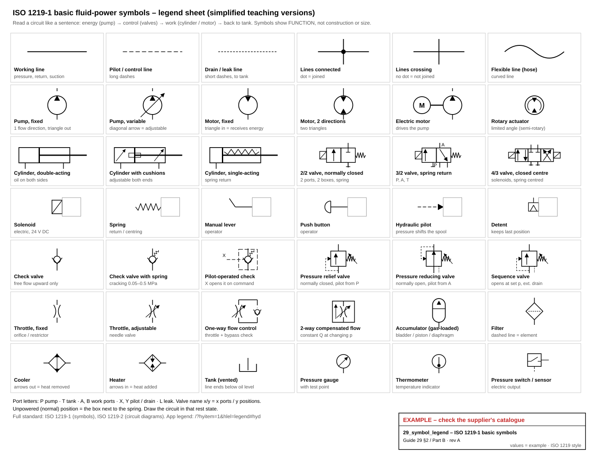
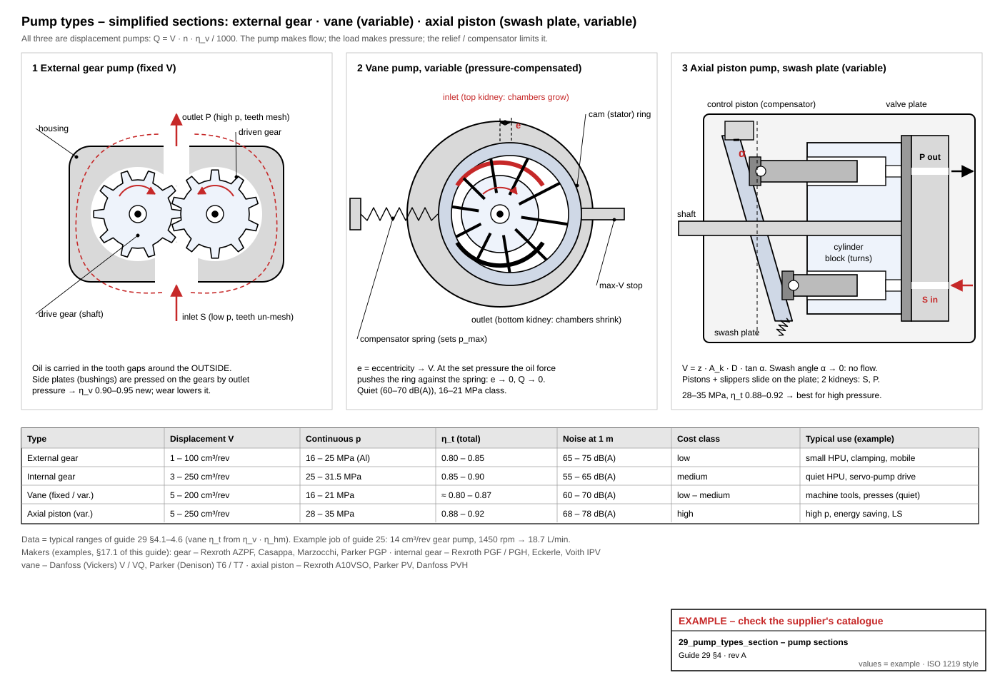
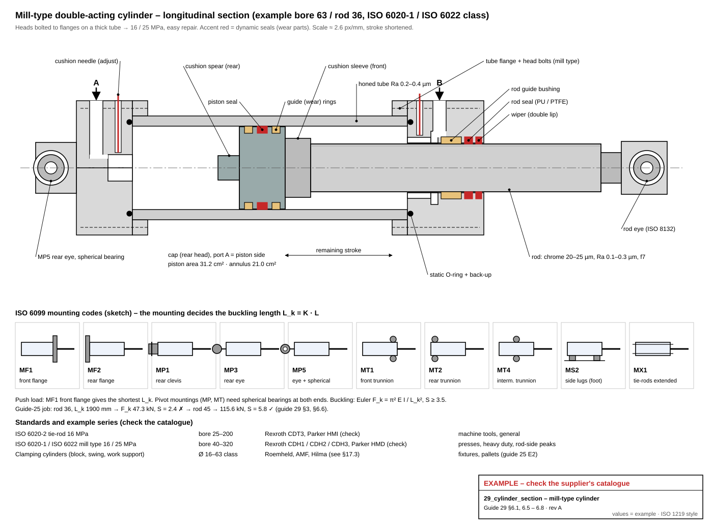
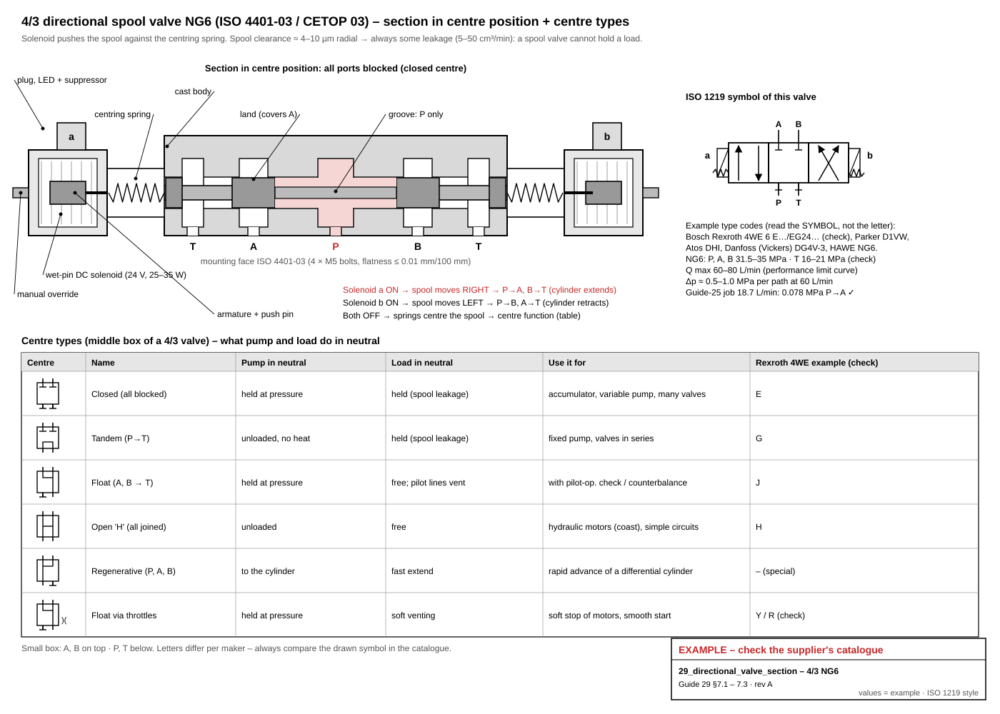
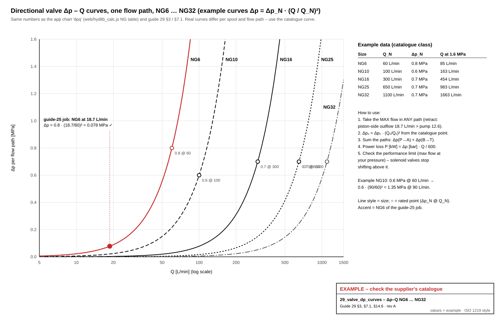
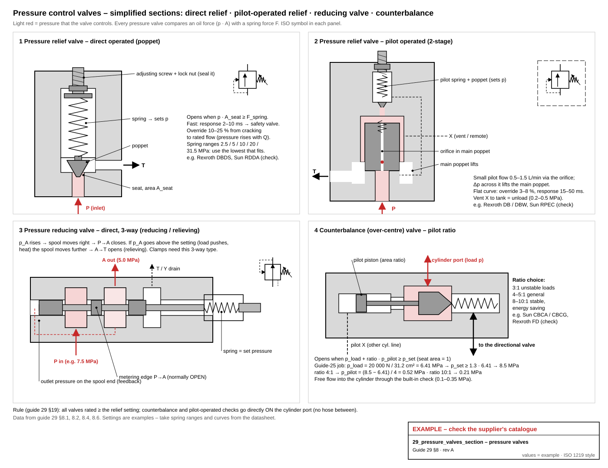
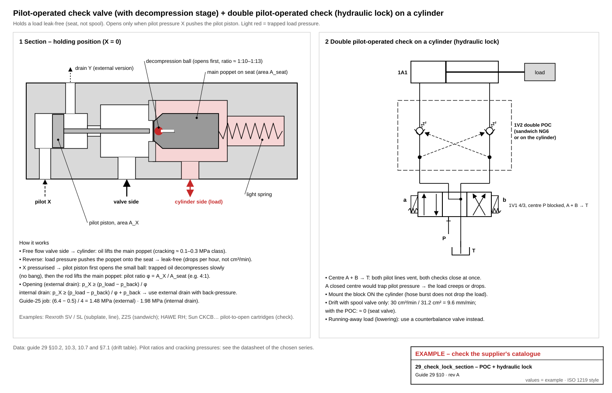
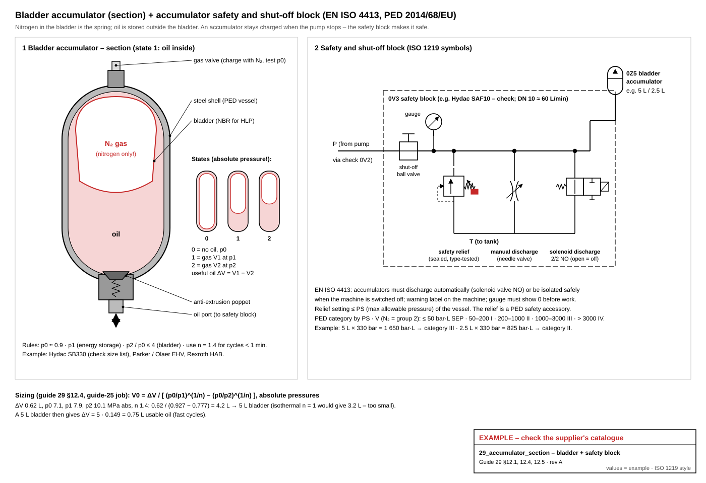

# 29 – Hydraulic element data book: every element with data, formulas, selection, failures

**For whom:** mechanical engineers who design or buy hydraulic systems and need real data for each element – pumps, motors,
cylinders, all valves (directional, pressure, flow, check / lock, cartridge, proportional, servo), accumulators, filters,
coolers, tanks, pipes, hoses, fittings, sensors and fluids.
**Where to see it live:** tab **Hydraulics** → button **"1 · Element data book"**. Left: family navigator + search box; right:
one page per element (ISO 1219 symbol, principle drawing, how it works, types, data table, selection formula with worked
example, live calculator, chart, mounting, failures, supplier questions). Deep link to one element: `/?hyitem=1&hlel=pr_cbv#hyd`
(the ids are shown in the headings below), overview: `&hlel=overview`, symbol legend: `&hlel=legend`, search: `&hlq=bladder`.

> **All numbers are examples (catalogue class).** Check every element with the supplier's current catalogue. The worked examples
> use the reference job of [25_hydraulic_design_method.md](25_hydraulic_design_method.md): lift cylinder **F 20 kN, stroke
> 200 mm, 2 s / 2 s, p_sys 10 MPa, bore 63 / rod 36 → A 31.2 cm², annulus 21.0 cm², 18.7 L/min extend, 12.6 L/min retract,
> rod-side intensification 14.9 MPa**. Safety rules: EN ISO 4413. Symbols: ISO 1219-1 (the app draws simplified teaching versions).

## Contents
1. Purpose · 2. Files and tests · 3. The key formulas with worked numbers · 4. Pumps · 5. Hydraulic motors · 6. Cylinders +
rotary actuators · 7. Directional valves · 8. Pressure control valves · 9. Flow control valves · 10. Check + lock valves ·
11. Cartridge valves · 12. Accumulators · 13. Filtration + conditioning · 14. Lines, fittings, manifolds · 15. Sensors +
measurement · 16. Fluids · **17. Buy list – catalogue examples per family** (17.1 pumps … 17.13 fluids) · **18. Shopping list –
example HPU + clamp system for the twin** · 19. General selection rules · 20. Limits · Next to read

---

## 1. Purpose

A hydraulic circuit is only as good as its elements. The general method (guide 25) tells you **how much** pressure and flow
you need. This data book tells you **which element** does it, **what it can do** (real size series and data ranges),
**how to size it** (formula + example), **how to mount it**, **how it fails** and **what to ask the supplier**.
93 elements in 13 families, 36 symbol functions, 25 principle drawings, 11 live calculators, 6 charts.
New in this guide: a **buy list with catalogue examples for every family** (§17), the **element choices of the example
HPU + clamp system** (§18) and **8 drawings** (`docs/img/29_*.svg`, also in `web/img/`) embedded at the family chapters.

## 2. Files and tests

| File | Content |
|---|---|
| `web/hydlib.js` | UI: navigator, search, element pages, overview, legend, calculators, charts, tests |
| `web/hydlib_sym.js` | Reusable ISO 1219-1 symbols `symbol(key, opts)` + principle drawings `drawing(key)` (SVG strings, stroke = currentColor) |
| `web/hydlib_calc.js` | Formulas `F`, calculators `CALC`, chart data, self-test values |
| `web/hydlib_d1.js` · `_d2.js` · `_d3.js` | Element data: pumps / motors / cylinders · valves · accumulators / conditioning / lines / sensors / fluids |
| `web/hydlib.css` | Styles (light + dark theme via the style.css variables) |

Self-check: open `/?hyitem=1&hltest#hyd` – the browser console shows `HLTEST` lines. Result of the last run:

| Check | Result |
|---|---|
| Formulas, code vs hand value | 23 PASS, 0 FAIL (values in section 3) |
| Element pages | 93/93 render, 0 duplicates; every page has symbol, how it works, types, data, selection, mounting, failures, supplier questions |
| Symbols | 133 symbols on the pages, 0 unknown, 36 symbol functions, 82 symbols in the legend gallery, 25 drawings |
| Calculators / charts | 11 calculators run without NaN, 6 charts (dpq, relief, visc, pumpPQ, fcomp, accu) |
| Item switch 1 → 2 → 3 → 1 (`&hlback`) | no console errors, page still there |

Drawings of this guide (standalone SVG, offline, no external fonts; same files in `web/img/`):

| File | Content | Shown in |
|---|---|---|
| `img/29_symbol_legend.svg` | ISO 1219-1 basic symbols sheet (lines, pumps, motors, cylinders, valve envelopes, actuations, check, relief, reducing, sequence, flow, accumulator, filter, cooler, heater, tank, gauges) | below |
| `img/29_pump_types_section.svg` | external gear / vane (variable) / axial piston (swash plate) sections + comparison table | §4 |
| `img/29_cylinder_section.svg` | mill-type cylinder: tube, rod, piston, seals, cushioning, ISO 6099 mounting codes | §6 |
| `img/29_directional_valve_section.svg` | 4/3 NG6 spool valve section + centre types table | §7 |
| `img/29_valve_dp_curves.svg` | Δp–Q curves NG6 … NG32 (numbers of §3 / §7.1) | §7.1 |
| `img/29_pressure_valves_section.svg` | direct + pilot relief, reducing (3-way), counterbalance with pilot ratio | §8 |
| `img/29_check_lock_section.svg` | pilot-operated check with decompression, double POC on a cylinder | §10 |
| `img/29_accumulator_section.svg` | bladder accumulator + safety block (relief, shut-off, discharge, gauge), PED category | §12 |



## 3. The key formulas with worked numbers (hand-checked)

Units: p in bar or MPa (1 MPa = 10 bar), Q in L/min, V in cm³/rev, n in rpm.

| Element | Formula | Worked example (docs/25 job unless noted) |
|---|---|---|
| Pump flow | Q = V · n · η_v / 1000 | 14 · 1450 · 0.92 / 1000 = **18.7 L/min** (gear pump 14 cm³) |
| Pump power | P [kW] = p [bar] · Q / (600 · η_t) | 78 · 18.7 / (600 · 0.85) = **2.86 kW → 3 kW motor** |
| Pump size | V = Q · 1000 / (n · η_v) | 60 L/min at 1450 rpm, η_v 0.95: 60 000 / 1377.5 = 43.6 → **45 cm³** axial piston; at 210 bar P = 210 · 62 / (600 · 0.88) = 24.7 kW |
| Power limiter | p · Q = P · 600 · η | 11 kW, η 0.88: p · Q = 5808 bar·L/min → 23.2 L/min at 250 bar |
| Motor torque | T [N·m] = V · Δp [bar] · η_hm / (20π) | orbit 200 cm³, 140 bar, 0.85: **379 N·m** |
| Motor speed | n = Q · 1000 · η_v / V | 40 L/min, 0.9, 200 cm³: **180 rpm** |
| Cylinder area | A = π · D² / 4 | Ø63: 31.2 cm²; annulus 31.2 − 10.2 = **21.0 cm²** |
| Cylinder pressure | p = F / (A · η_cyl) | 20 000 / (31.2e-4 · 0.95) = **6.75 MPa** |
| Cylinder flow | Q = A [cm²] · v [m/min] / 10 | 31.2 · 6 / 10 = **18.7 L/min** |
| Buckling (Euler) | F_k = π² · E · I / L_k², I = π · d⁴ / 64, L_k = K · L | rod 36: I = 82 448 mm⁴; L_k 1900 mm: F_k = 9.87 · 210 000 · 82 448 / 1900² = **47.3 kN → S = 2.4 ✗**; rod 45: 115.6 kN → S = 5.8 ✓ |
| Accumulator | V0 = ΔV / [(p0/p1)^(1/n) − (p0/p2)^(1/n)], absolute p | 0.62 / (0.927 − 0.777) = **4.2 L → 5 L** (n = 1.4); isothermal 3.2 L (too small) |
| Orifice | Q = Cd · A · √(2Δp/ρ) | Ø2 mm, Cd 0.65, 5 MPa: 0.65 · 3.14e-6 · 107.2 = 2.19e-4 m³/s = **13.1 L/min**; Ø for 18.7 L/min at 1 MPa = 3.57 mm |
| Valve Δp | Δp₂ = Δp₁ · (Q₂/Q₁)² | NG10 0.6 MPa at 60 → **1.35 MPa at 90 L/min**; NG6 (0.8 at 60): 18.7 L/min → 0.078 MPa |
| Counterbalance | p_set ≥ 1.3 · p_load; p_pilot = (p_set − p_load) / ratio | p_load = 20 000 / 31.2e-4 = 6.41 MPa → set 8.5 MPa; 4:1 → **0.52 MPa** pilot |
| Pilot-operated check | p_X ≥ (p_load − p_back) / φ (+ p_back with internal drain) | (6.4 − 0.5) / 4 = **1.48 MPa** external drain, 1.98 MPa internal |
| Pipe | d = 4.61 · √(Q / v); s = p · D / (2σ) + c | 4.61 · √(18.7/4) = **10.0 mm → 15 × 2.5**; s = 10 · 15 / 120 = 1.25 mm + 0.65 = 1.9 ≤ 2.5 ✓ |
| Pipe Δp | Re = v · d / ν; λ = 64 / Re; Δp = λ · (L/d) · ρv²/2 | Re 863, λ 0.074, 3 m: **0.15 MPa** |
| Heat / cooler | P = Δp [bar] · Q / 600 | 90 · 18.7 / 600 = **2.8 kW**; minus tank 0.36 kW → cooler 2.44 kW, P01 = 2.44 / 20 · 1.2 = 0.15 kW/K |
| Sensor scaling | p = (I − 4) / 16 · range | 12 mA, 0–250 bar: **125 bar** |
| Filter efficiency | η = (1 − 1/β) · 100 % | β 200 → **99.5 %** |

The live calculators in the app use these formulas (defaults = the worked example of the page or the docs/25 job).

## 4. Pumps



### 4.1 External gear pump `pump_gear_ext`

Two meshing spur gears carry oil around the outside in the tooth gaps. Cheap, robust, fixed displacement – the standard pump for small power units and mobile machines. *Standards: ISO 3019-2 (flanges, shafts), ISO 4409 (performance test), ISO 4406, ISO 4413.*

**How it works.** The drive gear turns the driven gear. On the **suction side** the teeth come out of mesh – the tooth gaps open and fill with oil. The gaps carry the oil around the **outside** (between gear and housing) to the pressure side, where the teeth mesh again and push the oil out. One revolution always moves the same volume: **fixed displacement V** (cm³/rev). Flow is set by the speed: `Q = V · n · η_v / 1000`. Pressure is NOT made by the pump – it comes from the load resistance; the relief valve limits it. Leakage across the gear faces is reduced by **pressure-balanced bushings / side plates** that are pressed against the gears by the outlet pressure. This is why a gear pump has good volumetric efficiency when new and loses it when the side plates wear.

**Types**

| Type | What it is / when to use |
|---|---|
| Aluminium body, group 1 / 2 / 3 | Light, cheap, 1–100 cm³/rev, up to 25–28 MPa. Most HPUs and mobile machines. |
| Cast-iron body | Higher continuous pressure (25–30 MPa), less noise, longer life, heavier. |
| Helical / low-noise gear | Helical or special tooth profile → less flow pulsation, 3–8 dB(A) quieter. |
| Tandem / multiple pump | 2–3 gear pumps on one shaft – separate circuits from one motor (e.g. high + low pressure). |
| Reversible / bidirectional | Works in both rotation directions (needs external drain or special bushings). |

**Data (examples)**

| Property | Range (example) |
|---|---|
| Displacement V | 1 – 100 cm³/rev; series 4 6 8 11 14 16 19 23 26 32 40 50 |
| Continuous pressure | 16 – 25 MPa (aluminium), up to 28–30 MPa (cast iron) |
| Peak pressure | 20 – 30 MPa (short, < 20 s) |
| Speed | 500 – 3500 rpm (bigger sizes lower max); min ≈ 500–800 rpm |
| Volumetric efficiency η_v | 0.90 – 0.95 (new), drops with wear and thin oil |
| Hydro-mechanical efficiency η_hm | 0.85 – 0.90 → total η_t ≈ 0.80 – 0.85 |
| Noise | 65 – 75 dB(A) at 1 m, 1450 rpm, 10 MPa |
| Inlet pressure | min 0.07–0.08 MPa absolute (≈ −0.2…−0.3 bar g), max 0.3 MPa abs |
| Viscosity | operating 10 – 300 mm²/s, optimum 20 – 40, cold start ≤ 1000–2000 |
| Fluid temperature | −20 … +80 °C (seals NBR); FKM to +110 °C |
| Cleanliness | ISO 4406 19/17/14 (≈ 20 µm filtration) |
| Mass | 1 – 8 kg (aluminium group 2 ≈ 2–3 kg) |
| Flow pulsation | ≈ 10 – 20 % (few teeth) |

**Selection**

```
V = Q · 1000 / (n · η_v) [cm³/rev, Q L/min, n rpm]
Q = V · n · η_v / 1000
P_drive = p · Q / (600 · η_t) [kW, p bar, Q L/min]
T_drive = V · p / (20 · π · η_hm) [N·m, V cm³, p bar]
```
Worked example: Need Q = 18.7 L/min (docs/25 cylinder extend), n = 1450 rpm, η_v = 0.92: V = 18.7 · 1000 / (1450 · 0.92) = 18 700 / 1334 = 14.0 cm³/rev → choose 14 cm³/rev Check: Q = 14 · 1450 · 0.92 / 1000 = 18.7 L/min ✓ Power at 78 bar (6.75 MPa needed + losses), η_t 0.85: P = 78 · 18.7 / (600 · 0.85) = 1459 / 510 = 2.86 kW → 3 kW motor At the relief setting 100 bar: P = 100 · 18.7 / 510 = 3.67 kW (the motor runs above rating while the relief blows – avoid long times there) Drive torque at 100 bar, η_hm 0.88: T = 14 · 100 / (62.83 · 0.88) = 1400 / 55.3 = 25.3 N·m

*Live calculator in the app: Pump: flow, power, torque.*

**Mounting:** Mount the pump BELOW the oil level (flooded suction) or keep the suction line short and large: v ≤ 0.6–1.2 m/s. · Coupling: flexible jaw coupling in a bell housing (pump adaptor flange) – no radial load on the shaft unless the pump has an outboard bearing. · Check rotation direction (arrow on the housing) before the first start; fill the pump with oil, open the vent. · Suction strainer only if required, ≥ 2 × flow rating, 100–150 µm, with low Δp – a clogged strainer kills the pump by cavitation. · First start: jog, then run without pressure 1–2 min to bleed air.

**Typical failures**

| Symptom | Cause | Fix |
|---|---|---|
| Loud whining / rattling noise, foam in tank | Cavitation (suction blocked, line too small, oil too cold) or air entry at suction fittings | Check inlet pressure (≥ 0.08 MPa abs), clean strainer, tighten suction joints, warm oil |
| Cylinder slower when oil is hot | Internal leakage: worn side plates / housing (η_v falls) | Measure flow at pressure vs new; replace pump when Q < 85–90 % of nominal |
| Shaft seal leaks | Case / inlet pressure too high, misalignment, radial load | Align coupling, check inlet pressure ≤ 0.3 MPa abs, no belt drive without bearing |
| Scored housing on suction side | Gears pushed against housing by too high pressure (bearing wear) or dirt | Check relief setting, filter, change bearings / pump |
| Pump broken after first start | Wrong rotation, started dry | Follow commissioning: fill, vent, check direction |

**Ask the supplier:** (1) Continuous and peak pressure at my speed, and duty cycle limits? (2) Flow at 0 and at rated pressure (η_v curve) at 46 mm²/s and at 20 mm²/s? (3) Noise level dB(A) at my pressure and speed (low-noise version available)? (4) Allowed inlet pressure, radial/axial shaft load, rotation direction? (5) Shaft end (SAE splined / keyed / tapered) and flange (SAE A / B, ISO 3019-2)?

### 4.2 Internal gear pump `pump_gear_int`

A small pinion drives a ring gear inside it; a crescent separates suction and pressure. Very quiet and high pressure – used in machine tools, presses and injection moulding. *Standards: ISO 3019-2, ISO 4409, ISO 4412-1 (noise test).*

**How it works.** The **pinion** (outer teeth) drives the **ring gear** (inner teeth), which sits off-centre. A crescent-shaped filler piece fills the gap between them. The tooth gaps open on the suction side over a long angle, so the oil enters slowly – low noise, good suction. Radial and axial gap compensation (pressure-loaded segments) keep the leakage low up to 30–35 MPa. Flow pulsation is only ≈ 2–3 % → the quietest positive displacement pump except the screw pump. Often combined with a **variable-speed servo motor** (servo pump) for energy saving.

**Types**

| Type | What it is / when to use |
|---|---|
| Crescent type, gap compensated | Standard internal gear pump, 3–250 cm³/rev, to 30–35 MPa. |
| Gerotor (no crescent) | Inner rotor one tooth less than outer rotor; low pressure (lube, charge pumps, ≤ 10 MPa). |
| Servo pump (with variable-speed drive) | Speed changes flow, 4-quadrant operation, energy saving up to 50–70 % in presses. |
| Double pump | Two internal gear pumps or internal gear + vane on one shaft. |

**Data (examples)**

| Property | Range (example) |
|---|---|
| Displacement V | 3 – 250 cm³/rev |
| Continuous pressure | 25 – 31.5 MPa (small sizes 35 MPa) |
| Peak pressure | 30 – 35 MPa |
| Speed | 400 – 3000 rpm (servo drive: 0 / 100 – 3000) |
| η_v / η_hm | 0.95 – 0.98 / 0.88 – 0.92 → η_t ≈ 0.85 – 0.90 |
| Noise | 55 – 65 dB(A) at 1 m, 1450 rpm, 20 MPa |
| Flow pulsation | ≈ 2 – 3 % |
| Inlet pressure | min 0.08 MPa abs (−0.2 bar) |
| Viscosity | 10 – 300 mm²/s, cold start ≤ 2000 |
| Cleanliness | ISO 4406 18/16/13 (20/18/15 max) |
| Mass | 5 – 70 kg |

**Selection**

```
V = Q · 1000 / (n · η_v)
P = p · Q / (600 · η_t)
```
Worked example: Press: 44 L/min at 250 bar, n = 1450 rpm, η_v 0.95: V = 44 000 / (1450 · 0.95) = 44 000 / 1377.5 = 31.9 → 32 cm³/rev Q = 32 · 1450 · 0.95 / 1000 = 44.1 L/min P = 250 · 44.1 / (600 · 0.87) = 11 025 / 522 = 21.1 kW → 22 kW motor

*Live calculator in the app: Pump: flow, power, torque.*

**Mounting:** Flooded suction preferred; suction line ≥ pump inlet size, v ≤ 1 m/s. · With a servo drive: check minimum speed for lubrication at pressure (holding pressure at low rpm) – ask the supplier. · Low noise needs elastic mounting of the motor-pump group (damping rails) and a hose at the pressure outlet.

**Typical failures**

| Symptom | Cause | Fix |
|---|---|---|
| Noise rises after months | Cavitation or worn crescent / pinion | Check inlet pressure, oil level, viscosity; inspect pump |
| Pressure cannot be held at low speed (servo pump) | Internal leakage too large at low rpm | Raise minimum speed, use smaller pump or holding accumulator |
| Pressure peaks / vibrations | Fast speed change of servo drive with air in oil | Tune drive ramps, bleed system |

**Ask the supplier:** (1) Noise level at my operating point; pulsation? (2) Minimum speed at holding pressure (servo-pump use)? (3) 4-quadrant operation (pump runs backwards as a motor) allowed? (4) Life (bearing L10) at my pressure profile?

### 4.3 Vane pump, fixed displacement `pump_vane_fix`

Vanes slide in slots of a rotor inside an oval cam ring. Quiet, medium pressure, easy to service (cartridge kit). *Standards: ISO 3019-2, ISO 4409.*

**How it works.** A slotted **rotor** turns inside a **cam ring**. Vanes in the slots are pushed out by centrifugal force and pressure under the vanes, so they follow the ring. Between two vanes a chamber grows (suction) and shrinks (pressure). A **double-stroke (balanced)** pump has an oval ring: two suction and two pressure zones opposite each other – the radial forces on the shaft cancel → long bearing life. Wear parts (ring, rotor, vanes, side plates) come as a **cartridge kit** – a worn pump is repaired in 15 minutes.

**Types**

| Type | What it is / when to use |
|---|---|
| Balanced, double-stroke | Fixed displacement, 5–200 cm³/rev, to 21–28 MPa. |
| Double / triple vane pump | Several cartridges on one shaft (high-low circuits). |
| High-pressure vane (intra-vane) | Special vane design to 30 MPa. |

**Data (examples)**

| Property | Range (example) |
|---|---|
| Displacement V | 5 – 200 cm³/rev; series 10 16 20 25 32 40 50 63 |
| Continuous pressure | 16 – 21 MPa (special to 28–30 MPa) |
| Speed | 600 – 1800 rpm (min speed needed to throw the vanes out) |
| η_v / η_hm | 0.90 – 0.95 / 0.88 – 0.92 |
| Noise | 60 – 70 dB(A) at 1 m |
| Inlet pressure | min 0.08 MPa abs |
| Viscosity | 13 – 860 mm²/s operating; very sensitive to thin oil at high p |
| Cleanliness | ISO 4406 18/16/13 |
| Mass | 4 – 40 kg |

**Selection**

```
Q = V · n · η_v / 1000
P = p · Q / (600 · η_t)
```
Worked example: V = 25 cm³/rev, n = 1450 rpm, η_v = 0.92 → Q = 25 · 1450 · 0.92 / 1000 = 33.4 L/min p = 140 bar, η_t = 0.85 → P = 140 · 33.4 / 510 = 9.2 kW → 11 kW motor

*Live calculator in the app: Pump: flow, power, torque.*

**Mounting:** Keep above the minimum speed – below it the vanes do not seal (no flow at start in cold oil). · Do not run dry; fill the housing before start. · Check rotation direction – many vane pumps are one-direction only (cartridge can be turned).

**Typical failures**

| Symptom | Cause | Fix |
|---|---|---|
| No flow at start | Vanes stuck in the slots (dirt, varnish, very cold oil) or wrong rotation | Warm the oil, check rotation, clean / replace cartridge |
| Chatter marks on cam ring, noise | Cavitation or dirt | Check inlet, filter to 18/16/13 |
| Flow drops with temperature | Worn side plates / vane tips | Replace cartridge kit |

**Ask the supplier:** (1) Minimum speed and minimum viscosity at my pressure? (2) Cartridge kit part number and price? (3) Noise at my point? (4) Max pressure with water-glycol (HFC)?

### 4.4 Vane pump, variable (pressure-compensated) `pump_vane_var`

Single-stroke vane pump whose cam ring moves to change displacement. It delivers full flow until the set pressure, then only the flow needed – ideal for clamping and holding. *Standards: ISO 3019-2, ISO 4409.*

**How it works.** The cam ring is round and sits **off-centre** (eccentricity e) to the rotor. Displacement ∝ e. A **spring** pushes the ring to maximum e; the outlet pressure acts on the ring (directly or through a control piston) against the spring. When the pressure reaches the set value (e.g. 6 MPa), the ring moves towards the centre: flow falls until it only covers the leakage of the system. The pump **holds pressure with almost no flow** – the drive power drops to ≈ 10–20 % of full power. Ideal for **machine-tool clamping**: long holding times at constant pressure without heating the oil. Response time from max flow to zero ≈ 30–100 ms → a relief valve is still required as safety (set above the compensator).

**Types**

| Type | What it is / when to use |
|---|---|
| Direct-acting compensator (spring on the ring) | Simple, 2–10 MPa, small sizes; slight pressure drop with flow (2–5 bar). |
| Pilot-operated compensator | Flatter p–Q curve, up to 16–21 MPa, remote / proportional pressure possible. |
| With flow limiter (stroke stop) | Max flow adjustable with a screw. |

**Data (examples)**

| Property | Range (example) |
|---|---|
| Displacement V | 8 – 125 cm³/rev |
| Pressure range (compensator) | 1.5 – 10 MPa (direct) / up to 16–21 MPa (pilot) |
| Speed | 1000 – 1800 rpm |
| Response max → zero flow | 30 – 100 ms; zero → max 50 – 150 ms |
| Pressure overshoot at stop | ≈ 1 – 3 MPa above setting (relief needed) |
| η_t | 0.75 – 0.85 |
| Drive power at zero flow | ≈ 10 – 20 % of full power (friction + leakage) |
| Noise | 58 – 68 dB(A) |
| Cleanliness | ISO 4406 18/16/13 |
| Case drain | separate line to tank, below oil level, case pressure ≤ 0.1–0.2 MPa g |

**Selection**

```
Q_max = V · n · η_v / 1000
Holding power (fixed pump + relief, wrong) = p · Q / 600
Holding power (compensated) ≈ 0.1…0.2 · full power
```
Worked example: Clamp circuit 6 MPa, need 26 L/min to close fast: V = 20 cm³/rev, 1450 rpm, η_v 0.9 → Q = 20 · 1450 · 0.9 / 1000 = 26.1 L/min Fixed pump holding at 60 bar over the relief: P_heat = 60 · 26.1 / 600 = 2.6 kW all the time ✗ Compensated vane pump holding: ≈ 0.3 – 0.5 kW drive power, flow = leakage only ✓

*Live calculator in the app: Pump: flow, power, torque.*

**Mounting:** Case drain line: separate, own line to tank, end below the oil level, short, no filter (or very low Δp). · Relief valve set ≈ 1–2 MPa above the compensator (protects against overshoot). · Set the compensator with the circuit dead-headed and a gauge at the pump outlet.

**Typical failures**

| Symptom | Cause | Fix |
|---|---|---|
| Pressure hunts / pump 'sings' at holding | Air in oil or too long pressure line (compensator instability) | Bleed, use shorter line or small accumulator / damping orifice |
| Oil heats up during holding | Large internal leakage (worn) or relief set below compensator | Check settings order (relief > compensator); measure case drain flow |
| Shaft seal blown | Case drain blocked / too long / filter in drain | Free drain line, case pressure ≤ 0.1 MPa g |

**Ask the supplier:** (1) p–Q curve of the compensator; pressure drop between Q_max and zero flow? (2) Response time and overshoot? (3) Drive power at zero flow and holding pressure? (4) Max case pressure; allowed drain line length?

### 4.5 Axial piston pump, swash plate, fixed `pump_axial_fix`

Pistons in a rotating cylinder block run on an inclined plate. High pressure, high efficiency; the fixed version is used as a high-pressure constant pump or as a motor. *Standards: ISO 3019-2, ISO 4409, ISO 17559 (noise).*

**How it works.** Pistons (usually 7 or 9) sit in bores of a **cylinder block** that turns with the shaft. Their **slippers** slide on a **swash plate** inclined at angle α. During half a turn each piston moves out (suction through the kidney port of the valve plate), in the other half it moves in (pressure). Stroke per piston = d_k · tan α (d_k = pitch circle). Displacement `V = z · A_k · d_k · tan α`. Fixed swash plate = fixed V. Hydrostatic balance of slippers and valve plate keeps friction low → η_t up to 0.90–0.92. Needs clean oil and a case drain.

**Types**

| Type | What it is / when to use |
|---|---|
| Open-circuit fixed pump | Suction from tank, 10–125 cm³/rev, to 35–40 MPa. |
| Through-drive | Second pump can be mounted behind. |
| Fixed motor version | Same unit works as a motor (see hydraulic motors). |

**Data (examples)**

| Property | Range (example) |
|---|---|
| Displacement V | 5 – 250 cm³/rev |
| Continuous / peak pressure | 28 – 35 / 35 – 40 MPa |
| Speed | 500 – 3000 rpm (self-priming limit at the inlet) |
| η_v / η_hm | 0.95 – 0.97 / 0.92 – 0.95 → η_t 0.88 – 0.92 |
| Noise | 68 – 78 dB(A) |
| Inlet pressure | min 0.08 MPa abs (some 0.09) |
| Case pressure | ≤ 0.2 MPa g continuous |
| Cleanliness | ISO 4406 18/16/13 (17/15/12 for long life) |
| Viscosity | operating 10 – 400 mm²/s, optimum 16 – 36 |
| Mass | 5 – 90 kg |

**Selection**

```
V = z · (π·d²/4) · D_k · tan α
Q = V · n · η_v / 1000
P = p · Q / (600 · η_t)
```
Worked example: V = 28 cm³/rev, 1450 rpm, η_v 0.95: Q = 28 · 1450 · 0.95 / 1000 = 38.6 L/min 250 bar, η_t 0.90: P = 250 · 38.6 / 540 = 17.9 kW → 18.5 kW motor

*Live calculator in the app: Pump: flow, power, torque.*

**Mounting:** Case drain from the HIGHEST drain port so the housing stays full of oil; drain line ends below oil level. · Fill the housing with filtered oil before the first start. · Horizontal mounting preferred; vertical shaft-up needs the special drain port at the top.

**Typical failures**

| Symptom | Cause | Fix |
|---|---|---|
| Case drain flow rises | Wear of valve plate / pistons | Trend the drain flow (rule: > 3–5 % of rated flow = worn) |
| Slipper failure, metal in filter | Dirt, cavitation, running without case oil | Filter 18/16/13, correct inlet, fill case |
| Pressure pulsations, noise | Cavitation, air | Inlet line bigger, check oil level / temperature |

**Ask the supplier:** (1) Max speed at my inlet pressure (self-priming speed)? (2) Case drain flow new vs worn limit? (3) Bearing life at my load spectrum? (4) Allowed fluids (HFC, HEES) and derating?

### 4.6 Axial piston pump, variable (swash plate) `pump_axial_var`

The swash-plate angle is changed by a control piston – the pump gives only the flow (and power) the machine needs. The standard pump for big industrial and mobile systems. *Standards: ISO 3019-2, ISO 4409, ISO 17559.*

**How it works.** Same rotating group as the fixed pump, but the swash plate is in a **cradle**. A strong **control piston** swivels it against a bias spring/piston. α = 0 → no flow; α_max (≈ 15–18°) → full flow. The **controller** (a small valve on the pump) decides the angle from pressure, load signal, power or an electrical command (see 'Pump controls'). Compared with a fixed pump + relief, a variable pump avoids most of the heat: at standby the drive power is only the friction and leakage power.

**Types**

| Type | What it is / when to use |
|---|---|
| Open circuit, industrial | 18 – 250 cm³/rev, 28/35 MPa; series 18 28 45 71 100 140. |
| Closed circuit (over-centre) | Swash plate tilts both ways → hydrostatic drives (travel, winch); with charge pump. |
| Mobile LS pump | Load-sensing + power limiter; tractors, excavators, cranes. |
| Electro-proportional (EP / servo) | Swash angle set by a current; with swivel-angle sensor. |

**Data (examples)**

| Property | Range (example) |
|---|---|
| Displacement V_max | 18 – 500 cm³/rev; series 18 28 45 71 100 140 |
| Continuous / peak pressure | 28 – 35 / 35 – 42 MPa |
| Speed (self-priming) | 1500 – 3000 rpm (smaller pumps higher) |
| η_v / η_hm | 0.95 – 0.97 / 0.92 – 0.95 |
| Swivel time max → 0 / 0 → max | ≈ 30 – 80 ms / 60 – 150 ms |
| Standby power (zero stroke) | ≈ 5 – 10 % of max power |
| Noise | 65 – 78 dB(A) |
| Case pressure | ≤ 0.2 MPa g (short peaks 0.6) |
| Cleanliness | ISO 4406 18/16/13 (EP control 17/15/12) |
| Mass | 12 (V 18) – 70 kg (V 140) |

**Selection**

```
V = Q · 1000 / (n · η_v)
P_max = p · Q / (600 · η_t)
T = V · p / (20 · π · η_hm)
```
Worked example: Need 60 L/min at up to 210 bar, 1450 rpm, η_v 0.95: V = 60 000 / (1450 · 0.95) = 60 000 / 1377.5 = 43.6 → V 45 Q_max = 45 · 1450 · 0.95 / 1000 = 62.0 L/min Full power: P = 210 · 62.0 / (600 · 0.88) = 13 020 / 528 = 24.7 kW → 30 kW motor, OR power limiter set to 18.5 kW (if full flow is only needed at low pressure) Max torque at 210 bar, η_hm 0.93: T = 45 · 210 / (62.83 · 0.93) = 9450 / 58.4 = 162 N·m

*Live calculator in the app: Pump: flow, power, torque.*

**Mounting:** Case drain from the highest port, own line, below oil level; housing filled before start. · Suction line big: v ≤ 1 m/s, inlet ≥ 0.08 MPa abs at max speed; flooded suction is best. · Set: first the relief valve (above compensator), then the compensator, then LS standby, then power limiter – with a gauge at the test point. · Variable pumps need a pressure line volume / hose for stable control (follow the supplier's minimum).

**Typical failures**

| Symptom | Cause | Fix |
|---|---|---|
| Pump does not go back to zero flow, oil gets hot | Controller spool stuck (dirt), orifice clogged | Clean controller, check cleanliness 18/16/13 |
| Pressure oscillates | Control unstable: air, too small pressure-line volume, wrong damping orifice | Bleed, add hose volume, use supplier damping kit |
| Motor overloaded at high pressure | Power limiter not set / no limiter | Set power limiter to the motor power (p·Q = const) |
| High case drain flow | Wear of valve plate, pistons | Trend, overhaul |

**Ask the supplier:** (1) Control type and its p–Q curve, response times? (2) Standby power at zero stroke and my pressure? (3) Through-drive torque for a second pump? (4) Swivel-angle sensor / EP control option? (5) Noise at my point?

### 4.7 Pump controls (compensator, load-sensing, power limiter, EP) `pump_ctrl`

The small control valve on a variable pump decides how much flow it gives: limit pressure, follow the load, limit power or follow an electric signal. *Standards: ISO 4409, ISO 1219-1.*

**How it works.** **Pressure compensator (DR / PC):** the pump gives full flow until p reaches the setting, then it reduces flow so that p stays constant. Good for clamping, accumulators, closed-centre systems. **Load-sensing (LS / DFR):** the LS line brings the highest load pressure to the controller. The pump keeps `p_pump = p_load + Δp_LS` (standby Δp 1.4–3 MPa). The directional valve opening then sets the flow – no relief losses, only Δp_LS · Q is lost. **Power (torque) limiter (LR):** keeps `p · Q ≈ const` (hyperbola). The electric motor is not overloaded at high pressure, but full flow is still possible at low pressure. **Electro-proportional (EP / EO):** a proportional solenoid sets the swash angle (flow) or the pressure; with angle sensor and electronics a complete p/Q control ('servo pump control').

**Types**

| Type | What it is / when to use |
|---|---|
| DR / PC – pressure compensator | Constant pressure, flow on demand. |
| DRG / remote | Pressure set by a remote (pilot) relief valve or proportional valve. |
| DFR / LS – load sensing | Flow follows the valve opening; p = load + Δp_standby. |
| LR – power limiter | Hyperbolic p–Q; combine with DR / LS. |
| EP / EO – electro-proportional | Displacement or pressure from a 4–20 mA / PWM signal; PLC controls everything. |
| Torque limit + speed (mobile) | Anti-stall for diesel engines. |

**Data (examples)**

| Control | Setting range (example) | Response | Typical use |
|---|---|---|---|
| Pressure compensator | 2 – 35 MPa | 30 – 80 ms | clamps, presses, accumulator charging |
| Load-sensing | Δp standby 1.4 – 3 MPa (factory 1.8–2.0) | 50 – 150 ms | mobile, several actuators at once |
| Power limiter | start of curve set to motor kW at 1450 rpm | 100 – 200 ms | big Q at low p and small Q at high p |
| EP (displacement) | 200 – 600 mA (24 V) / 400 – 1200 mA (12 V) | 50 – 150 ms | speed control from the PLC, energy saving |
| EP p/Q (servo control) | 0 – 35 MPa, 0 – 100 % V | ≈ 50 ms | injection moulding, presses |

**Energy comparison at a part-load point (example: machine needs 20 L/min at 100 bar, pump max 60 L/min, relief 160 bar)**

| Supply | Loss formula | Loss (example) |
|---|---|---|
| Fixed pump + relief | (p_relief·(Q_pump − Q_need) + Δp_valve·Q_need)/600 | (160·40 + 60·20)/600 = 12.7 kW |
| Pressure compensated (160 bar) | (160 − 100) · 20 / 600 (throttling in the valve) | 2.0 kW |
| Load-sensing (Δp 20 bar) | 20 · 20 / 600 | 0.67 kW |
| EP / servo pump (p and Q exact) | only pump + motor losses | ≈ 0.3 kW extra |

**Selection**

```
Pressure compensator: Q = Q_max for p < p_set − ≈ 1 MPa, then Q → leakage at p_set
Load-sensing: p_pump = p_load,max + Δp_LS ; loss = Δp_LS · Q / 600 [kW]
Power limiter: p · Q = P_set · 600 · η_t [bar · L/min]
Q at pressure p = P_set · 600 · η_t / p
```
Worked example: Motor 11 kW, η_t 0.88: p · Q = 11 · 600 · 0.88 = 5808 bar·L/min at 250 bar → Q = 5808 / 250 = 23.2 L/min; at 100 bar → 58.1 L/min (or Q_max if smaller) LS with Δp 20 bar, Q 40 L/min: loss = 20 · 40 / 600 = 1.33 kW

**Mounting:** LS line: small (6–8 mm), short, from the shuttle-valve chain of the directional valves; bleed it. · Set the order: relief > compensator > LS standby; power limiter with flow meter + gauge at the hot oil temperature. · EP controls need clean oil (17/15/12) and the electrical ramp settings from the supplier.

**Typical failures**

| Symptom | Cause | Fix |
|---|---|---|
| LS pump stays at high pressure | LS line not vented to tank in neutral (missing LS drain orifice) | Check LS relief / bleed orifice in the valve block |
| Pump hunts | Long LS line, air, missing damping | Shorten, bleed, damping orifice |
| Motor trips at max pressure | Power limiter set too high or not at all | Re-set with measurement p · Q |

**Ask the supplier:** (1) p–Q curves of each control incl. hysteresis? (2) Factory settings and adjustment method? (3) Electrical data of EP solenoid (current, PWM frequency, dither)? (4) Combination possibilities (DR + LS + LR)?

### 4.8 Bent-axis piston pump / motor `pump_bent`

The cylinder block is inclined to the drive shaft; pistons are connected to the shaft flange by ball joints. Very high efficiency and robustness – common as motor and mobile pump. *Standards: ISO 3019-2, ISO 4409.*

**How it works.** Drive shaft and cylinder block are at an angle (fixed ≈ 25°–40°). Pistons with ball heads are held in the shaft flange; turning the shaft makes them stroke in the block. The torque is transmitted directly by the pistons to the flange → low side forces in the bores, high starting torque efficiency (≈ 0.90) – excellent as a **motor**. Variable versions swivel the whole block (0–25° or 7–25°) – the standard variable motor for hydrostatic travel drives.

**Types**

| Type | What it is / when to use |
|---|---|
| Fixed pump / motor | 5 – 1000 cm³/rev, 40/45 MPa; truck PTO pumps, motors. |
| Variable motor | High-speed motor with two-speed or proportional control (travel drives). |
| Variable pump (rare) | Open circuit, high pressure. |

**Data (examples)**

| Property | Range (example) |
|---|---|
| Displacement | 5 – 1000 cm³/rev |
| Continuous / peak pressure | 35 – 40 / 40 – 45 MPa |
| Speed | up to 6000 rpm (small) / 1500 rpm (large) |
| η_v / η_hm | 0.96 – 0.98 / 0.93 – 0.96 |
| Starting torque efficiency (motor) | ≈ 0.85 – 0.92 |
| Cleanliness | ISO 4406 18/16/13 |
| Mass | 5 – 200 kg |

**Selection**

```
Q = V · n · η_v / 1000
P = p · Q / (600 · η_t)
```
Worked example: V = 45 cm³/rev, 1450 rpm, η_v 0.96 → Q = 45 · 1450 · 0.96 / 1000 = 62.6 L/min 300 bar, η_t 0.90 → P = 300 · 62.6 / 540 = 34.8 kW → 37 kW motor

*Live calculator in the app: Pump: flow, power, torque.*

**Mounting:** Case drain from highest port, case filled; check allowed shaft side load (bearings are strong – belt drive often allowed). · Truck PTO: check rotation direction of the PTO.

**Typical failures**

| Symptom | Cause | Fix |
|---|---|---|
| Noise, metal in oil | Bearing failure (overload, dirt in oil, side load) | Overhaul, check radial load and filtration |
| Drop in speed (motor) under load | Internal leakage (worn) | Measure case drain |
| Shaft seal leak | Case pressure peaks | Drain line bigger, shorter |

**Ask the supplier:** (1) Allowed radial load on the shaft? (2) Starting torque efficiency (motor use)? (3) Max speed at my pressure?

### 4.9 Radial piston pump `pump_radial`

Pistons arranged like a star, moved by an eccentric. Very high pressure (to 70 MPa) at small flow – for clamping, presses, test benches, tool unclamping. *Standards: ISO 4409, ISO 4413.*

**How it works.** An eccentric on the shaft pushes 3–10 radial pistons; each piston has its own **suction and pressure check valves** (valve-controlled) → no sliding valve plate, so very high pressure is possible. Flow is small and fairly smooth (odd number of pistons). Insensitive to dirt compared with axial pumps. Also built as combination pump (radial piston high pressure + gear pump low pressure in one housing).

**Types**

| Type | What it is / when to use |
|---|---|
| Valve-controlled, fixed | 0.4 – 64 cm³/rev, 35 – 70 MPa. |
| Combination high/low pressure | Fast approach with gear stage, high force with piston stage. |
| Variable (stroke ring) | Industrial, 20–35 MPa, larger flow. |

**Data (examples)**

| Property | Range (example) |
|---|---|
| Displacement | 0.4 – 64 cm³/rev |
| Pressure | 35 – 70 MPa continuous (small sizes) |
| Speed | 1000 – 2000 rpm |
| η_v / η_hm | 0.92 – 0.97 / 0.85 – 0.90 |
| Noise | ≈ 60 – 70 dB(A) |
| Cleanliness | ISO 4406 19/17/14 |
| Mass | 3 – 30 kg |

**Selection**

```
Q = V · n · η_v / 1000
P = p · Q / (600 · η_t)
```
Worked example: V = 2 cm³/rev, 1450 rpm, η_v 0.95 → Q = 2 · 1450 · 0.95 / 1000 = 2.76 L/min 500 bar, η_t 0.85 → P = 500 · 2.76 / 510 = 2.7 kW → 3 kW motor

*Live calculator in the app: Pump: flow, power, torque.*

**Mounting:** Mostly mounted inside the tank (vertical, submerged) on small HPUs. · Pressure line rated for 50–70 MPa (hoses 4SH / R15, cone fittings L/S series).

**Typical failures**

| Symptom | Cause | Fix |
|---|---|---|
| Pressure not reached | Check valve of one piston leaks (dirt) | Clean / replace valve inserts |
| Pulsating pressure gauge | One piston not working | Inspect pistons / valves |

**Ask the supplier:** (1) Max pressure continuous vs intermittent? (2) Number of pistons, pulsation? (3) Submerged mounting kit?

### 4.10 Screw pump `pump_screw`

Three meshing screws push the oil axially without pulsation – the quietest pump, for lifts (elevators), large machine tools and lube systems. *Standards: ISO 4409.*

**How it works.** A drive screw and two idler screws mesh in a tight housing. The chambers between the threads move **axially** from suction to outlet like a nut on a turning screw – the volume never changes shape → almost no pulsation. Very quiet (≈ 55–65 dB(A)), long life, handles larger flows at high speed. Efficiency at low viscosity is lower (leakage along the screws).

**Types**

| Type | What it is / when to use |
|---|---|
| 3-screw, industrial | to 20–30 MPa high-pressure versions; lifts, presses, injection moulding. |
| 2-screw (low pressure) | Lube / transfer pumps, high viscosity. |

**Data (examples)**

| Property | Range (example) |
|---|---|
| Displacement | 10 – 1000 cm³/rev |
| Pressure | ≤ 10 MPa (lube) / up to 20 – 30 MPa (hydraulic versions) |
| Speed | 1000 – 3600 rpm |
| η_v | 0.85 – 0.95 (strongly viscosity dependent) |
| Noise | 55 – 65 dB(A) |
| Pulsation | < 1 % |
| Viscosity | min 10 – 20 mm²/s at high pressure |

**Selection**

```
Q = V · n · η_v / 1000
```
Worked example: V = 30 cm³/rev, 2900 rpm, η_v 0.90 → Q = 30 · 2900 · 0.90 / 1000 = 78.3 L/min

*Live calculator in the app: Pump: flow, power, torque.*

**Mounting:** Often submerged in the tank (lift units) for low noise. · Keep viscosity in range – η_v falls quickly with hot thin oil.

**Typical failures**

| Symptom | Cause | Fix |
|---|---|---|
| Flow falls when oil hot | Viscosity too low, wear of screws | Cooler, oil with higher VI, check wear |
| Noise | Cavitation | Inlet, oil level |

**Ask the supplier:** (1) η_v versus viscosity curve? (2) Noise at my point? (3) Max pressure at min viscosity?

### 4.11 Hand pump `pump_hand`

Lever-operated piston pump for emergency lowering, test rigs, small presses and jacks – works without electricity. *Standards: ISO 4413, EN 1494 (jacks).*

**How it works.** A lever moves a small plunger; suction and pressure check valves make one-way flow. Single-acting (pumps on one stroke) or double-acting (both strokes). Many have two stages: large plunger for fast approach, small plunger for high pressure. Built-in relief valve and release (lowering) valve. Used as **emergency pump** to open brakes, lower a load or release clamps when the power fails.

**Types**

| Type | What it is / when to use |
|---|---|
| Single-acting | Small jacks and tools. |
| Double-acting | Flow on both strokes, test rigs. |
| Two-stage | Low-pressure high-volume + high-pressure stage. |
| With tank / without tank (in-line) | Stand-alone or in a hydraulic system as emergency pump. |

**Data (examples)**

| Property | Range (example) |
|---|---|
| Displacement per stroke | 2 – 60 cm³ |
| Pressure | 10 – 70 MPa (jack pumps to 70) |
| Hand force | ≤ 300 – 400 N at the lever end |
| Lever ratio | 1 : 10 – 1 : 25 |
| Tank (if built in) | 0.5 – 10 L |
| Mass | 2 – 15 kg |

**Selection**

```
F_hand = p · A_plunger / i_lever
strokes = V_needed / V_stroke
```
Worked example: Plunger Ø 12 mm → A = 1.131 cm²; p = 400 bar → force on plunger = 40 MPa · 113.1 mm² = 4524 N Lever 1:15 → F_hand = 4524 / 15 = 302 N ✓ (≤ 300–400 N) Lift cylinder needs 0.62 L (docs/25), pump 20 cm³/stroke → 620 / 20 = 31 strokes

**Mounting:** Install with a check valve so the HPU cannot push oil back into the hand pump; integrated release valve to tank. · Place at a safe position outside the danger zone; label 'emergency'.

**Typical failures**

| Symptom | Cause | Fix |
|---|---|---|
| Pressure falls back after pumping | Leaking pressure check or release valve | Clean / replace valve seats |
| Lever moves without resistance | No oil in tank / suction valve dirty | Fill, clean |

**Ask the supplier:** (1) Max pressure of each stage and change-over pressure? (2) Stroke volume per stage? (3) Integrated relief and release valve?


## 5. Hydraulic motors

### 5.1 Gear motor `motor_gear`

A gear pump used backwards: oil drives the gears. Cheap motor for fans, conveyors, mixers at medium speed. *Standards: ISO 3019-2, ISO 4392 (motor test).*

**How it works.** Oil under pressure enters the tooth gaps and pushes on the teeth → torque on the shaft. Same construction as the gear pump, but bushings and seals are made for pressure on both ports (reversible) and usually an **external drain**. Torque `T = V · Δp · η_hm / (20π)`, speed `n = Q · 1000 · η_v / V`. Poor at low speed (< 300–500 rpm leakage and torque ripple).

**Types**

| Type | What it is / when to use |
|---|---|
| Unidirectional (internal drain) | Fans, pumps. |
| Bidirectional (external drain) | Conveyors, winches with gear box. |
| With integrated relief / anti-cavitation | Fan drives. |

**Data (examples)**

| Property | Range (example) |
|---|---|
| Displacement | 4 – 50 cm³/rev (to 100) |
| Pressure Δp | 16 – 25 MPa continuous |
| Speed | 500 – 4000 rpm |
| η_v / η_hm | 0.90 – 0.95 / 0.85 – 0.90 |
| Starting torque | ≈ 75 – 85 % of running torque |
| Mass | 1 – 8 kg |

**Selection**

```
T = V · Δp · η_hm / (20 · π) [N·m; V cm³/rev; Δp bar]
n = Q · 1000 · η_v / V
Q = V · n / (1000 · η_v)
```
Worked example: V = 11 cm³/rev, Δp = 150 bar, η_hm 0.85: T = 11 · 150 · 0.85 / 62.83 = 1402.5 / 62.83 = 22.3 N·m Q = 30 L/min, η_v 0.90: n = 30 · 1000 · 0.90 / 11 = 2455 rpm

*Live calculator in the app: Hydraulic motor: torque, speed, power.*

**Mounting:** Drain line to tank when reversible / back pressure > 0.5 MPa. · Do not stop a large inertia by closing the valve – use a brake / anti-cavitation valve.

**Typical failures**

| Symptom | Cause | Fix |
|---|---|---|
| Speed drops under load | Wear, hot thin oil | Measure drain flow, cooler |
| Shaft seal leaks | Return pressure too high without drain | Add drain line |
| Motor races / cavitates when stopping | Inertia drives the motor as pump | Anti-cavitation checks, brake valve |

**Ask the supplier:** (1) Max back pressure without drain? (2) Starting torque efficiency? (3) Min speed for smooth running?

### 5.2 Gerotor / orbit motor (LSHT) `motor_orbit`

Low-speed high-torque motor with an orbiting star (gerotor or roller). Drives wheels, augers, conveyors, winches directly – no gearbox. *Standards: ISO 4392, SAE J744 (flanges).*

**How it works.** A **star (rotor)** with N teeth orbits inside a **ring** with N+1 teeth (or rollers). While it orbits once, it turns only 1/N of a revolution → the motor has a **large displacement in a small size** (built-in gear ratio). A cardan shaft (dog bone) transmits the rotation of the star to the output shaft. A rotary or disc valve distributes oil to the chambers. Torque is high at low speed (10–800 rpm), cheap, compact. Efficiency is lower than piston motors and drops at very low speed.

**Types**

| Type | What it is / when to use |
|---|---|
| Spool-valve (shaft distribution) | Small, cheap, 8–40 cm³ … 400 cm³; to 14–20 MPa. |
| Disc-valve | Higher pressure, better efficiency, large sizes to 800 cm³. |
| Roller (geroler) | Rollers in the ring → less friction, longer life, better start. |
| Wheel motor / with brake | Bearing for wheel loads; integrated spring-applied brake. |

**Data (examples)**

| Property | Range (example) |
|---|---|
| Displacement | 8 – 800 cm³/rev (typical 50 – 400) |
| Δp continuous / intermittent | 10 – 20 / 17.5 – 30 MPa |
| Speed | 5 – 800 rpm (larger = slower) |
| Max torque | 100 – 2500 N·m |
| η_v / η_hm | 0.85 – 0.95 / 0.80 – 0.90 |
| Max return pressure (no drain) | ≈ 7 – 14 MPa |
| Mass | 5 – 35 kg |

**Selection**

```
T = V · Δp · η_hm / (20 · π)
n = Q · 1000 · η_v / V
```
Worked example: V = 200 cm³/rev, Δp 140 bar, η_hm 0.85: T = 200 · 140 · 0.85 / 62.83 = 23 800 / 62.83 = 379 N·m Q = 40 L/min, η_v 0.90: n = 40 000 · 0.90 / 200 = 180 rpm Output power: P = T · n / 9550 = 379 · 180 / 9550 = 7.1 kW

*Live calculator in the app: Hydraulic motor: torque, speed, power.*

**Mounting:** Use the drain line when the return pressure is high or motors are in series. · Check allowed side load on the shaft (wheel/sprocket) – heavy-duty bearing versions exist. · Shaft with key/spline; no hammering.

**Typical failures**

| Symptom | Cause | Fix |
|---|---|---|
| Jerky motion at low speed | Stick-slip, below min speed, air | Bigger motor at higher speed, roller type, bleed |
| Shaft seal blown out | Return pressure too high without drain | Connect drain |
| Load creeps down (winch) | Motor leaks – a motor never holds | Use brake + brake valve |

**Ask the supplier:** (1) Max allowed back pressure without drain? (2) Min speed for smooth running? (3) Shaft side load diagram? (4) Integrated brake / valve options?

### 5.3 Vane motor `motor_vane`

Vanes in a rotor, pressed out by springs. Smooth medium-speed motor with low torque ripple – machine tools, mixers, injection screws. *Standards: ISO 4392.*

**How it works.** Like the vane pump, but the vanes are pushed out by **springs** (no centrifugal force at start). Balanced double-stroke design → no radial bearing load. Smooth torque, low noise; good for constant medium speed.

**Types**

| Type | What it is / when to use |
|---|---|
| Balanced, high speed | 100–3000 rpm. |
| Low-speed high-torque vane | Large sizes, multi-lobe. |

**Data (examples)**

| Property | Range (example) |
|---|---|
| Displacement | 10 – 300 cm³/rev |
| Δp | 14 – 21 MPa |
| Speed | 50 – 3000 rpm |
| η_v / η_hm | ≈ 0.90 / 0.90 |
| Cleanliness | ISO 4406 18/16/13 |

**Selection**

```
T = V · Δp · η_hm / (20 · π)
```
Worked example: V = 50 cm³/rev, Δp 100 bar, η_hm 0.90: T = 50 · 100 · 0.90 / 62.83 = 71.6 N·m

*Live calculator in the app: Hydraulic motor: torque, speed, power.*

**Mounting:** External drain usually required. · Keep oil clean – vanes stick with varnish.

**Typical failures**

| Symptom | Cause | Fix |
|---|---|---|
| Motor does not start | Vane springs broken / vanes stuck | Overhaul |
| Speed unstable | Air, worn vanes | Bleed, cartridge kit |

**Ask the supplier:** (1) Starting torque? (2) Drain requirement? (3) Kit availability?

### 5.4 Radial piston motor (cam-lobe, LSHT) `motor_radial`

Pistons with rollers press against a multi-lobe cam ring. Very high torque at very low speed – winches, crushers, wheel drives, shredders, rotary tables. *Standards: ISO 4392.*

**How it works.** Pistons (8–12) in a rotating block push **rollers** against a cam ring with 6–10 lobes. Each piston works several times per revolution (multi-stroke) → huge displacement in a compact housing. Smooth even at 1 rpm, starting torque efficiency ≈ 0.95. Often with two displacements (switchable: full / half) for two speeds. Shaft or housing can rotate (wheel motors), integrated parking brake and speed sensor available.

**Types**

| Type | What it is / when to use |
|---|---|
| Cam-lobe, rotating shaft | Industrial: 200 – 6000 cm³/rev (series up to 200 000). |
| Cam-lobe, rotating housing | Wheel and track drives. |
| Eccentric crankshaft (star type) | Single-stroke, 5-piston, very robust, 30–10 000 cm³. |
| Two-speed (displacement switch) | Full / half displacement by a valve. |

**Data (examples)**

| Property | Range (example) |
|---|---|
| Displacement | 200 – 6000 cm³/rev (industrial series) |
| Δp continuous / peak | 25 – 35 / 35 – 45 MPa |
| Speed | 0.5 – 300 rpm (big sizes 0.5 – 100) |
| Torque | 1 – 100 kN·m |
| η_v / η_hm | 0.95 – 0.97 / 0.93 – 0.96 |
| Starting torque efficiency | ≈ 0.93 – 0.95 |
| Mass | 30 – 1000 kg |
| Boost pressure (return) | min ≈ 0.3 – 1.5 MPa at high speed (rollers must stay on the cam) |

**Selection**

```
T = V · Δp · η_hm / (20 · π)
n = Q · 1000 · η_v / V
```
Worked example: V = 1000 cm³/rev, Δp 200 bar, η_hm 0.95: T = 1000 · 200 · 0.95 / 62.83 = 190 000 / 62.83 = 3024 N·m Q = 30 L/min, η_v 0.95: n = 30 · 1000 · 0.95 / 1000 = 28.5 rpm

*Live calculator in the app: Hydraulic motor: torque, speed, power.*

**Mounting:** Keep the required boost (back) pressure – otherwise the rollers lift off the cam ('hammering'). · Case flushing for continuous high power (cooling). · Torque arm / spline shaft; housing must take the reaction torque.

**Typical failures**

| Symptom | Cause | Fix |
|---|---|---|
| Knocking noise at high speed | Boost pressure too low, rollers lift off | Raise return back pressure (check valve 0.5–1.5 MPa) |
| Case hot | No flushing at high power | Add case flushing |
| Leaks at shaft seal | Case pressure too high | Drain line bigger |

**Ask the supplier:** (1) Min boost pressure vs speed? (2) Case flushing flow? (3) Two-speed and brake options? (4) Allowed external loads on the shaft?

### 5.5 Axial piston motor, fixed / variable `motor_axial`

Swash-plate or bent-axis piston motor: high speed, high efficiency. Variable versions give a wide speed range (travel drives, winches, spindles). *Standards: ISO 3019-2, ISO 4392.*

**How it works.** Same rotating group as the axial piston pump; oil pressure on the pistons pushes the slippers against the inclined plate → torque. **Variable motor:** smaller displacement = higher speed and lower torque at the same flow. Motor with α_min ≠ 0 (never zero – speed would go to infinity). Often combined with a gearbox (planetary) for winches and wheels.

**Types**

| Type | What it is / when to use |
|---|---|
| Fixed swash plate | 10 – 250 cm³/rev, 35 MPa. |
| Fixed bent-axis | Higher start efficiency, high speed. |
| Variable (2-position or proportional) | Travel drives, winches – automatic high-pressure override. |
| Plug-in motor | Fits into gearboxes. |

**Data (examples)**

| Property | Range (example) |
|---|---|
| Displacement | 10 – 250 cm³/rev (series to 1000) |
| Δp continuous / peak | 35 / 40 – 45 MPa |
| Speed | 50 – 5000 rpm (small sizes up to 8000) |
| η_v / η_hm | 0.95 – 0.97 / 0.92 – 0.95 |
| Starting torque efficiency | 0.80 – 0.90 (bent axis higher) |
| Min smooth speed | ≈ 20 – 50 rpm |
| Case pressure | ≤ 0.2 – 0.3 MPa g |
| Mass | 5 – 60 kg |

**Selection**

```
V = 20 · π · T / (Δp · η_hm) [cm³/rev; T N·m; Δp bar]
Q = V · n / (1000 · η_v)
P_out = T · n / 9550 [kW]
```
Worked example: Winch: T = 150 N·m at 300 rpm, Δp available 200 bar, η_hm 0.93: V = 62.83 · 150 / (200 · 0.93) = 9425 / 186 = 50.7 → choose 56 cm³/rev Real torque: T = 56 · 200 · 0.93 / 62.83 = 166 N·m ✓ Flow: Q = 56 · 300 / (1000 · 0.95) = 17.7 L/min Power: P = 166 · 300 / 9550 = 5.2 kW

*Live calculator in the app: Hydraulic motor: torque, speed, power.*

**Mounting:** Case drain from highest port; housing full of oil. · Flushing valve in closed circuits. · Anti-cavitation / brake valve when the load can drive the motor.

**Typical failures**

| Symptom | Cause | Fix |
|---|---|---|
| Speed drops under load | Internal leakage / worn | Measure drain flow |
| Motor runs away (lowering) | No brake valve | Counterbalance / brake valve |
| Variable motor does not shift | Control pressure missing, spool stuck | Check control pressure, clean |

**Ask the supplier:** (1) Start-up torque efficiency? (2) Min speed for smooth running? (3) Control options of variable motor? (4) Case flushing need?

### 5.6 Motor brake (spring-applied, hydraulically released) `motor_brake`

Multi-disc brake on the motor shaft: springs close it, oil pressure opens it. Holds winches, wheels and slewing drives when the hydraulics are off – a motor alone never holds a load. *Standards: EN ISO 4413, EN 14492 (winches), ISO 12100.*

**How it works.** Steel and friction discs alternate on the shaft and in the housing. **Springs** press them together → static holding torque. A ring piston compresses the springs when **release pressure** (≈ 1.5–3 MPa) is applied. It is a **parking / holding brake** (static): it closes only after the motor stands still. Dynamic braking is done hydraulically by the **brake valve / counterbalance valve** (see pressure valves). Release pressure is taken from the working line through a **shuttle valve** and often a small orifice + check (fast closing, delayed opening) so the brake opens only when pressure has built up.

**Types**

| Type | What it is / when to use |
|---|---|
| Integrated in orbit / radial motor | Compact wheel and winch drives. |
| Separate brake between motor and gearbox | SAE flange, multi-disc, 50 – 50 000 N·m. |
| Negative brake in planetary gearbox | Winches, slewing gear, track drives. |

**Data (examples)**

| Property | Range (example) |
|---|---|
| Static holding torque | 50 – 50 000 N·m (rule ≥ 1.3 – 1.5 × max load torque) |
| Release start / full release | ≈ 1.0 – 1.5 / 1.8 – 3.0 MPa |
| Max release pressure | 21 – 35 MPa (check!) |
| Release volume | 1 – 20 cm³ |
| Closing time | ≈ 0.1 – 0.5 s (with orifice) |
| Emergency braking energy | limited – only a few stops (see catalogue) |

**Selection**

```
T_brake ≥ S · T_load,max (S = 1.3 … 1.5; lifting: ≥ 1.5 – 2 per standard)
T_load = F · r_drum / (i_gear · η_gear)
```
Worked example: Winch: rope force 5 kN, drum radius 0.15 m, gearbox i = 2, η 0.95 (holding: η helps → use 1.0, conservative): T_load at motor = 5000 · 0.15 / 2 = 375 N·m T_brake ≥ 1.5 · 375 = 563 N·m → choose 600 N·m brake Release line from shuttle valve, full release 2.5 MPa < lowest working pressure ✓

**Mounting:** Brake must release only AFTER the motor has torque (check + orifice, or sequence) and close BEFORE pressure is gone (fast drain to tank). · Brake line drain: tank without back pressure – back pressure keeps the brake partly open (burns the discs). · Combine with a brake/counterbalance valve – the brake alone must not stop a running load (except emergency).

**Typical failures**

| Symptom | Cause | Fix |
|---|---|---|
| Load drops a little at start | Brake opens before the motor has pressure | Orifice + check / sequence in brake line |
| Brake hot, worn discs | Back pressure in release line, brake used dynamically | Free drain, use brake valve for dynamic braking |
| Brake does not release | Release pressure too low / piston seal leaks | Measure pressure at brake port, reseal |

**Ask the supplier:** (1) Static and dynamic holding torque? (2) Release pressure start / full / max? (3) Allowed number of emergency stops and energy? (4) Wear check method?


## 6. Cylinders + rotary actuators



### 6.1 Double-acting cylinder (differential) `cyl_da`

Piston with one rod: oil pushes in both directions. Extend force is bigger, retract speed is higher (area ratio φ). The most common actuator. *Standards: ISO 3320, ISO 6020-1/-2, ISO 6022, ISO 6099, ISO 8132/8133 (mounting dims), ISO 10100 (acceptance test).*

**How it works.** Oil on the **piston side** (area A = π·D²/4) extends the rod; oil on the **rod side** (annulus A_r = π·(D²−d²)/4) retracts it. The ratio `φ = A / A_r` (1.25 / 1.4 / 1.6 / 2) means: retract is φ times faster, extend force φ times bigger at the same p and Q. Force `F = p · A · η_cyl` (η_cyl ≈ 0.90 – 0.95 seal friction). Speed `v = Q / A`. When retracting, the piston side sends **φ × the pump flow** back to tank – size the return line and valve for it. If the rod side is throttled (meter-out on extend), pressure is **intensified**: p_rod = p · φ.

**Types**

| Type | What it is / when to use |
|---|---|
| Tie-rod (ISO 6020-2) | 16 MPa, standard industrial. |
| Mill type (ISO 6020-1 / ISO 6022) | 16 / 25 MPa, heavy duty. |
| Welded / mobile | Compact, 21–35 MPa. |
| Compact / short stroke (ISO 6020-3) | Fixtures, clamping. |
| With end cushions, position sensor, valves on board | Options. |

**Data (examples)**

| Property | Range (example) |
|---|---|
| Bore D (ISO 3320) | 25 32 40 50 63 80 100 125 140 160 180 200 250 mm |
| Rod d | 12 – 140 mm; pairs 40/22, 40/28, 50/28, 50/36, 63/36, 63/45, 80/45, 80/56, 100/56, 100/70, 125/70, 125/90, 160/90, 160/110, 200/125, 200/140 |
| Area ratio φ | ≈ 1.25 / 1.4 / 2 |
| Nominal pressure | 16 MPa (tie-rod), 25 MPa (ISO 6022), 21–35 (mobile welded) |
| Speed | 0.005 – 0.5 m/s standard seals (1 m/s with low-friction seals) |
| Stroke | up to ≈ 3 – 6 m (check buckling) |
| Seal friction / η_cyl | breakaway ≈ 0.2 – 0.5 MPa; η 0.90 – 0.95 |
| Internal leakage | practically zero (PU seals); PTFE: a few drops / min |
| Temperature | −20 … +80 °C (NBR/PU); FKM to +150 °C |
| Cleanliness | ISO 4406 19/17/14 or better |

**Areas and flows of the reference cylinder (docs/25)**

| Value | Formula | Result |
|---|---|---|
| Piston area A | π · 6.3² / 4 | 31.2 cm² |
| Rod area | π · 3.6² / 4 | 10.2 cm² |
| Annulus A_r | 31.2 − 10.2 | 21.0 cm² |
| φ | 31.2 / 21.0 | 1.49 |
| Q extend at 0.1 m/s (6 m/min) | 31.2 · 6 / 10 | 18.7 L/min |
| Q retract (pump) | 21.0 · 6 / 10 | 12.6 L/min |
| Outflow piston side on retract | 31.2 · 6 / 10 | 18.7 L/min |
| Rod-side intensification (10 MPa) | 10 · 31.2 / 21.0 | 14.9 MPa |

**Selection**

```
A = F / (p_eff · η_cyl) → D = √(4·A/π) → next standard bore
Q [L/min] = A [cm²] · v [m/min] / 10
F_extend = p · A · η ; F_retract = p · A_r · η
p_rod (intensification) = p · A / A_r
```
Worked example: F = 20 kN, p_eff = 8.5 MPa (10 MPa − 15 % losses), η 0.95: A = 20 000 / (8.5 · 0.95) = 2477 mm² = 24.8 cm² → D = √(4 · 24.8 / π) = 5.6 cm → bore 63 Rod 36 (φ 1.49): A = 31.2 cm², A_r = 21.0 cm² Pressure really needed: 20 000 / (3117 mm² · 0.95) = 6.75 MPa Stroke 200 mm in 2 s → v = 0.1 m/s = 6 m/min → Q = 31.2 · 6 / 10 = 18.7 L/min

*Live calculator in the app: Cylinder: areas, pressure, flow (docs/25 example).*

**Mounting:** Load in the axis of the rod – side loads destroy guide and seals; use spherical bearings (MP5 + rod eye) for swinging movements. · Check buckling for long strokes (see mountings / buckling). · Ports up for self-bleeding; bleed screws at both ends; first strokes slow and at low pressure. · Protect the rod (bellows) against chips, weld spatter, paint. · Rate rod-side valves, hoses and fittings for intensification (p · φ).

**Typical failures**

| Symptom | Cause | Fix |
|---|---|---|
| Load drifts with valve closed | Piston seal leaks OR spool valve leakage | Test: pressurise one side, open other port – oil comes out = piston seal; else valve. Use pilot-operated check. |
| Rod seal leaks, scored rod | Dirt, damaged chrome, side load | Wiper, bellows, change rod + seals, align |
| Seal extruded / nibbled | Pressure peaks, intensification, gap too large (worn guide) | Back-up rings, limit peaks, replace guide |
| Jerky movement (stick-slip) | Low speed + high seal friction, air | Low-friction seals (PTFE), bleed, higher speed or stiffer oil column |
| Bent rod | Buckling, side load | Check Euler with mounting factor, bigger rod, guide the load |

**Ask the supplier:** (1) Mounting code (ISO 6099), stroke, rod end thread? (2) Seal system (PU / PTFE), max speed, temperature? (3) Cushion type and cushion length? (4) Buckling check for my mounting and stroke? (5) Rod material and chrome thickness, sensor option?

### 6.2 Single-acting cylinder and plunger cylinder `cyl_sa`

Oil pushes in one direction only; the load (gravity) or a spring brings it back. Plunger = the rod is the piston – simple, robust, for lifts, presses, jacks. *Standards: ISO 6020, EN 81-20 (lifts), ISO 4413.*

**How it works.** **Single-acting:** one oil port; the other side is vented through a breather (filter!). Return by a spring (small strokes, clamps) or by the load weight. **Plunger (ram):** no piston seal – the rod seal at the head seals on the plunger. Force area = plunger area π·d²/4. Only gravity / external force retracts it. Long life, no internal leakage path. Lowering speed is set by a flow control valve (pressure-compensated) – the weight makes the pressure.

**Types**

| Type | What it is / when to use |
|---|---|
| Spring return | Clamps, small presses, brakes (spring force falls with stroke!). |
| Gravity return | Lifting tables, elevators, tippers. |
| Plunger / ram | Presses, lifts, jacks – very robust. |
| Hollow plunger | Pull-through tools, bolt tensioners. |

**Data (examples)**

| Property | Range (example) |
|---|---|
| Plunger diameter | 20 – 500 mm (presses up to 1000+) |
| Pressure | 10 – 35 MPa (jacks 70 MPa) |
| Stroke | 5 mm (clamps) … 10 m (lifts) |
| Spring force (spring return) | ≈ 5 – 15 % of hydraulic force |
| Vent | breather filter 10 µm on the dry side |

**Selection**

```
A = F / (p · η) ; d = √(4·A/π)
v_lowering = Q_valve / A ; Q_valve = A · v · 10 [L/min, A cm², v m/min]
```
Worked example: Lift table 40 kN at 10 MPa, η 0.95: A = 40 000 / (10 · 0.95) = 4211 mm² = 42.1 cm² → d = √(4 · 42.1 / π) = 7.3 cm → plunger 80 mm (50.3 cm²) Pressure needed = 40 000 / (5027 mm² · 0.95) = 8.4 MPa Lower at 0.05 m/s (3 m/min): Q = 50.3 · 3 / 10 = 15.1 L/min through the flow control valve

*Live calculator in the app: Cylinder: areas, pressure, flow (docs/25 example).*

**Mounting:** Plunger cylinders take no side load – guide the load. · Vent port with breather filter, pointing down or protected from splash water. · Pipe-break (hose-rupture) valve directly at the port for lifting loads.

**Typical failures**

| Symptom | Cause | Fix |
|---|---|---|
| Water / dirt in the vented side → corrosion | No breather filter | Breather filter, drain |
| Spring return too slow | Return line throttled, spring weak | Bigger return line, check spring |
| Load falls when hose bursts | No hose-rupture valve | Fit pipe-break valve at the port |

**Ask the supplier:** (1) Stroke stop inside (plunger needs a stop collar)? (2) Spring force at start / end of stroke? (3) Guide band length / side load capacity?

### 6.3 Telescopic cylinder `cyl_tele`

Several tubes inside each other give a long stroke from a short closed length – tippers, lifting platforms, compactors. *Standards: ISO 4413.*

**How it works.** Stages extend one after the other, **largest area first** (lowest pressure). When a stage reaches its end, the next smaller one moves: pressure rises and speed rises at each change. Single-acting (gravity return, tippers) or double-acting (oil passages between the stages). Closed length ≈ stroke / number of stages + head length.

**Types**

| Type | What it is / when to use |
|---|---|
| Single-acting | Tippers – retract by weight. |
| Double-acting | Any position, horizontal use, compactors. |
| Synchronised (all stages together) | Special, internal flow paths. |

**Data (examples)**

| Property | Range (example) |
|---|---|
| Stages | 2 – 6 |
| Largest stage | Ø 60 – 250 mm |
| Stroke | 1 – 10 m |
| Pressure | 16 – 25 MPa |
| Speed | ≤ 0.2 – 0.3 m/s |

**Selection**

```
F_stage = p · A_stage · η
v_stage = 10 · Q / A_stage [m/min; Q L/min; A cm²]
Smallest stage must still lift the load at its angle
```
Worked example: Stages Ø 100 / 80 / 63 at 16 MPa: A = 78.5 / 50.3 / 31.2 cm² F = 125.6 / 80.4 / 49.9 kN (theoretical) – last stage 49.9 kN ≥ load 40 kN ✓ Q = 30 L/min: v = 10 · 30 / 78.5 = 3.8 m/min … 10 · 30 / 31.2 = 9.6 m/min

**Mounting:** Mount with trunnion or clevis + spherical bearing; the long extended length must not take side load. · Buckling check on the smallest stage over the full extended length.

**Typical failures**

| Symptom | Cause | Fix |
|---|---|---|
| Stages extend in wrong order / jerk | Friction differences, air | Bleed, check seals |
| Leaks between stages | Worn stage seals (dirt) | Reseal, wipers |
| Bent last stage | Side load / buckling (tipping on slope) | Guide, mount correctly |

**Ask the supplier:** (1) Force and speed of each stage? (2) Extended length and buckling check? (3) Single or double acting?

### 6.4 Double-rod (through-rod) cylinder `cyl_dbl`

Rod on both sides: equal area, equal force and speed both ways. For machine-tool slides, steering, servo axes, test rigs. *Standards: ISO 6020, ISO 10100.*

**How it works.** Both chambers have the same annulus area → symmetric for servo / proportional control (same gain in both directions), no flow difference. Needs space on both sides for the rods; one rod can carry a position sensor or be smaller (hollow).

**Types**

| Type | What it is / when to use |
|---|---|
| Equal rods | Servo axes, test cylinders. |
| Hollow rod | Sensor or cable through. |
| Hydrostatic bearings (servo test cylinders) | Low friction, high frequency. |

**Data (examples)**

| Property | Range (example) |
|---|---|
| Bore | 25 – 250 mm |
| Pressure | 16 – 25 MPa (servo 21–28) |
| Area | A_r = π · (D² − d²) / 4 both sides |
| Friction (servo version) | breakaway < 0.1 MPa |

**Selection**

```
A_r = π · (D² − d²) / 4
F = p · A_r · η ; Q = A_r · v · 10
```
Worked example: 63 / 36: A_r = 21.0 cm² both sides; F at 10 MPa = 21.0 kN · 0.95 = 20.0 kN v = 0.1 m/s (6 m/min): Q = 21.0 · 6 / 10 = 12.6 L/min in both directions

*Live calculator in the app: Cylinder: areas, pressure, flow (docs/25 example).*

**Mounting:** Both rod ends free to move – guard both ends. · For servo: valve on the cylinder (short lines = stiff = higher natural frequency).

**Typical failures**

| Symptom | Cause | Fix |
|---|---|---|
| Different speed directions | Rods not equal / valve not symmetric | Check valve spool type (servo: zero-lap, symmetric) |
| Oscillation | Soft oil column (long hoses, air) | Valve on cylinder, bleed |

**Ask the supplier:** (1) Friction (breakaway) for servo use? (2) Integrated sensor? (3) Max frequency / natural frequency?

### 6.5 Cylinder construction: tie-rod, mill type, welded `cyl_constr`

How the heads are fixed to the tube decides pressure, size, repair and cost. *Standards: ISO 6020-1/-2/-3, ISO 6022, ISO 10771-1, ISO 10100.*

**How it works.** **Tie-rod:** square heads clamped to the tube by 4 tie rods. Standard industrial (ISO 6020-2, 16 MPa), easy to repair, many mounting options (MX codes). **Mill type:** heads bolted or screwed with flanges to a thick tube. Heavy duty, 16 / 25 MPa (ISO 6020-1, ISO 6022), steel mills, presses, long life. **Welded:** base welded to the tube, head screwed or with wire ring. Compact, cheap in series, mobile 21–35 MPa; repair harder.

**Types**

| Type | What it is / when to use |
|---|---|
| ISO 6020-2 tie-rod 16 MPa | Bore 25–200, catalogue-class standard. |
| ISO 6020-1 / ISO 6022 mill type | 16 MPa / 25 MPa, bore 40–320 (500). |
| Welded (mobile) | 21–35 MPa, custom sizes. |
| Compact (ISO 6020-3, short stroke) | Fixtures. |
| Stainless / special | Food, offshore, high temperature. |

**Data (examples)**

| Feature | Tie-rod ISO 6020-2 | Mill type ISO 6020-1 / 6022 | Welded |
|---|---|---|---|
| Nominal pressure | 16 MPa (test 24) | 16 / 25 MPa | 21 – 35 MPa |
| Bores | 25 – 200 mm | 40 – 320 (500) mm | any (mobile 32 – 200) |
| Size / mass | medium | large, heavy | compact, light |
| Repair | easy (tie rods) | easy (bolted) | harder (head screwed / ring) |
| Mountings | all ISO 6099, incl. MX | flange, clevis, trunnion, foot | clevis / eye, trunnion |
| Cost | low – medium | high | low in series |
| Typical use | machine tools, general industry | steel, presses, heavy duty | mobile, agriculture, cranes |

**Selection**

```
Choose nominal pressure ≥ max working pressure incl. intensification and peaks
Tube wall check (thin wall): s = p · D / (2 · σ_allow)
```
Worked example: Reference cylinder 63 bore: max rod-side 14.9 MPa (intensification) → ISO 6020-2 (16 MPa) is just OK; if peaks occur → ISO 6022 (25 MPa) Tube Ø 63 inner, p 16 MPa, σ_allow 120 MPa (E355): s = 16 · 63 / 240 = 4.2 mm (+ margin → catalogue 7.5 mm for fatigue)

**Mounting:** Tie-rod nuts tightened crosswise to the catalogue torque. · Mill-type: check head bolt torque after the first pressure test. · Never weld on a finished cylinder (seals, distortion).

**Typical failures**

| Symptom | Cause | Fix |
|---|---|---|
| Leak between head and tube | Tie-rods loose / stretched (pressure peaks) | Re-torque; reduce peaks |
| Tube bulged | Intensification above rating | Rate for p·φ, relief on rod side |
| Fatigue crack at weld (welded type) | Pressure cycles above design | Design per ISO 10771-1 or mill type |

**Ask the supplier:** (1) Nominal and test pressure; fatigue rating (ISO 10771-1)? (2) Tube material and wall thickness? (3) Repair kit availability? (4) Dimension standard (interchangeable)?

### 6.6 Cylinder mountings (ISO 6099) and buckling `cyl_mount`

The mounting style decides how the force goes into the machine and the buckling length of the rod. Long thin rods must be checked with Euler. *Standards: ISO 6099, ISO 8132, ISO 8133, ISO 4395, ISO 6982.*

**How it works.** ISO 6099 gives each mounting a code: **MF** = flange, **MP** = pivot (clevis / eye), **MT** = trunnion, **MS** = foot / side lugs, **MX** = tie-rod ends, **MD** = double-rod versions. **Fixed mountings** (flange, foot) take the force in the cylinder axis – the load must be guided exactly in line. **Pivot mountings** (clevis, trunnion) allow the cylinder to swing – use spherical bearings at both ends. **Buckling:** a pushing rod is a column. Euler: `F_k = π² · E · I / L_k²`, `I = π · d⁴ / 64`. The free buckling length `L_k = K · L` (L = fully extended length, pin to pin or flange to rod end). Safety S = F_k / F ≥ 3.5 (often 2.5–4). Euler is valid for slender rods (λ = 4·L_k/d > ≈ 100); shorter rods → Tetmajer (catalogue tables).

**Types**

| Type | What it is / when to use |
|---|---|
| MF1 / MF3 front flange | Push loads, rod end guided → shortest L_k. |
| MF2 / MF4 rear flange | Pull loads; push only with short strokes. |
| MP1 rear clevis / MP3 rear eye / MP5 rear eye with spherical bearing | Swinging loads; longest L_k (pin – pin). |
| MT1 front / MT2 rear / MT4 intermediate trunnion | Swinging; MT4 position chosen to balance. |
| MS2 side lugs (foot) | Fixed, force in mounting plane causes tipping moment – use a key. |
| MX1–MX5 tie-rod ends / tapped holes | Compact fixed mounting of tie-rod cylinders. |

**Data (examples)**

| Property | Value (example) |
|---|---|
| Steel E | 210 000 N/mm² |
| Safety factor S | ≥ 3.5 (Euler); 2.5 with exact calc / guided loads |
| Slenderness limit | λ = 4 · L_k / d ≥ ≈ 90 – 105 → Euler valid |
| Pin / bearing tolerance | pin f7, bore H7; spherical bearings ± 4 – 6° misalignment |
| Rod-end thread | ISO 4395 (e.g. 63/36 → M27×2 or M33×2) |

**Buckling length factor K (L_k = K · L), Euler cases – check the catalogue 'stroke factor' table**

| Mounting (cylinder) + rod end | Euler case | K | Example codes |
|---|---|---|---|
| Fixed + rod end free (unguided) | 1 | 2.0 | MF1/MS2 with free load (avoid!) |
| Pivot + pivot (both ends pinned) | 2 | 1.0 | MP1/MP3/MP5 + rod eye; MT1/MT2 + rod eye |
| Fixed + rod end pinned and guided | 3 | 0.7 | MF1/MF3, MS2 + guided pivoting load |
| Fixed + rod end fixed and guided | 4 | 0.5 | MF1 + rigidly guided load (slide) |

Conservative practice: use the rod only (ignore the tube stiffness) and L = distance mounting point – rod end at full stroke.

**Selection**

```
I = π · d⁴ / 64
F_k = π² · E · I / L_k² (N, mm)
S = F_k / F ≥ 3.5
Needed d = (64 · S · F · L_k² / (π³ · E))^¼
```
Worked example: Reference cylinder: rod 36, stroke 200, L ≈ 600 mm, pin–pin (K = 1): I = π · 36⁴ / 64 = 82 450 mm⁴ F_k = 9.87 · 210 000 · 82 450 / 600² = 1.709e11 / 360 000 = 475 kN → S = 475 / 20 = 24 ✓ Long stroke: stroke 1500, L = 1900 mm, pin–pin: F_k = 1.709e11 / 1900² = 47.3 kN → S = 2.4 ✗ Rod 45 (63/45 pair): I = π · 45⁴ / 64 = 201 300 mm⁴ → F_k = 9.87 · 210 000 · 201 300 / 3.61e6 = 115.6 kN → S = 5.8 ✓ Same cylinder fixed + free (K = 2, L_k = 3800): rod 36 F_k = 11.8 kN → S = 0.59 – would buckle!

*Live calculator in the app: Buckling (Euler) with mounting factor.*

**Mounting:** Clevis pins: hardened, greased, secured; spherical bearings for any misalignment. · Flange / foot: dowel pins or a shear key take the force – not the screws in shear. · Trunnions: support blocks close to the trunnion shoulders (bending!). · Align a fixed-mounted cylinder to the guided load within ≈ 0.1–0.2 mm, or use a floating rod coupling.

**Typical failures**

| Symptom | Cause | Fix |
|---|---|---|
| Rod bent | Buckling (K wrong), side load at full stroke | Recalculate L_k with real K, bigger rod, stop tube / guide |
| Trunnion pin worn / broken | No lubrication, bending | Grease, bearing blocks close |
| Foot screws broken | Shear on screws, no key | Shear key / dowels |
| Guide band worn on one side | Misalignment of fixed mounting | Floating coupling, spherical bearings |

**Ask the supplier:** (1) Stroke factor / max stroke for my mounting and load? (2) Stop tube needed (long strokes)? (3) Rod end thread and rod eye type? (4) Spherical bearing maintenance-free?

### 6.7 End-position cushioning `cyl_cushion`

A spear on the piston enters a bore in the head near the end of stroke; the trapped oil escapes through an adjustable throttle and brakes the piston. *Standards: ISO 6020, ISO 10100.*

**How it works.** In the last 15–40 mm of stroke the **cushion spear** (or cushion collar) closes the main outlet. The oil left in the cushion chamber must flow through a small **needle valve** → pressure rises → the piston slows down. A check valve gives free flow for the start in the other direction. The cushion must absorb the **kinetic energy** of the load AND the work of the still-pushing pump pressure (and gravity going down): `E = m·v²/2 + F_drive · s_c (+ m·g·s_c)`. Mean cushion pressure `p_c = E / (A_c · s_c)`; peak ≈ 1.5–2 × mean. It must stay below the cylinder rating.

**Types**

| Type | What it is / when to use |
|---|---|
| Fixed cushion | No adjustment, small cylinders. |
| Adjustable (needle) | Standard industrial. |
| Self-adjusting / progressive (grooved spear) | Wide range of loads without setting. |
| Electronic (proportional valve ramp) | With position sensor – no hard cushion needed. |

**Data (examples)**

| Property | Value (example) |
|---|---|
| Cushion length s_c | 15 – 40 mm (by bore) |
| Max speed without cushion | ≈ 0.1 m/s |
| Max speed with cushion | ≈ 0.3 – 0.5 m/s (catalogue energy chart) |
| Mean cushion pressure | keep ≤ nominal pressure; peak ≤ test pressure |

**Selection**

```
E = m · v² / 2 + p_drive · A_drive · s_c (+ m · g · s_c going down)
p_c,mean = E / (A_c · s_c)
```
Worked example: Retract end of bore 63 (cushion on piston side): spear Ø 30 → A_c = 31.2 − 7.1 = 24.1 cm²; s_c = 25 mm m = 500 kg, v = 0.2 m/s: E_kin = 0.5 · 500 · 0.2² = 10 J Drive: 10 MPa on annulus 21.0 cm² = 21 000 N · 0.025 m = 525 J → E = 535 J p_c = 535 / (24.1e-4 m² · 0.025 m) = 8.9 MPa mean (peak ≈ 13–18 MPa) – near the 16 MPa rating → reduce pump pressure during cushioning or use a longer cushion Lesson: the pump pressure work is often much bigger than the kinetic energy.

**Mounting:** Set the needle at commissioning: start almost closed, open until the end position is reached smoothly without a bang. · Seal / lock the needle after setting.

**Typical failures**

| Symptom | Cause | Fix |
|---|---|---|
| Bang at end of stroke | Needle too far open / no cushion / speed too high | Adjust, slow down before end (prop valve ramp) |
| Cylinder stops before the end | Needle fully closed | Open needle |
| Seal / head damage | Cushion pressure too high | Calculate energy, longer cushion, lower speed |

**Ask the supplier:** (1) Cushion length and energy diagram for my bore/speed/mass? (2) Self-adjusting option? (3) Cushion check valve for fast start?

### 6.8 Cylinder seals and rod surface `cyl_seals`

Seal materials and the rod surface decide leakage, friction, speed, temperature and life. *Standards: ISO 5597 (housings), ISO 6194, ISO 7425, ISO 3601 (O-rings), ISO 4406.*

**How it works.** A rod seal system: **wiper** (keeps dirt out) → **rod seal** (often 2: primary PTFE + secondary PU lip, tandem) → **guide rings** (take side load, PTFE-bronze or fabric). Piston: **piston seal** (compact PU, PTFE step seal) + guide rings. **PU (polyurethane):** tough, wear resistant, very tight, up to 40–50 MPa, but max ≈ 0.5–1 m/s and ≈ 110 °C, not for HFC (water). **PTFE** (bronze/glass filled) with O-ring energiser: low friction, no stick-slip, high speed, wide temperature, a little leakage film. **NBR** O-rings / lips: cheap, −30…+100 °C. **FKM** (Viton): high temperature to 200 °C, HFD fluids. Rod: hardened steel (C45E induction hardened ≥ 50–55 HRC, or 20MnV6), **hard chrome 20–25 µm** (harsh environment 30–50 µm or nickel-chrome), **Ra 0.1–0.3 µm**, material ratio Rmr 50–90 %. Too smooth (Ra < 0.05) is also bad (no lubrication film).

**Types**

| Type | What it is / when to use |
|---|---|
| PU U-cup / compact seal | Standard industrial, tight, robust. |
| PTFE step seal / glyd ring + O-ring | Servo, low friction, high speed. |
| NBR / FKM O-rings and back-up rings | Static seals; back-up ring above ≈ 10 MPa / large gap. |
| Fabric-reinforced (chevron packs) | Large presses, rough service. |
| Wipers (PU, double-lip) | Single-lip or double-lip with sealing function. |

**Data (examples)**

| Material | Temperature | Speed | Pressure | Fluids | Notes |
|---|---|---|---|---|---|
| PU (TPU) | −35 … +110 °C | ≤ 0.5 – 1 m/s | ≤ 40 – 50 MPa | HLP, HEES (limited) | best wear / extrusion; hydrolysis in water |
| PTFE + bronze (with NBR/FKM O-ring) | −50 … +200 °C | ≤ 4 – 15 m/s | ≤ 40 – 60 MPa | all incl. HFC, HFD | low friction, no stick-slip, small leakage film |
| NBR | −30 … +100 °C | ≤ 0.5 m/s | ≤ 16 MPa (with back-up 40) | HLP, HFC | cheap; no HFD |
| FKM (Viton) | −20 … +200 °C | ≤ 0.5 m/s | ≤ 16 MPa (with back-up 40) | HLP, HFD, HEES | high temperature; no HFC hot water / ammonia |
| HNBR | −30 … +150 °C | ≤ 0.5 m/s | ≤ 25 MPa | HLP, HEES | better ageing than NBR |

**Surfaces (example)**

| Surface | Value |
|---|---|
| Rod | hard chrome 20 – 25 µm, Ra 0.1 – 0.3 µm, Rmax ≤ 2.5 µm, tolerance f7 / f8, ≥ 800–1000 HV chrome |
| Rod base material | C45E / 42CrMo4 induction hardened 50–60 HRC depth 1–2 mm, or 20MnV6 (welding-friendly) |
| Bore | honed or skived + roller burnished, Ra 0.2 – 0.4 µm, H8 / H9 |
| Seal groove | Ra ≤ 1.6 µm, chamfer 15–20° lead-in |
| Extrusion gap | ≤ 0.2 – 0.3 mm at 16 MPa for PU (smaller for higher p) |

**Selection**

```
Choose seal by: speed, temperature, pressure, fluid, friction (stick-slip?), leakage allowed
Seal friction force ≈ p_contact · π · d · b · μ (catalogue: breakaway pressure)
```
Worked example: Lift cylinder 0.1 m/s, 50 °C, HLP, 10 MPa → PU rod + piston seals ✓ Servo axis 0.5 m/s, small movements → PTFE step seals (no stick-slip) ✓ Hot press 150 °C → PTFE with FKM O-ring, FKM wiper ✓

**Mounting:** Use mounting sleeves over threads and grooves (sharp edges cut seals). · Lubricate seals with the system oil before assembly. · Store seals cool, dark, < 25 °C; PU max ≈ 5 years.

**Typical failures**

| Symptom | Cause | Fix |
|---|---|---|
| Oil film on rod / drops | Worn rod seal, scratched chrome | Replace seal + polish / re-chrome rod |
| Nibbled seal edge | Extrusion: gap too large, pressure peaks | Back-up ring, harder material, new guide |
| Seal hardened / cracked | Too hot (> 100 °C NBR) or wrong fluid | FKM / PTFE, cooler |
| Rust spots on rod | Chrome too thin / porous, wet environment | Thicker chrome 30–50 µm or nickel-chrome, bellows |

**Ask the supplier:** (1) Seal system per position (wiper, rod, piston, guides)? (2) Chrome thickness and Ra of the rod? (3) Max speed and temperature of this seal set? (4) Fluid compatibility (HFC, HEES)?

### 6.9 Cylinder position sensors `cyl_sensor`

End switches tell the PLC 'end reached'; a continuous sensor (magnetostrictive) measures the whole stroke for positioning and servo control. *Standards: IEC 60947-5-2 (proximity switches), IEC 61131-2.*

**How it works.** **Inductive proximity end switches** in the heads detect the cushion spear (PNP, 24 V, pressure-proof to 50 MPa). **Reed / magnetic** switches (tie-rod or slot mounted) detect a magnet in the piston – only non-magnetic tubes (aluminium, stainless) or special. **Magnetostrictive** sensor: a rod in a gun-drilled hole in the piston rod; a ring magnet on the piston. A current pulse in the waveguide meets the magnet field → torsion wave → time of flight = position. Absolute, contact-free, 1–5 µm resolution. Other: LVDT (short strokes), potentiometer (cheap), draw-wire (external), external linear encoders.

**Types**

| Type | What it is / when to use |
|---|---|
| Inductive end switch (in head) | Robust, 2 positions. |
| Reed / Hall on tube | Small cylinders, low cost. |
| Magnetostrictive (in rod) | Positioning, servo; 4–20 mA, SSI, CANopen, IO-Link, EtherCAT. |
| LVDT | Short strokes, high temperature. |
| Draw-wire | Retrofit, long strokes. |

**Data (examples)**

| Property | Magnetostrictive (example) | Inductive end switch |
|---|---|---|
| Measuring length | 25 – 7600 mm | end point only |
| Resolution | 1 – 5 µm (digital) / 0.1 mm analog | — |
| Linearity | ≤ ± 0.01 – 0.02 % FS (min ± 50 µm) | switching point ± 0.1–0.5 mm |
| Pressure rating | 35 – 70 MPa (peak) | 50 MPa |
| Output | 4–20 mA / 0–10 V / SSI / IO-Link / fieldbus | PNP NO, 24 V |
| Update time | 0.25 – 1 ms | — |
| Rod gun-drill | Ø 10 – 13 mm → min rod Ø ≈ 22 – 28 mm | — |

**Selection**

```
Resolution needed ≈ 1/5 … 1/10 of positioning tolerance
Rod with sensor: check strength with the bore (I_hollow = π·(d⁴ − d_i⁴)/64)
```
Worked example: Position tolerance ± 0.1 mm → sensor resolution ≤ 0.02 mm → magnetostrictive SSI ✓ Rod 36 drilled Ø 10: I = π · (36⁴ − 10⁴) / 64 = 81 960 mm⁴ (−0.6 %) – negligible

**Mounting:** Shielded cable, shield on the cabinet side, separate from motor cables. · Magnet position and zero offset set at commissioning; protect the sensor head/connector at the cylinder base.

**Typical failures**

| Symptom | Cause | Fix |
|---|---|---|
| Position jumps / noise | EMC (shield), damaged cable | Shield, re-route cable |
| No signal after rod change | Magnet missing / wrong | Fit magnet ring |
| Wrong end position signal | Switch screwed too deep / loose | Set gap per datasheet, lock nut |

**Ask the supplier:** (1) Output interface and update rate? (2) Linearity and temperature drift? (3) Pressure rating of sensor housing? (4) Replacement without opening the cylinder?

### 6.10 Rotary actuators (rack-and-pinion, vane) `rot_act`

Turn oil pressure into a limited rotation (90°, 180°, 360°…) with high torque – swivel arms, valve actuators, tool changers, turning fixtures. *Standards: ISO 1219-1, ISO 4413.*

**How it works.** **Rack-and-pinion:** one or two pistons with a toothed rack turn a pinion. Torque `T = p · A · r · η` (r = pitch radius of the pinion), double rack ×2. Any angle by stroke length; low leakage (piston seals); small backlash. **Vane:** one or two vanes on the shaft inside a cylindrical housing. Torque `T = p · b · (R² − r²) / 2 · η` per vane. Compact, but angle ≤ 280° (single vane) / ≤ 100° (double vane), more internal leakage (vane seals) – cannot hold a load alone. **Helical (spline) actuators:** a piston with helical splines – high torque, compact, mobile.

**Types**

| Type | What it is / when to use |
|---|---|
| Rack-pinion, single rack | 90–360°, 10 – 50 000 N·m. |
| Rack-pinion, double rack | Double torque, balanced bearing load. |
| Vane, single / double | Compact, ≤ 280° / ≤ 100°. |
| Helical spline | Mobile, very high torque. |

**Data (examples)**

| Property | Range (example) |
|---|---|
| Torque | 5 N·m – 50 kN·m (special more) |
| Angle | 90 / 180 / 270 / 360° (rack any) |
| Pressure | 10 – 21 MPa |
| Backlash | rack: 0.1 – 0.5° (zero-backlash versions); vane: none |
| Leakage | rack ≈ zero / vane small |
| End-position cushioning | optional, adjustable |

**Selection**

```
Rack: T = p · A_piston · r_pitch · η (× 2 double rack)
Vane: T = p · b · (R² − r²) / 2 · η (× 2 double vane)
Check also: J · ω² / 2 must be absorbed by the cushion / stop
```
Worked example: Rack: bore 50 (19.63 cm²), r = 25 mm, 10 MPa: F = 10 · 1963 = 19 630 N → T = 19 630 · 0.025 = 491 N·m · 0.9 = 442 N·m Vane: b = 50, R = 60, r = 20 mm, 10 MPa: T = 10 · 50 · (3600 − 400) / 2 = 800 000 N·mm = 800 N·m · 0.9 = 720 N·m (check vane: force 10 · 50 · 40 = 20 kN at mean radius 40 mm = 800 N·m ✓)

**Mounting:** Large inertia: limit swing speed with meter-out flow control; check stopping energy (cushion chart). · No axial/radial shaft load beyond the catalogue.

**Typical failures**

| Symptom | Cause | Fix |
|---|---|---|
| Load drifts (vane type) | Internal vane leakage | Pilot-operated check + external brake, or rack type |
| Broken teeth / stop | Inertia not braked | Cushions, flow control, deceleration valve |
| Backlash grows | Wear of rack / pinion | Adjust or zero-backlash version |

**Ask the supplier:** (1) Torque at my pressure, angle, backlash? (2) Allowed inertia and swing time (energy chart)? (3) Cushion and position sensor options?

### 6.11 Clamping cylinders for machine tools (swing clamps, block cylinders, work supports) `cyl_clamp`

Small high-pressure cylinders that clamp workpieces in fixtures: swing clamps turn the arm away for loading, block cylinders push, work supports lock in position. *Standards: ISO 4413, VDI 3371 (clamping), ISO 16156 (machine-tool safety, workholding).*

**How it works.** **Swing clamp:** the piston first turns the arm 90° (helical groove + ball) and then pulls it down → clamps. Unclamping lifts and swings away so the robot / operator can load. Single-acting (spring return) or double-acting. **Block cylinder:** compact square body, screwed into the fixture, pushes directly. **Work support:** a plunger touches the part with low spring force and is then locked hydraulically (collet) – stops vibration without pushing the part. Pressure: low-pressure systems **5–7 MPa** (machine-tool HPU), compact clamps up to **25–50 MPa** (pressure intensifier or small HPU). Clamp sequence (sequence valves), pressure switch 'clamped' to the PLC, and a **hydraulic lock / accumulator** so the part stays clamped on pallets without supply (rotary coupling uncoupled).

**Types**

| Type | What it is / when to use |
|---|---|
| Swing clamp (left/right, 90°) | Pull-type, top-down clamping, 2 – 40 kN. |
| Block cylinder | Push / pull, short stroke 8 – 50 mm. |
| Hollow-piston / pull cylinder | Pull-down through the fixture. |
| Work support | Locking force 2 – 40 kN, spring or hydraulic advance. |
| Link clamp / lever clamp | Large clamping area. |
| Threaded-body cylinder | Screws into fixture bores (M16–M48). |
| Zero-point clamping module | Spring clamped, hydraulically released (5–6 MPa). |

**Data (examples)**

| Type | Piston Ø (example) | Force at 6 MPa / 50 MPa | Stroke |
|---|---|---|---|
| Swing clamp small | Ø 16 – 25 | 1.2 – 2.9 kN / 10 – 24 kN | 8 – 20 mm clamping + 90° swing |
| Swing clamp large | Ø 32 – 50 | 4.8 – 11.8 kN (6 MPa) | 15 – 30 mm |
| Block cylinder | Ø 16 – 63 | 1.2 – 18.7 kN / 10 – 156 kN | 8 – 50 mm |
| Work support | Ø 16 – 32 plunger | locking load 2.5 – 12 kN (catalogue at 10–50 MPa) | 8 – 16 mm |
| Pressure | low-pressure 5 – 7 MPa; compact 25 – 50 MPa |  |  |
| Oil volume per clamp | 1 – 20 cm³ |  |  |

**Selection**

```
Total clamp force F_clamp ≥ S · F_cutting / μ_total (S 2 … 2.5)
F_cyl = p · A · η_arm (swing clamp arm efficiency ≈ 0.8–0.9, check arm length chart)
```
Worked example: Cutting force 2000 N sideways, friction μ 0.15 at jaw AND table (μ_total 0.30), S = 2: F_clamp = 2 · 2000 / 0.30 = 13 330 N → 4 clamps × 3.4 kN Swing clamp Ø 32 at 6 MPa: F = 6 · 804 = 4.83 kN · 0.85 = 4.1 kN per clamp ✓ (Ø 25 gives only 2.5 kN ✗) Oil: 4 clamps × 8 cm³ = 32 cm³ → accumulator 0.16 L on the pallet holds pressure for leakage + temperature changes

**Mounting:** Clamp force on the part over a support point – never on an unsupported area (bending, vibration). · Swing clamps: never stop the arm by hand during swing (helix breaks); use flow control to slow swinging (≤ 0.5 s per swing with heavy arms). · Pallets: rotary coupling or self-sealing couplings + hydraulic lock + accumulator + pressure check at the loading station. · Bleed every clamp; use manifold-mounted (O-ring) versions to avoid hoses in the chip area.

**Typical failures**

| Symptom | Cause | Fix |
|---|---|---|
| Part moves during cutting | Clamp force too low, pressure dropped (leak, no accumulator) | Calculate force, pressure switch interlock, accumulator |
| Swing clamp arm broken | Hit during swing, swing too fast | Flow control, check loading clearance |
| Clamp pressure decays on pallet | Leaking couplings / seals, temperature drop | Accumulator, coupling service, pressure monitoring before machining |
| Chips jam the plunger | No wiper / no metal scraper | Clamp with metal wiper, coolant-proof |

**Ask the supplier:** (1) Clamping force vs pressure and arm length chart? (2) Swing time and max swing flow? (3) Manifold-mount or threaded port version? (4) Sensor for clamped / unclamped (pneumatic or inductive)? (5) Accumulator / pallet coupling system?


## 7. Directional valves



### 7.1 Spool directional valve (4/3, 4/2, 3/2) `dv_spool`

A sliding spool in a bore opens and closes the ports P, T, A, B – it decides where the oil goes (extend / stop / retract). *Standards: ISO 4401 (mounting patterns), ISO 1219-1, ISO 10372 (DC solenoids), EN ISO 4413.*

**How it works.** The **spool** is a steel rod with **lands** (big diameters) and grooves. It slides in a bore of the cast **body**, which has 5 ring chambers (T – A – P – B – T). Moving the spool connects P to A and B to T, or P to B and A to T. **Ways** = number of ports (2, 3, 4). **Positions** = number of switching states (2 or 3) = number of boxes in the symbol. A 4/3 valve has 4 ports and 3 positions; the middle box is the **centre** (neutral) – its type decides what happens to pump and load when the valve is off (see 'Spool centre types'). The spool needs a small **clearance** (≈ 4–10 µm radial) to slide. Oil always leaks through this gap from high to low pressure. That is why a spool valve **cannot hold a load** without drifting – use a seat valve, pilot-operated check or counterbalance valve for that. Pressure drop follows the orifice law: `Δp ∝ Q²`. Double the flow → four times the pressure drop. The catalogue gives Δp–Q curves per flow path (P→A, B→T …). Flow forces on the spool also limit the flow at high pressure (the 'performance limit' curve of solenoid valves).

**Types**

| Type | What it is / when to use |
|---|---|
| Direct solenoid, NG6 / NG10 | Solenoid pushes the spool directly. Up to ≈ 80 / 120 L/min. Most common industrial valve. |
| Solenoid-pilot operated, NG16–NG32 | A small NG6 pilot valve shifts a big main spool with oil pressure. 300–1100 L/min. Needs pilot pressure ≥ 0.5–1 MPa. |
| 4/3 spring centred | Three positions, returns to the centre when no solenoid is on. Standard for cylinders. |
| 4/2 spring return / detent | Two positions. Spring return = fails to one side; detent = keeps the last position without power (impulse valve). |
| 3/2 | For single-acting cylinders or to switch a pilot line. |
| Manual / mechanical | Lever, push button, roller (cam operated). Used on test stands, simple presses, mobile machines. |
| Mobile sectional (monoblock) valve | Several spools in one block, open centre, with load-sensing in modern machines. |

**Data (examples)**

| Size (ISO 4401 / CETOP) | Max flow | Max p (P, A, B / T) | Δp at rated flow | Mass (double solenoid) |
|---|---|---|---|---|
| NG6 (CETOP 03, ISO 4401-03) | 60–80 L/min (high-flow 120) | 31.5–35 / 16–21 MPa | 0.5–1.0 MPa at 60 L/min | 1.5–2.2 kg |
| NG10 (CETOP 05, ISO 4401-05) | 100–120 L/min (up to 160) | 31.5–35 / 16–21 MPa | 0.4–0.8 MPa at 100 L/min | 4–6 kg |
| NG16 (CETOP 07, ISO 4401-07) | ≈ 300 L/min | 35 / 25 MPa (pilot-op.) | 0.5–1.0 MPa | 8–11 kg |
| NG25 (CETOP 08, ISO 4401-08) | ≈ 650 L/min | 35 / 25 MPa | 0.5–1.0 MPa | 17–20 kg |
| NG32 (CETOP 10, ISO 4401-10) | ≈ 1100 L/min | 35 / 25 MPa | 0.5–1.0 MPa | 40–45 kg |
| Switching time DC solenoid | on 30–60 ms · off 20–40 ms | AC: on 10–25 ms · off 15–40 ms | pilot-op. adds 20–60 ms | throttle/orifice in pilot slows it |
| Internal leakage (spool) | 5–50 cm³/min per path | at 10–35 MPa, 46 mm²/s | grows with wear and heat | seat valves: 0 (drops/hour) |
| Solenoid | 24 V DC, 25–35 W (≈ 1.0–1.5 A) | duty 100 % ED | coil temp. up to 150 °C | IP65 with connector |
| Fluid / cleanliness | HLP 10–400 mm²/s, −20…+80 °C | ISO 4406 18/16/13 or better |  |  |

**Drift of a cylinder held only by a spool valve (why you need a lock valve)**

| Leakage | Cylinder area | Drift speed |
|---|---|---|
| 30 cm³/min | 31.2 cm² (bore 63) | 30 / 31.2 = 0.96 cm/min = 9.6 mm/min ≈ 0.58 m/h |
| 10 cm³/min | 31.2 cm² | 3.2 mm/min ≈ 0.19 m/h |
| 30 cm³/min | 78.5 cm² (bore 100) | 3.8 mm/min |

A seat valve or pilot-operated check reduces this to almost zero.

**Selection**

```
Choose size from the MAX flow in ANY path – also the piston-side outflow on retract.
Δp at your flow: Δp₂ = Δp₁ · (Q₂ / Q₁)² (Δp₁ at Q₁ from the catalogue curve)
Total valve loss = Δp(P→A) + Δp(B→T); power loss P = Δp · Q
Check the performance limit (max flow vs pressure) of the spool type you choose.
```
Worked example: NG10, catalogue Δp₁ = 0.6 MPa at Q₁ = 60 L/min. At 90 L/min: 0.6 · (90/60)² = 0.6 · 2.25 = 1.35 MPa. docs/25 cylinder, NG6 with 0.8 MPa at 60 L/min: P→A 18.7 L/min → 0.8 · (18.7/60)² = 0.8 · 0.097 = 0.078 MPa; B→T 12.6 L/min → 0.8 · (12.6/60)² = 0.8 · 0.044 = 0.035 MPa. Total ≈ 0.11 MPa – inside the 15 % loss budget. NG6 is enough. Retract: piston-side outflow 18.7 L/min A→T – also small for NG6 ✓.

*Live calculator in the app: Valve pressure drop at another flow: Δp = Δp_N·(Q/Q_N)².*

**Mounting:** Mount on a subplate or manifold with the ISO 4401 pattern; flatness of the mounting face ≤ 0.01 mm / 100 mm, Ra ≤ 0.8 µm. · Tighten the 4 bolts (strength 10.9) crosswise to the catalogue torque (NG6 M5 ≈ 9 N·m, NG10 M6 ≈ 15 N·m) – too much distorts the body and the spool sticks. · Mount the spool horizontal if possible (no gravity on the spool, no air in the solenoid tube). · Pilot-operated valves: check if pilot oil is internal or external (X) and the drain internal or external (Y). T-port pressure limit for the solenoid! · Leave room to reach the manual override and to change the coil.

**Typical failures**

| Symptom | Cause | Fix |
|---|---|---|
| Spool does not shift / shifts slowly | dirt or varnish in the clearance, body distorted by bolt torque, too high T-port pressure | flush, clean the oil to 18/16/13, torque bolts correctly, check T pressure |
| Coil burnt (AC) | spool stuck → armature cannot close → high inrush current all the time | use DC or wet-pin; find why the spool sticks |
| Load drifts down with valve in centre | spool leakage (normal!) | add pilot-operated check / counterbalance valve |
| Hydraulic shock, bang on switching | fast switching of big flow | switching-time orifice in the pilot, soft-shift solenoid, ramp with a proportional valve |
| Valve hot, loud | flow above rating → Δp high | next size or a second valve; check performance limit |

**Ask the supplier:** (1) Δp–Q curves for each flow path of the spool type I use, and the performance limit at my pressure. (2) Internal leakage at my pressure and viscosity. (3) Switching times with my solenoid voltage, and options to slow them down. (4) Max T-port pressure (with my solenoid type). (5) Spool position monitoring and manual override options; connector type; IP class.



### 7.2 Spool centre types (4/3 valves) `dv_centre`

The middle position of a 4/3 valve decides what pump and load do when the valve is not switched. *Standards: ISO 1219-1, ISO 4401.*

**How it works.** The spool is the same outside; only the land widths and grooves of the middle position differ. So you choose the centre with the spool code letter in the type code (the letters are different for each maker – read the symbol, not the letter). Ask two questions: (1) What must the **pump** do in neutral – keep pressure (accumulator, other users) or go to tank without pressure (fixed pump, save heat)? (2) What must the **load** do – be held (A, B blocked) or float free / let pilot-operated checks close (A, B → T)? There is also the **transition** (crossover) between positions: positive overlap = all ports briefly blocked (pressure peak), negative overlap = briefly open (load may drop a little). Catalogues draw it as small dashed boxes between the main boxes.

**Types**

| Type | What it is / when to use |
|---|---|
| Closed (all blocked) | Holds pressure in P. For accumulator circuits, variable pumps, several valves on one pump. |
| Tandem (P→T, A B blocked) | Unloads a fixed pump in neutral (low heat). Load held (with leakage). Valves can be put in series. |
| Float (A B→T, P blocked) | Actuator free. Needed with pilot-operated checks and counterbalance valves so their pilot lines vent. |
| Open (all joined, 'H') | Pump unloaded and actuator free. Hydraulic motors (coast to stop), simple mobile circuits. |
| Regenerative (P A B joined, T blocked) | Fast extend: rod-side oil goes back into the piston side. |
| P blocked, A B→T via throttles | Soft stop of a motor or soft venting of a cylinder. |

**Data (examples)**

| Property | Range (example) |
|---|---|
| Available centres | 8–20 spool symbols per valve series |
| Same body and solenoids | yes – only the spool changes (spare part!) |
| Leakage in blocked centre | 5–50 cm³/min per path (spool) |
| Δp of open-centre P→T | 0.2–0.6 MPa at rated flow (NG6) |
| Overlap | positive 0.2–1 mm (directional), zero (servo) |
| Pressure peak at closed transition | up to 1.5–2 × system pressure (without accumulator) |

**Centre types – what happens in neutral**

| Centre | Symbol key | Pump | Load | Typical use |
|---|---|---|---|---|
| Closed | closed | keeps pressure (fixed pump → over relief = heat!) | held (spool leakage) | accumulator, variable pump, parallel valves |
| Tandem | tandem | unloaded at low Δp | held (spool leakage) | fixed pump, docs/25 option A |
| Float (A B→T) | float | keeps pressure | free / pilot lines vented | with pilot-op. checks, counterbalance, clamps with hydraulic lock |
| Open (H) | open | unloaded | free, motor coasts | motors, simple mobile |
| Regenerative | regen | joined to A and B | extends fast | fast approach of a press |
| P→A, B blocked (e.g.) | — | feeds one side | pushed / held | special: keep clamp pressure |

Letter codes (E, J, G, H …) differ between makers. Always check the symbol in the catalogue.

**Selection**

```
Fixed pump without accumulator → tandem or open centre (pump loss in neutral = Δp_PT · Q).
Accumulator or variable pump → closed centre (or float if pilot-operated checks follow).
Pilot-operated check / counterbalance after the valve → A and B must go to T in neutral (float).
```
Worked example: Fixed pump 18.7 L/min, closed centre, relief 10 MPa: loss = 10 · 18.7 / 60 = 3.1 kW all the time ✗. Tandem centre, Δp_PT 0.5 MPa: 0.5 · 18.7 / 60 = 0.16 kW ✓ (1 MPa · 1 L/min = 1/60 kW).

**Mounting:** When you change the spool, change the symbol in the circuit diagram and the label on the valve. · Check the transition symbol if a load must not drop during switching.

**Typical failures**

| Symptom | Cause | Fix |
|---|---|---|
| Load drops a little at every switching | negative overlap transition | spool with positive overlap, or pilot-operated check |
| Oil hot, pump runs at relief pressure in neutral | closed centre with fixed pump | tandem/open centre or unloading valve |
| Pilot-operated check does not close, load creeps | closed / tandem centre traps pilot pressure | float centre (A B→T) |

**Ask the supplier:** (1) Full symbol incl. transition positions for the spool code. (2) Is the spool available as a spare part alone? (3) Performance limit for this spool (some centres have less flow).

### 7.3 Valve actuation: solenoid, manual, pilot, detent, monitoring `dv_act`

How the spool is moved: solenoid (DC/AC), lever, roller, hydraulic pilot – plus detent, manual override and spool position monitoring. *Standards: ISO 10372, DIN EN 175301-803, ISO 13849-1/-2, ATEX 2014/34/EU.*

**How it works.** A **wet-pin solenoid** is standard: the armature runs in oil inside a pressure-tight tube; the coil slides over the tube and is held by a nut. You can change the coil without opening the oil circuit. **DC** solenoids have a soft, constant force and do not burn if the spool sticks. **AC** solenoids switch faster but have a high inrush current; a stuck spool burns the coil within minutes. In factories use 24 V DC. Bigger valves (NG16 and up) need more force than a solenoid gives: a small NG6 **pilot valve** sends oil to the ends of the main spool (solenoid-pilot operated). Pilot oil from P (internal, X) or from a separate supply (external); drain internal or external (Y). For safety functions (press, clamp release) a **spool position monitoring** switch (inductive, PNP) tells the PLC that the spool is really in neutral. That is needed for ISO 13849 diagnostics (DC).

**Types**

| Type | What it is / when to use |
|---|---|
| Solenoid DC wet-pin | 24 V DC, 25–35 W; 100 % duty; standard |
| Solenoid AC | 230 V / 110 V AC; fast; burns if stuck |
| High-power / low-power | low-power 8–12 W for direct PLC outputs (less flow) |
| Explosion-proof | ATEX / IECEx Ex d or Ex m coils for hazardous areas |
| Manual lever / push button | test benches, emergency |
| Mechanical roller / cam | end-of-stroke switching on simple machines |
| Hydraulic pilot | remote control by pilot pressure (mobile joysticks) |
| Solenoid-pilot | NG16–NG32 main stage |
| Detent | keeps the last position without power (impulse) |
| Manual override | pin in the solenoid end – push to test without power |

**Data (examples)**

| Property | Range (example) |
|---|---|
| Voltage | 24 V DC (standard), 12 V DC, 110/230 V AC (rectifier plug) |
| Power / current | 25–35 W, 1.0–1.5 A at 24 V DC; low-power 8–12 W |
| Voltage tolerance | ±10 % |
| Coil surface temperature | up to 120–150 °C – touch guard |
| Connector | DIN EN 175301-803 form A (old DIN 43650), M12 × 1, Deutsch DT (mobile) |
| Protection | IP65 (with connector), IP67 / IP69K mobile |
| Pilot pressure (solenoid-pilot) | min 0.5–1 MPa, max 25 MPa; pilot flow ≈ 2–5 L/min peak |
| Spool monitoring switch | inductive, PNP, 24 V DC, M12 |
| Switching frequency | up to 15 000 switchings/h (DC) |

**Selection**

```
Coil current I = P / U; PLC output must be ≥ I (or use a relay).
Solenoid-pilot: p_pilot,min from the catalogue must always be present (e.g. with tandem centre add a 0.5 MPa back-pressure check in P→T).
```
Worked example: 30 W / 24 V = 1.25 A → a 0.5 A PLC output is too small; 2 A output or relay ✓. Tandem centre pump unloaded at 0.3 MPa < 0.5 MPa needed pilot → add a 0.5 MPa check valve in the P line (pre-load valve).

**Mounting:** Use connectors with LED and suppressor diode/varistor (protects the PLC output from the coil's voltage peak). · Do not paint the coil tube; leave air around the coil (heat). · Mark solenoids a/b on the valve as in the circuit diagram (Y1, Y2).

**Typical failures**

| Symptom | Cause | Fix |
|---|---|---|
| Coil burnt | AC coil + stuck spool, wrong voltage, coil without the tube nut (air gap) | DC coil, right voltage, fix the cause of sticking |
| Valve does not switch, LED on | pilot pressure too low (solenoid-pilot) | pre-load check, external pilot |
| Valve switches by itself | detent valve after power loss / vibration | spring-return valve for safety functions |
| PLC output damaged | no suppression of the coil | connector with diode |

**Ask the supplier:** (1) Coil power, inrush and holding current, response with my voltage. (2) Connector type and suppression options. (3) Spool monitoring for safety (PL / DC values). (4) Pilot pressure range, internal/external pilot and drain options.

### 7.4 Seat (poppet) directional valve – leak-free `dv_seat`

A poppet or ball presses on a seat: no clearance, so no leakage. Used to hold loads and pressure (clamps, accumulators). *Standards: ISO 4401, ISO 1219-1.*

**How it works.** A hardened **poppet** or **ball** is pressed onto a sharp **seat**. When closed, metal-to-metal contact seals the oil. Leakage is practically zero (a few drops per hour), so a clamp keeps its pressure and a held cylinder does not drift. Seat valves have only 2 or 3 ports per seat. A 4/2 or 4/3 function is made from 2–4 seats or from a 3/2 seat valve plus a pilot-operated check. The solenoid must open against pressure; some seat valves are pressure-balanced. Seat valves also switch fast and tolerate dirt better than spools.

**Types**

| Type | What it is / when to use |
|---|---|
| 2/2 NC / NO | open/close one line; accumulator shut-off, clamp hold |
| 3/2 | single-acting cylinder, pilot switching |
| 4/2, 4/3 (assembled) | two seats + plate; for double-acting clamps |
| Ball seat valves NG6 / NG10 | up to 63 MPa versions |
| Screw-in poppet cartridges | 2/2 in manifolds, mobile |

**Data (examples)**

| Property | Range (example) |
|---|---|
| Sizes | NG6 (12–25 L/min), NG10 (25–40 L/min), cartridges up to 150 L/min |
| Max pressure | 31.5–35 MPa; special 50–70 MPa (clamping) |
| Leakage | ≈ 0 (drops/h, e.g. < 0.1 cm³/min) |
| Δp at rated flow | 0.5–1.5 MPa (higher than spool valves) |
| Switching time | on 20–50 ms, off 15–40 ms |
| Mounting | ISO 4401-03 pattern (some) or own patterns, line, cartridge |
| Mass | NG6 ≈ 1.5–2.5 kg |

**Poppet vs spool valve**

|  | Seat / poppet valve | Spool valve |
|---|---|---|
| Leakage | ≈ 0 | 5–50 cm³/min |
| Load holding | yes | no (needs lock valve) |
| Flow per size | lower | higher |
| Dirt tolerance | good | sensitive (silt lock) |
| Functions | 2–3 ports per seat | any 4/3 centre |
| Cost | higher for 4-way | low, standard |

**Selection**

```
Leak-free holding needed (clamp, accumulator, held load) → seat valve.
Check Δp at your flow (Δp₂ = Δp₁·(Q₂/Q₁)²) – seat valves have smaller flow per size.
```
Worked example: Clamp circuit 5 MPa, 4 L/min: NG6 seat valve with Δp 1.0 MPa at 12 L/min → 1.0 · (4/12)² = 0.11 MPa ✓.

**Mounting:** Pressure must be at the port marked for it (P); reverse pressure may lift the poppet. · Put a pressure filter before seat valves in clamp circuits (dirt on the seat = leakage).

**Typical failures**

| Symptom | Cause | Fix |
|---|---|---|
| Clamp loses pressure slowly | dirt on the seat, damaged seat | flush, change valve, pressure filter |
| Valve does not open at high pressure | solenoid too weak for unbalanced poppet | pressure-balanced type |
| Hammering | fast closing with big flow | orifice, accumulator |

**Ask the supplier:** (1) Leakage value at my pressure (guaranteed?). (2) Allowed flow direction and reverse pressure. (3) Max pressure; cleanliness required.

### 7.5 Proportional directional valve (with / without OBE) `dv_prop`

The spool position follows an electrical command – so flow (speed) and direction are set smoothly, with ramps. *Standards: ISO 4401, ISO 10770-1 (test methods), ISO 13849.*

**How it works.** A **proportional solenoid** gives a force proportional to its current (not just on/off). The force moves the spool against a spring, so the opening and the flow are proportional to the command. **Without position feedback** the spool position depends on friction (hysteresis 3–6 %). **With an LVDT** (position transducer) a closed loop corrects the spool position (hysteresis < 0.5 %). **OBE** = on-board electronics: the amplifier is in the valve, you send ±10 V or 4–20 mA directly. Proportional spools have **positive overlap** (deadband ≈ 10–20 % of the command) and V-notches for fine metering. Ramps in the amplifier make soft starts and stops: no hydraulic shock. Flow at a valve Δp: `Q = Q_N · √(Δp / Δp_N)`, Q_N = rated flow at Δp_N (often 1 MPa = 0.5 MPa per edge; check the catalogue definition).

**Types**

| Type | What it is / when to use |
|---|---|
| Direct, without feedback | simple speed control, open loop |
| Direct, with LVDT + OBE | standard for accurate open-loop motion |
| Pilot-operated (2-stage) NG10–NG32 | big flows, with main-stage LVDT |
| Proportional pressure / flow valves | see pressure and flow families |

**Data (examples)**

| Property | Without feedback | With LVDT + OBE |
|---|---|---|
| Sizes / rated flow | NG6 8–32 L/min, NG10 25–75 L/min | NG6 up to 40, NG10 up to 100, NG16–32 up to 1000+ L/min |
| Max pressure | 31.5 MPa (T 21) | 31.5–35 MPa |
| Hysteresis | 3–6 % | ≤ 0.1–0.5 % |
| Response 0→100 % | 50–100 ms | 20–60 ms |
| Frequency (−90°) | 5–15 Hz | 15–60 Hz |
| Deadband (overlap) | 10–20 % of command | 10–20 % (compensated in OBE) |
| Command signal | PWM from amplifier card | ±10 V, 4–20 mA, IO-Link, fieldbus |
| Solenoid current | up to 1.5–2.7 A | power supply 24 V, 1.5–2.5 A |
| Cleanliness ISO 4406 | 18/16/13 | 16/14/11 (filter β₁₀ ≥ 200) |

**Selection**

```
Q = Q_N · √(Δp_valve / Δp_N) → Q_N ≥ Q_need · √(Δp_N / Δp_valve)
Use 70–90 % of the spool stroke at max speed (resolution).
Differential cylinder: spool with ratio 2:1 edges (A:B) for area ratio ≈ 2.
```
Worked example: Need 18.7 L/min, valve Δp available 2 MPa, Q_N defined at 1 MPa: Q_N ≥ 18.7 · √(1/2) = 18.7 · 0.707 = 13.2 L/min → choose 16 L/min spool (32 L/min would use only 41 % stroke).

*Live calculator in the app: Valve pressure drop at another flow: Δp = Δp_N·(Q/Q_N)².*

**Mounting:** Pressure filter (β₁₀ ≥ 200) close before the valve. · Shielded cable for command and LVDT; earth the valve body. · Bleed air from the solenoid tubes (vent screw) at commissioning. · Set ramps and deadband compensation in the amplifier and record them.

**Typical failures**

| Symptom | Cause | Fix |
|---|---|---|
| Speed changes with temperature | no feedback / viscosity | valve with LVDT, closed loop |
| Axis jerks, 'stick-slip' | hysteresis, low dither | dither 100–300 Hz, OBE valve |
| Valve does not respond | LVDT cable broken / enable missing | diagnosis output, check enable signal |
| Drift at zero command | zero offset, spool leakage | zero adjust; lock valve for holding |

**Ask the supplier:** (1) Q_N definition (Δp per edge or per valve), flow curves for my spool. (2) Hysteresis, response, frequency at my pressure. (3) Command signal and fail-safe position when the power/enable is lost. (4) Cleanliness and filter required.

### 7.6 Servo valve (flapper-nozzle, direct drive) `dv_servo`

Very fast, very accurate valve for closed-loop position, force or speed control (test rigs, presses, injection moulding). *Standards: ISO 10770-1, ISO 4401.*

**How it works.** **Flapper-nozzle (2-stage):** a small **torque motor** moves a flapper between two nozzles. The pressure difference moves the main spool; a feedback spring returns the flapper. Very fast (100–200 Hz) but needs very clean oil and a constant pilot flow. **Direct drive (DDV):** a strong linear force motor moves the spool directly, with an LVDT and integrated electronics. Less sensitive to dirt, no pilot flow, fails to a defined position. Servo spools have **zero overlap** (no deadband) and are lapped to a few µm. So they leak in centre (null leakage) but react to tiny commands. Rated flow Q_N is given at a valve Δp of **7 MPa** (3.5 MPa per edge). At another Δp: `Q = Q_N · √(Δp / 7 MPa)`.

**Types**

| Type | What it is / when to use |
|---|---|
| Flapper-nozzle | highest bandwidth; pilot flow 0.5–1 L/min; sensitive to dirt |
| Jet pipe | jet into a receiver; more dirt tolerant |
| Direct drive (DDV) | no pilot flow, fail-safe, OBE |
| 3-stage | big flows (> 200 L/min) |

**Data (examples)**

| Property | Range (example) |
|---|---|
| Rated flow Q_N (7 MPa) | 1–250 L/min (2-stage); 3-stage up to 1000+ |
| Max pressure | 21–35 MPa |
| Frequency at −90° | 80–200 Hz (2-stage), 50–150 Hz DDV |
| Step response 0→100 % | 5–15 ms |
| Hysteresis / threshold | < 0.3 % / < 0.1 % |
| Null leakage (internal) | 0.5–3 L/min (incl. pilot) |
| Command | ±10–±50 mA (torque motor) or ±10 V / 4–20 mA (OBE) |
| Cleanliness ISO 4406 | 15/13/10 to 16/14/11 (filter β₃ … β₅ ≥ 200) |
| Mass | 1–5 kg (NG6–NG10 class) |

**Selection**

```
Q = Q_N · √(Δp_valve / 7 MPa) → Q_N ≥ Q · √(7 / Δp_valve)
Usual design: 1/3 of supply pressure across the valve, 2/3 for the load (max power transfer).
Valve bandwidth ≥ 3 × the wanted closed-loop bandwidth.
```
Worked example: Need 18.7 L/min with 3 MPa across the valve: Q_N ≥ 18.7 · √(7/3) = 18.7 · 1.528 = 28.6 L/min → 38 L/min class valve. Check: 38 · √(3/7) = 38 · 0.655 = 24.9 L/min ≥ 18.7 ✓.

*Live calculator in the app: Valve pressure drop at another flow: Δp = Δp_N·(Q/Q_N)².*

**Mounting:** Flush the system with a flushing plate (not the valve!) to the cleanliness class first. · Non-bypass pressure filter directly before the valve. · Mount close to the actuator (short lines = stiff = high bandwidth); accumulator near the valve for supply stiffness.

**Typical failures**

| Symptom | Cause | Fix |
|---|---|---|
| Axis oscillates / hunts | loop gain too high, air in oil, long hoses | tune, bleed, stiffer lines |
| Valve drifts to one side | blocked nozzle or filter screen (flapper) | change pilot filter, clean oil |
| High oil temperature | null leakage + pilot flow all the time | DDV, cooler, shut-off when idle |

**Ask the supplier:** (1) Q_N, flow curves, null leakage, frequency response at my pressure. (2) Fail-safe position on loss of power/command. (3) Filter and cleanliness needed; service interval for pilot filters.

### 7.7 Servo-proportional (high-response) valve `dv_servoprop`

Proportional valve technology with zero-overlap spool and LVDT: close to servo performance but more robust and cheaper. *Standards: ISO 10770-1, ISO 4401.*

**How it works.** A strong proportional solenoid moves a **zero-overlap** spool in a hardened sleeve; an **LVDT** and OBE close the position loop. Without power the spring pushes the spool into a defined fail-safe position (e.g. P blocked, A and B to T via small orifices). Used for **closed-loop position control** of cylinders (press, bending, test rigs) with a position sensor on the cylinder and a motion controller.

**Types**

| Type | What it is / when to use |
|---|---|
| Direct NG6 / NG10 | up to ≈ 100 L/min |
| Pilot-operated NG10–NG32 | high flows |
| With integrated axis controller | position loop inside the valve |

**Data (examples)**

| Property | Range (example) |
|---|---|
| Rated flow | NG6 4–40 L/min, NG10 50–100 L/min at Δp 7 MPa (some at 3.5 per edge) |
| Max pressure | 31.5–35 MPa |
| Response 0→100 % | 10–20 ms |
| Frequency (−90°) | 60–120 Hz |
| Hysteresis | < 0.1 % |
| Null leakage | 0.3–1.5 L/min |
| Cleanliness | 16/14/11 or better |

**Selection**

```
Same formula as servo: Q = Q_N · √(Δp/Δp_N).
Natural frequency of the cylinder axis f₀ = (1/2π)·√(c_h/m), c_h hydraulic stiffness; valve bandwidth ≥ 2–3 f₀.
```
Worked example: Q_N 40 L/min at 7 MPa, Δp_valve 3.5 MPa: Q = 40 · √(3.5/7) = 40 · 0.707 = 28.3 L/min.

*Live calculator in the app: Valve pressure drop at another flow: Δp = Δp_N·(Q/Q_N)².*

**Mounting:** Valve directly on the cylinder or a manifold on it (stiffness). · Position sensor (magnetostrictive) in the cylinder.

**Typical failures**

| Symptom | Cause | Fix |
|---|---|---|
| Position error grows | spool wear (null leakage up) | check null leakage, oil cleanliness |
| Axis moves on power-up | fail-safe position not leak-free | add lock valve / seat valve |

**Ask the supplier:** (1) Fail-safe position symbol. (2) Frequency response and null leakage. (3) Integrated axis controller options and interface.


## 8. Pressure control valves



### 8.1 Pressure relief valve – direct operated `pr_relief_d`

Protects the system: opens to tank when pressure reaches the spring setting. *Standards: EN ISO 4413 (§5.4.5: relief on every pump), ISO 1219-1.*

**How it works.** A poppet (or ball) is held on its seat by an adjustable **spring**. Pressure × seat area pushes against the spring. When `p · A_seat = F_spring` the poppet lifts (**cracking pressure**) and oil flows to tank. More flow needs more opening, so more spring compression: the pressure rises with flow. This rise from cracking to full flow is the **override** (pressure-override), typically 10–25 % for direct valves. Direct valves are fast (< 5–10 ms) – good to cut pressure peaks. All power through a relief valve becomes heat: `P = Δp · Q`.

**Types**

| Type | What it is / when to use |
|---|---|
| Poppet type | standard, low leakage |
| Ball type | small, cheap, small flows |
| Damped poppet | damping piston against chatter |
| Cartridge / line / subplate | mounting variants |
| Cross-port relief (dual) | for hydraulic motors |

**Data (examples)**

| Property | Range (example) |
|---|---|
| Sizes | NG6 (40–60 L/min), NG10 (80–120), NG20/30 (200–330); cartridges 10–150 L/min |
| Setting ranges (springs) | 2.5 / 5 / 10 / 20 / 31.5 / 40 MPa – choose the lowest range that covers your setting |
| Max pressure | 31.5–63 MPa |
| Override | 10–25 % from cracking to rated flow |
| Response | 2–10 ms |
| Leakage below cracking | small (poppet), drops/min |
| Mass | NG6 ≈ 1 kg, NG10 2–3 kg |

**Selection**

```
Setting ≈ 1.1 × working pressure, but below the weakest component rating.
Rated flow ≥ max pump flow (the whole flow may go over the valve).
Heat if all flow goes over it: P = Δp · Q.
```
Worked example: docs/25: working 7.8 MPa max load, p_sys 10 MPa → relief set at 10 MPa (spring range 20 MPa class; 10 MPa range too tight at its top end). Pump 18.7 L/min over the relief at 10 MPa: P = 10 · 18.7 / 60 = 3.1 kW heat (1 MPa · 1 L/min = 1/60 kW).

**Mounting:** Close to the pump outlet, before any shut-off valve. · Return to tank below oil level, free (no back-pressure) – back-pressure adds to the setting. · Lock the adjusting screw (lock nut, cap, seal wire) after setting.

**Typical failures**

| Symptom | Cause | Fix |
|---|---|---|
| Chatter, whistling | setting near cracking, air, no damping | damped valve, pilot-operated valve |
| Pressure does not rise | valve open: dirt on seat, broken spring, setting too low | clean, replace spring, reset |
| Oil hot | pump flow over relief all the time | unloading circuit, variable pump |
| Pressure creeps up | back-pressure in tank line | separate free return line |

**Ask the supplier:** (1) p–Q curve (override) and setting range. (2) Response time / suitability as a safety valve (type-tested to EN ISO 4126 if required). (3) Sealable / lockable adjustment.

### 8.2 Pressure relief valve – pilot operated `pr_relief_p`

A small pilot relief controls a big main poppet: flat p–Q curve, big flows, remote control and unloading via the vent port. *Standards: ISO 6264 (mounting), EN ISO 4413.*

**How it works.** The **main poppet** has pressure on both sides (an orifice connects them) and only a weak spring. A small direct **pilot relief** limits the pressure above the main poppet. When the pilot opens, a small flow through the orifice makes a pressure drop → the main poppet opens wide. Because the main spring is weak, the pressure hardly rises with flow: override only 3–8 %. The chamber above the main poppet has a **vent port X**: connect a remote small relief (remote setting) or a 2/2 solenoid valve to tank → the main valve opens at ≈ 0.2–0.5 MPa (**unloading**). Solenoid-operated vent = pump starts without pressure and idles between cycles. Slower than a direct valve (15–50 ms), so very fast peaks may pass – add a small direct relief if needed.

**Types**

| Type | What it is / when to use |
|---|---|
| Subplate NG10–NG32 | ISO 6264 pattern |
| With solenoid vent (unload) valve | pump unloading, soft start |
| Remote controlled | setting from the control panel |
| Cartridge (slip-in) with cover | huge flows |

**Data (examples)**

| Property | Range (example) |
|---|---|
| Sizes / flow | NG10 ≈ 200–250 L/min, NG25 ≈ 400–500, NG32 ≈ 600–650 L/min |
| Setting ranges | 5 / 10 / 20 / 31.5 / 35 MPa |
| Override | 3–8 % |
| Pilot flow | 0.5–1.5 L/min (always to tank when open) |
| Unloading (vented) pressure | 0.2–0.5 MPa |
| Response | 15–50 ms |
| Mass | NG10 ≈ 4 kg, NG32 ≈ 8–10 kg |

**Selection**

```
Same setting rule: ≈ 1.1 × working pressure, < weakest component.
Unloaded loss: P = p_vent · Q.
```
Worked example: Pump 18.7 L/min vented at 0.3 MPa: 0.3 · 18.7 / 60 = 0.09 kW (instead of 3.1 kW at 10 MPa).

**Mounting:** Vent line short and of small volume (long hoses → instability). · Drain / tank line free, below oil level.

**Typical failures**

| Symptom | Cause | Fix |
|---|---|---|
| Pressure falls to almost zero | orifice in main poppet blocked, vent valve open | clean orifice; check vent solenoid |
| Pressure oscillates | air in vent line, long vent hose | bleed, shorter line |
| Cannot reach setting | pilot seat worn | replace pilot stage |

**Ask the supplier:** (1) p–Q curve incl. minimum pressure at flow. (2) Vent pressure, solenoid vent options (NO / NC), soft-switching option. (3) ISO 6264 pattern size.

### 8.3 Proportional pressure relief valve `pr_relief_prop`

Relief pressure set by an electric command (0–10 V / 4–20 mA): pressure profiles, soft start, force control. *Standards: ISO 10770-3 (test of pressure valves), EN ISO 4413.*

**How it works.** A proportional solenoid replaces the adjusting spring: its force (∝ current) sets the pilot pressure. Pilot-operated versions handle big flows. Most designs have a **mechanical max-pressure relief** built in, because a fault (e.g. current too high) must not over-pressurise the system. Used for press force profiles, back-pressure control, soft start of pumps, and remote setting from the PLC.

**Types**

| Type | What it is / when to use |
|---|---|
| Direct (pilot) NG6 | small flow, as pilot for main valves |
| Pilot-operated NG10–NG32 | with or without mechanical max relief |
| With OBE / pressure feedback | closed loop, better linearity |

**Data (examples)**

| Property | Range (example) |
|---|---|
| Pressure stages | 5 / 10 / 20 / 31.5 / 35 MPa |
| Flow | NG6 ≤ 3 L/min (pilot); NG10 up to 200, NG25 400, NG32 600 L/min |
| Hysteresis | 1–3 % (without feedback), < 1 % OBE |
| Linearity | ±2–5 % |
| Repeatability | < 1 % |
| Response 0→100 % | 50–150 ms |
| Minimum pressure at zero command | 0.5–1.5 MPa (depends on flow) |
| Command | 0–10 V, 4–20 mA, current 0–1.6 A |

**Selection**

```
Choose the lowest pressure stage that covers p_max (better resolution).
Command ↔ pressure: p = p_min + (p_max − p_min) · u / u_max (check the real curve).
```
Worked example: Need 0–8 MPa → 10 MPa stage; at 5 V of 10 V: ≈ 1 + (10 − 1) · 0.5 = 5.5 MPa (example curve with p_min 1 MPa).

**Mounting:** Bleed the solenoid tube. · Keep a separate mechanical relief for safety (EN ISO 4413). · Tank line free of pressure peaks.

**Typical failures**

| Symptom | Cause | Fix |
|---|---|---|
| Pressure unstable | air, long pilot volume | bleed; check flow range |
| Pressure too high on power loss? (no) | – | check the fail behaviour: most go to p_min on loss of current |
| Setting drifts with temperature | no feedback | OBE with sensor |

**Ask the supplier:** (1) p–command curve, p_min vs flow, hysteresis. (2) Built-in mechanical max-pressure relief? (3) Fail behaviour on cable break.

### 8.4 Pressure reducing valve (2-way and 3-way) `pr_reduce`

Keeps a lower, constant pressure in one branch (e.g. clamps 5 MPa from a 10 MPa system). *Standards: ISO 5781 (mounting), ISO 1219-1.*

**How it works.** The valve is **normally open**. The outlet pressure acts on the spool against the spring. When outlet pressure reaches the setting, the spool throttles the inlet – the outlet pressure stays constant even if the inlet pressure changes. The spring chamber needs a **drain** to tank (the pilot stage of pilot-operated versions also takes 0.5–1 L/min all the time). **2-way:** can only reduce. If the outlet pressure rises (load pushes back, heat expands the trapped oil) it cannot release it. **3-way:** an extra path A→T relieves excess pressure – use it for clamps that can be pushed back and for closed volumes.

**Types**

| Type | What it is / when to use |
|---|---|
| Direct 2-way | small flows, up to 60–80 L/min |
| Pilot-operated 2-way | up to 300 L/min, flat curve |
| 3-way (reducing/relieving) | clamps, back-pressure from the load |
| With check valve for reverse flow | free return A→P |
| Proportional reducing | variable clamp force, PLC command |

**Data (examples)**

| Property | Range (example) |
|---|---|
| Sizes | NG6 (30–60 L/min), NG10 (80–150), NG16–32 (200–400 L/min) |
| Inlet max | 31.5–35 MPa |
| Setting ranges | 2.5 / 5 / 10 / 20 / 31.5 MPa |
| Outlet change with flow | ≈ 2–10 % of setting |
| Pilot / drain flow | pilot-op. 0.5–1 L/min (always) |
| Min inlet-outlet Δp | ≈ 0.5–1 MPa to control |
| Mounting | subplate ISO 5781, sandwich (modular) NG6/NG10, cartridge |

**Selection**

```
Setting = force needed / (area · η). Clamp force F = p · A.
Inlet pressure must be ≥ setting + 0.5–1 MPa.
Drain flow is a constant loss: P = p_in · Q_drain.
```
Worked example: Clamp branch 5 MPa from a 10 MPa system, clamp bore 40: A = π · 4² / 4 = 12.57 cm² → F = 5 MPa · 12.57 cm² = 6.28 kN (1 MPa · 1 cm² = 100 N). Pilot drain 0.8 L/min at 10 MPa: 10 · 0.8 / 60 = 0.13 kW permanent loss – acceptable, but it must be in the heat balance.

**Mounting:** Drain line separate and pressure-free (back-pressure adds to the setting). · Gauge port on the reduced side; pressure switch after the valve for clamp-OK. · Use 3-way for trapped clamp volumes (heat expansion).

**Typical failures**

| Symptom | Cause | Fix |
|---|---|---|
| Reduced pressure rises slowly to system pressure | 2-way valve + leaking downstream check / heat expansion | 3-way valve |
| Pressure unstable at small flow | valve oversized | smaller size |
| Outlet pressure too low | drain blocked → spring side pressurised? (no, then higher) / inlet too low | check inlet ≥ setting + Δp_min |

**Ask the supplier:** (1) p–Q curve of reduced pressure, drain flow. (2) 2-way or 3-way, with check for return flow? (3) Leakage A→T (3-way).

### 8.5 Sequence valve `pr_seq`

Opens a second branch only when the first branch has reached a pressure (e.g. clamp first, then feed). *Standards: ISO 5781, ISO 1219-1.*

**How it works.** Works like a relief valve (normally closed, pilot from the inlet), but the outlet goes to a **working line**, not to tank. So the spring chamber needs an **external drain** – otherwise the outlet pressure adds to the setting. Example: clamp cylinder and feed cylinder on one valve. Oil goes first to the clamp; when clamp pressure reaches 4.5 MPa the sequence valve opens and the feed starts. A check valve in parallel lets the oil come back.

**Types**

| Type | What it is / when to use |
|---|---|
| Internal pilot, external drain | standard sequence |
| External pilot | opens by a pressure elsewhere (like unloading) |
| With integrated check | free return flow |

**Data (examples)**

| Property | Range (example) |
|---|---|
| Sizes | NG6 (40–60 L/min), NG10 (80–150), NG20/30 (200–350) |
| Setting ranges | 5 / 10 / 20 / 31.5 MPa |
| Override | 10–20 % (direct), 5 % (pilot-op.) |
| Leakage | spool type: 20–100 cm³/min; poppet type ≈ 0 |
| Mounting | subplate ISO 5781, sandwich, line |

**Selection**

```
Setting ≥ pressure of branch 1 at end of movement + 0.5–1 MPa margin, but < relief setting − 0.5–1 MPa.
Better for safety: pressure switch + separate valve (a PLC can monitor it).
```
Worked example: Clamp needs 4.5 MPa (5 MPa reduced): set sequence 5.0 MPa; relief 10 MPa → margin OK. Feed starts only after clamp pressure > 5.0 MPa.

**Mounting:** External drain to tank, separate line. · Do not use as a safety interlock alone (ISO 13849): add pressure switch monitoring.

**Typical failures**

| Symptom | Cause | Fix |
|---|---|---|
| Feed starts before clamp is tight | setting too low / clamp jams before full force | raise setting, pressure switch + PLC interlock |
| Feed never starts | setting > available pressure | reset |
| Setting changes when the feed works | no external drain | connect drain |

**Ask the supplier:** (1) Drain configuration (internal / external). (2) Leakage of the spool / poppet. (3) Integrated check?

### 8.6 Counterbalance / overcentre valve `pr_cbv`

Holds a hanging or pushing load and lets it move down only when the pump drives it – no running away, leak-free holding. *Standards: EN ISO 4413 (§5.4.7 load holding), ISO 1219-1.*

**How it works.** A counterbalance valve is a relief valve with a **check valve** in parallel (free flow into the cylinder) and a **pilot** from the opposite cylinder line. The load pressure alone cannot open it (setting is higher). When the pump pressurises the other side, pilot pressure × **pilot ratio** helps to open the valve and the load moves under control. If the load tries to run ahead (faster than the pump oil), the pilot pressure falls and the valve closes a little – it meters the outflow. Poppet versions are leak-free: they also hold the load. Opening condition (simple): `p_load + ratio · p_pilot ≥ p_set`. High ratio (8:1, 10:1) = little pilot pressure, energy-efficient, but less stable. Low ratio (3:1, 1.5:1) = stable with unstable/variable loads (cranes, booms) but needs more pressure. Back-pressure at the valve outlet (port to the directional valve) adds to the setting on standard valves – roughly by (1 + ratio). With back-pressure in the return use a vented (atmospheric-referenced) type.

**Types**

| Type | What it is / when to use |
|---|---|
| Single counterbalance | one load direction (vertical cylinder) |
| Dual counterbalance | loads in both directions (rotating arm, motor) – see brake valve |
| Pilot ratio 3:1 | unstable loads, long booms |
| Pilot ratio 4:1–5:1 | general industrial |
| Pilot ratio 8:1–10:1 | stable loads, energy saving |
| Vented / semi-inclusive | insensitive to outlet back-pressure |

**Data (examples)**

| Property | Range (example) |
|---|---|
| Flow | cartridge 10–480 L/min; flange types on cylinder up to 600 L/min |
| Setting ranges | 3.5–21 / 7–35 MPa |
| Pilot ratios | 1.5:1, 3:1, 4:1, 4.5:1, 8:1, 10:1 |
| Leakage (closed) | ≈ 0 (e.g. ≤ 0.3 cm³/min at 85 % of setting) |
| Check cracking (free flow) | 0.1–0.35 MPa |
| Δp free flow at rated Q | 0.5–1 MPa |
| Mounting | on the cylinder port (flange/block), cartridge in manifold |

**Selection**

```
Load pressure p_load = F / A (side where the load pushes).
Setting: p_set ≥ 1.3 · p_load (catalogue rule 1.3 × max load-induced pressure).
Opening pilot (simple): p_pilot = (p_set − p_load) / ratio.
Exact for a cylinder (pilot also pushes the piston): p_pilot = (p_set − p_load) / (ratio + A_pilot side / A_load side).
Thermal: trapped oil expands ≈ 0.7–1 MPa/K → the setting also works as thermal relief.
```
Worked example: docs/25 lift cylinder, load 20 kN on the piston side (A = 31.2 cm²): p_load = 20 000 / 31.2e-4 = 6.41 MPa. p_set ≥ 1.3 · 6.41 = 8.33 → set 8.5 MPa (below the 10 MPa relief and component ratings). Lowering, ratio 4:1: p_pilot = (8.5 − 6.41) / 4 = 0.52 MPa (simple). Exact with A_ann/A = 21.0/31.2 = 0.673: 2.09 / 4.673 = 0.45 MPa. Ratio 8:1: (8.5 − 6.41)/8 = 0.26 MPa · ratio 3:1: 0.70 MPa. No load (F = 0): 8.5/4 = 2.1 MPa pilot needed.

*Live calculator in the app: Counterbalance valve: setting and pilot pressure.*

**Mounting:** Mount directly on the cylinder port (block or flange) – no hose between valve and cylinder (a burst hose would drop the load). · Directional valve centre: A and B → T (float), so the pilot vents and the valve closes. · Do not put a meter-out flow control between valve and tank on standard (non-vented) types. · Set with the real load; seal the setting.

**Typical failures**

| Symptom | Cause | Fix |
|---|---|---|
| Load bounces / oscillates while lowering | ratio too high, valve too large, long pilot hose | lower ratio (3:1), damping orifice in pilot, smaller valve |
| Load creeps down | dirt on poppet, setting below load pressure (heat) | clean/replace, reset to 1.3 × p_load |
| Lowering needs high pressure / slow | back-pressure at outlet, ratio too low | vented type, free return, higher ratio |
| Cylinder pressure much higher than expected | setting too high + intensification on annulus | reset; check rod-side rating |

**Ask the supplier:** (1) Pilot ratio options and stability advice for my load. (2) Effect of outlet back-pressure (vented type?). (3) Leakage at 85 % setting, setting range, mounting block for my cylinder port.

### 8.7 Brake valve for hydraulic motors (dual counterbalance) `pr_brake`

Controls an overrunning motor (winch, slewing, travel drive): brakes the load, protects against pressure peaks and cavitation. *Standards: EN ISO 4413, ISO 1219-1.*

**How it works.** Two counterbalance valves, cross-piloted: each holds the outlet of the motor until the inlet side has pressure. A load that drives the motor (lowering a winch, slewing downhill) cannot run away. **Cross-port reliefs** limit the pressure peaks when the directional valve stops a rotating mass; **anti-cavitation checks** refill the low-pressure side from the return line (needs 0.3–0.5 MPa back-pressure in the return). Motor leakage means a spool or counterbalance valve cannot hold a winch for a long time – use a **spring-applied, hydraulically released brake** (see motor brake) released by the inlet pressure via a shuttle.

**Types**

| Type | What it is / when to use |
|---|---|
| Single brake valve | one load direction (winch) |
| Dual brake valve | both directions (slewing, travel) |
| With brake release port | shuttle feeds brake release |
| Flange-mounted on motor | no hose between valve and motor |

**Data (examples)**

| Property | Range (example) |
|---|---|
| Flow | 20–400 L/min |
| Max pressure | 35–42 MPa |
| Pilot ratios | 3:1 – 6:1 typical for motors |
| Cross-relief settings | 10–20 % above working pressure |
| Brake release pressure | 1.5–3 MPa full release (brake data) |
| Leakage | poppet ≈ 0; motor itself leaks (case drain) |

**Selection**

```
Load pressure of the motor: Δp_load = 2π · T / (V_g · η_hm).
Setting ≥ 1.3 · Δp_load; pilot as for counterbalance.
```
Worked example: Winch: T = 800 N·m, motor V_g = 400 cm³/rev, η_hm 0.9: Δp = 2π · 800 / (400e-6 · 0.9) = 5027 / 3.6e-4 = 13.96 MPa → set ≥ 1.3 · 14.0 = 18.2 MPa.

**Mounting:** Flange directly on the motor. · Release brake only after pressure is built up; apply brake before the valve closes (or same time) – sequence by circuit. · Case drain of the motor separate to tank.

**Typical failures**

| Symptom | Cause | Fix |
|---|---|---|
| Load drops a bit at start | brake releases before pressure holds the load | delay brake release (orifice/shuttle) |
| Motor noisy, cavitation | no make-up flow | anti-cavitation checks + return back-pressure |
| Jerky lowering | ratio too high | lower ratio, damping |

**Ask the supplier:** (1) Brake valve matched to my motor (flange pattern). (2) Ratio, settings, brake release port. (3) Make-up / anti-cavitation design.

### 8.8 Unloading valve (with accumulator, differential) `pr_unload`

Sends the pump flow to tank at low pressure when the system (accumulator) is full, and back to the system when pressure drops. *Standards: EN ISO 4413, PED 2014/68/EU (accumulator).*

**How it works.** A pilot-operated relief whose pilot comes from **after the check valve** (the accumulator side). When the accumulator reaches the **cut-out** pressure, the pump flow goes to tank at 0.2–0.5 MPa; the check valve keeps the accumulator pressure. A differential piston keeps the valve open until the system pressure falls to the **cut-in** pressure (typically 10–20 % lower). Then the pump charges again. This saves energy and heat with a fixed pump.

**Types**

| Type | What it is / when to use |
|---|---|
| Differential unloading valve | fixed differential 10–20 % |
| Solenoid unloading (pressure switch + vent valve) | PLC controls cut-in/out |
| Accumulator charging valve | see charging valve (priority to accumulator) |

**Data (examples)**

| Property | Range (example) |
|---|---|
| Flow | NG10 ≈ 60–120 L/min, NG25/32 200–400 L/min |
| Max pressure | 31.5 MPa |
| Differential cut-out → cut-in | ≈ 10–20 % (e.g. 17 %) |
| Unloaded Δp | 0.2–0.5 MPa |
| Check valve | integrated (most designs) |

**Selection**

```
Cut-out = max accumulator pressure p₂; cut-in > minimum working pressure p₁.
Idle loss = p_unload · Q_pump.
```
Worked example: docs/25 option B: p₂ = 10 MPa cut-out, p₁ = 7.8 MPa min → cut-in ≈ 8.3 MPa (17 % differential) keeps p above 7.8 MPa. Pump 2 L/min unloaded at 0.3 MPa: 0.3 · 2 / 60 = 0.01 kW instead of 10 · 2 / 60 = 0.33 kW.

**Mounting:** Accumulator safety block between check and accumulator. · Gauge on accumulator side.

**Typical failures**

| Symptom | Cause | Fix |
|---|---|---|
| Pump switches on/off very often | accumulator too small / pre-charge lost / internal leakage | check p₀, size, leakage |
| Never unloads | check valve leaks / setting above relief | replace check, correct settings |

**Ask the supplier:** (1) Differential value (fixed or adjustable). (2) Integrated check and relief? (3) Unloaded Δp at my flow.

### 8.9 Accumulator charging valve `pr_charge`

Charges an accumulator with priority (brakes, pilot supply, clamps) and sends the rest of the flow to the main circuit. *Standards: ISO 3450 (mobile brakes), EN ISO 4413.*

**How it works.** When the accumulator pressure is below the **cut-in** pressure, a priority spool sends a limited charging flow (e.g. 4–10 L/min) to the accumulator. When it reaches **cut-out**, all flow goes to the main circuit (often open-centre mobile valves). Used in mobile brake circuits (ISO 3450), pilot oil supply and clamp circuits on machines with a fixed pump.

**Types**

| Type | What it is / when to use |
|---|---|
| Single circuit | one accumulator |
| Dual circuit | two brake circuits, each with check |
| With pressure switch port | warning 'accumulator pressure low' |

**Data (examples)**

| Property | Range (example) |
|---|---|
| Cut-out / cut-in | e.g. 15 / 12 MPa (adjustable 5–21 MPa) |
| Charging flow | 4–10 L/min |
| Main flow | up to 80–160 L/min |
| Max pressure | 25–31.5 MPa |

**Selection**

```
Charging time t = ΔV / Q_charge; ΔV from the accumulator gas law (see accumulator sizing).
```
Worked example: ΔV 0.62 L, charging flow 4 L/min: t = 0.62 / 4 = 0.155 min = 9.3 s.

**Mounting:** Accumulator safety block with relief and manual discharge. · Pressure switch for low-pressure warning.

**Typical failures**

| Symptom | Cause | Fix |
|---|---|---|
| Accumulator never full | charging flow too low / leakage / cut-out above relief | check settings, leakage |
| Main circuit slow | valve stays in charging | check cut-out setting, pre-charge |

**Ask the supplier:** (1) Cut-in/cut-out range and differential. (2) Charging flow. (3) Single or dual circuit.

### 8.10 Pressure switch (mechanical / electronic) `pr_switch`

Gives an electrical signal when a pressure is reached – 'clamped', 'accumulator full', 'filter clogged', pump control. *Standards: IEC 60947-5-1, ISO 13849-1, ISO 16873.*

**How it works.** **Mechanical:** pressure acts on a **piston** (high pressure, robust) or a **diaphragm** (low pressure, accurate) against an adjustable spring; at the setting a micro-switch changes over. The difference between switching ON and switching back OFF is the **hysteresis** (fixed by design, 3–15 %). **Electronic:** a pressure sensor + electronics with adjustable switching point and reset point (hysteresis or window), display, PNP outputs, IO-Link, often an analog output too. Typical use: **clamp-OK interlock** – the machine may only start machining when the clamp pressure is above the switching point. For safety functions use two channels or a sensor with diagnostics (ISO 13849).

**Types**

| Type | What it is / when to use |
|---|---|
| Piston type | up to 50–60 MPa, hysteresis 5–15 % |
| Diaphragm type | up to 4–10 MPa, hysteresis 2–5 % |
| Bourdon-tube type | accurate, gauge-like |
| Electronic | adjustable SP/RP, display, IO-Link |

**Data (examples)**

| Property | Range (example) |
|---|---|
| Ranges | 0–1 … 0–60 MPa |
| Hysteresis | mechanical 3–15 %; electronic adjustable |
| Repeatability | mechanical ±1–2 %, electronic ±0.25–0.5 % |
| Switching | micro-switch 250 V AC 5 A / PNP 24 V DC 0.25–1 A |
| Connection | G1/4, M12 plug; ISO 16873 pattern subplate |
| Life | mech. 1–10 million cycles; electronic > 100 million |

**Selection**

```
Switch point SP ≈ 0.85–0.9 · working pressure; reset RP = SP − hysteresis.
Range: working pressure at 30–80 % of the full scale.
```
Worked example: Clamp 5 MPa: SP = 0.9 · 5 = 4.5 MPa (rising) → 'clamped'; RP = 4.2 MPa (falling) → 'clamp lost' → feed stop. Electronic switch 0–10 MPa range (5 MPa = 50 % FS) ✓.

**Mounting:** Close to the consumer (after reducing valve and check), not at the pump. · Damping orifice / snubber against pressure peaks. · Bleed air at the high point.

**Typical failures**

| Symptom | Cause | Fix |
|---|---|---|
| Switch flickers | pressure ripple near SP, hysteresis too small | damping, larger hysteresis |
| No signal although pressure OK | wrong NO/NC wiring, damaged micro-switch | check wiring, replace |
| Wrong switching point | drift, vibration | electronic switch, periodic check |

**Ask the supplier:** (1) Hysteresis, repeatability, life cycles. (2) Safety data (B10d / MTTFd) for ISO 13849. (3) Output type, IO-Link, display.


## 9. Flow control valves

### 9.1 Throttle / needle valve `fl_throttle`

An adjustable restriction: sets speed by throttling. Simple – but flow changes with load pressure and oil viscosity. *Standards: ISO 1219-1, ISO 6263 (mounting flow valves).*

**How it works.** A needle or a cone moves in a seat and changes the opening area A. Orifice law: `Q = Cd · A · √(2 · Δp / ρ)`. So the flow depends on the pressure drop: if the load changes, Δp changes and the speed changes. A long, narrow gap (needle valve at small opening) has laminar flow: Q ∝ Δp / ν → it is also **viscosity dependent** – cold oil = slower. A sharp-edged orifice is almost independent of viscosity (see orifice). Throttling turns pressure into heat: `P = Δp · Q`.

**Types**

| Type | What it is / when to use |
|---|---|
| Needle valve (line, panel) | fine adjustment, small flows |
| Throttle valve (subplate / sandwich) | standard speed setting |
| Throttle + check (one-way) | see one-way flow control |
| Fixed orifice / jet | screw-in orifice plug Ø 0.5–3 mm |

**Data (examples)**

| Property | Range (example) |
|---|---|
| Sizes | G1/8–G1 line; NG6 / NG10 sandwich; panel |
| Flow | ≈ 0.5–300 L/min |
| Max pressure | 31.5–35 MPa (some 42) |
| Turns (closed → open) | 3–10 turns |
| Flow change with Δp | Q ∝ √Δp (turbulent); ∝ Δp (laminar) |
| Flow change with temperature | up to 2–4 × between 20 °C and 50 °C at small opening (laminar) |

**Selection**

```
Q = Cd · A · √(2 · Δp / ρ), Cd ≈ 0.6–0.7, ρ = 870 kg/m³
A = π · d² / 4; needed A = Q / (Cd · √(2 · Δp / ρ))
1 L/min = 1/60 000 m³/s
```
Worked example: d = 2 mm: A = π · 2² / 4 = 3.14 mm² = 3.14e-6 m². Δp = 5 MPa: √(2 · 5e6 / 870) = √11 494 = 107.2 m/s. Q = 0.65 · 3.14e-6 · 107.2 = 2.19e-4 m³/s = 2.19e-4 · 60 000 = 13.1 L/min. 18.7 L/min at Δp 1 MPa: Q = 3.12e-4 m³/s; √(2e6/870) = 47.9 m/s; A = 3.12e-4 / (0.65 · 47.9) = 1.0e-5 m² = 10.0 mm² → d = √(4 · 10/π) = 3.57 mm.

*Live calculator in the app: Orifice / throttle: Q = Cd·A·√(2Δp/ρ).*

**Mounting:** Mark the setting and lock it (lock nut). · Put the throttle in the line where it controls the right thing (meter-in / meter-out – see the comparison). · Accessible for adjustment, with a gauge port near it.

**Typical failures**

| Symptom | Cause | Fix |
|---|---|---|
| Speed changes with load | throttle is not pressure-compensated | 2-way pressure-compensated flow control |
| Speed lower in the morning | cold oil (laminar throttle) | sharp-edged orifice / temperature-compensated valve / heater |
| Erosion, noise (hissing) | very high Δp, cavitation | two throttles in series, higher back-pressure |

**Ask the supplier:** (1) Q–opening curves at my Δp. (2) Min controllable flow. (3) Locking and fine adjustment options.

### 9.2 Orifice – sharp-edged vs long throttle `fl_orifice`

A fixed small hole. Sharp-edged = flow almost independent of viscosity (temperature); long = viscosity dependent. *Standards: ISO 5167 (orifice flow, general), ISO 1219-1.*

**How it works.** **Sharp-edged orifice:** hole length ≪ diameter (l/d < 0.5). The flow is turbulent and depends on the density only: `Q = Cd · A · √(2Δp/ρ)`, Cd ≈ 0.6–0.7. Good where the flow must not change with temperature. **Long throttle (capillary):** l/d ≫ 1. Laminar flow (Hagen-Poiseuille): `Q = π · d⁴ · Δp / (128 · η · l)`, η = ρ · ν. Flow ∝ 1/viscosity → strongly temperature dependent. Used on purpose for damping. Typical orifices: damping in pilot lines (Ø 0.6–1.2 mm), switching-time orifices in pilot valves, bleed orifices, pump-control orifices.

**Types**

| Type | What it is / when to use |
|---|---|
| Screw-in orifice plug / jet | M5/M6/G1/8 with Ø 0.3–3 mm |
| Orifice disc in a fitting | between flanges |
| Sandwich orifice in valve port | P or A/B port of an NG6 valve |
| Capillary (long) | damping, laminar |

**Data (examples)**

| Property | Sharp-edged | Long throttle |
|---|---|---|
| Flow law | Q ∝ √Δp | Q ∝ Δp |
| Viscosity effect | small (Cd 0.6–0.7) | Q ∝ 1/ν (large) |
| Dirt sensitivity | blocks if Ø < 0.5 mm | same |
| Typical Ø | 0.3–5 mm | 0.5–2 mm, l 10–50 mm |

**Selection**

```
Sharp: d = √(4 · A / π), A = Q / (Cd · √(2Δp/ρ))
Laminar check: Re = v · d / ν < 2300
```
Worked example: Pilot damping orifice Ø 0.8 mm, Δp 2 MPa: A = 0.503 mm²; √(2 · 2e6/870) = 67.8 m/s; Q = 0.65 · 0.503e-6 · 67.8 = 2.22e-5 m³/s = 1.33 L/min. HLP 46 between 20 °C (ν ≈ 140 mm²/s) and 50 °C (ν ≈ 30 mm²/s): sharp orifice Q nearly the same; capillary Q × 140/30 = 4.7 ×.

*Live calculator in the app: Orifice / throttle: Q = Cd·A·√(2Δp/ρ).*

**Mounting:** Put a screen filter before orifices < 0.8 mm. · Mark orifice size in the circuit diagram (e.g. ⌀0.8). · Never use an orifice as the only protection against overspeed of a falling load (it can be bypassed or blocked).

**Typical failures**

| Symptom | Cause | Fix |
|---|---|---|
| Function slow/dead | orifice blocked by dirt | screen, clean oil, bigger Ø if possible |
| Function changes with temperature | long throttle used | sharp-edged orifice |
| Orifice missing after service | plug lost/not refitted | documented torque + marking |

**Ask the supplier:** (1) Orifice size in each pilot/damping position (spare parts list). (2) Screen filters provided?

### 9.3 2-way pressure-compensated flow control valve `fl_pc2`

Keeps the flow (speed) constant although load pressure and inlet pressure change – with temperature compensation. *Standards: ISO 6263, ISO 1219-1.*

**How it works.** Two restrictions in series: an adjustable **metering orifice** and a **pressure compensator** (spool + spring). The compensator keeps the pressure drop across the metering orifice constant (e.g. 0.4–0.6 MPa). Constant Δp + constant area = **constant flow**. It needs a minimum total Δp (0.6–1 MPa) to work. Below that it is only a throttle. **Temperature compensation:** a sharp-edged metering orifice (or a bimetal/plastic rod that changes the opening) keeps the flow constant when the viscosity changes.

**Types**

| Type | What it is / when to use |
|---|---|
| Subplate NG6 / NG10 / NG16 | ISO 6263 pattern |
| Sandwich (modular) NG6/NG10 | in A and/or B line |
| With check (one-way) | free return flow |
| With stroke limiter / start-jump damping | avoids the jump at start (compensator open) |
| Proportional | see proportional flow |

**Data (examples)**

| Property | Range (example) |
|---|---|
| Flow ranges | NG6: 0.025 – 32 L/min; NG10: up to 50–90; NG16: up to 160 L/min |
| Max pressure | 31.5 MPa |
| Minimum Δp | 0.6–1.2 MPa |
| Flow change with load pressure | ±2–5 % (0.6 → 31.5 MPa) |
| Flow change with temperature | ±2–5 % (temp.-compensated, 15–70 °C) |
| Min controllable flow | ≈ 15–25 cm³/min (fine valves) |
| Mass | NG6 ≈ 1.3 kg, NG10 ≈ 4 kg |

**Selection**

```
Q_set = A_cyl · v (A in cm², v in m/min → Q = A · v / 10 L/min).
Pump pressure ≥ load pressure + Δp_min.
Loss (meter-in, fixed pump) = p_pump · Q_pump − p_load · Q_set.
```
Worked example: docs/25 extend 6 m/min, A 31.2 cm²: Q = 31.2 · 6 / 10 = 18.7 L/min → NG10 (25–50 L/min range, use ≈ 40–75 % of range). Load pressure 6.75 MPa + Δp_min 0.8 MPa = 7.55 MPa ≤ 10 MPa ✓. Fixed pump 25 L/min, relief 10 MPa: loss = 10 · 25/60 − 6.75 · 18.7/60 = 4.17 − 2.10 = 2.06 kW → see 3-way valve (1.04 kW).

**Mounting:** Install in the correct flow direction (arrow); with check for return. · Meter-out position for loads that can run ahead.

**Typical failures**

| Symptom | Cause | Fix |
|---|---|---|
| Speed jumps at start | compensator fully open while waiting | valve with start-jump damping / stroke limiter |
| Speed not constant | Δp below minimum | higher pressure / smaller load |
| Flow drifts after warm-up | not temperature compensated | temp.-compensated valve |

**Ask the supplier:** (1) Flow range and resolution; minimum Δp. (2) Temperature and pressure compensation values. (3) Start-jump damping option.

### 9.4 3-way (bypass) pressure-compensated flow control `fl_pc3`

Sends the excess pump flow to tank at only load pressure + Δp: much less heat than a 2-way valve. Meter-in only. *Standards: ISO 1219-1.*

**How it works.** Like the 2-way valve, but the compensator is a **bypass**: excess flow goes to tank through a third port. The pump pressure is therefore only **load pressure + Δp** (≈ 0.6–1 MPa), not the relief setting. Must be at the pump (meter-in, first in line), only one consumer at a time. It is the basis of **load-sensing** with fixed pumps.

**Types**

| Type | What it is / when to use |
|---|---|
| Subplate / line | fixed pump circuits |
| With integrated relief | max pressure limit |
| Priority valve (mobile) | priority to steering, rest to other users |

**Data (examples)**

| Property | Range (example) |
|---|---|
| Flow | NG6 up to 30, NG10 up to 80, NG16 up to 160 L/min |
| Max pressure | 31.5 MPa |
| Pump pressure | load + 0.6–1 MPa |
| Flow accuracy | ±3–5 % |

**Selection**

```
p_pump = p_load + Δp_comp
Loss = p_pump · Q_pump − p_load · Q_set
```
Worked example: Same as 2-way example: p_pump = 6.75 + 0.8 = 7.55 MPa; P_in = 7.55 · 25 / 60 = 3.15 kW; useful 2.10 kW → loss 1.04 kW (half of the 2-way solution).

**Mounting:** Directly after the pump, before the directional valve. · Bypass return free to tank.

**Typical failures**

| Symptom | Cause | Fix |
|---|---|---|
| Several actuators behave badly | used for parallel users | only one actuator at a time or LS system |
| Running-away load | meter-in only | add counterbalance / meter-out restriction |

**Ask the supplier:** (1) Bypass Δp; integrated relief. (2) Flow range.

### 9.5 One-way flow control (throttle + check) `fl_check`

Throttles in one direction and lets the oil flow freely back through a check valve – the classic cylinder speed setting. *Standards: ISO 4401 (sandwich), ISO 1219-1.*

**How it works.** A throttle and a check valve in parallel in one body. Flow in the throttled direction closes the check and must pass the throttle; in the other direction the check opens (cracking ≈ 0.05–0.2 MPa). Sandwich (modular) versions under an NG6/NG10 valve throttle A and/or B separately – set extend and retract speed independently.

**Types**

| Type | What it is / when to use |
|---|---|
| Line-mounted (G1/4 – G1) | simple |
| Sandwich NG6 / NG10 dual | A and B, meter-in or meter-out by mounting orientation |
| Pressure-compensated with check | constant speed |

**Data (examples)**

| Property | Range (example) |
|---|---|
| Flow | line 15–250 L/min; NG6 ≤ 80, NG10 ≤ 160 L/min |
| Max pressure | 31.5–35 MPa |
| Check cracking | 0.05–0.2 MPa |
| Δp free flow at rated Q | 0.3–0.8 MPa |

**Selection**

```
Same orifice law as throttle; meter-out for falling / pulling loads.
```
Worked example: Sandwich NG6 in B line, meter-out on extend: rod-side outflow 12.6 L/min (docs/25) is throttled; retract flow returns free through the check.

**Mounting:** The sandwich orientation (meter-in / meter-out) is set by turning the plate – mark it. · Between valve and subplate; longer bolts.

**Typical failures**

| Symptom | Cause | Fix |
|---|---|---|
| Cylinder fast in both directions | check leaking / wrong orientation | turn plate, replace check |
| Pressure peak on rod side | meter-out with big area ratio → intensification | rate parts for 14.9 MPa (docs/25) |

**Ask the supplier:** (1) Δp–Q curves, both directions. (2) Meter-in/out marking.

### 9.6 Meter-in, meter-out, bleed-off – comparison `fl_circuits`

Where the throttle sits decides control quality, heat and pressures – and whether a load can run away. *Standards: EN ISO 4413, ISO 1219-2.*

**How it works.** **Meter-in:** throttle in the supply line. Good for loads that always push against the cylinder (resistive). A pulling load runs ahead (cavitation, uncontrolled). **Meter-out:** throttle in the outlet line. The oil is trapped between piston and throttle → stiff, controls pulling loads too. But the rod side can be **intensified**: `p₂ = (p₁ · A₁ − F) / A₂`. **Bleed-off:** throttle in a branch from P to tank; the pump pressure is only the load pressure → least heat, but speed depends strongly on load and pump leakage.

**Types**

| Type | What it is / when to use |
|---|---|
| Meter-in | resistive loads, drilling feeds with constant load |
| Meter-out | pulling / falling loads, vertical axes, saws |
| Bleed-off | rough speed, energy saving, constant loads |

**Data (examples)**

| Criterion | Meter-in | Meter-out | Bleed-off |
|---|---|---|---|
| Running-away (pulling) load | ✗ not controlled | ✓ controlled | ✗ |
| Heat (fixed pump) | high (relief + throttle) | high | low (p = p_load) |
| Rod-side intensification | no | yes – check rating | no |
| Speed accuracy | good (with PC valve) | good | poor |
| Start jump | small | small | large |
| Cavitation risk | yes (pulling load) | no | yes |

**Selection**

```
Meter-in: p₁ = F / (A₁ · η) + Δp_valve
Meter-out: p₂ = (p₁ · A₁ − F) / A₂
Bleed-off: Q_cyl = Q_pump − Q_bleed; p_pump = F / A₁
```
Worked example: docs/25, meter-out on extend, p₁ = 10 MPa, F = 20 kN: p₂ = (10e6 · 31.2e-4 − 20 000) / 21.0e-4 = (31 200 − 20 000) / 0.0021 = 5.33 MPa. Same with F = 0 (no load): p₂ = 31 200 / 0.0021 = 14.9 MPa = docs/25 intensification ✓ → rod seals, hoses and valves on the rod side ≥ 16 MPa class.

**Mounting:** Draw the throttle position clearly in the circuit diagram. · Gauge ports on both cylinder lines at commissioning.

**Typical failures**

| Symptom | Cause | Fix |
|---|---|---|
| Load falls / jerks downward | meter-in with pulling load | meter-out or counterbalance |
| Rod seal / hose burst | meter-out intensification | rated parts, relief on rod side |
| Oil hot | throttling a fixed pump | 3-way valve, variable pump, LS |

**Ask the supplier:** (1) Supplier's recommended control method for my load profile. (2) Rod-side pressure rating.

### 9.7 Flow divider / combiner (spool and gear) `fl_divider`

Splits one flow into two (or more) equal or proportional flows – to move two cylinders roughly together. *Standards: ISO 1219-1.*

**How it works.** **Spool divider:** two fixed orifices and a floating compensating spool; it keeps both orifice Δp equal → equal flows even with different loads. Divider/combiner versions work in both directions. **Gear divider:** 2–8 gear sections on one shaft, each section gives its displacement share. More accurate, works for many outlets; each section can have its own relief. Neither is a position control: errors add up over strokes. Re-synchronise at the end stops (bypass/relief on each cylinder) or use position sensors + proportional valves.

**Types**

| Type | What it is / when to use |
|---|---|
| Spool divider 50:50 | two cylinders |
| Spool divider-combiner | both directions |
| Proportional ratio (e.g. 60:40) | different areas |
| Gear divider 2–8 sections | multiple cylinders, high accuracy |

**Data (examples)**

| Property | Spool | Gear |
|---|---|---|
| Accuracy | ±3–5 % | ±1–3 % |
| Flow | 2–200 L/min (each type has a narrow range!) | 1–100 L/min per section |
| Max pressure | 21–35 MPa | 21–28 MPa |
| Δp loss | 1–2.5 MPa | 0.5–1.5 MPa |
| Pressure intensification | no | yes – one section can intensify if the other is unloaded |

**Selection**

```
Inlet flow within the range of the divider (at low flow accuracy drops).
Position error per stroke ≈ accuracy · stroke.
```
Worked example: Two cylinders 63/36 at 18.7 L/min each → inlet 37.4 L/min. Spool ±4 %: error ≈ 0.04 · 200 = 8 mm per stroke; gear ±2 %: 4 mm → re-synchronise at the end stop every stroke.

**Mounting:** Close to the cylinders, equal line lengths. · Relief valve on each outlet for gear dividers (intensification).

**Typical failures**

| Symptom | Cause | Fix |
|---|---|---|
| Cylinders out of sync more and more | errors add, internal leakage | end-stop re-synchronisation, sensors |
| Pressure much higher than system | gear divider intensification | reliefs per section |

**Ask the supplier:** (1) Accuracy at my flow and load difference. (2) Flow range, Δp. (3) Re-sync valves integrated?

### 9.8 Proportional flow control valve `fl_prop`

Pressure-compensated flow control with the opening set by an electric command – speed profiles and ramps from the PLC. *Standards: ISO 10770-2, ISO 6263.*

**How it works.** A proportional solenoid (often with LVDT) positions the metering orifice; a compensator keeps its Δp constant. So the flow follows the command independent of load pressure. 2-way and 3-way versions. Ramps in the amplifier give soft acceleration and deceleration.

**Types**

| Type | What it is / when to use |
|---|---|
| 2-way NG6 / NG10 / NG16 | with LVDT and OBE |
| 3-way (bypass) | energy saving |
| Proportional throttle (no compensator) | with pressure feedback in the control loop |

**Data (examples)**

| Property | Range (example) |
|---|---|
| Flow | NG6 up to 32, NG10 up to 80, NG16 up to 160 L/min |
| Max pressure | 31.5 MPa |
| Min Δp | 0.6–1 MPa |
| Hysteresis | < 1 % (LVDT), 3–5 % without |
| Response | 30–80 ms |
| Command | 0–10 V / 4–20 mA |

**Selection**

```
Q_max of the valve ≥ 1.2 · Q needed (use the upper 70–90 % range).
Command u = u_max · Q / Q_max (linear valves).
```
Worked example: Need 18.7 L/min max: 32 L/min NG6 valve → command 18.7/32 · 10 V = 5.8 V (use NG6 25 L/min class for better resolution: 7.5 V).

**Mounting:** Pressure filter before the valve. · Shielded cable.

**Typical failures**

| Symptom | Cause | Fix |
|---|---|---|
| Speed not repeatable | hysteresis / dirt | LVDT version, cleanliness |
| No flow at small command | deadband | compensate in amplifier |

**Ask the supplier:** (1) Flow curve vs command, deadband. (2) Interface and fail behaviour.


## 10. Check + lock valves



### 10.1 Check valve (inline, with spring) `ck_inline`

Lets oil flow in one direction only. With a spring it also sets a small opening (cracking) pressure. *Standards: ISO 1219-1.*

**How it works.** A poppet or ball is pressed on the seat by a light spring. Flow from the free side lifts it when `p · A_seat > F_spring` = **cracking pressure**. Reverse pressure presses it harder on the seat: leak-free closing. Spring choice gives different functions: 0.05 MPa = free check; 0.3–0.5 MPa = bypass for a filter or cooler (opens when they are clogged / cold), back-pressure valve, pre-load for pilot pressure.

**Types**

| Type | What it is / when to use |
|---|---|
| Inline (pipe thread / tube end) | G1/8–G2 |
| Right-angle | space saving |
| Subplate / sandwich (P, A, B) | NG6/NG10 |
| Screw-in cartridge | manifolds |
| Ball check | small, cheap |

**Data (examples)**

| Property | Range (example) |
|---|---|
| Sizes / flow | G1/4 ≈ 15 L/min … G1 ≈ 150 L/min … G2 ≈ 400 L/min; NG6 ≈ 40, NG10 ≈ 100 |
| Max pressure | 31.5–42 MPa |
| Cracking springs | 0.05 / 0.15 / 0.3 / 0.5 MPa (some 1.0) |
| Δp at rated flow | cracking + 0.2–0.5 MPa |
| Leakage reverse | ≈ 0 (poppet) |

**Cracking pressure – what for**

| Cracking | Use |
|---|---|
| 0.05 MPa | free check, anti-cavitation, suction side |
| 0.15 MPa | pump outlet protection (back-flow), parallel paths |
| 0.3 MPa | return filter bypass, cooler protection (cold start) |
| 0.5 MPa | cooler bypass, pilot pressure pre-load with tandem centre |

**Selection**

```
Size by flow (Δp at Q from the catalogue curve: Δp₂ ≈ p_crack + (Δp₁ − p_crack) · (Q₂/Q₁)²).
Cracking by function (table).
```
Worked example: Pump outlet check G1/2, catalogue Δp 0.5 MPa at 60 L/min incl. 0.15 cracking. At 18.7 L/min: 0.15 + 0.35 · (18.7/60)² = 0.15 + 0.034 = 0.18 MPa ✓.

**Mounting:** Arrow on the body = free flow direction. · Pump outlet check protects the pump from back-flow (accumulator!). · Never in a suction line with a stiff spring (cavitation).

**Typical failures**

| Symptom | Cause | Fix |
|---|---|---|
| Back-flow, accumulator empties | dirt on seat / worn seat | clean, replace |
| Chatter / noise | flow near cracking, oversized valve | smaller size, other spring |
| Installed reversed | missing arrow check | check direction at assembly |

**Ask the supplier:** (1) Δp–Q curve, cracking options. (2) Leakage reverse.

### 10.2 Pilot-operated check valve `ck_poc`

A check valve that can be opened on purpose by a pilot pressure – holds a load leak-free and releases it on command. *Standards: ISO 5781, EN ISO 4413 (§5.4.7).*

**How it works.** Free flow B→A like a check valve. Reverse flow A→B is blocked leak-free, until pilot pressure on port X pushes a **pilot piston** that lifts the poppet. **Pilot ratio** φ = pilot piston area / seat area (e.g. 1:4) – so a small pilot pressure opens against a high load pressure. **Decompression stage:** a small ball inside the main poppet opens first (high ratio 1:10–1:13), releases the trapped pressure slowly, then the main poppet opens. This prevents the bang (decompression shock) at big trapped volumes or high pressures. Opening condition (external drain, Y port to tank): `p_X ≥ (p_load − p_back) / φ`. Internal drain: back-pressure at B also acts on the pilot piston back side: `p_X ≥ (p_load − p_back) / φ + p_back`. With high back-pressure use the external drain version.

**Types**

| Type | What it is / when to use |
|---|---|
| Subplate NG6–NG32 | ISO 5781 pattern |
| Sandwich NG6/NG10 (A, B, or both = lock) | under directional valve |
| Line / screw-in cartridge | on the cylinder |
| With decompression stage | trapped volumes, high pressure |
| Internal / external drain | back-pressure at outlet |

**Data (examples)**

| Property | Range (example) |
|---|---|
| Sizes / flow | NG6 ≈ 40–60, NG10 ≈ 80–120, NG20 ≈ 160–250, NG30 ≈ 300–400 L/min |
| Max pressure | 31.5–35 MPa |
| Pilot ratio | 1:3 – 1:5 (main), 1:10 – 1:13 (decompression) |
| Cracking free flow | 0.15 / 0.3 / 0.5 MPa |
| Leakage closed | ≈ 0 (poppet) |
| Pilot oil volume | small (≈ 1–5 cm³) |
| Mass | NG10 ≈ 2.5–4 kg |

**Selection**

```
Load pressure p_load = F / A (side with the valve).
External drain: p_X ≥ (p_load − p_back) / φ
Internal drain: p_X ≥ (p_load − p_back) / φ + p_back
Decompression stage starts at p_X ≥ p_load / φ_dec.
```
Worked example: docs/25 cylinder, valve on piston side, 20 kN: p_load = 20 000 / 31.2e-4 = 6.41 MPa; φ = 4; return back-pressure p_back = 0.5 MPa. External drain: p_X ≥ (6.41 − 0.5) / 4 = 1.48 MPa · internal drain: 1.48 + 0.5 = 1.98 MPa. Decompression ball φ_dec = 13: starts at 6.41 / 13 = 0.49 MPa. Pump has 10 MPa → opens safely ✓.

*Live calculator in the app: Pilot-operated check: pilot pressure to open.*

**Mounting:** As close as possible to the cylinder (best: screwed into the cylinder port) – no hose between valve and cylinder. · Directional valve centre: A and B → T (float) so X vents and the poppet closes. · Meter-out throttle between valve and cylinder? No – put flow control between POC and directional valve (or use a counterbalance).

**Typical failures**

| Symptom | Cause | Fix |
|---|---|---|
| Load creeps down | closed / tandem centre keeps pilot pressure, dirt on seat | float centre, clean, replace |
| Load falls in jerks while lowering (chatter) | running-away load: pilot pressure collapses, valve closes, opens … | meter-out throttle between POC and valve, or counterbalance valve |
| Bang when opening | no decompression stage | valve with decompression |
| Does not open | back-pressure too high (internal drain) | external drain version |

**Ask the supplier:** (1) Pilot ratio and decompression stage. (2) Internal or external drain. (3) Δp–Q curves free and piloted flow; leakage.

### 10.3 Double pilot-operated check (hydraulic lock) `ck_dpoc`

Two pilot-operated checks, cross-piloted, in A and B: locks a cylinder in both directions – clamps, vertical axes, outriggers. *Standards: ISO 4401, ISO 1219-1, EN ISO 4413.*

**How it works.** Pressure in A opens the check in A (free flow) and, through the cross pilot, opens the check in B so the oil can leave. Same the other way. With no pressure both checks close: the cylinder is **locked leak-free** in both directions. The valve in front MUST have an **A, B → T centre (float)**. With a closed or tandem centre the oil trapped between the directional valve and the lock keeps the pilots pressurised (spool leakage feeds it) → the checks do not close fully → the load creeps. With a running-away (pulling) load the lock chatters on lowering – then use counterbalance valves instead, or add a meter-out throttle between lock and directional valve.

**Types**

| Type | What it is / when to use |
|---|---|
| Sandwich NG6 / NG10 (most common) | under the directional valve |
| Line-mounted block | on the cylinder |
| With decompression stages | high pressure clamps |
| Cartridge in cylinder head | best: no line between valve and cylinder |

**Data (examples)**

| Property | Range (example) |
|---|---|
| Sizes | NG6 (≈ 60 L/min), NG10 (≈ 100–120 L/min), line G1/4–G1 |
| Max pressure | 31.5 MPa (clamp versions up to 50 MPa) |
| Pilot ratio | 1:3 – 1:5 |
| Leakage | ≈ 0 both directions |
| Cracking free flow | 0.15–0.3 MPa |

**Selection**

```
Same opening formula as one POC for each side.
Use when: load must be held in both directions, no running-away load during motion.
```
Worked example: Clamp 5 MPa trapped, φ = 4: release needs ≥ 5 / 4 = 1.25 MPa on the other side (+ back-pressure). Vertical axis 20 kN (6.41 MPa): ≥ 6.41 / 4 = 1.6 MPa pilot – but lowering chatters → counterbalance better.

**Mounting:** Directional valve with float centre. · Sandwich directly under the valve OR (better for safety) block on the cylinder. · Gauge ports between lock and cylinder for checking.

**Typical failures**

| Symptom | Cause | Fix |
|---|---|---|
| Cylinder creeps | closed centre traps pilot pressure / seat dirt | float centre, clean |
| Clamp pressure rises with heat | trapped oil expands (≈ 0.7–1 MPa/K) | small relief / 3-way reducing / accumulator on the clamp |
| Jerky lowering | running-away load | counterbalance valve |

**Ask the supplier:** (1) Pilot ratio, decompression, leakage. (2) Sandwich height and pattern (NG6/NG10).

### 10.4 Shuttle valve (OR valve) `ck_shuttle`

Two inlets, one outlet: the higher pressure wins. Used for brake release, load-sensing signals, pilot selection. *Standards: ISO 1219-1.*

**How it works.** A ball (or small spool) moves between two seats. The higher inlet pressure pushes the ball onto the opposite seat and connects itself to the outlet. Uses: release a motor brake from either motor line; select the highest load pressure (LS signal); pilot from two sources.

**Types**

| Type | What it is / when to use |
|---|---|
| Ball shuttle (line, cartridge) | standard |
| Shuttle chain (LS) | several in series → highest LS pressure |
| Hot-oil shuttle (flushing valve) | takes oil from the low-pressure side of a closed circuit |

**Data (examples)**

| Property | Range (example) |
|---|---|
| Flow | 5–50 L/min (pilot use small) |
| Max pressure | 31.5–42 MPa |
| Switching Δp | < 0.1 MPa |
| Thread | G1/8–G1/2, cartridge |

**Selection**

```
Pilot / signal use – size by small flow; check max pressure.
```
Worked example: Brake release 2 MPa from motor lines A/B (14 MPa): shuttle G1/4, 31.5 MPa class ✓.

**Mounting:** Outlet line short. · Not as a flow-carrying valve for big flows.

**Typical failures**

| Symptom | Cause | Fix |
|---|---|---|
| Brake does not release | ball stuck, dirt | clean / replace |
| Wrong pressure selected | leaking seat | replace |

**Ask the supplier:** (1) Flow, max pressure, leakage over the seat.

### 10.5 Prefill (surge) valve `ck_prefill`

A big pilot-operated check between an overhead tank and a press cylinder: fills the cylinder during fast approach, opens for decompression and return. *Standards: EN ISO 16092-3 (hydraulic presses safety), EN ISO 4413.*

**How it works.** During the fast downward stroke of a press the big ram falls by gravity or is pulled by small cylinders; the main cylinder **sucks oil from the tank above** through the open prefill valve (only 0.02–0.05 MPa Δp available!). In the pressing stroke the pump pressure closes it. For return, pilot pressure opens it (first a decompression stage) and the oil flows back to the tank.

**Types**

| Type | What it is / when to use |
|---|---|
| Flange-mounted on cylinder / tank | NG 32–NG 250+ |
| With decompression stage | standard for presses |
| Hydraulic pilot only / with pilot valve |  |

**Data (examples)**

| Property | Range (example) |
|---|---|
| Nominal sizes | NG 32, 40, 50, 63, 80, 100, 125, 160, 200, 250 |
| Flow | ≈ 200 – 15 000+ L/min (at small Δp) |
| Max pressure | 31.5–35 MPa (cylinder side) |
| Opening Δp (suction) | 0.02–0.05 MPa |
| Pilot ratio | ≈ 1:10 – 1:20 (with decompression) |

**Selection**

```
Q = A_ram · v_approach
Size so that suction Δp stays below ≈ 0.03 MPa (catalogue curve) – avoid cavitation.
```
Worked example: Ram Ø 500 mm: A = π · 0.5² / 4 = 0.196 m²; approach 0.2 m/s → Q = 0.196 · 0.2 = 0.0393 m³/s = 2356 L/min. At ≈ 3 m/s through the valve: A = 0.0393 / 3 = 0.0131 m² → d ≈ 129 mm → NG 125 / 160 (check the Δp curve).

**Mounting:** Tank above the cylinder; oil level always above the valve. · Decompression before opening (bang!).

**Typical failures**

| Symptom | Cause | Fix |
|---|---|---|
| Ram slows / cavitation noise on approach | valve too small, tank level low | bigger valve, tank level |
| Big bang on return | no decompression | decompression stage, timing |

**Ask the supplier:** (1) Δp–Q curve for suction direction. (2) Decompression and pilot data.

### 10.6 Hose-rupture / pipe-break valve `ck_hose`

Closes automatically when the outflow from a cylinder becomes too high (a hose or pipe has burst) – the load stops instead of falling. *Standards: ISO 8643, EN 474-5, EN ISO 4413.*

**How it works.** A poppet is held **open** by a spring. Oil flowing out of the cylinder makes a pressure drop over the poppet. Normal flow: Δp < spring → stays open. If a hose bursts the flow (and Δp) rises → the poppet slams closed and stays closed while the load pressure is there. The closing flow is adjustable (spring pre-load or shims). For excavator booms ISO 8643 and EN 474-5 require hose-burst valves on lifting cylinders (with lowering control for a controlled emergency lowering).

**Types**

| Type | What it is / when to use |
|---|---|
| Simple pipe-break valve (closes) | industrial cylinders, lifts |
| Hose-burst valve with lowering control (ISO 8643) | excavator boom/arm, controlled lowering by pilot |
| Screw-in cartridge / port-mounted | directly on the cylinder |

**Data (examples)**

| Property | Range (example) |
|---|---|
| Flow / thread | G1/4 ≈ 20, G1/2 ≈ 60, G1 ≈ 200, G1 1/4 ≈ 300 L/min |
| Max pressure | 31.5–42 MPa |
| Closing flow setting | adjustable, e.g. 20–100 % of rated |
| Δp normal flow | 0.1–0.5 MPa |
| Leakage closed | small (some designs have a bleed orifice → slow sinking, check!) |

**Selection**

```
Closing flow ≈ 1.2–1.5 × max normal outflow of the cylinder (not too close – nuisance closing).
```
Worked example: docs/25 lowering: piston-side outflow 18.7 L/min → set closing flow ≈ 1.3 · 18.7 = 24 L/min (range 22–28 L/min), G1/2 valve.

**Mounting:** Screwed DIRECTLY into the cylinder port – a hose between cylinder and valve makes it useless. · Test at commissioning: open a test valve to simulate the burst and see it close.

**Typical failures**

| Symptom | Cause | Fix |
|---|---|---|
| Valve closes in normal work | closing flow set too low / cold oil (Δp higher) | set 1.3 × outflow, warm oil |
| Load sinks slowly after closing | bleed orifice design / leakage | leak-free type |
| Does not close at burst | set too high, mounted after a hose | correct mounting and setting |

**Ask the supplier:** (1) Closing flow range and setting method. (2) Leakage when closed. (3) ISO 8643 conformity (mobile).

### 10.7 Load holding – POC vs counterbalance vs hose-break vs lowering brake `ck_loadhold`

Which valve to hold and lower a load: clamps, vertical axes, cranes, motors. Comparison and choice. *Standards: EN ISO 4413 §5.4.7, ISO 8643, EN 1570 (lifting tables), EN 81-20 (lifts).*

**How it works.** A spool valve alone never holds a load (leakage). The choices: **pilot-operated check** (holds, opens fully – no control of lowering), **counterbalance** (holds and meters the lowering, protects from running away and thermal over-pressure), **hose-break valve** (only closes at too much flow), **lowering brake valve** (a pressure-compensated valve that limits the lowering speed independent of the load). Rule: clamp with no motion under load → POC / hydraulic lock. Load that can move by itself (vertical axis, crane, winch) → counterbalance or brake valve. Add a hose-break valve where people can be under the load and a hose exists.

**Types**

| Type | What it is / when to use |
|---|---|
| Pilot-operated check / lock | clamps, outriggers, short holding |
| Counterbalance (overcentre) | vertical axes, booms, presses with hanging tool |
| Lowering brake valve | lifts, forklift masts (limits speed) |
| Hose-break valve | additional protection |
| Brake valve + mechanical brake | motors, winches |

**Data (examples)**

| Criterion | POC / lock | Counterbalance | Lowering brake | Hose-break |
|---|---|---|---|---|
| Leak-free holding | ✓ | ✓ (poppet) | partly | only when closed |
| Controls a running-away load | ✗ (chatters) | ✓ | ✓ (speed limit) | ✗ |
| Thermal relief | ✗ | ✓ | ✗ | ✗ |
| Energy loss on lowering | low | medium (pilot ×) | medium | low |
| Typical use | clamps | vertical axes, booms | lifts, masts | safety add-on |

**Selection**

```
Counterbalance setting ≥ 1.3 × p_load; POC pilot ≥ (p_load − p_back)/φ (+ p_back internal drain).
```
Worked example: Vertical axis 20 kN on piston side: p_load 6.41 MPa → counterbalance 8.5 MPa, ratio 4:1 → ≈ 0.5 MPa pilot (see counterbalance page).

**Mounting:** All load-holding valves directly on the cylinder port (EN ISO 4413). · Float centre in front of POC / counterbalance.

**Typical failures**

| Symptom | Cause | Fix |
|---|---|---|
| Load drops slowly at standstill | spool valve only / leaking seat | add / repair holding valve |
| Load falls jerkily | POC with pulling load | counterbalance |
| Load falls after a hose burst | holding valve not on the cylinder | move valve to the cylinder port |

**Ask the supplier:** (1) Recommended holding valve for my load (stability, ratio). (2) Safety rating for people under the load (ISO 13849, EN ISO 4413).


## 11. Cartridge valves

### 11.1 Screw-in cartridge valves (cavities) `ct_screw`

Valves screwed into a standard cavity in a manifold or line body – compact, cheap, the basis of most mobile and many industrial blocks. *Standards: ISO 7789 (cavities 2-, 3-, 4-port), ISO 1219-1.*

**How it works.** The valve is a cartridge with a thread, O-rings and backup rings; it screws into a **cavity** drilled with a special form tool. All functions exist as cartridges: check, POC, relief, reducing, sequence, counterbalance, flow control, solenoid 2/2, 3/2, 4/2, 4/3 spool, proportional. Cavities are defined by size and number of ports (2-, 3-, 4-way). ISO 7789 gives metric cavities; most makers also have their own common cavity families (often UNF threads, e.g. size '08' = 3/4-16 UNF, '10' = 7/8-14 UNF). Check that the cartridge and cavity are of the same family – similar threads do NOT mean the same cavity. Line bodies (aluminium or steel blocks with ports) let you use a cartridge as an inline valve.

**Types**

| Type | What it is / when to use |
|---|---|
| 2-way cavity | check, relief, flow control, 2/2 |
| 3-way cavity | reducing, sequence, 3/2, counterbalance |
| 4-way cavity | 4/2, 4/3 spool, POC with drain |
| Poppet (leak-free) or spool | holding vs. switching |
| Line body / manifold | aluminium ≤ 21 MPa, steel / ductile iron ≤ 35 MPa |

**Data (examples)**

| Cavity size (typical family) | Thread | Flow (example) |
|---|---|---|
| '08' | 3/4-16 UNF (or M20 × 1.5) | ≈ 20–40 L/min |
| '10' | 7/8-14 UNF | ≈ 40–80 L/min |
| '12' | 1 1/16-12 UN | ≈ 80–150 L/min |
| '16' | 1 5/16-12 UN | ≈ 150–250 L/min |
| '20' | 1 5/8-12 UN | ≈ 250–400 L/min |
| Max pressure | 21–35 MPa (body material!) |  |
| Solenoid cartridges | 12/24 V DC, 15–30 W |  |
| Install torque | 08 ≈ 30–40 N·m, 10 ≈ 45–60 N·m (catalogue) |  |

**Selection**

```
Choose function, then size by flow (Δp curve), then cavity family, then body material for the pressure.
```
Worked example: Counterbalance for the docs/25 cylinder, 18.7 L/min, 8.5 MPa: size '08'/'10' 3-port cavity, 40 L/min class, steel or aluminium body (21 MPa OK).

**Mounting:** Use the maker's form tools; check cavity depth and surface (Ra ≤ 1.6 µm sealing areas). · Torque to the catalogue value – overtorque deforms spool cartridges (sticking). · Clean all drilling burrs and chips (biggest cause of failure in new blocks).

**Typical failures**

| Symptom | Cause | Fix |
|---|---|---|
| Spool cartridge sticks after install | overtorque / cavity out of tolerance | correct torque, check cavity |
| External leak at cartridge | damaged O-ring/backup ring | new seal kit |
| Function wrong | wrong cavity family | match family |

**Ask the supplier:** (1) Cavity drawing and form tool numbers. (2) Δp–Q curves, install torque. (3) Body material and pressure rating.

### 11.2 2-way slip-in cartridge (logic valve, ISO 7368) + covers `ct_logic`

A poppet in a sleeve, slipped into a manifold and closed with a cover: one element does direction, check, pressure or flow functions for very big flows. *Standards: ISO 7368 (cavities), EN ISO 4413, EN ISO 16092-3 (presses).*

**How it works.** The insert has a poppet with three areas: **A** (main port, below), **B** (annulus, side port) and **X / A_P** (control, behind the poppet, plus a spring). The **cover** on top has the control drillings and pilot valves. Force balance: closing = p_X · A_X + F_spring; opening = p_A · A_A + p_B · A_B. If X is vented to tank the poppet opens; if X has the higher pressure of A/B it is closed. **Area ratio** A_A : A_X: 1:1 (A_B = 0, for pressure functions), ≈ 1:1.1 (A_B small: check-like), 1:1.5 and 1:2 (A_B big: directional functions, opens also from B). The cover decides the function: simple cover (check / directional), cover with pilot solenoid valve (direction), with pilot relief (pressure), with stroke limiter (flow / throttle).

**Types**

| Type | What it is / when to use |
|---|---|
| Directional function | cover with solenoid pilot valve |
| Check function | cover with internal X from A or B |
| Pressure function (relief, sequence, reducing) | cover with pilot relief, insert 1:1 |
| Flow / throttle function | cover with stroke limiter, insert with notches |
| Monitored (position switch) | for presses (safety) |

**Data (examples)**

| Nominal size (ISO 7368) | Flow at Δp ≈ 0.5 MPa (example) |
|---|---|
| NG16 | ≈ 160–250 L/min |
| NG25 | ≈ 400–450 L/min |
| NG32 | ≈ 600–700 L/min |
| NG40 | ≈ 1000–1200 L/min |
| NG50 | ≈ 1600–2000 L/min |
| NG63 | ≈ 2500–3000 L/min |
| NG80 / NG100 | ≈ 4500 / 7000 L/min |
| NG125 / NG160 | up to ≈ 10 000 – 25 000 L/min |
| Max pressure | 31.5–42 MPa |
| Switching time | 20–80 ms (pilot valve + orifices) |
| Leakage | poppet ≈ 0 |

**Selection**

```
Force balance: closed when p_X · A_X + F_s > p_A · A_A + p_B · A_B (1 MPa · 1 cm² = 100 N).
Size by flow (Δp curve), choose area ratio by function, cover by control.
```
Worked example: NG25, A_A = 4.9 cm² (Ø 25), ratio 1:1.5 → A_X = 7.36 cm², A_B = 2.45 cm². p_A = p_X = 10 MPa, p_B = 0: closing 7.36 · 10 · 100 = 7360 N > opening 4.9 · 10 · 100 = 4900 N → closed ✓. X vented to tank: only the spring (≈ 0.2 MPa · 4.9 cm² = 98 N) holds → opens.

**Mounting:** Cavity per ISO 7368 in a steel manifold; covers with 4 bolts to torque. · Orifices in the cover control the switching speed (soft switching) – document them. · For presses: monitored inserts (position switch) for the safety function.

**Typical failures**

| Symptom | Cause | Fix |
|---|---|---|
| Valve slams, pressure peaks | missing / wrong orifice in cover | correct orifice, soft-switching |
| Opens unexpectedly | X pressure lower than A/B (wrong pilot source), B pressure with ratio 1:1.5 | shuttle in X (highest of A/B) |
| Leakage A→B | worn seat, dirt | change insert |

**Ask the supplier:** (1) Insert area ratio and spring options. (2) Cover functions and orifice sizes. (3) Δp–Q curves; monitored insert for safety.


## 12. Accumulators



### 12.1 Bladder accumulator `acc_bladder`

Steel pressure vessel with a rubber bladder filled with nitrogen; stores oil under pressure for short flow peaks, emergency functions and shock damping. *Standards: PED 2014/68/EU, EN 14359, EN ISO 4413, ISO 1219-1.*

**How it works.** A forged or welded steel shell holds a flexible **bladder** (NBR, ECO, FKM …). The bladder is filled with **nitrogen** through a gas valve on top to the **pre-charge pressure p0** with no oil in the shell. When system pressure rises above p0, oil flows in through the **poppet valve** at the bottom and squeezes the gas. The gas is a spring: higher pressure = less gas volume = more stored oil. When the system pressure falls, the gas pushes the oil out. The **anti-extrusion poppet** closes when the bladder is fully expanded, so the bladder cannot be pressed into the oil port. Bladders react very fast (little mass, no friction) – good for shock damping and fast flow peaks.

**Types**

| Type | What it is / when to use |
|---|---|
| Standard (top repairable) | Bladder changed from the top; most common, 0.2–50 L. |
| High-flow | Large oil port and poppet, up to ≈ 30–40 L/s; for fast emergency strokes and presses. |
| Low-pressure (transfer barrier) | For 1–3 MPa, e.g. suction pulsation damping or separating two fluids. |
| With back-up gas bottles | Accumulator + extra N₂ bottles = bigger gas volume, flatter p–V curve (small pressure change). |
| Pulsation damper (in-line) | Flow passes through the body; damps pump ripple at the pump outlet. |

**Data (examples)**

| Property | Range (example) |
|---|---|
| Nominal gas volume V0 | 0.2 · 0.5 · 1 · 2.5 · 4 · 5 · 6 · 10 · 20 · 32 · 50 L |
| Max working pressure | 21 · 33 · 35 MPa (special up to 69 MPa) |
| Pressure ratio p2 / p0 | ≤ 4 : 1 (bladder stress) |
| Pre-charge p0 | ≥ 0.25 · p2 and ≈ 0.9 · p1 (energy storage) |
| Max oil flow | Standard ≈ 4 L/s (1 L) … 15 L/s (50 L); high-flow up to ≈ 30–40 L/s |
| Usable oil volume | ≈ 30–60 % of V0 (depends on p0, p1, p2 and n) |
| Temperature | NBR −15 … +80 °C, ECO −40 … +120 °C, FKM −10 … +150 °C |
| Response time | < 25 ms (very fast) |
| Mounting position | Vertical, gas valve on top (allowed horizontal with less volume) |
| Mass | ≈ 4 kg (1 L, 33 MPa) · 14 kg (4 L) · 45 kg (20 L) · 110 kg (50 L) |
| Gas | Nitrogen class 4.0 (99.99 %) only |
| Approval | PED 2014/68/EU (CE), ASME, … |

**Selection**

```
V0 = ΔV / [ (p0/p1)^(1/n) − (p0/p2)^(1/n) ] (absolute pressures)
n = 1.4 for discharge 3 min, isothermal)
Check p2/p0 ≤ 4 and Q_max ≤ catalogue flow of the oil valve
```
Worked example: ΔV 0.62 L, p1 7.9 MPa abs, p2 10.1 MPa abs, p0 7.1 MPa abs (7.1/7.9)^(1/1.4) = 0.927 · (7.1/10.1)^(1/1.4) = 0.777 V0 = 0.62 / (0.927 − 0.777) = 4.2 L → choose 5 L bladder p2/p0 = 10.1/7.1 = 1.42 ≤ 4 ✓ · flow 18.7 L/min = 0.31 L/s ≪ 4 L/s ✓

*Live calculator in the app: Accumulator size (gas law, absolute pressure).*

**Mounting:** Vertical, gas valve on top, so the oil can drain and the bladder is not trapped. · Mount with clamps / brackets on the shell – never hang the accumulator only on the pipe. · Always with a safety and shut-off block (relief, isolation, discharge) – see acc_safety. · Keep 150–200 mm free above the gas valve for the charging tool. · Mount close to the consumer for shock damping; away from heat (sun, furnace) – gas pressure rises with temperature.

**Typical failures**

| Symptom | Cause | Fix |
|---|---|---|
| Cycle time slow, pressure drops fast | Pre-charge lost (gas leak at the gas valve or bladder diffusion) | Check p0 with the charging tool, refill N₂; change gas valve core |
| Oil comes out of the gas valve | Bladder torn | Change bladder, find cause (p0 too low, p2/p0 > 4, high temperature, dirt) |
| Hard knocks, bladder damage at the bottom | p0 too low – bladder hits the poppet at every cycle | Set p0 ≈ 0.9 · p1 |
| Little usable oil | p0 too high (≥ p1) – no oil enters until p > p0 | Lower p0, check the calculation with absolute pressures and n = 1.4 |
| Pressure rises in hot weather | Gas expands with temperature (p ∝ T abs) | Set p0 at the working temperature or correct: p0,20 = p0,T · 293/(T+273) |

**Ask the supplier:** (1) Gas volume, max pressure, PED category and certificate (declaration of conformity)? (2) Bladder material for my fluid and temperature (HLP / HFC / HEES)? (3) Max oil flow of the oil valve (standard / high-flow)? (4) Pre-charge as delivered – charged or transport pressure? (5) Spare bladder kit and charging / testing tool included?

### 12.2 Piston accumulator `acc_piston`

Honed steel tube with a free piston between nitrogen and oil; for large volumes, high pressure ratios and with back-up gas bottles. *Standards: PED 2014/68/EU, EN 14359, EN ISO 4413.*

**How it works.** A free **piston** with seals runs in a honed tube. Nitrogen is on one side, oil on the other. The piston separates them and moves with the pressure balance. Because there is no rubber bladder, the **pressure ratio p2/p0 can be up to 10 : 1** and the volume can be very big (up to ≈ 1000 L, or more with gas bottles). The piston seals have **friction** (≈ 0.1–0.3 MPa) and the piston has mass, so a piston accumulator reacts slower than a bladder. A position sensor (rod or magnet) can show the oil volume.

**Types**

| Type | What it is / when to use |
|---|---|
| Standard | 0.1–100 L, both caps screwed or welded. |
| With piston position switch / sensor | Rod through the gas cap or magnetic sensor – shows filling level, safety shut-off. |
| With gas back-up bottles | Piston accumulator + N₂ bottles; large energy, small pressure change (presses, die casting). |
| Large (die casting, steel mills) | 200–1000 L, 35 MPa. |

**Data (examples)**

| Property | Range (example) |
|---|---|
| Volume | 0.1 … 1000 L (bores ≈ 50 … 360 mm) |
| Max working pressure | 21 · 35 MPa (special 50 MPa) |
| Pressure ratio p2 / p0 | up to 10 : 1 |
| Pre-charge p0 | ≈ 0.9 · p1, but ≥ 0.2 · p2 |
| Seal friction | ≈ 0.1 … 0.3 MPa pressure difference |
| Max piston speed | ≈ 2–3 m/s (seal limit) |
| Flow | high – depends on bore and piston speed; e.g. bore 125 mm at 2 m/s ≈ 24.5 L/s |
| Mounting | Any position, preferably vertical gas side up |
| Gas leakage | Small; check p0 more often than bladder (every 6 months) |
| Mass | ≈ 25 kg (5 L, 35 MPa) · 120 kg (50 L) |

**Selection**

```
Same gas law as the bladder: V0 = ΔV / [ (p0/p1)^(1/n) − (p0/p2)^(1/n) ]
Flow Q = A_piston · v_piston (v ≤ 2–3 m/s)
Friction: add ≈ 0.2 MPa to the minimum working pressure
```
Worked example: Bore 125 mm: A = π/4 · 1.25² = 1.227 dm² → at 2 m/s = 20 dm/s: Q = 24.5 L/s With friction 0.2 MPa: p1 7.9 → use 8.1 MPa abs in the formula for the gas side

*Live calculator in the app: Accumulator size (gas law, absolute pressure).*

**Mounting:** Gas side up when possible (dirt settles on the oil side, away from the gas seal). · Fix on the tube with clamps, allow for tube growth under pressure. · Safety block with relief and discharge (acc_safety). · With gas bottles: connect gas side with steel tube, gas safety valve on the bottle rack.

**Typical failures**

| Symptom | Cause | Fix |
|---|---|---|
| Gas in the oil (foam), p0 falls | Piston seal worn | Change seals, check oil cleanliness and honing |
| Oil on the gas side (found when checking p0) | Seal leakage oil → gas | Drain via gas side, change seals |
| Jerky discharge, pressure steps | Stick-slip of the seals, dry piston, dirt | Clean oil, PTFE seals with low friction |
| Piston hits the gas cap | p0 too low or too much oil volume | Correct p0; position switch to stop the pump |

**Ask the supplier:** (1) Max pressure ratio and max piston speed? (2) Seal type (PTFE / PU) and friction value? (3) Position switch / sensor options? (4) PED category, certificate, inspection intervals? (5) Gas bottle connection sizes?

### 12.3 Diaphragm accumulator `acc_diaph`

Small spherical or cylindrical steel vessel with a rubber diaphragm; for small volumes, pulsation damping and leak compensation (e.g. clamping circuits). *Standards: PED 2014/68/EU, EN 14359.*

**How it works.** Two steel half-shells (welded) or a screwed body hold a **diaphragm** that separates nitrogen and oil. A **valve button** in the centre of the diaphragm closes the oil port when the diaphragm is fully expanded. Welded diaphragm accumulators cannot be repaired – they are cheap and light. Screwed types allow diaphragm change. Typical uses: keep the pressure in a **clamping circuit** when the pump is off (leak compensation), damp pump pulsation, absorb thermal expansion in a closed line.

**Types**

| Type | What it is / when to use |
|---|---|
| Welded | 0.075–4 L, not repairable, low cost. |
| Screwed (repairable) | 0.1–4 L, diaphragm can be changed, higher pressure. |
| Pre-charge fixed (no gas valve) | Cheapest; p0 cannot be checked or corrected. |

**Data (examples)**

| Property | Range (example) |
|---|---|
| Volume | 0.075 · 0.16 · 0.32 · 0.5 · 0.75 · 1.0 · 1.4 · 2.0 · 2.8 · 4.0 L |
| Max working pressure | 21 · 25 · 35 MPa (small sizes up to 50 MPa) |
| Pressure ratio p2 / p0 | ≤ 8 : 1 (welded), ≤ 10 : 1 (screwed) |
| Max flow | ≈ 1–6 L/s |
| Port | G 1/2 … G 3/4 (BSPP), M18×1.5 |
| Mass | ≈ 1 kg (0.16 L) · 3.5 kg (1 L) · 10 kg (4 L) |
| Temperature | NBR −15 … +80 °C |
| PED | ≤ 1 L: usually 'sound engineering practice' (Art. 4.3), no CE mark |

**Selection**

```
Leak compensation (isothermal, slow): ΔV = Q_leak · t_hold
V0 = ΔV / [ (p0/p1) − (p0/p2) ] (n = 1, absolute)
```
Worked example: Clamp circuit: leak 2 cm³/min, hold 30 min → ΔV = 60 cm³ = 0.06 L p2 7.1 MPa abs (pump off), p1 5.6 MPa abs (pressure switch 'clamp OK' at 5.5 MPa g), p0 = 0.9 · 5.6 = 5.0 MPa abs V0 = 0.06 / (5.0/5.6 − 5.0/7.1) = 0.06 / (0.893 − 0.704) = 0.06 / 0.189 = 0.32 L → 0.32 L or 0.5 L diaphragm

*Live calculator in the app: Accumulator size (gas law, absolute pressure).*

**Mounting:** Any position; gas side up preferred. · Close to the consumer for pulsation damping. · Isolation valve + discharge screw or valve between accumulator and circuit (service). · Protect against overpressure: relief valve in the circuit that the accumulator cannot isolate.

**Typical failures**

| Symptom | Cause | Fix |
|---|---|---|
| Clamp pressure falls too fast, pump restarts often | Pre-charge lost / diaphragm porous | Check p0 (if gas valve), change accumulator |
| No damping, noisy line | p0 wrong for pulsation damping (should be ≈ 0.6–0.7 · p mean) | Correct p0 |
| Oil at the gas valve | Diaphragm torn | Change (welded: whole unit) |

**Ask the supplier:** (1) Welded or screwed, with or without gas valve? (2) Max pressure ratio? (3) PED category for my size? (4) Diaphragm material for my fluid?

### 12.4 Accumulator sizing (gas law) `acc_size`

How to calculate the gas volume V0 from the oil volume you need – with absolute pressures, pre-charge rules and isothermal vs adiabatic change. *Standards: EN 14359, EN ISO 4413, PED 2014/68/EU.*

**How it works.** Nitrogen follows the gas law `p · V^n = constant`. Three states: **0** = pre-charge (no oil), **1** = minimum working pressure (oil volume V1 of gas), **2** = maximum pressure (gas squeezed to V2). The useful oil is **ΔV = V1 − V2**. Always use **absolute pressure** = gauge + 0.1 MPa. With gauge pressure the result is wrong (too small at low pressure). **n = 1 (isothermal)** when the change is slow (> 3 min) and the gas keeps its temperature (leak compensation). **n = 1.4 (adiabatic)** for fast changes (< 1 min, normal machine cycles, emergency strokes). Adiabatic needs a **bigger** accumulator – the gas heats up when compressed and cools when expanding, so less oil comes out. Pre-charge rules: energy storage **p0 ≈ 0.9 · p1**; pulsation / shock damping **p0 ≈ 0.6–0.7 · p_mean**; bladder limit **p0 ≥ 0.25 · p2** (ratio 1 : 4).

**Types**

| Type | What it is / when to use |
|---|---|
| Energy storage (cycle peaks) | n = 1.4 for discharge, p0 ≈ 0.9 · p1. |
| Leak compensation (holding) | n = 1, slow; p0 ≈ 0.9 · p1. |
| Emergency stroke (power failure) | n = 1.4, add 20–30 % margin; check that the pressure is still enough at the END of the stroke. |
| Pulsation damping | Small volume, p0 ≈ 0.6–0.7 · p mean, mounted at the pump outlet. |
| Shock (pressure surge) damping | Close to the fast-closing valve, p0 ≈ 0.6–0.9 · working pressure. |
| Thermal expansion | Closed line heated by sun / process: ΔV = V_line · β_T · ΔT (β_T ≈ 0.0007 1/K for oil). |

**Data (examples)**

| Rule | Value (example) |
|---|---|
| Absolute pressure | p_abs = p_gauge + 0.1 MPa |
| Polytropic exponent n | 1.0 isothermal · 1.4 adiabatic (N₂ real gas at > 20 MPa: n ≈ 1.6 – use maker software) |
| Pre-charge energy storage | p0 ≈ 0.9 · p1 (abs) |
| Pre-charge damping | p0 ≈ 0.6–0.7 · p_mean |
| Bladder ratio | p2/p0 ≤ 4 |
| Diaphragm ratio | p2/p0 ≤ 8 (welded) |
| Piston ratio | p2/p0 ≤ 10 |
| Temperature effect on p0 | p0,T2 = p0,T1 · (T2 + 273)/(T1 + 273) |
| Usable oil vs V0 | Typical 30–60 % of V0 |
| Margin | +10–25 % on V0, then next catalogue size |

**Docs/25 example – isothermal vs adiabatic**

| Quantity | n = 1 (isothermal) | n = 1.4 (adiabatic) |
|---|---|---|
| p0 / p1 = 7.1 / 7.9 | 0.899 | 0.899^(0.714) = 0.927 |
| p0 / p2 = 7.1 / 10.1 | 0.703 | 0.703^(0.714) = 0.777 |
| Difference | 0.196 | 0.149 |
| V0 = 0.62 / difference | 3.2 L | 4.2 L → 5 L |

Adiabatic is the correct choice for a 2 s stroke. With the isothermal result (3.2 L) the pressure would fall below p1 before the stroke ends.

**Selection**

```
p0 · V0^n = p1 · V1^n = p2 · V2^n (absolute)
ΔV = V1 − V2
V0 = ΔV / [ (p0/p1)^(1/n) − (p0/p2)^(1/n) ]
Check usable oil of a chosen size: ΔV = V0 · [ (p0/p1)^(1/n) − (p0/p2)^(1/n) ]
```
Worked example: Docs/25: ΔV 0.62 L, p1 7.8 MPa g = 7.9 abs, p2 10 MPa g = 10.1 abs, p0 = 0.9 · 7.9 = 7.1 abs n = 1.4: V0 = 0.62 / (0.927 − 0.777) = 0.62 / 0.149 = 4.2 L → 5 L n = 1: V0 = 0.62 / (0.899 − 0.703) = 3.2 L (too small for a 2 s stroke) Check 5 L: ΔV = 5 · 0.149 = 0.75 L ≥ 0.62 L ✓ (21 % margin)

*Live calculator in the app: Accumulator size (gas law, absolute pressure).*

**Mounting:** Write p0 and the reference temperature on the label and in the hydraulic diagram. · Put the gas law calculation in the machine documentation (needed for PED and service). · Check p0 after the first week (bladder settles), then yearly.

**Typical failures**

| Symptom | Cause | Fix |
|---|---|---|
| Pressure falls below p1 before the stroke ends | Sized isothermal or with gauge pressure | Recalculate with n = 1.4 and absolute pressure |
| Bladder life short | p2/p0 > 4 or p0 far below 0.9 · p1 | Correct p0, choose larger volume to reduce the ratio |
| Much less oil than calculated | p0 set cold, works hot (or the reverse) | Correct p0 to working temperature |

**Ask the supplier:** (1) Can you run your sizing software for my duty cycle (real gas, temperature)? (2) Recommended p0 and tolerance at 20 °C? (3) Max discharge flow for my emergency stroke?

### 12.5 Accumulator safety and shut-off block `acc_safety`

Manifold block between accumulator and system with shut-off valve, relief valve, manual and solenoid discharge and gauge port – required by EN ISO 4413. *Standards: EN ISO 4413, PED 2014/68/EU, EN 14359.*

**How it works.** An accumulator stores energy even when the pump is off. The **safety block** makes it safe: a **shut-off ball valve** separates it from the system, a **relief valve** (sealed, often type-tested) protects the vessel, a **manual discharge valve** drains the oil to tank, and a **solenoid discharge valve** (normally open 2/2) drains it automatically when the machine is switched off. EN ISO 4413: a machine with accumulators must **discharge them automatically** (or isolate them safely) when switched off, and carry a warning label. A gauge shows that the pressure is really zero before work. **PED 2014/68/EU** classifies the accumulator by the product **PS · V** (max allowable pressure in bar × gas volume in L). Nitrogen is a fluid of group 2: up to 50 bar·L = sound engineering practice (no CE); 50–200 = category I; 200–1000 = II; 1000–3000 = III; > 3000 = IV. (Group 1 dangerous fluids use the lower limits 25 / 50 / 200 / 1000.) Volumes ≤ 1 L are SEP unless PS > 1000 bar. The relief valve on the block is then a **safety accessory** with its own category.

**Types**

| Type | What it is / when to use |
|---|---|
| Basic block | Shut-off + relief + manual discharge + gauge port. |
| With solenoid discharge | Plus normally-open 2/2 seat valve: pressure dumped at power-off. |
| With throttle in discharge | Limits discharge flow (no oil jet, no shock in the tank line). |
| Gas side safety | Bursting disc or gas relief on large piston / bottle systems; fusible plug for fire. |

**Data (examples)**

| Property | Range (example) |
|---|---|
| Size | DN 10 · 20 · 32 (flow ≈ 60 · 200 · 400 L/min) |
| Max pressure | 35 MPa (block), relief set ≤ accumulator PS |
| Relief valve | Type-tested, sealed setting, ≤ PS of the vessel |
| Discharge valve | 2/2 seat, normally open (de-energised = open), 24 V DC |
| Ports | Accumulator M33×1.5 / G 1¼, system, tank, gauge G 1/4 |
| PED example 1 | 5 L bladder, PS 330 bar: 330 · 5 = 1650 bar·L → category III |
| PED example 2 | 0.75 L diaphragm, PS 250 bar: V ≤ 1 L → SEP (Art. 4.3) |
| PED example 3 | 1 L bladder, PS 210 bar: 210 bar·L → category II |
| Inspection | Pre-charge check yearly (EN ISO 4413 guidance), vessel inspection per national rule (e.g. Germany BetrSichV: by category / p·V) |

**Pre-charge charging and checking – step by step**

| Step | What to do |
|---|---|
| 1 | Lock out the pump (LOTO). Discharge the oil side: open the manual discharge valve, gauge reads 0. |
| 2 | Close the shut-off valve to the system. |
| 3 | Fit the charging and testing tool on the gas valve (tool valve closed). |
| 4 | Open the tool spindle slowly: gauge shows p0. Compare with the label (correct for temperature). |
| 5 | Too low: connect a NITROGEN bottle with pressure reducer, fill slowly, wait 10 min (temperature), read again. NEVER oxygen or air (explosion). |
| 6 | Too high: let gas out through the tool bleed valve. |
| 7 | Close tool, remove, check gas valve with leak spray, fit protective cap. Write date + p0 + temperature in the logbook. |

**Selection**

```
Relief setting ≤ PS (accumulator) and ≥ 1.1 · p_max system
Discharge time t ≈ V_oil / Q_throttle (choose 10–60 s)
PED category from PS [bar] · V [L] (group 2)
```
Worked example: System p2 10 MPa = 100 bar, accumulator PS 330 bar → relief set 120 bar (protects the system, far below PS) 5 L, usable oil 0.75 L, discharge throttle 3 L/min → t ≈ 0.75/3 = 0.25 min = 15 s

**Mounting:** Block directly on the accumulator (no hose in between if possible). · Discharge line to tank below oil level, with throttle. · Warning label: 'Accumulator – pressure stored – discharge before work' + p0 + gas N₂. · Gauge visible from the service position. · Shut-off handle lockable.

**Typical failures**

| Symptom | Cause | Fix |
|---|---|---|
| Pressure stays after switch-off | Solenoid discharge valve stuck / wired normally closed | Use normally-open valve, test at every stop |
| Relief opens during normal work | Setting too low or temperature rise | Check setting vs p2; check thermal expansion |
| Oil jet / shock in tank at discharge | No throttle in discharge | Add orifice 0.8–1.5 mm |

**Ask the supplier:** (1) Type test certificate of the relief valve (PED safety accessory)? (2) Normally-open discharge valve with which coil? (3) Block rated for the accumulator PS? (4) Documentation for my PED category (DoC, operating manual)?


## 13. Filtration + conditioning

### 13.1 Suction strainer / suction filter `flt_suction`

Coarse screen on the pump suction line to catch big particles; must have very low pressure drop so the pump does not cavitate. *Standards: ISO 2941, ISO 3968, EN ISO 4413.*

**How it works.** A wire mesh (typ. **100–250 µm**) on the suction pipe in the tank, or a suction filter housing outside the tank. It catches big dirt (welding beads, rags) that could break a gear pump at once. It does **not** clean the oil well. Its pressure drop reduces the pump inlet pressure. If it clogs, the pump **cavitates** (noise, erosion, failure). Many piston pump makers say: **no suction strainer**, use a clean tank and a fine return / pressure filter instead. If used: big area, bypass valve (0.02–0.03 MPa) and vacuum indicator.

**Types**

| Type | What it is / when to use |
|---|---|
| Tank strainer (screw-on) | Mesh 125 / 250 µm, cheapest, cannot be checked without draining. |
| Suction filter housing (in-tank, removable) | Element changed from the top without draining, with bypass + vacuum gauge. |
| Magnetic suction separator | Magnet rods catch iron particles, very low Δp. |

**Data (examples)**

| Property | Range (example) |
|---|---|
| Mesh | 60 · 90 · 125 · 150 · 250 µm |
| Max clean Δp | ≤ 0.005–0.01 MPa at nominal flow (cold oil ≤ 0.02 MPa) |
| Sizing | Nominal flow ≥ 2–4 × pump flow |
| Bypass | 0.02–0.03 MPa |
| Pump inlet pressure min | Gear ≥ 0.08 MPa abs (−0.02 bar g … −0.2), piston ≥ 0.08–0.09 MPa abs |
| Velocity in suction line | 0.5–1.2 m/s |
| Size | G 3/8 … G 3, flow 20–600 L/min |

**Selection**

```
p_inlet,abs = p_atm + ρ·g·h_oil − Δp_line − Δp_strainer ≥ pump minimum
Choose strainer nominal flow ≥ 3 · Q_pump
```
Worked example: Q_pump 18.7 L/min → strainer for ≥ 60 L/min, 125 µm p_inlet = 0.100 + 870·9.81·0.2/1e6 (0.0017) − 0.005 (line) − 0.005 (strainer) = 0.092 MPa abs ≥ 0.08 ✓

**Mounting:** At least 50–100 mm above the tank bottom (sludge) and 100 mm below the minimum oil level (no vortex, no air). · Far from the return line (behind the baffle). · Pump below oil level (flooded suction) if possible.

**Typical failures**

| Symptom | Cause | Fix |
|---|---|---|
| Pump whines / rattles, more noise when cold | Clogged strainer → cavitation | Clean / change, check oil viscosity at start |
| Pump destroyed by a big particle | No strainer and dirty new tank | Flush the tank, fit strainer for gear pumps |
| Foam in tank | Strainer too near the surface → air sucked in | Lower it, add anti-vortex plate |

**Ask the supplier:** (1) Δp at my flow and at cold start viscosity (e.g. 300 mm²/s)? (2) Bypass and vacuum indicator available? (3) Does the pump maker allow a suction strainer?

### 13.2 Pressure filter (high-pressure line filter) `flt_pressure`

Fine filter in the pressure line after the pump; protects sensitive valves (servo, proportional) from pump wear particles. *Standards: ISO 16889, ISO 2941, ISO 3968, ISO 4406.*

**How it works.** A pressure-rated housing (21–42 MPa) with a fine element (**3–10 µm, β ≥ 200 or 1000**) directly after the pump or before a servo / proportional valve. The element has a **differential pressure indicator** (visual / electrical) that switches at e.g. 0.5 MPa. A **bypass valve** (0.6 MPa) protects the element; for servo valves use a **non-bypass** element with a high collapse rating (21 MPa) – dirty oil must never bypass to a servo valve. Filter efficiency: `β_x(c) = particles ≥ x upstream / particles ≥ x downstream` (ISO 16889). β 200 = 99.5 % of particles ≥ x µm are caught.

**Types**

| Type | What it is / when to use |
|---|---|
| Inline housing with bypass | General protection after pumps, 5–10 µm. |
| Non-bypass, high-collapse element | Before servo valves, 3–5 µm, collapse Δp ≥ 21 MPa. |
| Manifold-mounted (sandwich NG6/10) | Directly under a proportional valve. |
| Duplex (change-over) | Two housings, change element without stopping. |

**Data (examples)**

| Property | Range (example) |
|---|---|
| Pressure rating | 21 · 31.5 · 42 MPa |
| Fineness | 3 · 5 · 10 · 20 µm, β_x(c) ≥ 200 / 1000 |
| Nominal flow | 30 … 600 L/min |
| Clean Δp (housing + element) | ≤ 0.1–0.15 MPa at working viscosity |
| Indicator switch | 0.5 MPa (bypass at 0.6 MPa, if fitted) |
| Element collapse Δp | 2.1 MPa standard, 21 MPa high-collapse |
| Dirt-holding capacity | ≈ 5–60 g (depends on size) |
| Element life | 500–2000 h typical (by indicator, not by time only) |
| Port | G 1/2 … G 1½, SAE flange 3000/6000 psi |

**Selection**

```
Clean Δp at max flow AND working viscosity ≤ 0.1 MPa (correct for viscosity: Δp_element ∝ ν)
Choose fineness from the target ISO 4406 code of the most sensitive component
```
Worked example: Proportional valve target 16/14/11 → pressure filter 5 µm β ≥ 200 Element Δp 0.04 MPa at 30 mm²/s → at cold 300 mm²/s ≈ 0.4 MPa (×10) → indicator 0.5 MPa still OK, but suppress the electrical indicator below 30 °C

**Mounting:** Directly after the pump (after the relief valve tee) or directly before the protected valve. · Allow space for element removal (bowl downward + 100 mm). · Electrical indicator to the PLC: warning, with cold-start suppression (temperature switch). · Pressure-test housing and indicator to 1.5 × p.

**Typical failures**

| Symptom | Cause | Fix |
|---|---|---|
| Indicator red at cold start only | High viscosity | Normal – suppress below 30 °C |
| Indicator red soon after commissioning | System not flushed | Flush with off-line filter, change element |
| Servo valve sticks although filter fitted | Bypass open (dirty element) or element collapsed | Use non-bypass high-collapse element, change in time |

**Ask the supplier:** (1) β_x(c) value per ISO 16889 and dirt-holding capacity? (2) Δp curve housing + element vs flow and viscosity? (3) Collapse pressure and bypass setting? (4) Indicator switching point, electrical connector, cold-start suppression?

### 13.3 Return line filter `flt_return`

Main system filter in the return line to the tank; catches the dirt made by cylinders and valves before it reaches the tank. *Standards: ISO 16889, ISO 2941, ISO 3968.*

**How it works.** Most industrial units use a **tank-top return filter** (10 µm, β ≥ 200). All return oil passes through it. Low pressure (≤ 1–2.5 MPa) → cheap housing. A **bypass valve (0.25–0.35 MPa)** opens when the element is clogged or the oil is cold, so the housing and the return line do not burst. The **indicator** switches just below the bypass (≈ 0.2 MPa). Size it for the **maximum return flow**, not the pump flow: a differential cylinder pushes out more oil from the piston side than the pump delivers (area ratio φ).

**Types**

| Type | What it is / when to use |
|---|---|
| Tank-top (in-tank) return filter | Housing in the tank cover, outlet below oil level. Standard. |
| Inline return filter | In the line, 1.6–2.5 MPa. |
| Return-suction filter (mobile) | Return flow feeds the charge pump with filtered oil; 0.05 MPa preload. |
| Spin-on | Small units, ≤ 100 L/min, 10–25 µm. |

**Data (examples)**

| Property | Range (example) |
|---|---|
| Pressure rating | 1 · 1.6 · 2.5 MPa |
| Fineness | 10 µm β ≥ 200 (standard), 5 µm for prop. systems, 20 µm for simple gear pump units |
| Nominal flow | 25 … 1500 L/min |
| Clean Δp | ≤ 0.03–0.05 MPa at max return flow |
| Bypass | 0.25 · 0.3 · 0.35 MPa |
| Indicator | 0.2 MPa (before bypass opens) |
| Outlet | ≥ 100 mm below minimum oil level (no foam) |

**Selection**

```
Q_return,max = Q_pump · φ (φ = A_piston / A_annulus, on retract)
Choose nominal flow so that clean Δp ≤ 0.05 MPa at Q_return,max
```
Worked example: Docs/25: Q_pump retract 12.6 L/min, φ = 31.2/21.0 = 1.49 → Q_return = 12.6 · 1.49 = 18.7 L/min Choose return filter 10 µm β ≥ 200, nominal ≈ 40–60 L/min (Δp clean ≈ 0.02 MPa)

**Mounting:** Outlet pipe below minimum oil level, away from the pump suction. · Indicator visible / wired to the PLC. · Collect return lines in one manifold before the filter; leakage (drain) lines of pumps/motors go direct to tank (no back pressure!).

**Typical failures**

| Symptom | Cause | Fix |
|---|---|---|
| Oil foams in the tank | Outlet above oil level | Extend outlet tube |
| Indicator never shows clogging but oil is dirty | Bypass stuck open / element missing | Check bypass seat and element seal |
| Cylinder seal leaks / return line bursts | Filter undersized → back pressure (×φ) | Size for max return flow |

**Ask the supplier:** (1) Δp curve at my return flow and viscosity? (2) Bypass + indicator settings, electrical switch? (3) Element dirt-holding capacity and price? (4) Outlet tube length for my tank?

### 13.4 Off-line filter (kidney loop) `flt_offline`

Separate small pump + fine filter (+ cooler) that cleans the tank oil all the time, independent of the machine cycle. *Standards: ISO 16889, ISO 4406, ISO 23309 (flushing).*

**How it works.** A small motor-pump unit takes oil from the tank and pushes it through a very fine filter (3 µm, β ≥ 1000), often with a water-absorbing element and a cooler, and back to the tank. Because the flow is constant and the element sees no pressure shocks, it catches more and finer dirt than a main filter. Typical flow: **10–20 % of the tank volume per minute** (tank turned over every 5–10 min). Also used as a **mobile filter cart** for flushing new systems and for filling oil (new oil is often only 21/19/16!).

**Types**

| Type | What it is / when to use |
|---|---|
| Fixed kidney loop | Built into the HPU, runs whenever the main switch is on. |
| Filter cart (mobile) | Flushing, filling, cleaning of tanks. |
| With water absorbing / vacuum dehydrator | Removes free and dissolved water. |
| Depth filter (cellulose, fine) | Large dirt and water capacity, 1–3 µm. |

**Data (examples)**

| Property | Range (example) |
|---|---|
| Flow | 5 … 60 L/min |
| Fineness | 3 µm β ≥ 1000 (glass fibre) or 1 µm depth |
| Motor | 0.25 … 1.5 kW |
| Pressure | ≤ 0.6–1 MPa |
| Water removal | Absorbing element ≈ 0.2–1 L per element |
| Result | 1–3 ISO code steps cleaner than without |

**Selection**

```
Q_offline ≈ 0.1–0.2 · V_tank per minute
```
Worked example: Tank 90 L → kidney loop 9–18 L/min → choose 15 L/min, 3 µm

**Mounting:** Suction and return at opposite ends of the tank. · Sample point after the pump, before the filter (oil analysis). · Electrical interlock: filter cart only with tank level OK.

**Typical failures**

| Symptom | Cause | Fix |
|---|---|---|
| Code does not improve | Ingress bigger than removal (bad breather, rod wiper) | Fix the source first |
| Element clogs in days | Water (gel) or varnish | Oil analysis; dehydrate or change oil |

**Ask the supplier:** (1) β value, dirt and water capacity of the element? (2) Flow at cold oil? (3) Option with particle counter?

### 13.5 Tank breather filter `flt_breather`

Air filter on the tank: when the oil level goes down, air flows in – the breather stops dust (and water) from coming in with it. *Standards: ISO 4406, DIN 24557.*

**How it works.** Every cylinder stroke changes the oil level in the tank – air flows in and out. Without a good breather, dust from the factory enters with every stroke. The **breather is often the biggest dirt entry point**. Use a breather with the same fineness as the system filter (3–10 µm). **Desiccant breathers** (silica gel) also dry the incoming air (colour change shows saturation). Size it for the maximum air flow = maximum change of oil volume per second (sum of cylinder flows) – otherwise the tank sees vacuum.

**Types**

| Type | What it is / when to use |
|---|---|
| Screw-on breather 10 µm | Standard, with filler strainer. |
| Desiccant breather | Wet / humid areas, coolant mist (machine tools). |
| Breather with check valves | Tank slightly pressurised (0.03 MPa), less air exchange. |
| Filler-breather combination | Filling basket 0.5 mm + air filter; fill only via filter cart. |

**Data (examples)**

| Property | Range (example) |
|---|---|
| Air fineness | 3 · 10 · 40 µm |
| Air flow | ≈ 200 … 2000 L/min |
| Clean Δp | ≤ 0.002–0.005 MPa |
| Desiccant | 0.2 … 2 kg silica gel |
| Connection | Flange 6-hole (DIN 24557), G 1/2 … G 2 |

**Selection**

```
Air flow ≥ max (Q_out − Q_in) of the tank, with factor 2
```
Worked example: Docs/25: retract 18.7 L/min out, extend 18.7 in → design air flow ≥ 2 · 18.7 ≈ 40 L/min → smallest size OK

**Mounting:** On the tank cover, protected against coolant splash. · Desiccant: check colour weekly. · Never remove the filler basket to fill faster.

**Typical failures**

| Symptom | Cause | Fix |
|---|---|---|
| Oil code bad although filters OK | Breather coarse / missing | Fit 3–10 µm (desiccant) breather |
| Tank vacuum, pump cavitates | Breather clogged | Change |
| Water in oil | Humid air, temperature cycling | Desiccant breather |

**Ask the supplier:** (1) Air fineness and β? (2) Air flow at 0.005 MPa? (3) Desiccant amount / life?

### 13.6 Cleanliness: ISO 4406, β ratio, filter selection `flt_clean`

How oil cleanliness is measured (ISO 4406 code), how a filter is rated (β ratio, ISO 16889) and which code each component needs. *Standards: ISO 4406, ISO 16889, ISO 4021, ISO 3722, ISO 23309, ISO 11500.*

**How it works.** **ISO 4406** counts particles per 1 mL of oil in three size classes: **≥ 4 µm(c) / ≥ 6 µm(c) / ≥ 14 µm(c)**. Each count is turned into a code number; each step +1 = double the particles. Example 18/16/13 = 1300–2500 / 320–640 / 40–80 particles per mL. **β ratio (ISO 16889, multi-pass test):** `β_x(c) = N_up / N_down` for particles ≥ x µm. Efficiency `E = (1 − 1/β) · 100 %`: β 2 = 50 %, β 75 = 98.7 %, β 200 = 99.5 %, β 1000 = 99.9 %. **Dirt-holding capacity** (grams of test dust until Δp limit) = life of the element. **Clogging indicator** shows Δp across the element; **bypass valve** opens above it (then the oil is NOT filtered). Most failures of hydraulic components (≈ 70–80 %) come from dirty oil. The cheapest fix: right filters + good breather + oil samples.

**Types**

| Type | What it is / when to use |
|---|---|
| Glass fibre (multi-layer) | Standard for β ≥ 200; 3–25 µm. |
| Cellulose (paper) | Cheaper, low β, sensitive to water; return filters on simple units. |
| Wire mesh | Coarse 25–250 µm, cleanable – strainers. |
| Water absorbing | Polymer that binds free water. |

**Data (examples)**

| Component | Target ISO 4406 (example) |
|---|---|
| Servo valve | 15/13/10 … 16/14/11 |
| Proportional valve | 16/14/11 … 17/15/12 |
| Variable piston pump | 17/15/12 … 18/16/13 |
| Standard directional / pressure valves | 18/16/13 |
| Vane pump | 18/16/13 |
| Gear pump, cylinders | 19/17/14 … 20/18/15 |
| New oil from the barrel (typical!) | 21/19/16 … 23/21/18 – filter when filling |
| Required filter fineness | 16/14/11 → 3–5 µm β ≥ 200 · 18/16/13 → 10 µm β ≥ 200 · 19/17/14 → 10–20 µm |

**ISO 4406 code table (particles per mL)**

| Code | More than | Up to and including |
|---|---|---|
| 22 | 20 000 | 40 000 |
| 21 | 10 000 | 20 000 |
| 20 | 5 000 | 10 000 |
| 19 | 2 500 | 5 000 |
| 18 | 1 300 | 2 500 |
| 17 | 640 | 1 300 |
| 16 | 320 | 640 |
| 15 | 160 | 320 |
| 14 | 80 | 160 |
| 13 | 40 | 80 |
| 12 | 20 | 40 |
| 11 | 10 | 20 |
| 10 | 5 | 10 |
| 9 | 2.5 | 5 |

Each code step doubles the particle count. 18/16/13 → 16/14/11 = 4 × fewer particles.

**β ratio and efficiency**

| β_x(c) | Efficiency | 1 particle passes out of |
|---|---|---|
| 2 | 50 % | 2 |
| 10 | 90 % | 10 |
| 75 | 98.7 % | 75 |
| 200 | 99.5 % | 200 |
| 1000 | 99.9 % | 1000 |

**Rough equivalence ISO 4406 ↔ NAS 1638 (old US class)**

| ISO 4406 | NAS 1638 ≈ |
|---|---|
| 15/13/10 | 4 |
| 16/14/11 | 5 |
| 17/15/12 | 6 |
| 18/16/13 | 7 |
| 19/17/14 | 8 |
| 20/18/15 | 9 |
| 21/19/16 | 10 |

Only a rough guide – the counting methods differ.

**Selection**

```
Code from count: code = smallest n with count ≤ upper limit of n (see table)
E = (1 − 1/β) · 100 %
Choose the target code of the MOST sensitive component in the circuit
```
Worked example: Sample: 1 900 / 450 / 60 particles per mL → 18 / 16 / 13 β_10(c) = 200 → E = (1 − 1/200) · 100 = 99.5 % System with one proportional valve → whole system 16/14/11 → pressure filter 5 µm + return 10 µm, breather 3 µm

**Mounting:** Sample point (Minimess) in a turbulent line before the return filter, flush 0.5 L before taking the sample. · Clean bottle (ISO 3722), label with machine, date, hours. · Flush new systems until the target code is reached (ISO 23309) – write it in the FAT report.

**Typical failures**

| Symptom | Cause | Fix |
|---|---|---|
| Valves stick, pump wears fast | Code 2–3 steps above target | Find source (breather, wiper, new oil), better filter, kidney loop |
| Sample results jump | Bad sampling (dead line, dirty bottle) | Sampling procedure ISO 4021 |
| Element clogs fast after commissioning | Built-in dirt not flushed | Flushing at high velocity (Re > 4000) with flushing filter |

**Ask the supplier:** (1) β_x(c) per ISO 16889 (not 'nominal µm')? (2) Dirt-holding capacity in grams? (3) Expected ISO code with your filter set in my system? (4) Particle counter / oil-condition sensor option?

### 13.7 Oil cooler (air/oil and water/oil) `cooler`

Heat exchanger that removes the power loss of the hydraulic system so the oil stays at 40–55 °C. *Standards: EN ISO 4413, EN 1048 (plate HX test).*

**How it works.** All hydraulic power that does no useful work becomes **heat**: throttling, relief valve flow, pump and motor losses, pipe friction. `P_loss [kW] = Δp [bar] · Q [L/min] / 600` for each throttled flow. The tank surface removes only a little (≈ 10–15 W/m²K). If the loss is bigger, a cooler is needed. Catalogues give the **specific cooling capacity P01 [kW/K]** = power per 1 K difference between oil inlet and air (or water) inlet temperature. **Air/oil coolers** (fan + aluminium core) need no water but need clean air and space. **Water/oil (plate or shell-and-tube)** are small and strong but need cooling water and can mix water into the oil if they leak.

**Types**

| Type | What it is / when to use |
|---|---|
| Air/oil with AC motor fan | Most HPUs, 0.5–60 kW, fan on/off by thermostat. |
| Air/oil with hydraulic motor fan | Mobile machines. |
| Water/oil plate (brazed) | Compact, high capacity, needs clean water (filter), Cu-brazed – no ammonia. |
| Water/oil shell-and-tube | Robust, cleanable, sea water version (CuNi). |
| Off-line cooler circuit | Own pump + cooler + filter: cooler sees no pressure peaks; recommended. |

**Data (examples)**

| Property | Range (example) |
|---|---|
| Air/oil capacity | 0.05 … 3 kW/K (P01), fan 0.1 … 4 kW |
| Water/oil capacity | 2 … 500 kW |
| Oil pressure max | Air core 1.6–2.5 MPa static, dynamic ≤ 1 MPa; plate 3 MPa |
| Oil Δp | ≤ 0.05–0.15 MPa at nominal flow |
| Oil temperature target | 40–55 °C, max 60–70 °C |
| Ambient design | Air 35–40 °C (summer!), water 25–30 °C |
| Noise (air) | 65–80 dB(A) at 1 m |
| Bypass | Check valve 0.2–0.5 MPa around the cooler (cold start) |

**Selection**

```
P_loss [kW] = Δp [bar] · Q [L/min] / 600
P_cooler = P_loss − P_tank (P_tank = k · A · ΔT)
P01 [kW/K] = P_cooler / (T_oil,in − T_air,in) · margin 1.2
Water flow: Q_w [kg/s] = P / (4.18 · ΔT_w)
Oil temperature drop in the cooler: ΔT_oil = P / (ρ · c · Q) (c ≈ 1.9 kJ/kgK)
```
Worked example: Docs/25 bad design (fixed pump + closed centre): 90 bar · 18.7 L/min / 600 = 2.8 kW heat Tank 60 L removes 0.36 kW → cooler 2.8 − 0.36 = 2.44 kW Oil 55 °C, air 35 °C: P01 = 2.44 / 20 = 0.122 kW/K · 1.2 = 0.15 kW/K Water cooler: 2.8 kW, water +5 K → 2.8 / (4.18 · 5) = 0.134 kg/s = 8.0 L/min Oil ΔT in cooler = 2800 / (870 · 1900 · 18.7/60000) = 2800 / 515 = 5.4 K Better: tandem centre → 5 bar · 18.7 / 600 = 0.16 kW → no cooler needed

*Live calculator in the app: Heat and cooler size.*

**Mounting:** Air cooler: free air in/out (≥ 1 × core height distance to the wall), not in the hot exhaust of other machines; clean fins regularly. · In the return line (low pressure) with bypass check valve, or in an off-line circuit – never in the pressure line. · Water cooler: water filter, water valve controlled by thermostat, oil pressure > water pressure (leak goes oil→water).

**Typical failures**

| Symptom | Cause | Fix |
|---|---|---|
| Oil too hot in summer | Cooler sized for 20 °C air, dirty fins | Size for 35–40 °C, clean core |
| Cooler core bursts | Pressure peaks in return line (big cylinder dump) | Bypass check, off-line circuit |
| Water in oil (milky) | Leaking water cooler | Pressure test cooler, oil pressure > water pressure |

**Ask the supplier:** (1) P01 curve vs oil flow and viscosity? (2) Max static and dynamic pressure of the core? (3) Noise level, fan motor data? (4) Water quality requirements (plate cooler)?

### 13.8 Tank heater `heater`

Electric heater in the tank to warm cold oil before start (cold halls, outdoor units) – with low surface load so the oil does not burn. *Standards: EN 60335 / EN 60519, EN ISO 4413.*

**How it works.** Cold oil is thick (VG 46 at 0 °C ≈ 600 mm²/s): pump cavitation, filter bypass, slow valves. A heater with thermostat brings the oil to ≥ 20–25 °C before the machine starts. Oil must not be heated too strongly at one spot (cracking, varnish). **Surface load ≤ 0.7–1 W/cm²** for mineral oil (≤ 0.5 W/cm² for low flow). Use a heater in a protection tube so it can be changed without draining. Heater must be switched off when the level is low (heater out of oil = fire risk).

**Types**

| Type | What it is / when to use |
|---|---|
| Screw-in heater with protection tube | 0.3–6 kW, with thermostat. |
| Flange heater | Large tanks, 3–30 kW. |
| Pad heater (outside) | Small tanks, no penetration. |

**Data (examples)**

| Property | Range (example) |
|---|---|
| Power | 0.3 · 0.5 · 1 · 2 · 3 · 6 kW |
| Surface load | ≤ 0.7–1 W/cm² (mineral oil) |
| Voltage | 230 V / 400 V |
| Thermostat | Set 20–30 °C, safety limiter 80 °C |
| Protection | IP65, interlocked with level switch |

**Selection**

```
E = m · c · ΔT, P = E / t (+ 20–50 % losses)
Heater area A ≥ P / q_max
```
Worked example: Tank 100 L = 87 kg, 10 → 30 °C in 1 h: E = 87 · 1.9 · 20 = 3306 kJ → P = 3306 / 3600 = 0.92 kW → with losses 1.5 kW A ≥ 1500 W / 0.8 W/cm² = 1875 cm²

**Mounting:** Horizontal, low in the tank, fully covered at minimum oil level. · Not near the suction (local hot oil). · Interlock: heater off at low level and above thermostat setting.

**Typical failures**

| Symptom | Cause | Fix |
|---|---|---|
| Black deposits on heater, oil darkens | Surface load too high | Lower W/cm², bigger heater area |
| Heater burnt out | Ran dry (low level) | Level interlock |

**Ask the supplier:** (1) Surface load W/cm²? (2) Protection tube version? (3) Built-in safety limiter?

### 13.9 Hydraulic tank (reservoir) `tank`

Stores the oil, lets air and dirt settle, removes some heat and carries pump, motor, filters and valves of the power unit. *Standards: EN ISO 4413, ISO 1219-1.*

**How it works.** Rule of thumb: tank volume **V ≈ 3–5 × pump flow per minute** for industrial units (1–2 × for mobile machines). The oil needs time to release air (≈ 1–3 min) and to settle dirt. Inside: a **baffle** separates return side and suction side so the oil travels a long way. **Return lines end below the oil level** (≥ 100 mm) and point away from the suction (45° cut). Suction 50–100 mm above the bottom. Sloped bottom with drain plug, cleaning covers, sight glass with thermometer, breather filter, level and temperature switch. The tank must also hold the oil that comes back from all cylinders (rod volumes, accumulators) at standstill without overflowing, plus 10–15 % air space.

**Types**

| Type | What it is / when to use |
|---|---|
| Rectangular steel tank (welded) | Standard HPU, painted inside with oil-resistant paint or bare and pickled. |
| Stainless steel | Water glycol, food, clean rooms, no paint flakes. |
| Aluminium / cast | Small compact units. |
| Pressurised / sealed (bladder tank) | Mobile, no air contact. |
| L-type / V-type / overhead tank | Pump below oil level (flooded suction) for big piston pumps. |

**Data (examples)**

| Property | Range (example) |
|---|---|
| Volume rule | 3–5 × Q_pump [L/min] (industrial), 1–2 × (mobile) |
| Air space | 10–15 % above max level |
| Return outlet | ≥ 100 mm below min level, ≥ 2 × pipe Ø from wall |
| Suction | 50–100 mm above bottom, ≥ 100 mm below min level |
| Velocity in return outlet | ≤ 1 m/s (diffuser) to avoid foam |
| Surface cooling | A [m²] ≈ 0.065 · V[L]^(2/3), k ≈ 10–15 W/m²K |
| Bottom | Sloped 3–5° to drain, on feet ≥ 150 mm (air below) |
| Cleaning covers | 1 per chamber, size to reach all corners |
| Material | S235 steel 3–5 mm, stainless 1.4301 / 1.4571 |
| Standard units | 25 · 40 · 63 · 100 · 160 · 250 · 400 · 630 · 1000 L |

**Selection**

```
V = (3 … 5) · Q_pump
A ≈ 0.065 · V^(2/3)
P_tank = k · A · ΔT
Check: V_min level − ΔV (all cylinders out) ≥ suction cover
```
Worked example: Docs/25 option A: Q 18.7 L/min → V = 60 … 90 L 60 L: A = 0.065 · 60^(2/3) = 0.065 · 15.3 = 1.0 m² P_tank = 12 · 1.0 · 30 = 0.36 kW (oil 55 °C, air 25 °C) Option B (pump + accumulator, 2 L/min): 20–30 L – set by rod volume + accumulator oil + air release, not by pump flow

**Mounting:** Level the tank, free air around the walls for cooling. · Drip tray / bund under the unit (≥ 110 % of tank volume where required by environmental law). · Clean and flush the inside before filling (welding beads, paint, rust). · Fill only through a filter cart.

**Typical failures**

| Symptom | Cause | Fix |
|---|---|---|
| Foam, noisy pump | Return above oil level, too small tank (no air release) | Lengthen return pipes, bigger tank / diffuser |
| Oil too hot | Tank too small for the losses | Reduce losses first, then cooler |
| Sludge at the bottom, dirty oil | No cleaning covers, no slope | Clean at every oil change, improve design |

**Ask the supplier:** (1) Tank volume, usable volume between min and max level? (2) Inside treatment (paint / pickled / stainless)? (3) Baffle, cleaning covers, drain, sight glass included? (4) Bund / drip tray?

### 13.10 Level and temperature switches `level_temp`

Switches / sensors on the tank that stop the pump at low oil level and warn or stop at high oil temperature. *Standards: EN ISO 4413, IEC 60947-5.*

**How it works.** A **float switch** (reed contact in a guide tube) or a combined **level-temperature sensor** switches at minimum level (warning) and minimum-minimum (pump off). A bimetal or PT100 element in the same tube measures temperature. Typical logic: **T < 20 °C** heater on / no full load; **T > 50 °C** cooler fan on; **T > 60 °C** warning; **T > 70 °C** stop. **Level min** warning, **min-min** pump stop (before the pump sucks air). Analog sensors (4–20 mA) let the PLC see trends (slow leak, cooler getting dirty).

**Types**

| Type | What it is / when to use |
|---|---|
| Float switch, 1–3 contacts | Simple, reliable. |
| Combined level + temperature (PT100 / switch) | One flange opening. |
| Analog level transmitter (magnetostrictive / float chain) | Continuous level, leak detection. |
| Sight glass with thermometer | Visual check (always fit one in addition). |

**Data (examples)**

| Property | Range (example) |
|---|---|
| Contacts | NO / NC / change-over, 24 V DC, 0.5 A |
| Switching accuracy | ± 3–5 mm level, ± 2–3 K temperature |
| Length | 150 … 1000 mm |
| Temperature switch points | e.g. 20 / 50 / 60 / 70 °C |
| Electrical | M12 connector, IP65/67 |

**Selection**

```
Min-min level ≥ suction inlet + 100 mm (no vortex)
```
Worked example: Suction 80 mm above bottom → min-min ≥ 180 mm above bottom; min warning 20–30 mm higher

**Mounting:** Calm zone of the tank (suction side, away from return turbulence). · Wire NC contacts for 'level OK' (wire break = stop, fail-safe). · Test the min-min switch at commissioning by draining.

**Typical failures**

| Symptom | Cause | Fix |
|---|---|---|
| Pump runs with low level and sucks air | Float stuck by sludge / wired NO | Clean, wire NC (fail-safe) |
| Nuisance trips | Switch in turbulent zone | Move to calm zone, add damping tube |

**Ask the supplier:** (1) Switching points adjustable? (2) Contact rating, connector, IP? (3) Analog output option?


## 14. Lines, fittings, manifolds

### 14.1 Steel tube (precision seamless) `ln_tube`

Cold-drawn seamless precision steel tube EN 10305-4 for fixed hydraulic lines; sized by flow velocity and wall thickness. *Standards: EN 10305-4, DIN 2413, ISO 10771-1, EN ISO 4413, DIN 3015.*

**How it works.** Inside diameter from the allowed **velocity**: `d [mm] = 4.61 · √(Q [L/min] / v [m/s])`. Suction 0.5–1.2 m/s, return 2–4 m/s, pressure 3–6 m/s. Wall from the pressure (thin wall / Barlow): `s = p · D / (2 · σ_allow) + c1 + c2` (c1 tube tolerance ≈ 10–15 % of s, c2 corrosion / bending ≈ 0.5 mm). Check: `σ = p · D / (2 · s) ≤ σ_allow`. Static design (DIN 2413) allows σ ≈ 157 MPa for E235; for pulsating pressure use a lower value (docs/25 uses 60 MPa – conservative, fatigue). Materials: **E235+N** (Rm ≥ 340 MPa), **E355+N** (Rm ≥ 490 MPa), stainless 1.4571. Surface: phosphated + oiled, zinc-nickel (Cr VI free) or stainless.

**Types**

| Type | What it is / when to use |
|---|---|
| E235+N (St 37.4) | Standard up to ≈ 25 MPa for small sizes. |
| E355+N (St 52.4) | Higher pressure, larger sizes. |
| Stainless 1.4571 / 1.4401 | Water glycol, outdoor, food. |
| Pre-bent / CNC bent | Fewer fittings = fewer leaks. |

**Data (examples)**

| Property | Range (example) |
|---|---|
| Standard | EN 10305-4 (hydraulic), metric OD |
| Sizes OD | 6 · 8 · 10 · 12 · 15 · 16 · 18 · 20 · 22 · 25 · 28 · 30 · 35 · 38 · 42 mm |
| Velocity suction / return / pressure | 0.5–1.2 / 2–4 / 3–6 m/s |
| σ allowed static (E235 / E355) | ≈ 157 / 235 MPa (DIN 2413 style, K/1.5) |
| σ allowed pulsating (conservative) | ≈ 60–80 MPa (E235) |
| Bend radius | ≥ 2.5–3 × OD (machine bending) |
| Support distance | ≈ 1 m (OD 6–12), 1.5 m (15–22), 2 m (25–42) |
| Flushing velocity | Re ≥ 4000 (turbulent) |

**Tube table (E235+N): ID, flow at 4 m/s, static max pressure p = 2 · 157 · s / D (example)**

| OD × wall [mm] | ID [mm] | Q at 4 m/s [L/min] | p static [MPa] | p at σ 60 MPa |
|---|---|---|---|---|
| 6 × 1 | 4 | 3.0 | 52 | 20 |
| 8 × 1 | 6 | 6.8 | 39 | 15 |
| 10 × 1.5 | 7 | 9.2 | 47 | 18 |
| 12 × 1.5 | 9 | 15.2 | 39 | 15 |
| 15 × 2 | 11 | 22.8 | 42 | 16 |
| 15 × 2.5 | 10 | 18.8 | 52 | 20 |
| 16 × 2 | 12 | 27.1 | 39 | 15 |
| 18 × 2 | 14 | 36.9 | 35 | 13 |
| 20 × 2.5 | 15 | 42.3 | 39 | 15 |
| 22 × 2 | 18 | 61.0 | 29 | 11 |
| 25 × 3 | 19 | 67.9 | 38 | 14 |
| 28 × 3 | 22 | 91.1 | 34 | 13 |
| 30 × 4 | 22 | 91.1 | 42 | 16 |
| 35 × 3 | 29 | 158 | 27 | 10 |
| 38 × 4 | 30 | 169 | 33 | 13 |
| 42 × 4 | 34 | 218 | 30 | 11 |

Q = (ID/4.61)² · v. The fitting (ISO 8434-1 L / S series) often limits the pressure more than the tube – check both.

**Selection**

```
d = 4.61 · √(Q / v)
s = p · D / (2 · σ_allow) + c1 + c2
σ = p · D / (2 · s)
Re = v · d / ν; laminar (< 2300): λ = 64/Re; Δp = λ · (L/d) · ρ · v² / 2
```
Worked example: Docs/25: 18.7 L/min at 4 m/s → d = 4.61 · √4.68 = 10.0 mm → tube 15 × 2.5 (ID 10) Check v = 18.7/60000 / (π/4 · 0.010²) = 3.97 m/s ✓ Wall: s = 10 · 15 / (2 · 60) = 1.25 mm + c1 0.15 + c2 0.5 = 1.9 mm ≤ 2.5 ✓ Barlow: σ = 10 · 15 / (2 · 2.5) = 30 MPa ≤ 60 ✓ Δp 3 m: Re = 3.97 · 0.010 / 46e-6 = 863 → λ = 0.074 → Δp = 0.074 · 300 · 870 · 3.97² / 2 = 0.15 MPa

*Live calculator in the app: Pipe size, wall thickness and pressure drop.*

**Mounting:** Clamp with plastic tube clamps (DIN 3015) – damps vibration, prevents fretting. · Straight length before a fitting ≥ 2 × nut height; no fitting in a bend. · Expansion and vibration: hose between pump and fixed tube. · Pickle / clean after bending and welding; flush to the cleanliness class. · Pressure test 1.5 × max working pressure.

**Typical failures**

| Symptom | Cause | Fix |
|---|---|---|
| Tube cracks at the fitting | Vibration, no clamps near the fitting, wrong assembly | Clamps ≤ 100–200 mm from fitting, check assembly |
| Hot oil, high Δp | Tube too small (v > 6 m/s) | Bigger tube |
| Pump cavitation | Suction tube too small (v > 1.2 m/s) | Bigger suction line, short and straight |

**Ask the supplier:** (1) Material certificate EN 10204 3.1? (2) Surface (zinc-nickel / phosphated / stainless)? (3) Cleanliness of delivered tubes (capped, oiled)? (4) CNC bending service with fitting pre-assembly?

### 14.2 Hydraulic hose `ln_hose`

Flexible rubber or thermoplastic line with steel wire reinforcement; for moving parts, vibration isolation and short connections. *Standards: EN 853, EN 856, EN 857, ISO 18752, ISO 17165-2, DIN 20066, EN ISO 4413.*

**How it works.** Inner tube (oil-resistant rubber), **reinforcement** (1 or 2 steel wire braids = 1SN / 2SN; 4 or 6 spiral layers = 4SP / 4SH / R13 / R15) and outer cover (abrasion, ozone). The reinforcement decides the pressure. Hose assemblies are crimped with fittings of the **same system** (hose + fitting from the same maker). Safety factor **4 : 1** (burst / working pressure) for dynamic use. Hoses age: rubber hardens, wires corrode. Guidance (DIN 20066 / EN ISO 4413 + national rules): **max 6 years including max 2 years storage**, inspect yearly, exchange earlier under high load. Every assembly carries the maker, pressure and production date.

**Types**

| Type | What it is / when to use |
|---|---|
| EN 853 1SN / 2SN | 1 or 2 wire braids – standard industrial up to ≈ 40 MPa (small sizes). |
| EN 856 4SP / 4SH | 4 spirals – high pressure, high impulse (mobile, presses). |
| EN 856 R13 / R15 | 4–6 spirals, 35 / 42 MPa all sizes, high impulse. |
| EN 854 / SAE 100R6 textile | Low pressure: return, suction (with helix). |
| Thermoplastic (EN 855, SAE 100R7/R8) | Light, non-conductive, small bend radius. |
| Compact / multi-spiral 'constant pressure' classes | ISO 18752 classes (e.g. 28 MPa / 35 MPa / 42 MPa across sizes). |

**Data (examples)**

| Property | Range (example) |
|---|---|
| Sizes | DN 5 · 6 · 8 · 10 · 12 · 16 · 19 · 25 · 31 · 38 · 51 |
| Safety factor | 4 : 1 (burst / working) |
| Temperature | −40 … +100 °C (oil, standard rubber) |
| Impulse test | 1SN/2SN 200 000 cycles, 4SP/4SH 400 000 cycles, R15 500 000 (at 125–133 % pressure, 100 °C) |
| Service life guidance | ≤ 6 years incl. ≤ 2 years storage |
| Velocity limits | Same as tubes (suction 0.5–1.2, return 2–4, pressure 3–6 m/s) |
| Hose whip restraint | Required above ≈ 5 MPa near people (EN ISO 4413) |

**Max working pressure [MPa] by size and type (example)**

| DN | Inch | 1SN | 2SN | 4SP | 4SH | Min bend radius 2SN [mm] |
|---|---|---|---|---|---|---|
| 6 | 1/4 | 22.5 | 40.0 | – | – | 100 |
| 8 | 5/16 | 21.5 | 35.0 | – | – | 115 |
| 10 | 3/8 | 18.0 | 33.0 | 44.5 | – | 130 |
| 12 | 1/2 | 16.0 | 27.5 | 41.5 | – | 180 |
| 16 | 5/8 | 13.0 | 25.0 | 35.0 | – | 200 |
| 19 | 3/4 | 10.5 | 21.5 | 35.0 | 42.0 | 240 |
| 25 | 1 | 8.8 | 16.5 | 28.0 | 38.0 | 300 |
| 31 | 1¼ | 6.3 | 12.5 | 21.0 | 32.5 | 420 |
| 38 | 1½ | 5.0 | 9.0 | 18.5 | 29.0 | 500 |
| 51 | 2 | 4.0 | 8.0 | 16.5 | 25.0 | 630 |

R13 = 35 MPa for DN 19–51, R15 = 42 MPa for DN 10–31 (example). The fitting must have at least the same rating.

**Selection**

```
DN from velocity: d = 4.61 · √(Q / v)
Working pressure of hose ≥ max system pressure incl. peaks (and rod-side intensification!)
Length: allow for movement and 2 % shrinkage under pressure; bend radius ≥ catalogue
```
Worked example: Docs/25 return line 18.7 L/min at 2.5 m/s → 12.6 mm → DN 16 hose Rod-side line: intensification 14.9 MPa → 2SN DN 12 (27.5 MPa) ✓, 1SN DN 12 (16.0 MPa) is too close → use 2SN

**Mounting:** No twisting (check the lay line), no bending at the fitting (straight length ≥ 1.5 × OD). · Bend radius ≥ catalogue, also when moving. · Protect against abrasion (spiral guard), heat (sleeve), sharp edges. · Hose whip restraint (cable) at both ends near operator positions; protective cover where a burst could hit people. · Label: date, pressure, ID number; record in the hose register.

**Typical failures**

| Symptom | Cause | Fix |
|---|---|---|
| Burst at the fitting | Bent too close to the fitting / wrong crimp | Use elbow fitting, correct crimp diameter |
| Cover cracks (ozone / age) | Too old, UV, ozone | Replace, keep the 6-year rule |
| Burst in the middle after short time | Pressure peaks above rating, twisting | Higher class (4SP), install without twist |
| Oil mist / pinhole leak | Abrasion through cover | Guard, re-route — NEVER feel for leaks with the hand (oil injection injury) |

**Ask the supplier:** (1) Hose type, standard (EN 853/856, ISO 18752) and impulse class? (2) Fitting system matched to the hose (crimp data)? (3) Production date marking and test report? (4) Hose whip restraints and guards available?

### 14.3 Fittings: 24° cone (ISO 8434-1), ports `ln_fitting`

Tube connections: 24° cone fittings with cutting ring, flared or welded nipple; O-ring face seal; port threads BSPP, metric, UNF. *Standards: ISO 8434-1/-2/-3, ISO 1179, ISO 6149, ISO 9974, ISO 11926.*

**How it works.** **24° cone fitting (ISO 8434-1, 'DIN 2353'):** body with 24° cone, nut and a **cutting ring** that bites into the tube when the nut is tightened. Version with **elastomeric seal** (soft seal ring in the cone, e.g. 'DKO' style) is leak-free and preferred. Two series: **L (light)** and **S (heavy)** – different nut / cone sizes, different pressure. Do not mix L and S parts, do not mix makers. **Port (stud end) threads:** ISO 1179 BSPP (G thread, sealed with ED ring / bonded washer), ISO 6149 metric (O-ring, marked with a ring groove), ISO 11926 SAE UNF (O-ring). Taper threads (NPT, R) are **not** recommended – they leak and can crack housings.

**Types**

| Type | What it is / when to use |
|---|---|
| Cutting ring (single / double) | Standard, assembled with pre-assembly tool or by hand (turns). |
| Elastomeric seal cone (soft seal) | Leak-free, can be reassembled more often. |
| Flared (37° JIC, SAE J514 / ISO 8434-2) | US machines. |
| O-ring face seal (ORFS, ISO 8434-3) | Flat face + O-ring, very leak-free, high vibration, up to 40–63 MPa. |
| Welded nipple (ISO 8434-1 cone + weld) | Large sizes, high pressure. |
| Flareless 'formed' tube end (orbital forming) | Formed tube end + soft seal, leak-free. |

**Data (examples)**

| Series / tube OD | Max pressure (example, ISO 8434-1 style; catalogue steel often higher) |
|---|---|
| L series 6–15 mm | 25 MPa (catalogue often 31.5) |
| L series 18–22 mm | 16–25 MPa |
| L series 28–42 mm | 16 MPa |
| S series 6–14 mm | 63 MPa (catalogue up to 80) |
| S series 16–20 mm | 40 MPa |
| S series 25–30 mm | 40 MPa |
| S series 38 mm | 31.5 MPa |
| ORFS ISO 8434-3 | 40 … 63 MPa (by size) |
| Assembly | Cutting ring: hand tight + 1½ turns (example, by maker) or pre-assembly machine |
| Material | Steel Zn-Ni (Cr VI free), stainless 1.4571 |

**Port threads**

| Standard | Thread | Seal | Note |
|---|---|---|---|
| ISO 1179 (BSPP) | G 1/8 … G 2 | ED ring / bonded seal / metal edge | Most common in Europe |
| ISO 6149-1 (metric) | M8×1 … M60×2 | O-ring in thread undercut | Preferred new standard; port has a marking ring |
| ISO 9974 (metric) | M10×1 … M48×2 | ED ring / edge | Older metric |
| ISO 11926 (SAE) | 7/16-20 UNF … 2-1/2-12 UN | O-ring | US machines |
| NPT / R (taper) | – | Thread sealant | Avoid in hydraulics |

**Selection**

```
Fitting rating (series, size) ≥ max pressure incl. peaks
Tube OD and wall must match the fitting (support sleeve for thin walls / stainless)
```
Worked example: Pressure line 15 × 2.5 at 10 MPa (peak 14.9 MPa rod side) → L15 (25 MPa) ✓ 21 MPa press line 20 × 2.5 → S20 (40 MPa)

**Mounting:** Cut tube square (saw / tube cutter, no pipe cutter wheel), deburr, clean. · Oil threads and ring; assemble with the maker's turns or machine; mark the nut. · Do not over-tighten (ring crushes) – leak afterwards. · Elbows with adjustable stud (banjo / locknut) for orientation.

**Typical failures**

| Symptom | Cause | Fix |
|---|---|---|
| Weeping at the nut | Under / over-tightened ring, tube not square | Re-make with new ring, use pre-assembly tool |
| Tube pulls out of fitting | Ring not bitten (no pre-assembly), wrong series | Pre-assemble correctly, check the cut collar |
| Leak at the port | Taper thread or wrong seal | Change to ISO 1179 / ISO 6149 with proper seal |

**Ask the supplier:** (1) Pressure rating by size and series? (2) Assembly instruction and tool (pre-assembly)? (3) Soft-seal option? (4) Surface coating, salt-spray hours?

### 14.4 SAE flanges (ISO 6162 code 61 / 62) `ln_flange`

4-bolt flange connections with O-ring for big lines (≥ 1/2" to 5"): pump outlets, cylinders, manifolds. *Standards: ISO 6162-1/-2, SAE J518, ISO 6164.*

**How it works.** A flange half (welded, threaded or with a 24° tube connection) is clamped to a flat port face with 4 bolts. The **O-ring** in the flange face seals. No twisting, easy to dismantle. **Code 61** (3000 psi class, ISO 6162-1) and **code 62** (6000 psi, ISO 6162-2) have different bolt patterns and flange thickness. Port faces per ISO 6164 (square flanges, 25–40 MPa) are also used in Europe. Split flange (two halves) or one-piece flange; bolt grade ≥ 8.8 (10.9 for code 62).

**Types**

| Type | What it is / when to use |
|---|---|
| Code 61 (ISO 6162-1) | Up to 35 MPa small sizes, 16 MPa at 3". |
| Code 62 (ISO 6162-2) | 42 MPa all sizes 1/2"–2". |
| ISO 6164 square flange | 40 MPa, compact (Europe). |
| Flange adaptor / elbow / blind flange | Change direction, close a port. |

**Data (examples)**

| Size (DN) | Code 61 p max | Code 61 bolts | Code 62 p max | Code 62 bolts |
|---|---|---|---|---|
| 1/2" (13) | 35 MPa | M8 | 42 MPa | M8 |
| 3/4" (19) | 35 MPa | M10 | 42 MPa | M10 |
| 1" (25) | 35 MPa | M10 | 42 MPa | M12 |
| 1¼" (32) | 28 MPa | M10 | 42 MPa | M14 |
| 1½" (38) | 21 MPa | M12 | 42 MPa | M16 |
| 2" (51) | 21 MPa | M12 | 42 MPa | M20 |
| 2½" (64) | 17.5 MPa | M12 | – | – |
| 3" (76) | 14–16 MPa | M16 | – | – |

**Selection**

```
Choose size by velocity (d = 4.61 · √(Q/v)), then code by pressure
```
Worked example: Pump outlet 160 L/min at 5 m/s → d = 4.61 · √32 = 26 mm → 1" flange; 21 MPa → code 61 (35 MPa) ✓

**Mounting:** Clean flat port face (Ra ≤ 1.6 µm), new O-ring, grease lightly. · Tighten bolts crosswise in 2–3 steps to the maker's torque. · Do not use the flange to pull a misaligned pipe into place.

**Typical failures**

| Symptom | Cause | Fix |
|---|---|---|
| O-ring extruded, leak | Uneven bolt tightening, gap | Tighten crosswise, check flatness |
| Bolt failure | Wrong grade / code 61 bolts on code 62 | Correct bolts |

**Ask the supplier:** (1) Code 61 or 62 port on the pump / valve? (2) Bolt torque, O-ring material (NBR / FKM)? (3) Weld or threaded flange material?

### 14.5 Quick couplings `ln_qc`

Couplings that connect / disconnect a hose without tools and close both sides (check valves) – for test equipment, tools, exchangeable units. *Standards: ISO 7241, ISO 16028, ISO 14540 (screw).*

**How it works.** Two halves (male nipple + female coupler) each with a **check valve**. When connected, the valves push each other open. When disconnected, both close – little oil loss. **ISO 7241 A / B**: poppet or ball valves, cheap, more spill and dirt entry. **Flat-face ISO 16028**: flat faces, almost no spill, no air inclusion, easy to clean – preferred in industry. Most couplings must **not be connected under pressure**. Special types (connect under residual pressure, screw-to-connect) exist for trapped pressure.

**Types**

| Type | What it is / when to use |
|---|---|
| ISO 7241-A / -B | Poppet / ball, general use. |
| Flat-face ISO 16028 | Clean, low spill, standard for tools and test. |
| Screw-type (threaded) coupling | High pressure 45–70 MPa, impulse, connect under pressure. |
| Multi-couplings (plate) | Several lines at once – exchangeable tools / pallets. |

**Data (examples)**

| Property | Range (example) |
|---|---|
| Sizes | DN 6.3 · 10 · 12.5 · 19 · 25 |
| Working pressure | 25 … 35 MPa (flat face), screw-type 45–70 MPa |
| Rated flow | DN 6.3 ≈ 12 L/min · DN 10 ≈ 23 · DN 12.5 ≈ 45 · DN 19 ≈ 100 · DN 25 ≈ 190 L/min |
| Δp at rated flow | ≈ 0.1–0.3 MPa (connected) |
| Spillage per disconnect | Flat-face ≈ 0.01–0.02 mL, poppet ≈ 1–5 mL |
| Seals | NBR, FKM, PU |

**Selection**

```
Δp ≈ Δp_rated · (Q / Q_rated)²
```
Worked example: DN 10 flat face: Δp 0.2 MPa at 23 L/min → at 18.7 L/min: 0.2 · (18.7/23)² = 0.13 MPa

**Mounting:** Dust caps on both halves when disconnected. · Mark / code halves so P and T cannot be swapped (different sizes or colours). · Relieve pressure before disconnecting (thermal expansion in a closed hose!).

**Typical failures**

| Symptom | Cause | Fix |
|---|---|---|
| Cannot connect | Trapped pressure in the hose (heat) | Pressure-release coupling or relieve |
| Dirt in system after tool change | Unclean couplings (poppet type) | Flat-face, clean and cap |
| Flow restriction, hot oil | Coupling undersized or partly engaged | Bigger size, check engagement |

**Ask the supplier:** (1) Connect under pressure possible? (2) Δp curve, spill volume? (3) Interchangeability standard (ISO 16028 / 7241)?

### 14.6 Manifolds and subplates (ISO 4401 patterns) `ln_manifold`

Machined blocks that carry valves and connect them with drilled channels instead of pipes – fewer leaks, compact, clean. *Standards: ISO 4401, ISO 5781, ISO 6263, ISO 7368, ISO 7789, ISO 16232.*

**How it works.** Valves with standard mounting faces (**ISO 4401** for directional valves, ISO 5781 pressure valves, ISO 6263 flow valves, cartridge cavities ISO 7789 / 7368) sit on a **subplate** (one valve, side ports) or a **manifold block** (many valves, internal drillings). **Sandwich (modular) valves** – pressure, flow, check valves with the same ISO 4401 pattern – are stacked between the subplate and the directional valve: a full axis without pipes. Design rules: wall between drillings ≥ 3–5 mm (more for high pressure), cross drillings with plugs (ball / screw plugs), avoid dead ends (air, dirt), deburr and clean all intersections (flush, inspect with endoscope), test 1.5 × p.

**Types**

| Type | What it is / when to use |
|---|---|
| Single subplate | One valve, side or bottom ports. |
| Bar manifold (multi-station) | 2–10 NG6/NG10 stations with common P and T. |
| Custom manifold block | Whole circuit in one block, cartridges + ISO 4401 faces. |
| Sandwich stack | Directional valve + modular valves on one station. |

**Data (examples)**

| ISO 4401 pattern | Size | Port Ø max | Bolts | Flow (example) |
|---|---|---|---|---|
| 4401-03 (CETOP 03) | NG6 | 7.5 mm | 4 × M5 | 60–80 L/min |
| 4401-05 (CETOP 05) | NG10 | 11.2 mm | 4 × M6 | 100–120 L/min |
| 4401-07 (CETOP 07) | NG16 | 20 mm | 4 × M10 + 2 × M6 | 300 L/min |
| 4401-08 (CETOP 08) | NG25 | 24 mm | 6 × M12 | 650 L/min |
| 4401-10 (CETOP 10) | NG32 | 32 mm | 6 × M20 | 1100 L/min |

**Manifold materials (example)**

| Material | Max pressure | Note |
|---|---|---|
| Steel C45 / S355 / 1.0503 | 35 MPa | Standard, phosphated or nickel plated |
| Ductile iron EN-GJS-400 / 500 | 31.5 MPa | Good machinability, damping, check porosity |
| Aluminium 6082 / 2007 | ≈ 21 MPa | Light, low pressure, anodised |
| Stainless 1.4404 | 35 MPa | Water glycol, food |

**Selection**

```
Channel diameter by velocity (pressure 4–6 m/s, return 2–4 m/s)
Min wall between drillings: s ≥ p · d / (2 · σ_allow) and ≥ 3–5 mm
Mounting face: flatness ≤ 0.01 mm / 100 mm, Ra ≤ 0.8 µm
```
Worked example: NG6 station, 18.7 L/min at 4 m/s → channel 10 mm; wall at 10 MPa: 10 · 10 / (2 · 60) = 0.8 mm → use ≥ 4 mm (machining tolerance, cross drillings)

**Mounting:** Mount the block on a stiff plate, valve faces accessible for change. · Label every station and port with the circuit diagram codes (e.g. 1V1). · Gauge / test points (Minimess) on P, A, B of each station. · Flush block before valves are fitted (flushing plates instead of valves).

**Typical failures**

| Symptom | Cause | Fix |
|---|---|---|
| Leak between stations / cross-talk | Wall too thin, porosity (cast) | Pressure test, redesign drillings |
| Valve malfunctions after start | Burrs / chips in drillings | Deburr, high-pressure wash, endoscope |
| Leak at valve face | Face not flat, O-ring missing | Lap face, correct O-rings |

**Ask the supplier:** (1) Drilling drawing / 3D model and pressure test report? (2) Cleanliness after manufacture (ISO 16232 / ISO 4406 of flushing)? (3) Material and coating? (4) Sandwich valve availability for my NG?

### 14.7 Rotary unions (rotary joints) `ln_rotary`

Transfers oil from a fixed part to a rotating part (rotary table, clamping on a turning spindle, index tables) through several separate passages. *Standards: Maker standard; EN ISO 4413.*

**How it works.** A rotor turns inside a stator. Each passage has a ring groove; **seals** between the grooves separate the passages. Oil enters the stator, fills the groove all round, and leaves through a drilling in the rotor. Seal types: **PTFE rotary seals** (almost leak-free, friction torque, limited speed), **gap seals** (no contact, high speed, constant leakage → drain line needed). For a rotary table (low speed, high pressure, clamping 5 MPa + unclamping) PTFE seals are standard; leak drain to tank between passages. Leakage between passages is critical: a leaking union can unclamp a part!

**Types**

| Type | What it is / when to use |
|---|---|
| PTFE-sealed, 2–12 passages | Rotary / index tables, low speed, low leakage. |
| Gap-seal (hydrodynamic) | High speed (spindle clamping cylinders), leak oil drained. |
| Combined hydraulic + air + electric (slip ring) | Rotary tables with sensors. |

**Data (examples)**

| Property | Range (example) |
|---|---|
| Passages | 1 … 12 (more special) |
| Pressure | PTFE 21–35 MPa, gap seal ≈ 10 MPa |
| Speed | PTFE ≈ 10–300 rpm (by pv value), gap seal up to 3000–10000 rpm |
| Leakage | PTFE ≈ 0–1 drop/min per seal; gap ≈ 0.1–1 L/min per passage at 10 MPa |
| Friction torque | ≈ 2 … 30 N·m (PTFE, many passages) |
| Passage size | ≈ 3 … 25 mm |

**Selection**

```
Seal limit: p · v (MPa · m/s) ≤ catalogue (e.g. 10–20 for PTFE)
v = π · d · n / 60000 (d mm, n rpm)
```
Worked example: Rotor Ø 80 mm, 30 rpm → v = π · 80 · 30 / 60000 = 0.126 m/s; at 5 MPa p·v = 0.63 ✓

**Mounting:** Drive the rotor with a flexible driver (no radial forces on the union). · Leak / drain port to tank without back pressure. · Filter oil well (16/14/11) – seals hate dirt.

**Typical failures**

| Symptom | Cause | Fix |
|---|---|---|
| Clamp pressure drops / unclamps | Worn seal between passages (cross leak) | Pressure-hold test each passage, change seals |
| Leakage increases, oil on table | Seal wear, drain blocked | Clear drain, change seals |
| Union rotates with table, hoses twist | Bearing seized / friction too high | Check bearings, torque arm |

**Ask the supplier:** (1) Leakage per passage at my pressure and speed? (2) Friction torque? (3) Seal life in revolutions / hours? (4) Drawings of the rotor interface?


## 15. Sensors + measurement

### 15.1 Pressure transducer (transmitter) `sn_ptrans`

Electronic sensor that turns pressure into an analog signal (4–20 mA / 0–10 V) or IO-Link for the PLC – for monitoring, closed loop control and diagnostics. *Standards: IEC 60770, IEC 61131-2, EN 61326 (EMC).*

**How it works.** A thin steel diaphragm with **strain gauges** (thin-film or piezo-resistive) bends with pressure. Electronics turn this into a standard signal. **4–20 mA (2-wire)** is preferred in factories: robust against noise, **wire break = 0 mA** is detected (live zero). Scaling: `p = (I − 4) / 16 · p_range`. Choose the range ≈ **1.5–2 × working pressure** (accuracy is in % of full scale) but check the overpressure limit against pressure peaks.

**Types**

| Type | What it is / when to use |
|---|---|
| 4–20 mA 2-wire | Standard. |
| 0–10 V 3-wire | Short cables, simple. |
| IO-Link / switch outputs | Digital, with 2 switch points + analog. |
| Ratiometric 0.5–4.5 V | Mobile machines. |

**Data (examples)**

| Property | Range (example) |
|---|---|
| Ranges | 0–10 · 16 · 25 · 40 · 60 · 100 · 160 · 250 · 400 · 600 bar |
| Accuracy | ± 0.25 … 0.5 % FS (incl. non-linearity, hysteresis) |
| Overpressure | 2–3 × range |
| Burst | ≥ 4–10 × range |
| Response time | ≤ 1–4 ms |
| Temperature error | ± 0.1–0.2 % FS / 10 K |
| Supply | 8–30 V DC |
| Connection | G 1/4 (ISO 1179), M12 plug, IP67 |
| Load (4–20 mA) | R_L ≤ (U_b − 8 V) / 0.02 A |

**Selection**

```
p = (I − 4) / 16 · p_range
Range ≈ 1.5–2 × working pressure; overpressure ≥ peak
Max loop resistance R_L = (U_b − U_min) / 0.02 A
```
Worked example: Range 0–250 bar, I = 12 mA → p = (12 − 4)/16 · 250 = 125 bar Docs/25: 10 MPa system, rod side 14.9 MPa → range 0–250 bar (overpressure 500 bar) ✓ 24 V supply, U_min 8 V: R_L ≤ (24 − 8)/0.02 = 800 Ω

**Mounting:** On a test point or with a damping orifice (0.5–0.8 mm) where pressure peaks occur. · Shielded cable, shield at the PLC side. · Not at the highest point of a line (air) or directly at a fast valve (peaks). · PLC: wire break check (I 20.5 mA).

**Typical failures**

| Symptom | Cause | Fix |
|---|---|---|
| Signal jumps / noise | Pressure peaks, EMC | Damping orifice, shielded cable, filter in PLC |
| Sensor dead after peak | Overpressure (cavitation peaks, water hammer) | Higher overpressure rating, snubber |
| Offset at 0 bar | Diaphragm damaged / temperature | Calibrate, check against gauge |

**Ask the supplier:** (1) Accuracy total error band over temperature? (2) Overpressure / burst? (3) Response time, output options (IO-Link)? (4) Calibration certificate?

### 15.2 Temperature sensor (PT100 / PT1000 / switch) `sn_temp`

Measures oil temperature for heater / cooler control, alarms and viscosity compensation. *Standards: IEC 60751.*

**How it works.** **PT100** = platinum resistance, 100 Ω at 0 °C, rises ≈ 0.385 Ω/K: `R ≈ 100 · (1 + 0.00385 · T)`. PT1000 = 10 × higher, less error from cable resistance. Use 3- or 4-wire or a head transmitter 4–20 mA. Bimetal switches (fixed point, cheap) for simple alarms; thermocouples are rare in hydraulics. Mount in a thermowell so the sensor can be changed without draining.

**Types**

| Type | What it is / when to use |
|---|---|
| PT100 / PT1000 with transmitter 4–20 mA | Standard measurement. |
| Bimetal switch | Fixed alarm points. |
| Combined with level switch | See level_temp. |
| Electronic with display + outputs | Set points free, IO-Link. |

**Data (examples)**

| Property | Range (example) |
|---|---|
| Range | −20 … +120 °C |
| Accuracy | Class B ± (0.3 + 0.005·/T/) K; class A ± (0.15 + 0.002·/T/) K |
| Response t90 | 3 … 15 s (thermowell slower) |
| Connection | G 1/4 – G 1/2, M12, IP67 |
| Pressure | Thermowell up to 40 MPa |

**Selection**

```
R(T) ≈ R0 · (1 + 0.00385 · T)
```
Worked example: PT100 at 50 °C: R = 100 · (1 + 0.00385 · 50) = 119.25 Ω Class B error at 50 °C: 0.3 + 0.005 · 50 = 0.55 K

**Mounting:** In the tank suction zone or in the return line (fastest response to heat). · Immersion depth ≥ 10 × sensor diameter.

**Typical failures**

| Symptom | Cause | Fix |
|---|---|---|
| Reading too low / slow | Sensor in dead zone / not immersed | Move to flowing oil |
| Jumps | 2-wire long cable, loose contact | 3/4-wire or transmitter |

**Ask the supplier:** (1) Accuracy class, response time? (2) Thermowell pressure rating? (3) Output (PT100 / 4–20 mA / IO-Link)?

### 15.3 Level sensors and sight glass `sn_level`

Shows / measures the oil level in the tank: sight glass (visual), float switch, continuous level transmitter. *Standards: EN ISO 4413.*

**How it works.** **Sight glass** with min / max marks (and often a thermometer) – always fit one, it is the operator's first check. **Float switches** (magnet float + reed contacts) give min / min-min signals. **Continuous** sensors (magnetostrictive, float chain with resistors, ultrasonic, capacitive) give 4–20 mA for leak detection and trends. A slow level drop over days = external leak; level drop when cylinders extend is normal (rod volumes) – the PLC must know the expected volume.

**Types**

| Type | What it is / when to use |
|---|---|
| Sight glass / level gauge | Visual. |
| Float switch | Alarms. |
| Magnetostrictive transmitter | ± 1 mm, continuous. |
| Ultrasonic (top-mounted) | No contact, foam disturbs. |

**Data (examples)**

| Property | Range (example) |
|---|---|
| Sight glass length | 76 · 127 · 254 mm (screw spacing) |
| Float switch accuracy | ± 3–5 mm |
| Continuous accuracy | ± 1 mm (magnetostrictive), ± 0.5 % (ultrasonic) |
| Output | Contacts / 4–20 mA / IO-Link |
| Temperature | −20 … +100 °C |

**Selection**

```
ΔV = A_tank · Δh
```
Worked example: Tank 600 × 400 mm floor: A = 0.24 m² → 1 mm level = 0.24 L; all cylinders out (0.62 L) → level drop 2.6 mm

**Mounting:** Calm zone, with damping tube. · Visible from the operator side. · Mark min / max with oil at the right temperature.

**Typical failures**

| Symptom | Cause | Fix |
|---|---|---|
| False alarm low level | Foam, waves | Damping tube, calm zone |
| Sight glass leaks / broken | Impact, over-tightened | Guard, correct torque |

**Ask the supplier:** (1) Output and accuracy? (2) Mounting length, flange? (3) Material compatible with my fluid?

### 15.4 Flow meter `sn_flow`

Measures oil flow – for commissioning, diagnostics (pump wear, internal leakage) and closed-loop speed control. *Standards: ISO 4409 (pump test), ISO 9110.*

**How it works.** **Gear-type (positive displacement)**: two gears turn with the flow, a sensor counts teeth – very accurate, also at low flow and high viscosity. **Turbine**: rotor speed ∝ flow, needs straight pipe, viscosity sensitive. **Vortex / ultrasonic**: no moving parts, for larger flows. Portable **hydraulic testers** combine flow + pressure + temperature and a loading valve: you can measure a pump's flow at pressure and see its volumetric efficiency. Pump wear test: `η_v = Q_measured at p / Q_measured at ~0 bar`.

**Types**

| Type | What it is / when to use |
|---|---|
| Gear (oval gear) meter | 0.01–600 L/min, ± 0.3–0.5 %. |
| Turbine | 1–750 L/min, ± 1 %, viscosity matters. |
| Variable-area (float / spring) | Simple indicator, ± 2–5 %. |
| Hydraulic tester (portable) | Commissioning and diagnostics. |

**Data (examples)**

| Property | Range (example) |
|---|---|
| Flow ranges | 0.05–10 · 1–60 · 5–300 · 15–600 L/min |
| Accuracy | Gear ± 0.3–0.5 % of reading, turbine ± 1 % FS |
| Pressure | 31.5–42 MPa |
| Δp | ≤ 0.1–0.5 MPa at full flow |
| Output | Pulse, 4–20 mA, display |

**Selection**

```
η_v = Q(p) / Q(0)
Pump: Q_theor = V_g · n / 1000
```
Worked example: Gear pump 14 cm³ at 1450 rpm: Q_theor = 20.3 L/min; measured 18.7 L/min at 10 MPa → η_v = 0.92 (OK); < 0.85 → worn

**Mounting:** Install in the line with tester valve downstream (loading valve). · Turbine: ≥ 10 × d straight inlet, 5 × d outlet. · Pulse sensors: shielded cable.

**Typical failures**

| Symptom | Cause | Fix |
|---|---|---|
| Reading too high / unstable | Air in oil, pulsation | Bleed, damping |
| Turbine reads wrong | Viscosity different from calibration | Gear meter or viscosity correction |

**Ask the supplier:** (1) Accuracy across my viscosity range? (2) Max Δp and pressure? (3) Calibration certificate?

### 15.5 Test points (Minimess-style) and measuring hoses `sn_test`

Small check-valve ports where you connect a gauge or transducer under pressure – needed on every pump, valve station and actuator. *Standards: ISO 15171-1/-2.*

**How it works.** A test point is a small fitting with a **check valve** and a dust cap. You screw a measuring hose (with a pin) onto it – even under pressure up to 40–63 MPa – and read the pressure with a gauge or transducer. Threads: **M16 × 2** (most common), **M16 × 1.5**, M14 × 1.5 (smaller). Do not mix systems. Without test points, fault finding means opening lines (oil, dirt, time). Rule: P, A, B of every station, pump outlet, LS line, accumulator, pilot lines, before / after filters.

**Types**

| Type | What it is / when to use |
|---|---|
| Screw-on test point (M16×2) | Standard, connect under pressure. |
| Push-in / plug type | Faster, lower pressure. |
| Test point with bleed | Bleeding air from high points. |
| Micro-bore measuring hose | 2 mm bore, 0.5–4 m, up to 63 MPa. |

**Data (examples)**

| Property | Range (example) |
|---|---|
| Thread | M16 × 2 · M16 × 1.5 · M14 × 1.5 |
| Pressure | 40 … 63 MPa |
| Port | G 1/8 … G 1/2, M10 … M22 (ISO 1179 / ISO 6149) |
| Hose | Micro-bore 2 mm, 40–63 MPa, lengths 0.4–4 m |
| Seals | NBR / FKM |

**Selection**

```
Pressure rating of point + hose ≥ max pressure incl. peaks
```
Worked example: 21 MPa unit, peaks 28 MPa → 40 MPa test points ✓

**Mounting:** Easy access, labelled (e.g. 'MP1 pump P'), listed in the hydraulic diagram. · Caps on – dirt entry point otherwise. · Use as oil sample point (with sampling valve).

**Typical failures**

| Symptom | Cause | Fix |
|---|---|---|
| Leak at test point | Check valve dirty / damaged | Replace insert |
| Cannot connect | Wrong thread system | Standardise on M16 × 2 |

**Ask the supplier:** (1) Thread system, pressure rating? (2) Measuring hose kit with gauges?

### 15.6 Pressure gauge `sn_gauge`

Mechanical dial gauge (Bourdon tube) showing pressure on the machine; glycerin-filled and damped against pulsation. *Standards: EN 837-1.*

**How it works.** A curved **Bourdon tube** straightens with pressure and turns the pointer. **Glycerin filling** damps vibration and pointer fluttering; a **damping screw / snubber** (small orifice) protects against pressure peaks. Choose range ≈ **1.5–2 × working pressure**: the pointer then works in the middle third (best accuracy, longest life). **Gauge isolator** (push-button valve) connects the gauge only when you press it – the gauge sees no peaks in normal operation. A **gauge selector** lets one gauge read several points.

**Types**

| Type | What it is / when to use |
|---|---|
| Glycerin-filled Bourdon gauge, class 1.6 | Standard on HPUs. |
| Class 1.0 / 0.6 | More precise, test equipment. |
| Gauge with electrical contacts | Simple switch function. |
| Digital gauge | Peak memory, test sets. |

**Data (examples)**

| Property | Range (example) |
|---|---|
| Dial | Ø 40 · 63 · 100 · 160 mm |
| Ranges | 0–16 · 25 · 40 · 60 · 100 · 160 · 250 · 400 · 600 bar |
| Accuracy class | 1.0 / 1.6 / 2.5 (% of full scale) |
| Connection | G 1/4 bottom or back, M20×1.5 |
| Filling | Glycerin (or silicone oil for cold) |
| Overload | ≈ 1.3 × range (short) |

**Selection**

```
Range ≈ 1.5–2 × working pressure
Error = class % · full scale
```
Worked example: Docs/25: 10 MPa = 100 bar → range 0–160 bar (×1.6); class 1.6 error = 0.016 · 160 = ± 2.6 bar

**Mounting:** Vertical dial, readable from the operator position. · With damping screw and isolator valve. · Not directly on the pump outlet without damping.

**Typical failures**

| Symptom | Cause | Fix |
|---|---|---|
| Pointer does not return to 0 | Bourdon tube over-stretched by peaks | Replace, add snubber / isolator |
| Pointer flutters | No damping | Snubber, glycerin filling |
| Glycerin leaks | Seal / temperature | Replace gauge |

**Ask the supplier:** (1) Accuracy class, range, dial size? (2) Damping and isolator included?


## 16. Fluids

### 16.1 Hydraulic fluid types (HLP, HVLP, HFC, HFD, HEES …) `fd_types`

Which fluid for which machine: mineral oils, fire-resistant fluids and biodegradable fluids – with their limits on temperature, seals and components. *Standards: ISO 6743-4, DIN 51524-1/-2/-3, ISO 11158, ISO 12922, ISO 15380, ISO 7745.*

**How it works.** The fluid transmits power, lubricates, cools and protects against corrosion. Most industrial machines use **HLP** (mineral oil with anti-wear, anti-oxidation and anti-corrosion additives, DIN 51524-2 / ISO 6743-4 HM). **Fire-resistant** fluids (HF…) are used near hot metal, furnaces, die casting, mines. They have worse lubrication → pumps derated (pressure, speed), different seals and paints. **Biodegradable** fluids (HE…, ISO 15380) for outdoor / water areas. Changing a system to another fluid type needs flushing and a compatibility check of seals, paint, filters and hoses.

**Types**

| Type | What it is / when to use |
|---|---|
| HL | Mineral oil + anti-corrosion / anti-oxidation, no anti-wear – low-pressure systems. |
| HLP (HM) | HL + anti-wear (zinc or ash-free). Standard industry. |
| HVLP (HV) | HLP with high viscosity index (VI ≥ 140) – big temperature range, outdoor. |
| HLPD | HLP with detergent / dispersant – holds water and dirt in suspension (machine tools with coolant ingress). |
| HFAE | Oil-in-water emulsion (> 80 % water) – mines, low pressure. |
| HFC | Water glycol (35–50 % water) – die casting, steel mills. |
| HFD-R / HFD-U | Phosphate ester / synthetic water-free – power stations, aviation-like. |
| HEES / HEPG / HETG | Synthetic ester / polyglycol / vegetable – biodegradable. |

**Data (examples)**

| Fluid | Temp. range [°C] | Seals | Fire res. | Rel. cost | Pump derating (example) |
|---|---|---|---|---|---|
| HLP | −10 … +80 (90) | NBR, PU, FKM | no | 1 | none |
| HVLP | −30 … +90 | NBR, PU, FKM | no | 1.3–1.5 | none |
| HFAE | +5 … +50 | NBR | yes | 0.3 | strong: ≤ 10–16 MPa, low speed |
| HFC | −20 … +60 | NBR, FKM (no PU!) | yes | 2–3 | p ≈ −30 %, n ≤ 1500 rpm, no Al/Zn |
| HFD-R | −20 … +100 | FKM (no NBR!) | yes | 5–8 | small |
| HFD-U | −20 … +100 | FKM, check | yes | 4–6 | small |
| HEES | −25 … +80 | FKM, NBR (check), PU (check hydrolysis) | no | 2–3 | none to small |
| HEPG | −20 … +80 | FKM, NBR – not compatible with mineral oil | no | 2–3 | small |

**Selection**

```
Choose fluid by fire risk → environment risk → temperature range → component approvals
```
Worked example: Indoor machine tool, 20–55 °C: HLP 46 (or HLPD if coolant ingress) Outdoor −20 … +40 °C: HVLP 46 Die casting near melt: HFC with derated pumps

**Mounting:** Label tank and filler: fluid type and grade. · Never mix fluid types (HFC + mineral oil = sludge). · Fill only through a filter (new oil is dirty).

**Typical failures**

| Symptom | Cause | Fix |
|---|---|---|
| Seals swell / shrink, leaks | Seal material incompatible with fluid | Change seals (e.g. FKM for HFD) |
| Pump wear with HFC | Not derated, water content too low/high | Derate, check water content 35–50 % |
| Sludge in filters | Mixed fluids | Drain, flush, refill one type |

**Ask the supplier:** (1) Are pumps / valves approved for this fluid (derating)? (2) Seal and paint compatibility? (3) Fluid data sheet: VI, pour point, air release, demulsibility?

### 16.2 Viscosity classes and temperature `fd_visc`

Viscosity grade (ISO VG), how viscosity changes with temperature, and the allowed viscosity range for pumps and the system. *Standards: ISO 3448, ISO 2909 (VI), DIN 51524.*

**How it works.** **ISO VG** number = mean kinematic viscosity in mm²/s (cSt) at **40 °C**, ± 10 %. Example VG 46 = 41.4 … 50.6 mm²/s. Viscosity falls strongly with temperature. The **viscosity index (VI)** tells how strongly: VI 100 (normal HLP), VI ≥ 140 (HVLP, flatter). The Ubbelohde–Walther relation is a straight line in a special chart: `lg lg(ν + 0.7) = A − B · lg T` (T in K). Pump limits (typical): **optimum 16–36 mm²/s**, **min ≈ 10** (short 7), **max at cold start ≈ 800–1000 mm²/s**. Choose the grade so that the working temperature gives the optimum range.

**Types**

| Type | What it is / when to use |
|---|---|
| VG 22 | Cold climate, small clearances, low temperature. |
| VG 32 | Machine tools, indoor, 30–50 °C. |
| VG 46 | Standard industry 40–60 °C. |
| VG 68 | Hot environment, heavy loads, 50–70 °C. |
| VG 100 | Very hot / slow, rare in hydraulics. |

**Data (examples)**

| ISO VG | ν at 40 °C (mean) | Range at 40 °C | Optimum 16–36 mm²/s at ≈ (VI 100) |
|---|---|---|---|
| 10 | 10 | 9.0 – 11.0 | ≈ 12 … 29 °C |
| 15 | 15 | 13.5 – 16.5 | ≈ 20 … 38 °C |
| 22 | 22 | 19.8 – 24.2 | ≈ 29 … 49 °C |
| 32 | 32 | 28.8 – 35.2 | ≈ 37 … 58 °C |
| 46 | 46 | 41.4 – 50.6 | ≈ 45 … 68 °C |
| 68 | 68 | 61.2 – 74.8 | ≈ 54 … 78 °C |
| 100 | 100 | 90 – 110 | ≈ 63 … 89 °C |

**VG 46 (VI 100) worked with the Walther line – example**

| Point | ν [mm²/s] | Temperature |
|---|---|---|
| Data 1 | 46 | 40 °C |
| Data 2 | 6.8 | 100 °C |
| Cold-start limit | 800 | ≈ −4 °C |
| Upper optimum | 36 | ≈ 45 °C |
| Working (docs/25) | ≈ 30 | 50 °C |
| Lower optimum | 16 | ≈ 68 °C |
| Minimum | 10 | ≈ 84 °C |

Line: B = (lglg 46.7 − lglg 7.5) / (lg 373.15 − lg 313.15) = (0.2225 + 0.0579) / 0.0761 = 3.685; A = 0.2225 + 3.685 · 2.4958 = 9.419.

**Selection**

```
lg lg(ν + 0.7) = A − B · lg T (T [K] = °C + 273.15)
Two data points (40 and 100 °C) give A and B
```
Worked example: VG 46: B = 3.685, A = 9.419 ν = 36 → lglg 36.7 = 0.1944 → lg T = (9.419 − 0.1944)/3.685 = 2.5032 → T = 318.6 K = 45 °C ν = 800 → lglg 800.7 = 0.4629 → lg T = 2.4304 → T = 269.4 K = −4 °C (below: preheat)

**Mounting:** Name the grade on the tank label and in the manual. · Preheat (heater) or no-load warm-up below the cold-start limit.

**Typical failures**

| Symptom | Cause | Fix |
|---|---|---|
| Pump noise at cold start | Viscosity > 800–1000 (cavitation) | Heater, lower VG, HVLP |
| Leakage up, slow at hot | Viscosity < 10–16 | Cooler, higher VG |
| Viscosity dropped over time | Shear loss of VI improver (HVLP) / contamination | Oil analysis, shear-stable oil |

**Ask the supplier:** (1) Viscosity limits of each pump / motor (min, optimum, max start)? (2) VI of the oil, shear stability? (3) Pour point?

### 16.3 Water content and oil analysis `fd_water`

How much water an oil may contain and what an oil laboratory measures – the basis of condition-based oil change. *Standards: ISO 4406, ISO 4021, ISO 3722, ISO 12937 / ASTM D6304 (Karl Fischer), ASTM D5185 (ICP), ISO 6618 (TAN).*

**How it works.** Mineral oil dissolves only a little water (**saturation ≈ 200–400 ppm at 40 °C** for HLP, more when hot). Above saturation the water is **free** (milky oil, drops in the tank bottom): rust, additive loss, cavitation, bearing fatigue, filter clogging. Limits (example): target **< 200 ppm** (0.02 %); warning 300–500 ppm; servo systems < 100–200 ppm. Water sensors measure relative saturation (%) online. **Oil analysis** (every 1000–2000 h or 6 months, and after problems): particle count ISO 4406, water (Karl Fischer), viscosity at 40 °C, acid number (TAN – oxidation), elements by ICP (wear metals Fe Cu Cr Al Pb Sn, contaminants Si Na, additives Zn P Ca). Trends matter more than one value.

**Types**

| Type | What it is / when to use |
|---|---|
| Laboratory analysis | Full picture, 1–2 weeks. |
| Online particle / water sensor | Continuous, trend in SCADA. |
| Crackle test / patch test | Quick check on site. |

**Data (examples)**

| Parameter | Warning / change limit (example) |
|---|---|
| Cleanliness ISO 4406 | > target + 2 code steps |
| Water (Karl Fischer) | > 500 ppm (0.05 %); servo > 200 ppm |
| Viscosity at 40 °C | ± 10 % from new oil |
| TAN (acid number) | + 0.5–1 mg KOH/g over new oil |
| Iron Fe | > 20–50 ppm or sudden rise |
| Copper Cu | > 20–50 ppm (bronze parts, cooler) |
| Silicon Si | > 10–15 ppm (dust – check breather) |
| Zinc / phosphorus (additive) | −25 % from new oil |
| Oil temperature history | Every +10 K above 60 °C ≈ halves oil life |

**Sampling procedure (ISO 4021 style)**

| Step | What |
|---|---|
| 1 | Machine running at working temperature, sample from a turbulent line (test point before return filter). |
| 2 | Flush the sampling point and hose with ≥ 0.5 L (or 5 × the dead volume) into a waste container. |
| 3 | Fill a clean certified bottle (ISO 3722) to 80 %, do not open in dusty air. |
| 4 | Label: machine, point, date, operating hours, oil type, hours since oil change. |
| 5 | Same point and method every time (trend). |

**Selection**

```
ppm = mass fraction · 10⁶; 0.1 % = 1000 ppm
Water in tank: m_w = ppm · 10⁻⁶ · m_oil
```
Worked example: 90 L tank (78 kg) at 500 ppm → 78 · 500e-6 = 0.039 kg = 39 mL of water

**Mounting:** Permanent sample point with valve and cap, labelled. · Desiccant breather in humid halls; oil pressure > water pressure in coolers.

**Typical failures**

| Symptom | Cause | Fix |
|---|---|---|
| Milky oil | Free water (cooler leak, condensation, coolant ingress) | Find source, vacuum dehydrator / change oil |
| Rising Fe and Cu | Pump / motor wear | Plan repair before failure |
| High silicon | Dust ingress (breather, rod wiper) | Better breather, wipers |

**Ask the supplier:** (1) Laboratory test package and turnaround time? (2) Trend report with limits? (3) Bottle kit and online sensor options?


## 17. Buy list – catalogue examples per family

This Part answers the question "**what can I buy in the market for this element?**" – one table per family, one row per
element (or group of elements) of §4–16.

How to read the tables:
- **Element** = link to the data page of this book.
- **Size for the guide-25 job** = the size that the reference job needs (lift cylinder Ø63/36 × 200, 20 kN, p_sys 10 MPa,
  18.7 L/min extend, NG6 valves, 5 L bladder accumulator = **E1**) or the HMC power unit of guide 25 §14 (APC lift +
  zero-point release + table clamp, 0.75 kW, 4 cm³/rev, 2.5 L accumulator = **E2**). "–" = not used in the job.
- **Example makers + series** = well-known product series that fit. They are examples, not a recommendation of one maker.
  Ask 2–3 suppliers. Series names change – use the current catalogue. A name marked **(check)** is one we are not fully
  sure of (name, code or scope) – confirm it with the supplier before you write it into a specification.
- **Key catalogue data** = typical class of that series (only values we are confident of); everything else says
  "see datasheet". Never order from this table – order from the datasheet and the offer.
- **Price class** (estimate – ask for a quote), single unit, order of magnitude, same classes as guide 25 §18:
  low < ≈ 300 € · medium ≈ 300–1 500 € · high ≈ 1 500–8 000 € · very high > 8 000 €.
- The job-specific buy list with the calculated specs is in
  [25_hydraulic_design_method.md §18](25_hydraulic_design_method.md#18-buy-list--catalogue-examples) – this Part covers
  **all 93 elements**, also the ones the job does not use (motors, servo valves, cartridges, rotary unions …).

### 17.1 Pumps (and the drive)

| Element | Size for the guide-25 job | Example makers + series | Key catalogue data | Price class | Check in the datasheet |
|---|---|---|---|---|---|
| [External gear pump §4.1](#41-external-gear-pump-pump_gear_ext) | E1 option A: 14 cm³/rev (18.7 L/min at 1 450 rpm); E2: 4 cm³/rev (5.4 L/min) | Bosch Rexroth **AZPF** (aluminium, F series); **Casappa** Polaris (PLP); **Marzocchi** ALP / GHP; **Parker PGP** (aluminium / cast-iron gear pumps) | aluminium external gear, small sizes from ≈ 1–4 cm³/rev; continuous ≈ 17–25 MPa by size – see datasheet | low | continuous / peak pressure at your speed, min. speed, inlet pressure, shaft + flange (SAE / European 4-bolt), rotation, noise |
| [Internal gear pump §4.2](#42-internal-gear-pump-pump_gear_int) | E1 alternative (quiet HPU, servo-pump drive) | Bosch Rexroth **PGF** (medium pressure) / **PGH** (high pressure); **Eckerle** EIPC (check); **Voith IPV**; Sumitomo QT (check) | low noise (≈ 55–65 dB(A)), low pulsation; pressure class by series – see datasheet | low–medium | noise at 1 450 rpm and your p, min. speed for servo drive, 4-quadrant use, inlet |
| [Vane pump, fixed displacement §4.3](#43-vane-pump-fixed-displacement-pump_vane_fix) | – (option for quiet machine-tool HPU) | **Parker (Denison) T6 / T7**; **Danfoss (Vickers)** V10 / V20, VQ; Atos PFE (check); Yuken PV2R (check) | quiet, cartridge kit replaceable; pressure class by series – see datasheet | low–medium | min. speed (vanes must throw out), pressure vs viscosity, cartridge kit availability |
| [Vane pump, variable §4.4](#44-vane-pump-variable-pressure-compensated-pump_vane_var) | – | Bosch Rexroth **PV7** (pilot-operated variable vane); Nachi VDR / VDS (check); Yuken variable vane (check) | pressure-compensated, quiet, 16–21 MPa class – see datasheet | medium | compensator range, response time, case drain, noise |
| [Axial piston pump, swash plate, fixed §4.5](#45-axial-piston-pump-swash-plate-fixed-pump_axial_fix) | – | fixed swash-plate pumps are rare in industry – usually a variable pump at max. angle or a bent-axis **Rexroth A2FO** / **Parker F11 / F12** is used | high pressure (bent axis ≈ 40 MPa class – see datasheet) | medium–high | as for bent axis |
| [Axial piston pump, variable §4.6](#46-axial-piston-pump-variable-swash-plate-pump_axial_var) | E1 option B: 18 cm³ class, pressure-compensated | Bosch Rexroth **A10VSO** (sizes 18 / 28 / 45 / 71 / 100 / 140); **Parker PV** (from 16 cm³); **Danfoss (Eaton Vickers) PVH / PVQ**; Kawasaki K3VL (check) | A10VSO nominal ≈ 28 MPa, peak ≈ 35 MPa; Parker PV ≈ 35 MPa – see datasheet | medium–high | control code, min. inlet pressure, case drain line to tank (below oil level), noise, shaft load |
| [Pump controls §4.7](#47-pump-controls-compensator-load-sensing-power-limiter-ep-pump_ctrl) | E1 option B: pressure compensator (DR) | Rexroth A10VSO controls **DR** (pressure), **DFR** (pressure + flow / load sensing), power control and electro-proportional versions (codes – see datasheet); Parker PV control codes (see catalogue) | response times and setting ranges per control – see datasheet | (part of the pump) | response time (on-stroke / de-stroke), pressure range, LS pilot line, remote / electric command |
| [Bent-axis piston pump / motor §4.8](#48-bent-axis-piston-pump--motor-pump_bent) | – | Bosch Rexroth **A2FO** (fixed pump) / **A2FM** (fixed motor) / **A6VM** (variable motor); **Parker F11 / F12**; Danfoss (check series) | high pressure ≈ 40 MPa class, high efficiency – see datasheet | medium–high | shaft + flange, case drain, min. speed, flushing |
| [Radial piston pump §4.9](#49-radial-piston-pump-pump_radial) | clamping circuits (very small flow, high pressure) | **HAWE** radial piston pumps R / RZ (check type); **Moog RKP** (variable radial piston); Bosch Rexroth PR4 (check) | very high pressure, small flow (HAWE up to ≈ 70 MPa class – check) – see datasheet | medium | pressure vs flow per piston number, intake (flooded), noise |
| [Screw pump §4.10](#410-screw-pump-pump_screw) | – | **KRAL**, **Leistritz**, **Settima** (check), IMO (check) | very quiet (≈ 50–65 dB(A)), no pulsation – see datasheet | high | pressure class (often lower than piston pumps), viscosity range |
| [Hand pump §4.11](#411-hand-pump-pump_hand) | emergency release of a clamp / test | **Enerpac** P-series hand pumps (70 MPa tools); **HAWE** hand pumps (check type); Hydac / Rexroth hand pumps (check) | 2-speed versions, small displacement per stroke – see datasheet | low | max pressure ≤ circuit rating (70 MPa tools!), reservoir volume, relief built in |
| Electric motor + bell housing + coupling | E1-A 3 kW / E2 0.75 kW, 4-pole IE3, B5 / B35 | see guide 25 §18.3 (Siemens SIMOTICS GP, ABB, WEG W22); bell housings + jaw couplings **KTR** (ROTEX + bell housings), **R+W**, **Raja-Lovejoy** | IE3 efficiency per IEC 60034-30-1 – see datasheet | low | flange size motor / pump, coupling torque at peak, damping ring (noise) |

### 17.2 Hydraulic motors

| Element | Size for the guide-25 job | Example makers + series | Key catalogue data | Price class | Check in the datasheet |
|---|---|---|---|---|---|
| [Gear motor §5.1](#51-gear-motor-motor_gear) | – (conveyors, fans, mixers) | Bosch Rexroth **AZMF**; Casappa Polaris motors (PLM – check); Marzocchi ALM (check); Parker PGM (check) | fixed, small, cheap; pressure class like gear pumps – see datasheet | low | external drain needed for reversing, start torque, min. speed |
| [Gerotor / orbit motor §5.2](#52-gerotor--orbit-motor-lsht-motor_orbit) | §3 example: 200 cm³, 14 MPa → 379 N·m; 40 L/min → 180 rpm | **Danfoss** OMM / OMP / OMR / OMS / OMT / OMV; **Danfoss (Eaton) Char-Lynn** (2000 / 4000 / 6000 series – check); **Parker** Torqmotor TB / TE / TF (check); **M+S Hydraulic** MR / MS (check) | LSHT gerotor / roller-star; displacements ≈ 8–800 cm³ by series – see datasheet | low–medium | continuous vs intermittent torque / pressure, max. shaft side load, case / drain pressure, brake option |
| [Vane motor §5.3](#53-vane-motor-motor_vane) | – | **Parker (Denison)** M5 vane motors (check); Danfoss (Vickers) 25M / 35M / 45M (check) | smooth at medium speed – see datasheet | low–medium | start-up torque (springs under vanes), min. speed |
| [Radial piston motor §5.4](#54-radial-piston-motor-cam-lobe-lsht-motor_radial) | – (winches, rotating tables of big machines, mixers) | **Bosch Rexroth Hägglunds** CA / CB / CBM (check series); **Poclain Hydraulics** MS / MK / MW series; Bosch Rexroth **MCR**; **Kawasaki Staffa** HMB / HMC | very high torque at low speed, cam-lobe radial pistons – see datasheet | high–very high | torque at standstill (breakaway), speed range, displacement switching, brake, flushing |
| [Axial piston motor, fixed / variable §5.5](#55-axial-piston-motor-fixed--variable-motor_axial) | – | Bosch Rexroth **A2FM** (fixed, bent axis) / **A6VM** (variable) / A10FM (check); **Parker F11 / F12**; Danfoss H1B (check) | ≈ 40 MPa class (bent axis) – see datasheet | medium–high | min. displacement, case drain, flushing valve, speed sensor |
| [Motor brake §5.6](#56-motor-brake-spring-applied-hydraulically-released-motor_brake) | – | brakes integrated in the motor series (Poclain, Rexroth MCR, Danfoss OMR / OMS brake versions – check); separate negative multi-disc brakes (Bonfiglioli / Brevini – check) | spring-applied, hydraulically released, release pressure – see datasheet | low–medium | release pressure vs your circuit (no back-pressure!), static torque, emergency release |

### 17.3 Cylinders, rotary actuators and machine-tool clamps

| Element | Size for the guide-25 job | Example makers + series | Key catalogue data | Price class | Check in the datasheet |
|---|---|---|---|---|---|
| [Double-acting cylinder §6.1](#61-double-acting-cylinder-differential-cyl_da) | E1: bore 63 / rod 36 (or 45 for buckling, §3) × 200, cushions both ends; E2 lift: 63 / 36 × 60 | Bosch Rexroth **CDT3** (tie-rod, ISO 6020-2, 16 MPa); Rexroth **CDH1 / CDH2** (mill type – check pressure class); **Parker HMI** (ISO 6020-2 tie-rod); **Parker HMD** (ISO 6022, 25 MPa – check); **Hänchen** (servo / special cylinders); AHP Merkle (check) | ISO 6020-2: 16 MPa, bores 25–200; ISO 6022: 25 MPa – see datasheet | medium (63 × 200 standard) | rod-side intensification 14.9 MPa ≤ rating, buckling table (rod 36 vs 45), cushion length, port size, sensor option |
| [Single-acting cylinder and plunger cylinder §6.2](#62-single-acting-cylinder-and-plunger-cylinder-cyl_sa) | – (presses, lifting tables) | **Enerpac** RC (single-acting, spring return, 70 MPa tools); Roemheld block cylinders single-acting (check type); plunger cylinders from the cylinder makers above | high-pressure tools 70 MPa class – see datasheet | low–medium | spring return force, max. pressure (70 MPa tools ≠ 10 MPa system!), side load |
| [Telescopic cylinder §6.3](#63-telescopic-cylinder-cyl_tele) | – | **Hyva** (tipper cylinders); Penta (check); Parker / special makers | multi-stage, mostly single-acting – see datasheet | medium–high | extension order, stage areas, buckling at full stroke |
| [Double-rod §6.4](#64-double-rod-through-rod-cylinder-cyl_dbl) | – (equal speed both ways, servo axes) | double-rod versions of Rexroth CDT3 / CDH, Parker HMI, Hänchen servo cylinders | equal areas – see datasheet | medium–high | rod sizes both ends, sensor through the rod (needs a hollow rod) |
| [Cylinder construction: tie-rod, mill type, welded §6.5](#65-cylinder-construction-tie-rod-mill-type-welded-cyl_constr) | E1 tie-rod 16 MPa is just OK; ISO 6022 if peaks | see the drawing at the start of §6 and the table in §6.5 | – | – | test pressure, fatigue rating ISO 10771-1 |
| [Cylinder mountings §6.6](#66-cylinder-mountings-iso-6099-and-buckling-cyl_mount) | E1 front flange MF1 (shortest buckling length) | mounting accessories from the cylinder maker: rod eyes ISO 8132, clevis brackets ISO 8133, spherical plain bearings (e.g. SKF GE series) | – | low | K factor for your mounting, bearing play, alignment |
| [End-position cushioning §6.7](#67-end-position-cushioning-cyl_cushion) | adjustable cushions both ends (option code) | option of every series above (fixed / adjustable / self-adjusting) | max. energy chart – see datasheet | – | cushion energy chart at 0.1 m/s and your mass, cushion length |
| [Cylinder seals and rod surface §6.8](#68-cylinder-seals-and-rod-surface-cyl_seals) | PU standard (HLP 46, 0.1 m/s) | **Trelleborg** (Turcon Stepseal, Zurcon – PTFE / PU); **Freudenberg (Merkel)**; **Parker** seal division; **SKF** seals; **Hallite** | see the material table in §6.8 | low (seal kit) | material vs fluid and temperature, extrusion gap, surface of rod / bore |
| [Cylinder position sensors §6.9](#69-cylinder-position-sensors-cyl_sensor) | inductive end switches (E2 1B1 / 1B2), optional in-cylinder sensor | **Balluff BTL** (magnetostrictive); **MTS Temposonics** (R-series etc.); high-pressure inductive switches **ifm**, Balluff, Sick | pressure-rated sensor tube, analog / SSI / IO-Link outputs – see datasheet | low (switch) – high (in-cylinder) | pressure rating, output type, hollow rod needed, EMC |
| [Rotary actuators §6.10](#610-rotary-actuators-rack-and-pinion-vane-rot_act) | – (rotate a fixture, flip a part) | **Helac** L10 / L20 / L30 (helical); **Parker** HTR rack-and-pinion (check); **Micromatic** (Rotac vane actuators – check); Roemheld rotary clamps (check) | angle 90 / 180 / 360°, torque at 21 MPa class – see datasheet | medium–high | backlash, holding torque, cushioning, mounting load capacity |
| [Clamping cylinders for machine tools §6.11](#611-clamping-cylinders-for-machine-tools-swing-clamps-block-cylinders-work-supports-cyl_clamp) | E2: zero-point modules (release 5 MPa) + table clamp ring 5 MPa | **Roemheld** (block cylinders, swing clamps, work supports); **AMF – Andreas Maier** (swing clamps, block cylinders, zero-point clamping); **Hilma** and **Stark** (Roemheld group: machine-table clamps, zero-point – check); **Enerpac** workholding (swing cylinders – check); **Kosmek** (check); zero-point also **Schunk**, Erowa (check: many are pneumatic release) | clamping systems up to ≈ 50 MPa exist – check the max. pressure of each part; release pressure of zero-point modules – see datasheet | low–medium per element | max. and min. pressure, swing direction + angle, flow limit (swing clamps break if too fast!), position monitoring (air / inductive), cleanliness |

### 17.4 Directional valves (incl. proportional and servo)

| Element | Size for the guide-25 job | Example makers + series | Key catalogue data | Price class | Check in the datasheet |
|---|---|---|---|---|---|
| [Spool directional valve §7.1](#71-spool-directional-valve-43-42-32-dv_spool) | E1 / E2 1V1: 4/3 NG6, 24 V DC, ≥ 18.7 L/min | Bosch Rexroth **4WE 6** (NG6) / **4WE 10** (NG10) / **4WEH 16–32** (pilot-operated); **Parker D1VW** (NG6) / D3W (NG10); **Danfoss (Vickers) DG4V-3** (NG6); **Atos DHI** (NG6); **Yuken DSG-01** (NG6); HAWE NG6 spool valves (check type) | NG6 / ISO 4401-03: P, A, B ≈ 31.5–35 MPa, T lower (check), ≈ 60–80 L/min performance limit | low (NG6) – medium (NG16+) | spool symbol, T-port pressure, performance limit at your p, Δp curve, plug with LED + suppressor |
| [Spool centre types §7.2](#72-spool-centre-types-43-valves-dv_centre) | E1 / E2: P blocked, A + B → T (float) – for the pilot-operated checks | spool code of the series above (Rexroth example: E closed, J float, H open, G tandem – check the drawn symbol) | see the table in the drawing at the start of §7 | (same valve) | read the SYMBOL, not the letter; transition (crossover) symbol |
| [Valve actuation: solenoid, manual, pilot, detent, monitoring §7.3](#73-valve-actuation-solenoid-manual-pilot-detent-monitoring-dv_act) | 24 V DC wet-pin, manual override | solenoid options of the series above; plugs EN 175301-803 form A with LED + suppressor (Hirschmann type); spool-position monitoring (inductive switch option – check code) | DC 25–35 W class – see datasheet | low | voltage tolerance, IP class with plug, override type (push / screw / detent), monitoring for safety functions |
| [Seat §7.4](#74-seat-poppet-directional-valve--leak-free-dv_seat) | E2 3V1: 3/2 seat valve, leak-free, NG6 | Bosch Rexroth **M-SEW 6 / M-3SEW 6**; **HAWE** seat valves (types G, WN / WH, NBVP – check); Sun / HydraForce poppet cartridges (check) | leak-free, ≈ 31.5–42 MPa class, small flow (≈ 25 L/min class for NG6) – see datasheet | low–medium | rest position, flow at your Δp, "zero leakage" definition |
| [Proportional directional valve §7.5](#75-proportional-directional-valve-with--without-obe-dv_prop) | – (option: soft start / stop) | Bosch Rexroth **4WRE / 4WREE** (OBE); **Parker D1FB / D1FC** (check which has OBE); **Atos DHZO / DKZOR** (check); **HAWE PSL / PSV** (proportional load-sensing) | Q_N at Δp_N per edge, hysteresis, response – see datasheet | medium–high | Q_N definition (per edge or total), electronics (OBE vs card), cleanliness 16/14/11, fail-safe position |
| [Servo valve §7.6](#76-servo-valve-flapper-nozzle-direct-drive-dv_servo) | – (closed-loop position / force) | **Moog G761** (flapper-nozzle); **Moog D633 / D634** (direct drive); Bosch Rexroth **4WS2EM** (check) | very fast (bandwidth, ±0.1 % class) – see datasheet | high | rated flow at 7 MPa total Δp, frequency response, pilot filter, null leakage, cleanliness ≤ 15/13/10 class |
| [Servo-proportional §7.7](#77-servo-proportional-high-response-valve-dv_servoprop) | – | Bosch Rexroth **4WRPEH** (check size range); **Parker D1FP** (check); **Atos DLHZO** (check) | zero-lap spool + OBE, high response – see datasheet | high | as for servo valves; fail-safe position at power off |

### 17.5 Pressure control valves

| Element | Size for the guide-25 job | Example makers + series | Key catalogue data | Price class | Check in the datasheet |
|---|---|---|---|---|---|
| [Pressure relief valve – direct operated §8.1](#81-pressure-relief-valve--direct-operated-pr_relief_d) | small flows, safety relief, pilot of bigger valves | Bosch Rexroth **DBD / DBDS** (inline / cartridge / subplate); **Sun Hydraulics** RDDA / RDBA (check); HydraForce RV (check); Parker (check series) | spring ranges in steps (e.g. 2.5 / 5 / 10 / 20 / 31.5 MPa), response 2–10 ms – see datasheet | low | lowest spring range that contains your setting, p–Q (override) curve, sealable |
| [Pressure relief valve – pilot operated §8.2](#82-pressure-relief-valve--pilot-operated-pr_relief_p) | E1 0V1 10–11 MPa, E2 0V1 8.5 MPa, ≥ 20 L/min | Bosch Rexroth **DB / DBW** (DBW with solenoid unloading); **Sun** RPEC (check); Parker R4V (check); Atos AGAM (check) | flat curve (override 3–8 %), vent X – see datasheet | low–medium | setting range, vent / remote option, pilot drain internal / external |
| [Proportional pressure relief valve §8.3](#83-proportional-pressure-relief-valve-pr_relief_prop) | – (variable clamp / press force) | Bosch Rexroth **DBET / DBEE** (NG6 direct proportional), DBEM (pilot, check); Atos RZMO / AGMZO (check) | p_min at zero command 0.5–1.5 MPa, hysteresis 1–3 % (without feedback) – see datasheet | medium | fail behaviour at power loss (goes to p_min!), a separate mechanical max. relief is still required |
| [Pressure reducing valve §8.4](#84-pressure-reducing-valve-2-way-and-3-way-pr_reduce) | E2 2V2 / 3V2: 5.0 MPa, ≤ 5 L/min, 3-way (relieving) | Bosch Rexroth **ZDR 6 DP** (sandwich) / **DR 6 DP** (subplate) – check suffix; Rexroth DR 10 / DR 20 (pilot); **Sun** PRDB (reducing / relieving cartridge, check); HAWE CDK / ADM (check) | 3-way types relieve thermal rise; pilot flow adds leakage – see datasheet | low | reducing AND relieving, drain Y to tank, outlet range, pilot flow |
| [Sequence valve §8.5](#85-sequence-valve-pr_seq) | – (clamp before work, sequence of 2 cylinders) | Bosch Rexroth **DZ** (pilot) / DZ 6 DP (direct – check); Sun sequence cartridges (check series) | external drain needed – see datasheet | low | drain, check valve for reverse flow, setting range |
| [Counterbalance / overcentre valve §8.6](#86-counterbalance--overcentre-valve-pr_cbv) | E1 alternative to POC: setting 8.5 MPa, ratio 3:1 or 4:1, on the cylinder port | **Sun Hydraulics** CB-series (e.g. CBCA / CBCG – ratio in the model code, check); Bosch Rexroth **FD** (counterbalance, flange / cartridge); **HAWE** LHK / LHDV (check); Oil Control (check) | ratios 1.5:1 … 10:1, leakage ≈ 0 – see datasheet | low–medium | ratio vs load stability, setting ≥ 1.3 × load pressure, vented if back-pressure, line body for the cylinder |
| [Brake valve for hydraulic motors §8.7](#87-brake-valve-for-hydraulic-motors-dual-counterbalance-pr_brake) | – (hydraulic motors with overrunning loads) | dual counterbalance in a line body: Sun, Rexroth FD dual (check), Oil Control (check) | two counterbalance cartridges + shuttle for the brake – see datasheet | low–medium | as for counterbalance; brake release line |
| [Unloading valve §8.8](#88-unloading-valve-with-accumulator-differential-pr_unload) | E2 0V5: pump unloading with accumulator (the guide uses a 2/2 solenoid valve + transmitter) | Bosch Rexroth **DA** (pilot-operated unloading with check); Sun unloading cartridges (check) | fixed or adjustable switching difference – see datasheet | low–medium | cut-in / cut-out difference, integrated check |
| [Accumulator charging valve §8.9](#89-accumulator-charging-valve-pr_charge) | E2 alternative to 0V5 | **HAWE** accumulator charging valves (check type); Rexroth DA | switching hysteresis – see datasheet | low–medium | hysteresis range, flow |
| [Pressure switch §8.10](#810-pressure-switch-mechanical--electronic-pr_switch) | E2 2S1 / 3S1: 4.5 MPa rising, PNP | **Hydac EDS 3000** (electronic with display); **ifm PN**; **WIKA PSD-4** (check); mechanical piston switches Bosch Rexroth **HED 8**, **Suco** | adjustable switch points + hysteresis, IO-Link options – see datasheet | low | accuracy, hysteresis, max. pressure, M12 connector, PL (safety) if used for safety |

### 17.6 Flow control valves

| Element | Size for the guide-25 job | Example makers + series | Key catalogue data | Price class | Check in the datasheet |
|---|---|---|---|---|---|
| [Throttle / needle valve §9.1](#91-throttle--needle-valve-fl_throttle) | – (fine setting, gauge damping) | Bosch Rexroth **MG** (inline throttle); Parker / Stauff / Hydac needle valves (check series) | Q depends on Δp and viscosity – see datasheet | low | lockable adjustment, pressure rating, scale |
| [Orifice – sharp-edged vs long throttle §9.2](#92-orifice--sharp-edged-vs-long-throttle-fl_orifice) | pilot-line orifices, switching-time orifices | orifice plugs from the valve maker (e.g. P-port inserts); **The Lee Company** jet orifices | Ø 0.5–2 mm class – see datasheet | low | dirt sensitivity, filter screen before small orifices |
| [2-way pressure-compensated flow control valve §9.3](#93-2-way-pressure-compensated-flow-control-valve-fl_pc2) | speed independent of load: 18.7 L/min | Bosch Rexroth **2FRM 6 / 2FRM 10**; Sun / Parker compensated flow cartridges (check series) | 2FRM 6 flow ranges in steps (≈ 0.2 … 32 L/min class – see datasheet), Δp_min ≈ 0.6–1 MPa | low–medium | flow range around your set flow, temperature compensation, min. Δp |
| [3-way §9.4](#94-3-way-bypass-pressure-compensated-flow-control-fl_pc3) | – (fixed pump, saves heat vs 2-way) | 3-way (bypass / priority) flow cartridges: Sun, HydraForce, Bucher (check series) | excess flow to tank at load pressure + Δp – see datasheet | low–medium | only ONE consumer per 3-way valve; priority flow range |
| [One-way flow control §9.5](#95-one-way-flow-control-throttle--check-fl_check) | E1 / E2 1V3: double throttle check sandwich NG6, meter-out | Bosch Rexroth **Z2FS 6** (sandwich, double); Rexroth **MK** (inline throttle check); Parker / Atos modular flow controls (check series) | ≈ 31.5 MPa, NG6 flow class ≈ 60–80 L/min – see datasheet | low | meter-in or meter-out orientation (turn the sandwich!), lockable knob |
| [Meter-in, meter-out, bleed-off – comparison §9.6](#96-meter-in-meter-out-bleed-off--comparison-fl_circuits) | E1 meter-out (pulling loads) | – (circuit choice, no product) | – | – | – |
| [Flow divider / combiner §9.7](#97-flow-divider--combiner-spool-and-gear-fl_divider) | – (two cylinders in sync, ± few %) | gear flow dividers: Casappa, Marzocchi (check series); spool divider / combiner cartridges: Sun, HydraForce (check series) | accuracy ± 1–5 % class – see datasheet | low–medium | accuracy at your flow, end-of-stroke resynchronisation |
| [Proportional flow control valve §9.8](#98-proportional-flow-control-valve-fl_prop) | – | Bosch Rexroth **2FRE 6 / 2FRE 10**; Atos QVHZO (check) | proportional 2-way compensated – see datasheet | medium | command signal, flow range, response |

### 17.7 Check and lock valves

| Element | Size for the guide-25 job | Example makers + series | Key catalogue data | Price class | Check in the datasheet |
|---|---|---|---|---|---|
| [Check valve §10.1](#101-check-valve-inline-with-spring-ck_inline) | E2 0V2 (0.05 MPa) and 3V3 | Bosch Rexroth **S 6 A / S 10 A** (inline, cracking pressure in the code – check); Sun CXxx check cartridges (check); Hydac / Parker / Stauff inline checks | cracking 0.05–0.5 MPa by spring – see datasheet | low | cracking pressure, Δp at flow, thread / port |
| [Pilot-operated check valve §10.2](#102-pilot-operated-check-valve-ck_poc) | E2 alternative on the cylinder port | Bosch Rexroth **SV / SL** (subplate, line, with / without decompression); Sun pilot-to-open cartridges (CKCB – check); **HAWE** releasable checks (RH – check) | pilot ratio ≈ 2.5–4:1, decompression versions ≈ 1:10–1:13 – see datasheet | low | ratio, decompression stage, internal / external drain |
| [Double pilot-operated check §10.3](#103-double-pilot-operated-check-hydraulic-lock-ck_dpoc) | E1 / E2 1V2: double POC sandwich NG6, ratio ≈ 3:1 | Bosch Rexroth **Z2S 6 / Z2S 10**; Atos HR modular checks (check); Parker sandwich POC (check series) | NG6 ≈ 40–60 L/min class – see datasheet | low | ratio, mounting under the 4/3 valve (centre A, B → T!) |
| [Shuttle valve §10.4](#104-shuttle-valve-or-valve-ck_shuttle) | – (brake release, LS signal) | shuttle cartridges: Sun, HydraForce; inline shuttles: Parker, Hydac (check series) | – see datasheet | low | flow, leakage between inlets |
| [Prefill §10.5](#105-prefill-surge-valve-ck_prefill) | – (big presses, fast approach) | Bosch Rexroth **SF** prefill valves (check); Bucher Hydraulics (check) | big nominal sizes, pilot to open – see datasheet | medium–high | opening pilot pressure, decompression, size vs approach speed |
| [Hose-rupture / pipe-break valve §10.6](#106-hose-rupture--pipe-break-valve-ck_hose) | – (lifting platforms, vertical cylinders) | pipe-rupture valves from Rexroth, Hydac, Parker (check series) | closes above set flow – see datasheet | low | closing flow vs normal lowering flow (≥ 1.2–1.5 ×) |
| [Load holding – POC vs counterbalance vs hose-break vs lowering brake §10.7](#107-load-holding--poc-vs-counterbalance-vs-hose-break-vs-lowering-brake-ck_loadhold) | E1 / E2: POC (load does not run away – throttled lowering) | – (choice, see §10.7) | – | – | – |

### 17.8 Cartridge valves

| Element | Size for the guide-25 job | Example makers + series | Key catalogue data | Price class | Check in the datasheet |
|---|---|---|---|---|---|
| [Screw-in cartridge valves §11.1](#111-screw-in-cartridge-valves-cavities-ct_screw) | option: E2 clamp manifold with screw-in cartridges instead of NG6 stacks | **Sun Hydraulics** (T-xA cavities); **HydraForce** (08 / 10 / 12 / 16 cavities); **Bucher Hydraulics**; **Danfoss** (Vickers, Comatrol cartridges); Parker, Bosch Rexroth cartridge ranges | cavity standards: ISO 7789 or the maker's own – see datasheet | low per cartridge | cavity is maker-specific (Sun ≠ HydraForce!), forming tools, coil interchangeability |
| [2-way slip-in cartridge §11.2](#112-2-way-slip-in-cartridge-logic-valve-iso-7368--covers-ct_logic) | – (flows ≥ 150 L/min, presses) | Bosch Rexroth **LC** cartridges + **LFA** covers; Parker, Atos, Danfoss (check series) | ISO 7368 cavity, NG16 … NG63 – see datasheet | medium (per function) | area ratio, cover function, pilot valve on the cover |

### 17.9 Accumulators and safety blocks

| Element | Size for the guide-25 job | Example makers + series | Key catalogue data | Price class | Check in the datasheet |
|---|---|---|---|---|---|
| [Bladder accumulator §12.1](#121-bladder-accumulator-acc_bladder) | E1-C: 5 L, p0 ≈ 7 MPa; E2: 2.5 L, p0 5.39 MPa | **Hydac SB330** (bladder, 33 MPa class); **Parker / Olaer EHV**; Bosch Rexroth **HAB**; EPE (check) | p2/p0 ≤ 4, sizes ≈ 0.5–50 L – see datasheet | low–medium | PED category + declaration (5 L × 330 bar = 1 650 bar·L → cat. III), bladder material, gas valve, clamps |
| [Piston accumulator §12.2](#122-piston-accumulator-acc_piston) | – (big volumes, high ratio) | **Hydac** piston accumulators (SK series – check); Parker piston accumulators (check series); Bosch Rexroth HAK (check) | p2/p0 ≤ 10, position sensor option – see datasheet | medium–high | seal friction, gas leakage, position monitoring |
| [Diaphragm accumulator §12.3](#123-diaphragm-accumulator-acc_diaph) | small volumes in clamping circuits | **Hydac SBO**; Bosch Rexroth HAD (check); Parker (Olaer) diaphragm (check) | welded diaphragm, ratio ≤ 8 – see datasheet | low | refillable or not, thread |
| [Accumulator sizing §12.4](#124-accumulator-sizing-gas-law-acc_size) | E1 4.2 L → 5 L; E2 1.74 L → 2.5 L | maker sizing software (e.g. Hydac – check name) | – | – | maker's real-gas correction above ≈ 20 MPa |
| [Accumulator safety and shut-off block §12.5](#125-accumulator-safety-and-shut-off-block-acc_safety) | 0V3: relief 10 MPa (E2) sealed, manual + solenoid discharge | **Hydac SAF10 / SAF20 / SAF32** (+ solenoid DSV option – check); Bosch Rexroth ABZSS (check); Parker (check series) | type-tested relief (PED safety accessory), DN 10 / 20 / 32 – see datasheet | low–medium | relief setting ≤ PS, NO solenoid discharge, certificate |
| charging and gauging unit | for p0 check every 6–12 months | **Hydac FPU** (check type); Parker / Olaer charging kits | – | low | gas valve thread of your accumulator |

### 17.10 Filtration, cooling, tank and HPU accessories

| Element | Size for the guide-25 job | Example makers + series | Key catalogue data | Price class | Check in the datasheet |
|---|---|---|---|---|---|
| [Suction strainer / suction filter §13.1](#131-suction-strainer--suction-filter-flt_suction) | only if required (E2 25 L tank: none, use flooded inlet) | MP Filtri STR strainers (check); Hydac / Argo-Hytos suction strainers (check series) | 100–150 µm, ≥ 2 × flow – see datasheet | low | Δp at cold start, bypass, vacuum indicator |
| [Pressure filter §13.2](#132-pressure-filter-high-pressure-line-filter-flt_pressure) | only for proportional / servo valves | **Hydac DF / DFM**; **Parker** 15P / 30P (check); **Argo-Hytos** HD (check); **MP Filtri** FHP (check); Donaldson pressure filters | max. p ≥ relief; high-collapse element – see datasheet | low–medium | element collapse Δp, no bypass for servo, indicator |
| [Return line filter §13.3](#133-return-line-filter-flt_return) | 0Z3: ≈ 40 L/min, 10 µm β10(c) ≥ 200, bypass 0.3 MPa | **Hydac RFM / RF** (Betamicron elements); **Argo-Hytos** tank-top return filters (E 0xx – check); **MP Filtri** MPT / MPF (check); **Donaldson**; **Parker** tank-top filters | glass-fibre elements rated to ISO 16889 – see datasheet | low | Δp clean at flow and 300 mm²/s, bypass setting, element availability |
| [Off-line filter §13.4](#134-off-line-filter-kidney-loop-flt_offline) | E2: flushing / filling cart; optional kidney loop | Hydac OF5 / OLF and filter carts (check); **C.C. Jensen (CJC)** off-line filters; Argo-Hytos / Parker filter carts | flow, fineness, water removal – see datasheet | medium–high | flow for flushing, water absorption |
| [Tank breather filter §13.5](#135-tank-breather-filter-flt_breather) | 0Z4: 3 µm | **Hydac** BF / ELF; **Des-Case** (desiccant); Argo-Hytos, Parker, Stauff breathers | air flow vs Δp – see datasheet | low | air flow ≥ max. oil volume change, desiccant in humid halls |
| [Cleanliness: ISO 4406, β ratio, filter selection §13.6](#136-cleanliness-iso-4406-β-ratio-filter-selection-flt_clean) | target 17/15/12 (E2), 18/16/13 (standard valves) | particle counters **Hydac FCU / CS**, **Parker icount**, **Argo-Hytos OPCom** | ISO 4406 output, ISO 11171 calibration – see datasheet | high | calibration, water sensor, online vs portable |
| [Oil cooler §13.7](#137-oil-cooler-airoil-and-wateroil-cooler) | E1 ≈ 0.13–0.15 kW/K (only if needed); E2: none | **Hydac OK-ELD / OK-EL** (air / oil); **AKG**; **Emmegi**; water / oil brazed plate: Hydac HEX S (check), Alfa Laval, SWEP | P01 curves vs oil flow – see datasheet | low–medium | P01 at your oil flow, oil-side Δp (bypass check!), noise, fan voltage |
| [Tank heater §13.8](#138-tank-heater-heater) | cold halls only (< 10 °C start) | tank immersion heaters (Hydac – check series; electric heater makers) | surface load ≤ ≈ 1 W/cm² for oil (check) – see datasheet | low | surface load (oil cracking), thermostat, immersion depth at min. level |
| [Hydraulic tank §13.9](#139-hydraulic-tank-reservoir-tank) | E1-A 63 L; E2 25 L | complete tanks / power units: Bosch Rexroth ABPAC, Hydac, HAWE compact units (guide 25 §18.1); tank accessories: **Stauff**, **Hydac**, **Elesa** (sight glasses, filler caps, cleaning covers) | – | medium (tank) | baffle, clean-out cover, drain, lid flatness for the motor-pump group |
| [Level and temperature switches §13.10](#1310-level-and-temperature-switches-level_temp) | 0S3: min. level + 60 °C alarm | **Hydac ENS / ETS**; Hydac FSA / FSK sight glass with switch; **ifm** level / temperature sensors (check series) | switching points, PT100 output – see datasheet | low | mounting (lid / wall), length, outputs |

### 17.11 Lines, hoses, fittings, manifolds, rotary unions

| Element | Size for the guide-25 job | Example makers + series | Key catalogue data | Price class | Check in the datasheet |
|---|---|---|---|---|---|
| [Steel tube §14.1](#141-steel-tube-precision-seamless-ln_tube) | E1 pressure 15 × 2.5; E2 12 × 1.5, 16 × 2, 8 × 1 | EN 10305-4 tube (E235 / E355) from **Salzgitter**, **Benteler**, or system suppliers **Parker**, **Voss**, **Stauff** | pressure table by OD × wall – see datasheet | low | pressure per size, zinc-nickel / phosphated surface, capped + clean |
| [Hydraulic hose §14.2](#142-hydraulic-hose-ln_hose) | DN 10 / DN 12 to the machine, ≥ 11 MPa working, 4:1 | **Parker** 2SN (301SN) and compact hoses; **Manuli** 2SN / 2SC families; **Gates MegaSys** (M3K / MXT); Alfagomma (check) | 2SN DN 10 ≈ 33 MPa working – see datasheet | low | hose + fitting of the same system (crimp spec), bend radius, abrasion sleeve, whip restraint |
| [Fittings: 24° cone §14.3](#143-fittings-24-cone-iso-8434-1-ports-ln_fitting) | L series 24° fittings, elastomer seal | **Parker EO / EO-2** (EO2-FORM); **Voss 2S / VOSSFORM SQR**; **Stauff** Connect; Hydac | ISO 8434-1; L series small sizes ≈ 25–31.5 MPa – see datasheet | low | L vs S series, assembly tool, port thread ISO 1179 / ISO 6149 |
| [SAE flanges §14.4](#144-sae-flanges-iso-6162-code-61--62-ln_flange) | – (pump ports ≥ DN 20) | SAE flanges code 61 / 62 (ISO 6162-1 / -2): Parker, Stauff, Hydac (check series) | code 61 = standard, code 62 = high pressure – see datasheet | low | bolt size (metric / UNC), O-ring material |
| [Quick couplings §14.5](#145-quick-couplings-ln_qc) | test / service connections, hose to moving fixtures | flat-face (ISO 16028): **Parker FF series**, **Faster**, **Stucchi**; ISO 7241-A/B types | – see datasheet | low | spill-free (flat-face), connect under pressure?, dust caps |
| [Manifolds and subplates §14.6](#146-manifolds-and-subplates-iso-4401-patterns-ln_manifold) | E2: NG6 stacks + cartridges on one block (guide 25 §19 pos. 25) | subplates / manifolds from the valve makers (Rexroth, Parker, Hydac); custom manifolds: Sun, HydraForce, **Daman**, local machine shops | aluminium for lower p / steel or ductile iron for high p – see datasheet | medium | ISO 4401 pattern, material vs pressure, test points, deburred + cleaned galleries |
| [Rotary unions §14.7](#147-rotary-unions-rotary-joints-ln_rotary) | E2 0R1: oil 10 MPa + air passages to the turning table | **Deublin**; **Kadant (Johnson)**; **GAT**; **Christian Maier** (check series) | passages, pressure, speed, leakage – see datasheet | medium–high | leakage drain port, max. speed and pressure together, number of passages, media separation |
| pipe clamps | all tube runs | **Stauff** (DIN 3015 type) clamps | – | low | spacing, elastomer insert (noise) |

### 17.12 Sensors and test equipment

| Element | Size for the guide-25 job | Example makers + series | Key catalogue data | Price class | Check in the datasheet |
|---|---|---|---|---|---|
| [Pressure transducer §15.1](#151-pressure-transducer-transmitter-sn_ptrans) | 0B2: 0–16 MPa, 4–20 mA (§3: 12 mA = 125 bar at 0–250 bar) | **Hydac HDA 4000** (HDA 4400 / 4700); **WIKA** S-20 / A-10; **Parker SensoControl** SCP; **ifm** PT / PU; **Danfoss MBS 3000** | accuracy ≈ ± 0.25–1 % FS by type, overload ≥ 2 × range – see datasheet | low | accuracy class, burst, pressure peaks (snubber), connector, IO-Link |
| [Temperature sensor §15.2](#152-temperature-sensor-pt100--pt1000--switch-sn_temp) | tank 60 °C alarm, PT100 for trend | **Hydac ETS** (switch / transmitter); **ifm** TA (check); **WIKA**, **Jumo** PT100 | – see datasheet | low | immersion length, response time, output |
| [Level sensors and sight glass §15.3](#153-level-sensors-and-sight-glass-sn_level) | min. level switch + sight glass | **Hydac ENS**, FSA / FSK; **Stauff** level gauges (check series); **Elesa** sight glasses | – see datasheet | low | length, switch points, material vs fluid |
| [Flow meter §15.4](#154-flow-meter-sn_flow) | pump test 5.4 / 18.7 L/min, case drain ≈ 0.3 L/min | **Webtec** CT / FT (check); **VSE** VS gear flow meters; **Kracht** VC (check); Hydac EVS (check); Parker SensoControl SCQ (check) | range, viscosity effect – see datasheet | medium–high | range covers both flows, viscosity correction, pressure rating |
| [Test points §15.5](#155-test-points-minimess-style-and-measuring-hoses-sn_test) | 0X1 test points at pump, accumulator, each actuator | M16 × 2 test couplings: **Hydrotechnik Minimess**, **Stauff Test**, Parker, Hydac | ≈ 40–63 MPa class – see datasheet | low | thread to the port, caps, measuring hoses |
| [Pressure gauge §15.6](#156-pressure-gauge-sn_gauge) | 0S1: 0–10 MPa (E2), 0–16 MPa (E1), class 1.6 | **WIKA 213.53 / 232.50** (glycerine filled); Stauff, Hydac gauges; gauge isolator valves | range ≈ 1.5–2 × working p – see datasheet | low | range, snubber / damping, isolator |
| portable test kit (all) | commissioning + maintenance | **Hydac HMG 4000** (data recorder); **Parker SensoControl ServiceMaster**; **Webtec** HPM (check) | multi-channel, fast sampling – see datasheet | high | channels, sample rate, sensor set |

### 17.13 Hydraulic fluids

| Element | Size for the guide-25 job | Example makers + series | Key catalogue data | Price class | Check in the datasheet |
|---|---|---|---|---|---|
| [Hydraulic fluid types §16.1](#161-hydraulic-fluid-types-hlp-hvlp-hfc-hfd-hees--fd_types) – HLP (mineral, DIN 51524-2) | HLP 46 (or VG 32 if the clamp maker asks); E1 ≈ 72 L, E2 ≈ 29 L + flushing oil | **Shell Tellus S2 MX 46**; **Mobil DTE 25** (VG 46) / DTE 24 (VG 32); **Fuchs Renolin B** series (e.g. Renolin B 15 VG 46 – check the current name) | ν40 ≈ 46 mm²/s, VI ≈ 98–110 – see datasheet | low (per litre) | DIN 51524-2, pump-maker approval (e.g. Rexroth RE 90235), seal compatibility, filterability |
| [Hydraulic fluid types §16.1](#161-hydraulic-fluid-types-hlp-hvlp-hfc-hfd-hees--fd_types) – HVLP (wide temperature range) | cold halls | **Shell Tellus S2 VX 46**; **Mobil DTE 10 Excel 46**; Fuchs Renolin B 46 HVI (check) | VI ≥ 140 – see datasheet | low–medium | shear stability |
| [Hydraulic fluid types §16.1](#161-hydraulic-fluid-types-hlp-hvlp-hfc-hfd-hees--fd_types) – HFC / HFD (fire resistant) | – (near furnaces, die casting) | HFC water-glycol and HFD-U esters: **Quaker Houghton** (Houghto-Safe 620, Quintolubric 888 – check); Fuchs (Hydrotherm / Renosafe – check) | pumps and seals must be approved for the fluid; often lower p and speed – see datasheet | medium | pump derating, seal material (no NBR with HFD), water content checks |
| [Hydraulic fluid types §16.1](#161-hydraulic-fluid-types-hlp-hvlp-hfc-hfd-hees--fd_types) – HEES (biodegradable) | – (outdoor, water protection) | **Panolin HLP Synth**; Fuchs Plantosyn (check); Shell Naturelle HF-E (check) | saturated synthetic esters – see datasheet | medium | water content control, seal compatibility, conversion flushing |
| [Viscosity classes and temperature §16.2](#162-viscosity-classes-and-temperature-fd_visc) | VG 32 / 46 so that 16–36 mm²/s in operation | – (choice) | see §16.2 | – | – |
| [Water content and oil analysis §16.3](#163-water-content-and-oil-analysis-fd_water) | sample at commissioning + every 6–12 months | oil-analysis services (e.g. OELCHECK, Shell LubeAnalyst, Mobil Serv – check); online water sensors (Hydac AquaSensor AS – check) | ISO 4406, water ppm, viscosity, elements – see report | low (per sample) | test package, turnaround time, trend limits |

---

## 18. Shopping list – example HPU + clamp system for the twin

The complete, priced shopping list of the HMC power unit (example 2 = **E2**: APC lift + zero-point release + table clamp,
0.75 kW, 4 cm³/rev, 2.5 L accumulator, 6.0–7.5 MPa) is in
[25_hydraulic_design_method.md §19](25_hydraulic_design_method.md#19-consolidated-shopping-list--apc--clamp-power-unit-example-2)
(30 positions, tags, quantities, price classes). It is not repeated here. This table adds only the **element-level
choice**: which element type of this data book was chosen for each tag, why, and where its data page and buy-list row are.
Circuit drawing: [img/25_apc_clamp_circuit.svg](img/25_apc_clamp_circuit.svg) (guide 25 §14).

| Tag (guide 25 §19 pos.) | Element type chosen (data page) | Why this type – not the alternative | Spec to send | Buy-list row |
|---|---|---|---|---|
| 0P1 (3) | [External gear pump §4.1](#41-external-gear-pump-pump_gear_ext) 4 cm³/rev | average flow only 0.28 L/min, peak 14 L/min → smallest gear pump + accumulator; a variable piston pump is too big and too expensive | 4 cm³/rev, ≥ 10 MPa continuous, 1 450 rpm | §17.1 |
| 0M1 + coupling (2, 4) | electric motor 0.75 kW + bell housing (§17.1 last row) | peak 0.79 kW for ≈ 5 s only; motor runs on, pump unloads (no motor starts) | 0.75 kW 4-pole IE3, B5, PTC | §17.1 |
| 0V1 (5) | [Pressure relief valve – pilot operated §8.2](#82-pressure-relief-valve--pilot-operated-pr_relief_p) 8.5 MPa | flat curve: the relief must not open below the 7.5 MPa cut-out; a direct valve has 10–25 % override | 8.5 MPa, ≥ 10 L/min, sealable | §17.5 |
| 0V5 (7) | 2/2 NO solenoid valve as unloading valve (instead of [Unloading valve §8.8](#88-unloading-valve-with-accumulator-differential-pr_unload) / [Accumulator charging valve §8.9](#89-accumulator-charging-valve-pr_charge)) | PLC switches with 0B2 → thresholds 6.0 / 7.5 MPa adjustable and visible in the twin | NG6 or cartridge, 24 V DC, NO | §17.4 / §17.5 |
| 0V2, 3V3 (6, 23) | [Check valve §10.1](#101-check-valve-inline-with-spring-ck_inline) | hold the accumulator / the clamp header when the pump unloads | 0.05 MPa cracking | §17.7 |
| 0B2 (8) | [Pressure transducer §15.1](#151-pressure-transducer-transmitter-sn_ptrans) 0–16 MPa, 4–20 mA | analog value for pump control + diagnosis (better than a mechanical switch) | 0–16 MPa, 0.5 % FS class | §17.12 |
| 0Z5 (9) | [Bladder accumulator §12.1](#121-bladder-accumulator-acc_bladder) 2.5 L, p0 5.39 MPa | fast cycles, p2/p0 = 1.38 ≤ 4; a diaphragm type is too small, a piston type not needed | 2.5 L, PS ≥ 10 MPa class, PED cat. II (≈ 825 bar·L at 330 bar PS) | §17.9 |
| 0V3 (10) | [Accumulator safety and shut-off block §12.5](#125-accumulator-safety-and-shut-off-block-acc_safety) | EN ISO 4413: automatic discharge at power off + safe isolation | relief 10 MPa sealed, NO solenoid discharge | §17.9 |
| 0Z3, 0Z4 (11, 12) | [Return line filter §13.3](#133-return-line-filter-flt_return) + [Tank breather filter §13.5](#135-tank-breather-filter-flt_breather) | target 17/15/12 for zero-point modules and rotary union; no pressure filter needed (no servo valves) | 10 µm β10(c) ≥ 200, bypass 0.3 MPa; breather 3 µm | §17.10 |
| 0Z1, 0S3 (1, 13) | [Hydraulic tank §13.9](#139-hydraulic-tank-reservoir-tank) 25 L + [Level and temperature switches §13.10](#1310-level-and-temperature-switches-level_temp) | heat ≈ 0.07 kW average → no [Oil cooler §13.7](#137-oil-cooler-airoil-and-wateroil-cooler) | 25 L, baffle, clean-out, min. level + 60 °C | §17.10 |
| 0S1, 0X1 (14) | [Pressure gauge §15.6](#156-pressure-gauge-sn_gauge) + [Test points §15.5](#155-test-points-minimess-style-and-measuring-hoses-sn_test) | local reading + test points for commissioning | 0–10 MPa class 1.6, M16 × 2 | §17.12 |
| 1V1 (15) | [Spool directional valve §7.1](#71-spool-directional-valve-43-42-32-dv_spool) 4/3 NG6, centre [Spool centre types §7.2](#72-spool-centre-types-43-valves-dv_centre) float (P blocked, A + B → T) | float centre so the pilot-operated checks close; closed centre would trap pilot oil | NG6, 24 V DC, Δp ≈ 0.08 MPa per path at 14 L/min | §17.4 |
| 1V2 (16) | [Double pilot-operated check §10.3](#103-double-pilot-operated-check-hydraulic-lock-ck_dpoc) sandwich NG6 | the lift load does not run away (throttled lowering) → POC is enough; a [Counterbalance / overcentre valve §8.6](#86-counterbalance--overcentre-valve-pr_cbv) is the choice for running-away loads | ratio ≈ 3:1, opens at ≈ 1.3 MPa | §17.7 |
| 1V3 (17) | [One-way flow control §9.5](#95-one-way-flow-control-throttle--check-fl_check) double, meter-out | lowering = pulling load → meter-out; speed + soft stop | Z2FS 6 class | §17.6 |
| 1A1 (18) | [Double-acting cylinder §6.1](#61-double-acting-cylinder-differential-cyl_da) Ø63/36 × 60, [End-position cushioning §6.7](#67-end-position-cushioning-cyl_cushion) both ends, [Cylinder position sensors §6.9](#69-cylinder-position-sensors-cyl_sensor) 1B1 / 1B2 | docs/09 machine design (6 MPa class) | ISO 6020-2, MF1 or as the APC design | §17.3 |
| 2V2, 3V2 (20) | [Pressure reducing valve §8.4](#84-pressure-reducing-valve-2-way-and-3-way-pr_reduce) 3-way (reducing / relieving) 5.0 MPa | modules and clamp ring must never see 7.5 MPa; relieving takes thermal expansion | 5.0 MPa, drain to T | §17.5 |
| 2V1 (21) | 3/2 spool or seat valve, spring return ([Spool directional valve §7.1](#71-spool-directional-valve-43-42-32-dv_spool) / [Seat §7.4](#74-seat-poppet-directional-valve--leak-free-dv_seat)) | de-energised = A → T = modules clamped by springs (fail-safe) | NG6 or cartridge, 24 V DC | §17.4 |
| 3V1 (22) | [Seat §7.4](#74-seat-poppet-directional-valve--leak-free-dv_seat) 3/2 leak-free | holds clamp pressure without leakage; de-energised = clamped | NG6 seat valve, 24 V DC | §17.4 |
| 2S1, 3S1 (24) | [Pressure switch §8.10](#810-pressure-switch-mechanical--electronic-pr_switch) electronic | step-chain conditions "unclamped ≥ 4.5 MPa", "clamped ≥ 4.5 MPa" | 4.5 MPa rising, PNP, display | §17.5 |
| manifold (25) | [Manifolds and subplates §14.6](#146-manifolds-and-subplates-iso-4401-patterns-ln_manifold) (+ optional [Screw-in cartridge valves §11.1](#111-screw-in-cartridge-valves-cavities-ct_screw)) | one block for the NG6 stacks: short lines, few leak points | ISO 4401-03 patterns, steel or aluminium for 10 MPa | §17.11 |
| lines (26, 27) | [Steel tube §14.1](#141-steel-tube-precision-seamless-ln_tube), [Fittings: 24° cone §14.3](#143-fittings-24-cone-iso-8434-1-ports-ln_fitting), [Hydraulic hose §14.2](#142-hydraulic-hose-ln_hose) | header 12 × 1.5, return 16 × 2, branches 8 × 1 (guide 25 §14.7) | EN 10305-4, ISO 8434-1 L, 2SN 4:1 | §17.11 |
| 0R1 (28) | [Rotary unions §14.7](#147-rotary-unions-rotary-joints-ln_rotary) | release oil to the turning table + air passages | oil 10 MPa + air, leakage drain | §17.11 |
| 2A1–2A4, 3A1 | [Clamping cylinders for machine tools §6.11](#611-clamping-cylinders-for-machine-tools-swing-clamps-block-cylinders-work-supports-cyl_clamp) zero-point modules + table clamp ring | bought with the APC / table (docs/09, docs/12) | release 5 MPa; max. pressure from the module datasheet | §17.3 |
| oil (29) | [Hydraulic fluid types §16.1](#161-hydraulic-fluid-types-hlp-hvlp-hfc-hfd-hees--fd_types) HLP 32 or 46 | as the clamp / rotary-union maker specifies | DIN 51524-2, ≈ 30 L | §17.13 |

Check before you order: every element ≥ 10 MPa rating (relief 8.5 MPa, safety block 10 MPa – guide 25 §14.2); start a
pallet change only at ≥ ≈ 7.3 MPa (guide 25 §14.5 control rule); measure the real leakage at commissioning (estimate
0.15 L/min).

---

## 19. General selection rules (all families)

1. **Pressure rating:** every element ≥ the relief setting; rod-side parts ≥ the intensified pressure (14.9 MPa in the docs/25 job); T ports are often rated only 16–21 MPa.
2. **Flow rating:** size each valve for the biggest flow in ANY path – on retract the piston side pushes out 18.7 L/min although the pump gives 12.6.
3. **Holding loads:** a spool valve always leaks (≈ 5–50 cm³/min). Hold loads with seat valves, pilot-operated checks (clamps, horizontal axes) or counterbalance valves (running-away / vertical loads), mounted directly on the cylinder.
4. **Centre position:** pilot-operated checks and counterbalance valves need A, B → T in the centre (float), not a closed centre.
5. **Heat:** every bar of throttling costs Q/600 kW. Prefer variable pumps, unloading and accumulators to throttling.
6. **Cleanliness:** match the filter to the most sensitive element (servo / proportional 16/14/11, standard valves 18/16/13, gear pump 19/17/14).
7. **Viscosity:** keep 16–36 mm²/s in operation, ≤ 800–1000 mm²/s at cold start.
8. **Standards:** ISO 4401 valve patterns, ISO 6020 / 6022 cylinders, ISO 8434-1 fittings, ISO 6162 flanges, EN 853 / 856 hoses, PED for accumulators, EN ISO 4413 for safety.

## 20. Limits

The data are typical catalogue ranges collected as examples – they are not the data of one specific product. The chart curves
are idealised (Δp ∝ Q², constant efficiencies). Dynamics (pressure peaks, oscillation of counterbalance valves, cavitation)
need the supplier's data, a simulation or a test. The symbols are simplified teaching versions of ISO 1219-1.

---

Next to read: **30** – [30_hydraulic_circuits_sizing.md](30_hydraulic_circuits_sizing.md) (standard circuits and complete system sizing = items 2–3 of the Hydraulics tab).
