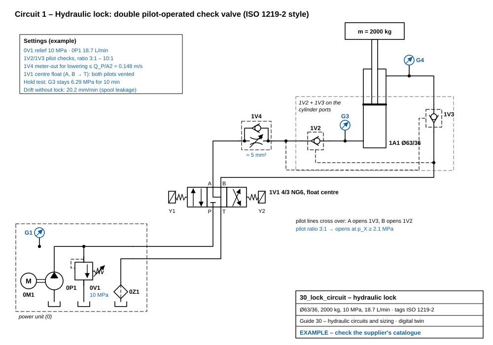
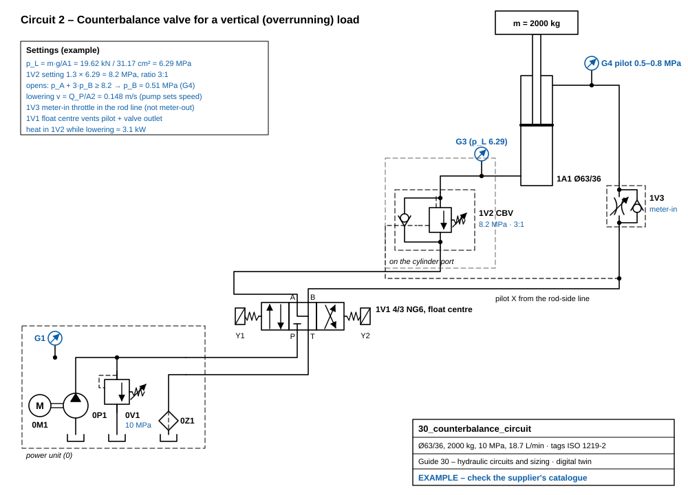
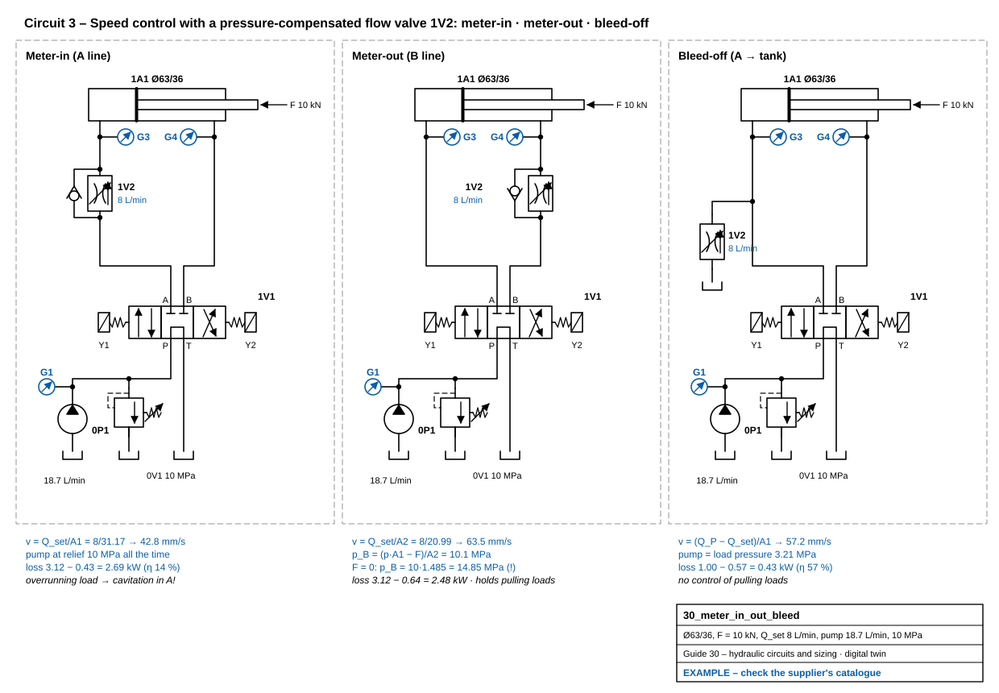
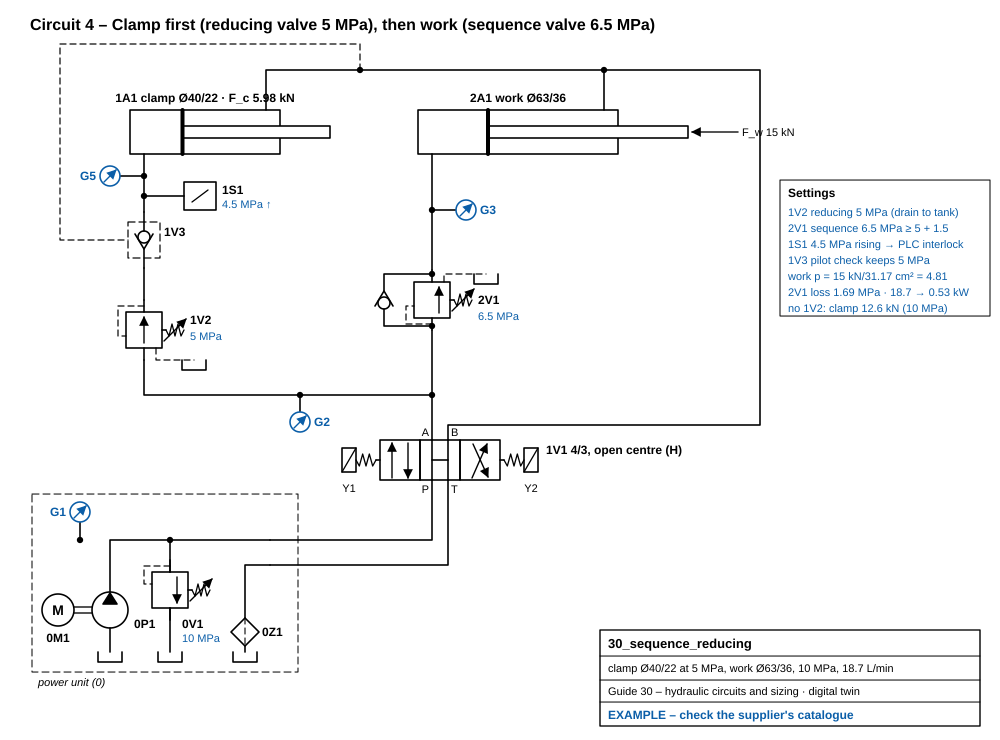
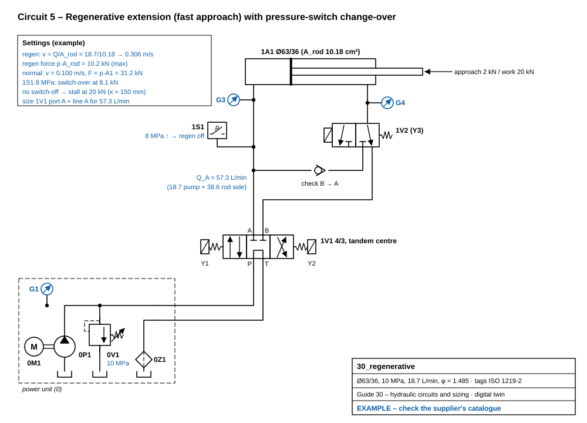
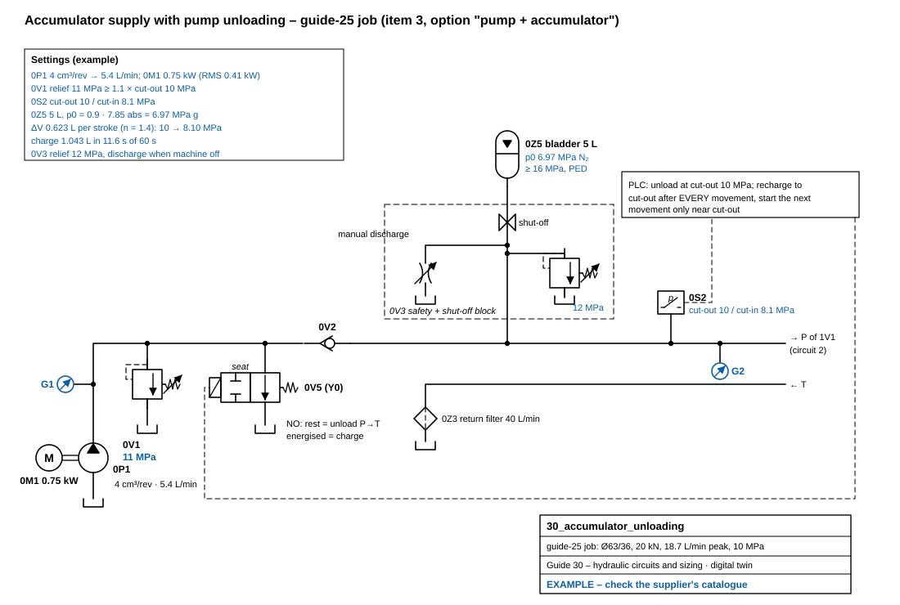
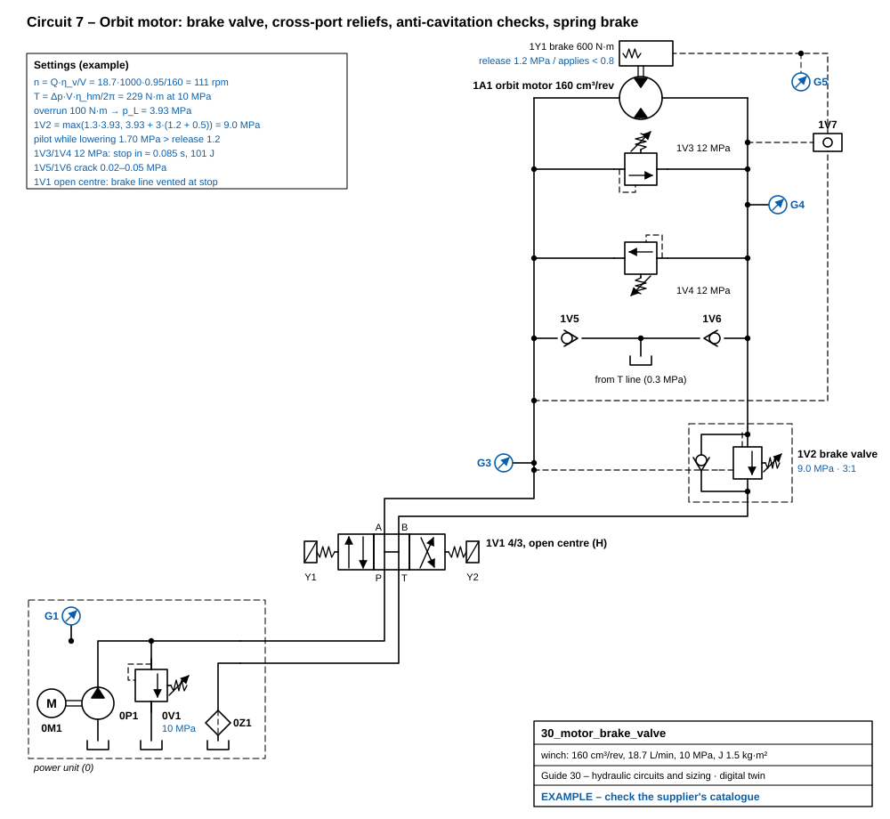
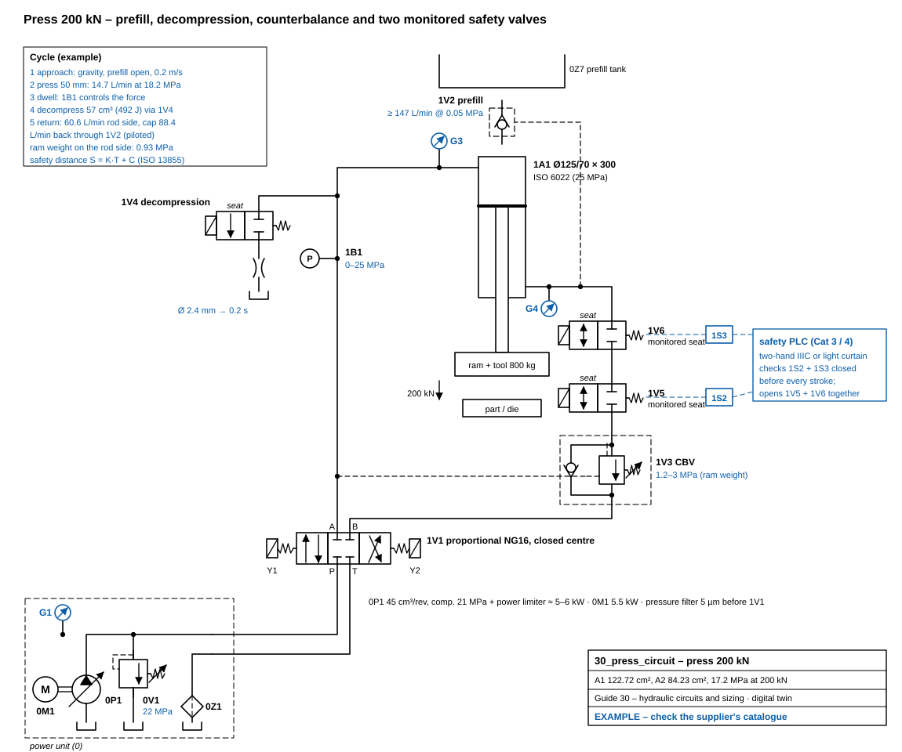
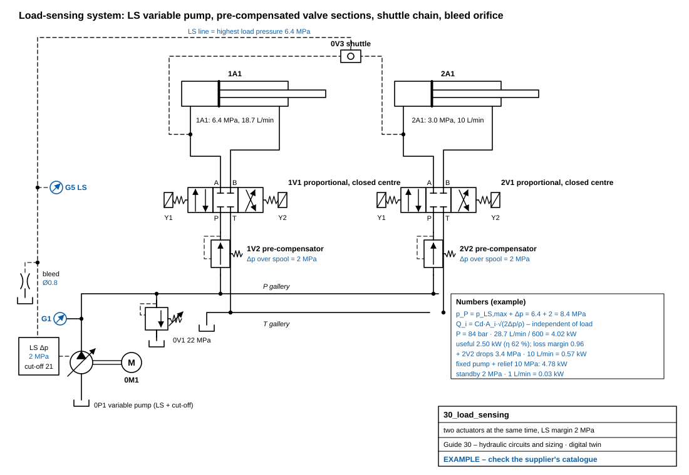
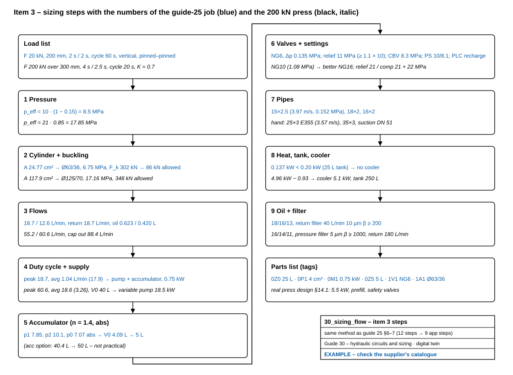

# 30 – Hydraulic standard circuits and system sizing (textbook, reference, design guide)

> Hydraulics tab, items 2 and 3. Live ISO 1219 circuits with a small simulation, and a complete system-sizing
> calculator. **All numbers are example values – check every part with the supplier's current catalogue.**
> Method and example numbers are the same as [25_hydraulic_design_method.md](25_hydraulic_design_method.md)
> (method textbook, 12 design steps, errors table §24).
> Element data (pumps, valves, cylinders, accumulators …): [29_hydraulic_elements_data.md](29_hydraulic_elements_data.md).

**For whom:** a mechanical engineer who must design, specify, check and buy hydraulic circuits for a machine-tool /
compressor factory. Guide 25 = **method** (how to think, in which order). Guide 29 = **data book** (what each element
can do). Guide 30 (this one) = **circuit book + calculator**: which valves go together, why, how the circuit behaves,
how to set it, what breaks, what to buy, and how to size the whole system.

**Two worked examples run through this guide:**

| | Example 1 – "the guide-25 job" | Example 2 – "press 200 kN" (app preset) |
|---|---|---|
| Actuator | 1 lift cylinder, vertical, clevis both ends | 1 press ram, vertical, flange + guided rod |
| Load | F = 20 kN, stroke 200 mm, 2 s up / 2 s down, every 60 s | F = 200 kN, stroke 300 mm, 4 s down / 2.5 s up, every 20 s |
| System pressure | 10 MPa | 21 MPa |
| Result (app) | Ø63/36, 18.7 L/min, **0.75 kW + 5 L accumulator** (or 3 kW fixed pump) | Ø125/70, 55 / 61 L/min, 45 cm³/rev variable pump, 18.5 kW, cooler 5.1 kW |
| Where | §17 | §18 (+ real press circuit §14.1) |

**Drawings in this guide** (standalone SVG files in `docs/img/`, copies in `web/img/`, ISO 1219-2 style, tags
0P1, 0V1, 1V1, 1A1 …): `30_lock_circuit.svg` (§5) · `30_counterbalance_circuit.svg` (§6) · `30_meter_in_out_bleed.svg`
(§7) · `30_sequence_reducing.svg` (§8) · `30_regenerative.svg` (§9) · `30_accumulator_unloading.svg` (§10) ·
`30_motor_brake_valve.svg` (§11) · `30_load_sensing.svg` (§12, §14.2) · `30_press_circuit.svg` (§14.1, §14.3) ·
`30_sizing_flow.svg` (§15).

## Contents

**Part A – Using items 2 and 3 of the twin**
1. Purpose and how to use this guide
2. Where in the twin
3. How the live model works (equations, why it is stable, what it cannot show)

**Part B – Circuit textbook (the nine live circuits + further factory circuits)**
4. Basics for every circuit (tags, load types, centre positions, cavitation, stiffness, gauge points, commissioning)
5. Circuit 1 – Hydraulic lock (double pilot-operated check valve)
6. Circuit 2 – Counterbalance valve for a vertical load
7. Circuit 3 – Speed control: meter-in, meter-out, bleed-off
8. Circuit 4 – Sequence (clamp, then work) + pressure reducing valve
9. Circuit 5 – Regenerative extension
10. Circuit 6 – Accumulator clamping with pump unloading
11. Circuit 7 – Hydraulic motor with brake valve, anti-cavitation checks, spring brake
12. Circuit 8 – Supply: tandem vs closed centre, variable pump, load sensing
13. Circuit 9 – Synchronising two cylinders + pressure intensifier
14. Further circuits for the factory: press with prefill + decompression · load-sensing system · safety-related
    circuits (EN ISO 4413, ISO 13849, two-hand, monitored redundant valves) · pressure intensifier for clamping ·
    hydraulic fixture with rotary union / pallet coupling · high-low pump · conveyor motor drive

**Part C – System sizing (item 3)**
15. The sizing method and the app steps
16. Sizing theory in depth (duty cycle and RMS power, accumulator, valves by Δp curves, pipes and hoses, heat balance,
    filters)
17. Worked example 1 – the guide-25 job (preset "Guide 25 lift example")
18. Worked example 2 – press 200 kN (preset "Press 200 kN") + the real press design
19. Other presets

**Part D – Buying, checking, reference**
20. Buy list – catalogue examples per circuit
21. Consolidated shopping list – guide-25 job, accumulator option
22. Consolidated shopping list – press 200 kN
23. Checklists
24. Questions for the supplier
25. Self-check and test links
26. Errors found (old guide, app) and corrections
27. Limits
28. Glossary

---

# Part A – Using items 2 and 3 of the twin

## 1. Purpose and how to use this guide

Item 1 (guide 29) tells you **what** each hydraulic element is. This guide shows **how elements work together**:
the circuits a designer uses again and again (hold a load, lower it safely, control speed, sequence, save energy,
synchronise), what goes wrong when a valve is missing, and how to size a complete system from the load list to
the parts list.

How to use it:
1. Open the circuit in the twin (deep link in each chapter), press "▶ Demo cycle", then switch the red
   "What goes wrong" faults on and off. Read the matching chapter while the model runs.
2. Each circuit chapter has the same order: **what / why → drawing → physics and formulas → what the simulation
   shows and why → stability and limits → settings → commissioning step by step → failures (symptom → cause →
   measurement → fix) → variants in real machines → energy → what to buy**.
3. For a new machine: go through Part C (sizing) with the app item 3, then pick the circuits from Part B, then build the
   parts list from Part D. Check every value with the supplier.

Words: **p** = pressure (MPa gauge unless "abs"), **Q** = flow (L/min), **A1** = piston area, **A2** = annulus (rod side)
area, **φ = A1/A2**, **k** = pilot ratio. 1 MPa = 10 bar. Hydraulic power P [kW] = p [bar] · Q [L/min] / 600.

## 2. Where in the twin

| Page | What you see |
|---|---|
| `#hyd` item 2 "Standard circuits" | 9 live circuits: valve buttons, load and setting sliders, "what goes wrong" switches, pressure-coloured lines, flow dashes, gauges, charts, formulas, settings, failures |
| `#hyd` item 3 "System sizing" | load list editor, duty cycle, 9 design steps with formulas, energy comparison, generated circuit summary, parts list |
| Pallet changer `#apc` | APC lift cylinder (circuits 1 + 2), preset "APC lift + zero-point release" in item 3 |
| HMC build `#hmc` | rotary table clamp 5 MPa (circuits 4 + 6), preset "HMC table clamp" in item 3 |

Deep links (open in the twin):
`/?hyitem=2&hcckt=lock#hyd` (lock, cbv, meter, seq, regen, acc, motor, supply, sync) ·
`&hcwrong=noPOC` (switch a fault on) · `&hcp=m:3000,leak:500` (parameters) ·
`/?hyitem=3&hcpreset=apc#hyd` (guide, apc, hmc, press, motor) · `&hcsup=acc` (force the supply type: fixed, var, acc).

Screen layout of item 2: circuit buttons → diagram (click a **solenoid** in the drawing or use the valve buttons;
click any **symbol** for its info box: what, data, why, check, typical failure) → parameters → red box
"What goes wrong without it?" → live values + charts → cards What / Why / How / Check / Typical mistake →
formulas with example numbers → setting values → failures table. "▶ Demo cycle" plays a scripted cycle; any valve
click switches to manual.

Colours: line colour = pressure (blue = tank pressure → yellow → red at ≥ 12 MPa), **violet = cavitation**
(pressure below −0.03 MPa, the oil "tears"), moving yellow dashes = flow direction, dashed thin = pilot or drain line.

Screen layout of item 3: preset buttons → load list (one row per actuator: force, stroke, start time, extend /
dwell / retract time, return force, mounting, vertical, reduced pressure, proportional) → system data (p_sys, losses,
efficiencies, motor speed, line lengths, supply "auto / fixed / var / acc") → duty-cycle chart → steps 1–9 with
formulas → option table (fixed / variable / accumulator) → settings → parts list. The steps are explained in §15.

## 3. How the live model works

A **lumped-parameter model**: each piece of hose / chamber is one node with one pressure.

```
Orifice (valve path, throttle)   Q = Cd · A · √(2·Δp/ρ)          Cd = 0.62, ρ = 870 kg/m³
Leakage (spool clearance)        Q = G · Δp                        (laminar)
Node pressure                    dp/dt = β / V · ΣQ                β = 1.4 GPa (oil), V = hose + chamber volume
Cylinder                         m · dv/dt = p_A·A1 − p_B·A2 − F_load − m·g (vertical) − friction
Motor                            J · dω/dt = Δp·V/(2π) − T_load − friction − brake
Accumulator                      p·V^n = const (absolute pressure), n = 1 … 1.4
```

Valves are orifices whose area depends on pressures: a relief opens when p > setting, a pilot check opens when
p_X·k > p_load, a counterbalance valve opens when p_load + k·p_pilot > p_set, a reducing valve closes when the
outlet reaches the setting. Time step 20–40 µs (explicit Euler, a constant "stability volume" keeps it stable and
conserves oil volume). It is a teaching model – not a replacement for the supplier's dynamic simulation.

**Where the equations come from (short):**
- *Orifice:* Bernoulli between the inlet and the narrowest jet: Δp = ρ·v²/2 → v = √(2Δp/ρ); the jet is narrower than
  the hole and has friction → discharge coefficient Cd ≈ 0.6–0.7. Flow grows with **√Δp** (double Δp → 1.41 × flow).
- *Leakage gap:* laminar flow in a thin gap (Hagen–Poiseuille for a slot): Q = b·h³·Δp / (12·η·L) → Q ∝ Δp and ∝ h³.
  A worn spool (h doubled) leaks 8 × more. That is why the twin uses "new 20–100, worn 300–1000 cm³/min".
- *Node pressure:* definition of the bulk modulus β = −V·dp/dV. If ΣQ more oil flows in than out, the oil in volume V
  is compressed: dp = β·ΣQ·dt / V. A small volume (short hose) gives a fast pressure rise.
- *Why a stability volume:* explicit Euler is stable only if the time step dt < 2·V/(β·∂Q/∂p). Very small nodes would
  need a tiny dt; a minimum node volume keeps dt at 20–40 µs.

Every circuit has a self-check that runs the demo without the screen and compares the result with the hand formula
(§25).

What the model shows well: pressures, speeds, order of events, energy, effect of a missing valve, cavitation
tendency. What it does **not** show: pressure waves in long lines (Joukowsky, guide 25 §4.11), real valve flow forces,
temperature change, air release, seal stick-slip in detail.

---

# Part B – Circuit textbook

## 4. Basics for every circuit

### 4.1 Common example data

Pump 18.7 L/min (= guide-25 extend flow), relief 10 MPa, cylinder **Ø63/36** (A1 = 31.17 cm², A_rod = 10.18 cm²,
A2 = 20.99 cm², φ = 1.485), HLP 46, load 2000 kg in the vertical circuits (m·g = 19.62 kN → p_L = 6.29 MPa).
The guide-25 sizing job uses 20 kN → 6.42 MPa; both are "the same cylinder", only the load differs.

### 4.2 Tags in the drawings (ISO 1219-2)

| Tag | Meaning |
|---|---|
| 0P1, 0M1, 0V1, 0Z1 … | circuit 0 = power unit: pump, electric motor, valves, accessories (Z = filter, tank, accumulator) |
| 1A1, 1V1, 1V2, 1S1 … | circuit 1 = first actuator: actuator (A), valves (V), sensors / switches (S, B) |
| 2A1, 2V1 … | circuit 2 = second actuator |
| Y1, Y2 | solenoids of a valve |
| G1, G2 … (accent colour in the drawings) | gauge / test points (ISO 15171 test couplings, guide 29 §15.5) |

### 4.3 Load types – the key to choosing the circuit

| Load type | Example | Danger | Circuit |
|---|---|---|---|
| **Resistive** (load opposes motion) | pressing, lifting up, clamping | stall at relief | normal meter-in / meter-out |
| **Overrunning** (load helps motion) | lowering a weight, drilling break-through, stopping an inertia, winch lowering | runaway, cavitation | meter-out, counterbalance, brake valve |
| **Holding** (no motion, load stays) | vertical axis at rest, clamp | drift through spool leakage | pilot check, seat valve, counterbalance |
| **Changing** (both signs in one stroke) | crank / linkage, swing arm over top dead centre | sudden runaway at the sign change | counterbalance on **both** lines (dual) |

### 4.4 Centre positions of the 4/3 valve (the most common design error)

| Centre | Ports in the middle | Use with | Never with |
|---|---|---|---|
| closed (all blocked) | P, A, B, T blocked | accumulator, variable pump, several valves on one pump | pilot checks, counterbalance, spring brakes (pilot pressure trapped) |
| tandem (P → T, A + B blocked) | P → T | one fixed pump, one actuator | several valves in parallel; holding valves (A, B blocked = trapped pilot) |
| float (A, B → T, P blocked) | A, B → T | pilot checks, counterbalance, brake release | a fixed pump without a separate unloading valve |
| open (H) (P, A, B → T) | all to T | fixed pump + holding valve on the cylinder | accumulator (would empty it) |

Letters for the spool differ between makers (Rexroth "J" for float in many catalogues, "H" for open, "E" for
closed, "G" for tandem – **always read the symbol in the datasheet**, guide 29 §7.2).

### 4.5 Cavitation – one condition for all circuits

Cavitation happens when the pressure in a chamber falls below the vapour / air-release pressure (≈ −0.03 … −0.08 MPa
gauge). In a cylinder this is a **flow balance**: the chamber grows by A·v, the oil coming in is Q_in.

```
Cavitation if   A_chamber · v  >  Q_in        (the load pulls the piston faster than the oil arrives)
Lowering, rod side fed by the pump:   v_max = Q_P / A2 = 18.7 L/min / 20.99 cm² = 0.148 m/s
Motor:                               n_max = Q_in / V  (overrunning load)
```

Fix: control the **outlet** (meter-out, counterbalance, brake valve) so the load cannot run faster than the inlet
can fill, and add anti-cavitation checks from the tank line (circuit 7).

### 4.6 Hydraulic stiffness and natural frequency (why circuits oscillate)

Oil is a spring. For a cylinder with both chambers closed by valves:
```
c = β·A1²/V1 + β·A2²/V2              (N/m)          ω0 = √(c/m),  f0 = ω0/(2π)
Example Ø63/36, 2000 kg, mid stroke x = 100 mm, 0.2 L hose each side:
V1 = 31.17 cm²·10 cm + 200 cm³ = 512 cm³,  V2 = 20.99·10 + 200 = 410 cm³
c = 1.4e9·(31.17e-4)²/512e-6 + 1.4e9·(20.99e-4)²/410e-6 = 41.6 N/µm  →  f0 = 23.0 Hz
```
Rule: any valve that reacts faster than ≈ f0/3 to pressure (counterbalance with a high pilot ratio, LS pump
compensator) can excite this spring–mass system. Long hoses (bigger V, softer hose wall → lower β) lower f0 and make
it worse. Theory: guide 25 §4.10.

### 4.7 Gauge points (test points) – where to measure

Every drawing in this guide shows gauge points G1, G2 … in the accent colour. The minimum set:

| Point | Where | What it tells |
|---|---|---|
| G1 | pump outlet (before the check valve) | pump pressure, relief / unloading / compensator setting |
| G2 | after the check / at the valve P port | system pressure, accumulator pressure |
| G3, G4 | cylinder A and B ports (at the cylinder, **between** cylinder and holding valve) | load pressure, intensification, holding valve leakage |
| G5 | pilot line / LS line / reduced branch | pilot pressure, LS signal, reduced pressure |
| G6 | return line before the filter | back pressure, filter clogging |

Use test couplings M16×2 (ISO 15171-1) with a measuring hose; for dynamic events use a transmitter + data logger
(guide 29 §15). Read the gauge in "MPa" and write the value into the commissioning sheet.

### 4.8 General commissioning sequence for a circuit

1. Check the drawing against the hardware: flow arrows of checks, centre symbol, pilot line connections, drain lines.
2. Flush (guide 25 §10.5), fill, vent the pump case (variable pumps).
3. Set the main relief **low** (≈ 2 MPa), start the pump, check the direction of rotation and noise.
4. Vent the cylinder: several slow strokes with low pressure, top ports up.
5. Raise the relief step by step to the design value; block the pump flow (valve centre / end of stroke) and read G1.
6. Set the circuit valves in the order of the chapter (holding valve, then flow, then sequence, then switches).
7. Run the cycle with load, measure speeds (stopwatch / position sensor) and pressures, write the protocol.
8. Seal and label the settings; record them in the parts list ("setting 8.3 MPa").

### 4.9 Energy – one formula for every circuit

```
Hydraulic power in   P_in  = p_pump · Q_pump
Useful power         P_use = F · v   (cylinder)   or   2π·n·T   (motor)
Loss (heat)          P_loss = P_in − P_use       (all throttled oil: Δp · Q)
```
Every valve that throttles flow at Δp makes Δp·Q heat. The circuits below show how much, and how to avoid it.

## 5. Circuit 1 – Hydraulic lock: double pilot-operated check valve (`hcckt=lock`)

**What:** two pilot-operated check valves (1V2 in A, 1V3 in B, often one sandwich plate under the NG6 valve). Each
opens by the pressure of the other line. **Why:** a spool valve has 5–15 µm clearance and always leaks; a vertical
axis or clamp would sink. The poppet seat is leak free.



### 5.1 Physics of the pilot-operated check

The poppet (seat area A_s) is held closed by the load pressure p_L and a weak spring. A pilot piston (area A_x) pushes
it open. Force balance at the opening moment (outlet side at ≈ 0):
```
p_X · A_x  ≥  p_L · A_s + F_spring     →   p_X ≥ p_L / k + p_crack,    k = A_x / A_s (pilot ratio)
With back pressure p_T on the outlet (internally drained type):  p_X ≥ p_L/k + p_T·(1 − 1/k) (approx.)
```
A **decompression type** first opens a small inner poppet (small A_s → large effective k ≈ 10:1), the trapped
pressure falls, then the main poppet opens. Use it when p_L is high (presses, > 15 MPa) – otherwise the load drops
with a bang and the pilot needs a high pressure.

### 5.2 Formulas with the example numbers

```
Load pressure        p_L = m·g / A1 = 2000·9.81 / 31.17 cm² = 19.62 kN / 31.17 cm² = 6.29 MPa
Spool leakage        G = 100 cm³/min at 10 MPa (new NG6 20–100, worn 300–1000)
Leak at the load     Q = 100 · 6.29/10 = 62.9 cm³/min
Drift without lock   v = Q / A1 = 62.9 / 31.17 = 2.02 cm/min = 20.2 mm/min (1.2 m per hour!)
With pilot checks    ≈ 0.01 mm/min (seat leakage only)
Opening for lowering p_X ≥ p_L / k = 6.29 / 3 = 2.1 MPa  (k = pilot ratio 3:1; with 10:1 only 0.63 MPa)
Lowering speed       limited by the meter-out throttle check 1V4 (≈ 5 mm²) so that the pump can fill
                     the rod side: v = Q_P / A2 = 18.7 L/min / 20.99 cm² = 0.148 m/s
Out of the cap side  Q_out = A1·v = 27.8 L/min → Δp at 5 mm² = ρ/2·(Q/(Cd·A))² = 9.7 MPa
Rod-side pressure    p_B = (9.7 − 6.29) / (A2/A1 = 0.673) = 5.05 MPa → pump power 5.05 MPa · 18.7 L/min = 1.57 kW
```
The last line is important: **lowering through a lock + throttle costs ≈ 1.6 kW of pump power** (the pump pushes the
load down against the throttle). The counterbalance valve (circuit 2) needs only ≈ 0.16 kW for the same lowering.

**Thermal effect on a locked cylinder** (trapped oil, rigid walls):
```
Δp ≈ β · α_oil · ΔT = 1.4 GPa · 7·10⁻⁴ 1/K · ΔT ≈ 1 MPa per K (upper limit; hoses and tube walls give less)
```
A clamp that cools down by 5 K loses several MPa (clamp force!); a locked cylinder that heats up can exceed the rating.
Fix: pressure switch + re-clamp logic, a small accumulator on the clamp side (§14.5), or a thermal relief.

### 5.3 What the simulation shows and why

- Raise → stop: the A-line gauge (G3) stays at 6.29 MPa, the position stays. Both pilot lines are vented by the open /
  float centre, so both poppets close.
- *Without the pilot checks* (spool valve with tandem centre holds the load): drift 19.9 mm/min (simulation) vs
  20.2 mm/min (hand) – the spool leakage is laminar, Q ∝ p_L.
- *Closed-centre spool with pilot checks*: spool leakage from P pressurises the pilot line → 1V2 stays open → the
  load drifts **19.6 mm/min although the lock is fitted**.
- Lowering without a throttle: the load runs ahead of the pump, the pilot pressure falls, the valve closes and opens
  again → jerky "bang-bang" motion (open / closed only, no modulation – see circuit 2).

### 5.4 Settings

| Element | Setting (example) | Rule |
|---|---|---|
| 0V1 relief | 10 MPa | ≥ highest load pressure + losses |
| 1V2 / 1V3 pilot checks | ratio 3:1 … 10:1, cracking 0.1–0.3 MPa | decompression type for high load pressure; opens at p_X ≥ 2.1 MPa |
| 1V1 centre | **open (H) or float (Y)** | both pilot lines vented at stop |
| 1V4 throttle check | ≈ 5 mm² (set at commissioning) | lowering speed ≤ pump fill speed Q_P/A2 → no chatter |
| Mounting | pilot checks on the cylinder (flange / sandwich on the cylinder port) | hose-burst safety (EN ISO 4413 §5.4.2.4) |

### 5.5 Commissioning step by step

1. Check: flow arrows of 1V2 / 1V3 point **towards** the cylinder; pilot lines cross over (A opens B-check, B opens
   A-check); valve centre symbol = H or Y.
2. Fit gauges: G3 at the cylinder cap port (between cylinder and 1V2), G4 at the rod port, G1 at the pump.
3. Relief at 2 MPa, open 1V4 a few turns, raise slowly, vent at the top ports.
4. Raise the relief to 10 MPa. Raise the load, stop: G3 must show p_L (≈ 6.3 MPa) and **stay** for 10 min (drop
   < 0.2 MPa, no visible drift with a dial gauge on the rod).
5. Lower: start with 1V4 almost closed, open until the lowering speed is smooth and below 0.148 m/s; read G4
   (pilot) – it must stay above p_L/k ≈ 2.1 MPa during the whole stroke (else chatter).
6. Test the hose-burst case (only with a safe set-up): open a test coupling on the valve side – the load must stay.
7. Lock 1V4, write the settings.

### 5.6 Failures: symptom → cause → measurement → fix

| Symptom | Probable cause | Measurement | Fix |
|---|---|---|---|
| Load sinks slowly at stop | closed-centre spool keeps pilot pressure / pilot check seat dirty | G4 (pilot) > 0 at stop? G3 falls? | float / open centre; clean or replace the poppet |
| Load sinks fast with the lock fitted | pilot check missing in one line or fitted the wrong way | compare the hardware with the drawing | correct the flow arrow |
| Jerky lowering (bang – bang) | overrunning load, no meter-out throttle | G4 oscillates between 0 and 3 MPa | add 1V4 throttle or use a counterbalance valve (circuit 2) |
| Clamp opens after hours | temperature drop / leakage of the clamp seal | G3 logged over a night | accumulator on the clamp side or pressure switch + re-clamp |
| Cylinder does not lower at all | pilot pressure too low (k too small, back pressure in T line) | G4 vs p_L/k + p_T | check p_X ≥ p_L/k + back pressure; drain the T line freely; higher k |
| Load drops with a bang at the start of lowering | high p_L, no decompression stage | G3 falls suddenly, noise | decompression-type pilot check, slower pilot (orifice 0.8 mm) |

### 5.7 Variants in real machines

- **Machine-tool clamping (fixture, rotary table):** one pilot check + pressure switch "clamped" keeps 5 MPa; the
  PLC re-clamps if the switch drops (§14.5).
- **APC lift (docs/09):** the arm cannot fall at power or hose failure.
- **Vertical axis with hydraulic weight balance:** pilot checks only for standstill + a brake; the motion is
  electric.
- **Lifting table:** pilot check per cylinder + hose-rupture valve (guide 29 §10.6) + meter-out throttle.
- **Zero-leak seat valve instead of a spool valve** (Rexroth M-SEW, HAWE seat valves): no pilot check needed for
  one direction; common in clamping banks.

**Energy:** holding costs nothing (pump unloaded through the open centre). Lowering costs ≈ 1.6 kW (throttle).
**Buy list:** §20.1.

---

## 6. Circuit 2 – Counterbalance valve for a vertical load (`hcckt=cbv`)

**What:** a relief-type valve in the cylinder outlet for the lowering direction, with a pilot X from the other line
and a free-flow check for raising. **Why:** a hanging load is an **overrunning load**. Through the open spool it falls
faster than the pump can fill the other side → runaway and cavitation. A pilot check only knows open / closed → jerky.



### 6.1 Physics: why it modulates

The counterbalance valve (CBV) is a relief valve whose spring is helped by the pilot pressure. It opens just as much
as needed so that the load pressure + k × pilot pressure equals the setting. If the load runs faster, the rod side
pressure (= pilot) falls → the valve closes a little → the load slows down. This is a **closed loop in the valve
itself** – that is why the lowering is smooth.

```
Setting              p_set = 1.3 × p_L = 1.3 × 6.29 = 8.18 MPa (load alone never opens it; covers heat expansion)
Opening condition    p_A + k·p_B ≥ p_set                         (k = pilot ratio, here 3:1)
Force balance        p_A·A1 = m·g + p_B·A2  →  p_A = p_L + p_B·A2/A1    (A2/A1 = 0.673)
Pilot (cracking)     p_B = (p_set − p_L) / (k + A2/A1) = (8.18 − 6.29) / 3.673 = 0.51 MPa
To pass the flow     A = Q_out / (Cd·√(2p_A/ρ)) = 6.0 mm² → with the valve gain (25 mm² per 3 MPa) + 0.72 MPa
                     → running p_B ≈ (1.89 + 0.72)/3.673 = 0.71 MPa   (simulation 0.77 MPa incl. friction)
Lowering speed       v = Q_P / A2 = 0.148 m/s (the pump controls the speed)      simulation 148 mm/s ✓
Pump power lowering  0.51 MPa · 18.7 L/min = 5.1 bar · 18.7 / 600 = 0.16 kW (with 8:1 only p_B = 0.22 MPa)
Heat in the valve    ≈ p_A · Q_out = 6.64 MPa · 27.8 L/min = 3.07 kW  (= potential power m·g·v 2.91 kW + pump part)
Without the valve    Q = 0.62 · 25 mm² · √(2·6.29e6/870) = 112 L/min → v ≈ 0.6 m/s ≫ 0.148 → runaway
```

Why the setting is 1.3 × p_L: (1) the load alone must never open the valve, also with dynamic peaks and heat
expansion of the trapped oil (the CBV is also the thermal relief of the locked chamber); (2) the valve must still close
when the pilot falls. Above ≈ 1.5 × p_L the pump needs more pilot pressure (energy) and the cap side sees higher
pressure. Keep p_set **below the relief** and below the cylinder rating.

### 6.2 Pilot ratio – energy against stability

| Pilot ratio k | Pilot to open (example) | Pump power lowering | Stability | Use |
|---|---|---|---|---|
| 3 : 1 | 0.51 MPa | 0.16 kW | best (low loop gain) | unstable loads, long booms, cranes, flexible frames |
| 4.5 : 1 | 0.36 MPa | 0.11 kW | medium | general machines |
| 8 : 1 (or 10 : 1) | 0.22 MPa | 0.07 kW | worst – may oscillate | stiff machines, constant load, energy matters |

**Why a high ratio oscillates:** a small pilot change Δp_B changes the valve opening by k·Δp_B. The load + oil
spring (f0 ≈ 23 Hz, §4.6) reacts; the rod pressure changes; the valve reacts again. With high k the loop gain is high
and the phase delay of the hoses / mass is enough for a self-sustained oscillation ("bouncing" during lowering).
Fixes: lower k, a damping orifice (≈ 0.6–1.0 mm) in the pilot line, valve directly on the cylinder (small V), meter-in
speed control instead of a throttle after the CBV.

**Meter-in or meter-out with a CBV?** The CBV is already the meter-out element. Control the lowering speed with the
**pump flow or a meter-in throttle** in the rod-side line. A second meter-out throttle in series with the CBV fights
with it and often causes instability.

### 6.3 What the simulation shows and why

Speed scatter while lowering – counterbalance ≈ 0.1 mm/s, pilot check ≈ 147 mm/s (open / close = jerky),
none: 490 mm/s peak and cavitation in the rod side (violet line). The CBV keeps the speed equal for 200 kg and
3000 kg (move the mass slider) – the pilot pressure changes, the speed does not.

### 6.4 Settings

| Element | Setting (example) | Rule |
|---|---|---|
| 1V2 counterbalance | 8.2 MPa (1.3 × 6.29) | ≥ 1.3 × max load pressure, below the relief |
| Pilot ratio | 3:1 | 3:1 unstable loads / flexible machines, 4.5:1 general, 8:1 stiff machines (less energy) |
| 0V1 relief | 10 MPa | raising needs 6.3 MPa + losses |
| 1V1 centre | open H / float (A, B → T) | vents the valve outlet and the pilot |
| Mounting | on the cylinder port (line body or flange) | hose burst: the load stays (EN ISO 4413) |
| Vented type | if the T line has back pressure | back pressure on a non-vented CBV adds to the setting |

### 6.5 Commissioning step by step

1. Preset the CBV on the bench or by the turns table of the datasheet (MPa per turn) to 1.3 × p_L. Never start with
   the screw fully out (load would fall).
2. Mount it on the cylinder port. Gauges: G3 at the cylinder cap port (between cylinder and CBV), G4 in the pilot /
   rod line.
3. Raise the load (free flow through the check), stop: G3 = p_L, no creep in 10 min.
4. Lower with a low pump flow: G4 shows the pilot 0.5–0.8 MPa; G3 rises to ≈ p_L + 0.67·p_B.
5. Lower with full flow and with min / max load: the speed must be smooth. If it bounces → lower ratio / pilot orifice.
6. Stop during lowering: the load stops without a drop (CBV closes as the pilot vents through the float centre).
7. Lock and seal the adjustment; write "8.2 MPa, 3:1" on the valve tag.

### 6.6 Failures: symptom → cause → measurement → fix

| Symptom | Probable cause | Measurement | Fix |
|---|---|---|---|
| Load creeps down at stop | setting below p_L (or worn seat, too hot) | G3 falls; setting check on the bench | set ≥ 1.3 × p_L, replace cartridge |
| Lowering oscillates / chatters | pilot ratio too high, long hoses, flexible structure | G4 oscillates (logger 1 kHz) | 3:1, damping orifice in the pilot, valve on the cylinder |
| Load does not lower | T-line back pressure on a non-vented valve / ratio wrong | G4 high, G6 (T) high | vented (externally drained) valve, free T line |
| Runaway when the hose bursts | valve mounted at the HPU, not on the cylinder | look at the installation | mount on the cylinder port |
| Hot oil during lowering | the load energy turns into heat (3 kW in the example) | oil temperature | normal; for big loads: regenerative lowering or energy recovery |
| Pump pressure high during lowering | setting far above 1.3 × p_L | G1 during lowering | reduce setting to 1.3 × p_L |

### 6.7 Variants in real machines

- **APC lift (docs/09):** lowering speed is the same for an empty and a full pallet.
- **Press ram holding:** the CBV sits in the **rod-side** line (the ram weight hangs on the annulus), set 1.3 × m·g/A2
  (§14.1) – often combined with a second, monitored holding valve for safety (§14.3).
- **Lifting table / scissor lift:** CBV on each cylinder + flow divider (circuit 9).
- **Over-centre loads (swing arm, crane jib):** dual CBV, one per line.
- **Hydraulic motors:** dual CBV = brake valve (circuit 7).

**Energy:** lowering power in the pump 0.16 kW (3:1), heat in the valve = potential energy of the load (unavoidable
without energy recovery). **Buy list:** §20.2.

---

## 7. Circuit 3 – Speed control: meter-in, meter-out, bleed-off (`hcckt=meter`)

A 2-way **pressure-compensated** flow valve (throttle + compensator keeps Δp over the throttle constant) sets the
speed independent of the load. Three positions:



### 7.1 Physics of the compensated flow valve

A plain throttle gives Q = Cd·A·√(2Δp/ρ): if the load changes, Δp changes and the speed changes. The compensator is a
spool with a spring (Δp_c ≈ 0.6–1 MPa) that throttles in series and keeps the Δp over the measuring throttle at Δp_c.
```
Q = Cd · A_throttle · √(2·Δp_c/ρ)   = constant for a fixed setting
Example Q_set 8 L/min, Δp_c = 0.8 MPa:  A = 8/60000 / (0.62·√(2·0.8e6/870)) = 5.0 mm² (Ø 2.5 mm)
Minimum Δp over the whole valve: ≈ Δp_c + 0.2 MPa – below it the valve works like a plain throttle
```
Temperature: a sharp-edged throttle (short orifice) depends little on viscosity → "temperature compensated" valves.

### 7.2 Formulas with the example numbers

```
                         speed                         pressures                         heat (F = 10 kN, Q_set 8 L/min)
meter-in  (A line)       v = Q_set/A1 = 42.8 mm/s      pump at relief 10 MPa             P_in 3.12 kW − F·v 0.43 = 2.69 kW (η 14 %)
meter-out (B line)       v = Q_set/A2 = 63.5 mm/s      p_B = (p·A1 − F)/A2 = 10.1 MPa    P_in 3.12 kW − F·v 0.64 = 2.48 kW
bleed-off (A → tank)     v = (Q_P − Q_set)/A1 = 57.2   pump = load pressure 3.21 MPa     1.0 kW − 0.57 = 0.43 kW (η 57 %)
Intensification (meter-out, F = 0):  p_B = p·A1/A2 = 10 · 1.485 = 14.85 MPa   → rate the rod side for it!
```
Simulation: 42.8 / 63.5 / 57.2 mm/s (= hand); p_B 14.51 MPa (= hand with p_A 9.90 MPa and 391 N seal friction).
Meter-out heat split: 1.34 kW in the flow valve (10.1 MPa · 8 L/min) + 1.14 kW over the relief (excess pump flow).

Note: in meter-out the valve meters the **annulus** oil → the same setting gives a 1.485 × higher speed.

### 7.3 Overrunning (negative) loads – meter-in vs meter-out

Slider F negative, −10 kN (the load pulls the rod out):
```
Meter-in, outlet free (p_B ≈ 0.3 MPa back pressure):
   p_A = (p_B·A2 − |F|)/A1 = (0.3e6·20.99e-4 − 10 000)/31.17e-4 = −3.0 MPa   → impossible → cavitation, the load
   accelerates until friction / outlet losses stop it.   Simulation: 624 mm/s runaway, violet A line.
Meter-out (pump at relief 10 MPa):
   p_B = (p_A·A1 + |F|)/A2 = (10e6·31.17e-4 + 10 000)/20.99e-4 = 19.6 MPa   → speed held at 63.5 mm/s, BUT the rod
   side sees 19.6 MPa > 16 MPa (ISO 6020-2 rating) → rod-side relief or lower pump pressure.
```
Rule: **meter-out for every load that can pull** (vertical down, drilling break-through, cutting force in feed
direction) – and check the rod-side pressure for the worst case (intensification + pulling load).

### 7.4 Stability and stiffness

Meter-out keeps **both** chambers pressurised → high hydraulic stiffness (§4.6) → smooth feed at low speed and no
jump at the break-through. Meter-in leaves the outlet chamber at tank pressure → soft, the piston can jump ahead.
Bleed-off has no control of the outlet at all and the speed depends on the pump leakage (worn pump → slower).
For very low speeds (< 5 mm/s) use meter-out + a small Δp_c valve, warm oil, low-friction seals (stick-slip).

### 7.5 Settings

| Element | Setting (example) | Rule |
|---|---|---|
| 1V2 flow valve | 8 L/min | set at the real load + warm oil (40–50 °C); min. Δp 0.6–1 MPa |
| 0V1 relief | 10 MPa | meter-in / meter-out: the pump runs at this pressure during the feed |
| Rod side rating | ≥ 14.9 MPa (F = 0), ≥ 19.6 MPa with −10 kN pulling load | meter-out intensification |
| 1V1 centre | tandem (P → T) | pump unloaded at stop |

### 7.6 Commissioning step by step

1. Check the mounting direction of the flow valve (arrow) and of the bypass check (free return flow).
2. Gauges: G1 pump, G3 / G4 at the cylinder ports, G5 before and after the flow valve.
3. Warm the oil to the working temperature. Start with the valve at the minimum setting.
4. Run with the real load, open until the speed is reached (measure the time for a known stroke).
5. Check Δp over the valve (G5 in − out) ≥ 0.8 MPa at the highest load; if not, the speed will change with load.
6. Meter-out: read G4 at F = 0 → must be < the rod-side rating.
7. Lock the knob.

### 7.7 Failures: symptom → cause → measurement → fix

| Symptom | Probable cause | Measurement | Fix |
|---|---|---|---|
| Speed changes with the load | plain throttle (no compensator) or Δp below minimum | G5 in − out | pressure-compensated valve, Δp ≥ 1 MPa |
| Load runs away / jumps forward at the break-through (drilling) | meter-in with a pulling or suddenly falling load | G3 falls to 0 / violet | meter-out (or counterbalance) |
| Rod seal or rod-side hose fails | meter-out intensification p·A1/A2 | G4 at F = 0 | rate parts for it, relief on the rod side |
| Oil hot | meter-in / meter-out with a fixed pump: excess flow over the relief | oil temperature, G1 = relief all the time | variable pump or load sensing (circuit 8), bleed-off, 3-way flow valve |
| Speed drifts after warm-up | viscosity → leakage of the pump (bleed-off) / temperature-dependent throttle | speed at 30 / 50 °C | temperature-compensated (sharp-edged) throttle, cooler |
| Stick-slip at low speed | seal friction, soft meter-in circuit | position log | meter-out, low-friction seals, higher Δp_c |

### 7.8 Variants in real machines

- **Drilling / tapping units, fixture cylinders:** meter-out + rapid traverse valve that bypasses the flow valve
  ("skip feed": rapid approach → feed → rapid return).
- **3-way (bypass) compensated flow valve** with a fixed pump (guide 29 §9.4): the pump pressure follows the load
  + Δp_c → almost as efficient as load sensing for one actuator.
- **Bleed-off** for a conveyor motor with a constant, resistive load: efficient, simple.
- **Proportional valve** = electrically adjustable meter-in + meter-out edges (both at once), with pressure
  compensation = load-sensing systems (§14.2).

**Energy comparison (example):** meter-in 2.69 kW loss, meter-out 2.48 kW, bleed-off 0.43 kW, LS ≈ only the margin.
**Buy list:** §20.3.

---

## 8. Circuit 4 – Sequence: clamp, then work + pressure reducing valve (`hcckt=seq`)

One valve, two actuators, fixed order. Line A: clamp 1A1 (Ø40/22) via reducing valve 1V2 (5 MPa) and pilot check
1V3; work cylinder 2A1 (Ø63/36) via sequence valve 2V1 (6.5 MPa) with reverse check.



### 8.1 Physics of the two valves

- **Pressure reducing valve (normally open):** the spool is pushed by the **outlet** pressure against the spring.
  When the outlet reaches the setting, it throttles. Outlet = constant 5 MPa whatever the inlet (≥ 5 MPa). A 3-way
  (relieving) type also opens outlet → tank if the outlet pressure rises (thermal expansion, clamp pushed back) –
  preferred for clamps. A pilot-operated type uses a small pilot flow (≈ 0.5–1 L/min) to the drain → this adds to
  the leakage in an accumulator circuit (circuit 6).
- **Sequence valve (normally closed):** like a relief valve, but the outlet goes to a working line, not to the tank.
  Because the outlet is pressurised, the spring chamber needs an **external drain** to the tank. It opens when the
  inlet reaches the setting and then keeps the inlet at **≥ the setting** while flow passes (it throttles if the work
  needs less).

```
Clamp force      F_c = 5 MPa · 12.57 cm² − 0.3 kN friction = 6.28 − 0.3 = 5.98 kN   (simulation 6.25 kN at work start)
Clamp needed     F_c ≥ S·F_cut/μ per contact: cutting force 1.5 kN, μ 0.15, 2 jaws, S = 2 → 1.5·2/(0.15·2) = 10 kN → 2 clamps
Sequence         p_seq ≥ p_red + 1 … 1.5 MPa = 5 + 1.5 = 6.5 MPa
Work pressure    p = 15 kN / 31.17 cm² = 4.81 MPa → line A stays at 6.5 MPa (the sequence valve throttles)
Loss at 2V1      (6.5 − 4.81) MPa · 18.7 L/min = 0.53 kW while working
Max work force   10 MPa · 31.17 cm² = 31.2 kN
Without reducing valve: clamp sees 10 MPa → 12.6 kN (twice the force – thin parts bend)
```

### 8.2 What the simulation shows and why

Clamp closed at 0.46 s, work starts at 0.50 s (after the clamp). **Without the sequence valve the work cylinder
starts at 0.40 s, before the clamp is closed (0.74 s), clamp force 0.15 kN** – the part is loose. The oil takes the
path of least resistance: the work cylinder with its small approach load moves first.
Alternative (parameter "pressure switch"): 1S1 on the clamp (set 4.5 MPa) → PLC → valve 2V2; better diagnosis and
part of the safety interlock "no cutting without clamp pressure".

### 8.3 Stability and limits

- If the work load pressure is close to the sequence setting, the valve chatters (opens, the line pressure falls,
  it closes …). Keep ≥ 1 MPa between them or use the pressure switch method.
- The sequence valve only checks **pressure**, not **position**: a clamp that hits an obstacle also reaches 6.5 MPa.
  For safety use a position sensor + pressure switch (two signals).
- The return order is not controlled: work and clamp return in parallel. If the clamp must open last, add a second
  sequence valve in line B or use PLC sequencing.

### 8.4 Settings

| Element | Setting (example) | Rule |
|---|---|---|
| 0V1 relief | 10 MPa | system |
| 1V2 pressure reducing | 5 MPa | clamp force; drain line free to the tank |
| 2V1 sequence | 6.5 MPa | ≥ clamp + 1–1.5 MPa |
| 1S1 pressure switch (option) | 4.5 MPa rising | PLC releases the work only when clamped (interlock) |
| 1V3 pilot check | ratio 3:1 | keeps the clamp pressure when line A drops |

### 8.5 Commissioning step by step

1. Check the drain lines of 1V2 and 2V1: separate, free to the tank, no back pressure.
2. Gauges: G5 at the clamp (after 1V2), G3 at the work cylinder, G2 at line A before the branches.
3. Set 2V1 to maximum (work cannot start), clamp, set 1V2 until G5 = 5.0 MPa.
4. Reduce 2V1 until the work cylinder starts — then raise by 1.5 MPa above the clamp pressure (6.5 MPa on G2 at the
   start of work).
5. Check with a part: the clamp is tight (G5 = 5 MPa) **before** the work cylinder moves; the clamp pressure stays
   during the work stroke.
6. Pressure switch: set the rising point 4.5 MPa, check the PLC input, check that the work stops if the switch
   drops (simulate by venting the clamp).

### 8.6 Failures: symptom → cause → measurement → fix

| Symptom | Probable cause | Measurement | Fix |
|---|---|---|---|
| Work starts before the clamp is tight | sequence setting too low / no sequence | G2 at the start of work | set ≥ clamp + 1.5 MPa; pressure switch interlock |
| Clamp force too high | reducing valve drain blocked / valve stuck open | G5 = system pressure | free drain, clean / replace the valve |
| Clamp opens during machining | line A pressure drops (work needs flow), no check valve | G5 during the work stroke | pilot check in the clamp branch, accumulator (circuit 6) |
| Sequence valve chatters | work load pressure ≈ sequence setting | G2 oscillates | raise the setting or use a pressure switch |
| Unclamps before the tool is back | both return in parallel | watch the return | second sequence valve in line B / PLC sequence |
| Clamp pressure creeps up | thermal expansion, 2-way reducing valve | G5 over time | 3-way (relieving) reducing valve |

### 8.7 Variants in real machines

- **Machine-tool fixtures:** clamp → work support (locked by its own sequence) → machining; one pressure switch per
  clamp circuit to the PLC (§14.5).
- **HMC rotary table clamp** 5 MPa from the 10 MPa unit; the PLC checks the pressure switch before the spindle cuts
  (docs/12).
- **Press with a blank holder:** holder first (sequence or separate valve), then the ram.
- **APC:** zero-point clamp before the arm moves (docs/09).

**Energy:** loss at the sequence valve 0.53 kW while working; the pressure-switch method avoids it (the work line
sees only the work pressure). **Buy list:** §20.4.

---

## 9. Circuit 5 – Regenerative extension (`hcckt=regen`)

Rod-side oil goes back into the cap side (valve 1V2 + check). Net area = A_rod.



### 9.1 Physics

During regeneration both chambers are connected, so they have (almost) the same pressure p. The forces:
p·A1 to the right, p·A2 to the left → net force **p·(A1 − A2) = p·A_rod**. The flow: the cap side needs A1·v, the
rod side gives A2·v, the pump gives the difference Q_P = (A1 − A2)·v = A_rod·v.

```
Regenerative    v = Q/A_rod = 18.7 L/min / 10.18 cm² = 0.306 m/s     F = p·A_rod = 10 MPa · 10.18 cm² = 10.2 kN
Normal          v = Q/A1    = 0.100 m/s                              F = p·A1 = 31.2 kN
Flow into A     v·A1 = 57.3 L/min (pump 18.7 + rod side 38.6) → size port A of 1V1 and line A for it
Switch-off      pressure switch 1S1 at 8 MPa (80 % of relief): regen force at switch-off 8.1 kN
```
With φ = A1/A2 = 2 (Ø63/45, φ = 2.04) the regenerative extension speed equals the retraction speed.

### 9.2 What the simulation shows and why

Approach 0.304 m/s (hand 0.306), normal 0.100; full stroke 1.50 s with automatic switch-off vs 2.39 s without
regeneration. **Without switch-off the cylinder stalls at x = 150 mm** (work force 20 kN > 10.2 kN) and all oil goes
over the relief. At the switch-over the speed drops from 0.31 to 0.10 m/s – the moving mass is decelerated by the
oil (short pressure peak).

### 9.3 Settings, stability, commissioning

| Element | Setting (example) | Rule |
|---|---|---|
| 1S1 pressure switch | 8 MPa rising (hysteresis ≈ 1 MPa) | switch regeneration off before the relief (10 MPa) |
| 1V2 regen valve | NG6 / NG10 + check B → A | sized for Q_B = 38.6 L/min |
| 0V1 relief | 10 MPa | system |
| Line A / 1V1 | for Q_P·A1/A_rod = 57.3 L/min | summed flow (NG10 or check the NG6 limit curve) |

Commissioning: (1) check the check-valve direction B → A; (2) gauges G3 / G4 at the cylinder, G5 at 1S1; (3) run
without load: approach ≈ 0.3 m/s; (4) with the work load: the switch must change over at contact (G3 rises to 8 MPa)
and the cylinder continues at 0.1 m/s with full force; (5) check the jerk at switch-over – lower the switch point or
use a proportional ramp if needed.

### 9.4 Failures: symptom → cause → measurement → fix

| Symptom | Probable cause | Measurement | Fix |
|---|---|---|---|
| Cylinder stalls before the end | regeneration not switched off | G3 = relief, 1S1 signal | pressure switch / sequence valve, check setting |
| Slow approach | regen valve not switched / check valve stuck | solenoid LED, G4 ≈ 0 | check solenoid Y3, check valve |
| Jerk at switch-over | switch point too high, sudden change of area | position log | lower switch point, ramp (proportional valve) |
| Cylinder extends at stop | pressure in both chambers + leakage in the regen valve (differential creep) | G3 = G4 > 0 at stop | vent B at stop, leak-free seat valve |

### 9.5 Variants and energy

Typical use: press brakes and presses (fast approach), injection moulding clamps, scissor lift tables, fixture
cylinders with long approach, wood-splitters. Energy: the regenerative approach needs a pump of only A_rod/A1 = 33 %
of the flow for the same speed – a smaller pump and motor (same idea as prefill, §14.1). **Buy list:** §20.5.

---
## 10. Circuit 6 – Accumulator clamping with pump unloading (`hcckt=acc`)

**Live circuit (app values):** small pump 4 L/min charges a 1 L bladder accumulator; pressure switch 1S1 unloads the
pump at 7 MPa (cut-out) and loads it at 5.5 MPa (cut-in); check valve 1V2 keeps the pressure; relief 0V1 8 MPa
(≥ 1.1 × 7 = 7.7 MPa); spring-return valve 2V1 clamps without current (HMC table clamp, ring piston equivalent
Ø100/70, 3 mm). Time runs × 10.

**Drawing (same principle, sized for the guide-25 job – accumulator option of item 3):** pump 4 cm³/rev, check,
5 L bladder accumulator p0 6.97 MPa, pressure switch cut-out 10 / cut-in 8.1 MPa, unloading valve, **relief 11 MPa
(≥ 1.1 × cut-out)**, accumulator safety block 12 MPa.



### 10.1 Physics

The gas (nitrogen) in the bladder is the spring: p·V^n = constant (absolute pressures). Between cut-out and cut-in
the accumulator gives the usable volume ΔV. The check valve 1V2 separates the pump from the system: when the pump is
unloaded (P → T at ≈ 0.3 MPa), the system pressure is held by the accumulator. Leakage of the clamp circuit (valve
spools, rotary union) slowly empties it → the pump recharges every "hold time".

```
Absolute pressures   p0 = 4.9 + 0.1 = 5.0   p_on = 5.6   p_off = 7.1 MPa abs
Pre-charge rule      p0 ≈ 0.9 · p_on,abs = 5.04 MPa abs = 4.94 MPa gauge
Usable oil (n = 1)   ΔV = V0·(p0/p_on − p0/p_off) = 1·(0.893 − 0.704) = 0.189 L     (n = 1.4: 0.144 L)
Leakage              150 cm³/min at 6 MPa → 157 cm³/min at 6.3 MPa
Hold time            t = ΔV / Q_L = 0.189 / 0.157 = 72 s        simulation (no index): 72.7 s ✓
Charge time          0.189 / (4 − 0.157) = 3.0 s → duty ≈ 4 %
Without unloading    8 MPa · 4 L/min = 80·4/600 = 0.53 kW heat all day   (with unloading ≈ 0.075 kW average)
Clamp force          5 MPa · 78.5 cm² = 39 kN at the minimum pressure
```
Use isothermal n = 1 for slow leakage, adiabatic n = 1.4 for fast discharge (< 1 min). Full theory and sizing: §16.2.

### 10.2 Two rules found with the twin (and fixed in the app today)

1. **Relief ≥ 1.1 × cut-out.** A relief valve starts to open (cracking) below its nominal setting. If the relief is
   set at the cut-out pressure, it opens before the pressure switch unloads the pump → the pump flow goes over the
   relief and heats the oil, and the switch may never reach cut-out. Guide-25 job: cut-out 10 MPa → **relief 11 MPa**
   (app setting "relief valve 0V1 (accumulator option) 11 MPa"); all components rated ≥ 16 MPa. Live circuit: 8 MPa
   for a 7 MPa cut-out.
2. **PLC charging logic: recharge to cut-out after every movement.** The accumulator size is calculated for a stroke
   that **starts at cut-out**. With a plain cut-in / cut-out switch a stroke can start lower:
   ```
   5 L, p0 7.07 MPa abs, n = 1.4, stroke takes 0.623 L:
   start at 10.0 MPa → end 8.10 MPa ✓ (≥ 7.75 needed)
   start at  8.6 MPa → end 7.10 MPa (pump not counted) … 7.49 MPa (pump 5.4 L/min counted) < 7.75 → slow / stalls
   ```
   App setting: "PLC charging logic – recharge to cut-out 10 MPa after every movement; start the next movement only
   when the accumulator pressure is back near cut-out". Guide 25 §7.8 shows the same with its duty-cycle simulation.

### 10.3 What the simulation shows and why

The accumulator pressure saw-tooths between 7 and 5.5 MPa; the clamp pressure follows; the pump power is ≈ 0 kW
while unloaded. Faults in the twin: *without check valve* the accumulator empties through the unloading valve →
45 switchings per minute; *without accumulator* the pump switches 554 times per minute (motor and contactor die,
the system "hunts").

### 10.4 Settings

| Element | Live circuit | Guide-25 job (app item 3) | Rule |
|---|---|---|---|
| 1S1 / 0S2 pressure switch | cut-out 7 / cut-in 5.5 MPa | cut-out 10 / cut-in 8.1 MPa | cut-in ≥ min working pressure + margin; hysteresis ≥ 10 % |
| Accumulator | 1 L, p0 4.9 MPa | 5 L, p0 6.97 MPa | p0 ≈ 0.9·p_min (abs), set at working temperature |
| 0V1 relief | 8 MPa | **11 MPa** | ≥ 1.1 × cut-out, below the weakest rating |
| Safety block relief | 8.5 MPa | 12 MPa | above 0V1, ≤ accumulator max; type-tested (PED) |
| Discharge | manual + solenoid (NO) | manual + solenoid (NO) | accumulator empty when the machine is off (EN ISO 4413) |

### 10.5 Commissioning step by step

1. Before filling: check the pre-charge with the charging kit (accumulator oil side **empty**), at the temperature you
   will run; correct with p0,20 = p0,T · 293/(T + 273) (guide 25 §7.8).
2. Close the discharge valve, relief 0V1 at 2 MPa, start the pump: G1 (pump) and G2 (accumulator) rise together.
3. Raise 0V1 above the planned cut-out (e.g. 12 MPa temporarily), set 1S1 cut-out (G2 = 10 MPa → pump unloads,
   G1 drops to ≈ 0.3 MPa), then set 0V1 to 11 MPa: block the unloading (manual) and read G1 = 11 MPa.
4. Set the cut-in (8.1 MPa) – open the discharge slowly, read the switching point.
5. Measure the hold time with the machine in its rest position (leakage check: compare with the design value).
6. Test the discharge: switch the machine off → G2 must fall to 0 within the specified time (e.g. < 1 min).
7. Write pre-charge, switch points and hold time into the protocol (it is the reference for maintenance).

### 10.6 Failures: symptom → cause → measurement → fix

| Symptom | Probable cause | Measurement | Fix |
|---|---|---|---|
| Pump switches very often | pre-charge lost (bladder) / leakage high / hysteresis small | p0 with the charging kit; hold time | recharge N₂, find the leak (rotary union), hysteresis ≥ 10 % |
| Pressure falls at once when the pump unloads | check valve missing / leaking | G2 drops when G1 drops | fit / clean the check valve |
| Clamp opens after power off | accumulator discharge valve opened (correct for safety!) | – | spring clamp or mechanical self-locking if clamping must stay |
| Accumulator gives no oil | p0 above p_on, bladder burst (oil on the gas side) | gas valve: oil? p0 | set p0 = 0.9 p_on, replace bladder |
| Oil hot although unloading | unloading valve does not open (coil, wiring) or relief below cut-out | G1 in unload (should be ≈ 0.3 MPa) | check Y0; relief ≥ 1.1 × cut-out |
| Strokes slow every second cycle | stroke starts at cut-in, not at cut-out | log G2 at the start of each stroke | PLC charging logic (§10.2) |

### 10.7 Variants in real machines

HMC rotary table clamp (5 MPa, docs/12), APC pallet clamp / zero-point release (docs/09), fixture clamping power
units (Roemheld / AMF / HAWE compact units with accumulator + pressure switch), spindle tool unclamping, hydraulic
chucks with rotary union. **Energy:** unloading saves ≈ 0.45 kW in the live example; in the guide-25 job the
accumulator option averages 0.207 kW against 0.253 kW (fixed pump + unloading) and 0.401 kW (variable pump), and
needs a 0.75 kW motor instead of 3–4 kW (option table §17). **Buy list:** §20.6.

---

## 11. Circuit 7 – Hydraulic motor with brake valve, anti-cavitation checks, spring brake (`hcckt=motor`)

Winch: forward = lowering (load torque −100 N·m helps), reverse = hoisting. Brake valve 1V2 in line B, cross-port
reliefs 1V3/1V4 (12 MPa), anti-cavitation checks 1V5/1V6 from the tank line, shuttle 1V7 releases the spring brake.



### 11.1 Physics

- A hydraulic motor converts flow into speed (n = Q·η_v/V) and pressure difference into torque
  (T = Δp·V·η_hm/2π).
- With an **overrunning** load (lowering), the motor acts as a pump: the outlet line would carry the full load
  pressure and the inlet would cavitate. The **brake valve** (a counterbalance valve for motors) in the outlet line
  holds back the load and opens by the inlet pressure (pilot) – exactly like circuit 2.
- When the valve centres, the inertia (J·ω) keeps the motor turning and pumping: the outlet pressure rises until the
  **cross-port relief** opens, the inlet side would go to vacuum → the **anti-cavitation checks** refill it from the
  tank line (keep 0.2–0.5 MPa back pressure in T for good filling).
- The **spring-applied brake** holds the load at standstill (motor leakage would let it creep). It releases by
  pressure from the shuttle (higher of A / B) and applies when both lines are vented (open centre).

```
Speed            n = Q·η_v / V = 18.7 · 1000 · 0.95 / 160 = 111 rpm          simulation 112.6 rpm (T_L +150 N·m)
Torque           T = Δp·V·η_hm / (2π) = 10 MPa · 160 cm³ · 0.9 / 2π = 229 N·m (max)
Load 150 N·m     Δp = 2π·T / (V·η_hm) = 6.54 MPa (+ friction 0.68 MPa = 7.22)  simulation 7.23 MPa ✓
Brake valve      p_set ≥ 1.3 · 2π·T_over/V = 1.3 · 3.93 = 5.1 MPa
                 AND pilot while lowering ≥ brake release + 0.5 MPa: p_set ≥ p_L + k·(1.2 + 0.5) = 3.93 + 3·1.7 = 9.03 MPa
                 → pilot while lowering (9.03 − 3.93)/3 = 1.70 MPa (+ valve opening) > release 1.2 MPa ✓
Brake            holding torque ≥ 2 × load = 200 N·m → 600 N·m; release 1.2 MPa, applies below 0.8 MPa
Stop energy      E = ½·J·ω² = ½ · 1.5 · 11.6² = 101 J → heat in the brake valve / cross-port relief
Stop time        braking torque of the cross-port relief 12 MPa · 160 cm³ / 2π = 306 N·m; the overrunning load
                 100 N·m acts against it → t = J·ω / (306 − 100) = 1.5 · 11.63 / 206 = 0.085 s
Load power       lowering 100 N·m at 111 rpm = 2π·111·100/60 = 1.16 kW → heat in the brake valve
```
**Design rule found with the model:** the brake release pressure must be **below** the pilot pressure that the
lowering needs, otherwise the brake drags during lowering (it applies, the speed falls, it releases …). Either a
high brake valve setting (here 9.03 MPa → pilot 1.7 MPa > 1.2 MPa release) or a low release pressure.

### 11.2 What the simulation shows and why

Lowering 118.6 rpm smooth; *without brake valve* 141 rpm (runaway, inlet cavitation); *without anti-cavitation
checks* the inlet pressure at stop goes far below 0 (knocking); *closed-centre valve*: the release pressure is trapped
→ **the brake does not apply at stop**.

### 11.3 Settings

| Element | Setting (example) | Rule |
|---|---|---|
| 1V2 brake valve | 9.0 MPa, ratio 3:1 | ≥ 1.3 × overrunning load pressure **and** pilot > brake release + 0.5 MPa |
| 1V3 / 1V4 cross-port reliefs | 12 MPa | above working pressure, below motor peak rating |
| 1V5 / 1V6 anti-cavitation | cracking 0.02–0.05 MPa | refill from the T line (T line ≈ 0.3 MPa with a back-pressure check) |
| 1Y1 brake | 600 N·m, release 1.2 MPa, applies < 0.8 MPa | ≥ 2 × load torque |
| 1V1 centre | open H (P, A, B → T) | brake release line vented at stop, pump unloaded |
| Case drain (if the motor has one) | free to tank, ≤ the maker's case pressure | seals of the shaft |

### 11.4 Commissioning step by step

1. Check the shuttle and the brake release line (thin dashed line in the drawing), and the case drain.
2. Gauges: G3 / G4 at the motor ports, G5 at the brake release port.
3. Without load (or with the load secured): run both directions slowly, vent.
4. Brake test: valve in centre, apply 2 × load torque (test weight / torque wrench) – no rotation.
5. With load: lower at full flow, read G5 (must stay > 1.2 MPa + margin while lowering → brake fully released).
6. Stop from full speed: read the peak on G3/G4 (≤ cross-port relief 12 MPa + override) and listen for knocking
   (anti-cavitation).
7. Seal the settings.

### 11.5 Failures: symptom → cause → measurement → fix

| Symptom | Probable cause | Measurement | Fix |
|---|---|---|---|
| Load runs away when lowering | no / wrong brake valve, setting too low | speed, G4 | brake valve on the motor, p_set ≥ 1.3 × load pressure |
| Knocking / noise at stop | cavitation on the inlet side | G3 below 0 at stop | anti-cavitation checks, back pressure in the T line |
| Hose bursts at stop | pressure peak (inertia), no cross-port relief | transmitter peak | cross-port reliefs, slower valve (ramp) |
| Load sinks with the brake "on" | brake worn / released by trapped pressure | G5 > 0 at stop | open / float centre, brake test, release line orifice |
| Brake drags while lowering (jerks, hot brake) | pilot while lowering < brake release | G5 during lowering | raise brake valve setting or use a lower release pressure |
| Motor slow under load | internal leakage high (η_v low), case drain blocked | case drain flow (measuring cup) | change motor, free case drain |

### 11.6 Variants in real machines

Winches and hoists, slewing drives, chip conveyors, mixers, wheel drives, screw conveyors in a foundry. A **horizontal
conveyor** has a resistive load: no brake valve needed, speed by a 3-way flow valve or a variable pump (§14.7).
**Energy:** lowering power 1.16 kW → heat in the brake valve. **Buy list:** §20.7.

---

## 12. Circuit 8 – Supply: tandem vs closed centre, variable pump, load sensing (`hcckt=supply`)

Same job (extend 20 kN, retract 2 kN, pause), same proportional valve (7.4 mm² ≈ 2 MPa at 18.7 L/min), four supplies.

```
Pause power      fixed + closed centre   p_relief·Q = 100 bar · 18.7 / 600 = 3.12 kW → all heat
                 fixed + tandem          Δp_PT·Q ≈ 1.2 bar · 18.7 / 600 = 0.04 kW
                 pressure compensator    10 MPa · 1 L/min leakage = 0.17 kW
                 load sensing standby    2 MPa · 1 L/min = 0.03 kW
Extension        useful F·v = 20 kN · 0.1 m/s = 2.0 kW; pump ≈ (6.4 + 2) MPa · 18.7 L/min = 2.6 kW
Valve check      Q = 0.62 · 7.4 mm² · √(2 · 2 MPa / 870) = 18.7 L/min ✓
```
Simulated energy per 10 s cycle (demand 100 %): closed centre 28.5 kJ, tandem 15.7 kJ, pressure compensator
9.0 kJ, load sensing 7.8 kJ (useful 4.4 kJ). At 50 % demand: 31.3 / 18.6 / 10.9 / 5.8 kJ – LS wins at part speed.
Tandem looks worse than expected because the demo keeps the valve open ≈ 1 s after the end of stroke (a typical
PLC time-out) → the fixed pump dumps everything over the relief. **Switch the valve off with an end-of-stroke
sensor.** Tandem centre only for one actuator per pump branch. LS margin 1.5–2.5 MPa; relief 1–1.5 MPa above the
compensator (relief = safety only).

### 12.1 How each supply works (physics)

| Supply | Pump pressure | Pump flow | Where the loss is |
|---|---|---|---|
| fixed + closed centre | always relief (10 MPa) | always full | relief: (Q_P − Q_used)·p_relief + valve Δp |
| fixed + tandem / unloading | load + Δp while moving, ≈ 0.1–0.3 MPa at stop | always full | valve Δp; relief when the actuator stalls |
| variable, pressure compensator | always compensator setting (10 MPa) | as needed | valve throttles from 10 MPa down to the load |
| variable, load sensing | load + margin (2 MPa) | as needed | margin Δp·Q only (+ compensators of the lighter loads) |
| pump + accumulator (circuit 6) | between cut-in and cut-out | small, charges in the pauses | valve throttles from accumulator pressure to load |
| servo pump (variable speed) | load pressure | speed × displacement | almost none; motor + drive losses |

### 12.2 Stability notes

A pressure-compensated pump needs 50–100 ms to destroke → a pressure peak when a valve closes fast (relief or small
accumulator protects). An LS pump is a closed loop pump ↔ valve ↔ load: long LS lines and a high margin gain can
oscillate → damping orifice (≈ 0.8 mm) in the LS line, bleed orifice to tank so the LS line is vented in neutral
(§14.2).

### 12.3 Failures

| Symptom | Probable cause | Measurement | Fix |
|---|---|---|---|
| Oil too hot | fixed pump + closed centre / relief set below compensator | G1 = relief at pause | tandem / unloading / variable pump; relief 1–1.5 MPa above compensator |
| LS pump does not destroke | LS line not vented in neutral (no orifice to tank) | G5 (LS) > 0 in neutral | LS bleed orifice, check shuttle |
| Actuators slow down when a second one moves (LS) | pump at max flow (flow saturation) | swivel angle / pump flow | bigger pump or flow-sharing (post-compensated) valves |
| Pressure peaks at valve switching (variable pump) | compensator response 50–100 ms | transmitter peak | small accumulator or relief, slower valve ramps |

Twin: in the HPUs (APC, HMC) the pump is small with accumulator + unloading (circuit 6) because the duty cycle has
long pauses (item 3 compares the options with numbers). **Buy list:** §20.8. Load-sensing system in detail: §14.2.

---

## 13. Circuit 9 – Synchronising two cylinders + pressure intensifier (`hcckt=sync`)

Platform on two cylinders Ø50/28, loads 4 kN and 10 kN (p1 = 2.04, p2 = 5.09 MPa), stroke 300 mm.

```
Parallel (none)      the light side runs first at Q/A1 = 0.159 m/s → full tilt 300 mm
Gear flow divider    Δq = G·(p2 − p1) = 1e-12 · 3.06e6 = 3.1e-6 m³/s = 184 cm³/min of 9 350 → 2 % → Δx ≈ 5.9 mm/300 mm
                     simulation 6.0 mm ✓ (catalogue ± 1–3 %, re-synchronise at the stroke end)
Mechanical link      frame carries ≈ (F2 − F1)/2 = 3 kN + friction; simulation Δx 0.4 mm
Servo (2 prop. valves + position control)   simulation Δx 6.8 mm with a simple P controller (better with PI + feed-forward)
Intensifier          p_out = p_in · A_in/A_out = 10 · (100/40)² = 62.5 MPa;  Q_out = 18.7 · 0.16 = 2.99 L/min
```
Divider danger: the low-load section can drive the other → intensification up to ≈ 2·p_in − p2; relief per outlet.

### 13.1 Why parallel cylinders never stay together

The oil takes the path of least resistance: the cylinder with the smaller load pressure moves first, until it hits
the end; then the other moves. Friction differences of only a few percent are enough to tilt a platform.

### 13.2 Methods compared

| Method | Accuracy (typical) | Cost | Notes |
|---|---|---|---|
| Gear flow divider (2 sections on one shaft) | ± 1–3 % of stroke | low | leakage depends on Δp between sections; re-sync at the stroke end; relief per outlet |
| Spool flow divider | ± 3–5 % | low | flow range narrow |
| Series cylinders (master – slave, A2 of one = A1 of the other) | drift per stroke | low | needs a re-phasing valve at the end of stroke |
| Mechanical link (torsion shaft + racks, stiff frame) | ≈ 0.1–0.5 mm | medium | frame must carry (F2 − F1)/2 |
| Servo / proportional valves + position sensors | ± 0.05–0.5 mm | high | needs controller tuning, clean oil 16/14/11 |

Simple drawing of the divider circuit (text):
```
 P ──1V1 (4/3)── A ──► [1V2 gear flow divider] ──► 1A1 (4 kN)          + relief valve on each outlet (12 MPa)
                                              └──► 1A2 (10 kN)         + stroke-end re-sync valves
 T ◄───────────── B ◄── rod sides of both cylinders (common)
```

### 13.3 Failures

| Symptom | Probable cause | Fix |
|---|---|---|
| Platform tilts more every stroke | divider error adds up, no re-synchronisation | stroke-end synchronising valves, drive both to the end stop |
| One cylinder at much higher pressure than possible | divider intensification | relief on each outlet |
| Platform jams | no synchronisation, weak frame | add divider / servo / stiff link |
| Servo axis oscillates | controller gain too high, air in the oil | lower Kp, bleed cylinders |

Twin: the APC lift has ONE cylinder with a guide column (no sync needed). A wide pallet lift or a gantry with two
cylinders would need one of these methods. Intensifier for clamping: §14.4. **Buy list:** §20.9.

---

## 14. Further circuits for the factory

### 14.1 Press circuit with prefill and decompression

A real hydraulic press (bearing / bush press-fit for compressor housings, straightening, forming) needs high force
only over the last few millimetres. The circuit uses gravity / a small pump for the fast approach, the big ram area
only for pressing, a **prefill valve** to fill the big cap chamber from a top tank, a **decompression** step before
the return, and **monitored safety valves** so that the ram cannot fall.



**Cycle (example design for the 200 kN press, ram Ø125/70, A1 = 122.72 cm², A2 = 84.23 cm²):**

| Step | What happens | Valves | Numbers (example) |
|---|---|---|---|
| 1 Fast approach 250 mm | ram falls by its weight; cap side sucks oil from the top tank through the prefill valve 1V2 | 1V5 + 1V6 open (monitored), 1V1 meters the rod-side outflow | 0.2 m/s → cap needs A1·v = **147 L/min** from the tank, the pump gives ≈ 0 |
| 2 Press 50 mm | cap pressure rises → prefill closes; pump feeds the cap side | 1V1 P → A, 1V2 closed | 0.02 m/s → **14.7 L/min** at 17.2 + 1 MPa → 4.46 kW hydraulic |
| 3 Dwell | force held (pressure transmitter 1B1 controls the force) | 1V1 centre | 200 kN |
| 4 Decompression | trapped cap oil (compressed) released slowly through a small orifice | 1V4 open | 57 cm³ in 0.2 s through Ø 2.4 mm |
| 5 Return 300 mm | pump feeds the rod side; pilot opens the prefill; the big cap flow goes back to the top tank | 1V1 P → B, 1V2 piloted open | 0.12 m/s → rod 60.6 L/min, cap out **88.4 L/min** (mostly through 1V2) |

**Prefill valve size:** at Δp ≤ 0.05 MPa (suction from the top tank): A ≥ Q/(Cd·√(2Δp/ρ)) =
2.45·10⁻³ / (0.62·10.7) = 369 mm² (Ø 22 mm minimum opening) → a prefill valve of nominal size ≈ 40–50 mm
(catalogue: flow at 0.05 MPa).

**Decompression – derivation.** The oil in the cap chamber V (here stroke volume 3.68 L + 1 L hose = 4.68 L) is
compressed by p0 = 17.16 MPa:
```
Compressed volume   ΔV = V·p0/β = 4.68 L · 17.16 MPa / 1400 MPa = 57.4 cm³
Stored energy       E = ½·p0·ΔV = ½ · 17.16e6 · 57.4e-6 = 492 J   (+ frame stretch, e.g. ½ · 200 kN · 0.5 mm = 50 J)
Release through an orifice A:   dp/dt = −(β/V)·Cd·A·√(2p/ρ)
   → √p falls linearly:  t = 2·V·√p0 / (β·Cd·A·√(2/ρ))     →   A = 2·V·√p0 / (β·Cd·√(2/ρ)·t)
   t = 0.1 s → A = 9.3 mm² (Ø 3.4)   t = 0.2 s → 4.7 mm² (Ø 2.4)   t = 0.3 s → 3.1 mm² (Ø 2.0)
Without decompression the main valve (≈ 40 mm² open) releases Q = 0.62·40 mm²·√(2·17.16e6/870) ≈ 296 L/min
   for a few ms → "bang", pipe shock, hose and seal damage.
```
The formula counts oil only – frame stretch and hose expansion add volume, so the real time is longer: check the
pressure transmitter curve at commissioning and adjust the orifice / the time in the PLC.

**Holding the ram (counterbalance):** the ram weight (example 800 kg incl. tool) hangs on the **rod side**:
p_L = m·g/A2 = 7.85 kN / 84.23 cm² = 0.93 MPa → CBV 1V3 ≈ 1.3 × 0.93 = 1.2 MPa (in practice the next spring range,
e.g. 2–3 MPa, and a second holding valve for safety – §14.3). **Not** 1.3 × press force / A1 (§26 E3 – fixed in the app:
the load list now has a "hanging weight" field; the press preset uses 800 kg, example).

**Energy of this design vs the app preset (example):** the preset presses 200 kN over the **whole** 300 mm
(useful work 63.0 kJ per cycle) and needs 18.5 kW; the real press presses only 50 mm (useful 12.4 kJ):

| Real press supply (example, cycle 20 s) | Peak electric | RMS | Energy / cycle |
|---|---|---|---|
| variable pump, pressure compensator 21 MPa (standby 21 MPa · 1 L/min) | 5.24 kW | 2.07 kW | 25.2 kJ |
| variable pump, load sensing / power limiter (standby 2 MPa · 1 L/min) | 5.24 kW | 2.04 kW | 19.6 kJ |
| high-low double pump (HP 15 L/min + LP 46 L/min unloaded above ≈ 3 MPa) | 5.24 kW press, LP unloaded ≈ 0.27 kW | similar | similar |

→ motor by the app rule ≥ max(RMS 2.07, peak 5.24/1.5 = 3.49) = **4 kW**; choose **5.5 kW** when the power limiter
is set to 5–6 kW or the force is held for a long dwell – instead of 18.5 kW. The pump still needs ≈ 61 L/min for the return – a 45 cm³/rev variable pump with a power limiter
set to ≈ 5–6 kW does both (high flow at low pressure, low flow at high pressure).

### 14.2 Load-sensing (LS) system



**Principle:** the highest load pressure of all working sections is fed back (shuttle chain) to the pump controller.
The pump keeps its outlet at **p_P = p_LS,max + Δp_margin** (margin 1.5–2.5 MPa). Each valve section has a
compensator that keeps the Δp over its metering edge constant → flow depends only on the spool opening:
```
Q_i = Cd · A_i · √(2·Δp_margin / ρ)          independent of the load pressure
Example, two actuators at the same time:
  section 1: 6.4 MPa, 18.7 L/min        section 2: 3.0 MPa, 10 L/min
  LS pump  p_P = 6.4 + 2 = 8.4 MPa, Q = 28.7 L/min → P = 84 · 28.7 / 600 = 4.02 kW hydraulic
  useful   64 · 18.7/600 + 30 · 10/600 = 1.99 + 0.50 = 2.50 kW  (η 62 %)
  losses   margin 20 bar · 28.7/600 = 0.96 kW  +  compensator of section 2 (8.4 − 2 − 3 = 3.4 MPa) · 10 = 0.57 kW
  fixed pump + relief at 10 MPa for the same flows: 100 · 28.7 / 600 = 4.78 kW (η 52 %), and 3.12+ kW at every pause
```
**Pre- vs post-compensated:** pre-compensated (compensator before the spool): at flow saturation (sum demand > pump
max) the section with the highest load slows down / stops. Post-compensated "flow sharing" (LUDV type): all sections
slow down in proportion – better for coordinated motion.

**Stability:** LS bleed orifice (0.6–1.0 mm) to tank so the pump destrokes in neutral; damping orifice in the LS line;
short LS lines; pressure cut-off in the pump controller (here 21 / 10 MPa) + relief 1–1.5 MPa above as safety only.

**Where in the factory:** multi-axis handling devices, test benches with several actuators, mobile machines;
for single-actuator machine tools an accumulator or a servo pump is usually simpler.

### 14.3 Safety-related hydraulic circuits (EN ISO 4413, ISO 13849, two-hand)

**EN ISO 4413 (hydraulic fluid power – safety)** asks, among others: no unexpected movement at start-up / after a
power loss; loads that can fall must be held (holding valve on the actuator, hose-burst protection); stored energy
(accumulators) must be discharged automatically when the machine is switched off; all parts rated for the maximum
pressure; pressure limited by a relief valve; clear ISO 1219 documentation. Summary: guide 25 §12.

**ISO 13849-1 (safety of control systems)**: a safety function (e.g. "stop the ram closing stroke", "prevent the ram
from falling") gets a required **Performance Level PLr** (a … e) from a risk graph. Hydraulic valves are part of the
safety chain. Categories (architecture):

| Category | Architecture | Hydraulic example |
|---|---|---|
| B / 1 | single channel, well-tried components (Cat 1) | one valve, no monitoring |
| 2 | single channel + test | one valve, position checked at intervals |
| **3** | two channels; a single fault does not lose the function; faults detected "where practicable" | **two valves in series, each able to stop the motion, at least one monitored** |
| 4 | two channels, faults detected (high DC), accumulation of faults considered | two valves, **both** with direct position monitoring, checked every cycle |

**Typical press implementation (drawing §14.1, valves 1V5 + 1V6):** two seat (poppet) valves in series in the rod-side
outlet line; each closes the outflow so the ram cannot move down; each has an inductive switch that monitors the
poppet / spool position (1S2, 1S3); the safety PLC checks at every cycle that each valve is closed before the next
start and opens only when both channels agree. Plus: counterbalance valve 1V3 for the weight, pressure transmitter,
two-hand control or light curtain. Hydraulic presses: EN ISO 16092-1 / -3 (check the current edition for valve
requirements). Press safety valve blocks are sold as tested units (§20.10).

```
Safety chain (Cat 3 / 4):   two-hand control (EN ISO 13851 type IIIC) or light curtain
        → safety PLC / safety relay (2 channels)  → 1Y5 + 1Y6 (two valves in series)  → ram stops / held
        ← feedback: 1S2, 1S3 position switches of the valves (every cycle) ← pressure 1B1
```

**Safety distance (ISO 13855, example):** S = K·T + C, T = total stopping time (control + valves + ram), measured.
Light curtain, resolution 14 mm: S = 2000 mm/s · 0.15 s + 8·(14 − 14) = **300 mm**. Two-hand control (C = 250 mm
if the hands can reach in): S = 1600 · 0.15 + 250 = **490 mm**. Values are examples – use the standard and the
measured T.

**MTTFd of a valve (ISO 13849-1 Annex C):**
```
n_op = d_op · h_op · 3600 / t_cycle = 220 days · 16 h · 3600 / 20 s = 633 600 operations / year
MTTFd = B10d / (0.1 · n_op) = 20·10⁶ / (0.1 · 633 600) = 316 years → "high"; counted as max. 100 years per channel
        for Cat 2 / 3 (Cat 4 allows a higher cap – see ISO 13849-1)
(B10d 20·10⁶ is an EXAMPLE – take the value from the maker's safety data sheet)
```

### 14.4 Pressure intensifier for clamping

When small clamp cylinders need high force (compact fixtures, 25–50 MPa) but the HPU runs at 10 MPa, an
intensifier (booster) is used near the fixture:
```
p_out = p_in · A_in / A_out · η        Q_out = Q_in · A_out / A_in        (power is conserved minus losses)
Example ratio 2.5:  10 MPa → 25 MPa;  block cylinder Ø25 at 25 MPa → F = 25e6 · 4.91 cm² = 12.3 kN each
4 clamps, 10 mm stroke: output 4 · 4.91 cm² · 1 cm = 19.6 cm³  →  input 19.6 · 2.5 = 49 cm³
Live circuit 9 (teaching): Ø100/Ø40 → ratio 6.25 → 62.5 MPa, Q_out 2.99 L/min
```
Types: **single-stroke** (one piston, output volume limited to its stroke) and **oscillating / automatic** (small
reciprocating piston, delivers continuous small flow and stops when p_out = ratio × p_in – e.g. Minibooster type).
Circuit: HPU → reducing valve (sets p_in and therefore p_out) → intensifier (with integrated pilot check for the
return) → pilot check → clamps + high-pressure switch 1S1 + gauge 0–40 MPa. Note: the system relief does **not**
protect the high-pressure side – rate all parts for ratio × maximum p_in, or fit a relief on the output.

### 14.5 Hydraulic fixture with rotary union / pallet coupling

Two architectures for clamping on a rotary table or a pallet:

| | (a) permanently connected through a rotary union | (b) decoupled pallet (auto-coupling) |
|---|---|---|
| Supply | HPU → multi-passage rotary union → fixture | HPU → coupling at the load station → pallet; pallet travels without hoses |
| Holding | HPU pressure + accumulator (circuit 6), pressure switch at the HPU side | pilot check + small accumulator **on the pallet** |
| Monitoring | pressure switch (in the circuit, through the union) | pressure checked at coupling / uncoupling; or wireless / pneumatic back-pressure sensing |
| Typical leakage | metal-gap unions leak continuously (see datasheet) → pump recharges | seat valves ≈ zero leakage |

**Temperature on a decoupled pallet (example):** trapped oil 50 cm³ cools by 10 K (coolant):
```
needed volume:  ΔV = V·α·ΔT = 50 cm³ · 7·10⁻⁴ · 10 = 0.35 cm³  → without accumulator Δp ≈ β·α·ΔT ≈ 9.8 MPa (clamp lost!)
diaphragm accumulator 0.16 L, p0 = 0.9 · 20.1 = 18.09 MPa abs, between 25 and 20 MPa (isothermal):
ΔV = 0.16 · (18.09/20.1 − 18.09/25.1) = 28.7 cm³  ≫ 0.35 cm³ → hold time with 0.5 cm³/h leakage ≈ 57 h
```
Circuit on the pallet: coupling nipple (P) → pilot check → accumulator + gauge → clamps; second coupling for the
unclamp line (opens the pilot check). Rules: couplings with self-sealing poppets, blow-off of chips before coupling,
unclamp only at the load station, pressure switch "clamped" at the station before release.

### 14.6 High-low (double) pump

Big low-pressure pump + small high-pressure pump on one motor. Above ≈ 3 MPa an unloading valve dumps the big pump to
tank at ≈ 0.3 MPa; a check valve keeps the high pressure from it. Press example: HP 15 L/min + LP 46 L/min = 61 L/min
for approach / return; pressing with 15 L/min at 18.2 MPa → 5.24 kW electric instead of ≈ 25 kW for 61 L/min at
21 MPa. Simple, robust, cheaper than a variable pump; no proportional pressure / force control.

### 14.7 Conveyor motor drive (preset "Hydraulic motor conveyor")

Resistive load → no brake valve on a horizontal conveyor (an inclined conveyor needs one, circuit 7). App preset:
orbit motor 160 cm³/rev, 250 N·m, 60 rpm → Q = 160 · 60 / 0.95 = 10.1 L/min, Δp = 2π·250/(160e-6·0.9) = 10.9 MPa
+ 0.5 = 11.41 MPa; mechanical 2π·60·250/60 = 1.57 kW; fixed pump 8 cm³/rev, motor 3 kW, cooler 0.9 kW (the pump runs
50 s of 60 s). Speed control: 3-way compensated flow valve (pump pressure follows the load) or a variable-speed pump
drive; a spring-applied brake if the belt must not move at stop.

---
# Part C – System sizing (item 3)

## 15. The sizing method and the app steps



The app follows the 12-step method of guide 25 §6–7, compressed into 9 steps:

| App step | What the app does | Guide 25 step | Key formula |
|---|---|---|---|
| Load list | force, stroke, times, mounting, vertical, reduced pressure, proportional | 1 | – |
| 1 Pressure | p_eff = p_sys · (1 − losses) | 2 | 10 · 0.85 = 8.5 MPa |
| 2 Cylinder / motor | area, ISO 3320 bore, rod pair, buckling (Euler / Tetmajer, safety 3.5) | 3 | A = F/(p_eff·η_cyl) |
| 3 Flows | Q = A·v for every movement, in- and outflow, oil volumes | 4 | Q = A[cm²]·v[m/min]/10 |
| 4 Duty cycle + supply | 0.01 s grid: Q(t), p(t), peak / average, three supply options with energy, peak and RMS power, "auto" choice | 5, 6, 7 | P_rms = √(ΣP²t/T) |
| 5 Accumulator | p1 = highest working pressure + Δp lines, p2 = p_sys, p0 = 0.9·p1 (abs), n = 1.4 | 8 | V0 = ΔV/[(p0/p1)^(1/n) − (p0/p2)^(1/n)] |
| 6 Valves + settings | NG by max flow, Δp per path, relief, CBV, reducing, rod-side rating, accumulator switch, **relief ≥ 1.1 × cut-out**, **PLC charging logic** | 9 | Δp = 0.5·(Q/Q60%)² |
| 7 Pipes | pressure 4 m/s, return 2.5 m/s, suction 0.8 m/s, tube wall check, Δp | 10 | d = 4.61·√(Q/v) |
| 8 Heat, tank, cooler | P_loss = E_loss/T; tank 3 × pump flow (min 1.3 × moving oil + 8 L); k·A·ΔT | 11 | A = 0.065·V^(2/3) |
| 9 Oil, filter | ISO 4406 target by valve type, filter size 2 × return flow | 12 | β ≥ 200 / 1000 |
| Parts list | tags 0Z0, 0P1, 0M1, 0V1 …, 1V1, 1A1, lines, oil | 13 (result sheet) | – |

**"Auto" supply choice in the app:**
```
if peak/average flow ≥ 3  AND  V0 ≤ 20 L  AND  moving time < 50 % of the cycle  → small pump + accumulator
else if several actuators OR peak/average ≥ 1.5                                 → variable pump
else                                                                              → fixed pump
```
Guide-25 job: 17.9 ≥ 3, V0 4.09 L, moving 7 % → accumulator. Press: 3.26, but V0 = 40.4 L > 20 L → variable pump.

## 16. Sizing theory in depth

### 16.1 Duty cycle and RMS power

An induction motor heats up with the square of the current; the current is roughly proportional to the load power.
For a cycle of segments P_i (duration t_i, total T) the equivalent continuous power is the **root mean square**:
```
P_rms = √( Σ P_i² · t_i / T )        Motor: rated ≥ P_rms  AND  rated ≥ P_peak / 1.5 (short overload, check the torque curve)
Electric power of a pump segment: P = p[bar] · Q[L/min] / (600 · η_total)
```
**Hand check – fixed pump option of the guide-25 job (14 cm³/rev → 18.88 L/min, η_total 0.85):**

| Segment | Time | Pressure / flow | Power |
|---|---|---|---|
| extend | 2 s | 77.5 bar · 18.70 L/min used + 100 bar · 0.18 L/min over the relief | (77.5·18.70 + 100·0.18)/510 = **2.88 kW** |
| retract | 2 s | 15.0 bar · 12.60 L/min + 100 bar · 6.28 L/min over the relief | (15.0·12.60 + 100·6.28)/510 = **1.60 kW** |
| pause (tandem / unloading) | 56 s | 3 bar · 18.88 L/min | **0.11 kW** |
```
P_rms = √((2.88²·2 + 1.60²·2 + 0.11²·56)/60) = √(22.4/60) = 0.611 kW      (app 0.61 ✓)
P_avg = (2.88·2 + 1.60·2 + 0.11·56)/60 = 0.253 kW, energy 15.2 kJ / cycle  (app ✓)
P_peak (pump at relief) = 100 · 18.88 / 510 = 3.70 kW → motor ≥ max(0.61, 3.70/1.5 = 2.47) → 3 kW
```
**Accumulator option (4 cm³/rev → 5.39 L/min):** charging 11.6 s at the mean pressure (7.75 + 10)/2 = 8.88 MPa →
88.8 · 5.39 / 510 = 0.94 kW; unloaded 48.4 s → 0.03 kW;
P_rms = √((0.94²·11.6 + 0.03²·48.4)/60) = 0.414 kW; peak 100 · 5.39/510 = 1.06 kW → motor ≥ 1.06/1.5 = 0.71 → **0.75 kW**.

Notes: (1) if the motor starts and stops instead of running unloaded, check the allowed starts per hour; (2) the
app treats the extend of a fixed pump with excess flow over the relief – a tandem centre helps only in the pause;
(3) a variable-speed drive changes η_total with the speed – use the drive maker's curves.

### 16.2 Accumulator sizing in depth

**Gas law (absolute pressures):** p0·V0^n = p1·V1^n = p2·V2^n. Usable volume between p2 (max) and p1 (min):
```
ΔV = V0 · [ (p0/p1)^(1/n) − (p0/p2)^(1/n) ]        →        V0 = ΔV / [ (p0/p1)^(1/n) − (p0/p2)^(1/n) ]
n = 1.0  isothermal (slow, > ≈ 3 min: leakage make-up, holding)
n = 1.4  adiabatic (fast, < ≈ 1 min: cylinder strokes)        real N₂ above ≈ 20 MPa: n up to 1.6–1.8 → maker's software
```
**Guide-25 job, exact (app):** p1 = 6.75 + 1.0 = 7.75 MPa g = 7.85 abs, p2 = 10.1 abs, p0 = 0.9 · 7.85 = 7.07 abs
= 6.97 MPa g; factor (7.07/7.85)^0.714 − (7.07/10.1)^0.714 = 0.9275 − 0.7750 = **0.1525** → V0 = 0.623 / 0.1525 =
**4.09 L → 5 L**; isothermal 3.11 L (too small for a 2 s stroke). Check: a 5 L unit delivers 5 · 0.1525 = 0.763 L
between 10 and 7.75 MPa → margin 22 % ✓.

| Topic | Rule (example values – check the maker) |
|---|---|
| Pre-charge, bladder | p0 ≈ 0.9 · p1 (abs); never > p1 (no oil delivered), not < 0.25 · p2 (bladder overstretched) |
| Pre-charge, piston | p0 ≈ p1 − 0.5 … 1 MPa |
| Pre-charge, diaphragm | similar to bladder; higher pressure ratios allowed (see datasheet) |
| Pressure ratio p2/p0 | bladder ≤ ≈ 4 (example 10.1/7.07 = 1.43 ✓) |
| Temperature | p0 changes with T (absolute): set 6.97 MPa at 20 °C → 7.69 MPa at 50 °C; to have 6.97 at 50 °C set 6.31 MPa at 20 °C |
| Flow | the oil valve limits the flow (several 100 L/min for 5 L) – far above 18.7 L/min ✓ |
| Margin | +10–25 % on V0, then the next catalogue size |
| Gas | **nitrogen only** |
| Charging | pump charge time t = ΔV_cycle / Q_pump = 1.043 / 5.39 · 60 = 11.6 s of 60 s ✓ |
| Control | relief ≥ 1.1 × cut-out (11 MPa); PLC recharges to cut-out after each movement (§10.2) |

**Three sizing cases:**
1. *Volume delivery (stroke)* – as above, n = 1.4.
2. *Holding with leakage (clamp)* – n = 1, hold time t = ΔV/Q_L (circuit 6: 72 s).
3. *Emergency stroke after power loss* – the accumulator must still give the stroke volume at the lowest pressure
   that gives the needed force, with n = 1.4, and a valve that switches without power.

**Stored energy and law:** gas expanding from 10.1 MPa to p0 gives E = (p2·V2 − p0·V0)/(n − 1) =
(10.1 · 3.875 − 7.07 · 5)/0.4 = **9.5 kJ** to the oil. Accumulators are pressure equipment (PED 2014/68/EU):
category from PS·V of the gas side (e.g. 330 bar · 5 L = 1650 bar·L → a higher category, **check** the maker's
declaration); safety block with a type-tested relief and a discharge valve is required (EN ISO 4413).

### 16.3 Valve sizing by Δp curves

Every valve path behaves like an orifice: Δp grows with Q².
```
Δp = Δp_ref · (Q / Q_ref)²         (read Δp_ref at Q_ref from the catalogue Δp–Q curve, at the curve's viscosity)
App rule: Δp ≈ 0.5 MPa at 60 % of the size rating:  NG6 (60 L/min) → 0.5 · (18.7/36)² = 0.135 MPa per path
Catalogue-type check (example curve 0.6 MPa at 60 L/min): 0.6 · (18.7/60)² = 0.058 MPa → the app is conservative
```
**Pressure budget of a circuit:** p_pump = p_load + Δp(P→A) + Δp(B→T)·A2/A1 + Δp lines + Δp filter + Δp holding
valve. The app uses a lump sum of 1 MPa (Δp valves + lines). Check it at the end with the real curves.

**Mind the area ratio:** on retraction the cap side pushes **A1/A2 = 1.485 ×** the inflow out: 18.7 L/min in B→T
for 12.6 L/min in P→B. Size the return path and the return filter for the larger flow.

**Solenoid valves – performance limit:** a 4/3 solenoid valve can switch only up to a flow / pressure "limit curve";
above it the solenoid cannot move the spool against the flow forces. Check our point (18.7 L/min, 10 MPa) under the
curve of the spool symbol we use.

**Proportional valves:** nominal flow Q_N is given at a nominal Δp_N (often per metering edge or for the whole valve –
**check the definition**). Q = Q_N · √(Δp/Δp_N). Example: 18.7 L/min wanted at 2 MPa → at 1 MPa the valve must give
18.7 · √(1/2) = 13.2 L/min → choose the next size, Q_N = 16 L/min (if Δp_N = 1 MPa).

**Press example:** NG10 at 88.4 L/min → 0.5 · (88.4/60)² = 1.08 MPa → 88.4 · 10.8/600 = 1.6 kW heat during the
return. Better NG16 (0.12 MPa) or send the cap outflow through the prefill valve (§14.1).

### 16.4 Pipe and hose design

```
Diameter     d [mm] = 4.61 · √( Q [L/min] / v [m/s] )      suction 0.6–1.2 · return 2–3 · pressure 3–6 m/s
Reynolds     Re = v·d/ν  (HLP 46 at 40 °C: ν = 46 mm²/s)     laminar < 2300
Friction     λ = 64/Re (laminar),  0.316/Re^0.25 (turbulent, Blasius)
Pressure drop Δp = λ · (L/d) · ρ·v²/2      + local losses ζ·ρv²/2 (bends, fittings – guide 25 §4.7)
Wall (Barlow) σ = p · D_o / (2·t) ≤ σ_allow    →  t = p·D_o/(2·σ_allow) + allowances
```
σ_allow: the app uses **60 MPa** (E235, with fatigue margin, very conservative) and now has thick-wall tubes up to
50×8 / 60×5 / 76×5 in its list; if no tube passes it shows a warning "fallback" (fix E5); guide 25 §7.10 uses 120 MPa for
E355 (static, simplified) – check the tube maker's pressure tables / EN 13480 for piping codes.

| Line | Guide-25 job (app) | Press 200 kN (app) | Press – hand choice |
|---|---|---|---|
| Pressure | 18.7 L/min → 10.0 mm → **15×2.5** (ID 10), 3.97 m/s, Re 863, Δp 0.152 MPa / 3 m, σ 30 MPa | 60.7 L/min → 18.0 mm → **30×6** (ID 18), 3.97 m/s, Re 1555, Δp 0.047 MPa / 3 m, σ 52.5 MPa ≤ 60 ✓ (E235 rule; before fix E5: 50×5 fallback, σ 105) | **25×3 E355** (ID 19): 3.57 m/s, Re 1473, Δp 0.038 MPa / 3 m, σ = 21·25/6 = 87.5 MPa; t_req = 21·25/240 + 0.65 = 2.84 ≤ 3 mm ✓ (E355 rule) |
| Return | 18.7 L/min → 12.6 mm → **18×2** (ID 14), 2.02 m/s, Δp 0.040 MPa | 88.4 L/min → 27.4 mm → **35×3** (ID 29), 2.23 m/s | same |
| Suction | 5.4 L/min → 12.0 mm → **16×2** (ID 12), 0.79 m/s, Δp 0.004 MPa | 60.7 L/min → 40.2 mm → **60×5** (ID 50), 0.52 m/s (before: 50×5 ID 40 < 40.2 mm) | hose DN 51 or tube 60×5 – lower velocity is better for the pump inlet |

**Hoses:** choose by DN (inside diameter), working pressure (≥ relief, burst ≥ 4 × working for dynamic duty),
impulse class, temperature, minimum bend radius, length change under pressure. 2-wire braid EN 853 2SN / compact
2SC for medium pressures, 4-spiral EN 856 4SP / 4SH or ISO 18752 classes for 21 MPa impulse duty (press pressure
line, DN 19: check the datasheet working pressure at our DN). Routing: no twist, bend radius respected, slack for
length change, protection sleeves near people (whip restraint), no hose for the press cap line if a tube is possible.
Life ≤ 6 years incl. ≤ 2 years storage (DIN 20066 guidance, guide 29 §14.2).

**Fittings:** 24° cone with elastomeric seal (ISO 8434-1), L series for lower, S series for higher pressure; ports
ISO 1179 / ISO 6149; SAE flanges (ISO 6162-1 / -2) for large high-pressure lines (press: 3/4"–1" flange code 62).

### 16.5 Heat balance

```
Heat to remove           P_loss = E_loss per cycle / T   (all throttling, relief, leakage, pump and motor losses)
Tank surface (rule)      A [m²] = 0.065 · V[L]^(2/3)
Natural cooling          P_tank = k · A · ΔT,  k ≈ 10–15 W/(m²·K) still air (app 12), ΔT = T_oil − T_amb
Cooler                   P_cooler = (P_loss − P_tank) · 1.25 (margin)
Heating rate (no cooling) dT/dt = P_loss / (m·c), c_oil ≈ 1.9 kJ/(kg·K) (steel tank mass slows it further)
Equilibrium without cooler ΔT_eq = P_loss / (k·A)
```
| | Guide-25 job, accumulator option | Press 200 kN, variable pump (preset) |
|---|---|---|
| P_loss | 8.24 kJ / 60 s = **0.137 kW** | 98.6 kJ / 20 s = **4.93 kW** |
| Tank | 25 L, A = 0.065 · 25^(2/3) = 0.56 m² | 250 L, A = 2.58 m² |
| P_tank (ΔT 30 K) | 12 · 0.56 · 30 = **0.20 kW** ≥ 0.137 → no cooler | 12 · 2.58 · 30 = 0.93 kW |
| Cooler | – | (4.93 − 0.93) · 1.25 = **5.0 → 5.1 kW** (app rounds up to 0.1 kW) |
| Without cooler | ΔT_eq = 0.137/(12·0.56/1000) = 20 K | ΔT_eq = 160 K (impossible) – heats ≈ 0.7 K/min at start |

The real press design of §14.1 has a much smaller loss (LS standby, short pressing stroke) → check whether the
cooler can be dropped (repeat with the real cycle).

### 16.6 Filter selection

| Step | Rule (example) |
|---|---|
| 1 Target cleanliness (ISO 4406) | most sensitive component: gear pump + standard valves **18/16/13**; piston pump 17/15/12; proportional valves **16/14/11**; servo valves 15/13/10 (maker's value wins) |
| 2 Filter rating | β_x(c) ≥ 200 (99.5 %) for return filters 10 µm; β_5(c) ≥ 1000 (99.9 %) pressure filter before proportional valves |
| 3 Placement | return filter (all systems), pressure filter **without bypass** before sensitive valves, breather 3 µm, off-line (kidney) filter for big tanks / presses |
| 4 Size | by the **largest return flow** (cap side on retraction!) × 2 for cold oil / clogging margin; Δp clean ≤ 0.05–0.1 MPa at operating viscosity |
| 5 Indicator | visual + electrical clogging indicator to the PLC; bypass 0.3 MPa on return filters |
| 6 Flushing | before start-up to the target class (ISO 23309), oil sample at the FAT |

Guide-25 job: return flow 18.7 L/min → filter ≈ 40 L/min size, 10 µm β ≥ 200, 18/16/13. Press: proportional valve →
16/14/11, return 88.4 L/min → 180 L/min size, pressure filter 5 µm β ≥ 1000 for 61 L/min (≈ 100 L/min size class).
Theory: guide 25 §10, data: guide 29 §13.

---

## 17. Worked example 1 – the guide-25 job (item 3, preset "Guide 25 lift example")

Job (docs/25): lift cylinder, F = 20 kN, stroke 200 mm, extend 2 s, retract 2 s, cycle 60 s, vertical,
clevis at both ends. System data: p_sys 10 MPa, losses 15 %, η_cyl 0.95, Δp valves + lines 1 MPa, η_total 0.85,
η_v 0.93, motor 1450 rpm.

**Step 1 – pressure.** p_eff = 10 · (1 − 0.15) = 8.5 MPa.

**Step 2 – cylinder.**
```
A = F / (p_eff·η) = 20 000 / (8.5e6 · 0.95) = 24.77 cm² → D = √(4A/π) = 56.2 mm → Ø63 (ISO 3320), rod Ø36 (φ 1.48)
A1 = 31.17 cm², A_rod = 10.18 cm², A2 = 20.99 cm²; pressure needed = 20 000 / (31.17e-4 · 0.95) = 6.75 MPa
Buckling: extended length L ≈ 2·200 + 150 = 550 mm, K = 1 (pinned–pinned) → L_k = 550 mm
  I = π·36⁴/64 = 82 448 mm⁴, λ = 4·L_k/d = 61.1 (< 85 → Tetmajer)
  Euler F_k = π²·210 000·82 448 / 550² = 565 kN; Tetmajer (335 − 0.62·61.1)·1018 mm² = 302 kN → F_k = 302 kN
  allowed 302 / 3.5 = 86.4 kN ≥ 20 kN ✓
Rod side (meter-out): 10 · 1.485 = 14.8 MPa
```
Mounting factors K: fixed–free 2, pinned–pinned 1, fixed–guided pinned 0.7, fixed–fixed 0.5.

**Step 3 – flows.** Q = A·v/10 (cm², m/min): extend 31.17 · 6 / 10 = 18.7 L/min (oil 0.623 L); retract
20.99 · 6 / 10 = 12.6 L/min (0.420 L). **Return line: 18.7 L/min from the cap side on retraction.**

**Step 4 – duty cycle and supply type.** Peak 18.7 L/min, average 1.043 L / 60 s = 1.04 L/min, peak / average
17.9, moving only 4 s of 60 s → **small pump + accumulator**.

| Option | Pump | Peak | RMS | Average | Energy / cycle | Loss / cycle | Motor |
|---|---|---|---|---|---|---|---|
| fixed pump (peak flow) + tandem / unloading | gear 14 cm³/rev = 18.9 L/min | 3.70 kW | 0.61 kW | 0.253 kW | 15.2 kJ | 11.0 kJ | 3 kW |
| variable pump (pressure compensator) | piston 18 cm³/rev = 24.3 L/min | 4.76 kW | 0.88 kW | 0.401 kW | 24.0 kJ | 19.8 kJ | 4 kW |
| **small pump + accumulator** | gear 4 cm³/rev = 5.4 L/min | 1.06 kW | 0.41 kW | 0.207 kW | 12.4 kJ | 8.2 kJ | **0.75 kW** |

```
Electric power  P = p[bar]·Q[L/min] / (600·η_total);   fixed pump while moving: 77.5 bar · 18.9 / 510 = 2.87 kW (docs/25: 2.9 kW → 3 kW)
Motor rating    ≥ RMS power √(Σ P_i²·t_i / T)  and  ≥ peak / 1.5 (short overload of an induction motor)   (hand check §16.1)
Pump            V = Q·1000 / (n·η_v);  accumulator option needs 1.3 L/min → 0.97 cm³/rev → smallest series pump 4 cm³/rev
```
Useful work per cycle = 20 kN · 0.2 m + 1 kN · 0.2 m = 4.2 kJ → the accumulator option wastes 8.2 kJ, the variable
pump 19.8 kJ (it keeps 10 MPa during the whole cycle and throttles down to the load).
Note: docs/25 uses an ideal 2 L/min pump (0.39 kW → 0.55 kW). The smallest gear pump of the shared series
(4 cm³/rev) gives 5.4 L/min → 0.75 kW motor; a micro pump or a 6/8-pole motor gives the docs/25 value.

**Step 5 – accumulator** (absolute pressure, n = 1.4):
```
p1 = 6.75 + 1.0 = 7.75 MPa g → 7.85 abs;  p2 = 10 → 10.1 abs;  p0 = 0.9·p1 = 7.07 abs = 6.97 MPa gauge
V0 = ΔV / [(p0/p1)^(1/n) − (p0/p2)^(1/n)] = 0.623 / (0.9275 − 0.7750) = 0.623 / 0.1525 = 4.09 L → 5 L bladder
isothermal would give 3.11 L – too small. Charging 1.043 L with 5.4 L/min = 11.6 s of 60 s ✓
```
(docs/25 rounds p1 to 7.9 abs → 0.149 → 4.2 L; same 5 L result.) In depth: §16.2.

**Step 6 – valves and settings.**
```
Valve size: max flow 18.7 L/min → NG6 (CETOP 03, ≈ 60 L/min); Δp per path ≈ 0.5·(18.7/36)² = 0.135 MPa
Relief: fixed / variable pump 10 MPa ≥ 1.1 × 7.75 = 8.53 MPa and below the weakest part (cylinder ISO 6020-2: 16 MPa)
        accumulator option: 11 MPa ≥ 1.1 × cut-out 10 MPa (else the relief opens before the pump unloads)
Counterbalance 1.3 × p_L = 1.3 × 6.42 = 8.3 MPa (p_L = 20 kN / 31.17 cm²), ratio 3:1  (or pilot check, opens at 2.14 MPa)
Accumulator pressure switch: cut-out 10 MPa, cut-in 8.1 MPa; PLC recharges to cut-out after every movement
Rod side ≥ 14.8 MPa
```

**Step 7 – pipes.**
```
d = 4.61·√(Q/v)
Pressure 18.7 L/min @ 4 m/s   → 10.0 mm → tube 15×2.5 (ID 10), v 3.97 m/s, Re 863 (laminar), Δp 0.152 MPa / 3 m, σ = 10·15/5 = 30 MPa ✓
Return   18.7 L/min @ 2.5 m/s → 12.6 mm → tube 18×2 (ID 14) or hose DN 16, Δp 0.040 MPa
Suction   5.4 L/min @ 0.8 m/s → 12.0 mm → tube 16×2 (ID 12), Δp 0.004 MPa
Δp = λ·(L/d)·ρv²/2, λ = 64/Re (Re < 2300) else 0.316/Re^0.25
```

**Step 8 – heat, tank, cooler.**
```
P_loss = 8.2 kJ / 60 s = 0.137 kW
Tank ≈ 3 × 5.4 = 16.2 L, min 1.3 × moving oil + 8 L → 25 L; A = 0.065·25^(2/3) = 0.56 m²
Tank cooling 12 · 0.56 · 30 = 0.20 kW ≥ 0.137 kW → no cooler
(docs/25 option A, fixed pump: 60–90 L tank; the app gives 63 L for the fixed option)
```

**Step 9 – oil, filter.** Standard valves + gear pump → ISO 4406 **18/16/13**; return filter 10 µm β10(c) ≥ 200
sized for 2 × return flow (≈ 40 L/min class); breather 3 µm; HLP 46. With a proportional valve: 16/14/11 and a
5 µm β ≥ 1000 pressure filter.

**Parts list (generated):** tank 25 L; gear pump 4 cm³/rev; motor 0.75 kW IE3; relief 11 MPa (≥ 1.1 × accumulator
cut-out 10 MPa, so the pump unloads before the relief opens; PLC recharges to cut-out after every movement); return
filter 40 L/min size; level / temperature switch + gauge 0–16 MPa; bladder accumulator 5 L, p0 6.97 MPa, safety
block; unloading valve + check + pressure switch; 4/3 NG6 valve (float centre for the holding valve); counterbalance
valve 8.3 MPa on the cylinder; throttle check NG6; cylinder Ø63/36 × 200 ISO 6020-2 with cushions; tubes 15×2.5,
18×2, 16×2 / hoses; ≈ 29 L HLP 46. Buy list with makers: §21.

---

## 18. Worked example 2 – press 200 kN (preset "Press 200 kN")

Preset data: ram vertical, F = 200 kN over the **whole** stroke 300 mm, extend (down) 4 s, dwell 1 s, retract (up)
2.5 s with 10 kN (≥ 1.1 × ram weight 7.85 kN), cycle 20 s, hanging weight 800 kg (ram + tool, example), mounting fixed – guided pinned (K = 0.7), proportional valve, p_sys 21 MPa.

**Step 1 – pressure.** p_eff = 21 · 0.85 = 17.85 MPa.

**Step 2 – cylinder.**
```
A = 200 000 / (17.85e6 · 0.95) = 117.9 cm² → D = 122.5 mm → Ø125, rod Ø70 (φ 1.457)
A1 = 122.72 cm², A2 = 84.23 cm²; p_need = 200 000 / (122.72e-4 · 0.95) = 17.16 MPa; F_max at 21 MPa = 244.8 kN
Buckling: L = 2·300 + 150 = 750 mm, K = 0.7 → L_k = 525 mm, λ = 4·525/70 = 30 → Tetmajer
  (335 − 0.62·30) · 3848 mm² = 1218 kN → allowed 1218 / 3.5 = 348 kN ≥ 200 kN ✓
Rod side (meter-out intensification): 21 · 1.457 = 30.6 MPa (!)
```
**Step 3 – flows.** Down 0.075 m/s → 122.72 · 4.5 / 10 = **55.2 L/min** (oil 3.68 L); up 0.12 m/s → 84.23 · 7.2 / 10
= **60.6 L/min** (2.53 L); cap outflow on the way up **88.4 L/min**.

**Step 4 – duty cycle, supply.** Peak 60.6 L/min, average 6.21 L / 20 s = 18.6 L/min, ratio 3.26; moving 6.5 s of 20 s.

| Option (app) | Pump | Peak | RMS | Average | Energy / cycle | Loss / cycle | Motor |
|---|---|---|---|---|---|---|---|
| fixed pump + unloading | gear 50 cm³/rev = 67.4 L/min | 27.8 kW | 11.2 kW | 5.89 kW | 117.8 kJ | 54.8 kJ | 22 kW |
| **variable pump (auto choice)** | piston 45 cm³/rev = 60.7 L/min | 25.4 kW | 13.7 kW | 8.08 kW | 161.6 kJ | 98.6 kJ | **18.5 kW** |
| pump + accumulator | gear 19 cm³/rev = 25.6 L/min, accumulator 40.4 → 50 L | 10.6 kW | 8.39 kW | 7.19 kW | 143.8 kJ | 80.8 kJ | 11 kW |

Useful work 200 kN · 0.3 m + 10 kN · 0.3 m = 63.0 kJ (before the fix, with 8 kN return force: 62.4 kJ, losses 54.6 / 99.2 / 81.4 kJ, heat 4.96 kW). Why the app picks the variable pump although it has the highest
loss in this model: V0 = 40.4 L > 20 L (accumulator too big for "auto"), and the app models the variable pump as a
pure pressure compensator at 21 MPa (it throttles 21 → 18.2 MPa while pressing and 21 → 2 MPa on the way up). A
real press uses a power limiter / load sensing / servo pump (§14.1) – then the variable pump is the best option.

**Step 5 – accumulator (only for the "acc" option):** p1 = 17.16 + 1 = 18.16 MPa g, p2 = 21, p0 = 0.9 · 18.26 abs =
16.43 abs = 16.33 MPa g; factor 0.0911 → V0 = 3.68 / 0.0911 = 40.4 L → 50 L; relief 23.5 MPa (≥ 1.1 × 21). Not
practical (big, PED category, small pressure window) – a typical result for high-pressure, high-volume presses.

**Step 6 – valves and settings (app):** NG10 for 88.4 L/min (Δp 1.08 MPa – better NG16, §16.3); relief 21 MPa
(≥ 1.1 × 18.16 = 19.97 ✓); compensator 21 MPa, relief 22 MPa in the variable option; rod side ≥ 30.6 MPa.
**Counterbalance (app, after fix E3):** from the ram weight on the rod side: 800 kg → p_L = m·g/A2 = 0.93 MPa →
**1.2 MPa**, ratio 3:1 (pilot check alternative opens at 0.31 MPa). Before the fix the app showed 21.2 MPa (1.3 × the
press force / A1 – above the relief). The app also adds "speed with the CBV: pump flow or meter-in throttle" (E10).

**Step 7 – pipes:** pressure 30×6 (ID 18, 3.97 m/s, σ 52.5 MPa ≤ 60 ✓ – after fix E5; before: 50×5 silent fallback);
return 35×3; suction hose DN 51.

**Step 8 – heat:** loss 4.93 kW, tank 250 L (3 × 60.7 = 182 L → next size), tank cooling 0.93 kW, **cooler 5.1 kW**.

**Step 9 – filter:** proportional valve → 16/14/11, pressure filter 5 µm β ≥ 1000 (no bypass), return filter 180 L/min
size 10 µm β ≥ 200, off-line filter recommended for 250 L.

**Cylinder standard (app, after fix E4):** the app now chooses ISO 6020-2 up to 16 MPa and ISO 6022 (25 MPa) above,
and shows the warning "rod-side intensification 30.6 MPa > ISO 6022 rating 25 MPa → no meter-out throttling while
pressing, or a rod-side relief ≤ 25 MPa" (the only warning of the press preset).

**Result and the real design:** the preset (force over the whole stroke) needs 18.5 kW and a 5.1 kW cooler. The
real press (§14.1: gravity + prefill approach, 50 mm pressing, decompression, power-limited / LS variable pump)
needs ≈ 4–5.5 kW motor, a much smaller loss and probably no big cooler – and the safety valves of §14.3.
Consolidated parts list: §22.

## 19. Other presets (results of the calculator)

| Preset | Actuators | Supply | Pump / motor | Accumulator | Tank / cooler |
|---|---|---|---|---|---|
| APC lift + zero-point release | lift Ø50/28 (8.0 MPa, 8.8 L/min); release Ø100/56 at 5 MPa reduced | pump + accumulator | 4 cm³/rev, 0.75 kW | 2.5 L | 25 L / none |
| HMC table clamp 5 MPa + tool unclamp | clamp Ø125/70 (3.0 MPa in the 5 MPa branch); unclamp Ø50/28 | pump + accumulator | 4 cm³/rev, 0.75 kW | 1 L | 25 L / none |
| Press 200 kN (21 MPa) | ram Ø125/70, 17.2 MPa, 55 / 61 L/min | variable pump | 45 cm³/rev, 18.5 kW | – | 250 L / 5.1 kW |
| Hydraulic motor conveyor | 160 cm³/rev, 250 N·m, 60 rpm, 10.1 L/min | fixed pump | 8 cm³/rev, 3 kW | – | 40 L / 0.9 kW |

The press shows why big presses use load sensing, two-pump (high-low) circuits or servo pumps: a pressure-
compensated pump at 21 MPa wastes the difference to the real load pressure.

**APC preset and the machine design (decided 2026-11-12: Ø50/28 at 10 MPa).** The preset and docs/09 now use the same
cylinder Ø50/28 and the 10 MPa class. The preset is the sizing demo (15 kN, 10 MPa = top of its band → 2.5 L, 0.75 kW).
The machine (docs/09 §20.2, §27; guide 25 §14) lifts the real mass 1 480 kg = 16.6 kN: it needs 9.40 MPa at the HPU,
so the accumulator runs 10.0 (lowest) / 10.8 / 11.5 MPa with a 4 L accumulator, a 1.5 kW motor, relief 13 MPa, start
interlock ≥ 10.7 MPa and alarm < 10.0 MPa (reserve only +7 %). Typing 16.6 kN into the preset would select Ø63 because of
the flat 15 % loss allowance – the calculated losses of the real circuit are 0.51 MPa (5 %).

---
# Part D – Buying, checking, reference

## 20. Buy list – catalogue examples per circuit

How to read these tables (same rules as guide 25 §18):
- **Spec** = what the calculation of this guide asks for.
- **Maker + series** = examples of well-known product series that fit; not a recommendation of one maker. Ask 2–3
  suppliers. Model names change – use the current catalogue. "(check)" = we are not sure about the exact series name
  or the feature – confirm with the maker.
- **Key data** = typical catalogue class ("≈" = order of magnitude). Where we are not sure: "see datasheet". Never order
  from this table – order from the datasheet and the supplier's offer.
- **Price class** (estimate – ask for a quote): low < ≈ 300 € · medium ≈ 300–1 500 € · high ≈ 1 500–8 000 € ·
  very high > 8 000 € (single unit, order of magnitude only).

General parts (pumps, motors, filters, coolers, hoses, oil, HPUs): guide 25 §18 – not repeated here.

### 20.1 Circuit 1 – hydraulic lock

| Spec (from this guide) | Maker + series (examples) | Key catalogue data | Price class (estimate – ask for a quote) | What to check |
|---|---|---|---|---|
| 1V2/1V3 double pilot-operated check, NG6 sandwich, ratio ≈ 3:1, 10 MPa, 18.7 L/min | **Bosch Rexroth Z2S 6** (sandwich plate under the 4WE 6) | ISO 4401-03 pattern, ≈ 31.5 MPa, pilot ratio – see datasheet | low | pilot ratio, decompression version, A/B or one-side version |
| inline pilot check on the cylinder port | **Bosch Rexroth SV / SL** (SL = with external drain port), sizes 10 / 20 / 30 | ≈ 31.5 MPa, versions with decompression (pre-opening) – see datasheet | low | drain internal / external, decompression, thread / flange |
| cartridge pilot-to-open check in a cylinder line body | **Sun Hydraulics** pilot-to-open check cartridges (e.g. CKCB – check), **HydraForce** PO checks | ratio ≈ 3:1 / 4.5:1 – see datasheet | low | cavity, ratio, seat leakage spec (drops/min) |
| releasable check in clamping banks | **HAWE** releasable check valves (type RH family – check) | small sizes, leak-free – see datasheet | low | connection, ratio |
| 1V4 throttle check NG6 (meter-out) | **Rexroth Z2FS 6**, **Parker** / **Atos** modular throttle checks (see catalogue) | ≈ 31.5 MPa, ≈ 60–80 L/min class | low | orientation (meter-out), lockable knob |
| hose-rupture protection (lifting tables) | **Rexroth / Hydac / Parker** pipe-rupture valves (check series) | closes above a set flow – see datasheet | low | closing flow ≈ 1.3 × max lowering flow |
| G3/G4 test points | **Hydac / Parker / Stauff** Minimess-type M16×2 test couplings | ISO 15171-1, ≈ 40 MPa | low | thread, cap, hose length |

### 20.2 Circuit 2 – counterbalance

| Spec | Maker + series (examples) | Key catalogue data | Price class | What to check |
|---|---|---|---|---|
| 1V2 CBV 8.2–8.3 MPa, ratio 3:1, ≥ 28 L/min, on the cylinder port | **Sun Hydraulics** counterbalance cartridges CBCA / CBCG / CBEA (ratio is part of the model code) in a line body | setting ranges, ratio 1.5 / 3 / 4.5 / 10:1 options – see datasheet | low | ratio code, spring range containing 8.2 MPa, vented (atmospherically referenced) option, body for cylinder mounting |
| flange-mounted CBV with pilot check, larger cylinders | **Bosch Rexroth FD** (sizes 12 / 16 / 25 / 32) | ≈ 31.5 MPa, flange on the cylinder – see datasheet | low–medium | size by flow, pilot ratio, secondary relief option |
| lowering brake valves | **HAWE** LHK / LHDV types (check), **Bucher Hydraulics** / **HydraForce** CBV cartridges | see datasheet | low | as above |
| pilot damping orifice 0.6–1.0 mm | plug-in orifice / jet (Sun, HydraForce, Rexroth) | – | low | removable for tuning |

### 20.3 Circuit 3 – speed control

| Spec | Maker + series (examples) | Key catalogue data | Price class | What to check |
|---|---|---|---|---|
| 1V2 2-way compensated flow valve, 8 L/min, Δp_min ≤ 1 MPa | **Bosch Rexroth 2FRM 6** (sub-plate) / 2FRM 10; **Parker** / **Sun** compensated flow cartridges | flow ranges in steps (2FRM 6 up to ≈ 32 L/min class), temperature compensated – see datasheet | low–medium | flow range around 8 L/min, minimum Δp, reverse free-flow check |
| meter-out throttle check sandwich NG6 | **Rexroth Z2FS 6**, **Atos** modular flow controls (see catalogue) | ≈ 31.5 MPa | low | meter-in / meter-out orientation |
| inline throttle / throttle check | **Rexroth MG / MK** (inline throttle / throttle check), Parker inline flow controls | ≈ 31.5 MPa – see datasheet | low | thread size, no compensation (only for constant loads) |
| 3-way compensated (bypass) flow valve | **Sun** / **HydraForce** priority / bypass flow cartridges (check), Rexroth 3-way flow valves (check) | see datasheet | low–medium | excess-flow port to tank, relief integrated? |
| rod-side relief (intensification protection) | **Rexroth DBDS** (direct relief cartridge / inline), **Sun RDDA** | direct operated, fast – see datasheet | low | setting ≤ rod-side rating (16 MPa) |

### 20.4 Circuit 4 – sequence + reducing

| Spec | Maker + series (examples) | Key catalogue data | Price class | What to check |
|---|---|---|---|---|
| 1V2 reducing 5 MPa, sandwich NG6, relieving | **Bosch Rexroth ZDR 6 DP** (sandwich) / **DR 6 DP** (sub-plate), DR 10 (pilot operated); **Sun PRDB** (reducing / relieving cartridge); **HAWE** CDK / ADM types (check) | outlet ranges in steps (e.g. up to 2.5 / 7.5 / 15 / 21 MPa) – see datasheet | low | relieving function, drain (Y) to tank, pilot flow (adds leakage) |
| 2V1 sequence 6.5 MPa, with reverse check, external drain | **Rexroth DZ 6 DP** (direct) / **DZ 10** (pilot operated); **Sun** sequence cartridges (check series) | ≈ 31.5 MPa, check valve integrated option | low | external drain, reverse check, setting range |
| 1S1 pressure switch 4.5 MPa rising, PNP | **Hydac EDS 3000**, **WIKA PSD-4**, **Rexroth HED 8** (mechanical piston switch) | adjustable switch points / hysteresis, display (electronic), IO-Link options – see datasheet | low | switch accuracy, hysteresis, max pressure, M12 connector |
| 1V3 pilot check | as §20.1 | | low | |

### 20.5 Circuit 5 – regenerative

| Spec | Maker + series (examples) | Key catalogue data | Price class | What to check |
|---|---|---|---|---|
| 1V2 regen valve NG6/NG10 + check B → A, 38.6 L/min | **Rexroth 4WE 10** (or 4WE 6 if inside its limit curve), check valve **Rexroth S 10** (inline) / **Z1S 10** (sandwich check) | see datasheet | low | limit curve at 57.3 L/min in line A |
| 1S1 pressure switch 8 MPa | as §20.4 | | low | |
| Δp in line A at 57.3 L/min | tube / hose one size larger | §16.4 | low | Δp ≤ 0.2 MPa |

### 20.6 Circuit 6 – accumulator supply with unloading (guide-25 job values)

| Spec | Maker + series (examples) | Key catalogue data | Price class | What to check |
|---|---|---|---|---|
| 0Z5 bladder accumulator **5 L**, p0 6.97 MPa, ≥ 16 MPa | **Hydac SB330**, **Parker / Olaer EHV**, **Bosch Rexroth HAB** | 33 MPa class, p2/p0 ≤ 4 (bladder) – see datasheet | medium | PED category + declaration, bladder material (NBR for HLP), clamps |
| 0V3 safety + shut-off block, relief 12 MPa, manual + solenoid discharge | **Hydac SAF** (SAF10 / SAF20), Rexroth / Parker equivalents (see catalogue) | type-tested relief, NO solenoid discharge option | low–medium | relief certificate, solenoid discharge normally open |
| 0V1 relief **11 MPa** | **Rexroth DBDS** (direct) or **DB / DBW** (pilot; DBW with solenoid unloading), **Sun RPEC** | spring range containing 11 MPa | low | ≥ 1.1 × cut-out, sealable |
| 0V5 unloading 2/2 NO (energised = charge) or hydraulic unloading valve | 2/2 solenoid seat valve (**Rexroth M-SEW** family, **HAWE** seat valves – check type), or **Rexroth DA** (pilot-operated unloading with check, fixed hysteresis) | leak-free seat; DA: hysteresis ≈ fixed % – see datasheet | low | rest position, leakage, hysteresis |
| 0S2 pressure switch / transmitter 10 / 8.1 MPa | **Hydac EDS 3000**, **WIKA PSD-4**, transmitter **Hydac HDA** / **WIKA S-20** + PLC logic | 2 switch points, analog output – see datasheet | low | the PLC charging logic needs the analog value or 2 switch points |
| 0V2 check valve pump outlet | Rexroth S 6 / S 8 inline check, Sun check cartridges | cracking 0.05 MPa | low | cracking pressure |
| charging / gauging kit | **Hydac FPU**, Parker / Olaer charging kits | for N₂ pre-charge checks | low | gas valve thread |

### 20.7 Circuit 7 – motor with brake valve

| Spec | Maker + series (examples) | Key catalogue data | Price class | What to check |
|---|---|---|---|---|
| 1A1 orbit motor 160 cm³/rev, 229 N·m at 10 MPa | **Danfoss OMR 160 / OMS 160**, **Eaton (Danfoss) Char-Lynn** 2000 / 6000 series, **Parker TG / TB** (check) | continuous / intermittent Δp and torque, max speed, case drain need – see datasheet | low–medium | shaft and flange, side load on the shaft, case drain / max return pressure |
| 1V2 brake valve (dual counterbalance) 9 MPa, 3:1, flange on the motor | **Sun** dual counterbalance in a motor-flange body (check series), **Bucher** / **Oil Control (Danfoss)** motor brake valves (check) | ratio options, setting range – see datasheet | low–medium | flange pattern = motor, ratio, setting |
| 1V3/1V4 cross-port reliefs 12 MPa | cross-port relief blocks (Sun / HydraForce cartridges in a body) | direct-operated, fast | low | setting below motor peak Δp |
| 1V5/1V6 anti-cavitation checks | often in the same body (Sun / Bucher), or Rexroth S checks | cracking 0.02–0.05 MPa | low | in the brake-valve body? |
| 1Y1 spring-applied brake 600 N·m, release 1.2 MPa | orbit motors with integrated negative brake (check versions), or a separate multi-disc negative brake | holding torque, release pressure – see datasheet | medium | release pressure < pilot while lowering (§11.1) |

### 20.8 Circuit 8 – supply / load sensing

| Spec | Maker + series (examples) | Key catalogue data | Price class | What to check |
|---|---|---|---|---|
| variable pump, pressure compensator 10–21 MPa | **Bosch Rexroth A10VSO** (controls DR = pressure, DFR = pressure + LS, DFLR = + power limiter), **Parker PV** (pressure / LS / power controls), **Danfoss (Eaton Vickers) PVH** | sizes 18 / 28 / 45 / 71 …, ≈ 28 MPa nominal – see datasheet | medium–high | control code, response time, case drain, inlet pressure, noise |
| LS directional valve bank (industrial / mobile) | **Danfoss PVG 32**, **Parker L90LS**, **HAWE PSL / PSV**, **Rexroth M4-12 / M4-15** | pre- or post-compensated (flow sharing), electric / hydraulic actuation – see datasheet | medium–high | compensator type, LS relief per section, max flow per section |
| servo pump drive | **Rexroth Sytronix / CytroBox** (check), **Voith IPV** internal gear pumps + servo drive, Siemens / Rexroth drives | see datasheet | high–very high | minimum speed at pressure, holding mode, 4-quadrant |

### 20.9 Circuit 9 – synchronising + intensifier

| Spec | Maker + series (examples) | Key catalogue data | Price class | What to check |
|---|---|---|---|---|
| 1V2 gear flow divider 2 × 9.35 L/min, ± 2 % | **Casappa** gear flow dividers (Polaris / Kappa based – check), **Marzocchi** gear flow dividers (ALP / GHP based – check), **Dana Brevini / Salami** dividers (check) | accuracy ± 1–3 % by Δp, sections per shaft – see datasheet | low–medium | accuracy at our Δp (3 MPa), relief per outlet, max speed |
| intensifier 10 → 25 MPa (or ratio 6.25 teaching) | **Minibooster HC2 / HC9** (oscillating), **Roemheld** pressure intensifiers (check type), **AMF** intensifiers (check) | ratio, max output pressure, output flow – see datasheet | medium | ratio, input pressure range, integrated pilot check / return |
| end-of-stroke re-sync valves | cartridge relief / check combinations (Sun, HydraForce) | see datasheet | low | – |

### 20.10 Press 200 kN – prefill, decompression, safety

| Spec | Maker + series (examples) | Key catalogue data | Price class | What to check |
|---|---|---|---|---|
| 1V2 prefill valve ≥ 147 L/min at ≤ 0.05 MPa, pilot-opened for 88 L/min return | **Bosch Rexroth** prefill valves (type SF – check), **Parker** prefill valves (check), **Bucher** (check) | nominal size 40–50 mm class, pilot ratio – see datasheet | medium | flow at 0.05 MPa, pilot pressure to open against 17 MPa (decompression first!), mounting in the cylinder head / tank |
| main / logic valves for large flows | **Rexroth LFA** 2-way cartridge (ISO 7368) + control covers, **Parker CE / CV** cartridges (check), **Atos LI** (check) | NG16 – NG32 class – see datasheet | medium | cover function, area ratio, switching time |
| 1V5/1V6 monitored safety valves (2 in series, Cat 3 / 4) | **Rexroth** seat valves / 4WE with switching position monitoring (e.g. option "QM…" – check), **Parker** D1VW with spool monitoring (check), **Atos** valves with position switch for safety (option "FV" – check), tested **press safety valve blocks** (Rexroth / Bucher / Hydac – check) | inductive position switch, B10d / MTTFd data for ISO 13849 – see datasheet | medium–high | safety data sheet (B10d), switch type (PNP, monitored), certificate for EN ISO 16092-3 use |
| 1V3 CBV in the rod line 1.2–3 MPa | as §20.2 (Rexroth FD, Sun CB…) | low spring range | low | low setting range available |
| 1V4 decompression 2/2 + orifice Ø 2–3.4 mm | small 2/2 seat valve (Rexroth M-SEW family – check) + plug orifice, or SL valve with pre-opening | see datasheet | low | orifice exchangeable |
| 1B1 pressure transmitter 0–25 MPa, 4–20 mA | **Hydac HDA 4700**, **WIKA S-20** | accuracy ≈ 0.5 % class – see datasheet | low | range, response time, connector |
| 1B2 position transducer 300 mm | **Balluff BTL**, **MTS Temposonics** (magnetostrictive, in the cylinder) | resolution µm class | medium | mounting in the rod, interface (SSI / analog) |
| two-hand control station type IIIC + safety relay / safety PLC | stations from **Schmersal / Bernstein / Pilz** (check), relay **Pilz PNOZ** (two-hand types – check), safety PLC (Siemens F-CPU, Pilz PSS) | EN ISO 13851 type IIIC, PL e – see datasheet | medium | type IIIC, synchronous actuation 0.5 s |
| light curtain (alternative) | **Sick deTec4**, **Keyence GL-R** (check), **Pilz PSEN opII** (check) | resolution 14 / 30 mm, PL e – see datasheet | medium | resolution → C in ISO 13855, response time |

### 20.11 Clamping, intensifier and fixture (§14.4, §14.5)

| Spec | Maker + series (examples) | Key catalogue data | Price class | What to check |
|---|---|---|---|---|
| clamping power unit with accumulator + pressure switch | **Roemheld** clamping power units (check type), **AMF** hydraulic power units (check), **HAWE** compact power packs (HK / KA / MP families – check) | small motors, tank a few litres, up to ≈ 50 MPa (radial piston) – see datasheet | medium–high | pressure, pressure switch, accumulator, valve bank |
| clamping valve bank, zero-leak | **HAWE** NSWP 2 spool valves / BVE seated valves in banks (check), Roemheld valve blocks | see datasheet | low–medium | leak-free (seat) in the holding lines |
| block cylinders / swing clamps | **Roemheld**, **AMF**, **Kosmek** (check) | 25–50 MPa clamping elements – see datasheet | low–medium | force at our pressure, stroke, mounting |
| pallet auto-coupling | **Roemheld** coupling elements, **AMF** couplings (check), **Hydac** / **Stäubli** multi-couplings (check) | self-sealing, coupling with residual pressure – see datasheet | medium | coupling force, chip protection, max pressure |
| rotary union, N passages | **Deublin**, **GAT**, **Roemheld** (check) | passages, max speed, leakage (metal gap vs sealed) – see datasheet | medium–high | leakage per passage at our pressure, speed, temperature |
| diaphragm accumulator 0.16 L on the pallet | **Hydac SBO** | high pressure ratio, small sizes – see datasheet | low | max pressure ≥ 25 MPa, gas valve |

---

## 21. Consolidated shopping list – guide-25 job, accumulator option

Example quantities and specs from §17 (app parts list) with catalogue examples. Price classes are estimates – ask
for a quote.

| Tag | Element | Spec (example) | Catalogue example | Price class |
|---|---|---|---|---|
| 0Z0 | Tank | 25 L steel, baffle, sight glass, clean-out, breather 3 µm | HPU maker standard (guide 25 §18.1) | low–medium |
| 0P1 | Gear pump | 4 cm³/rev → 5.4 L/min at 1450 rpm, ≥ 10 MPa continuous | Rexroth AZPF, Casappa, Marzocchi, Parker PGP | low |
| 0M1 | Motor | 0.75 kW IE3 4-pole B35/B5 | Siemens SIMOTICS GP, ABB, WEG | low |
| 0V1 | Relief | **11 MPa** (≥ 1.1 × cut-out) | Rexroth DBDS / DB, Sun RPEC | low |
| 0V2 | Check, pump outlet | 0.05 MPa cracking | Rexroth S 6 | low |
| 0V5 | Unloading 2/2 NO solenoid (or DA) | 24 V DC, NG6 | Rexroth M-SEW family (check) / DA | low |
| 0S2 | Pressure transmitter / switch | 0–16 MPa, cut-out 10 / cut-in 8.1 MPa, PLC recharges to cut-out after every movement | Hydac EDS 3000 / HDA, WIKA PSD-4 | low |
| 0Z5 | Bladder accumulator | 5 L, p0 6.97 MPa N₂, ≥ 16 MPa, PED | Hydac SB330-5, Olaer EHV, Rexroth HAB | medium |
| 0V3 | Safety + shut-off block | relief 12 MPa type-tested, manual + NO solenoid discharge | Hydac SAF10 | low–medium |
| 0Z3 | Return filter | 40 L/min size, 10 µm β10(c) ≥ 200, indicator, bypass 0.3 MPa | Hydac RF/RFM, Rexroth, Parker (guide 25 §18.9) | low |
| 0Z4 | Breather | 3 µm | Hydac BF, Parker | low |
| 0S1/0B1 | Gauge + level / temperature switch + test points | gauge 0–16 MPa class 1.6; M16×2 test points G1, G2 | WIKA 213.53, Hydac ENS/ETS, Minimess | low |
| 1V1 | 4/3 solenoid valve NG6, float centre (A, B → T, P blocked) | 24 V DC, LED plugs | Rexroth 4WE 6 (spool for this centre, e.g. "J" – read the symbol), Parker D1VW, Atos DHI | low |
| 1V3 | Counterbalance valve on the cylinder | 8.3 MPa, 3:1, line body | Sun CBCA/CBCG, Rexroth FD | low |
| 1V4 | Throttle check NG6 – meter-in (app parts list after fix E10, §6.2) | sandwich | Rexroth Z2FS 6 | low |
| 1A1 | Cylinder | Ø63/36 × 200, clevis both ends, cushions, ISO 6020-2 (16 MPa) | Rexroth CDH / CDT (check), Parker HMI, Hänchen (check) | medium |
| – | Tubes / hoses / fittings | 15×2.5, 18×2, 16×2 E235/E355; hoses DN 10 / 16 2SN; ISO 8434-1 | Parker, Stauff, Voss (check) | low–medium |
| – | Oil | ≈ 29 L HLP 46 | guide 25 §18.14 | low |

## 22. Consolidated shopping list – press 200 kN (real design §14.1, with app values where they are right)

| Tag | Element | Spec (example) | Catalogue example | Price class |
|---|---|---|---|---|
| 0Z0 | Tank (+ top prefill tank on the press) | main tank 250 L (app) – re-check with the real cycle; prefill tank ≥ 1.5 × cap volume 3.7 L + reserve | HPU maker | medium–high |
| 0P1 | Variable piston pump with power limiter / LS | 45 cm³/rev, 60.7 L/min, comp. 21 MPa, power limit ≈ 5–6 kW | Rexroth A10VSO 45 DFLR, Parker PV046 (check) | high |
| 0M1 | Motor | 5.5 kW IE3 (real design; app preset 18.5 kW for force over the whole stroke) | Siemens / ABB / WEG | low–medium |
| 0V1 | Relief | 22 MPa (1 MPa above the compensator) | Rexroth DB 10 | low |
| 0Z2 | Pressure filter, no bypass | 5 µm β5(c) ≥ 1000, ≈ 100 L/min size | Hydac DF, Parker (check) | low–medium |
| 0Z3 | Return filter | 180 L/min size, 10 µm β ≥ 200 | Hydac RF, Rexroth | medium |
| 0Z6 | Off-line filter + cooler loop | 3 µm, cooler sized by the real loss (preset: 5.1 kW) | Hydac OLF + air cooler (check) | medium–high |
| 1V1 | Proportional 4/3 valve NG16 (or NG10 with prefill return) | OBE, Q_N for 61 L/min at our Δp | Rexroth 4WRPEH / 4WREE (check), Parker D3FB / D41FB (check) | high |
| 1V2 | Prefill valve | ≥ 147 L/min at 0.05 MPa, pilot open | Rexroth SF (check), Parker (check) | medium |
| 1V3 | CBV rod line | 1.2 MPa from 800 kg ram (app after fix E3), next spring range 2–3 MPa | Rexroth FD / Sun CB… | low |
| 1V4 | Decompression valve + orifice | 2/2 seat + Ø 2.4 mm (0.2 s) | Rexroth seat valve (check) | low |
| 1V5/1V6 | Monitored safety valves (2 in series) | seat type, position monitoring, B10d data | Rexroth / Parker / Atos monitored valves or press safety block (check) | medium–high |
| 1B1 | Pressure transmitter | 0–25 MPa | Hydac HDA 4700, WIKA S-20 | low |
| 1B2 | Position transducer | 300 mm, in the cylinder | Balluff BTL, Temposonics | medium |
| 1A1 | Press cylinder | Ø125/70 × 300, **ISO 6022 (25 MPa)**, flange + guided rod, rod side protected | Rexroth CDH2 / CDH3 (check), Parker heavy-duty ISO 6022 series (check), custom press cylinder | high |
| – | Safety: two-hand IIIC / light curtain + safety PLC | PL d/e, Cat 3/4 | Pilz, Sick, Siemens F | medium–high |
| – | Lines | pressure 30×6 E235 (app) or 25×3 E355 (hand, §16.4) / hose DN 19 4SP class; return 35×3; suction 60×5 or hose DN 51; SAE flanges | Parker, Stauff, Voss | medium |
| – | Oil | ≈ 290 L HLP 46 (app) | – | medium |

---

## 23. Checklists

Circuit design:
- [ ] Every load that can fall or pull has a holding element: pilot check (slow, clamps) or counterbalance (moving loads), on the cylinder port
- [ ] Valve centre matches: open / float for pilot checks, counterbalance and spring brakes; tandem for a fixed pump; closed for accumulator / variable pump
- [ ] Meter-out for every overrunning load; rod side rated for p·A1/A2 and for "pulling load + intensification"
- [ ] Reduced branches with reducing valve + drain + pressure switch; sequence ≥ clamp + 1–1.5 MPa
- [ ] Regeneration switched off before the work stroke
- [ ] Accumulator: check valve, pressure switch hysteresis ≥ 10 %, safety and discharge block, p0 = 0.9 p_min (abs), **relief ≥ 1.1 × cut-out**, **PLC recharges to cut-out after each movement**
- [ ] Motors: brake valve setting high enough for the brake release, anti-cavitation checks, cross-port reliefs, case drain
- [ ] Two cylinders together: synchronisation method with end-of-stroke correction
- [ ] Press: prefill sized for the approach flow, decompression before return, ram held by CBV + monitored valves, safety distance calculated
- [ ] Safety functions listed with PLr; valve architecture (Cat 3 / 4) and B10d data from the maker
- [ ] Gauge points G1 … G6 on the drawing and on the hardware

Sizing:
- [ ] Load list with start times → duty cycle chart, peak and average flow
- [ ] Force profile: is the full force really needed over the whole stroke? (press!)
- [ ] Buckling with the real mounting and safety 3.5
- [ ] Supply type chosen from the energy comparison, motor ≥ RMS and ≥ peak/1.5
- [ ] Valve Δp from the real curves; solenoid valve limit curve; return path for the cap-side outflow
- [ ] Return line and return filter for the cap-side outflow
- [ ] Tubes: velocity, wall (Barlow), fitting series; hoses: pressure, impulse, bend radius
- [ ] Heat ≤ tank cooling or cooler; oil 40–55 °C
- [ ] Cleanliness class for the most sensitive component

Commissioning:
- [ ] Drawing vs hardware (check arrows, centres, drains)
- [ ] Flushing report to the target class
- [ ] Every setting measured at its gauge point, sealed and written in the protocol
- [ ] Hold tests (load / clamp / accumulator) with time and pressure drop recorded

## 24. Questions for the supplier

1. Here is our load list and duty cycle – please confirm pump displacement, motor kW and accumulator size.
2. Ratings of every component ≥ p_sys; rod side ≥ p·A1/A2 (and the pulling-load case).
3. Δp–Q curves of the offered valves at our flows; centre types as specified; limit curves of the solenoid valves.
4. Counterbalance / brake valves: setting, pilot ratio, vented or not, mounted on the actuator?
5. Accumulator: size, pre-charge, safety block, PED documents, discharge on switch-off; relief ≥ 1.1 × cut-out;
   charging logic in the functional description.
6. Variable / LS pump: compensator setting, LS margin, response time, case drain, power limiter setting.
7. Heat balance at our ambient temperature – cooler needed?
8. Cleanliness class, flushing report, oil sample at FAT; filter β values.
9. EN ISO 4413 compliance, ISO 1219-1/-2 circuit diagram with gauge points, 24 V DC solenoids with LED plugs, CE.
10. Spare parts, seal kits, noise dB(A), delivery time.
11. Press: prefill size, decompression time (pressure curve), safety valves with position monitoring, B10d / MTTFd
    data, validation per ISO 13849-2, conformity to EN ISO 16092-3.
12. Clamping: hold time with the pallet decoupled, rotary-union leakage per passage, coupling with residual pressure.

## 25. Self-check and test links

`/?hyitem=2&hctest#hyd` and `/?hyitem=3&hctest#hyd` print `HCTEST …` lines in the browser console. Expected
(excerpt):

```
lock drift mm/min: noPOC(tandem)=-19.86 hand G·pL/A1=20.19 | POC open centre=0.000 | POC closed centre=-19.58
cbv: hand p_B crack=0.514 with opening=0.709 sim p_B=0.770 | hand v=148.5mm/s sim v=148.4
meter: v_in 42.8/42.8 v_out 63.5/63.5 v_bleed 57.2/57.2 mm/s | p_B 14.51 = hand 14.51
seq: clamp closed 0.46 s, work starts 0.50 s, clamp 5.15 MPa | no sequence: work starts 0.40 s, clamp 0.15 kN
regen: 0.304 vs 0.306 m/s | stalls at 150 mm without switch-off
acc: hold only sim 72.7 s, hand 71.9 s | no check 45 switchings/min | no accumulator 554/min
motor: 112.6 vs 111 rpm, Δp 7.23 vs 7.22 MPa | overrun 118.6 rpm smooth | no brake valve 141 rpm
supply: cc 28.5 / tc 15.7 / pc 9.0 / ls 7.8 kJ per cycle
sync: none 300 / divider 6.0 (hand 5.9) / mechanical 0.4 / servo 6.8 mm
size guide: A 24.77 cm² → Ø63/36, 6.75 MPa, 18.7/12.6 L/min, 0.623/0.420 L, F_k 302 kN, V0 4.09 L → 5 L, 15×2.5 Δp 0.152 MPa
size guide: options fixed 14cc 3.70/0.61/0.253 → 3 kW | var 18cc 4.76/0.88/0.401 → 4 kW | acc 4cc 1.06/0.41/0.207 → 0.75 kW | pick=acc
size press: Ø125/70 p=17.16 Q=55.2/60.6 peak=60.6 avg=18.63 pick=var pump=45cc motor=18.5kW tank=250 cooler=5.1 warn=1
size fix E3 press CBV: 1.2 MPa, pilot ratio 3:1 from ram 800 kg → p_L=0.93 MPa (hand 0.93) side=rod | guide 6.42 cap
size fix E4: guide ISO 6020-2 16 MPa pInt=14.8 | press ISO 6022 25 MPa pInt=30.6 warn=true
size fix E5: press pressure 30x6 ID18 v=3.97 σ=53 | return 35x3 | suction 60x5 ID50 v=0.52, fallback=false
size fix E10: 1V4 "Throttle check valve – meter-IN … / speed by pump flow" (vertical loads with CBV)
motor fix E7: stop time T_L −100 = 0.085 s (before 0.043 s) | E6: text release/apply = true (1.2 / 0.8 MPa)
```
Other test parameters: `&hct=SEC&hcfreeze` (pre-run and pause, for screenshots), `&hcback` (item switching
test), `&hchold` (headless screenshots only).

All hand numbers of this guide were re-computed with Python (stdlib); the item-3 numbers (both examples, all supply
options, parts lists) were taken from `web/hydckt_size.js` run in a headless browser.

## 26. Errors found (old guide, app) and corrections

| # | Where | Old | Correct | Status |
|---|---|---|---|---|
| E1 | old guide 30 §4.3 | meter-out heat "(same as meter-in)" | meter-out: 3.12 kW in − F·v 0.64 kW = **2.48 kW** (1.34 kW in the flow valve + 1.14 kW over the relief); meter-in 2.69 kW | corrected §7.2 |
| E2 | old guide 30 §5 step 6 + app (guide 25 §24 #5) | relief 10 MPa = accumulator cut-out | relief ≥ 1.1 × cut-out = **11 MPa**; app fixed today (setting "relief valve 0V1 (accumulator option) 11 MPa" + "PLC charging logic") | corrected §10.2, §17 |
| E3 | app `hydckt_size.js`, preset "press" (vertical = true) | counterbalance "21.2 MPa, 1.3 × 16.30 MPa (m·g/A1)" – the press force is taken as a hanging weight; setting > relief 21 MPa; also "pilot check opens at 5.43 MPa" | CBV from the **ram weight on the rod side**: p_L = m·g/A2 (example 800 kg → 0.93 MPa → 1.2 MPa) | **fixed in the app** (load-list field "hanging weight" kg; preset press 800 kg example, return force 10 kN; HCTEST line "size fix E3") |
| E4 | app parts list, press | cylinder "ISO 6020-2 (16 MPa) / ISO 6022" at p_sys 21 MPa; rod side ≥ 30.6 MPa | ISO 6022 (25 MPa) for p_sys > 16 MPa; warn when p·A1/A2 > the rating (rod-side relief or no meter-out throttle) | **fixed in the app** (ISO 6020-2 ≤ 16 MPa, ISO 6022 ≤ 25 MPa, special above; warning + parts-list note; HCTEST "size fix E4") |
| E5 | app pipe selection (`line()` in `hydckt_size.js`) | at 21 MPa no tube of the list passes the 60 MPa wall check → silent fallback to the last tube 50×5 (σ 105 MPa > 60, v 0.8 m/s in a pressure line); suction 50×5 ID 40 < d_req 40.15 | add thick-wall tubes (e.g. 20×3, 25×3, 25×4, 30×4, 30×5, 38×5, 42×6) and larger suction sizes; show a warning when the fallback is used; hand choice 25×3 E355 (§16.4) | **fixed in the app** (thick-wall tubes, visible fallback warning; press now 30×6 / 35×3 / 60×5; HCTEST "size fix E5") |
| E6 | app `hydckt_c2.js` circuit 7 formula / settings text | "release 2.2 MPa, applies below 1.6 MPa" | the model uses release **1.2 MPa**, applies below **0.8 MPa** (MOTOR.prel / papp, and the brake-valve rule uses 1.2) | **fixed in the app** (text uses MOTOR.prel / papp = 1.2 / 0.8 MPa; HCTEST "motor fix E7 … E6") |
| E7 | app `hydckt_c2.js` circuit 7 formula text | stop time J·ω/(T_brake − T_L) with T_L = −100 → 0.043 s | the overrunning load acts against the braking: J·ω/(306 − 100) = **0.085 s** | **fixed in the app** (t = J·ω/(T_brake + T_L), T_L signed → 0.085 s; HCTEST "motor fix E7") |
| E8 | guide 25 §7.8 / §24 #7 (numbers updated in guide 25) | stroke starting at 8.6 MPa "ends at 7.39 MPa" | re-computed: 7.10 MPa (pump not counted) … 7.49 MPa (pump counted) – the conclusion (< 7.75 → recharge to cut-out) is the same | corrected in guide 25 |
| E9 | old guide 30 §4.7 | "pilot 1.85 MPa" | cracking pilot (9.03 − 3.93)/3 = **1.70 MPa**; ≈ 1.85 MPa with the valve opening – both > 1.2 MPa release | clarified §11.1 |
| E10 | app parts list (vertical load) | "1V4 throttle check valve (meter-out)" together with the counterbalance valve 1V3 | a meter-out throttle in series with a CBV can make the lowering unstable; with a CBV control the speed by the pump flow or a **meter-in** throttle in the rod line (§6.2). Meter-out throttle only with the pilot-check variant (circuit 1) | **fixed in the app** (1V4 row "meter-IN … / speed by pump flow" + settings row; HCTEST "size fix E10") |

Also fixed while testing: the live circuit 6 drawing produced an invalid SVG path (tank symbol cut by a regex in
`hydckt_c2.js`) → console error "attribute d: Expected moveto"; now zero console errors in items 2 and 3.

No error found in the other numbers of the old guide (all re-computed: drift 20.2 mm/min, p_B 0.51 MPa, speeds
42.8 / 63.5 / 57.2 mm/s, intensification 14.85 MPa, clamp 5.98 kN, regen 0.306 m/s / 10.2 kN / 57.3 L/min,
accumulator 0.189 L / 72 s / 3.0 s, motor 111 rpm / 229 N·m / 6.54 MPa / 9.03 MPa / 101 J, divider 5.9 mm,
intensifier 62.5 MPa / 2.99 L/min, sizing example all values ✓).

## 27. Limits

Teaching model: one pressure per hose, no line dynamics (pressure waves), simplified valve characteristics
(linear opening over a pressure band), seal friction as constant + viscous, simple structure damping of fast
oscillations. Real valve Δp–Q curves, flow forces, temperature and air content change the results. Sizing uses
rules of thumb (losses 15 %, Δp 1 MPa, tank 3 × flow, k = 12 W/m²K, Tetmajer constants for S355). The sizing treats
the load force as constant over the stroke (press!) and the variable pump as a pure pressure compensator. Safety
numbers (ISO 13849, ISO 13855) are examples – the safety design needs the standards, measured stopping times and the
makers' safety data. Use it to understand and to check offers – the final design needs catalogue data and the
supplier's calculation.

## 28. Glossary

| Term | Meaning |
|---|---|
| Overrunning load | load that pulls the actuator (gravity down, inertia when stopping) |
| Pilot ratio k | area ratio pilot piston / seat – how much the pilot pressure "counts" |
| Pilot-operated check | check valve that a pilot pressure can open; leak-free holding |
| Decompression (pre-opening) | small poppet / orifice opens first so trapped high pressure falls slowly |
| Counterbalance valve | load-holding valve that opens with load + pilot pressure; smooth lowering |
| Brake valve | counterbalance valve for a hydraulic motor |
| Cross-port relief | relief between the two motor lines, limits the stop pressure peak |
| Anti-cavitation check | check from the tank line into a motor / cylinder line, refills it |
| Meter-in / meter-out / bleed-off | flow valve in the inlet / outlet / branch to the tank |
| Pressure compensator (flow valve) | spool that keeps Δp over the throttle constant → flow independent of load |
| Intensification | rod-side pressure p·A1/A2 when the outlet is throttled |
| Regenerative circuit | rod-side oil fed into the cap side: fast, force p·A_rod |
| Sequence valve | opens a second branch when the first has reached a pressure |
| Reducing / relieving valve | keeps the outlet at a set pressure; relieving type also vents excess to tank |
| Unloading | pump flow to the tank at low pressure when no flow is needed |
| Cut-in / cut-out | pressures at which the pump is loaded / unloaded in an accumulator circuit |
| Load sensing (LS) | pump pressure = highest load pressure + margin |
| Flow saturation | sum of demanded flows > pump maximum |
| Flow sharing (post-compensated) | LS valves that slow all sections in proportion at saturation |
| Power limiter | pump control that keeps p·Q ≤ a set power (high flow at low pressure, low flow at high pressure) |
| High-low pump | double pump; the big low-pressure pump unloads at high pressure |
| Prefill (surge) valve | big pilot check that fills the press cylinder from a top tank during the fast approach |
| Flow divider | two gear sections on one shaft → equal flows |
| Intensifier (booster) | piston with two areas: p_out = p_in · A_in/A_out |
| Rotary union | rotating joint that passes oil into a rotating table / spindle |
| RMS power | √(Σ P²·t / T) – heating of an intermittently loaded motor |
| Tetmajer | buckling formula for short (non-slender) columns |
| PL / PLr | Performance Level (ISO 13849-1) achieved / required, a … e |
| Category (Cat) 3 / 4 | architecture: two channels; single fault tolerant (3), with high fault detection (4) |
| MTTFd / B10d | mean time to dangerous failure / cycles until 10 % of valves fail dangerously |
| DC | diagnostic coverage – share of dangerous failures that the monitoring detects |
| Gauge point (G1 …) | test coupling where a gauge or transmitter is connected for setting and diagnosis |

Next to read: [29 (elements data)](29_hydraulic_elements_data.md), [25 (design method)](25_hydraulic_design_method.md),
[09 (pallet changer)](09_pallet_changer_apc.md), [12 (HMC build)](12_hmc_build.md).
