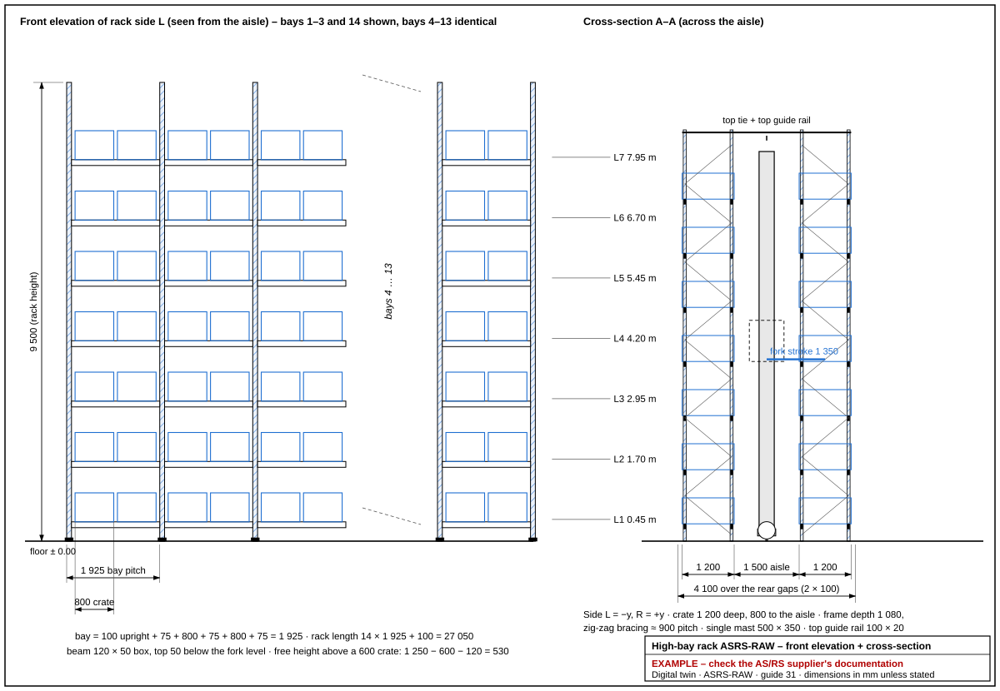
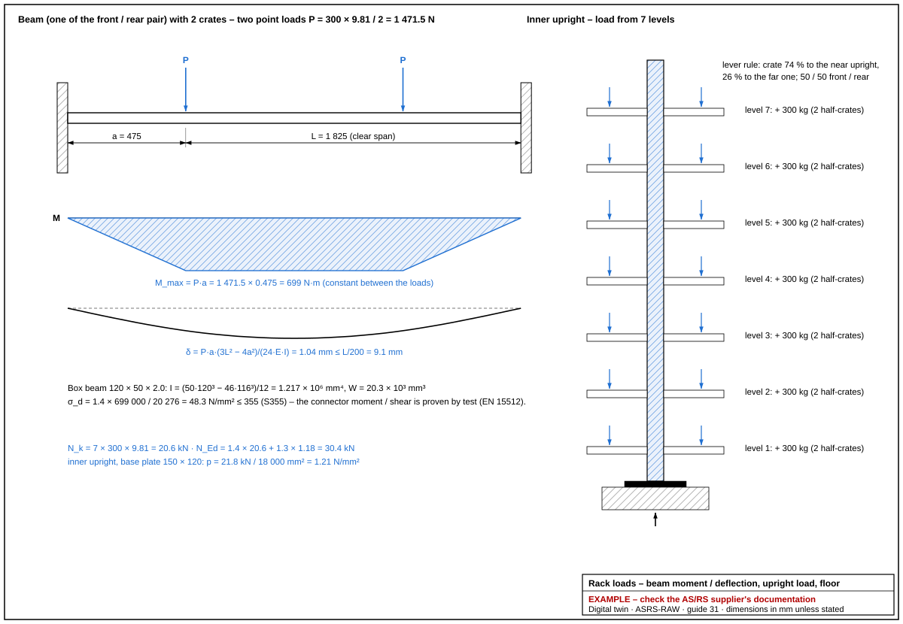
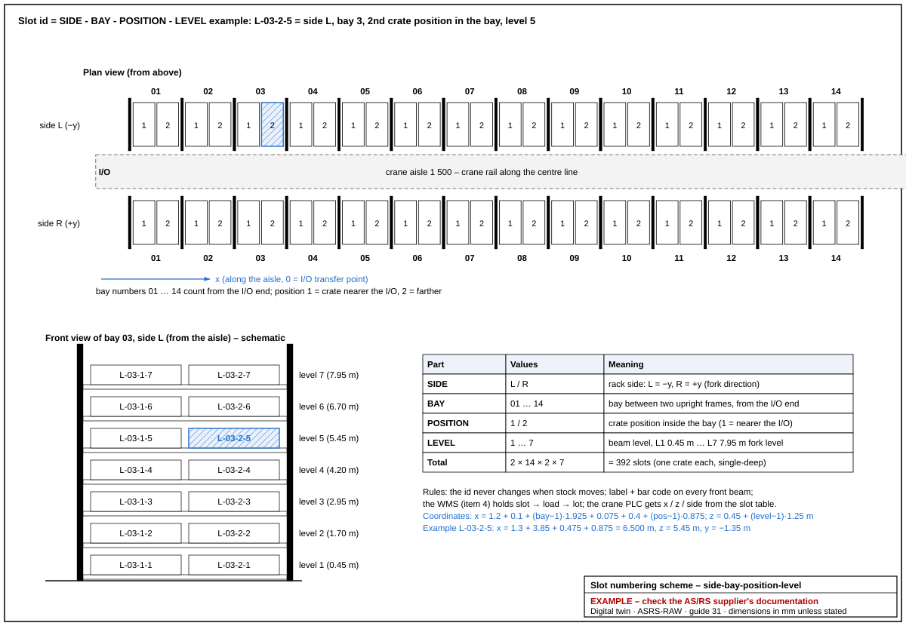
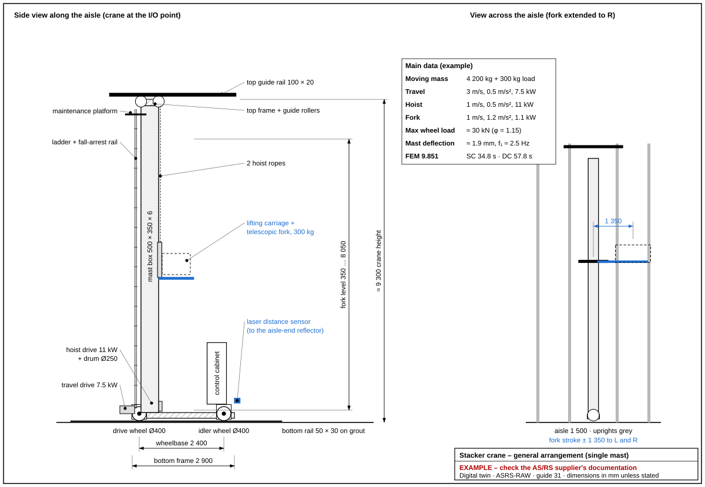
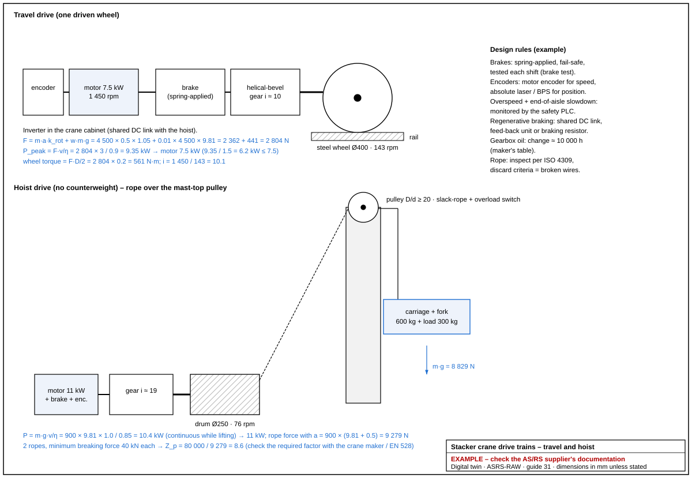
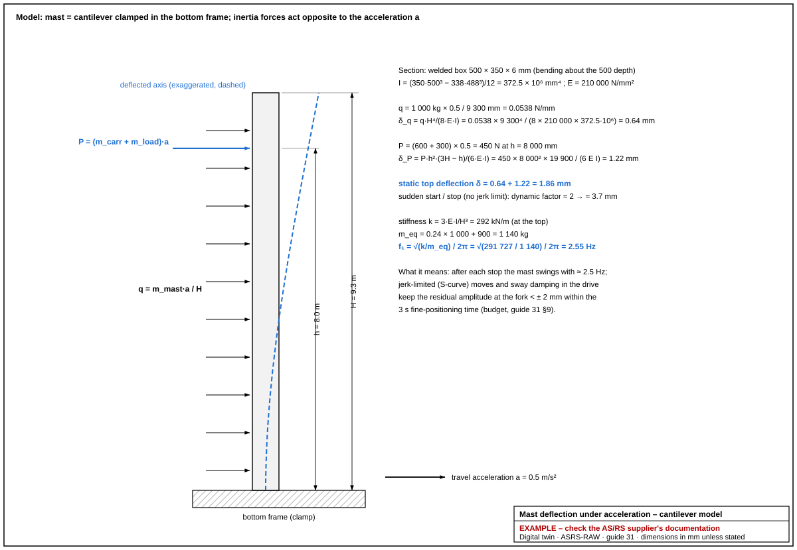
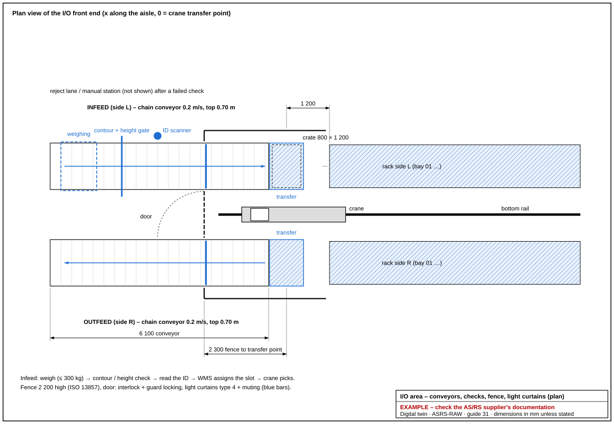
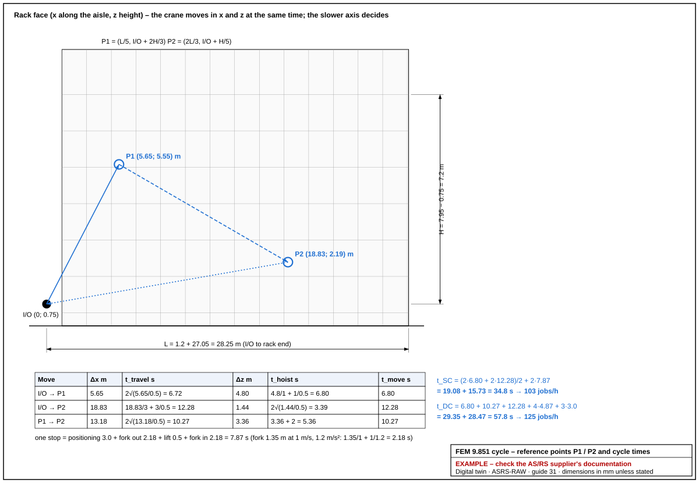
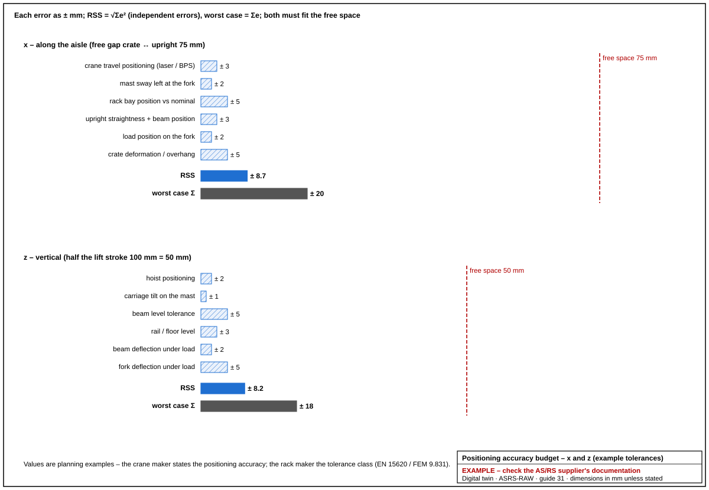

# 31 – AS/RS raw materials: mechanical system – rack, stacker crane, I/O (3D twin + design guide)

**For whom:** mechanical engineers who plan, buy, install or run an automated high-bay store (AS/RS) for raw materials –
here the store **ASRS-RAW** for crankcase castings, cylinder castings and crankshaft forgings of the compressor factory.
**Where to see it live:** tab **AS/RS raw materials** → button **"1 · Mechanical system – 3D twin"** (deep link `/?sritem=1#asrs`).
**Related guides:** 03 (material handling, §10.2 crane cycle, §19 rack geometry – the numbers here agree with it), 32 (AS/RS control
system), 33 (PLC + electrical circuits), 34 (WMS / ERP / MES), 26 (foundations and alignment), 14 (material data), 16 (standards register).

> **All numbers are examples.** They are realistic catalogue-class values for a 1-aisle crate AS/RS of this size, but **the AS/RS
> supplier's offer, structural calculation and FEM 9.851 acceptance test decide.** Simplified checks are labelled "simplified" –
> they are for understanding and plausibility, not a code check. Every formula has a worked example with the page numbers; all
> results were recomputed with Python (stdlib) – see §17 and §25.

## Contents
1. Purpose · 2. How to use the page · 3. Files and self-check · 4. AS/RS types and selection · 5. ASRS-RAW at a glance ·
6. Rack design (6.1 parts · 6.2 loads + beam · 6.3 upright · 6.4 base plates, anchors, floor · 6.5 tolerances · 6.6 specifying the
rack (EN 15629) · 6.7 inspection (EN 15635) · 6.8 seismic note · 6.9 slot numbering · 6.10 crates + load guides) ·
7. Stacker crane design (7.1 general arrangement · 7.2 standards · 7.3 structure · 7.4 wheels, rails, wheel loads · 7.5 mast dynamics ·
7.6 travel drive · 7.7 hoist drive · 7.8 load handling device · 7.9 positioning · 7.10 power + data to the crane · 7.11 safety (EN 528) ·
7.12 energy + regeneration · 7.13 maintenance access) · 8. Cycle time and throughput (FEM 9.851) · 9. Positioning accuracy budget ·
10. Conveyors and I/O (EN 619) · 11. Building interface (floor, slab, rail foundation) · 12. Fire protection · 13. Installation and
alignment · 14. Commissioning tests · 15. Maintenance · 16. Failure modes · 17. Complete worked example (numbers of the page) ·
**18. Buy list – catalogue examples** · **19. Shopping list** · 20. Standards register · 21. Checklists · 22. Supplier questions ·
23. Glossary · 24. Limits of the twin · 25. Drawings and how the numbers were checked · Appendix A (cycle step by step, crane load cases,
wheels + rails, ropes + drum, fork mechanics, Bozer–White, ABC, special environments, retrofit, cost structure, risk assessment,
inspection record, numbers to remember) · Appendix B (specification sheets for the inquiry) · Appendix C (test record templates) ·
Next to read

---

## 1. Purpose

An AS/RS (automated storage and retrieval system) is a steel rack plus a machine that stores and retrieves loads without a
driver. For the compressor factory it is the **raw-material buffer** between goods-in and the machining lines: castings arrive
in steel crates, are checked, stored in one of **392 slots** and are called off by the line (MES / kanban) in FIFO order by lot.

This guide explains the **mechanical system** completely:

* the **steel high-bay rack** – uprights, bracing, beams, base plates, anchors, top ties, tolerances, inspection;
* the **stacker crane** – rails, wheels, mast, carriage, telescopic fork, travel and hoist drives, sensors, power and data, safety;
* the **I/O area** – conveyors, weighing, contour check, ID point, fence, light curtains, maintenance access;
* the **building interface** – floor flatness, slab loads, rail foundation, fire protection;
* **installation, commissioning, maintenance and failure modes**;
* **what to buy** (real makers and series) and **what to ask** the supplier.

The page shows the same system as a running 3D twin. Each part can be clicked; the calculations card recomputes the key design
checks live (rack, floor, wheel loads, mast, drives, cycle time, accuracy, energy).

## 2. How to use the page

| Element | What you do | What you learn |
|---|---|---|
| 3D view – buttons **Fit / Iso / Front / Side / Top** | standard views; *Front* looks down the aisle from the I/O end, *Side* is the front elevation of rack L | the real proportions: 27 m long, 9.5 m high, 1.5 m aisle |
| **Follow crane** | camera rides with the lifting carriage | how the telescopic fork reaches into a slot, how the crate is lifted 100 mm |
| **Explode** | rack sides move apart (± 2.6 m), crane sub-assemblies move out | which parts belong to the crane (mast, carriage, drives, cabinet, top frame, sensors) |
| **dimensions** (check box) | dimension lines with labels | rack length 27.05 m, height 9.5 m, level heights L1 0.45 … L7 7.95 m, aisle 1.5 m, bay pitch 1.925 m, fork stroke ± 1.35 m, rail 31.8 m |
| **colour by SKU / fill / age** | changes the crate colour | SKU: castings coloured per material; fill: crate mass 0 → 300 kg (green → red); age: time in store (FIFO) |
| **sim speed 1× … 50×, Pause** | changes the shared simulation (all items of the tab) | throughput, queue, utilisation at higher load |
| **click a part** | info box: what it is, design data, calculation, typical failure + a live line | e.g. *travel drive*: x, v, a, F, P now; *mast*: deflection now from the measured acceleration |
| **click a crate or an empty slot** | slot id, location, x/y/z, state, SKU, qty, kg, lot, time in store, travel time from I/O | the slot table the WMS and the crane PLC use |
| Live panel (right) | read | crane x / z / v, phase, job(s) (dual cycle when 2), queue, conveyors, KPIs (jobs/h, utilisation, average job time, fill, Wh/job), FEM 9.851 cycle, faults |
| **Engineering calculations** card | change the inputs (design load, crane mass, speeds, mast wall, wheel Ø, dual share, regen η) | all checks of §6–§9 with formula, value, unit and OK / CHECK; rows marked LIVE use the running stock and the line demand |
| **Real components + drawings** card | drawings (click to enlarge), buy list with filter, shopping list | the real makers / series and the 9 drawings of this guide |

Faults are **shared** with the other items: if item 2 sets "crane fault" or the e-stop, the 3D view shows a red alarm banner, the
beacon on the crane turns red and the crane stops; jobs wait in the queue.

URL parameters (also for tests): `&sr1view=iso|front|side|top|follow`, `&sr1ex`, `&sr1mode=sku|fill|age`, `&sr1dims`,
`&sr1speed=N`, `&sr1ff=S` (fast-forward the sim S seconds), `&sr1pick=<part>` (e.g. `mast`, `fork`, `travelDrive`, `contour`),
`&sr1slot=L-03-2-5`, `&sr1calc`, `&sr1cam=x,y,z,tx,ty,tz` (camera, core coordinates), `&sr1test`, `&sr1back`, `&sr1hold`.

## 3. Files and self-check

| File | Content |
|---|---|
| `web/asrs3d.js` | item UI: skeleton, controls, live panel, calculations card, catalogue card, self-check, lazy build on `sritemshow` |
| `web/asrs3d_view.js` | Three.js renderer, views, follow, explode, picking (parts + slots), info box, dimension labels |
| `web/asrs3d_scene.js` | geometry: rack (uprights, bracing, beams, base plates, anchors, load guides, top ties, portals), crane, rails, sensors, I/O, fence; instanced crates + castings updated from the sim |
| `web/asrs3d_calc.js` | all engineering calculations (pure functions) + hand-check values |
| `web/asrs3d_parts.js` | click-info texts for 34 parts |
| `web/asrs3d_data.js` | catalogue card data – **generated** from §18 / §19 / §25 of this guide (`tools/gen_asrs1_card.py`) |
| `web/asrs1.css` | styles (light + dark theme) |
| `web/asrscore.js` | shared core (not changed): RACK, CRANE, IO, SKU, slot geometry, trapezoid motion, FEM 9.851, live simulation |
| `tools/gen_asrs1_card.py` · `tools/gen_asrs1_svg.py` · `tools/check_asrs1_calc.py` | regenerate the card data and the 9 drawings; Python hand check of every number (stdlib only) |

Self-check: open `/?sritem=1&sr1test#asrs` – the console shows `SR1TEST` lines and the box at the end of the item lists them.
Result of the last run:

| Check | Result |
|---|---|
| FEM 9.851 (core): SC 34.81 s / 103.4 jobs/h, DC 57.81 s / 124.5 jobs/h; page calc = core | PASS |
| Slots: RACK.slots = 392, sim slots = 392, 392 unique ids | PASS |
| 30 calculation results vs the Python hand values (beam, upright, floor, wheels, mast, drives, cycle, budget, energy) | 30 PASS, 0 FAIL |
| Picking: ray at the rear face of slot L-03-1-4 returns that slot / crate; ray at the infeed conveyor returns the part `infeed` | PASS |
| Shared fault: `sim.setFault("crane", true)` (as item 2 does) → red banner "CRANE FAULT" in the 3D view, crane phase `fault`; cleared again | PASS |
| Total | **49 PASS, 0 FAIL** |
| 3D object counts: 52 inner + 8 end-frame uprights, 392 beams, 392 slot plates, 392 pick volumes, 784 load guides, crates shown = loads in slots + crane + conveyors | PASS |
| 3D totals (typical): ≈ 195 meshes + 34 instanced meshes (≈ 5 000 instances), ≈ 230 draw calls | info |
| Console errors (item 1 alone and switching 1 → 2 → 3 → 4 → 1 with `&sr1back`) | none |

## 4. AS/RS types and selection

### 4.1 Main types

| Type | Load | Typical height | Throughput per aisle | Use |
|---|---|---|---|---|
| **Unit-load AS/RS with stacker crane** (pallet / crate) | 0.3–2 t | 8–45 m | 40–150 jobs/h (single mast, single load) | raw materials, finished goods, **this store** |
| Twin-mast unit-load crane | 1–6 t | up to ≈ 45 m | 30–80 jobs/h | heavy loads, very high racks |
| Multi-deep / double-deep crane (telescopic fork with 2 depths, or satellite) | 0.5–1.5 t | 10–40 m | lower per slot, higher density | many loads per SKU |
| Mini-load AS/RS (boxes, trays) | 20–300 kg | 6–25 m | 150–400 jobs/h | small parts, KLT |
| Shuttle system (one vehicle per level + lift) | 20–1 500 kg | 6–30 m | 500–2 000 jobs/h | high throughput, e-commerce, pallets with pallet shuttles |
| Vertical lift module (VLM) / carousel | trays ≤ 1 000 kg | 3–15 m | 60–150 trays/h | C-parts, tools |
| Manual / VNA racking with man-up truck | pallets | ≤ 15 m | 15–30 moves/h per truck | low throughput, flexible |

### 4.2 How to choose (rule of thumb – check with a supplier study)

1. **Loads and SKUs.** 5 raw materials, 325–392 crates, crate 1 200 × 800 × 600, ≤ 300 kg → unit-load AS/RS with crates, single-deep
   (every crate must be accessible for **FIFO by lot**).
2. **Throughput.** Peak ≈ 40 jobs/h (18 stores + 22 retrievals, guide 03 §19.3) → one single-mast crane with ≈ 100–125 jobs/h capacity
   is enough (utilisation ≈ 35–40 %). A shuttle system would be over-sized.
3. **Height and floor area.** Hall clear height ≥ 10.5 m → 9.5 m rack, 7 levels. Floor area ≈ 32 m × 4.1 m (+ I/O 7 m).
4. **Availability.** One crane = single point of failure → plan manual emergency retrieval (§15), spare parts, a service contract;
   a second aisle only if the line cannot wait ≈ 4–8 h.
5. **Integration.** Conveyors at the front end for goods-in and line supply; WMS and MES interface (guides 32, 34).
6. **Cost.** Order of magnitude for this size (rack + crane + conveyors + controls + WMS): see the shopping list (§19) – ask 2–3 suppliers.

### 4.3 Rack-supported building vs. rack in a hall

Up to ≈ 12–15 m the rack stands **inside an existing hall** (this case). Above ≈ 20 m the rack is often the building structure
(**rack-clad / silo building**): the rack carries roof and wall cladding, wind and snow – then the rack design includes building loads
and the national building code.

## 5. ASRS-RAW at a glance

| Item | Value (example) | Source |
|---|---|---|
| Slots | 2 sides × 14 bays × 2 crates × 7 levels = **392** | guide 03 §19.1, `RACK.slots` |
| Crate | 1 200 (deep) × 800 (to the aisle) × 600 mm, tare 45 kg, max **300 kg** gross | `RACK`, `CRATE_TARE` |
| Bay | 100 upright + 75 + 800 + 75 + 800 + 75 = **1 925 mm** | §6.1 |
| Rack length / height | 14 × 1 925 + 100 = **27 050 mm**, height **9 500 mm** | `RACK.length` |
| Levels (fork level) | L1 0.45 m, pitch 1.25 m → L7 7.95 m | `RACK.z1`, `levelPitch` |
| Aisle / width over the rack | 1 500 mm / 2 × 1 200 + 1 500 + 2 × 100 = **4 100 mm** | §6.1 |
| Crane | single mast, 4 200 kg moving mass, travel 3 m/s / 0.5 m/s², hoist 1 m/s / 0.5 m/s², fork 1 m/s / 1.2 m/s², stroke ± 1 350 mm | `CRANE` |
| Drives | travel 7.5 kW, hoist 11 kW, fork 1.1 kW | §7.6–7.8 |
| Rail | bottom rail 50 × 30 mm flat bar on grout, 31.8 m; top guide rail 100 × 20 | §7.4 |
| FEM 9.851 | SC **34.8 s → 103 jobs/h**, DC **57.8 s → 125 jobs/h** | §8, `fem9851()` |
| I/O | infeed (side L) and outfeed (side R) chain conveyors 6 m, 0.2 m/s, top 0.70 m; transfer at x = 0 | §10 |
| Stored mass at design load | 392 × 0.3 t = **117.6 t** | §6.3 |

Coordinates (as in the twin): x along the aisle (0 = crane transfer point at the I/O, rack starts at x = 1.2 m), y across
(crane axis 0, side L = −y, side R = +y), z up from the floor.



---

## 6. Rack design

### 6.1 Parts of the rack

| Part | Function | Example design |
|---|---|---|
| **Upright** (column) | carries all vertical loads to the floor | cold-rolled perforated omega profile 100 × 70 × 2.5 mm, S355, slots every 50 mm for beam connectors |
| **Upright frame** | 2 uprights + bracing = a truss across the rack depth | frame depth 1 080 mm (centre to centre), zig-zag diagonals C 40 × 30 × 2 at ≈ 900 mm pitch, bolted M10/M12 8.8 |
| **Beam pair** (front + rear) | carries the crate; the fork goes between the beams | box beam 120 × 50 × 2.0 mm, clear span 1 825 mm, hook-in connector with 4 hooks + **safety lock** |
| **Down-aisle (rear) bracing** | stiffness along the aisle – needed in AS/RS racks for tolerances and crane forces | X-bracing at the rear in bays 1, 7, 14 (example; supplier decides) |
| **Base plate + anchors** | spreads the load, fixes the upright | 150 × 120 × 8 mm, shims ≤ 10 mm, 2 × M12 heavy-duty anchors |
| **Top ties** | join both rack sides across the aisle at the top; carry the top guide rail of the crane | every 2nd frame at 9.45 m |
| **Portals** (front, rear) | carry the top guide rail where there is no rack (crane overrun zones) | 2 columns + tie at x = −1.75 m and x = 29.75 m |
| **Load guides** | centre the crate when it is set down, rear stop | bent galvanised sheet, lead-in 30–45° |
| **Slot label** | slot id + bar code for counting | on the front beam |
| **End-of-aisle protection** | mesh + buffers at the rear end | §7.11 |

Why AS/RS racks are different from manual pallet racks: the crane **cannot see** – it drives to coordinates. The rack must therefore
be **straight, plumb and stiff** (tight tolerance class, §6.5) and braced in both directions; the crane maker and the rack maker work
with one tolerance table.

### 6.2 Loads and beam check (simplified, EN 15512 style)

**Loads.** Design unit load Q = 300 kg per crate (crate 45 kg + castings, VC20: 4 × 43 + 45 = 217 kg). One bay level holds 2 crates
→ 600 kg on 2 beams. Each crate stands on the front and the rear beam → per beam per crate:

```
P = 300 kg × 9.81 / 2 = 1 471.5 N
```

The crate centre is a = 75 + 400 = 475 mm from the upright face; clear span L = 1 925 − 100 = 1 825 mm. Two symmetric point loads:

```
M_max = P · a = 1 471.5 × 0.475 = 699 N·m                     (equal UDL 2P/L would give 671 N·m – point loads are conservative)
Beam: box 120 × 50 × 2.0 mm
I = (b·h³ − (b − 2t)(h − 2t)³) / 12 = (50 × 120³ − 46 × 116³) / 12 = 1.217 × 10⁶ mm⁴
W = I / (h/2) = 1 216 565 / 60 = 20 276 mm³
σ = M / W = 699 000 / 20 276 = 34.5 N/mm²
σ_d = γ_Q · σ = 1.4 × 34.5 = 48.3 N/mm²  ≤  f_y = 355 N/mm²   → 14 %
δ = P·a·(3L² − 4a²) / (24·E·I) = 1 471.5 × 475 × (3 × 1 825² − 4 × 475²) / (24 × 210 000 × 1.217 × 10⁶) = 1.04 mm
limit L/200 = 9.1 mm (EN 15512 – check the clause of your edition)  → OK
```

What really limits a beam in a rack: the **connector** (moment and shear capacity, found by **test** per EN 15512 Annex A), the
**safety lock** (the fork can lift a beam out without it), impact and the **deflection** for the crane (the crate must not sit lower
than the fork expects). Partial factors in EN 15512: γ_G ≈ 1.3, γ_Q ≈ 1.4 for unit loads, γ_M from the material / test – values here
are simplified and labelled.



### 6.3 Upright check (simplified)

**Load on an inner upright.** A crate in position 1 is 475 mm from the left upright and 1 350 mm from the right one (lever rule):

```
share to the near upright = (1 825 − 475) / 1 825 = 0.74, to the far one 0.26
```

An inner upright line gets, per level, 0.74 + 0.26 of the crates of the two adjacent bays → **1 crate per level** (split 50 / 50 to the
front and rear upright of the frame, so each upright of the frame carries ½ × 2 crates = 1 crate). With 7 levels:

```
N_k = 300 × 9.81 × 7 = 20.6 kN       (+ self weight ≈ 120 kg = 1.18 kN per upright)
N_Ed = 1.4 × 20.6 + 1.3 × 1.18 = 30.4 kN
```

**Buckling (EN 1993-1-1 curve b, simplified).** Effective area from the stub-column test A_eff = 520 mm² (perforations reduce it),
radius of gyration i = 30 mm, buckling length = node pitch of the bracing L_cr = 1 250 mm (braced in both directions):

```
ε = √(235 / 355) = 0.814,  λ₁ = 93.9 ε = 76.4,  λ̄ = (1 250 / 30) / 76.4 = 0.545
Φ = 0.5 (1 + 0.34 (0.545 − 0.2) + 0.545²) = 0.707,  χ = 1 / (Φ + √(Φ² − λ̄²)) = 0.864
N_b,Rd = χ · A_eff · f_y / γ_M = 0.864 × 520 × 355 / 1.0 = 159.4 kN   → utilisation 30.4 / 159.4 = 19 %
```

The upright of a 9.5 m crate rack with 300 kg loads is **lightly loaded**; its size is set by stiffness, tolerances, impact
resistance, connector slots and the down-aisle sway check (frame imperfections, crane horizontal forces) – the rack maker's job.
**Live:** the calculations card also shows the highest upright load of the *actual* stock (lever rule over all loaded slots) –
typically 55–70 % of the design value at ≈ 62 % fill with mixed SKUs.

### 6.4 Base plates, anchors and the floor

```
floor point load per base plate  N = N_k + self weight = 20.6 + 1.18 = 21.8 kN
contact pressure on the slab     p = 21 800 N / (150 × 120 mm²) = 1.21 N/mm²     (C30/37 concrete: no problem for pressure)
```

The **structural engineer** checks the slab for **punching shear** under the plate, bending of the slab between plates, settlement and
the anchors (tension from sway, shear from impact). Typical: 2 × M12 heavy-duty anchors per plate (e.g. Hilti HST3, fischer FAZ II –
see the ETA / datasheet for the edge distances and slab thickness). Shims: steel, ≤ 10 mm stack; > 5 mm → non-shrink grout under the plate.

**Whole store at design load:** 392 × 300 kg = 117.6 t on 60 base plates (inner 21.8 kN, end frames ≈ half) + the crane rail
(§7.4). Average ≈ 1 t/m² over the footprint – the slab design must take the **local** loads, not the average.

### 6.5 Tolerances (EN 15620, FEM 9.831)

The crane drives to coordinates, so every deviation of the rack eats into the clearance (§9). EN 15620 defines tolerance **classes**
for racks served by trucks (class 100 = VNA / AS/RS-like, 200, 300A/B, 400); for stacker-crane racks the crane maker usually prescribes
**FEM 9.831**-based values. Typical planning values (example – take the table from the supplier):

| Item | Typical tolerance for a crane rack (example) |
|---|---|
| upright out-of-plumb (whole height) | ± H/750 … H/1000, here ± 10 mm at 9.5 m |
| upright straightness between beam levels | ± 3 mm |
| bay width (upright to upright) | ± 3 mm per bay, ± 5–10 mm cumulative over the rack length |
| beam level (height of each beam) | ± 5 mm (vs. nominal), ± 3 mm across a bay |
| beam deflection under load | ≤ L/200 (here ≤ 9 mm, actual 1 mm) |
| rack front line (aisle face) | ± 5 mm from the rail axis distance |
| bottom rail straightness / level | ± 1 mm per 2 m / ± 2–5 mm over the length (crane maker) |
| top guide rail position | ± 2–3 mm from the bottom rail axis (vertical line) |

Survey the rack after erection with a total station or laser tracker – the surveyed values become the **teach-in table** of the crane
(guide 32): many cranes store a correction per slot.

### 6.6 Specifying the rack (EN 15629)

EN 15629 lists what the **user / specifier** gives the rack maker. For ASRS-RAW (example):

* unit load: crate 1 200 × 800 × 600, steel runners, max 300 kg, load centred, drawing of the crate feet;
* number of levels and their fork heights (7, L1 0.45 m, pitch 1.25 m), bays (14 × 2 crates), sides (2), aisle 1 500;
* handling equipment: stacker crane, rail on the floor, top guide rail on the rack, crane horizontal forces (from the crane maker);
* floor: slab data, flatness class, anchors allowed, joints;
* environment: indoor, dry, no chemicals; temperature 10–35 °C;
* seismic zone and importance class (§6.8); fire protection (sprinklers in the rack, §12);
* tolerance class (crane maker's table), inspection and documentation (load signs, EN 15635).

### 6.7 Inspection (EN 15635) – the rack in use

| Interval | Who | What |
|---|---|---|
| daily / at each shift (visual) | operators | crates sit correctly, no loose parts, no visible damage |
| weekly | **PRSES** (person responsible for storage equipment safety) | damage, missing locks, anchors, load signs |
| at least every 12 months | **technically competent person** (expert) | full inspection, report with damage classes |

Damage classes (EN 15635): **green** = observe; **amber** = repair soon, do not reload when unloaded; **red** = **unload immediately**,
isolate. In an AS/RS there is less truck impact than in a manual rack, but crane collisions, fork hits and crate drops happen – after
every crash: inspect the slot, beams, connector locks and the crate.

### 6.8 Seismic note

In seismic areas the rack is designed per **EN 16681** (seismic design of steel static pallet racking) together with EN 1998 (national
annex): the stored mass acts horizontally (here up to 117.6 t × design factor). Effects: stronger uprights / bracing, more anchors,
**load restraints** (crates must not slide out), the crane's top guide must hold the mast. Tell the rack maker the seismic zone in the
specification – it changes the design a lot.

### 6.9 Slot numbering

Slot id = **SIDE-BAY-POSITION-LEVEL**, e.g. `L-03-2-5`. Bays 01–14 count from the I/O end; position 1 is the crate nearer the I/O.

```
x = x0 + upright + (bay − 1)·1.925 + 0.075 + 0.400 + (pos − 1)·0.875        z = 0.45 + (level − 1)·1.25      y = ∓1.35 (L / R)
L-03-2-5: x = 1.2 + 0.1 + 3.85 + 0.475 + 0.875 = 6.500 m, z = 5.45 m, y = −1.35 m
```

The id never changes; the WMS stores slot → load → lot (guide 34), the crane PLC gets x / z / side (guide 32). Click any slot in the
3D view to see it.



### 6.10 Crates and load guides

The crate is part of the mechanical system: its runners carry it on the beams and on the fork, its stiffness decides whether it sags.
Specify: steel mesh or sheet box, 2 runners at ± 250 mm (fork tine positions), runner straightness ± 2 mm, max deflection under 300 kg,
stackable for transport, label holder on both short sides. **Contour check** (§10) protects the rack from overhanging castings.

---

## 7. Stacker crane design

### 7.1 General arrangement

A single-mast stacker crane has (from bottom to top):

1. **bottom frame (end carriage)** with 2 wheel blocks on the bottom rail – drive wheel under the mast, idler at the other end
   (wheelbase 2.4 m); horizontal guide rollers on both sides of the rail head;
2. **travel drive** (geared motor + brake + encoder) on the drive wheel;
3. **hoist drive** (geared motor + brake + drum) on the bottom frame, ropes up the mast;
4. **mast** – welded box, clamped to the bottom frame, with guide rails for the carriage;
5. **top frame** with rope pulleys and **top guide rollers** on the top guide rail;
6. **lifting carriage** with the **telescopic fork** (load handling device, LHD), occupancy and fine-positioning sensors,
   slack-rope / overload detection and a safety catch;
7. **control cabinet** (PLC I/O, inverters, safety), **ladder** with fall arrest and a **maintenance platform**;
8. **sensors:** laser distance sensors for x and z, bar-code positioning (alternative), data light barrier, current collector.



### 7.2 Standards for stacker cranes

| Standard | Content |
|---|---|
| **EN 528** | Rail-dependent storage and retrieval equipment – **safety requirements** (structure, drives, brakes, overspeed, end-of-aisle, access, rescue, electrical, documentation) |
| **FEM 9.831** | Calculation principles for S/R machines – load cases, tolerances, deformations; with part for **rack tolerances** (crane racks) |
| **FEM 9.851** | **Performance data** of S/R machines – cycle times, reference points P1 / P2 (§8) |
| FEM 9.832 / 9.841 | (older FEM sheets) – check if quoted in the offer: calculation of S/R machine structures / design rules (verify current status with FEM / the supplier) |
| FEM 1.001 / EN 13001 | crane design rules used for wheels, rails, ropes, fatigue classes |
| ISO 4309 | wire ropes – care, inspection, discard |
| EN ISO 13849-1 / IEC 62061 | functional safety of the control (PL / SIL of the safety functions, guide 32) |
| EN 60204-1 | electrical equipment of machines |
| EN ISO 14122-1…4 | permanent access (ladders, platforms) |
| 2006/42/EC → Regulation (EU) 2023/1230 | Machinery Directive / Regulation: CE marking, risk assessment, declaration |

### 7.3 Structure: bottom frame, mast, top frame

* **Bottom frame:** welded box beams; must carry the mast clamping moment (travel acceleration, §7.5) and the wheel loads. Low middle
  section so the fork reaches L1 (fork level 0.35 m at the lowest point including the 0.1 m lift).
* **Mast:** single box 500 (along the aisle) × 350 × 6 mm, ≈ 79 kg/m, ≈ 1 000 kg with rails, ladder and cable ducts. The mast is
  the **stiffness-critical** part (§7.5). Twin-mast cranes use two masts + top beam for heavy or very high loads.
* **Top frame:** pulleys and guide rollers. Rollers spring-loaded, polyurethane on steel; they take **only cross-aisle forces** (top
  guide roller force ≈ 0.5 kN with the fork extended, conservative).

### 7.4 Wheels, rails and wheel loads

**Static wheel loads.** Masses and lever arms (x from the fork centre, + away from the mast):

| Mass item | kg | x (m) | CG height (m) |
|---|---|---|---|
| bottom frame + drives | 1 600 | +0.20 | 0.4 |
| mast | 1 000 | −0.65 | 5.0 |
| carriage + fork | 600 | 0 | 8.3 (top level) |
| cabinet, platform, ladder, misc. | 800 | +1.0 | 1.0 |
| top frame | 200 | −0.65 | 9.4 |
| load | 300 | 0 | 8.3 |
| **total** | **4 500** | | Σ m·h = 15 790 kg·m |

Wheels at x = −1.05 m (drive) and +1.35 m (idler), wheelbase 2.4 m. Moments about the drive wheel:

```
Σ m·(x + 1.05) = 1 600 × 1.25 + 1 000 × 0.40 + 900 × 1.05 + 800 × 2.05 + 200 × 0.40 = 5 065 kg·m (loaded)
R_idler = 5 065 / 2.4 = 2 110 kg = 20.7 kN       R_drive = 4 500 − 2 110 = 2 390 kg = 23.4 kN
tilt from acceleration: ΔR = a · Σ m·h / wheelbase = 0.5 × 15 790 / 2.4 = 3 290 N = 3.3 kN
R_max = φ · R_static + ΔR = 1.15 × 23.4 + 3.3 = 30.2 kN         (φ = dynamic factor for rail joints, travel – example)
```

**Wheel check (simplified, DIN 15070 / FEM 1.001 idea – steel wheel on a flat rail):**

```
mean load      P_mean = (P_min + 2·P_max) / 3 = (21.8 + 2 × 30.2) / 3 = 27.4 kN     (P_min = same wheel, crane empty)
wheel speed    n = v / (π·D) = 3.0 / (π × 0.4) × 60 = 143 rpm  → speed factor c1 ≈ 0.89
allowed        P_al = p_lim · b_eff · D · c1 · c2 = 5.0 × 42 × 400 × 0.89 × 1.0 = 74.7 kN      (b_eff = 50 − 2 × 4 mm edge radii)
utilisation    27.4 / 74.7 = 37 %
```

p_lim depends on the wheel material (≈ 5–7 N/mm² for steels of 600–800 N/mm² tensile strength; hardened 42CrMo4 higher – check the
table of the crane maker). Polyurethane wheels are quieter but carry less and creep under static load – usual only for light cranes.

**Rails.** Bottom rail = flat bar 50 × 30 (S355J2) or a crane rail (A45 / A55) on **sole plates + rail clamps** every ≈ 0.6 m and
**non-shrink grout**; welded or with tight joints (step < 0.5 mm, gap < 1 mm). Line load on the grout ≈ R_max / 0.5 m ≈ 60 kN/m.
Top guide rail = flat bar 100 × 20 or T-profile hung under the top ties, adjustable ± 10 mm.



### 7.5 Mast dynamics and deflection

When the crane accelerates, the mast bends like a cantilever clamped in the bottom frame: its own mass is a uniform inertia load,
carriage + load a point load at the carriage height.

```
I = (350 × 500³ − 338 × 488³) / 12 = 372.5 × 10⁶ mm⁴,  E = 210 000 N/mm²,  H = 9 300 mm
q = m_mast · a / H = 1 000 × 0.5 / 9 300 = 0.0538 N/mm         δ_q = q·H⁴ / (8·E·I) = 0.64 mm
P = (600 + 300) × 0.5 = 450 N at h = 8 000 mm                 δ_P = P·h²·(3H − h) / (6·E·I) = 1.22 mm
static top deflection δ = 1.86 mm;  a sudden step (no jerk limit) roughly doubles it → ≈ 3.7 mm
k = 3·E·I / H³ = 292 kN/m;   m_eq = 0.24 × 1 000 + 900 = 1 140 kg;   f₁ = √(k/m_eq) / 2π = 2.55 Hz
```

**What it means:** after every stop the mast swings at ≈ 2.5 Hz. The control (guide 32) uses jerk-limited (S-curve) profiles and
active sway damping so the residual amplitude at the fork is < ± 2 mm within the 3 s fine-positioning time. A softer mast (thinner
wall – try `mast wall t` = 4 mm on the page) gives larger deflection, lower frequency and longer settling. **Live:** click the mast –
the info box shows the deflection from the acceleration measured in the sim.



### 7.6 Travel drive

```
m = 4 200 + 300 = 4 500 kg;  rotating inertia factor k_rot = 1.05;  rolling resistance w = 0.01 (10 N/kN)
F = m·a·k_rot + w·m·g = 4 500 × 0.5 × 1.05 + 0.01 × 4 500 × 9.81 = 2 362 + 441 = 2 804 N
P_peak = F·v / η = 2 804 × 3.0 / 0.90 = 9.35 kW (end of acceleration);   P_steady = 441 × 3 / 0.9 = 1.47 kW
selection: P_N ≥ P_peak / 1.5 = 6.2 kW and ≥ P_steady → 7.5 kW (IEC series 5.5 / 7.5 / 11)
wheel torque = F·D/2 = 2 804 × 0.2 = 561 N·m;  gear ratio i = 1 450 / 143 = 10.1
```

Real cranes often use **servo** or asynchronous motors with encoder and a helical-bevel gearbox (SEW, Nord, Lenze), sometimes two
drives (front and rear wheel) for higher acceleration without wheel slip. **Slip check:** friction steel/steel μ ≈ 0.15 → max traction
on the drive wheel ≈ 0.15 × 23.4 kN = 3.5 kN > 2.8 kN needed (only 1.25 × margin – emergency braking with 1 m/s² would slip: the
brake ramp must be limited or both wheels braked).

### 7.7 Hoist drive

```
hoisted mass m = carriage + fork 600 + load 300 = 900 kg (no counterweight)
P = m·g·v / η = 900 × 9.81 × 1.0 / 0.85 = 10.4 kW (continuous while lifting)  → 11 kW
peak with acceleration: m·(g + a)·v / η = 900 × 10.31 / 0.85 = 10.9 kW (inside 11 kW)
rope force F = m·(g + a) = 9 279 N; 2 ropes with MBF 40 kN each → Z_p = 80 000 / 9 279 = 8.6
drum Ø250 → 76 rpm at 1 m/s; i = 1 450 / 76 = 19
```

Lowering returns m·g·Δz – with a **regenerative** DC link this energy is used by the travel drive or fed back (§7.12). Alternatives:
toothed belt (less maintenance, no lubrication), chain, or a counterweight (rare on single-mast cranes). Required devices: **slack-rope
switch**, **overload detection** (load cell or motor current + plausibility), **safety catch** on rope break, brake test.

### 7.8 Load handling device – telescopic fork

* 2 tines, **3 stages** (base, middle, top): the middle stage moves half, the top stage the full stroke (chain or rack-and-pinion
  in each stage); both sides L and R; single-deep stroke ± 1 350 mm (double-deep ≈ ± 2 300 mm).
* Data: 300 kg, 1.0 m/s, 1.2 m/s² → 1.35 m in 1.35/1 + 1/1.2 = **2.18 s** each way; lift / lower 100 mm in 0.5 s.
* Drive: F = m·a + μ·m·g = 450 × 1.2 + 0.05 × 450 × 9.81 = 761 N; P = 761 × 1.0 / 0.8 = 0.95 kW → **1.1 kW**.
* Sensors: fork centre position (safe), end positions, torque / current monitoring (collision), **occupancy check** of the target slot
  before a store (photo-electric), crate overhang / position on the fork.
* Makers: most crane makers build the fork in-house; specialist telescopic-fork makers exist (e.g. Eurofork – check the current range).

### 7.9 Positioning – how the crane knows where it is

| Method | Example products | Typical data (see datasheet) | Notes |
|---|---|---|---|
| **Laser distance sensor + reflector** (x and z) | SICK DL100 Pro, Leuze AMS 300i / AMS 200 | range up to ≈ 100–300 m, repeatability ≈ 1–2 mm, SSI / PROFINET / EtherNet/IP | line of sight, keep reflector clean; heated version for cold stores |
| **Bar-code positioning (BPS)** – tape + reader | Leuze BPS 300i / BPS 8, SICK OLV (OLM) | resolution 0.01–0.1 mm, curves possible | tape fixed every few m, fix point against thermal expansion |
| Motor encoder (incremental / absolute multiturn) | in the servo motor | resolution high, but **wheel slip** and wear → not an absolute position | used for speed control |
| Fine positioning at the slot | photo-electric / reflex sensor on a flag at each bay / level | ± 1–2 mm | final correction before the fork moves |

Two independent position sources (e.g. laser + motor encoder) also give the **safe position / safe speed** for the safety PLC
(end-of-aisle slowdown, overspeed). Positioning control in detail: guide 32.

### 7.10 Power and data to the crane

* **Power:** enclosed conductor rail (e.g. Vahle KBH / U10, Conductix-Wampfler Program 0812/0813) along the aisle with a current
  collector trolley (double PE brush); 400 V 3~, current from the drives (≈ 40–60 A for 7.5 + 11 + 1.1 kW plus auxiliaries – example;
  diversity because travel and hoist peak at different times and share the DC link). Alternative for short aisles: **energy chain**
  (igus E4 / e-loop) with flat cables; for very long aisles: contactless power (Vahle CPS, Conductix-Wampfler IPT).
* **Data:** optical data transmission (Leuze DDLS 500, SICK ISD 400) – PROFINET / EtherNet/IP at 100 Mbit/s; or a slotted
  microwave line / leaky-feeder / WLAN (industrial, with redundancy). The **safety** signals (e-stop, door) go via safe fieldbus
  (PROFIsafe, CIP Safety) over the same link or via separate hard-wired loops in the conductor rail.
* **Carriage:** energy chain or festoon / spiral cable along the mast from the bottom frame to the carriage.

### 7.11 Safety devices (EN 528 – overview, check the full list in the standard)

| Hazard | Measure (example) |
|---|---|
| person in the aisle while the crane moves | safety fence + **interlocked door with guard locking**, crane **STO** on entry; access only in maintenance mode (key / trapped key) |
| crane hits the aisle end | **slowdown + end-of-aisle limit switches** (safety-rated), safe speed monitoring, **buffers** sized for the reduced speed (½·m·v² = ½ × 4 500 × 1² = 2.25 kJ at 1 m/s) |
| overspeed (travel / hoist) | independent speed monitoring (safe encoder or overspeed governor) |
| load falls / rope breaks | 2 ropes, slack-rope switch, safety catch on the carriage, overload detection |
| crate overhang hits the rack | contour check at the infeed (§10), fork position + torque monitoring |
| storing into an occupied slot | occupancy sensor on the carriage, WMS check |
| falling from the crane | ladder with fall-arrest rail (EN ISO 14122-4), platform with handrail, harness anchor points |
| crane stops at height with a person on it | **rescue concept**: manual lowering of the carriage (brake release), rescue device, trained staff |
| electrical | EN 60204-1, PE on the conductor rail (2 brushes), lockable main switch at the feed point |



### 7.12 Energy and regenerative braking

Per FEM single cycle (mean of the 4 moves to P1 / P2 loaded / empty), with the masses above:

```
motion energy (motor input)       E = Σ(½·m·v_p² + w·m·g·s)/η_T + Σ m·g·Δz⁺/η_H        = 19.1 Wh
recoverable braking energy        E_back = 0.65 × (½·m·v_p² + m·g·Δz⁻)                  =  9.0 Wh
auxiliary (controls, fans)        0.5 kW × 34.8 s                                         =  4.8 Wh
per cycle WITHOUT regeneration    19.1 + 4.8 = 23.9 Wh;  WITH regeneration  19.1 − 9.0 + 4.8 = 14.9 Wh  → saves ≈ 38 %
```

At ≈ 40 jobs/h × 16 h × 250 days = 160 000 jobs/year → ≈ 3.8 MWh (no regen) vs ≈ 2.4 MWh (regen) per year – small money, but a
**shared DC link** also reduces the braking-resistor heat in the cabinet and the peak power from the rail. Ask the supplier for the
measured **Wh per FEM cycle** (VDI 2198 / FEM energy sheets – check) and for supercapacitor options (peak shaving).

### 7.13 Maintenance access on the crane

Ladder on the mast with fall-arrest rail, platform at the top frame, safe parking position at the rear end of the aisle next to the
**rack-end maintenance access** (fenced area with door, §10). Maintenance mode: key switch, reduced speed, hold-to-run pendant,
crane cannot be started from the WCS.

---

## 8. Cycle time and throughput (FEM 9.851)

**Rule.** Each axis follows a trapezoid profile (guide 03 §10.1); travel and hoist run together, the **slower axis decides**:

```
t(d) = d/v + v/a      if d ≥ v²/a  (full speed reached)        t(d) = 2·√(d/a)   otherwise (triangle)
```

FEM 9.851 reference points from the I/O point: **P1 = (L/5, 2H/3)**, **P2 = (2L/3, H/5)**, with L = 1.2 + 27.05 = 28.25 m and
H = 7.95 − 0.75 = 7.2 m:

| Move | Δx (m) | t_travel (s) | Δz (m) | t_hoist (s) | t_move (s) |
|---|---|---|---|---|---|
| I/O → P1 | 5.65 | 2√(5.65/0.5) = 6.72 | 4.80 | 4.8/1 + 1/0.5 = 6.80 | **6.80** |
| I/O → P2 | 18.83 | 18.83/3 + 3/0.5 = 12.28 | 1.44 | 2√(1.44/0.5) = 3.39 | **12.28** |
| P1 → P2 | 13.18 | 2√(13.18/0.5) = 10.27 | 3.36 | 3.36/1 + 2 = 5.36 | **10.27** |

One stop = fine positioning 3.0 + fork out 2.18 + lift 0.5 + fork in 2.18 = **7.87 s** (load handling t_LHD = 4.87 s).

```
single cycle  t_SC = (2·6.80 + 2·12.28)/2 + 2·7.87 = 19.08 + 15.73 = 34.8 s  → 3 600 / 34.8 = 103 jobs/h
dual cycle    t_DC = 6.80 + 10.27 + 12.28 + 4·4.87 + 3·3.0 = 29.35 + 28.47 = 57.8 s → 7 200 / 57.8 = 125 jobs/h
```

(Guide 03 §10.2 rounded the same crane to 35.6 s / 58.8 s with LHD 5 s – the core uses the exact fork time; both are consistent.)

**Mixed operation** with a share p of jobs paired into dual cycles: `time per job = (1 − p)·t_SC + p·t_DC/2`. With p = 0.5 →
31.9 s → **113 jobs/h**. Required by the line: 18 + 22 = 40 jobs/h → crane utilisation **35 %** (keep ≤ 80 % for peaks, faults and
inventory moves). **Live:** the page uses the store / retrieve rates set in items 2 / 4 and the KPI panel shows the measured jobs/h,
utilisation and average job time of the running twin.



## 9. Positioning accuracy budget

The fork must put a 800 mm crate into a 950 mm opening (75 mm free each side) and slide the tines under a crate that sits on two
beams. Example error budget (± mm):

| x – along the aisle | ± mm | z – vertical | ± mm |
|---|---|---|---|
| crane travel positioning (laser / BPS, closed loop) | 3 | hoist positioning | 2 |
| mast sway left at the fork after fine positioning | 2 | carriage tilt on the mast | 1 |
| rack bay position vs nominal | 5 | beam level tolerance | 5 |
| upright straightness + beam position | 3 | rail / floor level under the crane | 3 |
| load position on the fork | 2 | beam deflection under load | 2 |
| crate deformation / casting overhang | 5 | fork deflection under load | 5 |
| **RSS = √Σe²** | **8.7** | **RSS** | **8.2** |
| worst case Σe | 20 ≤ 75 free | worst case Σe | 18 ≤ 50 (half the 100 mm lift stroke) |

Both budgets fit with margin – that is why the rack can use the 75 mm gap of guide 03 §19.1. If the survey shows larger rack errors,
the crane stores a **correction per slot** (teach-in) instead of rebuilding the rack.



## 10. Conveyors and I/O (EN 619)

### 10.1 Layout and sequence

Infeed on side L (y = −1.35 m), outfeed on side R (y = +1.35 m), both 6.1 m chain conveyors for crates (runners across the chains),
top of conveyor 0.70 m (the fork picks at 0.75 m = 5 cm lift-off). Sequence at the infeed:

1. **weighing** section on 4 load cells – reject > 300 kg (fault "overload" in item 2);
2. **contour + height check** gate (light grids front / rear / sides / top) – reject overhang > ± 10–20 mm or height > 600 mm;
3. **ID point** (bar-code / DataMatrix / RFID reader) – no-read → reject lane (fault "scanner");
4. the WMS books the load and assigns a slot (guide 34) → the crane picks at the **transfer station** (x = 0).

Outfeed: the crane sets the crate on the transfer station side R, the conveyor takes it 6 m to the line / AGV pick-up point
(0.2 m/s → 31 s; a full outfeed blocks the crane – buffer size per guide 03 §22).

### 10.2 Conveyor sizing (short)

```
chain pull F = μ·m·g (+ accumulation) = 0.1 × (3 crates × 300 kg) × 9.81 = 883 N (example)
P = F·v / η = 883 × 0.2 / 0.8 = 0.22 kW → 0.37–0.55 kW geared motor per section
throughput: 0.2 m/s / 1.0 m pitch = 0.2 crates/s = 720 crates/h ≫ 40 needed
```

### 10.3 Safety at the I/O (EN 619, ISO 13849, ISO 13855 / 13857)

* Conveyors: guards at chain sprockets and nip points, e-stops along the conveyor, start warning (EN 619).
* Openings in the fence where crates pass: **light curtains type 4 with muting** (IEC 61496) – crates pass, a person stops the
  conveyor and the crane. Muting sensors in X arrangement; safety distance per ISO 13855.
* Fence 2.2 m (ISO 13857 reach distances), door with interlock + guard locking (ISO 14119), trapped-key for maintenance entry.

## 11. Building interface

| Item | Requirement (example – the AS/RS supplier gives the values) |
|---|---|
| Clear height | rack 9.5 m + crane top frame + sprinkler clearance ≈ 10.5–11 m under the lowest roof member |
| Floor flatness in the rack area | per EN 15620 / DIN 15185 class for the crane rail zone (DIN 15185-1 is the German standard for warehouse floors with narrow-aisle trucks; for stacker cranes the crane maker states the rail-zone flatness, often ± 2–5 mm over the length) |
| Slab | e.g. 250 mm C30/37, reinforced or steel-fibre; local loads 21.8 kN per base plate, ≈ 30 kN per crane wheel; settlement < 5 mm differential |
| Rail foundation | rail on sole plates + grout, or a cast-in rail channel; **no slab joint under the rail** (or a dowelled joint, crane maker approval) |
| Anchors | heavy-duty anchors per ETA, edge distances to joints |
| Joints | saw cuts parallel to the aisle, not under rail or base plates |
| Temperature | 10–35 °C (laser sensors, oil viscosity); condensation-free |
| Power | feed 400 V 3~ + PE at the aisle front, ≈ 63 A (example) |
| Network | fibre / Cat6 to the WCS cabinet |

**Floor flatness** is the most expensive mistake to fix later – specify it **before** the slab is cast and measure it after
(profilograph / levelling grid).

## 12. Fire protection

* Racks > ≈ 7.5 m high with combustible packaging usually need **in-rack sprinklers** (per national rules, e.g. VdS CEA 4001, FM
  Global 8-9, NFPA 13 – the insurer decides). Steel crates with castings are low-combustible – this can reduce the requirement;
  wooden pallets or plastic boxes increase it.
* Keep **flue spaces** (transverse and longitudinal gaps between loads, ≥ 75–150 mm) free – here 75 mm between crates and 100 mm rear
  gap; the rear gap between back-to-back racks is the longitudinal flue.
* Sprinkler pipes and heads must be **outside the crane envelope** and the fork path – coordinate with the crane maker.
* Alternatives: oxygen reduction (only for closed stores), smoke detection (aspirating) in the rack.

## 13. Installation and alignment

| Step | Content | Typical tolerance / check |
|---|---|---|
| 1 | floor survey (flatness, level), mark the rail axis and the rack grid with a total station | grid ± 2 mm |
| 2 | bottom rail: sole plates, levelling, rail clamps, **grout**, welding / joints | straightness ± 1 mm / 2 m, level ± 2 mm |
| 3 | rack: base plates, uprights, frames, beams, bracing; plumb and align, anchor | out-of-plumb ≤ ± 10 mm at 9.5 m, bay ± 3 mm |
| 4 | top ties, top guide rail; align to the bottom rail axis (plumb line / laser) | ± 2–3 mm |
| 5 | crane erection: bottom frame on the rail, mast (crane hire, ≈ 10 t mobile crane or erection gantry), top frame, carriage, fork | mast plumb ± 2 mm |
| 6 | conductor rail, data light barriers, reflectors, BPS tape | per maker |
| 7 | survey the rack after loading test → **teach-in table** of slot positions | per slot |
| 8 | conveyors, fence, light curtains, I/O devices | |

Details on foundations and alignment methods: guide 26; electrical installation: guide 27.

## 14. Commissioning tests

| Test | Acceptance (example) |
|---|---|
| mechanical run-in (empty), all axes at reduced and full speed | no noise, temperatures normal |
| brake tests travel / hoist (stopping distance, holding torque) | within the maker's values |
| **load test** hoist (static 1.25 × rated, dynamic 1.1 × rated – check EN 528 / maker) | no permanent deformation, brakes hold |
| safety functions: e-stop, door, end-of-aisle, overspeed, slack rope, overload, light curtain muting | each function proven, PL / SIL documented (guide 32) |
| positioning accuracy at every slot (store / retrieve all 392 slots with a test crate) | 0 collisions; deviation inside the budget (§9) |
| **FEM 9.851 cycle test**: measure SC and DC at P1 / P2 | ≤ offered times (here SC 34.8 s, DC 57.8 s) |
| throughput test (e.g. 1 h at the design mix) | ≥ required jobs/h with ≥ 20 % reserve |
| energy per cycle | ≤ offered Wh |
| conveyors + I/O checks (contour, scale, scanner reject) | correct rejects, read rate > 99.9 % |
| WMS / WCS integration (guide 32 / 34) | inventory = physical stock |

## 15. Maintenance

| Interval (example – maker's plan decides) | Work |
|---|---|
| daily | visual check, crane beacon / alarms, clean reflectors and scanners if dirty |
| weekly | rack walk (PRSES), brake test (automatic or manual), check fork for damage |
| monthly | wheels and guide rollers (wear, flats), rail joints, conductor-rail collectors, light curtains |
| 3-monthly | rope inspection (ISO 4309), slack-rope / overload switch test, fork chains, lubrication |
| yearly | expert rack inspection (EN 15635), crane inspection by a competent person (EN 528 / national rules), alignment check of rails, gearbox oil per hours |
| 3–5 years | wheel replacement (as found), rope replacement (as found), collector replacement |

**Emergency / manual retrieval:** written procedure + training (crane in maintenance mode, hold-to-run; if the crane is dead:
manual brake release, rescue device, a forklift / man-up truck can reach only the lowest levels – plan it). Spare parts on site:
fork chains, guide rollers, a travel wheel, collectors, one laser sensor, one inverter (or 24-h service).

## 16. Failure modes

| Failure | Cause | Effect | Detection / prevention |
|---|---|---|---|
| crate collision with the rack | overhang, rack out of tolerance, teach-in wrong | damaged beam / crate, crane stop | contour check, survey + teach-in, fork torque monitoring |
| double store (slot occupied) | WMS error, manual move | crash | occupancy sensor on the carriage, inventory checks |
| wheel flats / bearing failure | emergency stops with slip, overload | noise, vibration, positioning drift | wheel inspection, limited brake ramp, vibration monitoring |
| rail joint step / grout broken | poor installation, slab movement | impacts, noise, fatigue | survey, re-grout |
| mast crack at the foot | fatigue from high accel. / jerk | collapse risk | yearly NDT of the welds, jerk limits |
| rope wire breaks | wear, small pulley | rope failure | ISO 4309 inspection, 2 ropes, safety catch |
| fork chain stretch | wear | stages out of step, fork misalignment | chain tension check, end-position monitoring |
| laser signal lost | dirty reflector, person in beam, misalignment | crane stops | clean, second position source |
| data link loss | DDLS misaligned / dirty | crane stops (safe) | alignment, cleaning, redundancy |
| conductor-rail arcing | worn collector, misaligned joint | power loss, burn marks | collector check, joint alignment |
| anchor failure / out-of-plumb | impact, poor installation | rack out of tolerance | weekly / yearly inspection |
| scanner no-read | label damaged | reject, manual booking | label quality, reader position |
| conveyor jam | crate skew, photo-eye dirty | crane waits, line starves | centring guides, sensor cleaning |
| crane fault (any) | – | **whole store stops** (one aisle) | spare parts, service contract, manual retrieval plan |

---

## 17. Complete worked example – the numbers of the page

All values below are the default inputs of the calculations card (they agree with `asrscore.js` and guide 03). Each line was
recomputed with Python 3 (stdlib, `tools/check_asrs1_calc.py`) and is checked by `&sr1test` (49 PASS in total).

### 17.1 Input data

| Symbol | Meaning | Value |
|---|---|---|
| Q | design load per crate (gross) | 300 kg |
| L_b | clear beam span | 1 825 mm |
| a | crate centre to upright face | 475 mm |
| beam | box 120 × 50 × 2.0, S355 | f_y = 355 N/mm² |
| upright | A_eff 520 mm², i 30 mm, L_cr 1 250 mm, self weight 120 kg | S355 |
| γ_Q / γ_G | partial factors (simplified) | 1.4 / 1.3 |
| m_crane | moving mass | 4 200 kg (mast 1 000, carriage + fork 600, bottom frame 1 600, top frame 200, rest 800) |
| m_load | load | 300 kg |
| D, b | wheel Ø, rail head width | 400 mm, 50 mm |
| φ | dynamic factor (wheel) | 1.15 |
| v_x, a_x / v_z, a_z / v_f, a_f | travel / hoist / fork | 3 / 0.5 · 1 / 0.5 · 1 / 1.2 (m/s, m/s²) |
| w, k_rot | rolling resistance, rotating inertia factor | 0.010, 1.05 |
| η_T, η_H, η_F, η_back | efficiencies | 0.90, 0.85, 0.80, 0.65 |
| mast | box 500 × 350 × 6, H 9 300 mm | E = 210 000 N/mm² |

### 17.2 Results (the calculations card)

| # | Check | Formula | Result | Limit / note |
|---|---|---|---|---|
| 1 | beam I | (b·h³ − (b−2t)(h−2t)³)/12 | 1.217 × 10⁶ mm⁴ | W = 20 276 mm³ |
| 2 | beam moment | P·a = 1 471.5 × 0.475 | 699 N·m | |
| 3 | beam stress (design) | 1.4 × M / W | 48.3 N/mm² | ≤ 355 → 14 % |
| 4 | beam deflection | P·a(3L² − 4a²)/(24EI) | 1.04 mm | ≤ 9.1 mm |
| 5 | upright N_k | 300 × 9.81 × 7 | 20.6 kN | |
| 6 | upright N_Ed | 1.4 × 20.6 + 1.3 × 1.18 | 30.4 kN | |
| 7 | χ | curve b, λ̄ = 0.545 | 0.864 | |
| 8 | N_b,Rd | χ · 520 · 355 | 159.4 kN | 19 % |
| 9 | floor pressure | 21.8 kN / 18 000 mm² | 1.21 N/mm² | slab check by the structural engineer |
| 10 | wheel loads static | moments | 23.4 / 20.7 kN | |
| 11 | tilt ΔR | 0.5 × 15 790 / 2.4 | 3.29 kN | |
| 12 | R_max | 1.15 × 23.4 + 3.29 | 30.2 kN | |
| 13 | P_mean | (21.8 + 2 × 30.2)/3 | 27.4 kN | |
| 14 | P_allowed | 5.0 × 42 × 400 × 0.889 | 74.7 kN | 37 % |
| 15 | mast top deflection | 0.64 + 1.22 | 1.86 mm | dynamic ≈ 3.7 mm |
| 16 | mast f₁ | √(291 727 / 1 140)/2π | 2.55 Hz | ≥ 1.5–2 Hz |
| 17 | travel P_peak | 2 804 × 3 / 0.9 | 9.35 kW | motor 7.5 kW |
| 18 | hoist P | 900 × 9.81 × 1 / 0.85 | 10.39 kW | motor 11 kW |
| 19 | rope safety | 80 000 / 9 279 | 8.6 | ≥ 5 (check) |
| 20 | fork P | 761 × 1 / 0.8 | 0.95 kW | motor 1.1 kW |
| 21 | FEM SC | | 34.81 s → 103.4 jobs/h | |
| 22 | FEM DC | | 57.81 s → 124.5 jobs/h | |
| 23 | capacity p = 0.5 | 3 600 / (0.5 × 34.81 + 0.5 × 57.81/2) | 113.0 jobs/h | demand 40 → 35 % |
| 24 | budget x RSS / Σ | | ± 8.7 / 20 mm | ≤ 75 mm |
| 25 | budget z RSS / Σ | | ± 8.2 / 18 mm | ≤ 50 mm |
| 26 | energy per SC | | 23.9 Wh (no regen) / 14.9 Wh (regen) | − 38 % |

### 17.3 "What if" examples (change the inputs on the page)

| Change | Effect (recomputed) | Lesson |
|---|---|---|
| design load 300 → 500 kg | beam σ_d 80 N/mm², δ 1.7 mm; upright N_Ed ≈ 50 kN (31 %); hoist P = 1 100 × 9.81 / 0.85 = 12.7 kW → 15 kW | heavier loads change the **hoist** first |
| travel a 0.5 → 1.0 m/s² | F = 4 500 × 1.0 × 1.05 + 441 = 5 166 N, P_peak 17.2 kW → 15 kW (17.2/1.5 = 11.5); mast δ doubles (3.7 mm static); traction needs 5.2 kN > 3.5 kN on one wheel → **2 driven wheels**; SC ≈ 31 s | high acceleration costs mast stiffness and traction |
| mast wall 6 → 4 mm | I ≈ 252 × 10⁶ mm⁴ → δ ≈ 2.8 mm, f₁ ≈ 2.1 Hz | lighter mast, longer settling |
| dual share 0.5 → 1.0 | capacity 3 600 / 28.9 = 124.5 jobs/h | pairing stores and retrievals (WMS) is free throughput |
| regen η 0.65 → 0 | 23.9 Wh per cycle | a shared DC link saves ≈ 38 % |

### 17.4 Theory notes (short derivations)

**Trapezoid move.** Accelerate with a to v, cruise, decelerate. Distance for accel + decel to full speed d_acc = v²/a. If d ≥ d_acc:
t = (d − v²/a)/v + 2·v/a = d/v + v/a. Otherwise the peak speed is v_p = √(d·a) and t = 2·v_p/a = 2√(d/a).

**Two point loads on a simply supported beam** (P at a from each support): reactions P; M = P·a between the loads; midspan
deflection δ = P·a·(3L² − 4a²)/(24·E·I).

**Cantilever with uniform load q:** δ_tip = q·L⁴/(8EI). **Point load P at h < H:** deflection at the tip
δ = P·h²·(3H − h)/(6EI) (at the load point P·h³/(3EI)).

**Natural frequency of a cantilever with tip mass:** k = 3EI/H³; equivalent mass = tip mass + ≈ 0.24 × beam mass (Rayleigh);
f = √(k/m)/(2π).

**Buckling (EN 1993-1-1 6.3.1):** λ̄ = (L_cr/i)/λ₁, λ₁ = π√(E/f_y) = 93.9ε; Φ = 0.5[1 + α(λ̄ − 0.2) + λ̄²],
χ = 1/(Φ + √(Φ² − λ̄²)); α = 0.34 (curve b). For perforated rack uprights EN 15512 uses A_eff from tests and its own rules
(distortional buckling!) – the simplified check is only for orientation.

**Wheel contact (line contact, simplified):** P_al = p_lim · b · D · c1 · c2 (DIN 15070 / FEM 1.001 style); c1 falls with the wheel
speed, c2 with the load spectrum / group.

**Kinetic energy of the crane:** E = ½·m·v² = ½ × 4 725 × 3² = 21.3 kJ = 5.9 Wh at full speed (with k_rot) – every full-speed stop
burns or recovers this.

**Bozer & White quick estimate** (no acceleration, random storage) – see guide 03 §10.2; use FEM 9.851 for offers.

---

## 18. Buy list – catalogue examples

Makers and series are real **catalogue examples**; data marked "see datasheet" must be read from the current datasheet; prices are
rough classes (€ < 1 k, €€ 1–10 k, €€€ 10–100 k, €€€€ > 100 k per item, Europe, 2020s, without installation) – **estimate, ask for a
quote**. Names marked "check" may have changed – confirm with the maker.

### 18.1 Complete AS/RS suppliers (rack + crane + conveyors + controls + WMS)

| Item | Required spec | Example maker + model | Key data | Price class (estimate) | Check in the datasheet |
|---|---|---|---|---|---|
| Complete unit-load AS/RS | 1 aisle, 392 crate slots, 9.5 m, 300 kg, FEM SC ≤ 35 s | SSI Schäfer (unit-load stacker cranes, WAMAS WMS) | see datasheet | €€€€ – ask for a quote | FEM 9.851 times, Wh per cycle, references with crates, service network |
| Complete unit-load AS/RS | as above | Dematic (unit-load AS/RS) | see datasheet | €€€€ – ask for a quote | crate handling, double-deep option, availability guarantee |
| Complete unit-load AS/RS | as above | Swisslog (Vectura pallet stacker crane) | heights up to ≈ 45 m (maker claim – check) | €€€€ – ask for a quote | energy recovery, SynQ software interface |
| Complete unit-load AS/RS | as above | TGW (unit-load stacker cranes – check current name) | see datasheet | €€€€ – ask for a quote | crane + conveyor portfolio, service |
| Complete unit-load AS/RS | as above | Kardex Mlog (MSP pallet stacker cranes) | single / twin mast – see datasheet | €€€€ – ask for a quote | modular crane, retrofit capability |
| Complete unit-load AS/RS | as above | Jungheinrich (AS/RS + racking) | see datasheet | €€€€ – ask for a quote | combination with forklifts / VNA, WMS |
| Complete unit-load AS/RS | as above | Mecalux (pallet stacker cranes, Easy WMS) | see datasheet | €€€€ – ask for a quote | rack-clad options, price level |
| Complete unit-load AS/RS | as above | Stöcklin Logistik (pallet stacker cranes) | see datasheet | €€€€ – ask for a quote | compact cranes |
| Complete unit-load AS/RS | as above | Vanderlande (pallet / unit-load systems) | see datasheet | €€€€ – ask for a quote | larger systems; check if 1 aisle is in scope |
| Complete unit-load AS/RS | as above | viastore (viapal stacker cranes, viadat WMS) – check | see datasheet | €€€€ – ask for a quote | mid-size systems, software |
| Complete unit-load AS/RS | as above | Daifuku (unit-load AS/RS) | see datasheet | €€€€ – ask for a quote | local service in your region |

### 18.2 Rack makers (crane racks, EN 15512)

| Item | Required spec | Example maker + model | Key data | Price class (estimate) | Check in the datasheet |
|---|---|---|---|---|---|
| High-bay crane rack | 9.5 m, 14 bays × 2 crates × 7 levels × 2 sides, crane tolerance class | SSI Schäfer (pallet racking / high-bay racks) | see datasheet | €€€ – ask for a quote | EN 15512 calculation, tolerance table vs FEM 9.831, seismic |
| High-bay crane rack | as above | Mecalux (pallet racking for AS/RS) | see datasheet | €€€ – ask for a quote | connector tests, anchors, load signs |
| High-bay crane rack | as above | Stow (pallet racking – check AS/RS references) | see datasheet | €€€ – ask for a quote | EN 15635 inspection service |
| High-bay crane rack | as above | AR Racking / Nedcon / Jungheinrich – check | see datasheet | €€€ – ask for a quote | supply + erection + survey |
| Rack inspection | yearly expert inspection EN 15635 | rack maker service or independent inspector (e.g. SEMA approved in the UK, national equivalents) | report with damage classes | € per year | qualification of the inspector |

### 18.3 Travel wheels, rails, rail fixing, buffers

| Item | Required spec | Example maker + model | Key data | Price class (estimate) | Check in the datasheet |
|---|---|---|---|---|---|
| Wheel block (drive) | Ø400, ≈ 30 kN, steel, for a shaft-mounted gearbox | Demag DRS wheel block system | sizes – see datasheet | €€ per block | load table vs speed, rail width, flange or guide rollers |
| Wheel block | as above | Stahl CraneSystems / ABM / Gigant – check | see datasheet | €€ per block | wheel material, hardness, bearing life |
| Guide rollers | PU on steel, Ø100–150 | Blickle, Tente, Colson – check | load per roller – see datasheet | € each | PU hardness, temperature, flat spots after standstill |
| Bottom rail | flat bar 50 × 30 S355J2 or crane rail A45 / A55 | steel stockholders; crane rails e.g. ArcelorMittal, Gantrex | see datasheet | €€ | straightness, joints (welded / step joint) |
| Rail fixing | clamps + sole plates + pads + grout | Gantrex (rail clamps, pads) – check | clamp pitch per load | €€ | adjustability ± 10 mm, grout type |
| Non-shrink grout | under sole plates | Pagel (V1 / V14), Sika (SikaGrout) – check | compressive strength – see datasheet | € | flowability, curing time |
| Buffers | ½·m·v² at the reduced speed (2.25 kJ at 1 m/s) | ACE (industrial shock absorbers), Enidine – check; PU buffers e.g. Demag DPZ | stroke and energy – see datasheet | €€ | energy capacity vs slowdown speed |

### 18.4 Drives (geared motors, inverters, safe motion)

| Item | Required spec | Example maker + model | Key data | Price class (estimate) | Check in the datasheet |
|---|---|---|---|---|---|
| Travel geared motor | 7.5 kW, i ≈ 10, brake, encoder, shaft-mounted | SEW-Eurodrive (K helical-bevel gear + DRN motor + BE brake) | see datasheet | €€ | output torque ≥ 561 N·m × service factor, brake torque, encoder |
| Travel geared motor | as above | Nord (SK helical-bevel gear units) | see datasheet | €€ | same |
| Travel geared motor | as above | Lenze (g500-B bevel gearbox + m550 / MCS servo) | see datasheet | €€ | same |
| Hoist geared motor | 11 kW, i ≈ 19, brake, encoder | SEW / Nord / Lenze / Bauer (Danfoss) | see datasheet | €€ | brake work per stop, thermal class, IP |
| Fork drive | 1.1 kW servo / geared motor | SEW (CMP + gear), Lenze, Siemens 1FK7 / 1FK2 | see datasheet | € | positioning accuracy, STO |
| Drive system with shared DC link | 7.5 + 11 + 1.1 kW, regenerative supply or braking resistor | SEW MOVIDRIVE modular, Siemens SINAMICS S120 / S210, Lenze i950, Danfoss VLT – check | see datasheet | €€€ | regeneration, safety functions (STO, SS1, SLS), fieldbus |
| Safe speed / position | SLS, SLP for end-of-aisle | drive-integrated safety + safe encoder or safety PLC | PL d / SIL 2 – see datasheet | €€ | certified functions, encoder diagnostic coverage |

### 18.5 Laser distance sensors (x and z)

| Item | Required spec | Example maker + model | Key data | Price class (estimate) | Check in the datasheet |
|---|---|---|---|---|---|
| Laser distance sensor travel | ≥ 35 m to a reflector, ≤ 2 mm repeatability, PROFINET / SSI | SICK DL100 Pro | range on reflector – see datasheet | €€ | interface, heating, max speed, reflector size |
| Laser distance sensor travel | as above | Leuze AMS 300i / AMS 200 | see datasheet | €€ | same |
| Laser distance sensor hoist | ≥ 10 m | SICK DL100 / Dx100, Leuze AMS 200 | see datasheet | €€ | mounting on the carriage, vibration |
| Short-range distance sensor (fine positioning, fork) | 0.2–10 m, natural surface | SICK DT50 / Dx50, Leuze ODS – check | see datasheet | € | response time, surface reflectivity |
| Reflector | size per range | from the sensor maker | – | € | heated / anti-fog |

### 18.6 Bar-code positioning

| Item | Required spec | Example maker + model | Key data | Price class (estimate) | Check in the datasheet |
|---|---|---|---|---|---|
| Bar-code positioning system | absolute, tape along the rail, ≤ 0.1 mm | Leuze BPS 300i (BPS 8 older) | resolution – see datasheet | €€ + tape per m | tape length, max speed, interface |
| Optical positioning system | absolute, code tape | SICK OLV / OLM – check | see datasheet | €€ | tape type, curves |
| Code tape | per metre, with fix points | from the sensor maker | – | € per m | temperature expansion, adhesive vs clip |

### 18.7 Data transmission to the crane

| Item | Required spec | Example maker + model | Key data | Price class (estimate) | Check in the datasheet |
|---|---|---|---|---|---|
| Optical data transmission | PROFINET 100 Mbit/s, ≥ 35 m | Leuze DDLS 500 | range – see datasheet | €€ pair | real-time / IRT support, alignment aid |
| Optical data transmission | as above | SICK ISD 400 | see datasheet | €€ pair | same |
| Slotted microwave / wireless | alternative | Vahle SMG, industrial WLAN (Siemens SCALANCE, Phoenix Contact) – check | see datasheet | €€ | latency, safety protocol approval |

### 18.8 Power rails and energy chains

| Item | Required spec | Example maker + model | Key data | Price class (estimate) | Check in the datasheet |
|---|---|---|---|---|---|
| Enclosed conductor rail | 5-pole, ≈ 60 A, 32 m + collector | Vahle KBH / U10 | see datasheet | €€ | current at duty cycle, voltage drop, double PE brush |
| Enclosed conductor rail | as above | Conductix-Wampfler Program 0812 / 0813 | see datasheet | €€ | same |
| Contactless power (option) | no wear | Vahle CPS, Conductix-Wampfler IPT | see datasheet | €€€ | efficiency, power per pickup |
| Energy chain (carriage / short aisle) | mast height 9.3 m, cables + data | igus E4.1 / E2 / e-loop | see datasheet | €€ | bending radius, hanging / standing application |
| Chain cables | for the energy chain | igus chainflex, Lapp ÖLFLEX CHAIN – check | see datasheet | € per m | cycles, bending radius |

### 18.9 Conveyors (crate / pallet)

| Item | Required spec | Example maker + model | Key data | Price class (estimate) | Check in the datasheet |
|---|---|---|---|---|---|
| Chain conveyor for crates | 1 200 crates, 300 kg, 0.2 m/s, 6 m | TGW / SSI Schäfer / Dematic (pallet conveyors) | see datasheet | €€ per section | chain type, accumulation, transfer to the crane |
| Roller conveyor (option) | runners must suit the rollers | Interroll (pallet conveyor platform) | see datasheet | €€ per section | roller pitch vs crate runners |
| Drive rollers / motors | 24 V / 400 V | Interroll, Rulmeca – check | see datasheet | € | power, control interface |
| Turntable / transfer (if needed) | 90° transfer | from the conveyor maker | – | €€ | cycle time |

### 18.10 Contour check, ID point, scales

| Item | Required spec | Example maker + model | Key data | Price class (estimate) | Check in the datasheet |
|---|---|---|---|---|---|
| Light grid (contour / height) | 1.2 m, resolution ≤ 10–20 mm | SICK MLG-2 | see datasheet | €€ per grid | beam spacing, response time, IO-Link |
| Light grid (contour) | as above | Leuze CML 700i | see datasheet | €€ per grid | same |
| Contour check station | complete with PLC logic | from the conveyor / AS/RS maker | – | €€ | which sides are checked, tolerance |
| Bar-code / DataMatrix reader | label on the crate side, read rate > 99.9 % | SICK Lector 6xx, Cognex DataMan, Keyence SR – check | see datasheet | €€ | code type, depth of field, PROFINET |
| RFID (option) | UHF tag on the crate | SICK RFU6xx, Balluff, Siemens SIMATIC RF600 – check | see datasheet | €€ | on-metal tags |
| Weighing conveyor / load cells | 4 cells, ≤ 500 kg, ± 0.5 kg | HBK, Mettler Toledo, Flintec – check | see datasheet | €€ | accuracy class, overload protection |

### 18.11 Fences, light curtains, door interlocks

| Item | Required spec | Example maker + model | Key data | Price class (estimate) | Check in the datasheet |
|---|---|---|---|---|---|
| Mesh fence | 2.2 m, ISO 13857 / ISO 14120 | Troax (machine guarding panels) | see datasheet | € per m | mesh size vs reach distance, impact rating |
| Mesh fence | as above | Axelent (X-Guard) | see datasheet | € per m | same |
| Door interlock with guard locking | PL d, trapped-key option | Pilz PSENmlock, Euchner MGB, Schmersal AZM | see datasheet | €€ | PL / category, escape release |
| Light curtain type 4 with muting | conveyor opening 1.3 × 1.0 m | SICK deTec4, Leuze MLC 530, Pilz PSENopt – check | see datasheet | €€ | muting function, resolution, safety distance |
| Safety laser scanner (option, aisle end) | presence detection in the maintenance area | SICK microScan3, Leuze RSL 400 | see datasheet | €€ | fields, PL |

### 18.12 Hoist ropes, telescopic forks, carriage sensors

| Item | Required spec | Example maker + model | Key data | Price class (estimate) | Check in the datasheet |
|---|---|---|---|---|---|
| Wire rope | 2 × Ø8 mm, MBF ≥ 40 kN each | Teufelberger, Casar (WireCo), Pfeifer – check | MBF – see datasheet | € per m | grade, lay, D/d of pulleys, discard criteria |
| Toothed belt (alternative to ropes) | steel-cord PU belt | Gates, ContiTech, Brecoflex – check | see datasheet | €€ | tensile strength, elongation |
| Telescopic fork | 300 kg, ± 1 350 mm, 1 m/s | usually from the crane maker; specialists e.g. Eurofork – check | see datasheet | €€€ | deflection at full stroke, chain life, double-deep option |
| Occupancy / overhang sensors | reflex sensors on the carriage | SICK W12 / W16, Leuze – check | see datasheet | € | background suppression, dust |
| Overload / slack rope | load pin or switch | HBK, Tecsis – check | see datasheet | €€ | safety integration |

### 18.13 Floor, anchors, survey

| Item | Required spec | Example maker + model | Key data | Price class (estimate) | Check in the datasheet |
|---|---|---|---|---|---|
| Heavy-duty anchors | M12, cracked concrete, ETA | Hilti HST3, fischer FAZ II, Würth – check | see ETA | € each | slab thickness, edge distance, torque |
| Floor flatness survey | profilograph / levelling grid | survey service with F-meter / digital level – check | – | € service | standard used (DIN 15185 / EN 15620 / TR 34) |
| Rack + rail survey | total station / laser tracker | Leica, Trimble – service provider | – | € service | report per slot for the teach-in |

## 19. Shopping list – ASRS-RAW mechanical system (example)

One complete set for the store of this guide. Quantities follow the 3D twin. In practice you buy positions 1–30 as **one turnkey
package** from a supplier of §18.1; the list shows what is inside so you can compare offers.

| # | Qty | Item | Spec (from this guide) | Example maker / series | Price class |
|---|---|---|---|---|---|
| 1 | 1 | Turnkey AS/RS package | 392 slots, 1 crane, I/O, controls, WMS interface, FEM SC ≤ 35 s | §18.1 suppliers | €€€€ – ask for a quote |
| 2 | 60 | Uprights (52 inner + 8 end) | perforated omega 100 × 70 × 2.5, S355, 9.5 m | rack maker §18.2 | €€€ (set) |
| 3 | 30 | Frame bracing sets | zig-zag C 40 × 30 × 2, ≈ 900 pitch + bolts | rack maker | included |
| 4 | 392 | Beams with connectors + safety locks | box 120 × 50 × 2.0, span 1 825 | rack maker | €€€ (set) |
| 5 | 6 | Rear down-aisle X-bracing sets | bays 1, 7, 14 × 2 sides | rack maker | included |
| 6 | 60 | Base plates + shims | 150 × 120 × 8 | rack maker | included |
| 7 | 120 | Heavy-duty anchors | M12, ETA, cracked concrete | Hilti / fischer | € |
| 8 | 8 + 2 | Top ties + portals | aisle-crossing ties, front / rear portals | rack / crane maker | €€ |
| 9 | 784 | Load guides | galvanised, lead-in 30–45° | rack maker | €€ |
| 10 | 392 | Slot labels with bar code | id SIDE-BAY-POS-LEVEL | label supplier | € |
| 11 | 400 | Steel mesh crates | 1 200 × 800 × 600, runners at ± 250, 300 kg | crate maker (e.g. Schoeller Allibert, Heson, Walther – check) | €€€ |
| 12 | 1 | Stacker crane, single mast | 4 200 kg moving mass, 3 m/s / 1 m/s, fork ± 1 350 | §18.1 | €€€€ |
| 13 | 2 | Wheel blocks (drive + idler) | Ø400, ≈ 30 kN | Demag DRS / crane maker | €€ |
| 14 | 1 | Travel geared motor + brake + encoder | 7.5 kW, i ≈ 10 | SEW / Nord / Lenze | €€ |
| 15 | 1 | Hoist geared motor + brake + drum | 11 kW, i ≈ 19, drum Ø250 | SEW / Nord / Lenze | €€ |
| 16 | 1 | Telescopic fork | 3-stage, 300 kg, 1.1 kW | crane maker | €€€ |
| 17 | 2 | Hoist ropes | Ø8, MBF ≥ 40 kN, 2 × 25 m | Teufelberger / Casar | € |
| 18 | 1 | Drive system | shared DC link, regen, STO / SLS | SEW / Siemens / Lenze | €€€ |
| 19 | 2 | Laser distance sensors + reflectors | travel ≥ 35 m, hoist ≥ 10 m | SICK DL100 Pro / Leuze AMS 300i | €€ |
| 20 | 1 | Bar-code positioning (option / redundancy) | 32 m tape + reader | Leuze BPS 300i | €€ |
| 21 | 1 | Optical data transmission pair | PROFINET 100 Mbit/s | Leuze DDLS 500 / SICK ISD 400 | €€ |
| 22 | 1 | Conductor rail + collector + feed box | 5-pole, ≈ 60 A, 32 m | Vahle KBH / Conductix 0813 | €€ |
| 23 | 32 m | Bottom rail + clamps + sole plates + grout | flat bar 50 × 30 S355J2 | Gantrex / stockholder | €€ |
| 24 | 32 m | Top guide rail | flat bar 100 × 20 | stockholder | € |
| 25 | 2 | End buffers + end-of-aisle switches | 2.25 kJ at 1 m/s | ACE / Demag | €€ |
| 26 | 2 | Chain conveyors with transfer stations | 6.1 m, 0.2 m/s, top 0.70 m | TGW / Interroll / AS/RS maker | €€€ |
| 27 | 1 | Weighing section | 4 load cells, 500 kg | HBK / Mettler Toledo | €€ |
| 28 | 1 | Contour + height check gate | 3–4 light grids | SICK MLG-2 / Leuze CML 700i | €€ |
| 29 | 1 | ID reader | bar code / DataMatrix | SICK Lector / Cognex | €€ |
| 30 | 2 | Light curtains with muting | type 4, 1.3 × 1.0 m opening | SICK deTec4 / Leuze MLC | €€ |
| 31 | ≈ 30 m | Safety fence + 2 doors with guard locking | 2.2 m | Troax / Axelent + Pilz / Euchner | €€ |
| 32 | 1 | Maintenance platform, ladder with fall arrest (on the crane) | EN ISO 14122-4 | crane maker | included |
| 33 | 1 | Floor flatness survey + rack / rail survey | before and after erection | survey service | € |
| 34 | 1 | Spare parts set | fork chains, guide rollers, 1 wheel, collectors, 1 laser | crane maker | €€ |

---

## 20. Standards register (this guide)

| Standard | Title (short) | Used in |
|---|---|---|
| EN 15512 | Steel static storage systems – adjustable pallet racking – principles for structural design | §6.2–6.4 |
| EN 15620 | Adjustable pallet racking – tolerances, deformations and clearances | §6.5, §11 |
| EN 15629 | Specification of storage equipment | §6.6 |
| EN 15635 | Use and maintenance of storage equipment (inspection, damage classes) | §6.7, §15 |
| EN 16681 | Adjustable pallet racking – principles for seismic design | §6.8 |
| EN 1993-1-1 / EN 1998 | Eurocode 3 (steel) / Eurocode 8 (seismic) | §6.3, §6.8 |
| EN 528 | Rail-dependent storage and retrieval equipment – safety requirements | §7.2, §7.11, §14 |
| FEM 9.831 | Calculation principles of S/R machines; tolerances for crane racks | §6.5, §7.2 |
| FEM 9.851 | Performance data of S/R machines – cycle times | §8, §14 |
| FEM 9.832 / 9.841 | further FEM S/R machine sheets – check current status | §7.2 |
| FEM 1.001 / EN 13001 / DIN 15070 | crane design: wheels, rails, ropes, groups | §7.4, §7.7 |
| ISO 4309 | Cranes – wire ropes – care, maintenance, inspection, discard | §7.7, §15 |
| EN 619 | Continuous handling equipment – safety for unit-load conveyors | §10 |
| EN ISO 13849-1 / IEC 62061 | Functional safety of control systems | §7.11 (guide 32) |
| EN 60204-1 | Electrical equipment of machines | §7.10 |
| IEC 61496 | Electro-sensitive protective equipment (light curtains) | §10.3 |
| ISO 13855 / ISO 13857 / ISO 14119 / ISO 14120 | Safety distances / reach distances / interlocks / guards | §10.3 |
| EN ISO 14122-1…4 | Permanent means of access to machinery | §7.13 |
| DIN 15185-1 | Warehouse systems with guided industrial trucks – floor requirements | §11 |
| VdS CEA 4001 / FM Global 8-9 / NFPA 13 | Sprinkler rules (the insurer decides) | §12 |
| Regulation (EU) 2023/1230 (Machinery) | CE marking, risk assessment | §7.2 |

Edition dates change – always use the edition named in the contract (guide 16).

## 21. Checklists

### 21.1 Before the order (specification)

- [ ] unit load drawing (crate, runners, max mass, overhang rules) – §6.10
- [ ] number of slots, levels, aisle, heights; growth reserve (e.g. 10 % free slots)
- [ ] throughput: average and peak jobs/h, store / retrieve split, dual-cycle share; FEM 9.851 times required
- [ ] floor: slab data, flatness, joints, anchors allowed; seismic zone; fire rules / insurer
- [ ] I/O: conveyor heights, checks (weight, contour, ID), interface to AGV / line
- [ ] availability target, spare parts, service response, emergency retrieval
- [ ] energy: Wh per cycle, regeneration, peak power from the rail
- [ ] documentation: EN 15512 calculation, EN 528 risk assessment, CE, manuals, spare-part lists, teach-in table
- [ ] interfaces: WCS / WMS (guides 32, 34), safety concept (PL per function)

### 21.2 Installation and acceptance

- [ ] floor flatness measured and accepted before rail and rack
- [ ] rail straightness / level / joints recorded
- [ ] rack plumb, bay widths, beam levels surveyed (per slot table)
- [ ] top guide rail aligned to the bottom rail axis
- [ ] load test, brake test, all safety functions tested and documented
- [ ] all 392 slots stored / retrieved with a test crate, 0 collisions
- [ ] FEM cycle test and 1 h throughput test passed
- [ ] load signs on the rack, EN 15635 inspection plan, PRSES named
- [ ] operators + maintenance trained, rescue drill done

### 21.3 Daily / weekly operation

- [ ] no alarms, beacon green, conveyor sensors clean
- [ ] weekly rack walk (PRSES), damage recorded (green / amber / red)
- [ ] brake test passed, rope / fork visually OK
- [ ] KPIs: jobs/h, utilisation, faults per 1 000 jobs, fill level (≤ 90 % for good slotting)

## 22. Questions for the supplier

1. What are the **FEM 9.851** SC and DC times for exactly this rack (L 28.25 m, H 7.2 m) – measured on which crane?
2. What **positioning accuracy** do you guarantee and which **tolerance table** must the rack meet (FEM 9.831 class)?
3. What is the **mast natural frequency**, the settling time after a stop and do you use jerk limitation / active sway damping?
4. Maximum **wheel loads** (static and dynamic) and the rail / slab requirements? Rail type, fixing, joint design?
5. **Energy per cycle** (Wh) with and without regeneration; peak power and current from the conductor rail?
6. Which **safety functions** and PL / SIL (end-of-aisle, overspeed, door, slack rope, overload)? Rescue concept for a person on the crane?
7. How is the **emergency / manual retrieval** done when the crane is down? Typical MTTR and spare-part list?
8. Which **wheel, rope, fork chain, collector** life do you expect at 40 jobs/h, 2 shifts?
9. What does the **maintenance plan** contain (intervals, hours per year, service contract price)?
10. Which **WMS / WCS interface** (telegrams, OPC UA, MES link) is included (guide 32 / 34)?
11. **Fire protection:** where are sprinklers allowed in the crane envelope? Flue spaces?
12. **References** with steel crates / castings, and visits possible?
13. Delivery time, installation time, commissioning time, warranty, availability guarantee (e.g. ≥ 98 %)?

## 23. Glossary

| Term | Meaning |
|---|---|
| AS/RS | automated storage and retrieval system |
| S/R machine, stacker crane | rail-guided machine that stores and retrieves loads in the aisle |
| single mast / twin mast | crane with one / two columns |
| LHD | load handling device – here the telescopic fork |
| telescopic fork | fork with 2–3 sliding stages that reaches into the rack to both sides |
| single cycle (SC) | one store **or** one retrieval per trip |
| dual cycle (DC) | one store **and** one retrieval in one trip |
| FEM 9.851 | rule for comparable cycle times with reference points P1 / P2 |
| P1 / P2 | reference points (L/5, 2H/3) and (2L/3, H/5) from the I/O point |
| I/O point | transfer point between conveyors and crane (x = 0) |
| upright / upright frame | rack column / two columns with bracing |
| beam pair | front and rear beam of one level and bay |
| bay | space between two upright frames (here 2 crates wide) |
| level | beam level (here 7) |
| slot | one storage location (here 392) |
| flue space | free gap between loads for fire sprinkler water and heat |
| PRSES | person responsible for storage equipment safety (EN 15635) |
| top guide rail | rail at the top of the aisle that keeps the mast vertical |
| conductor rail | enclosed busbar that supplies the moving crane |
| BPS | bar-code positioning system |
| DDLS | data light barrier (optical data link) |
| STO / SS1 / SLS | safe torque off / safe stop 1 / safely limited speed |
| teach-in table | stored real position of every slot after the survey |
| RSS | root-sum-square (statistical sum of independent errors) |
| φ (phi) | dynamic factor on loads |
| χ (chi) | buckling reduction factor |
| MBF | minimum breaking force of a rope |
| Z_p | rope safety factor = MBF / max rope force |
| regenerative DC link | drives share the DC bus; braking energy is reused or fed back |

## 24. Limits of the twin

* The rack and crane geometry are **example designs** that match guide 03 – not a supplier's design. The calculations are
  **simplified** hand checks (no connector tests, no sway / imperfections, no fatigue, no full EN 15512 / EN 13001 check).
* The simulation (asrscore.js) uses ideal trapezoid moves (no jerk, no mast sway) and fixed times for positioning and fork.
  Energy in the sim is a simple model; the calculations card has a more complete energy balance.
* Crates on the infeed are shown up to 7; castings are simplified shapes; the fork has no chain detail.
* Faults change only the state (stop / reject); there is no physical collision simulation.
* All makers / series in §18 are catalogue **examples** – check data and availability.

## 25. Drawings and how the numbers were checked

Drawings of this guide (standalone SVG, offline, same files in `web/img/`, shown in the "Real components + drawings" card):

| File | Content | Shown in |
|---|---|---|
| `img/31_rack_elevation.svg` | front elevation of rack L (bays 1–3, 14) with level heights + cross-section with aisle, crane, dimensions | §5 |
| `img/31_slot_numbering.svg` | slot id scheme: plan view with bays / positions, front view of bay 03, coordinate formula | §6.9 |
| `img/31_rack_load_diagram.svg` | beam with 2 point loads, moment and deflection, upright load from 7 levels, base plate | §6.2 |
| `img/31_crane_ga.svg` | stacker crane general arrangement: side view + view across, main data | §7.1 |
| `img/31_crane_drive_train.svg` | travel and hoist drive trains with the worked numbers | §7.4 |
| `img/31_mast_deflection.svg` | cantilever model of the mast, deflection, natural frequency | §7.5 |
| `img/31_io_layout.svg` | I/O plan: conveyors, weighing, contour gate, scanner, fence, door, light curtains | §7.11 |
| `img/31_fem9851_cycle.svg` | FEM 9.851 points P1 / P2, move table, SC / DC times | §8 |
| `img/31_positioning_budget.svg` | positioning accuracy budget x and z | §9 |

**Verification.** All numbers of §6–§9 and §17 were computed twice: in Python 3 (stdlib only: `tools/check_asrs1_calc.py`) and in the
browser (`asrs3d_calc.js`); `&sr1test` compares them (tolerance 0.2 %) and the FEM values against the shared core (`fem9851()`):
SC 34.81 s, DC 57.81 s. The drawings were generated by `tools/gen_asrs1_svg.py` (stdlib) from the same numbers.

## Appendix A – deeper reference topics

### A.1 One store / retrieve cycle step by step (as in the twin)

The shared simulation (`asrscore.js`) runs exactly these phases; the live panel shows the phase name.

| # | Phase (sim name) | What happens mechanically | Time (example) |
|---|---|---|---|
| 1 | `idle` | crane waits at the last position; brakes closed after a delay | – |
| 2 | `toIO` | travel + hoist to the I/O transfer point (x = 0, fork level 0.65 m = 0.1 m under the crate) | t_move |
| 3 | `pos` | fine positioning: laser / BPS closed loop, mast settles | 3.0 s |
| 4 | `forkOut` | telescopic fork extends 1 350 mm to side L under the crate | 2.18 s |
| 5 | `lift` | hoist lifts 100 mm – the crate leaves the conveyor (infeed weighing, contour, ID already done) | 0.5 s |
| 6 | `forkIn` | fork retracts with the crate to the centre | 2.18 s |
| 7 | `toSlot` | travel + hoist to the target slot, fork level 0.1 m **above** the beam seat | t_move |
| 8 | `pos` | fine positioning at the slot (occupancy sensor checks the slot is empty) | 3.0 s |
| 9 | `forkOut` | fork extends into the slot (side L or R) | 2.18 s |
| 10 | `lower` | hoist lowers 100 mm – the crate sits on the beams, centred by the load guides | 0.5 s |
| 11 | `forkIn` | fork retracts empty; WMS books the slot | 2.18 s |
| – | dual cycle | instead of returning empty, the crane goes on to a retrieval slot, picks there and drops at the outfeed (side R) | §8 |

Retrieval is the mirror image: to the slot 0.1 m under the crate, fork out, lift, fork in, to the I/O 0.1 m above the outfeed
conveyor, fork out to side R, lower, fork in.

### A.2 Load cases for the crane structure (FEM 9.831 idea – simplified overview)

| Load case | Content | Typical factor (example) |
|---|---|---|
| dead load | self weight of crane parts | 1.0 (× γ in the limit-state check) |
| live load | rated load on the fork, eccentric when the fork is extended | 1.0 + dynamic factor for hoisting (≈ 1.1–1.2) |
| inertia | travel / hoist acceleration and braking, emergency braking | m·a, emergency often 1.5–2 × normal decel |
| buffer impact | end-of-aisle buffer at the monitored reduced speed | ½·m·v², stroke of the buffer |
| skew / guiding | horizontal forces on rails from tolerances | per FEM / crane maker |
| test loads | static 1.25 × rated, dynamic 1.1 × rated (check EN 528) | – |
| fatigue | number of cycles over the life (e.g. 40 jobs/h × 4 000 h/a × 20 a = 3.2 × 10⁶ trips) | stress ranges at welds, notch classes |

The mast foot weld and the carriage guide connection are the classic **fatigue** points – ask for the fatigue proof.

### A.3 Wheel and rail details

* **Wheel tread:** cylindrical on a flat rail; hardness ≥ 300–400 HB (induction hardened rims at higher loads). The rail should be
  softer than the wheel or equal – the wheel is the cheaper wear part.
* **Guiding:** either wheel flanges (simple, more wear) or **horizontal guide rollers** on both sides of the rail head (standard
  on stacker cranes, smooth, quiet). Lateral play 1–3 mm.
* **Rail joints:** welded (thermite / flash butt) or **step / mitre joints**; step < 0.5 mm, gap < 1 mm – each step is a hammer blow
  at 3 m/s (dynamic factor!).
* **Rail on grout:** sole plates every 0.6 m, levelling screws, grout ≥ 25 mm, rail clamps with elastic pads; or a cast-in rail
  channel in the slab (needs very good slab work).
* **Thermal expansion:** steel 12 × 10⁻⁶ /K → 32 m × 12 × 10⁻⁶ × 20 K = 7.7 mm – one fix point in the middle, clamps allow sliding.

### A.4 Hoist ropes and drum (example)

```
lift 7.7 m (0.35 → 8.05 m) on a drum Ø250: turns = 7.7 / (π × 0.25) + 3 dead turns = 12.8 turns per rope
groove pitch 9 mm (rope Ø8) → 115 mm drum length per rope; 2 ropes → 2 grooved sections
fleet angle: lateral offset ≈ 58 mm over ≈ 8.5 m to the pulley → 0.4°  (limit ≈ 1.5–4° per rope maker)
D/d drum = 250 / 8 = 31 ≥ 20–25 (FEM / rope maker – check) → good rope life
```

A **toothed belt** (steel cord in PU) instead of ropes: no lubrication, no drum grooves, lower stretch – common in newer cranes.

### A.5 Telescopic fork mechanics

* Stage movement: chain / belt "differential" arrangement – when the middle stage moves s/2 relative to the base, the top stage moves s
  relative to the base. One motor drives all stages.
* Deflection: at full stroke the tines work as cantilevers; the fork sinks a few mm at the tip with 300 kg – part of the z budget (§9,
  ± 5 mm). The crane may lift a little extra before the fork retracts.
* Safety: the fork must be **centred** before the crane travels (safe position sensor); a "fork not centred" fault stops travel.
* Double-deep forks reach 2 slots deep (≈ ± 2 300 mm): + 100 % slots in the same length but the front crate must be moved to
  reach the rear one (re-shuffling) – not good for strict FIFO by lot.

### A.6 Bozer–White estimate for this rack (cross-check of §8)

```
t_x,max = 28.25 / 3 = 9.42 s,  t_z,max = 7.2 / 1 = 7.20 s → T = 9.42 s,  b = 7.20 / 9.42 = 0.765
E(SC travel) = T (1 + b²/3) = 9.42 × 1.195 = 11.25 s        → + 2 stops 15.73 s = 27.0 s → 133 jobs/h
E(DC travel) = T/30 (40 + 15 b² − b³) = 0.314 × 48.3 = 15.17 s → + 28.47 s = 43.6 s → 165 jobs/h
```

The formula ignores acceleration (here 6 s to reach 3 m/s!) and uses random storage → it is **too optimistic** by ≈ 20–30 % for
this crane. FEM 9.851 (34.8 s / 57.8 s) is the value for offers and acceptance.

### A.7 Class-based storage (ABC) and its effect

The core stores new loads in the **free slot with the shortest travel time** from the I/O (`chooseStoreSlot`) and retrieves the
**oldest lot first** (FIFO). Fast movers therefore tend to stay near the front. If 80 % of the jobs go to the front third of the rack,
the mean travel distance drops from ≈ 14 m to ≈ 7.5 m (guide 03 §19.3) – the measured average job time in the KPI panel is then
shorter than the FEM single cycle. FIFO by lot can work against this (old lots sit deep in the rack) – the WMS balances both
(guide 34).

### A.8 Special environments

| Environment | What changes |
|---|---|
| cold store (−25 °C) | heated sensors / cabinet, low-temperature grease and oil, PU guide rollers not allowed (hard), steel brittle → impact-tested steel (J2 / K2), condensation at doors |
| dusty foundry environment | sealed laser sensors with air purge, regular cleaning, IP65 enclosures, covered conductor rails |
| high humidity | galvanised rack parts, stainless reflectors, cabinet heater |
| seismic zone | §6.8 – stronger rack, load restraints, crane top guide design |
| ATEX (not here) | explosion-protected drives and sensors – much more expensive |

### A.9 Modernisation (retrofit) of an old AS/RS

Typical after 15–25 years: new controls and drives (servo + regeneration), laser positioning instead of counting flags, new WCS /
WMS interface, new safety concept (EN ISO 13849), sometimes a new telescopic fork. The steel (rack, mast, frames) usually stays –
check fatigue cracks, rail wear and rack tolerances first. Retrofit can raise throughput 20–40 % (higher accel. + better positioning).

### A.10 Cost structure (how offers are built – percentages are rough examples)

| Share | Part |
|---|---|
| ≈ 25–35 % | rack (steel weight × price + erection) |
| ≈ 25–35 % | stacker crane(s) |
| ≈ 10–15 % | conveyors and I/O checks |
| ≈ 10–20 % | controls, WCS, WMS, IT |
| ≈ 5–10 % | engineering, project management, commissioning |
| ≈ 5 % | fire protection, fences, building works (often separate) |

Annual costs: service contract + spare parts ≈ 2–4 % of the investment per year (example – ask), energy (§7.12), inspections.

### A.11 Risk assessment extract (EN ISO 12100 method, example rows)

| Hazard | Situation | Measure | Residual risk / info |
|---|---|---|---|
| crushing between crane and rack | person in the aisle | fence + guard locking + STO; maintenance mode with hold-to-run, reduced speed | training, lock-out |
| falling load | crate drops from the fork | crate design, fork end positions, occupancy check, no persons under loads | signage |
| fall from height | maintenance on the mast | ladder with fall arrest, platform with rails | PPE, rescue plan |
| conveyor nip points | infeed / outfeed | guards, e-stops, light curtains with muting | |
| electric shock | conductor rail | IP2X enclosed rail, lockable main switch | electrician only |
| rack collapse | overload, impact | load signs, scale reject > 300 kg, inspection (EN 15635) | |
| fire | stored packaging | sprinklers, flue spaces | insurer approval |

### A.12 Inspection record template (rack, EN 15635 – example)

| Field | Example entry |
|---|---|
| date / inspector | 2027-03-15 / PRSES name |
| location | side L, bay 03, frame 4, level 5 |
| component | front beam, connector |
| damage | connector safety lock missing |
| class | amber |
| action | fit lock within 4 weeks; slot not refilled until done |
| closed (date / sign) | … |

### A.13 Typical numbers to remember

| Quantity | Value (this store) |
|---|---|
| slots / stored mass | 392 / 117.6 t at design load |
| upright load / floor plate | 20.6 kN / 21.8 kN, 1.21 N/mm² |
| beam M / δ | 699 N·m / 1.04 mm |
| wheel load max / mean | 30.2 kN / 27.4 kN |
| mast deflection / frequency | 1.86 mm / 2.55 Hz |
| motors travel / hoist / fork | 7.5 / 11 / 1.1 kW |
| SC / DC | 34.8 s (103 jobs/h) / 57.8 s (125 jobs/h) |
| energy per SC | 23.9 Wh (14.9 Wh with regeneration) |
| positioning budget x / z (RSS) | ± 8.7 / ± 8.2 mm |
| crane kinetic energy at 3 m/s | ½ × 4 500 × 3² = 20.3 kJ (without k_rot) |

## Appendix B – specification sheets for the inquiry (fill in and send to 2–3 suppliers)

These sheets turn the guide into a request for quotation. Values are the ASRS-RAW examples – replace them with your data.

### B.1 Unit load and stock

| Field | Value (example) | Remarks |
|---|---|---|
| load carrier | steel mesh crate 1 200 × 800 × 600 mm, 2 runners at ± 250 mm | drawing attached |
| tare / max gross mass | 45 kg / 300 kg | scale rejects > 300 kg |
| contents | crankcase castings VC10 / VC20 / VC30, cylinder castings, crankshaft forgings | 5 SKUs |
| pieces per crate | 6 / 4 / 3 / 12 / 6 | from config `asrs[0].unit_load` |
| overhang allowed | 0 mm (contour check ± 10 mm) | |
| number of loads at start / maximum | 325 / 392 (+ 10 % growth reserve wanted) | |
| access rule | FIFO by lot, selective (single-deep) | |
| identification | bar-code / DataMatrix label on both short sides | RFID optional |

### B.2 Rack

| Field | Value (example) | Remarks |
|---|---|---|
| type | single-deep crane rack, 2 rack sides, 1 aisle | |
| bays / positions per bay / levels | 14 / 2 / 7 per side | 392 slots |
| fork levels | 0.45 m + n × 1.25 m (L7 7.95 m) | |
| rack height / length / width over all | 9.5 m / 27.05 m / 4.10 m | |
| clearances | 75 mm side gaps, 530 mm free above the crate, 100 mm rear gap | flue spaces |
| tolerances | per crane maker (FEM 9.831), to be confirmed in the offer | survey report per slot |
| design code | EN 15512, EN 15620, EN 15629, EN 15635; seismic: EN 16681 if required | |
| floor | slab 250 mm C30/37 (to be confirmed by the structural engineer) | anchors per ETA |
| fire | in-rack sprinklers per insurer – coordinate with the crane envelope | |
| finish | uprights blue RAL 5010, beams orange RAL 2001 (example), galvanised bracing | |
| documentation | structural calculation, load signs, inspection plan, as-built survey | |

### B.3 Stacker crane

| Field | Value (example) | Remarks |
|---|---|---|
| type | single-mast unit-load crane, 1 per aisle | |
| load / LHD | 300 kg, telescopic fork single-deep both sides, stroke ± 1 350 mm | |
| speeds / accelerations | travel ≥ 3 m/s / 0.5 m/s²; hoist ≥ 1 m/s / 0.5 m/s²; fork ≥ 1 m/s | |
| required cycle times | FEM 9.851 SC ≤ 35 s, DC ≤ 58 s (L 28.25 m, H 7.2 m) | acceptance test |
| positioning | absolute (laser or BPS), accuracy ± 3 mm (to be stated) | |
| power / data | conductor rail 400 V 3~ / optical data link PROFINET | |
| energy | shared DC link with regeneration; Wh per FEM cycle to be stated | |
| safety | EN 528; safety functions with PL (EN ISO 13849-1); rescue concept | |
| maintenance | platform + ladder with fall arrest; maintenance mode | |
| availability | ≥ 98 % (crane), MTTR target ≤ 1 h for standard faults | |

### B.4 I/O and conveyors

| Field | Value (example) | Remarks |
|---|---|---|
| infeed | 1 chain conveyor 6 m, 0.2 m/s, top 0.70 m, side L | goods-in by forklift / AGV |
| checks at the infeed | weighing (≤ 300 kg), contour + height (± 10–20 mm), ID read | reject lane / manual station |
| outfeed | 1 chain conveyor 6 m, side R, to the AGV / line pick-up | |
| throughput | 40 jobs/h peak, 720 crates/h conveyor capacity | |
| safety | fence 2.2 m, interlocked doors, light curtains with muting | EN 619, ISO 13855 / 13857 |

### B.5 Building interface (to be confirmed by the building planner)

| Field | Value (example) |
|---|---|
| clear height | ≥ 10.5–11 m under the lowest roof member / sprinkler pipe |
| slab | 250 mm, C30/37, reinforced; no joint under the crane rail |
| flatness | per crane maker (rail zone) and EN 15620 / DIN 15185 (rack area) |
| loads to the slab | 60 base plates (inner 21.8 kN char.), crane wheels ≈ 30 kN, rail line load ≈ 60 kN/m |
| power | 400 V 3~ + PE, ≈ 63 A at the aisle front; UPS for the WCS |
| network | fibre to the WCS cabinet, IT security zone (guide 07) |
| environment | 10–35 °C, dry, foundry dust: moderate |

## Appendix C – test record templates

### C.1 FEM 9.851 cycle test

| Cycle | Measured 1 (s) | Measured 2 (s) | Measured 3 (s) | Mean (s) | Offered (s) | OK? |
|---|---|---|---|---|---|---|
| SC to P1 and back (store) | | | | | | |
| SC to P2 and back (store) | | | | | | |
| SC mean (P1, P2) | | | | | 34.8 | |
| DC I/O → P1 → P2 → I/O | | | | | 57.8 | |

Conditions: rated load (300 kg crate), normal mode, no manual intervention; timer from the start command to the ready signal at the
I/O; three runs each.

### C.2 Positioning check (sample)

| Slot | Δx measured (mm) | Δz measured (mm) | Fork entry OK | Notes |
|---|---|---|---|---|
| L-01-1-1 | | | | lowest, nearest |
| L-14-2-7 | | | | highest, farthest |
| R-07-1-4 | | | | middle |
| … all 392 slots in the automatic test run | | | | 0 collisions required |

### C.3 Safety function test

| Function | Test | Expected | Result | Signature |
|---|---|---|---|---|
| e-stop crane / conveyors | press each e-stop | all axes STO / SS1, brakes, no restart without reset | | |
| aisle door | open the door in AUTO | crane stops (STO), guard locking prevents opening while moving | | |
| end-of-aisle slowdown | approach the end at full speed (test mode) | speed reduced before the buffer, stop before the buffer | | |
| overspeed | simulate overspeed (test function) | safe stop | | |
| slack rope / overload | lower onto an obstacle / overload test weight | hoist stops | | |
| light curtain muting | crate passes / person passes | crate: no stop / person: stop | | |
| maintenance mode | key switch, hold-to-run | reduced speed, no WCS start | | |

### C.4 Handover documents (checklist)

- [ ] declaration of conformity (CE), risk assessment summary, safety function list with PL
- [ ] rack structural calculation + load signs + EN 15635 inspection plan
- [ ] as-built survey (rack + rails), teach-in table, positioning test report
- [ ] FEM 9.851 test report, throughput test report, energy test report
- [ ] electrical drawings (guide 33), PLC / drive parameters backup, network plan
- [ ] maintenance manual, lubrication plan, spare-part list with part numbers
- [ ] training records (operators, maintenance, rescue drill)

## Next to read

* **Guide 32** – AS/RS control system: motion control, positioning, WCS, safety functions (item 2).
* **Guide 33** – PLC and electrical circuits of the crane and conveyors (item 3).
* **Guide 34** – WMS / ERP / MES: stock, slotting, FIFO, traceability (item 4).
* **Guide 03** – material handling (§10.2 crane cycle, §19 rack geometry, §21 conveyors, §22 buffers).
* **Guide 26** – foundations, anchors and alignment; **guide 27** – electrical installation; **guide 28** – commissioning sequence.
