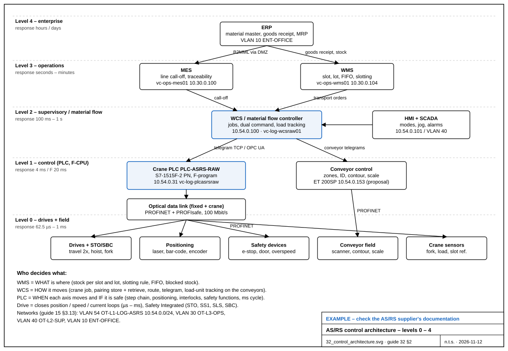
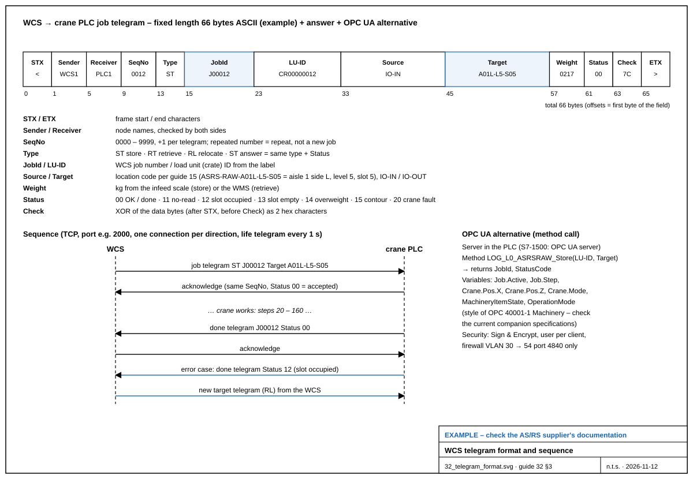
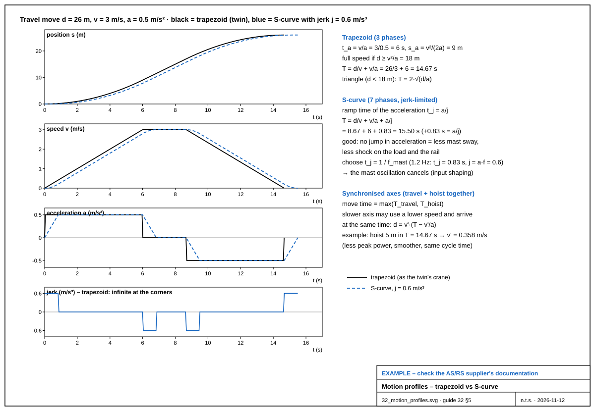
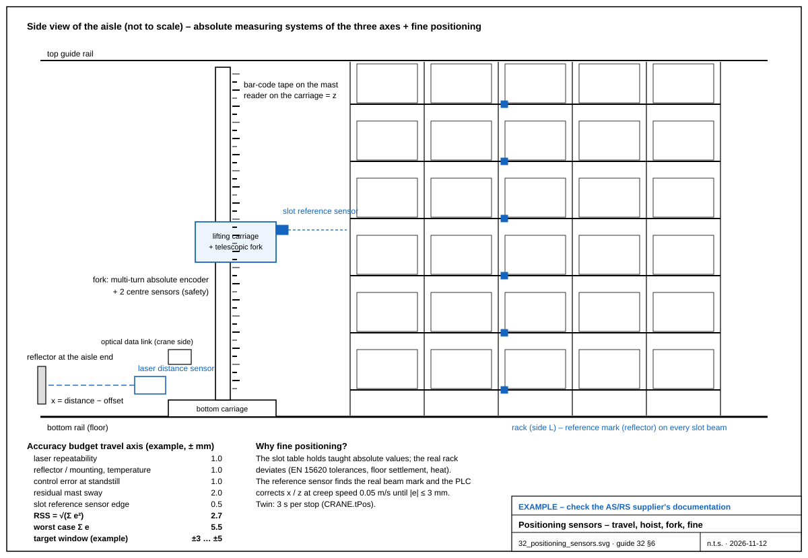
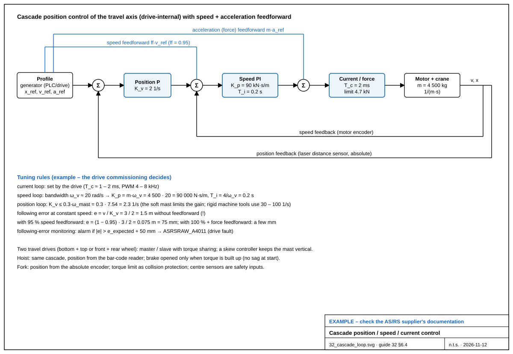
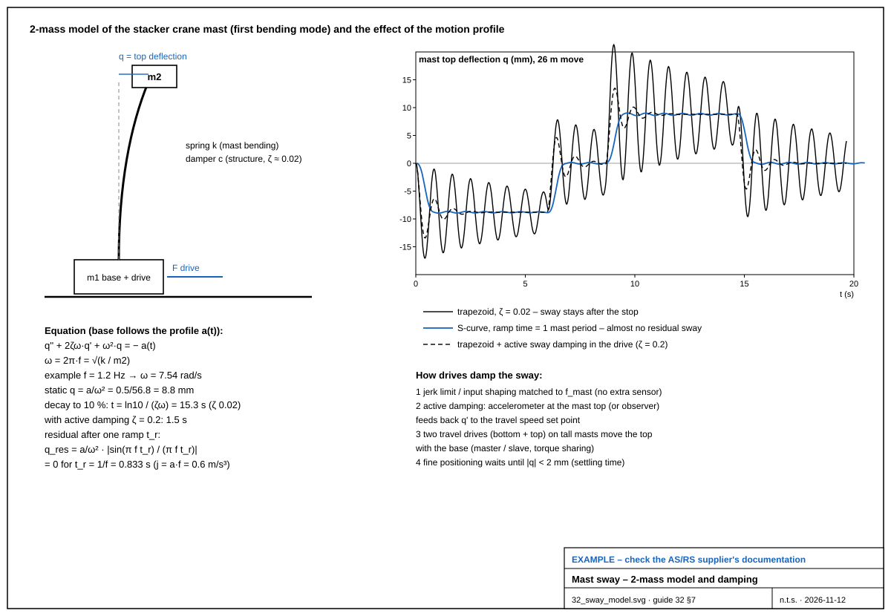
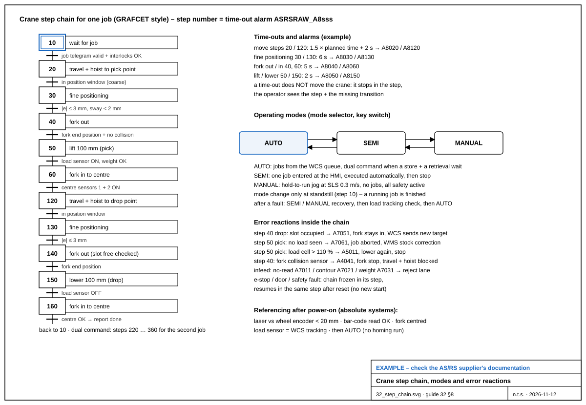
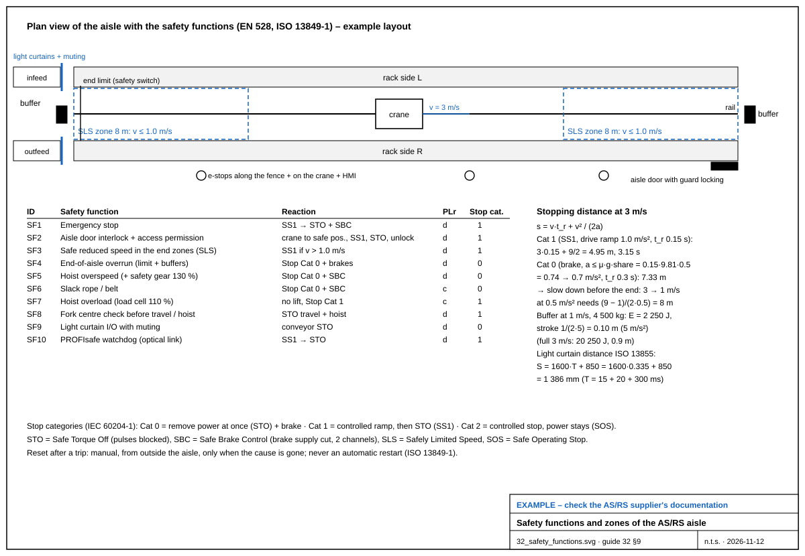
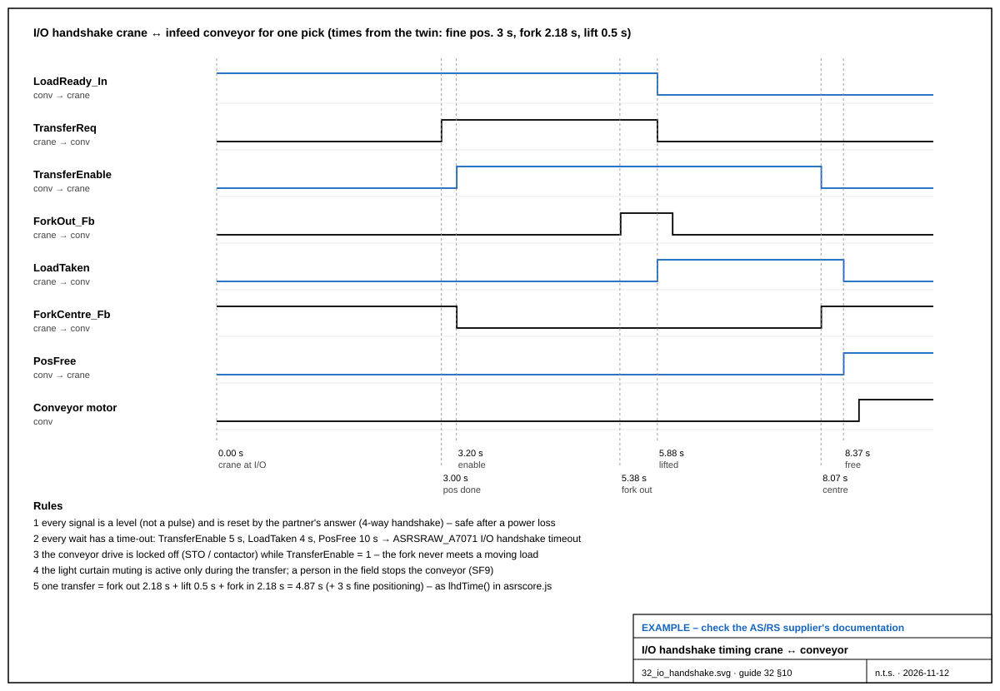
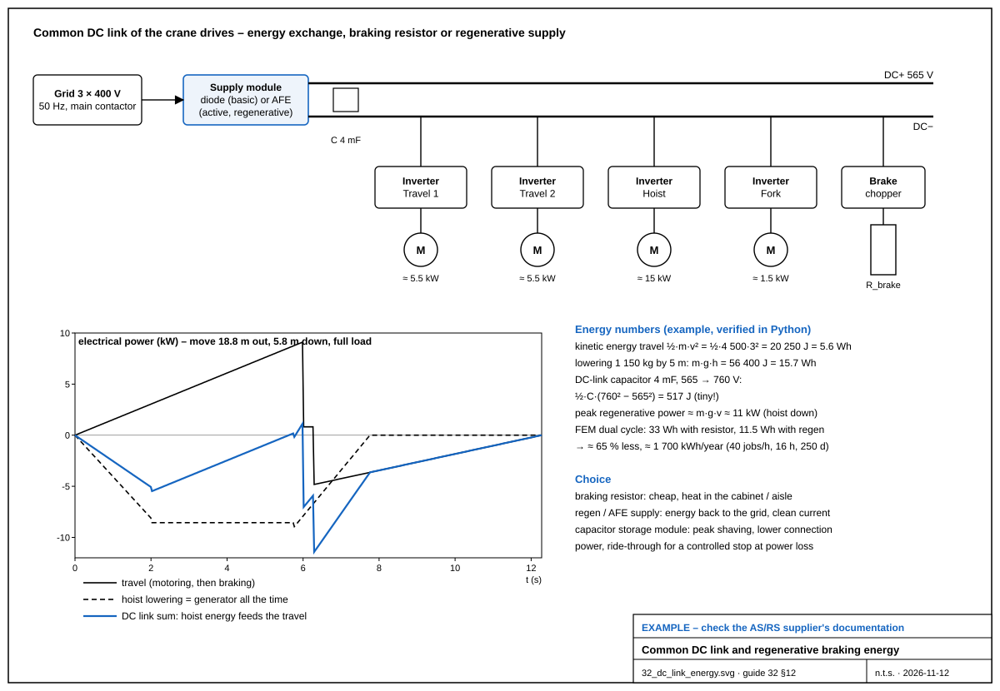

# 32 – AS/RS control system (raw-material store ASRS-RAW)

**Reader:** mechanical engineer who plans the compressor factory. Simple English, formulas with example numbers, tables.
**Twin:** tab "AS/RS raw materials", item 2 "Control system" (`web/asrsctl.js`, math in `web/asrsctl_core.js`, shared crane
simulation `web/asrscore.js`). **All values are examples – the AS/RS supplier's offer decides.** Product names in the buy lists
are catalogue examples, not recommendations; prices are "estimate – ask for a quote".

Related guides: 03 (material handling, crane cycle §10.2, rack §19), 05 (PLC control), 07 (communication), 15 (numbering, tags,
alarms, IP plan), 16 (standards register), 31 (AS/RS mechanical system + 3D twin), 33 (AS/RS PLC + electrical circuits),
34 (AS/RS WMS / ERP / MES).

## Contents

0. [How to use the page (item 2)](#0-how-to-use-the-page-item-2)
1. [Purpose, scope and the example store](#1-purpose-scope-and-the-example-store)
2. [Control levels – ERP, MES, WMS, WCS, PLC, drives](#2-control-levels--erp-mes-wms-wcs-plc-drives)
3. [Material flow control and telegrams](#3-material-flow-control-and-telegrams)
4. [The crane axes and their drives](#4-the-crane-axes-and-their-drives)
5. [Motion theory – trapezoid, S-curve, synchronised axes](#5-motion-theory--trapezoid-s-curve-synchronised-axes)
6. [Positioning technology, accuracy budget, drive control and tuning](#6-positioning-technology-accuracy-budget-drive-control-and-tuning)
7. [Mast sway and how drives damp it](#7-mast-sway-and-how-drives-damp-it)
8. [Job sequence, step chain, modes, error handling, recovery](#8-job-sequence-step-chain-modes-error-handling-recovery)
9. [Safety design – EN 528, ISO 13849, IEC 62061](#9-safety-design--en-528-iso-13849-iec-62061)
10. [Conveyor control at the I/O and the crane handshake](#10-conveyor-control-at-the-io-and-the-crane-handshake)
11. [Alarms, KPIs and diagnostics](#11-alarms-kpis-and-diagnostics)
12. [Energy – common DC link and regenerative braking](#12-energy--common-dc-link-and-regenerative-braking)
13. [Commissioning tests (FAT, SAT, safety validation)](#13-commissioning-tests-fat-sat-safety-validation)
14. [Troubleshooting](#14-troubleshooting)
15. [Checklists](#15-checklists)
16. [Questions for the AS/RS supplier](#16-questions-for-the-asrs-supplier)
17. [Buy list – catalogue examples + shopping list](#17-buy-list--catalogue-examples--shopping-list)
18. [Standards register](#18-standards-register)
19. [Glossary](#19-glossary)
20. [How the numbers were checked + drawings of this guide](#20-how-the-numbers-were-checked--drawings-of-this-guide)
21. [Next to read](#21-next-to-read)

---

## 0. How to use the page (item 2)

Open the tab **AS/RS raw materials** and press **2 · Control system**. Deep link: `/?sritem=2#asrs`.
The page reads the ONE shared crane simulation of the tab (`window.ASRS.sim`). Whatever you do here (e-stop, faults) is also
seen in item 1 (3D crane stops), item 3 (contacts change) and item 4 (jobs wait).

| Card | What you see | What you can do |
|---|---|---|
| Status strip (top, sticky) | crane phase, step number, x / z / fork, speeds, mode, safety state, queue | – |
| 1 Control architecture | levels ERP → MES / WMS → WCS → crane PLC → drives / sensors, IP addresses (guide 15) | click a block: what it does, example data, faults, **live** values |
| 2 Crane motion control | position / speed / acceleration of the **current** move (travel blue, hoist orange), S-curve dashed | switch the S-curve on / off, change the travel jerk; read the move formula |
| 2 Positioning | live laser / bar-code / encoder readings, fine positioning error during phase "pos", accuracy budget | – |
| 2 Mast sway | mast-top deflection for the last move: trapezoid, tuned S-curve, active damping | – (follows the last move) |
| 2 Cascade loop | following error + drive force of a simulated position loop | change K<sub>v</sub> and the speed feedforward |
| 3 Job sequence | the WCS telegram of the active job (66 bytes), the step chain with the active step | inject errors (no-read, double storage, …), change mode, jog in MANUAL, reference check |
| 4 Safety | 10 safety functions, live safety state machine, stopping distance chart | trip a function, remove the cause, reset |
| 5 Conveyor I/O | infeed / outfeed zones with live loads, ID / contour / scale / reject counters, handshake signals + timing | – |
| 6 Energy | power of travel, hoist and DC-link sum for the current move | – |
| 7 KPIs + log | throughput, utilisation, dual-command share, availability, energy per job; alarms with numbers | acknowledge alarms |
| Real components + drawings | drawings `32_*.svg`, buy list, shopping list of this guide | filter the buy list, open a drawing |

**Exercises (10 minutes):**
1. Watch one dual-command trip in card 3: store first, then retrieve, steps 20 … 160 and 220 … 360.
2. In card 2 move the jerk slider from 3.0 down to 0.3 m/s³ and read the time difference a/j in the formula box.
3. In card 4 press **trip** at SF2 (aisle door). Watch SS1 → STO → SAFE. Press **remove cause**, then **reset**.
   Item 1 shows the crane stopped while the door is "open".
4. In card 3 press **inject** at "Overweight crate": the next load the crane lifts is too heavy → SF7 trips.
5. Set mode MANUAL, wait until the job is finished, hold "travel +" – the crane moves at 0.3 m/s only.

Test URL parameters (for developers): `&sr2hold` (headless screenshots), `&sr2test` (self-check, console lines "SR2TEST …"),
`&sr2safe=estop|door|overspeed|overload|curtain` (start with a safety demo), `&sr2blk=plc` (open an info box),
`&sr2goto=s2Safe` (scroll to a card), and the card parameters `&sr2tab=buy|draw|shop`, `&sr2q=text`, `&sr2box=N`.

---

## 1. Purpose, scope and the example store

The control system turns a **business need** ("line 2 needs 4 crankcase castings VC20") into **crane motion** (travel 18.8 m,
hoist 5.8 m, fork out to the left) – fast, exact and safe. It has four jobs:

1. **Decide** which load goes where (WMS / WCS).
2. **Sequence** the crane and the conveyors (PLC step chain, handshakes).
3. **Move** the axes on time and on position (drives, positioning sensors).
4. **Protect** people and the machine (safety functions in a fail-safe PLC and in the drives).

**Example store ASRS-RAW** (same numbers as guide 03 §10.2 / §19 and `asrscore.js`):

| Item | Value (example) |
|---|---|
| Rack | 2 sides × 14 bays × 2 crates × 7 levels = **392 slots**, bay pitch 1.925 m, level pitch 1.25 m |
| Rack length / height | 27.05 m (+ 1.2 m in front of the first upright) / 9.5 m; top load level 7.95 m |
| Unit load | steel crate 1 200 × 800 × 600 mm, max 300 kg |
| Crane travel | 3 m/s, 0.5 m/s² |
| Crane hoist | 1 m/s, 0.5 m/s² |
| Telescopic fork | 1.0 m/s, 1.2 m/s², stroke 1.35 m (aisle half 0.75 + half load depth 0.6) |
| Fine positioning | 3 s per stop |
| Moving mass | 4 200 kg (crane + mast + carriage) |
| FEM 9.851 cycle | single 34.8 s (103 jobs/h), dual 57.8 s (125 jobs/h) |
| Crane PLC | `PLC-ASRS-RAW` = Siemens S7-1515F-2 PN (fail-safe), 10.54.0.31, host `vc-log-plcasrsraw` (guides 05, 15) |
| Materials | crankcase castings VC10 / VC20 / VC30, cylinder castings, crankshaft forgings |


### 1.1 Design guide – the control system in 12 steps

| # | Step | Result | Section |
|---|---|---|---|
| 1 | Throughput and cycle time target (FEM 9.851, peak jobs/h) | crane data v, a, j; SC / DC times | 5, guide 03 |
| 2 | Control levels and interfaces (who decides what) | interface list WMS – WCS – PLC | 2, 3 |
| 3 | Telegram or OPC UA specification incl. error codes and time-outs | interface document | 3 |
| 4 | Axis concept: drives, DC link, regen, positioning systems | drive list, sensor list | 4, 6, 12 |
| 5 | Positioning accuracy budget and fine positioning | ±3 – 5 mm target, sensor choice | 6 |
| 6 | Sway: mast frequency, profile (S-curve) and damping | f<sub>mast</sub>, j, damping option | 7 |
| 7 | Step chain, modes, error handling, recovery, manual retrieval | sequence description | 8 |
| 8 | Risk assessment, safety functions, PL<sub>r</sub>, stop categories | safety concept | 9 |
| 9 | Conveyor I/O: zones, ID, contour, weight, handshake | conveyor function description | 10 |
| 10 | Alarms (guide 15 numbers), KPIs, diagnostics | alarm list, KPI list | 11 |
| 11 | Commissioning and acceptance tests | test plan FAT / SAT | 13 |
| 12 | Spare parts, service, training | spare-parts list, contract | 8.7, 16 |

---

## 2. Control levels – ERP, MES, WMS, WCS, PLC, drives



### 2.1 Who decides what

| Level (ISA-95) | System | Knows | Decides | Response time |
|---|---|---|---|---|
| 4 | ERP | material number, quantity in "ASRS-RAW", value, purchase orders | when to buy, goods receipt posting | hours – days |
| 3 | MES | which line needs which material, lot ↔ compressor serial | call-off (retrieval request), traceability | seconds – minutes |
| 3 | WMS | every slot: SKU, lot, quantity, date, blocked flag | **which slot** (store) / **which load** (retrieve, FIFO) | seconds |
| 2 | WCS / material flow controller | every load unit on the conveyors and the crane, all transport orders | **order of jobs**, pairing (dual command), routing, telegrams | 100 ms – 1 s |
| 1 | Crane PLC (F-CPU) | step chain, positions, all interlocks, safety | **when** each axis moves, **if** it is safe | 4 ms (F: 20 ms) |
| 0 | Drives, sensors | motor current, speed, position | closes current / speed / position loops, STO / SBC | 62.5 µs – 1 ms |

**Rule:** each level talks only to its neighbours. The WMS never commands a drive; the PLC never chooses a slot. This keeps the
system testable and lets you replace one level (e.g. a new WMS) without touching the safety PLC.

**Typical split of software (example):**

| Function | Where | Why there |
|---|---|---|
| Slotting rule (store near the front, ABC), FIFO by lot | WMS | needs stock data and business rules |
| Pair a store with a retrieval (dual command), job order | WCS | needs the live crane and conveyor state |
| Load-unit tracking on conveyors (which crate is in which zone) | WCS + conveyor PLC | the PLC sees sensors, the WCS keeps the ID |
| Step chain, fine positioning, fork control | crane PLC | ms reaction, deterministic |
| Safety functions | F-program in the crane PLC + drive Safety Integrated | certified, PL d |
| Position / speed / current loops, sway damping | drive | µs – ms loops, needs motor data |

### 2.2 Networks and hosts (guide 15 §3.13)

| Device | VLAN | IP (example) | Host name | Note |
|---|---|---|---|---|
| ERP | 10 ENT-OFFICE | – | – | via DMZ gateway `vc-dmz-b2mml01` 10.20.0.101 |
| MES | 30 OT-L3-OPS | 10.30.0.100 | `vc-ops-mes01` | guide 15 |
| WMS | 30 | 10.30.0.104 | `vc-ops-wms01` | guide 15 |
| WCS PC | 54 OT-L1-LOG-ASRS | 10.54.0.100 | `vc-log-wcsraw01` | **decided 2026-11-13** (guide 15 D-32) |
| Crane HMI | 54 | 10.54.0.101 | `vc-log-asrsraw-hmi` | **proposal** |
| Crane PLC PLC-ASRS-RAW | 54 | 10.54.0.31 | `vc-log-plcasrsraw` | guides 05, 15 |
| RFID readers at the I/O | 54 | 10.54.0.150 / .151 | `vc-log-asrsraw-rfid1` / `2` | guide 15 |
| Bar-code scanner ID point | 54 | 10.54.0.152 | `vc-log-asrsraw-scn1` | **proposal** |
| Conveyor remote I/O (ET 200SP) | 54 | 10.54.0.153 | `vc-log-asrsraw-io1` | **proposal** |
| Crane drives (travel 1, travel 2, hoist, fork) | 54 (behind the optical link) | 10.54.0.55 … .58 | `vc-log-asrsraw-fc1` … `fc4` | **proposal** (.50–.99 = drives) |
| SCADA servers | 40 OT-L2-SUP | 10.40.0.100 / .101 | `vc-sup-scada01` / `02` | guide 15 |

Firewall rule (example): VLAN 30 → VLAN 54 only TCP 4840 (OPC UA) and the WCS telegram port to 10.54.0.100; nothing from
VLAN 10 directly into VLAN 54 (IEC 62443 zones, guide 07).

### 2.3 Tags (guide 15)

PLC symbol = `<Area>_<Line>_<Machine>_<Signal>[_suffix]` → `LOG_L0_ASRSRAW_…`. Examples:

| Tag | Type | Meaning |
|---|---|---|
| `LOG_L0_ASRSRAW_TravelPos` | REAL mm | laser distance value, corrected |
| `LOG_L0_ASRSRAW_HoistPos` | REAL mm | bar-code position |
| `LOG_L0_ASRSRAW_ForkPos` | REAL mm | encoder position of the fork (0 = centre) |
| `LOG_L0_ASRSRAW_Step` | INT | active step of the crane chain (10 … 360) |
| `LOG_L0_ASRSRAW_Mode` | INT | 1 AUTO, 2 SEMI, 3 MANUAL |
| `LOG_L0_ASRSRAW_State` | INT | state code 0 RUNNING … 7 OFFLINE (guide 06) |
| `LOG_L0_ASRSRAW_ForkCentre_Fb` | BOOL | fork in the centre (also a safety input) |
| `LOG_L0_ASRSRAW_EStop_Ok` | BOOL | e-stop chain OK (F-signal, read-only copy) |
| `LOG_L0_ASRSRAW_Energy` | REAL kWh | energy meter of the crane supply |
| `LOG_L0_ASRSRAW_Job_Cnt` | DINT | finished jobs |

---

## 3. Material flow control and telegrams

### 3.1 What the WCS does

1. **Takes transport orders** from the WMS: "store LU CR00000012 (crankcase VC20, 217 kg) to ASRS-RAW-A01L-L5-S05" or
   "retrieve the oldest lot of RAW_CC to IO-OUT".
2. **Builds crane jobs** and decides the order. Rules (example): retrievals for the line first (they stop production when late),
   then stores; never let the infeed fill up (blocked goods receipt).
3. **Pairs jobs** into a dual command when a store and a retrieval wait: I/O → store slot → retrieve slot → I/O. The twin does
   exactly this (`rates.dual = true`, store first, then retrieve).
4. **Tracks every load unit** on the conveyors: ID read at the ID point, zone by zone to the transfer position, then onto the
   crane fork, then into the slot. A load without a valid ID never enters the rack.
5. **Sends telegrams** to the crane PLC and the conveyor PLC, watches the answers and time-outs.
6. **Reports back** to the WMS: "stored in slot …", "retrieved", "error 12 slot occupied".

**Dual command gain** (guide 03 §19.3): time per job = (1 − p)·t<sub>SC</sub> + p·t<sub>DC</sub>/2.
With t<sub>SC</sub> = 34.8 s and t<sub>DC</sub> = 57.8 s: p = 0 → 34.8 s (103 jobs/h); p = 1 → 28.9 s (125 jobs/h) = +21 %.

### 3.2 Fixed-length telegram (example)



Many AS/RS still use **fixed-length ASCII telegrams over TCP/IP** between the WCS (or SAP EWM-MFS) and the PLC: simple, fast,
easy to log and to test with a terminal program. Example layout (66 bytes):

| Field | Bytes | Offset | Example | Rule |
|---|---|---|---|---|
| STX | 1 | 0 | `<` | frame start |
| Sender | 4 | 1 | `WCS1` | checked by the receiver |
| Receiver | 4 | 5 | `PLC1` | |
| SeqNo | 4 | 9 | `0012` | 0000 – 9999, +1 per new telegram; same number = repeat |
| Type | 2 | 13 | `ST` | ST store, RT retrieve, RL relocate, LF life telegram |
| JobId | 8 | 15 | `J00012  ` | WCS job number (left-aligned, blank-filled) |
| LU-ID | 10 | 23 | `CR00000012` | crate ID from its label (guide 15 §25 style) |
| Source | 12 | 33 | `IO-IN       ` | location code or I/O point |
| Target | 12 | 45 | `A01L-L5-S05 ` | ASRS-RAW-**A01L-L5-S05** (aisle 1 side L, level 5, slot 5) |
| Weight | 4 | 57 | `0217` | kg from the infeed scale |
| Status | 2 | 61 | `00` | 00 OK; in answers: 11 no-read, 12 occupied, 13 empty, 14 overweight, 15 contour, 20 crane fault |
| Check | 2 | 63 | `7C` | XOR of all bytes after STX and before Check, as 2 hex characters |
| ETX | 1 | 65 | `>` | frame end |

The page builds this telegram live for the active job (card 3). Worked example (the self-check prints it):

```
<WCS1PLC10012STJ00012  CR00000012IO-IN       A01L-L5-S05 0217007C>
 length = 1+4+4+4+2+8+10+12+12+4+2+2+1 = 66 bytes   check = XOR(bytes 1 … 62) = 0x7C
```

**Slot code rule used in the twin:** twin slot `L-03-1-5` (side L, bay 3, crate 1, level 5) → slot number S = (bay − 1)·2 + crate
= 5 → `A01L-L5-S05`. Guide 15 §3.x: `<store>-A<2>[L|R]-L<1>-S<2>`.

**Telegram rules (practice):**

| Rule | Why |
|---|---|
| every telegram is acknowledged (same SeqNo) within 1 s | the sender knows it arrived |
| no acknowledgement → repeat 3× with the same SeqNo, then alarm `ASRSRAW_A0011` | no double jobs |
| life telegram (LF) every 1 s in both directions | detects a dead connection in 3 s |
| the PLC checks Target against its own slot table (exists, not blocked, fits the load height) | a WCS error cannot crash the fork |
| all telegrams logged with time stamp (ring buffer, ≥ 30 days) | troubleshooting, disputes with the supplier |
| one TCP connection per direction, PLC = server for jobs | simple reconnection rules |

### 3.3 OPC UA alternative

Modern PLCs have an OPC UA server (S7-1500, TwinCAT, ControlLogix via module). The WCS calls a **method** and reads variables:

```
Call  ns=4;s=LOG_L0_ASRSRAW_Store( "CR00000012", "ASRS-RAW-A01L-L5-S05" )  → Good, JobId = J00012
Read  ns=4;s=LOG_L0_ASRSRAW_Step               → 140
Read  ns=4;s=LOG_L0_ASRSRAW_Job.State          → Active
Event ns=4;s=LOG_L0_ASRSRAW_Job.Done           → J00012, Status 00
```

Structure the variables like the OPC UA companion specification **OPC 40001-1 (Machinery – basic building blocks:
identification, MachineryItemState, operation mode)** so that SCADA and MES find the same nodes on every machine
(check the current companion specifications; for AGVs guide 07 uses VDA 5050 instead). Security: Sign & Encrypt, one user per
client, firewall VLAN 30 → 54 port 4840 only.

| | Fixed telegram (TCP) | OPC UA |
|---|---|---|
| Effort in the PLC | small (send / receive blocks) | server configuration, methods |
| Diagnostics | text log, easy | browse with a client (UaExpert) |
| Security | none built in → firewall | built in (certificates) |
| Standard | supplier-specific | information models (OPC 40001-1 style) |
| Typical use | existing WCS / SAP EWM-MFS, retrofit | new projects, MES / SCADA access |


### 3.4 Job scheduling rules in the WCS (worked example)

The WCS decides the **order** of the waiting jobs every time the crane becomes free. A simple, robust rule set (example):

```
every time the crane reports "step 10 – ready":
  1. remove jobs that cannot run (slot blocked, no stock, infeed load without ID)   → error to the WMS
  2. priority class: P1 line call-off older than 5 min > P2 line call-off > P3 store (infeed > 3 loads) > P4 store > P5 relocation
  3. take the oldest job of the highest class = job A
  4. if dual command is enabled: look for a job B of the OTHER type (store <-> retrieve)
        prefer B whose slot is close to A's slot (small "between" move), but keep FIFO for retrievals
  5. send the telegram(s): store first, then retrieve (the crane carries only one load)
```

**Example queue at 10:15:00:**

| Job | Type | SKU | Waiting | Class |
|---|---|---|---|---|
| J00031 | retrieve | RAW_CC (crankcase VC20) | 6 min | P1 (line call-off > 5 min) |
| J00032 | store | RAW_CYL | 2 min | P4 |
| J00033 | retrieve | RAW_CS | 1 min | P2 |
| J00034 | store | RAW_CC | 0.5 min | P4 |

Decision: A = J00031 (P1). B = a store → J00032 (oldest store). Trip 1 = dual command "store J00032, retrieve J00031".
Next free crane: A = J00033 (P2), B = J00034 → trip 2 dual command. Four jobs in two trips.

**Why not "shortest job first"?** It gives the highest throughput but can starve far slots (the oldest lot is never taken → FIFO
broken, castings age). Use distance only as a tie-breaker inside a priority class.

**The twin:** `startNext()` in `asrscore.js` takes the first queued job, pairs it with the first job of the other type and
always does the store first – the same idea without priority classes.

---

## 4. The crane axes and their drives

| Axis | Motion | Drive (example) | Position measurement | Speed / acc. (twin) |
|---|---|---|---|---|
| Travel x | crane along the aisle on the bottom rail, guided at the top rail | 2 wheel drives (front + rear or bottom + top), servo / vector inverter, ≈ 2 × 5.5 kW | laser distance sensor to a reflector at the aisle end | 3 m/s, 0.5 m/s² |
| Hoist z | lifting carriage up / down the mast, rope / belt / chain | 1 motor + drum, ≈ 15 kW, holding brake | bar-code tape along the mast | 1 m/s, 0.5 m/s² |
| Fork y | telescopic fork left / right into the rack (2 stages) | 1 servo, ≈ 1.5 kW | multi-turn absolute encoder + centre sensors | 1.0 m/s, 1.2 m/s² |

**Drive power, worked (example):**

```
travel:  F = m·a + m·g·w = 4 500·0.5 + 4 500·9.81·0.005 = 2 250 + 221 = 2 471 N
         P = F·v = 2 471 · 3 = 7 412 W at the wheels → ÷ η (0.92·0.97·0.90 = 0.80) ≈ 9.2 kW electrical peak
         → 2 drives × 5.5 kW (with short-time overload) – the supplier sizes with the real duty cycle
hoist:   P = m_L·(g + a)·v = 1 150·(9.81 + 0.5)·1 = 11 856 W → ÷ η (0.92·0.97·0.85 = 0.76) ≈ 15.6 kW
         lifted mass m_L = carriage 900 kg + load 250 kg (example; full crate 300 kg → 1 200 kg)
fork:    small – about 1 – 2 kW, but high cycle count (≈ 4 strokes per job)
```

---

## 5. Motion theory – trapezoid, S-curve, synchronised axes



### 5.1 Trapezoid profile (what the twin's crane uses)

Three phases: accelerate with a, cruise with v, decelerate with a.

```
acceleration time   t_a = v / a                       travel: 3 / 0.5 = 6 s
acceleration path   s_a = v² / (2a)                   travel: 9 / 1 = 9 m  (same for braking)
full speed only if  d ≥ v² / a                        travel: d ≥ 18 m
move time           T = d / v + v / a                 (d ≥ v²/a)
triangle            T = 2·√(d / a)                    (d < v²/a, top speed v_p = √(d·a) < v)
```

| Move | Formula | Time |
|---|---|---|
| travel 26 m | 26/3 + 3/0.5 = 8.67 + 6 | **14.67 s** |
| travel 5 m (triangle) | 2·√(5/0.5) | **6.32 s** |
| hoist 7.5 m | 7.5/1 + 1/0.5 = 7.5 + 2 | **9.50 s** |
| hoist 1.25 m (one level, triangle) | 2·√(1.25/0.5) | **3.16 s** |

The core function `trapTime(d, v, a)` in `asrscore.js` is exactly this formula; `trapPos` and `trapVel` give the position and
speed at any time t. Card 2 draws them for the current move.

### 5.2 S-curve (jerk-limited) profile

A trapezoid has **jumps in acceleration** (infinite jerk). Each jump hits the mast like a hammer (sway, §7), shakes the load and
loads the wheels. An S-curve ramps the acceleration up and down with a limited **jerk j** (m/s³): seven phases.

```
ramp time of a      t_j = a / j
move time (a and v reached)    T = d / v + v / a + a / j
extra time against trapezoid   ΔT = a / j
```

| Jerk j (travel, a = 0.5) | t_j = a/j | T for 26 m | ΔT |
|---|---|---|---|
| 0.5 m/s³ | 1.0 s | 15.67 s | +1.00 s |
| 0.6 m/s³ (= a·f<sub>mast</sub>, §7) | 0.83 s | 15.50 s | +0.83 s |
| 1.0 m/s³ | 0.5 s | 15.17 s | +0.50 s |
| 2.0 m/s³ | 0.25 s | 14.92 s | +0.25 s |
| hoist 7.5 m, a = 0.5, j = 1.0 | 0.5 s | 10.00 s | +0.50 s |

**Cycle-time cost:** a dual cycle has 3 travel moves → 3 × 0.83 = 2.5 s more per 57.8 s = 4 %. In practice it is often **zero**
or even negative: with the S-curve the mast does not sway, so the fine positioning (3 s) ends sooner (§7).

**Midpoint check (self-test):** the S-curve is symmetric, so at T/2 the position is d/2 = 13.000 m and the speed v = 3.000 m/s.

### 5.3 Synchronised axes

Travel and hoist start together; the move ends when the **slower** axis arrives (guide 03 §10.2):

```
t_move = max(t_travel, t_hoist)
```

The faster axis can be **slowed down** so that both arrive at the same time (same acceleration, lower top speed v′):

```
d = v′·(T − v′/a)   →   v′ = [T − √(T² − 4d/a)] · a / 2
example: travel 26 m → T = 14.67 s; hoist 5 m with a = 0.5:
v′ = [14.67 − √(14.67² − 4·5/0.5)] · 0.5/2 = [14.67 − √(215.1 − 40)] · 0.25 = [14.67 − 13.23] · 0.25 = 0.358 m/s
check: trapTime(5, 0.358, 0.5) = 5/0.358 + 0.358/0.5 = 13.97 + 0.72 = 14.68 s – OK
```

Benefits: lower peak power (the hoist drive needs 0.36 instead of 1.0 m/s), smoother load, less noise, same cycle time.
Most crane controllers offer this as "synchronous" or "diagonal" travel.

### 5.4 Where the profile is computed

| Option | Profile generator | Typical use |
|---|---|---|
| A | PLC computes the profile, sends position + speed set points every cycle (PROFIdrive telegram 5, DSC) | precise synchronisation of the axes, one place for all rules |
| B | PLC sends target position + v, a, j; the drive's own positioner (EPOS, IPOS) runs the profile | simple PLC program, common on stacker cranes |
| C | motion controller (PLCopen MC_MoveAbsolute) in the PLC (S7-1500 technology objects, TwinCAT NC) | standard function blocks, easy for new programmers |


### 5.5 Worked example – one dual-command trip of the twin

Store a crate into slot **R-05-2-4** and retrieve from slot **L-09-1-2** (twin slot names, `slotPos()` of `asrscore.js`):

```
slot x = x0 + upright + bay·pitch + gap + crate/2 + k·(crate + gap)
R-05-2-4: x = 1.2 + 0.1 + 4·1.925 + 0.075 + 0.4 + 1·0.875 = 10.35 m,  z = 0.45 + 3·1.25 = 4.20 m
L-09-1-2: x = 1.2 + 0.1 + 8·1.925 + 0.075 + 0.4 + 0          = 17.175 m, z = 0.45 + 1·1.25 = 1.70 m
```

| Move | Δx | t travel | Δz | t hoist | move time |
|---|---|---|---|---|---|
| to the I/O pick level (0.75 → 0.65 m) | 0 | 0 | −0.10 | 2·√(0.1/0.5) = 0.89 | 0.89 s |
| I/O → store slot (pick level + 0.1 m) | 10.35 | 2·√(10.35/0.5) = 9.10 | +3.55 | 3.55 + 2 = 5.55 | **9.10 s** (travel leads) |
| store slot → retrieve slot | 6.83 | 2·√(6.83/0.5) = 7.39 | −2.60 | 2.6 + 2 = 4.60 | **7.39 s** |
| retrieve slot → I/O drop level | −17.18 | 2·√(17.18/0.5) = 11.72 | −0.85 | 2·√(0.85/0.5) = 2.61 | **11.72 s** |
| 4 stops × (fine pos. 3 + fork 2.18 + lift 0.5 + fork 2.18) | | | | | 4 × 7.87 = 31.47 s |
| **Total trip** | | | | | **60.6 s → 30.3 s per job** |

All three travel moves are **triangles** (d < 18 m): the crane never reaches 3 m/s in this store. A higher acceleration would
help more than a higher top speed – an important point when you compare offers (guide 03 §19.3: 0.8 m/s² gives −20 %).
Card 2 shows exactly these profiles when the twin runs such a trip.

---

## 6. Positioning technology, accuracy budget, drive control and tuning



### 6.1 Absolute measuring systems

| Axis | Sensor type | How it works | Pros | Watch out |
|---|---|---|---|---|
| Travel | **laser distance sensor** (time of flight / phase) on the crane, reflector at the aisle end | measures the distance 0.2 … 100+ m, output via PROFINET / SSI | absolute, no homing, no wear | beam must stay free (no hanging objects), reflector clean, air temperature gradients, mount stiff |
| Travel (alt.) | **bar-code / Data-Matrix tape** along the rail + reader | reads the code under the reader → absolute position | works on curves and very long aisles, not disturbed by fog | tape must be clean and undamaged, expansion joints |
| Travel (backup) | motor encoder / wheel encoder | counts wheel turns | always there, high resolution | wheel slip → drift; used for **plausibility** against the laser |
| Hoist | **bar-code tape** along the mast + reader on the carriage | absolute | no rope-stretch error (measures the carriage, not the drum) | tape alignment, dirt |
| Fork | **multi-turn absolute encoder** on the fork motor | absolute angle → stroke | compact | gear backlash; centre position also by 2 safety sensors |
| Fine | **slot reference sensor** (reflex light scanner / photo-electric sensor) on the carriage | finds a reference mark (hole, reflector, beam edge) of each slot | measures the **real** rack | needs marks on every slot, teach-in |

### 6.2 Fine positioning

The slot table in the PLC holds the **taught** absolute value of every slot (x and z). The coarse move stops on these values.
The rack is not exact: EN 15620 allows tolerances of the uprights and beams (several mm over the height), the floor settles, the
steel grows with temperature (12 µm per m per K → 28 m × 10 K = 3.4 mm). Therefore:

1. Coarse move to the taught slot value (window e.g. ±20 mm).
2. Wait until the mast sway is < ±2 mm (§7).
3. Slot reference sensor looks for the mark; PLC moves with creep speed (e.g. 0.05 m/s) until the error is in ±3 mm.
4. Optional: store the measured value back into the slot table (self-learning, with a limit e.g. ±10 mm from the taught value).

In the twin this is the phase **"pos"** with 3 s per stop (`CRANE.tPos`). Card 2 shows a simulated error decaying during "pos".

### 6.3 Accuracy budget (example)

**Travel axis** (± mm, independent errors → root-sum-square):

| Error source | ± mm |
|---|---|
| laser repeatability | 1.0 |
| reflector / mounting, temperature | 1.0 |
| control error at standstill | 1.0 |
| residual mast sway | 2.0 |
| slot reference sensor edge | 0.5 |
| **RSS** = √(1² + 1² + 1² + 2² + 0.5²) = √7.25 | **2.7** |
| worst case Σ | 5.5 |

**Hoist axis:** bar-code repeatability 1.0, carriage guide play 1.0, fork deflection under 300 kg 1.5, control 1.0,
sensor edge 0.5 → RSS = √(1 + 1 + 2.25 + 1 + 0.25) = √5.5 = **2.35 mm**, worst case 5.0 mm.

**Target:** ±3 … ±5 mm (example). The fork entry needs clearance: crate 800 mm in a slot with 75 mm gaps → the fork may be
±30 mm off and still enter, but the crate must **land** within the beam support length and not touch the neighbour → ±5 mm is
a good design value. The supplier states the guaranteed positioning accuracy in the offer – check it in the SAT (§13).

### 6.4 Drive control: cascade position → speed → current



Every servo axis has three nested loops. The inner loop must be 3 – 10 × faster than the next outer loop.

| Loop | Controller | Example setting | Bandwidth |
|---|---|---|---|
| Current (torque, force) | PI, field-oriented control in the drive | set by the drive from motor data, T<sub>c</sub> ≈ 1 – 2 ms | ≈ 100 – 500 Hz |
| Speed | PI | K<sub>p</sub> = m·ω<sub>v</sub>, T<sub>i</sub> = 4/ω<sub>v</sub> | ω<sub>v</sub> ≈ 20 rad/s (3 Hz) on a crane |
| Position | P (+ feedforward) | K<sub>v</sub> ≈ 1 – 3 1/s on a tall crane | K<sub>v</sub> ≤ 0.3·ω<sub>mast</sub> |

**Worked tuning (travel, example):**

```
mass                 m = 4 500 kg
speed loop           ω_v = 20 rad/s  → K_p = m·ω_v = 4 500 · 20 = 90 000 N·s/m (= 90 kN per m/s)
                     T_i = 4 / ω_v = 0.2 s
mast mode            f = 1.2 Hz → ω_mast = 2π·1.2 = 7.54 rad/s
position gain        K_v ≤ 0.3 · 7.54 = 2.26 1/s → choose K_v = 2.0 1/s
following error      e = v / K_v = 3 / 2 = 1.5 m (!) without feedforward
with feedforward     e = (1 − ff) · v / K_v = (1 − 0.95) · 3 / 2 = 0.075 m = 75 mm
with ff = 1.0 + force feedforward m·a_ref → only model errors remain (a few mm)
```

**Why so low?** A machine tool axis has K<sub>v</sub> = 30 – 100 1/s because it is stiff. A 9 m mast is a soft spring: a high
position gain would excite the mast (it starts to "dance"). Therefore cranes rely on **feedforward** for speed and on the slow
position loop only for the last millimetres. Card 2 simulates this: move K<sub>v</sub> and switch the feedforward.
Self-check (26 m move): ff = 0 → max following error 1 499 mm; ff = 0.95 → 75 mm; both settle to < 1 mm after the profile ends.

**Following-error monitoring:** alarm if |e| > expected + 50 mm (example) → `ASRSRAW_A4011`, Stop Cat 1.

**Two travel drives:** front and rear (or bottom and top) motors share the torque (master / slave, torque control on the slave).
On tall cranes a top drive keeps the mast vertical; a skew controller compares bottom and top positions.

**Hoist specifics:** open the holding brake only after the drive has built up the holding torque (no sag); close the brake when
the speed is zero and before removing torque (SBC, §9). Watch the load: a full 300 kg crate vs an empty crate changes the lifted
mass by 25 % – use the speed-loop adaptation or a gain that is stable for both.


### 6.5 PLC program structure (example, S7-1500F)

| Block | Language | Task |
|---|---|---|
| `OB1` / cyclic OB 4 ms | – | calls the blocks below |
| `FB_WcsComm` | SCL | TCP receive / send (TRCV_C / TSEND_C or TCON + TRCV), telegram parse, checksum, SeqNo, life telegram |
| `FB_JobManager` | SCL | job buffer (2 jobs), plausibility (slot exists, not blocked), answer telegrams |
| `FB_CraneSeq` | GRAPH or SCL CASE | the step chain §8.1, time-outs → alarms A8sss |
| `FB_Axis` × 3 | SCL / technology objects | positioning commands (MC_MoveAbsolute or PROFIdrive telegram 111 / EPOS), following-error check |
| `FB_FinePos` | SCL | slot reference search, creep, window check, slot-table update |
| `FB_IoHandshake` × 2 | SCL | infeed / outfeed handshake §10.2 |
| `FB_Conveyor` | SCL | zones, ID point, contour, scale, reject |
| `FB_Alarms` | SCL | ProDiag / program alarms with the guide-15 numbers |
| `FB_OpcUa` | – | OPC UA server interface (methods, variables) |
| F-program (`F_MAIN`, F-runtime group 20 ms) | F-FBD / F-LAD | e-stops, doors + guard locking, muting, SLS / SLP commands to the drives, fork centre, overload, slack rope, PROFIsafe drive telegrams (STO, SS1, SLS select) |

**Step chain in SCL (short teaching example):**

```pascal
CASE #Step OF
  10:  // wait for job
       IF #JobValid AND #Interlocks_Ok AND #Mode = 1 THEN #Step := 20; END_IF;
  20:  // travel + hoist to the pick point
       #Travel.Execute := TRUE; #Hoist.Execute := TRUE;
       IF #Travel.InWindow AND #Hoist.InWindow THEN #Step := 30; END_IF;
  30:  // fine positioning
       #FinePos.Execute := TRUE;
       IF #FinePos.Done AND ABS(#SwayEst) < 2.0 THEN #Step := 40; END_IF;
  40:  // fork out – only if the slot / transfer point is free and the conveyor enables
       IF #TargetFree AND #TransferEnable THEN #Fork.Target := #ForkOutPos; #Fork.Execute := TRUE; END_IF;
       IF #Fork.Done AND NOT #ForkCollision THEN #Step := 50; END_IF;
  // … 50 lift, 60 fork in, 120 … 160 drop
END_CASE;
// time-out monitoring: one timer per step, preset from a table, alarm number = 8000 + step
#TStep(IN := (#Step = #StepOld), PT := #StepTimeout[#Step]);
IF #TStep.Q THEN #AlarmNo := 8000 + #Step; END_IF;     // e.g. 8030 → ASRSRAW_A8030
#StepOld := #Step;
```

Real projects use the supplier's tested library – but you should be able to read it.

---

## 7. Mast sway and how drives damp it



### 7.1 Model

The mast is a cantilever beam with the top guide carriage (and the lifting carriage) as mass. The first bending mode behaves like
a **2-mass system**: base mass m1 (driven by the travel drive) – spring k (mast bending) – top mass m2.
If the drive moves the base exactly as the profile says, the relative top deflection q obeys:

```
q'' + 2ζω·q' + ω²·q = −a(t)          ω = 2π·f = √(k / m2)
```

| Quantity | Example | Note |
|---|---|---|
| first mast frequency f | 1.2 Hz | ask the supplier (FEM model / measurement), typical ≈ 0.8 – 3 Hz |
| ω | 2π · 1.2 = 7.54 rad/s | |
| structural damping ζ | 0.02 | welded steel |
| static deflection during acceleration | q = a/ω² = 0.5 / 56.8 = **8.8 mm** | |
| decay to 10 % (free) | t = ln10 / (ζω) = 2.303 / (0.02·7.54) = **15.3 s** | far too long |
| decay with active damping ζ = 0.2 | 2.303 / (0.2·7.54) = **1.5 s** | |

### 7.2 Why the profile matters

Every **jump** of the acceleration starts an oscillation with amplitude a/ω² (for a jump of size a). A trapezoid has four jumps
per move. After a ramp of finite duration t<sub>r</sub> the residual amplitude is:

```
q_res = (a/ω²) · |sin(π·f·t_r) / (π·f·t_r)|
t_r = 0 (jump)       → 8.8 mm
t_r = 0.5 s          → 8.8 · |sin(0.6π)/(0.6π)| = 8.8 · 0.505 = 4.4 mm
t_r = 1/f = 0.833 s  → 0 mm      (input shaping)
t_r = 1.0 s          → 1.4 mm
```

So the S-curve with **t<sub>j</sub> = 1/f** (jerk j = a·f = 0.5 · 1.2 = 0.6 m/s³) cancels the sway. Simulation for a 26 m move
(self-check): trapezoid residual (from 1 s after the stop) ≈ 8 mm and > 10 s to get below ±2 mm; tuned S-curve ≈ 0.2 mm;
trapezoid + active damping ≈ 1.3 mm, below ±2 mm after ≈ 0.9 s.

### 7.3 How real drives damp sway

| Method | How | Needs |
|---|---|---|
| Jerk limit / input shaping | profile ramps matched to f<sub>mast</sub> (also "notch" or ZV shaper) | known frequency – it changes with carriage height and load! use a table f(z, load) |
| Active sway damping | accelerometer at the mast top (or an observer from the motor current) feeds back q′ to the speed set point | sensor + drive function (supplier option) |
| Two drives (bottom + top) | the top drive moves the top together with the base | top rail drive, synchronisation |
| Waiting | fine positioning starts only when \|q\| < 2 mm | costs cycle time |

**Height dependence:** with the carriage at the top the oscillating mass is larger → f lower. Ask the supplier for f at the lowest
and highest carriage position and with / without load.

---

## 8. Job sequence, step chain, modes, error handling, recovery



### 8.1 Step chain of one job

The crane PLC runs a sequence (GRAFCET per IEC 60848, programmed as SFC / GRAPH or as CASE in SCL). The **step number is also
the time-out alarm number** `ASRSRAW_A8sss` (guide 15: group 8 = step time-outs, `sss` = step number).

| Step | Action | Transition to the next step | Time-out (example) | Twin phase |
|---|---|---|---|---|
| 10 | wait for job | valid telegram + all interlocks OK | – | `idle` |
| 20 | travel + hoist to the pick point | both axes in the coarse window | 1.5 × planned + 2 s → `A8020` | `toIO` / `toSlot` |
| 30 | fine positioning | \|e\| ≤ 3 mm, sway < 2 mm | 6 s → `A8030` | `pos` |
| 40 | fork out (pick side) | fork end position, no collision | 5 s → `A8040` | `forkOut` |
| 50 | lift 100 mm | load sensor ON, load cell < 110 % | 2 s → `A8050` | `lift` |
| 60 | fork in to centre | 2 centre sensors ON | 5 s → `A8060` | `forkIn` |
| 120 | travel + hoist to the drop point | coarse window | → `A8120` | `toSlot` / `toIO` |
| 130 | fine positioning | \|e\| ≤ 3 mm | → `A8130` | `pos` |
| 140 | fork out (slot free checked first) | end position | → `A8140` | `forkOut` |
| 150 | lower 100 mm | load sensor OFF | → `A8150` | `lower` |
| 160 | fork in, report "done" | centre OK, done telegram acknowledged | → `A8160` | `forkIn` |
| 220 … 360 | the same for the second job of a dual command | | | |

The twin's crane plan (`sim.crane.plan.segs`) has exactly these phases; card 3 maps them to step numbers live and highlights the
active step with a progress bar.

**Time per stop (load handling):** fork out + lift + fork in = 2.18 + 0.5 + 2.18 = **4.87 s** (`lhdTime()`), with
fork time T = 1.35/1.0 + 1.0/1.2 = 1.35 + 0.83 = 2.18 s (trapezoid, stroke 1.35 m). Plus 3 s fine positioning = 7.87 s per stop.

### 8.2 Dual-command logic (in the WCS and the PLC)

```
IF a store job AND a retrieval job wait AND dual command enabled THEN
   plan: I/O (pick store load) → store slot (drop) → retrieve slot (pick) → I/O (drop)
   choose the retrieval slot close to the store slot (short "between" move) if FIFO allows
ELSE single command
```

Check in the twin: KPI tile "dual-command share". The FEM dual cycle needs 57.8 s for 2 jobs (28.9 s per job) instead of 34.8 s.

### 8.3 Error handling

| Condition | Detected by | Alarm | Automatic reaction | Recovery |
|---|---|---|---|---|
| bar-code no-read at the infeed | scanner gives no / bad code | `ASRSRAW_A7011` | store job rejected, load to the reject lane | relabel, put back on the infeed |
| target slot occupied (double storage) | fork-tip / occupancy sensor before fork out | `ASRSRAW_A7051` | fork stays in, slot blocked in the WMS, WCS sends a new target (RL telegram) | count the slot, correct the stock |
| slot empty at retrieval | load sensor after "lift" sees nothing | `ASRSRAW_A7061` | job aborted, stock correction to the WMS, MES informed | search neighbour slots, count |
| overweight crate | infeed scale (> 300 kg); hoist load cell (> 110 %) | `ASRSRAW_A7031` / `A5011` | reject lane / no lift, crane stops | repack, check the material master weight |
| contour fault (overhang, too high) | light grid at the contour check | `ASRSRAW_A7021` | reject lane before the crane | straighten / repack |
| fork collision | bumper / torque limit at the fork | `ASRSRAW_A4041` | fork stop, travel + hoist blocked | MANUAL: retract the fork with hold-to-run, inspect |
| conveyor jam | zone sensor not free after t<sub>zone</sub> | `ASRSRAW_A7041` | zone stop, crane does not pick at the I/O | clear, reset the zone |
| I/O handshake time-out | missing answer signal | `ASRSRAW_A7071` | crane waits in its step | check the conveyor / sensor |
| WCS telegram time-out | no life telegram for 3 s | `ASRSRAW_A0011` | crane finishes the current step, then waits | check the network / WCS |
| optical link lost | PROFIsafe watchdog | `ASRSRAW_A0021` | SS1 stop of all axes | clean / align the lenses |

**Rule:** errors are detected **before** the risky motion (slot occupied is checked before fork out, weight before the load reaches
the crane). Card 3 lets you inject each error into the shared twin.

### 8.4 Operating modes

| Mode | Who starts motion | Speed | Safety | Use |
|---|---|---|---|---|
| AUTO | WCS jobs | full | all functions | production |
| SEMI-AUTOMATIC | operator enters one job at the HMI (source → target) | full | all functions | recovery, relocation, test of single slots |
| MANUAL | operator holds a jog button (hold-to-run) | SLS, e.g. 0.3 m/s | all functions + enabling device on a portable panel | fault recovery, maintenance, teach slots |
| MAINTENANCE (optional) | from the crane cabin / platform with key | very low | special: person on the crane – EN 528 rules for riding | inspection |

Mode change only at standstill (step 10) via key switch or HMI with password; the running job is finished first. In the twin the
mode is `sim.crane.mode` (shared); the core starts new jobs only in AUTO.

### 8.5 Referencing (homing)

With absolute systems (laser, bar-code, multi-turn encoder) **no homing run** is needed after power-on – only a plausibility
check: laser vs wheel encoder < 20 mm, bar-code readable, fork centred (2 sensors + encoder), load sensor = WCS tracking, safety
OK. Card 3 "reference check" shows this list with live values. With incremental encoders the crane would have to drive to a
reference switch at creep speed (minutes in a 28 m aisle) after each power loss.

### 8.6 Recovery after faults

1. Read the alarm and the **step number** (the chain shows where it stopped).
2. Remove the cause (clear the jam, relabel, …).
3. If the fork is out or a load is half on the fork: MANUAL, hold-to-run, finish or reverse the fork motion.
4. **Load tracking check:** does the WCS believe the crane carries a load? Compare with the load sensor; correct in the WCS
   (operator dialog with confirmation, logged).
5. Reset, SEMI for one job (optional), then AUTO. The chain continues in the same step – never "jump" steps by forcing.

### 8.7 Emergency manual retrieval (crane failed)

One aisle = one crane = single point of failure (guide 03 §19.3). Plan for it:

| Measure | Detail (example) |
|---|---|
| spare parts on site | drive, encoder, laser, bar-code reader, optical link, fork motor, brake |
| service contract | response time e.g. 4 h, remote access via `vc-dmz-ra01` (guide 15) |
| manual drive of the crane | brake release + hand crank / emergency drive unit by the supplier, under a written procedure, persons with training |
| buffer at the line | e.g. 1 shift of castings outside the AS/RS for the A items |
| retrieval from the rack by a person | **only** with the crane locked off (LOTO), with a mobile elevating work platform and fall protection, per supplier procedure – never climb the rack |


### 8.8 Slot table and teaching

The PLC keeps one record per slot: `x_taught`, `z_taught`, `side`, `max height`, `max weight`, `blocked`, `last measured offset`.
392 slots × ≈ 20 bytes ≈ 8 kB – small. Ways to fill it:

| Method | How | Time for 392 slots | Accuracy |
|---|---|---|---|
| calculate from the rack drawing | x = x0 + bay·pitch + …, z = z1 + level·pitch (like `slotPos()`) | minutes | only as good as the rack (± 5 – 15 mm) |
| teach by hand | MANUAL, drive to every slot, confirm the position | 392 × ≈ 1 min ≈ 7 h | ±1 – 2 mm |
| automatic teach run | crane drives along each level with the slot reference sensor and stores every mark | ≈ 1 – 2 h | ±1 mm |
| self-learning in operation | fine positioning stores the measured offset (limit ±10 mm, alarm above) | continuous | follows settlement |

Rule: calculate first, then automatic teach run at commissioning, then self-learning with limits. Back up the table with the PLC
project and the WCS (it is production data).

---

## 9. Safety design – EN 528, ISO 13849, IEC 62061



### 9.1 Method

1. **Risk assessment** per ISO 12100 for the whole AS/RS (crane, conveyors, maintenance access, fire): hazards, persons, tasks.
2. **Product standard EN 528** (rail-dependent storage and retrieval equipment – safety requirements) gives specific requirements:
   access to the aisle, buffers and end stops, overspeed and falling protection of the carriage, slack rope, overload,
   emergency stop, safe speeds for persons on the crane, rescue. Many functions have a required PL in the standard –
   use the table of the current edition.
3. **Safety functions** with required performance level PL<sub>r</sub> (ISO 13849-1 risk graph) or SIL (IEC 62061).
4. **Design** the safety-related parts (sensor – logic – actuator), calculate PL / PFH, check category, DC, CCF.
5. **Validate** (ISO 13849-2): tests of every function, fault simulation, documentation.

**Risk graph example (aisle door):** S2 (serious, irreversible injury – crushed by the crane), F1 (rare access, maintenance only),
P2 (hardly possible to avoid – the crane moves at 3 m/s) → **PL<sub>r</sub> d**.

### 9.2 Safety functions of the example crane

| ID | Safety function | Sensor | Logic | Actuator / reaction | PL<sub>r</sub> | Stop cat. | Alarm |
|---|---|---|---|---|---|---|---|
| SF1 | emergency stop | e-stop buttons (HMI, doors, crane), 2 channels | F-CPU (PROFIsafe) | SS1 → STO travel, hoist, fork + SBC | d | 1 | `A1011` |
| SF2 | aisle door interlock + access permission | door switch with guard locking, request button | F-CPU: crane to safe position, standstill, unlock | SS1 → STO + SBC, door unlocked | d | 1 | `A1021` |
| SF3 | safe reduced speed in the end zones (SLS) | safe position (laser 2-channel + wheel encoder) | drive Safety Integrated or F-CPU | SS1 if v > 1.0 m/s in the last 8 m | d | 1 | `A1051` |
| SF4 | end-of-aisle overrun protection | safety limit switches + safe position; buffers | F-CPU | Stop Cat 0 + brakes; buffers absorb the rest | d | 0 | `A1041` |
| SF5 | hoist overspeed | safe speed (encoder) / overspeed governor | drive SLS / SSM + F-CPU | Stop Cat 0 + SBC; safety gear catches at ≈ 130 % | d | 0 | `A1061` |
| SF6 | slack rope / belt | slack-rope switch, 2 channels | F-CPU | Stop Cat 0 + SBC on the hoist | c | 0 | `A1071` |
| SF7 | hoist overload | load cell / load pin | F-CPU (110 % limit) | no lift, Stop Cat 1 | c | 1 | `A5011` |
| SF8 | fork centre check before travel / hoist | 2 inductive sensors at fork centre | F-CPU | STO travel + hoist (no start) | d | 1 | `A1081` |
| SF9 | light curtain at the I/O with muting for loads | type 4 light curtain + muting sensors | F-CPU muting logic | conveyor STO, crane fork blocked at the I/O | d | 0 | `A1031` |
| SF10 | communication watchdog (PROFIsafe over the optical link) | F-telegram watchdog | F-CPU + drives | SS1 → STO all axes | d | 1 | `A0021` |

PL<sub>r</sub> values are examples from a typical risk assessment – your risk assessment and EN 528 decide.

### 9.3 Stop categories and drive safety functions

| Term | Meaning (IEC 60204-1, IEC 61800-5-2) |
|---|---|
| Stop Cat 0 | remove power at once (STO) + mechanical brake; uncontrolled stop |
| Stop Cat 1 | controlled ramp with power, then STO (= **SS1**) |
| Stop Cat 2 | controlled stop, power stays on, standstill monitored (= SS2 → **SOS**) |
| STO | Safe Torque Off – the inverter pulses are blocked, the motor makes no torque |
| SBC | Safe Brake Control – the brake supply is cut on 2 channels |
| SLS | Safely Limited Speed – speed monitored against a limit |
| SSM | Safe Speed Monitor – safe output "speed below limit" |
| SDI | Safe Direction – motion only in one direction (e.g. away from the buffer) |
| SLP | Safely Limited Position – position limits monitored (safe end zones) |

**Which stop for the hoist?** A hanging load needs the brake. Cat 0 (STO + SBC at once) is used for overspeed and slack rope
(the drive itself may be the fault). For the e-stop Cat 1 is better: the drive brakes the load smoothly, then the brake holds.

### 9.4 Stopping distance of the travel axis

```
s = v·t_r + v² / (2a)          t_r = reaction time (detection + PLC + drive / brake closing)
```

| Case (at 3 m/s) | t<sub>r</sub> | a | s | t<sub>stop</sub> |
|---|---|---|---|---|
| Cat 1 (SS1, drive ramp) | 0.15 s | 1.0 m/s² | 3·0.15 + 9/2 = **4.95 m** | 3.15 s |
| Cat 0 (brake) | 0.30 s (incl. brake closing) | 0.7 m/s² | 3·0.3 + 9/1.4 = **7.33 m** | 4.59 s |

**Why only 0.7 m/s² with the brake?** Steel wheel on steel rail: friction μ ≈ 0.15 (dry, clean; less when oily). Only the
braked wheels (≈ 50 % of the weight on driven wheels, example) can transmit force:
a<sub>max</sub> = μ·g·share = 0.15 · 9.81 · 0.5 = **0.74 m/s²**. A harder brake only makes the wheels slide.

**Consequence – safe speed near the aisle ends:** the crane cannot stop within a few metres from 3 m/s. The normal profile
already slows down before the end: from 3 to 1 m/s at 0.5 m/s² needs (3² − 1²)/(2·0.5) = 8 m. SF3 (SLS) monitors that the speed is
≤ 1.0 m/s in the last 8 m. At 1 m/s: Cat 0 stop = 1·0.3 + 1/1.4 = 1.01 m.

### 9.5 Buffers

```
energy   E = ½·m·v²
stroke   s = v² / (2·a_buf)        force F = m·a_buf
```

| Speed at the buffer | E (m = 4 500 kg) | stroke at a<sub>buf</sub> = 5 m/s² (≈ 0.5 g) | force |
|---|---|---|---|
| 1.0 m/s (reduced, SLS active) | 2 250 J | 0.10 m | 22.5 kN |
| 3.0 m/s (full speed) | 20 250 J | 0.90 m | 22.5 kN |

EN 528 allows buffers designed for a **reduced** speed only when the speed reduction is ensured by a safety function of the
required PL – check the exact clause of the current edition. The steel structure at the aisle end and the crane must take the
buffer force; hydraulic buffers give a nearly constant force (best use of the stroke), polyurethane buffers are cheaper but
need more stroke.

### 9.6 Aisle access (door interlock with access permission)

Sequence (example):
1. Maintenance person presses "access request" at the door.
2. The crane finishes its step, travels to a **safe position** (far end of the aisle, away from the door) and stops (SS1).
3. Standstill monitored (SOS / STO), brakes applied (SBC).
4. Guard locking releases the door (ISO 14119, type 4 interlocking device with guard locking, e.g. solenoid + locking monitoring).
5. While the door is open: STO on all axes; restart only after the door is closed and a **manual reset** outside the aisle.
6. For work in the aisle with the crane in MANUAL: lock-out (key or padlock in the door handle module) so nobody restarts.

### 9.7 Light curtain with muting at the I/O

The conveyors must move crates through the opening in the fence, but people must not walk in. A type 4 light curtain
(IEC 61496) is **muted** only while a crate passes: two (or four) muting sensors see the crate first, in the right order and time
window; a person does not trigger them correctly → the curtain stays active → conveyor STO.

**Safety distance (ISO 13855):**

```
S = K·T + C        K = 1 600 mm/s (walking), C = 850 mm (multi-beam, beams at 400 / 900 mm) – check the standard
T = curtain 15 ms + F-CPU 20 ms + conveyor stop 300 ms = 0.335 s
S = 1 600 · 0.335 + 850 = 536 + 850 = 1 386 mm
```

The curtain must be ≥ 1.39 m in front of the nearest hazard (the moving conveyor end / the crane fork area) – or use a tunnel
so that the hazard cannot be reached.

### 9.8 PL calculation example (SF1 emergency stop)

Structure: e-stop with 2 NC contacts → F-DI (2 channels, cross monitoring) → F-CPU → PROFIsafe → drives with STO (and SBC).

**Input subsystem (IEC 62061, architecture D = 1oo2 with diagnostics):**

```
B10D of one contact     = 100 000 operations (example – take the datasheet value)
operations per year      n_op = 4 per day × 250 days = 1 000
MTTFD                    = B10D / (0.1 · n_op) = 100 000 / 100 = 1 000 years
λD                       = 1 / (1 000 · 8 760 h) = 1.14 × 10⁻⁷ per h
DC = 0.9 (cross monitoring), β = 0.05 (common cause), T1 = 20 years (mission time), T2 = 8 h (diagnostic test interval)
PFH ≈ (1−β)²·[λ²·2·DC·T2/2 + λ²·(2−2DC)·T1/2] + β·λ = 5.9 × 10⁻⁹ per h      (the β·λ term dominates)
```

**Whole function (sum of subsystems):**

| Subsystem | PFH per h (example) | Source |
|---|---|---|
| e-stop input (2 channels) | 5.9 × 10⁻⁹ | calculated above |
| F-CPU + F-I/O | 2 × 10⁻⁹ | datasheet of the F-CPU / F-modules (example value) |
| travel drive STO | 1 × 10⁻⁸ | drive safety manual (example value) |
| hoist drive STO (+ SBC) | 1 × 10⁻⁸ | drive safety manual (example value) |
| **Sum** | **2.8 × 10⁻⁸** | → PL e range (10⁻⁸ ≤ PFH < 10⁻⁷), SIL 3 range |

PL<sub>r</sub> = d is reached with margin. Also check: category 3 structure (single fault does not lead to loss of the function),
CCF measures ≥ 65 points (ISO 13849-1 Annex F), MTTFD per channel capped at 100 years for the PL table (ISO 13849-1; check the
edition for category 4), and the **mechanical** part (brake) – its B10D and test interval. Tools: SISTEMA (IFA, free),
Siemens Safety Evaluation Tool, Pilz PAScal.

### 9.9 Live safety state machine (card 4)

| State | Meaning | Leaves when |
|---|---|---|
| RUN | all functions OK, drives enabled | a safety function trips |
| SS1 | Stop Cat 1: drive ramps down (v/a + t<sub>r</sub>) | speed 0 → STO |
| STO | STO + SBC, standstill | cause still active → SAFE; cause gone → RESET |
| SAFE | safe state, cause active (e-stop pressed, door open) | cause removed |
| RESET | reset required | manual reset (outside the danger zone) → RUN |

A Cat 0 trip goes RUN → STO directly. The page uses the shared `sim.setEstop()` (SF1), `sim.setFault("convJam")` (SF9) and
`sim.setFault("crane")` (all other functions) so that items 1, 3 and 4 react as well.


### 9.10 Hoist – falling protection, brakes, brake test

* **Holding brake** on the hoist motor (spring-applied, opened electrically). SBC switches it on 2 channels.
* **Brake test** (safe brake test, e.g. every 8 h or at each power-on): the drive applies a test torque against the closed brake
  (e.g. 1.3 × the maximum load torque) and checks that the motor does not turn. Failed test → hoist blocked, alarm.
* **Second brake or safety gear:** EN 528 asks for protection against a falling carriage (e.g. safety gear that grips the mast
  when the carriage overspeeds or a rope breaks) where people can be under the carriage or ride on the crane – check the
  clauses for your design with the supplier.
* **Slack rope** (SF6): the carriage stands on an obstacle while the drum still unwinds → the rope may jump off the drum and the
  carriage may drop later. Stop at once (Cat 0 + SBC).
* **Overload** (SF7): load cell under 110 % of 300 kg + carriage → 330 kg useful load limit; the infeed scale catches most cases
  earlier (A7031).

### 9.11 Validation – fault list example (ISO 13849-2)

| Test | Fault simulated | Expected reaction |
|---|---|---|
| e-stop channel 1 wire break | open one channel | discrepancy alarm, no restart until repaired |
| e-stop contacts welded (one channel) | bridge channel 2 | discrepancy detected at the next demand |
| door switch bridged | bridge the switch | coded actuator → no effect, guard locking monitoring alarm |
| PROFIsafe link interrupted | unplug the optical link | SS1 → STO within the watchdog time |
| drive STO input | remove the F-telegram | drive in STO, feedback to the F-CPU |
| brake | brake test with reduced brake torque | test fails, hoist blocked |
| SLS | command 1.5 m/s in the end zone (test mode) | SS1, alarm A1051 |
| muting | person (test rod) through the curtain during muting window with wrong sequence | conveyor STO |

---

## 10. Conveyor control at the I/O and the crane handshake

### 10.1 Infeed and outfeed

| Zone | Infeed (side L) | Outfeed (side R) |
|---|---|---|
| Z1 | entry from goods receipt (forklift / AGV drop) | transfer from the crane |
| Z2 | **ID point**: bar-code scanner / RFID reader reads the crate ID | buffer |
| Z3 | **contour check** (light grid: height, overhang L / R / front / back ±20 mm) + **platform scale** (≤ 300 kg) | buffer |
| Z4 | transfer position to the crane | pick-up by AGV / forklift for the line (MES call-off) |
| Reject lane | from Z2 / Z3: no-read, contour fault, overweight | – |

Conveyor type (example): motor-driven rollers (24 V MDR) or chain conveyor for the 1 200 × 800 steel crates, 0.2 m/s,
**zero-pressure accumulation** (one load per zone, zones stop independently). Each zone has a photo-electric sensor; a zone
time-out (e.g. zone length / speed × 1.5 = 1.5 / 0.2 × 1.5 = 11 s) raises `ASRSRAW_A7041`.

### 10.2 Handshake crane ↔ conveyor



| Signal | Direction | Tag | Meaning |
|---|---|---|---|
| LoadReady_In | conveyor → crane | `LOG_L0_ASRSRAW_IoIn_LoadReady` | load at the transfer position, ID + contour + weight OK, conveyor stopped |
| TransferReq | crane → conveyor | `LOG_L0_ASRSRAW_IoIn_TransferReq_Cmd` | crane fine-positioned at the I/O, asks for the transfer |
| TransferEnable | conveyor → crane | `LOG_L0_ASRSRAW_IoIn_TransferEnable` | conveyor drive locked off, muting active – fork may move out |
| ForkOut_Fb | crane → conveyor | `LOG_L0_ASRSRAW_ForkOut_Fb` | fork under the load |
| LoadTaken | crane → conveyor | `LOG_L0_ASRSRAW_IoIn_LoadTaken` | load lifted (load sensor on the fork ON) |
| ForkCentre_Fb | crane → conveyor | `LOG_L0_ASRSRAW_ForkCentre_Fb` | fork back in the centre – transfer finished |
| PosFree | conveyor → crane | `LOG_L0_ASRSRAW_IoIn_PosFree` | transfer position empty – next load may move in |

**Timing (twin values):** fine positioning 3.0 s → TransferReq → TransferEnable (+0.2 s) → fork out 2.18 s → lift 0.5 s →
fork in 2.18 s → PosFree. One transfer = 2.18 + 0.5 + 2.18 = 4.87 s after the 3.2 s positioning + enable = 8.07 s.

**Rules:** (1) levels, not pulses – each signal is reset by the partner's answer (4-way handshake) – safe after a power loss;
(2) every wait has a time-out (TransferEnable 5 s, LoadTaken 4 s, PosFree 10 s → `A7071`); (3) the conveyor drive is locked off
while TransferEnable = 1; (4) the muting is active only during the transfer. If conveyor and crane are in the same F-CPU the
signals are internal; otherwise exchange them via PROFINET I-device (F-part via PROFIsafe if safety-related).


### 10.3 Zone control logic (example)

```pascal
// one zone of a zero-pressure accumulation conveyor (24 V MDR), called for Z1 … Z4
#Run := #LoadInZone AND NOT #NextZoneOccupied AND #ZoneEnable;     // move only into a free zone
#Run := #Run OR (#Receiving AND NOT #LoadInZone);                   // take over a load from the previous zone
IF #Run THEN #TZone(IN := TRUE, PT := T#11S); ELSE #TZone(IN := FALSE); END_IF;
IF #TZone.Q THEN #Alarm_A7041 := TRUE; #ZoneEnable := FALSE; END_IF; // zone time-out = jam
// ID point (Z2): stop, trigger the scanner, wait max 1 s for a code, then decide the route
IF #AtIdPoint AND NOT #IdDone THEN #ScanTrigger := TRUE; END_IF;
IF #ScanResultValid THEN #Route := ROUTE_RACK; ELSIF #ScanTimeout THEN #Route := ROUTE_REJECT; END_IF;
```

Load tracking: the WCS keeps a table zone → LU-ID; every time a zone sensor sees a load leave and the next zone sensor sees it
arrive, the ID moves one entry. A mismatch (load appears without a move) → stop and operator check.

---

## 11. Alarms, KPIs and diagnostics

### 11.1 Alarm list (guide 15: `<Machine>_A<g><dd><n>`, machine = `ASRSRAW`)

| Alarm | Group | Text | Reaction |
|---|---|---|---|
| `ASRSRAW_A0011` | 0 system | WCS telegram timeout (no life telegram for 3 s) | crane finishes the step, then waits |
| `ASRSRAW_A0021` | 0 | optical data link to the crane lost | SS1 stop of all axes |
| `ASRSRAW_A1011` | 1 safety | e-stop pressed | Stop Cat 1, then STO + SBC |
| `ASRSRAW_A1021` | 1 | aisle door opened / access permission | SS1 at the safe position, STO, door unlocked |
| `ASRSRAW_A1031` | 1 | light curtain I/O interrupted without muting | conveyor STO, fork blocked at the I/O |
| `ASRSRAW_A1041` | 1 | end-of-aisle overrun – safe position limit | Stop Cat 0, brakes, buffers |
| `ASRSRAW_A1051` | 1 | safe speed exceeded in the end zone (SLS) | Stop Cat 1 |
| `ASRSRAW_A1061` | 1 | hoist overspeed | Stop Cat 0 + SBC |
| `ASRSRAW_A1071` | 1 | slack rope / belt | Stop Cat 0 + SBC |
| `ASRSRAW_A1081` | 1 | fork not centred at travel request | travel + hoist STO |
| `ASRSRAW_A4011` | 4 drives | travel drive fault / following error | Stop Cat 1 if possible, else Cat 0 |
| `ASRSRAW_A4041` | 4 | fork collision sensor | fork stop, travel + hoist blocked |
| `ASRSRAW_A5011` | 5 process | hoist overload > 110 % (load cell) | no lift, stop |
| `ASRSRAW_A7011` | 7 material handling | bar-code no-read at the infeed | reject lane |
| `ASRSRAW_A7021` | 7 | contour fault | reject lane |
| `ASRSRAW_A7031` | 7 | overweight at the scale > 300 kg | reject lane |
| `ASRSRAW_A7041` | 7 | conveyor jam / zone time-out | zone stop |
| `ASRSRAW_A7051` | 7 | double storage – target slot occupied | slot blocked, new target |
| `ASRSRAW_A7061` | 7 | empty slot at retrieval | job aborted, stock correction |
| `ASRSRAW_A7071` | 7 | I/O handshake time-out | crane waits |
| `ASRSRAW_A8020` … `A8360` | 8 step | time-out in step sss of the crane chain (§8.1) | crane stays in the step |
| `ASRSRAW_A9011` | 9 maintenance | travel wheels: running hours limit (example) | information |

`dd` = signal / device number, `n` = alarm level (1 = first alarm). Every alarm also needs: priority, cause, operator action,
delay (guide 06, ISA-18.2).

### 11.2 KPIs

| KPI | Formula | Example target |
|---|---|---|
| throughput | jobs finished / hour | ≥ peak demand 40 jobs/h (guide 03 §19.3) |
| crane utilisation | busy time / total time | < 80 % at peak (else queues grow fast) |
| average job time | request → done | < 5 min for line retrievals |
| dual-command share | trips with 2 jobs / all trips | as high as possible (up to +21 % throughput) |
| availability | (time − fault time) / time | ≥ 98 – 99 % (supplier guarantee, VDI 3581 style measurement – check) |
| energy per job | kWh from the crane meter / jobs | ≈ 5 – 20 Wh per job (depends on regen, §12) |
| alarms per 1 000 jobs | | trend, top 10 (Pareto) |

Card 7 shows these live from `sim.kpi()` and this item's own counters (dual share, availability, energy).

### 11.3 Diagnostics you should ask for

Drive traces (speed, current, DC voltage, following error) recordable by the PLC, a telegram log, the step chain display with the
missing transition, link-quality value of the optical link, laser signal level, bar-code read quality, counters (fork strokes,
brake operations, travel km) for predictive maintenance.

---

## 12. Energy – common DC link and regenerative braking



### 12.1 Shared DC link

All crane inverters (travel 1 + 2, hoist, fork) hang on one DC link (≈ 565 V DC from 400 V AC: 1.41 × 400 = 565 V). When the
travel brakes and the hoist lifts at the same time, the braking energy feeds the hoist directly through the DC link. When the
hoist lowers, it works as a generator for the whole move.

```
electrical power   P_el = P_mech / η     (motoring)        P_el = P_mech · η   (braking, back into the DC link)
travel             P_mech = (m·a + m·g·w)·v      w = 0.005 rolling resistance (example)
hoist              P_mech = m_L·(g + a)·v        v < 0 when lowering → negative power = generator
η travel = 0.92 (motor) · 0.97 (inverter) · 0.90 (gear) = 0.80     η hoist = 0.92 · 0.97 · 0.85 = 0.76
```

### 12.2 Worked energies

| Quantity | Formula | Value |
|---|---|---|
| kinetic energy at full travel speed | ½·4 500·3² | 20 250 J = **5.6 Wh** |
| fed back when the travel brakes | 5.6 · 0.92 · 0.97 | ≈ 5.0 Wh |
| lowering 1 150 kg by 5 m | 1 150·9.81·5 | 56 400 J = **15.7 Wh** |
| fed back when lowering | 15.7 · 0.92 · 0.97 · 0.85 | ≈ 11.9 Wh (self-check: 11.89 Wh) |
| peak travel power (mech.) | (4 500·0.5 + 221)·3 | 7.4 kW |
| peak hoist power up (mech.) | 1 150·10.31·1 | 11.9 kW |
| peak regenerative power (hoist down) | 1 150·9.81·1 | ≈ 11.3 kW |
| DC-link capacitor energy (4 mF, 565 → 760 V) | ½·C·(760² − 565²) | **517 J** |

The capacitors store only 517 J – less than 3 % of one travel braking. So the surplus must go somewhere:

| Option | How | + | − |
|---|---|---|---|
| braking resistor + chopper | above ≈ 760 V an IGBT switches the resistor on | cheap, simple | heat (in the cabinet / aisle), energy lost |
| regenerative supply (AFE, active line module) | feeds the energy back to the grid, sinusoidal current | saves energy, low harmonics | more expensive, needs a stable grid |
| capacitor / storage module (e.g. ultra-caps) | stores the braking energy for the next acceleration | lower peak power from the grid, ride-through | cost, space |

### 12.3 Energy per FEM dual cycle (example, verified with Python)

Moves I/O → P1 → P2 → I/O (§1, guide 03 §10.2), crane 4 500 kg, lifted mass 1 150 kg. Simplified efficiencies for this
estimate: travel η = 0.9 in / 0.85 · 0.9 back, hoist η = 0.85 both ways (card 6 uses the detailed chain of §12.1):

```
travel energy in            15.4 Wh       travel braking energy back   8.8 Wh
hoist up (to P1)            17.7 Wh       hoist down (P1 → P2 → I/O)  12.8 Wh back
net with braking resistor   15.4 + 17.7 = 33.1 Wh per dual cycle (2 jobs)
net with regeneration       33.1 − 8.8 − 12.8 = 11.5 Wh   →  65 % less
per year (40 jobs/h = 20 DC/h, 16 h/day, 250 days): (33.1 − 11.5) · 20 · 16 · 250 / 1 000 ≈ 1 700 kWh saved
```

At e.g. 0.20 €/kWh that is ≈ 340 €/year (example) – the regen unit pays back mainly through less heat in the cabinet, a smaller
grid connection and the "green" target, not only the money. Ask the supplier for **kWh per cycle** measured per VDI 2516 /
FEM 9.860 (energy efficiency of S/R machines – check the current document name).

Card 6 calculates the power of travel, hoist and the DC-link sum for every move of the twin and counts the energy.


### 12.4 Sizing the braking resistor (if no regen unit)

```
peak power        P_peak ≈ max(travel braking, hoist lowering) ≈ 11 kW (hoist lowering at 1 m/s, full load)
energy per event  E ≈ ½·m·v²·η = 20 250 · 0.8 ≈ 16 kJ (travel) or m·g·h·η ≈ 1 150·9.81·7.2·0.76 ≈ 62 kJ (full height lowering)
average power     P_avg = Σ E per cycle / cycle time ≈ (8.8 + 12.8 Wh) · 3 600 J/Wh / 57.8 s ≈ 1.35 kW
→ resistor e.g. 2 kW continuous, ≥ 12 kW for ≈ 10 s (supplier's duty-cycle rating), with thermal switch to the PLC
```

The heat (≈ 1.35 kW average at full load) goes into the crane cabinet or the aisle – one more reason for a regen unit.

---

## 13. Commissioning tests (FAT, SAT, safety validation)

| # | Test | Method | Pass criterion (example) |
|---|---|---|---|
| T1 | I/O check | every sensor / actuator, signal name vs electrical drawing (guide 33) | 100 % checked, list signed |
| T2 | drive commissioning | motor data identification, current loop, speed loop step response | overshoot < 10 %, no oscillation with empty and full carriage |
| T3 | position loop + feedforward | trace following error during a 26 m move | max error < 50 mm (with ff), end < 1 mm |
| T4 | sway | accelerometer at the mast top, full speed moves | residual < ±2 mm within 1 s after the stop |
| T5 | slot teaching | teach all 392 slots (or measure + calculate), store with backup | every slot ±3 mm after fine positioning |
| T6 | positioning accuracy | 30 random slots, measure fork vs beam mark | ±3 mm (or the supplier guarantee) |
| T7 | cycle time | FEM 9.851 single and dual cycle (P1 / P2) with full load | SC ≤ 34.8 s, DC ≤ 57.8 s (example) |
| T8 | telegrams | all types incl. error status codes, repeat, time-out, life telegram | no lost / double job in 1 000 telegrams |
| T9 | error handling | provoke no-read, contour, overweight, double storage, empty slot | reaction as §8.3 |
| T10 | safety functions | each SF1 – SF10: trip, measure stop distance / time, check reset | as §9, stop distance ≤ calculated + 10 % |
| T11 | buffers | run into the buffers at reduced speed (supplier procedure) | no damage, deceleration in limits |
| T12 | endurance | 24 – 72 h AUTO with random jobs | availability ≥ target, no unexplained alarm |
| T13 | power loss | cut the supply during a move | crane stops safely, restart with load tracking intact |
| T14 | energy | meter during 100 dual cycles | ≤ supplier value Wh/cycle |

Safety validation per ISO 13849-2: documented plan, fault list (wire break, short circuit, stuck contact), F-signature recorded,
SISTEMA report, acceptance by the safety officer.

---

## 14. Troubleshooting

### 14.1 Symptom table

| Symptom | Likely cause | Check / fix |
|---|---|---|
| crane stops at random places with `A0021` | optical link: dirty lens, misaligned, sun / light in the beam | link-quality value, clean, align, shade |
| fine positioning takes > 6 s (`A8030`) | mast sway, dirty slot reference sensor, mark missing | trace sway, clean, check the mark |
| travel position jumps | laser beam interrupted (hanging label, bird, fog), reflector dirty | laser signal level, plausibility vs encoder |
| hoist stops with following error | brake not fully open, rope / belt slip, overload | brake feedback, current trace |
| double storage alarms often | WMS stock ≠ reality: manual moves without booking, failed jobs not corrected | inventory count, operator discipline, telegram log |
| no-reads at the infeed | damaged labels, wrong scanner focus, crate too fast | read-rate statistics, label quality (guide 15) |
| DC-link overvoltage trip | braking resistor too small / defective, regen unit off | DC-link trace during a full-speed stop |
| door cannot be opened | crane not at the safe position, standstill not confirmed | access request sequence on the HMI |
| light curtain stops the conveyor with loads | muting sensors misaligned, crate gap too short | muting sequence diagnostics |
| cycle time longer than FEM value | slow fine positioning, waiting for the conveyor, no dual command | step times in the log, dual-command share |


### 14.2 Common mistakes and lessons learned

| Mistake | Consequence | Better |
|---|---|---|
| WMS stock edited by hand without moving the load | double storage / empty slot alarms, lost castings | every manual move through a WCS dialog with confirmation |
| one big "fault" bit for everything | long downtime, nobody knows the cause | alarm list with guide-15 numbers and the step number |
| high position gain to "make it faster" | mast oscillates, fine positioning slow | feedforward + S-curve + low K<sub>v</sub> |
| trapezoid profile with hard ramps on a tall mast | sway, load shifts, rail wear | jerk limit t<sub>j</sub> ≈ 1/f<sub>mast</sub> |
| safety via standard PLC + "software interlocks" | no PL, no CE | F-CPU / safety relays, validated functions |
| buffers designed for reduced speed without safe speed monitoring | crash at full speed after a fault | SLS / SLP as a safety function (PL d) or full-speed buffers |
| bridged door switch "for maintenance" | fatal accidents in AS/RS aisles happen this way | access permission sequence, coded switches, LOTO |
| no telegram log | disputes WCS ↔ PLC supplier | log every telegram with time stamp |
| PLC source code locked by the supplier | no changes possible after the warranty | contract: source code or escrow |
| no plan for a crane failure | line stops after hours | spare parts, buffer at the line, manual retrieval procedure |
| optical link of two neighbour aisles on the same frequency | random stops | different frequency pairs, shields |
| incremental encoders | homing run after every power loss | absolute systems (laser, bar-code, multi-turn) |

---

## 15. Checklists

**Specification (before the offer):**
- [ ] control levels and interfaces defined (WMS – WCS – PLC), telegram or OPC UA spec attached
- [ ] performance: FEM 9.851 SC / DC cycle, positioning accuracy, availability guarantee
- [ ] safety: risk assessment basis, EN 528, PL<sub>r</sub> per function, access concept, rescue
- [ ] drives with shared DC link and regen option priced separately
- [ ] absolute positioning (no homing), sway damping included
- [ ] HMI language, alarm numbers per guide 15, tags per guide 15
- [ ] network: VLAN 54, IP addresses, remote access only via DMZ
- [ ] documentation: electrical drawings (guide 33), PLC source code (unlocked or escrow), safety report, spare-parts list

**Commissioning:** tests T1 – T14 (§13) done and signed · F-signature recorded · backups (PLC, drives, HMI, WCS) stored.

**Operation (monthly, example):** clean laser lenses and reflector, optical link lenses, bar-code tape; test e-stops and door
interlocks; read the alarm Pareto; check brake wear counters.

---

## 16. Questions for the AS/RS supplier

1. Which PLC / safety PLC and which drives do you use? Can you use our standard (S7-1500F / TIA)? Who owns the source code?
2. Profile generation in the PLC or the drive? S-curve / jerk limit? Synchronised (diagonal) travel?
3. First mast frequency (empty / full, carriage low / high)? Which sway damping (input shaping, active, top drive)?
4. Positioning systems per axis (make, type)? Guaranteed positioning accuracy and how it is measured?
5. How are slots taught? Self-learning slot table? How is the rack tolerance (EN 15620 class) handled?
6. Telegram specification (fixed length or OPC UA)? Error codes? Time-outs? Test tool?
7. Safety concept: list of safety functions with PL, stop categories, SISTEMA report, validation plan?
8. Buffer design speed and SLS concept at the aisle ends?
9. Access concept for maintenance, rescue of a person on the crane, emergency manual drive?
10. Energy: kWh per FEM cycle with and without regen? Peak power at the supply?
11. Diagnostics: traces, telegram log, remote service (via our DMZ only)?
12. Spare parts list with lead times, MTBF of drives / sensors, service response time?

---
## 17. Buy list – catalogue examples + shopping list

Makers and series are real catalogue **examples** (2020s). Data change – values are given only where they are well known, else
"see datasheet". Price class = **estimate – ask for a quote** (country, year, quantity, discount). Every product must work
**offline** (no cloud account, no online licence check at runtime). Usually the AS/RS supplier delivers the complete crane control;
use these tables to **specify**, to compare offers and to buy spare parts.

### 17.1 Crane PLCs and safety PLCs

| Item | Required spec (this guide) | Example maker + model | Key data | Price class | Check in the datasheet |
|---|---|---|---|---|---|
| Fail-safe crane PLC | F-CPU, PROFINET + PROFIsafe, step chain + F-program in one CPU, OPC UA server | Siemens SIMATIC S7-1515F-2 PN (project standard, guides 05 / 15) | 2 PROFINET interfaces, F-program up to SIL 3 / PL e, TIA Portal + STEP 7 Safety | estimate – ask for a quote | work memory for the F-program, OPC UA runtime licence, F-signature handling |
| Larger F-CPU (option) | more axes / second aisle in one CPU | Siemens SIMATIC S7-1516F-3 PN/DP | as above, more memory, PROFIBUS port | estimate – ask for a quote | cycle time with all axes, technology objects |
| Fail-safe I/O (crane + conveyor) | 2-channel F-DI for e-stops, doors, limit switches; F-DQ for brakes | Siemens SIMATIC ET 200SP F-DI 8×24VDC HF, F-DQ 4×24VDC/2A PM HF | PROFIsafe, SIL 3 / PL e (see datasheet) | estimate – ask for a quote | discrepancy time, test pulses, PM switching for brakes |
| Safety controller (alternative) | EtherCAT + FSoE, PC-based | Beckhoff TwinSAFE: EL6910 logic terminal, EL1904 / EL2904 safe I/O, CX / C60xx IPC with TwinCAT 3 | FSoE (Safety over EtherCAT), SIL 3 / PL e (see datasheet) | estimate – ask for a quote | TwinSAFE editor, safety-project checksum, offline licence |
| Safety controller (alternative) | EtherNet/IP + CIP Safety | Rockwell Automation GuardLogix 5580 (1756-L8xES) / Compact GuardLogix 5380 (5069-L3xxERMS2) | CIP Safety, SIL 3 / PL e (see datasheet), Studio 5000 | estimate – ask for a quote | safety task period, safety signature, licence |
| Configurable safety controller (conveyor only, option) | e-stop + door + muting for a small conveyor | Pilz PNOZmulti 2, SICK Flexi Soft | configurable, muting function blocks | estimate – ask for a quote | number of I/O, muting blocks, diagnostics to the PLC |

### 17.2 Drives (travel, hoist, fork)

| Item | Required spec (this guide) | Example maker + model | Key data | Price class | Check in the datasheet |
|---|---|---|---|---|---|
| Multi-axis drive with common DC link | supply module + motor modules, Safety Integrated (STO, SS1, SLS, SBC, SDI), PROFIdrive | Siemens SINAMICS S120 (Smart Line Module or Active Line Module = regenerative) | booksize, DRIVE-CLiQ encoders, extended safety functions with licence | estimate – ask for a quote | regen (ALM) vs braking resistor (SLM), safety licence, cabinet on the crane |
| Single-axis servo (fork) | ≈ 1.5 kW, STO / SS1, PROFINET, one-cable motor | Siemens SINAMICS S210 + 1FK2 motor | servo up to ≈ 7 kW (see datasheet), one cable | estimate – ask for a quote | encoder type (multi-turn absolute), brake |
| Drive system (alternative) | modular inverters on a DC link, intralogistics experience | SEW-EURODRIVE MOVI-C (MOVIDRIVE modular / system, MOVI-C CONTROLLER) | motion + safety options (MOVISAFE), PROFINET / EtherCAT | estimate – ask for a quote | application modules for S/R machines (ask), DC-link coupling, regen module |
| Servo inverter (alternative) | multi-axis, safety, PLCopen | Lenze i950 servo inverter | EtherCAT / PROFINET, safety module (see datasheet) | estimate – ask for a quote | sway-damping function, safety options |
| Inverter (alternative) | vector control, common DC bus | Danfoss VLT AutomationDrive FC 302 | STO standard, DC-bus terminals, brake chopper option | estimate – ask for a quote | closed-loop encoder option, safety option card |
| Geared motors | travel 2 × ≈ 5.5 kW with brake; hoist ≈ 15 kW with brake | SEW-EURODRIVE, NORD, Siemens SIMOGEAR, Lenze g500 | brake with manual release, encoder | estimate – ask for a quote | brake torque, B10 of the brake, thermal class, IP |
| Braking resistor | peak ≈ 10 kW, duty of the cycle | resistor matched by the drive maker | continuous + peak power, thermal switch | estimate – ask for a quote | energy per braking (kJ), temperature switch wired to the PLC |

### 17.3 Positioning sensors

| Item | Required spec (this guide) | Example maker + model | Key data | Price class | Check in the datasheet |
|---|---|---|---|---|---|
| Laser distance sensor (travel) | absolute 0.2 – ≥ 40 m on reflector, PROFINET or SSI, repeatability ≈ ±1 mm | SICK DL100 Pro | range classes on reflector (see datasheet), resolution down to 0.1 mm, PROFINET / SSI / EtherNet/IP | estimate – ask for a quote | range for 28 m + margin, output rate, heating option, reflector size |
| Laser distance sensor (alternative) | as above, faster output | SICK DL1000 | long range on reflector (see datasheet), fast data output | estimate – ask for a quote | as above |
| Laser distance sensor (alternative) | as above | Leuze AMS 300i series | variants by range (see datasheet), PROFINET / SSI | estimate – ask for a quote | range variant, heating, reflector |
| Bar-code positioning (hoist) | absolute, tape along the 9.3 m mast, ±1 mm | Leuze BPS 300i (bar-code tape) | resolution up to 0.01 mm (see datasheet), PROFINET | estimate – ask for a quote | tape length + expansion joints, reading distance |
| Code-tape positioning (alternative) | as above | SICK OLM200 (bar code) / OLV100 (Data Matrix tape) – check the current names | absolute, SSI / RS-485 / PROFINET variants (see datasheet) | estimate – ask for a quote | tape type, interface, IP class |
| Absolute encoder (fork, plausibility) | multi-turn, PROFINET / SSI | SICK AFM60, Kübler Sendix F58 series, Baumer | multi-turn absolute, shaft / hollow shaft | estimate – ask for a quote | resolution, multi-turn range, mechanical fit |
| Safety encoder (option) | for SLS / SLP in the drive | SICK DFS60S Pro / AFS60S Pro, drive-maker safety encoders | SIL 2 / PL d (see datasheet) | estimate – ask for a quote | safety certificate, interface to the drive |
| Slot reference sensor | detects the slot mark, ±0.5 mm edge | SICK W12 / W16 reflex sensors, Leuze 46B series, Pepperl+Fuchs R100 / R200 | background suppression, small light spot (see datasheet) | estimate – ask for a quote | switching frequency, light spot size at the working distance |

### 17.4 Optical data transmission

| Item | Required spec (this guide) | Example maker + model | Key data | Price class | Check in the datasheet |
|---|---|---|---|---|---|
| Optical data link (pair) | PROFINET + PROFIsafe transparent, 100 Mbit/s, range ≥ 28 m + margin | Leuze DDLS 500 | 100 Mbit/s, range variants (see datasheet), link-quality output | estimate – ask for a quote | range variant, frequency pair (neighbour aisles!), heating, PROFINET diagnostics |
| Optical data link (alternative) | as above | SICK ISD400 | 100 Mbit/s class, range variants (see datasheet) | estimate – ask for a quote | as above |
| Leaky-feeder WLAN (alternative) | when line of sight is not possible | Siemens SCALANCE W with RCoax cable | IWLAN; PROFIsafe over WLAN (check) | estimate – ask for a quote | determinism, interference, safety approval |

### 17.5 Safety devices

| Item | Required spec (this guide) | Example maker + model | Key data | Price class | Check in the datasheet |
|---|---|---|---|---|---|
| Light curtain with muting (I/O) | type 4, muting for crates, 2 or 4 muting sensors | Leuze MLC 530 (muting variants), SICK deTec4 + Flexi Soft muting, Pilz PSENopt II | type 4 / PL e (see datasheet), resolution, protective height | estimate – ask for a quote | integrated or external muting, response time (ISO 13855), muting lamp |
| Safety laser scanner (option) | area protection at the I/O or maintenance platform | SICK microScan3, Leuze RSL 400, Pilz PSENscan | protective fields, PROFIsafe variants (see datasheet) | estimate – ask for a quote | field sets, response time, PROFIsafe |
| Door lock with guard locking | aisle door, interlocking device with guard locking (ISO 14119), lock monitoring | Euchner MGB2, Pilz PSENmlock, Schmersal AZM400 | PL e (see datasheet), escape release, lockout bracket | estimate – ask for a quote | locking principle, escape release, PROFINET / PROFIsafe variant |
| E-stop buttons | ISO 13850, 2 NC contacts | Siemens SIRIUS ACT 3SU1, Eaton M22, Schneider Electric Harmony XB4 / XB5 | 2 NC, positive opening | estimate – ask for a quote | B10D, illumination, IP |
| Safety limit switches (aisle ends) | positive opening, robust actuator | Schmersal, Bernstein, Euchner, Siemens SIRIUS 3SE | positive opening (see datasheet) | estimate – ask for a quote | B10D, approach speed, cam design |
| Buffers (aisle ends) | 2 250 J at 1 m/s (reduced) or 20 250 J at 3 m/s, ≈ 22.5 kN | ACE safety shock absorbers (SCS series) or PU elastomer buffers – check | energy per stroke, stroke, force (see datasheet) | estimate – ask for a quote | design speed, stroke, return, temperature |
| Load cell / load pin (hoist) | overload 110 %, 2 channels or with diagnostics | load pins / load cells from crane-sensor makers (see datasheet) | 4–20 mA / CANopen, overload | estimate – ask for a quote | redundancy, accuracy at 300 kg, mounting |
| Slack-rope switch | 2 channels, positive opening | crane-switch makers (supplier's choice) | see datasheet | estimate – ask for a quote | actuation geometry, B10D |

### 17.6 Conveyor I/O equipment

| Item | Required spec (this guide) | Example maker + model | Key data | Price class | Check in the datasheet |
|---|---|---|---|---|---|
| Bar-code scanner (ID point) | 1D / 2D code on the crate, read rate > 99.9 % | SICK Lector6xx / CLV6xx, Cognex DataMan, Keyence SR series | camera / laser scanner, PROFINET (see datasheet) | estimate – ask for a quote | depth of field, code size, read-rate statistics |
| RFID reader (option) | UHF tags on the crates | SICK RFU6xx, Siemens SIMATIC RF600 | UHF, PROFINET (see datasheet) | estimate – ask for a quote | tag on steel, reading zone |
| Contour check light grid | height + overhang ±20 mm | SICK MLG-2, Leuze CML 700i | measuring light grid (see datasheet) | estimate – ask for a quote | beam spacing, response time |
| Conveyor scale | ≤ 300 kg in a conveyor zone | Mettler Toledo, Bizerba, Minebea Intec (conveyor scale modules) | capacity, resolution (see datasheet) | estimate – ask for a quote | dynamic or static weighing, interface |
| Motor-driven rollers (zones) | 24 V MDR or chain conveyor, 0.2 m/s, zero-pressure accumulation | Interroll RollerDrive EC5000, Itoh Denki | 24 V DC, zone controllers (see datasheet) | estimate – ask for a quote | load per roller for 300 kg crates (else chain conveyor) |
| Remote I/O at the conveyors | PROFINET + PROFIsafe | Siemens SIMATIC ET 200SP (+ F-modules), ET 200eco PN | IP20 cabinet / IP67 field | estimate – ask for a quote | F-modules, IO-Link master |

### 17.7 WCS / material-flow software

| Item | Required spec (this guide) | Example maker + model | Key data | Price class | Check in the datasheet |
|---|---|---|---|---|---|
| WCS from the AS/RS supplier | telegrams to the crane PLC, dual command, load tracking, interface to our WMS | the crane maker's own material-flow controller (e.g. SSI Schäfer WAMAS, Swisslog SynQ, Kardex Mlog, viastore viadat) – check the current product names | complete, tested with their crane | estimate – ask for a quote | interface to our WMS (guide 34), offline licence, source / escrow, local service |
| WMS with material flow control | WMS + MFC in one, telegram interface to PLCs | SAP EWM with Material Flow System (MFS) | fixed-length telegrams to PLCs over TCP/IP | estimate – ask for a quote | MFS licence, telegram layout, SAP know-how in-house |
| Open-source WMS (check) | small, self-hosted WMS for learning / tests | myWMS (open-source WMS) – **check project status and activity before use** | Java, self-hosted | free licence (effort for integration) | project activity, support, security updates |
| Telegram test tool | send / receive fixed-length telegrams, log | a TCP terminal program or a small Python script (stdlib socket) | – | free / low | logging, checksum calculation |
| OPC UA client (test) | browse the PLC server, call methods | Unified Automation UaExpert | free client (registration) | free | offline use |

### 17.8 Engineering and safety tools

| Item | Required spec (this guide) | Example maker + model | Key data | Price class | Check in the datasheet |
|---|---|---|---|---|---|
| PLC engineering incl. safety | S7-1500F programming, F-program | Siemens TIA Portal STEP 7 Professional + STEP 7 Safety Advanced | licence per engineer | estimate – ask for a quote | offline licence (Automation License Manager) |
| Drive commissioning | trace, tuning, safety commissioning | Siemens Startdrive, SEW MOVISUITE, Lenze EASY Starter, Danfoss MCT 10 | – | estimate – ask for a quote | safety acceptance test function |
| PL calculation | ISO 13849-1 | IFA SISTEMA (free), Pilz PAScal, Siemens Safety Evaluation Tool | – | free / estimate – ask for a quote | library of the chosen devices |
| Accelerometer for sway tests | 3-axis, 0.5 – 50 Hz, logger | industrial vibration data logger | – | estimate – ask for a quote | frequency range down to 0.5 Hz |

### 17.9 Shopping list – AS/RS control system (one aisle, example quantities)

| Item | Qty | Spec from this guide | Chapter |
|---|---|---|---|
| Fail-safe crane PLC S7-1515F-2 PN (or the crane maker's equivalent) | 1 | F-CPU, PROFINET + PROFIsafe, OPC UA server | 2, 17.1 |
| ET 200SP station on the crane with F-DI / F-DQ | 1 | e-stops, fork centre, slack rope, limit switches, brakes | 9, 17.1 |
| ET 200SP station at the conveyors with F-modules | 1 | zones, light curtains, muting, scale, scanner | 10, 17.6 |
| Drive system with common DC link (supply + 4 axes) | 1 | travel 2 × ≈ 5.5 kW, hoist ≈ 15 kW, fork ≈ 1.5 kW, Safety Integrated | 4, 12, 17.2 |
| Regenerative supply module (option) or braking resistor | 1 | peak ≈ 11 kW regenerative | 12, 17.2 |
| Laser distance sensor + reflector (travel) | 1 + 1 spare | ≥ 40 m on reflector, ±1 mm, PROFINET | 6, 17.3 |
| Bar-code positioning reader + tape (hoist) | 1 + 1 spare reader | 9.3 m tape, ±1 mm | 6, 17.3 |
| Multi-turn absolute encoder (fork) | 1 + 1 spare | PROFINET / SSI | 6, 17.3 |
| Slot reference sensors | 2 + 2 spare | reflex, small light spot | 6, 17.3 |
| Optical data link pair | 1 pair + 1 spare pair | 100 Mbit/s, PROFINET + PROFIsafe, ≥ 40 m | 2, 17.4 |
| Light curtains with muting (infeed + outfeed) | 2 | type 4, muting sensors | 9.7, 17.5 |
| Door locks with guard locking (aisle doors) | 2 | PL e, escape release, lockout | 9.6, 17.5 |
| E-stop buttons | 6 | HMI, 2 doors, crane, 2 conveyor stations | 9, 17.5 |
| Safety limit switches aisle ends | 4 | positive opening | 9.4, 17.5 |
| Buffers aisle ends | 2 | 2 250 J at 1 m/s (or 20 250 J at 3 m/s) | 9.5, 17.5 |
| Load cell / load pin hoist | 1 | 110 % overload, 2 channels | 9, 17.5 |
| Bar-code scanner ID point | 1 (+ RFID option) | read rate > 99.9 % | 10, 17.6 |
| Contour check light grid | 1 set | ±20 mm | 10, 17.6 |
| Conveyor scale module | 1 | ≤ 300 kg | 10, 17.6 |
| Crane HMI panel (touch, 12 – 15") | 1 | modes, jog, alarms, step chain | 8, 17.1 |
| WCS software + industrial PC with UPS | 1 | telegrams, dual command, tracking | 3, 17.7 |
| Engineering licences (PLC + safety + drives) | 1 set | offline licences | 17.8 |
| Spare-parts kit (drive module, brake, fork motor) | 1 | per supplier list | 8.7 |

---

## 18. Standards register

| Standard | Title (short) | Used for |
|---|---|---|
| EN 528 | Rail dependent storage and retrieval equipment – safety requirements for S/R machines | product safety standard of the crane (§9) |
| ISO 12100 | Safety of machinery – risk assessment and risk reduction | risk assessment method |
| ISO 13849-1 / -2 | Safety-related parts of control systems – design / validation | PL, categories, MTTFD, DC, CCF, validation (§9.8) |
| IEC 62061 | Functional safety of safety-related control systems | SIL, PFH calculation (§9.8) |
| IEC 61508 | Functional safety (basic standard) | device certificates (F-CPU, drives) |
| IEC 61800-5-2 | Adjustable speed drives – functional safety | STO, SS1, SLS, SBC, SDI definitions |
| IEC 60204-1 | Electrical equipment of machines | stop categories 0 / 1 / 2, e-stop circuits |
| ISO 13850 | Emergency stop function | e-stop design |
| ISO 13855 | Positioning of safeguards (approach speeds) | light-curtain distance S = K·T + C |
| ISO 14119 | Interlocking devices associated with guards | door switches, guard locking |
| ISO 14120 | Guards | fences, doors |
| IEC 61496-1 / -2 | Electro-sensitive protective equipment | light curtains, type 4 |
| IEC 61784-3 | Functional safety fieldbuses | PROFIsafe, CIP Safety, FSoE |
| EN 619 | Continuous handling equipment for unit loads – safety | I/O conveyors |
| EN 15620 / EN 15512 / EN 15635 | Racking: tolerances / design / use and maintenance | rack tolerances → fine positioning (§6.2) |
| FEM 9.851 | Performance data of S/R machines – cycle times | SC / DC cycle (§1, §13) |
| FEM 9.831 (check) | Calculation principles of S/R machines (tolerances, deformations) | rail / rack tolerances with the supplier |
| VDI 2516 / FEM 9.860 (check) | energy efficiency of S/R machines | kWh per cycle (§12.3) |
| IEC 60848 | GRAFCET | step chain notation (§8) |
| IEC 61131-3 | PLC programming languages | SFC / SCL / FBD |
| IEC 62443 | Industrial cyber security | zones, VLAN 54, firewall (§2.2) |
| OPC 40001-1 | OPC UA for Machinery – basic building blocks | OPC UA information model (§3.3) |
| Directive 2006/42/EC / Regulation (EU) 2023/1230 | Machinery directive / machinery regulation (applies from 20 Jan 2027) | CE marking of the AS/RS |

---

## 19. Glossary

| Term | Meaning |
|---|---|
| AS/RS | automated storage and retrieval system (high-bay store with stacker crane) |
| S/R machine, stacker crane | rail-guided machine with mast, lifting carriage and fork that stores and retrieves loads |
| WMS | warehouse management system – stock per slot / lot, slotting, FIFO |
| WCS / MFC | warehouse control system / material flow controller – jobs, routing, telegrams, load tracking |
| LU, load unit | the crate with its ID (LU-ID) |
| SC / DC | single command (one job per trip) / dual command (store + retrieve per trip) |
| FEM 9.851 | method to compare cycle times with reference points P1 / P2 |
| I/O point | transfer point between conveyors and crane |
| telegram | fixed-format message between WCS and PLC |
| life telegram / life bit | periodic message that shows the partner is alive |
| step chain, GRAFCET, SFC | sequence of steps and transitions in the PLC |
| trapezoid profile | accelerate – cruise – decelerate with constant acceleration |
| S-curve, jerk | profile with a limited rate of change of acceleration (jerk, m/s³) |
| input shaping | choose ramp times so that a resonance is not excited (t<sub>j</sub> = 1/f) |
| sway | oscillation of the mast top after acceleration changes |
| K<sub>v</sub> | position loop gain (1/s): speed command per position error |
| feedforward | adds the known speed / force of the profile to the controller output |
| following error | difference between set position and actual position during a move |
| fine positioning | final correction with a sensor that sees the real slot mark |
| slot table | taught absolute coordinates of every slot in the PLC |
| F-CPU, F-program | fail-safe PLC / safety program (SIL 3 / PL e capable) |
| PROFIsafe | safety protocol on top of PROFINET (black channel) |
| optical data link | infrared Ethernet link between the fixed side and the moving crane |
| STO / SS1 / SLS / SBC / SOS / SDI | drive safety functions (§9.3) |
| Stop Cat 0 / 1 / 2 | stop categories of IEC 60204-1 |
| PL / PL<sub>r</sub> | performance level (a – e) / required PL from the risk assessment |
| SIL | safety integrity level (IEC 61508 / 62061) |
| PFH | probability of a dangerous failure per hour |
| MTTFD, B10D, DC, CCF, β | mean time to dangerous failure, cycles until 10 % dangerous failures, diagnostic coverage, common cause failure, CCF factor |
| muting | temporary, controlled bypass of a light curtain while a load passes |
| guard locking | door lock that keeps the door closed until the hazard has stopped |
| DC link | the DC voltage between rectifier and inverters (≈ 565 V) |
| AFE / ALM | active front end / active line module – regenerative supply |
| braking chopper / resistor | switch + resistor that burns surplus DC-link energy |
| LOTO | lock-out / tag-out before work in the aisle |

---

## 20. How the numbers were checked + drawings of this guide

All worked numbers were recomputed with a Python stdlib script (`verify32.py`, in the builder's scratch folder) and the same
formulas run in the browser self-check `&sr2test` (console lines "SR2TEST …"):

| Check | Python | Page self-check |
|---|---|---|
| trapezoid travel 26 m / hoist 7.5 m | 14.67 s / 9.50 s | 14.67 / 9.50 |
| FEM 9.851 SC / DC (core) | 34.8 s (103.4/h) / 57.8 s (124.5/h) | 34.8 / 57.8 |
| S-curve 26 m, j = 0.5 / 0.6 / 1.0 / 2.0 | 15.67 / 15.50 / 15.17 / 14.92 s | 15.67 / 15.500 |
| S-curve hoist 7.5 m, j = 1 | 10.00 s | 10.00 |
| synchronised hoist speed 5 m in 14.67 s | 0.358 m/s | 0.358 |
| sway static a/ω² (1.2 Hz) | 8.80 mm | 8.80 |
| residual after ramp 0.5 / 0.833 / 1.0 s | 4.44 / 0.00 / 1.37 mm | simulation: tuned S-curve ≈ 0.2 mm |
| decay to 10 % at ζ 0.02 / 0.2 | 15.27 / 1.53 s | – |
| following error 3 m/s, K<sub>v</sub> 2, ff 0 / 0.95 | 1.5 m / 75 mm | 1 499 / 75 mm (simulated) |
| stop distance 3 m/s Cat 1 / Cat 0 | 4.95 / 7.33 m | 4.95 / 7.33 |
| brake limit μ·g·share | 0.736 m/s² | 0.736 |
| buffer 1 / 3 m/s | 2 250 J, 0.10 m / 20 250 J, 0.90 m | 0.100 m |
| ISO 13855 distance | 1 386 mm | 1 386 |
| kinetic / potential energy | 5.62 Wh / 15.67 Wh | – |
| hoist down 5 m regenerated | – | 11.89 Wh |
| DC-link capacitor 4 mF 565 → 760 V | 517 J | 517 |
| FEM DC energy with resistor / regen | 33.05 / 11.46 Wh (−65 %) | – |
| e-stop input PFH (1oo2, β 0.05) | 5.91 × 10⁻⁹ /h | 5.914e-9 |
| total PFH | 2.79 × 10⁻⁸ /h → PL e range | PL e |
| telegram length | 66 bytes | 66, check 7C |

**Drawings** (SVG in `docs/img/` and `web/img/`, generated by `gen_svg32.py`):

| File | Title | Content | Section |
|---|---|---|---|
| 32_control_architecture.svg | AS/RS control architecture – levels 0 – 4 | ERP, MES, WMS, WCS, HMI, crane PLC, conveyor control, optical link, field devices; IPs, VLANs, response times | §2 |
| 32_telegram_format.svg | WCS telegram format and sequence | 66-byte layout with offsets, field rules, WCS ↔ PLC sequence incl. error case, OPC UA alternative | §3 |
| 32_motion_profiles.svg | Motion profiles – trapezoid vs S-curve | position, speed, acceleration, jerk of a 26 m move; formulas; synchronised axes | §5 |
| 32_positioning_sensors.svg | Positioning sensors – travel, hoist, fork, fine | laser + reflector, bar-code tape on the mast, slot reference sensor, fork encoder; accuracy budget | §6 |
| 32_cascade_loop.svg | Cascade position / speed / current control | block diagram with feedforward and feedback paths, tuning numbers, following error | §6.4 |
| 32_sway_model.svg | Mast sway – 2-mass model and damping | model sketch, equation, simulated response trapezoid / S-curve / active damping | §7 |
| 32_step_chain.svg | Crane step chain, modes and error reactions | GRAFCET steps 10 – 160 with transitions, time-outs, modes, error reactions, referencing | §8 |
| 32_safety_functions.svg | Safety functions and zones of the AS/RS aisle | plan view with SLS zones, limit switches, buffers, door, light curtains, e-stops; SF table; stopping distance | §9 |
| 32_io_handshake.svg | I/O handshake timing crane ↔ conveyor | 8 signals over time for one pick, rules, time-outs | §10 |
| 32_dc_link_energy.svg | Common DC link and regenerative braking energy | supply, DC link, 4 inverters, chopper / resistor, power plot of a move, energy numbers | §12 |

---

## 21. Next to read

* Guide 31 – AS/RS mechanical system + 3D twin (rack, crane structure, mast, rails, load handling) – item 1 of the tab.
* Guide 33 – AS/RS PLC + electrical circuits (power, drives with STO / brakes, safety circuits, I/O) – item 3.
* Guide 34 – AS/RS WMS / ERP / MES (stock, slotting, traceability, interfaces) – item 4.
* Guide 03 §10.2 / §19 – crane cycle and rack design; guide 05 – PLC programming; guide 07 – networks and security;
  guide 15 – numbering, tags, alarms, IP plan; guide 23 – robot control system (the same cascade / safety ideas for a robot).
