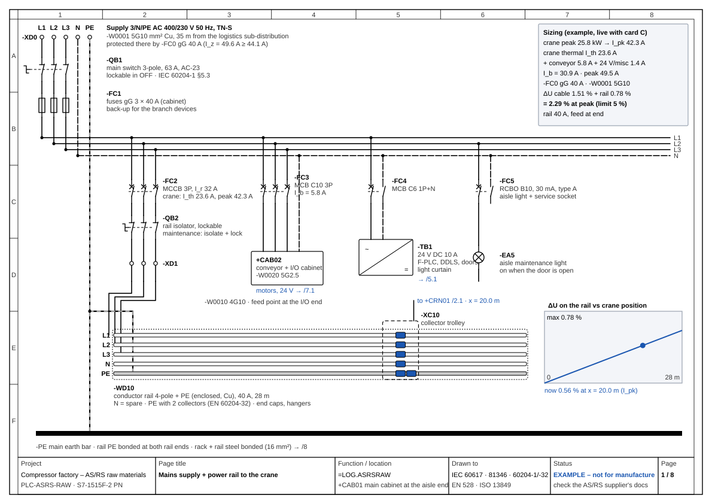
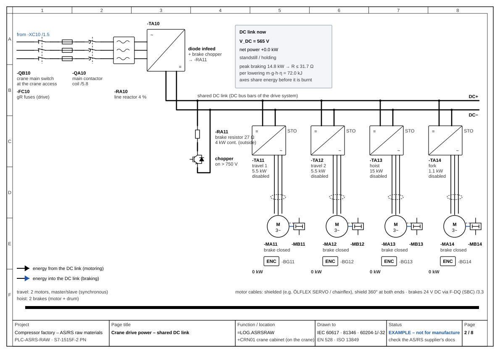
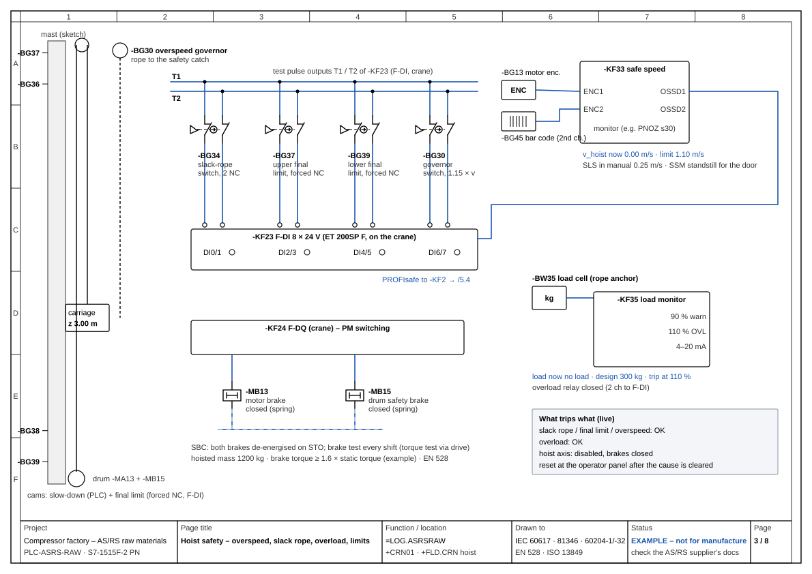
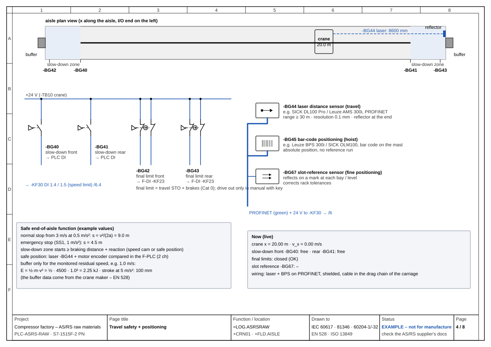
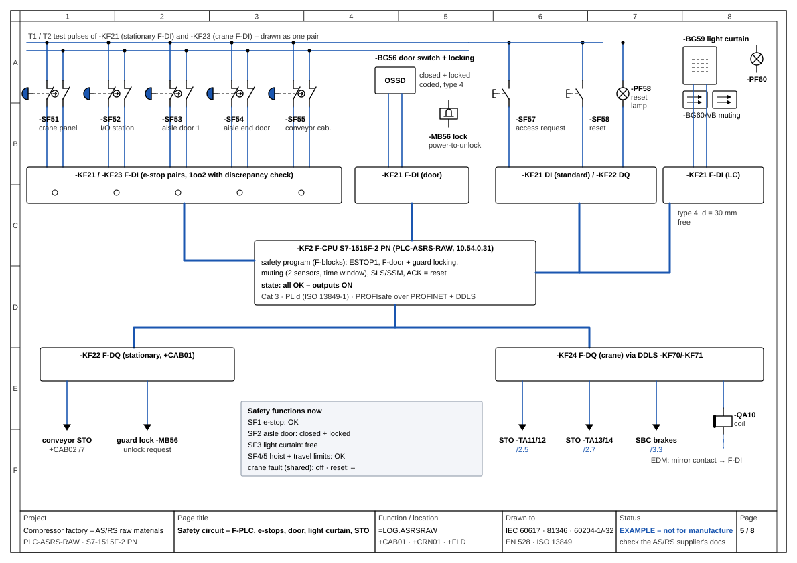
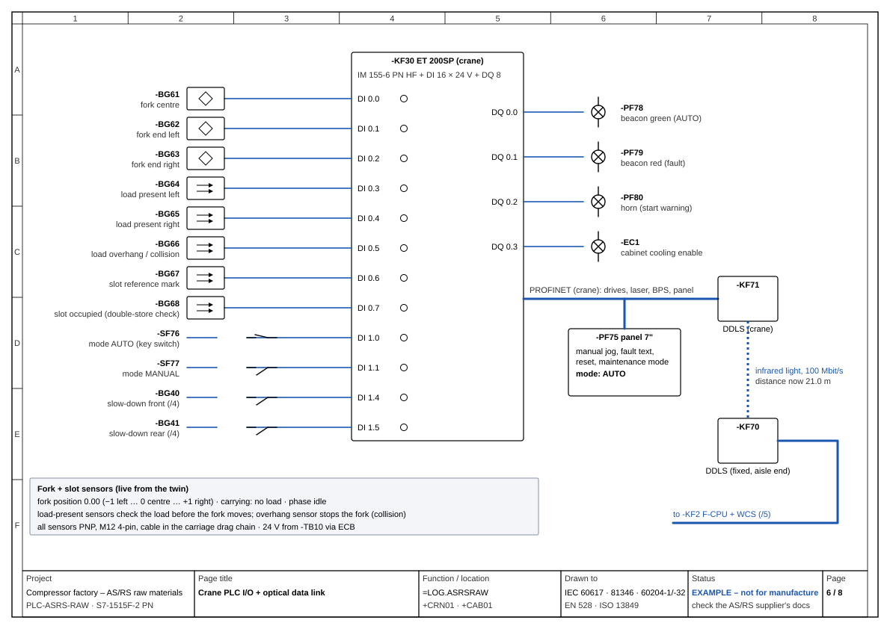
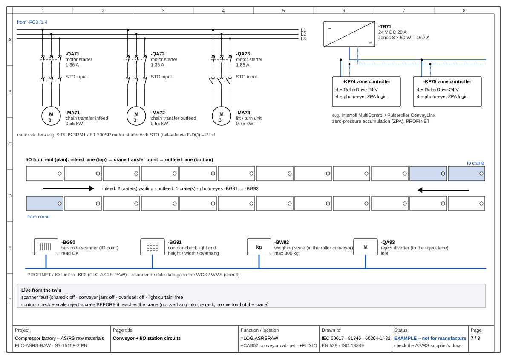
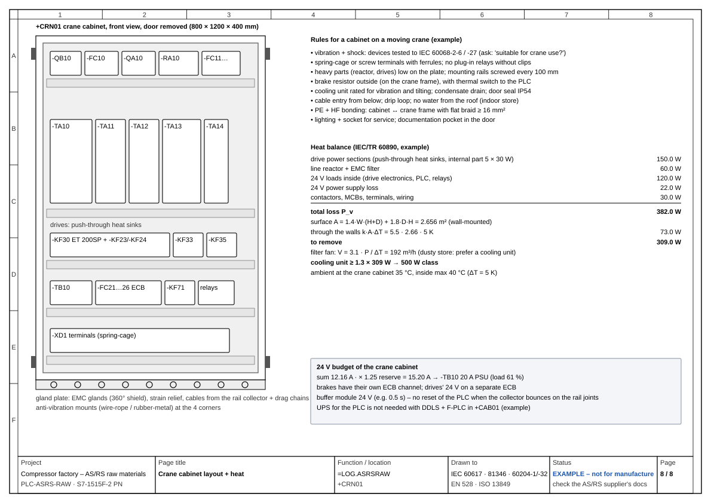

# 33 – AS/RS raw materials: PLC and electrical circuits – textbook, reference and design guide

**For whom:** mechanical engineers who plan the automated high-bay store **ASRS-RAW** of the compressor factory and want to
understand – and check – its electrical design: the power supply of a **moving** crane (conductor rail or energy chain),
the drive system with a **shared DC link**, the **hoist safety** (overspeed, slack rope, overload, limits, brakes), the
**end-of-aisle** function and positioning, the **safety circuit** with a fail-safe PLC, the I/O of the crane and of the
conveyors, the crane cabinet, the tests and what to buy.

**Where to see it live:** tab **AS/RS raw materials** → button **"3 · PLC + electrical circuits"**. Deep link:
`/?sritem=3#asrs`, one page: `/?sritem=3&sr3page=5#asrs`. Files: `web/asrsckt.js` (page + live logic),
`web/asrsckt_pages.js` (the 8 drawing pages), `web/asrsckt_sym.js` (frame, symbols – built on the robot symbol library
`web/robotckt_sym.js`), `web/asrsckt_calc.js` (all calculations), `web/asrsckt_data.js` (texts, BOM, tests),
`web/asrsckt_card.js` (catalogue card, generated from chapter 30 of this guide), `web/asrs3.css`.

> **All numbers are examples or estimates – the AS/RS supplier's offer decides.** The worked examples use the example crane
> of the shared core (`web/asrscore.js`, guide 03 §10.2 / §19): rack 2 × 14 bays × 2 crates × 7 levels = **392 slots**,
> 27.05 m long, top load level 7.95 m; crane travel **3 m/s, 0.5 m/s²**, hoist **1 m/s, 0.5 m/s²**, fork 1.0 m/s, moving
> mass **4 200 kg**, crate ≤ **300 kg**. The real design follows **IEC 60204-1** and **IEC 60204-32** (hoisting machines),
> **EN 528** (rail-dependent storage and retrieval equipment – safety), **ISO 13849-1/-2**, **ISO 13855**, **ISO 14119**,
> the drive maker's manuals – and it is made and signed by a **qualified electrical designer**. Product names in chapter 30
> are **catalogue examples**, not a recommendation; prices are **estimates – ask for a quote**.

**Related guides (read them instead of repeating them here):** [03 – material handling](03_material_handling.md) (rack
design §19, crane cycle §10.2, conveyor safety §21.4) · [24 – robot control circuits](24_robot_control_circuits.md) (the same
drawing method, MCB/fuse/cable basics, safety PLC, 24 V, EMC, cabinet heat) · [27 – installation electrical + EMC](27_installation_electrical_emc.md)
(factory supply, cable sizing tables, short-circuit, earthing, cable segregation) · [15 – numbering and identification](15_numbering_and_identification.md)
(IEC 81346 two-letter codes §17.3, PLC names, IP plan) · [16 – standards register](16_standards_register.md) · guides 31 / 32 / 34 (items 1, 2, 4 of the AS/RS tab).

---

## Contents

**Part A – Using the page and reading the drawings**
1. [Item 3 of the AS/RS tab – the 8 pages and how to use them](#1-item-3-of-the-asrs-tab--the-8-pages-and-how-to-use-them)
2. [The electrical system of a stacker crane in one picture](#2-the-electrical-system-of-a-stacker-crane-in-one-picture)
3. [Drawing rules used here – IEC 81346 two-letter codes, cross-references, colours](#3-drawing-rules-used-here--iec-81346-two-letter-codes-cross-references-colours)

**Part B – Power**
4. [Supply of the AS/RS (page 1)](#4-supply-of-the-asrs-page-1)
5. [Power to a moving machine – conductor rail or energy chain](#5-power-to-a-moving-machine--conductor-rail-or-energy-chain)
6. [Crane drive power – the shared DC link (page 2)](#6-crane-drive-power--the-shared-dc-link-page-2)
7. [Braking energy, brake resistor or regenerative infeed](#7-braking-energy-brake-resistor-or-regenerative-infeed)
8. [Motor brakes, SBC and motor cables](#8-motor-brakes-sbc-and-motor-cables)

**Part C – Safety**
9. [Hoist safety technology (page 3)](#9-hoist-safety-technology-page-3)
10. [Travel safety, end of aisle and positioning (page 4)](#10-travel-safety-end-of-aisle-and-positioning-page-4)
11. [The safety circuit – F-PLC, e-stops, door, light curtain, STO (page 5)](#11-the-safety-circuit--f-plc-e-stops-door-light-curtain-sto-page-5)
12. [PL calculation per ISO 13849-1 – worked example](#12-pl-calculation-per-iso-13849-1--worked-example)
13. [Safety distance of the I/O light curtain (ISO 13855)](#13-safety-distance-of-the-io-light-curtain-iso-13855)

**Part D – Signals**
14. [Crane PLC I/O and sensor wiring (page 6)](#14-crane-plc-io-and-sensor-wiring-page-6)
15. [Data transmission to the moving crane](#15-data-transmission-to-the-moving-crane)
16. [Conveyor and I/O station circuits (page 7)](#16-conveyor-and-io-station-circuits-page-7)
17. [24 V supply of the crane](#17-24-v-supply-of-the-crane)
18. [EMC on long rails and in a moving machine](#18-emc-on-long-rails-and-in-a-moving-machine)

**Part E – Cabinet, tests, documents**
19. [The cabinet on a moving crane (page 8)](#19-the-cabinet-on-a-moving-crane-page-8)
20. [Testing and commissioning (IEC 60204-1 §18, EN 528)](#20-testing-and-commissioning-iec-60204-1-18-en-528)
21. [Documentation set](#21-documentation-set)

**Part F – Reference**
22. [Troubleshooting table](#22-troubleshooting-table)
23. [Formula sheet](#23-formula-sheet)
24. [Standards register for this guide](#24-standards-register-for-this-guide)
25. [Glossary](#25-glossary)
26. [Checklists](#26-checklists)
27. [Questions for the AS/RS supplier, the drive maker and the electrical designer](#27-questions-for-the-asrs-supplier-the-drive-maker-and-the-electrical-designer)
28. [Design rules in short](#28-design-rules-in-short)
29. [Drawings of this guide](#29-drawings-of-this-guide)

**Part G – Buying**
30. [Buy list – catalogue examples](#30-buy-list--catalogue-examples)
31. [Shopping list (BOM) for ASRS-RAW](#31-shopping-list-bom-for-asrs-raw)
32. [Next to read](#32-next-to-read)

### How the numbers were checked

Every number in this guide was recomputed with a small Python script (standard library only, same formulas as
`web/asrsckt_calc.js`) and compared with the app's own self-check: open `/?sritem=3&sr3test#asrs` – the browser console
prints lines starting with `SR3TEST`.

| Check | Python | App (`SR3TEST`) |
|---|---|---|
| Travel force / peak power | F_roll 662.2 N, F_acc 2 250 N, P_pk 9 707 W, braking 4 287 W | identical ✓ |
| Hoist power | P_pk 14 555 W, run 13 849 W, lowering 10 006 W, lowering + decel 10 516 W | identical ✓ |
| Crane currents | I_pk 42.28 A, I_run 28.71 A, I_th 23.64 A | identical ✓ |
| AS/RS supply | I_b 30.86 A, peak 49.50 A → gG 40 A, 5G10, ΔU 1.509 % | identical ✓ |
| Conductor rail | 40 A class, ΔU 0.783 % (end feed) / 0.391 % (centre feed); total 2.292 % / 1.900 % | identical ✓ |
| Energy chain (variant) | 4G10, 24 m, I_z 39.7 A, ΔU 0.884 % | identical ✓ |
| Braking | m·g·h = 84 758 J, into DC link 72 045 J, P_brk 14 803 W, R ≤ 31.67 Ω → 27 Ω, 2 809 W average → 4 kW | identical ✓ |
| 24 V crane | 12.16 A → × 1.25 = 15.2 A → 20 A PSU (61 %) | identical ✓ |
| Light curtain | T = 0.264 s, 2 000·T + 128 = 656 > 500 → 1 600·T + 128 = 550.4 → **S = 550 mm** | identical ✓ |
| PL example | SF1 5.20·10⁻⁸ /h, SF2 1.85·10⁻⁸, SF3 3.20·10⁻⁸, SF4 5.70·10⁻⁸ → all ≥ PL d | identical ✓ |
| Cabinet heat | A = 2.656 m², P = 382 W, walls 73 W, fan 192 m³/h, cooling unit 500 W class | identical ✓ |
| Fault loop (chapter 4.4) | Z_s = 0.415 Ω ≤ 0.575 Ω (0.8 · 230 / 320) | (guide only) |
| Faster crane (chapter 6.7) | I_pk 70.63 A, I_th 36.74 A, gG 63, 5G25, rail 63 A, R 15 Ω | type the inputs into card C ✓ |
| Safety logic | e-stop → STO; reset refused while pressed; release → reset needed; door refused while locked; slack rope → STO, reset refused until repaired; travel final limit → STO | 11 scenarios ✓ |

**Key results (example) – you meet each of them again with its formula:**

| Quantity | Value | Chapter |
|---|---|---|
| Crane peak power (travel + hoist accelerating together) | 24.3 kW (+ 1.5 kW auxiliaries) → **I_pk 42.3 A** | 6.3 |
| Crane thermal current (duty profile) | **I_th 23.6 A** | 6.4 |
| Supply of the whole AS/RS | **I_b 30.9 A** (peak 49.5 A) → **gG 40 A, 5G10 Cu, 35 m, ΔU 1.51 %** | 4.3 |
| Conductor rail | **40 A class**, ΔU **0.78 %** at the far end (end feed) | 5.4 |
| Hoist lowering energy | **72 kJ** per full lowering of 1.2 t over 7.2 m | 7.1 |
| Brake resistor | **27 Ω**, peak 20.8 kW, **4 kW** continuous – or an active infeed saving ≈ **2.8 kWh per operating hour** | 7.3 |
| 24 V crane cabinet | **12.2 A** → **20 A** power supply | 17 |
| Safety distance I/O light curtain | **550 mm** (T = 0.264 s, d = 30 mm) | 13 |
| PL of the e-stop function | PFH_D **5.2·10⁻⁸ /h** (≥ PL d required) | 12 |
| Crane cabinet heat | **382 W** loss → cooling unit **≈ 500 W** | 19.3 |

---

# PART A – Using the page and reading the drawings

## 1. Item 3 of the AS/RS tab – the 8 pages and how to use them

### 1.1 What the page is

Item 3 is a **drawing set** of the AS/RS electrical equipment, drawn like a real E-CAD schematic (frame with columns 1–8
and rows A–F, title block, device tags, cross-references "/page.column"), but **live**: the same simulation that drives
the 3D twin (item 1), the control system (item 2) and the WMS (item 4) moves the contacts in the drawings.

* The **collector trolley** on page 1 moves with the crane; the voltage-drop chart shows the drop at the crane position.
* On page 2 every inverter shows whether its axis is **enabled**, whether the **brake is open**, and whether the axis
  **takes** energy from the DC link (orange arrow) or **gives** energy back (green arrow, regenerating). The DC link voltage
  rises to the chopper threshold when the crane lowers a load or brakes and no other axis can use the energy.
* E-stops, the aisle door, the light curtain, slack rope, overspeed, final limits **change contacts and LEDs** and switch
  the crane to **STO** – and because the faults are **shared**, item 1 shows the crane stopped and item 4 sees jobs waiting.

### 1.2 The screen, from top to bottom

| Element | What it does |
|---|---|
| Bar: e-stop -SF52, request entry -SF57, open/close door, person into light curtain, reset -SF58, chips | the most used safety actions on every page; chips show crane state, reset needed, DC link voltage, muting |
| Page buttons 1–8 | switch the drawing page |
| Drawing | SVG schematic; **click a device** → information box (what it is, rating, why, check, typical failure) |
| Controls under the drawing | page-specific: feed type and feed point (page 1), infeed type (page 2), hoist tests (page 3), travel test (page 4), e-stops + door + light curtain + shared faults (page 5) and an event log |
| Card C – calculations | inputs (load, masses, speeds, rail length, cable length, light-curtain resolution, stopping time, chopper voltage, feed type, regenerative infeed) and the live result table + PL table |
| Card D – BOM | every device with tag, rating (follows card C), example product family, quantity |
| Card E – tests | test and commissioning plan (IEC 60204-1 §18, EN 528, ISO 13849-2) |
| Card F – legend | all symbols, two-letter device codes, wire colours |
| Card "Real components + drawings" | the 8 drawings of this guide, the buy list (chapter 30) and the shopping list (chapter 31) |

### 1.3 The 8 pages

| Page | Title | Location | Live content |
|---|---|---|---|
| 1 | Mains supply + power rail to the crane | +CAB01 main cabinet at the aisle end | trolley position, ΔU at the crane, rail or energy chain, isolators |
| 2 | Crane drive power – shared DC link | +CRN01 crane cabinet | axis enabled / brake / kW, DC link voltage, chopper, regenerative infeed |
| 3 | Hoist safety | +CRN01, hoist | carriage height, slack rope, final limits, overspeed, overload, brakes |
| 4 | Travel safety + positioning | +CRN01, aisle | crane position, slow-down switches, final limits, laser distance, slot reference |
| 5 | Safety circuit (F-PLC) | +CAB01, +CRN01 | e-stops, door + guard locking, light curtain + muting, STO / SBC / main contactor |
| 6 | Crane PLC I/O + optical data link | +CRN01 | fork + load + slot sensors, mode, beacon, DDLS distance |
| 7 | Conveyor + I/O station circuits | +CAB02 | motor starters, RollerDrive zones, crates on the conveyors, scanner, scale, reject |
| 8 | Crane cabinet layout + heat | +CRN01 | heat balance + 24 V budget follow card C |

### 1.4 A 20-minute tour

1. Open `/?sritem=3#asrs`, page 1. Watch the collector trolley follow the crane. Switch **feed point** to "rail centre":
   the maximum voltage drop halves. Switch the feed to **energy chain** and read the info box of -WD11.
2. Page 2: wait until the crane lowers a crate – the hoist inverter turns green ("regen."), the DC link rises and the
   chopper lights the brake resistor. Switch the infeed to **active infeed**: the resistor disappears, the energy goes back
   to the mains. Card C shows the energy per cycle and per year.
3. Page 3: tick **slack rope**. The contact opens, the F-PLC switches STO, both hoist brakes close, item 1 shows the crane
   stopped. Press **reset** – refused. Untick, press reset – the crane continues.
4. Page 5: press **request entry**, then **open door**. The crane stops first, the lock opens at standstill. Close the door,
   reset. Press **person into light curtain** when no crate passes: the conveyors and the crane stop. Try it when the
   chip shows "muting": the person is NOT detected – read chapter 11.6 about muting.
5. Card C: change the load to 400 kg or the rail length to 60 m and watch fuse, cable, rail, resistor and voltage drop.

### 1.5 URL parameters (deep links, tests, screenshots)

| Parameter | Effect |
|---|---|
| `sr3page=1..8` | open a page |
| `sr3estop` | e-stop -SF52 pressed at start |
| `sr3door` | access request, then door opened |
| `sr3lc` | a person walks into the light curtain |
| `sr3slack` / `sr3over` | slack rope / overload at start |
| `sr3chain` / `sr3centre` / `sr3regen` | energy chain / rail centre feed / active infeed |
| `sr3info=KEY` | open the information box of a device, e.g. `sr3info=RA11` |
| `sr3card=calc\|bom\|test\|legend\|ref` | scroll to a card |
| `sr3test` | self-check in the console (`SR3TEST …`) – numbers, logic, cross-references, card |
| `sr3back` | switch items 1 → 2 → 4 → 3 and report errors (`SR3BACK …`) |
| `sr3hold` | test only: keeps the page loading for headless screenshots |
| `sr3svg=all` | writes the 8 pages as print SVG into a hidden text area (used to make `docs/img/33_*.svg`) |
| `sr3tab=draw\|buy\|shop`, `sr3q=text`, `sr3box=N`, `sr3scroll` | open the catalogue card section, filter, lightbox, scroll |

## 2. The electrical system of a stacker crane in one picture

```
 factory sub-distribution SD-LOG ── -W0001 5G10, 35 m ──► +CAB01 AS/RS main cabinet (aisle end, outside the fence)
                                                           │  -QB1 main switch, -FC1 fuses, F-CPU -KF2 (PLC-ASRS-RAW)
            ┌──────────────────────────────────────────────┼─────────────────────────────┐
            │ -FC2 + -QB2                                  │ -FC3                        │ -FC4 → -TB1 24 V (F-PLC,
            ▼                                              ▼                             │   DDLS fixed, doors, LC)
   conductor rail -WD10 (28 m, 4-pole + PE)        +CAB02 conveyor + I/O cabinet
   or energy chain -WD11                            motor starters, RollerDrive zones,
            │  collector trolley -XC10              scanner, contour check, scale
            ▼
   +CRN01 crane cabinet (moves with the crane)
     -QB10 · -FC10 · -QA10 · -RA10 reactor · -TA10 infeed ══ DC link ══ -TA11/-TA12 travel · -TA13 hoist · -TA14 fork
     -RA11 brake resistor · -TB10 24 V · ET 200SP -KF30 + F-DI/F-DQ -KF23/-KF24 · safe speed -KF33 · load monitor -KF35
            ▲
            │ PROFINET + PROFIsafe over the optical data link -KF71 ◄ infrared ► -KF70 (aisle end) ── -KF2
```

Three facts make a crane different from a fixed machine:

1. **It moves.** Power comes over sliding contacts (conductor rail) or a cable chain; data comes over an optical link or a
   cable in the chain. Every contact, collector and link is a possible fault – and must fail **safe**.
2. **It lifts.** A load hangs above the floor; gravity does not stop when the power stops. The hoist needs two brakes,
   overspeed protection, slack-rope and overload monitoring (EN 528).
3. **It brakes and lowers all day.** Every lowering and every travel stop turns potential or kinetic energy into electrical
   energy. The drive system must store, share, burn or return it.



## 3. Drawing rules used here – IEC 81346 two-letter codes, cross-references, colours

### 3.1 Device tags (IEC 81346-2:2019) – the project rule

The robot drawings of guide 24 use single letters (-K1, -Q1). For this project, **guide 15 §17.3** fixed the
**two-letter classes** of IEC 81346-2:2019. The AS/RS drawings use them:

| Code | Class (purpose) | Devices in these drawings |
|---|---|---|
| -QB | switching energy, isolating | -QB1 main switch, -QB2 rail isolator, -QB10 crane main switch |
| -FC | protecting against overcurrent | -FC1 fuses, -FC2 MCCB, -FC3 … -FC5 MCB / RCBO, -FC10 drive fuses, -FC21 … ECB channels |
| -QA | switching energy (contactor, motor starter) | -QA10 crane main contactor, -QA71 … -QA73 motor starters, -QA93 diverter |
| -TA / -TB | transforming (converter / power supply) (verify) | -TA10 infeed, -TA11 … -TA14 inverters, -TB1 / -TB10 / -TB71 24 V supplies |
| -RA | restricting (reactor, resistor) (verify) | -RA10 line reactor, -RA11 brake resistor |
| -MA / -MB | motor / brake, solenoid | -MA11 … -MA14 motors, -MB11 … -MB15 brakes, -MB56 lock solenoid |
| -BG / -BW | sensing position / weight (BW: verify) | limit switches, fork sensors, laser, light curtain; -BW35 load cell, -BW92 scale |
| -KF | processing signals | -KF2 F-CPU, -KF21 … -KF24 F-modules, -KF30 ET 200SP, -KF33 speed monitor, -KF35 load monitor, -KF70/-KF71 data link (verify) |
| -SF | manual action | -SF51 … -SF55 e-stops, -SF57 request, -SF58 reset, -SF76/-SF77 mode |
| -PF / -EA / -EC | presenting / light / cooling (verify) | -PF58 reset lamp, -PF75 panel, -PF78 … beacon; -EA5 light; -EC1 cooling |
| -WD / -XC / -XD | power cable, conductor rail / collector / terminal (verify) | -WD10 rail, -WD11 chain, -W0001 cables; -XC10 trolley; -XD0, -XD1 terminals |

Full designation: **`=LOG.ASRSRAW+CRN01-QA10:13`** = function AS/RS raw (area LOG), location crane cabinet CRN01, device
QA10, terminal 13. Locations: **+CAB01** AS/RS main cabinet at the aisle end, **+CAB02** conveyor + I/O cabinet,
**+CRN01** crane cabinet, **+FLD.CRN / +FLD.AISLE / +FLD.IO** field. The PLC is **PLC-ASRS-RAW** (Siemens S7-1515F-2 PN in the
example), IP **10.54.0.31** in VLAN 54 `OT-L1-LOG-ASRS`, host name `vc-log-plcasrsraw` (guide 15 §19).

### 3.2 Frame, columns, cross-references

Each page is A3 landscape shape: columns **1–8** across the top, rows **A–F** down the side, title block at the bottom
(project, page title, function / location, standards, status **"EXAMPLE – not for manufacture"**, page n / 8). A
cross-reference **/5.8** means "page 5, column 8": the coil of -QA10 is drawn on page 5 column 8, its main contacts on page 2
column 2 – the app finds these columns **automatically** in a first drawing pass (like an E-CAD program) and prints them next
to the device (`SR3TEST refs:` lists them).

### 3.3 Colours

| Conductor | Colour (IEC 60445 / IEC 60204-1) | In the drawing |
|---|---|---|
| L1 / L2 / L3 | brown / black / grey (in the cabinet: black is common) | brown / black / grey |
| N | light blue | light blue |
| PE | green-yellow | green-yellow dashed |
| DC link | per maker; in the drawing thick black – **up to 750 V DC** | thick black |
| 24 V DC control | dark blue (IEC 60204-1 recommends blue for DC control) | blue |
| PROFINET | green cable | thick green |

Live colours in the app: **orange** = actuated contact, **yellow dots** = current flowing, **green fill** = energised /
OK, **red** = fault. The exported drawings (`docs/img/33_*.svg`) are black with one blue accent.

---

# PART B – Power

## 4. Supply of the AS/RS (page 1)

### 4.1 What is connected

| Consumer | Location | Connected / peak | Note |
|---|---|---|---|
| Stacker crane (travel 2 × 5.5 kW, hoist 15 kW, fork 1.1 kW, auxiliaries 1.5 kVA) | +CRN01, via rail | peak 25.8 kW (travel + hoist accelerating) | most current, short peaks |
| Conveyors + I/O station (chain transfers, lift, RollerDrive zones, scanner, scale) | +CAB02 | ≈ 4 kVA | motors 0.55–0.75 kW |
| 24 V stationary (F-PLC, fixed DDLS, door switches, light curtain), cabinet light, socket | +CAB01 | ≈ 1 kVA | |

### 4.2 Main switch, fuses, branches

* **-QB1 main switch** (IEC 60204-1 §5.3): 3-pole, lockable in OFF, AC-23B; rating ≥ the cabinet current → **63 A** class.
* **-FC1** fuses in the cabinet protect the branch devices (back-up); the supply cable is protected **upstream** by -FC0
  in the sub-distribution.
* **-FC2 + -QB2** feed the crane: MCCB sized on the crane thermal current, **lockable rail isolator** so that maintenance in
  the aisle can switch the rail **dead** (lock-out / tag-out). A lamp "rail live" at the aisle door is good practice.
* **-FC3** feeds the conveyor cabinet, **-FC4** the 24 V supply -TB1, **-FC5** (RCBO 30 mA) the aisle maintenance light and
  service socket.

### 4.3 Worked example – supply current, fuse, cable

**Step 1 – currents (from chapter 6):** crane thermal current I_th = **23.64 A**, crane peak I_pk = **42.28 A**.

```
conveyor cabinet   I_conv = 4 000 VA / (√3 · 400 V) = 5.77 A
24 V + misc        I_stat = 1 000 VA / (√3 · 400 V) = 1.44 A
design current     I_b    = 23.64 + 5.77 + 1.44     = 30.86 A
peak (≈ 6 s)       I_pk,tot = 42.28 + 5.77 + 1.44   = 49.50 A
```

**Step 2 – fuse:** I_n ≥ I_b and I_n ≥ I_pk,tot / 1.5 (the 6-second acceleration peaks must stay well below the fuse's
conventional fusing current so the fuse does not age): 30.86 A and 49.50 / 1.5 = 33.0 A → **gG 40 A**.

**Step 3 – cable:** for gG fuses the conventional tripping current is I₂ = 1.6 · I_n and IEC 60364-4-43 requires
I₂ ≤ 1.45 · I_z:

```
I_z ≥ 1.6 · 40 / 1.45 = 44.1 A
PVC, method C, 3 loaded conductors, 30 °C: 6 mm² = 41 A, 10 mm² = 57 A
ambient 40 °C: k_θ = 0.87 → 10 mm²: I_z = 57 · 0.87 = 49.6 A ≥ 44.1 A ✓  → -W0001 5G10 Cu
```

**Step 4 – voltage drop at the peak current** (35 m, R₇₀ ≈ 1.2 · 1.83 Ω/km = 2.196 Ω/km, X ≈ 0.08 Ω/km, cos φ = 0.9):

```
ΔU = √3 · I · L · (R cos φ + X sin φ) / U
   = 1.732 · 49.5 · 35 · (0.002196 · 0.9 + 0.00008 · 0.436) / 400 = 1.509 %
```

The same formulas as guide 27 A.3 (and the same table values as `instelec_calc.js`). The loop impedance check (automatic
disconnection, IEC 60364-4-41) is done the same way as guide 24 §4.11 – **at the far end of the rail**, because the crane is
there half of the time (chapter 20, test 3).

### 4.4 Fault loop at the far end of the rail – worked example

In a TN-S system an earth fault on the crane (a phase touches the crane frame) must trip -FC2 fast enough
(IEC 60364-4-41: ≤ 5 s for distribution circuits, ≤ 0.4 s for final circuits up to 32 A at 230 V; the machine standard
refers to the same rule). The loop is: source + supply cable (phase and PE) + rail (phase conductor and PE conductor) + crane
wiring. Example values (measure them!):

```
upstream loop at the sub-distribution          Z_up  = 0.150 Ω   (from the SLD / measured)
supply cable 35 m, 10 mm² phase + 10 mm² PE    R_c   = 2 · 35 · 1.83 mΩ/m · 1.2 = 0.154 Ω
rail 28 m, phase + PE conductor (R' 1.6 Ω/km) R_r   = 2 · 28 · 1.6 mΩ/m       = 0.090 Ω
crane wiring 5 m, 10 mm²                       R_cr  = 2 · 5 · 1.83 mΩ/m · 1.2  = 0.022 Ω
Z_s ≈ 0.150 + 0.154 + 0.090 + 0.022 = 0.415 Ω   (reactance neglected – small for these lengths)

-FC2 MCCB I_r 32 A, instantaneous release I_i = 10 · I_r = 320 A
Z_s,max = U0 / I_a = 230 / 320 = 0.719 Ω ;  measured value must be ≤ 0.8 · 0.719 = 0.575 Ω   →  0.415 Ω ✓
earth-fault current I_k1 = 0.95 · 230 / 0.415 ≈ 526 A ≥ 320 A ✓
```

Measure Z_s **with the crane at the far end** and with the PE current going **through the collectors** – a worn PE brush
adds resistance exactly where it matters. If the loop is too high: bigger rail, centre feed, or an MCCB with an electronic
trip unit and a lower short-time / earth-fault setting.

## 5. Power to a moving machine – conductor rail or energy chain

### 5.1 The two solutions

| | Conductor rail (enclosed, "power rail") | Energy chain (cable carrier) |
|---|---|---|
| How | copper conductors in a plastic housing along the aisle; spring-loaded carbon brushes on a **collector trolley** slide on them | flexible cables in a chain that rolls over itself; one end fixed (usually the middle of the travel), one end on the crane |
| Travel length | practically unlimited | up to ≈ 100–200 m (gliding chain in a trough); longer needs special designs |
| Speed | ≥ 5 m/s possible (check collectors, joints) | ≈ 3–5 m/s gliding (check the maker) |
| Data | separate: optical link, or slotted waveguide / data rail (e.g. ProfiDAT) | PROFINET cable in the chain (simple, deterministic) |
| Wear parts | carbon brushes, collector springs, joints | chain links, cables (millions of strokes), trough sliding strips |
| Contact quality | sliding contact: micro-interruptions at joints, sparks, dust | solid copper all the way – no interruptions |
| Space | narrow, along the bottom rail or the top guide | needs a trough ≈ 0.2–0.4 m wide along half the aisle |
| Typical for | high-bay pallet cranes, long aisles, curve-going cranes | short aisles, mini-load cranes, very high data needs |
| Cost (28 m) | similar order; rail + collectors + data link vs chain + trough + chain cables | |

**Decision for ASRS-RAW (example):** conductor rail **4-pole + PE** (L1, L2, L3, N spare, PE) with a **double PE
collector**, data over an **optical link (DDLS)**. The page lets you switch to the energy chain variant to compare.

### 5.2 Conductor rail – what to specify

* **Number of poles:** 3 phases + PE (+ N if 230 V is taken from the rail; better: a small transformer on the crane).
  **IEC 60204-32** (hoisting machines) asks for the protective conductor to be continuous over **two independent collectors**
  (one may lift off at a joint). Many makers recommend double collectors for the phases too at higher speed.
* **Current rating:** ≥ the thermal current of the crane (with margin) and able to carry the peaks; check the
  **collector** rating (each brush ≈ 25–40 A typical – see datasheet).
* **Feed point:** at the end (simple) or in the **centre** (half the length → half the voltage drop); long rails get several
  feeds.
* **Expansion:** steel building and plastic housing expand differently → expansion units (≈ every 50–100 m, maker), fixed
  point in the middle.
* **Mounting:** hangers every 1–2 m, rail parallel to the crane rail within ≈ ± 10 mm (collector stroke), joints aligned
  to ≈ 1 mm (no step).
* **Isolation section:** for maintenance, a lockable isolator (-QB2) for the whole rail; with several cranes in one aisle
  you would also need isolated maintenance sections.

### 5.3 Rail voltage drop – the formula

A rail is a cable with a known impedance per conductor (R', X' in Ω/km from the datasheet). The crane is a moving load at
distance x from the feed point:

```
ΔU(x) % = √3 · I · x · (R' cos φ + X' sin φ) / U · 100
end feed:    x_max = L         centre feed: x_max = L / 2
```

### 5.4 Worked example – the 28 m rail

Rail size rule (example): **I_rail ≥ 1.25 · I_th** and **I_rail ≥ I_pk / 1.5** → 1.25 · 23.64 = 29.6 A, 42.28 / 1.5 =
28.2 A → **40 A class**. Assumed impedance of the example 40 A copper rail: **R' = 1.60 Ω/km, X' = 0.20 Ω/km**
(*assumption – take the real values from the rail datasheet*).

```
end feed, crane at 28 m, peak current 42.28 A:
ΔU = 1.732 · 42.28 · 28 · (0.00160 · 0.9 + 0.00020 · 0.436) / 400 · 100 = 0.783 %
centre feed (x = 14 m):                                                 = 0.391 %
total with the supply cable (1.509 %): 2.29 % (end feed) / 1.90 % (centre feed) ≤ 5 % ✓
```

Why it still matters: the crane's drives switch off with **"DC link under-voltage"** if the voltage dips during a
simultaneous hoist + travel acceleration at the far end **and** the collectors bounce on a joint at the same moment. Keep
the total drop at peak current well below 5 % and add the **24 V buffer** on the crane (chapter 17).

### 5.5 Energy chain variant – worked example

Fixed point in the middle of the aisle: the chain is half the travel long, plus cable inside the crane and to the cabinet:
L = 28 / 2 + 5 + 5 = **24 m**. Chain cables in a bundle get an extra derating (example 0.8):

```
1.25 · I_th = 29.6 A ;  10 mm²: 57 · 0.8 · 0.87 = 39.7 A ≥ 29.6 ✓   (6 mm²: 41 · 0.8 · 0.87 = 28.5 A ✗)
ΔU = 1.732 · 42.28 · 24 · (0.002196 · 0.9 + 0.00008 · 0.436) / 400 · 100 = 0.884 %
```

Use only cables **approved for the chain** (travel length, speed, bend radius, number of cycles – e.g. igus chainflex CF,
Lapp ÖLFLEX FD / SERVO FD) and separate power and data cables inside the chain with separators.

### 5.6 Typical failures of the power path

| Symptom | Cause | Remedy |
|---|---|---|
| Drive fault "DC link under-voltage" at one place in the aisle | rail joint step, worn brush, loose feed terminal | align joints, replace brushes, re-torque, check ΔU at that place |
| Sparks / black dust at the rail | collector pressure too low, joint gaps, overload | spring force, cleaning, double collectors |
| Crane frame not earthed | PE brush worn or lifted | double PE collector, PE continuity test at both ends (IEC 60204-1 §18.2) |
| Cable breaks in the chain after months | non-chain cable, too small bend radius, cables twisted | chain-rated cable, correct radius, free cable laying |
| RCD trips when the crane accelerates | leakage of the inverters (EMC filter, long motor cables) | type B RCD with a suitable rating or no RCD on the drive branch (TN-S, fault protection by MCCB) |

## 6. Crane drive power – the shared DC link (page 2)

### 6.1 What a shared DC link is

One **infeed** module (-TA10) rectifies the three-phase supply into DC (≈ 565 V at 400 V AC). All **inverter** modules
(-TA11 … -TA14) hang on the same DC bus bars and make variable-frequency AC for their motors.

```
rail ── -QA10 ── -RA10 ── -TA10 (rectifier) ══ DC+ / DC− ══ -TA11 travel 1 ── -MA11
                                    │                     ══ -TA12 travel 2 ── -MA12
                                -RA11 + chopper           ══ -TA13 hoist    ── -MA13
                                (or active infeed)        ══ -TA14 fork     ── -MA14
```

**Why:** when one axis brakes (generator) and another accelerates (motor) at the same time, the energy flows **directly**
over the DC link from one inverter to the other – it never goes through the rail. Only the **net** power is taken from the
mains (or burnt / returned). A crane often lowers while it travels, so this sharing saves energy and reduces the
peak current on the rail.

### 6.2 The axes – power formulas

| Axis | Force | Power |
|---|---|---|
| Travel | F = m · a + m · g · w_r (rolling resistance w_r ≈ 0.015, example) | P = F · v / η (motoring), P = (m·a − F_roll) · v · η (braking) |
| Hoist | F = m_h · (g + a) when accelerating up | P = m_h · (g + a) · v / η (lifting), P = m_h · g · v · η (lowering, regenerative) |
| Fork | F = m_f · a + m_f · g · μ (μ ≈ 0.05) | P = F · v / η |

### 6.3 Worked example – travel, hoist, fork

```
travel: m = 4 200 + 300 = 4 500 kg
  F_roll = 4 500 · 9.81 · 0.015 = 662.2 N ;  F_acc = 4 500 · 0.5 = 2 250 N
  P_pk   = (2 250 + 662.2) · 3 / 0.90 = 9 707 W   (end of acceleration, at full speed)
  P_run  = 662.2 · 3 / 0.90 = 2 207 W ;  braking (decel 0.5 m/s²): (2 250 − 662.2) · 3 · 0.90 = 4 287 W
  → 2 motors, 9.7 kW / 2 = 4.85 kW each → 2 × 5.5 kW

hoist: m_h = carriage + fork 900 kg + load 300 kg = 1 200 kg
  P_pk  = 1 200 · (9.81 + 0.5) · 1.0 / 0.85 = 14 555 W ;  P_run = 1 200 · 9.81 · 1.0 / 0.85 = 13 849 W → 15 kW
  lowering (regenerative): 1 200 · 9.81 · 1.0 · 0.85 = 10 006 W ;  lowering + braking at the end: 10 516 W

fork:  m_f = 150 + 300 = 450 kg :  (450 · 1.2 + 450 · 9.81 · 0.05) · 1.0 / 0.8 = 951 W → 1.1 kW
```

**Peak current of the crane** – travel and hoist accelerate together (worst case), diode infeed efficiency η_c = 0.97,
power factor λ = 0.9 (with line reactor), auxiliaries 1.5 kVA:

```
I_pk = (9 707 + 14 555) / (0.97 · √3 · 400 · 0.9) + 1 500 / (√3 · 400) = 40.11 + 2.17 = 42.28 A
```

### 6.4 Thermal current – the duty profile

Cables, rails and fuses heat up with the **r.m.s.** current, not with the peak. A stacker crane cycle has short peaks
(acceleration), longer constant-speed parts and standstill (fork, positioning, waiting). Example profile: 15 % of the time
at peak, 35 % running (travel + lifting at constant speed), 50 % standstill (only auxiliaries):

```
I_run = (2 207 + 13 849) / (0.97 · √3 · 400 · 0.9) + 2.17 = 28.71 A
I_th  = √(0.15 · 42.28² + 0.35 · 28.71² + 0.5 · 2.17²) = 23.64 A
```

Ask the crane supplier for the **real load profile** (current vs time for the FEM 9.851 cycle) – the drive sizing tool of
the drive maker gives it.

### 6.5 What the page shows live

The app computes the power of each axis from the crane state of the twin (velocity, acceleration from the velocity change,
carried load): **orange arrow + "motoring"** = the axis takes energy from the DC link, **green arrow + "regen."** = it gives
energy back. Hoist lowering is always green; travel is green during deceleration. The **net** power decides what happens on
the DC link: positive → energy from the mains, negative → DC link rises → chopper + resistor (or active infeed returns it).



### 6.6 Choosing the drive system

| Option | How | For |
|---|---|---|
| Multi-axis system with common DC link (infeed + axis modules) | e.g. SEW MOVIDRIVE modular, Siemens SINAMICS S120, Lenze i700 | standard for stacker cranes – energy sharing, one infeed, compact |
| Single inverters with DC coupling | each inverter has its own rectifier, DC terminals coupled | small cranes, retrofit |
| Single inverters, each with brake resistor | no sharing | simple, more losses – not recommended for a busy crane |
| Active infeed (AFE) + axis modules | IGBT infeed returns energy, sinusoidal input current | high throughput, energy cost, harmonic limits |

Ask for: STO and **SBC** (safe brake control) per axis, **safe speed functions** (SLS, SSM, SDI) in the drive or a
separate monitor, encoder interfaces (two encoders for the hoist), brake test function, PROFINET + PROFIsafe.

### 6.7 Second example – a faster crane

The same rack with the "faster crane" of guide 03 §19.3 (travel 4 m/s, 0.8 m/s²; hoist 1.5 m/s, 0.8 m/s²) – same formulas,
same Python check (type the values into card C):

| Quantity | Example crane (3 m/s) | Faster crane (4 m/s) |
|---|---|---|
| Travel peak power | 9.7 kW | (4 500 · 0.8 + 662.2) · 4 / 0.9 = **18.9 kW** |
| Hoist peak power | 14.6 kW | 1 200 · (9.81 + 0.8) · 1.5 / 0.85 = **22.5 kW** |
| Crane peak current I_pk | 42.3 A | **70.6 A** |
| Crane thermal current I_th | 23.6 A | **36.7 A** |
| Supply: I_b / peak | 30.9 A / 49.5 A | 44.0 A / 77.9 A → **gG 63 A, 5G25** |
| Conductor rail | 40 A, ΔU 0.78 % | **63 A**, ΔU 0.80 % |
| Peak braking power | 14.8 kW → 27 Ω | **26.8 kW** → R ≤ 17.5 Ω → **15 Ω** |

Lesson: 33 % more speed and 60 % more acceleration nearly **double** the electrical peaks – the throughput gain (guide 03:
101 → 133 jobs/h) costs a bigger supply, rail and resistor (or makes the active infeed more attractive).

### 6.8 Long aisle – 60 m rail

With the same crane on a 60 m rail fed at the end: ΔU_rail = 1.732 · 42.28 · 60 · (0.00160 · 0.9 + 0.00020 · 0.436) / 400
= **1.68 %**, total 3.19 % – still ≤ 5 %, but the margin for collector bounce shrinks. Feed in the centre (0.84 %) or take the
next rail size. For aisles above ≈ 100 m, makers use several feed points.

## 7. Braking energy, brake resistor or regenerative infeed

### 7.1 Where the energy comes from

| Source | Formula | Example |
|---|---|---|
| Hoist lowering (potential energy) | E = m_h · g · h; into the DC link: · η | 1 200 · 9.81 · 7.2 = **84 758 J**; · 0.85 = **72 045 J** per full lowering |
| Travel stop (kinetic energy) | E = ½ · m · v² minus friction during braking | ½ · 4 500 · 3² = 20 250 J; friction over s = v²/(2a) = 9 m: 662.2 · 9 = 5 960 J → (20 250 − 5 960) · 0.9 = 12 861 J per stop |
| Fork stop | small (≈ 100 J) | neglected |

h = 7.95 m (top level) − 0.75 m (I/O level) = **7.2 m**.

### 7.2 Peak braking power – sizing the resistor

The worst case is the hoist lowering and braking at the end of the stroke **while** the travel brakes:

```
P_brk = m_h · (g + a) · v · η + (m · a − F_roll) · v · η
      = 1 200 · 10.31 · 1.0 · 0.85 + (2 250 − 662.2) · 3 · 0.9 = 10 516 + 4 287 = 14 803 W
```

The chopper switches the resistor onto the DC link when the voltage rises above **U_on ≈ 750 V** (typical for 400 V
drives – the drive manual gives the exact value). The resistor must take the peak with margin:

```
R ≤ U_on² / (1.2 · P_brk) = 750² / (1.2 · 14 803) = 31.67 Ω  → next standard value below: 27 Ω
peak power at 27 Ω: 750² / 27 = 20 833 W
```

Check also the **minimum resistance** of the chopper (maximum chopper current) in the drive manual – a too small R destroys
the chopper transistor.

### 7.3 Continuous power – the energy per cycle

For a FEM single cycle the crane lowers twice by about half the height on average and stops twice from full speed (upper
estimate):

```
E_cycle = 2 · m_h · g · (h/2) · η + 2 · (½ m v² − F_roll · s) · η
        = 2 · 1 200 · 9.81 · 3.6 · 0.85 + 2 · 14 290 · 0.9 = 72 045 + 25 723 = 97 767 J
P_avg   = E_cycle / t_SC = 97 767 / 34.8 s = 2 809 W   → resistor continuous rating ≥ 1.25 · 2 809 = 3.5 kW → 4 kW
```

(The real share that reaches the resistor is lower because the axes share energy over the DC link – the drive sizing tool
calculates it from the real profile.)

### 7.4 Brake resistor or active infeed?

```
energy per operating hour (103 cycles/h): 97 767 J · 103 / 3.6·10⁶ = 2.80 kWh
per year (4 000 h, crane busy 50 %):    2.80 · 4 000 · 0.5 ≈ 5 600 kWh  (≈ 1 100 €/year at 0.20 €/kWh, example)
```

| | Diode infeed + brake resistor | Active infeed (AFE, regenerative) |
|---|---|---|
| Energy | burnt as heat (resistor on the crane, outside the cabinet) | returned to the factory grid |
| Input current | 6-pulse, THDi ≈ 35–45 % with reactor | almost sinusoidal, cos φ ≈ 1, THDi < 5 % |
| DC link | ≈ 565 V, rises to 750 V when braking | regulated ≈ 600–650 V |
| Cost | lower | higher (AFE module + filter) |
| Heat on the crane | resistor 4 kW continuous – needs free air, touch guard | none |
| Mains failure while lowering | resistor still brakes | the AFE cannot return energy – it needs a resistor too, or the drive goes to safe stop + brakes |

For a crane that runs most of the day, the AFE often pays back in a few years and removes the hot resistor; for a
low-throughput store the resistor is fine. **Important:** with an AFE, braking during a **mains failure** must be
covered (brake resistor as backup or controlled stop on the mechanical brakes) – ask the supplier.

**Alternative – energy storage:** capacitor modules on the DC link (e.g. supercapacitors) store the lowering energy and
give it back for the next lift; they also cut the peak current on the rail. Interesting for long rails and weak supplies.

## 8. Motor brakes, SBC and motor cables

### 8.1 Spring-applied brakes

All crane motors have **spring-applied brakes**: the spring presses the lining when there is no current (fail-safe); the
24 V (or rectified AC) coil lifts the armature. Brake = holding brake at standstill, emergency brake in a power failure or
STO.

| Axis | Brakes | Note |
|---|---|---|
| Travel | one per motor (-MB11, -MB12) | emergency braking distance from 3 m/s depends on the brake torque and wheel adhesion |
| Hoist | **motor brake -MB13 + drum safety brake -MB15** | two independent brakes – a broken gear or shaft must not drop the load (EN 528, risk assessment) |
| Fork | -MB14 | holds the fork position |

Brake torque (example rule): ≥ **1.6 × the static load torque** for the hoist, verified by a **brake test** (the drive
applies a test torque with the brake closed and checks that the motor does not turn – Siemens "SBT", SEW / Lenze similar)
every shift or every start.

### 8.2 SBC – safe brake control

STO removes the motor torque; SBC removes the brake current in a safe way (two channels: the drive's SBC output + the F-DQ,
or two switches in the brake supply). Sequence on an e-stop (stop category 1, SS1): **ramp down → standstill → STO + SBC**.
For the hoist the brakes close **at** standstill (torque proving: when starting, the drive first builds torque, then opens the
brake – no sag of the load).

### 8.3 Motor cables

* Shielded motor cables (e.g. Lapp ÖLFLEX SERVO FD, igus chainflex CF), shield 360° at both ends (EMC gland at the motor,
  shield clamp in the cabinet).
* Hoist and fork cables run in the **carriage drag chain** on the mast – chain-rated cables.
* Long motor cables (> 25–50 m, e.g. a travel motor at the top guide) → check the drive limit, du/dt filter or sine filter.
* Brake cores: inside the motor cable (hybrid cable) or separate; brake supply 24 V needs enough cross-section for the
  inrush (check voltage at the brake coil ≥ 90 % of rated).

## 9. Hoist safety technology (page 3)

### 9.1 What can go wrong with a hoist

| Hazard | Cause | Protection | Device on page 3 |
|---|---|---|---|
| Load falls | rope / belt breaks, gear breaks, brake fails | safety catch + overspeed governor, two brakes, brake test | -BG30, -MB13, -MB15 |
| Uncontrolled speed | drive or encoder fault, wrong setpoint | safe speed monitoring with two different sensors | -KF33, -BG13, -BG45 |
| Rope slack → rope jumps off the drum, load falls later | carriage sits on an obstacle (crate in the slot, rack part) | slack-rope switch | -BG34 |
| Overload | crate heavier than 300 kg, two crates | load cell + overload relay, scale at the infeed | -BW35, -KF35, -BW92 |
| Carriage hits the top / bottom | PLC or positioning fault | slow-down switches (PLC) + **final limit switches** (safety) + buffers | -BG36 … -BG39 |

EN 528 lists the protective measures for stacker cranes (including measures against falling of the load carrier and
safety gear when people can be under or on the carriage – the risk assessment of the supplier decides which apply).

### 9.2 Slack-rope (slack-belt) switch

A lever on the rope anchor or on a spring-loaded pulley: when the rope force falls below a threshold, the lever moves and
opens **two NC contacts with positive opening** (IEC 60947-5-1 Annex K) – two channels to the F-DI with test pulses (Cat 3).
Reaction: hoist STO + both brakes, no restart until the cause is cleared (manual mode, lift carefully).

### 9.3 Overspeed governor and safety catch

The governor rope runs from a governor wheel at the top over a tension pulley at the bottom and is clamped to the
carriage. If the carriage gets faster than the trip speed (≈ 1.15–1.4 × rated speed – maker), the governor blocks its
rope; the rope pulls the **safety catch** (wedges) on the carriage, which clamp onto the mast guide. A switch on the governor
(-BG30) opens at the same time → hoist STO. This is the **mechanical last line** after a rope break. Lift-type components
are often used. Test: trip test at commissioning and every year.

### 9.4 Safe speed monitor with two encoders

A single encoder can fail without being noticed (broken coupling → the drive "sees" standstill while the load falls). The
**safe speed monitor** (-KF33, e.g. Pilz PNOZ s30, or the safety functions of the drive) compares two speed signals from
**different** sensors (diversity):

* channel 1: motor encoder -BG13 (on the hoist motor),
* channel 2: absolute bar-code position -BG45 on the mast (speed = change of position).

Functions: **overspeed** (> 1.1 × v in AUTO), **SLS** (safely-limited speed, e.g. 0.25 m/s in manual), **SSM**
(safe speed monitor – standstill signal for the door unlock), **discrepancy** between both channels → safe stop.

### 9.5 Overload – load cell and evaluation

A load cell (-BW35, strain gauge) at the rope anchor or under a deflection pulley measures the rope force; the evaluation
unit (-KF35) gives:

* 4–20 mA to the PLC (load value: plausibility check against the WMS weight, statistics),
* relay "90 %" warning,
* relay "110 %" **overload** (two channels to the F-DI): lifting is blocked, lowering stays allowed.

Example threshold: design load 300 kg crate + 900 kg carriage → rope force with 300 kg load = 1 200 kg · g; trip at a crate
load of 330 kg (110 %). The **scale -BW92 at the infeed** rejects overweight crates **before** they reach the crane – the
load cell on the crane is the second, independent protection. In the twin the shared fault "overload" sets the carried crate
to 340 kg: page 3 shows "OVERLOAD: lifting blocked", page 7 shows the scale rejecting.

### 9.6 Limits and buffers on the hoist

| Device | Type | Function |
|---|---|---|
| -BG36 upper slow-down | position switch, NO, PLC | the PLC reduces the speed before the top position (backup to the positioning) |
| -BG37 upper final limit | forced NC, 2 channels, F-DI | safety stop if the carriage overruns |
| -BG38 lower slow-down | NO, PLC | |
| -BG39 lower final limit | forced NC, 2 channels | |
| buffers | elastomer / spring | mechanical end stop for the residual speed |

After a final limit trip the carriage may only be moved **away** from the limit in manual mode with a key (override
with reduced speed), then reset.

### 9.7 The two hoist brakes – SBC wiring

Both brakes are fed from the crane F-DQ -KF24 (PM-switching, two channels per brake or one channel + the drive's SBC):
de-energised on STO, on every safety trip and when the axis is disabled. A **brake test** every shift proves that each
brake alone holds ≥ the test torque.



## 10. Travel safety, end of aisle and positioning (page 4)

### 10.1 Stopping a 4.5 t crane

```
normal stop from 3 m/s at 0.5 m/s²:     s = v² / (2a) = 9 / 1.0 = 9.0 m
emergency stop (SS1) at 1.0 m/s²:        s = 9 / 2.0  = 4.5 m   (wheel adhesion limits the deceleration)
```

A crane at full speed 9 m before the end of the aisle **must already brake**. If the PLC or the position measurement fails
there, the crane would hit the buffer at high speed – that is why stacker cranes have a safe **end-of-aisle** function.

### 10.2 The end-of-aisle function

| Layer | Device | Function |
|---|---|---|
| 1 PLC positioning | laser -BG44 | target positions never beyond the last slot |
| 2 slow-down switches | -BG40 (front), -BG41 (rear), cams at the end zones | the PLC limits the speed in the end zone (backup) |
| 3 safe end-of-aisle monitoring | F-PLC: safe position (laser -BG44 + motor encoder, 2 channels) or speed cams + safe speed monitoring | in the end zone the speed must follow a safe braking curve; otherwise SS1 / STO |
| 4 final limit switches | -BG42 / -BG43, forced NC, F-DI | stop category 0 + brakes if the crane overruns |
| 5 buffers | hydraulic or elastomer buffers at both ends | absorb the **monitored residual speed** |

Worked buffer example (residual speed 1.0 m/s monitored by layer 3):

```
E = ½ · m · v² = ½ · 4 500 · 1.0² = 2 250 J = 2.25 kJ
stroke at an average buffer deceleration of 5 m/s²: s = v² / (2 a) = 1 / 10 = 0.10 m = 100 mm
```

The buffer data, the end-zone length and the monitored speed come from the crane maker (EN 528) – without safe speed
monitoring the buffers would have to take the **full** speed (½ · 4 500 · 3² = 20 kJ), which needs large hydraulic buffers.

### 10.3 Positioning sensors

| Axis | Sensor | Principle | Note |
|---|---|---|---|
| Travel | laser distance sensor -BG44 (e.g. SICK DL100 Pro, Leuze AMS 300i) | time-of-flight / phase to a reflector at the aisle end; range ≥ 30 m, resolution 0.1 mm, PROFINET or SSI | absolute, no reference run; keep the beam path free; reflector size per range |
| Hoist | bar-code positioning -BG45 (e.g. Leuze BPS 300i, SICK OLM100) | reads a bar-code tape along the mast | absolute, mm resolution; tape clean and straight |
| Fine positioning | slot-reference sensor -BG67 | light sensor sees a reflector mark at each bay and level | corrects rack tolerances (rack deflection, building settlement) |
| Fork | fork encoder + end / centre sensors | see chapter 14 | |

**Wiring:** laser and BPS on PROFINET (shielded, M12 D-coded), 24 V from an ECB channel of the crane supply. The laser of the
travel axis sits on the crane and looks at the reflector on the end wall (or reverse); the beam must not cross the path of
people or other sensors.

**Safe position:** for the end-of-aisle function the F-PLC compares the laser position with the motor-encoder position
(two channels, diverse). Discrepancy above a tolerance (wheel slip!) → safe stop.



## 11. The safety circuit – F-PLC, e-stops, door, light curtain, STO (page 5)

### 11.1 Safety functions of the AS/RS (example list from the risk assessment)

| SF | Trigger | Reaction | Stop category | PL_r (example) |
|---|---|---|---|---|
| SF1 | any e-stop -SF51 … -SF55 | crane SS1 → STO + SBC, conveyors STO, -QA10 off | 1 (crane), 0 (conveyors) | d |
| SF2 | aisle door opened / not locked | crane STO; door locked until safe standstill (SSM) | 1 | d |
| SF3 | I/O light curtain interrupted without valid muting | conveyor + crane in the I/O zone stop | 0 / 1 | d |
| SF4 | hoist overspeed, slack rope, final limit, overload | hoist STO + both brakes | 0 | d |
| SF5 | travel final limit, end-of-aisle overspeed | travel STO + brakes | 0 / 1 | d |
| SF6 | manual mode | safely-limited speed (SLS), hold-to-run | – | d |

### 11.2 Architecture – Category 3 with a fail-safe PLC

* **Input:** every safety sensor has **two channels** (two NC contacts or two OSSD outputs). The F-DI module feeds each
  contact pair with its own **test pulses** (T1, T2) – a short circuit between the channels or to 24 V is detected
  (cross-fault detection); the two channels are compared (**discrepancy time** 50–100 ms).
* **Logic:** the F-CPU -KF2 (S7-1515F-2 PN in the example) runs the safety program (F-blocks: ESTOP1, guard locking,
  muting, ACK) next to the standard program. The crane F-modules (-KF23 F-DI, -KF24 F-DQ on the ET 200SP) are reached
  with **PROFIsafe** over PROFINET and the optical data link – the "black channel": the link may lose telegrams, PROFIsafe
  detects it (watchdog / F-monitoring time) and the F-modules go to the safe state.
* **Output:** F-DQ PM-switching outputs → **STO** inputs of the drive system (two channels), **SBC** brakes, crane main
  contactor -QA10 (**EDM**: its mirror contact is read back; a welded contact blocks the restart).

### 11.3 E-stops

Five e-stop buttons (ISO 13850, IEC 60947-5-5): -SF51 crane operator panel, -SF52 I/O station, -SF53 aisle door 1,
-SF54 aisle end door, -SF55 conveyor cabinet. Each with two NC contacts with **positive opening**, latching, red mushroom on
yellow. Stop category 1 for the crane (braked ramp, then STO) – a 4.5 t crane coasting on STO alone would roll far.

Series connection of several e-stops on one input pair is common, but **fault masking** (ISO/TR 24119) limits the
diagnostic coverage when many devices are in series – here each e-stop has its own input pair (or use self-monitoring
contact blocks and at most a few devices per pair).

### 11.4 Aisle door with guard locking and access request

People may only enter the aisle when the crane **stands still** – it needs several seconds to stop. The door switch -BG56
(coded, ISO 14119 **type 4**, e.g. Euchner MGB, Schmersal AZM400) has **guard locking** (-MB56):

```
1. operator presses access request -SF57
2. F-PLC: crane finishes / stops (SS1), safe speed monitor -KF33 reports standstill (SSM)
3. F-DQ energises -MB56 (power-to-unlock) → door may open → crane stays in STO, aisle light on
4. inside: the person takes a personal key / lockout (manual mode only from the panel with the door closed or per supplier)
5. door closed → lock engages → reset -SF58 outside the aisle with a view into the aisle → crane continues
```

**Power-to-unlock** (spring locks) is the safe choice: a power failure keeps the door locked. An **escape release** inside
the aisle must open the door at any time (ISO 14119). On the page: "open door" without request is refused.

### 11.5 Light curtain at the I/O with muting

The conveyors pass through openings in the fence. A light curtain (-BG59, type 4, e.g. SICK deTec4, Leuze MLC 500)
protects the opening: a person is detected → stop. A **crate** must pass, so the light curtain is **muted** for the moment a
crate passes. Muting sensors (-BG60A/B) recognise a crate by its **shape and sequence** (two crossed beams, or four
sensors in sequence) within a **time window**; a muting lamp -PF60 shows the state (IEC 62046, IEC 61496).

Rules:

* muting only as long as needed (crate length / speed + margin), with a maximum time (e.g. 4–10 s);
* sequence check: sensor A then B (direction), both within a short time;
* the opening above the crate must be small or covered (no person can pass **with** the crate);
* "override" (to free the curtain after a fault) only hold-to-run with key.

On the page: "person into light curtain" while the chip shows **muting** → "not detected!" – this is exactly why the
muting conditions must be strict.

### 11.6 Reset

Reset (-SF58) only after the cause is cleared, on the **falling edge** of the button (no reset by a stuck button), from a
place outside the hazard zone with full view (ISO 13849-1 §5.2.2). The reset lamp -PF58 flashes when a reset is needed.

### 11.7 Stop categories – what each trip does

| Trip | Travel | Hoist | Fork | Conveyors | Stop category (IEC 60204-1 §9.2.2) |
|---|---|---|---|---|---|
| e-stop | SS1: braked ramp (≈ 1 m/s²) → STO + SBC | SS1 → STO + both brakes | STO + brake | STO | 1 (crane), 0 (conveyors) |
| door opened (should not happen while locked) | STO + brakes | STO + brakes | STO | – | 0 |
| access request (normal entry) | controlled stop, then STO | same | same | I/O lane may run (outside the fence) | 1 / 2 then 0 |
| light curtain without muting | if in the I/O zone: SS1 | if in the I/O zone: SS1 | STO | STO | 0 / 1 |
| slack rope, hoist final limit, overspeed | STO + brakes | STO + both brakes | STO | – | 0 |
| travel final limit | STO + brakes | STO + brakes | STO | – | 0 |
| overload | – | lifting blocked (lowering allowed) | – | – | functional stop |
| PROFIsafe watchdog (data link lost) | F-modules on the crane: STO + SBC | same | same | – | 0 |
| crane drive fault | drive's own fault reaction (ramp or coast + brake) | brake | brake | – | per drive |

Why stop category 1 for the crane on an e-stop: a 4.5 t crane at 3 m/s coasting only on its mechanical brakes would wear
the brakes and could slide on the rail; a controlled electrical ramp stops it shorter and gentler, then STO + brakes hold.



## 12. PL calculation per ISO 13849-1 – worked example

### 12.1 The method in short

1. Risk assessment → required performance level **PL_r** per safety function (risk graph: severity S, frequency F,
   possibility to avoid P). For crane hazards (crushing, falling load) typically **PL d**.
2. Split each safety function into **subsystems**: input → logic → output.
3. For each subsystem: Category, MTTF_D, DC, CCF → PFH_D (or take PFH_D from the datasheet / SISTEMA library).
4. Sum: **PFH_D,total = Σ PFH_D,i** → PL from the table below; the PL is also limited by the lowest subsystem PL.

| PL | PFH_D (1/h) |
|---|---|
| a | 10⁻⁵ … < 10⁻⁴ |
| b | 3·10⁻⁶ … < 10⁻⁵ |
| c | 10⁻⁶ … < 3·10⁻⁶ |
| d | 10⁻⁷ … < 10⁻⁶ |
| e | 10⁻⁸ … < 10⁻⁷ |

### 12.2 MTTF_D of an electromechanical device from B10_D

```
n_op   = d_op · h_op · 3 600 / t_cycle                (operations per year)
MTTF_D = B10_D / (0.1 · n_op)
aisle door (≈ 4 openings per day, 250 days): n_op = 1 000 /year
door switch B10_D = 2·10⁶ → MTTF_D = 2·10⁶ / (0.1 · 1 000) = 20 000 years → capped at 100 years ("high")
```

### 12.3 The four safety functions (example subsystem values – datasheets / SISTEMA)

| Safety function | Subsystem | PFH_D (1/h) | Basis |
|---|---|---|---|
| SF1 e-stop → STO all + SBC + conveyor STO | e-stops, 2 NC each, test pulses | 2.0·10⁻⁸ | Cat 3, DC 90 % (example) |
| | F-CPU + F-DI + F-DQ | 2.0·10⁻⁹ | datasheet, PL e |
| | drive system STO | 1.0·10⁻⁸ | drive datasheet |
| | SBC: F-DQ + brakes | 2.0·10⁻⁸ | Cat 3, brake B10_D |
| | **sum** | **5.20·10⁻⁸** | **PL e by PFH ≥ PL d ✓** |
| SF2 door + guard locking → STO | door switch (OSSD) | 1.5·10⁻⁹ | datasheet |
| | F-CPU + modules | 2.0·10⁻⁹ | |
| | drive STO | 1.0·10⁻⁸ | |
| | standstill monitor | 5.0·10⁻⁹ | |
| | **sum** | **1.85·10⁻⁸** | ✓ |
| SF3 light curtain + muting | light curtain + muting sensors | 1.0·10⁻⁸ | type 4 |
| | F-CPU + modules | 2.0·10⁻⁹ | |
| | conveyor + crane STO | 2.0·10⁻⁸ | |
| | **sum** | **3.20·10⁻⁸** | ✓ |
| SF4 hoist overspeed / slack rope / overload | speed monitor + 2 encoders | 1.0·10⁻⁸ | |
| | slack-rope switch | 2.0·10⁻⁸ | |
| | F-CPU + F-DQ | 2.0·10⁻⁹ | |
| | hoist STO + 2 brakes | 2.5·10⁻⁸ | |
| | **sum** | **5.70·10⁻⁸** | ✓ |

These are **examples** to show the method. The real values come from the datasheets and the SISTEMA calculation of the
supplier. Also required: CCF score ≥ 65 points, software per ISO 13849-1 §4.6 (validated F-program, signature), and the
validation per ISO 13849-2 (chapter 20).

## 13. Safety distance of the I/O light curtain (ISO 13855)

### 13.1 Response time chain

```
T = t_light curtain + t_logic (F-DI + F-CPU cycles + F-DQ incl. PROFIsafe) + t_STO / brake + t_stop of the hazard
  = 0.014 + 0.040 + 0.010 + 0.200 = 0.264 s     (example; t_stop = measured stopping time of the motion behind the curtain)
```

### 13.2 The rule (same as guide 24 §8.9 and `lcDist` in `robotckt_calc.js`)

For a vertical light curtain with resolution d ≤ 40 mm:

```
S = 2 000 · T + 8 · (d − 14)        (K = 2 000 mm/s, C = 8 · (d − 14))
if S ≤ 500 mm: use S (minimum 100 mm)
if S > 500 mm: recompute with K = 1 600 mm/s: S = 1 600 · T + 8 · (d − 14), but S ≥ 500 mm
```

Worked example, d = 30 mm → C = 128 mm:

```
2 000 · 0.264 + 128 = 656 mm > 500  →  1 600 · 0.264 + 128 = 550.4 mm  →  S = 550 mm
with d = 14 mm (C = 0):   2 000 · 0.264 = 528 > 500 → 1 600 · 0.264 = 422 → minimum 500 mm → S = 500 mm
with t_stop = 0.10 s (T = 0.164 s): 2 000 · 0.164 + 128 = 456 mm ≤ 500 → S = 456 mm
```

So: the light curtain must be at least **550 mm** in front of the nearest hazard point (the transfer conveyor / crane
fork at the I/O). If that space is not available, reduce T (faster stop, smaller resolution) or use a fixed guard.
**Measure the real stopping time** at commissioning (stop-time meter) and recompute.

For multi-beam light barriers (2–4 beams, body detection) S = 1 600 · T + 850 mm → 1 272 mm here – usually too long at a
conveyor opening, so a light curtain with muting is the common solution.

---

# PART D – Signals

## 14. Crane PLC I/O and sensor wiring (page 6)

### 14.1 Decentral I/O on the crane

All sensors of the crane are wired to a **decentral I/O station on the crane** (-KF30, e.g. Siemens ET 200SP with IM 155-6
PN HF, DI 16 × 24 V, DQ 8, plus the F-modules -KF23/-KF24). Only one data connection leaves the crane – the optical link.

| Address | Tag | Signal | Sensor | Logic |
|---|---|---|---|---|
| DI 0.0 | -BG61 | fork centre | inductive M18, PNP | travel / hoist allowed only with fork centre = 1 (interlock) |
| DI 0.1 / 0.2 | -BG62 / -BG63 | fork end left / right | inductive | end positions of the telescopic fork |
| DI 0.3 / 0.4 | -BG64 / -BG65 | load present left / right | light sensor with background suppression | before pick: slot must have a crate; after pick: both = 1 |
| DI 0.5 | -BG66 | load overhang / collision | light barrier along the fork | crate sticks out → no travel; fork collision stop |
| DI 0.6 | -BG67 | slot reference mark | light sensor | fine positioning at the bay / level |
| DI 0.7 | -BG68 | slot occupied check | long-range light sensor | before storing: slot must be empty (double-storage check) |
| DI 1.0 / 1.1 | -SF76 / -SF77 | mode AUTO / MANUAL | key switch | manual → SLS + hold-to-run |
| DI 1.4 / 1.5 | -BG40 / -BG41 | slow-down front / rear | position switch | speed limit in the end zones (chapter 10) |
| DQ 0.0 / 0.1 | -PF78 / -PF79 | beacon green / red | | AUTO / fault |
| DQ 0.2 | -PF80 | horn | | start warning in manual |
| DQ 0.3 | -EC1 | cabinet cooling enable | | |
| PROFINET | -TA10 … -TA14, -BG44, -BG45, -PF75 | drives, laser, bar-code positioning, panel | | |

On the page the LEDs follow the twin: fork position (`sim.crane.fork`, −1 … +1), carried load, phase "pos" (slot
reference), pick phases (slot occupied).

### 14.2 Sensor wiring rules

* **PNP (sourcing), 24 V DC, IEC 61131-2 type 1/3 inputs**, M12 A-coded 4-pin connectors, PUR cables for the drag chain.
* Fork sensors sit on the moving fork → cables in a small chain on the fork or a spiral cable; check bending cycles.
* Each sensor group on its own ECB channel (a short circuit in one sensor cable must not switch off the whole crane).
* **IO-Link** sensors give diagnostics (dirty lens, signal margin) – useful for light sensors in a dusty store.
* Light sensors: background suppression against the shiny rack beams; check against black / wet crates.

### 14.3 The local operator panel

-PF75 (7" panel) on the crane: manual jog of each axis (hold-to-run, SLS), fault texts, reset, maintenance mode, brake test.
Manual operation from the crane is only allowed with the conditions of the risk assessment (e.g. operator on a
maintenance platform with the crane in manual mode at reduced speed, enabling device).



## 15. Data transmission to the moving crane

| Solution | How | Data rate | Note |
|---|---|---|---|
| **Optical data link** (e.g. Leuze DDLS 500, SICK ISD400) | two infrared transceivers face each other along the aisle | 100 Mbit/s, PROFINET / PROFIsafe transparent | standard for stacker cranes; alignment ± 0.5° (maker), clean optics, free beam path, heaters in cold stores |
| Cable in the energy chain | PROFINET cable in the chain | 100 Mbit/s – 1 Gbit/s | simplest, no extra parts; only with an energy chain |
| Slotted waveguide / data rail (e.g. Conductix ProfiDAT) | radio inside a slot of the conductor rail | ≈ 100 Mbit/s | long aisles, several cranes, curves |
| Industrial WLAN | access points + client on the crane | variable | not deterministic enough for PROFIsafe without special design; diagnostics only |

**Alignment and range (optical link):** the two transceivers are mounted on the same axis along the aisle (one on the
crane, one on the end wall), with the beam above the crane's travel path and away from the laser distance sensor of the
travel axis (use a different height or the maker's "frequency" variants so the two infrared links do not disturb each
other). Range class ≥ the aisle length + run-out (here ≥ 30 m), alignment tolerance per datasheet (≈ ± 0.5°); the crane mast
sways and the building settles – check alignment after the first months. The diagnostic output (signal level) goes to the
PLC: warn before the link breaks.

**PROFIsafe over the link:** the F-CPU and the crane F-modules exchange safety telegrams with a counter and CRC; if the
link breaks, the **F-monitoring time** (e.g. 100–200 ms) runs out and the crane F-modules switch off → STO. This must be part
of the response-time calculation (worst case T + F-monitoring time, like guide 24 §8.9).

**Two links?** If the crane must also be reachable for diagnostics when the main link is down, a second pair can be used
(one for PROFINET, one for maintenance) – ask the supplier.

## 16. Conveyor and I/O station circuits (page 7)

### 16.1 The I/O front end

Infeed lane (side L of the crane transfer point) and outfeed lane (side R), each ≈ 6 m (12 zones in the drawing),
plus an ID point at the infeed:

| Device | Tag | Function |
|---|---|---|
| chain transfers, lift / turn unit | -MA71 … -MA73 with motor starters -QA71 … -QA73 | 400 V motors 0.55–0.75 kW; starters with overload, contactor function and **STO input** (fail-safe stop via F-DQ) |
| roller zones | 24 V RollerDrives with zone controllers -KF74/-KF75 (e.g. Interroll MultiControl, ConveyLinx) | **zero-pressure accumulation (ZPA)**: a crate moves to the next zone only when it is free |
| zone photo-eyes | -BG81 … -BG92 | occupied / free; jam = blocked longer than the expected time |
| bar-code scanner | -BG90 | reads the crate label before storing → WMS (item 4); no-read → reject lane |
| contour check | -BG91 measuring light grid | height, width, overhang – a protruding part would hit the rack |
| scale | -BW92 | weight ≤ 300 kg; overweight → reject |
| reject diverter | -QA93 | sends rejected crates to the reject / clearing lane |

### 16.2 Worked numbers

```
motor current 0.55 kW, η 0.78, cos φ 0.75: I = 550 / (√3 · 400 · 0.75 · 0.78) = 1.36 A ;  0.75 kW → 1.85 A
RollerDrive zones: 8 × 50 W = 400 W → 400 / 24 = 16.7 A → 24 V 20 A power supply -TB71 (check the start current)
```

### 16.3 Shared faults from the twin

* **scanner** (no-read): every store job is rejected at the ID point (the twin logs "rejected: barcode no-read").
* **convJam**: a photo-eye stays blocked; the conveyor stops the lane, the crane waits.
* **overload**: the scale (and the crane load cell) see > 300 kg.



## 17. 24 V supply of the crane

Budget of the crane cabinet (example currents – take the real ones from the datasheets):

| Consumer | A |
|---|---|
| -KF30 ET 200SP head + DI/DQ modules | 0.60 |
| -KF23/-KF24 F-DI / F-DQ modules (logic) | 0.30 |
| fork + slot sensors (12 × 30 mA) | 0.36 |
| -BG44 laser distance sensor | 0.25 |
| -BG45 bar-code positioning | 0.25 |
| -KF71 optical data link | 0.25 |
| -PF75 operator panel 7" | 0.50 |
| -MB13 hoist motor brake | 1.70 |
| -MB11/-MB12 travel brakes | 1.60 |
| -MB14 fork brake | 0.50 |
| drive control electronics -TA10 … -TA14 (5 × 1.0 A) | 5.00 |
| -KF33 safe speed monitor | 0.20 |
| -KF35 load monitor | 0.15 |
| -EC1 cooling unit control | 0.30 |
| lamps, horn, relays | 0.20 |
| **sum** | **12.16** |

```
with 25 % reserve: 12.16 · 1.25 = 15.2 A → 24 V 20 A power supply -TB10 (load 61 %)
```

Rules: **PELV**, 0 V earthed at one point; ECB channels (electronic circuit breakers) per group – brakes, drives' 24 V,
sensors, F-modules, panel; a **24 V buffer module** (≈ 0.5 s) bridges micro-interruptions of the rail collectors (no PLC
reset, no brake drop); brake coil voltage at the coil ≥ 90 % of rated.

## 18. EMC on long rails and in a moving machine

| Topic | Rule (example) |
|---|---|
| Conductor rail as an antenna | the rail runs 28 m parallel to sensor and data cables – keep ≥ 0.3 m distance to signal cables or use a metal separator; inverter output noise does **not** go on the rail if the infeed has a line reactor / filter |
| EMC filter + RCD | inverter EMC filters cause leakage current; on IT or RCD-protected supplies use the filter variant of the maker; RCD type B only if required |
| Motor cables | shielded, 360° at both ends, as short as possible, separated from signal cables in the drag chain (separators) |
| Earthing / bonding | crane frame bonded to the cabinet with flat braid; rail PE + crane rail + rack steel bonded at both ends of the aisle (16 mm²) |
| Data link | optical link is immune to EMI – a big advantage; still keep the PROFINET cables on the crane short and shielded |
| Encoders / laser | shielded cables, shield on the cabinet plate, separate from motor cables |
| 24 V on the crane | PSU close to the loads; flyback suppression on brake coils (or the brake rectifier/driver of the drive) |
| Harmonics | diode infeed THDi 35–45 % (with reactor) – check with guide 27 C.15; active infeed for weak supplies |

## 19. The cabinet on a moving crane (page 8)

### 19.1 Why it is special

The crane cabinet travels at 3 m/s and accelerates with 0.5 m/s² thousands of times a day; it gets shocks at every stop and
vibrations from the wheels on the rail joints. The store may be dusty and warm under the roof.

### 19.2 Layout rules (example)

* Cabinet **800 × 1 200 × 400 mm** (example) on the crane frame near the bottom, on **anti-vibration mounts**
  (wire-rope isolators or rubber-metal mounts), with a flexible PE / HF bonding strap.
* Heavy parts (line reactor, drive modules) low on the mounting plate; DIN rails screwed every ≈ 100 mm; no plug-in relays
  without retaining clips; **spring-cage terminals** or screw terminals with ferrules (re-torque at the first service).
* Drive modules with **push-through heat sinks** (heat to the back, outside) – less heat inside.
* **Brake resistor outside** the cabinet (on the crane frame, with touch guard and thermal switch to the PLC).
* Cable entry from below through EMC glands; strain relief for the cables from the rail collector and the drag chains.
* Devices tested for vibration and shock (IEC 60068-2-6, -27) – ask "suitable for crane use?".

### 19.3 Heat balance (IEC/TR 60890, example)

| Loss | W |
|---|---|
| drive power sections (push-through, internal part 5 × 30 W) | 150 |
| line reactor + EMC filter | 60 |
| 24 V loads inside (drive electronics, PLC, relays) | 120 |
| 24 V power supply loss: 12.16 A · 24 V · (1/0.93 − 1) | 22 |
| contactors, MCBs, terminals, wiring | 30 |
| **total P_v** | **382** |

```
wall-mounted surface: A = 1.4 · W · (H + D) + 1.8 · D · H = 1.4 · 0.8 · 1.6 + 1.8 · 0.4 · 1.2 = 2.656 m²
through the walls (k = 5.5 W/m²K painted steel, ΔT = 40 − 35 = 5 K): 5.5 · 2.656 · 5 = 73 W
to remove: 382 − 73 = 309 W
filter fan: V̇ = 3.1 · 309 / 5 = 192 m³/h   (dusty store → filter mats clog → prefer a cooling unit)
cooling unit ≥ 1.3 · 309 = 402 W → 500 W class, rated for vibration and mobile use, condensate drain
```



---

# PART E – Tests and documents

## 20. Testing and commissioning (IEC 60204-1 §18, EN 528)

Order: **without power → with power → safety functions → performance** (the same list as card E):

| # | Test | How | Accept (example) | Standard |
|---|---|---|---|---|
| 1 | Visual inspection + documents | drawings = as-built, labels, terminal torque | no deviations | IEC 60204-1 §18.1 |
| 2 | PE continuity | main earth bar → crane frame **through the rail collectors** at both ends and the middle | ≤ 0.1 Ω per 10 m (example) | IEC 60204-1 §18.2.2 |
| 3 | Fault loop impedance | at the crane at the far rail end | Z_s ≤ 0.8 · U0 / I_a | IEC 60204-1 §18.2.3 |
| 4 | Insulation resistance | 500 V DC, drives disconnected per maker | ≥ 1 MΩ | IEC 60204-1 §18.3 |
| 5 | Voltage test | if required, usually by the cabinet builder | no breakdown | IEC 60204-1 §18.4 |
| 6 | Residual voltage | DC link < 60 V after | ≤ 5 s or warning label | IEC 60204-1 §18.5 |
| 7 | Rail + collectors | joints, collector pressure, ΔU during hoist + travel acceleration at the far end | ΔU ≤ 5 % | maker |
| 8 | E-stops | each e-stop at full speed: stop category, braking distance, reset | as designed | ISO 13850, EN 528 |
| 9 | Door + guard locking | request, run-down, lock stays closed, escape release | unlock only at standstill | ISO 14119 |
| 10 | Light curtain + muting | test rod, crate passes muted, person after crate stops | S ≥ calculated | IEC 61496, IEC 62046, ISO 13855 |
| 11 | Hoist safety | slack rope, final limits, overload 110 % with test weight, governor trip | each trips, both brakes close | EN 528 |
| 12 | Brakes | static test with 1.25 × load, brake test function | no slip | EN 528 |
| 13 | End of aisle | slow-down, safe speed curve, final limits; buffer test at reduced speed | stops before the buffer | EN 528 |
| 14 | Load handling interlocks | fork centre, load present, slot occupied, overhang | all work | risk assessment |
| 15 | Data link + PROFIsafe | interrupt the beam | safe stop within F-monitoring time | IEC 61784-3-3 |
| 16 | Safety validation | ISO 13849-2 plan, fault injection, SISTEMA | all faults detected | ISO 13849-2 |
| 17 | Performance | FEM 9.851 cycle with load | SC ≤ 34.8 s (example) | FEM 9.851 |
| 18 | Documentation + CE | reports, validation, instructions, EC declaration | complete | Machinery Regulation (EU) 2023/1230 |

**Fault injection (examples for test 16):** short circuit channel A–B of an e-stop (cross fault → detected), one door switch
channel stuck (discrepancy), -QA10 welded (EDM blocks restart), encoder cable of the hoist unplugged (discrepancy in -KF33),
DDLS beam blocked (PROFIsafe watchdog), brake lining contaminated (brake test fails).

**Instruments:** installation tester (IEC 61557: continuity, insulation, loop impedance, RCD), clamp meter with inrush and
leakage, oscilloscope or power analyser (DC link, ΔU at the rail during acceleration), stop-time meter (light curtain
distance), test weights for overload, laser tracker / tape for the end zones.

## 21. Documentation set

Schematics (these 8 pages and the full E-CAD set), cabinet layouts, terminal plans, cable list (with chain-cable data),
I/O list, PROFINET topology + IP list (guide 15), safety concept (risk assessment, SF list, PL calculation SISTEMA,
validation report), F-program printout + signature, drive parameter backups, test reports (chapter 20), spare-parts list,
operating and maintenance instructions (brake test, collector brushes, rail joints, light curtain cleaning), EC declaration
of conformity.

---

# PART F – Reference

## 22. Troubleshooting table

| Symptom | Possible cause | Check | Remedy |
|---|---|---|---|
| "DC link under-voltage" at one place in the aisle | rail joint, worn collector, feed terminal | ΔU with an oscilloscope while the crane accelerates there | align joints, new brushes, re-torque, centre feed |
| "DC link over-voltage" when lowering | brake resistor thermal switch open, resistor too small, chopper defect | resistor temperature, R value, chopper diagnostics | cool / bigger resistor, AFE |
| Crane stops when passing a place, restarts after reset | DDLS beam interrupted (dirty optics, obstacle, misalignment) | link diagnostics (signal level) | clean, align, remove obstacle |
| Discrepancy fault of the hoist speed monitor | encoder slip / coupling, dirty bar-code tape | compare both speeds in the diagnostics | coupling, clean tape |
| Slack-rope trip without reason | switch adjustment, rope stretch, carriage on a crate | lever position, rope tension | adjust, re-tension, check slot |
| Overload trips with normal crates | load cell drift, zero not done after maintenance | 4–20 mA value with a known weight | re-calibrate, zero |
| Door does not unlock after request | no standstill signal (SSM), crane still in a move, lock solenoid fuse | F-PLC diagnostics | wait, check SSM, ECB |
| Light curtain stops the conveyor with every crate | muting sensors misaligned, wrong sequence, muting time too short | muting lamp, sensor LEDs | align, adjust time window |
| Fork does not move | fork centre / end sensor, load-present check failed, slot occupied | DI LEDs on page 6 | clean / adjust sensor, check slot |
| Crane frame shock (touch voltage) | PE collector worn, PE broken | PE continuity through the collectors | double PE collector, repair |
| Brake test fails | worn lining, oil, air gap | brake test log | replace / adjust brake |
| RCD trips | leakage of EMC filters | leakage clamp | proper RCD type / filter variant / no RCD on drives |

## 23. Formula sheet

| Quantity | Formula | Example |
|---|---|---|
| Travel force | F = m·a + m·g·w_r | 2 250 + 662.2 = 2 912 N |
| Travel power | P = F·v/η | 9 707 W |
| Hoist power | P = m_h·(g + a)·v/η | 14 555 W |
| Lowering power (regen) | P = m_h·g·v·η | 10 006 W |
| Crane current | I = P/(η_c·√3·U·λ) + I_aux | 42.28 A |
| Thermal current | I_th = √(Σ d_i·I_i²) | 23.64 A |
| Design current | I_b = I_th + I_conv + I_stat | 30.86 A |
| Fuse | I_n ≥ I_b, ≥ I_pk/1.5 | gG 40 A |
| Cable (gG) | I_z ≥ 1.6·I_n/1.45, I_z = I_tab·k_θ | 10 mm², 49.6 A |
| Voltage drop | ΔU = √3·I·L·(R cos φ + X sin φ)/U | 1.509 % (cable), 0.783 % (rail) |
| Lowering energy | E = m_h·g·h·η | 72 045 J |
| Brake resistor | R ≤ U_on²/(1.2·P_brk) | 31.67 Ω → 27 Ω |
| Resistor continuous | P ≥ 1.25·E_cycle/t_cycle | 4 kW |
| Braking distance | s = v²/(2a) | 9.0 m / 4.5 m |
| Buffer | E = ½·m·v² ; s = v²/(2a_b) | 2.25 kJ, 100 mm |
| MTTF_D | B10_D / (0.1·n_op) | 20 000 y → 100 y |
| PFH sum | Σ PFH_D,i | 5.2·10⁻⁸ /h |
| Response time | T = t_LC + t_logic + t_STO + t_stop | 0.264 s |
| Safety distance | S = 2 000·T + C; > 500 → 1 600·T + C, ≥ 500 | 550 mm |
| Cabinet surface (wall) | A = 1.4·W·(H + D) + 1.8·D·H | 2.656 m² |
| Heat through walls | P = k·A·ΔT | 73 W |
| Fan | V̇ = 3.1·P/ΔT | 192 m³/h |
| 24 V PSU | I_PSU ≥ 1.25·Σ I | 20 A |

## 24. Standards register for this guide

| Standard | Title (short) | Where used |
|---|---|---|
| IEC 60204-1 | Electrical equipment of machines – general | 4, 8, 11, 20 |
| IEC 60204-32 | Electrical equipment of machines – hoisting machines | 5.2 (PE collectors), 9 |
| EN 528 | Rail-dependent storage and retrieval equipment – safety requirements | 9, 10, 20 |
| FEM 9.851 / 9.831 | Performance data / design of stacker cranes | 7.3, 20 |
| ISO 12100 | Risk assessment | 11 |
| ISO 13849-1 / -2 | Safety-related parts of control systems – design / validation | 11, 12, 20 |
| IEC 62061 | Functional safety (SIL route) | 12 (alternative) |
| ISO 13850 | Emergency stop function | 11.3 |
| ISO 13855 | Positioning of safeguards (approach speeds) | 13 |
| ISO 13857 | Safety distances (reach) | 11.5 |
| ISO 14119 | Interlocking devices with guards | 11.4 |
| IEC 61496-1/-2 | Electro-sensitive protective equipment (light curtains) | 11.5 |
| IEC 62046 | Application of protective equipment to detect persons (muting) | 11.5 |
| IEC 60947-5-1 / -5-5 | Control switches (positive opening) / e-stop devices | 9.2, 11.3 |
| IEC 61800-5-2 | Drives – safety functions (STO, SBC, SLS, SSM) | 8, 9.4 |
| IEC 61800-3 | Drives – EMC | 18 |
| IEC 61784-3-3 | PROFIsafe | 11.2, 15 |
| IEC 60364-4-41 / -4-43 / -5-52 | Installation – shock protection / overcurrent / cables | 4.3 |
| IEC 60445 | Conductor colours / terminal marking | 3.3 |
| IEC 60617 | Graphical symbols | drawings |
| IEC 81346-1 / -2 | Reference designations, classes | 3.1 |
| IEC/TR 60890 | Temperature rise of enclosures | 19.3 |
| IEC 60068-2-6 / -27 | Vibration / shock tests | 19.2 |
| IEC 61439-1/-2 | Low-voltage switchgear assemblies | 19 |
| EN 619 | Continuous handling – unit-load conveyors – safety | 16 |
| Machinery Regulation (EU) 2023/1230 | CE marking (replaces 2006/42/EC from 2027) | 20 |

## 25. Glossary

| Term | Meaning |
|---|---|
| AFE (active front end) | IGBT infeed that can return braking energy to the mains |
| B10_D | number of operations until 10 % of the devices fail dangerously |
| Black channel | communication path that is not safety-rated; the safety protocol (PROFIsafe) detects its errors |
| Brake chopper | transistor that switches the brake resistor onto the DC link above a voltage threshold |
| Collector (current collector) | carbon brush on a spring arm sliding on a conductor rail |
| Conductor rail | enclosed copper conductors along the travel path (also "power rail", "busbar") |
| DC link | DC voltage bus between infeed and inverters (≈ 565 V at 400 V AC) |
| DDLS | optical data link (infrared, Leuze "Data Distance Laser System"; generic: optical data transmission) |
| Discrepancy time | maximum time two channels of a safety input may differ |
| EDM | external device monitoring – read back a contactor's mirror contact |
| Energy chain | cable carrier that guides flexible cables to a moving machine |
| F-DI / F-DQ | fail-safe digital input / output module |
| FEM 9.851 | European standard method for stacker-crane cycle times |
| Guard locking | device that keeps a guard (door) closed until the hazard has stopped |
| I_th | thermally equivalent (r.m.s.) current of a varying load |
| Muting | temporary, automatic suspension of a light curtain while material passes |
| OSSD | output signal switching device – safe semiconductor outputs of a light curtain / safety switch |
| Overspeed governor | device that trips a safety catch when the carriage overspeeds |
| PFH_D | probability of a dangerous failure per hour |
| PL / PL_r | performance level achieved / required (ISO 13849-1) |
| Safety catch | wedges that clamp the carriage onto the mast guide |
| SBC / STO / SS1 / SLS / SSM | safe brake control / safe torque off / safe stop 1 / safely-limited speed / safe speed monitor (IEC 61800-5-2) |
| Slack-rope switch | detects loss of rope tension |
| Test pulse | short 0 V pulse on a safety input supply to detect short circuits |
| ZPA | zero-pressure accumulation on roller conveyors |

## 26. Checklists

### 26.1 Design review of the AS/RS electrical drawings

- [ ] Load list with peak and thermal currents of the crane from the supplier's load profile
- [ ] Supply cable, fuse, main switch sized; ΔU at peak ≤ 5 % at the far end of the rail
- [ ] Rail (or chain) size, feed point, double PE collector, isolator lockable
- [ ] Drive system: shared DC link, infeed type decided (resistor / AFE), brake resistor sized (peak + continuous)
- [ ] Hoist: two brakes, SBC, brake test, overspeed (governor + safe speed with 2 diverse sensors), slack rope, overload, final limits
- [ ] Travel: end-of-aisle function (slow-down, safe speed / position, final limits, buffers sized for monitored speed)
- [ ] Safety functions listed with PL_r; PL verified (SISTEMA); response times and safety distances calculated (ISO 13855)
- [ ] Door: guard locking type 4, power-to-unlock, escape release, access request sequence
- [ ] Light curtain: type 4, muting with sequence + time, muting lamp, override with key
- [ ] PROFIsafe over the data link: F-monitoring time in the response time
- [ ] 24 V budget, ECB channels, buffer module, PELV
- [ ] EMC: cable segregation along the rail, shielding, bonding of rail / rack / crane
- [ ] Crane cabinet: vibration-proof, heat balance, cooling unit rated for mobile use
- [ ] Two-letter device codes per guide 15 §17.3; PLC name and IP per guide 15

### 26.2 Commissioning checklist

- [ ] PE continuity through the collectors at 3 positions
- [ ] Loop impedance at the far end
- [ ] Insulation test (drives disconnected per maker)
- [ ] ΔU at the far end during hoist + travel acceleration
- [ ] Brake tests (static 1.25 × load, dynamic)
- [ ] Every safety function tested and logged (chapter 20), fault injection done
- [ ] Stopping times measured → safety distances confirmed
- [ ] Parameter backups, F-signature recorded
- [ ] FEM 9.851 cycle time measured with load

### 26.3 Maintenance (example intervals – the supplier's manual decides)

- [ ] every shift: brake test (automatic), visual check of the light curtain
- [ ] monthly: e-stop and door function test, slack-rope test, load-cell zero
- [ ] every 6 months: collector brushes, rail joints, DDLS optics, drag chains, cabinet filter / cooling unit
- [ ] yearly: overspeed governor trip test, overload test with test weight, PE continuity, insulation, safety validation re-check

## 27. Questions for the AS/RS supplier, the drive maker and the electrical designer

1. Load profile of the crane (current vs time) for the FEM 9.851 cycle; peak and thermal current at the rail feed.
2. Rail or energy chain? Rail type, rating, R' and X', collector type and rating, double PE collector, feed point(s).
3. Drive system and infeed: shared DC link? AFE or brake resistor? Resistor value, continuous rating, location.
4. Behaviour on mains failure while lowering (AFE without resistor?).
5. Hoist: rope or belt, brakes (number, torque, test), safety catch + governor (when required?), slack-rope device.
6. Safe speed: in the drive or separate monitor? Which two sensors? Limits in AUTO / manual?
7. End-of-aisle function: zone length, monitored speed, buffer type and data.
8. Safety concept: list of safety functions, PL_r, architecture, SISTEMA report, validation plan.
9. Door with guard locking: device, unlock condition, escape release, personal key / lockout concept.
10. Light curtain + muting at the I/O: type, resolution, muting principle, safety distance with measured stopping time.
11. Data transmission: optical link type, PROFIsafe, F-monitoring time, behaviour on link loss.
12. Crane cabinet: vibration tests of the devices, cooling, heat balance, location on the crane.
13. 24 V budget and buffer on the crane.
14. Device codes and documentation per our project rules (IEC 81346 two-letter, guide 15); E-CAD format.
15. Spare parts list (brushes, sensors, brake parts), maintenance intervals, training.
16. Energy per cycle and per year; options to reduce it (AFE, capacitor storage, ECO speed profiles).

## 28. Design rules in short

1. Size the crane feed on the **thermal** current, check fuse ageing and voltage drop at the **peak** current.
2. Check the voltage drop at the **far end** of the rail – or feed the rail in the centre.
3. Use a **double PE collector**; test PE continuity **through** the collectors.
4. Put all crane axes on a **shared DC link**; choose AFE when the crane is busy, otherwise a resistor sized for peak and average.
5. Hoist = **two brakes + brake test + two diverse speed sensors + slack rope + overload + final limits**.
6. A crane needs a **safe end-of-aisle** function – buffers only for the monitored residual speed.
7. Door with **guard locking**, unlock only at **safe standstill**, power-to-unlock, escape release.
8. Muting only with **sequence and time window**; compute the light-curtain distance with ISO 13855 (≥ 500 mm when K = 2 000 gives > 500).
9. Include the **PROFIsafe watchdog** of the optical link in the response time.
10. Build the crane cabinet for **vibration** and **heat**; resistor outside.

## 29. Drawings of this guide

The 8 drawings are exported from the live pages of the app (`/?sritem=3&sr3svg=all#asrs`, print style: black + blue,
white background, title block "EXAMPLE – not for manufacture / check the AS/RS supplier's docs").

| # | File | Content |
|---|---|---|
| 1 | `img/33_supply_power_rail.svg` | page 1 – mains supply, branches, conductor rail with collector trolley, ΔU along the rail |
| 2 | `img/33_dc_link_drives.svg` | page 2 – crane cabinet power: main switch, contactor, reactor, infeed, DC link, 4 inverters, motors, brakes, encoders, brake resistor |
| 3 | `img/33_hoist_safety.svg` | page 3 – hoist safety chain |
| 4 | `img/33_travel_limits_positioning.svg` | page 4 – aisle plan, limits, buffers, laser, bar-code positioning |
| 5 | `img/33_safety_circuit_cat3.svg` | page 5 – F-PLC safety circuit Cat 3 / PL d |
| 6 | `img/33_crane_plc_io.svg` | page 6 – crane I/O and optical data link |
| 7 | `img/33_conveyor_io_circuits.svg` | page 7 – conveyors and ID point |
| 8 | `img/33_crane_cabinet_layout.svg` | page 8 – crane cabinet layout, heat, 24 V |


---

# PART G – Buying

## 30. Buy list – catalogue examples

**How to read these tables.** "Required spec" comes from the calculations of this guide (example crane of ASRS-RAW).
"Example maker + model" are **catalogue examples** of well-known makers – product families that exist in the catalogues;
the exact order number depends on options and must be taken from the current catalogue or configurator. Where a value is
not certain it says **"see datasheet"**. Equivalent products of other makers are fine if they meet the spec. In most
projects the **AS/RS supplier** delivers crane, drives and safety as one system – use these tables to **check** the offer
and to buy spare parts.

**Price classes (rough, per piece, without installation – estimate, ask for a quote):**
**€** < 50 € · **€€** 50 – 300 € · **€€€** 300 – 1 500 € · **€€€€** > 1 500 €.

### 30.1 Conductor rails and current collectors

| Item | Required spec | Example maker + model | Key data | Price class (estimate – ask for a quote) | Check in the datasheet |
|---|---|---|---|---|---|
| Enclosed conductor rail 4-pole + PE | ≥ 40 A class (I_th 23.6 A, peak 42.3 A), 28 m, PE with 2 collectors, indoor IP2x touch-safe | VAHLE U10 enclosed conductor system | 4 – 7 poles, enclosed housing, rating see datasheet | €€€€ (complete 28 m system) | R' and X' per conductor, max speed, collector rating, expansion units, hanger spacing |
| same, higher current / long aisles | as above, ≥ 63 – 100 A | VAHLE KBH compact enclosed conductor | higher currents, see datasheet | €€€€ | as above |
| Enclosed conductor rail (alternative maker) | as above | Conductix-Wampfler enclosed multipole conductor rail (Box Conductor / multipole programmes – see catalogue) | see datasheet | €€€€ | as above, collector trolley with towing arm |
| Current collector trolley | double collectors for PE, ≥ I_pk per phase, towing arm with free play in both directions | rail maker's trolley (VAHLE / Conductix-Wampfler) | brushes per conductor, see datasheet | €€€ | brush wear limit, spring force, speed |
| Data in the rail (option) | PROFINET to the crane without optical link | Conductix-Wampfler ProfiDAT (slotted waveguide) | ≈ 100 Mbit/s class, see datasheet | €€€€ | latency, PROFIsafe approval, number of cranes |
| Rail feed box + isolator | lockable isolator for the rail (-QB2) | rail maker's feed box + Siemens 3KD / ABB OT isolator | 3-pole 63 A, padlock | €€ – €€€ | aux contact, padlock, IP |

### 30.2 Energy chains and chain cables (variant)

| Item | Required spec | Example maker + model | Key data | Price class (estimate – ask for a quote) | Check in the datasheet |
|---|---|---|---|---|---|
| Energy chain for long travel | gliding chain, 28 m travel (14 m chain, fixed point in the middle), 3 m/s, fill: 4G10 + PROFINET + 24 V | igus E4.1 / E4.1L in a guide trough; igus rol e-chain (long travel) | inner width / height see configurator | €€€€ | max speed and acceleration for gliding, trough, sliding strips, cable fill ≤ 60–70 % |
| Energy chain (alternative maker) | same | Tsubaki Kabelschlepp (e.g. TKA / Quantum series – see catalogue); Murrplastik | see datasheet | €€€€ | as above |
| Chain-rated power cable | 4G10 + PE (or 5G10), 0.6/1 kV, travel ≥ 28 m, millions of cycles | igus chainflex CF (e.g. CF270 / CF37 – see catalogue); Lapp ÖLFLEX FD 891 / FD 90 | bend radius see datasheet | €€ per m | bend radius, travel length class, oil / UV, approvals |
| Chain-rated PROFINET cable | Cat 5e, 4-wire, shielded | igus chainflex CFBUS PROFINET; Lapp ETHERLINE PN Cat.5 FD | see datasheet | € per m | cycles, bend radius |
| Crane / festoon cable (other cranes) | reeling or festoon | Lapp ÖLFLEX CRANE (e.g. ÖLFLEX CRANE F / NSHTÖU – see catalogue) | see datasheet | €€ per m | torsion, cold, festoon / reel use |

### 30.3 Drive system (infeed, inverters, motors)

| Item | Required spec | Example maker + model | Key data | Price class (estimate – ask for a quote) | Check in the datasheet |
|---|---|---|---|---|---|
| Multi-axis drive system with shared DC link | infeed ≈ 25 kW (diode + chopper or active), axis modules 2 × 5.5 kW travel, 15 kW hoist, 1.1 kW fork; STO + SBC, PROFINET / PROFIsafe | SEW-EURODRIVE MOVIDRIVE modular (power supply module + axis modules) | safety option for SLS / SSM / SBC see datasheet | €€€€ | infeed type, overload 150–200 % for the acceleration time, safety functions, brake test |
| same (alternative) | same | Siemens SINAMICS S120 (Smart Line Module or Active Line Module + Motor Modules), Safety Integrated | see datasheet | €€€€ | Smart vs Active Line, extended safety (SLS, SSM, SBT) licence |
| same (alternative) | same | Lenze i700 servo inverter (multi-axis, DC bus) / Lenze i950 | see datasheet | €€€€ | as above |
| Geared motors with brake + encoder | travel 2 × 5.5 kW, hoist 15 kW, fork 1.1 kW; spring brake 24 V; encoder | SEW (DR.. series with brake), Nord, Lenze g500 | see datasheet | €€€ – €€€€ each | brake torque, brake voltage, encoder type, IP, gear ratio |
| Line reactor | 4 %, ≥ 50 A | drive maker's reactor | see datasheet | €€€ | loss (W) – heat in the cabinet |
| Drive fuses | type per drive manual (gR / UL) | Siemens SITOR 3NE / Bussmann / Mersen (per manual) | see datasheet | €€ | exact type from the drive manual |

### 30.4 Brake resistors and DC link options

| Item | Required spec | Example maker + model | Key data | Price class (estimate – ask for a quote) | Check in the datasheet |
|---|---|---|---|---|---|
| Brake resistor | 27 Ω (≤ 31.7 Ω, ≥ chopper minimum), peak 20.8 kW, continuous ≥ 4 kW, thermal switch, IP20 with guard | Michael Koch (brake resistors, see catalogue); Frizlen; Cressall; drive maker's resistor | see datasheet | €€€ | continuous vs pulse power (duty cycle curve), thermal switch, mounting distance |
| DC link energy storage (option) | stores ≈ 72 kJ per lowering | capacitor modules of the drive maker (e.g. SEW / Siemens / Koch energy storage – see catalogue) | see datasheet | €€€€ | usable energy, voltage window, lifetime |

### 30.5 Brakes, overspeed governor, safety catch

| Item | Required spec | Example maker + model | Key data | Price class (estimate – ask for a quote) | Check in the datasheet |
|---|---|---|---|---|---|
| Drum / secondary safety brake | spring-applied, 24 V DC, ≥ 1.6 × static torque, wear monitoring | Mayr ROBA-stop (safety brakes); Kendrion; Pintsch Bubenzer (crane brakes) | see datasheet | €€€ | torque, switching times, release monitoring, wear monitoring |
| Overspeed governor + safety catch | trip at ≈ 1.15–1.4 × v, for the carriage mass | usually from the crane maker; lift-type governors (e.g. Wittur, Dynatech – check suitability) | see datasheet | €€€ – €€€€ | trip speed, test method, catch device for the mass |

### 30.6 Safe speed monitors and safety controllers

| Item | Required spec | Example maker + model | Key data | Price class (estimate – ask for a quote) | Check in the datasheet |
|---|---|---|---|---|---|
| Safe speed monitor | 2 encoder inputs (diverse), overspeed, SLS, standstill (SSM), up to PL e | Pilz PNOZ s30 | see datasheet | €€€ | encoder types (TTL / HTL / sin-cos), max frequency, response time |
| same (alternative) | same | SICK Speed Monitor MOC3SA; drive-integrated safety (Siemens Safety Integrated extended, SEW / Lenze safety options) | see datasheet | €€€ | as above |
| F-CPU | standard + safety program, PROFINET / PROFIsafe | Siemens S7-1515F-2 PN (PLC-ASRS-RAW) | see datasheet | €€€€ | F-runtime licence, memory, cycle time |
| F-I/O on the crane and in the cabinet | F-DI 8 × 24 V, F-DQ 4 × 24 V 2 A PM | Siemens ET 200SP F-DI 8×24VDC HF, F-DQ 4×24VDC/2A PM HF | see datasheet | €€€ each | test pulses, PM vs PP switching vs drive STO input |
| Safety controller (alternative, small systems) | modular safety controller | Pilz PNOZmulti 2; SICK Flexi Soft | see datasheet | €€€ | gateways, speed modules |

### 30.7 Limit switches, slack-rope switches, door switches

| Item | Required spec | Example maker + model | Key data | Price class (estimate – ask for a quote) | Check in the datasheet |
|---|---|---|---|---|---|
| Final limit switches (travel, hoist) | forced NC (positive opening), roller lever, IP67, robust for cams | Schmersal heavy-duty position switches (e.g. T.335 / Z.335 family – see catalogue); Euchner NZ / NB series; Steute heavy-duty position switches | see datasheet | €€ | positive opening, actuating force, travel, temperature |
| Slow-down switches | NO / NC, roller lever | same families | see datasheet | € – €€ | |
| Slack-rope switch | 2 NC with positive opening, lever for the rope anchor / spring pulley | Schmersal / Euchner / Steute lever switches, or the crane maker's slack-rope device | see datasheet | €€ | lever geometry, force |
| Door switch with guard locking | ISO 14119 type 4 (coded), power-to-unlock, escape release, OSSD | Euchner MGB2; Schmersal AZM400; Pilz PSENmlock | see datasheet | €€€ | locking force, PL e, escape release, door hinge side |

### 30.8 Load cells and overload protection

| Item | Required spec | Example maker + model | Key data | Price class (estimate – ask for a quote) | Check in the datasheet |
|---|---|---|---|---|---|
| Load cell / force transducer in the rope | ≈ 2 t nominal, IP67, fatigue-rated | HBK (HBM) U2B / U10M force transducers; Flintec load cells (see catalogue) | see datasheet | €€€ | accuracy class, overload limit, fatigue rating |
| Load pin (alternative) | in a pulley axle | WIKA (tecsis) load pins; crane maker | see datasheet | €€€ | |
| Load evaluation unit | 4–20 mA + 2 limit relays (warn 90 %, overload 110 %), 2-channel option | HBK (HBM) ClipX; crane maker's overload unit | see datasheet | €€€ | relay contacts for the safety part, calibration |
| Infeed scale | roller-conveyor scale ≤ 300 kg (+ crate), output to PLC | Mettler-Toledo / Minebea Intec conveyor scales (see catalogue) | see datasheet | €€€€ | resolution, dynamic weighing, interface |

### 30.9 Light curtains with muting, e-stops

| Item | Required spec | Example maker + model | Key data | Price class (estimate – ask for a quote) | Check in the datasheet |
|---|---|---|---|---|---|
| Safety light curtain with muting | type 4, d = 30 mm (or 14 mm), protective height for the conveyor opening, muting (2 or 4 sensors) | SICK deTec4 (+ muting via Flexi Soft / muting set) | see datasheet | €€€ | response time (for S), muting principle, end caps |
| same (alternative) | same | Leuze MLC 500 / MLC 530 (integrated muting variants) | see datasheet | €€€ | as above |
| Multi-beam light barrier (body) | for wide openings | SICK M4000 (with muting variants) | see datasheet | €€€ | beam heights per ISO 13855 |
| E-stop buttons | 2 NC positive opening, self-monitoring contact block, IP65 | Siemens SIRIUS ACT 3SU1; Eaton M22; Schneider Harmony XB5 | see datasheet | € – €€ | contact block monitoring, yellow enclosure |

### 30.10 Positioning sensors and data transmission

| Item | Required spec | Example maker + model | Key data | Price class (estimate – ask for a quote) | Check in the datasheet |
|---|---|---|---|---|---|
| Laser distance sensor (travel) | range ≥ 30 m on reflector, resolution 0.1 mm, PROFINET | SICK DL100 Pro; Leuze AMS 300i | see datasheet | €€€ | range vs reflector size, output rate, temperature |
| Bar-code positioning (hoist) | absolute, mm resolution, PROFINET, tape ≥ 9 m | Leuze BPS 300i; SICK OLM100 | see datasheet | €€€ | tape type, max speed, reading distance |
| Optical data link | 100 Mbit/s PROFINET + PROFIsafe, ≥ 30 m | Leuze DDLS 500 | see datasheet | €€€ (pair) | range, alignment tolerance, heater option |
| same (alternative) | same | SICK ISD400 | see datasheet | €€€ (pair) | as above |
| Fork / slot sensors | inductive M18, light sensors with background suppression, PNP M12, IO-Link | SICK (W16 / W12 families), Leuze, ifm | see datasheet | € – €€ | switching distance, black / wet crates |

### 30.11 Conveyor and I/O station components

| Item | Required spec | Example maker + model | Key data | Price class (estimate – ask for a quote) | Check in the datasheet |
|---|---|---|---|---|---|
| Motor starter with STO | 0.55–0.75 kW, overload, fail-safe disconnection | Siemens SIRIUS 3RM1 (failsafe variant); ET 200SP motor starter (fail-safe) | see datasheet | €€ | setting range, safety approval |
| 24 V RollerDrive + controller | ≈ 50 W per zone, ZPA logic, PROFINET | Interroll RollerDrive EC5000 + MultiControl; Pulseroller ConveyLinx | see datasheet | €€ per zone | torque at the crate weight, start current |
| Bar-code scanner at the ID point | Code 128 / DataMatrix on the crate label, read rate ≥ 99.5 % | SICK CLV6xx / Lector; Cognex DataMan; Leuze BCL | see datasheet | €€€ | reading field, depth of field, PROFINET |
| Contour check light grid | height / width / overhang | SICK MLG-2; Leuze CSL / CML | see datasheet | €€€ | beam spacing, length, interface |

### 30.12 Power supplies, cabinets, cooling, cables

| Item | Required spec | Example maker + model | Key data | Price class (estimate – ask for a quote) | Check in the datasheet |
|---|---|---|---|---|---|
| 24 V power supply crane | 24 V 20 A, DC-OK, efficiency ≥ 93 %, vibration-rated | PULS QS20 / CP20; Phoenix Contact QUINT4-PS; Siemens SITOP PSU8200 | see datasheet | €€ – €€€ | vibration / shock rating, hold-up time |
| 24 V buffer module | ≈ 0.5 s at 15 A | PULS UB / UC buffer modules; Phoenix QUINT4-BUFFER | see datasheet | €€ | energy, charge time |
| ECB channels | 4–8 channels, adjustable 1–10 A | Phoenix Contact CBMC; Murrelektronik Mico; Siemens SITOP SEL1200 | see datasheet | €€ | channel current, signalling |
| Main cabinet / conveyor cabinet | 800 × 2 000 × 600 / 600 × 1 200 × 300, IP54 | Rittal VX25 / AX | see datasheet | €€€ | depth for the drives, plinth |
| Crane cabinet | 800 × 1 200 × 400, IP54, vibration-proof mounting | Rittal AX / VX25 with anti-vibration mounts | see datasheet | €€€ | mounts, door stops |
| Cooling unit (crane) | ≈ 500 W, suitable for mobile use / vibration | Rittal Blue e+ (ask for mobile / crane suitability) | see datasheet | €€€ | vibration rating, condensate, mounting position |
| Supply cable | 5G10 Cu, 0.6/1 kV | Lapp ÖLFLEX CLASSIC 110 / NYY-J / NYM-J (per site rules) | see datasheet | €€ per m | method of installation |
| Motor cables (servo) | shielded, chain-rated on the mast | Lapp ÖLFLEX SERVO FD; igus chainflex CF27 / CF29 (see catalogue) | see datasheet | €€ per m | |

## 31. Shopping list (BOM) for ASRS-RAW

Matches card D of the app (same tags, ratings for the default inputs). Quantities for one aisle with one crane.

| # | Tag | Item | Example product (chapter 30) | Spec (example) | Qty |
|---|---|---|---|---|---|
| 1 | -QB1 | main switch, lockable | Siemens 3KD / ABB OT | 3P 63 A, AC-23B | 1 |
| 2 | -FC1 | fuse holder + gG fuses | Siemens 3NW / ABB E 93 | gG 40 A | 1 (+ 3 spare) |
| 3 | -FC2 | MCCB crane feed | Siemens 3VA / ABB Tmax XT | 3P, I_r ≥ 24 A, peaks 42 A | 1 |
| 4 | -QB2 | rail isolator, lockable | Siemens 3KD / ABB OT | 3P 63 A + aux | 1 |
| 5 | -WD10 | conductor rail 4-pole + PE, 28 m, feed box, end caps, hangers | VAHLE U10 / Conductix-Wampfler | 40 A class | 1 set |
| 6 | -XC10 | collector trolley, double PE collector | rail maker | ≥ 42 A per phase | 1 (+ brush set spare) |
| 7 | -FC3/-FC4/-FC5 | MCB / RCBO | Siemens 5SY / ABB S200 | C10 3P · C6 1P+N · B10 30 mA | 3 |
| 8 | -TB1 | 24 V supply (fixed) | PULS / Phoenix QUINT4 / SITOP | 24 V 10 A | 1 |
| 9 | -QB10, -FC10, -QA10 | crane main switch, drive fuses, main contactor + mirror contact | Siemens 3KD / 3NE / 3RT | 63 A · gR · 40 A AC-3 | 1 each |
| 10 | -RA10 | line reactor | drive maker | 4 %, 50 A | 1 |
| 11 | -TA10 | infeed (diode + chopper or AFE) | SEW MOVIDRIVE modular / SINAMICS S120 / Lenze i700 | ≈ 25 kW | 1 |
| 12 | -TA11 … -TA14 | axis modules travel ×2, hoist, fork, STO + SBC | same system | 5.5 / 5.5 / 15 / 1.1 kW | 4 |
| 13 | -RA11 | brake resistor with thermal switch | Michael Koch / Frizlen / Cressall | 27 Ω, 4 kW cont. | 1 (0 with AFE) |
| 14 | -MA11 … -MA14 | geared motors with brake + encoder | SEW / Nord / Lenze | as -TA11 … -TA14 | 4 |
| 15 | -MB15 | drum safety brake | Mayr ROBA-stop / crane maker | spring-applied 24 V | 1 |
| 16 | -BG30 | overspeed governor + safety catch | crane maker | per carriage mass | 1 |
| 17 | -KF33 | safe speed monitor | Pilz PNOZ s30 / SICK MOC3SA / drive safety | 2 encoders | 1 |
| 18 | -BG34 | slack-rope switch | Schmersal / Euchner / Steute | 2 NC positive opening | 1 |
| 19 | -BW35, -KF35 | load cell + load monitor | HBK U2B / ClipX; Flintec | 2 t, 2 relays + 4–20 mA | 1 |
| 20 | -BG36 … -BG43 | limit switches (slow-down + final), travel + hoist | Schmersal / Euchner / Steute | roller lever, forced NC | 8 |
| 21 | – | buffers (travel ends) | crane maker | for 1.0 m/s residual speed, 2.25 kJ | 2 |
| 22 | -BG44 | laser distance sensor + reflector | SICK DL100 Pro / Leuze AMS 300i | ≥ 30 m, PROFINET | 1 |
| 23 | -BG45 | bar-code positioning + tape | Leuze BPS 300i / SICK OLM100 | PROFINET, tape 10 m | 1 |
| 24 | -KF2 | F-CPU | Siemens S7-1515F-2 PN | PLC-ASRS-RAW | 1 |
| 25 | -KF21 … -KF24 | F-DI / F-DQ modules | Siemens ET 200SP F | 8 F-DI / 4 F-DQ | 4 |
| 26 | -KF30 | ET 200SP head + DI 16 + DQ 8 | Siemens IM 155-6 PN HF | crane I/O | 1 |
| 27 | -KF70/-KF71 | optical data link pair | Leuze DDLS 500 / SICK ISD400 | 100 Mbit/s | 1 pair |
| 28 | -SF51 … -SF55 | e-stop buttons + enclosures | Siemens 3SU1 / Eaton M22 / Schneider XB5 | 2 NC, self-monitoring | 5 |
| 29 | -SF57, -SF58, -PF58 | request button, reset button, reset lamp | same families | – | 1 set |
| 30 | -BG56, -MB56 | door switch with guard locking + escape release | Euchner MGB2 / Schmersal AZM400 | type 4, power-to-unlock | 2 (2 doors) |
| 31 | -BG59, -BG60A/B, -PF60 | light curtain + muting sensors + muting lamp | SICK deTec4 / Leuze MLC 530 | type 4, d = 30 mm | 2 (infeed + outfeed) |
| 32 | -BG61 … -BG68 | fork, load, overhang, slot sensors | SICK / Leuze / ifm | PNP M12 | 8 (+ 2 spare) |
| 33 | -SF76, -PF75, -PF78 … -PF80 | mode key switch, 7" panel, beacon, horn | Siemens 3SU1 / TP700 or Unified panel | – | 1 set |
| 34 | -QA71 … -QA73 | motor starters with STO | Siemens 3RM1 failsafe / ET 200SP MS | 0.55–0.75 kW | 3 |
| 35 | -MA71 … -MA73 | conveyor geared motors | conveyor supplier | 0.55 / 0.55 / 0.75 kW | 3 |
| 36 | -TB71, -KF74/-KF75 | 24 V supply + RollerDrive zone controllers | PULS 20 A; Interroll MultiControl / ConveyLinx | 8 zones | 1 + 2 |
| 37 | -BG90, -BG91, -BW92, -QA93 | scanner, contour light grid, scale, reject diverter | SICK CLV / Cognex; SICK MLG-2; Mettler-Toledo | ID point | 1 each |
| 38 | -TB10 + buffer + ECB | 24 V crane supply 20 A + buffer + ECB | PULS / Phoenix / Siemens | 20 A, 0.5 s | 1 set |
| 39 | +CAB01, +CAB02, +CRN01 | cabinets | Rittal VX25 / AX | see chapter 30.12 | 3 |
| 40 | -EC1 | cooling unit crane cabinet | Rittal Blue e+ (mobile-rated) | 500 W class | 1 |
| 41 | – | cables: supply 5G10, rail feed, motor / chain cables, sensor cables, PROFINET | Lapp ÖLFLEX / igus chainflex | per cable list | 1 lot |
| 42 | – | test equipment: installation tester, stop-time meter, test weights 110 % | Fluke / Gossen Metrawatt / Megger | IEC 61557 | 1 set (or rent) |

## 32. Next to read

* [31 – AS/RS mechanical system and 3D twin](31_asrs_mechanical_3d.md) – rack, crane, load handling (item 1).
* [32 – AS/RS control system](32_asrs_control_system.md) – motion control, positioning, WCS, safety logic (item 2).
* [34 – AS/RS WMS / ERP / MES](34_asrs_wms_erp_mes.md) – stock, slotting, orders, traceability (item 4).
* [24 – Robot control circuits](24_robot_control_circuits.md) – the same drawing method in depth (MCB, contactors, 24 V, EMC, cabinet).
* [27 – Installation electrical + EMC](27_installation_electrical_emc.md) – factory supply, cable tables, short circuit, earthing.
* [15 – Numbering and identification](15_numbering_and_identification.md) – two-letter device codes §17.3, PLC names, IP plan.
* [03 – Material handling](03_material_handling.md) – rack design §19, crane cycle §10.2, conveyor safety §21.4.
