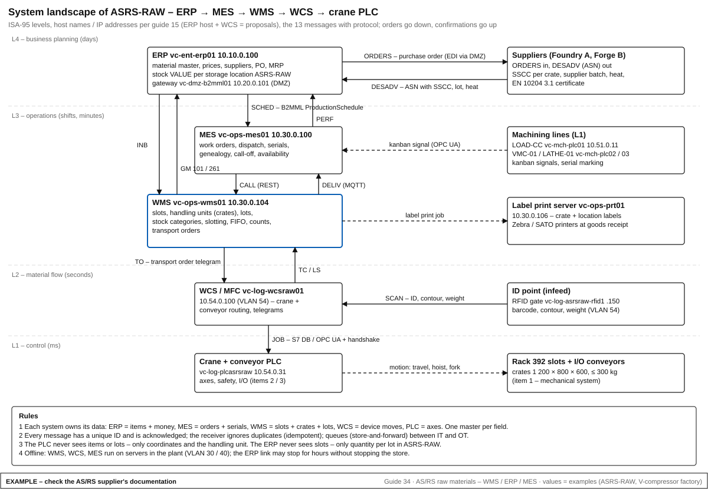
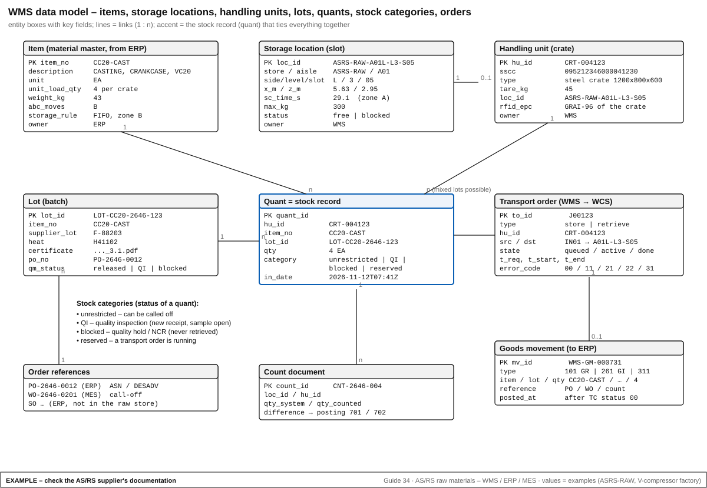
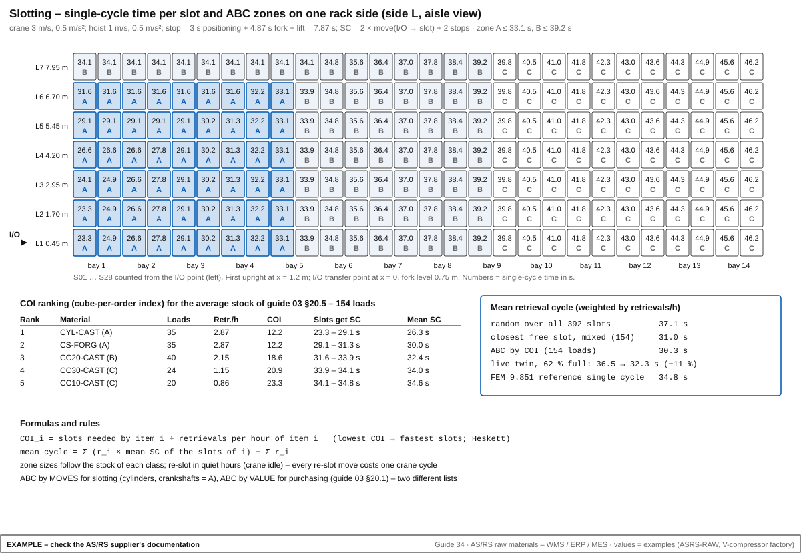
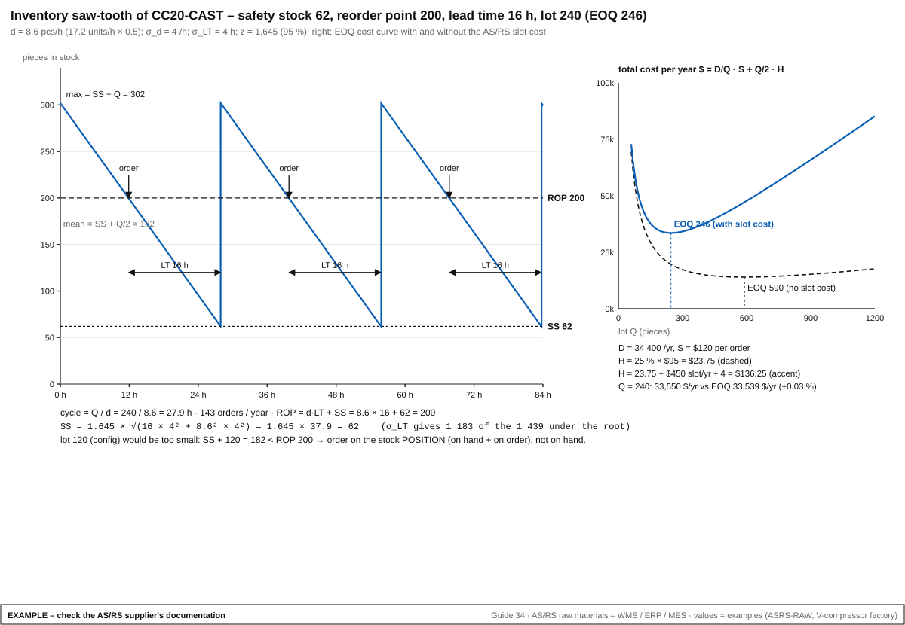
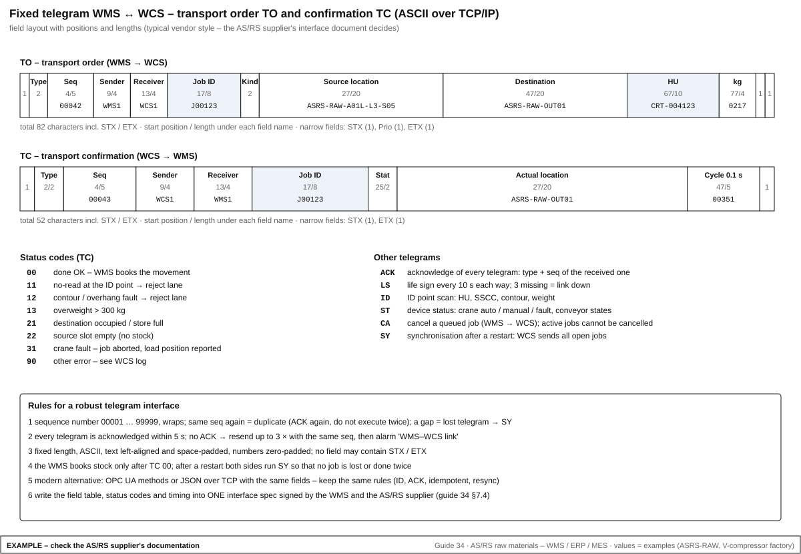
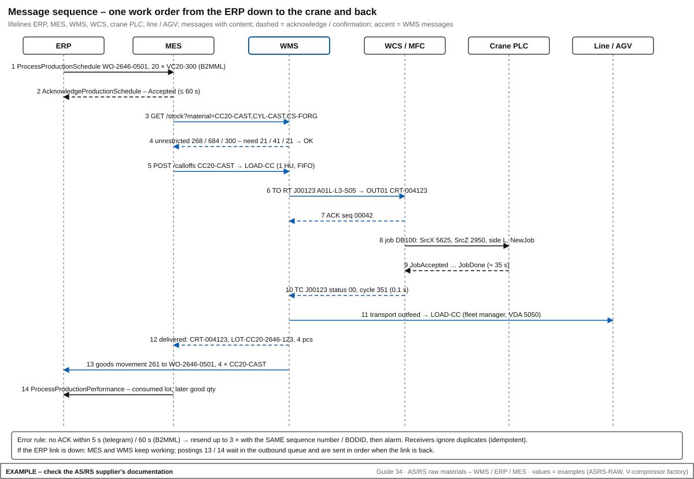
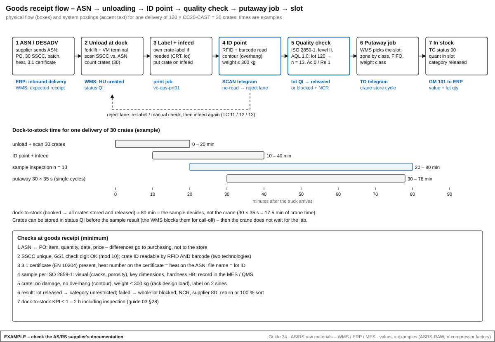
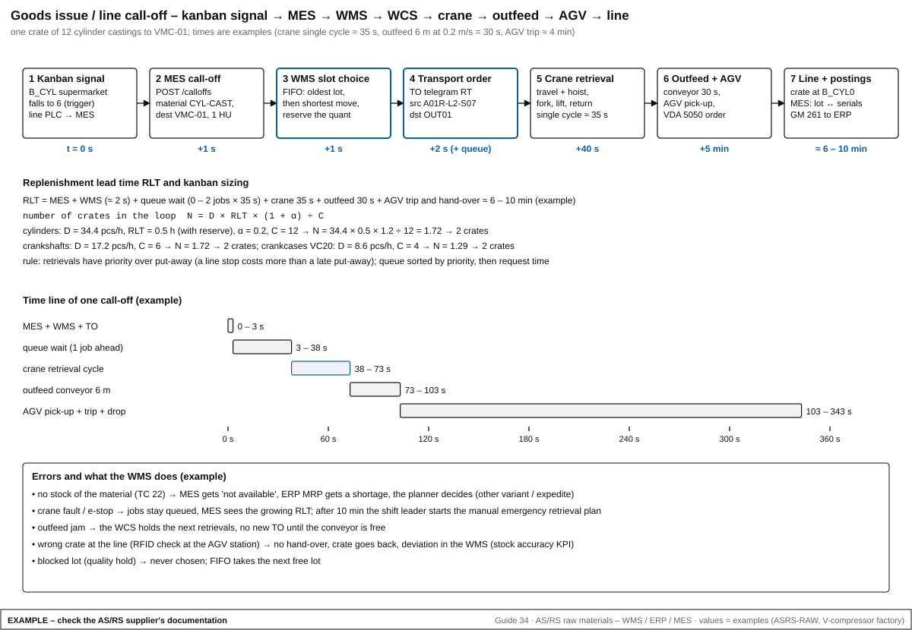
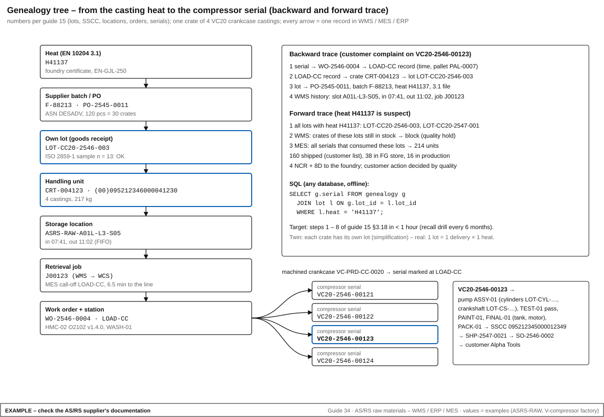

# 34 – AS/RS raw materials: WMS, ERP and MES – textbook, reference and design guide

Guide for item 4 of the tab **AS/RS raw materials** ("WMS / ERP / MES – stock, slotting, orders, traceability,
integration (live)"). The tab runs ONE live simulation of the raw-material store ASRS-RAW (392 slots, 1 stacker
crane, I/O conveyors – guide 03 §19, guide 31). Items 1 – 3 show the steel, the motion control and the circuits.
This guide explains the **software layer above the crane**: what a warehouse management system (WMS) must know,
how it chooses slots, how the ERP plans purchases, how the MES calls material to the lines and traces every
casting to the compressor serial, and how all of them talk to each other.

Reader: mechanical engineer who plans the factory. Simple English, formulas with example numbers, tables.
**All values are examples – the WMS, ERP and AS/RS suppliers' offers decide.** Numbers agree with guide 03
(§19 – §20, §25 – §26, §28), guide 04 (MRP, BOM, B2MML, traceability) and guide 15 (numbers, labels, host names).
If anything differs, guide 15 wins for numbering and guide 03 for the store design values.

---

## Contents

0. [How to use the page (item 4)](#0-how-to-use-the-page-item-4)

**Part A – The software layer of an AS/RS**

1. [Purpose, scope and the twin](#1-purpose-scope-and-the-twin)
2. [System landscape – ERP, MES, WMS, WCS, PLC](#2-system-landscape--erp-mes-wms-wcs-plc)
3. [WMS functions and data model](#3-wms-functions-and-data-model)
4. [Stock per material – loads, pieces, value, coverage](#4-stock-per-material--loads-pieces-value-coverage)
5. [Slotting and putaway strategies](#5-slotting-and-putaway-strategies)
6. [Inventory control – safety stock, reorder point, EOQ, MRP, counting](#6-inventory-control--safety-stock-reorder-point-eoq-mrp-counting)
7. [Integration ERP – MES – WMS – WCS – PLC](#7-integration-erp--mes--wms--wcs--plc)
8. [Goods receipt with quality inspection](#8-goods-receipt-with-quality-inspection)
9. [Goods issue, line call-off and kanban](#9-goods-issue-line-call-off-and-kanban)
10. [Traceability and genealogy](#10-traceability-and-genealogy)
11. [KPIs of the store and its software](#11-kpis-of-the-store-and-its-software)
12. [Stock categories, quality hold and blocked stock](#12-stock-categories-quality-hold-and-blocked-stock)
13. [Master data and who owns which field](#13-master-data-and-who-owns-which-field)
14. [Failure modes and error handling](#14-failure-modes-and-error-handling)
15. [Offline and on-premise rules](#15-offline-and-on-premise-rules)
16. [IT / OT security for the store software](#16-it--ot-security-for-the-store-software)
17. [Server and network sizing](#17-server-and-network-sizing)

**Part B – Implementation**

18. [Requirements specification (URS)](#18-requirements-specification-urs)
19. [Selecting a WMS](#19-selecting-a-wms)
20. [Data migration and the first stock take](#20-data-migration-and-the-first-stock-take)
21. [Testing – interface, FAT, SAT, performance](#21-testing--interface-fat-sat-performance)
22. [Go-live and cut-over](#22-go-live-and-cut-over)
23. [Operation – roles, routines, continuous improvement](#23-operation--roles-routines-continuous-improvement)
24. [Common mistakes](#24-common-mistakes)
25. [Limits of the twin](#25-limits-of-the-twin)
26. [Implementation road map and services](#26-implementation-road-map-and-services)
27. [Complete worked example – one shift of the raw store](#27-complete-worked-example--one-shift-of-the-raw-store)

**Part C – Reference**

28. [Buy list – catalogue examples + shopping list](#28-buy-list--catalogue-examples--shopping-list)
29. [Standards register](#29-standards-register)
30. [Glossary](#30-glossary)
31. [Checklists](#31-checklists)
32. [Questions for the suppliers](#32-questions-for-the-suppliers)
33. [Next to read](#33-next-to-read)

Drawings (all in `docs/img/` and `web/img/`): 34_system_landscape · 34_data_model · 34_goods_receipt ·
34_goods_issue · 34_slotting_abc · 34_inventory_sawtooth · 34_genealogy · 34_message_sequence · 34_telegram_format.

---

## 0. How to use the page (item 4)

Open the tab **AS/RS raw materials**, click item **4 · WMS / ERP / MES**. Everything is live from the shared
simulation `window.ASRS.sim` – the same crane, slots and jobs that item 1 shows in 3D. If item 2 injects a crane
fault, the job queue in item 4 grows; if you block a slot here, item 1 shows it and the crane never takes it.

| Card on the page | What you see | What you can do | Section |
|---|---|---|---|
| Navigation + live line | twin time, crane phase, queue, fill, stock value, active faults | jump to a card | – |
| System landscape | ERP → MES → WMS → WCS → PLC, ID point, lines, label server, 13 messages with live counters | click a system (host name, IP, data it owns) or a message (example payload with live values) | 2, 7 |
| WMS – live stock | per material: loads, pieces, kg, value, line demand, coverage, ROP status, oldest crate; rack map 2 × 14 × 2 × 7 | colour by material / age / ABC zone / stock category; click a slot for the detail (lot, crate, SSCC, in-date, supplier, inspection) and put it on quality hold | 3, 4, 12 |
| Slotting strategy | rules table; live mean retrieval cycle for random, current and ABC-by-COI layout; COI ranking | – | 5 |
| Goods receipt / issue | two flow strips with live counters; ISO 2859-1 sampling plans; last ERP receipts | – | 8, 9 |
| Counting + quality hold | cycle count plan by ABC class, count log with stock accuracy, stock categories, blocked slots | run today's cycle count | 6.8, 12 |
| Job list | all transport orders from `sim.queue` + `sim.done` | filter by type, state, material, source | 7, 14 |
| ERP material master | 5 raw materials: ERP item, description, MAKE part, unit load, kg, price, supplier, lead time, MOQ, EOQ, ABC, lot format; stock valuation and turns | – | 6, 13 |
| ERP MRP + purchasing | formulas SS / ROP / EOQ with live numbers, KPI tiles, 6-shift MRP record, stock curve (actual + projection), purchase orders | choose the material; create a PO; **post an inbound delivery → store jobs in the sim**; auto-PO below ROP; auto-receipt after the lead time | 6, 8 |
| MES call-off + release | the 3 machining lines with call-off rule, demand, kanban size, retrievals per hour; availability check for a new work order | call off 1 crate; check and release a work order (creates the first retrieval jobs) | 9 |
| Traceability | genealogy tree heat → lot → crate / SSCC → slot → job → station / WO → serials, backward / forward trace | choose one of the last retrieved crates | 10 |
| KPIs | stock accuracy, OTIF to the line, dock-to-stock, turns, retrievals / h, crane utilisation, cycle, energy | – | 11 |
| Real components + drawings | 9 drawings, buy list, shopping list | filter, enlarge drawings | 28 |

**Test links (for developers):** `/?sritem=4#asrs` opens the item. `&sr4test` writes hand-checkable lines
"SR4TEST …" to the browser console (CC20: d = 8.60 /h, SS 62.4, ROP 200.0, EOQ 246.2; ISO 2859-1 plans;
PO → 2 store jobs; availability VC20 × 20 → 21 / 41 / 21; item switch 1 → 2 → 3 → 4; error count).
`&sr4only=stock,slot` shows only these cards (headless screenshots), `&sr4slot=L-02-1-3` pre-selects a slot,
`&sr4hold` keeps the page load pending for headless screenshots.

**Twin vs real:** the sim makes demand by itself (store ≈ 18 crates/h, retrieve ≈ 22 crates/h – the **peak**
of guide 03 §19.3, ≈ 2 × the line need of 9.9 crates/h). Each crate gets its own lot number `L4xxx`; the page
shows the real format `LOT-CC20-2646-123` next to it. Heat numbers, supplier batches and serials are generated
examples in the guide 15 formats.

---

# Part A – The software layer of an AS/RS

## 1. Purpose, scope and the twin

An AS/RS without software is a crane that can move a crate from A to B. The **value** comes from the software:

* it knows **what** is in each of the 392 slots (item, lot, quantity, quality status, age),
* it decides **where** a new crate goes (slotting) and **which** crate leaves (FIFO, quality, travel time),
* it tells the purchasing department **when** to order and the lines **how long** the stock lasts,
* it proves for every compressor **which casting heat** is inside (traceability, product liability),
* it keeps the crane, the conveyors and the AGVs busy in the right order.

| Layer | Question it answers | Time frame | In this factory |
|---|---|---|---|
| ERP | how much to buy, what does it cost, what is the stock worth? | weeks – hours | `vc-ent-erp01` (proposal) |
| MES | which order runs, which material does the line need now, which lot went into which serial? | shifts – minutes | `vc-ops-mes01` |
| WMS | which crate is where, which slot for a new crate, which crate for a call-off? | minutes – seconds | `vc-ops-wms01` |
| WCS / MFC | in which order do crane and conveyors move, did the move work? | seconds | `vc-log-wcsraw01` |
| PLC | how do the axes reach the position safely? | milliseconds | `vc-log-plcasrsraw` |

**Scope of this guide:** the raw-material store ASRS-RAW with the 5 purchased materials of the config
(`CC10-CAST`, `CC20-CAST`, `CC30-CAST`, `CYL-CAST`, `CS-FORG`). The finished-goods store ASRS-FG and the floor
stores for tanks and motors follow the same rules (guide 03 §26).

---

## 2. System landscape – ERP, MES, WMS, WCS, PLC



### 2.1 The systems and their addresses

Host names and IP addresses follow guide 15 §3.13 (`10.<VLAN>.0.<host>`, `vc-<zone|area>-<device>`).

| System | ISA-95 level | Host name | IP (VLAN) | Status |
|---|---|---|---|---|
| ERP | 4 | `vc-ent-erp01` | 10.10.0.100 (10 ENT) | proposal – IT decides |
| B2MML / ERP gateway | DMZ | `vc-dmz-b2mml01` | 10.20.0.101 (20 DMZ) | guide 15 |
| MES | 3 | `vc-ops-mes01` | 10.30.0.100 (30 OPS) | guide 15 |
| WMS | 3 | `vc-ops-wms01` | 10.30.0.104 (30 OPS) | guide 15 |
| Label print server | 3 | `vc-ops-prt01` | 10.30.0.106 (30 OPS) | guide 15 |
| MQTT broker | 3 | `vc-ops-mqtt01 / 02` | 10.30.0.101 / .102 | guide 15 |
| WCS / MFC | 2 | `vc-log-wcsraw01` | 10.54.0.100 (54 LOG-ASRS) | **decided 2026-11-13** (guide 15 D-32) |
| AGV fleet manager | 2 | `vc-sup-fleet01` | 10.40.0.103 | guide 15 |
| Crane + conveyor PLC | 1 | `vc-log-plcasrsraw` | 10.54.0.31 (54 LOG-ASRS) | guide 15 |
| RFID readers at the I/O | 1 | `vc-log-asrsraw-rfid1 / 2` | 10.54.0.150 / .151 | guide 15 |
| Line PLCs | 1 | `vc-mch-plc01 / 02 / 03` | 10.51.0.11, 10.52.0.12 / .13 | guide 15 |

**Decided 2026-11-13 (guide 15 D-32):** the WCS is delivered with the AS/RS and runs on a PC in VLAN 54 next to the
crane PLC: `vc-log-wcsraw01`, 10.54.0.100. The name has 15 characters – the Windows limit (guide 15 §3.13). The WCS is
still ISA-95 **level 2** (its function), even though it sits in the level-1 VLAN of the AS/RS.

### 2.2 Where the WCS sits – three common splits

| Split | Who does what | Good for | Watch out |
|---|---|---|---|
| **A: WMS + vendor WCS** (most common) | WMS = stock, slots, orders; WCS from the AS/RS maker = crane / conveyor routing | clear guarantee: the AS/RS maker answers for throughput | two suppliers → one interface spec (§7.4) signed by both |
| **B: WMS with built-in MFC** (e.g. SAP EWM MFC) | WMS talks telegrams directly to the PLC | one software less | WMS partner must know PLC telegrams; AS/RS maker only delivers the PLC |
| **C: AS/RS maker delivers WMS + WCS** | one supplier for the store software | simple project | ERP / MES interfaces become the critical part; lock-in |

For this factory (one aisle, 5 materials, guide 03 §19) split **A** or **C** is the usual choice. Split A gives you
freedom to change the WMS later without touching the crane.

### 2.3 Orders go down, confirmations go up

| # | From → to | Message | Typical protocol | Counter on the page |
|---|---|---|---|---|
| 1 | ERP → supplier | purchase order | EDI ORDERS (EDIFACT D.96A / VDA 4984) via the DMZ | ORDERS |
| 2 | supplier → ERP | advance shipping notice with SSCC, lot, heat | EDI DESADV (or VDA 4987 / GS1 XML) | DESADV |
| 3 | ERP → WMS | expected receipt (inbound delivery item) | REST JSON / IDoc / B2MML `MaterialLot` | INB |
| 4 | ERP → MES | work order | B2MML `ProcessProductionSchedule` | SCHED |
| 5 | MES → WMS | material call-off (line / kanban) | REST JSON (or OPC UA method) | CALL |
| 6 | WMS → WCS | transport order | fixed telegram over TCP/IP or OPC UA | TO |
| 7 | WCS → PLC | job record + handshake | PROFINET / S7 data block or OPC UA | JOB |
| 8 | ID point → WCS | scan: crate ID, contour, weight | telegram / OPC UA | SCAN |
| 9 | WCS → WMS | transport confirmation or error | telegram / OPC UA | TC |
| 10 | WCS ↔ WMS | life sign every 10 s | telegram LS | LS |
| 11 | WMS → MES | material delivered (HU, lot, qty) | REST event / MQTT | DELIV |
| 12 | WMS → ERP | goods movement (101 receipt, 261 issue) | REST JSON / IDoc | GM |
| 13 | MES → ERP | consumption by lot, later order confirmation | B2MML `ProcessProductionPerformance` | PERF |

The counters on the page count what the twin has produced since the page was opened. Example after 1 h of twin
time at peak load: TO ≈ 40, TC ≈ 40, GM ≈ 40, LS = 360.

---

## 3. WMS functions and data model

### 3.1 Functions of a WMS for a raw-material AS/RS

| Function | What it does here | Twin (item 4) |
|---|---|---|
| Master data | items, unit loads, crates, slots, rules | `MAT` table, 392 slots from `asrscore.js` |
| Goods receipt | check ASN, create handling units, quality status QI, labels | "Post inbound delivery" → store jobs |
| Putaway / slotting | choose the slot (zone, FIFO lane, weight class, cycle time) | sim: closest free slot; page: ABC analysis |
| Stock management | quantity per slot, crate, lot, category, reservation | stock table, rack map, slot detail |
| Call-off / goods issue | MES asks for material → WMS picks a crate (FIFO) | retrieval jobs from line / MES |
| Transport orders | to the WCS, priority, dual-cycle pairing | `sim.queue`, job list |
| Inventory | cycle counting, zero-stock checks, differences | count plan + count log |
| Quality | QI after receipt, blocked stock, release, NCR link | quality hold button, categories |
| Traceability | lot ↔ crate ↔ slot ↔ job history | genealogy tree |
| Interfaces | ERP, MES, WCS, label printer, fleet manager | message counters + payloads |
| Reports / KPIs | accuracy, dock-to-stock, OTIF, turns, utilisation | KPI card |

### 3.2 Data model



| Object | Key (format) | Example | Owner | Important fields |
|---|---|---|---|---|
| Item (material) | ERP item number | `CC20-CAST` | ERP | description, unit, price, supplier, lead time, lot size; WMS adds unit load, weight, storage rule |
| Storage location | `<store>-A<aa><side>-L<l>-S<ss>` | `ASRS-RAW-A01L-L3-S05` | WMS | x / z position, max kg, status, zone, single-cycle time |
| Handling unit (HU) | `CRT-<6 digits>` + SSCC | `CRT-004123`, `(00)095212346000041230` | WMS | type, tare 45 kg, current location, RFID EPC |
| Lot (batch) | `LOT-<prefix>-<YYWW>-<nnn>` | `LOT-CC20-2646-123` | ERP / QM (created at receipt) | supplier lot, heat, 3.1 certificate, PO, quality status |
| Quant (stock record) | internal ID | – | WMS | HU, item, lot, quantity, category, in-date |
| Transport order | WMS job ID | `J00123` | WMS | type, HU, source, destination, state, times, error code |
| Goods movement | movement ID | `WMS-GM-000731` | WMS → ERP | movement type 101 / 261 / 311 / 701, item, lot, quantity, reference |
| Count document | `CNT-<YYWW>-<nnn>` | `CNT-2646-004` | WMS | location, HU, system qty, counted qty, difference |

**Why the quant matters:** one crate can carry one lot (normal for castings) or several lots (mixed crate after a
partial return). The quant is the row "this HU holds this quantity of this lot of this item in this category".
Stock queries (how many CC20 castings are free?) are sums over quants.

### 3.3 Storage location IDs – twin ↔ real

The sim names a slot `side-bay-crate-level`, e.g. `L-03-2-5`. Guide 15 §3.9 defines `<store>-A<aa>-L<l>-S<ss>`
with `-L` / `-R` after the aisle when one aisle has two sides. Slots are counted from the I/O point, two crates per bay:

```
S = (bay − 1) × 2 + crate        L-03-2-5 → bay 3, crate 2, level 5 → S = 2 × 2 + 2 = 06 → ASRS-RAW-A01L-L5-S06
first slot  L-01-1-1 → ASRS-RAW-A01L-L1-S01        last slot  R-14-2-7 → ASRS-RAW-A01R-L7-S28
```

Print a location label (Code 128 + plain text) on the beam under every slot – needed for manual rescue,
inspection and counting (guide 15 §3.9).

### 3.4 Handling units, SSCC and the check digit

The supplier puts a GS1 logistic label with an **SSCC** on every crate (or the goods receipt prints it). The SSCC
has 18 digits: extension digit + GS1 company prefix + serial reference + check digit (mod 10, guide 15 §11.2).

**Worked example** – crate of twin lot `L4123`, demo prefix `9521234` (952 = demonstration only, never print):

```
data (17 digits)    0 9521234 6 00004123
weights from right  3 1 3 1 …  →  3·3 + 1·2 + 3·1 + 1·4 + 3·0 + 1·0 + 3·0 + 1·0 + 3·6 + 1·4 + 3·3 + 1·2 + 3·1 + 1·2 + 3·5 + 1·9 + 3·0
                    = 9 + 2 + 3 + 4 + 0 + 0 + 0 + 0 + 18 + 4 + 9 + 2 + 3 + 2 + 15 + 9 + 0 = 80
check digit         (10 − 80 mod 10) mod 10 = 0      →  SSCC 095212346000041230
```

The guide 15 example `0 9521234 500001234` gives check digit 9 → `095212345000012349` (the page self-test checks
both). The crate itself keeps its carrier ID `CRT-004123` (returnable asset, GRAI in the RFID tag); the SSCC belongs to
the **shipment** and may change with every delivery. The WMS stores both.

### 3.5 Lots – one delivery, one heat

Rule of guide 15 §3.7: **one own lot = one delivery of one item from one heat.** A truck with 30 crates of CC20
castings from one heat = 1 lot with 30 HUs. If the foundry mixes two heats, the goods receipt creates two lots.
The lot record links: own lot ↔ supplier batch ↔ heat ↔ EN 10204 3.1 certificate PDF ↔ PO.

*Twin simplification:* the sim gives every crate a new lot number (`L4101`, `L4102`, …). The page derives heat
(`H41100 + (n − 4100) ÷ 8`), supplier batch and PO numbers so that about 8 crates share a heat – enough to show a
forward trace (§10).

### 3.6 The crate label (goods receipt)

If the supplier label is missing or bad, the goods receipt prints an own label (A6, 105 × 148 mm, both long sides
of the crate). Content in GS1-128 (guide 15 §3.16; demo prefix 952 – never print):

| Line | Content | Example |
|---|---|---|
| 1 (top, plain text) | item, description, quantity | `CC20-CAST  CASTING, CRANKCASE, VC20  4 EA` |
| 2 (GS1-128) | `(02)` content GTIN, `(37)` count, `(10)` lot | `(02)09521234000204(37)4(10)LOT-CC20-2646-123` |
| 3 (GS1-128, bottom, largest) | `(00)` SSCC | `(00)095212346000041230` |
| 4 (Code 128, internal) | carrier ID | `CRT-004123` |
| plain text | supplier, heat, receipt date, PO | `Foundry A · H41102 · 2026-11-12 · PO-2646-0012` |

Rules: X-dimension ≥ 0.495 mm, bar height ≥ 32 mm for the SSCC, quiet zones 10 X, print grade ≥ C (1.5) per
ISO/IEC 15416 (guide 03 §25.2). Variable-length AI `(10)` last in its symbol, or followed by FNC1.
The `(02)` GTIN `09521234000204` above is an example number – a real one needs your GS1 company prefix.

---

## 4. Stock per material – loads, pieces, value, coverage

### 4.1 Formulas

```
loads (crates)     = number of slots with this item
pieces             = Σ qty of the quants (= loads × unit load if every crate is full)
kg gross           = Σ (pieces × kg per piece + 45 kg crate tare)
value ($)          = pieces × price (standard price; a real ERP may use the moving average price)
line demand d      = 17.2 units/h × model mix × BOM quantity                     (guide 03 §20, guide 04 §4.9)
coverage (h)       = pieces ÷ d
status             = "cover < lead time" if coverage < LT;  "below ROP" if stock position < ROP;  else OK
```

| Material | Mix × BOM | d (pcs/h) | Unit load | Crates/h | Lead time |
|---|---|---|---|---|---|
| CC10-CAST | 0.3 × 1 | 5.16 | 6 | 0.86 | 16 h |
| CC20-CAST | 0.5 × 1 | 8.60 | 4 | 2.15 | 16 h |
| CC30-CAST | 0.2 × 1 | 3.44 | 3 | 1.15 | 16 h |
| CYL-CAST | 1.0 × 2 | 34.40 | 12 | 2.87 | 16 h |
| CS-FORG | 1.0 × 1 | 17.20 | 6 | 2.87 | 20 h |
| **Total** | | | | **9.89** | |

### 4.2 Worked example – the twin at start (seed 11)

The sim fills 244 of 392 slots (62 %). Read from the page:

| Material | Loads | Pieces | Value | Coverage | ROP | Status |
|---|---|---|---|---|---|---|
| CC10-CAST | 37 | 222 | $15 984 | 222 ÷ 5.16 = 43.0 h | 120 | OK |
| CC20-CAST | 68 | 272 | $25 840 | 272 ÷ 8.6 = 31.6 h | 200 | OK |
| CC30-CAST | 31 | 93 | $12 834 | 93 ÷ 3.44 = 27.0 h | 80 | OK |
| CYL-CAST | 57 | 684 | $19 152 | 684 ÷ 34.4 = 19.9 h | 800 | below ROP → order |
| CS-FORG | 51 | 306 | $18 360 | 306 ÷ 17.2 = 17.8 h | 497 | cover < LT (20 h) |
| **Total** | **244** | 1 577 | **$92 170** | | | |

Check: CC20 value = 272 × $95 = $25 840 ✓; stored mass 46.1 t of 392 × 0.3 = 118 t design.
The two A-movers (cylinders, crankshafts) are short **in hours** although they have the most pieces – coverage
in hours is the number a planner needs, "684 pieces" alone says nothing.

---

## 5. Slotting and putaway strategies



### 5.1 The single-cycle time of a slot

The crane travels (x) and hoists (z) at the same time; the longer axis decides. Trapezoid profile (asrscore.js):

```
t(d) = d / v + v / a           if d ≥ v² / a   (reaches full speed)
t(d) = 2 · √(d / a)            if d < v² / a
move = max( t_x , t_z )        travel v = 3 m/s, a = 0.5 m/s²  → full speed only for d ≥ 18 m
                               hoist  v = 1 m/s, a = 0.5 m/s²  → full speed for d ≥ 2 m
stop = 3 s fine positioning + 2 × 2.18 s fork (1.35 m, 1 m/s, 1.2 m/s²) + 0.5 s lift = 7.87 s
SC   = 2 × move(I/O → slot) + 2 × stop
```

**Worked example** – slot `ASRS-RAW-A01L-L3-S05` (x = 5.63 m, z = 2.95 m; I/O fork level 0.75 m):

```
travel 5.63 m < 18 m      →  t_x = 2 · √(5.63 / 0.5) = 6.71 s
hoist  2.20 m ≥ 2 m       →  t_z = 2.20 / 1 + 1 / 0.5 = 4.20 s
move = 6.71 s             SC = 2 × 6.71 + 2 × 7.87 = 29.2 s   (zone A)
```

Over all 392 slots: fastest 23.3 s (bay 1, low levels), slowest 46.2 s (bay 14), **mean 37.1 s**. The
FEM 9.851 reference single cycle of this crane is 34.8 s (guide 31 / item 2 – different test points).

### 5.2 Strategies compared

| Strategy | Rule | Good for | Effect |
|---|---|---|---|
| Random (chaotic) | any free slot; the WMS remembers it | every AS/RS with a WMS | best space use; cycle = mean of all slots (37.1 s) |
| Closest free slot | free slot with the shortest move (the twin's sim) | simple, fast put-away | fills the front first; fast and slow movers get mixed |
| ABC zones (class-based) | zone A = fastest 25 % of the slots for class-A movers, B next 35 %, C the rest | few items with very different move rates | retrieval cycle −10 … −25 % |
| COI rule | cube-per-order index = slots needed ÷ retrievals per hour; lowest COI → best slots | exact ranking for zoning | optimal for single cycles (Heskett 1963) |
| FIFO (retrieval rule) | oldest lot first, then the shortest move | castings and forgings (rust, traceability) | slightly longer moves; required for quality |
| Fixed (dedicated) | each item has its own slots | manual stores | ≈ 15 % more slots (guide 03 §20.5: 209 vs 180) |
| Weight / height classes | heavy crates low, tall loads in tall slots | mixed loads | protects the rack, saves hoist energy |
| Aisle balancing | spread an item over several aisles | stores with ≥ 2 aisles | an aisle failure does not stop an item (not relevant with 1 aisle) |

### 5.3 COI ranking and the effect – worked example

Average stock of guide 03 §20.5 (safety stock + half lot, in crates): CC10 20, CC20 40, CC30 24, CYL 35, CS 35 =
**154 loads**. Retrievals per hour = line demand in crates (§4.1).

| Rank | Material (class by moves) | Loads | Retrievals/h | COI = loads ÷ retr./h | Slots get SC | Mean SC |
|---|---|---|---|---|---|---|
| 1 | CYL-CAST (A) | 35 | 2.87 | 12.2 | 23.3 – 29.1 s | 26.3 s |
| 2 | CS-FORG (A) | 35 | 2.87 | 12.2 | 29.1 – 31.3 s | 30.0 s |
| 3 | CC20-CAST (B) | 40 | 2.15 | 18.6 | 31.6 – 33.9 s | 32.4 s |
| 4 | CC30-CAST (C) | 24 | 1.15 | 20.9 | 33.9 – 34.1 s | 34.0 s |
| 5 | CC10-CAST (C) | 20 | 0.86 | 23.3 | 34.1 – 34.8 s | 34.6 s |

```
mean retrieval cycle = Σ (r_i × mean SC_i) ÷ Σ r_i
ABC by COI:  (2.87·26.3 + 2.87·30.0 + 2.15·32.4 + 1.15·34.0 + 0.86·34.6) ÷ 9.89 = 30.3 s
closest free slot, items mixed over the nearest 154 slots:                       31.0 s
random over all 392 slots:                                                       37.1 s
```

Live twin (62 % full, closest-slot put-away, items mixed): current 36.5 s → re-slotted by COI 32.3 s (−11 %).
**Lesson:** when the store is half empty, "closest free slot" already gives most of the gain; ABC zoning
pays when the store is full and when the move rates differ a lot (here: cylinders 3.3 × more moves than CC10).

### 5.4 Practical slotting rules for ASRS-RAW

1. Putaway: class-A items (cylinders, crankshafts) into zone A if a slot is free, else the closest slot of zone B.
2. Never put a crate of the same lot as the next-to-leave crate deep behind it (single-deep rack: no problem here;
   in double-deep racks this rule is critical).
3. Heavy crates (CC30: 228 kg) on levels 1 – 4 if possible (lower centre of gravity of the crane, less hoist energy).
4. Re-slot only when the crane is idle (≥ 5 min without a job) – each re-slot move costs a crane cycle.
5. Review the ABC classes every month from the real move counts – a model change (more VC30) changes the ranking.
6. Keep 10 – 15 % of the slots free (guide 03 §20.5 reserve) – a full store kills dual cycles and slotting.

### 5.5 Dual cycles and the crane load

The WCS pairs a store and a retrieval into one dual cycle (DC) when both are waiting. With the FEM 9.851 values of
this crane (SC 34.8 s, DC 57.8 s for two jobs = 28.9 s per job):

```
time per job = (1 − p) × t_SC + p × t_DC / 2          p = share of jobs done in dual cycles
peak 40 jobs/h, p = 0:    40 × 34.8 / 3 600 = 38.7 % crane utilisation
peak 40 jobs/h, p = 0.5:  40 × (0.5 × 34.8 + 0.5 × 28.9) / 3 600 = 35.4 %
line need only (9.9 retrievals + ≈ 10 stores per hour): ≈ 20 jobs/h → ≈ 18 – 19 %
```

Dual cycles need **both** jobs waiting – a WMS that releases put-away jobs in a batch right after a delivery and
retrievals one by one gets many dual cycles. Holding a store job for a few seconds to wait for a retrieval partner
is a WCS setting (ask the supplier).

---

## 6. Inventory control – safety stock, reorder point, EOQ, MRP, counting

### 6.1 ABC and XYZ – two different lists

| Material | Value per year (guide 03 §20.1) | Class by value | Crane moves per hour | Class by moves | XYZ (guide 03 §20.2) |
|---|---|---|---|---|---|
| CS-FORG | $4.13 M | A | 2.87 | A | X |
| CYL-CAST | $3.85 M | A | 2.87 | A | X |
| CC20-CAST | $3.27 M | A | 2.15 | B | X / Y |
| CC30-CAST | $1.90 M | C | 1.15 | C | Y / Z |
| CC10-CAST | $1.49 M | C | 0.86 | C | Y |

ABC by **value** steers purchasing (tight control, frequent deliveries); ABC by **moves** steers slotting and counting.

### 6.2 Safety stock with a service level

```
σ during lead time   σ_LT,d = √( LT · σ_d² + d² · σ_LT² )
safety stock         SS = z · σ_LT,d              z = 1.645 for 95 % cycle service level
reorder point        ROP = d · LT + SS
```

Assumptions (examples – measure them in the real plant): σ_d = 4 /h at d = 8.6 /h (same coefficient of variation
for all items), σ_LT = 25 % of LT (4 h at 16 h, 5 h at 20 h). CC20 gives exactly guide 03 §20.3.

| Material | d (/h) | σ_d (/h) | LT / σ_LT (h) | σ_LT,d | SS 90 % (z 1.28) | **SS 95 %** | SS 99 % (z 2.33) | **ROP** | Config SS |
|---|---|---|---|---|---|---|---|---|---|
| CC10-CAST | 5.16 | 2.40 | 16 / 4 | 22.8 | 29 | **37** | 53 | **120** | 60 |
| CC20-CAST | 8.60 | 4.00 | 16 / 4 | 37.9 | 49 | **62** | 88 | **200** | 100 |
| CC30-CAST | 3.44 | 1.60 | 16 / 4 | 15.2 | 19 | **25** | 35 | **80** | 40 |
| CYL-CAST | 34.40 | 16.00 | 16 / 4 | 151.8 | 194 | **250** | 354 | **800** | 300 |
| CS-FORG | 17.20 | 8.00 | 20 / 5 | 93.1 | 119 | **153** | 217 | **497** | 150 |

CC20 check: √(16 × 4² + 8.6² × 4²) = √(256 + 1 183) = √1 439 = 37.9 → SS = 1.645 × 37.9 = 62 → ROP = 137.6 + 62 = 200 ✓.
The lead-time variation gives 1 183 of the 1 439 – **reliable suppliers save more stock than any formula**.

### 6.3 Economic order quantity – with the cost of the AS/RS slot

```
EOQ = √( 2 · D · S / H )        D = d × 4 000 h/year, S = $120 per order
H   = 25 % × price + $450 per slot and year ÷ pieces per crate        (slot: 3 000 $ × 15 %, guide 03 §20.4)
```

| Material | D (/year) | Price | H without slot | EOQ without slot | H with slot | **EOQ with slot** | Crates | Config lot (MOQ) |
|---|---|---|---|---|---|---|---|---|
| CC10-CAST | 20 640 | $72 | $18.00 | 525 | $93.00 | **231** | 38 | 120 |
| CC20-CAST | 34 400 | $95 | $23.75 | 590 | $136.25 | **246** | 62 | 120 |
| CC30-CAST | 13 760 | $138 | $34.50 | 309 | $184.50 | **134** | 45 | 60 |
| CYL-CAST | 137 600 | $28 | $7.00 | 2 172 | $44.50 | **862** | 72 | 240 |
| CS-FORG | 68 800 | $60 | $15.00 | 1 049 | $90.00 | **428** | 71 | 120 |

The slot cost cuts the EOQ to ≈ 40 % – **space in an AS/RS is expensive**. The cost curve is flat near the optimum:
CC20 with Q = 240 costs $33 550 / year vs $33 539 at the EOQ (+0.03 %) – round to crate and truck multiples.



### 6.4 Order on the stock POSITION, not on the stock on hand

With hour-based lead times the demand during the lead time (CC20: 8.6 × 16 = 137.6) is larger than the config lot
(120). After a delivery the stock is at most SS + Q = 62 + 120 = 182 – already **below** the ROP of 200. If the ERP
compared the ROP with the stock on hand, it would order every few minutes. Correct rule:

```
stock position = usable stock on hand + open purchase orders (− backorders)
order when       position < ROP;   order quantity Q;   repeat until position ≥ ROP
number of open orders at the same time ≈ d · LT ÷ Q = 137.6 ÷ 120 = 1.15  →  sometimes 2 open POs
```

The page uses this rule (KPI tile "Status", option "auto-create a PO …" creates as many POs as needed). With Q = 240
(policy of guide 03 §20.4) there is never more than one open order.

### 6.5 Time-phased MRP record

MRP (guide 04 §4.7, §20.3) looks into the future in time buckets – here 6 shifts of 8 h:

```
gross requirement per shift = d × 8 h ÷ planned yield          (CC20: 8.6 × 8 ÷ 0.992 = 69.4)
projected on hand POH_t     = POH_t−1 + scheduled receipts_t + planned receipts_t − gross_t
planned receipt             = ⌈(SS − (POH before receipt)) ÷ lot⌉ × lot   if POH would fall below SS
planned order release       = planned receipt shifted back by the lead time (16 h = 2 shifts)
```

**Worked example** – CC20-CAST, usable stock 272 at 06:00, no open PO, lot 120, SS 62:

| Shift starting | 06:00 | 14:00 | 22:00 | d+1 06:00 | d+1 14:00 | d+1 22:00 |
|---|---|---|---|---|---|---|
| Gross requirement | 69.4 | 69.4 | 69.4 | 69.4 | 69.4 | 69.4 |
| POH before receipt | 202.6 | 133.3 | 63.9 | −5.4 | 45.2 | 95.9 |
| Planned receipt | – | – | – | 120 | 120 | – |
| Projected on hand | 202.6 | 133.3 | 63.9 | 114.6 | 165.2 | 95.9 |
| Planned order release | – | **120** | **120** | – | – | – |

The page shows the same table for the selected material with the live stock. A planned release in a past bucket is
marked "late – release now".

### 6.6 Planned yield in the requirement

```
CC20-CAST:  yield = 1 − 0.008 (HMC scrap)                               = 0.992
CYL-CAST:   yield = (1 − 0.010)(1 − 0.008)  (VMC-01, HONE-01)           = 0.98208
CS-FORG:    yield = (1 − 0.010)(1 − 0.012)  (LATHE-01, GRIND-01)        = 0.97812
work order 20 × VC20:  CC20 ⌈20 ÷ 0.992⌉ = 21,  CYL ⌈40 ÷ 0.98208⌉ = 41,  CS ⌈20 ÷ 0.97812⌉ = 21
```

(guide 04 §19.3 – same numbers for 100 units: 101 / 204 / 103.)

### 6.7 Coverage, turns and stock value

```
inventory turns = consumption value per year ÷ average stock value
consumption     = Σ D_i × price_i = $14.63 M / year
average stock   = Σ (SS_i + Q_i / 2) × price_i = $49 373   (SS of §6.2, config lots)  →  296 turns / year
                  with the config safety stocks (guide 03 §20.6): $57 860 → 253 turns / year
live twin       = $14.63 M ÷ $92 170 = 159 turns / year (start stock is higher than the policy)
```

296 turns = about 13.5 operating hours of average stock. This only works with a foundry and a forge **next door**
(16 – 20 h lead time). With a real casting lead time of 3 weeks the stock and the store are 10 – 20 × bigger
(guide 03 §20.6) – plan the store for the real supply chain.

### 6.8 Cycle counting and stock accuracy

An AS/RS with a WMS does not need a yearly stock-taking stop. Instead **cycle counting**: the crane brings a crate to
the outfeed, a person scans and counts it, the crate goes back.

```
counts per year = Σ loads_i × count frequency of the class      A 12×, B 6×, C 4× per crate and year (example)
average stock:  35·12 + 35·12 + 40·6 + 24·4 + 20·4 = 1 256 counts / year  →  1 256 ÷ 250 days = 5.0 per day
live twin (244 loads): 1 964 / year → 7.9 per day
crane time:     one dual cycle ≈ 58 s per count → 5 – 8 min per day
stock accuracy = crates with correct quantity ÷ counted crates       target ≥ 99.5 % (AS/RS ≈ 100 %)
```

Extra counts that cost nothing: **zero-stock check** (a slot the WMS says is empty is checked by the crane's
occupancy sensor when the crane passes) and **low-stock count** (when a crate comes out for a call-off and has
≤ 2 pieces left, the operator confirms the quantity). A deviation is recounted by a second person, then posted
(movement 701 / 702) with a reason code – never "corrected" silently.

### 6.9 Cycle service level vs fill rate

The 95 % in §6.2 is the **cycle service level**: in 95 of 100 order cycles there is no shortage at all. The line
cares more about the **fill rate** (share of the demand served from stock):

```
expected shortage per cycle  ESC = σ_LT,d × G(z)          G(z) = φ(z) − z · (1 − Φ(z))   (normal loss function)
fill rate                    β   = 1 − ESC / Q
CC20, z = 1.645:  G = 0.0209  →  ESC = 37.9 × 0.0209 = 0.79 pcs per cycle
                  Q = 120 → β = 1 − 0.79 / 120 = 99.34 %;   Q = 240 → 99.67 %
z = 1.28 (90 %):  ESC = 1.80 → β = 98.5 % (Q 120);   z = 2.33 (99 %): ESC = 0.13 → β = 99.89 %
```

A missing casting stops LOAD-CC for minutes, not the whole factory (buffers B_CC0, B_PAL) – 95 % cycle service
level with ≈ 99.3 – 99.7 % fill rate is a reasonable start. Measure real shortages and adjust z per item.

### 6.10 XYZ – how to measure the demand variation

```
CV = σ ÷ mean of the weekly (or shift) demand        X: CV < 0.25   Y: 0.25 – 0.5   Z: > 0.5
example CC30 per shift (8 h), 10 shifts: 24, 31, 0, 28, 45, 22, 0, 30, 36, 24  → mean 24.0, σ 13.6 → CV 0.57 → Z
example CYL per shift: 270, 281, 262, 279, 268, 290, 275, 266, 284, 272          → mean 274.7, σ 8.3 → CV 0.03 → X
```

AX items (cylinders, crankshafts) → kanban from the store, small safety stock in hours; CZ items (CC30) → plan by
work order (the VC30 orders of 10 make the demand lumpy), safety stock in pieces per order, not in hours.

---

## 7. Integration ERP – MES – WMS – WCS – PLC

### 7.1 ISA-95 (IEC 62264) – what applies here

| Part | Use for the store |
|---|---|
| Part 1 – models and terminology | level picture (drawing 34_system_landscape): ERP level 4, MES + WMS level 3, WCS level 2, PLC level 1 |
| Part 2 – object models | `MaterialDefinition` (item), `MaterialLot` / `MaterialSublot` (lot / HU), `MaterialStorageLocation`, `MaterialTransfer` – field names for every interface |
| Part 3 – activity models | **inventory operations**: definition (storage rules), resource (slots, crane, AGVs), detailed scheduling (job sequence), dispatching (transport orders), execution (move, put away), data collection (movements, counts), tracking (lot location, FIFO), analysis (accuracy, turns) |
| Part 5 – transactions | verbs Get / Show, Process / Acknowledge, Change / Respond, Cancel, Sync |

### 7.2 B2MML examples (ERP ↔ MES, ERP → WMS)

**Work order ERP → MES** (shortened; validate against the agreed B2MML XSD version, guide 04 §11.14):

```xml
<ProcessProductionSchedule xmlns="http://www.mesa.org/xml/B2MML">
  <ApplicationArea><Sender><LogicalID>ERP</LogicalID></Sender><BODID>ERP-2646-000731</BODID>
    <CreationDateTime>2026-11-12T08:20:00Z</CreationDateTime></ApplicationArea>
  <DataArea><Process/>
    <ProductionSchedule><ProductionRequest>
      <ID>WO-2646-0501</ID><Priority>3</Priority><EndTime>2026-11-13T08:20:00Z</EndTime>
      <SegmentRequirement><MaterialProducedRequirement>
        <MaterialDefinitionID>VC20-300</MaterialDefinitionID>
        <Quantity><QuantityString>20</QuantityString><UnitOfMeasure>EA</UnitOfMeasure></Quantity>
      </MaterialProducedRequirement></SegmentRequirement>
    </ProductionRequest></ProductionSchedule></DataArea>
</ProcessProductionSchedule>
```

**Lot data ERP → WMS at goods receipt** (`ProcessMaterialLot`, logical content):

| Element | Example |
|---|---|
| `MaterialLot/ID` | `LOT-CC20-2646-003` |
| `MaterialDefinitionID` | `CC20-CAST` |
| `Quantity` | 120 EA |
| `Status` | `QI` (quality inspection) |
| `MaterialLotProperty` heat / supplier lot / certificate | `H41137` / `F-88213` / `LOT-CC20-2646-003_3.1.pdf` |
| `MaterialSublot` (one per crate) | `CRT-004123`, SSCC `095212346000041230`, 4 EA |

**Consumption MES → ERP** (`ProcessProductionPerformance` with `MaterialConsumedActual`): work order, item, **lot**,
quantity – the ERP reduces the lot quantity and the value (backflush by lot).

### 7.3 REST JSON and OPC UA examples (MES ↔ WMS)

**Call-off MES → WMS:**

```
POST https://vc-ops-wms01/api/v1/calloffs
{ "calloffId": "MES-CO-2646-00412", "time": "2026-11-12T09:41:05Z", "line": "WO-2646-0501",
  "material": "CC20-CAST", "handlingUnits": 1, "destination": "LOAD-CC", "fifo": true, "priority": 3 }
→ 201 Created  { "wmsJob": "J00123", "hu": "CRT-004123", "lot": "LOT-CC20-2646-123", "eta_s": 380 }
```

The MES asks for **material**, never for a slot – choosing the crate is the WMS's job (FIFO, quality status).

**Delivered WMS → MES** (event, MQTT topic `vc/plant1/wms/asrsraw/delivered`, QoS 1):
`{ "wmsJob": "J00123", "material": "CC20-CAST", "lot": "LOT-CC20-2646-123", "hu": "CRT-004123", "qty": 4, "to": "LOAD-CC" }`

**OPC UA alternative:** the WMS exposes a method `CallOff(material, qty, destination)` and an event type
`MaterialDelivered`; the MES subscribes. OPC UA is common when the MES is PLC-near; REST is common between
IT applications. Either is fine – the **fields and the rules** (unique ID, acknowledge, idempotent) matter.

### 7.4 Fixed telegrams WMS ↔ WCS



Most AS/RS suppliers still use fixed-length ASCII telegrams over TCP/IP (or the same content over OPC UA).

| Field (TO) | Position | Length | Example |
|---|---|---|---|
| STX | 1 | 1 | 0x02 |
| type | 2 | 2 | `TO` |
| sequence number | 4 | 5 | `00042` |
| sender / receiver | 9 / 13 | 4 / 4 | `WMS1` / `WCS1` |
| job ID | 17 | 8 | `J00123␣␣` |
| kind | 25 | 2 | `ST` store / `RT` retrieve |
| source location | 27 | 20 | `ASRS-RAW-A01L-L3-S05` |
| destination | 47 | 20 | `ASRS-RAW-OUT01` |
| handling unit | 67 | 10 | `CRT-004123` |
| weight kg | 77 | 4 | `0217` |
| priority | 81 | 1 | `3` (retrievals before put-away) |
| ETX | 82 | 1 | 0x03 |

TC (confirmation, 52 characters): type `TC`, sequence, sender, receiver, job ID, **status** (2), actual location (20),
cycle time in 0.1 s (5). Status codes: 00 OK, 11 no-read at the ID point, 12 contour fault, 13 overweight,
21 destination occupied / store full, 22 source empty, 31 crane fault, 90 other. Other telegrams: ACK, LS (life sign
every 10 s), ID (scan), ST (device status), CA (cancel a queued job), SY (resynchronise after restart).

**WCS → PLC:** the WCS writes a job record (data block or OPC UA structure: JobId, JobType, SrcX_mm, SrcZ_mm,
DstX_mm, DstZ_mm, Side −1 / +1, HU, WeightKg) and a handshake: `NewJob` → PLC `JobAccepted` → … → `JobDone`,
WCS resets `NewJob`. Time-out per step (e.g. 5 s) → alarm. Details of the crane side: guide 32 / item 2.



### 7.5 Rules for every interface (copy into the interface spec)

1. **Unique message ID** (BODID, sequence number, job ID). The receiver ignores a message it has already processed
   (idempotent) but acknowledges it again.
2. **Acknowledge** within a fixed time: telegram 5 s, B2MML 60 s. No ACK → resend up to 3 × with the same ID → alarm.
3. **Store-and-forward queues** between IT and OT. The ERP may be down for hours (patch day) – MES, WMS and WCS
   keep working; postings wait in the outbound queue and go out **in order**.
4. **The WMS books stock only after the WCS confirmation** (TC 00). A crane fault in the middle of a move leaves
   the job open; the WCS reports where the crate is (on the fork, at the slot, at the I/O).
5. **Resynchronisation** after any restart: WCS sends all open jobs (SY), WMS compares, a planner decides on
   differences.
6. **UTC time stamps, units on every quantity**, ISA-95 names in REST interfaces.
7. **One interface specification**, versioned, signed by the WMS supplier, the AS/RS supplier, the MES supplier and
   your project manager – with the field tables, status codes, timing, error cases and test cases (§21).

### 7.6 REST answers and error codes (MES ↔ WMS)

| HTTP status | Meaning in the call-off API | MES reaction |
|---|---|---|
| 201 Created | call-off accepted, job created (`wmsJob`, `hu`, `lot`, `eta_s`) | wait for the "delivered" event |
| 200 OK (same `calloffId` again) | duplicate – the existing job is returned (idempotent) | none |
| 409 Conflict | material not available (no unrestricted stock) | shortage to the planner / ERP |
| 422 Unprocessable | unknown material or destination | master data error – fix, do not retry |
| 503 Service unavailable | WMS in maintenance / restart | retry with back-off (5 s, 15 s, 60 s), then alarm |

### 7.7 IEC 62264-3 inventory operations – filled for ASRS-RAW

| Activity | ASRS-RAW | System |
|---|---|---|
| Definition management | storage rules, zones, FIFO, unit loads, sampling plans | WMS, QMS |
| Resource management | 392 slots, crane, conveyors, ID point, crates, AGVs | WMS, WCS |
| Detailed scheduling | job order: retrievals first, dual-cycle pairing, re-slotting in idle time | WMS, WCS |
| Dispatching | transport orders to the WCS and the AGV fleet manager | WMS |
| Execution management | crane moves, ID point checks, reject lane | WCS, PLC |
| Data collection | movements, scans, weights, counts, faults | WCS, WMS |
| Tracking | lot ↔ HU ↔ slot ↔ job history, FIFO age | WMS |
| Performance analysis | accuracy, dock-to-stock, OTIF, turns, utilisation | WMS, MES dashboard |

---

## 8. Goods receipt with quality inspection



### 8.1 Steps

| Step | Physical | System | Error path |
|---|---|---|---|
| 1 ASN | supplier ships 30 crates (120 × CC20-CAST) | DESADV → ERP inbound delivery → WMS expected receipt | ASN missing → receipt against the PO by hand (slower) |
| 2 Unload | forklift, vehicle terminal scans every SSCC | WMS creates HUs, status QI | SSCC not in the ASN → put aside, clarify |
| 3 Label + infeed | own crate label if the supplier label is bad | print job to `vc-ops-prt01` | – |
| 4 ID point | RFID gate + barcode, contour check, weight | SCAN telegram, WCS asks the WMS for a slot | no-read / contour / overweight → reject lane, TC 11 / 12 / 13 |
| 5 Quality check | sample per ISO 2859-1 (in parallel to storage) | lot QI → released, or blocked + NCR | failed → whole lot blocked |
| 6 Putaway job | crane stores the crate | TO / TC; quant in slot | store full → TC 21, crate waits on the conveyor |
| 7 In stock | – | goods movement 101 to the ERP (value and lot quantity) | – |

### 8.2 Sampling by ISO 2859-1 (attributes)

Single sampling, normal inspection, general inspection level II, AQL 1.0 % (example – the quality agreement with
the foundry decides; check the current tables of ISO 2859-1).

| Lot size (pieces) | Code letter | Plan used | Sample n | Accept Ac | Reject Re | Materials here |
|---|---|---|---|---|---|---|
| 51 – 90 | E | E | 13 | 0 | 1 | CC30-CAST (60) |
| 91 – 150 | F | arrow → E | 13 | 0 | 1 | CC10, CC20, CS (120) |
| 151 – 280 | G | G | 32 | 1 | 2 | CYL-CAST (240) |
| 281 – 500 | H | H | 50 | 1 | 2 | – |
| 501 – 1 200 | J | J | 80 | 2 | 3 | – |

**What the plan means (operating characteristic):** probability to accept a lot with defect share p:

```
n = 13, Ac 0:   P_a = (1 − p)^13            p = 1 % → 0.878;   p = 2 % → 0.769;   p = 5 % → 0.513
n = 32, Ac 1:   P_a = (1 − p)^32 + 32 p (1 − p)^31     p = 1 % → 0.959;   p = 5 % → 0.520
```

A small sample does **not** protect against a bad lot – it protects against a bad **supplier process** over time.
The real protection for castings comes from the foundry's process control (X-ray / porosity checks, 3.1 certificate)
and from the machining line (a porous casting shows at HMC-0x and is an NCR). With good history, switch to
reduced inspection or skip-lot (ISO 2859-3); with a failure, switch to tightened inspection.

**What to check:** visual (cracks, cold laps, porosity at the surface), 2 – 3 key dimensions (machining allowance),
Brinell hardness (EN-GJL-250: about 180 – 250 HB – see EN 1561 and the drawing), certificate heat = ASN heat.

### 8.2a Content of the ASN that the WMS needs

| Field | Why | Example |
|---|---|---|
| PO number + line | match with the order, price check | `PO-2646-0012 / 1` |
| item (our number) | no supplier numbers in the WMS | `CC20-CAST` |
| quantity per SSCC | handling units known before arrival | 30 × 4 EA |
| SSCC list | scan at the dock = check against the ASN | `0952123460000…` |
| supplier batch + heat | lot creation, traceability | `F-88213`, `H41137` |
| certificate reference | link the 3.1 PDF | `3.1-H41137.pdf` |
| ship date, truck / carrier | dock planning | `2026-11-12`, plate number |

### 8.3 Dock-to-stock time – worked example

```
unload + scan 30 crates      0 – 20 min
ID point + infeed           10 – 40 min
putaway 30 × 35 s            30 – 48 min     = 17.5 min crane time (single cycles; dual cycles with retrievals: faster)
sample inspection n = 13    20 – 80 min
dock-to-stock (released)    ≈ 80 min          target ≤ 1 – 2 h (guide 03 §28)
```

Crates are **stored in status QI** before the sample result – the crane never waits for the lab. QI crates are not
called off (the twin's FIFO picks the oldest lots anyway, so new QI crates are not chosen).

---

## 9. Goods issue, line call-off and kanban



### 9.1 Call-off rules of the three lines (config `stations[].kanban`, `transports`)

| Line | Station / buffer | Call-off rule (MES) | Crate |
|---|---|---|---|
| Crankcase FMS cell | LOAD-CC, buffer B_CC0 (12 castings, 4 per variant) | per-model call-off: 1 crate of the model of the next work order when B_CC0 holds < 4 of it | 6 / 4 / 3 castings |
| Cylinder line | VMC-01, B_CYL0 24, supermarket B_CYL target 12 / trigger 6 | kanban: at 6 in B_CYL → 1 crate (12) | 12 castings |
| Crankshaft line | LATHE-01, B_CS0 12, supermarket B_CS target 8 / trigger 4 | kanban: at 4 in B_CS → 1 crate (6) | 6 forgings |

### 9.2 Replenishment lead time and number of kanban crates

```
RLT = MES + WMS (≈ 2 s) + queue wait + crane cycle (≈ 35 s) + outfeed (6 m ÷ 0.2 m/s = 30 s) + AGV trip ≈ 6 – 10 min
N   = D × RLT × (1 + α) ÷ C            α = 0.2 safety factor
cylinders:   34.4 × 0.5 h × 1.2 ÷ 12 = 1.72  →  2 crates
crankshafts: 17.2 × 0.5 h × 1.2 ÷ 6  = 1.72  →  2 crates
CC20:         8.6 × 0.5 h × 1.2 ÷ 4  = 1.29  →  2 crates   (RLT 0.5 h includes a reserve for AGV waiting)
```

The page computes N with the live RLT (mean cycle + queue + 30 s + 5 min AGV).

### 9.3 Priorities and FIFO

* Retrievals before put-away (priority 3 vs 5 in the TO telegram): a line stop costs more than a late put-away.
* Dual cycles: the WCS pairs a store with a retrieval when both are queued (asrscore: store first, then retrieve).
* FIFO by lot in-date, then the shortest move; **never** a blocked or QI lot.
* Line-side check: the AGV station reads the crate RFID – a wrong crate is not handed over (guide 03 §25.4).

### 9.3a Crates in the loop (Little's law)

```
crates in transit = throughput × time in the loop = 9.9 crates/h × 0.15 h (9 min) = 1.5 crates
```

So on average 1 – 2 crates are between the store and the lines. Empty crates come back on the same AGV loop
(return conveyor to the I/O or an empty-crate stack) – plan the crate pool: 392 slots × fill + crates in transit +
empties at the lines + 5 % spare ≈ 400 crates (shopping list: 400 tags).

### 9.4 Material availability check before order release

The MES releases a work order only if the material is there (guide 04 §4.1.2 "gate"):

```
needed_i    = ⌈ qty × BOM_i ÷ yield_i ⌉
available_i = unrestricted stock_i (not reserved, not QI, not blocked) − quantity reserved for released work orders
release if  available_i ≥ needed_i for every material
```

Worked example (twin start): 20 × VC20 → CC20 21 (free 268), CYL 41 (684), CS 21 (300) → **release**. A second order
of 20 × VC20 sees 268 − 21 = 247 available CC20 etc. The page's "Release + call off first crates" creates one
retrieval job per material (the rest comes by kanban).

---

## 10. Traceability and genealogy



### 10.1 What each system records

| Link | Recorded by | When |
|---|---|---|
| heat ↔ supplier batch ↔ own lot ↔ PO ↔ 3.1 certificate | ERP / QM | goods receipt |
| lot ↔ HU (crate, SSCC) ↔ slot ↔ in-date | WMS | receipt, putaway |
| HU ↔ retrieval job ↔ time ↔ destination | WMS | call-off |
| HU / lot ↔ station ↔ work order ↔ serial | MES | LOAD-CC marking (crankcase), ASSY-01 (cylinders, crankshaft) |
| serial ↔ test result ↔ SSCC of the shipping pallet ↔ customer | MES / ERP | test, packing, shipping |

### 10.2 Backward and forward trace

* **Backward** (complaint about `VC20-2546-00123`): serial → `WO-2546-0004` → LOAD-CC record → crate `CRT-004123` →
  lot `LOT-CC20-2546-003` → `PO-2545-0011`, batch `F-88213` → heat `H41137` (guide 15 §3.18).
* **Forward** (heat `H41137` suspect): all lots of the heat → crates still in the store → **quality hold** (§12) →
  all serials that consumed these lots → 214 units: 160 shipped, 38 in the FG store, 16 in production.

```sql
SELECT g.serial
FROM genealogy g JOIN lot l ON g.lot_id = l.lot_id
WHERE l.heat = 'H41137';
```

Target: steps 1 – 8 of guide 15 §3.18 in **less than one hour** – test with a recall drill every 6 months.

### 10.3 Level of traceability

| Level | Link | Good enough for |
|---|---|---|
| Lot → order | which lots were used in a work order | low-risk parts |
| Lot → serial | which lots are in which serial (this factory: castings, forgings) | pressure equipment, product liability |
| Part serial → serial | each casting has its own serial (DPM) | high-risk parts, recalls of single parts |

The crankcase gets its serial at LOAD-CC (DataMatrix, guide 15 §14) – from there the casting **is** the compressor.
Cylinders and crankshafts are traced by lot at ASSY-01.

---

## 11. KPIs of the store and its software

| KPI | Formula | Example / live | Target (example) |
|---|---|---|---|
| Stock accuracy | correct counted crates ÷ counted crates | 40 / 40 = 100.00 % (first count) | ≥ 99.5 % |
| OTIF to the line | call-offs delivered complete and ≤ 15 min ÷ all call-offs | live from the done list | ≥ 98 % |
| Dock-to-stock | stored time − infeed request time (+ inspection) | crane part 1 – 5 min; with inspection ≈ 80 min | ≤ 1 – 2 h |
| Inventory turns | consumption value ÷ stock value | 159 (start), 296 (policy) | per supply chain |
| Retrievals per hour | retrievals done ÷ hours | sim peak ≈ 22; line need 9.9 | ≥ need + 20 % |
| Crane utilisation | busy time ÷ elapsed time | sim at peak 60 – 90 % | ≤ 80 – 85 % plan |
| Mean cycle per job | start → done | 35 – 60 s | per FEM 9.851 offer |
| Failed jobs | no-read, no stock, store full | count | 0 – each one = a root cause |
| Coverage | pieces ÷ demand | 17.8 – 43 h | > lead time |
| Energy per job | crane estimate (sim) | 20 – 45 Wh | trend |

Show the KPIs on the MES / SCADA dashboard (guide 06) and review them weekly (§23).

---

## 12. Stock categories, quality hold and blocked stock

| Category | Meaning | Can be called off? | Who sets it |
|---|---|---|---|
| Unrestricted (free) | released stock | yes | QM release / default |
| QI – quality inspection | new receipt, sample open | no | goods receipt |
| Blocked | quality hold, NCR, damage, suspect heat | no | QM / shift leader |
| Reserved | a transport order is running for this crate | no (already taken) | WMS |

On the page: click a slot → "Put on quality hold". The sim then never retrieves the crate (the flag `blocked` is
shared – item 1 shows the slot, the crane skips it). Release only with a reason and a name (audit trail in a real WMS).

**Rules:** blocked stock keeps its value in the ERP but is shown separately (valuation card "of it blocked"). A blocked
lot older than 10 days is escalated (decision: return to supplier, sort 100 %, scrap, use as is with deviation).

### 12.1 What happens with a blocked lot (NCR flow)

1. QM blocks the lot (all crates of the lot or the heat) in the WMS – reason, name, time (audit trail).
2. The WMS lists the locations; crates already at the lines are marked in the MES (stop using, set aside).
3. NCR `NCR-2646-…` with reason code; supplier informed (8D within 24 h for the containment).
4. Decision: return to supplier (goods movement 122), 100 % sort, scrap (551), or use as is with a deviation approval.
5. Release → category unrestricted; the twin's button "Release from hold" does step 5.

---

## 13. Master data and who owns which field

| Data | Master system | Copied to | Changed how |
|---|---|---|---|
| Item number, description, unit, price, supplier, lead time, lot size, safety stock | ERP | MES, WMS | ECN / purchasing workflow |
| BOM, routing, planned scrap | ERP (from PLM) | MES | ECN |
| Unit load (pieces per crate), crate type, weight class, storage rule, ABC by moves | **WMS** | – | logistics engineer |
| Storage locations, zones, single-cycle time | WMS (from the AS/RS supplier) | WCS | change request |
| Lots, heat, certificates, quality status | ERP / QM (created at receipt) | WMS, MES | receipt, QM decision |
| Handling units (crates), SSCC | WMS | ERP (as sublot, optional) | receipt |
| Work orders, serials, genealogy | MES | ERP (confirmation) | MES |
| Host names, IP addresses | IT (`VC-ITS-NET-0001`) | all | IT change process |

**One master per field.** A field that can be edited in two systems will be different in both within a month.

---

## 14. Failure modes and error handling

| Failure | Symptom | WMS / WCS reaction | People action |
|---|---|---|---|
| Barcode / RFID no-read at the ID point | TC 11 | crate to the reject lane | re-label, infeed again |
| Contour / overhang | TC 12 | reject lane | restack the crate |
| Overweight (> 300 kg) | TC 13 | reject lane | check content (wrong item?) |
| Store full | TC 21 | store job waits; alarm at 90 % fill | stop receipts, increase call-offs, check blocked stock |
| Source slot empty (stock error) | TC 22 | job failed, stock difference | count, find the crate |
| Crane fault / e-stop | no TC, ST telegram fault | jobs stay queued; MES sees growing RLT | maintenance; after 10 min manual emergency retrieval plan |
| WMS–WCS link down | 3 life signs missing | WCS finishes the active job and stops | IT; resync (SY) after return |
| ERP down | outbound queue grows | WMS works normally | none (queue empties later) |
| Wrong crate at the line | RFID mismatch at the AGV station | no hand-over, crate returns | stock accuracy KPI, root cause |
| Double booking (job done twice) | stock negative or duplicate | idempotent IDs prevent it | check the interface log |
| Lost telegram | sequence gap | SY resynchronisation | – |
| Wrong master data (unit load 6 instead of 4) | pieces wrong, coverage wrong | – | master data owner corrects + recount |

The twin can show several of these: item 2 injects crane fault, scanner fault (no-read), blocked slot, conveyor jam
and overload; item 4 shows failed jobs in the job list and the TC status codes in the message examples.

---

## 15. Offline and on-premise rules

The factory must run **without internet**. For the store software this means:

1. WMS, WCS, MES and their databases run on servers **in the plant** (VLAN 30 / 40), with UPS (≥ 15 min) and a
   documented restart order (database → WMS → WCS → MES interfaces).
2. **No cloud dependency for daily operation.** A SaaS WMS (Manhattan Active WM, Infor CloudSuite, D365) is
   possible only if the supplier guarantees local operation during an internet outage – ask for it in writing.
   For this factory: choose on-premise or self-hosted editions (buy list §28.1 marks offline yes / no).
3. Licences that need an online check must have an offline grace period of ≥ 30 days.
4. Label templates, fonts and printer drivers are installed locally – no web fonts, no online label services.
5. Handheld apps work with a local server (Wi-Fi in the plant), not with a public app store at run time; updates via MDM
   from a local server.
6. Time from the plant NTP server (`vc-dmz-ntp01`) – the genealogy needs correct time stamps.
7. Backups on site + one offline copy (3-2-1 rule); restore test every quarter.
8. Remote support only via the remote-access gateway in the DMZ (`vc-dmz-ra01`), switched on per session.

---

## 16. IT / OT security for the store software

| Topic | Rule (IEC 62443 thinking, guide 07) |
|---|---|
| Zones | ERP in IT (VLAN 10), WMS / MES in OT level 3 (VLAN 30), WCS level 2 (on 10.54.0.100 in VLAN 54 with the crane PLC; firewall VLAN 30 → 54 only OPC UA 4840 + telegram port), PLC level 1 (VLAN 54) |
| Conduits | ERP ↔ MES / WMS only via the DMZ gateway; WCS ↔ PLC only on the defined ports; no direct IT → PLC path |
| Accounts | personal accounts, roles (planner, operator, QM, admin); no shared "wms/wms" login |
| Patching | monthly window, tested on a test system first; the WMS supplier states supported OS / DB versions |
| Logging | interface logs ≥ 90 days; audit trail for stock corrections, releases from hold |
| Backup / recovery | recovery time objective ≤ 4 h for WMS + WCS (the store is a single point of failure) |

---

## 17. Server and network sizing

**Load estimate** (example, peak of guide 03 §19.3):

```
transport orders           40 jobs/h × 16 h            = 640 per day
telegrams                  per job TO + ACK + TC + ACK + JOB handshake ≈ 6     ≈ 3 840 per day
life signs                 2 × 8 640 per day (every 10 s, both sides)          = 17 280 per day (tiny)
ERP / MES messages         ≈ 2 – 4 per job                                     ≈ 2 000 per day
database growth            ≈ 2 kB per movement + history → < 1 GB per year
```

This is a **small** system: 2 VMs (WMS + DB, WCS) on a server pair with 8 – 16 cores, 64 – 128 GB RAM and mirrored
SSDs are plenty. The critical part is **availability**, not size: two hosts, VM replication or a cluster, UPS, spare
parts, a tested restore. Network: 1 Gbit/s, latency WMS ↔ WCS < 10 ms; the crane data link is the AS/RS supplier's
part (guide 32 / 33).

---

# Part B – Implementation

## 18. Requirements specification (URS)

Write the URS before you talk to suppliers. Minimum content for ASRS-RAW:

| # | Requirement | Acceptance criterion |
|---|---|---|
| R1 | Manage 392 slots, 1 aisle, 2 sides, single-deep; HU = crate 1 200 × 800 × 600, ≤ 300 kg | slot list imported, 100 % match with the rack survey |
| R2 | 5 items now, ≥ 50 later; lots with heat, supplier lot, certificate; quants with categories | test cases receipt, hold, release |
| R3 | Putaway rules: zone by class, weight class, closest slot; configurable without programming | change a rule in the test system |
| R4 | Retrieval: FIFO by lot in-date, never QI / blocked, retrievals before put-away, dual-cycle pairing with the WCS | test with 3 lots of one item |
| R5 | Interfaces: ERP (receipt, movements, lots), MES (call-off, delivery, availability), WCS (telegrams per §7.4), label printer, fleet manager | interface test cases §21.1 all passed |
| R6 | Cycle counting by class, zero-stock check, difference posting with reason and approval | count 20 crates in the SAT |
| R7 | Traceability: full history per HU and lot ≥ 10 years (guide 15 §3.17) | query by heat in < 1 min |
| R8 | KPIs: accuracy, dock-to-stock, OTIF, turns, utilisation, failed jobs; export CSV | report in the SAT |
| R9 | On-premise, offline operation; restart without loss (resync) | pull the network cable during a job |
| R10 | Performance: ≥ 60 transport orders/h with < 1 s WMS reaction | load test §21.4 |
| R11 | Users, roles, audit trail; English UI + local language | role test |
| R12 | Documentation: interface spec, admin manual, user manual, training | delivered before the SAT |

---

## 19. Selecting a WMS

### 19.1 Scoring matrix (example weights)

| Criterion | Weight | What to check |
|---|---|---|
| Fit to the AS/RS (MFC / telegram interface, references with pallet cranes) | 20 % | visit a reference store of the same size |
| ERP / MES interfaces (standard adapters, B2MML / REST) | 15 % | interface list, effort estimate |
| On-premise / offline operation | 15 % | written statement, architecture drawing |
| Lot, quality status, traceability functions | 15 % | demo with your data |
| Total cost of ownership 5 years (licence, maintenance, partner days, hardware) | 15 % | cost sheet in one format for all bidders |
| Local partner and support (24/7 hotline, response times) | 10 % | SLA draft |
| Usability, configuration without programming | 10 % | your people do a test in the demo system |

### 19.2 Typical choices for this size

| Situation | Typical choice |
|---|---|
| ERP is SAP S/4HANA | embedded EWM (with MFC or vendor WCS) |
| AS/RS maker delivers the store turnkey | maker's WMS + WCS (WAMAS, SynQ, Mlog, Galileo / Easy WMS …) |
| Mid-size ERP (Dynamics 365 BC, Odoo, …) | ERP warehouse module + vendor WCS, or a tier-2 WMS (Reply LEA, Körber) |
| Small budget, own IT team | Odoo Inventory (self-hosted) + vendor WCS + a small adapter (Node-RED) – keep the WCS doing the hard real-time part |

---

## 20. Data migration and the first stock take

| Step | Content | Example quantity |
|---|---|---|
| 1 | Clean item master in the ERP (number, description rule guide 15 §3.5, unit, price, supplier, lead time, lot) | 5 items (+ tanks, motors later) |
| 2 | WMS master data: unit loads, crate type, weight, storage rule, ABC by moves | 5 rows |
| 3 | Storage locations from the AS/RS supplier: 392 slots with x / z, max kg | 392 rows + I/O points |
| 4 | Location labels printed and fixed; scan test of every label | 392 labels |
| 5 | Crate master: CRT numbers, RFID tags written and tested | ≈ 400 crates (+ spare) |
| 6 | **First stock take**: every crate counted, scanned, lot assigned, put away by the crane (not by hand) | ≈ 244 crates in the twin example |
| 7 | Opening balance posted in the ERP per lot (value!) – reconciled with the old book stock | difference report signed by finance |
| 8 | Freeze: no movements between count and go-live, or count again | – |

Rule: **migrate clean data, not old errors.** If the old book stock is wrong, count physically and post the difference
before go-live, not after.

---

## 21. Testing – interface, FAT, SAT, performance

### 21.1 Interface test cases (examples)

| # | Case | Expected |
|---|---|---|
| T1 | ASN with 30 SSCC → receipt | 30 HUs in QI, lot with heat, labels printed |
| T2 | one SSCC not in the ASN | crate set aside, message to purchasing |
| T3 | no-read at the ID point | TC 11, reject lane, no stock posted |
| T4 | call-off CC20 with 3 lots in stock | oldest lot chosen; QI / blocked lots never |
| T5 | duplicate TO telegram (same seq) | ACK again, executed once |
| T6 | WMS–WCS link cut during a job | WCS finishes the job; after reconnect SY, stock correct |
| T7 | ERP down 4 h | WMS works, postings queued, sent in order later |
| T8 | quality hold on a lot | no retrieval of any crate of the lot |
| T9 | store at 95 % fill | alarm, store jobs wait, retrievals continue |
| T10 | forward trace by heat | list of crates in store + serials in < 1 min |

### 21.2 FAT (at the supplier, with a simulated crane)

Use an emulation of the crane / conveyor (many WCS suppliers have one – the twin of this project can also produce
test sequences) and run all interface cases with your master data.

### 21.3 SAT (in the plant)

Real crane, real crates, real labels: T1 – T10 + 1 shift of normal operation + the recall drill (§10.2).

### 21.4 Performance test

60 jobs/h for 2 h (1.5 × the peak of 40 jobs/h) with mixed store / retrieve, measure: WMS reaction time
(target < 1 s), crane cycle times vs. the FEM 9.851 offer (guide 31), no lost or double jobs.

---

## 22. Go-live and cut-over

| When | Action |
|---|---|
| G − 8 weeks | URS frozen, interface spec signed, test system installed |
| G − 4 weeks | FAT passed, training of planners, operators, QM, maintenance |
| G − 2 weeks | location labels, crate tags, printers, handhelds installed; SAT part 1 (empty store) |
| G − 3 days | first stock take, crates stored by the crane, opening balance prepared |
| G − 1 day | opening balance posted, interfaces switched to production, freeze |
| G | first shift with supplier deliveries and line call-offs; super-users on every shift |
| G + 2 weeks | hyper-care: daily meeting, error list, KPI review; first cycle count |
| G + 6 weeks | acceptance (SAT signed), handover to operation |

Fallback plan: if the WMS fails on day 1, how do the lines get material? (manual retrieval list from the WCS, paper
call-off, posting later). Write it down **before** go-live.

---

## 23. Operation – roles, routines, continuous improvement

| Role | Tasks |
|---|---|
| Store operator (per shift) | goods receipt, reject lane, counting, manual help at the I/O |
| Logistics planner | call-off rules, slotting, ABC review, KPIs, stock-outs |
| Purchasing / MRP controller | ROP, SS, lot sizes, POs, supplier delivery performance |
| QM | sampling, hold / release, NCR, 8D, recall drill |
| Key user WMS | master data, rules, user admin, first-level support |
| IT / OT admin | servers, backup, patching, interfaces monitoring |
| Maintenance | crane, conveyors, ID point (guide 32 / 33) |

Routines: daily – failed jobs, reject lane, blocked stock list; weekly – KPI review (accuracy, OTIF, dock-to-stock,
utilisation); monthly – ABC / slotting review, SS / ROP review from the measured σ; every 6 months – recall drill.

---

## 24. Common mistakes

1. **Ordering on stock on hand instead of stock position** – with small lots and long lead times the ERP orders far
   too much (§6.4).
2. **EOQ without slot cost** – lots twice as large as the store can hold (§6.3).
3. **The MES chooses the crate** – then FIFO and quality status are broken; the MES asks for material only.
4. **Booking stock when the TO is sent, not when the TC arrives** – a crane fault creates ghost stock.
5. **Two masters for the unit load** – ERP says 4, WMS says 6 → pieces, coverage and MRP are wrong.
6. **No reject lane / no second ID technology** – one dirty label stops the infeed.
7. **No resync after restart** – lost or doubled jobs after every power cut.
8. **Cloud WMS without an offline plan** – internet outage = line stop.
9. **Blocked stock forgotten** – value stays in the books for months; escalate after 10 days.
10. **Counting only once a year** – errors are found too late; use cycle counting (§6.8).
11. **Testing with perfect data only** – test no-reads, duplicates, link loss, full store (§21.1).
12. **Lots per crate instead of per delivery + heat** – the forward trace then lists hundreds of lots (twin simplification!).

---

## 25. Limits of the twin

| Real store | Twin (item 4) |
|---|---|
| one lot per delivery and heat | one lot per crate (`L4xxx`); heat / batch derived (≈ 8 crates per heat) |
| demand from MES call-offs and real receipts | sim generator: store 18 /h, retrieve 22 /h (random mix) + your POs, call-offs and released orders |
| QI blocks retrieval | QI is a WMS status on the page; the sim's FIFO does not see it (new crates are not chosen anyway) |
| WMS chooses the slot by rules (zones, classes) | sim: closest free slot; ABC effect computed on the page |
| messages are real network traffic | counters and example payloads built from sim events |
| cycle counts with people | simulated count with 0.4 % deviation chance |
| line-side buffers and kanban cards | kanban size computed; call-off buttons create real sim jobs |
| PO lead time 16 – 20 h in real time | "post inbound delivery" receives at once; auto-receipt after the lead time in twin time |
| serials assigned at LOAD-CC / ASSY-01 | serial numbers generated per retrieved crate (guide 15 format) |

---

## 26. Implementation road map and services

| Phase | Duration (example) | Result | Who |
|---|---|---|---|
| 1 Requirements | 4 – 6 weeks | URS (§18), process maps, data list | own team + consultant |
| 2 Selection | 6 – 10 weeks | tender, demos, reference visits, contract | own team |
| 3 Design | 6 – 8 weeks | interface spec (§7), configuration spec, test plan | WMS partner + AS/RS supplier |
| 4 Build + FAT | 8 – 12 weeks | configured WMS, adapters, emulation tests | WMS partner |
| 5 Installation + SAT | 4 – 6 weeks (with the AS/RS commissioning, guide 28) | labels, tags, printers, handhelds, SAT | all |
| 6 Go-live + hyper-care | 2 – 6 weeks | stable operation, KPIs | all |

Services to buy (shopping list position 14): requirements workshop, interface design, data migration, training,
go-live support on site, 24/7 hotline contract. Typical share: services ≈ 1 – 2 × the licence price (estimate – ask
for a quote).

---

## 27. Complete worked example – one shift of the raw store

Shift 06:00 – 14:00, twin values at start (§4.2), line rate 17.2 units/h, mix 30 / 50 / 20.

| Time | Event | System | Numbers |
|---|---|---|---|
| 06:00 | MRP run | ERP | CYL position 684 < ROP 800 → PO 240 (`PO-2646-0041`); CS 306 < 497 → 2 × 120 (position rule); CC20 272 ≥ 200 → no order |
| 06:05 | WO release 20 × VC20 | MES | availability 21 / 41 / 21 OK → release, 3 first call-offs |
| 06:06 | call-off CC20 → LOAD-CC | MES → WMS → WCS | FIFO lot L4115, slot A01L-L3-S03, TO, crane 26.6 s SC |
| 06:00 – 14:00 | kanban call-offs | lines → MES → WMS | 8 h × 9.9 crates/h ≈ 79 retrievals |
| 08:30 | crane fault 6 min (item 2) | WCS | 4 jobs queued, OTIF of these 4 at risk (≤ 15 min still met) |
| 09:00 | quality hold heat H41102 | QM → WMS | 8 crates blocked; availability check now sees fewer CC20 |
| 10:00 | cycle count | WMS | 8 crates counted, 0 deviations, accuracy 100 % |
| 22:00 (twin) | PO-2646-0041 arrives (16 h) | ERP → WMS | ASN 20 crates CYL → QI → putaway ≈ 12 min crane time |

End of shift KPIs (example): retrievals 79 (9.9 /h), crane utilisation at line rate ≈ 29 % (guide 03 §4.4), OTIF
100 %, accuracy 100 %, dock-to-stock (crane part) 3 min, coverage CYL after the delivery 684 − 275 + 240 = 649 pcs = 18.9 h.

---

# Part C – Reference

## 28. Buy list – catalogue examples + shopping list

**How to use these tables.** The makers and products are **examples** of what exists on the market (not a
recommendation). Data change; "see datasheet" means: ask for the current datasheet. Price classes are rough
estimates (2020s, Europe, licence / hardware only, without integration): $ < 5 k$, $$ 5 – 50 k$, $$$ > 50 k$ –
**estimate – ask for a quote** from 2 – 3 suppliers. "On-prem / offline" says whether the product can run without
internet (see §15) – always get it confirmed in writing. The same rows are in the card "Real components +
drawings – catalogue examples" at the end of item 4.

### 28.1 WMS software

| Item | Required spec | Example maker + model | Key data | Price class (estimate – ask for a quote) | Check in the datasheet |
|---|---|---|---|---|---|
| WMS | large WMS inside the ERP, AS/RS + MFC module | SAP EWM (Extended Warehouse Management, embedded or decentral on S/4HANA) | MFC (material flow control) can talk telegrams directly to PLCs | $$$ | On-prem / offline: yes (on-prem S/4HANA or decentral EWM) · partner with AS/RS experience, licence model, MFC vs. vendor WCS |
| WMS | tier-1 WMS, cloud native | Manhattan Active Warehouse Management (Manhattan Associates) | SaaS, continuous updates | $$$ (subscription) | On-prem / offline: no (cloud) · internet dependency of daily operation, local buffering |
| WMS | tier-1 / tier-2 WMS | Körber WMS (formerly HighJump / K.Motion) | on-prem and cloud editions | $$ – $$$ | On-prem / offline: yes (on-prem edition) · which edition, AS/RS interface, local partner |
| WMS | WMS with strong AS/RS + automation link | Reply LEA (Logistics Execution Architecture) | modular, used by intralogistics integrators | $$ – $$$ | On-prem / offline: yes · reference with pallet AS/RS, MFC module |
| WMS | WMS inside the Infor suite | Infor WMS (Infor SCE) | cloud first (multi-tenant), on-prem older releases | $$ – $$$ | On-prem / offline: check (mainly cloud) · release on-prem support |
| WMS | WMS from an AS/RS maker | Mecalux Easy WMS (+ Galileo control software) | on-prem or cloud, sized from small stores | $ – $$ | On-prem / offline: yes (on-prem) · integration with other makers' cranes |
| WMS | ERP + WMS for mid-size plants | Microsoft Dynamics 365 Supply Chain Management – Warehouse management | cloud ERP with WMS; scale units for edge | $$ (subscription) | On-prem / offline: limited (cloud; edge scale unit – check) · offline behaviour |
| WMS | open-source ERP with inventory / WMS | Odoo Inventory (Community LGPL / Enterprise) | multi-location, lots, serials, barcode app (Enterprise), self-hosted | $ (Community free; Enterprise per user) | On-prem / offline: yes (self-hosted) · no AS/RS telegram interface out of the box – needs WCS + adapter |
| WMS | open-source inventory system | OpenBoxes | lots, expiry, stock movements, web UI, self-hosted (Java) | free (open source) + own effort | On-prem / offline: yes · made for supply chains (health), no automation interface – own adapter |

### 28.2 WCS / material-flow controllers (from AS/RS makers)

| Item | Required spec | Example maker + model | Key data | Price class (estimate – ask for a quote) | Check in the datasheet |
|---|---|---|---|---|---|
| WCS / WMS | warehouse + material flow software | SSI Schäfer WAMAS | WMS + MFC, pallet and mini-load AS/RS | $$ – $$$ (with the system) | On-prem: yes · interface spec to your ERP / MES, 24/7 hotline |
| WCS / WES | warehouse control / execution | Swisslog SynQ | WMS / WCS / MFS for Swisslog AS/RS (Vectura cranes) | $$ – $$$ (with the system) | On-prem: yes · remote support access via DMZ only |
| WCS | control software | Dematic iQ | WES / WCS for Dematic systems | $$ – $$$ (with the system) | On-prem: yes (check) · scope split WMS vs WCS |
| MFC | material flow computer | Kardex Mlog MFC / Mlog control system | MFC for stacker cranes and conveyors | $$ (with the system) | On-prem: yes · telegram spec, simulation for FAT |
| WCS | control software | TGW software suite (WCS + WES) | for TGW Stingray / pallet systems | $$ – $$$ (with the system) | On-prem: yes · references in production supply |
| WCS / WMS | warehouse software | Knapp KiSoft | WMS / WCS / visualisation | $$ – $$$ (with the system) | On-prem: yes · interface to non-Knapp equipment |
| WCS | AS/RS control software | Mecalux Galileo | control software for Mecalux cranes and conveyors | $$ (with the system) | On-prem: yes · works with Easy WMS or a third-party WMS |
| WMS / WCS | logistics software for own trucks + AS/RS | Jungheinrich WMS / logistics interface | WMS + automation link | $$ (with the system) | On-prem: check · mixed fleet support |

### 28.3 MES / ERP link and integration (see guide 04)

| Item | Required spec | Example maker + model | Key data | Price class (estimate – ask for a quote) | Check in the datasheet |
|---|---|---|---|---|---|
| OPC UA server / gateway | PLC ↔ IT link | PTC Kepware KEPServerEX | OPC UA, many PLC drivers, IoT gateway | $ – $$ | On-prem: yes · licence per driver, redundancy |
| Integration flows | low-code adapters, REST ↔ OPC UA ↔ MQTT | Node-RED (OpenJS Foundation, open source) | flows in JavaScript, runs on any PC | free + own effort | On-prem: yes · version control of flows, support |
| MQTT broker | event bus for WMS / MES events | Eclipse Mosquitto / HiveMQ | MQTT 3.1.1 / 5, TLS | free / $ – $$ | On-prem: yes · cluster for high availability (guide 07) |
| Integration platform | enterprise integration, queues, mapping | MuleSoft Anypoint (runtime on-prem) / SAP Integration Suite | API management, mapping B2MML ↔ IDoc | $$ – $$$ | On-prem / offline: MuleSoft runtime yes; SAP Integration Suite cloud – no |
| ERP | ERP with MRP, purchasing, inventory | SAP S/4HANA, Microsoft Dynamics 365 BC, Odoo (guide 04 §31.2) | see guide 04 | $ – $$$ | On-prem / offline: depends on edition – see guide 04 |
| MES | MES with genealogy + material call-off | see guide 04 §31.1 (Opcenter, FactoryTalk, Critical Manufacturing …) | see guide 04 | $$ – $$$ | On-prem / offline: see guide 04 |

### 28.4 Label printers and label software (goods receipt, crates, locations)

| Item | Required spec | Example maker + model | Key data | Price class (estimate – ask for a quote) | Check in the datasheet |
|---|---|---|---|---|---|
| Industrial label printer | thermal transfer, 300 dpi, 4 in | Zebra ZT411 / ZT421 | 203 / 300 / 600 dpi, Ethernet, ZPL | $ | Ribbon type (wax-resin for warehouse labels), cutter / peeler |
| Industrial label printer | high volume, 24/7 | Zebra ZT610 / ZT620 | metal frame, 300 / 600 dpi | $ – $$ | Duty cycle, print speed |
| Label printer | mid-range industrial | Honeywell PM45 | 203 / 300 / 406 dpi, Ethernet | $ | Emulations (ZPL / DPL), ribbon |
| Label printer | mid-range industrial | SATO CL4NX Plus | 203 / 305 / 609 dpi, RFID option | $ | RFID encoding option for UHF crate tags |
| Print-and-apply | label on moving crates | Zebra ZE511 engine + applicator (integrator) / Weber Legi-Air | print engine for applicators | $$ | Apply position, cycle time, label size A6 |
| Label software | templates, GS1-128, print server | Seagull BarTender / Loftware NiceLabel | print server, audit trail, GS1 wizard | $ – $$ | On-prem: yes · integration REST / file drop |
| Barcode verifier | ISO/IEC 15416 / 15415 grading | Axicon 15000 series / Honeywell (Omron) LVS-95xx | grade A – F per ISO | $ – $$ | Calibration card, GS1 application standards |

### 28.5 Identification at the ID point (scanners, cameras, RFID, contour)

| Item | Required spec | Example maker + model | Key data | Price class (estimate – ask for a quote) | Check in the datasheet |
|---|---|---|---|---|---|
| Fixed barcode scanner | read crate label at the infeed, 0.5 – 1.5 m | SICK Lector 64x / CLV6xx | image-based / laser, PROFINET / Ethernet | $ – $$ | Reading distance, field of view, label position tolerance |
| Fixed image reader | 1D / 2D, DPM capable | Cognex DataMan 380 / 470 series | liquid lens, PROFINET / EtherNet/IP | $ – $$ | Lighting, read rate in the real place, FTP of no-read images |
| Fixed image reader | 1D / 2D at conveyor speed | Datalogic Matrix 320 / Keyence SR-X series | PROFINET option | $ – $$ | Mounting, depth of field |
| UHF RFID reader | gate at the infeed, 865 – 868 MHz | SICK RFU63x / Siemens SIMATIC RF680R / Zebra FX9600 | EPC Gen2 (ISO/IEC 18000-63), PROFINET (SICK / Siemens) | $$ | Antennas, read zone tuning, on-metal tags |
| UHF tags | on-metal tags for steel crates | Confidex Ironside / HID (Omni-ID) on-metal tags | read range on metal see datasheet | $ (per tag) | Temperature, mounting, tag position on the crate |
| Contour + height check | light grids at the infeed | SICK MLG-2 / Leuze CML 700i | beam spacing 5 – 30 mm | $ – $$ | Resolution vs. allowed overhang, muting |
| Weighing | crate weight ≤ 300 kg + tare check | load cells in the conveyor (Mettler Toledo / HBM) + weighing terminal | class III, ±0.5 kg typical | $ – $$ | Legal-for-trade not needed – overload check only |

### 28.6 Handheld terminals and wearables (goods receipt, counting, quality hold)

| Item | Required spec | Example maker + model | Key data | Price class (estimate – ask for a quote) | Check in the datasheet |
|---|---|---|---|---|---|
| Rugged handheld | keypad + scanner, freezer / warehouse | Zebra MC9400 / MC9450 | Android, long-range imager, Wi-Fi 6E | $$ | Scan range, battery, MDM, offline mode of the WMS app |
| Touch handheld | light industrial | Zebra TC58 / TC53 | Android, SE4720 imager | $ – $$ | Drop spec, glove touch |
| Rugged handheld | keypad + scanner | Honeywell CK65 | Android, long-range option | $$ | Terminal emulation vs native app |
| Touch handheld | light industrial | Honeywell CT45 / CT47 | Android, imager | $ – $$ | MDM, battery swap |
| Wearable scanner | hands-free scanning | ProGlove MARK / Zebra WT6300 + RS5100 | Bluetooth ring / wrist | $ | Pairing, battery shift life |
| Vehicle-mount terminal | forklift at goods receipt | Zebra VC8300 / Honeywell Thor VM1A | Android / Windows, 8 – 10 in | $$ | Power from the truck, screen readability |

### 28.7 On-premise servers and infrastructure for WMS / WCS

| Item | Required spec | Example maker + model | Key data | Price class (estimate – ask for a quote) | Check in the datasheet |
|---|---|---|---|---|---|
| Server | WMS + database, 2 nodes or VM cluster | Dell PowerEdge R660 / HPE ProLiant DL360 Gen11 | 2 × CPU, 128 – 256 GB RAM, RAID SSD | $$ (each) | Redundancy, iDRAC / iLO, warranty 5 y |
| Database | WMS database | Microsoft SQL Server / PostgreSQL / SAP HANA (for EWM) | as required by the WMS | $ – $$$ / free | What the WMS supports, backup tool |
| UPS | servers + network, ≥ 15 min | APC Smart-UPS SRT / Eaton 9PX | online double conversion | $ | Shutdown agent for the VMs |
| Backup | image + database backup, offline copy | Veeam Backup & Replication / Windows Server Backup + NAS (Synology) | 3-2-1 rule | $ – $$ | Restore test every quarter |

### 28.8 Consolidated shopping list – software layer of ASRS-RAW (example)

| Pos | Item | Qty | Spec / purpose | Example (choose after offers) | Price class (estimate) |
|---|---|---|---|---|---|
| 1 | WMS licence (on-prem) incl. AS/RS interface | 1 site | slots, HU, lots, stock categories, FIFO, cycle count, ERP + MES + WCS interfaces | SAP EWM / Körber / Reply LEA / Mecalux Easy WMS / Odoo + adapter | $$ – $$$ |
| 2 | WCS / MFC for ASRS-RAW | 1 | transport orders → crane + conveyor telegrams, ID point, reject lane | from the AS/RS supplier (WAMAS, SynQ, Mlog, Galileo …) | with the AS/RS |
| 3 | Server pair or VM cluster + UPS | 2 + 1 | WMS + DB + WCS VMs, ≥ 15 min UPS | Dell R660 / HPE DL360, APC SRT | $$ |
| 4 | Integration middleware | 1 | B2MML / REST / OPC UA mapping, queue, monitor | Kepware + Node-RED / MuleSoft runtime | $ – $$ |
| 5 | Fixed barcode / image reader at the infeed | 2 | 2 sides of the crate, PROFINET | SICK Lector 64x / Cognex DataMan 470 | $ – $$ |
| 6 | UHF RFID gate at the infeed + on-metal crate tags | 1 gate + 400 tags | 865 – 868 MHz, 2 antennas | SICK RFU63x / Siemens RF680R + Confidex Ironside | $$ |
| 7 | Contour light grids + weighing conveyor section | 1 set | overhang, height, weight ≤ 300 kg | SICK MLG-2 + load cells | $ – $$ |
| 8 | Industrial label printers (goods receipt + reject lane) | 2 | 300 dpi, GS1-128 crate labels | Zebra ZT421 / SATO CL4NX Plus | $ |
| 9 | Label software / print server | 1 | templates, audit trail | BarTender / NiceLabel | $ – $$ |
| 10 | Handheld terminals | 4 | goods receipt, counting, quality hold, manual retrieval | Zebra MC9400 / Honeywell CK65 | $$ |
| 11 | Vehicle-mount terminal (forklift at the dock) | 1 | unloading, ASN check | Zebra VC8300 | $$ |
| 12 | Barcode verifier | 1 | label grade check ISO/IEC 15416 | Axicon 15000 series | $ |
| 13 | Location labels for 392 slots + I/O points | 1 set | Code 128 + text ASRS-RAW-A01L-L1-S01 … | printed on site (pos. 8) | $ |
| 14 | Services: requirements, data migration, interface tests, go-live support | 1 | §26 of guide 34 | WMS partner + own team | $$ – $$$ |

Order the WMS and the WCS with **one** interface specification (telegrams, error codes, master data owner – §7).
Ask every supplier for an on-premise / offline statement in writing.

---

## 29. Standards register

Check the current editions in `docs/16_standards_register.md` before you quote a standard in a contract.

| Standard | Title (short) | Use here |
|---|---|---|
| IEC 62264-1 … -5 (ISA-95) | enterprise-control system integration | levels, object models (MaterialLot, MaterialDefinition), inventory activities, transactions |
| B2MML (MESA) | XML / JSON implementation of ISA-95 | ERP ↔ MES / WMS messages (§7.2) |
| IEC 62541 (OPC UA) | OPC unified architecture | MES ↔ WMS methods / events, WCS ↔ PLC |
| ISO/IEC 20922 (MQTT) | message queuing telemetry transport | events "delivered", KPIs |
| GS1 General Specifications | GTIN, SSCC, GS1-128, AIs | crate and pallet labels (§3.4) |
| ISO/IEC 15417 / 15418 | Code 128 / GS1 AIs and ASC MH10 data identifiers | barcode content |
| ISO/IEC 15416 / 15415 | print quality of 1D / 2D codes | label verification |
| ISO/IEC 18000-63 / GS1 EPC Gen2 + TDS | UHF RFID air interface, tag data standard | crate tags, GRAI |
| ISO 2859-1 / -3 | sampling by attributes / skip-lot | goods receipt (§8.2) |
| EN 10204 | types of inspection documents (3.1) | casting / forging certificates |
| EN 1561 | founding – grey cast irons (EN-GJL-250) | hardness / strength check of castings |
| UN/EDIFACT ORDERS / DESADV, VDA 4984 / 4987 | EDI messages | PO and ASN with the suppliers |
| FEM 9.851 | performance data of stacker cranes (cycle times) | throughput acceptance (guide 31) |
| FEM 9.831 / EN 15620 / EN 15635 | rack tolerances / rack use and inspection | store design (guide 03, 31) |
| IEC 62443 series | industrial communication networks – IT security | zones, conduits, accounts (§16) |
| ISO 22400-2 | KPIs for manufacturing operations management | KPI definitions (§11) |
| VDI 3601 / VDI 4480 (series) | warehouse management systems | WMS functions and selection (check current status) |
| VDA 5050 | AGV interface | outfeed → AGV transport (guide 11) |

---

## 30. Glossary

| Term | Meaning |
|---|---|
| ABC analysis | ranking of items by value (purchasing) or by moves (slotting / counting) |
| AQL | acceptance quality limit – the worst process average that is still acceptable in sampling |
| ASN | advance shipping notice – the supplier's message what is coming (EDI DESADV) |
| B2MML | Business To Manufacturing Markup Language – XML / JSON for ISA-95 objects |
| BODID | unique ID of a B2MML message (for duplicates and acknowledges) |
| COI | cube-per-order index = space needed ÷ picks (retrievals) per period |
| Coverage | how many hours the stock lasts at the line demand |
| Cycle counting | counting a few locations every day instead of a yearly stock take |
| Dock-to-stock | time from the receipt at the dock to the released stock in the slot |
| Dual cycle (DC) | crane stores one crate and retrieves another in one trip |
| EOQ | economic order quantity √(2DS/H) |
| FIFO | first in, first out – the oldest lot leaves first |
| Genealogy | the record which lots / parts went into which serial |
| GRAI | Global Returnable Asset Identifier (GS1) – ID of a returnable crate |
| Handling unit (HU) | a physical unit with its own ID (here: crate CRT-…) |
| ID point | scanner / RFID / contour / weight station at the AS/RS infeed |
| Idempotent | doing the same message twice has the same effect as once |
| Kanban | pull signal: an empty container triggers its refill |
| Lot | quantity of one item from one delivery and one heat |
| MFC | material flow controller (= WCS) |
| MRP | material requirements planning – time-phased net requirements and planned orders |
| OTIF | on time in full |
| Quant | stock record: quantity of one lot of one item in one HU and category |
| QI | quality inspection – stock category after receipt until the sample is decided |
| ROP | reorder point = demand in the lead time + safety stock |
| RLT | replenishment lead time of a kanban loop |
| Safety stock (SS) | stock that covers demand and lead-time variation for a chosen service level |
| Single cycle (SC) | crane trip I/O → slot → I/O with one store or one retrieval |
| Slotting | choosing the slot for a load (rules: zone, class, weight, cycle time) |
| SSCC | Serial Shipping Container Code – 18-digit GS1 ID of a logistic unit |
| Stock position | stock on hand + open orders (− backorders) – compare with the ROP |
| Telegram | fixed-format message between WMS and WCS |
| WCS | warehouse control system – executes transport orders on cranes and conveyors |
| WMS | warehouse management system – stock, slots, lots, orders |

---

## 31. Checklists

### 31.1 Before the tender

- [ ] Split decided: WMS + vendor WCS / WMS with MFC / turnkey (§2.2)
- [ ] URS written (§18) with acceptance criteria
- [ ] Master data owner table agreed (§13)
- [ ] Offline / on-premise requirement written into the tender (§15)
- [ ] Interface list ERP / MES / WCS / printers / fleet manager with protocols (§2.3)
- [ ] Throughput and peak (40 jobs/h, test at 60 /h) stated

### 31.2 Master data

- [ ] Item numbers and descriptions per guide 15 §3.5; unit loads (6 / 4 / 3 / 12 / 6) confirmed with real crates
- [ ] 392 storage locations with x / z / max kg from the AS/RS supplier, labels printed
- [ ] Lot format `LOT-<prefix>-YYWW-nnn`, heat and certificate link defined
- [ ] SS / ROP / lot per item calculated from measured σ (§6.2) and agreed with purchasing

### 31.3 Interfaces

- [ ] Unique IDs, ACK times, retries, idempotence, resync (§7.5)
- [ ] Telegram field table and status codes signed (§7.4)
- [ ] Stock posted only after TC 00
- [ ] ERP outage test (4 h) passed
- [ ] Interface log retention ≥ 90 days

### 31.4 Goods receipt and quality

- [ ] ASN required from suppliers; SSCC per crate
- [ ] Two ID technologies at the infeed + reject lane
- [ ] Sampling plan per item (ISO 2859-1) in the QMS; switching rules (normal / tightened / reduced)
- [ ] 3.1 certificate scanned and linked to the lot

### 31.5 Go-live

- [ ] First stock take done with the crane; opening balance reconciled
- [ ] Fallback plan for a WMS failure on day 1
- [ ] Super-users on every shift for 2 weeks
- [ ] Recall drill planned within the first 3 months

---

## 32. Questions for the suppliers

**WMS supplier**

1. Can the WMS run fully on-premise without internet? What needs an online connection (licence, updates, apps)?
2. Which AS/RS / WCS interfaces exist as standard (telegram, OPC UA)? References with single-aisle pallet cranes?
3. How are lots, heats, quality status (QI / blocked) and handling units modelled? Mixed crates?
4. Which putaway and retrieval rules are configurable without programming (zones, classes, FIFO, weight)?
5. How do you handle restarts, duplicates and lost messages (resync)?
6. Which ERP / MES adapters are standard (SAP IDoc, B2MML, REST)? Who maintains them at upgrades?
7. Cycle counting and difference posting – with approval workflow and audit trail?
8. Response times of the hotline, on-site support, spare-part and release policy (how long is a version supported)?
9. Total cost for 5 years in our cost sheet format (licence, maintenance, services, hardware).

**AS/RS / WCS supplier**

1. Interface document WMS ↔ WCS: telegram list, field tables, status codes, timing, resync – before the order.
2. Is an emulation of the crane / conveyor available for the FAT of the WMS interface?
3. ID point: which readers (RFID + barcode), read rate guaranteed, reject lane design?
4. FEM 9.851 cycle times for our rack and the acceptance test procedure (guide 31).
5. Manual emergency retrieval when the WCS / crane is down – procedure and time per crate?
6. Remote service: only via our DMZ gateway, per session – accepted?

**ERP / MES supplier**

1. Stock position based reorder point and MRP with time buckets of shifts / hours?
2. Lot-level consumption (backflush by lot) from the MES – supported?
3. B2MML version and validation; acknowledge and error handling as §7.5?

---

## 33. Next to read

| Guide | Why |
|---|---|
| 31 – AS/RS mechanical system and 3D twin | rack, crane, conveyors, FEM 9.851 cycle times (item 1) |
| 32 – AS/RS control system | WCS → PLC job handshake, positioning, safety (item 2) |
| 33 – AS/RS control circuits | PLC I/O, drives, ID point wiring (item 3) |
| 03 – Material handling | store sizing (§19 – §20), identification (§25), WMS overview (§26), KPIs (§28) |
| 04 – MES and ERP | MRP, BOM explosion, B2MML field lists, traceability, MES selection |
| 15 – Numbering and identification | part numbers, lots, SSCC / GTIN, storage locations, host names, IP plan |
| 07 – Communication | OPC UA, MQTT, VDA 5050, zones and firewalls |
| 11 – AGV build | transport from the outfeed to the lines |
| 16 – Standards register | current editions of every standard named here |
