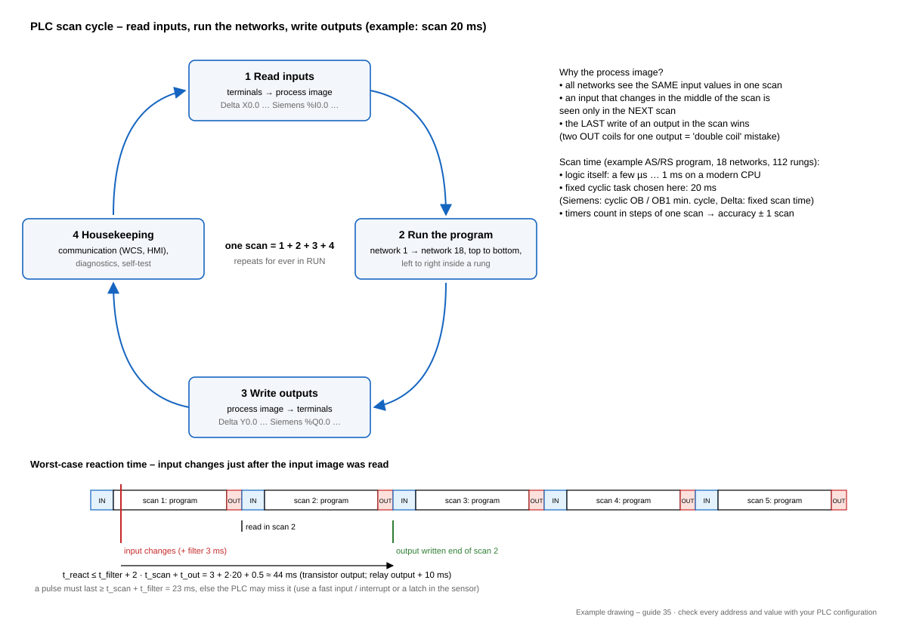
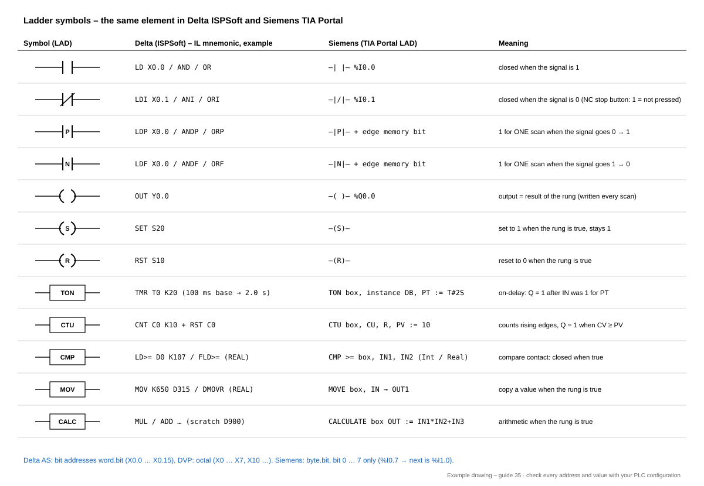
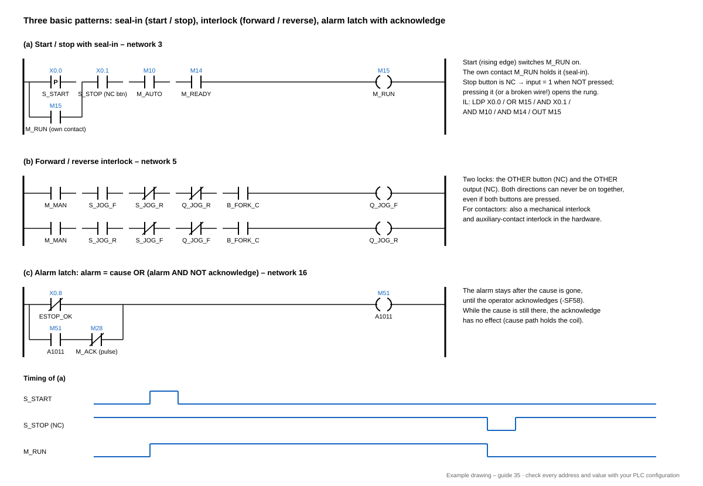
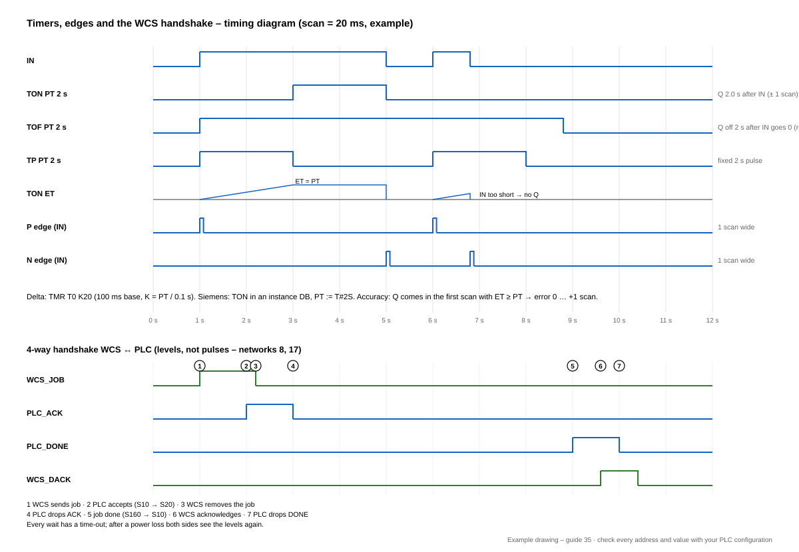
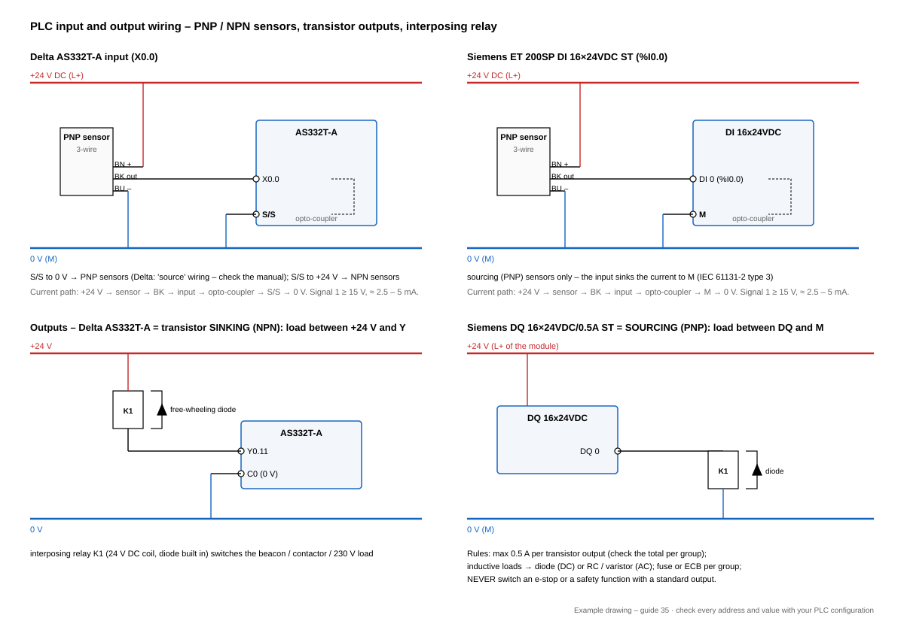
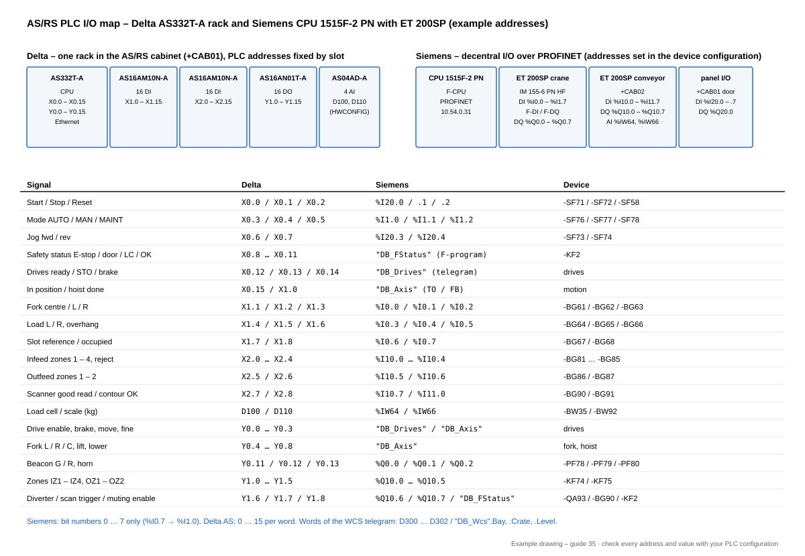
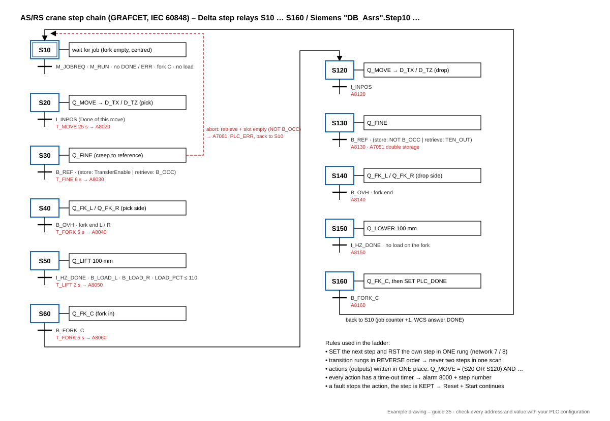
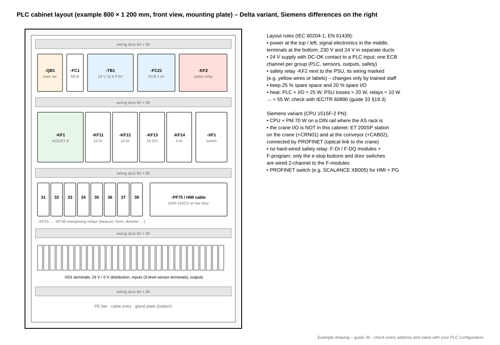

# 35 – PLC ladder basics (Delta + Siemens) and the AS/RS crane + conveyor program

Textbook and reference for **ladder programming (LAD)** with the two PLC families of this factory – **Delta** (AS300 series,
ISPSoft) and **Siemens** (S7-1500 / S7-1200, TIA Portal) – and the complete example program of the **AS/RS raw-material store
ASRS-RAW** (stacker crane + I/O conveyors), shown live in the app: tab **AS/RS raw materials → item 5 "PLC ladder program"**.

Reader: mechanical engineer who plans the compressor factory and must read, check and order PLC programs. Simple English,
short sentences, tables, worked numbers.

> **All addresses, times, products and prices are EXAMPLES – check with your PLC configuration, the drawings of your project
> and the supplier.** The AS/RS supplier normally writes the crane program; this guide lets you read it, check it and talk to
> the programmer.

> **Safety rule (in every guide and on every page):** the standard ladder program **never** does the safety function itself
> (e-stop, guard locking, STO, safe speed, muting). That is the **safety relay** (Delta solution) or the **F-program** in the
> fail-safe CPU (Siemens) – ISO 13849-1, IEC 62061, IEC 60204-1 §9.4. The standard program only **reads** the safety status.

Related guides: 05 (PLC control of the line), 31 (AS/RS mechanics), 32 (AS/RS control system – modes, telegram, step chain,
errors, alarms), 33 (AS/RS electrical circuits – I/O, safety circuit), 36 (APC ladder), 37 (hydraulics ladder).

## Contents

0. How to use the page (item 5)
1. Purpose, scope, the two PLC families

**PART A – Ladder textbook**

2. What a PLC does – hardware of the two families
3. The scan cycle and the process image
4. Contacts, coils and addresses
5. Seal-in: the start / stop circuit
6. Interlocks
7. Edges (one-scan pulses)
8. Timers: TON, TOF, TP – and the Delta TMR
9. Counters
10. Step chains with SET / RST (GRAFCET)
11. Compare, move, calculate, analog scaling
12. Wiring of inputs and outputs (PNP / NPN, relays)
13. Alarms and acknowledge
14. Delta vs Siemens – comparison table
15. The five IEC 61131-3 languages

**PART B – The AS/RS program**

16. I/O list with wiring (Delta + Siemens addresses)
17. Program overview – 18 networks
18. The crane step chain and its verified timing
19. Network by network – full ladder listing (both PLCs)
20. Handshakes: WCS ↔ PLC and crane ↔ conveyor
21. Timing calculations: scan time, timer accuracy, debounce, time-outs
22. Cabinet layout
23. Delta instruction list (IL) – complete program
23b. Siemens: block structure, DBs and SCL equivalent

**PART C – Buying, commissioning, reference**

24. Buy list – catalogue examples + shopping list
25. Commissioning and I/O check list
26. Typical mistakes
27. Standards
28. Glossary
29. Questions for the supplier / programmer
30. Next to read

---

## 0. How to use the page (item 5)

Open **AS/RS raw materials → 5 · PLC ladder program**. Deep link: `/?sritem=5#asrs`.

| Part of the page | What it does |
|---|---|
| Header card | which PLCs, how to read LAD (symbol legend), the safety rule, operator buttons (Start -SF71, Stop -SF72, Reset -SF58, semi-automatic), safety buttons (e-stop, aisle door, person in the light curtain), **fault injection** (no-read, contour, overweight, jam, fork collision, double storage, empty slot, hoist overload, drive fault, WCS link lost), "mirror the shared twin", alarm strip |
| Plant card | top view of the aisle: rack slots of the current level (grey = occupied, blue frame = target), the crane with fork and load, conveyor zones IZ1 – IZ4 / OZ1 – OZ2 / reject (green frame = zone motor on), hoist height bar; below: step, job, targets, crane, drives, counters |
| Events card | plant events, step changes, alarms with sim time; "shared twin" line = crane phase of items 1 – 4 translated into the ladder step (e.g. `forkOut` without load → S40) |
| Ladder card | the **live ladder** (all 18 networks): bar with **Run / Stop / 1 scan / Reset**, view **Delta / Siemens / Both**, speed 1× – 10×, status (RUN, scan 20 ms, sim time, scans, logic time), search; step strip S10 … S160; input panel on the left (push buttons, switches, sensors, sliders), outputs list, program check |
| Below the ladder | I/O and tag table (with live values), **Delta IL** generated from the ladder, **Siemens SCL** equivalent |
| Program structure card | where each network goes in a real project (OB1 / OB100 / OB30-38 / F-program – Delta cyclic task / M1002 / safety relay) |
| Catalogue card | "Real components + drawings – catalogue examples": the 8 drawings of this guide, buy list, shopping list |

**Quick tour (10 minutes)**

1. Press **Start automatic**. Watch network 3: the rising edge of S_START closes, M_RUN switches on and holds itself (seal-in).
2. Network 4: Q_DRV_EN goes on, STO feedback drops after 0.05 s, the brake timer T_BRK runs 0.2 s, Q_BRK goes on.
3. The WCS sends a job (event log). Network 8: S10 → S20, PLC_ACK. The step strip shows S20; the crane travels.
4. Follow the steps S30 (fine positioning 3 s), S40 (fork out 2.18 s), S50 (lift 0.5 s), S60 (fork in), S120 … S160.
5. Press **bar-code no-read**: the next load stops at the ID point, Q_SCAN is on for 1 s, then A7011 (warning) – the load goes
   to the reject lane, the crane keeps working.
6. Press **E-stop -SF52**: A1011, safety relay OFF, Q_DRV_EN off, M_RUN off. Release, press **Reset**, then **Start**.
7. Click a sensor in the panel (e.g. B_REF) – it is **forced** (marker F). Watch the step chain wait or jump. Click again to release.
8. Switch the view to **Delta**, then **Siemens**: the same rung with X0.0 / %I20.0, TMR T0 K2 / TON T#200MS.

**URL parameters (tests):** `&ladview=delta|siemens|both` · `&ladAstart` (press Start automatically) · `&ladtest` (self-test of the
ladder core, console `LADTEST …`) · `&ladAtest` (self-check of the AS/RS program, console `LADATEST …`) · catalogue card:
`&ldAtab=draw|buy|shop`, `&ldAq=text`, `&ldAbox=N`, `&ldAscroll`.

## 1. Purpose, scope, the two PLC families

The user request was: *"when I use Delta or Siemens PLC, add the control circuit program (ladder)"*. This guide covers the
**AS/RS** (guide 36: APC, guide 37: hydraulics). Every rung is written **once** in a neutral form and shown for both families.

| | Delta | Siemens |
|---|---|---|
| CPU in this example | **AS332T-A** (AS300 series), software **ISPSoft 3.x** (free) | **CPU 1515F-2 PN** (S7-1500F, PLC-ASRS-RAW, IP 10.54.0.31), **TIA Portal V19** |
| I/O | on board 16 DI X0.0 – X0.15 + 16 DO Y0.0 – Y0.15; modules AS16AM10N-A (DI), AS16AN01T-A (DO), AS04AD-A (AI) | ET 200SP stations on the crane and at the conveyor (PROFINET), F-DI / F-DQ |
| Small option | DVP-ES3 / DVP-ES2 (octal X0 – X7, X10 – X17 …, WPLSoft / ISPSoft) | S7-1200 CPU 1215C DC/DC/DC (APC, HPU) |
| Safety | hard-wired **safety relay** (Pilz PNOZ s4, Schmersal SRB-E, Phoenix PSRmini) or safety controller (PNOZmulti 2) | **F-program** (F-LAD / F-FBD: ESTOP1, SFDOOR, MUTING, ACK_GL) in the F-CPU |
| Typical use | price-sensitive machines, Asia, simple cells | large lines, Europe, integrated safety + motion + PROFINET |

---

# PART A – Ladder textbook

## 2. What a PLC does – hardware of the two families

A PLC (programmable logic controller, IEC 61131-1) is an industrial computer that **reads inputs** (push buttons, sensors),
**runs a program** and **switches outputs** (contactors, valves, drives, lamps) – again and again, many times per second.

| Part | Delta AS300 | Siemens S7-1500 / ET 200SP | What to check |
|---|---|---|---|
| CPU | AS332T-A: CPU + 16 DI + 16 DO in one housing | CPU 1515F-2 PN, no I/O on board | memory, speed, number of modules, Ethernet ports |
| Digital input | 24 V DC, sink or source by the S/S terminal | DI 16×24VDC ST, sourcing sensors (PNP) | type (IEC 61131-2 type 1 / 3), filter time |
| Digital output | transistor T = sinking (NPN), P = sourcing (PNP), relay (R) | DQ 24 V DC 0.5 A sourcing | current per point and per group |
| Analog | AS04AD-A (4 – 20 mA / ±10 V) → D register | AI 4×I ST → %IW64 (0 … 27 648) | range, resolution, wire-break |
| Communication | Ethernet (Modbus TCP, EtherNet/IP, Delta protocol), RS-485 | PROFINET, OPC UA, S7 communication | protocol to WCS / HMI / drives |
| Programming | ISPSoft: LD, IL, SFC, FBD, ST | TIA Portal: LAD, FBD, SCL, GRAPH (STL on S7-1500) | licence, version |

**Signal levels (IEC 61131-2, 24 V DC type 1 / 3):** "1" = 15 … 30 V, "0" = −3 … 5 V; input current ≈ 2 … 15 mA. A
3-wire PNP sensor switches +24 V to the input.

## 3. The scan cycle and the process image



One **scan** = (1) read all inputs into the **process image** (Delta: X, Siemens: %I / PII) → (2) run the program, network
by network, top to bottom, inside a rung left to right → (3) write the output image to the terminals (Y / %Q) → (4)
communication and diagnostics. Then again.

**Consequences you must know:**

1. All networks see the **same** input values during one scan.
2. An output written twice in one scan → only the **last** write counts ("double coil", §26).
3. A rung uses the value that a later network will write **in the previous scan** (e.g. network 3 reads M_FAULT, which
   network 16 writes). The program check on the page and the self-check show this "one scan later" effect.
4. Timers count in steps of one scan.

**Formulas (example scan time 20 ms):**

```
worst-case reaction   t_react = t_filter + 2 · t_scan + t_out
                              = 3 ms + 2 · 20 ms + 0.5 ms ≈ 44 ms    (transistor output; relay output + ≈ 10 ms)
minimum pulse length  t_pulse ≥ t_scan + t_filter = 20 + 3 = 23 ms   (shorter pulses can be missed)
travel during t_react at 3 m/s:  s = v · t = 3 · 0.044 = 0.13 m      → never use the PLC scan for a safety stop
```

The example program has 18 networks / 112 rungs; the logic itself takes a few µs to < 1 ms on a modern CPU (the page shows
"logic … µs" of the simulator). The 20 ms is the **fixed cycle** chosen for the example (Siemens: cyclic OB or minimum cycle
time of OB1; Delta: fixed scan time setting).

## 4. Contacts, coils and addresses



A rung is an electrical "circuit diagram" on its side: **left rail = +24 V**, contacts in **series = AND**, in **parallel =
OR**, the coil at the right is the result. "Power flow" through closed contacts switches the coil on.

| Element | Closed / active when … | Delta | Siemens |
|---|---|---|---|
| NO contact –\| \|– | signal = 1 | `LD X0.0` | –\| \|– %I0.0 |
| NC contact –\|/\|– | signal = 0 | `LDI X0.1` | –\|/\|– %I0.1 |
| coil –( )– | writes the rung result every scan | `OUT Y0.0` | –( )– %Q0.0 |
| set –(S)– / reset –(R)– | writes 1 / 0 only when the rung is true | `SET M0` / `RST M0` | –(S)– / –(R)– |
| negated coil –(/)– | writes NOT result | `INV` + `OUT` | –(/)– |

**NO / NC in the program is NOT the same as NO / NC in the field.** A stop button is wired as an NC contact (opens when
pressed, and a broken wire looks like "pressed" = safe). In the PLC its input is **1 when not pressed**. So in the program the
stop button is used with an **NO contact** (`AND X0.1`): pressing it → input 0 → contact opens → machine stops. This is the
most common beginner question.

**Addresses**

| | Delta AS | Delta DVP | Siemens |
|---|---|---|---|
| inputs | X0.0 … X0.15, X1.0 … (word.bit, 16 bits per word) | X0 … X7, X10 … X17 (octal!) | %I0.0 … %I0.7, %I1.0 … (byte.bit, **bit 0 … 7 only**) |
| outputs | Y0.0 … Y0.15 | Y0 … Y7, Y10 … | %Q0.0 … |
| internal bits | M0 … (M1000 always on, M1002 first scan, M1013 1 s clock) | M0 … | %M10.0 … or better DB bits `"DB_Asrs".Auto` |
| step relays | S0 … (S10 … S160 here) | S0 … | DB bits `"DB_Asrs".Step10` |
| words | D0 … (16 bit), D + D+1 = 32 bit / float | D0 … | %MW, DB variables (Int, Real) |
| timers / counters | T0 … / C0 … | T0 … / C0 … | IEC TON / CTU with instance DB |

## 5. Seal-in: the start / stop circuit



The most important pattern (network 3 of the AS/RS program):

```
M_RUN = (RISING S_START  OR  M_RUN)  AND  S_STOP  AND  M_AUTO  AND  M_READY
Delta:  LDP X0.0 / OR M15 / AND X0.1 / AND M10 / AND M14 / OUT M15
SCL:    "M_RUN" := (#edge OR "M_RUN") AND "S_STOP" AND "M_AUTO" AND "M_READY";
```

* Start switches on; the **own contact** M_RUN keeps the coil on after the button is released (seal-in, "self-holding").
* Any condition in series (Stop pressed, mode not AUTO, not ready) breaks the rung → off. **Stop dominates** because it is in
  series with the whole parallel branch.
* A rising edge on Start (instead of a plain contact) means a **jammed or held** Start button cannot restart the machine by
  itself after a fault – the operator must release and press again.
* Alternative with SET / RST (`SET M15` on start, `RST M15` on stop): same function, but the order of the rungs decides which
  one wins if both are true in one scan (the later rung wins). With the seal-in, stop always wins.

## 6. Interlocks

Two outputs that must **never** be on together (forward / reverse, fork left / right, valve A / B of a 4/3 valve) lock each
other out (network 5 and network 10):

```
Q_JOG_F = M_MAN AND S_JOG_F AND NOT S_JOG_R AND NOT Q_JOG_R AND B_FORK_C AND Q_BRK
Q_JOG_R = M_MAN AND S_JOG_R AND NOT S_JOG_F AND NOT Q_JOG_F AND B_FORK_C AND Q_BRK
```

* **Button interlock** (NOT the other button) and **output interlock** (NOT the other output) together.
* For contactors also add the **hardware** interlock (auxiliary NC contact of the other contactor in the coil circuit and
  a mechanical interlock) – the software alone is not enough if a contactor welds.
* **Hold-to-run** (jog): the output is a plain coil of the button – release the button and the motion stops.
* A **condition interlock** (here fork centre B_FORK_C) prevents a dangerous motion; it is a machine function, not a safety
  function. The fork-centre check before travel is **also** in the F-program (guide 32 SF8).

## 7. Edges (one-scan pulses)

A **rising edge** contact (Delta `LDP`, Siemens –|P|–) is closed for **exactly one scan** when its signal goes 0 → 1; a
**falling edge** (`LDF`, –|N|–) when 1 → 0. Each edge contact needs its **own edge memory bit** (Siemens shows it under the
contact, e.g. `"EdgeMem".M29`; Delta keeps it inside the LDP instruction). Never use the same memory bit for two edges.

Uses in the AS/RS program:

| Network | Edge | Why |
|---|---|---|
| 3 | RISING S_START | start only on a new press |
| 6 | RISING WCS_LIFE OR FALLING WCS_LIFE | every change of the life bit restarts the 3 s watchdog |
| 13 | FALLING B_IZ2 | the load has left zone 2 → move its reject mark to zone 3, clear the zone-2 bits |
| 14 | FALLING B_IZ3 | the load has left zone 3 → clear its reject mark |
| 16 | RISING S_RESET | one-scan acknowledge pulse M_ACK |
| 18 | CTU input | a counter counts rising edges by itself |

**Edge vs. level:** the job handshake with the WCS uses **levels** (§20) – a lost pulse would lose a job, a level is seen again
after a restart.

## 8. Timers: TON, TOF, TP – and the Delta TMR



| Timer | Output Q | Typical use in the program |
|---|---|---|
| **TON** on-delay | 1 after the input was 1 for PT; 0 at once when the input goes 0 | brake release delay (T_BRK 0.2 s), time-outs (T_MOVE 25 s), settle time (T_SCALE 1 s), watchdog (T_WCS 3 s) |
| **TOF** off-delay | 1 at once; 0 when the input was 0 for PT | run-on of a fan / conveyor |
| **TP** pulse | a fixed pulse of PT on a rising input | horn 2 s at jog start (T_HORN) |

**Delta:** `TMR T0 K20` – T0 … T511 count in 100 ms steps → K = PT / 0.1 s (2.0 s → K20, 0.2 s → K2). For 10 ms resolution:
`TMRH T0 K20` = 0.20 s. The timer contact `LD T0` is used in the next rung (the IL generator splits the rung at the box). A TMR
is reset when its input goes 0. The AS series also has the IEC instructions TON / TOF / TP.
**Siemens:** IEC timer `TON` with an **instance DB** (`"DB_T_Brk"`) or a multi-instance in an FB, `PT := T#200MS`, output Q, elapsed
time ET. `RESET_TIMER` resets it.

**Accuracy:** the PLC checks the timer once per scan. Q comes in the first scan where ET ≥ PT → error 0 … +1 scan (+20 ms here).
The time base adds ±1 step (100 ms for TMR!). **Rule:** `PT > 10 · t_scan` if accuracy matters; for short times use TMRH /
hardware timers.

**Worked example (self-check of the page, scan 20 ms):** drive enable → STO feedback drops after 0.05 s (plant) → T_BRK starts →
Q_BRK after 0.05 + 0.20 = **0.24 s** (measured 0.24 s). TON 2.0 s in the core self-test: **2.00 s**; TOF 1.0 s: **1.00 s**; TP 0.5 s:
**0.50 s** pulse.

**Debounce:** a mechanical contact bounces for 1 … 10 ms. The input filter (3 ms on ET 200SP, adjustable on Delta) and the scan
(20 ms) already hide most bouncing. For a noisy sensor use a TON of 50 … 200 ms in series ("signal must be stable for t").

## 9. Counters

**CTU** counts **rising edges** of its input: CV = CV + 1; Q = 1 when CV ≥ PV; the reset input R sets CV = 0. **CTD** counts down
(load PV with LD, Q = 1 when CV ≤ 0).

| | Delta | Siemens |
|---|---|---|
| count up | `CNT C0 K9999` (16 bit, C0 … C199), reset `RST C0` | `"DB_C_Jobs".CTU(CU := …, R := …, PV := 9999)` |
| 32-bit / up-down | `DCNT C200 K…` with direction flag (M1200 …) | CTUD, data type DInt |

AS/RS uses (network 18): **C_JOBS** counts PLC_DONE (finished jobs), reset from the HMI. **C_SEC** counts the 1 Hz clock while the
brakes are open (= seconds with torque); at 3 600 its Q gives M_HOUR, which adds 1 to D_HRS and resets C_SEC (cascade
"seconds → hours"). Hour meters belong in **retentive** memory (Delta latched range, Siemens "retain" in the DB).

## 10. Step chains with SET / RST (GRAFCET)

A sequence (crane job, pallet change, clamp → work → unclamp) is a **step chain**: exactly one step is active; a step does
actions; a **transition** (condition) moves to the next step. The drawing standard is GRAFCET (IEC 60848); Siemens GRAPH and
Delta SFC are the "native" languages, but the same chain in LAD with SET / RST is readable by every maintenance electrician:

```
transition rung:   S20 AND I_INPOS            →  SET S30, RST S20        (one rung per transition)
action rung:       (S20 OR S120) AND Q_BRK AND NOT M_FAULT  →  OUT Q_MOVE  (each output written ONCE)
```

**Rules that avoid 90 % of the trouble:**

1. **SET the next, RST the own step in the same rung.**
2. **Reverse order** of the transition rungs (last step first). Otherwise S20 → S30 → S40 could happen in **one** scan when
   the conditions are already true (e.g. an old "in position" signal). In the AS/RS program network 7 (drop part) comes before
   network 8 (pick part), and inside each network the rungs go from the last step to the first.
3. **Actions as OR of the steps** – never `OUT Q_MOVE` in two rungs.
4. **Initial step** by the first-scan bit (Delta M1002 / Siemens FirstScan, or OB100).
5. **Every action has a time-out** (timer that runs while the command is on) → alarm "8000 + step".
6. **Faults stop the action, not the step**: after the cause is removed, Reset + Start continue from the same step.
7. **Use the "done" of the CURRENT command** for the transition (I_INPOS must drop when a new move starts) – an old
   "in position" bit would let the chain jump.

Alternative in SCL (guide 32 §6.5): `CASE #Step OF 10: … 20: … END_CASE;` – same logic, one integer instead of step bits.

## 11. Compare, move, calculate, analog scaling

| Function | Delta | Siemens | AS/RS use |
|---|---|---|---|
| compare contact | `LD>= D0 K107`, `AND<= …`, float `FLD>= D100 F10.7` | CMP >= box (Int / Real) | LOAD_PCT ≤ 110 (net 8), W_SCALE ≤ 300 (net 14) |
| move | `MOV K650 D315`, float `DMOVR` | MOVE | targets D_TX / D_TZ (net 9), step number (net 11) |
| arithmetic | `ADD / SUB / MUL / DIV` (INT), `DEADD / DEMUL …` (float; AS series also `+ - * /`, `F+ F* …` – check) | ADD / MUL / CALCULATE box, SCL | slot position, load % |

**Slot coordinates (network 6)** – from the rack of guide 31 (bay pitch 1 925 mm, crate pitch 875 mm, level pitch 1 250 mm):

```
D_SX = 1925 · bay + 875 · crate − 1025   [mm]     bay 1, crate 1 → 1 775 mm;  bay 14, crate 2 → 27 675 mm
D_SZ = 1250 · level − 800                [mm]     level 1 → 450 mm;  level 7 → 7 950 mm
pick target:  D_SZ − 100 (under the load) ;  drop target:  D_SZ + 100 (above the support)
```

These equal `slotPos()` of the shared twin (asrscore.js): x = 1.20 + 0.10 + (bay−1)·1.925 + 0.075 + 0.40 + (crate−1)·0.875 m.

**Analog scaling** – a 4 … 20 mA transmitter gives a raw number:

```
value = min + (raw − raw_min) · (max − min) / (raw_max − raw_min)
Siemens AI (4 – 20 mA):  raw 0 … 27 648  → NORM_X (0.0 … 1.0) + SCALE_X (min … max)
Delta AS04AD-A:          raw 0 … 32 000 (example – set in HWCONFIG, check the manual)
load cell 0 … 500 kg:    raw 13 824 (Siemens) → 0 + 13 824 · 500 / 27 648 = 250.0 kg
                         raw 16 000 (Delta)   → 16 000 · 500 / 32 000 = 250.0 kg
load % (network 18):     LOAD_PCT = LOAD_KG · 100 / 300   → 345 kg = 115 % > 110 % → A5011
```

Wire break: < 3.6 mA (raw < −4 864 on Siemens, overflow 32 767 above 22.8 mA) → treat as fault, never as "0 kg".
`scaleLin(x, inMin, inMax, outMin, outMax)` in the app's ladder core does the same formula.

## 12. Wiring of inputs and outputs (PNP / NPN, relays)



| Topic | Delta AS332T-A | Siemens ET 200SP |
|---|---|---|
| sensor type | PNP **or** NPN – chosen by the S/S common (S/S to 0 V → PNP sensors; check the Delta manual for the words "sink / source") | PNP (sourcing) only for DI 16×24VDC ST |
| outputs | AS332**T**-A = sinking (NPN): load between +24 V and Y; AS332**P**-A = sourcing (PNP) | DQ sourcing: load between DQ and M |
| Europe practice | PNP sensors and sourcing outputs → choose AS332P-A / AS16AN01P-A, or wire carefully | standard |

**Interposing relay** for loads above 0.5 A, for 230 V loads (beacon, diverter contactor) or for potential separation; with a
free-wheeling diode (DC coil) – without it the switch-off voltage spike (several hundred volts) destroys the transistor output.
**Never** wire an e-stop or a guard switch only to a standard input – they go to the safety relay / F-DI (two channels).

## 13. Alarms and acknowledge

Pattern (network 16): **alarm = cause OR (alarm AND NOT acknowledge)**

```
A1011 = NOT ESTOP_OK  OR  (A1011 AND NOT M_ACK)        M_ACK = RISING S_RESET (one scan)
Delta:  LDI X0.8 / LD M51 / ANI M28 / ORB / OUT M51
```

* The alarm **stays** after the cause is gone (the operator must see it) until **Reset -SF58** is pressed.
* While the cause is still there the acknowledge does nothing.
* **Faults** (M_FAULT: safety status, communication, drive, collision, overload, jam, double storage, handshake, step time-out)
  stop automatic; **warnings** (M_WARN: no-read, contour, overweight, empty slot) do not – the material flow handles them
  (reject lane, abort answer to the WCS).
* Alarm numbers follow guide 15 / guide 32 §11.1: `ASRSRAW_A1011` … ; the step time-out number is calculated:
  `D_ALNO = D_STEP + 8000` (S20 → A8020).
* In a real project: Siemens **ProDiag** or "Program_Alarm" with texts, priority, time stamp; Delta HMI alarm table reading the
  M50 … M64 bits; every alarm needs cause + operator action + delay (ISA-18.2, guide 06).

## 14. Delta vs Siemens – comparison table

| Topic | Delta (AS / DVP, ISPSoft) | Siemens (S7-1500 / 1200, TIA Portal) |
|---|---|---|
| bit address | X0.0 … X0.15 (AS) / X0 … X17 octal (DVP) | %I0.0 … %I0.7 (byte.bit) |
| symbols | optional (global symbols) | symbolic first ("S_START"), absolute optional |
| internal memory | M, S, D, T, C areas, latched ranges | DBs (optimised access), retain per variable |
| timers | TMR T0 K20 (100 ms) / TMRH (10 ms), TON / TOF / TP (AS) | IEC TON / TOF / TP / TONR in instance DBs |
| counters | CNT C0 K10, DCNT (32 bit) | CTU / CTD / CTUD |
| edges | LDP / LDF / ANDP … (memory inside) | –\|P\|– / –\|N\|– with an edge memory bit, R_TRIG / F_TRIG |
| first scan | M1002 | system memory FirstScan or OB100 |
| clock bits | M1011 (10 ms) … M1013 (1 s) | clock memory byte, e.g. %M0.5 = 1 Hz |
| sequences | SFC with S relays, or SET / RST | GRAPH, or SET / RST, or SCL CASE |
| safety | external safety relay / controller | F-CPU + F-program (or safety relay) |
| motion | position tables in the drive, motion CPUs | technology objects, MC_ blocks |
| simulation | ISPSoft simulator | PLCSIM / PLCSIM Advanced |
| licence | free | STEP 7 Basic / Professional, Safety, WinCC (paid) |

## 15. The five IEC 61131-3 languages

| Language | Looks like | Best for | Delta | Siemens |
|---|---|---|---|---|
| **LD** ladder diagram | relay circuit | interlocks, simple logic, maintenance | LD | LAD |
| **FBD** function block diagram | logic gates / boxes | analog, signal processing | FBD | FBD |
| **ST** structured text | Pascal | calculations, telegrams, CASE step chains | ST | SCL |
| **SFC** sequential function chart | GRAFCET | step chains | SFC | GRAPH |
| **IL** instruction list | assembler | small PLCs, old programs (deprecated in edition 3) | IL (still common) | STL (S7-1500 only) |

The page shows **LD** live, **IL** for Delta (generated from the same ladder) and **SCL** for Siemens (generated) – three views of
one logic.

---

# PART B – The AS/RS program

## 16. I/O list with wiring (Delta + Siemens addresses)



Device tags follow guide 33 (IEC 81346: -SF push buttons, -BG sensors, -BW weighing, -KF logic, -PF lamps, -QA starters).
Siemens addresses of the crane sensors are the ET 200SP addresses of guide 33 §14.1 (DI 0.0 = -BG61 …). Safety status bits come
from the F-program (`"DB_FStatus"`) or, for Delta, from the auxiliary / status contacts of the safety relay.

| Tag | Dir | Delta (AS332T-A) | Siemens (CPU 1515F-2 PN) | Comment | Wiring / device | Range / preset |
|---|---|---|---|---|---|---|
| `S_START` | input | `X0.0` | `%I20.0` | Start automatic – push button NO, green | -SF71 13/14 |  |
| `S_STOP` | input | `X0.1` | `%I20.1` | Stop – push button NC, red (controlled stop, NOT the e-stop) | -SF72 11/12 |  |
| `S_RESET` | input | `X0.2` | `%I20.2` | Reset / acknowledge – lamp push button, blue (also resets the safety relay) | -SF58 13/14 |  |
| `S_AUTO` | input | `X0.3` | `%I1.0` | Mode key switch AUTO | -SF76 13/14 |  |
| `S_MAN` | input | `X0.4` | `%I1.1` | Mode key switch MANUAL (hold-to-run, SLS) | -SF77 13/14 |  |
| `S_MAINT` | input | `X0.5` | `%I1.2` | Mode key switch MAINTENANCE | -SF78 13/14 |  |
| `S_JOG_F` | input | `X0.6` | `%I20.3` | Jog travel forward – hold-to-run (manual only) | -SF73 13/14 |  |
| `S_JOG_R` | input | `X0.7` | `%I20.4` | Jog travel reverse – hold-to-run (manual only) | -SF74 13/14 |  |
| `HMI_SEMI` | input | `M200` | `"DB_Hmi".Semi` | HMI: semi-automatic – the job comes from the HMI, not from the WCS | HMI DOP-110 / TP700 |  |
| `HMI_JOB` | input | `M201` | `"DB_Hmi".JobStart` | HMI: start one job (semi-automatic) | HMI |  |
| `HMI_CRES` | input | `M202` | `"DB_Hmi".CntReset` | HMI: reset the job counter | HMI |  |
| `ESTOP_OK` | input | `X0.8` | `"DB_FStatus".EStopOK` | 1 = no e-stop pressed (status of safety relay -KF2 / F-program, -SF51 … -SF55) | -KF2 Y32 (status output) |  |
| `DOOR_OK` | input | `X0.9` | `"DB_FStatus".DoorOK` | 1 = aisle door closed and locked (-BG56 / -MB56) | -KF2 status |  |
| `LC_OK` | input | `X0.10` | `"DB_FStatus".LcOK` | 1 = light curtain at the I/O free or muted (-BG59) | -KF2 status |  |
| `SAF_OK` | input | `X0.11` | `"DB_FStatus".SafetyOK` | 1 = safety relay / F-program output ON (reset done) – drives may get torque | -KF2 13/14 auxiliary contact |  |
| `DRV_RDY` | input | `X0.12` | `"DB_Drives".Ready` | All crane drives ready, no fault (ZSW1 bit 1 = 1, bit 3 = 0) | drive status (telegram 111) |  |
| `STO_FB` | input | `X0.13` | `"DB_Drives".StoActive` | 1 = STO active (torque off) – feedback of the drives | drive STO feedback |  |
| `BRK_FB` | input | `X0.14` | `"DB_Drives".BrakeOpen` | 1 = holding brakes released (feedback) | drive brake feedback |  |
| `I_INPOS` | input | `X0.15` | `"DB_Axis".InPos` | Travel + hoist reached the target window – Done of the CURRENT move | MC_MoveAbsolute.Done / ASDA MC_OK |  |
| `I_HZ_DONE` | input | `X1.0` | `"DB_Axis".HoistDone` | Hoist lift / lower stroke (100 mm) done | hoist axis Done |  |
| `B_FORK_C` | input | `X1.1` | `%I0.0` | Fork in centre (2 sensors in series) | -BG61 inductive M18 PNP |  |
| `B_FORK_L` | input | `X1.2` | `%I0.1` | Fork end position LEFT | -BG62 |  |
| `B_FORK_R` | input | `X1.3` | `%I0.2` | Fork end position RIGHT | -BG63 |  |
| `B_LOAD_L` | input | `X1.4` | `%I0.3` | Load on fork – left sensor | -BG64 light sensor, background suppression |  |
| `B_LOAD_R` | input | `X1.5` | `%I0.4` | Load on fork – right sensor | -BG65 |  |
| `B_OVH` | input | `X1.6` | `%I0.5` | Overhang / collision light barrier – 1 = beam free (NC logic: a broken wire = stop) | -BG66 |  |
| `B_REF` | input | `X1.7` | `%I0.6` | Slot reference mark seen (fine positioning done) | -BG67 |  |
| `B_OCC` | input | `X1.8` | `%I0.7` | Slot occupied (long-range light sensor) – checked BEFORE the fork moves | -BG68 |  |
| `B_IZ1` | input | `X2.0` | `%I10.0` | Infeed zone 1 occupied (entry) | -BG81 photo-eye |  |
| `B_IZ2` | input | `X2.1` | `%I10.1` | Infeed zone 2 occupied (ID point) | -BG82 |  |
| `B_IZ3` | input | `X2.2` | `%I10.2` | Infeed zone 3 occupied (contour check + scale) | -BG83 |  |
| `B_IZ4` | input | `X2.3` | `%I10.3` | Infeed zone 4 occupied (transfer position to the crane) | -BG84 |  |
| `B_REJ` | input | `X2.4` | `%I10.4` | Reject lane occupied | -BG85 |  |
| `B_OZ1` | input | `X2.5` | `%I10.5` | Outfeed zone 1 occupied (transfer from the crane) | -BG86 |  |
| `B_OZ2` | input | `X2.6` | `%I10.6` | Outfeed zone 2 occupied (pick-up by AGV / forklift) | -BG87 |  |
| `B_ID_OK` | input | `X2.7` | `%I10.7` | Bar-code scanner: good read | -BG90 (digital result output) |  |
| `B_CONT_OK` | input | `X2.8` | `%I11.0` | Contour check OK (light grid: height, overhang) | -BG91 |  |
| `W_SCALE` | analog in | `D110 (AS04AD-A ch2)` | `%IW66 → "DB_Conv".Kg` | Infeed scale (0 … 500 kg = 4 … 20 mA) | -BW92 | 0 … 500 kg |
| `LOAD_KG` | analog in | `D100 (AS04AD-A ch1)` | `%IW64 → "DB_Axis".LoadKg` | Hoist load cell (0 … 500 kg) | -BW35 / -KF35 | 0 … 500 kg |
| `WCS_JOB` | input | `M100` | `"DB_Wcs".JobValid` | WCS job telegram valid (ST store / RT retrieve), checksum OK | TCP telegram |  |
| `WCS_STORE` | input | `M101` | `"DB_Wcs".Store` | 1 = store (ST), 0 = retrieve (RT) | telegram Type |  |
| `WCS_SIDE_R` | input | `M102` | `"DB_Wcs".SideR` | Target slot on side R (0 = side L) | telegram Target A01L / A01R |  |
| `WCS_DACK` | input | `M103` | `"DB_Wcs".DoneAck` | WCS has received 'done' / 'error' (answer acknowledged) | telegram |  |
| `WCS_LIFE` | input | `M104` | `"DB_Wcs".Life` | Life bit – the WCS toggles it every 1 s | life telegram LF |  |
| `WCS_BAY` | word | `D300` | `"DB_Wcs".Bay` | Target bay 1 … 14 (from the telegram Target) |  |  |
| `WCS_K` | word | `D301` | `"DB_Wcs".Crate` | Crate place in the bay 1 … 2 |  |  |
| `WCS_LVL` | word | `D302` | `"DB_Wcs".Level` | Target level 1 … 7 |  |  |
| `Q_DRV_EN` | output | `Y0.0` | `"DB_Drives".Enable` | Drive enable – ON / OFF1 (STW1 bit 0) to travel, hoist, fork | drive control word |  |
| `Q_BRK` | output | `Y0.1` | `"DB_Drives".BrakeRelease` | Release the holding brakes (after the drives have torque) | drive brake control (SBC in the drive) |  |
| `Q_MOVE` | output | `Y0.2` | `"DB_Axis".MoveExe` | Start positioning travel + hoist to D_TX / D_TZ (MC_MoveAbsolute.Execute) | motion command |  |
| `Q_FINE` | output | `Y0.3` | `"DB_Axis".FinePos` | Fine positioning – creep to the slot reference mark | motion command |  |
| `Q_FK_L` | output | `Y0.4` | `"DB_Axis".ForkLeft` | Fork out to the LEFT | fork drive |  |
| `Q_FK_R` | output | `Y0.5` | `"DB_Axis".ForkRight` | Fork out to the RIGHT | fork drive |  |
| `Q_FK_C` | output | `Y0.6` | `"DB_Axis".ForkCentre` | Fork back to the centre | fork drive |  |
| `Q_LIFT` | output | `Y0.7` | `"DB_Axis".Lift` | Hoist: lift 100 mm (take the load) | motion command |  |
| `Q_LOWER` | output | `Y0.8` | `"DB_Axis".Lower` | Hoist: lower 100 mm (put the load down) | motion command |  |
| `Q_JOG_F` | output | `Y0.9` | `"DB_Axis".JogFwd` | Jog travel forward at safe reduced speed 0.3 m/s | motion command (SLS active) |  |
| `Q_JOG_R` | output | `Y0.10` | `"DB_Axis".JogRev` | Jog travel reverse at 0.3 m/s | motion command (SLS active) |  |
| `H_GREEN` | output | `Y0.11` | `%Q0.0` | Beacon green – automatic running | -PF78 |  |
| `H_RED` | output | `Y0.12` | `%Q0.1` | Beacon red – fault (steady) / warning (flashing) | -PF79 |  |
| `H_HORN` | output | `Y0.13` | `%Q0.2` | Horn – start warning in manual mode | -PF80 |  |
| `H_RESET` | output | `Y0.14` | `%Q20.0` | Reset lamp in -SF58 – flashes when the safety relay waits for reset | -PF58 |  |
| `Q_IZ1` | output | `Y1.0` | `%Q10.0` | Infeed zone 1 drive (RollerDrive zone controller) | -KF74 zone 1 |  |
| `Q_IZ2` | output | `Y1.1` | `%Q10.1` | Infeed zone 2 drive | -KF74 zone 2 |  |
| `Q_IZ3` | output | `Y1.2` | `%Q10.2` | Infeed zone 3 drive | -KF74 zone 3 |  |
| `Q_IZ4` | output | `Y1.3` | `%Q10.3` | Infeed zone 4 drive (transfer position) | -KF74 zone 4 / -QA71 |  |
| `Q_OZ1` | output | `Y1.4` | `%Q10.4` | Outfeed zone 1 drive | -KF75 zone 1 / -QA72 |  |
| `Q_OZ2` | output | `Y1.5` | `%Q10.5` | Outfeed zone 2 drive | -KF75 zone 2 |  |
| `Q_REJECT` | output | `Y1.6` | `%Q10.6` | Reject diverter – push the load into the reject lane | -QA93 |  |
| `Q_SCAN` | output | `Y1.7` | `%Q10.7` | Scanner trigger | -BG90 trigger input |  |
| `Q_MUTE` | output | `Y1.8` | `"DB_FStatus".MuteEnable` | Muting ENABLE to the safety relay / F-program (only during a transfer) | -KF2 muting enable input |  |
| `PLC_ACK` | output | `M110` | `"DB_Wcs".Ack` | Answer to the WCS: job accepted | telegram answer |  |
| `PLC_DONE` | output | `M111` | `"DB_Wcs".Done` | Answer to the WCS: job done (status 00) | telegram answer |  |
| `PLC_ERR` | output | `M112` | `"DB_Wcs".Error` | Answer to the WCS: job aborted (status 13 slot empty) | telegram answer |  |
| `M_FIRST` | internal | `M1002` | `%M1.0 "FirstScan"` | First scan after RUN (Delta M1002, Siemens system memory FirstScan / OB100) |  |  |
| `M_ON` | internal | `M1000` | `%M1.2 "AlwaysTRUE"` | Always 1 in RUN |  |  |
| `M_CLK` | internal | `M1013` | `%M0.5 "Clock_1Hz"` | 1 Hz clock (0.5 s on / 0.5 s off) |  |  |
| `M_AUTO` | internal | `M10` | `"DB_Asrs".Auto` | Mode AUTO selected (key switch, exactly one position) |  |  |
| `M_MAN` | internal | `M11` | `"DB_Asrs".Manual` | Mode MANUAL selected |  |  |
| `M_MAINT` | internal | `M12` | `"DB_Asrs".Maint` | Mode MAINTENANCE selected |  |  |
| `M_SEMI` | internal | `M13` | `"DB_Asrs".Semi` | Semi-automatic (AUTO + HMI job source) |  |  |
| `M_READY` | internal | `M14` | `"DB_Asrs".Ready` | All conditions for automatic OK (safety status, drives, no fault) |  |  |
| `M_RUN` | internal | `M15` | `"DB_Asrs".AutoRun` | Automatic running (seal-in) |  |  |
| `M_FAULT` | internal | `M16` | `"DB_Asrs".Fault` | Any fault alarm active (stops automatic) |  |  |
| `M_WARN` | internal | `M17` | `"DB_Asrs".Warning` | Any warning active (material handling – crane continues) |  |  |
| `M_FSAF` | internal | `M18` | `"DB_Asrs".FaultSafety` | Safety-status / communication alarm active |  |  |
| `M_STOERR` | internal | `M19` | `"DB_Asrs".StoError` | STO feedback still 1 although the drives are enabled |  |  |
| `M_JOBREQ` | internal | `M20` | `"DB_Asrs".JobRequest` | A job is waiting (WCS in AUTO, HMI in SEMI) |  |  |
| `M_STORE` | internal | `M21` | `"DB_Asrs".JobStore` | Latched job type: 1 = store, 0 = retrieve |  |  |
| `M_SIDE_R` | internal | `M22` | `"DB_Asrs".JobSideR` | Latched target side: 1 = R |  |  |
| `M_PICK_L` | internal | `M23` | `"DB_Asrs".PickLeft` | Pick on the left side (infeed or slot L) |  |  |
| `M_DROP_L` | internal | `M24` | `"DB_Asrs".DropLeft` | Drop on the left side (slot L) |  |  |
| `M_EMPTY` | internal | `M25` | `"DB_Asrs".SlotEmpty` | Retrieve: target slot found empty – job aborted |  |  |
| `M_LIFEEDG` | internal | `M26` | `"DB_Asrs".LifeEdge` | The WCS life bit changed in this scan |  |  |
| `M_WCSLOST` | internal | `M27` | `"DB_Asrs".WcsLost` | No life-bit change for 3 s |  |  |
| `M_ACK` | internal | `M28` | `"DB_Asrs".AckPulse` | Acknowledge pulse (one scan) from -SF58 |  |  |
| `M_ID_DONE` | internal | `M30` | `"DB_Conv".IdDone` | Zone 2: ID read finished (good read or time-out) |  |  |
| `M_REJ2` | internal | `M31` | `"DB_Conv".Reject2` | Zone 2 load must be rejected (no-read) |  |  |
| `M_REJ3` | internal | `M32` | `"DB_Conv".Reject3` | Zone 3 load must be rejected (tracking bit moved from zone 2 + contour / weight) |  |  |
| `M_SETTLED` | internal | `M33` | `"DB_Conv".Settled` | Zone 3: load stands still 1 s – contour + weight valid |  |  |
| `M_CHK_OK` | internal | `M34` | `"DB_Conv".CheckOk` | Zone 3: contour OK and weight ≤ 300 kg |  |  |
| `M_TREQ_IN` | internal | `M35` | `"DB_Conv".TransferReqIn` | TransferReq: crane fine-positioned at the infeed (guide 32 §10.2) |  |  |
| `M_TEN_IN` | internal | `M36` | `"DB_Conv".TransferEnIn` | TransferEnable infeed: load ready, conveyor locked – fork may move |  |  |
| `M_TREQ_OUT` | internal | `M37` | `"DB_Conv".TransferReqOut` | TransferReq at the outfeed |  |  |
| `M_TEN_OUT` | internal | `M38` | `"DB_Conv".TransferEnOut` | TransferEnable outfeed: zone 1 free and stopped |  |  |
| `A0011` | internal | `M50` | `"DB_Alarm".A0011` | ASRSRAW_A0011 WCS telegram time-out (no life bit for 3 s) |  |  |
| `A1011` | internal | `M51` | `"DB_Alarm".A1011` | ASRSRAW_A1011 e-stop pressed |  |  |
| `A1021` | internal | `M52` | `"DB_Alarm".A1021` | ASRSRAW_A1021 aisle door open |  |  |
| `A1031` | internal | `M53` | `"DB_Alarm".A1031` | ASRSRAW_A1031 light curtain I/O interrupted (no muting) |  |  |
| `A4011` | internal | `M54` | `"DB_Alarm".A4011` | ASRSRAW_A4011 drive fault / STO feedback error |  |  |
| `A4041` | internal | `M55` | `"DB_Alarm".A4041` | ASRSRAW_A4041 fork collision / load overhang |  |  |
| `A5011` | internal | `M56` | `"DB_Alarm".A5011` | ASRSRAW_A5011 hoist overload > 110 % |  |  |
| `A7011` | internal | `M57` | `"DB_Alarm".A7011` | ASRSRAW_A7011 bar-code no-read at the infeed (warning) |  |  |
| `A7021` | internal | `M58` | `"DB_Alarm".A7021` | ASRSRAW_A7021 contour fault (warning) |  |  |
| `A7031` | internal | `M59` | `"DB_Alarm".A7031` | ASRSRAW_A7031 overweight > 300 kg (warning) |  |  |
| `A7041` | internal | `M60` | `"DB_Alarm".A7041` | ASRSRAW_A7041 conveyor jam / zone time-out |  |  |
| `A7051` | internal | `M61` | `"DB_Alarm".A7051` | ASRSRAW_A7051 double storage – target slot occupied |  |  |
| `A7061` | internal | `M62` | `"DB_Alarm".A7061` | ASRSRAW_A7061 empty slot at retrieval (warning) |  |  |
| `A7071` | internal | `M63` | `"DB_Alarm".A7071` | ASRSRAW_A7071 I/O handshake time-out |  |  |
| `A8000` | internal | `M64` | `"DB_Alarm".A8sss` | ASRSRAW_A8sss step time-out (number in D_ALNO) |  |  |
| `S10` | internal | `S10` | `"DB_Asrs".Step10` | Step 10 – wait for job |  |  |
| `S20` | internal | `S20` | `"DB_Asrs".Step20` | Step 20 – travel + hoist to the pick point |  |  |
| `S30` | internal | `S30` | `"DB_Asrs".Step30` | Step 30 – fine positioning (pick) |  |  |
| `S40` | internal | `S40` | `"DB_Asrs".Step40` | Step 40 – fork out (pick side) |  |  |
| `S50` | internal | `S50` | `"DB_Asrs".Step50` | Step 50 – lift 100 mm |  |  |
| `S60` | internal | `S60` | `"DB_Asrs".Step60` | Step 60 – fork in to centre |  |  |
| `S120` | internal | `S120` | `"DB_Asrs".Step120` | Step 120 – travel + hoist to the drop point |  |  |
| `S130` | internal | `S130` | `"DB_Asrs".Step130` | Step 130 – fine positioning (drop) |  |  |
| `S140` | internal | `S140` | `"DB_Asrs".Step140` | Step 140 – fork out (drop side) |  |  |
| `S150` | internal | `S150` | `"DB_Asrs".Step150` | Step 150 – lower 100 mm |  |  |
| `S160` | internal | `S160` | `"DB_Asrs".Step160` | Step 160 – fork in, report done |  |  |
| `D_STEP` | word | `D310` | `"DB_Asrs".StepNo` | Active step number (HMI, alarm number) |  |  |
| `D_ALNO` | word | `D311` | `"DB_Alarm".StepAlarmNo` | Step time-out alarm number 8000 + step |  |  |
| `D_SX` | word | `D312` | `"DB_Asrs".SlotX` | Slot position along the aisle, mm = 1925·bay + 875·crate − 1025 |  |  |
| `D_SZ` | word | `D313` | `"DB_Asrs".SlotZ` | Slot fork height, mm = 1250·level − 800 |  |  |
| `D_TX` | word | `D314` | `"DB_Axis".TargetX` | Travel target to the drive, mm (0 = I/O transfer point) |  |  |
| `D_TZ` | word | `D315` | `"DB_Axis".TargetZ` | Hoist target to the drive, mm (I/O fork level 750) |  |  |
| `D_HRS` | word | `D316` | `"DB_Asrs".Hours` | Crane operating hours (drives with torque) |  |  |
| `LOAD_PCT` | word | `D318 (32-bit float)` | `"DB_Axis".LoadPct` | Hoist load in % of the rated 300 kg |  |  |
| `T_BRK` | timer | `T0` | `"DB_T_Brk" (TON)` | brake release delay after torque on |  | 0.2 s |
| `T_STO` | timer | `T1` | `"DB_T_Sto" (TON)` | STO feedback must go 0 within 0.5 s after enable |  | 0.5 s |
| `T_HORN` | timer | `T2` | `"DB_T_Horn" (TP)` | start-warning horn pulse in manual |  | 2 s |
| `T_WCS` | timer | `T3` | `"DB_T_Wcs" (TON)` | WCS life-bit watchdog |  | 3 s |
| `T_MOVE` | timer | `T4` | `"DB_T_Move" (TON)` | time-out travel + hoist = 1.5 × 15.2 s + 2 s ≈ 25 s |  | 25 s |
| `T_FINE` | timer | `T5` | `"DB_T_Fine" (TON)` | time-out fine positioning (3 s normal) |  | 6 s |
| `T_FORK` | timer | `T6` | `"DB_T_Fork" (TON)` | time-out fork stroke (2.18 s normal) |  | 5 s |
| `T_LIFT` | timer | `T7` | `"DB_T_Lift" (TON)` | time-out lift / lower (0.5 s normal) |  | 2 s |
| `T_SCAN` | timer | `T8` | `"DB_T_Scan" (TON)` | scanner read window |  | 1 s |
| `T_SCALE` | timer | `T9` | `"DB_T_Scale" (TON)` | scale settle time |  | 1 s |
| `T_JAM` | timer | `T10` | `"DB_T_Jam" (TON)` | zone time-out = 1.5 m / 0.2 m/s × 1.5 ≈ 11 s |  | 11 s |
| `T_HSK` | timer | `T11` | `"DB_T_Hsk" (TON)` | TransferEnable / PosFree time-out |  | 10 s |
| `C_JOBS` | counter | `C0` | `"DB_C_Jobs" (CTU)` | finished jobs (reset from the HMI) |  | PV 9999 |
| `C_SEC` | counter | `C1` | `"DB_C_Sec" (CTU)` | seconds with torque, 3600 → +1 hour |  | PV 3600 |
| `M_CNTFULL` | internal | `M40` | `"DB_Asrs".CntFull` | Job counter reached 9999 |  |  |
| `M_HOUR` | internal | `M41` | `"DB_Asrs".HourPulse` | One-scan pulse every operating hour |  |  |

**Count:** 42 input, 2 analog in, 11 word, 27 output, 59 internal, 12 timer, 2 counter

## 17. Program overview – 18 networks

| # | Network | Content |
|---|---|---|
| 1 | First scan + operating mode | First scan: step chain to step 10. The key switch must be in exactly ONE position, else no mode (wire break or switch fault = safe). |
| 2 | Safety status → ready (read only) | The safety relay / F-program does the safety function. These rungs only READ its status and show it. Never switch a safety output from here. |
| 3 | Automatic start / stop (seal-in) | Classic start / stop circuit: Start (rising edge) sets, the own contact holds, Stop (NC button, wired as NC = 1 when not pressed) or a lost condition drops it. |
| 4 | Drive enable, brake release, STO feedback | Torque first, then release the brake (0.2 s later). If STO feedback stays 1 for 0.5 s after enable, the drive did not get torque → fault. |
| 5 | Manual mode: jog with interlock + start warning | Hold-to-run: the output is on only while the button is held. Forward and reverse lock each other out (button AND output interlock). Fork must be in the centre. |
| 6 | WCS link: life watchdog, job request, job data | A life bit that toggles every 1 s proves the link is alive: each edge restarts the 3 s timer. Job data are copied ONLY in step 10 (latched for the whole job). |
| 7 | Step chain, drop part (S120 … S160 → S10) | Transitions are written in REVERSE order (last step first), so one scan can never jump over two steps. SET the next step, RST the own step. |
| 8 | Step chain, pick part (S10 … S60 → S120) | Store: pick at the infeed (left). Retrieve: pick in the slot – the slot must be occupied, else the job is aborted (A7061). Load-on-fork check: both sensors + load ≤ 110 %. |
| 9 | Targets for travel + hoist, fork side | MOVE / CALCULATE the target into the drive registers in the travel steps. Store: infeed → slot. Retrieve: slot → outfeed. Pick 100 mm below, drop 100 mm above the support level. |
| 10 | Step actions: motion commands | Each output is written ONCE, as OR of the steps that need it. Every motion needs brakes released and no fault. Fork left / right lock each other out. |
| 11 | Step number for the HMI and the alarm number | One MOVE per step: the HMI shows the number, the time-out alarm becomes 8000 + step (ASRSRAW_A8sss). |
| 12 | Step time-outs + handshake time-out | Each timer runs only while its command is ON, so a stopped crane never times out. Time-out → alarm 8000 + step, the crane stays in the step. |
| 13 | Infeed conveyor: zones + ID point | Zero-pressure accumulation: a zone runs to give its load to a FREE next zone, or to receive a load. Zone 2 stops for the bar-code read (1 s window). |
| 14 | Infeed: contour + weight check, reject, transfer position | Zone 3 waits 1 s (load still), then checks contour and weight ≤ 300 kg. Bad load → diverter to the reject lane. Zone 4 receives only when the crane is not taking a load. |
| 15 | Crane ↔ conveyor handshake, muting, outfeed | 4-way handshake (guide 32 §10.2): crane asks (TransferReq), conveyor locks its drive and enables (TransferEnable), the enable holds until the fork is back in the centre. Muting only during the transfer. |
| 16 | Alarms: acknowledge + latch, fault / warning summary | Alarm = cause OR (alarm AND NOT acknowledge). While the cause is still there, the acknowledge does nothing. Faults stop automatic; warnings (material handling) do not. |
| 17 | WCS answers (4-way handshake) | Levels, not pulses: ACK stays until the WCS removes the job; DONE / ERROR stay until the WCS acknowledges. Safe after a power loss or a lost telegram. |
| 18 | Counters, load %, beacon | CTU counts rising edges: jobs (DONE) and seconds with torque (1 Hz clock) – 3 600 s → +1 hour. Load % = kg · 100 / 300. |

## 18. The crane step chain and its verified timing



| Step | Action (network 10) | Transition (network 7 / 8) | Time-out | Twin phase |
|---|---|---|---|---|
| S10 | – (wait) | job request · M_RUN · no DONE / ERROR · fork centre · no load on the fork | – | idle |
| S20 | Q_MOVE to D_TX / D_TZ (pick) | I_INPOS | T_MOVE 25 s → A8020 | toIO / toSlot |
| S30 | Q_FINE | B_REF · (store: TransferEnable infeed / retrieve: slot occupied) | T_FINE 6 s → A8030 | pos |
| S30 → S10 | abort | retrieve · B_REF · slot NOT occupied → A7061, PLC_ERR | – | – |
| S40 | Q_FK_L / Q_FK_R | B_OVH · fork end (left / right) | T_FORK 5 s → A8040 | forkOut |
| S50 | Q_LIFT | I_HZ_DONE · both load sensors · LOAD_PCT ≤ 110 | T_LIFT 2 s → A8050 | lift |
| S60 | Q_FK_C | B_FORK_C | T_FORK → A8060 | forkIn |
| S120 | Q_MOVE (drop) | I_INPOS | T_MOVE → A8120 | toSlot / toIO |
| S130 | Q_FINE | B_REF · (store: slot NOT occupied / retrieve: TransferEnable outfeed) – else A7051 double storage | T_FINE → A8130 | pos |
| S140 | Q_FK_L / Q_FK_R | B_OVH · fork end | T_FORK → A8140 | forkOut |
| S150 | Q_LOWER | I_HZ_DONE · no load on the fork | T_LIFT → A8150 | lower |
| S160 | Q_FK_C | B_FORK_C → SET PLC_DONE, back to S10 | T_FORK → A8160 | forkIn |

**Verified with the self-check `&ladAtest`** (headless PLC + plant, scan 20 ms, seed 5):

```
program: 18 networks, 112 rungs, 155 tags, scan 20 ms, check warnings = 0
ok   program check: no unknown tags, no double coils, Siemens bits 0 … 7, Delta bits 0 … 15
Delta IL 595 lines, Siemens SCL 249 lines
ok   after power-on: step S10 (first-scan M1002 / FirstScan), automatic not running
ok   Start -SF71 → M_RUN in the same scan (0 ms after the input is read), seal-in holds after release
ok   drive enable → brake release after 0.24 s (STO feedback 0.05 s + T_BRK 0.20 s, ± 1 scan)
ok   two jobs done in 54.5 s, job counter C_JOBS = 2
job 1 step times: S20 7.78 s · S30 3.00 s · S40 2.18 s · S50 0.50 s · S60 2.18 s · S120 7.78 s · S130 3.02 s · S140 2.18 s · S150 0.50 s · S160 2.18 s
ok   fine positioning S30 = 3.00 s (plant 3.00 s + 1 scan)
ok   fork out S40 = 2.18 s (forkTime 2.18 s = 1.35 m / 1.0 m/s + 1.0 / 1.2, ± 2 scans)
ok   lift S50 = 0.50 s (0.5 s stroke, ± 2 scans)
ok   no alarm in normal operation (none)
travel check: trapTime(27.675 m, 3 m/s, 0.5 m/s²) = 15.22 s → T_MOVE preset 25 s ≥ 1.5 × 15.22 + 2 = 24.84 s (last target D_TX 2650 mm)
ok   bar-code no-read: A7011 1.00 s after the scanner trigger (T_SCAN 1.0 s), crane keeps running = true
ok   the no-read load reaches zone 3 and goes to the reject lane (diverter ON after 8.5 s)
ok   e-stop: A1011, safety relay OFF, drive enable OFF, automatic OFF within 1 scan (the relay already removed the torque)
ok   e-stop released + Reset -SF58: safety relay ON, A1011 acknowledged
ok   Start again → automatic running
ok   WCS life bit stops: A0011 2.50 s after the fault = 3.0 s (T_WCS) after the last toggle (the bit toggles every 1 s)
ok   link back, acknowledged, automatic again
ok   step time-out: in-position never comes → A8sss after 25.00 s, alarm number 8020 (T_MOVE 25 s)
ok   one scan later (M_FAULT is written in network 16, read in networks 3 + 10): crane stays in the step, motion command OFF, automatic OFF the crane stays in the step, motion command OFF, automatic OFF
ok   recovery: the chain continues from its step after Reset + Start, jobs = 4
ok   fork collision (-BG66 beam broken): A4041 within 1 scan, fork outputs OFF
ok   empty slot at retrieval: A7061 + PLC_ERR (job aborted before the fork moves), automatic continues = true
final: t = 185.6 s, jobs = 5, operating time = 0 h 185 s, alarms = A7061
ok   page errors: none
UI: 224 rung SVGs in "both" view, catalogue card ok (8 drawings, 31 rows)
DONE errors=0
```

Hand check of the numbers:

```
fine positioning   3.00 s = CRANE.tPos (guide 32 §8.1)
fork stroke        T = s / v + v / a = 1.35 / 1.0 + 1.0 / 1.2 = 1.35 + 0.83 = 2.18 s      (measured 2.18 s)
lift / lower       0.5 s stroke (100 mm)                                                     (measured 0.50 s)
one stop           3.0 + 2.18 + 0.5 + 2.18 = 7.86 s ≈ 7.87 s of guide 32 (+ 1 – 2 scans per transition)
longest travel     t = d / v + v / a = 27.675 / 3 + 3 / 0.5 = 9.23 + 6.0 = 15.2 s
T_MOVE preset      1.5 · 15.2 + 2 = 24.8 s → 25 s (rule of guide 32 §8.1: 1.5 × planned + 2 s)
T_JAM preset       zone length / speed · 1.5 = 1.5 / 0.2 · 1.5 = 11.25 s → 11 s (guide 32 §10.1)
```

## 19. Network by network – full ladder listing (both PLCs)

How to read the tables: **Condition** = the contacts of the rung (AND = series, OR in brackets = parallel branch, NOT = NC
contact, RISING / FALLING = edge contact, `[a <= b]` = compare contact, `TON(T_X)` = timer box in series). **Outputs** = coils /
boxes at the right. The **Delta IL** of each network is listed in §23 (and below the ladder on the page); the
addresses of every tag are in §16. In TIA Portal each network becomes one LAD network with the same contacts and the symbolic
names; in ISPSoft one ladder network with the Delta addresses.

### Network 1 – First scan + operating mode

First scan: step chain to step 10. The key switch must be in exactly ONE position, else no mode (wire break or switch fault = safe).

| Rung | Condition (contacts) | Outputs | Note |
|---|---|---|---|
| 1 | M_FIRST | SET S10, MOVE 0 → D_ALNO | Delta M1002 / Siemens FirstScan: initialise (step bits are non-retentive) |
| 2 | S_AUTO AND NOT S_MAN AND NOT S_MAINT | OUT M_AUTO |  |
| 3 | S_MAN AND NOT S_AUTO AND NOT S_MAINT | OUT M_MAN |  |
| 4 | S_MAINT AND NOT S_AUTO AND NOT S_MAN | OUT M_MAINT |  |
| 5 | M_AUTO AND HMI_SEMI | OUT M_SEMI | semi-automatic = AUTO, but the job comes from the HMI |

Delta IL: 18 lines – see §23, block `// Network 1 – First scan + operating mode`.

### Network 2 – Safety status → ready (read only)

The safety relay / F-program does the safety function. These rungs only READ its status and show it. Never switch a safety output from here.

| Rung | Condition (contacts) | Outputs | Note |
|---|---|---|---|
| 1 | ESTOP_OK AND DOOR_OK AND LC_OK AND SAF_OK AND DRV_RDY AND NOT M_FAULT | OUT M_READY |  |
| 2 | NOT SAF_OK AND M_CLK | OUT H_RESET | reset lamp flashes 1 Hz while the safety relay waits for the reset button |

Delta IL: 10 lines – see §23, block `// Network 2 – Safety status → ready (read only)`.

### Network 3 – Automatic start / stop (seal-in)

Classic start / stop circuit: Start (rising edge) sets, the own contact holds, Stop (NC button, wired as NC = 1 when not pressed) or a lost condition drops it.

| Rung | Condition (contacts) | Outputs | Note |
|---|---|---|---|
| 1 | (RISING S_START OR M_RUN) AND S_STOP AND M_AUTO AND M_READY | OUT M_RUN |  |

Delta IL: 6 lines – see §23, block `// Network 3 – Automatic start / stop (seal-in)`.

### Network 4 – Drive enable, brake release, STO feedback

Torque first, then release the brake (0.2 s later). If STO feedback stays 1 for 0.5 s after enable, the drive did not get torque → fault.

| Rung | Condition (contacts) | Outputs | Note |
|---|---|---|---|
| 1 | SAF_OK AND (M_RUN OR M_MAN) | OUT Q_DRV_EN |  |
| 2 | Q_DRV_EN AND NOT STO_FB AND DRV_RDY AND TON(T_BRK) | OUT Q_BRK |  |
| 3 | Q_DRV_EN AND STO_FB AND TON(T_STO) | OUT M_STOERR |  |

Delta IL: 16 lines – see §23, block `// Network 4 – Drive enable, brake release, STO feedback`.

### Network 5 – Manual mode: jog with interlock + start warning

Hold-to-run: the output is on only while the button is held. Forward and reverse lock each other out (button AND output interlock). Fork must be in the centre.

| Rung | Condition (contacts) | Outputs | Note |
|---|---|---|---|
| 1 | M_MAN AND S_JOG_F AND NOT S_JOG_R AND NOT Q_JOG_R AND B_FORK_C AND Q_BRK | OUT Q_JOG_F |  |
| 2 | M_MAN AND S_JOG_R AND NOT S_JOG_F AND NOT Q_JOG_F AND B_FORK_C AND Q_BRK | OUT Q_JOG_R |  |
| 3 | M_MAN AND (S_JOG_F OR S_JOG_R) AND TP(T_HORN) | OUT H_HORN | TP = pulse timer: horn 2 s when a jog starts |

Delta IL: 21 lines – see §23, block `// Network 5 – Manual mode: jog with interlock + start warning`.

### Network 6 – WCS link: life watchdog, job request, job data

A life bit that toggles every 1 s proves the link is alive: each edge restarts the 3 s timer. Job data are copied ONLY in step 10 (latched for the whole job).

| Rung | Condition (contacts) | Outputs | Note |
|---|---|---|---|
| 1 | (RISING WCS_LIFE OR FALLING WCS_LIFE) | OUT M_LIFEEDG |  |
| 2 | NOT M_LIFEEDG AND TON(T_WCS) | OUT M_WCSLOST |  |
| 3 | (WCS_JOB AND NOT M_SEMI AND NOT M_WCSLOST OR HMI_JOB AND M_SEMI) | OUT M_JOBREQ |  |
| 4 | S10 AND WCS_STORE | SET M_STORE |  |
| 5 | S10 AND NOT WCS_STORE | RST M_STORE |  |
| 6 | S10 AND WCS_SIDE_R | SET M_SIDE_R |  |
| 7 | S10 AND NOT WCS_SIDE_R | RST M_SIDE_R |  |
| 8 | S10 | D_SX := WCS_BAY*1925+WCS_K*875-1025, D_SZ := WCS_LVL*1250-800 | slot coordinates (guide 31 rack: bay pitch 1 925 mm, crate pitch 875 mm, level pitch 1 250 mm) |

Delta IL: 33 lines – see §23, block `// Network 6 – WCS link: life watchdog, job request, job data`.

### Network 7 – Step chain, drop part (S120 … S160 → S10)

Transitions are written in REVERSE order (last step first), so one scan can never jump over two steps. SET the next step, RST the own step.

| Rung | Condition (contacts) | Outputs | Note |
|---|---|---|---|
| 1 | S160 AND B_FORK_C | SET S10, RST S160, SET PLC_DONE |  |
| 2 | S150 AND I_HZ_DONE AND NOT B_LOAD_L AND NOT B_LOAD_R | SET S160, RST S150 |  |
| 3 | S140 AND B_OVH AND (M_DROP_L AND B_FORK_L OR NOT M_DROP_L AND B_FORK_R) | SET S150, RST S140 |  |
| 4 | S130 AND B_REF AND (M_STORE AND NOT B_OCC OR NOT M_STORE AND M_TEN_OUT) | SET S140, RST S130 |  |
| 5 | S120 AND I_INPOS | SET S130, RST S120 |  |

Delta IL: 35 lines – see §23, block `// Network 7 – Step chain, drop part (S120 … S160 → S10)`.

### Network 8 – Step chain, pick part (S10 … S60 → S120)

Store: pick at the infeed (left). Retrieve: pick in the slot – the slot must be occupied, else the job is aborted (A7061). Load-on-fork check: both sensors + load ≤ 110 %.

| Rung | Condition (contacts) | Outputs | Note |
|---|---|---|---|
| 1 | S60 AND B_FORK_C | SET S120, RST S60 |  |
| 2 | S50 AND I_HZ_DONE AND B_LOAD_L AND B_LOAD_R AND [LOAD_PCT <= 110] | SET S60, RST S50 |  |
| 3 | S40 AND B_OVH AND (M_PICK_L AND B_FORK_L OR NOT M_PICK_L AND B_FORK_R) | SET S50, RST S40 |  |
| 4 | S30 AND B_REF AND NOT M_STORE AND NOT B_OCC | SET M_EMPTY, SET PLC_ERR, SET S10, RST S30 | retrieve, slot empty: abort BEFORE the fork moves, answer 'error 13' to the WCS |
| 5 | S30 AND B_REF AND (M_STORE AND M_TEN_IN OR NOT M_STORE AND B_OCC) | SET S40, RST S30 |  |
| 6 | S20 AND I_INPOS | SET S30, RST S20 |  |
| 7 | S10 AND M_JOBREQ AND M_RUN AND NOT PLC_DONE AND NOT PLC_ERR AND B_FORK_C AND NOT B_LOAD_L AND NOT B_LOAD_R | SET S20, RST S10, SET PLC_ACK, RST M_EMPTY |  |

Delta IL: 55 lines – see §23, block `// Network 8 – Step chain, pick part (S10 … S60 → S120)`.

### Network 9 – Targets for travel + hoist, fork side

MOVE / CALCULATE the target into the drive registers in the travel steps. Store: infeed → slot. Retrieve: slot → outfeed. Pick 100 mm below, drop 100 mm above the support level.

| Rung | Condition (contacts) | Outputs | Note |
|---|---|---|---|
| 1 | S20 AND M_STORE | MOVE 0 → D_TX, MOVE 650 → D_TZ | store, pick at the infeed: x = 0, fork 100 mm under the I/O level 750 mm |
| 2 | S20 AND NOT M_STORE | D_TX := D_SX, D_TZ := D_SZ-100 |  |
| 3 | S120 AND M_STORE | D_TX := D_SX, D_TZ := D_SZ+100 |  |
| 4 | S120 AND NOT M_STORE | MOVE 0 → D_TX, MOVE 850 → D_TZ | retrieve, drop at the outfeed: fork 100 mm above the I/O level |
| 5 | (M_STORE OR NOT M_SIDE_R) | OUT M_PICK_L | infeed is on side L; a retrieve picks on the slot side |
| 6 | M_STORE AND NOT M_SIDE_R | OUT M_DROP_L | outfeed is on side R |

Delta IL: 22 lines – see §23, block `// Network 9 – Targets for travel + hoist, fork side`.

### Network 10 – Step actions: motion commands

Each output is written ONCE, as OR of the steps that need it. Every motion needs brakes released and no fault. Fork left / right lock each other out.

| Rung | Condition (contacts) | Outputs | Note |
|---|---|---|---|
| 1 | (S20 OR S120) AND Q_BRK AND NOT M_FAULT | OUT Q_MOVE |  |
| 2 | (S30 OR S130) AND Q_BRK AND NOT M_FAULT | OUT Q_FINE |  |
| 3 | (S40 AND M_PICK_L OR S140 AND M_DROP_L) AND NOT Q_FK_R AND Q_BRK AND NOT M_FAULT | OUT Q_FK_L |  |
| 4 | (S40 AND NOT M_PICK_L OR S140 AND NOT M_DROP_L) AND NOT Q_FK_L AND Q_BRK AND NOT M_FAULT | OUT Q_FK_R |  |
| 5 | (S60 OR S160) AND Q_BRK AND NOT M_FAULT | OUT Q_FK_C |  |
| 6 | S50 AND Q_BRK AND NOT M_FAULT | OUT Q_LIFT |  |
| 7 | S150 AND Q_BRK AND NOT M_FAULT | OUT Q_LOWER |  |

Delta IL: 41 lines – see §23, block `// Network 10 – Step actions: motion commands`.

### Network 11 – Step number for the HMI and the alarm number

One MOVE per step: the HMI shows the number, the time-out alarm becomes 8000 + step (ASRSRAW_A8sss).

| Rung | Condition (contacts) | Outputs | Note |
|---|---|---|---|
| 1 | S10 | MOVE 10 → D_STEP |  |
| 2 | S20 | MOVE 20 → D_STEP |  |
| 3 | S30 | MOVE 30 → D_STEP |  |
| 4 | S40 | MOVE 40 → D_STEP |  |
| 5 | S50 | MOVE 50 → D_STEP |  |
| 6 | S60 | MOVE 60 → D_STEP |  |
| 7 | S120 | MOVE 120 → D_STEP |  |
| 8 | S130 | MOVE 130 → D_STEP |  |
| 9 | S140 | MOVE 140 → D_STEP |  |
| 10 | S150 | MOVE 150 → D_STEP |  |
| 11 | S160 | MOVE 160 → D_STEP |  |

Delta IL: 22 lines – see §23, block `// Network 11 – Step number for the HMI and the alarm number`.

### Network 12 – Step time-outs + handshake time-out

Each timer runs only while its command is ON, so a stopped crane never times out. Time-out → alarm 8000 + step, the crane stays in the step.

| Rung | Condition (contacts) | Outputs | Note |
|---|---|---|---|
| 1 | Q_MOVE AND TON(T_MOVE) | D_ALNO := D_STEP+8000 |  |
| 2 | Q_FINE AND NOT B_REF AND TON(T_FINE) | D_ALNO := D_STEP+8000 |  |
| 3 | (Q_FK_L OR Q_FK_R OR Q_FK_C) AND TON(T_FORK) | D_ALNO := D_STEP+8000 |  |
| 4 | (Q_LIFT OR Q_LOWER) AND TON(T_LIFT) | D_ALNO := D_STEP+8000 |  |
| 5 | (S30 AND M_STORE AND B_REF AND NOT M_TEN_IN OR S130 AND NOT M_STORE AND B_REF AND NOT M_TEN_OUT) AND TON(T_HSK) | MOVE 7071 → D_ALNO |  |

Delta IL: 32 lines – see §23, block `// Network 12 – Step time-outs + handshake time-out`.

### Network 13 – Infeed conveyor: zones + ID point

Zero-pressure accumulation: a zone runs to give its load to a FREE next zone, or to receive a load. Zone 2 stops for the bar-code read (1 s window).

| Rung | Condition (contacts) | Outputs | Note |
|---|---|---|---|
| 1 | B_IZ1 AND NOT B_IZ2 AND ESTOP_OK AND NOT A7041 | OUT Q_IZ1 |  |
| 2 | (B_IZ2 AND M_ID_DONE AND NOT B_IZ3 OR Q_IZ1 AND NOT B_IZ2) AND ESTOP_OK AND NOT A7041 | OUT Q_IZ2 |  |
| 3 | B_IZ2 AND NOT M_ID_DONE | OUT Q_SCAN |  |
| 4 | B_IZ2 AND B_ID_OK | SET M_ID_DONE |  |
| 5 | B_IZ2 AND NOT M_ID_DONE AND TON(T_SCAN) | SET M_REJ2, SET M_ID_DONE | no-read after 1 s → mark the load for the reject lane |
| 6 | FALLING B_IZ2 AND M_REJ2 | SET M_REJ3 | load tracking: the reject mark moves with the load from zone 2 to zone 3 (copy BEFORE reset) |
| 7 | FALLING B_IZ2 | RST M_REJ2, RST M_ID_DONE |  |

Delta IL: 32 lines – see §23, block `// Network 13 – Infeed conveyor: zones + ID point`.

### Network 14 – Infeed: contour + weight check, reject, transfer position

Zone 3 waits 1 s (load still), then checks contour and weight ≤ 300 kg. Bad load → diverter to the reject lane. Zone 4 receives only when the crane is not taking a load.

| Rung | Condition (contacts) | Outputs | Note |
|---|---|---|---|
| 1 | B_IZ3 AND TON(T_SCALE) | OUT M_SETTLED |  |
| 2 | M_SETTLED AND B_CONT_OK AND [W_SCALE <= 300] AND NOT M_REJ3 | OUT M_CHK_OK |  |
| 3 | M_SETTLED AND (NOT B_CONT_OK OR [W_SCALE > 300]) | SET M_REJ3 |  |
| 4 | (B_IZ3 AND M_CHK_OK AND NOT B_IZ4 OR Q_IZ2 AND NOT B_IZ3) AND ESTOP_OK AND NOT A7041 | OUT Q_IZ3 |  |
| 5 | B_IZ3 AND M_REJ3 AND M_SETTLED AND NOT B_REJ | OUT Q_REJECT |  |
| 6 | FALLING B_IZ3 | RST M_REJ3 |  |
| 7 | Q_IZ3 AND NOT B_IZ4 AND NOT M_TEN_IN AND ESTOP_OK AND NOT A7041 | OUT Q_IZ4 |  |
| 8 | Q_IZ4 AND TON(T_JAM) | (timer only) | jam: zone 4 receives longer than 11 s → T_JAM.Q → alarm A7041 (network 16) stops the lane |

Delta IL: 38 lines – see §23, block `// Network 14 – Infeed: contour + weight check, reject, transfer position`.

### Network 15 – Crane ↔ conveyor handshake, muting, outfeed

4-way handshake (guide 32 §10.2): crane asks (TransferReq), conveyor locks its drive and enables (TransferEnable), the enable holds until the fork is back in the centre. Muting only during the transfer.

| Rung | Condition (contacts) | Outputs | Note |
|---|---|---|---|
| 1 | M_STORE AND (S30 AND B_REF OR S40 OR S50 OR S60) | OUT M_TREQ_IN |  |
| 2 | M_TREQ_IN AND (B_IZ4 AND NOT Q_IZ4 OR M_TEN_IN) | OUT M_TEN_IN |  |
| 3 | NOT M_STORE AND (S130 AND B_REF OR S140 OR S150 OR S160) | OUT M_TREQ_OUT |  |
| 4 | M_TREQ_OUT AND (NOT B_OZ1 AND NOT Q_OZ1 OR M_TEN_OUT) | OUT M_TEN_OUT |  |
| 5 | (M_TEN_IN OR M_TEN_OUT) | OUT Q_MUTE |  |
| 6 | B_OZ1 AND NOT B_OZ2 AND NOT M_TEN_OUT AND ESTOP_OK | OUT Q_OZ1 |  |
| 7 | Q_OZ1 AND NOT B_OZ2 | OUT Q_OZ2 |  |

Delta IL: 39 lines – see §23, block `// Network 15 – Crane ↔ conveyor handshake, muting, outfeed`.

### Network 16 – Alarms: acknowledge + latch, fault / warning summary

Alarm = cause OR (alarm AND NOT acknowledge). While the cause is still there, the acknowledge does nothing. Faults stop automatic; warnings (material handling) do not.

| Rung | Condition (contacts) | Outputs | Note |
|---|---|---|---|
| 1 | RISING S_RESET | OUT M_ACK | one-scan acknowledge pulse |
| 2 | (M_WCSLOST OR A0011 AND NOT M_ACK) | OUT A0011 |  |
| 3 | (NOT ESTOP_OK OR A1011 AND NOT M_ACK) | OUT A1011 |  |
| 4 | (NOT DOOR_OK OR A1021 AND NOT M_ACK) | OUT A1021 |  |
| 5 | (NOT LC_OK OR A1031 AND NOT M_ACK) | OUT A1031 |  |
| 6 | (NOT DRV_RDY OR M_STOERR OR A4011 AND NOT M_ACK) | OUT A4011 |  |
| 7 | ((Q_FK_L OR Q_FK_R OR Q_FK_C) AND NOT B_OVH OR A4041 AND NOT M_ACK) | OUT A4041 |  |
| 8 | ([LOAD_PCT > 110] OR A5011 AND NOT M_ACK) | OUT A5011 |  |
| 9 | (T_SCAN OR A7011 AND NOT M_ACK) | OUT A7011 |  |
| 10 | (M_SETTLED AND NOT B_CONT_OK OR A7021 AND NOT M_ACK) | OUT A7021 |  |
| 11 | (M_SETTLED AND [W_SCALE > 300] OR A7031 AND NOT M_ACK) | OUT A7031 |  |
| 12 | (T_JAM OR A7041 AND NOT M_ACK) | OUT A7041 |  |
| 13 | (S130 AND B_REF AND M_STORE AND B_OCC OR A7051 AND NOT M_ACK) | OUT A7051 |  |
| 14 | (M_EMPTY OR A7061 AND NOT M_ACK) | OUT A7061 |  |
| 15 | (T_HSK OR A7071 AND NOT M_ACK) | OUT A7071 |  |
| 16 | (T_MOVE OR T_FINE OR T_FORK OR T_LIFT OR A8000 AND NOT M_ACK) | OUT A8000 |  |
| 17 | (A0011 OR A1011 OR A1021 OR A1031) | OUT M_FSAF |  |
| 18 | (M_FSAF OR A4011 OR A4041 OR A5011 OR A7041 OR A7051 OR A7071 OR A8000) | OUT M_FAULT |  |
| 19 | (A7011 OR A7021 OR A7031 OR A7061) | OUT M_WARN |  |

Delta IL: 108 lines – see §23, block `// Network 16 – Alarms: acknowledge + latch, fault / warning summary`.

### Network 17 – WCS answers (4-way handshake)

Levels, not pulses: ACK stays until the WCS removes the job; DONE / ERROR stay until the WCS acknowledges. Safe after a power loss or a lost telegram.

| Rung | Condition (contacts) | Outputs | Note |
|---|---|---|---|
| 1 | NOT WCS_JOB AND NOT HMI_JOB | RST PLC_ACK |  |
| 2 | WCS_DACK | RST PLC_DONE, RST PLC_ERR |  |

Delta IL: 6 lines – see §23, block `// Network 17 – WCS answers (4-way handshake)`.

### Network 18 – Counters, load %, beacon

CTU counts rising edges: jobs (DONE) and seconds with torque (1 Hz clock) – 3 600 s → +1 hour. Load % = kg · 100 / 300.

| Rung | Condition (contacts) | Outputs | Note |
|---|---|---|---|
| 1 | PLC_DONE AND CTU(C_JOBS) | OUT M_CNTFULL |  |
| 2 | Q_BRK AND M_CLK AND CTU(C_SEC) | OUT M_HOUR |  |
| 3 | M_HOUR | D_HRS := D_HRS+1 |  |
| 4 | M_ON | LOAD_PCT := LOAD_KG*100/300 |  |
| 5 | M_RUN AND NOT M_FAULT | OUT H_GREEN |  |
| 6 | (M_FAULT OR M_WARN AND M_CLK) | OUT H_RED |  |

Delta IL: 26 lines – see §23, block `// Network 18 – Counters, load %, beacon`.


## 20. Handshakes: WCS ↔ PLC and crane ↔ conveyor

**WCS ↔ PLC (networks 6, 8, 17) – 4-way handshake with levels** (see the timing drawing in §8):

| # | Who | Signal | Meaning |
|---|---|---|---|
| 1 | WCS | WCS_JOB = 1 | job telegram valid (ST / RT, target bay / crate / level in D300 … D302) |
| 2 | PLC | PLC_ACK = 1, S10 → S20 | job accepted, data latched in step 10 (M_STORE, M_SIDE_R, D_SX, D_SZ) |
| 3 | WCS | WCS_JOB = 0 | job removed |
| 4 | PLC | PLC_ACK = 0 | network 17 |
| 5 | PLC | PLC_DONE = 1 (or PLC_ERR = 1) | job finished (S160 → S10) or aborted (empty slot) |
| 6 | WCS | WCS_DACK = 1 | answer received |
| 7 | PLC | PLC_DONE = 0 / PLC_ERR = 0 | ready for the next job (S10 needs NOT PLC_DONE AND NOT PLC_ERR) |

Life bit: the WCS toggles WCS_LIFE every 1 s; every edge restarts T_WCS (3 s); no change for 3 s → M_WCSLOST → A0011. Measured:
A0011 2.50 s after the fault was injected = 3.0 s after the last toggle.

**Crane ↔ conveyor (network 15) – guide 32 §10.2:**

| Signal | Here | Rule |
|---|---|---|
| TransferReq | M_TREQ_IN = store AND (S30 with B_REF OR S40 OR S50 OR S60) | crane fine-positioned at the infeed |
| TransferEnable | M_TEN_IN = M_TREQ_IN AND (load in zone 4 and zone 4 stopped, OR seal-in) | conveyor drive locked (Q_IZ4 has NOT M_TEN_IN) |
| muting | Q_MUTE = M_TEN_IN OR M_TEN_OUT | only during the transfer; the safety relay / F-program checks the muting sensors itself |
| outfeed | M_TEN_OUT = retrieve AND (S130 with B_REF … S160) AND (zone OZ1 free and stopped, OR seal-in) | the crane drops only on a free, stopped zone |
| time-out | T_HSK 10 s (S30 / S130 waiting for the enable) → A7071 | |

**Conveyor zones (networks 13 – 14) – zero-pressure accumulation:** a zone runs to **give** its load to a free next zone or to
**receive** a load (`Q_IZn = (B_IZn AND NOT B_IZn+1 AND …) OR (Q_IZn−1 AND NOT B_IZn)`). Load tracking: the reject mark
M_REJ2 moves with the load to zone 3 (M_REJ3) on the falling edge of B_IZ2 – **copy first, then clear** (two rungs, order matters).

## 21. Timing calculations: scan time, timer accuracy, debounce, time-outs

| Item | Formula / rule | Value in the program |
|---|---|---|
| scan time | fixed cyclic task | 20 ms |
| reaction to an input | t_filter + 2 · t_scan + t_out | ≈ 44 ms |
| timer accuracy | 0 … +1 scan (+ time base for TMR) | ±20 ms; TMR 100 ms steps |
| edge pulse width | exactly 1 scan | 20 ms – an HMI polling every 500 ms will NOT see it → latch it |
| brake release delay | torque first, then brake | T_BRK 0.2 s (measured enable → brake 0.24 s) |
| STO feedback check | feedback must drop within | T_STO 0.5 s → M_STOERR → A4011 |
| WCS watchdog | 3 × life period | T_WCS 3.0 s |
| travel time-out | 1.5 × longest travel + 2 s | T_MOVE 25 s |
| fine positioning time-out | 2 × normal 3 s | T_FINE 6 s |
| fork time-out | ≈ 2.3 × normal 2.18 s | T_FORK 5 s |
| lift time-out | 4 × normal 0.5 s | T_LIFT 2 s |
| scanner window | read must come within | T_SCAN 1.0 s (measured A7011 1.00 s after the trigger) |
| scale settle | load still before weighing | T_SCALE 1.0 s |
| zone jam | zone length / speed × 1.5 | T_JAM 11 s |
| handshake | enable / PosFree | T_HSK 10 s |
| hour meter | 1 Hz clock edges × 3 600 | C_SEC → D_HRS |

**Debounce of slow sensors** (e.g. a float switch, a dirty light sensor): TON 0.2 … 1 s in series. **Never debounce a safety
signal in the standard PLC** – the safety relay / F-module has its own discrepancy and filter times.

## 22. Cabinet layout



| Zone | Delta variant | Siemens variant |
|---|---|---|
| top | main switch -QB1, MCB, 24 V PSU -TB1 (10 A), ECB -FC21, safety relay -KF2 | same; no safety relay (F-modules) |
| middle | AS332T-A + 2 × AS16AM10N-A + AS16AN01T-A + AS04AD-A, Ethernet switch | CPU 1515F-2 PN + PS; ET 200SP stations on the crane (+CRN01) and at the conveyor (+CAB02) |
| lower | interposing relays -KF31 … -KF38, HMI cable | PROFINET switch, interposing relays |
| bottom | terminals -XD1, PE bar, gland plate | same |

Heat (example): PLC + I/O ≈ 25 W, PSU losses ≈ 20 W, relays ≈ 10 W → ≈ 55 W; check the temperature rise with IEC/TR 60890 (guide
33 §19.3). 24 V load list (example): PLC 0.5 A, 45 inputs × 5 mA = 0.23 A, sensors 30 × 30 mA = 0.9 A, outputs 30 × 0.1 A
(lamps, relays) = 3.0 A → 4.6 A → 10 A PSU gives > 2 × reserve for the inrush.

## 23. Delta instruction list (IL) – complete program

Generated from the ladder by the app (`ilText()` in web/ladder.js) – the same text is shown under the ladder on the page.
Mnemonics as in ISPSoft / WPLSoft: `LD / LDI / LDP / LDF` start a block, `AND / ANI / ANDP`, `OR / ORI / ORP`, `ANB / ORB` join
blocks, `OUT / SET / RST`, `TMR T K` (100 ms) / `TMRH` (10 ms), `CNT C K`, `MOV`, compare contacts `LD>= / AND<= / FLD>=`,
arithmetic `ADD / SUB / MUL / DIV` and float `DEADD / DEMUL …` with scratch registers D900, D902 … (AS series: `+ - * /` and
`F+ F- F* F/` are the newer mnemonics – check in ISPSoft). M1000 = always on. Timer and counter boxes split a rung (TMR is the
"coil", the T contact is used in the next block).

```
// Network 1 – First scan + operating mode
LD      M1002                // M_FIRST
SET     S10                  // S10
MOV     K0 D311              // D_ALNO := 0
LD      X0.3                 // S_AUTO
ANI     X0.4                 // S_MAN
ANI     X0.5                 // S_MAINT
OUT     M10                  // M_AUTO
LD      X0.4                 // S_MAN
ANI     X0.3                 // S_AUTO
ANI     X0.5                 // S_MAINT
OUT     M11                  // M_MAN
LD      X0.5                 // S_MAINT
ANI     X0.3                 // S_AUTO
ANI     X0.4                 // S_MAN
OUT     M12                  // M_MAINT
LD      M10                  // M_AUTO
AND     M200                 // HMI_SEMI
OUT     M13                  // M_SEMI

// Network 2 – Safety status → ready (read only)
LD      X0.8                 // ESTOP_OK
AND     X0.9                 // DOOR_OK
AND     X0.10                // LC_OK
AND     X0.11                // SAF_OK
AND     X0.12                // DRV_RDY
ANI     M16                  // M_FAULT
OUT     M14                  // M_READY
LDI     X0.11                // SAF_OK
AND     M1013                // M_CLK
OUT     Y0.14                // H_RESET

// Network 3 – Automatic start / stop (seal-in)
LDP     X0.0                 // S_START
OR      M15                  // M_RUN
AND     X0.1                 // S_STOP
AND     M10                  // M_AUTO
AND     M14                  // M_READY
OUT     M15                  // M_RUN

// Network 4 – Drive enable, brake release, STO feedback
LD      X0.11                // SAF_OK
LD      M15                  // M_RUN
OR      M11                  // M_MAN
ANB                          // 
OUT     Y0.0                 // Q_DRV_EN
LD      Y0.0                 // Q_DRV_EN
ANI     X0.13                // STO_FB
AND     X0.12                // DRV_RDY
TMR     T0 K2                // T_BRK TON 0.2 s (100 ms base)
LD      T0                   // T_BRK
OUT     Y0.1                 // Q_BRK
LD      Y0.0                 // Q_DRV_EN
AND     X0.13                // STO_FB
TMR     T1 K5                // T_STO TON 0.5 s (100 ms base)
LD      T1                   // T_STO
OUT     M19                  // M_STOERR

// Network 5 – Manual mode: jog with interlock + start warning
LD      M11                  // M_MAN
AND     X0.6                 // S_JOG_F
ANI     X0.7                 // S_JOG_R
ANI     Y0.10                // Q_JOG_R
AND     X1.1                 // B_FORK_C
AND     Y0.1                 // Q_BRK
OUT     Y0.9                 // Q_JOG_F
LD      M11                  // M_MAN
AND     X0.7                 // S_JOG_R
ANI     X0.6                 // S_JOG_F
ANI     Y0.9                 // Q_JOG_F
AND     X1.1                 // B_FORK_C
AND     Y0.1                 // Q_BRK
OUT     Y0.10                // Q_JOG_R
LD      M11                  // M_MAN
LD      X0.6                 // S_JOG_F
OR      X0.7                 // S_JOG_R
ANB                          // 
TP      T2 K20               // T_HORN TP 2 s (100 ms base) – AS series instruction, check the manual
LD      T2                   // T_HORN
OUT     Y0.13                // H_HORN

// Network 6 – WCS link: life watchdog, job request, job data
LDP     M104                 // WCS_LIFE
ORF     M104                 // WCS_LIFE
OUT     M26                  // M_LIFEEDG
LDI     M26                  // M_LIFEEDG
TMR     T3 K30               // T_WCS TON 3 s (100 ms base)
LD      T3                   // T_WCS
OUT     M27                  // M_WCSLOST
LD      M100                 // WCS_JOB
ANI     M13                  // M_SEMI
ANI     M27                  // M_WCSLOST
LD      M201                 // HMI_JOB
AND     M13                  // M_SEMI
ORB                          // 
OUT     M20                  // M_JOBREQ
LD      S10                  // S10
AND     M101                 // WCS_STORE
SET     M21                  // M_STORE
LD      S10                  // S10
ANI     M101                 // WCS_STORE
RST     M21                  // M_STORE
LD      S10                  // S10
AND     M102                 // WCS_SIDE_R
SET     M22                  // M_SIDE_R
LD      S10                  // S10
ANI     M102                 // WCS_SIDE_R
RST     M22                  // M_SIDE_R
LD      S10                  // S10
MUL     D300 K1925 D900      // intermediate (scratch register)
MUL     D301 K875 D902       // intermediate (scratch register)
ADD     D900 D902 D904       // intermediate (scratch register)
SUB     D904 K1025 D312      // D_SX := WCS_BAY*1925+WCS_K*875-1025
MUL     D302 K1250 D900      // intermediate (scratch register)
SUB     D900 K800 D313       // D_SZ := WCS_LVL*1250-800

// Network 7 – Step chain, drop part (S120 … S160 → S10)
LD      S160                 // S160
AND     X1.1                 // B_FORK_C
SET     S10                  // S10
RST     S160                 // S160
SET     M111                 // PLC_DONE
LD      S150                 // S150
AND     X1.0                 // I_HZ_DONE
ANI     X1.4                 // B_LOAD_L
ANI     X1.5                 // B_LOAD_R
SET     S160                 // S160
RST     S150                 // S150
LD      S140                 // S140
AND     X1.6                 // B_OVH
LD      M24                  // M_DROP_L
AND     X1.2                 // B_FORK_L
LDI     M24                  // M_DROP_L
AND     X1.3                 // B_FORK_R
ORB                          // 
ANB                          // 
SET     S150                 // S150
RST     S140                 // S140
LD      S130                 // S130
AND     X1.7                 // B_REF
LD      M21                  // M_STORE
ANI     X1.8                 // B_OCC
LDI     M21                  // M_STORE
AND     M38                  // M_TEN_OUT
ORB                          // 
ANB                          // 
SET     S140                 // S140
RST     S130                 // S130
LD      S120                 // S120
AND     X0.15                // I_INPOS
SET     S130                 // S130
RST     S120                 // S120

// Network 8 – Step chain, pick part (S10 … S60 → S120)
LD      S60                  // S60
AND     X1.1                 // B_FORK_C
SET     S120                 // S120
RST     S60                  // S60
LD      S50                  // S50
AND     X1.0                 // I_HZ_DONE
AND     X1.4                 // B_LOAD_L
AND     X1.5                 // B_LOAD_R
FAND<=  D318 F110            // LOAD_PCT <= 110
SET     S60                  // S60
RST     S50                  // S50
LD      S40                  // S40
AND     X1.6                 // B_OVH
LD      M23                  // M_PICK_L
AND     X1.2                 // B_FORK_L
LDI     M23                  // M_PICK_L
AND     X1.3                 // B_FORK_R
ORB                          // 
ANB                          // 
SET     S50                  // S50
RST     S40                  // S40
LD      S30                  // S30
AND     X1.7                 // B_REF
ANI     M21                  // M_STORE
ANI     X1.8                 // B_OCC
SET     M25                  // M_EMPTY
SET     M112                 // PLC_ERR
SET     S10                  // S10
RST     S30                  // S30
LD      S30                  // S30
AND     X1.7                 // B_REF
LD      M21                  // M_STORE
AND     M36                  // M_TEN_IN
LDI     M21                  // M_STORE
AND     X1.8                 // B_OCC
ORB                          // 
ANB                          // 
SET     S40                  // S40
RST     S30                  // S30
LD      S20                  // S20
AND     X0.15                // I_INPOS
SET     S30                  // S30
RST     S20                  // S20
LD      S10                  // S10
AND     M20                  // M_JOBREQ
AND     M15                  // M_RUN
ANI     M111                 // PLC_DONE
ANI     M112                 // PLC_ERR
AND     X1.1                 // B_FORK_C
ANI     X1.4                 // B_LOAD_L
ANI     X1.5                 // B_LOAD_R
SET     S20                  // S20
RST     S10                  // S10
SET     M110                 // PLC_ACK
RST     M25                  // M_EMPTY

// Network 9 – Targets for travel + hoist, fork side
LD      S20                  // S20
AND     M21                  // M_STORE
MOV     K0 D314              // D_TX := 0
MOV     K650 D315            // D_TZ := 650
LD      S20                  // S20
ANI     M21                  // M_STORE
MOV     D312 D314            // D_TX := D_SX
SUB     D313 K100 D315       // D_TZ := D_SZ-100
LD      S120                 // S120
AND     M21                  // M_STORE
MOV     D312 D314            // D_TX := D_SX
ADD     D313 K100 D315       // D_TZ := D_SZ+100
LD      S120                 // S120
ANI     M21                  // M_STORE
MOV     K0 D314              // D_TX := 0
MOV     K850 D315            // D_TZ := 850
LD      M21                  // M_STORE
ORI     M22                  // M_SIDE_R
OUT     M23                  // M_PICK_L
LD      M21                  // M_STORE
ANI     M22                  // M_SIDE_R
OUT     M24                  // M_DROP_L

// Network 10 – Step actions: motion commands
LD      S20                  // S20
OR      S120                 // S120
AND     Y0.1                 // Q_BRK
ANI     M16                  // M_FAULT
OUT     Y0.2                 // Q_MOVE
LD      S30                  // S30
OR      S130                 // S130
AND     Y0.1                 // Q_BRK
ANI     M16                  // M_FAULT
OUT     Y0.3                 // Q_FINE
LD      S40                  // S40
AND     M23                  // M_PICK_L
LD      S140                 // S140
AND     M24                  // M_DROP_L
ORB                          // 
ANI     Y0.5                 // Q_FK_R
AND     Y0.1                 // Q_BRK
ANI     M16                  // M_FAULT
OUT     Y0.4                 // Q_FK_L
LD      S40                  // S40
ANI     M23                  // M_PICK_L
LD      S140                 // S140
ANI     M24                  // M_DROP_L
ORB                          // 
ANI     Y0.4                 // Q_FK_L
AND     Y0.1                 // Q_BRK
ANI     M16                  // M_FAULT
OUT     Y0.5                 // Q_FK_R
LD      S60                  // S60
OR      S160                 // S160
AND     Y0.1                 // Q_BRK
ANI     M16                  // M_FAULT
OUT     Y0.6                 // Q_FK_C
LD      S50                  // S50
AND     Y0.1                 // Q_BRK
ANI     M16                  // M_FAULT
OUT     Y0.7                 // Q_LIFT
LD      S150                 // S150
AND     Y0.1                 // Q_BRK
ANI     M16                  // M_FAULT
OUT     Y0.8                 // Q_LOWER

// Network 11 – Step number for the HMI and the alarm number
LD      S10                  // S10
MOV     K10 D310             // D_STEP := 10
LD      S20                  // S20
MOV     K20 D310             // D_STEP := 20
LD      S30                  // S30
MOV     K30 D310             // D_STEP := 30
LD      S40                  // S40
MOV     K40 D310             // D_STEP := 40
LD      S50                  // S50
MOV     K50 D310             // D_STEP := 50
LD      S60                  // S60
MOV     K60 D310             // D_STEP := 60
LD      S120                 // S120
MOV     K120 D310            // D_STEP := 120
LD      S130                 // S130
MOV     K130 D310            // D_STEP := 130
LD      S140                 // S140
MOV     K140 D310            // D_STEP := 140
LD      S150                 // S150
MOV     K150 D310            // D_STEP := 150
LD      S160                 // S160
MOV     K160 D310            // D_STEP := 160

// Network 12 – Step time-outs + handshake time-out
LD      Y0.2                 // Q_MOVE
TMR     T4 K250              // T_MOVE TON 25 s (100 ms base)
LD      T4                   // T_MOVE
ADD     D310 K8000 D311      // D_ALNO := D_STEP+8000
LD      Y0.3                 // Q_FINE
ANI     X1.7                 // B_REF
TMR     T5 K60               // T_FINE TON 6 s (100 ms base)
LD      T5                   // T_FINE
ADD     D310 K8000 D311      // D_ALNO := D_STEP+8000
LD      Y0.4                 // Q_FK_L
OR      Y0.5                 // Q_FK_R
OR      Y0.6                 // Q_FK_C
TMR     T6 K50               // T_FORK TON 5 s (100 ms base)
LD      T6                   // T_FORK
ADD     D310 K8000 D311      // D_ALNO := D_STEP+8000
LD      Y0.7                 // Q_LIFT
OR      Y0.8                 // Q_LOWER
TMR     T7 K20               // T_LIFT TON 2 s (100 ms base)
LD      T7                   // T_LIFT
ADD     D310 K8000 D311      // D_ALNO := D_STEP+8000
LD      S30                  // S30
AND     M21                  // M_STORE
AND     X1.7                 // B_REF
ANI     M36                  // M_TEN_IN
LD      S130                 // S130
ANI     M21                  // M_STORE
AND     X1.7                 // B_REF
ANI     M38                  // M_TEN_OUT
ORB                          // 
TMR     T11 K100             // T_HSK TON 10 s (100 ms base)
LD      T11                  // T_HSK
MOV     K7071 D311           // D_ALNO := 7071

// Network 13 – Infeed conveyor: zones + ID point
LD      X2.0                 // B_IZ1
ANI     X2.1                 // B_IZ2
AND     X0.8                 // ESTOP_OK
ANI     M60                  // A7041
OUT     Y1.0                 // Q_IZ1
LD      X2.1                 // B_IZ2
AND     M30                  // M_ID_DONE
ANI     X2.2                 // B_IZ3
LD      Y1.0                 // Q_IZ1
ANI     X2.1                 // B_IZ2
ORB                          // 
AND     X0.8                 // ESTOP_OK
ANI     M60                  // A7041
OUT     Y1.1                 // Q_IZ2
LD      X2.1                 // B_IZ2
ANI     M30                  // M_ID_DONE
OUT     Y1.7                 // Q_SCAN
LD      X2.1                 // B_IZ2
AND     X2.7                 // B_ID_OK
SET     M30                  // M_ID_DONE
LD      X2.1                 // B_IZ2
ANI     M30                  // M_ID_DONE
TMR     T8 K10               // T_SCAN TON 1 s (100 ms base)
LD      T8                   // T_SCAN
SET     M31                  // M_REJ2
SET     M30                  // M_ID_DONE
LDF     X2.1                 // B_IZ2
AND     M31                  // M_REJ2
SET     M32                  // M_REJ3
LDF     X2.1                 // B_IZ2
RST     M31                  // M_REJ2
RST     M30                  // M_ID_DONE

// Network 14 – Infeed: contour + weight check, reject, transfer position
LD      X2.2                 // B_IZ3
TMR     T9 K10               // T_SCALE TON 1 s (100 ms base)
LD      T9                   // T_SCALE
OUT     M33                  // M_SETTLED
LD      M33                  // M_SETTLED
AND     X2.8                 // B_CONT_OK
FAND<=  D110 F300            // W_SCALE <= 300
ANI     M32                  // M_REJ3
OUT     M34                  // M_CHK_OK
LD      M33                  // M_SETTLED
LDI     X2.8                 // B_CONT_OK
FOR>    D110 F300            // W_SCALE > 300
ANB                          // 
SET     M32                  // M_REJ3
LD      X2.2                 // B_IZ3
AND     M34                  // M_CHK_OK
ANI     X2.3                 // B_IZ4
LD      Y1.1                 // Q_IZ2
ANI     X2.2                 // B_IZ3
ORB                          // 
AND     X0.8                 // ESTOP_OK
ANI     M60                  // A7041
OUT     Y1.2                 // Q_IZ3
LD      X2.2                 // B_IZ3
AND     M32                  // M_REJ3
AND     M33                  // M_SETTLED
ANI     X2.4                 // B_REJ
OUT     Y1.6                 // Q_REJECT
LDF     X2.2                 // B_IZ3
RST     M32                  // M_REJ3
LD      Y1.2                 // Q_IZ3
ANI     X2.3                 // B_IZ4
ANI     M36                  // M_TEN_IN
AND     X0.8                 // ESTOP_OK
ANI     M60                  // A7041
OUT     Y1.3                 // Q_IZ4
LD      Y1.3                 // Q_IZ4
TMR     T10 K110             // T_JAM TON 11 s (100 ms base)

// Network 15 – Crane ↔ conveyor handshake, muting, outfeed
LD      M21                  // M_STORE
LD      S30                  // S30
AND     X1.7                 // B_REF
OR      S40                  // S40
OR      S50                  // S50
OR      S60                  // S60
ANB                          // 
OUT     M35                  // M_TREQ_IN
LD      M35                  // M_TREQ_IN
LD      X2.3                 // B_IZ4
ANI     Y1.3                 // Q_IZ4
OR      M36                  // M_TEN_IN
ANB                          // 
OUT     M36                  // M_TEN_IN
LDI     M21                  // M_STORE
LD      S130                 // S130
AND     X1.7                 // B_REF
OR      S140                 // S140
OR      S150                 // S150
OR      S160                 // S160
ANB                          // 
OUT     M37                  // M_TREQ_OUT
LD      M37                  // M_TREQ_OUT
LDI     X2.5                 // B_OZ1
ANI     Y1.4                 // Q_OZ1
OR      M38                  // M_TEN_OUT
ANB                          // 
OUT     M38                  // M_TEN_OUT
LD      M36                  // M_TEN_IN
OR      M38                  // M_TEN_OUT
OUT     Y1.8                 // Q_MUTE
LD      X2.5                 // B_OZ1
ANI     X2.6                 // B_OZ2
ANI     M38                  // M_TEN_OUT
AND     X0.8                 // ESTOP_OK
OUT     Y1.4                 // Q_OZ1
LD      Y1.4                 // Q_OZ1
ANI     X2.6                 // B_OZ2
OUT     Y1.5                 // Q_OZ2

// Network 16 – Alarms: acknowledge + latch, fault / warning summary
LDP     X0.2                 // S_RESET
OUT     M28                  // M_ACK
LD      M27                  // M_WCSLOST
LD      M50                  // A0011
ANI     M28                  // M_ACK
ORB                          // 
OUT     M50                  // A0011
LDI     X0.8                 // ESTOP_OK
LD      M51                  // A1011
ANI     M28                  // M_ACK
ORB                          // 
OUT     M51                  // A1011
LDI     X0.9                 // DOOR_OK
LD      M52                  // A1021
ANI     M28                  // M_ACK
ORB                          // 
OUT     M52                  // A1021
LDI     X0.10                // LC_OK
LD      M53                  // A1031
ANI     M28                  // M_ACK
ORB                          // 
OUT     M53                  // A1031
LDI     X0.12                // DRV_RDY
OR      M19                  // M_STOERR
LD      M54                  // A4011
ANI     M28                  // M_ACK
ORB                          // 
OUT     M54                  // A4011
LD      Y0.4                 // Q_FK_L
OR      Y0.5                 // Q_FK_R
OR      Y0.6                 // Q_FK_C
ANI     X1.6                 // B_OVH
LD      M55                  // A4041
ANI     M28                  // M_ACK
ORB                          // 
OUT     M55                  // A4041
FLD>    D318 F110            // LOAD_PCT > 110
LD      M56                  // A5011
ANI     M28                  // M_ACK
ORB                          // 
OUT     M56                  // A5011
LD      T8                   // T_SCAN
LD      M57                  // A7011
ANI     M28                  // M_ACK
ORB                          // 
OUT     M57                  // A7011
LD      M33                  // M_SETTLED
ANI     X2.8                 // B_CONT_OK
LD      M58                  // A7021
ANI     M28                  // M_ACK
ORB                          // 
OUT     M58                  // A7021
LD      M33                  // M_SETTLED
FAND>   D110 F300            // W_SCALE > 300
LD      M59                  // A7031
ANI     M28                  // M_ACK
ORB                          // 
OUT     M59                  // A7031
LD      T10                  // T_JAM
LD      M60                  // A7041
ANI     M28                  // M_ACK
ORB                          // 
OUT     M60                  // A7041
LD      S130                 // S130
AND     X1.7                 // B_REF
AND     M21                  // M_STORE
AND     X1.8                 // B_OCC
LD      M61                  // A7051
ANI     M28                  // M_ACK
ORB                          // 
OUT     M61                  // A7051
LD      M25                  // M_EMPTY
LD      M62                  // A7061
ANI     M28                  // M_ACK
ORB                          // 
OUT     M62                  // A7061
LD      T11                  // T_HSK
LD      M63                  // A7071
ANI     M28                  // M_ACK
ORB                          // 
OUT     M63                  // A7071
LD      T4                   // T_MOVE
OR      T5                   // T_FINE
OR      T6                   // T_FORK
OR      T7                   // T_LIFT
LD      M64                  // A8000
ANI     M28                  // M_ACK
ORB                          // 
OUT     M64                  // A8000
LD      M50                  // A0011
OR      M51                  // A1011
OR      M52                  // A1021
OR      M53                  // A1031
OUT     M18                  // M_FSAF
LD      M18                  // M_FSAF
OR      M54                  // A4011
OR      M55                  // A4041
OR      M56                  // A5011
OR      M60                  // A7041
OR      M61                  // A7051
OR      M63                  // A7071
OR      M64                  // A8000
OUT     M16                  // M_FAULT
LD      M57                  // A7011
OR      M58                  // A7021
OR      M59                  // A7031
OR      M62                  // A7061
OUT     M17                  // M_WARN

// Network 17 – WCS answers (4-way handshake)
LDI     M100                 // WCS_JOB
ANI     M201                 // HMI_JOB
RST     M110                 // PLC_ACK
LD      M103                 // WCS_DACK
RST     M111                 // PLC_DONE
RST     M112                 // PLC_ERR

// Network 18 – Counters, load %, beacon
LD      M111                 // PLC_DONE
CNT     C0 K9999             // C_JOBS counter, preset 9999
LD      C0                   // C_JOBS
OUT     M40                  // M_CNTFULL
LD      M202                 // HMI_CRES
RST     C0                   // reset C_JOBS
LD      Y0.1                 // Q_BRK
AND     M1013                // M_CLK
CNT     C1 K3600             // C_SEC counter, preset 3600
LD      C1                   // C_SEC
OUT     M41                  // M_HOUR
LD      M41                  // M_HOUR
RST     C1                   // reset C_SEC
LD      M41                  // M_HOUR
ADD     D316 K1 D316         // D_HRS := D_HRS+1
LD      M1000                // M_ON
DEMUL   D100 F100 D900       // intermediate (scratch register)
DEDIV   D900 F300 D318       // LOAD_PCT := LOAD_KG*100/300
LD      M15                  // M_RUN
ANI     M16                  // M_FAULT
OUT     Y0.11                // H_GREEN
LD      M16                  // M_FAULT
LD      M17                  // M_WARN
AND     M1013                // M_CLK
ORB                          // 
OUT     Y0.12                // H_RED
```

## 23b. Siemens: block structure, DBs and SCL equivalent

| Block | Type | Content (networks of this guide) |
|---|---|---|
| OB1 "Main" (or cyclic OB 20 ms) | OB | calls the FBs below in this order |
| OB100 "Startup" | OB | step 10, clear the WCS answers (or use FirstScan as network 1) |
| OB30 – OB38 cyclic interrupt | OB | fast / periodic tasks (the old "OB35" = 100 ms), e.g. life-bit watchdog |
| OB82 / OB86 / OB121 / OB122 | OB | diagnostics, station failure (ET 200SP on the crane lost!), programming / I/O access error |
| FB_Modes | FB | networks 1 – 5 (modes, ready, start / stop, drives, manual) |
| FB_WcsComm | FB (SCL) | network 6 + 17 + the TCP telegram (TRCV_C / TSEND_C, checksum, guide 32 §3.2) |
| FB_CraneSeq | FB (LAD or GRAPH) | networks 7 – 12 (step chain, targets, actions, step number, time-outs) |
| FB_Conveyor | FB | networks 13 – 15 |
| FB_Alarms | FB | network 16 (or ProDiag supervisions) |
| FC_Counters | FC | network 18 (data in a retentive DB) |
| F_MAIN | F-FB in the F-runtime group | ESTOP1, SFDOOR, MUTING, ACK_GL, SLS select → writes "DB_FStatus" |

DBs: `DB_Asrs` (modes, steps, step number, targets – non-retain), `DB_Wcs` (telegram fields), `DB_Axis`, `DB_Drives`, `DB_Conv`,
`DB_Alarm`, `DB_FStatus` (written by the F-program, read only here), instance DBs `DB_T_*` / `DB_C_*` (better: multi-instances
in the static area of the FB – one DB per FB instead of 14 small DBs). Use **optimised block access**.

**SCL equivalent** of the whole program, generated by the app (`genSCL()`), useful to check the logic and as a template for a
CASE step chain (guide 32 §6.5). Edge contacts become `#edgeN := signal AND NOT "EdgeMem".MN; "EdgeMem".MN := signal;`.

```pascal
// ---- Network 1 – First scan + operating mode
#rlo := "M_FIRST";
IF #rlo THEN "S10" := TRUE; END_IF;
IF #rlo THEN "D_ALNO" := 0; END_IF;
"M_AUTO" := "S_AUTO" AND NOT "S_MAN" AND NOT "S_MAINT";
"M_MAN" := "S_MAN" AND NOT "S_AUTO" AND NOT "S_MAINT";
"M_MAINT" := "S_MAINT" AND NOT "S_AUTO" AND NOT "S_MAN";
"M_SEMI" := "M_AUTO" AND "HMI_SEMI";

// ---- Network 2 – Safety status → ready (read only)
"M_READY" := "ESTOP_OK" AND "DOOR_OK" AND "LC_OK" AND "SAF_OK" AND "DRV_RDY" AND NOT "M_FAULT";
"H_RESET" := NOT "SAF_OK" AND "M_CLK";

// ---- Network 3 – Automatic start / stop (seal-in)
#edge29 := "S_START" AND NOT "EdgeMem".M29;   // rising edge (like -|P|-)
"EdgeMem".M29 := "S_START";
"M_RUN" := (#edge29 OR "M_RUN") AND "S_STOP" AND "M_AUTO" AND "M_READY";

// ---- Network 4 – Drive enable, brake release, STO feedback
"Q_DRV_EN" := "SAF_OK" AND ("M_RUN" OR "M_MAN");
"DB_T_Brk".TON(IN := "Q_DRV_EN" AND NOT "STO_FB" AND "DRV_RDY", PT := T#200MS);
"Q_BRK" := "DB_T_Brk".Q;
"DB_T_Sto".TON(IN := "Q_DRV_EN" AND "STO_FB", PT := T#500MS);
"M_STOERR" := "DB_T_Sto".Q;

// ---- Network 5 – Manual mode: jog with interlock + start warning
"Q_JOG_F" := "M_MAN" AND "S_JOG_F" AND NOT "S_JOG_R" AND NOT "Q_JOG_R" AND "B_FORK_C" AND "Q_BRK";
"Q_JOG_R" := "M_MAN" AND "S_JOG_R" AND NOT "S_JOG_F" AND NOT "Q_JOG_F" AND "B_FORK_C" AND "Q_BRK";
"DB_T_Horn".TP(IN := "M_MAN" AND ("S_JOG_F" OR "S_JOG_R"), PT := T#2S);
"H_HORN" := "DB_T_Horn".Q;

// ---- Network 6 – WCS link: life watchdog, job request, job data
#edge69 := "WCS_LIFE" AND NOT "EdgeMem".M69;   // rising edge (like -|P|-)
"EdgeMem".M69 := "WCS_LIFE";
#edge70 := NOT "WCS_LIFE" AND "EdgeMem".M70;   // falling edge (like -|N|-)
"EdgeMem".M70 := "WCS_LIFE";
"M_LIFEEDG" := (#edge69 OR #edge70);
"DB_T_Wcs".TON(IN := NOT "M_LIFEEDG", PT := T#3S);
"M_WCSLOST" := "DB_T_Wcs".Q;
"M_JOBREQ" := ("WCS_JOB" AND NOT "M_SEMI" AND NOT "M_WCSLOST" OR "HMI_JOB" AND "M_SEMI");
#rlo := "S10" AND "WCS_STORE";
IF #rlo THEN "M_STORE" := TRUE; END_IF;
#rlo := "S10" AND NOT "WCS_STORE";
IF #rlo THEN "M_STORE" := FALSE; END_IF;
#rlo := "S10" AND "WCS_SIDE_R";
IF #rlo THEN "M_SIDE_R" := TRUE; END_IF;
#rlo := "S10" AND NOT "WCS_SIDE_R";
IF #rlo THEN "M_SIDE_R" := FALSE; END_IF;
#rlo := "S10";
IF #rlo THEN "D_SX" := (("WCS_BAY" * 1925) + ("WCS_K" * 875)) - 1025; END_IF;
IF #rlo THEN "D_SZ" := ("WCS_LVL" * 1250) - 800; END_IF;

// ---- Network 7 – Step chain, drop part (S120 … S160 → S10)
#rlo := "S160" AND "B_FORK_C";
IF #rlo THEN "S10" := TRUE; END_IF;
IF #rlo THEN "S160" := FALSE; END_IF;
IF #rlo THEN "PLC_DONE" := TRUE; END_IF;
#rlo := "S150" AND "I_HZ_DONE" AND NOT "B_LOAD_L" AND NOT "B_LOAD_R";
IF #rlo THEN "S160" := TRUE; END_IF;
IF #rlo THEN "S150" := FALSE; END_IF;
#rlo := "S140" AND "B_OVH" AND ("M_DROP_L" AND "B_FORK_L" OR NOT "M_DROP_L" AND "B_FORK_R");
IF #rlo THEN "S150" := TRUE; END_IF;
IF #rlo THEN "S140" := FALSE; END_IF;
#rlo := "S130" AND "B_REF" AND ("M_STORE" AND NOT "B_OCC" OR NOT "M_STORE" AND "M_TEN_OUT");
IF #rlo THEN "S140" := TRUE; END_IF;
IF #rlo THEN "S130" := FALSE; END_IF;
#rlo := "S120" AND "I_INPOS";
IF #rlo THEN "S130" := TRUE; END_IF;
IF #rlo THEN "S120" := FALSE; END_IF;

// ---- Network 8 – Step chain, pick part (S10 … S60 → S120)
#rlo := "S60" AND "B_FORK_C";
IF #rlo THEN "S120" := TRUE; END_IF;
IF #rlo THEN "S60" := FALSE; END_IF;
#rlo := "S50" AND "I_HZ_DONE" AND "B_LOAD_L" AND "B_LOAD_R" AND "LOAD_PCT" <= 110;
IF #rlo THEN "S60" := TRUE; END_IF;
IF #rlo THEN "S50" := FALSE; END_IF;
#rlo := "S40" AND "B_OVH" AND ("M_PICK_L" AND "B_FORK_L" OR NOT "M_PICK_L" AND "B_FORK_R");
IF #rlo THEN "S50" := TRUE; END_IF;
IF #rlo THEN "S40" := FALSE; END_IF;
#rlo := "S30" AND "B_REF" AND NOT "M_STORE" AND NOT "B_OCC";
IF #rlo THEN "M_EMPTY" := TRUE; END_IF;
IF #rlo THEN "PLC_ERR" := TRUE; END_IF;
IF #rlo THEN "S10" := TRUE; END_IF;
IF #rlo THEN "S30" := FALSE; END_IF;
#rlo := "S30" AND "B_REF" AND ("M_STORE" AND "M_TEN_IN" OR NOT "M_STORE" AND "B_OCC");
IF #rlo THEN "S40" := TRUE; END_IF;
IF #rlo THEN "S30" := FALSE; END_IF;
#rlo := "S20" AND "I_INPOS";
IF #rlo THEN "S30" := TRUE; END_IF;
IF #rlo THEN "S20" := FALSE; END_IF;
#rlo := "S10" AND "M_JOBREQ" AND "M_RUN" AND NOT "PLC_DONE" AND NOT "PLC_ERR" AND "B_FORK_C" AND NOT "B_LOAD_L" AND NOT "B_LOAD_R";
IF #rlo THEN "S20" := TRUE; END_IF;
IF #rlo THEN "S10" := FALSE; END_IF;
IF #rlo THEN "PLC_ACK" := TRUE; END_IF;
IF #rlo THEN "M_EMPTY" := FALSE; END_IF;

// ---- Network 9 – Targets for travel + hoist, fork side
#rlo := "S20" AND "M_STORE";
IF #rlo THEN "D_TX" := 0; END_IF;
IF #rlo THEN "D_TZ" := 650; END_IF;
#rlo := "S20" AND NOT "M_STORE";
IF #rlo THEN "D_TX" := "D_SX"; END_IF;
IF #rlo THEN "D_TZ" := "D_SZ" - 100; END_IF;
#rlo := "S120" AND "M_STORE";
IF #rlo THEN "D_TX" := "D_SX"; END_IF;
IF #rlo THEN "D_TZ" := "D_SZ" + 100; END_IF;
#rlo := "S120" AND NOT "M_STORE";
IF #rlo THEN "D_TX" := 0; END_IF;
IF #rlo THEN "D_TZ" := 850; END_IF;
"M_PICK_L" := ("M_STORE" OR NOT "M_SIDE_R");
"M_DROP_L" := "M_STORE" AND NOT "M_SIDE_R";

// ---- Network 10 – Step actions: motion commands
"Q_MOVE" := ("S20" OR "S120") AND "Q_BRK" AND NOT "M_FAULT";
"Q_FINE" := ("S30" OR "S130") AND "Q_BRK" AND NOT "M_FAULT";
"Q_FK_L" := ("S40" AND "M_PICK_L" OR "S140" AND "M_DROP_L") AND NOT "Q_FK_R" AND "Q_BRK" AND NOT "M_FAULT";
"Q_FK_R" := ("S40" AND NOT "M_PICK_L" OR "S140" AND NOT "M_DROP_L") AND NOT "Q_FK_L" AND "Q_BRK" AND NOT "M_FAULT";
"Q_FK_C" := ("S60" OR "S160") AND "Q_BRK" AND NOT "M_FAULT";
"Q_LIFT" := "S50" AND "Q_BRK" AND NOT "M_FAULT";
"Q_LOWER" := "S150" AND "Q_BRK" AND NOT "M_FAULT";

// ---- Network 11 – Step number for the HMI and the alarm number
#rlo := "S10";
IF #rlo THEN "D_STEP" := 10; END_IF;
#rlo := "S20";
IF #rlo THEN "D_STEP" := 20; END_IF;
#rlo := "S30";
IF #rlo THEN "D_STEP" := 30; END_IF;
#rlo := "S40";
IF #rlo THEN "D_STEP" := 40; END_IF;
#rlo := "S50";
IF #rlo THEN "D_STEP" := 50; END_IF;
#rlo := "S60";
IF #rlo THEN "D_STEP" := 60; END_IF;
#rlo := "S120";
IF #rlo THEN "D_STEP" := 120; END_IF;
#rlo := "S130";
IF #rlo THEN "D_STEP" := 130; END_IF;
#rlo := "S140";
IF #rlo THEN "D_STEP" := 140; END_IF;
#rlo := "S150";
IF #rlo THEN "D_STEP" := 150; END_IF;
#rlo := "S160";
IF #rlo THEN "D_STEP" := 160; END_IF;

// ---- Network 12 – Step time-outs + handshake time-out
"DB_T_Move".TON(IN := "Q_MOVE", PT := T#25S);
#rlo := "DB_T_Move".Q;
IF #rlo THEN "D_ALNO" := "D_STEP" + 8000; END_IF;
"DB_T_Fine".TON(IN := "Q_FINE" AND NOT "B_REF", PT := T#6S);
#rlo := "DB_T_Fine".Q;
IF #rlo THEN "D_ALNO" := "D_STEP" + 8000; END_IF;
"DB_T_Fork".TON(IN := ("Q_FK_L" OR "Q_FK_R" OR "Q_FK_C"), PT := T#5S);
#rlo := "DB_T_Fork".Q;
IF #rlo THEN "D_ALNO" := "D_STEP" + 8000; END_IF;
"DB_T_Lift".TON(IN := ("Q_LIFT" OR "Q_LOWER"), PT := T#2S);
#rlo := "DB_T_Lift".Q;
IF #rlo THEN "D_ALNO" := "D_STEP" + 8000; END_IF;
"DB_T_Hsk".TON(IN := ("S30" AND "M_STORE" AND "B_REF" AND NOT "M_TEN_IN" OR "S130" AND NOT "M_STORE" AND "B_REF" AND NOT "M_TEN_OUT"), PT := T#10S);
#rlo := "DB_T_Hsk".Q;
IF #rlo THEN "D_ALNO" := 7071; END_IF;

// ---- Network 13 – Infeed conveyor: zones + ID point
"Q_IZ1" := "B_IZ1" AND NOT "B_IZ2" AND "ESTOP_OK" AND NOT "A7041";
"Q_IZ2" := ("B_IZ2" AND "M_ID_DONE" AND NOT "B_IZ3" OR "Q_IZ1" AND NOT "B_IZ2") AND "ESTOP_OK" AND NOT "A7041";
"Q_SCAN" := "B_IZ2" AND NOT "M_ID_DONE";
#rlo := "B_IZ2" AND "B_ID_OK";
IF #rlo THEN "M_ID_DONE" := TRUE; END_IF;
"DB_T_Scan".TON(IN := "B_IZ2" AND NOT "M_ID_DONE", PT := T#1S);
#rlo := "DB_T_Scan".Q;
IF #rlo THEN "M_REJ2" := TRUE; END_IF;
IF #rlo THEN "M_ID_DONE" := TRUE; END_IF;
#edge307 := NOT "B_IZ2" AND "EdgeMem".M307;   // falling edge (like -|N|-)
"EdgeMem".M307 := "B_IZ2";
#rlo := #edge307 AND "M_REJ2";
IF #rlo THEN "M_REJ3" := TRUE; END_IF;
#edge309 := NOT "B_IZ2" AND "EdgeMem".M309;   // falling edge (like -|N|-)
"EdgeMem".M309 := "B_IZ2";
#rlo := #edge309;
IF #rlo THEN "M_REJ2" := FALSE; END_IF;
IF #rlo THEN "M_ID_DONE" := FALSE; END_IF;

// ---- Network 14 – Infeed: contour + weight check, reject, transfer position
"DB_T_Scale".TON(IN := "B_IZ3", PT := T#1S);
"M_SETTLED" := "DB_T_Scale".Q;
"M_CHK_OK" := "M_SETTLED" AND "B_CONT_OK" AND "W_SCALE" <= 300 AND NOT "M_REJ3";
#rlo := "M_SETTLED" AND (NOT "B_CONT_OK" OR "W_SCALE" > 300);
IF #rlo THEN "M_REJ3" := TRUE; END_IF;
"Q_IZ3" := ("B_IZ3" AND "M_CHK_OK" AND NOT "B_IZ4" OR "Q_IZ2" AND NOT "B_IZ3") AND "ESTOP_OK" AND NOT "A7041";
"Q_REJECT" := "B_IZ3" AND "M_REJ3" AND "M_SETTLED" AND NOT "B_REJ";
#edge339 := NOT "B_IZ3" AND "EdgeMem".M339;   // falling edge (like -|N|-)
"EdgeMem".M339 := "B_IZ3";
#rlo := #edge339;
IF #rlo THEN "M_REJ3" := FALSE; END_IF;
"Q_IZ4" := "Q_IZ3" AND NOT "B_IZ4" AND NOT "M_TEN_IN" AND "ESTOP_OK" AND NOT "A7041";
"DB_T_Jam".TON(IN := "Q_IZ4", PT := T#11S);

// ---- Network 15 – Crane ↔ conveyor handshake, muting, outfeed
"M_TREQ_IN" := "M_STORE" AND ("S30" AND "B_REF" OR "S40" OR "S50" OR "S60");
"M_TEN_IN" := "M_TREQ_IN" AND ("B_IZ4" AND NOT "Q_IZ4" OR "M_TEN_IN");
"M_TREQ_OUT" := NOT "M_STORE" AND ("S130" AND "B_REF" OR "S140" OR "S150" OR "S160");
"M_TEN_OUT" := "M_TREQ_OUT" AND (NOT "B_OZ1" AND NOT "Q_OZ1" OR "M_TEN_OUT");
"Q_MUTE" := ("M_TEN_IN" OR "M_TEN_OUT");
"Q_OZ1" := "B_OZ1" AND NOT "B_OZ2" AND NOT "M_TEN_OUT" AND "ESTOP_OK";
"Q_OZ2" := "Q_OZ1" AND NOT "B_OZ2";

// ---- Network 16 – Alarms: acknowledge + latch, fault / warning summary
#edge392 := "S_RESET" AND NOT "EdgeMem".M392;   // rising edge (like -|P|-)
"EdgeMem".M392 := "S_RESET";
"M_ACK" := #edge392;
"A0011" := ("M_WCSLOST" OR "A0011" AND NOT "M_ACK");
"A1011" := (NOT "ESTOP_OK" OR "A1011" AND NOT "M_ACK");
"A1021" := (NOT "DOOR_OK" OR "A1021" AND NOT "M_ACK");
"A1031" := (NOT "LC_OK" OR "A1031" AND NOT "M_ACK");
"A4011" := (NOT "DRV_RDY" OR "M_STOERR" OR "A4011" AND NOT "M_ACK");
"A4041" := (("Q_FK_L" OR "Q_FK_R" OR "Q_FK_C") AND NOT "B_OVH" OR "A4041" AND NOT "M_ACK");
"A5011" := ("LOAD_PCT" > 110 OR "A5011" AND NOT "M_ACK");
"A7011" := ("DB_T_Scan".Q OR "A7011" AND NOT "M_ACK");
"A7021" := ("M_SETTLED" AND NOT "B_CONT_OK" OR "A7021" AND NOT "M_ACK");
"A7031" := ("M_SETTLED" AND "W_SCALE" > 300 OR "A7031" AND NOT "M_ACK");
"A7041" := ("DB_T_Jam".Q OR "A7041" AND NOT "M_ACK");
"A7051" := ("S130" AND "B_REF" AND "M_STORE" AND "B_OCC" OR "A7051" AND NOT "M_ACK");
"A7061" := ("M_EMPTY" OR "A7061" AND NOT "M_ACK");
"A7071" := ("DB_T_Hsk".Q OR "A7071" AND NOT "M_ACK");
"A8000" := ("DB_T_Move".Q OR "DB_T_Fine".Q OR "DB_T_Fork".Q OR "DB_T_Lift".Q OR "A8000" AND NOT "M_ACK");
"M_FSAF" := ("A0011" OR "A1011" OR "A1021" OR "A1031");
"M_FAULT" := ("M_FSAF" OR "A4011" OR "A4041" OR "A5011" OR "A7041" OR "A7051" OR "A7071" OR "A8000");
"M_WARN" := ("A7011" OR "A7021" OR "A7031" OR "A7061");

// ---- Network 17 – WCS answers (4-way handshake)
#rlo := NOT "WCS_JOB" AND NOT "HMI_JOB";
IF #rlo THEN "PLC_ACK" := FALSE; END_IF;
#rlo := "WCS_DACK";
IF #rlo THEN "PLC_DONE" := FALSE; END_IF;
IF #rlo THEN "PLC_ERR" := FALSE; END_IF;

// ---- Network 18 – Counters, load %, beacon
"DB_C_Jobs".CTU(CU := "PLC_DONE", R := "HMI_CRES", PV := 9999);
"M_CNTFULL" := "DB_C_Jobs".Q;
"DB_C_Sec".CTU(CU := "Q_BRK" AND "M_CLK", R := "M_HOUR", PV := 3600);
"M_HOUR" := "DB_C_Sec".Q;
#rlo := "M_HOUR";
IF #rlo THEN "D_HRS" := "D_HRS" + 1; END_IF;
#rlo := "M_ON";
IF #rlo THEN "LOAD_PCT" := ("LOAD_KG" * 100) / 300; END_IF;
"H_GREEN" := "M_RUN" AND NOT "M_FAULT";
"H_RED" := ("M_FAULT" OR "M_WARN" AND "M_CLK");

```

---

# PART C – Buying, commissioning, reference

## 24. Buy list – catalogue examples + shopping list

Makers and models are real catalogue **examples** – data and prices change; ask the supplier for the current datasheet and a
quote. Price classes are rough estimates ("estimate – ask for a quote").

### 24.1 PLC CPUs (Delta + Siemens)

| Item | Required spec | Example maker + model | Key data | Price class (estimate – ask for a quote) | Check in the datasheet |
|---|---|---|---|---|---|
| Delta mid-range PLC CPU | 16 DI / 16 DO on board, Ethernet, up to 32 modules, step relays S, ISPSoft | Delta AS332T-A (NPN sinking outputs) · AS332P-A (PNP sourcing outputs) | 16 DI + 16 DO 24 V DC, 2 × RS-485, Ethernet, program memory see datasheet | €€€ | output type T = sinking / P = sourcing, max. modules, program memory, CANopen / EtherCAT option |
| Delta small PLC (option) | ≈ 16 – 40 I/O, simple machines (APC, HPU) | Delta DVP-ES3 (e.g. DVP32ES300T) · DVP-ES2 / DVP-SS2 | octal X0 – X17, Y0 – Y17, WPLSoft / ISPSoft | €€ | octal addressing, high-speed inputs, Ethernet built in or not |
| Siemens fail-safe CPU for the AS/RS | PROFINET + PROFIsafe, F-program for e-stop / door / muting / SLS, 2 PN interfaces | Siemens S7-1500F CPU 1515F-2 PN (6ES7515-2FN03-0AB0) | work memory see datasheet, 2 × PROFINET, Safety Integrated | €€€€ | firmware V3.x, F-runtime, number of PROFIsafe devices, memory card size |
| Siemens compact CPU (APC / HPU) | 14 DI / 10 DQ / 2 AI on board, PROFINET | Siemens S7-1200 CPU 1215C DC/DC/DC (6ES7215-1AG40-0XB0) · CPU 1215FC (fail-safe) | 14 DI / 10 DQ 24 V DC, 2 AI, 2 AQ | €€€ | DC/DC/DC vs AC/DC/RLY, F-version for integrated safety |
| Memory card | program + data on the card, spare card for each CPU | Siemens SIMATIC Memory Card 24 MB (6ES7954-8LF03-0AA0) · Delta: SD card in the CPU slot | 24 MB / SD | €€ | size for the project + recipes, Siemens: card is mandatory for S7-1500 |

### 24.2 I/O modules and analog

| Item | Required spec | Example maker + model | Key data | Price class (estimate – ask for a quote) | Check in the datasheet |
|---|---|---|---|---|---|
| Delta digital input module | 16 DI 24 V DC sink / source | Delta AS16AM10N-A | 16 DI, 24 V DC | €€ | common terminal S/S, input filter time (ms) |
| Delta digital output module | 16 DO transistor | Delta AS16AN01T-A (sinking) · AS16AN01P-A (sourcing) | 16 DO, 0.5 A per point (check) | €€ | sink vs source, total current per common, short-circuit protection |
| Delta analog input | 4 AI, 4 – 20 mA for load cell + scale | Delta AS04AD-A | 4 ch, voltage / current, resolution see datasheet | €€€ | scaling range (e.g. 0 – 32 000), filter, wire-break detection |
| Delta analog output | 4 AO 0 – 10 V / 4 – 20 mA | Delta AS04DA-A | 4 ch | €€€ | resolution, load resistance |
| Siemens decentral I/O head | ET 200SP interface on the crane and at the conveyor | Siemens IM 155-6 PN HF (6ES7155-6AU01-0CN0) + BaseUnits + server module | PROFINET, up to 64 modules | €€€ | BaseUnit types (light / dark), shared device, PROFIsafe |
| Siemens digital input | 16 DI 24 V DC PNP | Siemens DI 16×24VDC ST (6ES7131-6BH01-0BA0) | 16 DI, type 3 | €€ | input delay, sourcing (PNP), diagnostics |
| Siemens digital output | 16 DQ 24 V DC 0.5 A | Siemens DQ 16×24VDC/0.5A ST (6ES7132-6BH01-0BA0) | 16 DQ, 0.5 A | €€ | total current, load groups |
| Siemens analog input | 4 AI 4 – 20 mA | Siemens AI 4×I 2-/4-wire ST (6ES7134-6GD01-0BA1) | 4 ch, 0 – 27 648 nominal range | €€€ | 2-wire / 4-wire, overflow 32 767, wire-break diagnostics |
| Siemens fail-safe input | F-DI for e-stop / door / light curtain (2-channel) | Siemens F-DI 8×24VDC HF (6ES7136-6BA01-0CA0) | 8 F-DI, PROFIsafe, up to PL e / SIL 3 | €€€ | pulse test, discrepancy time, F-address (DIP switch) |

### 24.3 Safety relays and safety controllers

| Item | Required spec | Example maker + model | Key data | Price class (estimate – ask for a quote) | Check in the datasheet |
|---|---|---|---|---|---|
| Safety relay e-stop + guard (Delta solution) | 2-channel e-stop / door, monitored manual reset, safety contacts + 1 auxiliary contact for the PLC | Pilz PNOZ s4 · Schmersal SRB-E-301ST · Phoenix Contact PSRmini PSR-MS20 | up to Cat 4 / PL e (with suitable devices), 24 V DC | €€ | reset type (monitored), stop category 0 / 1, number of contacts, feedback loop |
| Small safety controller (Delta solution, many functions) | e-stops + door + muting + SLS signals in one device | Pilz PNOZmulti 2 (base unit + I/O modules) · Schmersal PROTECT PSC1 | configurable, Ethernet / fieldbus status to the PLC | €€€ | muting function block, number of inputs, status interface to the Delta PLC (Modbus TCP) |
| Siemens safety relay (if no F-CPU) | e-stop / door, monitored start | Siemens SIRIUS 3SK1 · 3SK2 safety relay with logic | up to PL e / SIL 3 | €€ | 3SK2 needs its configuration software |
| Safety software (Siemens) | F-program in TIA Portal | STEP 7 Safety Basic / Advanced V19 | Advanced = S7-1500F | €€€€ | licence type (floating / single), version = TIA version |

### 24.4 HMI panels

| Item | Required spec | Example maker + model | Key data | Price class (estimate – ask for a quote) | Check in the datasheet |
|---|---|---|---|---|---|
| Delta HMI 10" | alarms, step number, manual jog, semi-auto job entry | Delta DOP-110CS / DOP-110WS | 10.1" touch, Ethernet, DOPSoft (free) | €€€ | protocol to AS series (Delta Ethernet / Modbus TCP), alarm history |
| Siemens Comfort panel 7" | alarms (ProDiag), step display, recipes | Siemens TP700 Comfort (6AV2124-0GC01-0AX0) | 7" touch, PROFINET, WinCC Comfort | €€€ | WinCC licence (Comfort / Advanced), PROFINET ports |
| Siemens Basic panel (cheaper) | simple operation | Siemens KTP700 Basic (6AV2123-2GB03-0AX0) | 7" touch, PROFINET | €€ | no scripts, fewer alarms |

### 24.5 Power supply, interface relays, terminals

| Item | Required spec | Example maker + model | Key data | Price class (estimate – ask for a quote) | Check in the datasheet |
|---|---|---|---|---|---|
| 24 V DC power supply | PLC + sensors + outputs, 10 A (check the load list) | Delta DRL-24V240W1AA · Siemens SITOP PSU8200 10 A (6EP3334-8SB00-0AY0) · PULS QS10.241 | 24 V, 10 A, efficiency > 90 % | €€ | derating, buffer time, DC-OK contact to a PLC input |
| Electronic circuit breaker | selective 24 V protection per group (PLC, sensors, outputs) | Phoenix Contact CBMC E4 24DC/1-10A · Siemens SITOP SEL1400 · PULS PISA11 | 4 channels, adjustable | €€ | channel current, signal contact |
| Interposing relay | for loads > 0.5 A or other voltages, with LED + diode | Phoenix Contact PLC-RSC-24DC/21 · Finder 38.51 · Weidmüller TERMSERIES | 1 CO, 6 A | € | coil voltage 24 V DC, built-in free-wheeling diode |
| Terminals with test disconnect | I/O terminals, 3-level sensor terminals | Phoenix Contact PT 2.5 / PTTB · Weidmüller A2C 2.5 · WAGO TOPJOB S 2002 | push-in, 2.5 mm² | € | colour code (blue 24 V DC), marking |

### 24.6 Software, cables, tools

| Item | Required spec | Example maker + model | Key data | Price class (estimate – ask for a quote) | Check in the datasheet |
|---|---|---|---|---|---|
| Delta programming software | ladder, IL, SFC, ST for AS / DVP | Delta ISPSoft 3.x + COMMGR · WPLSoft (DVP only) | free download from Delta | € (free) | version for your CPU firmware, COMMGR driver |
| Siemens programming software | LAD / FBD / SCL / GRAPH, S7-1200 + S7-1500 | TIA Portal STEP 7 Basic (S7-1200 only) · STEP 7 Professional V19 (S7-1500) | Professional needed for S7-1500 and GRAPH | €€€€ | licence type, update service (SUS), PLCSIM for offline tests |
| Simulation | test the program without hardware | Siemens S7-PLCSIM / PLCSIM Advanced · Delta ISPSoft simulation | virtual PLC | €€ – €€€ | PLCSIM Advanced for OPC UA / co-simulation |
| Programming cable | PC ↔ PLC | Delta: Ethernet or USB · Siemens: Ethernet (PROFINET cable) | – | € | IP address of the PC in the same subnet |
| Sensor cables | M12 A-coded, 4-pin, PUR for drag chains | Phoenix Contact SAC-4P-…-PUR · Murrelektronik 7000-12 · Lapp UNITRONIC SENSOR | M12, 5 m | € | bending cycles, LED in the connector, shield |
| Multimeter + loop calibrator | I/O check, 4 – 20 mA loop test | Fluke 87V + Fluke 789 ProcessMeter · Beha-Amprobe | mA source / measure | €€€ | CAT rating, mA simulation |

### 24.7 Shopping list – AS/RS PLC (both variants)

| # | Item | Delta variant (example) | Siemens variant (example) | Qty | Price class (estimate – ask for a quote) |
|---|---|---|---|---|---|
| 1 | PLC CPU | AS332T-A (or AS332P-A for PNP outputs) | CPU 1515F-2 PN + memory card 24 MB | 1 | €€€ / €€€€ |
| 2 | Digital inputs (≈ 45 DI incl. reserve) | 2 × AS16AM10N-A (+ 16 DI on board) | 4 × DI 16×24VDC ST in 2 ET 200SP stations | 2 / 4 | €€ |
| 3 | Digital outputs (≈ 30 DO incl. reserve) | 1 × AS16AN01T-A (+ 16 DO on board) | 2 × DQ 16×24VDC/0.5A ST | 1 / 2 | €€ |
| 4 | Analog inputs (load cell, scale) | 1 × AS04AD-A | 1 × AI 4×I 2-/4-wire ST | 1 | €€€ |
| 5 | Decentral I/O heads | – (or Delta remote I/O on the crane) | 2 × IM 155-6 PN HF + BaseUnits + server modules | 0 / 2 | €€€ |
| 6 | Safety | PNOZmulti 2 (e-stops, door, muting) + status to the PLC | F-DI 8×24VDC HF + F-DQ module (F-program) | 1 set | €€€ |
| 7 | HMI | DOP-110CS | TP700 Comfort | 1 | €€€ |
| 8 | 24 V power supply + ECB | DRL-24V240W1AA + CBMC 4 ch | SITOP PSU8200 10 A + SEL1400 | 1 + 1 | €€ |
| 9 | Interposing relays (beacon, horn, diverter) | PLC-RSC-24DC/21 | PLC-RSC-24DC/21 | 6 | € |
| 10 | Software | ISPSoft (free) + DOPSoft (free) | STEP 7 Professional + Safety Advanced + WinCC Comfort | 1 | € / €€€€ |
| 11 | Cables, terminals, ferrules, markers | M12 sensor cables, push-in terminals | same + PROFINET cables | 1 lot | €€ |

Price classes: € < 50 € · €€ 50 – 300 € · €€€ 300 – 1 500 € · €€€€ > 1 500 € (rough estimates, without installation – ask 2 – 3 suppliers). Example quantities for the I/O list of guide 35 §16 (≈ 45 DI, ≈ 30 DO, 2 AI + 20 % reserve). The AS/RS supplier normally delivers the crane control – use the list to compare offers and to plan spare parts.


## 25. Commissioning and I/O check list

**Before power-on**

- [ ] I/O list (§16) = drawings (guide 33) = PLC hardware configuration (HWCONFIG / TIA device view)
- [ ] 24 V polarity, PE, shield connections; ECB channels labelled; PSU DC-OK wired
- [ ] safety relay / F-modules wired 2-channel; safety circuit tested **without** PLC program (e-stop → STO)
- [ ] IP addresses: PLC-ASRS-RAW 10.54.0.31 (example), HMI, WCS, PG in the same VLAN (guide 15 §19)

**I/O check (every signal, two persons, tick in the list)**

- [ ] each input: actuate the sensor / button → LED on the module → correct bit in the I/O table of the page / watch table
- [ ] NC buttons (S_STOP): input = 1 when not pressed; broken wire → 0 → machine stops
- [ ] each output: force it (only with the machine in a safe state!) → correct relay / lamp / drive command
- [ ] analog: inject 4 / 12 / 20 mA with a loop calibrator → 0 / 250 / 500 kg; wire break → fault
- [ ] remove all forces after the test (the page marks forced inputs with "F"; TIA shows the "F" LED on the CPU)

**Function test (dry run, then with loads)**

- [ ] modes: only one key position → exactly one of M_AUTO / M_MAN / M_MAINT
- [ ] start / stop / seal-in; stop during each step → motion stops, step kept, restart continues
- [ ] manual jog: hold-to-run, forward / reverse interlock, horn 2 s, fork-centre interlock
- [ ] step chain with single jobs from the HMI (semi-automatic) before the WCS is connected
- [ ] every time-out (disconnect the sensor) → correct alarm number 8sss
- [ ] every error of guide 32 §8.3: no-read, contour, overweight, jam, double storage, empty slot, collision, overload
- [ ] WCS: life bit lost → A0011 after 3 s; telegram repeat with the same SeqNo → no double job
- [ ] power off in each step → after power on: step 10 or a defined recovery (guide 32 §8.6), handshake levels consistent
- [ ] counters and hour meter retentive after power off
- [ ] safety validation (ISO 13849-2) separately – the PLC program is NOT part of it

## 26. Typical mistakes

| Mistake | What happens | Fix |
|---|---|---|
| **double coil** (OUT Q_MOVE in two networks) | only the last rung counts, the first seems "dead" | one OUT per output, OR of all conditions (network 10) |
| **missing seal-in** | motor runs only while Start is held | own contact parallel to Start (network 3) |
| **stop button wired NO** | broken wire = no stop possible | NC button, NO contact in the program |
| **edge memory reused** (two –\|P\|– with the same bit) | one of the edges never fires | one memory bit per edge contact |
| **transitions in forward order** | the chain jumps two steps in one scan | reverse order (networks 7 / 8) |
| **old "in position" bit** | step jumps before the move started | use the Done of the current command; drop InPos on a new Execute |
| **timer reset by a missing input** | time-out never comes because the timer restarts | timer input = command ON (network 12), not the step bit alone |
| **time-out runs while stopped** | alarm after a normal stop | timer only while the command is active |
| **%I0.8 typed** | does not exist – Siemens bits are 0 … 7 | %I1.0; the page's program check warns |
| **octal DVP addressing** | X8 / X9 do not exist on a DVP | X10 follows X7 |
| **AS332T-A with PNP loads** | outputs do nothing (sinking output) | AS332P-A or interposing relays wired for sinking |
| **safety in standard code** | e-stop depends on the program / scan | safety relay or F-program; PLC only reads the status |
| **muting from the PLC alone** | person not detected during a "transfer" | F-program checks muting sensors + time; PLC gives only an enable |
| **WCS pulse handshake** | job lost after a restart | levels + acknowledge (network 17) |
| **REAL compare with "="** | 10.7 never equals 10.700001 | use ≥ / ≤ with a band |
| **analog 0 kg on wire break** | overload not detected | check < 3.6 mA / overflow → fault |
| **forces left in** | machine behaves "strangely" weeks later | remove forces, check the force LED |
| **no retain on counters** | hour meter back to 0 after power off | latched area / retain |

## 27. Standards

| Standard | Title (short) | Where it matters here |
|---|---|---|
| IEC 61131-1 | PLC – general information | terms |
| IEC 61131-2 | PLC – equipment requirements and tests | 24 V input types 1 / 2 / 3, output ratings (§2, §12) |
| IEC 61131-3 | PLC – programming languages | LD, FBD, ST, SFC, IL; TON / TOF / TP, CTU (§4 – §15) |
| IEC 60848 | GRAFCET specification language | step chain drawing (§10, §18) |
| IEC 60204-1 | Safety of machinery – electrical equipment | §9.4 control functions in case of failure, stop categories, colours of push buttons |
| ISO 13849-1 / -2 | Safety-related parts of control systems | PL of the safety functions, validation |
| IEC 62061 | Functional safety of machinery control systems | SIL alternative to ISO 13849 |
| IEC 62046 | Protective equipment detecting persons | light curtain + muting |
| EN 528 | Rail dependent storage and retrieval equipment – safety | AS/RS crane safety |
| IEC 81346-2 | Reference designations | device tags -SF, -BG, -KF … |
| ISA-18.2 / IEC 62682 | Alarm management | alarm texts, priorities |

## 28. Glossary

| Term | Meaning |
|---|---|
| rung / network | one line (Delta) / one block (Siemens) of ladder logic |
| contact NO / NC | –\| \|– closed when 1 / –\|/\|– closed when 0 |
| coil | output element at the right end of a rung |
| seal-in (self-holding) | own contact parallel to Start keeps a coil on |
| interlock | condition that prevents two outputs / a motion |
| edge (P / N) | one-scan pulse on a 0 → 1 / 1 → 0 change |
| process image | copy of inputs / outputs used during one scan |
| scan time | time of one PLC cycle |
| TON / TOF / TP | on-delay / off-delay / pulse timer |
| PT / ET | preset time / elapsed time |
| CTU / PV / CV | up counter / preset value / current value |
| step chain | sequence of steps with transitions (GRAFCET) |
| step relay S | Delta bit area for steps |
| instance DB | data block of one FB / timer instance (Siemens) |
| F-CPU / F-program | fail-safe PLC / its safety program |
| STO / SS1 / SLS | safe torque off / safe stop 1 / safely limited speed |
| muting | short bridging of a light curtain for a load |
| force | overwrite an I/O value from the PG (test only) |
| WCS | warehouse control system (sends crane jobs) |
| ZPA | zero-pressure accumulation conveyor |
| IL | instruction list (LD, AND, OUT …) |
| SCL / ST | structured text (Siemens name / IEC name) |

## 29. Questions for the supplier / programmer

1. Which PLC family, CPU, firmware and software version? Who owns the licences and the source code after acceptance?
2. Is the program delivered **with symbols and comments** (every network commented in English)?
3. Which program structure (OBs / tasks, FBs, DBs)? Step chains in GRAPH / SFC or LAD? Can our maintenance read them?
4. Which signals are safety-related, and where is the safety function done (safety relay / F-program)? Is the F-program
   signature documented? Is the standard program free of any safety function?
5. Alarm list with numbers (guide 15 / 32 §11.1), texts, causes and operator actions – in which format?
6. Step time-out values and how they were chosen? Are they parameters (HMI) or constants?
7. Handshake with the WCS: levels or pulses? Behaviour after power loss, after a telegram repeat, after a lost connection?
8. Recovery after faults: does the chain continue from its step? How is a half-finished transfer cleared?
9. Simulation / FAT: is a PLCSIM / ISPSoft simulation or a digital twin used for the factory acceptance test?
10. I/O reserve (≥ 20 %), spare module slots, memory reserve?
11. Which data must be retentive (counters, hour meters, slot table)? Backup and restore procedure?
12. Online changes allowed during production? Version control of the PLC program?
13. Training for our electricians (LAD reading, forcing rules, alarm handling)?

## 30. Next to read

* guide 32 – AS/RS control system (modes, telegram, step chain, errors, safety functions)
* guide 33 – AS/RS electrical circuits (I/O wiring, safety circuit Cat 3 / PL d, F-PLC)
* guide 36 – PLC ladder for the pallet changer (APC)
* guide 37 – PLC ladder for the hydraulic power unit and circuits
* guide 05 – PLC control of the production line
* guide 15 – numbering and identification (device tags, alarm numbers, IP addresses)
