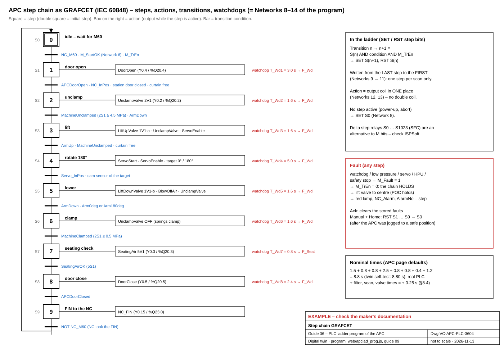
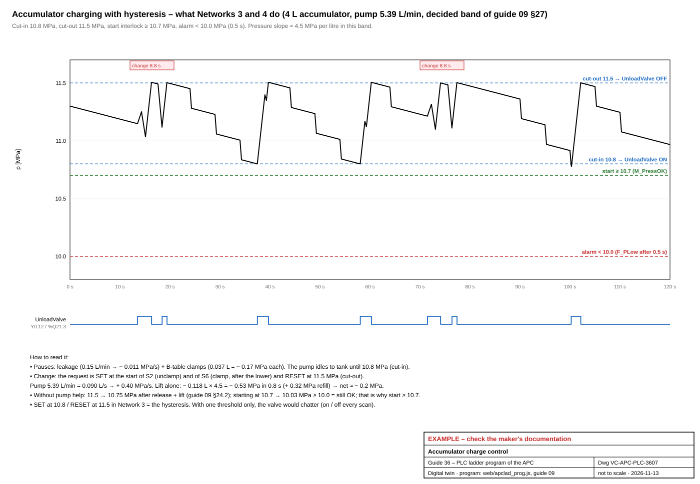
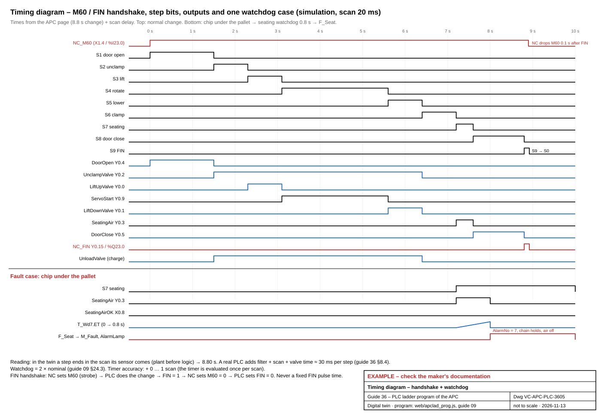
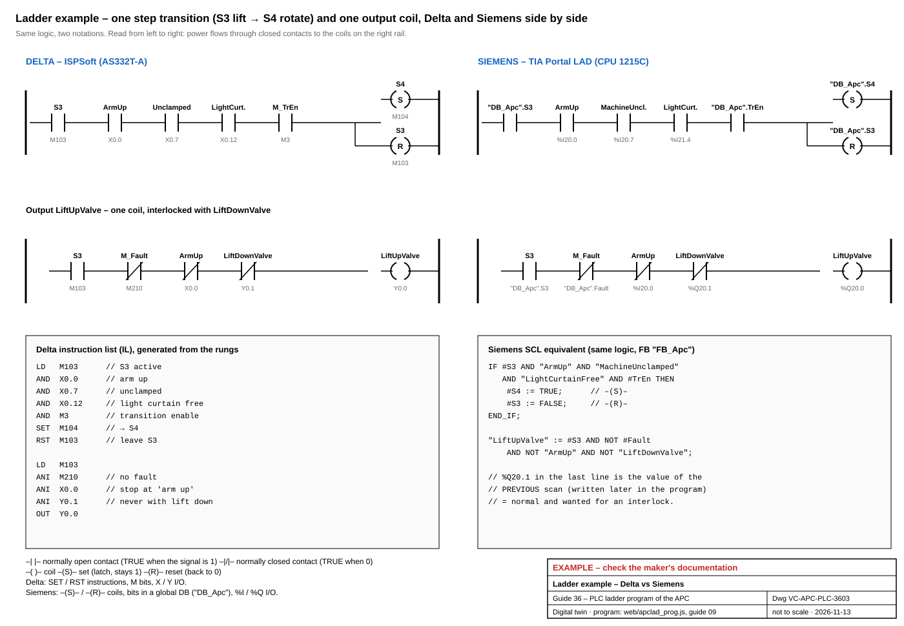
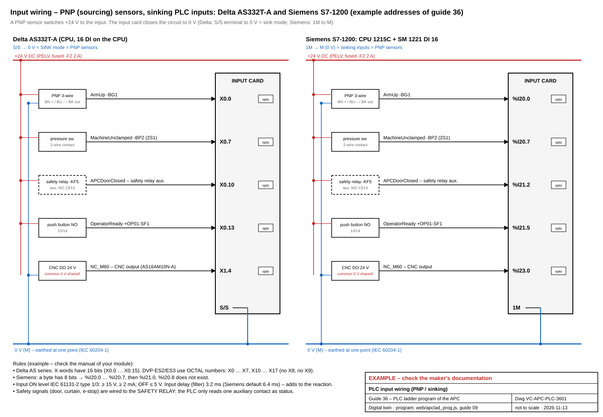
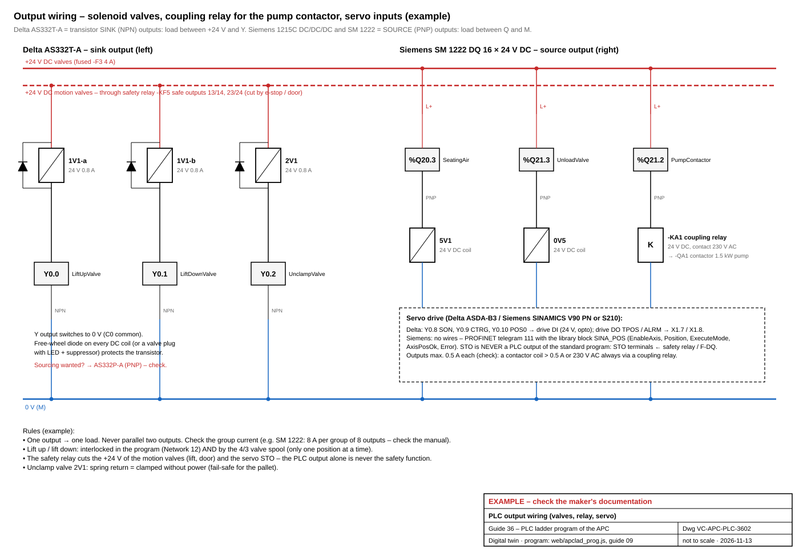
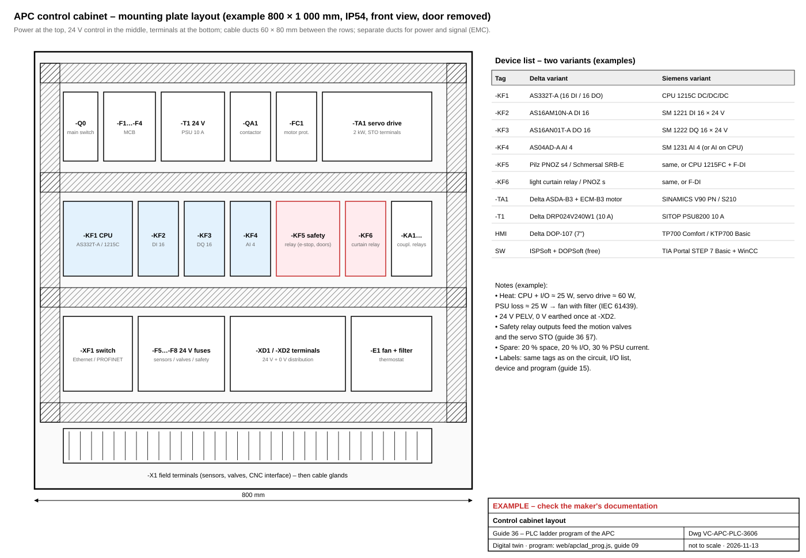

# 36 – PLC ladder program of the automatic pallet changer (APC) – Delta + Siemens

**Reader:** mechanical engineer who plans the compressor factory. Simple English, short sentences, tables, timing numbers with
examples. **Twin:** tab **Pallet changer**, last card "PLC ladder program – Delta + Siemens side by side" (`#apcLadder`,
`web/apclad.js`, program data + plant model `web/apclad_prog.js`, catalogue card `web/apclad_data.js`, shared ladder core
`web/ladder.js`). **Every address, value and part number is an example – check with your PLC configuration and the maker's
documentation.** Product names in the buy list are catalogue examples, not recommendations; prices are "estimate – ask for a quote".

**Rule (on every page and in every guide):** the standard ladder program **never does the safety function itself** – e-stop,
guard locking, light curtain, safe torque off (STO), safe speed. That is the **safety relay** or the **F-program**
(ISO 13849-1, IEC 62061, IEC 60204-1 §9.4). The standard program only **reads** the status and reacts (message, hold the chain).

Related guides: 05 (PLC control basics of the plant), 09 (APC design – the machine this program controls; decided 2026-11-12:
lift Ø50/28 at 10 MPa, accumulator band 10.0 / 10.8 / 11.5 MPa), 15 (tags, numbering, alarms), 24 (control circuits), 25 + 29 + 30
(hydraulics), 35 (ladder basics + AS/RS ladder – the textbook part: scan cycle, contacts, coils, seal-in, edges, timers, counters),
37 (hydraulic power unit ladder).

## Contents

0. [How to use the page](#0-how-to-use-the-page)
1. [Purpose and what this guide gives you](#1-purpose-and-what-this-guide-gives-you)
2. [The machine in one minute](#2-the-machine-in-one-minute)
3. [Which PLC – Delta AS300 or Siemens S7-1200](#3-which-plc--delta-as300-or-siemens-s7-1200)
4. [Program structure – 18 networks](#4-program-structure--18-networks)
5. [I/O list with wiring and internal memory](#5-io-list-with-wiring-and-internal-memory)
6. [Safety – what the program does NOT do](#6-safety--what-the-program-does-not-do)
7. [Step chain technique with SET / RST](#7-step-chain-technique-with-set--rst)
8. [Timing calculations](#8-timing-calculations)
9. [Accumulator charge control and pressure interlocks](#9-accumulator-charge-control-and-pressure-interlocks)
10. [Handshake with the CNC (M60 / FIN)](#10-handshake-with-the-cnc-m60--fin)
11. [Faults, watchdogs, acknowledge and recovery](#11-faults-watchdogs-acknowledge-and-recovery)
12. [Full program listing – Delta + Siemens](#12-full-program-listing--delta--siemens)
13. [Siemens implementation notes (TIA Portal)](#13-siemens-implementation-notes-tia-portal)
14. [Delta implementation notes (ISPSoft)](#14-delta-implementation-notes-ispsoft)
15. [Wiring and control cabinet](#15-wiring-and-control-cabinet)
16. [Commissioning – I/O check and step-by-step test](#16-commissioning--io-check-and-step-by-step-test)
17. [Typical mistakes](#17-typical-mistakes)
18. [Self-test of the page and verified numbers](#18-self-test-of-the-page-and-verified-numbers)
19. [Buy list – catalogue examples](#19-buy-list--catalogue-examples)
20. [Standards](#20-standards)
21. [Questions for the suppliers](#21-questions-for-the-suppliers)
22. [Glossary](#22-glossary)
23. [Drawings of this guide](#23-drawings-of-this-guide)
24. [Next to read](#24-next-to-read)

---

## 0. How to use the page

Open the tab **Pallet changer** (deep link `/#apc`) and scroll to the last card **"PLC ladder program – Delta + Siemens side by
side"**. The card is built the first time you open the tab (it does not slow down the other tabs).

| Part of the card | What it does |
|---|---|
| Header | Which PLCs (Delta AS332T-A with ISPSoft, Siemens CPU 1215C with TIA Portal V19), how to read LAD, the safety rule |
| View switch **Delta / Siemens / both** | Shows the address under each contact and coil: `X0.0`, `M103`, `T1` with `TMR T1 K30` – or `%I20.0`, `"DB_Apc".S3`, `"DB_T_Wd1" TON PT T#3S` – or both columns |
| Run / Stop / Single scan / Reset | Runs the program like a PLC: every scan (20 ms in the twin) the plant model moves the APC, then all 18 networks are solved from top to bottom |
| Input panel | Buttons and switches for the "I" tags (e.g. `NC_M60`, `S_Ack`, `LightCurtainFree`), sliders for `AccuPressure` and `OilTemp` |
| Live ladder | 18 networks, each with a title and a "why" comment. Green = energised path / TRUE, grey = FALSE |
| I/O table | Tag, Delta address, Siemens address, meaning, wiring |
| Delta instruction list | LD / AND / OR / ANB / ORB / OUT / SET / RST / TMR / CNT / MOV, generated from the rungs |
| APC status strip | Step number, door, lift, arm angle, clamp state, accumulator pressure, change time of the last change |
| Fault buttons (simulation) | "Chip under the pallet", "Arm-up sensor broken", "Break light curtain", "Pump trip" – to see the watchdogs and alarms work |
| Siemens notes | DB structure, FB / FC split, OB1 / OB100 / OB35, SCL of the step chain |
| Real components + drawings | Catalogue card (`ldCardB`): the 7 drawings of this guide and the buy list of §19 |

**Work order to learn the program (10 minutes):**

1. Press **Run**. After ≈ 0.2 s the pump is on (`PumpContactor`), `PumpMotorOK` comes, Network 6 is not yet TRUE because the
   load station is not READY.
2. Press **OperatorReady** (Network 5): the green station lamp comes on, `M_StartOK` turns green.
3. Switch **NC_M60** on (the NC asks for a pallet change). Watch the step bits S1 … S9 run: door open 1.5 s, unclamp 0.8 s,
   lift 0.8 s, rotate 2.5 s, lower 0.8 s, clamp 0.8 s, seating 0.4 s, door close 1.2 s, FIN. The simulated NC switches M60 off
   0.1 s after FIN, the chain goes back to S0. The status strip shows the measured change time (8.80 s in the twin, §8.4).
4. Press **Chip under the pallet**, then OperatorReady and M60 again: step 7 waits, after 0.8 s `F_Seat` is set, `AlarmNo` = 7,
   the red lamp is on. Remove the chip, press **S_Ack**: the fault clears and the chain goes on (the sensor now comes).
5. Drag the **AccuPressure** slider to 10.5 MPa (dragging forces the value, double-click releases it to the plant model): `M_PressOK` is FALSE, the M60 waits, after 2 s
   `M_NoStartMsg` tells the operator why. Below 10.0 MPa for 0.5 s → `F_PLow`.
6. Switch to **Siemens** view and compare the same rung. Open the **Delta instruction list** for Network 10 and find `ANB` / `ORB`.

Test parameter: `/?ladBtest#apc` runs the self-test of §18 and writes `LADBTEST …` lines to the browser console.

---

## 1. Purpose and what this guide gives you

The APC page (guide 09) designs the machine: lift cylinder, servo, zero-point modules, accumulator. It also lists the step chain
(table "Step chain (PLC sequence) with sensors and interlocks") and the I/O. This guide turns that table into a **complete PLC
program** that a controls engineer can type into ISPSoft or TIA Portal, and that you, as the mechanical engineer, can **read and
check**:

* the **sequence is exactly** the page sequence: M60 → door open → unclamp → lift → rotate 180° → lower → clamp → seating check
  → door close → FIN;
* every **interlock** of the page and of guide 09 §24.2 is in the program, with the decided numbers (≥ 10.7 MPa start,
  < 10.0 MPa alarm, oil ≥ 20 °C);
* every **step has a watchdog** of 2 × nominal time (guide 09 §24.3) and a clear alarm number;
* the hydraulic unit is controlled the way the hydraulic design needs (cut-in 10.8 / cut-out 11.5 MPa);
* it is written **twice** – Delta and Siemens – with the same tag names, so you can compare offers from both worlds.

What this guide is **not**: a certified safety design, a tested PLC project file, or a replacement for the documentation of the
CNC builder (the M-code interface differs between Fanuc, Siemens SINUMERIK, Heidenhain, Mitsubishi …).

---

## 2. The machine in one minute

Two pallets sit on a rotating arm between the machine table (inside the HMC) and the load station (operator side). To change:
the arm lifts both pallets out of their receivers, turns 180° and puts them down again. In the machine the pallet is held by
4 spring-clamped zero-point modules that are opened with oil (5 MPa). One hydraulic power unit (HPU) with a 4 L accumulator
supplies the lift, the modules and the B-table clamp.

| Step | Action (page table) | PLC output | Step is done when | Interlock | Time (page) | Watchdog |
|---|---|---|---|---|---|---|
| 0 | NC calls the change (M60) | – | M60 AND all start conditions | spindle home, coolant off, §24.2 list | – | (2 s message) |
| 1 | Axes to change position, door open | DoorOpen Y0.4 / %Q20.4 | APCDoorOpen + NC_InPos | station door closed, curtain free | 1.5 s | 3.0 s |
| 2 | Unclamp the pallet | UnclampValve Y0.2 / %Q20.2 | MachineUnclamped (2S1 ≥ 4.5 MPa) | arm down, both pallets present | 0.8 s | 1.6 s |
| 3 | Lift the arm | LiftUpValve Y0.0 / %Q20.0 | ArmUp | unclamped, curtain free | 0.8 s | 1.6 s |
| 4 | Rotate 180° | ServoEnable + ServoStart (target 0° / 180°) | Servo_InPos + cam sensor of the target | arm up, STO not active | 2.5 s | 5.0 s |
| 5 | Lower the arm | LiftDownValve Y0.1 / %Q20.1 | ArmDown + at 0° or 180° | position sensor OK | 0.8 s | 1.6 s |
| 6 | Clamp the new pallet | UnclampValve OFF | MachineClamped (2S1 ≤ 0.5 MPa) | arm down | 0.8 s | 1.6 s |
| 7 | Seating check with air | SeatingAir Y0.3 / %Q20.3 | SeatingAirOK (5S1) | else alarm "pallet seating" | 0.4 s | 0.8 s |
| 8 | Close door, FIN | DoorClose Y0.5 / %Q20.5 | APCDoorClosed | – | 1.2 s | 2.4 s |
| 9 | FIN to the NC | NC_FIN Y0.15 / %Q23.0 | NC switches M60 off | – | ≈ 0.1 s | – |

Sum of the nominal times: 1.5 + 0.8 + 0.8 + 2.5 + 0.8 + 0.8 + 0.4 + 1.2 = **8.8 s** (the APC page value, used in the twin).

Hydraulic numbers the program needs (guide 09 §27, decided 2026-11-12):

| Value | Number | Used in |
|---|---|---|
| lowest working pressure | 10.0 MPa | alarm `F_PLow` (Network 4) |
| start interlock | ≥ 10.7 MPa | `M_PressOK` (Network 4) → start condition (Network 6) |
| cut-in (pump loads) | < 10.8 MPa | SET `M_Charge` (Network 3) |
| cut-out (pump unloads) | ≥ 11.5 MPa | RST `M_Charge` (Network 3) |
| real lifted mass needs | 9.4 MPa | plant model: the lift stalls below 9.4 MPa |
| module release | 5.0 MPa (reducer 2V2), switch 2S1 ≥ 4.5 / ≤ 0.5 MPa | `MachineUnclamped` / `MachineClamped` |
| oil temperature for start | ≥ 20 °C | `M_OilWarm` (Network 4) |
| relief valve | 13.0 MPa | plant model limit |

---

## 3. Which PLC – Delta AS300 or Siemens S7-1200

Both are good for one APC. The table helps you to compare offers.

| Point | Delta AS332T-A (AS300 series) | Siemens CPU 1215C DC/DC/DC (S7-1200) |
|---|---|---|
| On-board I/O | 16 DI + 16 DO (transistor, **sink / NPN** outputs – AS332P-A = source / PNP, check) | 14 DI + 10 DQ (transistor, source / PNP) + 2 AI + 2 AQ |
| Expansion used here | AS16AM10N-A (16 DI), AS16AN01T-A (16 DO), AS04AD-A (4 AI) | SM 1221 DI 16, SM 1222 DQ 16, (SM 1231 AI 4 if more AI needed); addresses as on the APC page (%I20.0 …) |
| Address style | X0.0 … X0.15 (word.bit, 16 bits per word) | %I20.0 … %I20.7 (byte.bit, **8 bits per byte**) |
| Program memory / speed | ≈ 128 k steps, ≈ 25 ns per basic instruction (check) | 125 kB work memory, ≈ 0.08 µs per bit instruction (check) |
| Communication | Ethernet (Modbus TCP, EtherNet/IP), RS-485, CANopen card | PROFINET (2 ports), Modbus TCP, OPC UA server (firmware ≥ V4.4) |
| Servo coupling | pulse train or DI/DO (CTRG + POS bits) to ASDA drives, or DMCNET / EtherCAT with motion CPUs | PROFINET telegram 111 + library block `SINA_POS` (SINAMICS V90 PN / S210) |
| Safety | external safety relay (Pilz PNOZ, Schmersal SRB-E, Phoenix PSRmini) or PNOZmulti 2 | external safety relay, or **CPU 1215FC** with F-DI / F-DQ and an F-program |
| Software | **ISPSoft** (free download) + DOPSoft for the HMI | **TIA Portal STEP 7 Basic** (licence) + WinCC Basic; STEP 7 Professional for S7-1500 |
| Typical price class | low | low – medium |

**Small option:** a Delta **DVP-ES3** or **DVP-ES2** (e.g. DVP32ES311T) also runs this program. Its inputs are numbered in
**octal**: X0 … X7, X10 … X17, X20 … – there is no X8 and no X9. The tag names stay the same; only the addresses change (§14.5).

**I/O count of the APC (this program):** 32 DI (19 APC / HPU signals incl. safety status, 3 CNC signals, 2 servo signals,
8 panel signals), 17 DQ, 2 AI. With 20 % reserve: ≈ 39 DI, 21 DQ, 3 AI.

| | Delta | Siemens |
|---|---|---|
| DI | CPU 16 (X0.0 … X0.15) + AS16AM10N-A 16 (X1.0 … X1.15) = 32 = **full** → add a 2nd DI module for the reserve | 3 × SM 1221 DI 16 at start addresses 20 / 22 / 24 (%I20.0 … %I25.7); the 14 on-board DI stay as reserve |
| DQ | CPU 16 (Y0.0 … Y0.15) + AS16AN01T-A (Y1.0 …) | 2 × SM 1222 DQ 16 (%Q20.0 … %Q23.7) |
| AI | AS04AD-A, 4 channels (D100, D101 …) | 2 on-board AI are 0–10 V only → SM 1231 AI 4 for 4–20 mA (%IW64, %IW66) |
| Servo | 3 DO + 2 DI wired to the ASDA drive | no wires: `SINA_POS` over PROFINET; the bits %Q25.x / %I25.x of this guide stand for its parameters (map them to `"DB_Apc"` in a real project) |

The F-signals (doors, curtain, e-stop) go to the safety relay, not to the standard inputs; the PLC reads only one auxiliary
contact per safety function as status.

---

## 4. Program structure – 18 networks

The program is one block (Delta: one POU "APC_Main" in ISPSoft; Siemens: one FB `"FB_Apc"` called from OB1 with its instance
data, or – as written here for easy reading – one FC with the global DB `"DB_Apc"`). The networks are solved from top to bottom
in every scan.

| # | Network | What it does | Main tags |
|---|---|---|---|
| 1 | Operating modes | auto / manual / single step | M_Auto, M_Manual, M_StepMode |
| 2 | Hydraulic unit | pump contactor, accumulator hold valve, pump feedback fault | PumpContactor, AccuHold, F_Hyd |
| 3 | Accumulator charging | SET at < 10.8 MPa (and at the start of S2 / S6), RST at ≥ 11.5 MPa | M_Charge, UnloadValve |
| 4 | Pressure / oil / filter | ≥ 10.7 start, < 10.0 alarm, oil ≥ 20 °C, filter warning | M_PressOK, F_PLow, M_OilWarm |
| 5 | Load station ready | operator button with seal-in, green lamp | M_StnReady, StationLamp |
| 6 | Start conditions | all of guide 09 §24.2 in one rung; "M60 waits" message | M_StartOK, M_NoStartMsg |
| 7 | Transition enable | auto: always; single step: one scan per "Next" | M_TrEn |
| 8 | Initial step + direction | no step active → S0; 0° → turn to 180° and back | S0, M_Dir180 |
| 9 | Step chain part 1 | S9 → S0, S8 → S9, S7 → S8 (reverse order) | S7 … S9 |
| 10 | Step chain part 2 | S6 → S7, S5 → S6, S4 → S5 | S4 … S6 |
| 11 | Step chain part 3 | S3 → S4, S2 → S3, S1 → S2, S0 → S1 (start) | S0 … S3 |
| 12 | Outputs – valves | unclamp, lift up / down (interlocked), seating air, blow-off | Y0.0 … Y0.3, Y0.13 |
| 13 | Outputs – door, servo, FIN | door open / close, servo enable / start / target, FIN | Y0.4, Y0.5, Y0.8 … Y0.10, Y0.15 |
| 14 | Watchdogs | one TON per step, 2 × nominal → F_Wd / F_Seat + AlarmNo | T_Wd1 … T_Wd8 |
| 15 | Safety status + drive fault | curtain / door / e-stop opened during S3 … S5 → F_Safety; servo fault | F_Safety, F_Servo |
| 16 | Alarm sum + acknowledge | M_Fault, red lamp, NC alarm; Ack resets stored faults | M_Fault, AlarmLamp, NC_Alarm |
| 17 | Manual abort | manual + Home → reset all step bits | S1 … S9 |
| 18 | Counters + HMI word | changes, faults, step number | C_Changes, C_Faults, StepNo |

**Why this order?** Inputs and modes first (1–7), then the step chain (8–11), then the outputs (12–13), then supervision
(14–18). A coil written in Network 12 is read by Network 6 in the **next** scan – that delay of one scan (≤ 20 ms) is normal.

**Program organisation in the PLC (equivalents):**

| Job | Siemens | Delta AS300 |
|---|---|---|
| Cyclic program | OB1 "Main" calls `"FB_Apc"` | cyclic task with POU "APC_Main" (ISPSoft "Cyclic" task) |
| Start-up (first scan) | OB100 "Startup": clear step bits, `"DB_Apc".S0 := TRUE` | first-scan flag **M1002** (ON for one scan) or the "no step active → SET S0" rung of Network 8 (used here, works for both) |
| Time interrupt (fixed cycle) | OB30 … OB38 (e.g. OB35 every 100 ms) – used for the pressure trend logging, not needed for the sequence | timer interrupt task (e.g. I-task every 10 ms) – not needed here |
| Error OBs | OB82 (diagnostic, e.g. wire break 0B2), OB86 (rack / station failure), OB121 (programming error) | error flags SM / SR registers; ISPSoft "Error" log |
| Data | global DB `"DB_Apc"` (step bits, faults, StepNo), instance DBs for IEC timers / counters | M bits, T, C, D registers (non-retentive / latched ranges set in the HW configuration) |

---

## 5. I/O list with wiring and internal memory

### 5.1 Inputs, outputs and analog values

The Siemens addresses are the ones of the APC page (guide 09 §4.11 + §24.4, signal modules with start address 20). The CNC
interface (%I23.x / %Q23.x), the panel (%I24.x) and the servo bits (%I25.x / %Q25.x) are additions of this guide. Delta
addresses: CPU X0.0 … X0.15 / Y0.0 … Y0.15, then the first DI module X1.x and the first DO module Y1.x. **Examples – your
hardware configuration decides.**

| Tag | Type | Delta AS332T-A | Siemens CPU 1215C | Meaning | Wiring / device |
|---|---|---|---|---|---|
| ArmUp | I | X0.0 | %I20.0 | Arm up – inductive sensor -BG1 | -BG1 PNP, M12, Sn 4 mm |
| ArmDown | I | X0.1 | %I20.1 | Arm down – inductive sensor -BG2 | -BG2 PNP, M12 |
| Arm0deg | I | X0.2 | %I20.2 | Arm at 0° – sensor -BG3 on the rotor cam | -BG3 PNP, M12 |
| Arm180deg | I | X0.3 | %I20.3 | Arm at 180° – sensor -BG4 on the rotor cam | -BG4 PNP, M12 |
| PalletInMachine | I | X0.4 | %I20.4 | Pallet present on the machine table | -BG5 PNP, M18 |
| PalletAtStation | I | X0.5 | %I20.5 | Pallet present at the load station | -BG6 PNP, M18 |
| MachineClamped | I | X0.6 | %I20.6 | Zero-point modules clamped – 2S1 ≤ 0.5 MPa (vented) | -BP1 (2S1 out 2) |
| MachineUnclamped | I | X0.7 | %I20.7 | Zero-point modules open – 2S1 ≥ 4.5 MPa | -BP2 (2S1 out 1) |
| SeatingAirOK | I | X0.8 | %I21.0 | Seating check OK – air pressure switch 5S1 (gap < 0.02 mm) | -BP3 (5S1) |
| APCDoorOpen | I | X0.9 | %I21.1 | APC door open – limit switch | -BG7 |
| APCDoorClosed | I | X0.10 | %I21.2 | APC door closed + locked (status from the safety relay / F-DI) | safety relay -KF5 aux. 13/14 |
| StationDoorClosed | I | X0.11 | %I21.3 | Load-station door closed (status from the safety relay / F-DI) | -KF5 aux. 23/24 |
| LightCurtainFree | I | X0.12 | %I21.4 | Light curtain free (OSSD status via the safety relay) | -KF6 aux. 13/14 |
| OperatorReady | I | X0.13 | %I21.5 | Operator 'pallet ready' push button (NO) at the load station | +OP01-SF1 13/14 |
| PalletSeatedStation | I | X0.14 | %I21.6 | Pallet seated at the load station (station air check) | -BP4 |
| PumpMotorOK | I | X0.15 | %I21.7 | Pump motor running – aux. contact of -QA1 / motor protection -FC1 | -QA1 13/14 |
| OilLevelOK | I | X1.0 | %I22.0 | Oil level OK – level switch -BL1 (NC = OK, wire-break safe) | -BL1 |
| FilterClogged | I | X1.1 | %I22.1 | Return filter 0Z1 clogged (warning) | 0Z1 switch |
| SafetyOK | I | X1.3 | %I22.3 | E-stop chain + safety relay OK (status only – the relay does the safety) | -KF5 aux. 33/34 |
| NC_M60 | I | X1.4 | %I23.0 | NC → PLC: M60 pallet change request (M-code strobe) | CNC DO, 24 V |
| NC_InPos | I | X1.5 | %I23.1 | NC → PLC: axes at change position, B = 0° | CNC DO |
| NC_SpindleHome | I | X1.6 | %I23.2 | NC → PLC: spindle stopped + oriented (M19), tool retracted, coolant off | CNC DO |
| Servo_InPos | I | X1.7 | %I25.0 | Servo in position (Delta ASDA DO TPOS / Siemens SINA_POS.AxisPosOk) | -TA1 DO1 |
| Servo_Fault | I | X1.8 | %I25.1 | Servo drive fault (Delta ASDA DO ALRM / Siemens SINA_POS.Error) | -TA1 DO5 |
| S_Auto | I | X1.9 | %I24.0 | Mode switch: 1 = automatic, 0 = manual | +OP01-SF2 key switch |
| S_Step | I | X1.10 | %I24.1 | Single-step mode switch (commissioning / recovery) | +OP01-SF3 |
| S_Next | I | X1.11 | %I24.2 | Next step push button (single-step mode) | +OP01-SF4 |
| S_Ack | I | X1.12 | %I24.3 | Alarm acknowledge / reset push button | +OP01-SF5 |
| S_Home | I | X1.13 | %I24.4 | Abort the sequence (manual mode) – back to step 0 | +OP01-SF6 |
| S_JogUp | I | X1.14 | %I24.5 | Manual: jog lift up (hold) | +OP01-SF7 |
| S_JogDown | I | X1.15 | %I24.6 | Manual: jog lift down (hold) | +OP01-SF8 |
| S_CntReset | I | X1.2 | %I24.7 | Key switch: reset the counters (maintenance) | +OP01-SF9 |
| AccuPressure | AI | D100 (AS04AD-A ch1) | %IW64 | Accumulator pressure 0B2, 0–16 MPa = 4–20 mA (Delta raw 0–32000, Siemens 0–27648) | 0B2 transmitter, 2-wire |
| OilTemp | AI | D101 (AS04AD-A ch2) | %IW66 | Oil temperature in the tank, PT100 → 4–20 mA 0–100 °C | -BT1 |
| LiftUpValve | Q | Y0.0 | %Q20.0 | Lift up – 4/3 valve 1V1 solenoid a | 1V1-a 24 V DC, LED + diode |
| LiftDownValve | Q | Y0.1 | %Q20.1 | Lift down – 4/3 valve 1V1 solenoid b | 1V1-b 24 V DC |
| UnclampValve | Q | Y0.2 | %Q20.2 | Unclamp – 3/2 valve 2V1 (oil → zero-point modules = open) | 2V1 24 V DC |
| SeatingAir | Q | Y0.3 | %Q20.3 | Seating-check air – 3/2 valve 5V1 | 5V1 24 V DC |
| DoorOpen | Q | Y0.4 | %Q20.4 | APC door drive – open | door drive DI1 |
| DoorClose | Q | Y0.5 | %Q20.5 | APC door drive – close | door drive DI2 |
| StationLamp | Q | Y0.6 | %Q21.1 | Load station green lamp: pallet ready, do not enter | stack light green |
| AlarmLamp | Q | Y0.7 | %Q21.6 | Red lamp + buzzer: APC alarm | stack light red |
| ServoEnable | Q | Y0.8 | %Q25.0 | Servo ON (Delta ASDA DI SON / Siemens SINA_POS.EnableAxis) | -TA1 DI1 |
| ServoStart | Q | Y0.9 | %Q25.1 | Start positioning (Delta ASDA DI CTRG / Siemens SINA_POS.ExecuteMode) | -TA1 DI2 |
| ServoTo180 | Q | Y0.10 | %Q25.2 | Target select: 1 = 180°, 0 = 0° (Delta ASDA DI POS0 / Siemens Position) | -TA1 DI3 |
| PumpContactor | Q | Y0.11 | %Q21.2 | Pump motor contactor -QA1 (1.5 kW) | -QA1 A1/A2 via coupling relay |
| UnloadValve | Q | Y0.12 | %Q21.3 | Unloading valve 0V5: energised = pump loads the accumulator | 0V5 24 V DC |
| BlowOffAir | Q | Y0.13 | %Q21.4 | Blow-off air: cleans the receiver cones while the arm lowers | 5V2 24 V DC |
| AccuHold | Q | Y0.14 | %Q21.5 | Accumulator hold valve: energised = closed, off = drains (ISO 4413) | 0V3 solenoid |
| NC_FIN | Q | Y0.15 | %Q23.0 | PLC → NC: FIN (M60 finished) | CNC DI |
| NC_Alarm | Q | Y1.0 | %Q23.1 | PLC → NC: APC alarm (NC feed hold / message) | CNC DI |


**Wiring notes for the inputs:** all sensors are PNP (sourcing), 3-wire, 24 V DC. The pressure switches 2S1 have two outputs
(≥ 4.5 MPa "unclamped", ≤ 0.5 MPa "vented / clamped"); between 0.5 and 4.5 MPa **both are FALSE** – that is the "moving" state
and the reason why the program checks both signals. The oil level switch is wired **NC = OK**: a broken wire looks like "level
low" and stops the pump (wire-break safe). The analog transmitter 0B2 (4–20 mA) gives < 3.6 mA on a wire break – the
program then reads ≈ 0 MPa → `F_PLow` → no pallet change (safe direction).

### 5.2 Internal bits, timers, counters, words

| Tag | Type | Delta | Siemens | Meaning | Value |
|---|---|---|---|---|---|
| M_Auto | M | M0 | "DB_Apc".Auto | Automatic mode active |  |
| M_Manual | M | M1 | "DB_Apc".Manual | Manual mode active |  |
| M_StepMode | M | M2 | "DB_Apc".StepMode | Single-step mode (each step waits for 'Next') |  |
| M_TrEn | M | M3 | "DB_Apc".TrEn | Transition enable: auto running, or 'Next' pressed in single-step mode |  |
| M_Charge | M | M10 | "DB_Apc".Charge | Accumulator charging (hysteresis 10.8 / 11.5 MPa) |  |
| M_PressOK | M | M11 | "DB_Apc".PressOK | Accumulator ≥ 10.7 MPa = start allowed |  |
| M_OilWarm | M | M12 | "DB_Apc".OilWarm | Oil ≥ 20 °C |  |
| M_FilterWarn | M | M13 | "DB_Apc".FilterWarn | Warning: filter clogged (change in the next stop) |  |
| M_StnReady | M | M14 | "DB_Apc".StnReady | Load station ready (pallet seated + operator pressed 'ready') |  |
| M_StartOK | M | M15 | "DB_Apc".StartOK | All start conditions of step 1 TRUE (guide 09 §24.2) |  |
| M_NoStartMsg | M | M16 | "DB_Apc".NoStartMsg | Message: M60 waits > 2 s, a start condition is missing |  |
| M_Dir180 | M | M17 | "DB_Apc".Dir180 | Rotation target 180° (arm started at 0°) |  |
| S0 | M | M100 | "DB_Apc".S0 | Step 0 – idle, wait for M60 |  |
| S1 | M | M101 | "DB_Apc".S1 | Step 1 – door open, axes at change position |  |
| S2 | M | M102 | "DB_Apc".S2 | Step 2 – unclamp |  |
| S3 | M | M103 | "DB_Apc".S3 | Step 3 – lift |  |
| S4 | M | M104 | "DB_Apc".S4 | Step 4 – rotate 180° |  |
| S5 | M | M105 | "DB_Apc".S5 | Step 5 – lower |  |
| S6 | M | M106 | "DB_Apc".S6 | Step 6 – clamp |  |
| S7 | M | M107 | "DB_Apc".S7 | Step 7 – seating check |  |
| S8 | M | M108 | "DB_Apc".S8 | Step 8 – door close |  |
| S9 | M | M109 | "DB_Apc".S9 | Step 9 – FIN to the NC, wait until M60 is off |  |
| F_Wd | M | M200 | "DB_Apc".F_Wd | Fault: step watchdog time-out |  |
| F_PLow | M | M201 | "DB_Apc".F_PLow | Fault: accumulator < 10.0 MPa |  |
| F_Seat | M | M202 | "DB_Apc".F_Seat | Fault: pallet seating (air check failed) |  |
| F_Servo | M | M203 | "DB_Apc".F_Servo | Fault: servo drive |  |
| F_Hyd | M | M204 | "DB_Apc".F_Hyd | Fault: hydraulic unit (oil level / pump feedback) |  |
| F_Safety | M | M205 | "DB_Apc".F_Safety | Fault: safety stop during the move (curtain / door / e-stop) |  |
| M_Fault | M | M210 | "DB_Apc".Fault | Any fault active (sum) |  |
| T_Wd1 | T | T1 | "DB_T_Wd1" (TON) | Watchdog step 1 (Axes to change position, door open): 2 × 1.5 s | PT 3 s (K30) |
| T_Wd2 | T | T2 | "DB_T_Wd2" (TON) | Watchdog step 2 (Unclamp the pallet in the machine): 2 × 0.8 s | PT 1.6 s (K16) |
| T_Wd3 | T | T3 | "DB_T_Wd3" (TON) | Watchdog step 3 (Lift the arm with both pallets): 2 × 0.8 s | PT 1.6 s (K16) |
| T_Wd4 | T | T4 | "DB_T_Wd4" (TON) | Watchdog step 4 (Rotate 180°): 2 × 2.5 s | PT 5 s (K50) |
| T_Wd5 | T | T5 | "DB_T_Wd5" (TON) | Watchdog step 5 (Lower the arm): 2 × 0.8 s | PT 1.6 s (K16) |
| T_Wd6 | T | T6 | "DB_T_Wd6" (TON) | Watchdog step 6 (Clamp the new pallet): 2 × 0.8 s | PT 1.6 s (K16) |
| T_Wd7 | T | T7 | "DB_T_Wd7" (TON) | Watchdog step 7 (Seating check with air): 2 × 0.4 s | PT 0.8 s (K8) |
| T_Wd8 | T | T8 | "DB_T_Wd8" (TON) | Watchdog step 8 (Close the door, report FIN): 2 × 1.2 s | PT 2.4 s (K24) |
| T_PLow | T | T10 | "DB_T_PLow" (TON) | Low-pressure debounce (short dips during the lift are normal) | PT 0.5 s (K5) |
| T_PumpFb | T | T11 | "DB_T_PumpFb" (TON) | Pump contactor ON but no 'motor OK' feedback | PT 1 s (K10) |
| T_NoStart | T | T12 | "DB_T_NoStart" (TON) | M60 waits for the start conditions | PT 2 s (K20) |
| C_Changes | C | C0 | "DB_C_Changes" (CTU) | Pallet changes – service of lift seals / cones at PV | PV 20000 |
| C_Faults | C | C1 | "DB_C_Faults" (CTU) | APC faults – call maintenance at PV | PV 10 |
| StepNo | W | D200 | "DB_Apc".StepNo | Active step number for the HMI |  |
| AlarmNo | W | D201 | "DB_Apc".AlarmNo | Step number where the watchdog tripped (0 = none) |  |


**Retentive or not?** Step bits, faults and `M_StnReady` are **not retentive**: after a power failure the APC starts in S0 and
the operator brings it to a known position in manual mode (§11.4). The counters `C_Changes` / `C_Faults` **are** retentive
(Delta: latched counter range set in HWCONFIG; Siemens: instance DB with "Retain" ticked) – the service plan must survive a
power failure.

---

## 6. Safety – what the program does NOT do

The APC has four hazards that can hurt a person: the **turning arm** (crushing, shearing at the partition wall), the **lift**
(crushing under the pallet), the **doors** and the **stored hydraulic energy** (accumulator 4 L at 11.5 MPa). The protection
against them is built **outside** the standard program:

| Safety function (guide 09 §25.2) | Done by | What the standard program sees |
|---|---|---|
| E-stop of APC + HMC (ISO 13850, stop category 0 / 1) | safety relay -KF5 (Delta variant) or F-program `ESTOP1` (CPU 1215FC) | `SafetyOK` (X1.3 / %I22.3) = auxiliary contact |
| Machine door guard locking (ISO 14119) | guard-locking switch + safety relay / F-DI, `SFDOOR` | `APCDoorClosed` (X0.10 / %I21.2) |
| Load-station door + light curtain (ISO 13855, type 4, 14 mm) | curtain OSSDs → safety relay -KF6 / F-DI | `StationDoorClosed`, `LightCurtainFree` |
| Safe torque off of the servo (IEC 61800-5-2) | safety relay output → STO terminals of the drive, or F-DQ %Q21.0 / PROFIsafe | `Servo_Fault` / drive status only |
| Motion valves without power | safety relay output contacts in the +24 V supply of the lift and door valves | – (the valve simply does not move) |
| Arm cannot fall (gravity) | pilot-operated check valves 1V2 (hydraulic, no electronics) | – |
| Accumulator discharge at switch-off (ISO 4413) | solenoid drain valve, de-energised = open | `AccuHold` output – the program keeps it closed only while `SafetyOK` |

**Why not in the standard program?** A standard PLC is not designed with the diagnostics, redundancy and proven software that
ISO 13849-1 asks for PL d. A single program bug, a stuck output transistor or a forced bit could start a dangerous move. The
safety relay (or the F-program, which runs in a separate, certified part of an F-CPU with its own checks) is the only thing that
may say "the person is safe". The standard program **only reacts**: in Network 15 it notices that the curtain or a door opened
during steps 3 – 5, stores `F_Safety` and holds the chain, so that the operator gets a clear message and the sequence does not
continue by surprise when the curtain is free again.

**What the program must still do right (because it touches safety indirectly):**

* never start a move after a safety stop by itself → `F_Safety` is stored and needs **Ack**;
* keep the lift valves de-energised after a fault (valve centre, the check valves hold);
* never use a standard output for STO or for guard unlocking;
* treat `SafetyOK` as a **condition for the pump and AccuHold** (Network 2), so that an e-stop also discharges the accumulator.

---

## 7. Step chain technique with SET / RST



### 7.1 One bit per step

Each step has one memory bit: S0 … S9 (Delta M100 … M109, Siemens `"DB_Apc".S0` … `.S9`). Exactly **one** bit is TRUE at a
time. A transition is one rung:

```
S(n) AND condition(n) AND M_TrEn   →   SET S(n+1),  RST S(n)
```

The action of a step is **not** written in the transition rung; it is written once in the output networks (12, 13): e.g.
`LiftUpValve = S3 AND NOT M_Fault AND NOT ArmUp AND NOT LiftDownValve`. That keeps the rule "one coil per output".

### 7.2 Reverse order – one step per scan

Networks 9 – 11 write the transitions **from the last step to the first** (S9 → S0 first, S0 → S1 last). Why: if S2 → S3 were
written before S3 → S4, and both conditions were already TRUE in the same scan (e.g. a sensor stuck at 1), the chain would jump
two steps in one scan and the output of S3 would never be written. In reverse order, the newly set step is only looked at in the
next scan. It also makes single-step mode clean: one press of "Next" = exactly one step.

### 7.3 Transition enable `M_TrEn`

Network 7: `M_TrEn = ((M_Auto AND NOT M_StepMode) OR (M_StepMode AND rising edge of S_Next)) AND NOT M_Fault`.
Every transition contains `M_TrEn`. One bit therefore gives you automatic mode, single-step mode and "hold on fault".
Exception: S9 → S0 does not need `M_TrEn` – the FIN handshake must always finish.

### 7.4 Initial step

Network 8 sets S0 when **no** step bit is TRUE. That happens after power-on (non-retentive bits are 0), after OB100 / M1002, and
after the manual abort of Network 17. You do not need a separate first-scan rung (but you may add one – OB100 in Siemens).

### 7.5 Comparison with other ways to write a sequence

| Method | Where | + | – |
|---|---|---|---|
| SET / RST step bits (this guide) | every PLC, LAD | readable for maintenance, same in Delta and Siemens | many rungs; discipline needed (one coil per output) |
| Step number in a word + compare (`StepNo = 3`) | LAD / SCL | one word shows the step, easy HMI | a compare contact in every rung |
| CASE state machine in SCL / ST | Siemens SCL, Delta ST (ISPSoft) | short, easy to extend (§13.4) | maintenance staff must read text |
| SFC / S7-GRAPH | Siemens S7-GRAPH (S7-1500, not S7-1200), Delta SFC with step relays S | graphic, built-in step timers and supervision | licence / CPU limits, less portable |

---

## 8. Timing calculations

### 8.1 Scan time

The PLC repeats: read inputs → solve all networks → write outputs → communication. One round = one **scan**.

| PLC | Instruction time (data sheet, check) | This program | Typical scan |
|---|---|---|---|
| Delta AS332T-A | ≈ 25 ns per LD / AND | 67 rungs, ≈ 340 IL lines → ≈ 0.01 ms logic | ≈ 0.5 – 1 ms (incl. I/O + communication) |
| Siemens CPU 1215C | ≈ 0.08 µs per bit instruction, ≈ 1.7 µs per REAL compare | ≈ 0.05 ms logic | ≈ 1 – 3 ms (OS, PROFINET, HMI) |
| Twin (`ladder.js`) | – | same networks | 20 ms (fixed, `scanMs: 20`) |

The twin uses 20 ms so you can see the green paths move; a real PLC is about 10 × faster. All conclusions below hold for both.

### 8.2 Reaction time sensor → valve

Example: the "arm up" sensor switches, how long until the lift valve is off?

```
t_reaction = t_input_filter + 2 × t_scan (worst case) + t_output + t_valve_off
           = 3.2 ms + 2 × 2 ms + 0.5 ms + 25 ms  ≈ 33 ms         (Siemens default filter 6.4 ms → ≈ 36 ms)
```

During the lift the cylinder moves 60 mm in 0.8 s. With a triangular speed profile the peak speed is
`v_peak = 2 · s / t = 2 · 60 / 0.8 = 150 mm/s`. In 33 ms the cylinder moves `150 · 0.033 ≈ 5 mm`. **Conclusion:** the sensor must
**not** be the end stop. The cylinder runs to its mechanical end with end cushioning (guide 09 §20.3); the sensor only confirms
"arrived". The same is true for the rotation: the **servo drive** stops the arm at 180° itself (position control inside the drive,
1 ms cycle); the PLC only starts the move and waits for "in position".

### 8.3 Timer accuracy

A TON in the program is checked once per scan, so the real time is between `PT` and `PT + 1 scan`:

```
T_Wd7: PT = 0.8 s,  scan 20 ms  →  0.80 … 0.82 s   (twin)
                     scan 2 ms   →  0.800 … 0.802 s (real CPU)
```

Delta timers T0 – T199 count in **100 ms** steps: `TMR T7 K8` = 8 × 0.1 s = 0.8 s. A value that is not a multiple of 0.1 s
must be rounded (or use a 10 ms timer – check the timer ranges of your CPU). Siemens IEC timers count in ms (`PT := T#800MS`).

### 8.4 Change time – nominal vs simulated vs real

In the twin the plant model runs **before** the logic in every scan: the sensor that ends a step and the transition to the next
step fall in the **same** scan, and the next output moves the plant from the next scan on. The self-test measures:

```
twin (scan 20 ms):  S1 → S9 = 1.50 + 0.80 + 0.80 + 2.50 + 0.80 + 0.80 + 0.40 + 1.20 = 8.80 s  (exactly the page value)
                    M60 → S1 = 0.02 s (1 scan), FIN → M60 off → S0 = 0.10 s (simulated NC)
```

A real PLC reads the inputs at the start of the scan and writes the outputs at the end, and the real devices have delays. Per
step add the reaction chain of §8.2:

```
t_change,real ≈ 8.8 s + 8 × (t_filter + 1…2 × t_scan + t_valve)
             ≈ 8.8 s + 8 × (3.2 + 2…4 + 25 ms) ≈ 8.8 s + 0.24 … 0.26 s ≈ 9.05 s
```

Plus the door drive and servo ramps if they are slower than the page values. **Measure the change time at commissioning** and
use the measured value in the twin ("Use in twin", guide 09 §2.4).

### 8.5 Debounce and filter

* **Contact bounce** of a push button: 1 – 5 ms. The input filter (3.2 / 6.4 ms) removes most of it; the edge contact
  (`P` / LDP) makes sure one press = one action (`OperatorReady`, `S_Next`, `S_Ack`, `S_Home`).
* **Pressure switch near its threshold:** oil pressure has ripples (pump, valve switching). A pressure switch at 4.5 MPa can
  chatter for some ms when the pressure passes slowly. In this program the step only waits for TRUE, so a short chatter does
  no harm. Where a short FALSE would cause an alarm, use a TON (on-delay) – example `T_PLow` 0.5 s on the analog low-pressure
  alarm: the dip during the lift (≈ − 0.5 MPa for 0.8 s, then refilled) must not trip the alarm unless it stays below 10.0 MPa.
* **Rule of thumb:** debounce time ≥ 5 × the length of the disturbance, but ≤ 1/4 of the watchdog of the step.

### 8.6 How to set a watchdog

```
watchdog = 2 × nominal time    (guide 09 §24.3)
check 1: watchdog ≥ worst normal time   (cold oil 20 °C, lowest pressure 10.7 MPa, worn seals) + 2 × scan
check 2: watchdog ≤ time after which the fault does damage or confuses the operator
```

Example step 3 (lift): nominal 0.8 s. With oil at 20 °C (viscosity ≈ 2 × the value at 40 °C) the meter-out throttle passes
somewhat less oil (orifice flow depends only a little on viscosity) → ≈ 0.9 s. 1.6 s ≥ 0.9 s + 0.04 s ✓. A stalled lift
(pressure < 9.4 MPa) is detected 1.6 s after the start of S3.

---

## 9. Accumulator charge control and pressure interlocks



### 9.1 What the networks do

```
Network 3:  AccuPressure < 10.8  OR  rising edge S2  OR  rising edge S6   →  SET M_Charge
            AccuPressure ≥ 11.5                                           →  RST M_Charge
            M_Charge AND PumpMotorOK                                      →  UnloadValve (0V5 energised = pump loads)
Network 4:  AccuPressure ≥ 10.7                                           →  M_PressOK  (start condition)
            AccuPressure < 10.0 for 0.5 s                                 →  SET F_PLow (alarm, no start)
            OilTemp ≥ 20 °C                                               →  M_OilWarm  (start condition)
```

**Hysteresis** = two thresholds: ON below 10.8, OFF at 11.5. SET and RST of one bit give it in two rungs. The RST rung is written
after the SET rung, so at ≥ 11.5 MPa the RST wins even if a SET condition is TRUE in the same scan. With one threshold only
(e.g. `UnloadValve = p < 11.5`) the valve would switch on and off every few scans at 11.5 MPa (valve wear, pressure ripple).

**Why also SET at the start of S2 and S6?** The change takes 0.165 L in 1.6 s (release + lift) and 0.081 L in the lower. Charging
at once keeps the pressure high for the next change (guide 09 §9.2 item 4: "after every movement").

### 9.2 Numbers behind the band (guide 09 §24.2, §27)

```
usable oil between 11.5 and 10.0 MPa (4 L, p0 8.99 MPa, adiabatic)   ΔV = 0.349 L
pressure slope in the band                       k ≈ 1.5 MPa / 0.349 L ≈ 4.3 MPa/L  (model: 4.5 MPa/L, steeper at fast discharge)
pump 4 cm³/rev × 1 450 rpm × 0.93                 Q = 5.39 L/min = 0.090 L/s  →  + 0.40 MPa/s
leakage (valves, rotary union)                    0.15 L/min = 0.0025 L/s   →  − 0.011 MPa/s
release + lift without pump help                  0.165 L × 4.5 = 0.74 MPa  →  11.5 → 10.75 MPa,  10.7 → 10.0 MPa (guide: 10.03)
recharge 10.8 → 11.5 MPa                          0.7 / (0.40 − 0.011) ≈ 1.8 s
pauses: leakage only 11.5 → 10.8 MPa              0.7 / 0.011 ≈ 64 s  (faster with B-table clamps: 0.037 L ≈ − 0.17 MPa each)
pump loaded time per pallet (1.51 L per 343.5 s)  1.51 / 0.090 = 16.8 s → duty ≈ 5 %
```

**Why start at ≥ 10.7 MPa and not at 10.8?** The cut-in is 10.8, so in normal running the pressure is always ≥ 10.8 – the start
is never blocked. Only if the pump fails or a leak is large does the pressure fall below 10.7 – then the release + lift (− 0.7 MPa)
could end below 10.0 MPa, where the real lifted mass (needs 9.4 MPa + losses) has no reserve. The 0.1 MPa gap between 10.7 and
10.8 avoids a start block caused only by the hysteresis.

### 9.3 Analog scaling (what the slider stands for)

The transmitter 0B2 gives 4 – 20 mA for 0 – 16 MPa. The analog card gives a number ("raw value"):

```
Siemens SM 1231 (4–20 mA):  raw 0 … 27 648   →  p = raw / 27 648 × 16 MPa
Delta AS04AD-A (4–20 mA):   raw 0 … 32 000   →  p = raw / 32 000 × 16 MPa   (check the range setting in HWCONFIG)

Example 10.7 MPa:  Siemens raw = 10.7 / 16 × 27 648 = 18 490      Delta raw = 10.7 / 16 × 32 000 = 21 400
Resolution:        16 MPa / 27 648 = 0.0006 MPa per count – far better than the transmitter accuracy (± 0.5 % FS = ± 0.08 MPa)
```

So the thresholds in the program carry ± 0.08 MPa uncertainty from the transmitter alone. That is why the band has 0.7 MPa
between start and alarm. Check the transmitter at commissioning with a test gauge at 10.0 / 10.8 / 11.5 MPa (§16).
In the twin the slider (or the plant model) gives MPa directly; the scaling rung is shown in §13.5 and §14.3.

---

## 10. Handshake with the CNC (M60 / FIN)



The NC program contains the line `M60` (pallet change; the number depends on the machine builder). The NC does not know how
the APC works; it only waits for "finished". The standard way is the **strobe / FIN handshake**:

| # | NC | APC PLC | Program |
|---|---|---|---|
| 1 | reads M60, moves the axes to the change position (B = 0°), orients the spindle (M19), sets `NC_InPos`, `NC_SpindleHome` | – | – |
| 2 | sets the strobe **M60 = 1** and waits | start conditions TRUE? → S0 → S1 | Network 6, Network 11 (S0 → S1) |
| 3 | waits | runs steps 1 – 8 | Networks 9 – 13 |
| 4 | waits | **FIN = 1** (S9) | Network 13 |
| 5 | sees FIN, sets **M60 = 0**, continues the NC program | sees M60 = 0 → S0, **FIN = 0** | Network 9 (S9 → S0) |

**Rules:**

* FIN must stay ON until the NC drops the strobe. A fixed FIN pulse (e.g. 200 ms) can be too short for a busy NC – the NC then
  hangs forever. The program therefore waits for `NOT NC_M60` in S9.
* The PLC uses the **level** of M60 (not its edge) in S0 → S1. If a start condition is missing, the change starts as soon as it
  is TRUE; after 2 s `M_NoStartMsg` tells the operator which condition (the HMI shows the bits of Network 6).
* During the change the NC must not move the axes. `NC_InPos` is checked in S1 → S2; if the NC loses it later, the CNC builder
  must keep the axes locked (in the NC/PLC of the CNC – ask the CNC builder, §21).
* If the APC alarm comes, `NC_Alarm` tells the NC (feed hold + message). The NC keeps the M60 strobe; after the repair and Ack
  the chain continues and the FIN comes normally.

**Signals at the CNC side (examples – check the CNC manual):**

| CNC | M-code strobe / code | FIN | Note |
|---|---|---|---|
| Fanuc 0i / 30i (PMC) | MF (F7.0) + M code F10 – F13 → PMC decodes M60 | FIN (G4.3) | the PMC ladder of the CNC passes M60 to a 24 V output or to the APC PLC over the network |
| Siemens SINUMERIK 828D / 840D sl | auxiliary function M60 in the NC/PLC interface (channel DB, "M fct. decoded") | read-in disable / acknowledgement in the channel DB | the APC can also run inside the SINUMERIK PLC (S7-1500 based in 840D sl / ONE) |
| Heidenhain TNC 640 | M-function strobe in the PLC (PLCdesign) | M-function acknowledged | machine builder's PLC program |
| Mitsubishi M8 | M function strobe MF1 + code | FIN1 / FIN2 | |

In this design the APC has its **own PLC** (Delta or S7-1200) and the CNC sends M60 / receives FIN over **hard-wired 24 V
signals** (3 inputs, 2 outputs) – simple, robust, and the same for every CNC brand. A network coupling (PROFINET I-device,
Ethernet/IP, Modbus TCP) is possible and saves wires, but needs a watchdog on the connection itself.

---

## 11. Faults, watchdogs, acknowledge and recovery

### 11.1 Fault list

| Fault bit | Set by (Network) | AlarmNo | Typical cause | Reaction of the program | Clear |
|---|---|---|---|---|---|
| `F_Wd` | watchdog step 1 – 6, 8 (14) | 1 – 6, 8 | sensor, valve, door drive, servo slow, pressure < 9.4 MPa | chain holds; lift valve off; unclamp off only in step 2 | Ack after the cause is gone |
| `F_Seat` | watchdog step 7 (14) | 7 | chip under the pallet, worn face, air pressure low | seating air off, no FIN | Ack, then retry, or manual: unclamp, lift, blow, lower |
| `F_PLow` | AccuPressure < 10.0 MPa for 0.5 s (4) | – | pump off / failed, big leak, transmitter wire break (< 3.6 mA) | no start; chain holds | Ack when ≥ 10.0 MPa |
| `F_Hyd` | oil level low, or pump contactor ON but no feedback 1 s (2) | – | leak, motor protection tripped | pump off (seal of F_Hyd in Network 2) | Ack after refill / reset of -FC1 |
| `F_Servo` | drive fault bit (15) | – | following error, overload, encoder | chain holds; the drive itself stops (STO / ramp) | Ack after the drive fault is reset |
| `F_Safety` | curtain / station door / e-stop opened in S3 – S5 (15) | – | person entered | chain holds (the safety relay already stopped the motion) | Ack after the area is free and the safety relay is reset |

### 11.2 Why "hold" and not "go back"?

A pallet changer in the middle of a move is in an unknown mechanical state (arm half up, pallet half on a cone). An automatic
"go back to start" can crash. The program therefore **holds** (no new output), puts the lift valve in centre (check valves hold
the arm), and waits for a person to look. That is the reaction of guide 09 §24.3.

### 11.3 Acknowledge = one retry

`S_Ack` (rising edge) resets **all** stored fault bits **and the eight step watchdog timers** in one scan (Network 16,
`RST T1 … T8` in Delta, `–(RT)–` / `RESET_TIMER` in Siemens). Effect:

* a **static** cause that is still there sets its fault again in the next scan (curtain still broken → `F_Safety`; pressure
  still < 10.0 MPa → `F_PLow` after 0.5 s; pump still tripped → `F_Hyd` after 1 s);
* a **waiting step** gets a fresh watchdog time = one retry. Example from the self-test: chip under the pallet → `F_Seat` after
  0.80 s; chip removed, Ack → seating air on again, `SeatingAirOK` after 0.4 s, door closes in 1.2 s, FIN 1.62 s after Ack.

Without the timer reset the watchdog of the waiting step would still be expired (its input stays TRUE), and Ack would be useless
– a classic mistake (§17).

### 11.4 Recovery in manual mode

1. Switch the key switch to **MANUAL** (`M_Manual`). The chain stops (M_TrEn = 0 because `M_Auto` = 0).
2. Use **Jog up / Jog down** (Network 12) to bring the arm to a safe position. Jog up only works when the modules are open
   (`MachineUnclamped`), so the pallet is never torn out of clamped modules. Up and down lock each other.
3. The arm rotation in manual is done from the servo drive's own jog function (drive panel or HMI faceplate) – with the
   station door closed; the program does not jog the servo.
4. Press **Home** (`S_Home`, Network 17): all step bits are reset, Network 8 sets S0.
5. Switch back to AUTO. The start conditions (Network 6) check that the arm is down, at 0° / 180°, clamped and both pallets are
   present – if not, M60 waits with the message.
6. **Attention:** M60 is read as a level. If the NC still holds the M60 strobe, the change **starts again** as soon as AUTO and
   all start conditions are back – that is what the NC expects (it still waits for FIN). If the change must not be repeated,
   reset the NC program first (the NC drops M60). Write this in the operating instructions.

---

## 12. Full program listing – Delta + Siemens



How to read the tables:

* **Delta column:** address + tag; `·` = series (AND), `+` = parallel (OR), `/` = normally closed contact (LDI / ANI / ORI),
  `P:` = rising edge (LDP / ANDP / ORP), `[TMR T1 K30]` = timer box (100 ms base), `[CNT C0 K20000]` = counter box. After the
  arrow: the output instructions (OUT / SET / RST / MOV).
* **Siemens column:** the same rung as LAD in text form with the symbols of TIA Portal: I/O tags in quotes (`"ArmUp"`), memory
  bits in the global DB (`"DB_Apc".S3`), timers / counters as instance DBs (`"DB_T_Wd3".Q`), `P_TRIG(...)` = –|P|– contact with
  its own edge memory bit, `#AccuPressure_MPa` = the scaled REAL value (§13.5). Coils: `=` normal coil –( )–, `S` –(S)–,
  `R` –(R)–, `RT` reset timer –(RT)–, `MOVE` = MOVE box.
* **Delta instruction list:** what ISPSoft shows in IL view. A timer splits the rung (`… TMR T1 K30` / `LD T1` / outputs). REAL
  compares use the floating-point instructions `FLD<` / `FLD>=` with `F` constants (check the instruction name in your ISPSoft
  version). The page shows the IL that the core generates from the same data (button "Delta instruction list").

Every value is an example – check with your PLC configuration.

### Network 1 – Operating modes

Automatic needs the key switch on AUTO and the safety relay OK. Single step is automatic, but each step waits for the 'Next' button. Manual = jog with interlocks.

| Rung | Delta (AS332T-A) – contacts → output | Siemens (CPU 1215C) – LAD as text → coil |
|---|---|---|
| 1 | X1.9 S_Auto · X1.3 SafetyOK → **OUT M0 M_Auto** | "S_Auto" AND "SafetyOK" → **= "DB_Apc".Auto** |
| 2 | /X1.9 S_Auto → **OUT M1 M_Manual** | NOT "S_Auto" → **= "DB_Apc".Manual** |
| 3 | M0 M_Auto · X1.10 S_Step → **OUT M2 M_StepMode** | "DB_Apc".Auto AND "S_Step" → **= "DB_Apc".StepMode** |

Delta instruction list:

```
LD    X1.9
AND   X1.3
OUT   M0

LDI   X1.9
OUT   M1

LD    M0
AND   X1.10
OUT   M2
```

### Network 2 – Hydraulic unit: pump and accumulator hold valve

The pump runs while the safety relay is OK and the oil level is OK. AccuHold closes the accumulator drain; when it drops, the accumulator empties to tank (ISO 4413). No motor feedback within 1 s = fault.

| Rung | Delta (AS332T-A) – contacts → output | Siemens (CPU 1215C) – LAD as text → coil |
|---|---|---|
| 1 | X1.3 SafetyOK · X1.0 OilLevelOK · /M204 F_Hyd → **OUT Y0.11 PumpContactor, OUT Y0.14 AccuHold** | "SafetyOK" AND "OilLevelOK" AND NOT "DB_Apc".F_Hyd → **= "PumpContactor", = "AccuHold"** |
| 2 | Y0.11 PumpContactor · /X0.15 PumpMotorOK · [TMR T11 K10] → **SET M204 F_Hyd** | "PumpContactor" AND NOT "PumpMotorOK" AND [TON "DB_T_PumpFb" PT T#1S] → **S "DB_Apc".F_Hyd** |
| 3 | /X1.0 OilLevelOK → **SET M204 F_Hyd** | NOT "OilLevelOK" → **S "DB_Apc".F_Hyd** |

Delta instruction list:

```
LD    X1.3
AND   X1.0
ANI   M204
OUT   Y0.11
OUT   Y0.14

LD    Y0.11
ANI   X0.15
TMR   T11 K10
LD    T11
SET   M204

LDI   X1.0
SET   M204
```

### Network 3 – Accumulator charging with hysteresis (cut-in 10.8 / cut-out 11.5 MPa)

Below 10.8 MPa, and at the start of unclamp (S2) and of clamp (S6, after the lift oil was used), the charge request is SET; at 11.5 MPa it is RESET. SET below / RESET above = hysteresis, the valve cannot chatter. Energised 0V5 = the pump loads the accumulator.

| Rung | Delta (AS332T-A) – contacts → output | Siemens (CPU 1215C) – LAD as text → coil |
|---|---|---|
| 1 | (D100 < 10.8 + P:M102 S2 + P:M106 S6) → **SET M10 M_Charge** | (#AccuPressure_MPa < 10.8 OR P_TRIG("DB_Apc".S2) OR P_TRIG("DB_Apc".S6)) → **S "DB_Apc".Charge** |
| 2 | D100 >= 11.5 → **RST M10 M_Charge** | #AccuPressure_MPa >= 11.5 → **R "DB_Apc".Charge** |
| 3 | M10 M_Charge · X0.15 PumpMotorOK → **OUT Y0.12 UnloadValve** | "DB_Apc".Charge AND "PumpMotorOK" → **= "UnloadValve"** |

Delta instruction list:

```
FLD<  D100 F10.8
ORP   M102
ORP   M106
SET   M10

FLD>= D100 F11.5
RST   M10

LD    M10
AND   X0.15
OUT   Y0.12
```

### Network 4 – Pressure, oil temperature and filter monitoring

Start only at ≥ 10.7 MPa: the release + lift (0.165 L) must end above 10.0 MPa (the real lifted mass needs 9.4 MPa). Below 10.0 MPa for 0.5 s = alarm. Cold oil (< 20 °C) costs ≈ 0.5 MPa line loss = no start.

| Rung | Delta (AS332T-A) – contacts → output | Siemens (CPU 1215C) – LAD as text → coil |
|---|---|---|
| 1 | D100 >= 10.7 → **OUT M11 M_PressOK** | #AccuPressure_MPa >= 10.7 → **= "DB_Apc".PressOK** |
| 2 | D100 < 10 · [TMR T10 K5] → **SET M201 F_PLow** | #AccuPressure_MPa < 10 AND [TON "DB_T_PLow" PT T#0.5S] → **S "DB_Apc".F_PLow** |
| 3 | D101 >= 20 → **OUT M12 M_OilWarm** | #OilTemp_degC >= 20 → **= "DB_Apc".OilWarm** |
| 4 | X1.1 FilterClogged → **OUT M13 M_FilterWarn** | "FilterClogged" → **= "DB_Apc".FilterWarn** |

Delta instruction list:

```
FLD>= D100 F10.7
OUT   M11

FLD<  D100 F10
TMR   T10 K5
LD    T10
SET   M201

FLD>= D101 F20
OUT   M12

LD    X1.1
OUT   M13
```

### Network 5 – Load station ready (operator button with seal-in)

The operator presses 'ready' after loading: the pallet must be seated (air check) and the station door closed. Opening the station door or a finished change clears READY. The green lamp tells the operator: do not enter.

| Rung | Delta (AS332T-A) – contacts → output | Siemens (CPU 1215C) – LAD as text → coil |
|---|---|---|
| 1 | (P:X0.13 OperatorReady + M14 M_StnReady) · X0.14 PalletSeatedStation · X0.11 StationDoorClosed · /M109 S9 → **OUT M14 M_StnReady** | (P_TRIG("OperatorReady") OR "DB_Apc".StnReady) AND "PalletSeatedStation" AND "StationDoorClosed" AND NOT "DB_Apc".S9 → **= "DB_Apc".StnReady** |
| 2 | M14 M_StnReady → **OUT Y0.6 StationLamp** | "DB_Apc".StnReady → **= "StationLamp"** |

Delta instruction list:

```
LDP   X0.13
OR    M14
AND   X0.14
AND   X0.11
ANI   M109
OUT   M14

LD    M14
OUT   Y0.6
```

### Network 6 – Start conditions of step 1 (guide 09 §24.2)

All must be TRUE, else the M60 waits: spindle home, axes in position, accumulator ≥ 10.7 MPa, oil warm, pump running, station ready, people protection OK, arm down at 0° or 180°, both pallets present, pallet clamped, no fault.

| Rung | Delta (AS332T-A) – contacts → output | Siemens (CPU 1215C) – LAD as text → coil |
|---|---|---|
| 1 | M0 M_Auto · X1.6 NC_SpindleHome · X1.5 NC_InPos · M11 M_PressOK · M12 M_OilWarm · X0.15 PumpMotorOK · M14 M_StnReady · X0.11 StationDoorClosed · X0.12 LightCurtainFree · X0.1 ArmDown · (X0.2 Arm0deg + X0.3 Arm180deg) · X0.4 PalletInMachine · X0.5 PalletAtStation · X0.6 MachineClamped · /M210 M_Fault · /X1.8 Servo_Fault → **OUT M15 M_StartOK** | "DB_Apc".Auto AND "NC_SpindleHome" AND "NC_InPos" AND "DB_Apc".PressOK AND "DB_Apc".OilWarm AND "PumpMotorOK" AND "DB_Apc".StnReady AND "StationDoorClosed" AND "LightCurtainFree" AND "ArmDown" AND ("Arm0deg" OR "Arm180deg") AND "PalletInMachine" AND "PalletAtStation" AND "MachineClamped" AND NOT "DB_Apc".Fault AND NOT "Servo_Fault" → **= "DB_Apc".StartOK** |
| 2 | M100 S0 · X1.4 NC_M60 · /M15 M_StartOK · [TMR T12 K20] → **OUT M16 M_NoStartMsg** | "DB_Apc".S0 AND "NC_M60" AND NOT "DB_Apc".StartOK AND [TON "DB_T_NoStart" PT T#2S] → **= "DB_Apc".NoStartMsg** |

Delta instruction list:

```
LD    M0
AND   X1.6
AND   X1.5
AND   M11
AND   M12
AND   X0.15
AND   M14
AND   X0.11
AND   X0.12
AND   X0.1
LD    X0.2
OR    X0.3
ANB   
AND   X0.4
AND   X0.5
AND   X0.6
ANI   M210
ANI   X1.8
OUT   M15

LD    M100
AND   X1.4
ANI   M15
TMR   T12 K20
LD    T12
OUT   M16
```

### Network 7 – Transition enable (automatic / single step)

In automatic every step goes on as soon as its sensor comes. In single-step mode only one step per press of 'Next' (rising edge = one scan). Any fault holds the chain where it is.

| Rung | Delta (AS332T-A) – contacts → output | Siemens (CPU 1215C) – LAD as text → coil |
|---|---|---|
| 1 | (M0 M_Auto · /M2 M_StepMode + M2 M_StepMode · P:X1.11 S_Next) · /M210 M_Fault → **OUT M3 M_TrEn** | ("DB_Apc".Auto AND NOT "DB_Apc".StepMode OR "DB_Apc".StepMode AND P_TRIG("S_Next")) AND NOT "DB_Apc".Fault → **= "DB_Apc".TrEn** |

Delta instruction list:

```
LD    M0
ANI   M2
LD    M2
ANDP  X1.11
ORB   
ANI   M210
OUT   M3
```

### Network 8 – Initial step and rotation direction

After power-up (or an abort) no step bit is on → step 0 is set. In step 1 the PLC remembers where the arm starts: at 0° it must turn to 180°, at 180° back to 0°.

| Rung | Delta (AS332T-A) – contacts → output | Siemens (CPU 1215C) – LAD as text → coil |
|---|---|---|
| 1 | /M100 S0 · /M101 S1 · /M102 S2 · /M103 S3 · /M104 S4 · /M105 S5 · /M106 S6 · /M107 S7 · /M108 S8 · /M109 S9 → **SET M100 S0** | NOT "DB_Apc".S0 AND NOT "DB_Apc".S1 AND NOT "DB_Apc".S2 AND NOT "DB_Apc".S3 AND NOT "DB_Apc".S4 AND NOT "DB_Apc".S5 AND NOT "DB_Apc".S6 AND NOT "DB_Apc".S7 AND NOT "DB_Apc".S8 AND NOT "DB_Apc".S9 → **S "DB_Apc".S0** |
| 2 | M101 S1 · X0.2 Arm0deg → **SET M17 M_Dir180** | "DB_Apc".S1 AND "Arm0deg" → **S "DB_Apc".Dir180** |
| 3 | M101 S1 · X0.3 Arm180deg → **RST M17 M_Dir180** | "DB_Apc".S1 AND "Arm180deg" → **R "DB_Apc".Dir180** |

Delta instruction list:

```
LDI   M100
ANI   M101
ANI   M102
ANI   M103
ANI   M104
ANI   M105
ANI   M106
ANI   M107
ANI   M108
ANI   M109
SET   M100

LD    M101
AND   X0.2
SET   M17

LD    M101
AND   X0.3
RST   M17
```

### Network 9 – Step chain: FIN handshake, door close, seating (written in REVERSE order)

Transitions are written from the last step to the first, so one step can never jump twice in the same scan. S9 → S0 waits until the NC drops M60 (M-code handshake: strobe → FIN → strobe off → FIN off).

| Rung | Delta (AS332T-A) – contacts → output | Siemens (CPU 1215C) – LAD as text → coil |
|---|---|---|
| 1 | M109 S9 · /X1.4 NC_M60 → **SET M100 S0, RST M109 S9** | "DB_Apc".S9 AND NOT "NC_M60" → **S "DB_Apc".S0, R "DB_Apc".S9** |
| 2 | M108 S8 · X0.10 APCDoorClosed · M3 M_TrEn → **SET M109 S9, RST M108 S8** | "DB_Apc".S8 AND "APCDoorClosed" AND "DB_Apc".TrEn → **S "DB_Apc".S9, R "DB_Apc".S8** |
| 3 | M107 S7 · X0.8 SeatingAirOK · M3 M_TrEn → **SET M108 S8, RST M107 S7** | "DB_Apc".S7 AND "SeatingAirOK" AND "DB_Apc".TrEn → **S "DB_Apc".S8, R "DB_Apc".S7** |

Delta instruction list:

```
LD    M109
ANI   X1.4
SET   M100
RST   M109

LD    M108
AND   X0.10
AND   M3
SET   M109
RST   M108

LD    M107
AND   X0.8
AND   M3
SET   M108
RST   M107
```

### Network 10 – Step chain: clamp, lower, rotate

Clamp is done when 2S1 reads ≤ 0.5 MPa (springs pulled the studs). Lower is done at 'arm down'. Rotate is done when the servo reports 'in position' AND the cam sensor of the target angle is on.

| Rung | Delta (AS332T-A) – contacts → output | Siemens (CPU 1215C) – LAD as text → coil |
|---|---|---|
| 1 | M106 S6 · X0.6 MachineClamped · M3 M_TrEn → **SET M107 S7, RST M106 S6** | "DB_Apc".S6 AND "MachineClamped" AND "DB_Apc".TrEn → **S "DB_Apc".S7, R "DB_Apc".S6** |
| 2 | M105 S5 · X0.1 ArmDown · (X0.2 Arm0deg + X0.3 Arm180deg) · M3 M_TrEn → **SET M106 S6, RST M105 S5** | "DB_Apc".S5 AND "ArmDown" AND ("Arm0deg" OR "Arm180deg") AND "DB_Apc".TrEn → **S "DB_Apc".S6, R "DB_Apc".S5** |
| 3 | M104 S4 · X1.7 Servo_InPos · (M17 M_Dir180 · X0.3 Arm180deg + /M17 M_Dir180 · X0.2 Arm0deg) · M3 M_TrEn → **SET M105 S5, RST M104 S4** | "DB_Apc".S4 AND "Servo_InPos" AND ("DB_Apc".Dir180 AND "Arm180deg" OR NOT "DB_Apc".Dir180 AND "Arm0deg") AND "DB_Apc".TrEn → **S "DB_Apc".S5, R "DB_Apc".S4** |

Delta instruction list:

```
LD    M106
AND   X0.6
AND   M3
SET   M107
RST   M106

LD    M105
AND   X0.1
LD    X0.2
OR    X0.3
ANB   
AND   M3
SET   M106
RST   M105

LD    M104
AND   X1.7
LD    M17
AND   X0.3
LDI   M17
AND   X0.2
ORB   
ANB   
AND   M3
SET   M105
RST   M104
```

### Network 11 – Step chain: lift, unclamp, door open, start by M60

Lift needs 'unclamped' and the people protection OK. Unclamp needs the arm down (it carries the pallets). The start S0 → S1 is the M60 strobe AND all start conditions (Network 6).

| Rung | Delta (AS332T-A) – contacts → output | Siemens (CPU 1215C) – LAD as text → coil |
|---|---|---|
| 1 | M103 S3 · X0.0 ArmUp · X0.7 MachineUnclamped · X0.12 LightCurtainFree · M3 M_TrEn → **SET M104 S4, RST M103 S3** | "DB_Apc".S3 AND "ArmUp" AND "MachineUnclamped" AND "LightCurtainFree" AND "DB_Apc".TrEn → **S "DB_Apc".S4, R "DB_Apc".S3** |
| 2 | M102 S2 · X0.7 MachineUnclamped · X0.1 ArmDown · M3 M_TrEn → **SET M103 S3, RST M102 S2** | "DB_Apc".S2 AND "MachineUnclamped" AND "ArmDown" AND "DB_Apc".TrEn → **S "DB_Apc".S3, R "DB_Apc".S2** |
| 3 | M101 S1 · X0.9 APCDoorOpen · X1.5 NC_InPos · X0.11 StationDoorClosed · X0.12 LightCurtainFree · M3 M_TrEn → **SET M102 S2, RST M101 S1** | "DB_Apc".S1 AND "APCDoorOpen" AND "NC_InPos" AND "StationDoorClosed" AND "LightCurtainFree" AND "DB_Apc".TrEn → **S "DB_Apc".S2, R "DB_Apc".S1** |
| 4 | M100 S0 · X1.4 NC_M60 · M15 M_StartOK · M3 M_TrEn → **SET M101 S1, RST M100 S0** | "DB_Apc".S0 AND "NC_M60" AND "DB_Apc".StartOK AND "DB_Apc".TrEn → **S "DB_Apc".S1, R "DB_Apc".S0** |

Delta instruction list:

```
LD    M103
AND   X0.0
AND   X0.7
AND   X0.12
AND   M3
SET   M104
RST   M103

LD    M102
AND   X0.7
AND   X0.1
AND   M3
SET   M103
RST   M102

LD    M101
AND   X0.9
AND   X1.5
AND   X0.11
AND   X0.12
AND   M3
SET   M102
RST   M101

LD    M100
AND   X1.4
AND   M15
AND   M3
SET   M101
RST   M100
```

### Network 12 – Outputs: hydraulic valves (one coil per output)

Each output is written only ONCE (no double coil). Step actions only in AUTO (M_Auto) – in MANUAL the jog buttons take over. Lift up and lift down lock each other. After a fault the lift valve goes to centre (the pilot-operated check valves hold the arm); the modules stay open while the arm is up (also in manual).

| Rung | Delta (AS332T-A) – contacts → output | Siemens (CPU 1215C) – LAD as text → coil |
|---|---|---|
| 1 | (M102 S2 · /M210 M_Fault + M103 S3 + M104 S4 + M105 S5) → **OUT Y0.2 UnclampValve** | ("DB_Apc".S2 AND NOT "DB_Apc".Fault OR "DB_Apc".S3 OR "DB_Apc".S4 OR "DB_Apc".S5) → **= "UnclampValve"** |
| 2 | (M103 S3 · M0 M_Auto · /M210 M_Fault · /X0.0 ArmUp + M1 M_Manual · X1.14 S_JogUp · /X1.15 S_JogDown · X0.7 MachineUnclamped · /X0.0 ArmUp) · /Y0.1 LiftDownValve → **OUT Y0.0 LiftUpValve** | ("DB_Apc".S3 AND "DB_Apc".Auto AND NOT "DB_Apc".Fault AND NOT "ArmUp" OR "DB_Apc".Manual AND "S_JogUp" AND NOT "S_JogDown" AND "MachineUnclamped" AND NOT "ArmUp") AND NOT "LiftDownValve" → **= "LiftUpValve"** |
| 3 | (M105 S5 · M0 M_Auto · /M210 M_Fault · /X0.1 ArmDown + M1 M_Manual · X1.15 S_JogDown · /X1.14 S_JogUp · /X0.1 ArmDown) · /Y0.0 LiftUpValve → **OUT Y0.1 LiftDownValve** | ("DB_Apc".S5 AND "DB_Apc".Auto AND NOT "DB_Apc".Fault AND NOT "ArmDown" OR "DB_Apc".Manual AND "S_JogDown" AND NOT "S_JogUp" AND NOT "ArmDown") AND NOT "LiftUpValve" → **= "LiftDownValve"** |
| 4 | M107 S7 · M0 M_Auto · /M210 M_Fault → **OUT Y0.3 SeatingAir** | "DB_Apc".S7 AND "DB_Apc".Auto AND NOT "DB_Apc".Fault → **= "SeatingAir"** |
| 5 | M105 S5 · M0 M_Auto → **OUT Y0.13 BlowOffAir** | "DB_Apc".S5 AND "DB_Apc".Auto → **= "BlowOffAir"** |

Delta instruction list:

```
LD    M102
ANI   M210
OR    M103
OR    M104
OR    M105
OUT   Y0.2

LD    M103
AND   M0
ANI   M210
ANI   X0.0
LD    M1
AND   X1.14
ANI   X1.15
AND   X0.7
ANI   X0.0
ORB   
ANI   Y0.1
OUT   Y0.0

LD    M105
AND   M0
ANI   M210
ANI   X0.1
LD    M1
AND   X1.15
ANI   X1.14
ANI   X0.1
ORB   
ANI   Y0.0
OUT   Y0.1

LD    M107
AND   M0
ANI   M210
OUT   Y0.3

LD    M105
AND   M0
OUT   Y0.13
```

### Network 13 – Outputs: door, servo, FIN

The servo is enabled in steps 3–4 and only starts the move when the arm is up. The target (0° / 180°) comes from Network 8. FIN stays on until the NC drops M60.

| Rung | Delta (AS332T-A) – contacts → output | Siemens (CPU 1215C) – LAD as text → coil |
|---|---|---|
| 1 | M101 S1 · M0 M_Auto · /X0.9 APCDoorOpen → **OUT Y0.4 DoorOpen** | "DB_Apc".S1 AND "DB_Apc".Auto AND NOT "APCDoorOpen" → **= "DoorOpen"** |
| 2 | M108 S8 · M0 M_Auto · /X0.10 APCDoorClosed → **OUT Y0.5 DoorClose** | "DB_Apc".S8 AND "DB_Apc".Auto AND NOT "APCDoorClosed" → **= "DoorClose"** |
| 3 | (M103 S3 + M104 S4) → **OUT Y0.8 ServoEnable** | ("DB_Apc".S3 OR "DB_Apc".S4) → **= "ServoEnable"** |
| 4 | M104 S4 · M0 M_Auto · X0.0 ArmUp · /M210 M_Fault → **OUT Y0.9 ServoStart** | "DB_Apc".S4 AND "DB_Apc".Auto AND "ArmUp" AND NOT "DB_Apc".Fault → **= "ServoStart"** |
| 5 | M17 M_Dir180 → **OUT Y0.10 ServoTo180** | "DB_Apc".Dir180 → **= "ServoTo180"** |
| 6 | M109 S9 → **OUT Y0.15 NC_FIN** | "DB_Apc".S9 → **= "NC_FIN"** |

Delta instruction list:

```
LD    M101
AND   M0
ANI   X0.9
OUT   Y0.4

LD    M108
AND   M0
ANI   X0.10
OUT   Y0.5

LD    M103
OR    M104
OUT   Y0.8

LD    M104
AND   M0
AND   X0.0
ANI   M210
OUT   Y0.9

LD    M17
OUT   Y0.10

LD    M109
OUT   Y0.15
```

### Network 14 – Step watchdogs (2 × nominal time, guide 09 §24.3)

Each step bit starts its own timer (not in single-step mode). If the sensor does not come in time the fault is stored with the step number: the maintenance team sees at once which sensor or valve is wrong. Step 7 = seating alarm.

| Rung | Delta (AS332T-A) – contacts → output | Siemens (CPU 1215C) – LAD as text → coil |
|---|---|---|
| 1 | M101 S1 · /M2 M_StepMode · [TMR T1 K30] → **SET M200 F_Wd, MOV K1 D201** | "DB_Apc".S1 AND NOT "DB_Apc".StepMode AND [TON "DB_T_Wd1" PT T#3S] → **S "DB_Apc".F_Wd, MOVE 1 → "DB_Apc".AlarmNo** |
| 2 | M102 S2 · /M2 M_StepMode · [TMR T2 K16] → **SET M200 F_Wd, MOV K2 D201** | "DB_Apc".S2 AND NOT "DB_Apc".StepMode AND [TON "DB_T_Wd2" PT T#1.6S] → **S "DB_Apc".F_Wd, MOVE 2 → "DB_Apc".AlarmNo** |
| 3 | M103 S3 · /M2 M_StepMode · [TMR T3 K16] → **SET M200 F_Wd, MOV K3 D201** | "DB_Apc".S3 AND NOT "DB_Apc".StepMode AND [TON "DB_T_Wd3" PT T#1.6S] → **S "DB_Apc".F_Wd, MOVE 3 → "DB_Apc".AlarmNo** |
| 4 | M104 S4 · /M2 M_StepMode · [TMR T4 K50] → **SET M200 F_Wd, MOV K4 D201** | "DB_Apc".S4 AND NOT "DB_Apc".StepMode AND [TON "DB_T_Wd4" PT T#5S] → **S "DB_Apc".F_Wd, MOVE 4 → "DB_Apc".AlarmNo** |
| 5 | M105 S5 · /M2 M_StepMode · [TMR T5 K16] → **SET M200 F_Wd, MOV K5 D201** | "DB_Apc".S5 AND NOT "DB_Apc".StepMode AND [TON "DB_T_Wd5" PT T#1.6S] → **S "DB_Apc".F_Wd, MOVE 5 → "DB_Apc".AlarmNo** |
| 6 | M106 S6 · /M2 M_StepMode · [TMR T6 K16] → **SET M200 F_Wd, MOV K6 D201** | "DB_Apc".S6 AND NOT "DB_Apc".StepMode AND [TON "DB_T_Wd6" PT T#1.6S] → **S "DB_Apc".F_Wd, MOVE 6 → "DB_Apc".AlarmNo** |
| 7 | M107 S7 · /M2 M_StepMode · [TMR T7 K8] → **SET M202 F_Seat, MOV K7 D201** | "DB_Apc".S7 AND NOT "DB_Apc".StepMode AND [TON "DB_T_Wd7" PT T#0.8S] → **S "DB_Apc".F_Seat, MOVE 7 → "DB_Apc".AlarmNo** |
| 8 | M108 S8 · /M2 M_StepMode · [TMR T8 K24] → **SET M200 F_Wd, MOV K8 D201** | "DB_Apc".S8 AND NOT "DB_Apc".StepMode AND [TON "DB_T_Wd8" PT T#2.4S] → **S "DB_Apc".F_Wd, MOVE 8 → "DB_Apc".AlarmNo** |

Delta instruction list:

```
LD    M101
ANI   M2
TMR   T1 K30
LD    T1
SET   M200
MOV   K1 D201

LD    M102
ANI   M2
TMR   T2 K16
LD    T2
SET   M200
MOV   K2 D201

LD    M103
ANI   M2
TMR   T3 K16
LD    T3
SET   M200
MOV   K3 D201

LD    M104
ANI   M2
TMR   T4 K50
LD    T4
SET   M200
MOV   K4 D201

LD    M105
ANI   M2
TMR   T5 K16
LD    T5
SET   M200
MOV   K5 D201

LD    M106
ANI   M2
TMR   T6 K16
LD    T6
SET   M200
MOV   K6 D201

LD    M107
ANI   M2
TMR   T7 K8
LD    T7
SET   M202
MOV   K7 D201

LD    M108
ANI   M2
TMR   T8 K24
LD    T8
SET   M200
MOV   K8 D201
```

### Network 15 – Safety status and drive fault (read only)

The safety relay / F-program already stops the servo (STO) and the valves. The standard program only notices it: if the curtain, a door or the e-stop chain opens during lift / rotate / lower, the chain is stopped with a message.

| Rung | Delta (AS332T-A) – contacts → output | Siemens (CPU 1215C) – LAD as text → coil |
|---|---|---|
| 1 | (M103 S3 + M104 S4 + M105 S5) · (/X0.12 LightCurtainFree + /X0.11 StationDoorClosed + /X1.3 SafetyOK) → **SET M205 F_Safety** | ("DB_Apc".S3 OR "DB_Apc".S4 OR "DB_Apc".S5) AND (NOT "LightCurtainFree" OR NOT "StationDoorClosed" OR NOT "SafetyOK") → **S "DB_Apc".F_Safety** |
| 2 | X1.8 Servo_Fault → **SET M203 F_Servo** | "Servo_Fault" → **S "DB_Apc".F_Servo** |

Delta instruction list:

```
LD    M103
OR    M104
OR    M105
LDI   X0.12
ORI   X0.11
ORI   X1.3
ANB   
SET   M205

LD    X1.8
SET   M203
```

### Network 16 – Alarm sum, lamps and acknowledge

Any stored fault = M_Fault: red lamp, alarm to the NC, the chain holds. 'Ack' (rising edge) clears the stored faults and restarts the step watchdogs = one retry of the waiting step. A cause that is still there trips again (static causes at once, a missing sensor after the watchdog time).

| Rung | Delta (AS332T-A) – contacts → output | Siemens (CPU 1215C) – LAD as text → coil |
|---|---|---|
| 1 | (M200 F_Wd + M201 F_PLow + M202 F_Seat + M203 F_Servo + M204 F_Hyd + M205 F_Safety) → **OUT M210 M_Fault, OUT Y0.7 AlarmLamp, OUT Y1.0 NC_Alarm** | ("DB_Apc".F_Wd OR "DB_Apc".F_PLow OR "DB_Apc".F_Seat OR "DB_Apc".F_Servo OR "DB_Apc".F_Hyd OR "DB_Apc".F_Safety) → **= "DB_Apc".Fault, = "AlarmLamp", = "NC_Alarm"** |
| 2 | P:X1.12 S_Ack → **RST M200 F_Wd, RST M201 F_PLow, RST M202 F_Seat, RST M203 F_Servo, RST M204 F_Hyd, RST M205 F_Safety, MOV K0 D201, RST T1 T_Wd1, RST T2 T_Wd2, RST T3 T_Wd3, RST T4 T_Wd4, RST T5 T_Wd5, RST T6 T_Wd6, RST T7 T_Wd7, RST T8 T_Wd8** | P_TRIG("S_Ack") → **R "DB_Apc".F_Wd, R "DB_Apc".F_PLow, R "DB_Apc".F_Seat, R "DB_Apc".F_Servo, R "DB_Apc".F_Hyd, R "DB_Apc".F_Safety, MOVE 0 → "DB_Apc".AlarmNo, RT "DB_T_Wd1", RT "DB_T_Wd2", RT "DB_T_Wd3", RT "DB_T_Wd4", RT "DB_T_Wd5", RT "DB_T_Wd6", RT "DB_T_Wd7", RT "DB_T_Wd8"** |

Delta instruction list:

```
LD    M200
OR    M201
OR    M202
OR    M203
OR    M204
OR    M205
OUT   M210
OUT   Y0.7
OUT   Y1.0

LDP   X1.12
RST   M200
RST   M201
RST   M202
RST   M203
RST   M204
RST   M205
MOV   K0 D201
RST   T1
RST   T2
RST   T3
RST   T4
RST   T5
RST   T6
RST   T7
RST   T8
```

### Network 17 – Manual mode: abort the sequence

After an alarm the operator switches to MANUAL, brings the APC to a safe position with the jog buttons (Network 12), and presses 'Home': all step bits are reset, Network 8 sets step 0 again.

| Rung | Delta (AS332T-A) – contacts → output | Siemens (CPU 1215C) – LAD as text → coil |
|---|---|---|
| 1 | M1 M_Manual · P:X1.13 S_Home → **RST M101 S1, RST M102 S2, RST M103 S3, RST M104 S4, RST M105 S5, RST M106 S6, RST M107 S7, RST M108 S8, RST M109 S9** | "DB_Apc".Manual AND P_TRIG("S_Home") → **R "DB_Apc".S1, R "DB_Apc".S2, R "DB_Apc".S3, R "DB_Apc".S4, R "DB_Apc".S5, R "DB_Apc".S6, R "DB_Apc".S7, R "DB_Apc".S8, R "DB_Apc".S9** |

Delta instruction list:

```
LD    M1
ANDP  X1.13
RST   M101
RST   M102
RST   M103
RST   M104
RST   M105
RST   M106
RST   M107
RST   M108
RST   M109
```

### Network 18 – Counters and step number for the HMI

C_Changes counts finished changes (rising edge of S9) for the service plan; C_Faults counts alarms. The step number is moved into a word for the HMI and the twin.

| Rung | Delta (AS332T-A) – contacts → output | Siemens (CPU 1215C) – LAD as text → coil |
|---|---|---|
| 1 | M109 S9 · [CNT C0 K20000] → **(box output only)** | "DB_Apc".S9 AND [CTU "DB_C_Changes" PV 20000, R = "S_CntReset"] → **(box output only)** |
| 2 | M210 M_Fault · [CNT C1 K10] → **(box output only)** | "DB_Apc".Fault AND [CTU "DB_C_Faults" PV 10, R = "S_CntReset"] → **(box output only)** |
| 3 | M100 S0 → **MOV K0 D200** | "DB_Apc".S0 → **MOVE 0 → "DB_Apc".StepNo** |
| 4 | M101 S1 → **MOV K1 D200** | "DB_Apc".S1 → **MOVE 1 → "DB_Apc".StepNo** |
| 5 | M102 S2 → **MOV K2 D200** | "DB_Apc".S2 → **MOVE 2 → "DB_Apc".StepNo** |
| 6 | M103 S3 → **MOV K3 D200** | "DB_Apc".S3 → **MOVE 3 → "DB_Apc".StepNo** |
| 7 | M104 S4 → **MOV K4 D200** | "DB_Apc".S4 → **MOVE 4 → "DB_Apc".StepNo** |
| 8 | M105 S5 → **MOV K5 D200** | "DB_Apc".S5 → **MOVE 5 → "DB_Apc".StepNo** |
| 9 | M106 S6 → **MOV K6 D200** | "DB_Apc".S6 → **MOVE 6 → "DB_Apc".StepNo** |
| 10 | M107 S7 → **MOV K7 D200** | "DB_Apc".S7 → **MOVE 7 → "DB_Apc".StepNo** |
| 11 | M108 S8 → **MOV K8 D200** | "DB_Apc".S8 → **MOVE 8 → "DB_Apc".StepNo** |
| 12 | M109 S9 → **MOV K9 D200** | "DB_Apc".S9 → **MOVE 9 → "DB_Apc".StepNo** |

Delta instruction list:

```
LD    X1.2
RST   C0
LD    M109
CNT   C0 K20000

LD    X1.2
RST   C1
LD    M210
CNT   C1 K10

LD    M100
MOV   K0 D200

LD    M101
MOV   K1 D200

LD    M102
MOV   K2 D200

LD    M103
MOV   K3 D200

LD    M104
MOV   K4 D200

LD    M105
MOV   K5 D200

LD    M106
MOV   K6 D200

LD    M107
MOV   K7 D200

LD    M108
MOV   K8 D200

LD    M109
MOV   K9 D200
```

---

## 13. Siemens implementation notes (TIA Portal)

### 13.1 Hardware configuration (example)

| Slot | Module | Order no. (example – check) | Addresses |
|---|---|---|---|
| 1 | CPU 1215C DC/DC/DC | 6ES7215-1AG40-0XB0 | on-board DI %I0.0 … %I1.5 (reserve), DQ %Q0.0 … %Q1.1 (reserve), AI %IW64 … ← move to 80 if the SM 1231 uses 64 |
| 2 | SM 1221 DI 16 | 6ES7221-1BH32-0XB0 | %I20.0 … %I21.7 (APC sensors, safety status) |
| 3 | SM 1221 DI 16 | 6ES7221-1BH32-0XB0 | %I22.0 … %I23.7 (HPU, CNC) |
| 4 | SM 1221 DI 16 | 6ES7221-1BH32-0XB0 | %I24.0 … %I25.7 (panel, servo bits if wired) |
| 5 | SM 1222 DQ 16 | 6ES7222-1BH32-0XB0 | %Q20.0 … %Q21.7 |
| 6 | SM 1222 DQ 16 | 6ES7222-1BH32-0XB0 | %Q22.0 … %Q23.7 |
| 7 | SM 1231 AI 4 | 6ES7231-4HD32-0XB0 | %IW64 (0B2), %IW66 (PT100 transmitter) |
| PN | SINAMICS V90 PN | telegram 111 | via SINA_POS, no %I / %Q bits needed |

In TIA Portal you set the start address of each module in the device view ("I/O addresses", start address 20 …). **Rule:**
%I20.0 … %I20.7, then %I21.0 – a byte has 8 bits. An address like %I20.8 is refused by TIA Portal; in an Excel tag list it is
easy to write by mistake (§17).

### 13.2 Block structure

| Block | Type | Content |
|---|---|---|
| OB1 "Main" | cyclic OB | `"FB_Apc_DB"(…)` – one call; later also `"FB_Hpu"` (guide 37) |
| OB100 "Startup" | start-up OB | `"DB_Apc".S0 := TRUE;` (optional – Network 8 does it too) |
| OB82 "Diagnostic error interrupt" | diag OB | sets `"DB_Apc".DiagAI := TRUE` on a 4–20 mA wire break → treat like `F_PLow` |
| `"FB_Apc"` | FB (LAD) | Networks 1 – 18; timers / counters as multi-instances in its static area |
| `"DB_Apc"` | global DB | step bits, faults, StepNo, AlarmNo (so the HMI and the twin find them at one place) |
| `"FC_Scale"` | FC | NORM_X + SCALE_X for the two analog values (§13.5) |
| `"DB_C_Changes"` / `"DB_C_Faults"` | IEC counter instances | **Retain** ticked |

**FB or FC?** An FB keeps its own memory (instance DB) – right for a machine part with timers, edges and steps. An FC has no
memory – right for a calculation (scaling). If a second APC is added, call `"FB_Apc"` twice with two instance DBs and two I/O
parameter sets: no copy of the logic.

### 13.3 `"DB_Apc"` structure (example)

| Name | Type | Retain | Comment |
|---|---|---|---|
| Auto, Manual, StepMode, TrEn | Bool | no | Networks 1, 7 |
| Charge, PressOK, OilWarm, FilterWarn | Bool | no | Networks 3, 4 |
| StnReady, StartOK, NoStartMsg, Dir180 | Bool | no | Networks 5, 6, 8 |
| S0 … S9 | Bool | no | step bits |
| F_Wd, F_PLow, F_Seat, F_Servo, F_Hyd, F_Safety, Fault | Bool | no | Networks 14 – 16 |
| StepNo, AlarmNo | Int | no | HMI / twin |
| ChangeTime_s, PMin_MPa | Real | no | optional logging for the twin (guide 09 §24.6) |

### 13.4 The step chain as SCL (CASE) – same behaviour as Networks 8 – 13

```
// "FB_Apc" – step chain part in SCL (example, not tested on a PLC). #Step : Int; #TrEn : Bool.
IF #Step < 0 OR #Step > 9 THEN #Step := 0; END_IF;                 // like Network 8
CASE #Step OF
  0: IF "NC_M60" AND #StartOK AND #TrEn THEN #Step := 1; END_IF;
  1: IF "APCDoorOpen" AND "NC_InPos" AND "StationDoorClosed" AND "LightCurtainFree" AND #TrEn THEN #Step := 2; END_IF;
  2: IF "MachineUnclamped" AND "ArmDown" AND #TrEn THEN #Step := 3; END_IF;
  3: IF "ArmUp" AND "MachineUnclamped" AND "LightCurtainFree" AND #TrEn THEN #Step := 4; END_IF;
  4: IF #ServoInPos AND ((#Dir180 AND "Arm180deg") OR (NOT #Dir180 AND "Arm0deg")) AND #TrEn THEN #Step := 5; END_IF;
  5: IF "ArmDown" AND ("Arm0deg" OR "Arm180deg") AND #TrEn THEN #Step := 6; END_IF;
  6: IF "MachineClamped" AND #TrEn THEN #Step := 7; END_IF;
  7: IF "SeatingAirOK" AND #TrEn THEN #Step := 8; END_IF;
  8: IF "APCDoorClosed" AND #TrEn THEN #Step := 9; END_IF;
  9: IF NOT "NC_M60" THEN #Step := 0; END_IF;                       // FIN handshake
END_CASE;
// one CASE = one step per cycle automatically (no reverse-order rule needed)
IF #Step = 1 THEN #Dir180 := "Arm0deg"; END_IF;                     // remember the start side

// actions (each output once)
"DoorOpen"      := #Step = 1 AND #Auto AND NOT "APCDoorOpen";
"UnclampValve"  := (#Step = 2 AND NOT #Fault) OR (#Step >= 3 AND #Step <= 5);
"LiftUpValve"   := ((#Step = 3 AND #Auto AND NOT #Fault AND NOT "ArmUp")
                    OR (#Manual AND "S_JogUp" AND NOT "S_JogDown" AND "MachineUnclamped" AND NOT "ArmUp")) AND NOT "LiftDownValve";
"LiftDownValve" := ((#Step = 5 AND #Auto AND NOT #Fault AND NOT "ArmDown")
                    OR (#Manual AND "S_JogDown" AND NOT "S_JogUp" AND NOT "ArmDown")) AND NOT "LiftUpValve";
"SeatingAir"    := #Step = 7 AND #Auto AND NOT #Fault;
"BlowOffAir"    := #Step = 5 AND #Auto;
"DoorClose"     := #Step = 8 AND #Auto AND NOT "APCDoorClosed";
"NC_FIN"        := #Step = 9;
#ServoEnable    := #Step = 3 OR #Step = 4;
#ServoStart     := #Step = 4 AND #Auto AND "ArmUp" AND NOT #Fault;

// watchdog: one timer, preset from a table (2 × nominal)
#WdTime := #WdTable[#Step];                                         // ARRAY[0..9] OF Time: T#0S, T#3S, T#1600MS, T#1600MS, T#5S, …
#T_Wd(IN := (#Step >= 1 AND #Step <= 8) AND #Step = #StepOld AND NOT #StepMode, PT := #WdTime);
IF #T_Wd.Q THEN
  IF #Step = 7 THEN #F_Seat := TRUE; ELSE #F_Wd := TRUE; END_IF;
  #AlarmNo := #Step;
END_IF;
#StepOld := #Step;
```

The SCL version uses **one** watchdog timer that restarts when the step changes (`#Step = #StepOld` is FALSE for one cycle).
The LAD version uses one timer per step because in LAD that is easier to read and to force. Both give the same times.
The page also shows the SCL text that the core generates rung by rung (button "Siemens SCL equivalent") – that is a literal
translation, not this hand-written CASE version.

### 13.5 Analog scaling (NORM_X + SCALE_X)

```
// "FC_Scale" (example)
#n := NORM_X(MIN := 0, VALUE := "AccuPressure_raw", MAX := 27648);      // %IW64, 4–20 mA → 0 … 27 648
#AccuPressure_MPa := SCALE_X(MIN := 0.0, VALUE := #n, MAX := 16.0);       // 0 … 16 MPa
IF "AccuPressure_raw" > 32511 THEN #AccuPressure_MPa := 0.0; END_IF;       // overflow / wire break (7FFF) → 0 MPa → F_PLow (safe direction)
```

Check: raw 18 490 → 18 490 / 27 648 × 16 = 10.70 MPa. In LAD: NORM_X box (Int → Real 0 … 1) then SCALE_X box (Real 0 … 16).

### 13.6 Servo with SINA_POS (SINAMICS V90 PN / S210, telegram 111)

| SINA_POS input / output | Connected to | Note |
|---|---|---|
| ModePos = 2 (absolute positioning) | constant | |
| EnableAxis | `ServoEnable` (steps 3, 4) | drive ON (OFF1) |
| Position | 0.0 or 180.0 (from `M_Dir180` / `ServoTo180`) | in the user unit of the drive (degrees at the arm with gear factor) |
| Velocity | e.g. 72 °/s mean (180° in 2.5 s) | the drive does the trapezoid profile |
| ExecuteMode | `ServoStart` (rising edge starts) | |
| AxisPosOk | `Servo_InPos` | used in transition S4 → S5 |
| Error / ErrorId | `Servo_Fault` | `F_Servo` |
| AckError | `S_Ack` | |

STO is **not** a SINA_POS signal of the standard program: it comes from the safety relay terminals or from PROFIsafe
(F-telegram 30) in an F-CPU.

### 13.7 F-CPU option (CPU 1215FC)

With a CPU 1215FC the safety relay can be replaced by an F-program in its own F-runtime group: `ESTOP1` (e-stop, stop category
0 / 1), `SFDOOR` (door with two contacts), `FDBACK` (feedback of contactors / valves), and the drive STO over PROFIsafe. The F-I/O
are SM 1226 F-DI 16 / F-DQ 4. The standard `"FB_Apc"` then reads the F-results (e.g. `"F_DB".EstopOK`) instead of the relay
auxiliary contacts – **the logic of this guide does not change**. The F-program needs STEP 7 Safety Basic, a safety
validation (ISO 13849-2) and the F-signature in the documentation.

---

## 14. Delta implementation notes (ISPSoft)

### 14.1 Hardware configuration (example)

| Slot | Module | Addresses |
|---|---|---|
| 0 | AS332T-A CPU (16 DI / 16 DO transistor sink) | X0.0 … X0.15, Y0.0 … Y0.15 |
| 1 | AS16AM10N-A DI 16 | X1.0 … X1.15 |
| 2 | AS16AN01T-A DO 16 | Y1.0 … Y1.15 |
| 3 | AS04AD-A AI 4 | ch1 → D100, ch2 → D101 (set in HWCONFIG, mode 4–20 mA) |
| 4 (reserve) | AS16AM10N-A DI 16 | X2.0 … X2.15 (20 % reserve) |

**Sink or source?** AS332T-A has **NPN (sink)** transistor outputs: the valve coil is between +24 V and Y, the output switches
to 0 V. European practice (and the Siemens side) uses **PNP (source)** outputs: coil between output and 0 V. Choose AS332P-A /
AS16AN01P-A if you want source outputs – then a short circuit of the wire to earth (0 V) does not switch the valve on. Write
the choice in the electrical design basis (guide 27).

### 14.2 Special relays and timers

| Item | Delta | Use in this program |
|---|---|---|
| always ON | M1000 | not needed |
| first scan ON | M1002 | optional OB100 equivalent (Network 8 does the job) |
| 1 s clock | M1013 | blink the red lamp (optional) |
| 100 ms timers | T0 … T199 (check the range of your CPU) | watchdogs T1 … T8, T10, T11, T12 |
| 10 ms timers | e.g. T200 … (check) | not needed |
| 16-bit counters | C0 … C199, max. 32 767 | C0 changes (PV 20 000), C1 faults |
| latched (retentive) areas | set in HWCONFIG / PLC parameters | C0, C1 latched; M100 … M109 **not** latched |

`TMR T7 K8` = 0.8 s. `TMR T4 K50` = 5.0 s. The timer resets when its condition goes FALSE (TMR) – exactly the behaviour of
the TON in Siemens.

### 14.3 Analog scaling (AS04AD-A)

```
// raw D100 = 0 … 32 000 for 4 … 20 mA (check the range in HWCONFIG)
LD    M1000
FLT   D100 D300          // integer → floating point (32 bit D300/D301)
DEMUL D300 F16.0 D302    // × 16 MPa
DEDIV D302 F32000.0 D304 // ÷ 32 000 → MPa in D304 (use D304 in the compares)
```

Many AS04AD-A firmware versions can scale to an engineering range directly in HWCONFIG (e.g. 0 … 1 600 = 0.01 MPa per count)
– then compare integers: `LD>= D100 K1070` = 10.70 MPa. Pick one method and write it in the tag comment.

### 14.4 Servo ASDA-B3 in PR mode

| Signal | Delta PLC | ASDA-B3 | Setting (example – check the drive manual) |
|---|---|---|---|
| Servo ON | Y0.8 `ServoEnable` | DI1 = SON | P2-10 = 0x101 |
| Start PR path | Y0.9 `ServoStart` | DI2 = CTRG (rising edge) | P2-11 = 0x108 |
| Path select | Y0.10 `ServoTo180` | DI3 = POS0 | POS0 = 0 → PR#1 (0°), POS0 = 1 → PR#2 (180°) |
| In position | X1.7 `Servo_InPos` | DO1 = TPOS | P2-18 = 0x105 |
| Alarm | X1.8 `Servo_Fault` | DO5 = ALRM | P2-22 = 0x007 (wire NC for wire-break safety) |
| STO | – (safety relay) | STO1 / STO2 | never from a standard PLC output |

### 14.5 DVP-ES2 / ES3 option – octal addresses

On a DVP PLC the same tags get octal addresses (example DVP32ES311T, 16 DI X0 … X17, 16 DO Y0 … Y17):

| AS address | DVP address | AS address | DVP address |
|---|---|---|---|
| X0.0 … X0.7 | X0 … X7 | Y0.0 … Y0.7 | Y0 … Y7 |
| X0.8 … X0.15 | **X10 … X17** (no X8, X9) | Y0.8 … Y0.15 | Y10 … Y17 |
| X1.0 … X1.15 (module) | X20 … X37 (first DI extension, check) | Y1.0 … | Y20 … |
| M100 … M109 | M100 … M109 | T1 … T8 | T1 … T8 (100 ms) |
| D100 (analog) | D-register of the DVP04AD-E2 (via FROM / or mapped, check) | | |

`checkProgram()` of the core warns if a DVP-style address contains 8 or 9 (e.g. "X8").

---

## 15. Wiring and control cabinet

### 15.1 Inputs



* PNP 3-wire sensors: brown + 24 V, blue 0 V, black signal → input. Delta: S/S terminal to 0 V (sink mode). Siemens: 1M to M.
* One fused 24 V circuit for the sensors (-F2, 2 A), separate from the valves (-F3) – a short in a sensor cable must not kill
  the valve supply (and the other way round).
* CNC signals: the CNC output and the PLC input need a **common 0 V** (or use coupling relays / opto-couplers with separate
  supplies). Without it the signal floats.
* Safety status: one NO auxiliary contact of the safety relay per function; never wire an e-stop contact only to a PLC input.

### 15.2 Outputs



* Every DC coil gets a free-wheel diode or a valve plug with LED + suppressor. Without it the switch-off voltage spike
  (hundreds of volts) damages the transistor output over time.
* Coils above the output rating (0.5 A) or AC coils go through a coupling relay (-KA1 for the pump contactor -QA1).
* The motion valves (lift, door) are fed from the **safety relay output contacts**: an e-stop removes the power even if the PLC
  output stays ON (stuck transistor). The unclamp valve 2V1 is spring-return = clamped without power.
* Wire colours (IEC 60204-1 §13.2.4, example): 24 V DC control = dark blue, external interlock circuits = orange, PE = green-yellow.

### 15.3 Cabinet



Heat (example): CPU + I/O ≈ 25 W, servo drive ≈ 60 W, power supply loss ≈ 25 W, coupling relays ≈ 5 W → ≈ 115 W. For a sheet-steel
cabinet 800 × 1 000 × 300 mm (effective surface ≈ 2.3 m²) and k ≈ 5.5 W/(m²·K):

```
ΔT = P / (k · A) = 115 / (5.5 · 2.3) ≈ 9 K   → 35 °C hall + 9 K = 44 °C inside: OK for the PLC (≤ 55 °C), a filter fan gives margin
```

Power supply: 24 V loads ≈ PLC 0.5 A + sensors 32 × 0.02 = 0.64 A + valves 3 × 0.8 A (at most 3 on together) + relays 0.2 A +
HMI 0.5 A ≈ 4.2 A → with 30 % reserve and inrush → **10 A** supply.

---

## 16. Commissioning – I/O check and step-by-step test

Do the mechanical, hydraulic and safety commissioning of guide 09 §5.7 and guide 25 §15 first (flushing, pre-charge 8.99 MPa,
relief 13 MPa, reducer 5.0 MPa). Then:

### 16.1 I/O check (power on, hydraulics off, program in STOP or a test program)

| # | Check | How | OK when |
|---|---|---|---|
| 1 | every input | actuate the real sensor / switch (metal flag, pressure from a hand pump, button) | the right LED and the right tag in the watch table change |
| 2 | 2S1 pressure switch | hand pump on the module branch: 0 → 5 MPa | `MachineClamped` OFF at ≈ 0.5 MPa, `MachineUnclamped` ON at ≈ 4.5 MPa, never both ON |
| 3 | analog 0B2 | test gauge at 0 / 10.0 / 10.8 / 11.5 MPa | PLC value within ± 0.1 MPa; wire break → value ≈ 0 MPa, `F_PLow` |
| 4 | analog oil temperature | compare with a thermometer | ± 2 °C |
| 5 | every output | force the output (Delta: ISPSoft "Set/Reset"; Siemens: force table) with hydraulics OFF | LED on the valve plug, relay clicks, correct device |
| 6 | lift valves | force LiftUp and LiftDown together in the force table | the program interlock does not help here (forcing bypasses it) – the 4/3 valve spool must still be safe; then never force both again |
| 7 | safety status | e-stop, doors, curtain | the safety relay opens AND the status input changes |
| 8 | CNC signals | NC test program with M60 | `NC_M60` ON; FIN from the PLC seen by the NC |
| 9 | servo | drive commissioning tool: jog, PR#1 / PR#2 | 0° / 180° reached, `Servo_InPos`, cam sensors -BG3 / -BG4 at the right angle |

### 16.2 Sequence test

1. **Single step** (`S_Step` ON): M60, then press Next for each step. Watch every output and sensor. Fix sensor positions.
2. **Watchdogs:** provoke each one once (close the throttle a bit → lift slower than 1.6 s; put a 0.05 mm shim under the pallet →
   seating alarm; switch off the door drive → step 1 or 8 alarm). Write down: alarm number, text on the HMI, reaction.
3. **Pressure interlocks:** switch off the pump, let the pressure fall: `M_PressOK` OFF below 10.7, `F_PLow` below 10.0 MPa.
   Switch the pump on: cut-in at 10.8, cut-out at 11.5 MPa (± 0.1).
4. **Automatic:** 10 changes with empty pallets, then 10 with full pallets (lift-pressure test of guide 09 §27.5: ≤ 8.9 MPa at
   the cap side). Record the change time and the minimum accumulator pressure.
5. **Endurance:** 100 changes. Counters `C_Changes` = 100, `C_Faults` = 0.
6. **Recovery drill:** stop in the middle (break the curtain in step 4), Ack, continue; then a manual recovery with Jog + Home.

### 16.3 Records (keep with the machine file)

PLC program version + checksum, I/O check list signed, watchdog test list, pressure switch / transmitter settings, measured
change time (target ≤ 9.1 s), safety validation report (separate, ISO 13849-2).

---

## 17. Typical mistakes

| Mistake | What happens | How this program avoids it |
|---|---|---|
| **Double coil** – the same output written in two rungs | only the last rung counts; the first seems "dead" | one coil per output (Networks 12, 13); `checkProgram()` warns |
| **Missing seal-in** – push button drives the coil directly | `M_StnReady` falls when the button is released | Network 5: `OR M_StnReady` around the button |
| **Edge memory reused** – two –\|P\|– contacts with the same memory bit | the second edge never comes | each edge has its own memory (core: per contact; Siemens: one `EdgeMem` bit per contact) |
| **%I20.8** | does not exist (8 bits per byte) | addresses checked by `checkProgram()`; after %I20.7 comes %I21.0 |
| **Octal DVP addresses** – X8, X9 written | no such input | §14.5 table |
| **Timer reset by a missing input** – the TON condition flickers | the timer restarts, the watchdog never trips | watchdog input = step bit only (stable) |
| **Ack without timer reset** | the watchdog of a waiting step stays expired → Ack useless | Network 16 resets T1 … T8 (one retry) |
| **Safety in standard code** – e-stop only to a PLC input, STO from a standard output | one failure = dangerous move | safety relay / F-program; the program only reads status (§6) |
| **Forward-order step chain** | two steps per scan, actions skipped | transitions written in reverse order (§7.2) |
| **Step actions active in manual** | a jog fights the step output (lift up + down blocked) | step actions need `M_Auto` (found by the self-test) |
| **Pressure switch: only one output used** | "not unclamped" taken as "clamped" during the move | both outputs of 2S1 used (unclamped ≥ 4.5 / clamped ≤ 0.5 MPa) |
| **Fixed-time FIN pulse** | NC misses FIN and hangs | FIN until the NC drops M60 (§10) |
| **Edge on M60** | a start condition that comes late is never seen | M60 used as level |
| **One threshold for the pump** | unloading valve chatters | SET / RST hysteresis 10.8 / 11.5 MPa |
| **Integer compare on a REAL value** (`LD>=` with D100 in MPa) | wrong result | `FLD>=` with `F` constants, or scale to integers (§14.3) |
| **No wire-break check on 4–20 mA** | broken cable reads 0 → or garbage | < 3.6 mA → 0 MPa → `F_PLow` (safe direction) |
| **Sink / source mismatch** – PNP sensors on a source input card | inputs never switch | Delta S/S to 0 V; Siemens sinking SM 1221 |
| **Single-step mode with watchdogs on** | every step trips while you look | watchdog input contains `NOT M_StepMode` |

---

## 18. Self-test of the page and verified numbers

Open `/?ladBtest#apc`. The test runs the program headless (own engine + own plant, 20 ms scan) and writes these lines to the
browser console (verified 2026-11-13, all `ok`, `LADBTEST DONE errors=0`):

| # | Test | Result (twin) | Expected (hand check) |
|---|---|---|---|
| 1 | program check | 0 warnings, 18 networks, 67 rungs, 95 tags | no double coil, addresses OK |
| 2 | start-up | S0 in the first scan, pump contactor ON, `PumpMotorOK` after 0.22 s | plant run-up 0.2 s + 1 scan |
| 3 | station ready | start conditions FALSE until OperatorReady; then `M_StnReady` + lamp + `M_StartOK` | Network 5 seal-in |
| 4 | step entry times | S1 0.02 · S2 1.52 · S3 2.32 · S4 3.12 · S5 5.62 · S6 6.42 · S7 7.22 · S8 7.62 · S9 8.82 s | cumulative 0 / 1.5 / 2.3 / 3.1 / 5.6 / 6.4 / 7.2 / 7.6 / 8.8 s + 1 scan |
| 5 | change time S1 → S9 | **8.80 s** | page 8.8 s (§8.4) |
| 6 | step durations | 1.50 / 0.80 / 0.80 / 2.50 / 0.80 / 0.80 / 0.40 / 1.20 s | page values |
| 7 | FIN handshake | M60 off 0.10 s after FIN, back in S0, FIN off | simulated NC 0.1 s |
| 8 | accumulator | start 11.16 MPa, minimum 11.02 MPa, pump loads from S2 | ≥ 10.0 MPa; pump refills during the lift (§9.2) |
| 9 | after the change | arm down at 180°, clamped, `C_Changes` = 1, READY cleared | |
| 10 | 2nd change | back to 0° in 8.82 s | `M_Dir180` = 0 |
| 11 | 10.5 MPa | no start, "M60 waits" after 2.02 s | T_NoStart 2.0 s + 1 scan |
| 12 | 9.9 MPa | `F_PLow` after 0.52 s, red lamp + NC alarm | debounce 0.5 s + 1 scan |
| 13 | pressure back + Ack | fault cleared, S0 → S1 at once (M60 level) | |
| 14 | chip | `F_Seat` after 0.80 s in S7, AlarmNo 7, air off, no FIN | T_Wd7 0.8 s |
| 15 | chip removed + Ack | FIN 1.62 s after Ack | 0.4 s air + 1.2 s door + scans |
| 16 | curtain broken in S4 | `F_Safety` in the same scan; arm stopped (36.0° → 36.0°) | STO by the safety relay (plant) |
| 17 | curtain free + Ack | rotation continues, S5 after 2.02 s | remaining 144° at 72 °/s = 2.0 s |
| 18 | arm-up sensor broken | `F_Wd` after 1.60 s in S3, AlarmNo 3, lift valve off | T_Wd3 1.6 s |
| 19 | recovery | MANUAL, jog down, Home → S0 | Networks 12, 17, 8 |
| 20 | single step | waits in S0, Next → S1, stays in S1 without watchdog, Next → S2 | Network 7 |
| 21 | pump trip | `F_Hyd` after 1.02 s, contactor OFF | T_PumpFb 1.0 s |
| 22 | hysteresis | leakage 10.85 → 10.8 MPa in 4.5 s; pump 10.8 → 11.5 MPa in 1.80 s | 0.05 / 0.011 = 4.5 s; 0.7 / (0.40 − 0.011) = 1.8 s |
| 23 | interlock | LiftUp and LiftDown never ON together (≈ 3 600 scans checked) | Network 12 |
| UI | page | 18 networks, 10 step marks, 34 inputs, catalogue card with 7 drawings after the ladder card | `LADBTEST ui DONE ok` |

The core self-test of builder A (`&ladtest`, `LADTEST …`) checks the ladder engine itself (contacts, timers, edges, counters,
IL / SCL generation).

---

## 19. Buy list – catalogue examples

Makers and models are **catalogue examples**, not recommendations; data change – ask for the current datasheet and **a quote**.
Price classes (estimate – ask for a quote): low < 500 €, medium 500 – 2 000 €, high > 2 000 € per item (2020s, Europe).
The same list is in the page card "Real components + drawings – catalogue examples" (tab "Buy list").

### 19.1 PLC

| Item | Required spec | Example maker + model | Key data | Price class | Check |
|---|---|---|---|---|---|
| Delta CPU | ≥ 16 DI / 16 DO, Ethernet | Delta AS332T-A (sink) / AS332P-A (source) | 16 DI + 16 DO, ISPSoft | low | output type, module count |
| Delta DI | 16 DI 24 V | Delta AS16AM10N-A | sink / source | low | input delay |
| Delta DO | 16 DO 0.5 A | Delta AS16AN01T-A / AS16AN01P-A | NPN / PNP | low | must match the CPU wiring concept |
| Delta AI | 4 × 4–20 mA | Delta AS04AD-A | 0 … 32 000 | low | range, wire break |
| Delta small option | ≤ 32 I/O | Delta DVP-ES3 / DVP-ES2 (DVP32ES311T) | octal X0 – X17 | low | octal addresses |
| Siemens CPU | PROFINET, TIA Portal | SIMATIC S7-1200 CPU 1215C DC/DC/DC (6ES7215-1AG40-0XB0, check) | 14 DI / 10 DQ / 2 AI | low – medium | firmware |
| Siemens F-CPU (option) | F-program | CPU 1215FC (6ES7215-1AF40-0XB0, check) + SM 1226 | PROFIsafe, PL e | medium | STEP 7 Safety licence |
| Siemens DI | 16 DI | SM 1221 DI 16 (6ES7221-1BH32-0XB0, check) | sinking | low | start address |
| Siemens DQ | 16 DQ 0.5 A | SM 1222 DQ 16 (6ES7222-1BH32-0XB0, check) | source | low | group current |
| Siemens AI | 4 × 4–20 mA | SM 1231 AI 4 (6ES7231-4HD32-0XB0, check) | 0 … 27 648 | low | wire-break diagnostics |

### 19.2 Safety, HMI, drive, wiring

| Item | Required spec | Example maker + model | Key data | Price class | Check |
|---|---|---|---|---|---|
| Safety relay | 2-channel, PL e | Pilz PNOZ s4; Schmersal SRB-E-301ST; Phoenix Contact PSRmini | 3 NO + 1 aux. | low | stop category, aux. contact |
| Configurable safety relay | several functions | Pilz PNOZmulti 2; Schmersal PROTECT PSC1 | graphic configuration | medium | status interface |
| Curtain evaluation | type 4 OSSD | SICK UE10-3OS; Pilz PNOZ s3 | 2 × PNP OSSD | low – medium | response time ≤ 20 ms |
| Guard locking switch | ISO 14119 | Euchner CTM / MGB2; Pilz PSENmlock; Schmersal AZM300 | ≥ 1 000 N | medium | power-to-lock / unlock |
| HMI Delta | 7" touch | Delta DOP-107EV / DOP-107CV | DOPSoft | low | AS driver |
| HMI Siemens | 7" touch | TP700 Comfort / KTP700 Basic | WinCC | low – medium | licence |
| Panel buttons | 22 mm, IP65 | Siemens SIRIUS ACT; Schneider Harmony XB5; Eaton M22 | | low | contact blocks |
| Stack light | G / Y / R + buzzer | Werma KombiSIGN 71; Patlite LR6 | 24 V LED | low | IO-Link option |
| Servo Delta | 2 kW, PR mode, STO | Delta ASDA-B3 + ECM-B3 | DI / DO control | medium | STO, brake |
| Servo Siemens | 2 kW, PROFINET, STO | SINAMICS V90 PN + 1FL6; SINAMICS S210 + 1FK2 | telegram 111, SINA_POS | medium | EPOS, safety integrated |
| 24 V power supply | 10 A, PELV | SITOP PSU8200 10 A; Phoenix Contact QUINT4-PS 10 A; Delta DRP024V240W1 | DC OK contact | low | inrush of valves |
| Coupling relays | 24 V DC, 6 A | Phoenix Contact PLC-RSC 24DC/21; Weidmüller TERMSERIES; Finder 38 | plug-in, LED | low | AC-15 rating |
| Valve plugs | LED + suppressor | Murrelektronik; Hirschmann; Lapp | M12 / DIN 43650 A | low | DC polarity |
| Terminals, cables | push-in, M12, PROFINET | Phoenix Contact PT; WAGO TOPJOB S; Lapp; Siemens PROFINET FC | | low | drag-chain rating |

### 19.3 Software licences

| Software | For | Licence (example – check) |
|---|---|---|
| Delta ISPSoft 3.x | AS / DVP programming | free download |
| Delta DOPSoft | DOP HMI | free download |
| Siemens TIA Portal STEP 7 Basic V19 | S7-1200 | paid licence per seat (floating or single) |
| Siemens STEP 7 Professional | S7-1500 / S7-GRAPH | paid, includes Basic |
| Siemens STEP 7 Safety Basic | F-program on 1215FC | paid add-on |
| Siemens WinCC Basic / Comfort | KTP / TP panels | Basic included in STEP 7 Basic; Comfort paid |

Shopping list for one APC control (both variants) – see the page card tab "Shopping list – APC control".

---

## 20. Standards

| Standard | Title (short) | Used for |
|---|---|---|
| IEC 61131-1 / -2 | PLC – general information / equipment requirements and tests | input types 1 / 3 (ON ≥ 15 V), output ratings |
| IEC 61131-3 | PLC programming languages (LD, FBD, ST, IL, SFC) | LAD networks, SCL / ST, timers TON / TOF / TP, counters CTU / CTD |
| IEC 60848 | GRAFCET specification language | step chain drawing (§7) |
| IEC 60204-1 | Safety of machinery – electrical equipment | §9.4 control functions in case of failure, §13.2 wire colours, PELV 24 V |
| ISO 13849-1 / -2 | Safety-related parts of control systems – design / validation | safety relay / F-program, PL d |
| IEC 62061 | Functional safety of electrical control systems | SIL alternative to ISO 13849 |
| ISO 13850 | Emergency stop | e-stop function, stop category |
| ISO 14119 | Interlocking devices with guards | door guard locking |
| ISO 13855 | Positioning of safeguards (approach speeds) | light-curtain distance (guide 09 §4.7) |
| IEC 61800-5-2 | Adjustable speed drives – functional safety | STO, SS1 of the servo |
| ISO 4413 | Hydraulic fluid power – safety | accumulator discharge, hold valve |
| ISO 16090-1 | Machine tools – machining centres – safety | APC as part of the machining centre |
| IEC 61439-1 / -2 | Low-voltage switchgear assemblies | control cabinet, temperature rise |
| IEC 81346-2 | Reference designations | -KF1, -QA1, -BG1 … |

---

## 21. Questions for the suppliers

**To the CNC builder:** Which M-code and signals for the pallet change (strobe, code, FIN)? Hard-wired or network? Does the NC
lock the axes while M60 is active? What happens on an NC reset during the change? Can the NC show APC alarm texts?

**To the PLC / panel builder:** Which PLC family and firmware? Sink or source outputs? Address list with start addresses?
Program structure (FB / DB names)? Do you deliver the source code and the right to change it? Watchdog and alarm text list?
Simulation / FAT with the plant model before delivery?

**To the safety integrator:** PL required for each safety function (risk assessment)? Safety relay or F-CPU? Validation report
(ISO 13849-2) included? Stop category of the e-stop (0 or 1)? How is the accumulator discharged on e-stop?

**To the drive supplier:** PR mode / SINA_POS example project? STO wiring and SBC (brake)? Absolute encoder – homing needed after
a power failure? Following-error limits?

**To the hydraulic supplier:** 2S1 switching points and hysteresis? Transmitter accuracy and wire-break behaviour? Valve switching
times (on / off) for the timing budget?

---

## 22. Glossary

| Term | Meaning |
|---|---|
| Ack | acknowledge – the operator confirms an alarm; here it also restarts the step watchdogs |
| AI / AQ | analog input / output (4–20 mA, 0–10 V) |
| ANB / ORB | Delta IL: AND / OR of two blocks (series / parallel branches) |
| Coil | output element –( )– in LAD; writes a bit |
| Contact NO / NC | normally open –\| \|– (TRUE when 1) / normally closed –\|/\|– (TRUE when 0) |
| CTU | count-up counter (IEC 61131-3) |
| DB | data block (Siemens) – memory area with named variables |
| Double coil | the same output written in two places – an error |
| Edge (P / N) | rising / falling edge – TRUE for one scan when a signal changes |
| F-CPU / F-program | fail-safe CPU / safety program (Siemens), certified for PL e / SIL 3 |
| FB / FC | function block (with memory) / function (without memory) |
| FIN | "finished" signal from the PLC to the NC |
| GRAFCET | IEC 60848 graphic language for sequences |
| Hysteresis | two thresholds (ON / OFF) so a signal does not chatter |
| IL | instruction list (LD, AND, OUT …) – the text form of the ladder |
| Interlock | condition that must be TRUE before an output may switch |
| LAD / LD | ladder diagram |
| M60 | example M-code for the pallet change (machine-builder specific) |
| OB1 / OB100 / OB35 | Siemens organisation blocks: cyclic / start-up / time interrupt |
| OSSD | output signal switching device – the safe outputs of a light curtain |
| PELV | protective extra-low voltage (24 V DC, earthed at one point) |
| PNP / NPN | sourcing / sinking transistor switch |
| PR mode | Delta ASDA position-register mode (stored positions started by CTRG) |
| Retain / latched | memory that keeps its value after power-off |
| Scan | one cycle of the PLC: read inputs → solve the program → write outputs |
| Seal-in | the coil's own contact parallel to the start button keeps it ON |
| SET / RST | latch / unlatch a bit |
| SINA_POS | Siemens library block for positioning a SINAMICS drive |
| Step chain | sequence where exactly one step bit is active at a time |
| STO | safe torque off – the drive cannot produce torque (IEC 61800-5-2) |
| Strobe | signal that says "the code is valid now" (M-code strobe) |
| TMR / TON | Delta timer instruction / IEC on-delay timer |
| Watchdog | timer that trips when a step takes too long |

---

## 23. Drawings of this guide

| # | File | Content | Section |
|---|---|---|---|
| 1 | `img/36_plc_wiring_inputs.svg` | input wiring, PNP sensors, Delta + Siemens | §15.1 |
| 2 | `img/36_plc_wiring_outputs.svg` | output wiring, valves, coupling relay, servo, safety supply | §15.2 |
| 3 | `img/36_ladder_example.svg` | one transition + one coil in both notations, IL + SCL | §12 |
| 4 | `img/36_step_chain_grafcet.svg` | GRAFCET of steps 0 – 9 with watchdogs | §7 |
| 5 | `img/36_timing_diagram.svg` | M60 / FIN handshake, step bits, outputs, seating watchdog | §10 |
| 6 | `img/36_cabinet_layout.svg` | control cabinet layout + device list for both variants | §15.3 |
| 7 | `img/36_accu_hysteresis.svg` | accumulator charge control with the decided pressure band | §9 |

All drawings are examples (title block "EXAMPLE – check the maker's documentation"); the same files are in `web/img/` and in
the page card.

---

## 24. Next to read

* **Guide 35** – ladder basics + AS/RS ladder: scan cycle, contacts and coils, seal-in, interlocks, edges, timers, counters,
  step chains, analog scaling, Delta vs Siemens in depth, IEC 61131-3 languages.
* **Guide 37** – the ladder of the hydraulic power unit (pump start, accumulator charging, temperature, filter, valve tests) – the
  HPU part of this APC in full.
* **Guide 09** – the APC design: §4.10 step chain, §24 timing and watchdogs, §25 safety design, §27 the decided hydraulic circuit.
* **Guide 05** – PLC control of the whole plant (cell PLC, communication to MES / twin).
* **Guide 15** – tags, numbering, alarm texts.
* **Guide 24** – control circuits (contactors, relays, safety circuits) as drawings.
