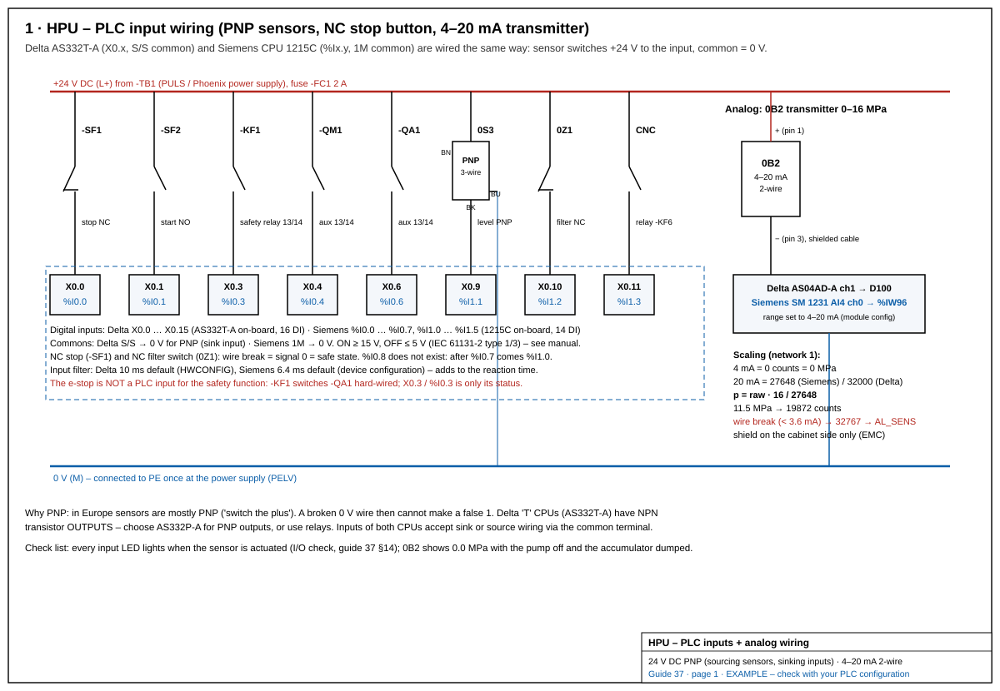
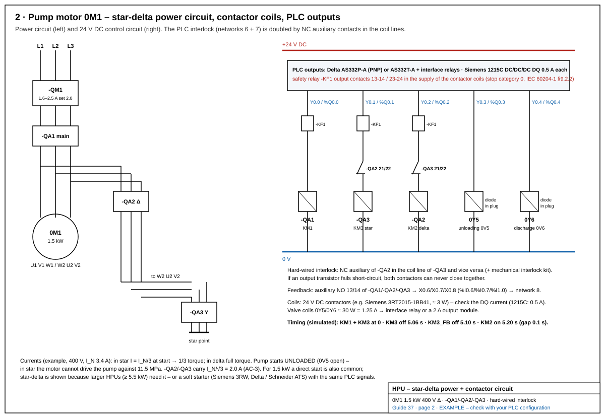
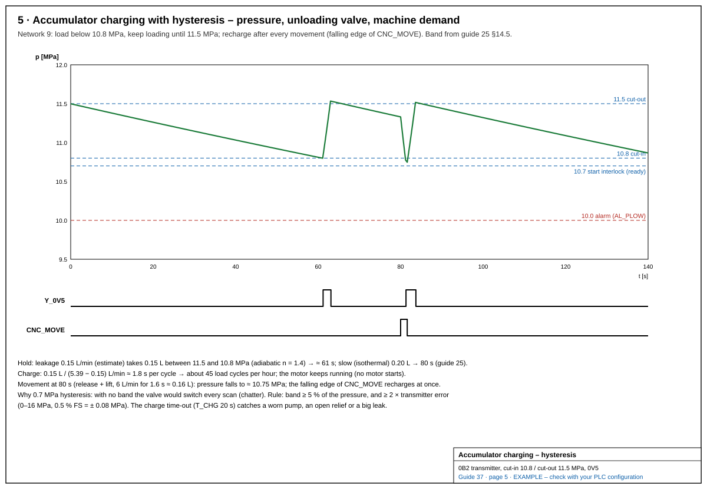
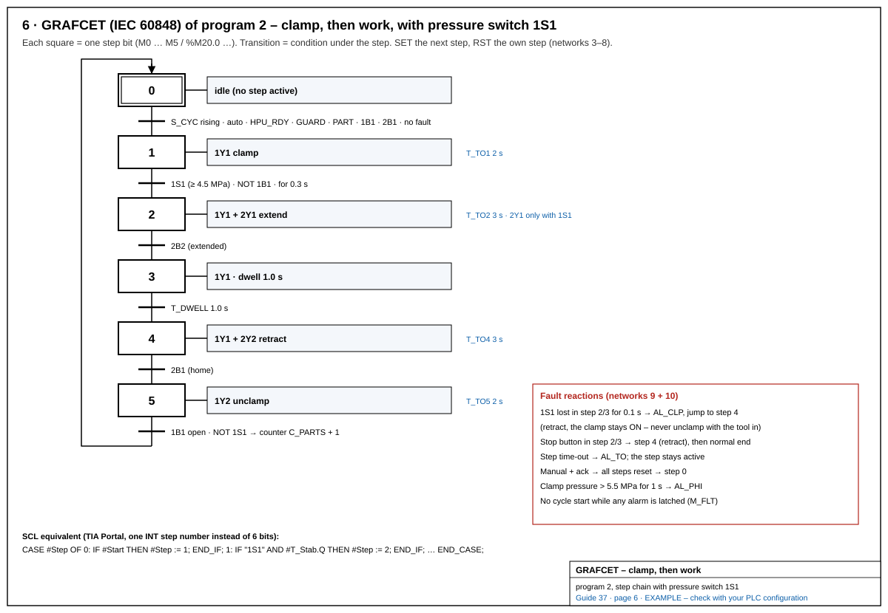
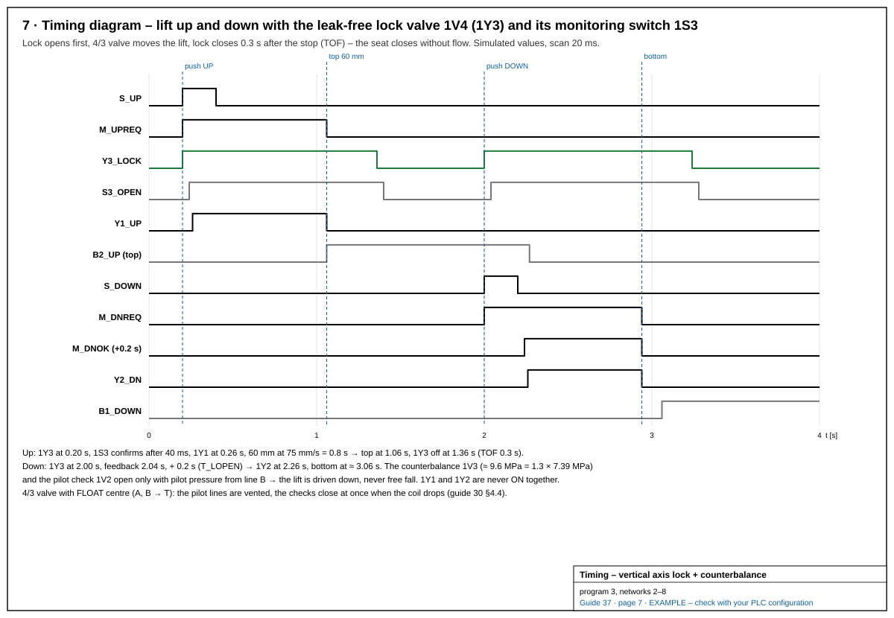
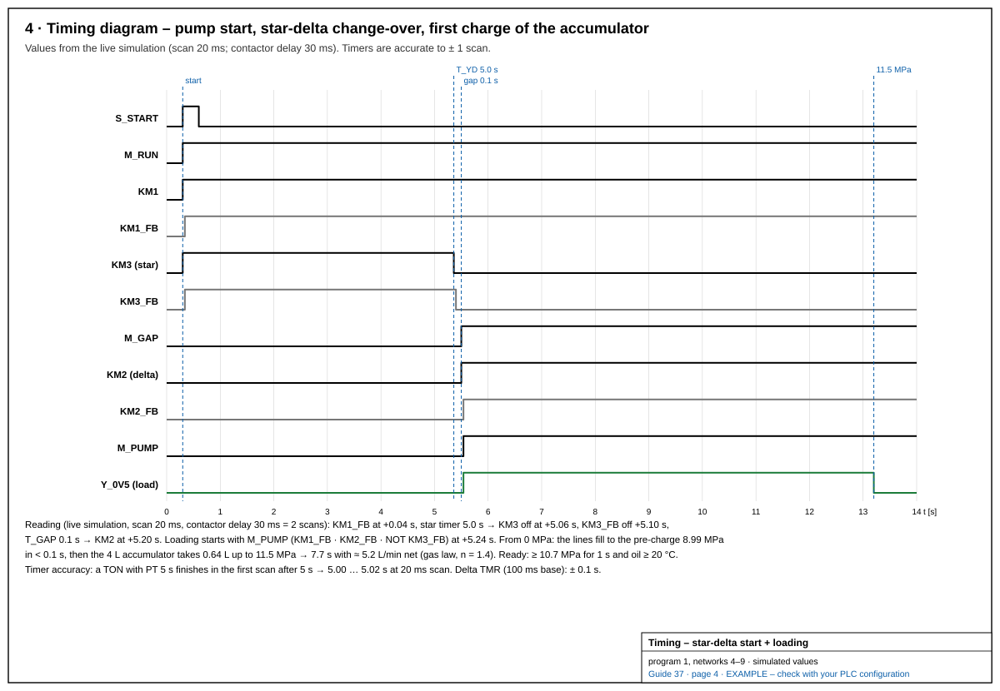
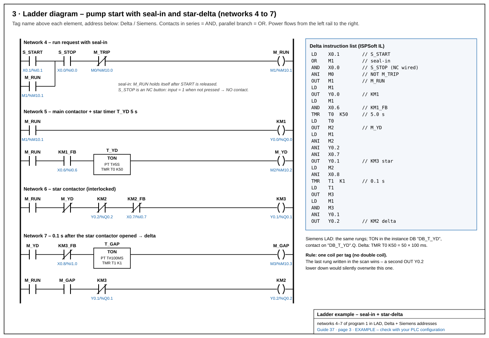
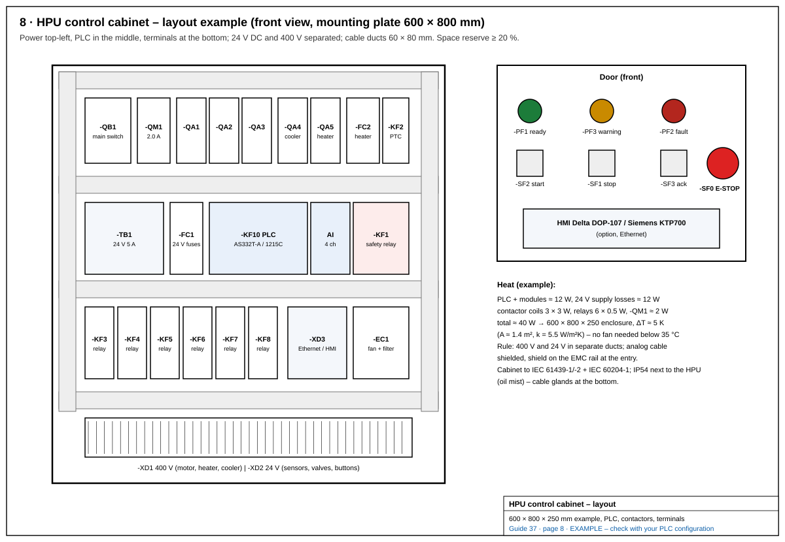

# 37 – PLC ladder programs for the hydraulic power unit and its circuits (Delta + Siemens) – textbook, listing and check list

**For whom:** mechanical engineers who plan the hydraulic power units (HPU) of the compressor factory and want to
understand, check and order the **PLC control program** – the part that switches the pump motor, charges the accumulator,
watches the oil and moves the valves in the right order. The same program is written twice: for a **Delta** PLC
(AS300 series AS332T-A, ISPSoft) and for a **Siemens** PLC (S7-1200 CPU 1215C, TIA Portal V19).

**Where to see it live:** tab **Hydraulics** → button **"4 · PLC ladder program – hydraulic power unit + circuits"**.
Deep link: `/?hyitem=4#hyd`, one program: `/?hyitem=4&hlprog=seq#hyd` (`hpu`, `seq`, `lock`), only one PLC view:
`&ladview=delta` or `&ladview=siemens`. Files: `web/hydlad.js` (page, plant view, self-test), `web/hydlad_p1.js`
(program 1 HPU + plant model), `web/hydlad_p2.js` (program 2 clamp-then-work), `web/hydlad_p3.js` (program 3 lock +
counterbalance), `web/hydlad_lib.js` (helpers), `web/hydlad_card.js` (catalogue card), shared ladder core `web/ladder.js`
+ `web/ladder.css` (guide 35).

> **All addresses, times, set points and products are examples.** Check every address with your PLC configuration
> (HWCONFIG in ISPSoft, device configuration in TIA Portal), every set point with the HPU datasheet and the hydraulic
> design (guides 25, 29, 30), and every product with the maker's current catalogue. Prices are **estimates – ask for a quote**.
> The program is a **standard** (non-safety) program: it never does the safety function itself (e-stop, guard locking,
> safe holding of a vertical axis). That is the job of a hard-wired **safety relay** or the **F-program** of a fail-safe
> CPU (ISO 13849-1, IEC 62061, IEC 60204-1 §9.4).

**Related guides (read them instead of repeating them here):** [35 – PLC ladder basics + AS/RS](35_plc_ladder_basics_asrs.md)
(the ladder textbook: scan cycle, contacts, seal-in, edges, timers, counters, step chains, Delta vs Siemens) ·
[36 – PLC ladder APC](36_plc_ladder_apc.md) (the pallet changer that uses this HPU) · [25 – hydraulic design method](25_hydraulic_design_method.md)
(§14 example 2 = this HPU: pump 1.5 kW, 0V5 10.8 / 11.5 MPa, relief 13 MPa, accumulator 4 L) · [29 – hydraulic elements](29_hydraulic_elements_data.md) ·
[30 – hydraulic circuits](30_hydraulic_circuits_sizing.md) (circuits 1, 2, 4, 6) · [05 – PLC control](05_plc_control.md) ·
[24 – robot control circuits](24_robot_control_circuits.md) (24 V, MCB, safety relay basics) · [27 – installation electrical + EMC](27_installation_electrical_emc.md).

---

## Contents

**Part A – Using the page**
1. [Item 4 of the Hydraulics tab – how to use it](#1-item-4-of-the-hydraulics-tab--how-to-use-it)
2. [The hydraulic system in one picture – tags and signals](#2-the-hydraulic-system-in-one-picture--tags-and-signals)
3. [The PLCs – Delta AS332T-A and Siemens CPU 1215C](#3-the-plcs--delta-as332t-a-and-siemens-cpu-1215c)
4. [Ladder in five minutes – what you need for these programs](#4-ladder-in-five-minutes--what-you-need-for-these-programs)

**Part B – Program 1: hydraulic power unit**
5. [Program 1 overview – 17 networks](#5-program-1-overview--17-networks)
6. [Pump motor start – star-delta with interlocks and feedback](#6-pump-motor-start--star-delta-with-interlocks-and-feedback)
7. [Accumulator charging with hysteresis and "pressure ready"](#7-accumulator-charging-with-hysteresis-and-pressure-ready)
8. [Oil care – temperature, level, filter, run hours, alarms](#8-oil-care--temperature-level-filter-run-hours-alarms)

**Part C – Programs 2 and 3: circuits**
9. [Program 2 – clamp, then work (step chain with pressure switch)](#9-program-2--clamp-then-work-step-chain-with-pressure-switch)
10. [Program 3 – vertical axis with hydraulic lock, counterbalance and valve test](#10-program-3--vertical-axis-with-hydraulic-lock-counterbalance-and-valve-test)

**Part D – Numbers, wiring, listings**
11. [Timing calculations – scan, timer accuracy, debounce, reaction time](#11-timing-calculations--scan-timer-accuracy-debounce-reaction-time)
12. [I/O wiring and I/O lists of the three programs](#12-io-wiring-and-io-lists-of-the-three-programs)
13. [Full listing program 1 – Delta ladder table, Delta IL, Siemens SCL](#13-full-listing-program-1--delta-ladder-table-delta-il-siemens-scl)
14. [Full listing program 2](#14-full-listing-program-2)
15. [Full listing program 3](#15-full-listing-program-3)

**Part E – Commissioning, mistakes, buying**
16. [Cabinet, 24 V supply and program structure in the PLC](#16-cabinet-24-v-supply-and-program-structure-in-the-plc)
17. [Buy list – catalogue examples](#17-buy-list--catalogue-examples)
18. [Bill of materials – HPU control](#18-bill-of-materials--hpu-control)
19. [Commissioning and I/O check list](#19-commissioning-and-io-check-list)
20. [Typical mistakes](#20-typical-mistakes)
21. [Standards](#21-standards)
22. [Glossary](#22-glossary)
23. [Questions for the supplier](#23-questions-for-the-supplier)
24. [Next to read](#24-next-to-read)

---

## 1. Item 4 of the Hydraulics tab – how to use it

The page has four cards:

| Card | What it shows | What you do |
|---|---|---|
| **PLC ladder programs** (header) | what the page is, how to read LAD, the safety rule, the **program selector** (1 HPU · 2 clamp-then-work · 3 lock + counterbalance) and "what to try" for the selected program | choose a program |
| **Live ladder** | plant view (pressure, accumulator oil, motor speed, oil temperature, cylinders, step), the run bar (Run / Stop / 1 scan / Reset, Delta / Siemens / Both, speed 1–10×, search), the input panel on the left, the networks on the right, then the I/O table, the Delta instruction list and the Siemens SCL text | click inputs, watch the green power flow |
| **Program structure** | how the program is organised in TIA Portal (OB1, cyclic OB, OB100, FB + DB) and in ISPSoft (cyclic task, HWCONFIG, latched range) | read once |
| **Real components + drawings** | 8 drawings of this guide, the buy list (29 rows) and the BOM of the HPU control cabinet | filter the buy list |

**Input panel.** *Push* buttons (S_START, S_STOP, S_ACK …) are momentary: they are ON while you hold the mouse button.
The stop button is an **NC** button: its input is 1 when nobody presses it – pressing it makes the input 0. *Switches*
(ESTOP_OK, LVL_OK, CNC_MOVE …) toggle. *Sensors* (contactor feedbacks, cylinder switches, pressure switch) are driven by
the plant model; a click **forces** them (marker F) – that is how you simulate a broken sensor or a stuck contactor. Click
again to release the force. Analog values have sliders; a slider of a plant-driven value (P_RAW, P_CLP, P_CAP) forces it,
double-click releases.

**Colours.** Green line or element = energised (power flows / bit = 1). Grey = not energised. A box (timer, counter,
compare, calculate) shows its live value under the name (e.g. `T 3.2 / 5.0 s`).

**Self-test.** `/?hyitem=4&ladCtest#hyd` runs all three programs headless (with their plant models) and writes
36 lines `LADCTEST ok …` with the measured times into the browser console, last line `LADCTEST DONE errors=0`. The
numbers in this guide marked "simulated" come from that test (chapter 11.6).



---

## 2. The hydraulic system in one picture – tags and signals

The programs control the HPU of guide 25 §14 (example 2 – one HPU per HMC feeds the APC lift, the zero-point release and
the rotary-table clamp) and two generic circuits of guide 30. The tags follow ISO 1219-2 (guide 30 §4.2):

| Tag | Element | Signal to / from the PLC |
|---|---|---|
| 0M1 / 0P1 | electric motor 1.5 kW, 4-pole + gear pump 4 cm³/rev (5.39 L/min) | contactors -QA1 / -QA2 / -QA3 (outputs), feedbacks (inputs), -QM1 + PTC relay (inputs) |
| 0V1 | pilot-operated relief valve 13.0 MPa | none (hydraulic) |
| 0V5 | unloading valve, 2/2 NO solenoid valve (coil 0Y5) | output Y_0V5: energised = closed = pump loads |
| 0V6 | accumulator discharge valve (coil 0Y6), part of the safety block 0V3 | output Y_0V6: energised = closed = holds pressure |
| 0Z2 | bladder accumulator 4 L, pre-charge p0 = 8.99 MPa | none |
| 0B2 | pressure transmitter 0–16 MPa, 4–20 mA | analog input P_RAW → P_SYS |
| 0B3 | oil temperature transmitter 0–100 °C, 4–20 mA | analog input T_OIL |
| 0S3 | tank level switch | input LVL_OK |
| 0Z1 | return filter 10 µm with clogging switch | input FILT_OK |
| 0E1 / 0E2 | tank heater 1 kW / air-oil cooler fan | outputs HEATER / COOLER |
| 1A1, 1V1 … 1V4 | clamp / lift circuits (programs 2 and 3) | solenoids 1Y1, 1Y2, 1Y3; switches 1B1, 1B2, 1S1, 1S3; transmitter 1B3 |
| 2A1, 2V1 | work cylinder of program 2 | solenoids 2Y1 / 2Y2; switches 2B1 / 2B2 |

Decided numbers (guide 25 §14.5, guide 09): accumulator band **10.0 (lowest) / 10.8 (cut-in) / 11.5 (cut-out) MPa**,
**start interlock ≥ 10.7 MPa**, **alarm < 10.0 MPa**, **oil ≥ 20 °C** as start condition, relief 13 MPa, safety block 14 MPa.

What the PLC must do with these elements – in one sentence each:

1. Start the motor **unloaded** (0V5 open), in star, then delta; stop it on any trip.
2. Keep the pressure between 10.8 and 11.5 MPa with 0V5 (the motor keeps running), recharge after every movement.
3. Tell the machine "hydraulics ready" only when the pressure, the oil temperature and the pump are OK.
4. Keep the oil between 20 and 50 °C (heater / cooler), stop at 65 °C, at low level, at a long-clogged filter.
5. Move the cylinders in the right order with interlocks (clamp before work, lock before lowering, two coils of one
   valve never together), with time-outs and alarms.

---

## 3. The PLCs – Delta AS332T-A and Siemens CPU 1215C

| | Delta | Siemens |
|---|---|---|
| CPU (example) | **AS332T-A** (AS300 series), 16 DI X0.0 … X0.15, 16 DO Y0.0 … Y0.15 (transistor **NPN / sink**); **AS332P-A** = PNP outputs | **CPU 1215C DC/DC/DC** (6ES7215-1AG40-0XB0), 14 DI %I0.0 … %I0.7 + %I1.0 … %I1.5, 10 DQ %Q0.0 … %Q0.7 + %Q1.0 … %Q1.1 (0.5 A, PNP) |
| Analog | **AS04AD-A**, 4 ch, 4–20 mA → 0 … 32000 | on-board 2 AI are **0–10 V only** → **SM 1231 AI 4** (4–20 mA → 0 … 27648), addresses from %IW96 (slot 2) |
| More outputs | AS16AN01T-A 16 DO | **SM 1222 DQ 16** → %Q8.0 … (needed: program 1 has 11 outputs, the CPU has 10) |
| Software | ISPSoft 3.x + HWCONFIG (free) | TIA Portal STEP 7 Basic V19 (licence) |
| Bit address | word.bit, bit 0–15 (X0.10 exists) | byte.bit, bit 0–7 (**%I0.8 does not exist** – after %I0.7 comes %I1.0) |
| Timers | TMR T0 K50 = 5.0 s (100 ms base), TMRH = 10 ms base | IEC TON / TOF / TP in an instance DB, PT := T#5S |
| Small option | DVP-ES2 / DVP-ES3 (WPLSoft / ISPSoft): **octal** X0 … X7, X10 … X17 (no X8, X9) | S7-1200 CPU 1212C / 1214C |
| Safety option | safety relay (Pilz PNOZ s4, Schmersal SRB-E, Phoenix PSRmini) or Pilz PNOZmulti 2 | CPU 1215FC + F-modules, F-LAD (ESTOP1, FDBACK) – or a safety relay |

**I/O count of program 1:** 12 digital inputs, 2 analog inputs, 11 digital outputs. With Siemens the 11th output
(amber lamp) needs the SM 1222 – or combine two lamps. With Delta the on-board I/O are enough; the analog module is needed
in both cases. Leave **≥ 20 % spare I/O** for changes during commissioning.

**PNP or NPN outputs.** In Europe sensors and actuators are mostly **PNP** ("switch the plus"; a broken 0 V wire cannot
switch a load ON). The Delta "T" CPU has **NPN** (sinking) outputs – choose AS332**P**-A or use interface relays.
Inputs of both CPUs work with PNP sensors when the common terminal (Delta S/S, Siemens 1M) goes to 0 V.

---

## 4. Ladder in five minutes – what you need for these programs

Guide 35 is the full textbook. For these programs you need nine ideas:

| Idea | Ladder | What it means here | Example network |
|---|---|---|---|
| Scan cycle | – | read all inputs → run all networks top to bottom → write all outputs → repeat (20 ms here) | all |
| NO / NC contact | `–| |–` / `–|/|–` | TRUE if the bit is 1 / 0 | everywhere |
| Series / parallel | AND / OR | all conditions / one of the conditions | P1 N2 (trip summary = OR) |
| Seal-in | output contact parallel to START | the output holds itself until STOP opens the line | P1 N4 (pump run request) |
| Interlock | NC contact of the "other" output | two outputs never together | P1 N6/N7 (star / delta), P2 N12/N13, P3 N7/N8 |
| Edge | `–|P|–` / `–|N|–` | TRUE for **one scan** when the bit changes | P1 N9 (recharge at the falling edge of CNC_MOVE), N16 (ack pulse) |
| Timer | TON / TOF | on-delay / off-delay | P1 N5 (star 5 s), P3 N4 (lock closes 0.3 s later) |
| Counter / compare | CTU / CMP | counts rising edges / compares numbers | P1 N9 (P_SYS ≤ 10.8), N4 (motor starts) |
| SET / RST | `–(S)–` / `–(R)–` | latch a bit (alarm, step) until a reset | P1 alarms, P2 step chain |

**Hysteresis with a seal-in** (used three times in program 1):

```
ON  if  value ≤ lower limit
STAY ON  while  output is ON AND value < upper limit
→ rung:  ( [value ≤ low] OR ( OUTPUT AND [value < high] ) ) AND enable  →  OUTPUT
```

Accumulator: low 10.8, high 11.5 MPa. Heater: ON < 20 °C, OFF ≥ 25 °C. Cooler: ON > 50 °C, OFF ≤ 45 °C.

---

## 5. Program 1 overview – 17 networks

| N | Title | Main idea |
|---|---|---|
| 1 | Pressure transmitter: scaling + wire-break check | p = raw × 16 / 27648; raw > 32511 = wire break → AL_SENS |
| 2 | Summary trip | one bit M_TRIP = any reason to stop |
| 3 | Motor protection feedback | -QM1 or PTC opened → AL_MOT |
| 4 | Pump run request + start counter | seal-in, NC stop button, counter of starts |
| 5 | Main contactor, discharge valve, star time | KM1 + 0V6; T_YD 5 s starts from KM1 feedback |
| 6 | Star contactor KM3 | interlocked with KM2 command + feedback |
| 7 | Change-over dead time + delta KM2 | 0.1 s after KM3 really opened |
| 8 | Pump runs in delta + contactor monitoring | load only in delta; discrepancy 0.5 s → AL_FB |
| 9 | Accumulator charging with hysteresis | 10.8 / 11.5 MPa, recharge after a movement, charge time-out 20 s |
| 10 | Pressure ready + low pressure | ≥ 10.7 MPa for 1 s and oil ≥ 20 °C; stays down to 10.0 MPa; < 10.0 MPa for 3 s → warning |
| 11 | Heater | < 20 / ≥ 25 °C, only with level OK |
| 12 | Cooler, warning, trip | > 50 / ≤ 45 °C; > 55 °C warning; > 65 °C for 2 s trip |
| 13 | Level low | 2 s debounce → stop |
| 14 | Filter clogged | only valid ≥ 30 °C; warning, stop after 60 s |
| 15 | Run-hour counter | 1 Hz clock edge, retentive seconds, service at 2000 h |
| 16 | Alarm acknowledge | one ack pulse, each alarm reset only if its cause is gone |
| 17 | Flasher, lamps, ready signal | 1 Hz flasher from two timers |

**Execution order matters.** Alarms are SET in networks 3, 8, 12, 13, 14 and read by the trip summary in network 2 – in
the **next** scan. The delay is one scan (20 ms) – irrelevant here, but know it: the order of networks is part of the
program.

---

## 6. Pump motor start – star-delta with interlocks and feedback



### 6.1 Why star-delta (and when not)

A 3-phase motor started direct on line draws **6 – 8 × I_N** for about 0.2 – 1 s. In **star** each winding gets
U/√3 instead of U:

```
Winding voltage       U_Y = 400 V / √3 = 231 V
Line current in star  I_Y = I_D / 3          (I_D = direct-on-line start current)
Torque in star        M_Y = M_D / 3
Example 1.5 kW, I_N = 3.4 A:  I_D ≈ 7 · 3.4 = 24 A  →  I_Y ≈ 8 A
Contactor ratings     -QA1, -QA2 carry I_N/√3 = 2.0 A each, -QA3 carries I_N/3 = 1.1 A (AC-3)
```

Because the torque in star is only 1/3, the pump must start **unloaded**: 0V5 stays open until the motor runs in delta
(network 8 M_PUMP → network 9). A 1.5 kW motor is usually started **direct**; star-delta is shown because the same program
is used for larger HPUs (≥ 5.5 kW, where the grid operator or the transformer limits the start current). Alternative:
a **soft starter** (Siemens 3RW, Schneider ATS) – the PLC then gives one "start" output and reads "ramp done".

### 6.2 The sequence and its timers

```
t = 0         M_RUN = 1 → KM1 (main) + KM3 (star) ON
t ≈ 0.04 s    KM1_FB = 1 (auxiliary contact, contactor closing time ≈ 15 – 40 ms) → T_YD starts
t ≈ 5.04 s    T_YD (5.0 s) done → M_YD = 1 → KM3 OFF
t ≈ 5.10 s    KM3_FB = 0 → T_GAP starts (0.1 s)
t ≈ 5.20 s    M_GAP = 1 → KM2 (delta) ON
t ≈ 5.24 s    KM2_FB = 1 → M_PUMP = 1 → 0V5 may load
```

Simulated (self-test): **star off after 5.06 s, delta after 5.20 s, 0V5 loads 0.04 s later**.

**Star time.** Long enough for the motor to reach ≈ 90 % of its speed in star. An unloaded gear pump with a 1.5 kW motor
needs ≈ 0.5 – 1 s; 5 s is a safe, common default (contract value). Too short: the motor jumps to delta at low speed –
nearly the full direct-on-line current. Too long: the motor heats in star if it is loaded.

**Dead time (gap).** When KM3 opens, the arc in its contacts lasts a few ms and the motor flux decays. If KM2 closes before,
there is a phase-to-phase short circuit through the star point. 50 – 100 ms is usual; here the gap starts only when the
**feedback** of KM3 says "open" – so a slow or welded KM3 can never be bridged by KM2.

### 6.3 Interlocks – software AND hardware

| Level | How | Why |
|---|---|---|
| Software | KM3 rung has `NOT KM2` and `NOT KM2_FB`; KM2 rung has `NOT KM3` and (via M_GAP) `NOT KM3_FB` | normal operation |
| Hardware | NC auxiliary contact of -QA2 in the coil line of -QA3 and vice versa | a failed output transistor (short circuit) or a forced output must never close both |
| Mechanical | mechanical interlock kit between -QA2 and -QA3 (e.g. 3RA2912-2H) | welded contact |

### 6.4 Feedback monitoring (network 8)

Each contactor has an auxiliary NO contact wired back to the PLC. If command and feedback differ for **0.5 s**, AL_FB is
set and the pump trips. This finds: broken coil, missing 24 V for the coils (safety relay open), welded main contact
(feedback stays 1 after the command is 0), missing auxiliary contact block. Simulated: KM2_FB forced to 0 → **AL_FB after
0.52 s** (0.5 s + 1 scan).

### 6.5 Motor protection (network 3)

The motor circuit breaker -QM1 (thermal + magnetic) and the thermistor relay (PTC in the winding) switch the motor off **by
themselves** – the PLC only reads their auxiliary contacts to stop the sequence and show the reason. After a PTC trip
IEC 60204-1 §7.2 requires a **manual** reset – the PTC relay is set to manual reset, and the PLC ack (network 16) resets
AL_MOT only when both contacts are closed again.

---

## 7. Accumulator charging with hysteresis and "pressure ready"



### 7.1 The gas law in the accumulator

The bladder holds nitrogen with pre-charge p0. Above p0 the oil compresses the gas. For fast changes (charging in 2 s)
use the adiabatic exponent n = 1.4, for slow changes (leakage over a minute) n ≈ 1.0 (guide 25 §7.8):

```
p · V^n = const      →   V_gas(p) = V0 · (p0 / p)^(1/n)      (absolute pressures!)
oil in the accumulator  V_oil(p) = V0 · (1 − (p0 / p)^(1/n))
V0 = 4 L, p0 = 9.09 MPa abs (8.99 gauge)
V_oil(10.9 abs = 10.8 g) = 4 · (1 − (9.09/10.9)^0.714) = 4 · (1 − 0.8784) = 0.486 L
V_oil(11.6 abs = 11.5 g) = 4 · (1 − (9.09/11.6)^0.714) = 4 · (1 − 0.8402) = 0.639 L
oil between cut-in and cut-out  ΔV = 0.153 L   (isothermal n = 1: 0.20 L)
```

### 7.2 Charge time, hold time, cycles per hour

```
Pump flow at 11 MPa     Q_p = 5.39 · (1 − 0.004 · 11) = 5.15 L/min    (volumetric efficiency falls with p – model)
Leakage (estimate)      Q_L = 0.15 L/min     → net charge flow 5.0 L/min
Charge time             t_c = 0.153 / 5.0 · 60 = 1.8 s          simulated 1.84 s
Hold time               t_h = 0.153 / 0.15 · 60 = 61 s          simulated 61.7 s  (isothermal: 80 s)
Load cycles per hour    3600 / (61 + 1.8) ≈ 57 (adiabatic) … 43 (isothermal, guide 25)
First charge from 0     0.639 L + line volume → 7.4 s hand,     simulated 7.66 s
```

The motor keeps running between the charges (no motor starts); 0V5 switches ≈ 50 times per hour – a solenoid valve is
made for millions of cycles. If the leakage grows (worn valve, seal), the hold time falls: the PLC can **measure the
leakage** from the hold time: Q_L = ΔV / t_h. Example: t_h falls from 61 s to 20 s → leakage 0.46 L/min → service.

### 7.3 Hysteresis rung (network 9)

```
M_CHG := ( [P_SYS ≤ 10.8] OR ( M_CHG AND [P_SYS < 11.5] ) OR falling(CNC_MOVE) ) AND M_PUMP AND NOT M_TRIP
Y_0V5 := same
```

- Without hysteresis (one limit only) the valve would switch every scan at the limit – it chatters, the pressure rings.
- Band rule: **≥ 5 % of the pressure** and **≥ 2 × transmitter error**: 0–16 MPa, 0.5 % FS = ± 0.08 MPa → 0.7 MPa band OK.
- **Recharge after every movement** (guide 25 §14.5 control rule): the falling edge of CNC_MOVE starts a charge even if the
  pressure is still above 10.8 MPa, so the next pallet change starts near 11.5 MPa. Simulated: movement 6 L/min × 1.6 s
  from 11.44 MPa → minimum **10.78 MPa** (≥ 10.0), then recharge.
- **Charge time-out** T_CHG 20 s (normal 1.8 s, first charge 7.7 s): longer = pump worn, relief valve open, big leak, 0V5
  stuck open → AL_CHG warning.

### 7.4 Pressure ready (network 10)

```
M_P107 := TON( [P_SYS ≥ 10.7], 1 s )
M_RDY  := M_PUMP AND NOT M_TRIP AND [T_OIL ≥ 20] AND ( M_P107 OR ( M_RDY AND [P_SYS ≥ 10.0] ) )
```

Why 10.7 MPa: a pallet change (release + lift, 0.165 L, no pump help) that starts at 10.7 MPa ends at 10.03 MPa – just above
the 10.0 MPa the lift needs with reserve (guide 25 §14.5). Why the seal-in down to 10.0 MPa: the change itself takes oil,
the signal must not drop in the middle of a movement. Why 1 s: the transmitter signal must be stable (pressure peaks).
Why oil ≥ 20 °C: cold oil (10 °C, 200 mm²/s) raises the line losses to ≈ 0.63 MPa – the lift would not have enough pressure.

### 7.5 Discharge valve 0V6 and stop

0V6 is energised (closed) while the pump runs. On stop, trip or power failure it opens and **dumps the accumulator**
(EN ISO 4413 §5.4.7: stored energy must be released or isolated automatically). Simulated: stop → pressure 11.5 → 0 in a few
seconds. Never work on the hydraulics before the gauge shows 0 (guide 25 §12.4).

### 7.6 Analog scaling and wire break (network 1)

```
Siemens SM 1231, 4–20 mA:  4 mA = 0, 20 mA = 27648, overflow (> 22.8 mA or wire break) = 32767
Delta AS04AD-A, 4–20 mA:   4 mA = 0, 20 mA = 32000 (check the range setting in HWCONFIG)
p = raw · (16 − 0) / 27648 + 0      Example: 11.5 MPa ↔ 19872 counts, 10.8 MPa ↔ 18662 counts
TIA Portal: NORM_X (MIN 0, VALUE raw, MAX 27648) → SCALE_X (MIN 0.0, VALUE, MAX 16.0)
```

A broken wire gives 0 mA → the module reports overflow / underflow (32767 on S7-1200 with diagnosis on). The program sets
AL_SENS and trips – a broken transmitter must never look like "0 MPa = start the pump" or "pressure OK".
**4–20 mA instead of 0–20 mA** exactly for this reason ("live zero").

---

## 8. Oil care – temperature, level, filter, run hours, alarms

### 8.1 Heat balance of the tank (why heater and cooler)

```
Heat capacity of the oil  C = V · ρ · c = 25 L · 0.87 kg/L · 1.9 kJ/(kg·K) = 41 kJ/K
Heater 1 kW               ΔT/Δt = 1.0 / 41 = 0.024 K/s → 18 → 20 °C in 83 s (in the simulation 3 × faster)
Natural cooling           P = k · A · ΔT ≈ 0.0067 kW/K · (T − 18 °C)   (tank 0.556 m², guide 25 §14.7)
Pump losses               loading ≈ 0.18 kW, unloaded ≈ 0.06 kW  →  equilibrium ≈ 18 + 0.07/0.0067 ≈ 28 °C
```

This HPU (guide 25 §14.7) does not need a cooler; the cooler network is included because most larger HPUs need one. Drag
T_OIL on the page to test: 52 °C cooler ON, 56 °C warning, 66 °C trip after 2.0 s (simulated 2.02 s).

| Function | Set points (example) | Reason |
|---|---|---|
| Heater ON / OFF | < 20 / ≥ 25 °C, **only with level OK** | viscosity window 16–36 mm²/s for VG 32/46 (guide 25 §9.4); heater in air burns out |
| Cooler ON / OFF | > 50 / ≤ 45 °C, only with the pump running | oil flows through the return-line cooler only with the pump |
| Warning | > 55 °C | look for the cause (relief blowing, cooler dirty) |
| Trip | > 65 °C for 2 s | seals, oil life halves every +10 K above ≈ 60 °C |
| Ready | ≥ 20 °C | line losses with cold oil |

### 8.2 Level low (network 13)

Low oil level = air in the suction line = cavitation, noise, pump damage within minutes → stop. The 2 s debounce ignores
the level waves when cylinders take oil. Simulated: **stop after 2.02 s**, heater blocked at the same time. Wire the
level switch so that a **broken wire = low level** (closed = OK).

### 8.3 Filter clogging (network 14)

The clogging switch opens at Δp ≈ 0.25 MPa (below the bypass 0.3 MPa). With cold oil the Δp over a **clean** element is
high – so the signal is only valid at ≥ 30 °C. Warning first; if nobody changes the element, stop after T_FILT
(60 s in the example so you can see it; real plants: end of the shift or a few hours – or "no new cycle start").
Simulated: warning at once, **stop after 60.00 s**; ignored at 25 °C.

### 8.4 Run-hour counter (network 15)

```
1 Hz clock bit (Siemens Clock_1Hz %M0.5, Delta 1 s clock bit) → rising edge while the pump runs → RUN_S := RUN_S + 1
RUN_H := RUN_S / 3600          service warning when RUN_H ≥ SERV_H (2000 h: oil sample + filter element)
```

Use the **clock edge**, not a timer that resets itself: a self-resetting TON loses 1–2 scans per period → 1.04 s instead
of 1.00 s = **4 % error** (≈ 350 h per 8 760 h). Simulated: +10 s in 10 s. RUN_S must be **retentive** (Siemens: "Retain"
in the DB; Delta: latched D range in HWCONFIG) and 32 bit (DINT): 16 bit would overflow after 9.1 h.

### 8.5 Alarms and acknowledge (network 16)

- Every alarm is a **latched** bit (SET). It stays even if the cause disappears (a short level dip is still recorded).
- Ack = **one** rising edge → one pulse M_ACK (one edge memory, used once – see mistake 20.6).
- Each alarm is reset only if its cause is gone (level OK, oil < 60 °C, filter OK, transmitter OK …).
- Red lamp flashes (1 Hz) while there is a trip; amber = warning; green = ready.
- Alarm texts on the HMI: one text per bit (Siemens HMI alarms bound to the alarm word, Delta DOPSoft alarm list).

---

## 9. Program 2 – clamp, then work (step chain with pressure switch)



### 9.1 The circuit

Guide 30 §8 circuit 4 with the option "pressure switch": clamp 1A1 Ø40/22 through reducing valve 1V2 (5 MPa) and pilot
check 1V3; valve 1V1 4/3 (1Y1 clamp, 1Y2 unclamp); work cylinder 2A1 Ø63/36, valve 2V1 4/3 (2Y1 extend, 2Y2 retract);
pressure switch 1S1 ON ≥ 4.5 MPa rising, OFF < 4.0 MPa; cylinder switches 1B1 (clamp open), 2B1 (home), 2B2 (extended);
pressure transmitter 1B3 behind 1V2. **Why a PLC sequence instead of a sequence valve:** the sequence valve checks only
pressure, needs a margin ≥ 1 – 1.5 MPa (chatter) and wastes 0.53 kW while working (guide 30 §8.1); the pressure switch +
PLC gives diagnosis and is part of the interlock "no cutting without clamp pressure".

Clamp force at 5 MPa: F = 5 MPa · 12.57 cm² − 0.3 kN = **5.98 kN**. Switch point 4.5 MPa → 5.4 kN (90 %).

### 9.2 Step chain with SET / RST

| Step | Bit | Action (outputs) | Transition to the next step | Watchdog |
|---|---|---|---|---|
| 0 idle | ST0 = no other step | – | rising S_CYC · auto · HPU_RDY · GUARD · PART · 1B1 · 2B1 · no fault | – |
| 1 clamp | ST1 | 1Y1 | 1S1 · NOT 1B1 for 0.3 s | 2 s |
| 2 extend | ST2 | 1Y1 + 2Y1 (2Y1 only with 1S1) | 2B2 | 3 s |
| 3 dwell | ST3 | 1Y1 | T_DWELL 1.0 s | – |
| 4 retract | ST4 | 1Y1 + 2Y2 | 2B1 | 3 s |
| 5 unclamp | ST5 | 1Y2 | 1B1 · NOT 1S1 → part counter + 1 | 2 s |

Pattern of one transition rung: `ST_n AND condition → SET ST_n+1, RST ST_n`. Exactly one step bit is 1 at a time.
**Outputs are written once** (networks 12 and 13: one OUT coil per solenoid, an OR of the steps) – never SET / RST a valve
output in several places (mistake 20.1).

Simulated cycle: clamp + 0.3 s **0.86 s** · extend **0.98 s** · dwell **1.00 s** · retract **0.78 s** · unclamp **0.46 s**
→ **4.08 s**, part counter 1.

### 9.3 SCL equivalent (TIA Portal) – the step chain as CASE

The generated SCL in chapter 14 is a line-by-line copy of the ladder. In a real S7 project a step chain is often written
in SCL with an INT step number:

```pascal
// FB "Clamp" – step chain (example)
#tStab(IN := (#Step = 1) AND "1S1" AND NOT "1B1", PT := T#300MS);
#tDwell(IN := #Step = 3, PT := T#1S);
#tWd(IN := #Step <> 0 AND #Step <> 3, PT := T#3S);           // one watchdog for all moving steps
IF #tWd.Q THEN #AlTimeout := TRUE; END_IF;
CASE #Step OF
  0: IF #StartEdge AND "Auto" AND "HPU_Rdy" AND "Part" AND "1B1" AND "2B1" AND NOT #Fault THEN #Step := 1; END_IF;
  1: IF #tStab.Q THEN #Step := 2; END_IF;
  2: IF "2B2" THEN #Step := 3; END_IF;
     IF NOT "1S1" THEN #AlClamp := TRUE; #Step := 4; END_IF;    // clamp pressure lost → retract
  3: IF #tDwell.Q THEN #Step := 4; END_IF;
  4: IF "2B1" THEN #Step := 5; END_IF;
  5: IF "1B1" AND NOT "1S1" THEN #Parts := #Parts + 1; #Step := 0; END_IF;
END_CASE;
"1Y1" := #Step >= 1 AND #Step <= 4 AND NOT "1Y2";
"1Y2" := #Step = 5 AND NOT "1Y1";
"2Y1" := #Step = 2 AND "1S1" AND NOT "2Y2";
"2Y2" := #Step = 4 AND NOT "2Y1";
```

Delta ISPSoft offers the same with **SFC** (sequential function chart) or ST; in LAD the SET / RST pattern of the page is
the most readable for maintenance staff.

### 9.4 Interlocks and fault reactions

| Situation | Reaction | Network | Simulated |
|---|---|---|---|
| clamp pressure lost in step 2 / 3 (1S1 = 0 for 0.1 s) | AL_CLP, jump to step 4 (retract), clamp valve stays ON | 9 | AL_CLP after 0.12 s |
| stop button in step 2 / 3 | step 4 (retract), then normal end | 9 | – |
| no hydraulics in step 1 | time-out AL_TO after 2 s | 10 | 2.00 s |
| no part | no start | 3 | – |
| clamp pressure > 5.5 MPa for 1 s (reducing valve fault) | AL_PHI, no new start | 11 | – |
| manual + ack | all steps reset → step 0 | 15 | – |
| 1Y1 / 1Y2, 2Y1 / 2Y2 | never together; 2Y1 never without 1S1 | 12, 13 | 0 violations in 541 scans |

**Never unclamp with the tool in the part:** the fault reaction always goes to "retract" first; the clamp opens only in
step 5 or in manual mode with the work cylinder home.

---

## 10. Program 3 – vertical axis with hydraulic lock, counterbalance and valve test



### 10.1 The circuit

APC lift 1A1 Ø50/28, stroke 60 mm, real lifted mass 1 480 kg (guide 25 §14.1): holding pressure
m·g / A1 = 14 519 N / 19.635 cm² = **7.39 MPa**. Valve 1V1 4/3 with **float centre** (A, B → T; 1Y1 up, 1Y2 down),
double pilot-operated check 1V2 (ratio 3:1) and counterbalance 1V3 (set ≈ 1.3 × 7.39 = **9.6 MPa**) – both hydraulic,
no coil. Added for the PLC: a **leak-free seat valve 1V4** (coil 1Y3, energised = open) with **spool monitoring switch
1S3** as the second, monitored holding element, cap-side transmitter 1B3, end switches 1B1 (bottom) / 1B2 (top).

**Why float centre:** with a closed centre the pilot line of 1V2 / 1V3 stays pressurised and the checks do not close
(guide 30 §4.4). The PLC cannot fix a wrong centre – choose it in the hydraulic design.

### 10.2 Sequence

```
UP:    1Y3 ON → 1S3 confirms (40 ms) → 1Y1 ON → 1B2 → 1Y1 OFF → 1Y3 OFF after 0.3 s (TOF)
DOWN:  1Y3 ON → 1S3 confirms → wait 0.2 s (T_LOPEN) → 1Y2 ON → 1B1 → 1Y2 OFF → 1Y3 OFF after 0.3 s
```

- **Lock opens first**, otherwise 1Y2 pressurises the rod side against a closed seat: rod-side intensification
  p2 = p · A1 / A2 = 11.5 · 1.457 = 16.8 MPa (above the 16 MPa rating, guide 25 §14.3).
- **Lock closes 0.3 s after the stop** (TOF): the 4/3 valve is already in float centre, no flow passes the seat while it
  closes → no pressure peak, no seat wear.
- Simulated: up **0.86 s** (40 ms + 60 mm / 75 mm/s), lock closes **0.30 s** after the stop; down: 1Y2 **0.26 s** after the
  push, bottom after **1.06 s**.

### 10.3 Monitoring

| Monitor | Logic | Simulated |
|---|---|---|
| Lock feedback | Y3_LOCK ≠ S3_OPEN for 0.5 s → AL_LOCK; no movement because 1Y1 / 1Y2 wait for M_LOCKOK | 0.50 s, lift did not move |
| Drift | armed at the top (rising 1B2); 1B2 lost with all valves off for 1 s → AL_DRIFT | 1.02 s |
| Holding pressure | at rest above the bottom: P_CAP > 8.5 MPa (overload, close to the CBV setting) or < 1.0 MPa (load lost / sensor) for 1 s → AL_PCAP | 7.39 MPa at the top, no alarm |
| Travel time-out | coil ON for 2 s (normal 0.8 s) → AL_TO | – |
| Interlock | 1Y1 and 1Y2 never together; 1Y2 never with the lock closed (outside the test) | 0 violations |

**Safety note.** Holding a vertical load is a safety function (falling arm). Pilot check + counterbalance (hydraulic) +
monitored seat valve give two channels, but the **standard PLC** must not be the only logic: for PL d the seat valve is
switched through a safety relay / F-DQ, and the spool monitoring goes to the safety controller (ISO 13849-1, ISO 4413
§5.4.4, guide 25 §12). The program here shows the standard part and the diagnostics.

### 10.4 Valve output test (network 12)

Key switch S_TEST, pump **off** (HPU_RDY = 0), lift at the bottom, push UP once → 1Y1 2 s → 1Y2 2 s → 1Y3 2 s.
Check: click of the armature, LED in the connector, coil current (24 V, ≈ 30 W → **1.25 A**, clamp meter), 1S3 follows 1Y3.
Simulated: **1Y1 2.02 s → 1Y2 2.00 s → 1Y3 2.30 s** (2 s + TOF 0.3 s), no movement, no lock alarm.
Use it at commissioning (chapter 19) and when a valve is suspected – faster than opening the cabinet.

---

## 11. Timing calculations – scan, timer accuracy, debounce, reaction time

### 11.1 Scan time

The PLC repeats: read inputs → execute → write outputs → communication. Program 1 has ≈ 220 IL lines; an S7-1200 executes
a bit instruction in ≈ 0.08 µs, a REAL operation in ≈ 2.3 µs (see the CPU manual) → logic ≪ 1 ms. The real cycle time is
dominated by the operating system and communication: typically **1 – 5 ms** on a 1215C or an AS332 for this size. The
simulation uses **20 ms** to make the effects visible. Read the real value online: TIA Portal → Online & diagnostics →
cycle time; ISPSoft → PLC status / scan time. Set a **cycle time monitoring** (watchdog, S7-1200 default 150 ms).

### 11.2 Timer accuracy

```
TON output ON at the first scan with ET ≥ PT  →  error 0 … +1 scan
Example PT 5 s, scan 20 ms  →  5.00 … 5.02 s    (simulated star time 5.0 s + contactor 0.04 s = 5.06 s)
Delta TMR (100 ms base): K50 = 5.0 s, resolution 0.1 s → ± 0.1 s; TMRH (10 ms base): K500
Siemens IEC timer: 1 ms resolution, but evaluated only when the instruction is executed (once per scan)
```

A timer in a **cyclic interrupt** OB (e.g. 100 ms) has a constant time base – use it for hour counters or controllers.

### 11.3 Debounce and filter times

| Signal | Filter | Value | Why |
|---|---|---|---|
| all digital inputs | hardware input filter | Siemens 6.4 ms, Delta 10 ms (default) | contact bounce 1–5 ms |
| level switch | TON in the program | 2 s | oil waves |
| pressure ready | TON | 1 s | pressure peaks |
| clamp pressure stable | TON | 0.3 s | pressure settles after the stroke |
| clamp pressure lost | TON | 0.1 s | short dips during valve switching |
| contactor feedback | TON | 0.5 s | closing / opening time 15 – 40 ms + margin |

### 11.4 Reaction time chain (example: clamp pressure lost → work cylinder retracts)

```
pressure switch 1S1 switching time        ≈ 5 ms
input filter                              6.4 ms (Siemens) / 10 ms (Delta)
T_PLOST debounce                          100 ms
program: up to 1 scan to see it + 1 scan  2 × 20 ms (simulation) / 2 × 3 ms (real)
output transistor                          < 1 ms (relay output 10 ms)
DC solenoid valve switching               30 – 50 ms (NG6, see datasheet)
→ total ≈ 190 ms (simulation)  /  ≈ 160 ms (real)  until 2Y2 moves the spool
```

The cutting tool must not damage the part in that time – or the CNC feed hold reacts on CLP_OK (direct output) earlier.

### 11.5 Accumulator numbers (from chapter 7)

| Value | Hand | Simulated |
|---|---|---|
| first charge 0 → 11.5 MPa | 7.4 s | 7.66 s |
| hold 11.5 → 10.8 MPa (leak 0.15 L/min) | 61 s | 61.7 s |
| charge 10.8 → 11.5 MPa | 1.8 s | 1.84 s |
| movement 0.16 L from 11.44 MPa | ≈ 10.75 MPa | 10.78 MPa |

### 11.6 All self-test results (`&ladCtest`)

| Program | Check | Result |
|---|---|---|
| 1 | start → KM1 + KM3 | 0 ms |
| 1 | star off / delta on | 5.06 s / 5.20 s |
| 1 | 0V5 loads after KM2 | 0.04 s |
| 1 | 0 → 11.5 MPa | 7.66 s |
| 1 | cut-out at | 11.51 MPa |
| 1 | ready (oil heated 18 → 20 °C) | after the oil reached 20.0 °C |
| 1 | hysteresis hold / cut-in / charge | 61.68 s / 10.80 MPa / 1.84 s |
| 1 | movement minimum | 10.78 MPa |
| 1 | cooler at 52 °C | ON |
| 1 | trip at 66 °C | 2.02 s |
| 1 | level low → stop | 2.02 s |
| 1 | KM2 feedback missing → AL_FB | 0.52 s |
| 1 | filter clogged at 35 °C → stop | 60.00 s, ignored at 25 °C |
| 1 | KM2 + KM3 together | never (≈ 9 200 scans) |
| 1 | run-hour counter | +10 s in 10 s, service warning at 2000.000 h |
| 2 | cycle | 0.86 + 0.98 + 1.00 + 0.78 + 0.46 = 4.08 s, parts 1 |
| 2 | clamp pressure lost | AL_CLP 0.12 s, retract, clamp stays |
| 2 | no part / no hydraulics | no start / AL_TO 2.00 s |
| 2 | interlocks | 0 violations |
| 3 | up / lock close | 0.86 s / 0.30 s |
| 3 | down | 1Y2 0.26 s, bottom 1.06 s |
| 3 | lock feedback / drift | 0.50 s (no movement) / 1.02 s |
| 3 | valve test | 2.02 / 2.00 / 2.30 s |
| all | program check (double coils, addresses) | no warnings |



---

## 12. I/O wiring and I/O lists of the three programs

### 12.1 Wiring rules

| Rule | Why |
|---|---|
| Stop buttons, level switch, filter switch, "OK" contacts: **NC / closed = OK** | a broken wire = safe state (stop / alarm) |
| PNP sensors, common (S/S, 1M) to 0 V | standard in Europe; a broken 0 V cannot make a false 1 |
| 4–20 mA 2-wire transmitters, shielded cable, shield on the cabinet side | live zero (wire-break detection), EMC |
| valve coils with suppressor (diode or varistor in the connector) | switch-off spike of a 30 W coil can reach several hundred volts and destroys transistor outputs |
| coils > 0.5 A (valves ≈ 1.25 A) through interface relays or a 2 A output module | 1215C DQ = 0.5 A, AS332 transistor outputs see manual |
| contactor coils 24 V DC through the safety relay contacts | e-stop works without the PLC (stop category 0, IEC 60204-1 §9.2.2) |
| hard-wired interlock between -QA2 and -QA3 | chapter 6.3 |
| feedback contacts of contactors and the safety relay to inputs | diagnosis (chapter 6.4) |



### 12.2 I/O and tag list – program 1 (HPU)

| Tag | Dir | Delta | Siemens | Comment | Wiring / device | Range / preset |
|---|---|---|---|---|---|---|
| S_STOP | I | X0.0 | %I0.0 | Pump stop push button -SF1 (NC contact: wire break = stop) | -SF1 11/12 |  |
| S_START | I | X0.1 | %I0.1 | Pump start push button -SF2 (NO) | -SF2 13/14 |  |
| S_ACK | I | X0.2 | %I0.2 | Alarm acknowledge / reset push button -SF3 (NO) | -SF3 13/14 |  |
| ESTOP_OK | I | X0.3 | %I0.3 | Safety relay -KF1 (e.g. PNOZ s4) status: e-stop chain healthy (info only – the relay switches KM1 itself) | -KF1 13/14 |  |
| QM1_OK | I | X0.4 | %I0.4 | Motor circuit breaker -QM1 auxiliary contact (closed = not tripped) | -QM1 13/14 |  |
| PTC_OK | I | X0.5 | %I0.5 | Thermistor relay -KF2 (PTC in the motor winding) OK | -KF2 13/14 |  |
| KM1_FB | I | X0.6 | %I0.6 | Feedback main contactor -QA1 (auxiliary NO) | -QA1 13/14 |  |
| KM2_FB | I | X0.7 | %I0.7 | Feedback delta contactor -QA2 (auxiliary NO) | -QA2 13/14 |  |
| KM3_FB | I | X0.8 | %I1.0 | Feedback star contactor -QA3 (auxiliary NO) – note %I0.8 does not exist | -QA3 13/14 |  |
| LVL_OK | I | X0.9 | %I1.1 | Tank level switch 0S3 – closed = level OK, opens at minimum level | 0S3 pin 4 |  |
| FILT_OK | I | X0.10 | %I1.2 | Return filter 0Z1 clogging switch – NC, opens at Δp ≈ 0.25 MPa | 0Z1 pin 4 |  |
| CNC_MOVE | I | X0.11 | %I1.3 | From the CNC / APC: a hydraulic movement is active (recharge after it) | -KF6 from CNC |  |
| P_RAW | AI | D100 (AS04AD-A ch1) | %IW96 (SM 1231 ch0) | 0B2 pressure transmitter 0–16 MPa, 4–20 mA, raw value (Siemens counts; Delta: use 32000 instead of 27648). The plant model writes it. | 0B2 → AI0+ / AI0− | 0 … 32767 counts |
| T_OIL | AI | D101 (AS04AD-A ch2, scaled) | %IW98 → "DB_Hpu".T_Oil | 0B3 oil temperature transmitter 0–100 °C, 4–20 mA, already scaled. Drag the slider to test heater / cooler / trip. | 0B3 → AI1+ / AI1− | 0 … 100 °C |
| KM1 | Q | Y0.0 | %Q0.0 | Main contactor -QA1 (pump motor 0M1, 1.5 kW) | -QA1 A1/A2 |  |
| KM3 | Q | Y0.1 | %Q0.1 | Star contactor -QA3 (hard-wired NC of -QA2 in series!) | -QA3 A1/A2 |  |
| KM2 | Q | Y0.2 | %Q0.2 | Delta contactor -QA2 (hard-wired NC of -QA3 in series!) | -QA2 A1/A2 |  |
| Y_0V5 | Q | Y0.3 | %Q0.3 | 0Y5 solenoid of unloading valve 0V5 (2/2 NO): energised = closed = pump loads the accumulator | 0V5 coil 24 V DC |  |
| Y_0V6 | Q | Y0.4 | %Q0.4 | 0Y6 solenoid of accumulator discharge valve 0V6: energised = closed; de-energised = accumulator dumps to tank | 0V6 coil 24 V DC |  |
| HEATER | Q | Y0.5 | %Q0.5 | Contactor -QA5 of the tank heater 0E1 (1 kW) | -QA5 A1/A2 |  |
| COOLER | Q | Y0.6 | %Q0.6 | Contactor -QA4 of the air-oil cooler fan 0E2 | -QA4 A1/A2 |  |
| HYD_RDY | Q | Y0.7 | %Q0.7 | To CNC / APC: hydraulics ready (relay -KF5) | -KF5 A1/A2 |  |
| H_RDY | Q | Y0.8 | %Q1.0 | Lamp green -PF1: pressure ready | -PF1 |  |
| H_FLT | Q | Y0.9 | %Q1.1 | Lamp red -PF2: fault (flashes) | -PF2 |  |
| H_WRN | Q | Y0.10 | %Q8.0 (SM 1222) | Lamp amber -PF3: warning (filter, temperature, service, low pressure) | -PF3 |  |
| ON | M | SM400 (AS) / M1000 (DVP) | %M1.2 "AlwaysTRUE" | Always-ON bit (Siemens: system memory byte MB1 – enable it in the CPU properties) |  |  |
| CLK1 | M | SM 1 s clock bit (see AS manual) / M1013 (DVP) | %M0.5 "Clock_1Hz" | 1 Hz clock bit (Siemens: clock memory byte MB0 – enable it in the CPU properties) |  |  |
| M_TRIP | M | M0 | %M10.0 | Summary trip: the pump must stop |  |  |
| M_RUN | M | M1 | %M10.1 | Pump run request (seal-in) |  |  |
| M_YD | M | M2 | %M10.2 | Star time over (5 s) |  |  |
| M_GAP | M | M3 | %M10.3 | Star contactor is open + 0.1 s dead time over → delta may close |  |  |
| M_PUMP | M | M4 | %M10.4 | Pump runs in delta (full torque) – loading allowed |  |  |
| M_CHG | M | M5 | %M10.5 | Accumulator charging (pump loads) |  |  |
| M_P107 | M | M6 | %M10.6 | Pressure ≥ 10.7 MPa for 1 s |  |  |
| M_RDY | M | M7 | %M10.7 | Hydraulics ready |  |  |
| M_ACK | M | M8 | %M11.0 | Acknowledge pulse (one scan) |  |  |
| M_PLS1S | M | M9 | %M11.1 | 1-second pulse while the pump runs (run-hour counter) |  |  |
| M_FL | M | M10 | %M11.2 | Flasher 1 Hz |  |  |
| M_FL2 | M | M11 | %M11.3 | Flasher helper |  |  |
| M_CRST | M | M12 | %M11.4 | Reset of the start counter (from the HMI) |  |  |
| W_FILT | M | M20 | %M12.0 | Warning: filter clogged (oil warm) |  |  |
| W_TEMP | M | M21 | %M12.1 | Warning: oil > 55 °C |  |  |
| W_SERV | M | M22 | %M12.2 | Warning: service due (run hours) |  |  |
| W_STARTS | M | M23 | %M12.3 | Warning: many motor starts |  |  |
| AL_MOT | M | M30 | %M13.0 | Alarm: motor protection tripped (QM1 / PTC) |  |  |
| AL_FB | M | M31 | %M13.1 | Alarm: contactor feedback wrong (stuck / not pulled in) |  |  |
| AL_LVL | M | M32 | %M13.2 | Alarm: oil level low |  |  |
| AL_TEMP | M | M33 | %M13.3 | Alarm: oil temperature > 65 °C |  |  |
| AL_FILT | M | M34 | %M13.4 | Alarm: filter clogged for longer than 60 s |  |  |
| AL_SENS | M | M35 | %M13.5 | Alarm: pressure transmitter wire break / overflow |  |  |
| AL_PLOW | M | M36 | %M13.6 | Alarm: pressure < 10.0 MPa while running (warning) |  |  |
| AL_CHG | M | M37 | %M13.7 | Alarm: charging longer than 20 s (pump worn, leak, relief open) |  |  |
| P_SYS | W | D200 (32-bit float) | %MD100 (REAL) | System pressure 0B2 in MPa (scaled) |  |  …  MPa |
| RUN_S | W | D210 (32 bit) | %MD104 (DINT) | Pump run time in seconds (retentive!) |  |  …  s |
| RUN_H | W | D212 (float) | %MD108 (REAL) | Pump run hours |  |  …  h |
| SERV_H | W | D214 (float) | %MD112 (REAL) | Service interval: oil sample + filter element |  |  …  h |
| T_YD | T | T0 | "DB_T_YD" (TON) | Star → delta time |  | 5 s |
| T_GAP | T | T1 | "DB_T_Gap" (TON) | Dead time star off → delta on (no short circuit through the arc) |  | 0.1 s |
| T_FB | T | T2 | "DB_T_Fb" (TON) | Contactor feedback discrepancy time |  | 0.5 s |
| T_PRDY | T | T3 | "DB_T_Prdy" (TON) | Pressure ≥ 10.7 MPa must stay 1 s |  | 1 s |
| T_PLOW | T | T4 | "DB_T_Plow" (TON) | Delay of the low-pressure alarm |  | 3 s |
| T_TEMP | T | T5 | "DB_T_Temp" (TON) | Delay of the over-temperature trip |  | 2 s |
| T_LVL | T | T6 | "DB_T_Lvl" (TON) | Debounce of the level switch (oil sloshing) |  | 2 s |
| T_FILT | T | T7 | "DB_T_Filt" (TON) | Filter warning → stop after (example 60 s; real: end of shift / some hours) |  | 60 s |
| T_CHG | T | T8 | "DB_T_Chg" (TON) | Charging time-out (normal 10.8 → 11.5 MPa ≈ 2 s) |  | 20 s |
| T_FL1 | T | T10 | "DB_T_Fl1" (TON) | Flasher on time |  | 0.5 s |
| T_FL2 | T | T11 | "DB_T_Fl2" (TON) | Flasher off time |  | 0.5 s |
| C_STARTS | C | C0 | "DB_C_Starts" (CTU) | Motor starts (warning at 20 – an accumulator HPU should run, not start often) |  | PV 20 |

### 12.3 I/O and tag list – program 2 (clamp, then work)

| Tag | Dir | Delta | Siemens | Comment | Wiring / device | Range / preset |
|---|---|---|---|---|---|---|
| S_STOP | I | X0.0 | %I0.0 | Stop push button (NC): stops the cycle at a safe point (work retracts, clamp stays) | -SF1 11/12 |  |
| S_CYC | I | X0.1 | %I0.1 | Cycle start push button (in manual: hold = unclamp) | -SF2 13/14 |  |
| S_ACK | I | X0.2 | %I0.2 | Acknowledge (in manual + ack: reset the step chain) | -SF3 13/14 |  |
| S_AUTO | I | X0.3 | %I0.3 | Mode selector: 1 = automatic, 0 = manual | -SF4 |  |
| HPU_RDY | I | X0.4 | %I0.4 | Hydraulics ready (from the HPU program / relay -KF5) | -KF5 13/14 |  |
| GUARD | I | X0.5 | %I0.5 | Guard door closed – status from the safety relay (information only) | -KF1 23/24 |  |
| PART | I | X0.6 | %I0.6 | Part present -BG5 (inductive, PNP) | -BG5 pin 4 |  |
| B1_OPEN | I | X0.7 | %I0.7 | 1B1 clamp fully open (inductive on the clamp rod) | 1B1 pin 4 |  |
| S1_CLP | I | X0.8 | %I1.0 | 1S1 pressure switch clamp branch: ON ≥ 4.5 MPa rising, OFF < 4.0 MPa | 1S1 pin 4 |  |
| B2_HOME | I | X0.9 | %I1.1 | 2B1 work cylinder retracted (cylinder switch) | 2B1 pin 4 |  |
| B2_END | I | X0.10 | %I1.2 | 2B2 work cylinder extended (cylinder switch) | 2B2 pin 4 |  |
| P_CLP | AI | D100 (AS04AD-A ch1, scaled) | %IW96 → "DB_Clamp".P | 1B3 clamp pressure transmitter 0–10 MPa (behind reducing valve 1V2). Plant model writes it. | 1B3 → AI0 | 0 … 10 MPa |
| Y1_CLP | Q | Y0.0 | %Q0.0 | 1Y1 solenoid valve 1V1: clamp | 1V1-a |  |
| Y2_UNC | Q | Y0.1 | %Q0.1 | 1Y2 solenoid valve 1V1: unclamp | 1V1-b |  |
| Y3_EXT | Q | Y0.2 | %Q0.2 | 2Y1 solenoid valve 2V1: work cylinder extend | 2V1-a |  |
| Y4_RET | Q | Y0.3 | %Q0.3 | 2Y2 solenoid valve 2V1: work cylinder retract | 2V1-b |  |
| CLP_OK | Q | Y0.4 | %Q0.4 | To CNC: part clamped (spindle may cut) – relay -KF7 | -KF7 A1 |  |
| H_RUN | Q | Y0.5 | %Q0.5 | Lamp white: cycle running | -PF4 |  |
| H_FLT | Q | Y0.6 | %Q0.6 | Lamp red: fault | -PF2 |  |
| ST0 | M | M0 | %M20.0 | Step 0 – idle (no step active) |  |  |
| ST1 | M | M1 | %M20.1 | Step 1 – clamp |  |  |
| ST2 | M | M2 | %M20.2 | Step 2 – work cylinder extends |  |  |
| ST3 | M | M3 | %M20.3 | Step 3 – machining (dwell 1.0 s) |  |  |
| ST4 | M | M4 | %M20.4 | Step 4 – work cylinder retracts |  |  |
| ST5 | M | M5 | %M20.5 | Step 5 – unclamp |  |  |
| M_FLT | M | M10 | %M21.0 | Summary fault |  |  |
| M_ACK | M | M11 | %M21.1 | Acknowledge pulse |  |  |
| M_BATCH | M | M12 | %M21.2 | Batch complete (counter ≥ preset) |  |  |
| M_CRST | M | M13 | %M21.3 | Reset part counter (from the HMI) |  |  |
| AL_TO | M | M20 | %M22.0 | Alarm: step time-out |  |  |
| AL_CLP | M | M21 | %M22.1 | Alarm: clamp pressure lost during work |  |  |
| AL_PHI | M | M22 | %M22.2 | Alarm: clamp pressure > 5.5 MPa (reducing valve fault) |  |  |
| T_STAB | T | T0 | "DB_T_Stab" (TON) | Clamp pressure must stay ON 0.3 s (settled) |  | 0.3 s |
| T_DWELL | T | T1 | "DB_T_Dwell" (TON) | Machining / dwell time (example) |  | 1 s |
| T_TO1 | T | T2 | "DB_T_To1" (TON) | Time-out step 1 clamp (normal ≈ 0.6 s) |  | 2 s |
| T_TO2 | T | T3 | "DB_T_To2" (TON) | Time-out step 2 extend (normal ≈ 1.0 s) |  | 3 s |
| T_TO4 | T | T4 | "DB_T_To4" (TON) | Time-out step 4 retract (normal ≈ 0.8 s) |  | 3 s |
| T_TO5 | T | T5 | "DB_T_To5" (TON) | Time-out step 5 unclamp (normal ≈ 0.5 s) |  | 2 s |
| T_PLOST | T | T6 | "DB_T_Plost" (TON) | Debounce clamp pressure lost |  | 0.1 s |
| T_PHI | T | T7 | "DB_T_Phi" (TON) | Delay clamp pressure too high |  | 1 s |
| C_PARTS | C | C0 | "DB_C_Parts" (CTU) | Part counter (batch of 100) |  | PV 100 |

### 12.4 I/O and tag list – program 3 (lock + counterbalance)

| Tag | Dir | Delta | Siemens | Comment | Wiring / device | Range / preset |
|---|---|---|---|---|---|---|
| S_STOP | I | X0.0 | %I0.0 | Stop push button (NC) | -SF1 11/12 |  |
| S_UP | I | X0.1 | %I0.1 | Push button UP (manual: hold to run · auto: one push · test mode: start the valve test) | -SF2 13/14 |  |
| S_DOWN | I | X0.2 | %I0.2 | Push button DOWN | -SF3 13/14 |  |
| S_ACK | I | X0.3 | %I0.3 | Acknowledge | -SF4 13/14 |  |
| S_AUTO | I | X0.4 | %I0.4 | Mode: 1 = auto (one push), 0 = manual (hold to run) | -SF5 |  |
| S_TEST | I | X0.5 | %I0.5 | Key switch: valve output test (pump OFF!) | -SF6 key |  |
| HPU_RDY | I | X0.6 | %I0.6 | Hydraulics ready (pressure ≥ 10.7 MPa, from the HPU program) | -KF5 13/14 |  |
| B1_DOWN | I | X0.7 | %I0.7 | 1B1 lift at the bottom | 1B1 pin 4 |  |
| B2_UP | I | X0.8 | %I1.0 | 1B2 lift at the top | 1B2 pin 4 |  |
| S3_OPEN | I | X0.9 | %I1.1 | 1S3 spool monitoring of seat valve 1V4: 1 = valve open | 1S3 pin 4 |  |
| P_CAP | AI | D100 (AS04AD-A ch1, scaled) | %IW96 → "DB_Lift".P_Cap | 1B3 cap-side pressure 0–16 MPa (between 1V4 and the cylinder). Plant model writes it. | 1B3 → AI0 | 0 … 16 MPa |
| Y1_UP | Q | Y0.0 | %Q0.0 | 1Y1 solenoid 4/3 valve 1V1: lift up | 1V1-a |  |
| Y2_DN | Q | Y0.1 | %Q0.1 | 1Y2 solenoid 4/3 valve 1V1: lift down | 1V1-b |  |
| Y3_LOCK | Q | Y0.2 | %Q0.2 | 1Y3 seat valve 1V4: energised = open (lock released) | 1V4 coil |  |
| H_UP | Q | Y0.3 | %Q0.3 | Lamp: lift at the top | -PF5 |  |
| H_DN | Q | Y0.4 | %Q0.4 | Lamp: lift at the bottom | -PF6 |  |
| H_FLT | Q | Y0.5 | %Q0.5 | Lamp red: fault | -PF2 |  |
| H_TEST | Q | Y0.6 | %Q0.6 | Lamp blue: valve test mode | -PF7 |  |
| M_UPREQ | M | M0 | %M30.0 | Up request |  |  |
| M_DNREQ | M | M1 | %M30.1 | Down request |  |  |
| M_LOCKOK | M | M2 | %M30.2 | Lock valve commanded open AND feedback open |  |  |
| M_DNOK | M | M3 | %M30.3 | Lock open for 0.2 s → lowering allowed |  |  |
| M_ATTOP | M | M4 | %M30.4 | Lift reached the top and was not sent down (drift monitor armed) |  |  |
| M_FLT | M | M5 | %M30.5 | Summary fault |  |  |
| M_ACK | M | M6 | %M30.6 | Acknowledge pulse |  |  |
| M_TST1 | M | M10 | %M31.0 | Valve test step 1: 1Y1 for 2 s |  |  |
| M_TST2 | M | M11 | %M31.1 | Valve test step 2: 1Y2 for 2 s |  |  |
| M_TST3 | M | M12 | %M31.2 | Valve test step 3: 1Y3 for 2 s |  |  |
| M_SERV | M | M13 | %M31.3 | Service: 1000 lift cycles |  |  |
| M_CRST | M | M14 | %M31.4 | Reset cycle counter (HMI) |  |  |
| AL_TO | M | M20 | %M32.0 | Alarm: travel time-out |  |  |
| AL_LOCK | M | M21 | %M32.1 | Alarm: lock valve feedback wrong |  |  |
| AL_DRIFT | M | M22 | %M32.2 | Alarm: lift drifted down from the top while locked |  |  |
| AL_PCAP | M | M23 | %M32.3 | Alarm: holding pressure out of range (overload > 8.5 MPa / load lost < 1.0 MPa) |  |  |
| T_LCLOSE | T | T0 | "DB_T_Lclose" (TOF) | Lock stays open 0.3 s after the movement (closes without flow) |  | 0.3 s |
| T_LFB | T | T1 | "DB_T_Lfb" (TON) | Lock feedback discrepancy time |  | 0.5 s |
| T_LOPEN | T | T2 | "DB_T_Lopen" (TON) | Lock open → wait before 1Y2 |  | 0.2 s |
| T_TO | T | T3 | "DB_T_To" (TON) | Travel time-out (normal stroke 60 mm in 0.8 s) |  | 2 s |
| T_DRIFT | T | T4 | "DB_T_Drift" (TON) | Drift debounce |  | 1 s |
| T_PCAP | T | T5 | "DB_T_Pcap" (TON) | Holding pressure check delay |  | 1 s |
| T_TST1 | T | T6 | "DB_T_Tst1" (TON) | Valve test 1Y1 on-time |  | 2 s |
| T_TST2 | T | T7 | "DB_T_Tst2" (TON) | Valve test 1Y2 on-time |  | 2 s |
| T_TST3 | T | T8 | "DB_T_Tst3" (TON) | Valve test 1Y3 on-time |  | 2 s |
| C_CYC | C | C0 | "DB_C_Cyc" (CTU) | Lift cycles (service at 1000, example) |  | PV 1000 |

---

## 13. Full listing program 1 – Delta ladder table, Delta IL, Siemens SCL

How to read the tables: each row is one rung. "Condition" is the contact tree written as text: `AND` = series,
`OR` = parallel, `NOT` = NC contact, `rising` / `falling` = edge contact, `[A ≥ B]` = compare box, `TON T 5 s` = timer box
(its output is the timer Q bit). The result column lists the coils: plain = OUT, `SET` / `RST` = latch / unlatch,
`X := …` = CALCULATE. Delta addresses in brackets; the Siemens addresses are in chapter 12. The Siemens LAD is the same
picture with the Siemens operands (shown on the page side by side).

### 13.1 Ladder as a table (Delta addresses)

**Network 1 – Pressure transmitter: scaling + wire-break check** – 0B2 sends 4–20 mA for 0–16 MPa. The analog card gives 0…27648 counts (Siemens) or 0…32000 (Delta). p = raw × 16 / 27648. A broken wire gives 32767 (overflow) → alarm, never 'pressure OK'.

| Rung | Condition (Delta addresses) | Result |
|---|---|---|
| 1 | ON (SM400) | P_SYS := P_RAW*16/27648 |
| 2 | ([P_RAW > 32511] OR [P_RAW < -4864]) | SET AL_SENS (M35) |

**Network 2 – Summary trip (stop the pump)** – One bit collects every reason to stop. The e-stop itself is switched by the safety relay -KF1; the PLC only reads its status. Alarm bits are latched (SET) and need an acknowledge.

| Rung | Condition (Delta addresses) | Result |
|---|---|---|
| 1 | (NOT ESTOP_OK (X0.3) OR AL_MOT (M30) OR AL_FB (M31) OR AL_LVL (M32) OR AL_TEMP (M33) OR AL_FILT (M34) OR AL_SENS (M35)) | M_TRIP (M0) |

**Network 3 – Motor protection feedback** – Motor circuit breaker -QM1 (overload / short circuit) and the PTC thermistor relay -KF2 both open their contact when they trip. The breaker switches the motor off by itself – the PLC must know it to stop the sequence and show the alarm.

| Rung | Condition (Delta addresses) | Result |
|---|---|---|
| 1 | (NOT QM1_OK (X0.4) OR NOT PTC_OK (X0.5)) | SET AL_MOT (M30) |

**Network 4 – Pump run request (start / stop with seal-in) + start counter** – Classic seal-in (self-holding): START sets, the NC stop button and the trip break it. The stop button is an NC contact wired to the PLC, so the input is TRUE when nobody presses it – the ladder uses a NO contact on it. A broken wire stops the pump (fail-safe wiring).

| Rung | Condition (Delta addresses) | Result |
|---|---|---|
| 1 | (S_START (X0.1) OR M_RUN (M1)) AND S_STOP (X0.0) AND NOT M_TRIP (M0) | M_RUN (M1) |
| 2 | rising M_RUN (M1) AND CTU C_STARTS PV 20 R=M_CRST | W_STARTS (M23) |

**Network 5 – Main contactor, discharge valve, star time 5 s** – KM1 and KM3 (star) pull in together. The star timer starts only when the main contactor really closed (feedback KM1_FB). 0V6 closes so the accumulator can hold pressure; when the pump stops 0V6 opens and dumps the accumulator (EN ISO 4413).

| Rung | Condition (Delta addresses) | Result |
|---|---|---|
| 1 | M_RUN (M1) | KM1 (Y0.0) · Y_0V6 (Y0.4) |
| 2 | M_RUN (M1) AND KM1_FB (X0.6) AND TON T_YD 5 s | M_YD (M2) |

**Network 6 – Star contactor KM3 (interlocked with KM2)** – Star only while the star time runs, and never while the delta contactor is commanded or its feedback is closed. Wire the same interlock in hardware (NC auxiliary of -QA2 in the coil line of -QA3): the PLC interlock alone is not enough if an output transistor fails.

| Rung | Condition (Delta addresses) | Result |
|---|---|---|
| 1 | M_RUN (M1) AND NOT M_YD (M2) AND NOT KM2 (Y0.2) AND NOT KM2_FB (X0.7) | KM3 (Y0.1) |

**Network 7 – Change-over dead time + delta contactor KM2** – Delta closes only after the star contactor has really opened (KM3_FB = 0) plus 0.1 s, so the arc in KM3 is out. Without the gap: phase-to-phase short circuit through the star point.

| Rung | Condition (Delta addresses) | Result |
|---|---|---|
| 1 | M_YD (M2) AND NOT KM3_FB (X0.8) AND TON T_GAP 0.1 s | M_GAP (M3) |
| 2 | M_RUN (M1) AND M_GAP (M3) AND NOT KM3 (Y0.1) | KM2 (Y0.2) |

**Network 8 – Pump runs in delta + contactor feedback monitoring** – Load the pump only in delta: in star the motor has 1/3 of the torque. If a command and its feedback disagree for 0.5 s (welded contact, broken coil, missing auxiliary contact) → alarm AL_FB, trip.

| Rung | Condition (Delta addresses) | Result |
|---|---|---|
| 1 | KM1_FB (X0.6) AND KM2_FB (X0.7) AND NOT KM3_FB (X0.8) | M_PUMP (M4) |
| 2 | ((KM1 (Y0.0) AND NOT KM1_FB (X0.6)) OR (NOT KM1 (Y0.0) AND KM1_FB (X0.6)) OR (KM2 (Y0.2) AND NOT KM2_FB (X0.7)) OR (NOT KM2 (Y0.2) AND KM2_FB (X0.7)) OR (KM3 (Y0.1) AND NOT KM3_FB (X0.8)) OR (NOT KM3 (Y0.1) AND KM3_FB (X0.8))) AND TON T_FB 0.5 s | SET AL_FB (M31) |

**Network 9 – Accumulator charging with hysteresis (unloading valve 0V5)** – Cut-in 10.8 MPa, cut-out 11.5 MPa (0.7 MPa band). Below 10.8 the pump loads; it keeps loading (seal-in through M_CHG) until 11.5. After every movement of the machine (falling edge of CNC_MOVE) it recharges to the cut-out. Charging longer than 20 s = pump worn, leak or relief open.

| Rung | Condition (Delta addresses) | Result |
|---|---|---|
| 1 | ([P_SYS <= 10.8] OR (M_CHG (M5) AND [P_SYS < 11.5]) OR falling CNC_MOVE (X0.11)) AND M_PUMP (M4) AND NOT M_TRIP (M0) | M_CHG (M5) · Y_0V5 (Y0.3) |
| 2 | M_CHG (M5) AND TON T_CHG 20 s | SET AL_CHG (M37) |

**Network 10 – Pressure ready (start interlock for the APC) + low pressure** – Ready = pump in delta, no trip, oil ≥ 20 °C and pressure ≥ 10.7 MPa for 1 s (guide 25 §14.5: a pallet change from 10.7 MPa ends ≥ 10.0 MPa). Once ready it stays ready down to 10.0 MPa (a movement takes oil). Below 10.0 MPa for 3 s → warning AL_PLOW.

| Rung | Condition (Delta addresses) | Result |
|---|---|---|
| 1 | [P_SYS >= 10.7] AND TON T_PRDY 1 s | M_P107 (M6) |
| 2 | M_PUMP (M4) AND NOT M_TRIP (M0) AND [T_OIL >= 20] AND (M_P107 (M6) OR (M_RDY (M7) AND [P_SYS >= 10])) | M_RDY (M7) · HYD_RDY (Y0.7) |
| 3 | M_PUMP (M4) AND [P_SYS < 10] AND TON T_PLOW 3 s | SET AL_PLOW (M36) |

**Network 11 – Tank heater (on < 20 °C, off ≥ 25 °C)** – Hysteresis 5 K so the contactor does not chatter. The heater only runs when the oil level is OK – a heater in air burns out and can ignite oil vapour.

| Rung | Condition (Delta addresses) | Result |
|---|---|---|
| 1 | ([T_OIL < 20] OR (HEATER (Y0.5) AND [T_OIL < 25])) AND LVL_OK (X0.9) AND NOT AL_TEMP (M33) | HEATER (Y0.5) |

**Network 12 – Cooler (on > 50 °C, off ≤ 45 °C), warning > 55 °C, trip > 65 °C** – The air-oil cooler sits in the return line: oil flows only while the pump runs, so the fan runs only then. 65 °C for 2 s → trip (seals, oil life: every +10 K above 60 °C halves the oil life).

| Rung | Condition (Delta addresses) | Result |
|---|---|---|
| 1 | ([T_OIL > 50] OR (COOLER (Y0.6) AND [T_OIL > 45])) AND M_PUMP (M4) | COOLER (Y0.6) |
| 2 | [T_OIL > 55] | W_TEMP (M21) |
| 3 | [T_OIL > 65] AND TON T_TEMP 2 s | SET AL_TEMP (M33) |

**Network 13 – Oil level low → stop** – Debounce 2 s against sloshing. Low level = air in the suction line = cavitation and pump damage → stop the pump.

| Rung | Condition (Delta addresses) | Result |
|---|---|---|
| 1 | NOT LVL_OK (X0.9) AND TON T_LVL 2 s | SET AL_LVL (M32) |

**Network 14 – Filter clogged → warning, stop after 60 s** – Cold oil is thick and gives a high Δp over a clean filter, so the switch is only valid when the oil is ≥ 30 °C. Warning first (change the element), stop if it is not done in time (example 60 s; real plants: end of the shift).

| Rung | Condition (Delta addresses) | Result |
|---|---|---|
| 1 | NOT FILT_OK (X0.10) AND [T_OIL >= 30] | W_FILT (M20) |
| 2 | W_FILT (M20) AND TON T_FILT 60 s | SET AL_FILT (M34) |

**Network 15 – Pump run-hour counter + service warning** – The rising edge of the 1 Hz clock bit gives one pulse per second while the pump runs; each pulse adds 1 s, hours = seconds / 3600. (A self-resetting timer would lose 1–2 scans per pulse = 2–4 % error.) Keep RUN_S retentive (Delta: latched D range; Siemens: 'Retain' in the DB). Start value 1999.98 h → the service warning comes after about 1 minute.

| Rung | Condition (Delta addresses) | Result |
|---|---|---|
| 1 | M_PUMP (M4) AND rising CLK1 (SM 1 s clock bit) | M_PLS1S (M9) |
| 2 | M_PLS1S (M9) | RUN_S := RUN_S+1 · RUN_H := RUN_S/3600 |
| 3 | [RUN_H >= SERV_H] | W_SERV (M22) |

**Network 16 – Alarm acknowledge** – One rising edge makes a one-scan pulse M_ACK (one edge memory, used once). Each alarm is reset only if its cause is gone.

| Rung | Condition (Delta addresses) | Result |
|---|---|---|
| 1 | rising S_ACK (X0.2) | M_ACK (M8) |
| 2 | M_ACK (M8) AND QM1_OK (X0.4) AND PTC_OK (X0.5) | RST AL_MOT (M30) |
| 3 | M_ACK (M8) | RST AL_FB (M31) · RST AL_PLOW (M36) · RST AL_CHG (M37) |
| 4 | M_ACK (M8) AND LVL_OK (X0.9) | RST AL_LVL (M32) |
| 5 | M_ACK (M8) AND [T_OIL < 60] | RST AL_TEMP (M33) |
| 6 | M_ACK (M8) AND FILT_OK (X0.10) | RST AL_FILT (M34) |
| 7 | M_ACK (M8) AND [P_RAW <= 32511] | RST AL_SENS (M35) |

**Network 17 – Flasher + lamps + ready signal** – Two timers make a 1 Hz flasher (0.5 s on, 0.5 s off). Red flashes while there is a trip, amber shows a warning, green = pressure ready.

| Rung | Condition (Delta addresses) | Result |
|---|---|---|
| 1 | NOT T_FL2 (T11) AND TON T_FL1 0.5 s | M_FL (M10) |
| 2 | M_FL (M10) AND TON T_FL2 0.5 s | M_FL2 (M11) |
| 3 | M_TRIP (M0) AND M_FL (M10) | H_FLT (Y0.9) |
| 4 | M_RDY (M7) | H_RDY (Y0.8) |
| 5 | (W_FILT (M20) OR W_TEMP (M21) OR W_SERV (M22) OR W_STARTS (M23) OR AL_PLOW (M36) OR AL_CHG (M37)) | H_WRN (Y0.10) |

### 13.2 Delta instruction list (ISPSoft IL, generated from the ladder)

Notes: `LD / LDI / AND / ANI / OR / ORI` = contacts, `ANB / ORB` = combine blocks, `LDP / LDF` = edges, `TMR T0 K50` =
timer 5.0 s, `CNT C0 K20` = counter, `FLD>=` = compare REAL, `DEMUL / DEDIV` = REAL maths with scratch registers D900 …
In ISPSoft you normally draw the ladder – the IL is what the editor stores and what you see in "IL view".

```
// Network 1 – Pressure transmitter: scaling + wire-break check
LD      SM400                // ON
DEMUL   D100 F16 D900        // intermediate (scratch register)
DEDIV   D900 F27648 D200     // P_SYS := P_RAW*16/27648
FLD>    D100 K32511          // P_RAW > 32511
FOR<    D100 K-4864          // P_RAW < -4864
SET     M35                  // AL_SENS

// Network 2 – Summary trip (stop the pump)
LDI     X0.3                 // ESTOP_OK
OR      M30                  // AL_MOT
OR      M31                  // AL_FB
OR      M32                  // AL_LVL
OR      M33                  // AL_TEMP
OR      M34                  // AL_FILT
OR      M35                  // AL_SENS
OUT     M0                   // M_TRIP

// Network 3 – Motor protection feedback
LDI     X0.4                 // QM1_OK
ORI     X0.5                 // PTC_OK
SET     M30                  // AL_MOT

// Network 4 – Pump run request (start / stop with seal-in) + start counter
LD      X0.1                 // S_START
OR      M1                   // M_RUN
AND     X0.0                 // S_STOP
ANI     M0                   // M_TRIP
OUT     M1                   // M_RUN
LDP     M1                   // M_RUN
CNT     C0 K20               // C_STARTS counter, preset 20
LD      C0                   // C_STARTS
OUT     M23                  // W_STARTS
LD      M12                  // M_CRST
RST     C0                   // reset C_STARTS

// Network 5 – Main contactor, discharge valve, star time 5 s
LD      M1                   // M_RUN
OUT     Y0.0                 // KM1
OUT     Y0.4                 // Y_0V6
LD      M1                   // M_RUN
AND     X0.6                 // KM1_FB
TMR     T0 K50               // T_YD TON 5 s (100 ms base)
LD      T0                   // T_YD
OUT     M2                   // M_YD

// Network 6 – Star contactor KM3 (interlocked with KM2)
LD      M1                   // M_RUN
ANI     M2                   // M_YD
ANI     Y0.2                 // KM2
ANI     X0.7                 // KM2_FB
OUT     Y0.1                 // KM3

// Network 7 – Change-over dead time + delta contactor KM2
LD      M2                   // M_YD
ANI     X0.8                 // KM3_FB
TMR     T1 K1                // T_GAP TON 0.1 s (100 ms base)
LD      T1                   // T_GAP
OUT     M3                   // M_GAP
LD      M1                   // M_RUN
AND     M3                   // M_GAP
ANI     Y0.1                 // KM3
OUT     Y0.2                 // KM2

// Network 8 – Pump runs in delta + contactor feedback monitoring
LD      X0.6                 // KM1_FB
AND     X0.7                 // KM2_FB
ANI     X0.8                 // KM3_FB
OUT     M4                   // M_PUMP
LD      Y0.0                 // KM1
ANI     X0.6                 // KM1_FB
LDI     Y0.0                 // KM1
AND     X0.6                 // KM1_FB
ORB                          // 
LD      Y0.2                 // KM2
ANI     X0.7                 // KM2_FB
ORB                          // 
LDI     Y0.2                 // KM2
AND     X0.7                 // KM2_FB
ORB                          // 
LD      Y0.1                 // KM3
ANI     X0.8                 // KM3_FB
ORB                          // 
LDI     Y0.1                 // KM3
AND     X0.8                 // KM3_FB
ORB                          // 
TMR     T2 K5                // T_FB TON 0.5 s (100 ms base)
LD      T2                   // T_FB
SET     M31                  // AL_FB

// Network 9 – Accumulator charging with hysteresis (unloading valve 0V5)
FLD<=   D200 F10.8           // P_SYS <= 10.8
LD      M5                   // M_CHG
FAND<   D200 F11.5           // P_SYS < 11.5
ORB                          // 
ORF     X0.11                // CNC_MOVE
AND     M4                   // M_PUMP
ANI     M0                   // M_TRIP
OUT     M5                   // M_CHG
OUT     Y0.3                 // Y_0V5
LD      M5                   // M_CHG
TMR     T8 K200              // T_CHG TON 20 s (100 ms base)
LD      T8                   // T_CHG
SET     M37                  // AL_CHG

// Network 10 – Pressure ready (start interlock for the APC) + low pressure
FLD>=   D200 F10.7           // P_SYS >= 10.7
TMR     T3 K10               // T_PRDY TON 1 s (100 ms base)
LD      T3                   // T_PRDY
OUT     M6                   // M_P107
LD      M4                   // M_PUMP
ANI     M0                   // M_TRIP
FAND>=  D101 K20             // T_OIL >= 20
LD      M6                   // M_P107
LD      M7                   // M_RDY
FAND>=  D200 K10             // P_SYS >= 10
ORB                          // 
ANB                          // 
OUT     M7                   // M_RDY
OUT     Y0.7                 // HYD_RDY
LD      M4                   // M_PUMP
FAND<   D200 K10             // P_SYS < 10
TMR     T4 K30               // T_PLOW TON 3 s (100 ms base)
LD      T4                   // T_PLOW
SET     M36                  // AL_PLOW

// Network 11 – Tank heater (on < 20 °C, off ≥ 25 °C)
FLD<    D101 K20             // T_OIL < 20
LD      Y0.5                 // HEATER
FAND<   D101 K25             // T_OIL < 25
ORB                          // 
AND     X0.9                 // LVL_OK
ANI     M33                  // AL_TEMP
OUT     Y0.5                 // HEATER

// Network 12 – Cooler (on > 50 °C, off ≤ 45 °C), warning > 55 °C, trip > 65 °C
FLD>    D101 K50             // T_OIL > 50
LD      Y0.6                 // COOLER
FAND>   D101 K45             // T_OIL > 45
ORB                          // 
AND     M4                   // M_PUMP
OUT     Y0.6                 // COOLER
FLD>    D101 K55             // T_OIL > 55
OUT     M21                  // W_TEMP
FLD>    D101 K65             // T_OIL > 65
TMR     T5 K20               // T_TEMP TON 2 s (100 ms base)
LD      T5                   // T_TEMP
SET     M33                  // AL_TEMP

// Network 13 – Oil level low → stop
LDI     X0.9                 // LVL_OK
TMR     T6 K20               // T_LVL TON 2 s (100 ms base)
LD      T6                   // T_LVL
SET     M32                  // AL_LVL

// Network 14 – Filter clogged → warning, stop after 60 s
LDI     X0.10                // FILT_OK
FAND>=  D101 K30             // T_OIL >= 30
OUT     M20                  // W_FILT
LD      M20                  // W_FILT
TMR     T7 K600              // T_FILT TON 60 s (100 ms base)
LD      T7                   // T_FILT
SET     M34                  // AL_FILT

// Network 15 – Pump run-hour counter + service warning
LD      M4                   // M_PUMP
ANDP    SM                   // CLK1
OUT     M9                   // M_PLS1S
LD      M9                   // M_PLS1S
ADD     D210 K1 D210         // RUN_S := RUN_S+1
DEDIV   D210 F3600 D212      // RUN_H := RUN_S/3600
FLD>=   D212 D214            // RUN_H >= SERV_H
OUT     M22                  // W_SERV

// Network 16 – Alarm acknowledge
LDP     X0.2                 // S_ACK
OUT     M8                   // M_ACK
LD      M8                   // M_ACK
AND     X0.4                 // QM1_OK
AND     X0.5                 // PTC_OK
RST     M30                  // AL_MOT
LD      M8                   // M_ACK
RST     M31                  // AL_FB
RST     M36                  // AL_PLOW
RST     M37                  // AL_CHG
LD      M8                   // M_ACK
AND     X0.9                 // LVL_OK
RST     M32                  // AL_LVL
LD      M8                   // M_ACK
FAND<   D101 K60             // T_OIL < 60
RST     M33                  // AL_TEMP
LD      M8                   // M_ACK
AND     X0.10                // FILT_OK
RST     M34                  // AL_FILT
LD      M8                   // M_ACK
FAND<=  D100 K32511          // P_RAW <= 32511
RST     M35                  // AL_SENS

// Network 17 – Flasher + lamps + ready signal
LDI     T11                  // T_FL2
TMR     T10 K5               // T_FL1 TON 0.5 s (100 ms base)
LD      T10                  // T_FL1
OUT     M10                  // M_FL
LD      M10                  // M_FL
TMR     T11 K5               // T_FL2 TON 0.5 s (100 ms base)
LD      T11                  // T_FL2
OUT     M11                  // M_FL2
LD      M0                   // M_TRIP
AND     M10                  // M_FL
OUT     Y0.9                 // H_FLT
LD      M7                   // M_RDY
OUT     Y0.8                 // H_RDY
LD      M20                  // W_FILT
OR      M21                  // W_TEMP
OR      M22                  // W_SERV
OR      M23                  // W_STARTS
OR      M36                  // AL_PLOW
OR      M37                  // AL_CHG
OUT     Y0.10                // H_WRN
```

### 13.3 Siemens SCL equivalent (TIA Portal, generated)

The same logic as text, for checking and for people who prefer SCL. In LAD each IEC timer has its instance DB
(`"DB_T_YD".TON(...)`), each edge contact an edge memory bit (`"EdgeMem".M…` – in a real project a static bit of the FB).

```pascal
// ---- Network 1 – Pressure transmitter: scaling + wire-break check
#rlo := "ON";
IF #rlo THEN "P_SYS" := ("P_RAW" * 16) / 27648; END_IF;
#rlo := ("P_RAW" > 32511 OR "P_RAW" < -4864);
IF #rlo THEN "AL_SENS" := TRUE; END_IF;

// ---- Network 2 – Summary trip (stop the pump)
"M_TRIP" := (NOT "ESTOP_OK" OR "AL_MOT" OR "AL_FB" OR "AL_LVL" OR "AL_TEMP" OR "AL_FILT" OR "AL_SENS");

// ---- Network 3 – Motor protection feedback
#rlo := (NOT "QM1_OK" OR NOT "PTC_OK");
IF #rlo THEN "AL_MOT" := TRUE; END_IF;

// ---- Network 4 – Pump run request (start / stop with seal-in) + start counter
"M_RUN" := ("S_START" OR "M_RUN") AND "S_STOP" AND NOT "M_TRIP";
#edge23 := "M_RUN" AND NOT "EdgeMem".M23;   // rising edge (like -|P|-)
"EdgeMem".M23 := "M_RUN";
"DB_C_Starts".CTU(CU := #edge23, R := "M_CRST", PV := 20);
"W_STARTS" := "DB_C_Starts".Q;

// ---- Network 5 – Main contactor, discharge valve, star time 5 s
#rlo := "M_RUN";
"KM1" := #rlo;
"Y_0V6" := #rlo;
"DB_T_YD".TON(IN := "M_RUN" AND "KM1_FB", PT := T#5S);
"M_YD" := "DB_T_YD".Q;

// ---- Network 6 – Star contactor KM3 (interlocked with KM2)
"KM3" := "M_RUN" AND NOT "M_YD" AND NOT "KM2" AND NOT "KM2_FB";

// ---- Network 7 – Change-over dead time + delta contactor KM2
"DB_T_Gap".TON(IN := "M_YD" AND NOT "KM3_FB", PT := T#100MS);
"M_GAP" := "DB_T_Gap".Q;
"KM2" := "M_RUN" AND "M_GAP" AND NOT "KM3";

// ---- Network 8 – Pump runs in delta + contactor feedback monitoring
"M_PUMP" := "KM1_FB" AND "KM2_FB" AND NOT "KM3_FB";
"DB_T_Fb".TON(IN := ("KM1" AND NOT "KM1_FB" OR NOT "KM1" AND "KM1_FB" OR "KM2" AND NOT "KM2_FB" OR NOT "KM2" AND "KM2_FB" OR "KM3" AND NOT "KM3_FB" OR NOT "KM3" AND "KM3_FB"), PT := T#500MS);
#rlo := "DB_T_Fb".Q;
IF #rlo THEN "AL_FB" := TRUE; END_IF;

// ---- Network 9 – Accumulator charging with hysteresis (unloading valve 0V5)
#edge74 := NOT "CNC_MOVE" AND "EdgeMem".M74;   // falling edge (like -|N|-)
"EdgeMem".M74 := "CNC_MOVE";
#rlo := ("P_SYS" <= 10.8 OR "M_CHG" AND "P_SYS" < 11.5 OR #edge74) AND "M_PUMP" AND NOT "M_TRIP";
"M_CHG" := #rlo;
"Y_0V5" := #rlo;
"DB_T_Chg".TON(IN := "M_CHG", PT := T#20S);
#rlo := "DB_T_Chg".Q;
IF #rlo THEN "AL_CHG" := TRUE; END_IF;

// ---- Network 10 – Pressure ready (start interlock for the APC) + low pressure
"DB_T_Prdy".TON(IN := "P_SYS" >= 10.7, PT := T#1S);
"M_P107" := "DB_T_Prdy".Q;
#rlo := "M_PUMP" AND NOT "M_TRIP" AND "T_OIL" >= 20 AND ("M_P107" OR "M_RDY" AND "P_SYS" >= 10);
"M_RDY" := #rlo;
"HYD_RDY" := #rlo;
"DB_T_Plow".TON(IN := "M_PUMP" AND "P_SYS" < 10, PT := T#3S);
#rlo := "DB_T_Plow".Q;
IF #rlo THEN "AL_PLOW" := TRUE; END_IF;

// ---- Network 11 – Tank heater (on < 20 °C, off ≥ 25 °C)
"HEATER" := ("T_OIL" < 20 OR "HEATER" AND "T_OIL" < 25) AND "LVL_OK" AND NOT "AL_TEMP";

// ---- Network 12 – Cooler (on > 50 °C, off ≤ 45 °C), warning > 55 °C, trip > 65 °C
"COOLER" := ("T_OIL" > 50 OR "COOLER" AND "T_OIL" > 45) AND "M_PUMP";
"W_TEMP" := "T_OIL" > 55;
"DB_T_Temp".TON(IN := "T_OIL" > 65, PT := T#2S);
#rlo := "DB_T_Temp".Q;
IF #rlo THEN "AL_TEMP" := TRUE; END_IF;

// ---- Network 13 – Oil level low → stop
"DB_T_Lvl".TON(IN := NOT "LVL_OK", PT := T#2S);
#rlo := "DB_T_Lvl".Q;
IF #rlo THEN "AL_LVL" := TRUE; END_IF;

// ---- Network 14 – Filter clogged → warning, stop after 60 s
"W_FILT" := NOT "FILT_OK" AND "T_OIL" >= 30;
"DB_T_Filt".TON(IN := "W_FILT", PT := T#60S);
#rlo := "DB_T_Filt".Q;
IF #rlo THEN "AL_FILT" := TRUE; END_IF;

// ---- Network 15 – Pump run-hour counter + service warning
#edge126 := "CLK1" AND NOT "EdgeMem".M126;   // rising edge (like -|P|-)
"EdgeMem".M126 := "CLK1";
"M_PLS1S" := "M_PUMP" AND #edge126;
#rlo := "M_PLS1S";
IF #rlo THEN "RUN_S" := "RUN_S" + 1; END_IF;
IF #rlo THEN "RUN_H" := "RUN_S" / 3600; END_IF;
"W_SERV" := "RUN_H" >= "SERV_H";

// ---- Network 16 – Alarm acknowledge
#edge129 := "S_ACK" AND NOT "EdgeMem".M129;   // rising edge (like -|P|-)
"EdgeMem".M129 := "S_ACK";
"M_ACK" := #edge129;
#rlo := "M_ACK" AND "QM1_OK" AND "PTC_OK";
IF #rlo THEN "AL_MOT" := FALSE; END_IF;
#rlo := "M_ACK";
IF #rlo THEN "AL_FB" := FALSE; END_IF;
IF #rlo THEN "AL_PLOW" := FALSE; END_IF;
IF #rlo THEN "AL_CHG" := FALSE; END_IF;
#rlo := "M_ACK" AND "LVL_OK";
IF #rlo THEN "AL_LVL" := FALSE; END_IF;
#rlo := "M_ACK" AND "T_OIL" < 60;
IF #rlo THEN "AL_TEMP" := FALSE; END_IF;
#rlo := "M_ACK" AND "FILT_OK";
IF #rlo THEN "AL_FILT" := FALSE; END_IF;
#rlo := "M_ACK" AND "P_RAW" <= 32511;
IF #rlo THEN "AL_SENS" := FALSE; END_IF;

// ---- Network 17 – Flasher + lamps + ready signal
"DB_T_Fl1".TON(IN := NOT "DB_T_Fl2".Q, PT := T#500MS);
"M_FL" := "DB_T_Fl1".Q;
"DB_T_Fl2".TON(IN := "M_FL", PT := T#500MS);
"M_FL2" := "DB_T_Fl2".Q;
"H_FLT" := "M_TRIP" AND "M_FL";
"H_RDY" := "M_RDY";
"H_WRN" := ("W_FILT" OR "W_TEMP" OR "W_SERV" OR "W_STARTS" OR "AL_PLOW" OR "AL_CHG");
```

---

## 14. Full listing program 2

### 14.1 Ladder as a table (Delta addresses)

**Network 1 – Summary fault** – Any latched alarm stops the start of a new cycle.

| Rung | Condition (Delta addresses) | Result |
|---|---|---|
| 1 | (AL_TO (M20) OR AL_CLP (M21) OR AL_PHI (M22)) | M_FLT (M10) |

**Network 2 – Step 0 = idle (no step active)** – Instead of a first-scan bit, step 0 is simply 'no other step is active'. After a power cut (non-retentive steps) the chain is always in step 0.

| Rung | Condition (Delta addresses) | Result |
|---|---|---|
| 1 | NOT ST1 (M1) AND NOT ST2 (M2) AND NOT ST3 (M3) AND NOT ST4 (M4) AND NOT ST5 (M5) | ST0 (M0) |

**Network 3 – Start conditions → step 1 (clamp)** – Start only with a rising edge of the button (holding it does not restart), in automatic, with hydraulics ready, guard closed, part present, clamp open, work cylinder home and no fault.

| Rung | Condition (Delta addresses) | Result |
|---|---|---|
| 1 | ST0 (M0) AND S_AUTO (X0.3) AND rising S_CYC (X0.1) AND S_STOP (X0.0) AND HPU_RDY (X0.4) AND GUARD (X0.5) AND PART (X0.6) AND B1_OPEN (X0.7) AND B2_HOME (X0.9) AND NOT M_FLT (M10) | SET ST1 (M1) |

**Network 4 – Step 1 → step 2 when the clamp pressure switch is ON for 0.3 s** – The transition uses the PRESSURE (1S1 ≥ 4.5 MPa) and the position (1B1 left) – a pressure switch alone also switches when the clamp hits an obstacle. 0.3 s lets the pressure settle.

| Rung | Condition (Delta addresses) | Result |
|---|---|---|
| 1 | ST1 (M1) AND S1_CLP (X0.8) AND NOT B1_OPEN (X0.7) AND TON T_STAB 0.3 s | SET ST2 (M2) · RST ST1 (M1) |

**Network 5 – Step 2 → step 3 when the work cylinder is extended (2B2)** – Set the next step, reset the own step: only one step bit is TRUE at a time.

| Rung | Condition (Delta addresses) | Result |
|---|---|---|
| 1 | ST2 (M2) AND B2_END (X0.10) | SET ST3 (M3) · RST ST2 (M2) |

**Network 6 – Step 3 (machining / dwell 1.0 s) → step 4** – In the real machine this is the CNC program; here a timer.

| Rung | Condition (Delta addresses) | Result |
|---|---|---|
| 1 | ST3 (M3) AND TON T_DWELL 1 s | SET ST4 (M4) · RST ST3 (M3) |

**Network 7 – Step 4 → step 5 when the work cylinder is home (2B1)** – The clamp opens only after the tool / work cylinder is back.

| Rung | Condition (Delta addresses) | Result |
|---|---|---|
| 1 | ST4 (M4) AND B2_HOME (X0.9) | SET ST5 (M5) · RST ST4 (M4) |

**Network 8 – Step 5 → end (clamp open, pressure gone) + part counter** – The counter rung comes FIRST: it must see step 5 before the next rung resets it (rung order = execution order).

| Rung | Condition (Delta addresses) | Result |
|---|---|---|
| 1 | ST5 (M5) AND B1_OPEN (X0.7) AND NOT S1_CLP (X0.8) AND CTU C_PARTS PV 100 R=M_CRST | M_BATCH (M12) |
| 2 | ST5 (M5) AND B1_OPEN (X0.7) AND NOT S1_CLP (X0.8) | RST ST5 (M5) |

**Network 9 – Clamp pressure lost during work / stop button → retract** – If 1S1 drops while the work cylinder is out, the part may move: retract at once (step 4), keep the clamp valve ON, alarm. The stop button also sends the cycle to 'retract' – never unclamp with the tool in the part.

| Rung | Condition (Delta addresses) | Result |
|---|---|---|
| 1 | (ST2 (M2) OR ST3 (M3)) AND NOT S1_CLP (X0.8) AND TON T_PLOST 0.1 s | SET AL_CLP (M21) · SET ST4 (M4) · RST ST2 (M2) · RST ST3 (M3) |
| 2 | (ST2 (M2) OR ST3 (M3)) AND NOT S_STOP (X0.0) | SET ST4 (M4) · RST ST2 (M2) · RST ST3 (M3) |

**Network 10 – Step time-outs (watchdog for every movement)** – Each step has a maximum time ≈ 2–3 × the normal time. A missing sensor signal then gives a clear alarm instead of a machine that waits for ever.

| Rung | Condition (Delta addresses) | Result |
|---|---|---|
| 1 | ST1 (M1) AND TON T_TO1 2 s | SET AL_TO (M20) |
| 2 | ST2 (M2) AND TON T_TO2 3 s | SET AL_TO (M20) |
| 3 | ST4 (M4) AND TON T_TO4 3 s | SET AL_TO (M20) |
| 4 | ST5 (M5) AND TON T_TO5 2 s | SET AL_TO (M20) |

**Network 11 – Clamp pressure too high (reducing valve 1V2 stuck / drain blocked)** – 1B3 > 5.5 MPa for 1 s → alarm: thin parts bend at 10 MPa (twice the force).

| Rung | Condition (Delta addresses) | Result |
|---|---|---|
| 1 | [P_CLP > 5.5] AND TON T_PHI 1 s | SET AL_PHI (M22) |

**Network 12 – Clamp valve 1V1: 1Y1 clamp / 1Y2 unclamp – never together** – Each coil has the NC contact of the other coil in series (software interlock). In manual (S_AUTO = 0) holding S_CYC unclamps, only with the work cylinder home.

| Rung | Condition (Delta addresses) | Result |
|---|---|---|
| 1 | (ST1 (M1) OR ST2 (M2) OR ST3 (M3) OR ST4 (M4)) AND NOT Y2_UNC (Y0.1) | Y1_CLP (Y0.0) |
| 2 | (ST5 (M5) OR (NOT S_AUTO (X0.3) AND ST0 (M0) AND B2_HOME (X0.9) AND S_CYC (X0.1))) AND NOT Y1_CLP (Y0.0) | Y2_UNC (Y0.1) |

**Network 13 – Work valve 2V1: 2Y1 extend only with clamp pressure / 2Y2 retract** – 2Y1 has the pressure switch 1S1 directly in series: even a wrong step cannot extend without clamp pressure. 2Y1 and 2Y2 are interlocked like network 12.

| Rung | Condition (Delta addresses) | Result |
|---|---|---|
| 1 | ST2 (M2) AND S1_CLP (X0.8) AND NOT Y4_RET (Y0.3) | Y3_EXT (Y0.2) |
| 2 | ST4 (M4) AND NOT Y3_EXT (Y0.2) | Y4_RET (Y0.3) |

**Network 14 – Signals to the CNC + lamps** – CLP_OK = pressure switch ON and clamp not open: the CNC may start the spindle feed.

| Rung | Condition (Delta addresses) | Result |
|---|---|---|
| 1 | S1_CLP (X0.8) AND NOT B1_OPEN (X0.7) | CLP_OK (Y0.4) |
| 2 | NOT ST0 (M0) | H_RUN (Y0.5) |
| 3 | M_FLT (M10) | H_FLT (Y0.6) |

**Network 15 – Acknowledge + reset of the step chain** – Ack resets the alarms (pressure-high only if the pressure is OK again). Manual mode + ack resets every step bit → step 0.

| Rung | Condition (Delta addresses) | Result |
|---|---|---|
| 1 | rising S_ACK (X0.2) | M_ACK (M11) |
| 2 | M_ACK (M11) | RST AL_TO (M20) · RST AL_CLP (M21) |
| 3 | M_ACK (M11) AND [P_CLP <= 5.5] | RST AL_PHI (M22) |
| 4 | M_ACK (M11) AND NOT S_AUTO (X0.3) | RST ST1 (M1) · RST ST2 (M2) · RST ST3 (M3) · RST ST4 (M4) · RST ST5 (M5) |

### 14.2 Delta instruction list

```
// Network 1 – Summary fault
LD      M20                  // AL_TO
OR      M21                  // AL_CLP
OR      M22                  // AL_PHI
OUT     M10                  // M_FLT

// Network 2 – Step 0 = idle (no step active)
LDI     M1                   // ST1
ANI     M2                   // ST2
ANI     M3                   // ST3
ANI     M4                   // ST4
ANI     M5                   // ST5
OUT     M0                   // ST0

// Network 3 – Start conditions → step 1 (clamp)
LD      M0                   // ST0
AND     X0.3                 // S_AUTO
ANDP    X0.1                 // S_CYC
AND     X0.0                 // S_STOP
AND     X0.4                 // HPU_RDY
AND     X0.5                 // GUARD
AND     X0.6                 // PART
AND     X0.7                 // B1_OPEN
AND     X0.9                 // B2_HOME
ANI     M10                  // M_FLT
SET     M1                   // ST1

// Network 4 – Step 1 → step 2 when the clamp pressure switch is ON for 0.3 s
LD      M1                   // ST1
AND     X0.8                 // S1_CLP
ANI     X0.7                 // B1_OPEN
TMR     T0 K3                // T_STAB TON 0.3 s (100 ms base)
LD      T0                   // T_STAB
SET     M2                   // ST2
RST     M1                   // ST1

// Network 5 – Step 2 → step 3 when the work cylinder is extended (2B2)
LD      M2                   // ST2
AND     X0.10                // B2_END
SET     M3                   // ST3
RST     M2                   // ST2

// Network 6 – Step 3 (machining / dwell 1.0 s) → step 4
LD      M3                   // ST3
TMR     T1 K10               // T_DWELL TON 1 s (100 ms base)
LD      T1                   // T_DWELL
SET     M4                   // ST4
RST     M3                   // ST3

// Network 7 – Step 4 → step 5 when the work cylinder is home (2B1)
LD      M4                   // ST4
AND     X0.9                 // B2_HOME
SET     M5                   // ST5
RST     M4                   // ST4

// Network 8 – Step 5 → end (clamp open, pressure gone) + part counter
LD      M5                   // ST5
AND     X0.7                 // B1_OPEN
ANI     X0.8                 // S1_CLP
CNT     C0 K100              // C_PARTS counter, preset 100
LD      C0                   // C_PARTS
OUT     M12                  // M_BATCH
LD      M13                  // M_CRST
RST     C0                   // reset C_PARTS
LD      M5                   // ST5
AND     X0.7                 // B1_OPEN
ANI     X0.8                 // S1_CLP
RST     M5                   // ST5

// Network 9 – Clamp pressure lost during work / stop button → retract
LD      M2                   // ST2
OR      M3                   // ST3
ANI     X0.8                 // S1_CLP
TMR     T6 K1                // T_PLOST TON 0.1 s (100 ms base)
LD      T6                   // T_PLOST
SET     M21                  // AL_CLP
SET     M4                   // ST4
RST     M2                   // ST2
RST     M3                   // ST3
LD      M2                   // ST2
OR      M3                   // ST3
ANI     X0.0                 // S_STOP
SET     M4                   // ST4
RST     M2                   // ST2
RST     M3                   // ST3

// Network 10 – Step time-outs (watchdog for every movement)
LD      M1                   // ST1
TMR     T2 K20               // T_TO1 TON 2 s (100 ms base)
LD      T2                   // T_TO1
SET     M20                  // AL_TO
LD      M2                   // ST2
TMR     T3 K30               // T_TO2 TON 3 s (100 ms base)
LD      T3                   // T_TO2
SET     M20                  // AL_TO
LD      M4                   // ST4
TMR     T4 K30               // T_TO4 TON 3 s (100 ms base)
LD      T4                   // T_TO4
SET     M20                  // AL_TO
LD      M5                   // ST5
TMR     T5 K20               // T_TO5 TON 2 s (100 ms base)
LD      T5                   // T_TO5
SET     M20                  // AL_TO

// Network 11 – Clamp pressure too high (reducing valve 1V2 stuck / drain blocked)
FLD>    D100 F5.5            // P_CLP > 5.5
TMR     T7 K10               // T_PHI TON 1 s (100 ms base)
LD      T7                   // T_PHI
SET     M22                  // AL_PHI

// Network 12 – Clamp valve 1V1: 1Y1 clamp / 1Y2 unclamp – never together
LD      M1                   // ST1
OR      M2                   // ST2
OR      M3                   // ST3
OR      M4                   // ST4
ANI     Y0.1                 // Y2_UNC
OUT     Y0.0                 // Y1_CLP
LD      M5                   // ST5
LDI     X0.3                 // S_AUTO
AND     M0                   // ST0
AND     X0.9                 // B2_HOME
AND     X0.1                 // S_CYC
ORB                          // 
ANI     Y0.0                 // Y1_CLP
OUT     Y0.1                 // Y2_UNC

// Network 13 – Work valve 2V1: 2Y1 extend only with clamp pressure / 2Y2 retract
LD      M2                   // ST2
AND     X0.8                 // S1_CLP
ANI     Y0.3                 // Y4_RET
OUT     Y0.2                 // Y3_EXT
LD      M4                   // ST4
ANI     Y0.2                 // Y3_EXT
OUT     Y0.3                 // Y4_RET

// Network 14 – Signals to the CNC + lamps
LD      X0.8                 // S1_CLP
ANI     X0.7                 // B1_OPEN
OUT     Y0.4                 // CLP_OK
LDI     M0                   // ST0
OUT     Y0.5                 // H_RUN
LD      M10                  // M_FLT
OUT     Y0.6                 // H_FLT

// Network 15 – Acknowledge + reset of the step chain
LDP     X0.2                 // S_ACK
OUT     M11                  // M_ACK
LD      M11                  // M_ACK
RST     M20                  // AL_TO
RST     M21                  // AL_CLP
LD      M11                  // M_ACK
FAND<=  D100 F5.5            // P_CLP <= 5.5
RST     M22                  // AL_PHI
LD      M11                  // M_ACK
ANI     X0.3                 // S_AUTO
RST     M1                   // ST1
RST     M2                   // ST2
RST     M3                   // ST3
RST     M4                   // ST4
RST     M5                   // ST5
```

### 14.3 Siemens SCL equivalent

```pascal
// ---- Network 1 – Summary fault
"M_FLT" := ("AL_TO" OR "AL_CLP" OR "AL_PHI");

// ---- Network 2 – Step 0 = idle (no step active)
"ST0" := NOT "ST1" AND NOT "ST2" AND NOT "ST3" AND NOT "ST4" AND NOT "ST5";

// ---- Network 3 – Start conditions → step 1 (clamp)
#edge0 := "S_CYC" AND NOT "EdgeMem".M0;   // rising edge (like -|P|-)
"EdgeMem".M0 := "S_CYC";
#rlo := "ST0" AND "S_AUTO" AND #edge0 AND "S_STOP" AND "HPU_RDY" AND "GUARD" AND "PART" AND "B1_OPEN" AND "B2_HOME" AND NOT "M_FLT";
IF #rlo THEN "ST1" := TRUE; END_IF;

// ---- Network 4 – Step 1 → step 2 when the clamp pressure switch is ON for 0.3 s
"DB_T_Stab".TON(IN := "ST1" AND "S1_CLP" AND NOT "B1_OPEN", PT := T#300MS);
#rlo := "DB_T_Stab".Q;
IF #rlo THEN "ST2" := TRUE; END_IF;
IF #rlo THEN "ST1" := FALSE; END_IF;

// ---- Network 5 – Step 2 → step 3 when the work cylinder is extended (2B2)
#rlo := "ST2" AND "B2_END";
IF #rlo THEN "ST3" := TRUE; END_IF;
IF #rlo THEN "ST2" := FALSE; END_IF;

// ---- Network 6 – Step 3 (machining / dwell 1.0 s) → step 4
"DB_T_Dwell".TON(IN := "ST3", PT := T#1S);
#rlo := "DB_T_Dwell".Q;
IF #rlo THEN "ST4" := TRUE; END_IF;
IF #rlo THEN "ST3" := FALSE; END_IF;

// ---- Network 7 – Step 4 → step 5 when the work cylinder is home (2B1)
#rlo := "ST4" AND "B2_HOME";
IF #rlo THEN "ST5" := TRUE; END_IF;
IF #rlo THEN "ST4" := FALSE; END_IF;

// ---- Network 8 – Step 5 → end (clamp open, pressure gone) + part counter
"DB_C_Parts".CTU(CU := "ST5" AND "B1_OPEN" AND NOT "S1_CLP", R := "M_CRST", PV := 100);
"M_BATCH" := "DB_C_Parts".Q;
#rlo := "ST5" AND "B1_OPEN" AND NOT "S1_CLP";
IF #rlo THEN "ST5" := FALSE; END_IF;

// ---- Network 9 – Clamp pressure lost during work / stop button → retract
"DB_T_Plost".TON(IN := ("ST2" OR "ST3") AND NOT "S1_CLP", PT := T#100MS);
#rlo := "DB_T_Plost".Q;
IF #rlo THEN "AL_CLP" := TRUE; END_IF;
IF #rlo THEN "ST4" := TRUE; END_IF;
IF #rlo THEN "ST2" := FALSE; END_IF;
IF #rlo THEN "ST3" := FALSE; END_IF;
#rlo := ("ST2" OR "ST3") AND NOT "S_STOP";
IF #rlo THEN "ST4" := TRUE; END_IF;
IF #rlo THEN "ST2" := FALSE; END_IF;
IF #rlo THEN "ST3" := FALSE; END_IF;

// ---- Network 10 – Step time-outs (watchdog for every movement)
"DB_T_To1".TON(IN := "ST1", PT := T#2S);
#rlo := "DB_T_To1".Q;
IF #rlo THEN "AL_TO" := TRUE; END_IF;
"DB_T_To2".TON(IN := "ST2", PT := T#3S);
#rlo := "DB_T_To2".Q;
IF #rlo THEN "AL_TO" := TRUE; END_IF;
"DB_T_To4".TON(IN := "ST4", PT := T#3S);
#rlo := "DB_T_To4".Q;
IF #rlo THEN "AL_TO" := TRUE; END_IF;
"DB_T_To5".TON(IN := "ST5", PT := T#2S);
#rlo := "DB_T_To5".Q;
IF #rlo THEN "AL_TO" := TRUE; END_IF;

// ---- Network 11 – Clamp pressure too high (reducing valve 1V2 stuck / drain blocked)
"DB_T_Phi".TON(IN := "P_CLP" > 5.5, PT := T#1S);
#rlo := "DB_T_Phi".Q;
IF #rlo THEN "AL_PHI" := TRUE; END_IF;

// ---- Network 12 – Clamp valve 1V1: 1Y1 clamp / 1Y2 unclamp – never together
"Y1_CLP" := ("ST1" OR "ST2" OR "ST3" OR "ST4") AND NOT "Y2_UNC";
"Y2_UNC" := ("ST5" OR NOT "S_AUTO" AND "ST0" AND "B2_HOME" AND "S_CYC") AND NOT "Y1_CLP";

// ---- Network 13 – Work valve 2V1: 2Y1 extend only with clamp pressure / 2Y2 retract
"Y3_EXT" := "ST2" AND "S1_CLP" AND NOT "Y4_RET";
"Y4_RET" := "ST4" AND NOT "Y3_EXT";

// ---- Network 14 – Signals to the CNC + lamps
"CLP_OK" := "S1_CLP" AND NOT "B1_OPEN";
"H_RUN" := NOT "ST0";
"H_FLT" := "M_FLT";

// ---- Network 15 – Acknowledge + reset of the step chain
#edge0 := "S_ACK" AND NOT "EdgeMem".M0;   // rising edge (like -|P|-)
"EdgeMem".M0 := "S_ACK";
"M_ACK" := #edge0;
#rlo := "M_ACK";
IF #rlo THEN "AL_TO" := FALSE; END_IF;
IF #rlo THEN "AL_CLP" := FALSE; END_IF;
#rlo := "M_ACK" AND "P_CLP" <= 5.5;
IF #rlo THEN "AL_PHI" := FALSE; END_IF;
#rlo := "M_ACK" AND NOT "S_AUTO";
IF #rlo THEN "ST1" := FALSE; END_IF;
IF #rlo THEN "ST2" := FALSE; END_IF;
IF #rlo THEN "ST3" := FALSE; END_IF;
IF #rlo THEN "ST4" := FALSE; END_IF;
IF #rlo THEN "ST5" := FALSE; END_IF;
```

---

## 15. Full listing program 3

### 15.1 Ladder as a table (Delta addresses)

**Network 1 – Summary fault** – Any latched alarm blocks new movements.

| Rung | Condition (Delta addresses) | Result |
|---|---|---|
| 1 | (AL_TO (M20) OR AL_LOCK (M21) OR AL_DRIFT (M22) OR AL_PCAP (M23)) | M_FLT (M5) |

**Network 2 – Up request (manual: hold to run · auto: one push, seal-in until the top)** – Up and down requests lock each other (NC M_DNREQ). Not in test mode, only with hydraulics ready, no fault, stop button not pressed.

| Rung | Condition (Delta addresses) | Result |
|---|---|---|
| 1 | ((NOT S_AUTO (X0.4) AND S_UP (X0.1)) OR (S_AUTO (X0.4) AND (S_UP (X0.1) OR M_UPREQ (M0)))) AND NOT S_DOWN (X0.2) AND NOT B2_UP (X0.8) AND S_STOP (X0.0) AND HPU_RDY (X0.6) AND NOT M_FLT (M5) AND NOT S_TEST (X0.5) AND NOT M_DNREQ (M1) | M_UPREQ (M0) |

**Network 3 – Down request (same structure)** – Pressing both buttons = no movement (each button has the NC contact of the other one).

| Rung | Condition (Delta addresses) | Result |
|---|---|---|
| 1 | ((NOT S_AUTO (X0.4) AND S_DOWN (X0.2)) OR (S_AUTO (X0.4) AND (S_DOWN (X0.2) OR M_DNREQ (M1)))) AND NOT S_UP (X0.1) AND NOT B1_DOWN (X0.7) AND S_STOP (X0.0) AND HPU_RDY (X0.6) AND NOT M_FLT (M5) AND NOT S_TEST (X0.5) AND NOT M_UPREQ (M0) | M_DNREQ (M1) |

**Network 4 – Lock valve 1V4 (1Y3): open before, close 0.3 s after the movement** – Off-delay timer TOF: the seat closes when the 4/3 valve is already in its float centre – no flow through the closing seat (no pressure peak, no seat wear). Test step 3 also switches it.

| Rung | Condition (Delta addresses) | Result |
|---|---|---|
| 1 | (M_UPREQ (M0) OR M_DNREQ (M1) OR M_TST3 (M12)) AND TOF T_LCLOSE 0.3 s | Y3_LOCK (Y0.2) |

**Network 5 – Lock valve feedback (spool monitoring 1S3)** – Command and feedback must agree within 0.5 s. A seat valve that does not close is a dangerous failure for a vertical axis (ISO 13849-1 diagnostic coverage).

| Rung | Condition (Delta addresses) | Result |
|---|---|---|
| 1 | Y3_LOCK (Y0.2) AND S3_OPEN (X0.9) | M_LOCKOK (M2) |
| 2 | ((Y3_LOCK (Y0.2) AND NOT S3_OPEN (X0.9)) OR (NOT Y3_LOCK (Y0.2) AND S3_OPEN (X0.9))) AND TON T_LFB 0.5 s | SET AL_LOCK (M21) |

**Network 6 – Lowering only 0.2 s after the lock is confirmed open** – Otherwise 1Y2 pressurises the rod side against a closed seat: rod-side intensification p2 = p·A1/A2.

| Rung | Condition (Delta addresses) | Result |
|---|---|---|
| 1 | M_DNREQ (M1) AND M_LOCKOK (M2) AND TON T_LOPEN 0.2 s | M_DNOK (M3) |

**Network 7 – Solenoid 1Y1 UP (never together with 1Y2)** – Software interlock with the NC contact of the other coil. In test step 1 the coil is switched alone (pump off: you hear the click, the LED in the connector lights).

| Rung | Condition (Delta addresses) | Result |
|---|---|---|
| 1 | ((M_UPREQ (M0) AND M_LOCKOK (M2)) OR M_TST1 (M10)) AND NOT Y2_DN (Y0.1) | Y1_UP (Y0.0) |

**Network 8 – Solenoid 1Y2 DOWN (never together with 1Y1)** – The counterbalance valve 1V3 and the pilot check 1V2 open only with pilot pressure from line B – so lowering is always 'driven', never free fall.

| Rung | Condition (Delta addresses) | Result |
|---|---|---|
| 1 | (M_DNOK (M3) OR M_TST2 (M11)) AND NOT Y1_UP (Y0.0) | Y2_DN (Y0.1) |

**Network 9 – Travel time-out** – A full stroke takes 0.8 s. If a coil is ON for 2 s the axis is stuck, a sensor is broken or the pressure is too low.

| Rung | Condition (Delta addresses) | Result |
|---|---|---|
| 1 | (Y1_UP (Y0.0) OR Y2_DN (Y0.1)) AND NOT S_TEST (X0.5) AND TON T_TO 2 s | SET AL_TO (M20) |

**Network 10 – Drift monitor (hydraulic lock leaks)** – Armed when the lift reaches the top. If 1B2 goes off without a down command and with all valves off, oil leaks past the lock → alarm.

| Rung | Condition (Delta addresses) | Result |
|---|---|---|
| 1 | rising B2_UP (X0.8) | SET M_ATTOP (M4) |
| 2 | M_DNREQ (M1) | RST M_ATTOP (M4) |
| 3 | M_ATTOP (M4) AND NOT B2_UP (X0.8) AND NOT Y1_UP (Y0.0) AND NOT Y2_DN (Y0.1) AND NOT Y3_LOCK (Y0.2) AND TON T_DRIFT 1 s | SET AL_DRIFT (M22) |

**Network 11 – Holding pressure check (load + counterbalance setting)** – At rest above the bottom stop the trapped cap-side pressure is the load pressure (real lifted mass: 7.39 MPa). > 8.5 MPa = overload (the counterbalance, set ≈ 1.3 × 7.39 = 9.6 MPa, would soon open); < 1.0 MPa = load lost or sensor fault.

| Rung | Condition (Delta addresses) | Result |
|---|---|---|
| 1 | NOT Y1_UP (Y0.0) AND NOT Y2_DN (Y0.1) AND NOT B1_DOWN (X0.7) AND NOT S_TEST (X0.5) AND ([P_CAP > 8.5] OR [P_CAP < 1]) AND TON T_PCAP 1 s | SET AL_PCAP (M23) |

**Network 12 – Valve output test (key switch, pump OFF, lift at the bottom)** – Push UP once: 1Y1 2 s → 1Y2 2 s → 1Y3 2 s. Check the click, the connector LED and the coil current (24 V DC, ≈ 1.25 A for a 30 W NG6 coil). Key switch off ends the test.

| Rung | Condition (Delta addresses) | Result |
|---|---|---|
| 1 | S_TEST (X0.5) AND NOT HPU_RDY (X0.6) AND B1_DOWN (X0.7) AND rising S_UP (X0.1) AND NOT M_TST1 (M10) AND NOT M_TST2 (M11) AND NOT M_TST3 (M12) | SET M_TST1 (M10) |
| 2 | M_TST1 (M10) AND TON T_TST1 2 s | SET M_TST2 (M11) · RST M_TST1 (M10) |
| 3 | M_TST2 (M11) AND TON T_TST2 2 s | SET M_TST3 (M12) · RST M_TST2 (M11) |
| 4 | M_TST3 (M12) AND TON T_TST3 2 s | RST M_TST3 (M12) |
| 5 | NOT S_TEST (X0.5) | RST M_TST1 (M10) · RST M_TST2 (M11) · RST M_TST3 (M12) |

**Network 13 – Cycle counter + lamps** – Every arrival at the top = one cycle (rising edge). 1000 cycles → service (check seals, pilot check leakage, hoses).

| Rung | Condition (Delta addresses) | Result |
|---|---|---|
| 1 | rising B2_UP (X0.8) AND CTU C_CYC PV 1000 R=M_CRST | M_SERV (M13) |
| 2 | B2_UP (X0.8) | H_UP (Y0.3) |
| 3 | B1_DOWN (X0.7) | H_DN (Y0.4) |
| 4 | M_FLT (M5) | H_FLT (Y0.5) |
| 5 | S_TEST (X0.5) | H_TEST (Y0.6) |

**Network 14 – Acknowledge** – One edge memory, one pulse, reset all alarms (they come back at once if the cause is still there).

| Rung | Condition (Delta addresses) | Result |
|---|---|---|
| 1 | rising S_ACK (X0.3) | M_ACK (M6) |
| 2 | M_ACK (M6) | RST AL_TO (M20) · RST AL_LOCK (M21) · RST AL_DRIFT (M22) · RST AL_PCAP (M23) |

### 15.2 Delta instruction list

```
// Network 1 – Summary fault
LD      M20                  // AL_TO
OR      M21                  // AL_LOCK
OR      M22                  // AL_DRIFT
OR      M23                  // AL_PCAP
OUT     M5                   // M_FLT

// Network 2 – Up request (manual: hold to run · auto: one push, seal-in until the top)
LDI     X0.4                 // S_AUTO
AND     X0.1                 // S_UP
LD      X0.4                 // S_AUTO
LD      X0.1                 // S_UP
OR      M0                   // M_UPREQ
ANB                          // 
ORB                          // 
ANI     X0.2                 // S_DOWN
ANI     X0.8                 // B2_UP
AND     X0.0                 // S_STOP
AND     X0.6                 // HPU_RDY
ANI     M5                   // M_FLT
ANI     X0.5                 // S_TEST
ANI     M1                   // M_DNREQ
OUT     M0                   // M_UPREQ

// Network 3 – Down request (same structure)
LDI     X0.4                 // S_AUTO
AND     X0.2                 // S_DOWN
LD      X0.4                 // S_AUTO
LD      X0.2                 // S_DOWN
OR      M1                   // M_DNREQ
ANB                          // 
ORB                          // 
ANI     X0.1                 // S_UP
ANI     X0.7                 // B1_DOWN
AND     X0.0                 // S_STOP
AND     X0.6                 // HPU_RDY
ANI     M5                   // M_FLT
ANI     X0.5                 // S_TEST
ANI     M0                   // M_UPREQ
OUT     M1                   // M_DNREQ

// Network 4 – Lock valve 1V4 (1Y3): open before, close 0.3 s after the movement
LD      M0                   // M_UPREQ
OR      M1                   // M_DNREQ
OR      M12                  // M_TST3
TOF     T0 K3                // T_LCLOSE TOF 0.3 s (100 ms base) – AS series instruction, check the manual
LD      T0                   // T_LCLOSE
OUT     Y0.2                 // Y3_LOCK

// Network 5 – Lock valve feedback (spool monitoring 1S3)
LD      Y0.2                 // Y3_LOCK
AND     X0.9                 // S3_OPEN
OUT     M2                   // M_LOCKOK
LD      Y0.2                 // Y3_LOCK
ANI     X0.9                 // S3_OPEN
LDI     Y0.2                 // Y3_LOCK
AND     X0.9                 // S3_OPEN
ORB                          // 
TMR     T1 K5                // T_LFB TON 0.5 s (100 ms base)
LD      T1                   // T_LFB
SET     M21                  // AL_LOCK

// Network 6 – Lowering only 0.2 s after the lock is confirmed open
LD      M1                   // M_DNREQ
AND     M2                   // M_LOCKOK
TMR     T2 K2                // T_LOPEN TON 0.2 s (100 ms base)
LD      T2                   // T_LOPEN
OUT     M3                   // M_DNOK

// Network 7 – Solenoid 1Y1 UP (never together with 1Y2)
LD      M0                   // M_UPREQ
AND     M2                   // M_LOCKOK
OR      M10                  // M_TST1
ANI     Y0.1                 // Y2_DN
OUT     Y0.0                 // Y1_UP

// Network 8 – Solenoid 1Y2 DOWN (never together with 1Y1)
LD      M3                   // M_DNOK
OR      M11                  // M_TST2
ANI     Y0.0                 // Y1_UP
OUT     Y0.1                 // Y2_DN

// Network 9 – Travel time-out
LD      Y0.0                 // Y1_UP
OR      Y0.1                 // Y2_DN
ANI     X0.5                 // S_TEST
TMR     T3 K20               // T_TO TON 2 s (100 ms base)
LD      T3                   // T_TO
SET     M20                  // AL_TO

// Network 10 – Drift monitor (hydraulic lock leaks)
LDP     X0.8                 // B2_UP
SET     M4                   // M_ATTOP
LD      M1                   // M_DNREQ
RST     M4                   // M_ATTOP
LD      M4                   // M_ATTOP
ANI     X0.8                 // B2_UP
ANI     Y0.0                 // Y1_UP
ANI     Y0.1                 // Y2_DN
ANI     Y0.2                 // Y3_LOCK
TMR     T4 K10               // T_DRIFT TON 1 s (100 ms base)
LD      T4                   // T_DRIFT
SET     M22                  // AL_DRIFT

// Network 11 – Holding pressure check (load + counterbalance setting)
LDI     Y0.0                 // Y1_UP
ANI     Y0.1                 // Y2_DN
ANI     X0.7                 // B1_DOWN
ANI     X0.5                 // S_TEST
FLD>    D100 F8.5            // P_CAP > 8.5
FOR<    D100 K1              // P_CAP < 1
ANB                          // 
TMR     T5 K10               // T_PCAP TON 1 s (100 ms base)
LD      T5                   // T_PCAP
SET     M23                  // AL_PCAP

// Network 12 – Valve output test (key switch, pump OFF, lift at the bottom)
LD      X0.5                 // S_TEST
ANI     X0.6                 // HPU_RDY
AND     X0.7                 // B1_DOWN
ANDP    X0.1                 // S_UP
ANI     M10                  // M_TST1
ANI     M11                  // M_TST2
ANI     M12                  // M_TST3
SET     M10                  // M_TST1
LD      M10                  // M_TST1
TMR     T6 K20               // T_TST1 TON 2 s (100 ms base)
LD      T6                   // T_TST1
SET     M11                  // M_TST2
RST     M10                  // M_TST1
LD      M11                  // M_TST2
TMR     T7 K20               // T_TST2 TON 2 s (100 ms base)
LD      T7                   // T_TST2
SET     M12                  // M_TST3
RST     M11                  // M_TST2
LD      M12                  // M_TST3
TMR     T8 K20               // T_TST3 TON 2 s (100 ms base)
LD      T8                   // T_TST3
RST     M12                  // M_TST3
LDI     X0.5                 // S_TEST
RST     M10                  // M_TST1
RST     M11                  // M_TST2
RST     M12                  // M_TST3

// Network 13 – Cycle counter + lamps
LDP     X0.8                 // B2_UP
CNT     C0 K1000             // C_CYC counter, preset 1000
LD      C0                   // C_CYC
OUT     M13                  // M_SERV
LD      M14                  // M_CRST
RST     C0                   // reset C_CYC
LD      X0.8                 // B2_UP
OUT     Y0.3                 // H_UP
LD      X0.7                 // B1_DOWN
OUT     Y0.4                 // H_DN
LD      M5                   // M_FLT
OUT     Y0.5                 // H_FLT
LD      X0.5                 // S_TEST
OUT     Y0.6                 // H_TEST

// Network 14 – Acknowledge
LDP     X0.3                 // S_ACK
OUT     M6                   // M_ACK
LD      M6                   // M_ACK
RST     M20                  // AL_TO
RST     M21                  // AL_LOCK
RST     M22                  // AL_DRIFT
RST     M23                  // AL_PCAP
```

### 15.3 Siemens SCL equivalent

```pascal
// ---- Network 1 – Summary fault
"M_FLT" := ("AL_TO" OR "AL_LOCK" OR "AL_DRIFT" OR "AL_PCAP");

// ---- Network 2 – Up request (manual: hold to run · auto: one push, seal-in until the top)
"M_UPREQ" := (NOT "S_AUTO" AND "S_UP" OR "S_AUTO" AND ("S_UP" OR "M_UPREQ")) AND NOT "S_DOWN" AND NOT "B2_UP" AND "S_STOP" AND "HPU_RDY" AND NOT "M_FLT" AND NOT "S_TEST" AND NOT "M_DNREQ";

// ---- Network 3 – Down request (same structure)
"M_DNREQ" := (NOT "S_AUTO" AND "S_DOWN" OR "S_AUTO" AND ("S_DOWN" OR "M_DNREQ")) AND NOT "S_UP" AND NOT "B1_DOWN" AND "S_STOP" AND "HPU_RDY" AND NOT "M_FLT" AND NOT "S_TEST" AND NOT "M_UPREQ";

// ---- Network 4 – Lock valve 1V4 (1Y3): open before, close 0.3 s after the movement
"DB_T_Lclose".TOF(IN := ("M_UPREQ" OR "M_DNREQ" OR "M_TST3"), PT := T#300MS);
"Y3_LOCK" := "DB_T_Lclose".Q;

// ---- Network 5 – Lock valve feedback (spool monitoring 1S3)
"M_LOCKOK" := "Y3_LOCK" AND "S3_OPEN";
"DB_T_Lfb".TON(IN := ("Y3_LOCK" AND NOT "S3_OPEN" OR NOT "Y3_LOCK" AND "S3_OPEN"), PT := T#500MS);
#rlo := "DB_T_Lfb".Q;
IF #rlo THEN "AL_LOCK" := TRUE; END_IF;

// ---- Network 6 – Lowering only 0.2 s after the lock is confirmed open
"DB_T_Lopen".TON(IN := "M_DNREQ" AND "M_LOCKOK", PT := T#200MS);
"M_DNOK" := "DB_T_Lopen".Q;

// ---- Network 7 – Solenoid 1Y1 UP (never together with 1Y2)
"Y1_UP" := ("M_UPREQ" AND "M_LOCKOK" OR "M_TST1") AND NOT "Y2_DN";

// ---- Network 8 – Solenoid 1Y2 DOWN (never together with 1Y1)
"Y2_DN" := ("M_DNOK" OR "M_TST2") AND NOT "Y1_UP";

// ---- Network 9 – Travel time-out
"DB_T_To".TON(IN := ("Y1_UP" OR "Y2_DN") AND NOT "S_TEST", PT := T#2S);
#rlo := "DB_T_To".Q;
IF #rlo THEN "AL_TO" := TRUE; END_IF;

// ---- Network 10 – Drift monitor (hydraulic lock leaks)
#edge0 := "B2_UP" AND NOT "EdgeMem".M0;   // rising edge (like -|P|-)
"EdgeMem".M0 := "B2_UP";
#rlo := #edge0;
IF #rlo THEN "M_ATTOP" := TRUE; END_IF;
#rlo := "M_DNREQ";
IF #rlo THEN "M_ATTOP" := FALSE; END_IF;
"DB_T_Drift".TON(IN := "M_ATTOP" AND NOT "B2_UP" AND NOT "Y1_UP" AND NOT "Y2_DN" AND NOT "Y3_LOCK", PT := T#1S);
#rlo := "DB_T_Drift".Q;
IF #rlo THEN "AL_DRIFT" := TRUE; END_IF;

// ---- Network 11 – Holding pressure check (load + counterbalance setting)
"DB_T_Pcap".TON(IN := NOT "Y1_UP" AND NOT "Y2_DN" AND NOT "B1_DOWN" AND NOT "S_TEST" AND ("P_CAP" > 8.5 OR "P_CAP" < 1), PT := T#1S);
#rlo := "DB_T_Pcap".Q;
IF #rlo THEN "AL_PCAP" := TRUE; END_IF;

// ---- Network 12 – Valve output test (key switch, pump OFF, lift at the bottom)
#edge0 := "S_UP" AND NOT "EdgeMem".M0;   // rising edge (like -|P|-)
"EdgeMem".M0 := "S_UP";
#rlo := "S_TEST" AND NOT "HPU_RDY" AND "B1_DOWN" AND #edge0 AND NOT "M_TST1" AND NOT "M_TST2" AND NOT "M_TST3";
IF #rlo THEN "M_TST1" := TRUE; END_IF;
"DB_T_Tst1".TON(IN := "M_TST1", PT := T#2S);
#rlo := "DB_T_Tst1".Q;
IF #rlo THEN "M_TST2" := TRUE; END_IF;
IF #rlo THEN "M_TST1" := FALSE; END_IF;
"DB_T_Tst2".TON(IN := "M_TST2", PT := T#2S);
#rlo := "DB_T_Tst2".Q;
IF #rlo THEN "M_TST3" := TRUE; END_IF;
IF #rlo THEN "M_TST2" := FALSE; END_IF;
"DB_T_Tst3".TON(IN := "M_TST3", PT := T#2S);
#rlo := "DB_T_Tst3".Q;
IF #rlo THEN "M_TST3" := FALSE; END_IF;
#rlo := NOT "S_TEST";
IF #rlo THEN "M_TST1" := FALSE; END_IF;
IF #rlo THEN "M_TST2" := FALSE; END_IF;
IF #rlo THEN "M_TST3" := FALSE; END_IF;

// ---- Network 13 – Cycle counter + lamps
#edge0 := "B2_UP" AND NOT "EdgeMem".M0;   // rising edge (like -|P|-)
"EdgeMem".M0 := "B2_UP";
"DB_C_Cyc".CTU(CU := #edge0, R := "M_CRST", PV := 1000);
"M_SERV" := "DB_C_Cyc".Q;
"H_UP" := "B2_UP";
"H_DN" := "B1_DOWN";
"H_FLT" := "M_FLT";
"H_TEST" := "S_TEST";

// ---- Network 14 – Acknowledge
#edge0 := "S_ACK" AND NOT "EdgeMem".M0;   // rising edge (like -|P|-)
"EdgeMem".M0 := "S_ACK";
"M_ACK" := #edge0;
#rlo := "M_ACK";
IF #rlo THEN "AL_TO" := FALSE; END_IF;
IF #rlo THEN "AL_LOCK" := FALSE; END_IF;
IF #rlo THEN "AL_DRIFT" := FALSE; END_IF;
IF #rlo THEN "AL_PCAP" := FALSE; END_IF;
```

---

## 16. Cabinet, 24 V supply and program structure in the PLC



### 16.1 Cabinet

| Item | Example | Rule |
|---|---|---|
| Enclosure | 600 × 800 × 250 mm, IP54 (oil mist near the HPU) | 20 % spare space, cable entry at the bottom |
| Heat | ≈ 40 W (PLC 12 W, power supply losses 12 W, coils 12 W, breaker 2 W) | ΔT = P / (k · A) = 40 / (5.5 · 1.4) ≈ 5 K → no fan below 35 °C ambient (IEC 60890 method) |
| 24 V DC | 5 A power supply, PELV (0 V earthed once), separate fuses for PLC / sensors / valves | sum: PLC 0.5 A + sensors 0.5 A + 3 valves 3.8 A (not all at once) + lamps |
| Separation | 400 V and 24 V in separate ducts; analog cables shielded | EMC (guide 27) |
| Standards | IEC 61439-1/-2 (assembly), IEC 60204-1 (machine electrics) | – |

### 16.2 Program structure – Siemens (TIA Portal V19)

| Block | Content |
|---|---|
| OB1 "Main" | calls FB "Hpu" (instance DB "Hpu_DB"), FB "Clamp", FB "Lift" |
| OB30 "Cyclic interrupt" 100 ms | FC "Scale" (NORM_X + SCALE_X), run-hour counter |
| OB100 "Startup" | step chains to 0, keep alarms (retain), load set points |
| OB82 / OB83 / OB86 / OB121 | diagnostics, pull/plug, rack failure, programming error (S7-1200 has a subset – check) |
| DB "Hpu_Par" (retain) | set points 10.8 / 11.5 / 10.7 / 10.0 MPa, 20 / 25 / 45 / 50 / 55 / 65 °C, RUN_S |
| PLC tags table | inputs / outputs with the names of this guide |
| HMI alarms | one discrete alarm per AL_ / W_ bit |

Enable **system memory** (MB1: FirstScan %M1.0, AlwaysTRUE %M1.2) and **clock memory** (MB0: Clock_1Hz %M0.5) in the
CPU properties – otherwise the bits used in networks 1 and 15 stay 0.

### 16.3 Program structure – Delta (ISPSoft 3.x)

| Item | Content |
|---|---|
| Cyclic task | POU "Hpu" (LAD), POU "Clamp", POU "Lift" in this order |
| Timed interrupt | 100 ms for scaling / hour counter (optional) |
| HWCONFIG | AS04AD-A channel range 4–20 mA, average, wire-break detection; input filter; latched D / M ranges |
| Global symbols | the tag names of this guide with X / Y / M / D / T / C addresses |
| System bits | SM400 always ON, SM402 first scan (DVP: M1000, M1002, M1013 = 1 s clock) – check the AS manual for the clock bit |

---

## 17. Buy list – catalogue examples

Price class (estimate – ask for a quote, Europe, 2020s, without engineering): € < 100 · €€ 100 – 500 · €€€ 500 – 2 000 ·
€€€€ > 2 000 per piece. The same rows are in the card on the page (filterable).

### 17.1 PLC CPU

| Item | Required spec | Example maker + model | Key data | Price class | Check in the datasheet |
|---|---|---|---|---|---|
| PLC CPU – Delta | ≥ 16 DI / 16 DO 24 V DC, Ethernet, LAD/ST | Delta AS332T-A (NPN out) / AS332P-A (PNP out) | 16 DI + 16 DO, Ethernet + 2 × RS-485, ISPSoft | €€ | output type, max. current per point |
| PLC CPU – Delta small | ≈ 16 I/O | Delta DVP-ES3 (DVP32ES300T) / DVP-ES2 | octal X0–X17 | € | octal addresses, analog extension |
| PLC CPU – Siemens | 14 DI / 10 DQ, PROFINET | Siemens CPU 1215C DC/DC/DC (6ES7215-1AG40-0XB0) | 14 DI, 10 DQ 0.5 A, 2 AI 0–10 V | €€ | AI 0–10 V only; firmware for TIA V19 |
| PLC CPU – Siemens safety | + integrated safety | Siemens CPU 1215FC DC/DC/DC | F-CPU, STEP 7 Safety Basic | €€€ | safety licence, F-modules |

### 17.2 I/O and analog modules

| Item | Required spec | Example maker + model | Key data | Price class | Check |
|---|---|---|---|---|---|
| Analog input – Delta | 4 ch 4–20 mA | Delta AS04AD-A | 16 bit, 0 … 32000 | € | range, wire break setting |
| Temperature – Delta | PT100 direct | Delta AS04RTD-A | 0.1 °C | € | 2/3/4-wire |
| Analog input – Siemens | 4 ch 4–20 mA | Siemens SM 1231 AI 4 × 13 bit (6ES7231-4HD32-0XB0) | 0 … 27648, overflow 32767 | € | diagnosis wire break |
| Digital out – Siemens | ≥ 8 DQ | Siemens SM 1222 DQ 16 (6ES7222-1BH32-0XB0) | from %Q8.0 | € | group current |
| Digital I/O – Delta | 16 DI / 16 DO | Delta AS16AM10N-A / AS16AN01T-A | 24 V DC | € | NPN / PNP |

### 17.3 HMI and software

| Item | Required spec | Example maker + model | Key data | Price class | Check |
|---|---|---|---|---|---|
| HMI 7" – Delta | touch, alarms, trend | Delta DOP-107EV / DOP-107BV | DOPSoft (free) | € | protocol to the AS series |
| HMI 7" – Siemens | touch, PROFINET | Siemens KTP700 Basic / TP700 Comfort | WinCC Basic / Comfort | €€ | WinCC version = TIA version |
| Software – Delta | LAD, IL, ST, SFC | ISPSoft 3.x + HWCONFIG | free download | – | version for the firmware |
| Software – Siemens | S7-1200 | TIA Portal STEP 7 Basic V19 / Professional | Professional also S7-1500 + PLCSIM | €€ / €€€ | F-CPU needs STEP 7 Safety |

### 17.4 Power supply, protection, contactors

| Item | Required spec | Example maker + model | Key data | Price class | Check |
|---|---|---|---|---|---|
| 24 V power supply | ≥ 5 A, PELV | PULS CS5.244 / Siemens SITOP PSU6200 / Phoenix QUINT | 24 V 5 A | € | hold-up time, derating |
| Motor circuit breaker | 1.6–2.5 A | Siemens 3RV2011-1CA10 / Schneider GV2ME07 / Eaton PKZM0-2.5 | + aux contact | € | setting = I_N |
| Contactors star-delta | 3 × AC-3 ≥ 4 A, 24 V DC | Siemens 3RT2015-1BB41 + 3RA2912-2H interlock | 3 kW AC-3 | € | coil suppressor, mechanical interlock |
| Soft starter (alt.) | 1.5–5.5 kW | Siemens 3RW5 / Schneider ATS01 | ramp 2–10 s | €€ | unloaded start only |
| Thermistor relay | PTC | Siemens 3RN2 / Schneider LT3 / Phoenix EMD-FL-PTC | manual reset | € | IEC 60204-1 §7.2 |
| Safety relay | e-stop Cat 3 / PL d | Pilz PNOZ s4 / Schmersal SRB-E-201ST / Phoenix PSRmini | feedback loop | €€ | PL, category |

### 17.5 Hydraulic sensors and valve coils

| Item | Required spec | Example maker + model | Key data | Price class | Check |
|---|---|---|---|---|---|
| Pressure transmitter 0B2 | 0–16 MPa, 4–20 mA, ≤ 0.5 % FS | Hydac HDA 4745-A-160 / WIKA S-20 / Danfoss MBS 3000 | 2-wire, G1/4, M12 | € | overpressure ≥ 2 × relief |
| Pressure switch 1S1 | 2 points, display, PNP | Hydac EDS 3446 / ifm PN7092 / WIKA PSD-4 | hysteresis adjustable | € | accuracy, max. pressure |
| Level + temperature 0S3 | min level | Hydac ENS 3000 / FSK, Bühler Nivotemp | PNP / reed | € | tank height |
| Temperature transmitter 0B3 | 0–100 °C 4–20 mA | Hydac ETS 4000 / WIKA TR33 / ifm TA2 | PT100 + transmitter | € | immersion length |
| Filter clogging switch 0Z1 | Δp 0.25 MPa NC | Hydac VM..D / Argo-Hytos / MP Filtri | NC opens at Δp | € | below the bypass |
| Valve coil + connector | 24 V 30 W, LED + suppressor | Rexroth / Parker / Hydac + Murrelektronik connector | 1.25 A | € | suppressor type |
| Seat valve with monitoring 1V4 | NG6 leak-free + switch | Bosch Rexroth M-SED 6 …/QM, Hydac WS/WK | PNP "open" switch | €€ | B10D, switch logic |

### 17.6 Cabinet and cables

| Item | Required spec | Example maker + model | Key data | Price class | Check |
|---|---|---|---|---|---|
| Enclosure | 600 × 800 × 250 IP54 | Rittal AX 1260 / Eldon / Schneider Spacial | steel | €€ | IP near the HPU |
| Sensor cables | M12 4-pin PUR | Murrelektronik / Lapp / Phoenix | A-coded | € | oil resistance |
| Analog cable | 2 × 0.5 mm² shielded | Lapp UNITRONIC LiYCY / Helukabel | – | € | shield clamp |

---

## 18. Bill of materials – HPU control

| # | Tag | Item | Example (catalogue) | Qty | Price class |
|---|---|---|---|---|---|
| 1 | -KF10 | PLC CPU | Delta AS332P-A or Siemens CPU 1215C DC/DC/DC | 1 | €€ |
| 2 | -KF11 | Analog input 4 ch | Delta AS04AD-A or Siemens SM 1231 AI4 | 1 | € |
| 3 | -KF12 | Digital output 16 (Siemens only) | Siemens SM 1222 DQ16 | 1 | € |
| 4 | -TB1 | 24 V DC 5 A power supply | PULS CS5.244 | 1 | € |
| 5 | -QB1 | Main switch 25 A lockable | Siemens 3LD / Schneider Vario | 1 | € |
| 6 | -QM1 | Motor circuit breaker + aux | Siemens 3RV2011-1CA10 + 3RV2901-1E | 1 | € |
| 7 | -QA1 … -QA3 | Contactors + mechanical interlock | Siemens 3RT2015-1BB41 + 3RA2912-2H | 3 + 1 | € |
| 8 | -QA4 / -QA5 | Contactors cooler / heater | Siemens 3RT2015-1BB41 | 2 | € |
| 9 | -KF1 | Safety relay | Pilz PNOZ s4 | 1 | €€ |
| 10 | -KF2 | Thermistor relay | Siemens 3RN2 | 1 | € |
| 11 | -KF3 … -KF8 | Interface relays | Phoenix PLC-RSC-24DC/21 / Finder 38 | 6 | € |
| 12 | 0B2 | Pressure transmitter 0–16 MPa | Hydac HDA 4745-A-160 | 1 | € |
| 13 | 0B3 | Temperature transmitter | Hydac ETS 4000 | 1 | € |
| 14 | 0S3 / 0Z1 | Level switch, filter switch | Hydac ENS / filter indicator | 1 + 1 | € |
| 15 | -SF0 … -SF3, -PF1 … -PF3 | E-stop, buttons, lamps 22 mm | Siemens 3SU1 / Schneider XB5 | 4 + 3 | € |
| 16 | – | Enclosure, ducts, terminals, cables | Rittal AX + Phoenix PT | 1 lot | €€ |
| 17 | – | Software | ISPSoft (free) or STEP 7 Basic V19 | 1 | – / €€ |
| 18 | – | HMI 7" (option) | Delta DOP-107EV or Siemens KTP700 Basic | 1 | € / €€ |

Often the HPU maker delivers the HPU with its own terminal box and sensors – then the PLC part goes into the machine cabinet
and this list is used to check the offer.

---

## 19. Commissioning and I/O check list

Do it in this order; tick and sign each line (guide 28 for the general commissioning sequence).

| # | Step | How / expected | ✓ |
|---|---|---|---|
| 1 | Hardware configuration | CPU type, firmware, modules, slot addresses (SM 1231 at %IW96, SM 1222 at %Q8.0), AS04AD-A range 4–20 mA | |
| 2 | System / clock memory (Siemens) | MB0 / MB1 enabled; Delta system bits checked | |
| 3 | Power ON without program | 24 V present, no output active, inputs show the idle state (NC buttons = 1) | |
| 4 | Input check, one by one | press / actuate each device, the LED and the online value change; note "OK" in the I/O list; NC signals: pull the plug → 0 | |
| 5 | Analog check | 0B2 with the HPU at 0: 0.0 MPa (4 mA); with a test gauge at 10 MPa: 10.0 ± 0.1 MPa; pull the plug → AL_SENS | |
| 6 | Output check with motor power OFF | force each output (or use the valve test of program 3): contactor pulls in, valve clicks, LED lights, coil current ≈ 1.25 A | |
| 7 | Interlock check | force KM2 and KM3 together → the hard-wired NC contact must keep the second contactor open | |
| 8 | Motor direction | jog: arrow on the pump; wrong = swap two phases (never run a gear pump backwards dry) | |
| 9 | Star-delta timing | measure with a trace (TIA trace / ISPSoft monitor): star ≈ 5.0 s, gap ≥ 0.05 s; clamp meter: star current ≈ 1/3 of direct | |
| 10 | Accumulator pre-charge | 8.99 MPa at 20 °C with the oil side at 0 (guide 25 §15) before the first charge | |
| 11 | Charge control | cut-in 10.8 / cut-out 11.5 MPa on the gauge and in the PLC; relief 13 MPa does **not** open during charging | |
| 12 | Hold time | measure t_h (11.5 → 10.8 MPa) → leakage Q_L = 0.153 L / t_h; record as the reference value | |
| 13 | Ready signal | HYD_RDY only ≥ 10.7 MPa, oil ≥ 20 °C; drops < 10.0 MPa | |
| 14 | Temperature functions | simulate with a resistance decade at the PT100 / mA source: 19 °C heater, 51 °C cooler, 56 °C warning, 66 °C trip | |
| 15 | Level / filter | lift the float → stop after 2 s; open the filter switch plug at ≥ 30 °C → warning, stop after T_FILT | |
| 16 | Contactor feedback | remove the aux contact plug → AL_FB after 0.5 s | |
| 17 | Step chain program 2 | single steps in manual, then auto with a test part: clamp pressure 5.0 MPa before the work cylinder moves; vent the clamp during work → retract + alarm | |
| 18 | Program 3 | valve test, lock feedback, drift check (hold 10 min at the top, ≤ 1 mm), lowering speed | |
| 19 | E-stop | press in every state: contactors drop **without** the PLC (pull the PLC output fuse to prove it) | |
| 20 | Backup | upload project + set points; print the I/O list with the "as built" addresses | |

---

## 20. Typical mistakes

| # | Mistake | Symptom | Right way |
|---|---|---|---|
| 20.1 | **Double coil** – the same output written in two networks (OUT KM2 in N7 and again in N12) | the output does what the **last** rung says; the first rung "does nothing" | one OUT per output; OR the conditions in one rung (P2 N12/N13) |
| 20.2 | Missing seal-in | the pump runs only while START is held | parallel contact of the output (P1 N4) |
| 20.3 | Stop button wired NO | a broken wire = the pump cannot be stopped | NC button, NO contact in the ladder on the "OK" input |
| 20.4 | Loading the pump in star | the motor stalls / trips in star | load only with M_PUMP (delta + feedback) |
| 20.5 | No gap star → delta | short circuit, burnt contacts | gap ≥ 50 ms from the **feedback** of KM3 + hard-wired interlock |
| 20.6 | Edge memory reused – one P contact (or one Siemens edge bit) used in several rungs | only the first rung sees the edge | one edge → one pulse bit (M_ACK), use the bit everywhere |
| 20.7 | One-point pressure control (no hysteresis) | 0V5 chatters, pressure rings, valve wears | band 10.8 / 11.5 MPa with a seal-in (P1 N9) |
| 20.8 | Ready without hysteresis | HYD_RDY drops in the middle of a pallet change | ready ≥ 10.7, stays down to 10.0 MPa (P1 N10) |
| 20.9 | %I0.8 / %Q0.8 used | TIA error "address not available" | byte.bit with bit 0–7: %I1.0 follows %I0.7 |
| 20.10 | DVP addresses X8, X9 | ISPSoft error / wrong terminal | DVP is octal: X0…X7, X10…X17 |
| 20.11 | Timer reset by a missing input | a TON in series after a contact that blinks restarts every time (filter timer never reaches 60 s) | debounce the input first or use a separate condition bit (W_FILT then TON) |
| 20.12 | Self-resetting timer as clock | run hours 4 % too high | 1 Hz clock edge or a cyclic interrupt |
| 20.13 | 16-bit counter for seconds | overflow after 9.1 h (32 767 s) | 32-bit DINT, retentive |
| 20.14 | 0–20 mA or no wire-break check | broken transmitter = "0 MPa" → pump runs at relief, or "pressure OK" never comes | 4–20 mA + overflow check (P1 N1) |
| 20.15 | Safety in standard code (e-stop only as PLC input) | a crashed PLC or a forced output ignores the e-stop | safety relay / F-CPU switches the contactors; PLC reads the status |
| 20.16 | Valve coil without suppressor on a transistor output | output destroyed after weeks | diode / varistor in the connector |
| 20.17 | Step chain: valve outputs SET in the steps | valve stays ON after a fault / reset | outputs as OR of the step bits (P2 N12) |
| 20.18 | Reversing 1Y1 → 1Y2 without lock / float centre time | pressure peak, the arm jumps | lock sequence with TOF / TON (P3 N4–N6) |
| 20.19 | Heater ON with low level | heater burns out, oil vapour | heater rung with LVL_OK (P1 N11) |
| 20.20 | Filter alarm with cold oil | false stops every cold start | valid only ≥ 30 °C (P1 N14) |

---

## 21. Standards

| Standard | Title (short) | Used for |
|---|---|---|
| IEC 61131-3 | PLC programming languages (LD, FBD, ST, SFC, IL*) | ladder, SCL / ST, SFC; *IL is deprecated in edition 3 but still used by Delta |
| IEC 61131-2 | PLC equipment requirements and tests | input types 1/2/3, 24 V levels, analog |
| IEC 60204-1 | Safety of machinery – electrical equipment | stop categories §9.2.2, control functions §9, motor protection §7.2, PELV, colours of buttons / lamps §10 |
| ISO 13849-1 / -2 | Safety-related parts of control systems | PL of e-stop, guard, vertical-axis holding; validation |
| IEC 62061 | Functional safety of machinery (SIL) | alternative to ISO 13849 |
| ISO 4413 | Hydraulic fluid power – safety | accumulator discharge §5.4.7, holding of loads, control circuits |
| ISO 1219-1 / -2 | Fluid power symbols and circuit diagrams | tags 0P1, 0V5, 1Y1 … |
| IEC 60848 | GRAFCET | step chain drawing |
| IEC 81346-2 | Reference designation (letter codes) | -QA, -KF, -SF, -PF, -BG … |
| IEC 61439-1 / -2 | Low-voltage switchgear assemblies | control cabinet |
| IEC 60947-4-1 | Contactors and motor starters | AC-3 ratings, star-delta |
| ISO 4406 / ISO 16889 | Oil cleanliness / filter rating | filter switch logic (guide 25 §10) |

---

## 22. Glossary

| Term | Meaning |
|---|---|
| LAD / LD | ladder diagram – graphical PLC language with contacts and coils |
| IL | instruction list – text language (LD, AND, OUT …), Delta's storage form |
| SCL / ST | structured text – Pascal-like PLC language (Siemens calls it SCL) |
| SFC / GRAFCET | sequential function chart – steps and transitions |
| Scan / cycle | one pass: read inputs, run the program, write outputs |
| NO / NC | normally open / normally closed contact |
| Seal-in (self-holding) | output contact parallel to the start contact |
| Interlock | contact that prevents two outputs from being ON together |
| Edge (P / N) | TRUE for one scan when a signal changes 0 → 1 / 1 → 0 |
| TON / TOF / TP | on-delay / off-delay / pulse timer |
| CTU | count-up counter |
| Hysteresis | different switch-on and switch-off thresholds |
| Instance DB | Siemens data block holding the memory of one timer / FB call |
| HWCONFIG | Delta hardware configuration tool in ISPSoft |
| Force | override an input / output value from the programming software |
| Retentive / latched | keeps its value after power off |
| Unloading valve | lets the pump flow go to tank at low pressure while the accumulator holds the system pressure |
| Pre-charge p0 | nitrogen pressure in the empty accumulator |
| Star-delta | motor start method: windings in star (1/3 current) then delta |
| Feedback (contactor) | auxiliary contact that reports the real state of the contactor |
| PELV | protective extra-low voltage (24 V, earthed) |
| Live zero | 4 mA = zero, so 0 mA means a fault |
| Float centre | 4/3 valve middle position with A and B to tank |
| Spool monitoring | position switch on a valve spool / poppet |

---

## 23. Questions for the supplier

**HPU maker:**
1. Which sensors are included (transmitter 0B2 range and signal, level, temperature, filter switch) and how are they wired (terminal box, M12)?
2. Motor start method (direct / star-delta / soft starter) and who supplies the contactors?
3. Accumulator safety block: is the discharge valve 0V6 electrically operated (24 V, normally open)? Coil power?
4. Coil data of all valves: voltage, power, connector type, suppressor, duty cycle.
5. Recommended set points: cut-in / cut-out, relief, heater / cooler / trip temperatures, filter Δp.
6. Measured leakage (L/min at 11 MPa) for the hold-time reference.
7. Does the seat valve 1V4 have spool monitoring? Switch type (PNP, open / closed logic), B10D value?

**PLC / panel builder:**
1. CPU type, firmware, software version (ISPSoft / TIA Portal V19), licence included?
2. Spare I/O (≥ 20 %) and spare space (≥ 20 %)?
3. Who writes the program, in which language (LAD / SCL), with comments and tag names as in this guide?
4. Delivered documents: circuit diagram (IEC 81346 tags), I/O list with addresses, program printout, backup file.
5. Safety: safety relay or F-CPU? PL calculation (ISO 13849-1) for e-stop and the vertical axis?
6. FAT (factory acceptance test) with simulated signals – which tests (chapter 19)?
7. HMI: alarm texts in which languages? Alarm history?

---

## 24. Next to read

- [35 – PLC ladder basics + AS/RS](35_plc_ladder_basics_asrs.md) – the ladder textbook in detail.
- [36 – PLC ladder APC](36_plc_ladder_apc.md) – the pallet changer that uses HYD_RDY of program 1 and the lift of program 3.
- [25 – hydraulic design method](25_hydraulic_design_method.md) §14 – where the numbers of program 1 come from.
- [30 – hydraulic circuits](30_hydraulic_circuits_sizing.md) §5, §6, §8, §10 – the circuits of programs 2 and 3, live.
- [05 – PLC control](05_plc_control.md) and [06 – SCADA](06_scada.md) – how the PLC data reaches the factory level.
- [28 – installation sequence + commissioning](28_installation_sequence_commissioning.md) – the commissioning frame for chapter 19.
