# 38 – AS/RS stacker crane: structure + manufacturing (3D build twin + workshop guide)

Tab **AS/RS raw materials**, item **6 · Stacker crane – structure + manufacturing**. Deep link: `/?sritem=6#asrs`.

This guide explains the single-mast stacker crane of the raw-material store **part by part** and shows **how to make it**:
cutting, welding, stress relief, machining, NDT, painting, assembly on site, alignment and acceptance tests.
It is the companion of guide 31 (the whole AS/RS – rack, crane, I/O). The crane is the **same crane** as in item 1:
same dimensions, same masses, same speeds.

> **All values in this guide are examples – the crane maker's drawings decide.** Use the numbers to understand the design,
> to check an offer and to ask good questions. Do not build a crane from this guide without the maker's calculation,
> drawings and risk assessment (EN 528, Machinery Regulation).

Reader: mechanical engineer. Language: simple English, short sentences. Formulas always come with the example numbers,
so you can check them with a pocket calculator.

---

## Contents

1. [Purpose](#1-purpose)
2. [How to use the page](#2-how-to-use-the-page)
3. [Files and self-check](#3-files-and-self-check)
4. [Stacker crane types](#4-stacker-crane-types)
5. [The crane at a glance](#5-the-crane-at-a-glance)
6. [Every assembly explained](#6-every-assembly-explained)
7. [Load path and design calculations](#7-load-path-and-design-calculations)
8. [Materials](#8-materials)
9. [Welding](#9-welding)
10. [Distortion control and stress relief](#10-distortion-control-and-stress-relief)
11. [Machining and tolerances](#11-machining-and-tolerances)
12. [Non-destructive testing (NDT)](#12-non-destructive-testing-ndt)
13. [Surface protection](#13-surface-protection)
14. [Routing sheets per part](#14-routing-sheets-per-part)
15. [Assembly and installation on site](#15-assembly-and-installation-on-site)
16. [Inspection and test plan (ITP)](#16-inspection-and-test-plan-itp)
17. [FAT and SAT](#17-fat-and-sat)
18. [Maintenance and failure modes](#18-maintenance-and-failure-modes)
19. [BOM, buy list and shopping list](#19-bom-buy-list-and-shopping-list)
20. [Standards register](#20-standards-register)
21. [Checklists](#21-checklists)
22. [Questions for the crane maker](#22-questions-for-the-crane-maker)
23. [Glossary](#23-glossary)
24. [Limits of the twin](#24-limits-of-the-twin)
25. [Drawings and how the numbers were checked](#25-drawings-and-how-the-numbers-were-checked)
- [Next to read](#next-to-read)

---

## 1. Purpose

The user asked: *"I don't understand the crane structure in the mechanical item. Give me detail for manufacturing in the 3D twin."*

Item 1 shows the crane working inside the rack. It does not show **what is inside** the crane and **how it is built**.
Item 6 and this guide close that gap:

| Question | Where you find the answer |
|---|---|
| What are the main parts of a stacker crane and what does each one do? | page card 1 (3D, click a part) · §5, §6 |
| How does the load go from the crate to the floor? Which part carries what? | page card 2 · §7 |
| Why is the mast so big when the stress is so low? | §7.3 |
| How is each part made – which machine, which tool, how long, what is checked? | page card 3 · §9–§14 |
| How is the crane put together on site, aligned and tested? | page card 4 · §15–§17 |
| What do I make myself, what do I buy, from whom? | page card 5 + catalogue card · §19 |
| Which standards apply? | §20 |

**What you can do with it:**

* Read a crane offer and understand the drawings (weld symbols, tolerances, datums).
* Prepare a **make-or-buy** decision for a local workshop.
* Write an **inspection and test plan** for a supplier, and witness the important tests.
* Plan the **site installation** (crane hire, tools, alignment, tests).

---

## 2. How to use the page

Open the AS/RS tab and click item **6 · Stacker crane – structure + manufacturing** (or open `/?sritem=6#asrs`).
The page has six cards from top to bottom.

### 2.1 Card 1 – Structure: 3D build twin

| Control | What it does |
|---|---|
| **Assembled** | the complete crane on a short piece of bottom rail and top rail |
| **Exploded** | each assembly moves away from its place along its own direction, so you can see the joints |
| explode slider 0–100 % + **Play** | moves the assemblies slowly apart and back (animation) |
| **X-ray** | all parts become transparent – you see the inside: diaphragms in the mast and in the bottom beam |
| **Section** | the crane is cut on its centre plane (y = 0) – like a section drawing |
| **Focus** dropdown | one assembly is shown in colour, the others become ghosts; the camera turns to it |
| legend chips | the 13 assemblies with their colours; a click on a chip = focus on it |
| **Load path** | small balls run from the fork through the carriage, rollers, mast, mast foot, bottom beam, wheels into the rail |
| **Labels** | names of the assemblies in the 3D view |
| click a part | the info panel shows: function (simple words), size, material, tolerances, weight, how it fails, what to check |

Mouse: left drag = turn, right drag = move, wheel = zoom at the mouse, double-click = new turning point.

The 13 assemblies (keys used by the page and in this guide):

| Key | Assembly | Colour in 3D |
|---|---|---|
| bottom | bottom carriage (welded box beam) | yellow |
| wheels | wheel blocks + guide rollers | steel grey |
| travel | travel drive (geared motor) | blue |
| buffers | buffers | black |
| mast | mast (welded box) + guide rails | light grey |
| top | top carriage / top guide | orange |
| carriage | lifting carriage + safety catch | amber |
| hoist | hoist (drum, ropes, pulleys) | blue |
| fork | telescopic fork (3 stages) | light steel |
| cabinet | electrical cabinet | light grey |
| power | conductor-rail collector + sensors | copper |
| access | ladder + maintenance platform | signal yellow |
| echain | energy chain (mast to carriage) | black |

### 2.2 Card 2 – How it carries the load

An animated drawing of the load path with the forces written on it, and a calculation table.
You can change the inputs:

| Input | Example value | Effect |
|---|---|---|
| load on the fork | 300 kg | all forces |
| travel acceleration | 0.5 m/s² | mast inertia moment, wheel tilt load |
| mast wall thickness t | 6 mm | I of the mast → deflection, frequency |
| fork reach | 1 350 mm | side moment on the mast, fork deflection |
| rope Ø | 8 mm | breaking force (≈ ∝ d²) → safety factor Z_p, D/d |
| weld throat a (mast foot) | 5 mm | weld stress |
| emergency factor | 2 | inertia part of the mast moment in an emergency stop |

Each row shows formula, value, unit and a check (OK / CHECK). The rows are the same as §7 of this guide.

### 2.3 Card 3 – Manufacturing twin

Choose one of 7 parts: **mast, bottom carriage, wheel block, lifting carriage, top carriage, fork stages, drum + shaft**.

* The **route table** lists all operations in order with machine, time and check.
* The **operation player** shows each operation as an animated drawing: cutting (torch runs along the nest), bevel,
  fit-up + tacks, welding (seam grows in the weld order), distortion check, straightening (heat wedges), stress relief
  (furnace curve), machining (spindle on the pads), NDT (MT yoke), blasting + painting, marking, turning, hardening, assembly.
* Under the drawing: **machine, tooling, time (example), quality check, typical mistake**.
* **◀ ▶** step through the operations, **Play** runs the whole route.
* The total time of the route is shown (sums: §14).

### 2.4 Card 4 – Assembly + installation

A second 3D view. Eight steps (§15). In each step a crane hook lifts one assembly into place.
Step 8 runs the commissioning test: the carriage goes up and down, the fork goes out to the left and right.
The step table shows the tools, the checks with values, and the time.

### 2.5 Card 5 – Parts list (BOM) – make vs buy

27 positions with make / buy, material, quantity, mass. Filter MAKE or BUY. The total mass (≈ 4 170 kg) agrees with the
empty crane mass of guide 31 (4 200 kg).

### 2.6 Card 6 – Real components + drawings (catalogue card `srCard6`)

* **Drawings:** the 12 drawings of this guide (click to enlarge, ← → to browse).
* **Buy list:** 5 groups (steel + consumables, wheels + rollers + bearings, drives + hoist + fork, electrics + positioning,
  workshop equipment) with real makers – filter by text.
* **Shopping list:** 16 positions for one crane.

### 2.7 URL parameters (deep links and tests)

| Parameter | Meaning |
|---|---|
| `?sritem=6#asrs` | open item 6 |
| `&sr6view=assembled\|exploded\|xray\|section` | start view of card 1 |
| `&sr6ex=0..1` | explode amount |
| `&sr6focus=<assembly key>` | focus on one assembly, e.g. `mast` |
| `&sr6pick=<part key>` | open the info panel of a part, e.g. `wheelD` |
| `&sr6flow` | load-path animation on |
| `&sr6part=<route key>` | manufacturing part: `mast`, `bottom`, `wheel`, `carriage`, `top`, `fork`, `drum` |
| `&sr6op=N` | operation N of that route |
| `&sr6step=N` | assembly step N |
| `&sr6card=load\|mfg\|asm\|bom` | scroll to a card |
| `&sr6test` | self-check (console `SR6TEST …` + debug box) |
| `&sr6back` | switch items 6 → 1 → 6 and report errors |
| `&sr6hold` | test only: keeps the page "loading" so a headless screenshot waits |
| `&sr6tab=draw\|buy\|shop`, `&sr6q=text`, `&sr6box=N`, `&sr6scroll` | catalogue card |

---

## 3. Files and self-check

| File | Content |
|---|---|
| `web/asrscrane.js` | item 6 UI: builds the cards lazily on the first show, tests (`&sr6test`, `&sr6back`, `&sr6hold`) |
| `web/asrscrane_3d.js` | Three.js model of the crane (same geometry as item 1), views, explode, X-ray, section, focus, load path, assembly animation |
| `web/asrscrane_calc.js` | the calculations of card 2 (= §7), reference values for the self-check |
| `web/asrscrane_mfg.js` | animated SVG operation drawings of card 3 |
| `web/asrscrane_data.js` | assemblies, part info, manufacturing routes, assembly steps, BOM, catalogue card data |
| `web/asrscrane.css` | styles (light + dark theme) |
| `docs/38_asrs_stacker_crane_manufacturing.md` | this guide |
| `docs/img/38_*.svg` = `web/img/38_*.svg` | 12 drawings (identical copies) |

**Lazy build and rendering.** Item 6 is built only when you open it. The 3D views render **on demand** (only when
something moves) and stop when the item or the tab is hidden or the canvas is off-screen. Three.js comes from the local
`vendor` folder – the page works offline.

**Self-check `&sr6test`.** Open `/?sritem=6&sr6test#asrs` and look at the browser console (F12). Each line is
`SR6TEST PASS|FAIL name = value (hand value ± tolerance)`. The hand values are the numbers of §7 – for example mast
deflection 1.86 mm, f₁ 2.55 Hz, wheel load R_max 30.2 kN, rope safety factor 8.6, fork tip 4.9 mm. The last line is
`SR6TEST DONE pass=… fail=… errors=…`. Expect `fail=0 errors=none`.

---

## 4. Stacker crane types

A **stacker crane** (S/R machine, storage and retrieval machine, German "Regalbediengerät", RBG) runs on a rail in the
aisle between two racks. It stores and retrieves unit loads (pallets, crates, bins). EN 528 calls it
"rail dependent storage and retrieval equipment".

### 4.1 Single mast or twin mast

```
   single mast (our crane)            twin mast
   ┌───┐ top carriage                 ┌───────────────┐ top beam
   │   │                              │ ║           ║ │
   │ M │                              │ ║           ║ │
   │ A │   ┌──────┐ carriage + fork   │ ║  carriage ║ │
   │ S │───┤ fork ├                   │ ║ ┌───────┐ ║ │
   │ T │   └──────┘                   │ ║ │ fork  │ ║ │
   │   │                              │ ║ └───────┘ ║ │
 ══╧═══╧══════════╧══ bottom carriage ╧═╩═══════════╩═╧══
   o              o  wheels            o               o
```

| Type | Typical use | Pros | Cons |
|---|---|---|---|
| **single mast** | loads up to ≈ 1 000–1 500 kg, heights up to ≈ 20–30 m (depends on maker) | light, cheap, fast, short approach at the aisle ends | the carriage hangs on one side of the mast (eccentric) → bending, sway |
| **twin mast** | heavy pallets (1–3 t+), very high racks | the carriage is between two masts → symmetric, stiff | heavier, more expensive, longer approach dimensions |
| **mini-load crane** | bins / trays 50–300 kg | very fast (travel 4–6 m/s), light aluminium or thin-wall steel masts | small loads only |

Our raw-material crates are 300 kg at 9.5 m rack height → a **single-mast** crane is the normal choice (guide 31 §4).

### 4.2 Aisle-bound, curve-going, aisle-changing

| Type | How it works | When |
|---|---|---|
| **aisle-bound** (our crane) | one crane per aisle, straight rail | high throughput, simple, standard |
| **curve-going** | the crane runs through curves of the bottom rail into the next aisle; special wheel bogies, guide rollers that follow the curve, slower in the curve | many aisles, low throughput per aisle – one crane serves 2–5 aisles |
| **aisle-changing with transfer car** | a transfer car at the aisle end carries the crane to another aisle | rare today, slow |

For curve-going cranes the bottom carriage has bogies and the top guide must follow the curve – more complex structure
and more wear. Our store has only one aisle, so the question does not exist.

### 4.3 Rope hoist or toothed-belt hoist

| | **Wire rope + drum** (our example) | **Toothed belt (steel cord in PU)** |
|---|---|---|
| principle | 2 ropes wind on a grooved drum, go over pulleys at the mast top, down to the carriage | belt runs over a toothed pulley (drive) and deflection pulleys, no winding |
| maintenance | lubrication, ISO 4309 inspection, rope replacement every few years | no lubrication, check tooth wear and cord |
| stretch | rope elongation + settling – the carriage height must be corrected (laser z does this) | lower stretch |
| noise / dirt | some lubricant dirt | clean |
| safety | 2 ropes + slack-rope + safety catch; long experience, clear discard rules | belt breaking strength very high; discard rules from the belt maker |
| used by | many classic pallet cranes | many newer cranes, mini-load cranes |

**Why we explain the rope:** the rope rules (D/d, safety factor, discard criteria, ISO 4309) are public, well
documented and easy to check by hand. The belt version is described in §6.7.4 so you can compare offers.

### 4.4 Other options you will see in offers

* **Load handling device:** telescopic fork (ours), double-deep fork, chain conveyor or roller conveyor on the carriage,
  shuttle (satellite) for channel storage, gripper for bins.
* **Driver's cab:** man-riding cranes (manual order picking) – needs much more safety equipment (EN 528). Ours is unmanned.
* **Counterweight:** some cranes balance the carriage with a counterweight – saves hoist power but adds mass. Rare on
  small single-mast cranes.
* **Two travel drives** (front and rear wheel) for high acceleration without wheel slip.

---

## 5. The crane at a glance

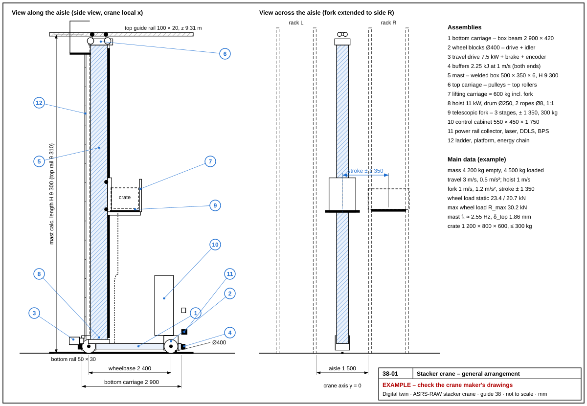

### 5.1 Main data (same as item 1 and guide 31 – example)

| Item | Value (example – the crane maker's drawings decide) |
|---|---|
| rack | 2 sides × 14 bays × 2 crates × 7 levels = 392 slots, 27.05 m long, 9.5 m high |
| aisle width | 1 500 mm |
| unit load | steel crate 1 200 × 800 × 600 mm, max 300 kg |
| travel | 3.0 m/s, 0.5 m/s² |
| hoist | 1.0 m/s, 0.5 m/s² |
| fork | ± 1 350 mm, 1.0 m/s, 1.2 m/s², 2.18 s per stroke |
| moving mass | 4 200 kg empty, 4 500 kg with the load |
| mast | welded box 500 × 350 × 6 mm, calculation height H = 9 300 mm |
| wheels | Ø400, wheelbase 2 400 mm, drive under the mast |
| drives | travel 7.5 kW, hoist 11 kW, fork 1.1 kW |
| cycle (FEM 9.851) | single cycle 34.8 s (103 /h), dual cycle 57.8 s (125 /h) |

### 5.2 Coordinates used in the twin

The crane uses the same coordinates as item 1 (`asrscore.js`):

* **x** along the aisle, + towards the rear end of the rack. The fork centre is x = 0.
* **y** across the aisle, rack side L = −y, side R = +y.
* **z** up from the floor.

Important x positions: mast axis x = −0.75 m, drive wheel x = −1.05 m, idler wheel x = +1.35 m, cabinet x ≈ +1.15 m.
The bottom carriage is 2.9 m long with its centre at x = +0.20 m.

### 5.3 Mass breakdown (guide 31 §7.4)

| Mass item | kg | x (m) | CG height (m) |
|---|---|---|---|
| bottom carriage + drives (incl. wheel blocks, hoist drum + motor) | 1 600 | +0.20 | 0.4 |
| mast (with rails, ladder, ducts) | 1 000 | −0.65 | 5.0 |
| lifting carriage + fork | 600 | 0 | 8.3 (top level) |
| cabinet, platform, misc. | 800 | +1.0 | 1.0 |
| top carriage | 200 | −0.65 | 9.4 |
| load | 300 | 0 | 8.3 |
| **total** | **4 500** | | Σ m·h = 15 790 kg·m |

Note: the BOM of §19 adds up to ≈ 4 170 kg (without the load) – close to the 4 200 kg used for the drives and the
cycle time. In the BOM the mast with rails and foot flange is ≈ 1 255 kg (more than the 1 000 kg above). With 1 255 kg
the first natural frequency becomes 2.48 Hz instead of 2.55 Hz (§7.3) – small effect, but ask the maker for the real
mass of the mast.

### 5.4 The assemblies in one table

| No. on GA | Assembly | Make / buy (example) | Mass (kg, example) | Main job |
|---|---|---|---|---|
| 1 | bottom carriage box beam | make | 650 | carries everything at the floor |
| 2 | wheel blocks (drive + idler) + guide rollers | make or buy | 260 + 220 | puts the crane on the rail, guides it |
| 3 | travel drive | buy | 120 | moves the crane along the aisle |
| 4 | buffers | buy | 2 × 8 | last stop at the aisle end |
| 5 | mast + guide rails + foot flange | make | ≈ 1 000 – 1 255 | column for the carriage, stiffness |
| 6 | top carriage + top guide rollers + pulleys | make | 200 | keeps the mast top in line, turns the ropes |
| 7 | lifting carriage + rollers + safety catch + load pins | make (+ buy) | ≈ 400 | carries the fork up and down |
| 8 | hoist: drum, motor, ropes | make + buy | ≈ 300 | lifts carriage + load |
| 9 | telescopic fork | make or buy | 200 | puts the crate into the slot |
| 10 | electrical cabinet | buy / build | 250 | drives, PLC I/O, safety |
| 11 | collector, laser, DDLS, bar-code | buy | ≈ 15 | power, position, data |
| 12 | ladder + platform | make or buy | 150 | maintenance access |
| – | energy chain | buy | 30 | cables to the carriage |

---

## 6. Every assembly explained

For each assembly: **what it does** (simple words), **how it is built**, **important dimensions**, **material**,
**tolerances**, **how it fails**, **what to check**. All values are examples – the crane maker's drawings decide.

### 6.1 Bottom carriage (welded box beam)

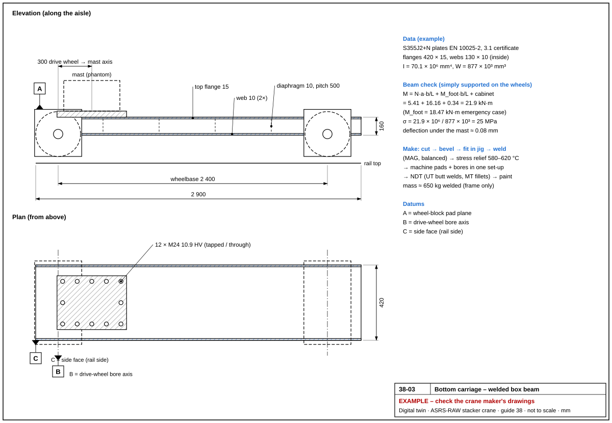

**What it does.** The bottom carriage is the backbone at the floor. It carries the mast, the hoist drive, the
cabinet and puts all the weight onto the two wheels. When the crane accelerates or brakes, the mast tries to bend
backwards or forwards; the bottom carriage must take this **clamping moment** without bending too much.

**How it is built.** A welded **box beam** from four plates:

```
        top flange 15 mm
     ┌───────────────────────┐
     │┌─────────────────────┐│
web  ││                     ││ web
10 mm││   diaphragm 10 mm   ││ 10 mm      160 mm deep
     ││   (every ≈ 500 mm)  ││
     │└─────────────────────┘│
     └───────────────────────┘
        bottom flange 15 mm
     |<------- 420 mm ------->|
```

* length 2 900 mm, width 420 mm, depth 160 mm in the middle section (low, so the fork can reach the lowest level);
* flanges 15 mm, webs 10 mm, **internal diaphragms** 10 mm every ≈ 500 mm and under each concentrated load
  (wheel pads, mast pad);
* at each end a **wheel-block pad** (machined face) – the wheel blocks are bolted on;
* near the drive wheel the **mast pad** 620 × 480 × 40 mm with 12 threaded / through holes for the M24 bolts of
  the mast flange; the mast axis is 0.30 m from the drive wheel axis;
* brackets for the hoist drive, the cabinet, the buffers, the current collector, the bar-code reader.

**Material.** S355J2+N plates (EN 10025-2) with inspection certificate 3.1 (EN 10204). The 40 mm pad may need
Z-quality (through-thickness, Z25) if the mast foot pulls on it – check with the maker.

**Tolerances (example).** wheel-block pads flat 0.05 mm and coplanar 0.1 mm; mast pad flat 0.1 mm;
welded dimensions ISO 13920 class B; machined dimensions ISO 2768-mK.

**Why diaphragms?** A thin web under a heavy point load buckles (wrinkles) locally. The diaphragm carries the load
into both webs and keeps the box square during welding. Important: once the top flange is welded on, **you cannot
see the diaphragms any more** – the fit-up and welds of the diaphragms are a **hold point** before closing the box.

**How it fails.** Fatigue cracks at the welds around the mast pad (every acceleration and braking is one stress
cycle); distortion after welding → wheel pads not parallel → the crane "crabs" (runs skew) → guide-roller wear.

**What to check.** Yearly visual check + MT of the mast-pad welds; wheel alignment; torque of the mast flange bolts.

### 6.2 Wheel blocks, wheels, guide rollers and rails

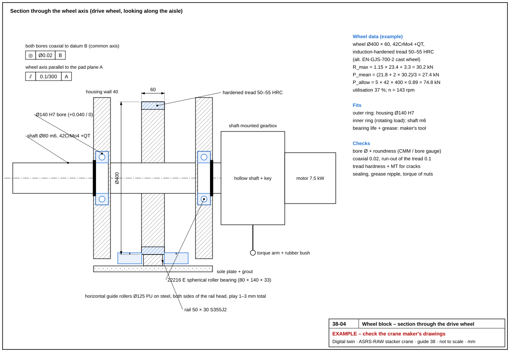

**What they do.** Two wheel blocks carry the crane on the bottom rail: the **drive** block under the mast
(x = −1.05 m) and the **idler** block at the other end (x = +1.35 m), wheelbase 2 400 mm. The wheels have **no
flanges**: two **horizontal guide rollers** per block run on both sides of the rail head and keep the crane on line.

**How a wheel block is built.**

```
            housing (welded S355, side walls 30 mm)
     ┌──────────────────────────────────────────┐
     │  bearing 22216 E          bearing 22216 E │
     │  ┌──────┐   ┌────────────┐   ┌──────┐     │
 ────┼──┤ Ø140 ├───┤ wheel Ø400 ├───┤ Ø140 ├─────┼──── shaft Ø80 m6 ──► gearbox (drive block)
     │  │  H7  │   │ tread 60   │   │  H7  │     │
     │  └──────┘   └─────┬──────┘   └──────┘     │
     └───────────────────┼──────────────────────┘
          guide roller ○ ┃ ○ guide roller  (Ø125 PU, both sides of the rail head)
                     ════╩════  rail 50 × 30
```

| Part | Data (example) |
|---|---|
| wheel | Ø400 × 60 mm tread, 42CrMo4 +QT, tread induction-hardened 50–55 HRC (alternative: ductile iron EN-GJS-700-2) |
| shaft | Ø80 m6 at the bearing seats, 42CrMo4 +QT, shoulders with radius R2 |
| bearings | 2 × spherical roller bearing 22216 E (80 × 140 × 33) |
| bearing bores | Ø140 H7, coaxial 0.02 mm (line-bored in one set-up) |
| guide rollers | Ø125 × 50, PU 92–95 Shore A on a steel hub, eccentric axle, total play 1–3 mm to the 50 mm rail head |
| block mass | ≈ 260 kg (drive), ≈ 220 kg (idler) |

**Wheel load** (from §7.4): static 23.4 kN (drive) and 20.7 kN (idler); maximum 30.2 kN with dynamic factor and tilt.

**Rails (building side – not part of the crane, but decisive).**

| Rail | Data (example) |
|---|---|
| bottom rail | flat bar 50 × 30 S355J2 (or crane rail A45 / A55) on sole plates, rail clamps every 0.6 m, non-shrink grout |
| top guide rail | flat bar 100 × 20 under the rack top ties, centre z = 9.31 m, adjustable ± 10 mm |
| bottom rail tolerances | straightness ± 1 mm / 2 m, level ± 2 mm, joint step < 0.5 mm, gap < 1 mm |
| top rail | axis within ± 2–3 mm of the bottom rail axis (plumb line) |

**Why no flanges?** A wheel flange rubs on the rail side when the crane runs skew – wear and noise. Guide rollers roll
instead of rubbing, are quiet and easy to adjust. Standard on stacker cranes (guide 31 §A.3).

**How they fail.** Wheel flats after emergency stops with slip; bearing failure (no grease, misaligned bores);
spalling of the hardened tread; PU tread loss on the guide rollers; flat spots after a long standstill.

**What to check.** Monthly: noise, tread wear, flats, guide-roller gap. Grease per plan. Yearly: wheel alignment.

### 6.3 Travel drive and buffers

**Travel drive – what it does.** Moves the crane along the aisle at 3 m/s with 0.5 m/s².
A **helical-bevel geared motor** is pushed directly onto the drive wheel shaft (hollow shaft, "shaft-mounted") and
held by a **torque arm** with rubber bushes. Motor with brake and encoder; inverter in the cabinet.

| Data (example, guide 31 §7.6) | Value |
|---|---|
| traction force | F = m·a·k_rot + w·m·g = 4 500 × 0.5 × 1.05 + 0.01 × 4 500 × 9.81 = 2 362 + 441 = **2 804 N** |
| peak power | P = F·v/η = 2 804 × 3.0 / 0.90 = **9.35 kW** → motor 7.5 kW (150 % overload for 2–3 s) |
| wheel torque | F·D/2 = 2 804 × 0.2 = **561 N·m** |
| wheel speed | n = v / (π·D) = 3.0 / (π × 0.4) × 60 = **143 rpm** → gear ratio i ≈ 1 450 / 143 = 10 |
| slip check | μ·R_drive = 0.15 × 23.4 kN = 3.5 kN > 2.8 kN needed (margin only 1.25 → limit the brake ramp) |

**Why a torque arm with rubber bushes?** If the gearbox housing were bolted rigidly to the carriage, any small
misalignment between the wheel shaft and the gearbox would bend the shaft every revolution → shaft fatigue,
bearing damage. The torque arm only stops the housing from turning.

**Buffers – what they do.** At both ends of the bottom carriage. They stop the crane if the slowdown and limit
switches fail. Sized for the monitored reduced speed at the aisle end (EN 528):

```
E = ½ · m · v² = ½ × 4 500 × 1.0² = 2 250 J = 2.25 kJ
with 100 mm stroke: mean force F = E / s = 2 250 / 0.1 = 22 500 N  →  deceleration a = F / m = 5.0 m/s²
```

PU cellular buffers (simple) or hydraulic shock absorbers (constant force, shorter). After a buffer hit: inspect crane
and rail stop before restart.

### 6.4 Mast (welded box) and guide rails

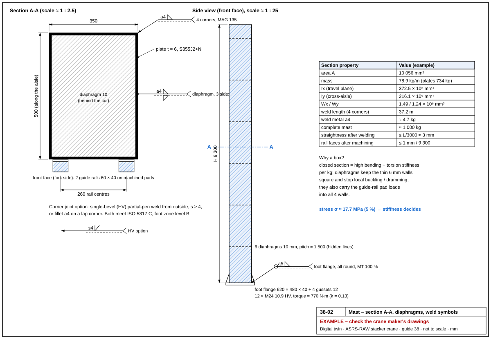

**What it does.** The mast is the vertical column. It carries the lifting carriage and is the guide for it.
It is designed for **stiffness**, not for strength: the stress is only ≈ 18 MPa (§7.3), but a soft mast swings
longer after every stop and costs cycle time. Its first natural frequency is ≈ 2.5 Hz.

**How it is built.**

```
   section A-A (looking down)            side view
                                          ┌──┐ top carriage
   guide rails 60 × 40 on pads            │  │
     ▼            ▼                       │  │ diaphragm  ── z ≈ 7.8 m
   ┌─█────────────█─┐  front face 338 × 6 │  │
   │                │  (carriage side)    │  │ diaphragm  ── z ≈ 6.3 m
   │   diaphragm    │                     │  │   ...  6 pcs, pitch ≈ 1 500
   │   10 mm with   │ side plate          │  │
   │   cable hole   │ 500 × 6             │  │
   │                │                     │  │
   └────────────────┘  back face 338 × 6  ├──┤ foot flange 620 × 480 × 40
     ◄── 350 ──►        (ladder side)    ═╧══╧═ bolted to the bottom carriage (12 × M24 10.9)
   (500 along the aisle)
```

| Item | Data (example) |
|---|---|
| section | box 500 (along the aisle) × 350 (across) × 6 mm |
| plates | 2 side plates 500 × 6 × 9 300, 2 face plates 338 × 6 × 9 300 |
| corner welds | 4 longitudinal seams, fillet a 4 (or HV partial penetration), 4 × 9.3 m = 37.2 m |
| diaphragms | 6 pcs, 10 mm, 338 × 488 with corner cut-outs (weld relief) and a cable hole, pitch ≈ 1 500 mm |
| section values | A = 10 056 mm², Ix = 372.5 × 10⁶ mm⁴ (travel plane), Iy = 216.1 × 10⁶ mm⁴ (across), 78.9 kg/m |
| foot flange | 620 × 480 × 40 mm, 4 gussets 15 mm, fillet a 5 all round |
| bolted joint | 12 × M24 10.9 HV (EN 14399), torque ≈ 770 N·m (k-class 0.13), preload 247 kN each |
| guide rails | 2 × flat bar 60 × 40, bright-drawn C45 (or S355J2), on machined pads, M12 every 500 mm, at y = ± 0.13 m |
| mass | plates 734 kg + diaphragms 78 kg + rails 2 × 171 kg + flange 95 kg |

**Why a bolted flange?** A 9.3 m mast on a 2.9 m carriage does not fit on a normal truck as one piece and is hard to
paint and machine. The crane is shipped in 2 (or more) parts and bolted together on site. The flange face is machined
flat (0.1 mm) and square to the mast axis – otherwise the mast leans.

```
perpendicularity needed: 2 mm plumb at 9 300 mm  →  2 / 9 300 × 600 = 0.13 mm over the 600 mm flange
```

**Why the guide rails are separate bars on machined pads.** A welded box is never perfectly straight
(≈ L/3000 ≈ 3 mm after welding). The rail pads are machined in **one line** and the bright-drawn rails are bolted on –
the running faces are then straight within ≤ 1 mm over 9.3 m. Hardened or replaceable rails also take the roller wear.

**Tolerances (example).** welded straightness ≤ 3 mm (L/3000); twist ≤ 2 mm; guide-rail running faces ≤ 1 mm over
9.3 m and ≤ 0.5 mm per 3 m, parallel to each other ± 0.5 mm; mast plumb on site ± 2 mm at the top.

**How it fails.** Fatigue crack at the foot weld (high jerk, sharp transitions, no smooth toe); loose rail bolts;
dent after a collision; lamellar tearing in the flange under the foot weld (wrong plate quality).

**What to check.** Yearly VT + MT at the foot; rail bolt torque; plumb; flange bolt torque (mark the nuts).

### 6.5 Top carriage / top guide

**What it does.** The top carriage is a welded frame on the mast head. It holds the **two rope pulleys** and two
pairs of **top guide rollers** that clamp the top rail. The top guide keeps the mast top vertical **across** the aisle.
It does not carry weight – only cross-aisle forces (≈ 0.5 kN with the fork extended, guide 31 §7.3).

| Item | Data (example) |
|---|---|
| frame | 700 × 450 × 180 mm, S355J2+N plates 10–15 mm, ≈ 200 kg |
| pulleys | 2 × Ø320 (D/d = 320 / 8 = 40), axles 42CrMo4, bores H7 |
| top guide rollers | 2 pairs Ø150 × 60, PU 92 Shore A on steel, spring pre-load ≈ 300 N each |
| top rail | flat bar 100 × 20, z = 9.31 m |

```
            top rail 100 × 20 (under the rack top ties)
          ═══════════════════════════════
            ○ ┃ ○          ○ ┃ ○      ← top guide rollers, spring loaded, both sides of the rail
          ┌──────────────────────────┐
          │  (O) pulley    (O) pulley│  ← top carriage frame on the mast head
          └──────────┬───────────────┘
                     │ mast
```

**Why springs?** The top rail is never perfectly straight (± 2–3 mm). Spring-loaded rollers follow it without a
hard knock and without forcing the mast.

**How it fails / check.** Roller wear → the mast sways across; pulley bearing noise. Monthly roller check, pulley
groove wear with a gauge.

### 6.6 Lifting carriage, safety catch, overload / slack-rope sensing

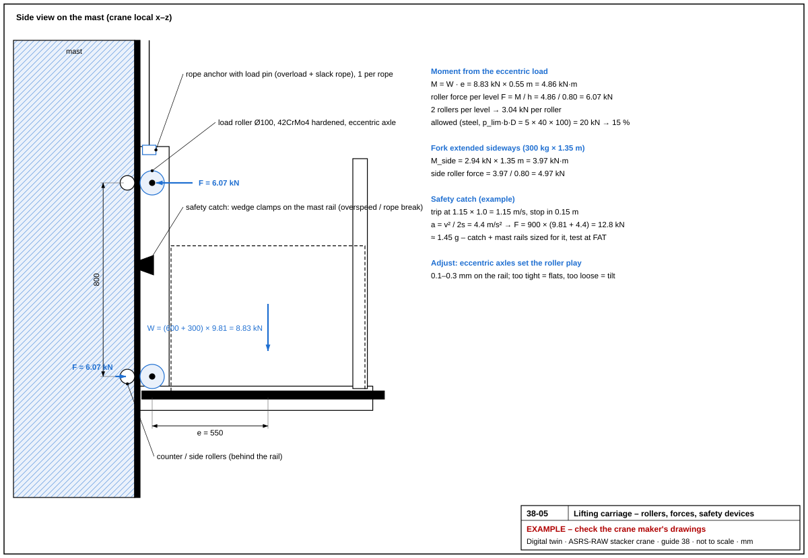

**What it does.** The lifting carriage runs up and down the mast. It carries the telescopic fork, the sensors
(occupancy, overhang, fine positioning) and holds the rope ends.

**How it is built.** A welded frame: a 12 mm back plate on the mast face, two side arms 960 mm long, front posts
and cross members. Guide rollers on the mast rails:

* **4 load rollers** Ø100 × 40 (2 levels, 800 mm apart, 2 rollers per level) – they take the tilting moment of the
  cantilevered fork;
* **4 side rollers** – they take the cross force when the fork is out to the left or right;
* rollers on **eccentric axles**: turn the axle to set zero play.

```
          mast rails
            ║   ┌─── back plate 12 mm
   roller ○ ║   │═══════════════════  side arm 960  ──── fork + crate  (W = 8.83 kN)
            ║   │                                          │
            ║   │     800 mm                               │ e = 0.55 m from the rollers
            ║   │                                          ▼
   roller ○ ║   │═══════════════════
            ║   └─── safety catch (wedge clamp on the rails) + load pins at the rope anchors
```

Forces (from §7.6): moment 4.86 kN·m → 6.07 kN per roller level → 3.04 kN per roller (15 % of allowable);
side rollers 4.97 kN with the fork out.

**Safety catch.** If the carriage falls (rope break, brake failure), an overspeed trigger releases **wedges** that grip
the mast rails and stop the carriage softly. Example: trip at 1.15 × 1.0 = 1.15 m/s, stop in ≈ 0.15 m →
4.4 m/s², force ≈ 12.8 kN (≈ 1.45 g including gravity). The device must be type-tested and function-tested
yearly (EN 528, maker's procedure).

**Overload + slack-rope sensing.** A **load pin** at each rope anchor measures the rope force:

| Signal | Meaning | Reaction |
|---|---|---|
| force > ≈ 110 % of rated | overload (too heavy crate, carriage caught) | stop lifting, alarm |
| force ≪ normal | slack rope (carriage set down or stuck, rope broken) | stop the hoist, no more lowering |
| force rope 1 ≠ rope 2 by > 10 % | ropes not equal length / one rope damaged | alarm, adjust |

**How it fails.** Cracks at the side-arm roots (cantilever, fatigue); roller flats; wrong pre-load → carriage tilts;
catch seized because it was never tested; load-pin drift; cable damage in the energy chain.

**What to check.** Monthly roller play (carriage tilt); yearly MT at the arm roots and catch test; load-pin test with
the test load.

### 6.7 Hoist: drum, ropes, pulleys (example = wire rope)

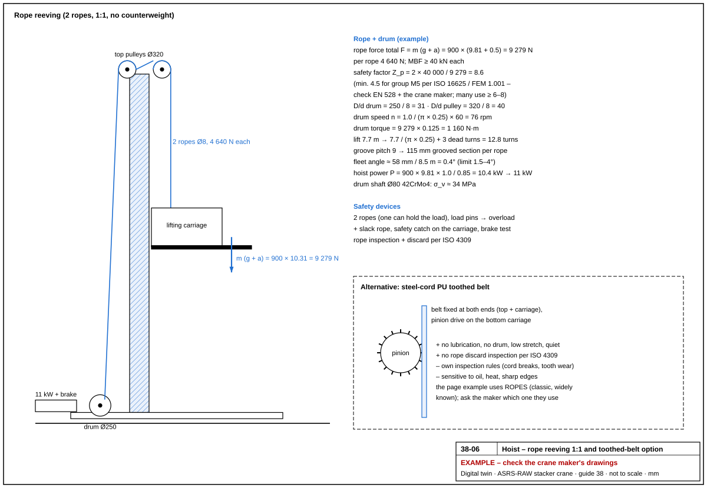

#### 6.7.1 What it does

The hoist lifts carriage + fork + load (600 + 300 = 900 kg) at 1 m/s. The geared motor and the drum sit on the
bottom carriage (low CG, easy maintenance). Two ropes run up the back of the mast, over the two top pulleys and down
the front to the carriage: **1:1 reeving** (rope speed = carriage speed).

```
            (O)  (O)   top pulleys Ø320
            │ │  │ │
   2 ropes  │ │  │ │  2 ropes to the carriage
   up the   │ │  │ │
   mast back│ │  [carriage]
            │ │
          [drum Ø250] ← geared motor 11 kW + brake (on the bottom carriage)
```

#### 6.7.2 Data (example)

| Item | Value |
|---|---|
| hoisted mass | 900 kg (no counterweight) |
| motor | 11 kW, i ≈ 19, brake + encoder; P = 900 × 9.81 × 1.0 / 0.85 = 10.4 kW |
| drum | Ø250 (D/d = 31), shell 12 mm, groove pitch 9 mm, 2 grooved sections × 115 mm, opposite hand |
| drum speed / torque | 76 rpm, 1 160 N·m |
| ropes | 2 × Ø8 mm, MBF ≥ 40 kN each, galvanised compacted strand; ≈ 20 m each |
| rope force | 9 279 N total, 4 640 N per rope → Z_p = 8.6 |
| pulleys | Ø320 (D/d = 40) |
| turns on the drum | 7.7 m lift / (π × 0.25) + 3 dead turns = 12.8 turns |
| fleet angle | ≈ 0.4° (limit ≈ 1.5–4° per rope maker) |

#### 6.7.3 Why two ropes and opposite-hand grooves?

* **Two ropes:** if one rope breaks, the other still holds the carriage; the safety catch is the last line.
  Both ropes are replaced together.
* **Opposite hand** (one section left-hand, one right-hand groove): the two ropes move symmetrically on the drum,
  the carriage does not get a side pull. Same-hand grooves are a typical manufacturing mistake (§14.7).
* **3 dead turns** stay on the drum at the lowest position: the rope clamp at the drum end only holds the
  remaining force after friction.

#### 6.7.4 The toothed-belt alternative

Many newer cranes use a **steel-cord polyurethane toothed belt** instead of ropes:

* belt anchored at the carriage, runs over a toothed drive pulley at the bottom and a deflection pulley at the top;
* no winding, no grooves, no lubrication; low stretch;
* breaking strength and discard rules come from the belt maker (Gates, ContiTech, Brecoflex – check);
* overload and slack detection similar (load cell at the anchor);
* the minimum pulley diameter is set by the belt type (number of teeth in mesh, cord bending).

Ask the crane maker which one they use and for the inspection rules.

### 6.8 Telescopic fork (3 stages)

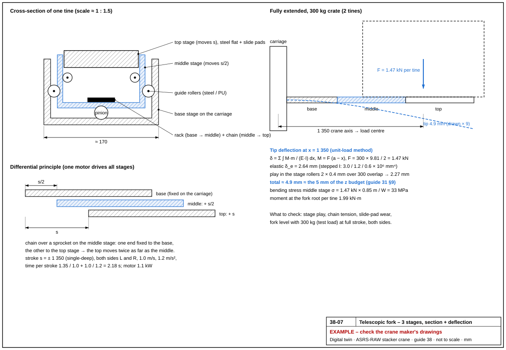

**What it does.** Two tines go under the crate, lift it 100 mm and pull it onto the carriage – to both sides
(L and R).

**How it is built.** Each tine has **3 stages**:

| Stage | Moves | Data (example) |
|---|---|---|
| base stage | fixed on the carriage, carries the pinion | ≈ 170 mm wide, I ≈ 3.0 × 10⁶ mm⁴, ≈ 45 kg per tine |
| middle stage | half the stroke (s/2), rack + chain sprockets | ≈ 140 mm wide, I ≈ 1.2 × 10⁶ mm⁴, ≈ 30 kg |
| top stage | full stroke s = 1 350 mm, goes under the crate | ≈ 110 mm wide, I ≈ 0.6 × 10⁶ mm⁴, wear strips, ≈ 22 kg |

**The differential principle.** A pinion in the base stage drives a rack on the middle stage. A chain is fixed to the
base stage, runs over a sprocket on the middle stage and is fixed to the top stage. When the middle stage moves s/2,
the chain pulls the top stage by another s/2 relative to the middle → s relative to the base. One motor (1.1 kW)
drives both tines through a cross shaft.

```
 base   ═══════════════════                          (fixed)
 middle      ══════════════════════                  (moved s/2 = 675 mm)
 top              ════════════════════════════       (moved s = 1 350 mm)
                                    [  crate  ]
```

**Deflection at full reach** (§7.7): 2.6 mm elastic + 2.3 mm from roller play = **4.9 mm** at the tip with 300 kg.
That fits the ± 5 mm "fork deflection" line of the positioning budget (guide 31 §9). The stages are **pre-cambered**
(≈ 2 mm upwards at the tip) in manufacturing so that the loaded fork is nearly level.

**How it fails.** Chain stretch → stages out of step; rack tooth wear; slide pads / rollers worn → stages sag;
bent tip after a collision.

**What to check.** Daily visual; 3-monthly chain tension and fork level; deflection test with the test load.

### 6.9 Electrics, positioning and data on the crane

| Item | Job | Example (see buy list) |
|---|---|---|
| electrical cabinet 550 × 450 × 1 750, IP54 | PLC / safety I/O, inverters travel 7.5 + hoist 11 + fork 1.1 kW with shared DC link, braking resistor or regeneration | Rittal cabinet, SEW / Siemens / Lenze drives |
| conductor-rail collector | 400 V 3~ + PE (double brush) from the rail along the aisle, ≈ 60 A | Vahle KBH / U10, Conductix-Wampfler 0812 / 0813 |
| laser distance sensor x | absolute travel position to a reflector at the aisle end | SICK DL100 Pro, Leuze AMS 300i |
| laser distance sensor z | carriage height to a reflector at the mast head | as above |
| bar-code positioning (BPS) | second, independent travel position (safety: two channels) | Leuze BPS 300i, SICK OLV |
| optical data link (DDLS) | PROFINET to the fixed PLC at the aisle end, 100 Mbit/s | Leuze DDLS 500, SICK ISD 400 |

Mechanical points for the workshop: **anti-vibration mounts** for the cabinet; rigid brackets for the laser and DDLS
(a bracket that vibrates gives a noisy position); collector towing arm in the middle of its travel (± 20 mm);
cable ducts with edge protection. Circuits: guide 33; control: guide 32.

### 6.10 Ladder and maintenance platform

* Ladder on the back of the mast, 400 mm wide, rungs every 280 mm, **fall-arrest rail** in the middle
  (EN ISO 14122-4, EN 353-1), ≈ 90 kg.
* Platform at the mast head 600 × 800 mm with handrail 1.1 m, knee rail and toe board (EN ISO 14122-3), ≈ 60 kg.
* Access only with the crane in maintenance mode (key switch, guide 31 §7.13).
* Typical failures: fall-arrest runner missing, end stop missing, platform used while the crane is in AUTO.

### 6.11 Energy chain (bottom carriage → lifting carriage)

The fork motor, the sensors on the carriage and the load pins need cables. A **hanging energy chain** (igus E4 / E2)
runs along the mast from the bottom carriage to the carriage, travel 7.7 m. Use **chain-rated cables**
(igus chainflex, Lapp ÖLFLEX CHAIN); bending radius ≥ 10 × cable Ø (check the cable datasheet). Normal cables break
inside the chain after some 100 000 cycles – a classic failure.

---

## 7. Load path and design calculations

All numbers in this chapter were checked with a Python script (stdlib only, §25). Material constants: E = 210 000 N/mm²,
g = 9.81 m/s². Simplified models for understanding – the crane maker designs the crane per FEM 9.831 / EN 528 with the
full load cases (guide 31 §A.2). **Example values – the crane maker's drawings decide.**

### 7.1 The load path in words

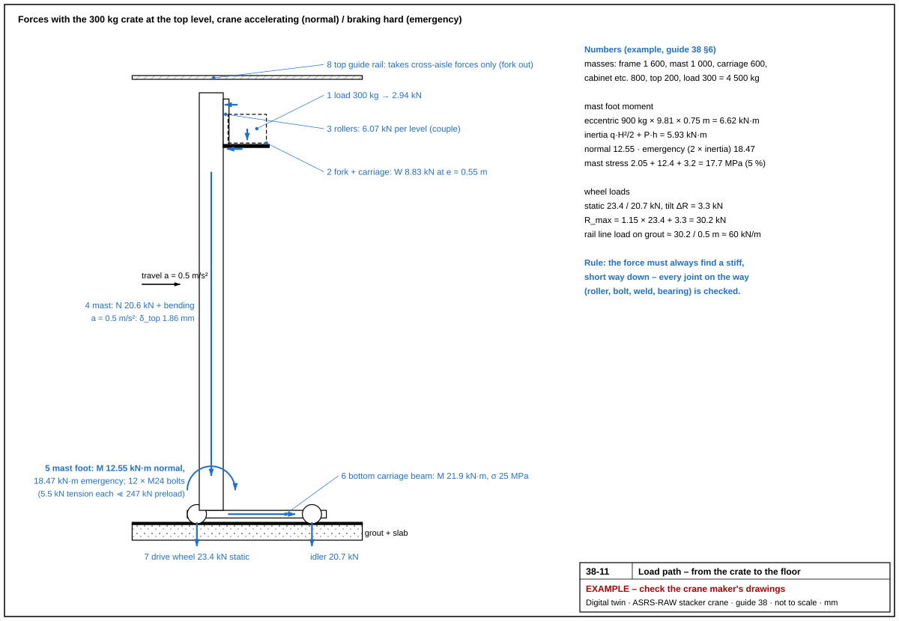

Follow the 300 kg crate down to the floor:

| Step | From → to | Force / moment (example) |
|---|---|---|
| 1 | crate → fork tines (2 tines) | 300 × 9.81 = 2 943 N = 2.94 kN, 1.47 kN per tine |
| 2 | fork → lifting carriage | carriage + fork + load = 900 kg → W = 8.83 kN, acting 0.55 m in front of the rollers |
| 3 | carriage → guide rollers → mast rails | tilting moment 4.86 kN·m → 6.07 kN per roller level (push / pull pair) |
| 4 | carriage → ropes → top pulleys → mast head | rope force 9.28 kN (with hoist acceleration) goes down the mast as compression |
| 5 | mast → mast foot | N = 20.6 kN (mast + top + carriage + load), M = 12.55 kN·m normal / 18.47 kN·m emergency |
| 6 | foot flange → 12 bolts → mast pad | bolt tension from the moment ≈ 5.5 kN each (preload 247 kN – the joint never opens) |
| 7 | mast pad → bottom box beam | beam moment 21.9 kN·m → 25 MPa |
| 8 | beam → wheel blocks → wheels | drive 23.4 kN, idler 20.7 kN static; max 30.2 kN |
| 9 | wheels → rail → sole plates → grout → floor slab | line load on the grout ≈ 60 kN/m (guide 31 §7.4) |
| side | fork out sideways → mast bends across → top guide rollers + bottom guide rollers | side moment 3.97 kN·m; top guide force ≈ 0.5 kN |

**The simple rule:** every force must find a stiff, continuous way to the floor. Wherever the path changes direction
(carriage arm root, mast foot, mast pad, wheel pads) you find a **weld that needs care** and a **diaphragm or gusset**.

### 7.2 Mast – inertia forces when the crane accelerates

When the crane accelerates with a = 0.5 m/s², the mast is like a vertical cantilever clamped in the bottom carriage.

* own mass of the mast = uniform load: q = m_mast · a / H = 1 000 × 0.5 / 9 300 = **0.0538 N/mm**
* carriage + load = point load at the carriage height h = 8 000 mm: P = (600 + 300) × 0.5 = **450 N**

Moment at the mast foot from inertia:

```
M_inertia = q·H²/2 + P·h = 0.0538 × 9 300² / 2 + 450 × 8 000 = 2.33 + 3.60 = 5.93 kN·m
```

Moment from the **eccentric weight** (the carriage hangs 0.75 m in front of the mast axis):

```
M_ecc = (600 + 300) × 9.81 × 750 = 6.62 kN·m     (always there, even at standstill)
```

Load cases (simplified):

| Case | Formula | M at the foot |
|---|---|---|
| normal travel | M_ecc + M_inertia = 6.62 + 5.93 | **12.55 kN·m** |
| emergency stop (inertia × 2, example) | M_ecc + 2 × M_inertia = 6.62 + 11.85 | **18.47 kN·m** |

### 7.3 Mast – stress, deflection, natural frequency, static lean

**Section values** (box 500 × 350 × 6):

```
A  = 350 × 500 − 338 × 488                          = 10 056 mm²       → 78.9 kg/m
Ix = (350 × 500³ − 338 × 488³) / 12                 = 372.5 × 10⁶ mm⁴  (bending in the travel plane)
Iy = (500 × 350³ − 488 × 338³) / 12                 = 216.1 × 10⁶ mm⁴  (bending across the aisle)
Wx = Ix / 250 = 1.490 × 10⁶ mm³        Wy = Iy / 175 = 1.235 × 10⁶ mm³
```

**Stress at the mast foot (emergency case, conservative sum):**

| Part | Formula | σ (MPa) |
|---|---|---|
| axial | N / A = 20 601 / 10 056 | 2.05 |
| bending in the travel plane | M_em / Wx = 18.47 × 10⁶ / 1.490 × 10⁶ | 12.40 |
| bending across (fork out, 300 kg × 1.35 m = 3.97 kN·m) | 3.97 × 10⁶ / 1.235 × 10⁶ | 3.22 |
| **total** | | **17.7** |
| allowed (S355, f_y / γ = 355 / 1.1) | | 323 → utilisation **5 %** |

**Deflection at the mast top from acceleration:**

```
δ_q = q·H⁴ / (8·E·Ix)               = 0.0538 × 9 300⁴ / (8 × 210 000 × 372.5e6)                = 0.64 mm
δ_P = P·h²·(3H − h) / (6·E·Ix)      = 450 × 8 000² × (27 900 − 8 000) / (6 × 210 000 × 372.5e6) = 1.22 mm
δ   = 0.64 + 1.22                                                                               = 1.86 mm
```

A sudden step in acceleration (no jerk limit) roughly doubles this (≈ 3.7 mm) – that is why the control uses
S-curves (guide 32).

**First natural frequency:**

```
k    = 3·E·Ix / H³ = 3 × 210 000 × 372.5e6 / 9 300³          = 292 N/mm = 292 kN/m
m_eq = 0.24 × m_mast + m_carriage + m_load = 0.24 × 1 000 + 600 + 300 = 1 140 kg
f₁   = √(k / m_eq) / (2π) = √(291 730 / 1 140) / 6.283         = 2.55 Hz      (same as item 1 / guide 31)
```

Sensitivity: mast 1 255 kg (BOM mass) → m_eq = 1 201 kg → f₁ = 2.48 Hz. Wall 4 mm instead of 6 mm (mast mass × 4/6)
→ f₁ ≈ 2.2 Hz.

**Static lean.** The eccentric weight bends the mast permanently forward:

```
lean at h = M_ecc · h² / (2·E·Ix) = 6.62e6 × 8 000² / (2 × 210 000 × 372.5e6) = 2.71 mm
```

This is not a vibration – it is constant for one carriage height and changes slowly with the height. The **teach-in
table** of the slot positions (guide 31 §9) includes it automatically.

**What this tells you:** the stress is tiny (5 %). The mast size is chosen for **stiffness** (deflection, frequency,
settling time) and **fatigue** at the foot weld, not for strength. A lighter mast would carry the load, but the crane
would wait longer after each stop.

**Fatigue range at the mast** (accelerate + brake):

```
Δσ = 2 · M_inertia / Wx = 2 × 5.93e6 / 1.490e6 = 7.95 MPa
```

Very low compared with the fatigue strength of welded details (FAT 36 … 80 MPa at 2 million cycles, EN 1993-1-9).

### 7.4 Wheel loads (guide 31 §7.4)

Moments about the drive wheel (x = −1.05 m), loaded crane:

```
Σ m·(x + 1.05) = 1 600 × 1.25 + 1 000 × 0.40 + 900 × 1.05 + 800 × 2.05 + 200 × 0.40 = 5 065 kg·m
R_idler = 5 065 / 2.4 × 9.81 / 1 000 = 20.7 kN       R_drive = 4 500 × 9.81 / 1 000 − 20.7 = 23.4 kN
tilt from acceleration  ΔR = a · Σm·h / wheelbase = 0.5 × 15 790 / 2.4 = 3 290 N = 3.29 kN
R_max = φ · R_static + ΔR = 1.15 × 23.4 + 3.3 = 30.2 kN        (φ = 1.15 dynamic factor, example)
```

Wheel check (DIN 15070 / FEM 1.001 idea – steel wheel on a flat rail):

```
P_min  = drive wheel, crane empty = 21.8 kN
P_mean = (P_min + 2 · P_max) / 3 = (21.8 + 2 × 30.2) / 3 = 27.4 kN
n = 3.0 / (π × 0.4) × 60 = 143 rpm → speed factor c1 ≈ 0.89
P_allow = p_lim · b_eff · D · c1 = 5.0 × 42 × 400 × 0.89 = 74.8 kN       (b_eff = 50 − 2 × 4 mm edge radii)
utilisation = 27.4 / 74.8 = 37 %
```

### 7.5 Bottom carriage box beam

Model: simply supported beam on the two wheels, span L = 2 400 mm. The mast foot sits a = 300 mm from the drive wheel
(b = 2 100 mm from the idler). Section: box 420 × 160, flanges 15, webs 10.

```
I = (420 × 160³ − 400 × 130³) / 12 = 70.1 × 10⁶ mm⁴            W = I / 80 = 877 × 10³ mm³
moment from the vertical mast load     M_V   = N · a · b / L = 20 601 × 300 × 2 100 / 2 400 = 5.41 kN·m
moment from the mast foot moment       M_M   = M_em · b / L  = 18.47 × 2 100 / 2 400         = 16.16 kN·m
moment from the cabinet (7.85 kN at 2 050 mm from the drive wheel)
                                       M_cab = 7 848 × 350 / 2 400 × 300                    = 0.34 kN·m
M = 5.41 + 16.16 + 0.34 = 21.9 kN·m          σ = 21.9e6 / 877e3 = 25 MPa
deflection at the mast foot from N:  δ = N·a²·b² / (3·E·I·L) = 0.08 mm
```

The beam is not stressed much either – but its **flatness after welding** and the **coplanarity of the wheel pads**
decide whether the crane runs straight. That is a manufacturing problem (§10, §11), not a strength problem.

### 7.6 Lifting carriage rollers

```
W = (600 + 300) × 9.81 = 8 829 N         lever e = 550 mm (rollers → CG of carriage + load)
M = W · e = 8 829 × 0.55 = 4.86 kN·m
force per roller level  F = M / h = 4.86 / 0.80 = 6.07 kN   → 2 rollers per level → 3.04 kN per roller
allowable (steel roller, p_lim · b · D = 5.0 × 40 × 100) = 20 kN → utilisation 15 %
side rollers with the fork out: 300 × 9.81 × 1 350 / 800 = 4.97 kN
```

Note: bought track rollers are rated by their bearing (C₀, C) and by the track contact – use the roller maker's table.

### 7.7 Telescopic fork deflection

Per tine: F = 300 × 9.81 / 2 = 1 471 N at the full reach a = 1 350 mm (from the crane axis).
Stepped cantilever with 3 zones (unit-load method, δ = ∫ M·m / (E·I) dx):

| Zone (mm from the crane axis) | Stage that carries | I (mm⁴) |
|---|---|---|
| 0 – 500 | base stage | 3.0 × 10⁶ |
| 500 – 1 175 | middle stage | 1.2 × 10⁶ |
| 1 175 – 1 350 | top stage | 0.6 × 10⁶ |

```
δ_elastic = Σ ∫ F·(a − x)² / (E·I) dx                                         = 2.64 mm
play in the rollers: 2 overlaps × 0.4 mm over 300 mm, lever 1 350 − 500 = 850   = 2 × 0.4 / 300 × 850 = 2.27 mm
tip deflection = 2.64 + 2.27                                                    = 4.9 mm
stress middle stage at x = 500:  σ = F·(1 350 − 500) / W,  W = 1.2e6 / 32         = 33 MPa
stress top stage at x = 1 175:   σ = F·175 / (0.6e6 / 25)                         = 10.7 MPa
root moment per tine: F · a = 1 471 × 1.35                                       = 1.99 kN·m
```

The play part is as large as the elastic part – **roller adjustment matters as much as steel size**.

### 7.8 Hoist rope, drum and shaft

```
rope force (with hoist acceleration)  F = m·(g + a) = 900 × (9.81 + 0.5) = 9 279 N  → 4 640 N per rope
safety factor  Z_p = n · MBF / F = 2 × 40 000 / 9 279 = 8.6
minimum (ISO 16625 / FEM 1.001, mechanism group M5) Z_p ≥ 4.5   → OK   (check EN 528 + the maker's group)
D/d drum = 250 / 8 = 31         D/d pulley = 320 / 8 = 40        (M5 minimum ≈ 18 / 20 – check ISO 16625)
drum speed  n = 1.0 / (π × 0.25) × 60 = 76.4 rpm          drum torque = 9 279 × 0.125 = 1 160 N·m
turns per rope = 7.7 / (π × 0.25) + 3 = 12.8      groove length = 12.8 × 9 = 115 mm per section
hoist power  P = 900 × 9.81 × 1.0 / 0.85 = 10.4 kW → 11 kW
```

Drum shaft Ø80 (42CrMo4), simply supported over 600 mm, rope force in the middle (simplified):

```
M = F·L/4 = 9 279 × 600 / 4 = 1.39 kN·m          σ_b = 32·M / (π·d³) = 27.7 MPa
T = 1 160 N·m                                      τ   = 16·T / (π·d³) = 11.5 MPa
σ_v = √(σ_b² + 3·τ²) = 34 MPa     (42CrMo4 +QT is much stronger – fatigue at the shoulder decides → radius R2)
drum shell 12 mm, rope wrap pressure:  σ ≈ F_rope / (p · t) = 4 640 / (9 × 12) = 43 MPa
```

**Why D/d matters.** A rope bent over a small drum bends its wires each time → wire breaks come earlier. Larger D/d =
longer rope life. Rope makers publish life curves vs D/d.

### 7.9 Safety catch

```
trip speed  v = 1.15 × 1.0 = 1.15 m/s          stopping distance s = 0.15 m
deceleration a = v² / (2·s) = 1.15² / 0.3 = 4.41 m/s²
catch force  F = m·(g + a) = 900 × (9.81 + 4.41) = 12.8 kN  ≈ 1.45 g
```

The wedges, the mast rails and the rail bolts must carry this force – it is a design load case of the carriage and of
the guide-rail fixing.

### 7.10 Welds – static and fatigue (mast foot)

Fillet weld all round the mast foot, throat a = 5 mm. Treat the weld lines as a thin box (h = 500 in the plane of the
moment, b = 350):

```
I_w = a · (h²·b/2 + h³/6) = 5 × (500² × 350 / 2 + 500³ / 6) = 322.9 × 10⁶ mm⁴
W_w = I_w / 250 = 1.29 × 10⁶ mm³            A_w = a · 2 · (500 + 350) = 8 500 mm²
σ_w = M_em / W_w + N / A_w = 18.47e6 / 1.29e6 + 20 601 / 8 500 = 14.3 + 2.4 = 16.7 MPa
design strength (EN 1993-1-8, simplified)  f_vw,d = f_u / (√3 · β_w · γ_M2) = 510 / (1.732 × 0.9 × 1.25) = 262 MPa
utilisation = 16.7 / 262 = 6 %
```

Fatigue (EN 1993-1-9 idea, detail category FAT 36 for a load-carrying fillet weld with root failure – conservative):

```
Δσ_w = 2 · M_inertia / W_w = 2 × 5.93e6 / 1.29e6 = 9.2 MPa
N = 2·10⁶ · (36 / 9.2)³ = 1.2 × 10⁸ cycles
life demand: 40 jobs/h × 4 000 h/a × 20 years × 2 stress cycles = 6.4 × 10⁶   → OK (factor ≈ 19)
```

Even with very low stress the foot weld is built to **ISO 5817 level B** with a smooth toe – a crack starter (undercut,
cold lap, root gap) lowers the real fatigue strength a lot.

### 7.11 Mast flange bolts

12 × M24 10.9 HV (EN 14399), stress area A_s = 353 mm².

```
preload  F_p,C = 0.7 · f_ub · A_s = 0.7 × 1 000 × 353 = 247 kN
torque (EN 1090-2 torque method)  M = k_m · d · F_p,C = 0.13 × 24 × 247 = 771 N·m   (k_m from the bolt-set certificate)
bolt tension from the moment: M_em / (lever × bolts per row) = 18.47e6 / (560 × 6) = 5.5 kN per bolt
5.5 / 247 = 2 % of the preload → the joint never opens
```

Tighten crosswise in 2 passes (≈ 50 %, 100 %), mark the nuts, re-check after 1 week.

### 7.12 Summary table (the self-check values)

| Check | Value | Limit / meaning | Status |
|---|---|---|---|
| mast top deflection (0.5 m/s²) | 1.86 mm | small → short settling | OK |
| mast first natural frequency | 2.55 Hz | ≥ ≈ 2 Hz (example) | OK |
| mast foot stress (emergency) | 17.7 MPa | 323 MPa → 5 % | OK |
| static lean at 8 m | 2.71 mm | taught in | info |
| wheel load max / mean | 30.2 / 27.4 kN | allowed 74.8 kN → 37 % | OK |
| bottom beam stress | 25 MPa | 323 MPa | OK |
| rope safety factor Z_p | 8.6 | ≥ 4.5 (M5 – check) | OK |
| D/d drum / pulley | 31 / 40 | ≥ 18 / 20 (check) | OK |
| carriage roller force | 3.04 kN | 20 kN → 15 % | OK |
| fork tip deflection | 4.9 mm | ≤ 5 mm budget (guide 31 §9) | OK (tight) |
| weld mast foot | 16.7 MPa | 262 MPa → 6 % | OK |
| weld fatigue life | 1.2 × 10⁸ cycles | demand 6.4 × 10⁶ | OK |
| flange bolt load from the moment | 5.5 kN | preload 247 kN | OK |
| buffer energy | 2.25 kJ | buffer rating ≥ 2.25 kJ | choose |
| safety catch force | 12.8 kN | rails + bolts must carry it | design case |

---

## 8. Materials

| Material | Standard | Where used | Key properties (typical – check the certificate) | Notes |
|---|---|---|---|---|
| **S355J2+N** | EN 10025-2 | mast plates, bottom carriage, carriage, top frame, flange | R_eH ≥ 355 MPa (t ≤ 16 mm), R_m 470–630 MPa, impact 27 J at −20 °C, normalised | good weldability; preheat only for thick plates (§9.6) |
| S355J2+N Z25 | EN 10025-2 + EN 10164 | mast foot flange / pads loaded through the thickness | through-thickness reduction of area ≥ 25 % | against lamellar tearing – check if required |
| **42CrMo4 +QT** | EN ISO 683-2 | wheels, wheel shafts, drum shaft, axles | QT strength ≈ 900–1 100 MPa (size dependent), induction-hardenable 50–55 HRC | do not weld (or only with a special procedure) |
| **C45** bright drawn | EN ISO 683-1 / EN 10277 | mast guide rails, racks | R_m ≈ 650 MPa, induction-hardenable | straight, good surface |
| **EN-GJS-700-2** | EN 1563 | alternative wheels | ductile cast iron, R_m ≥ 700 MPa | cheaper casting, good wear |
| **S690QL** | EN 10025-6 | fork stages (high strength) | R_eH ≥ 690 MPa | weld with low heat input and matching wire |
| **PU** 92–95 Shore A | maker spec | guide rollers, top rollers, buffers | quiet, elastic, max ≈ 70–80 °C | flat spots after standstill |
| S235 galvanised / aluminium | EN 10025-2 | ladder, platform | – | hot-dip galvanised (ISO 1461) |
| HV bolt sets 10.9 | EN 14399-4 | mast flange | f_ub = 1 000 MPa | k-class certificate |

**Certificates.** Ask for **inspection certificate 3.1 (EN 10204)** for all load-carrying steel (plates, bars, forgings).
The heat number must be transferred to each cut part (traceability, §14). For the wheels also ask for the hardness test
report and the UT report of the forging.

---

## 9. Welding

### 9.1 Why the quality system matters

The crane is **machinery** (Machinery Regulation (EU) 2023/1230, EN 528). It gets a CE mark as a machine – **not** as a
steel structure. So **EN 1090** (execution of steel structures; CE marking of structural components under the
Construction Products Regulation) is **not legally required** for the crane. But the welding must still be under
control. Most makers work to:

| System | What it is | Typical level for a stacker crane |
|---|---|---|
| **ISO 3834** | quality requirements for fusion welding: -2 comprehensive, -3 standard, -4 elementary | ISO 3834-3 (or -2) |
| **EN 1090-2** | technical requirements for steel structures, execution classes EXC1–EXC4 | EXC2 used as **practice** (maker's choice) |
| **ISO 5817** | quality levels for weld imperfections: B (high), C (intermediate), D (moderate) | C for general welds, **B** for fatigue details (mast foot, wheel block, carriage arm roots) |

### 9.2 The people and the procedures

| Item | Standard | Meaning |
|---|---|---|
| welding coordinator | ISO 14731 | responsible person (engineer / technologist) |
| welder qualification | **ISO 9606-1** | each welder is tested for process, position, material, thickness |
| WPS (welding procedure specification) | ISO 15609-1 | the "recipe": process, wire, gas, current, voltage, speed, preheat |
| WPQR (procedure qualification record) | **ISO 15614-1** | test piece welded and tested (bend, tensile, impact, macro, hardness) – proves the WPS |
| filler wire | ISO 14341-A G 42 4 M21 3Si1 | solid wire for S355 |
| shielding gas | ISO 14175 M21 (Ar + 15–25 % CO₂, e.g. 18 %) | |

### 9.3 Process: MAG (135)

**MAG** = metal active gas welding, process number 135 (solid wire). For the long mast seams a **welding tractor** on a
rail gives a constant speed – constant heat input – constant distortion.

**Heat input** (EN 1011-1):

```
Q = k · U · I / v
k = 0.8 (thermal efficiency MAG),  U = 26 V,  I = 240 A,  v = 6 mm/s
Q = 0.8 × 26 × 240 / 6 = 832 J/mm = 0.83 kJ/mm
```

Higher Q → more distortion, larger heat-affected zone (HAZ), lower toughness. Lower Q → risk of lack of fusion and of
hardening.

### 9.4 Weld symbols (ISO 2553) – how to read them

ISO 2553 symbol parts: **arrow line** → **reference line** (solid line + dashed identification line in system A) →
**elementary symbol** + **dimensions** + **supplementary symbols**. See drawing 38_mast_section.svg (§6.4).

| Symbol (text form) | Meaning | Example on our crane |
|---|---|---|
| `a4` + fillet triangle | fillet weld, throat thickness a = 4 mm | mast corner seams |
| `a4` + triangles on both sides of the line | double fillet weld | diaphragm to plate |
| `s4` + HV symbol | single-bevel butt weld, penetration s = 4 mm (partial penetration) | mast corner seam, option |
| `a5` + triangle + circle at the arrow / reference-line joint | fillet weld **all round** | mast foot to flange |
| `a5` triangle `4 × 200 (300)` | intermittent fillet: 4 welds of 200 mm, pitch 300 | secondary brackets |
| flag at the joint | **site weld** | (we avoid site welds – bolted flange instead) |
| `V` / `X` | single / double V butt weld | flange splices of the bottom carriage |
| tail with text, e.g. `135 / ISO 5817-B` | process and quality level | mast foot weld |

**Fillet size: a or z?** a = throat thickness (height of the triangle from the root to the face).
z = leg length. For a 90° fillet z = a · √2: a 4 → z 5.7 mm, a 5 → z 7.1 mm. ISO 2553 writes `a` or `z` in front of
the size – always check which one the drawing uses. Rule of thumb: a ≤ 0.7 × thinnest plate
(6 mm plate → a ≤ 4.2 mm → a 4 on the mast).

### 9.5 Weld quality levels (ISO 5817) – what the difference means

| Imperfection (examples) | Level B (high) | Level C (intermediate) | Level D (moderate) |
|---|---|---|---|
| undercut | very small, smooth transition | small allowed | larger allowed |
| excess weld metal / convexity | small | medium | large |
| porosity | very little | some | more |
| cracks | not allowed | not allowed | not allowed |

Exact limits depend on the thickness – see the ISO 5817 table. Level B costs more welding care and inspection – use it
where fatigue matters.

### 9.6 Preheat (EN 1011-2)

Preheat slows the cooling → less hardening in the HAZ → less risk of **hydrogen (cold) cracking**.
It depends on the carbon equivalent CE, the **combined thickness**, the hydrogen level of the filler and the heat input.

```
CE = C + Mn/6 + (Cr + Mo + V)/5 + (Ni + Cu)/15        (typical S355J2: CE ≈ 0.40–0.45)
```

| Part | Thickness | Preheat (example – the WPS decides, EN 1011-2 method A) |
|---|---|---|
| mast plates | 6 mm | none – plates dry, above + 5 °C |
| bottom carriage webs / flanges | 10–15 mm | normally none (check) |
| mast pad, flange, wheel-block walls | 30–40 mm | ≈ 75–100 °C |

Measure the preheat with a contact thermometer or temperature crayons ≈ 75 mm from the joint.

### 9.7 Mast welding sequence

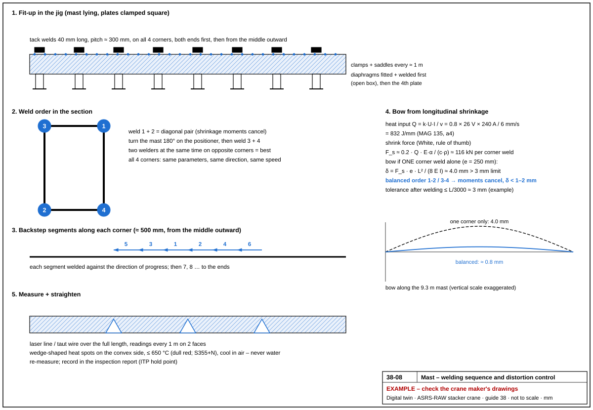

1. **U-shape:** lay the back face plate in the jig, fit the 2 side plates and the 6 diaphragms, tack (30–40 mm tacks
   every ≈ 300 mm).
2. **Weld the diaphragms** (double fillet a 4) – **hold point**: inspect them now, you cannot later.
3. **Close the box** with the front face plate, tack.
4. **Corner seams in balanced order:** corners 1 and 2 diagonally opposite, then 3 and 4. Each corner in **backstep**
   segments of ≈ 1 m, from the middle out to both ends (or two welders at the same time).
5. Turn the box on a roller positioner so that each seam is welded in the flat / horizontal position (PA / PB).
6. Let it cool **completely** before measuring.

### 9.8 Bottom carriage, carriage, drum, fork – welding notes

* **Bottom carriage:** bottom flange → webs → diaphragms → top flange. Web-to-flange fillets a 5 on both sides in
  alternating order; diaphragms a 4. Pre-camber ≈ 1 mm against shrinkage (example). Preheat the 40 mm pad.
* **Lifting carriage:** in a jig with locating pins; arm-root fillets a 5–6, full length, smooth toe (ISO 5817 B).
* **Drum:** end discs with full-penetration circumferential welds on a turning positioner; UT 100 %.
* **Fork stages:** short intermittent stitches, alternate sides, low heat input – long continuous seams make a "banana".

---

## 10. Distortion control and stress relief

### 10.1 Why welds distort parts

Hot weld metal shrinks when it cools. The cold steel around it resists. The result:

* **longitudinal shrinkage** along the seam → the part gets shorter and **bows** if the seam is not on the neutral axis;
* **transverse shrinkage** across the seam → angular distortion, plates "close up";
* **residual stresses** up to the yield strength near the weld.

### 10.2 How big is the bow? (rule of thumb)

Longitudinal shrinkage force of one seam (White's rule of thumb – estimate only):

```
F ≈ 0.2 · Q · E · α / (c · ρ)
Q = 832 J/mm = 832 000 J/m,  E = 210 000 N/mm²,  α = 12 × 10⁻⁶ /K,  c = 460 J/(kg·K),  ρ = 7 850 kg/m³
F ≈ 0.2 × 832 000 × 210e9 × 12e-6 / (460 × 7 850) ≈ 116 kN
```

If only **one** corner seam were welded (eccentricity e = 250 mm from the neutral axis):

```
bow δ = F · e · L² / (8 · E · I) = 116 000 × 250 × 9 300² / (8 × 210 000 × 372.5e6) ≈ 4.0 mm
```

4 mm is more than the 3 mm straightness limit – from one seam. When the **opposite** corner is welded next, its bow goes
the other way and most of it cancels. That is the reason for the **diagonal, balanced sequence**.

### 10.3 Tools against distortion

| Method | How | Where |
|---|---|---|
| balanced sequence | weld opposite seams one after the other | mast, bottom carriage |
| backstep / skip welding | short segments, against the travel direction | long seams |
| low, constant heat input | tractor, correct parameters, smallest weld that passes the calculation | everywhere |
| pre-setting / pre-camber | set the parts the opposite way before welding (≈ 1 mm on the bottom beam, ≈ 2 mm on fork stages) | beams, forks |
| strong jig + clamps | hold the shape while welding and cooling | carriage, mast |
| machining allowance | leave 2–3 mm on faces that must be accurate, machine after welding | pads, flanges, bores |
| straightening | flame or press, after welding | mast, fork stages |

### 10.4 Flame straightening

* Heat **wedges** (triangles) or spots on the **convex** (long) side; the heated zone shrinks when it cools and pulls the
  part straight.
* **Maximum 650 °C** for S355+N (dark red) – check with temperature crayons or a pyrometer. Above ≈ 650–700 °C the
  normalised structure changes and the strength drops.
* Cool in air – **no water**.
* Re-measure after cooling. Document the heated places (sketch).

### 10.5 Stress relief annealing – when and why

**Why:** welding leaves residual stresses up to the yield strength. If you machine a part with high residual stress,
you cut away stressed material → the part **moves** after machining (bores out of line, pads not flat).
Stress relief lowers the residual stresses to a small part of the yield strength.

**When (example rules for this crane):**

| Part | Stress relief? | Why |
|---|---|---|
| bottom carriage | **yes**, before final machining | precise pads and holes, thick plates |
| wheel-block housing | **yes**, before boring | coaxial H7 bores (0.02 mm) |
| lifting carriage | yes (or vibratory) | H7 axle bores, fork face |
| drum | yes | full-penetration disc welds, grooves |
| mast | **no** (too long and thin for a furnace, low stress) | flame straightening + pad machining after welding |
| fork stages, top carriage | no (small welds) | straighten if needed |

**Thermal cycle (example – the heat-treatment procedure decides):**

```
load cold (< 300 °C) → heat at ≤ 100–150 °C/h → hold 580–620 °C for ≈ 2 min/mm (min 1 h)
→ furnace cool ≤ 100 °C/h down to 300 °C → air
40 mm pad → 80 min hold;   30 mm wheel-block wall → 60 min (= the 1 h minimum)
```

Record with thermocouples **on the part** (not only the furnace air). Keep the chart in the quality file.

**Vibratory stress relief** (the part on a vibrator at resonance) is an alternative for dimensional stability – cheaper,
but not recognised by all standards; agree it with the customer.

---

## 11. Machining and tolerances

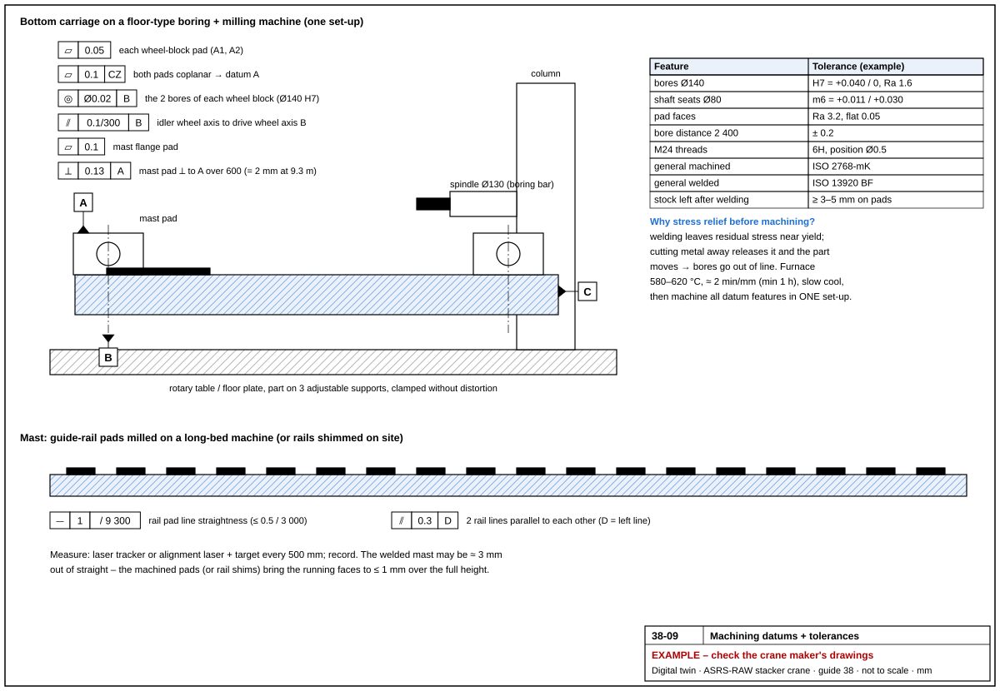

### 11.1 The idea: weld rough, machine exact

Welded parts are never accurate (± 1–3 mm). The faces that **locate other parts** are machined after welding (and after
stress relief): wheel-block pads, mast pad and flange face, bearing bores, guide-rail pads, roller axle bores.
Everything else stays "as welded" with the general tolerances of ISO 13920.

### 11.2 General tolerances on the drawing

| Standard | Use | Class on our drawings (example) |
|---|---|---|
| **ISO 13920** | welded constructions: lengths, angles (A–D), straightness / flatness / parallelism (E–H) | **BF**: class B for lengths and angles, F for flatness / straightness |
| **ISO 2768-1** | general tolerances for machined linear and angular dimensions (f, m, c, v) | **m** (medium) |
| **ISO 2768-2** | general geometrical tolerances (H, K, L) | **K** |

Example ISO 13920 class B for a length of 400–1 000 mm: ± 3 mm (check the table); ISO 2768-m for 30–120 mm:
± 0.3 mm. A note in the title block like **"ISO 13920-BF, ISO 2768-mK"** sets all tolerances that are not written
at the dimension.

### 11.3 Fits (ISO 286)

| Fit | Where | Values for our sizes |
|---|---|---|
| **Ø140 H7** | bearing bores in the wheel block (outer ring, stationary load) | + 0.040 / 0 mm |
| **Ø80 m6** | wheel shaft under the inner ring (rotating load → interference) | + 0.011 / + 0.030 mm |
| **Ø80 k6** | drum shaft bearing seats | + 0.002 / + 0.021 mm |
| H7 | roller axle bores, pulley bores | per size |

Rule: the ring that **rotates relative to the load** gets an interference fit (shaft m6 / k6), the stationary ring a
sliding / transition fit (housing H7). The bearing maker's catalogue gives the exact choice.

### 11.4 Datums and GD&T (ISO 1101) – examples on the bottom carriage

**Datums** are the references from which everything is measured. They follow the function:

| Datum | Feature | Why |
|---|---|---|
| **A** | plane of the wheel-block pads (both pads) | the crane stands on it |
| **B** | axis of the drive-wheel bore / block location | the travel line starts here |
| **C** | side face of the box (machined strip) | direction across the aisle |

**Feature control frames** (written here in text form; on the drawing they are boxes):

| Feature | Frame | Meaning |
|---|---|---|
| each wheel-block pad | `[ ⏥ \| 0.05 ]` | flatness 0.05 mm |
| both pads together | `[ ⏥ \| 0.1 \| CZ ]` | coplanar within 0.1 mm (common zone) |
| bearing bores Ø140 H7 (wheel block) | `[ ◎ \| Ø0.02 \| A-B ]` | coaxial within a cylinder of Ø0.02 mm to the common axis |
| idler-wheel axis to drive-wheel axis | `[ ∥ \| 0.1/300 \| B ]` | parallel within 0.1 mm per 300 mm |
| mast pad face | `[ ⏥ \| 0.1 ]` | flatness 0.1 mm |
| mast flange face to mast axis | `[ ⟂ \| 0.13 \| D ]` | perpendicular within 0.13 mm (= 2 mm plumb at 9.3 m) |
| M24 holes in the mast pad | `[ ⌖ \| Ø0.4 \| A \| B \| C ]` | position within Ø0.4 mm (± 0.2) |
| mast guide-rail pads | `[ ⏤ \| 0.5 ]` over the length | all pads in one line within 0.5 mm (rails after assembly ≤ 1 mm) |

Why the pads (0.5 mm) are tighter than the rails (1 mm): the bolted rail adds its own straightness and joint steps.

### 11.5 Machines and set-ups

| Part | Machine (example) | Set-up rule |
|---|---|---|
| mast (9.3 m) | floor-type boring / milling machine with a travelling column, X ≥ 10 m – or a long gantry mill | all rail pads in **one** set-up; flange face after the flange is welded on |
| bottom carriage | floor-type boring mill, table ≈ 3 × 2 m, X ≈ 4 m | pads, holes and mast pad in **one** set-up – re-clamping costs coplanarity |
| wheel-block housing | horizontal boring mill with a line-boring bar | both bearing bores in **one** pass → coaxial 0.02 |
| wheels, shafts, drum | CNC lathe (swing ≥ 500), grinding of shaft seats | turn between centres; shoulders with radius R2 |
| lifting carriage | horizontal machining centre (pallet 1 250) | roller bores and fork face in one clamping |
| fork stages | long CNC gantry mill (2 m) | roller tracks parallel ± 0.1 |

If you do not have a 10 m machine: subcontract the mast pad machining, or use **adjustable rails** (shims / adjusting
screws under each rail clamp) and align them with a laser – more site work, but no long machine.

### 11.6 Measuring methods

| Measure | Tool | Typical use |
|---|---|---|
| straightness over 9 m | laser line + target, or taut piano wire + rule; laser tracker | mast, rails |
| flatness / coplanarity | surface plate + dial gauge (small), laser tracker or CMM arm (large) | pads |
| bore Ø, roundness | internal micrometer, bore gauge, CMM | H7 bores |
| coaxiality | CMM or line-boring check bar | wheel-block bores |
| perpendicularity | precision square + feeler, CMM, tracker | flange face |
| plumb on site | theodolite / total station, plumb line in oil | mast |
| hardness | portable hardness tester (Leeb / UCI), HRC bench | wheel tread, racks |
| temperature | pyrometer, crayons | preheat, straightening |

Measure parts at **room temperature** and lying on 3 supports (no bending from the own weight in the wrong direction).

---

## 12. Non-destructive testing (NDT)

### 12.1 Methods

| Method | Standard (testing) | Finds | Use on the crane |
|---|---|---|---|
| **VT** visual testing | ISO 17637 | surface defects, size, undercut, profile | **100 %** of all welds |
| **MT** magnetic particle testing | ISO 17638 | surface and near-surface cracks (ferritic steel) | fillet welds at fatigue points: mast foot 100 %, others ≈ 20 % |
| **PT** penetrant testing | ISO 3452-1 | surface cracks (also non-magnetic) | where MT is not possible |
| **UT** ultrasonic testing | ISO 17640 | internal defects in butt welds (lack of fusion, cracks) | full-penetration butt welds (flange splices, drum discs) 100 % |
| RT radiography | ISO 17636 | internal volume defects | rarely on cranes (UT preferred) |

### 12.2 Acceptance levels

| Method | Acceptance standard | Example level for ISO 5817 B / C |
|---|---|---|
| VT | ISO 5817 | B or C directly |
| MT | ISO 23278 | 2X (for B) / 2X–3X (for C) – check the table |
| UT | ISO 11666 | AL 2 (for B) / AL 3 (for C) – check the table |

### 12.3 How much to test – the EN 1090-2 idea

EN 1090-2 (Table 24 – check the current edition) gives a **minimum supplementary NDT extent** for each execution class.
For EXC2 it asks e.g. ≈ 10 % for transverse butt welds in tension and a smaller extent for some fillet welds, and 0 %
for longitudinal welds – plus 100 % VT. The crane maker usually adds more at fatigue details. Our example plan:

| Weld | VT | MT | UT |
|---|---|---|---|
| mast corner seams | 100 % | 20 % (random, include starts / stops) | – |
| mast foot weld (all round) | 100 % | **100 %** | – |
| bottom carriage mast-pad welds | 100 % | **100 %** | – |
| bottom carriage other fillets | 100 % | 20 % | – |
| full-pen flange splices | 100 % | – | **100 %** |
| carriage arm roots | 100 % | **100 %** | – |
| drum disc welds | 100 % | – | **100 %** |

### 12.4 People and timing

* NDT operators certified to **ISO 9712** level 2 (level 3 writes the procedures).
* **Waiting time**: test thick welds (≥ 30 mm) not earlier than 16–24 h after welding (delayed hydrogen cracks – check
  EN 1090-2 / the procedure).
* NDT **after** the last heat treatment and straightening (heat can create cracks).
* Report with a **weld map**: each weld has a number; the report lists weld no., method, result, operator.

---

## 13. Surface protection

### 13.1 Corrosivity and durability (ISO 12944)

| Item | Our choice (example) | Meaning |
|---|---|---|
| corrosivity category (ISO 12944-2) | **C3** medium | heated or unheated hall with some humidity / pollution; outdoor low pollution |
| durability (ISO 12944-1) | **M** medium (7–15 years) or **H** high (15–25 years) | time to first major maintenance – not a guarantee |
| system (ISO 12944-5) | EP zinc-phosphate primer 80 µm + PUR top coat 80 µm | **160 µm NDFT** |
| colour | RAL 1003 signal yellow (crane), machine parts per maker | |

### 13.2 Surface preparation (ISO 8501-1, ISO 8503)

* Remove oil and grease, grind sharp edges (radius ≥ 2 mm – paint pulls back from sharp edges), remove weld spatter.
* **Blast to Sa 2½** ("very thorough blast cleaning", ISO 8501-1 photo standard) with steel grit.
* Roughness **medium (G)** per ISO 8503 comparator.
* Paint within a few hours after blasting (before flash rust), in a dry booth (steel ≥ 3 °C above the dew point).

### 13.3 Measuring the paint (ISO 19840 / ISO 2808)

* Dry film thickness (DFT) with a magnetic gauge.
* **80/20 rule** (ISO 19840): not more than 20 % of the readings below the NDFT, and no reading below 80 % of the
  NDFT → no reading below 0.8 × 160 = 128 µm.
* Maximum DFT per paint maker (often ≤ 3 × NDFT) – too thick cracks.

### 13.4 What NOT to paint

Mask before blasting / painting: machined pads, flange faces (friction joint), bearing bores, guide-rail running faces,
drum grooves (oil them), threads. Protect with rust-preventive oil or peelable coating. Painted contact faces are a
classic mistake: the bolted joint loses preload when the paint creeps.

---

## 14. Routing sheets per part

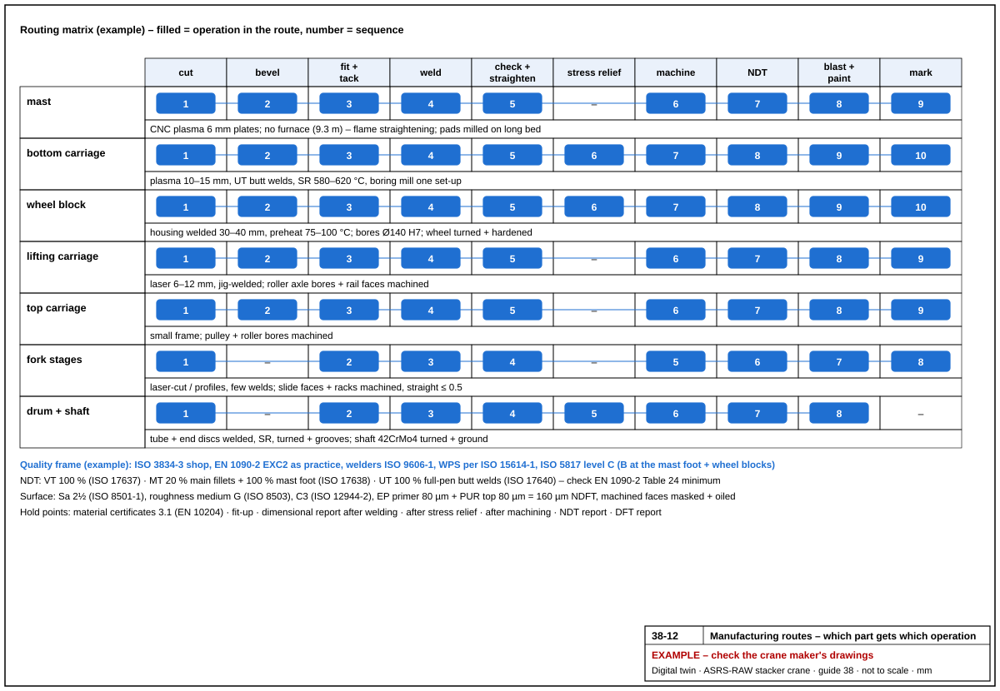

### 14.1 How to read a routing sheet

A routing sheet (operation sheet, "Arbeitsplan") lists the operations of one part **in order**. Operation numbers go
in steps of 10 so you can insert an operation later. Each row: operation, machine, tooling / parameters, time,
quality check, typical mistake. The times are **examples** (one piece, skilled shop, without waiting and transport).
The same data drives card 3 of the page.

| Part | Operations | Total time (example) |
|---|---|---|
| mast | 10 | 1 790 min ≈ 29.8 h |
| bottom carriage | 10 | 2 115 min ≈ 35.2 h (incl. 600 min furnace cycle) |
| wheel block | 9 | 925 min ≈ 15.4 h |
| lifting carriage | 8 | 1 200 min ≈ 20.0 h |
| top carriage | 6 | 520 min ≈ 8.7 h |
| fork stages | 6 | 730 min ≈ 12.2 h |
| drum + shaft | 7 | 700 min ≈ 11.7 h |
| **sum** | **56** | **7 980 min ≈ 133 h** |

Note: furnace times (stress relief) are elapsed time, not labour – several parts go into the furnace together.

### 14.2 Route `mast` – Mast (welded box 500 × 350 × 6, 9.3 m)

Part mass ≈ 1000 kg (example). 10 operations, total **1790 min ≈ 29.8 h** (example times, without waiting and transport).

| No. | Operation (type) | Machine | Tooling / parameters | Time (min) | Quality check | Typical mistake |
|---|---|---|---|---|---|---|
| 10 | Cut plates + diaphragms (nesting) (cutting) | CNC plasma or fibre laser 6 kW, 12 × 2.5 m table | nest: 2 side plates 500 × 9 300, 2 face plates 338 × 9 300, 6 diaphragms; plasma for 6–10 mm, laser for holes | 90 | plate width ± 1 mm, length ± 2 mm; heat number transferred to each part (traceability) | plates cut too narrow because the kerf was not compensated |
| 20 | Edge prep of the corner joints (bevel prep) | plate-edge milling machine or plasma bevel head | HV 45° on the side-plate edges for a partial-penetration corner (or square edge for fillet a4) | 60 | bevel angle 45 ± 2°, land 1–2 mm | bevel only on one plate → wrong joint, lack of fusion |
| 30 | Fit-up in the jig + tack welding (fit-up + tack) | welding jig / assembly bed 10 m with screw clamps | U-shape first (bottom face + 2 sides + diaphragms), then close with the 4th plate; tacks 30–40 mm every ≈ 300 mm | 240 | box diagonal difference ≤ 2 mm; plates square; diaphragm welds checked BEFORE closing (hold point) | closing the box before the diaphragms are welded |
| 40 | Weld the 4 corner seams (balanced sequence) (welding) | MAG (135) welding tractor on a rail or 2 welders in parallel; roller positioner to weld in PA/PB | G 42 4 M21 3Si1 Ø1.2, M21 gas; ≈ 26 V / 240 A / 6 mm/s → 832 J/mm; order: corners 1 + 2 diagonally opposite, then 3 + 4; backstep 1 m segments from the middle out | 600 | VT 100 % (ISO 17637), ISO 5817 C; record parameters (WPS) | welding one corner fully, then the next → bow ≈ 4 mm from one corner (shrink force ≈ 116 kN) |
| 50 | Distortion check (straightness, twist) (distortion check) | laser line or taut wire + measuring rule, on 3 trestles | measure every 1 m on both axes; twist with a precision level at both ends | 60 | straightness ≤ L/3000 ≈ 3 mm; twist ≤ 2 mm | measuring while the mast is still warm or lying on uneven supports |
| 60 | Flame straightening (if needed) (straightening) | oxy-acetylene heating torch, temperature crayons / pyrometer | heat wedges on the convex side, max 650 °C for S355+N, cool in air (no water) | 90 | re-measure; no heat colours above dark red; hardness spot check | heating above 650–700 °C → loss of strength of the normalised steel |
| 70 | Mill the guide-rail pads + foot flange face (machining) | floor-type boring/milling machine (travelling column, X ≥ 10 m) or rail-pad milling on a long gantry mill | face mill Ø125 for the rail pads (one set-up, all pads in line); flange face after welding the flange on | 300 | rail-pad line straight ≤ 0.5 mm / 9.3 m, flange face flat 0.1, ⟂ to mast axis 0.13 / 600 | machining the pads before the flange is welded → foot weld pulls the line |
| 80 | NDT of the foot weld + corner seams (NDT) | MT yoke (ISO 17638), UT for full-pen splices (ISO 17640) | foot weld MT 100 %; corner seams MT 20 % (random, include starts/stops) | 90 | acceptance ISO 23278 level 2X (MT); report with weld map | testing before the 16–24 h hydrogen waiting time on thick welds |
| 90 | Blast Sa 2½ + paint C3 (blast + paint) | blast room with steel grit, airless spray, DFT gauge | EP zinc-phosphate primer 80 µm + PUR top 80 µm (RAL 1003); mask rail pads + flange face | 240 | Sa 2½ (ISO 8501-1) visual; roughness G medium; DFT 160 µm NDFT, 80/20 rule (ISO 19840) | painting the machined pads and flange face → rails not tight, flange slips |
| 100 | Marking + documents (marking) | hard stamp / label plate | crane no., part no., heat no. of plates, weld map ref. | 20 | marking matches the drawing; 3.1 certificates in the file | lost traceability of the plate heat numbers |
| | **total** | | | **1790** | | |

### 14.3 Route `bottom` – Bottom carriage (welded box beam 2 900 × 420 × 160)

Part mass ≈ 650 kg (example). 10 operations, total **2115 min ≈ 35.2 h** (example times, without waiting and transport).

| No. | Operation (type) | Machine | Tooling / parameters | Time (min) | Quality check | Typical mistake |
|---|---|---|---|---|---|---|
| 10 | Cut flanges, webs, diaphragms, pads (cutting) | CNC plasma (15–40 mm) / oxy-fuel for 40 mm pads | nested with the wheel-block plates; pads 620 × 480 × 40 with 3 mm machining allowance | 120 | dimensions ± 1 mm, allowance present | no machining allowance on the pads |
| 20 | Bevel the butt joints of the flanges (bevel prep) | plasma bevel head / edge milling | V 60° for full-pen butt welds (if the flange is spliced), HV for web-to-flange where full pen is required | 45 | angle ± 2° | root gap too small → lack of penetration |
| 30 | Fit-up on the welding table + tacks (fit-up + tack) | flat welding table with stops and clamps | bottom flange → webs → diaphragms → top flange; pre-camber 1 mm against weld shrinkage (example) | 180 | diagonals ± 2 mm, web ⟂ flange ± 1 mm; diaphragm fit-up check (hold point) | no pre-set → frame bends after welding |
| 40 | Weld the box (symmetric) (welding) | MAG 135, positioner to turn the box | web-to-flange fillets a 5 both sides in alternating order; diaphragms a 4; preheat ≈ 75–100 °C only for the 40 mm pads (EN 1011-2 – check) | 480 | VT 100 %, ISO 5817 C (B at the mast pad) | all welds on one side first → twist |
| 50 | Distortion check (distortion check) | surface plate / laser tracker | flatness of the pad areas, twist | 45 | pads within the machining allowance | measuring before cooling |
| 60 | Stress relief annealing (stress relief) | gas-fired bogie furnace | 580–620 °C, hold ≈ 2 min/mm (40 mm → 80 min, min 1 h), cool in the furnace < 100 °C/h to 300 °C | 600 | furnace chart (thermocouples on the part) | skipping stress relief → frame moves after machining (released stresses) |
| 70 | Machine pads, bores, flange face (machining) | floor-type boring mill (e.g. table 3 × 2 m, X 4 m), 1 set-up | datum A = wheel-block pad plane, B = drive-wheel bore axis, C = side face; face mill pads; bore + ream fixing holes; mast pad face + 12 × M24 holes | 360 | pads flat 0.05, coplanar 0.1; mast pad flat 0.1; hole position ± 0.2; CMM / laser tracker report | re-clamping between pads → pads not coplanar |
| 80 | NDT (NDT) | MT, UT | MT 100 % mast-pad welds, 20 % others; UT 100 % full-pen flange splices | 90 | ISO 23278 / ISO 11666 acceptance | UT not possible later because of the geometry – plan it |
| 90 | Blast + paint (blast + paint) | blast room, airless | as the mast; mask machined faces + bores, rust-preventive oil | 180 | DFT 160 µm | paint in the bores |
| 100 | Marking (marking) | stamp | crane no., datum marks, wheel positions | 15 | – | datum marks missing → site alignment harder |
| | **total** | | | **2115** | | |

### 14.4 Route `wheel` – Wheel block (wheel Ø400, shaft Ø80, housing)

Part mass ≈ 260 kg (example). 9 operations, total **925 min ≈ 15.4 h** (example times, without waiting and transport).

| No. | Operation (type) | Machine | Tooling / parameters | Time (min) | Quality check | Typical mistake |
|---|---|---|---|---|---|---|
| 10 | Saw the shaft bar + cut the forged wheel blank (cutting) | band saw; wheel = ring-rolled / forged blank 42CrMo4 | bar Ø95 42CrMo4 +QT; forged blank Ø420 × 75 | 30 | material certificate 3.1, UT of the forging | wrong material grade (no 3.1 certificate) |
| 20 | Turn the wheel + the shaft (turning) | CNC lathe (swing ≥ 500) | wheel: rough + finish turn tread Ø400, hub bore; shaft: Ø80 m6 seats, shoulders with radius R2, keyway | 120 | Ø80 m6 (+0.011 / +0.030), shoulder radius, run-out 0.02 | sharp shoulder corner → fatigue crack at the shaft shoulder |
| 30 | Induction-harden the wheel tread (hardening) | induction hardening machine with ring inductor | tread 50–55 HRC, depth 3–5 mm, then temper 180 °C | 30 | hardness test (HRC), depth on a test piece | hardened flanks crack (no tempering) |
| 40 | Cut + weld the housing (welded design) (cutting) | plasma + MAG | side plates 30 mm, preheat ≈ 75–100 °C (EN 1011-2 – check) | 180 | VT 100 %, MT 20 % | no preheat on 30 mm → hydrogen cracks |
| 50 | Stress relief of the housing (stress relief) | furnace (with the bottom carriage batch) | 580–620 °C, 1 h | 300 | furnace chart | boring before stress relief → bores move |
| 60 | Bore the bearing seats in line (machining) | horizontal boring mill, line-boring bar through both walls | Ø140 H7 (+0.040 / 0) in ONE set-up, coaxial 0.02; mounting face + dowel holes | 150 | bore gauge, coaxiality on CMM | boring each side separately → not coaxial → bearing heat |
| 70 | Assemble wheel + bearings + seals (assembly) | assembly bench, induction bearing heater | heat bearings to ≈ 110 °C (never flame), grease fill 30–50 %, seals | 60 | free rotation, axial play per drawing | hammering bearings on → brinelling |
| 80 | Paint housing (machined faces masked) (blast + paint) | spray | C3 system | 45 | DFT | paint on the mounting face |
| 90 | Marking (marking) | label | block no., wheel material, hardness | 10 | – | – |
| | **total** | | | **925** | | |

### 14.5 Route `carriage` – Lifting carriage frame

Part mass ≈ 350 kg (example). 8 operations, total **1200 min ≈ 20.0 h** (example times, without waiting and transport).

| No. | Operation (type) | Machine | Tooling / parameters | Time (min) | Quality check | Typical mistake |
|---|---|---|---|---|---|---|
| 10 | Cut plates (laser) (cutting) | fibre laser 6 kW | back plate 12, arms 15, gussets 10; holes cut with laser for non-precision holes | 60 | ± 0.5 mm | precision holes laser-cut (must be machined) |
| 20 | Fit-up in a jig (fit-up + tack) | carriage welding jig with locating pins | arms ⟂ back plate; roller pads with allowance | 120 | angle ± 0.5° | no jig → arms not parallel |
| 30 | Weld (alternating sides) (welding) | MAG 135 | fillets a 5–6 at the arm roots (fatigue point), full-length, smooth toe | 240 | VT 100 %, ISO 5817 B at the arm roots | undercut at the arm root → fatigue crack |
| 40 | Stress relief (or vibratory) (stress relief) | furnace | 580–620 °C | 300 | chart | – |
| 50 | Machine roller pads + axle bores + fork face (machining) | horizontal machining centre (pallet 1 250) | axle bores H7, pads, fork mounting face flat 0.1 | 240 | CMM report: roller axle positions ± 0.1 | machining in 2 clampings without a datum |
| 60 | MT arm roots (NDT) | MT yoke | 100 % arm roots | 30 | ISO 23278 | – |
| 70 | Blast + paint (blast + paint) | blast + spray | C3 | 90 | DFT | – |
| 80 | Fit rollers, catch, load pins (assembly) | bench | eccentric axles set on a dummy rail section | 120 | zero play, catch function test | pre-load too high → flat spots |
| | **total** | | | **1200** | | |

### 14.6 Route `top` – Top carriage (top frame)

Part mass ≈ 200 kg (example). 6 operations, total **520 min ≈ 8.7 h** (example times, without waiting and transport).

| No. | Operation (type) | Machine | Tooling / parameters | Time (min) | Quality check | Typical mistake |
|---|---|---|---|---|---|---|
| 10 | Cut plates (cutting) | plasma / laser | 10–15 mm | 40 | ± 1 | – |
| 20 | Fit-up + tacks (fit-up + tack) | table + clamps | pulley axle bosses with allowance | 90 | squareness | – |
| 30 | Weld (welding) | MAG | fillets a 4–5 | 150 | VT 100 % | – |
| 40 | Bore pulley + roller axle seats (machining) | boring mill | H7 bores, roller arms in line | 120 | position ± 0.1 | – |
| 50 | Blast + paint (blast + paint) | – | C3 | 60 | DFT | – |
| 60 | Fit pulleys + spring-loaded top rollers (assembly) | bench | pre-load ≈ 300 N per roller | 60 | rotation free | spring pre-load not set |
| | **total** | | | **520** | | |

### 14.7 Route `fork` – Telescopic fork stages (3 per tine)

Part mass ≈ 200 kg (example). 6 operations, total **730 min ≈ 12.2 h** (example times, without waiting and transport).

| No. | Operation (type) | Machine | Tooling / parameters | Time (min) | Quality check | Typical mistake |
|---|---|---|---|---|---|---|
| 10 | Cut / saw profiles (cutting) | laser + band saw | high-strength strips S690QL, rack bars C45 | 60 | length ± 0.5 | – |
| 20 | Fit-up in a straightening jig (fit-up + tack) | long jig with pins | pre-camber the stages (≈ 2 mm up at the tip) against the load deflection | 90 | camber per drawing | no pre-camber → tip sinks below the beam |
| 30 | Weld (short stitch, alternate) (welding) | MAG / TIG | intermittent fillets, small heat input | 120 | VT | long continuous seam → banana shape |
| 40 | Mill roller tracks + rack seats (machining) | long CNC gantry mill (2 m) | tracks parallel ± 0.1, rack seat ± 0.05 | 180 | straightness 0.2 / 1 m | tracks not parallel → stage jams |
| 50 | Harden rack teeth / tracks (hardening) | induction | 50–55 HRC | 40 | HRC | – |
| 60 | Assemble stages, rollers, chains; adjust (assembly) | fork assembly bench with a test load | chain tension, centre position, deflection test with 300 kg at 1 350 mm (target ≤ 4.9 mm) | 240 | tip deflection, stage synchronism | chains not equal → tines at different heights |
| | **total** | | | **730** | | |

### 14.8 Route `drum` – Rope drum + shaft

Part mass ≈ 110 kg (example). 7 operations, total **700 min ≈ 11.7 h** (example times, without waiting and transport).

| No. | Operation (type) | Machine | Tooling / parameters | Time (min) | Quality check | Typical mistake |
|---|---|---|---|---|---|---|
| 10 | Cut tube / roll plate + end discs (cutting) | saw / plate roll / plasma | tube Ø273 × 14 (or rolled plate), discs 20 mm | 40 | – | – |
| 20 | Weld end discs + hubs (welding) | MAG on a turning positioner | full-pen circumferential welds, preheat if > 30 mm | 90 | UT 100 % of the disc welds | lack of fusion at the disc weld → crack |
| 30 | Stress relief (stress relief) | furnace | 580–620 °C | 240 | chart | – |
| 40 | Turn the drum + cut the grooves (turning) | CNC lathe with grooving tool | Ø250 at the groove bottom, pitch 9, 2 sections × 115 mm, opposite hand | 150 | groove gauge (ISO 16625 profile), run-out 0.2 | grooves same hand → ropes run apart |
| 50 | Turn the shaft (turning) | CNC lathe + grinding of the seats | Ø80 k6 seats, R2 shoulders | 90 | run-out 0.02 | sharp corner at the shoulder |
| 60 | Assemble + balance (assembly) | bench | shaft press fit / key, bearings | 60 | free rotation | – |
| 70 | Paint (grooves oiled, not painted) (blast + paint) | spray | C3 outside the grooves | 30 | DFT | paint in the grooves |
| | **total** | | | **700** | | |

---

## 15. Assembly and installation on site

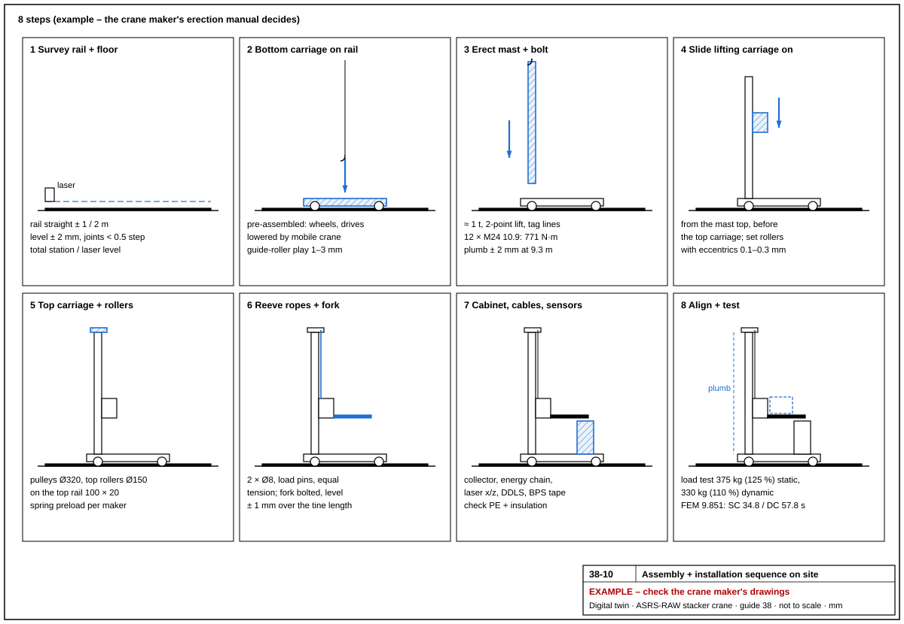

### 15.1 Before the crane arrives

* Rack installed, plumb and anchored; top ties and top rail mounted (guide 31 §13).
* Bottom rail grouted and cured (grout strength per maker, typically several days).
* Access for the truck and the mobile crane; floor load for the crane outriggers checked.
* Power available at the conductor-rail feed point; lighting; a lockable store for parts and tools.
* Lifting plan (weights, sling angles, crane capacity) signed by the lifting supervisor.

### 15.2 The eight steps (same as card 4 of the page)

| Step | Tools + equipment | Checks + values (example) | Time (example) |
|---|---|---|---|
| **1 · Rail survey + acceptance** | total station / laser level, steel rule, feeler gauges | bottom rail straight ± 1 mm / 2 m, level ± 2 mm, joint step < 0.5 mm, gap < 1 mm; top rail to bottom rail axis ± 2–3 mm (FEM 9.831 / EN 15620 style – crane maker's values decide) | 1 day |
| **2 · Bottom carriage on the rail** | mobile crane ≈ 10 t or forklift + rollers, slings, spreader | wheels on the rail, guide-roller gap 0.5–1.5 mm per side, wheel skew ≤ 0.5 mm/m, carriage level ± 0.5 mm/m | 0.5 day |
| **3 · Mast erection + flange bolting** | mobile crane (mast ≈ 1 t, hook height ≥ 13 m), tag lines, torque wrench / hydraulic wrench, 12 × M24 10.9 HV | tighten crosswise in 2 passes (50 %, 100 %) to ≈ 770 N·m (k = 0.13 – bolt set certificate decides); mast plumb ± 2 mm at the top in both directions (shims under the flange if needed) | 0.5 day |
| **4 · Lifting carriage slid onto the mast rails** | crane, lifting beam, assembly support on the floor | rollers set with the eccentric axles: zero play, carriage moves by hand; safety catch gap 2–3 mm | 0.5 day |
| **5 · Top carriage + top guide rollers** | crane, man-lift (MEWP), torque wrench | top rollers centred on the top rail, spring pre-load ≈ 300 N, mast still plumb ± 2 mm | 0.5 day |
| **6 · Rope reeving + telescopic fork** | rope reel stand, rope clamps / wedge sockets, man-lift; fork lifted onto the carriage | 2 ropes same length ± 5 mm (load pins show equal force ± 10 %), 3 dead turns on the drum; fork level ± 0.5 mm, centre position sensor set | 1 day |
| **7 · Cabinet, cables, collector, sensors** | electricians, cable tools, insulation tester, alignment aids for laser / DDLS | PE continuity, insulation > 1 MΩ (EN 60204-1), collector arm centred ± 20 mm, laser + DDLS aligned | 3–5 days |
| **8 · Alignment + commissioning tests** | laser tracker / theodolite, test weights 375 kg, stopwatch / PLC trace | mast plumb ± 2 mm; rail-pad line ≤ 1 mm; brake tests; load test static 125 % = 375 kg, dynamic 110 % = 330 kg (check EN 528 / maker); FEM 9.851 cycle test SC 34.8 s, DC 57.8 s; all 392 slots taught + tested | 1–2 weeks |

### 15.3 Bolt tightening of the mast flange – procedure

1. Clean the flange faces and the pad (no paint, no oil – unless the bolt set requires lubricated nuts).
2. Fit all 12 bolts by hand, washer under the turned part (nut).
3. Pass 1: tighten crosswise to ≈ 50 % of the torque (≈ 385 N·m).
4. Pass 2: tighten crosswise to 100 % (≈ 770 N·m, k_m = 0.13 – use the value of the bolt-set certificate).
5. Mark each nut with a paint line (visual check of loosening).
6. Check the mast plumb; if out of tolerance, loosen, shim under the flange, repeat.
7. Re-check the torque after ≈ 1 week of operation and at the yearly inspection.

### 15.4 Mast plumb

* Measure with a theodolite / total station in **two directions** (along and across the aisle), or with a plumb line
  in an oil damper.
* Carriage at the bottom, crane empty, no wind / no drafts, steel at room temperature.
* Tolerance (example): **± 2 mm at the top** in both directions.
* Remember the static lean of 2.7 mm at 8 m with the carriage loaded (§7.3) – measure in a defined state and record it.

### 15.5 Wheel alignment

| Check | Method | Tolerance (example) |
|---|---|---|
| wheels on the rail centre | rule from the rail edge | ± 1 mm |
| skew (horizontal angle) of each wheel to the rail | straight edge / laser on the wheel face, measure at the front and back | ≤ 0.5 mm/m |
| tilt (vertical angle) | precision level on the wheel face | ≤ 1 mm/m (check) |
| both wheel tracks in line | laser along the rail | ± 0.5 mm |
| guide-roller gap | feeler gauge | 0.5–1.5 mm per side |

A crane that runs skew pushes on the guide rollers all the time → roller wear, noise and wheel wear. Correct with shims
under the wheel block or the eccentric of the guide rollers.

### 15.6 Rope reeving

1. Carriage on its assembly support at the bottom (or on blocks) – ropes not loaded.
2. Unreel the rope from a reel stand **without twisting** (never pull it off a lying coil – kinks).
3. Fix the rope end at the drum (rope clamps) with **3 dead turns** on the drum at the lowest carriage position.
4. Run the rope up the mast back, over the top pulley, down to the carriage anchor (wedge socket / clamp + load pin).
5. Same for rope 2 on the opposite-hand groove section.
6. Lift the carriage off the support slowly; compare the load-pin forces – equal within ± 10 %; adjust the anchor threads
   so both ropes are the same length (± 5 mm).
7. Run up and down several times; re-check the forces; set the slack-rope and overload limits.

### 15.7 Alignment checklist before the tests

* Mast plumb ± 2 mm, guide rails ≤ 1 mm over the length.
* Top rollers centred on the top rail, pre-load ≈ 300 N.
* Wheels aligned, guide rollers set, buffers at the correct height (± 10 mm).
* Fork level ± 0.5 mm between the tines, centre-position sensor set.
* Laser and DDLS aligned, reflectors fixed.
* All bolts torqued and marked.

---

## 16. Inspection and test plan (ITP)

An **ITP** lists every inspection, who does it and whether the customer must be there:

* **H = hold point** – work stops until the inspection is done and released (customer / third party present).
* **W = witness point** – the customer is invited; work may continue if they do not come.
* **R = review** – documents are reviewed (certificates, reports).

| No. | Activity | Document / standard | Acceptance (example) | Maker | Customer |
|---|---|---|---|---|---|
| 1 | material certificates plates, bars, forgings | EN 10204 3.1 | grade, heat no., impact values | R | R |
| 2 | WPS / WPQR / welder certificates | ISO 15614-1, ISO 9606-1 | valid for process, thickness, position | R | R |
| 3 | cutting + heat-number transfer | traceability list | each part marked | R | – |
| 4 | **diaphragm fit-up + welds before closing (mast, bottom carriage)** | drawing, ISO 5817 | fit-up gap ≤ 1 mm, welds complete | **H** | W |
| 5 | mast straightness + twist after welding / straightening | measuring report | ≤ 3 mm, twist ≤ 2 mm | H | W |
| 6 | stress relief charts | furnace chart | 580–620 °C, hold time | R | R |
| 7 | machining reports (pads, bores, flange face) | CMM / tracker report | per §11.4 | H | W |
| 8 | NDT (VT, MT, UT) | ISO 17637 / 17638 / 17640, weld map | ISO 5817 B / C | H | R |
| 9 | wheel hardness + UT of forgings | test reports | 50–55 HRC, UT OK | R | R |
| 10 | blasting + paint DFT | ISO 8501-1, ISO 19840 | Sa 2½, 160 µm (80/20) | W | W |
| 11 | fork deflection test with 300 kg at 1 350 mm | test record | ≤ 4.9 mm (example target) | W | W |
| 12 | **FAT** (see §17.1) | FAT protocol | all items OK | **H** | **W** |
| 13 | rail survey before erection | survey report | §15.2 step 1 | H | W |
| 14 | mast plumb + bolt torque | erection record | ± 2 mm, 770 N·m | H | W |
| 15 | electrical tests (PE, insulation) | EN 60204-1 | PE continuity, > 1 MΩ | H | R |
| 16 | **load tests** 125 % static / 110 % dynamic | test record | no permanent deformation, brakes hold | **H** | **W** |
| 17 | safety function tests | EN 528, ISO 13849 validation | each function proven | H | W |
| 18 | **SAT**: FEM 9.851 cycle, positioning all slots, throughput | SAT protocol | SC ≤ 34.8 s, DC ≤ 57.8 s | H | W |
| 19 | handover documents | §21.3 | complete | R | R |

---

## 17. FAT and SAT

### 17.1 Factory acceptance test (FAT) – in the maker's shop

Many makers pre-assemble the crane horizontally or on a short test rail. Typical FAT items:

| Item | Check (example) |
|---|---|
| dimensions | main dimensions vs GA drawing; mast straightness; wheelbase 2 400 ± 1 mm |
| documents | ITP items 1–11 complete, weld map, NDT reports, material certificates |
| fork | run on the test bench: stroke ± 1 350 mm, speed 1 m/s, deflection with 300 kg ≤ 4.9 mm, centre sensor |
| drives | no-load run of travel and hoist drives on the bench, brake function, encoder direction |
| cabinet | I/O test, insulation test, labelling, cable marking |
| paint | DFT spot check, no damage, masked faces clean |
| packing | machined faces protected, parts marked for site assembly |

### 17.2 Site acceptance test (SAT)

| Test | Acceptance (example – check EN 528 and the contract) |
|---|---|
| mechanical run-in (empty), all axes slow and full speed | no noise, temperatures normal |
| brake tests travel / hoist | stopping distance, holding torque within the maker's values |
| **static load test 125 %** = 1.25 × 300 = **375 kg**, carriage at a low height, held ≈ 10 min | no permanent deformation, brake holds |
| **dynamic load test 110 %** = 1.1 × 300 = **330 kg**, all motions | correct function, no overload trip at 110 % (set the limit just above) |
| safety catch test | per maker's procedure (often with reduced load and released brake) |
| safety functions: e-stop, door, end-of-aisle, overspeed, slack rope, overload, light curtain | each proven, PL documented (guide 32) |
| positioning – store / retrieve all 392 slots with a test crate | 0 collisions; inside the budget (guide 31 §9) |
| **FEM 9.851 cycle test** at P1 / P2 | single cycle ≤ **34.8 s**, dual cycle ≤ **57.8 s** |
| throughput 1 h at the design mix | ≥ required jobs/h with reserve |
| energy per cycle | ≤ offered Wh |

After the load tests: visual check of all welds at the mast foot and carriage, re-check the flange bolt torque,
re-check the mast plumb.

---

## 18. Maintenance and failure modes

### 18.1 Maintenance plan (structure part – example, the maker's manual decides)

| Interval | Work |
|---|---|
| daily | visual check of the crane, fork tips, beacon / alarms |
| weekly | brake test (automatic or manual), listen for noise at wheels and rollers |
| monthly | wheel treads (flats, wear), guide-roller gaps, carriage roller play, top rollers, collector brushes, buffers |
| 3-monthly | rope inspection ISO 4309, slack-rope / overload test, fork chain tension and level, lubrication |
| yearly | inspection by a competent person (EN 528 / national rules); VT + MT at the mast foot and carriage arm roots; flange bolt torque; mast plumb; rail survey; safety catch test |
| 3–5 years | wheels, ropes, collectors as found |

### 18.2 Failure modes of the structure

| Failure | Cause | Effect | Prevention / detection |
|---|---|---|---|
| crack at the mast foot weld | fatigue, high jerk, poor weld toe, sharp transition | collapse risk | ISO 5817 B, smooth toe, jerk limit, yearly MT |
| lamellar tearing under the foot weld | plate without Z-quality | crack in the flange plate | Z25 plate, UT of the flange |
| mast leans | flange face not square, bolts tightened in wrong order | positioning errors | machined face 0.13, crosswise tightening, plumb check |
| bottom carriage distortion | unbalanced welding, no stress relief | wheels not parallel, crab travel | balanced sequence, stress relief before machining |
| wheel bores not coaxial | bored in two set-ups | bearing heat, failure | line boring in one set-up |
| wheel flats | emergency stops with slip | noise, vibration | limited brake ramp, two driven wheels |
| shaft fracture at the shoulder | sharp corner, fatigue | crane stops | radius R2, k6 / m6 fits, no rigid gearbox fixing |
| guide-rail joint step | poor rail assembly | roller impacts | step ≤ 0.1 mm, check after assembly |
| carriage arm-root crack | undercut, fatigue | fork drops | ISO 5817 B, MT |
| rope wire breaks | small D/d, missing lube, corrosion | rope failure | D/d 31 / 40, ISO 4309 inspection, 2 ropes + catch |
| ropes running apart on the drum | same-hand grooves | side pull, rope damage | opposite-hand grooves |
| fork tip too low | no pre-camber, roller play | fork hits the beam | pre-camber, roller adjustment, deflection test |
| paint on contact faces | no masking | bolts lose preload | masking, ITP item 10 |
| cable break in the energy chain | normal cable instead of chain cable | sensor / motor fault | chainflex-type cables |

---

## 19. BOM, buy list and shopping list

### 19.1 Parts list (BOM) – make vs buy

27 positions, the same as card 5 of the page. **Example – the crane maker's BOM decides.**
The total (≈ 4 170 kg) agrees with the empty crane mass 4 200 kg of guide 31 (the difference is cables, oil, small parts).

| Pos | Item | Make / buy | Material / spec | Qty | kg each | kg total | Assembly |
|---|---|---|---|---|---|---|---|
| 1 | Bottom carriage box beam (welded, machined) | MAKE | S355J2+N 10–40 mm | 1 | 650 | 650 | bottom |
| 2 | Drive wheel block Ø400 (with wheel, shaft, bearings) | MAKE or BUY | 42CrMo4 wheel, 22216 E bearings | 1 | 260 | 260 | wheels |
| 3 | Idler wheel block Ø400 | MAKE or BUY | as pos. 2 | 1 | 220 | 220 | wheels |
| 4 | Horizontal guide rollers Ø125 PU | BUY | PU 92–95 Sh A on steel hub | 4 | 3 | 12 | wheels |
| 5 | Travel geared motor 7.5 kW, i ≈ 10, brake, encoder | BUY | helical-bevel, shaft-mounted | 1 | 120 | 120 | travel |
| 6 | Buffers 2.25 kJ | BUY | PU or hydraulic | 2 | 8 | 16 | buffers |
| 7 | Mast welded box 500 × 350 × 6 × 9 300 | MAKE | S355J2+N 6 mm + 6 diaphragms 10 mm | 1 | 810 | 810 | mast |
| 8 | Mast guide rails 60 × 40 (2 × 9.1 m) | MAKE | C45 bright | 2 | 175 | 350 | mast |
| 9 | Mast foot flange 620 × 480 × 40 + gussets | MAKE | S355J2+N (Z25 – check) | 1 | 95 | 95 | mast |
| 10 | HV bolt sets M24 × 120 10.9 (EN 14399-4) | BUY | bolt + nut + 2 washers, k-class K1/K2 | 12 | 0.6 | 7.2 | mast |
| 11 | Top carriage frame with pulleys Ø320 + top rollers Ø150 | MAKE | S355J2+N, 42CrMo4 axles, PU rollers | 1 | 200 | 200 | top |
| 12 | Lifting carriage frame | MAKE | S355J2+N | 1 | 350 | 350 | carriage |
| 13 | Carriage track rollers Ø100 (load) + side rollers | BUY | track rollers with eccentric axle | 8 | 4 | 32 | carriage |
| 14 | Safety catch device (type-tested) | BUY or MAKE | wedge clamp on the mast rails | 1 | 15 | 15 | carriage |
| 15 | Load pins 10 kN at the rope anchors | BUY | stainless, 4–20 mA / safety | 2 | 2 | 4 | carriage |
| 16 | Rope drum Ø250 + shaft Ø80 | MAKE | S355J2 tube, 42CrMo4 shaft | 1 | 110 | 110 | hoist |
| 17 | Hoist geared motor 11 kW, i ≈ 19, brake, encoder | BUY | helical / helical-bevel | 1 | 180 | 180 | hoist |
| 18 | Wire rope Ø8, MBF ≥ 40 kN (2 × 20 m) | BUY | galvanised compacted strand | 2 | 5.4 | 10.8 | hoist |
| 19 | Telescopic fork, 3 stages, 2 tines, ± 1 350 mm, 300 kg | MAKE or BUY | incl. 1.1 kW drive | 1 | 200 | 200 | fork |
| 20 | Electrical cabinet (equipped) | BUY / build | IP54, inverters 7.5 + 11 + 1.1 kW | 1 | 250 | 250 | cabinet |
| 21 | Current collector trolley 5-pole 60 A | BUY | double PE brush | 1 | 6 | 6 | power |
| 22 | Laser distance sensors x + z + reflectors | BUY | ≥ 35 m, ± 1–2 mm | 2 | 2 | 4 | power |
| 23 | Optical data link pair (crane side) + BPS reader | BUY | PROFINET 100 Mbit/s | 1 | 4 | 4 | power |
| 24 | Ladder with fall-arrest rail | MAKE or BUY | galvanised, EN ISO 14122-4 | 1 | 90 | 90 | access |
| 25 | Maintenance platform with handrail | MAKE | galvanised, grating | 1 | 60 | 60 | access |
| 26 | Energy chain + chainflex cables (mast → carriage) | BUY | hanging, travel 7.7 m | 1 | 30 | 30 | echain |
| 27 | Cable ducts, brackets, small parts, paint | MAKE / BUY | – | 1 | 80 | 80 | bottom |
| | **total (without load)** | | | | | **4166** | |

**Make-or-buy logic.** Make what your shop can weld and machine well (box beams, frames, mast if you have a long mill
or a subcontractor). Buy what needs special know-how, type tests or volume (geared motors, bearings, rollers,
collectors, sensors, ropes, the safety catch). "MAKE or BUY" positions (wheel blocks, fork, ladder) depend on your
machines and price: wheel blocks from Demag / Stahl come with load tables and are often cheaper than making 2 pieces.

### 19.2 Steel, plates, profiles, consumables

Source: guide 38 §8 + §9.

| Item | Required spec | Example maker + model | Key data | Price class (estimate – ask for a quote) | Check in the datasheet |
|---|---|---|---|---|---|
| Plates S355J2+N | 6–40 mm, 3.1 certificate (EN 10204) | steel service centres; mills e.g. Dillinger, Thyssenkrupp, SSAB – check | EN 10025-2, Z25 option for the flange | € per t | heat no., Z-quality, flatness tolerance (EN 10029) |
| Bar 42CrMo4 +QT | Ø95 shafts, axles | steel stockholders (e.g. Saarstahl, Ovako – check) | EN ISO 683-2 | € per kg | QT strength class, UT |
| Forged / ring-rolled wheel blanks | Ø420 × 75, 42CrMo4 | local forge – ask for a quote | UT per EN 10228-3 | €€ | grain flow, UT, hardness |
| MAG solid wire | ISO 14341-A G 42 4 M21 3Si1, Ø1.2 | ESAB OK AristoRod 12.50, Lincoln SupraMIG, Böhler EMK 6 – check | see datasheet | € per kg | classification, H-class, packaging (drum for tractor) |
| Shielding gas | M21 (Ar + 15–20 % CO₂), ISO 14175 | Linde, Air Liquide, Messer – check | – | € | cylinder / bundle / tank |
| Paint system C3 | EP zinc-phosphate primer + PUR top, 160 µm | Hempel, Jotun, PPG, Sherwin-Williams – check | ISO 12944-5 system tables | € per m² | durability class, recoat window, RAL 1003 |

### 19.3 Wheels, rollers, bearings, buffers

Source: guide 38 §6.2 + guide 31 §18.3.

| Item | Required spec | Example maker + model | Key data | Price class (estimate – ask for a quote) | Check in the datasheet |
|---|---|---|---|---|---|
| Wheel block Ø400 (alternative to MAKE) | ≈ 30 kN, steel wheel, shaft-mounted gearbox | Demag DRS wheel block system | sizes – see datasheet | €€ per block | load vs speed table, guide rollers option |
| Wheel block | as above | Stahl CraneSystems, ABM Greiffenberger, Gigant – check | see datasheet | €€ | wheel material, hardness |
| Spherical roller bearings | 22216 E (80 × 140 × 33) | SKF, Schaeffler (FAG), NSK, Timken | C ≈ see datasheet | € | C3 clearance, seals, grease |
| Track rollers (carriage) | Ø100 with eccentric axle | Schaeffler INA (NUTR / KR series), SKF track rollers – check | see datasheet | € each | static + dynamic rating, eccentric version |
| PU guide rollers | Ø125 / Ø150, 92–95 Shore A | Blickle, Tente, Colson – check | load per roller – see datasheet | € each | PU hardness, flat-spot behaviour |
| Buffers | 2.25 kJ at 1 m/s | ACE, Enidine (hydraulic); Demag DPZ (PU) – check | stroke, energy – see datasheet | €€ | energy capacity at the slowdown speed |

### 19.4 Drives, brakes, hoist, fork

Source: guide 38 §6.3, §6.7, §6.8 + guide 31 §18.4.

| Item | Required spec | Example maker + model | Key data | Price class (estimate – ask for a quote) | Check in the datasheet |
|---|---|---|---|---|---|
| Travel geared motor | 7.5 kW, i ≈ 10, brake, encoder, shaft-mounted | SEW-Eurodrive (K gear + DRN motor + BE brake) | see datasheet | €€ | output torque ≥ 561 N·m × service factor |
| Travel geared motor | as above | Nord (SK helical-bevel), Lenze (g500-B + m550 / MCS) | see datasheet | €€ | same |
| Hoist geared motor | 11 kW, i ≈ 19, brake, encoder | SEW, Nord, Lenze, Bauer (Danfoss) – check | see datasheet | €€ | brake work per stop, thermal class |
| Wire rope Ø8 | MBF ≥ 40 kN, galvanised | Teufelberger, Casar (WireCo), Pfeifer – check | MBF – see datasheet | € per m | construction, lay, D/d, discard criteria (ISO 4309) |
| Toothed belt (alternative) | steel-cord PU belt | Gates, ContiTech, Brecoflex – check | see datasheet | €€ | tensile strength, elongation |
| Telescopic fork (if bought) | 300 kg, ± 1 350 mm, 1 m/s | usually crane maker; specialist e.g. Eurofork – check | see datasheet | €€€ | deflection at full stroke, double-deep option |
| Load pin | 10 kN, rope anchor | HBK, Tecsis, Strainsert – check | see datasheet | €€ | safety rating, cable |
| Safety catch device | type-tested wedge clamp | crane maker's design; lift safety-gear makers (e.g. Wittur – check scope) | see datasheet | €€ | type test, trip speed |

### 19.5 Power, data, positioning, energy chain

Source: guide 38 §6.9 + guide 31 §18.5–18.8.

| Item | Required spec | Example maker + model | Key data | Price class (estimate – ask for a quote) | Check in the datasheet |
|---|---|---|---|---|---|
| Conductor rail + collector | 5-pole, ≈ 60 A | Vahle KBH / U10; Conductix-Wampfler 0812 / 0813 | see datasheet | €€ | current at duty cycle, double PE brush |
| Laser distance sensor | ≥ 35 m, ± 1–2 mm, PROFINET / SSI | SICK DL100 Pro, Leuze AMS 300i | see datasheet | €€ | interface, heating, reflector size |
| Bar-code positioning | absolute, tape | Leuze BPS 300i, SICK OLV – check | see datasheet | €€ | tape fixing, max speed |
| Optical data link | PROFINET 100 Mbit/s | Leuze DDLS 500, SICK ISD 400 | see datasheet | €€ pair | IRT, alignment aid |
| Energy chain + cables | hanging 7.7 m | igus E4 / E2 + chainflex; Lapp ÖLFLEX CHAIN – check | see datasheet | €€ | bending radius, cable cycles |

### 19.6 Workshop equipment + inspection tools

Source: guide 38 §8–13.

| Item | Required spec | Example maker + model | Key data | Price class (estimate – ask for a quote) | Check in the datasheet |
|---|---|---|---|---|---|
| CNC plasma / laser cutting | 12 × 2.5 m table, 6–40 mm | Hypertherm (source), Messer, ESAB, Trumpf / Bystronic (laser) – check | see datasheet | €€€ | bevel head, nesting software |
| MAG power source + tractor | pulsed, 400 A, rail tractor | Fronius, Kemppi, ESAB, Lincoln – check | see datasheet | €€ | WPS parameter recording |
| Floor-type boring mill | X ≥ 10 m for the mast pads; table 3 × 2 m | Pama, Skoda, Doosan, Juaristi – check | see datasheet | €€€€ (or subcontract) | travel, accuracy, angle heads |
| Stress-relief furnace | bogie hearth ≥ 3.5 × 1 m, 650 °C | subcontract (heat-treatment shop) – ask for a quote | chart recorder | € per batch | thermocouples on the part |
| MT yoke + UT flaw detector | ISO 17638 / ISO 17640 | Magnaflux, Olympus (Evident), Waygate – check | see datasheet | €€ | calibration blocks, level 2 operator (ISO 9712) |
| DFT gauge + surface comparator | ISO 19840, ISO 8503 | Elcometer, DeFelsko – check | see datasheet | € | calibration foils |
| Laser tracker (alignment) | ± 0.05 mm at 10 m | Leica, FARO, API – check (rent) | see datasheet | €€€ (rent €) | range, reflector set |

### 19.7 Shopping list – one crane

Purchased material and parts for ONE single-mast stacker crane (example). Labour, machining time and the control
cabinet build are not included.

| Pos | Qty | Item | Spec (from the guide) | Example (choose one maker per item) | Price class (estimate – ask for a quote) |
|---|---|---|---|---|---|
| 1 | ≈ 2.0 t | Plates S355J2+N 6–40 mm | mast, bottom carriage, carriage, top frame | steel service centre | €€ |
| 2 | ≈ 60 kg | Bar 42CrMo4 +QT Ø95 | wheel + drum shafts, axles | stockholder | € |
| 3 | 2 | Wheel blanks Ø420 forged | 42CrMo4 | local forge | €€ |
| 4 | 4 | Bearings 22216 E | wheel blocks | SKF / Schaeffler / NSK | € |
| 5 | 1 | Travel geared motor 7.5 kW | i ≈ 10, brake, encoder | SEW / Nord / Lenze | €€ |
| 6 | 1 | Hoist geared motor 11 kW | i ≈ 19, brake, encoder | SEW / Nord / Lenze / Bauer | €€ |
| 7 | 2 × 20 m | Wire rope Ø8 | MBF ≥ 40 kN | Teufelberger / Casar | € |
| 8 | 1 | Telescopic fork 300 kg | ± 1 350 mm (or make) | crane maker / Eurofork | €€€ |
| 9 | 8 + 4 | Track rollers + PU guide rollers | Ø100 / Ø125 / Ø150 | Schaeffler INA / Blickle | € |
| 10 | 12 | HV bolt sets M24 10.9 | EN 14399-4 | bolt maker with certificate | € |
| 11 | 1 | Safety catch + 2 load pins | type-tested | maker's design / HBK | €€ |
| 12 | 2 | Buffers 2.25 kJ | PU / hydraulic | ACE / Demag | €€ |
| 13 | 1 | Collector + laser x/z + DDLS + BPS | see buy list | Vahle / SICK / Leuze | €€€ |
| 14 | 1 | Energy chain + cables | 7.7 m | igus | €€ |
| 15 | ≈ 45 m² | Paint system C3, 160 µm | EP + PUR | Hempel / Jotun / PPG | € |
| 16 | ≈ 40 kg | MAG wire + gas | G 42 4 M21 3Si1 | ESAB / Lincoln / Böhler | € |

Example list – the crane maker's BOM decides. Make-or-buy depends on your workshop (boring mill length, furnace, NDT
staff). Examples from public catalogues – models and data change; ask the supplier for the current datasheet and a
quote. Price classes are rough estimates (2020s, Europe) – always ask 2 – 3 suppliers for a quote.

---

## 20. Standards register

Edition dates change – always use the edition named in the contract (guide 16). "check" = verify the exact scope or
number with the standard body or the crane maker.

### 20.1 The crane as a machine

| Standard | Title (short) / scope | Used in |
|---|---|---|
| Regulation (EU) 2023/1230 | Machinery Regulation (replaces Directive 2006/42/EC from 2027): CE marking, risk assessment, declaration of conformity | §9.1 |
| **EN 528** (2021) | Rail dependent storage and retrieval systems – **safety** requirements (structure, drives, brakes, overspeed, end of aisle, access, rescue, tests) | §6, §17 |
| EN ISO 12100 | Safety of machinery – risk assessment and risk reduction | §1 |
| EN 60204-1 | Electrical equipment of machines | §15, §16 |
| EN ISO 13849-1 | Safety-related parts of control systems (PL) | §17 (guide 32) |
| EN ISO 14122-1…4 | Permanent means of access (ladders, platforms) | §6.10 |
| EN 353-1 | Fall protection – guided type fall arresters on a rigid anchor line | §6.10 |

### 20.2 Design and calculation

| Standard | Title / scope | Used in |
|---|---|---|
| **FEM 9.831** | Calculation principles for S/R machine structures; tolerances, deformations and clearances (with racks) | §7 |
| **FEM 9.851** | Performance data of S/R machines – cycle times | §17 |
| other FEM 9.xxx sheets (e.g. 9.221, 9.222, 9.311) | reliability / acceptance / rack design topics – **check** the number and status with FEM | §20 |
| EN 13001-1 / -2 / -3-1 / -3-2 | **Cranes** – general design, load actions, steel structures, wire ropes. Stacker cranes are outside its scope, but the methods are used by many makers – **check** | §7 |
| FEM 1.001 | rules for the design of hoisting appliances (groups, wheels, ropes) – older but still quoted | §7.4, §7.8 |
| DIN 15070 | crane wheels – calculation (older) | §7.4 |
| ISO 16625 | Cranes and hoists – selection of wire ropes, drums and sheaves (Z_p, D/d) | §7.8 |
| ISO 4309 | Cranes – wire ropes – care, maintenance, inspection and discard | §18 |
| EN 12385 (series) | Steel wire ropes – safety (rope products) | §6.7 |
| EN 1993-1-8 | Eurocode 3 – design of joints (welds, bolts) | §7.10 |
| EN 1993-1-9 | Eurocode 3 – fatigue (detail categories FAT) | §7.10 |
| VDI 2230 | Systematic calculation of highly stressed bolted joints | §7.11 |
| **EN 15620** | Steel static storage – adjustable pallet racking – tolerances, deformations, clearances (for crane racks the crane maker's / FEM 9.831 values decide – check) | §15 |
| EN 15095 | Power-operated **mobile racking, carousels and storage lifts** – safety. **NOT** for stacker cranes (often confused) | – |

### 20.3 Materials and bolts

| Standard | Title / scope | Used in |
|---|---|---|
| EN 10025-2 | Hot-rolled structural steels – non-alloy (S355J2+N) | §8 |
| EN 10025-6 | High yield strength quenched and tempered steels (S690QL) | §8 |
| EN 10164 | Steels with improved through-thickness properties (Z25) | §8 |
| EN ISO 683-1 / -2 | Heat-treatable steels – non-alloy (C45) / alloy (42CrMo4) | §8 |
| EN 1563 | Spheroidal graphite cast iron (EN-GJS-700-2) | §8 |
| EN 10204 | Metallic products – types of inspection documents (3.1) | §8 |
| EN 10029 | Hot-rolled plates – tolerances | §19 |
| EN 14399 (series) | High-strength structural bolting for preloading (HV) | §7.11 |

### 20.4 Welding

| Standard | Title / scope | Used in |
|---|---|---|
| ISO 3834-1…-5 | Quality requirements for fusion welding | §9.1 |
| EN 1090-2 | Execution of steel structures – technical requirements (EXC, NDT extent Table 24 – check) | §9.1, §12.3 |
| ISO 14731 | Welding coordination | §9.2 |
| ISO 9606-1 | Qualification testing of welders – steels | §9.2 |
| ISO 15609-1 / ISO 15614-1 | WPS / welding procedure test (WPQR) | §9.2 |
| ISO 14341 | Wire electrodes for gas shielded arc welding of non-alloy steels | §9.2 |
| ISO 14175 | Shielding gases | §9.2 |
| EN 1011-1 / -2 | Recommendations for welding – heat input / preheat of ferritic steels | §9.3, §9.6 |
| ISO 2553 | Welding – symbolic representation on drawings | §9.4 |
| ISO 5817 | Quality levels for imperfections (B, C, D) | §9.5 |
| ISO 4063 | Welding process numbers (135 = MAG solid wire) | §9.3 |

### 20.5 Tolerances, NDT, surface

| Standard | Title / scope | Used in |
|---|---|---|
| ISO 13920 | General tolerances for welded constructions | §11.2 |
| ISO 2768-1 / -2 | General tolerances (linear / geometrical) | §11.2 |
| ISO 286-1 / -2 | ISO code system for tolerances (fits H7, m6, k6) | §11.3 |
| ISO 1101 | Geometrical tolerancing (GD&T) | §11.4 |
| ISO 5459 | Datums and datum systems | §11.4 |
| ISO 17637 / 17638 / 17640 | NDT of welds – visual / magnetic particle / ultrasonic | §12 |
| ISO 3452-1 | Penetrant testing | §12 |
| ISO 23278 / ISO 11666 | Acceptance levels MT / UT | §12.2 |
| ISO 9712 | Qualification of NDT personnel | §12.4 |
| ISO 8501-1 | Visual assessment of surface cleanliness (Sa 2½) | §13.2 |
| ISO 8503 | Surface roughness of blast-cleaned steel | §13.2 |
| ISO 12944-1…-9 | Corrosion protection of steel structures by paint systems (C3, durability, systems) | §13.1 |
| ISO 19840 / ISO 2808 | Dry film thickness – measurement on rough surfaces / methods | §13.3 |
| ISO 1461 | Hot-dip galvanized coatings | §8 |

---

## 21. Checklists

### 21.1 Before the order (specification to the crane maker)

* [ ] unit load, weight 300 kg, crate drawing; rack drawing with tolerances (guide 31)
* [ ] speeds / accelerations, cycle times (FEM 9.851) required
* [ ] hoist type (rope / belt) and inspection rules
* [ ] welding quality system (ISO 3834-x, EXC as practice, ISO 5817 levels at fatigue details)
* [ ] NDT extent and acceptance levels; weld map in the documentation
* [ ] paint system (C3, durability, RAL, NDFT)
* [ ] ITP with hold / witness points (§16); FAT included
* [ ] calculation documents: mast deflection + frequency, wheel loads, rope, fatigue at the mast foot, safety catch
* [ ] transport split (mast flange joint), site erection method, crane hire responsibility
* [ ] spare parts list (wheel, rollers, rope set, chain set, collectors)

### 21.2 In the workshop (your own manufacturing or a visit)

* [ ] material certificates 3.1 match the heat numbers on the parts
* [ ] WPS on the welding stations; welder certificates valid
* [ ] diaphragms welded and inspected before the boxes are closed
* [ ] balanced welding sequence on the mast; measurement after cooling
* [ ] stress relief chart before machining
* [ ] machining in one set-up per critical feature group; CMM / tracker reports
* [ ] NDT reports with weld map
* [ ] machined faces masked before blasting
* [ ] DFT readings (80/20)

### 21.3 Handover documents

* [ ] EU declaration of conformity, CE mark, operating + maintenance manual
* [ ] GA and part drawings (as built), BOM, spare parts list
* [ ] calculations summary (structure, wheels, rope, catch)
* [ ] material certificates, WPS / WPQR list, welder list, NDT reports, weld map
* [ ] stress relief charts, machining reports, paint report
* [ ] erection record (plumb, torque, alignment), load test record, safety function validation, FEM 9.851 test
* [ ] rope certificate (MBF), load-pin calibration, safety catch type test

---

## 22. Questions for the crane maker

1. What is the real mass of the mast and the first natural frequency of the mast with the loaded carriage at the top?
2. Which load cases and dynamic factors did you use (FEM 9.831 / EN 13001 methods)? Show the fatigue proof of the mast
   foot and the carriage arm roots.
3. Which welding quality system and level (ISO 3834-2 / -3)? Which ISO 5817 levels where? Do you work to EN 1090-2 EXC2
   as practice?
4. What NDT extent do you apply, and can we see the weld map and reports?
5. Do you stress-relieve the bottom carriage and the wheel blocks before machining?
6. How do you get the guide rails straight: machined pads or adjustable rails? Which straightness do you guarantee?
7. Rope or toothed belt? Rope MBF, D/d, mechanism group, discard criteria, expected life?
8. Which safety catch do you use; is it type-tested; how is it tested on site?
9. How is overload and slack rope detected (load pin, spring + switch, motor current)?
10. Fork: own design or bought (maker)? Deflection at full reach with the rated load? Pre-camber?
11. Wheel material and hardness; flanges or guide rollers; wheel load per wheel?
12. Paint system per ISO 12944 (category, durability, layers, NDFT)?
13. How is the crane split for transport; flange joint details; bolt torque and tightening procedure?
14. Which tolerances do you need from the building: rail straightness / level, top rail position?
15. Which hold / witness points do you accept in the ITP? Is a FAT included?
16. Load tests: which percentages (EN 528 / your procedure)? Who supplies the test weights?
17. Spare parts recommended for 2 years; delivery times for wheels, rollers, ropes, fork chains?

---

## 23. Glossary

| Term | Meaning |
|---|---|
| S/R machine, stacker crane, RBG | storage and retrieval machine running in the rack aisle |
| bottom carriage | lower frame of the crane with the wheels and drives |
| top carriage / top guide | frame on the mast head with rollers on the top rail |
| lifting carriage | frame that moves up and down the mast with the fork |
| mast | vertical column of the crane |
| diaphragm | internal stiffening plate in a box section |
| box beam / box section | closed section from 4 welded plates |
| wheelbase | distance between the two wheel axes (2 400 mm) |
| wheel block | housing with wheel, shaft and bearings, bolted to the carriage |
| guide roller | horizontal roller on the side of the rail head |
| torque arm | support that stops a shaft-mounted gearbox from turning |
| buffer | energy absorber at the carriage end |
| D/d | drum or pulley diameter divided by rope diameter |
| MBF | minimum breaking force of a rope |
| Z_p | rope safety factor = breaking force / rope force |
| reeving | how the rope runs over pulleys (1:1 = rope speed equals carriage speed) |
| dead turns | rope turns that stay on the drum at the lowest position |
| fleet angle | angle between the rope and the groove direction |
| safety catch | device that grips the rails if the carriage falls |
| load pin | pin with strain gauges measuring force |
| telescopic fork | multi-stage fork that extends to both sides |
| pre-camber | intended upward bend made before loading / welding |
| HAZ | heat-affected zone next to a weld |
| heat input Q | k·U·I/v, energy per mm of weld (J/mm) |
| preheat | heating the joint before welding to avoid cold cracks |
| CE (carbon equivalent) | number that describes the weldability of a steel |
| WPS / WPQR | welding procedure specification / its qualification record |
| throat a / leg z | fillet weld sizes (z = a·√2 for 90°) |
| backstep welding | short weld segments against the overall direction |
| flame straightening | local heating to shrink and straighten a part |
| stress relief | heat treatment at 580–620 °C to lower residual stress |
| datum | reference feature for measuring (A, B, C) |
| GD&T | geometrical dimensioning and tolerancing (ISO 1101) |
| feature control frame | box with tolerance symbol, value and datums |
| coaxiality | two axes on one common line |
| H7 / m6 / k6 | ISO 286 tolerance classes for holes / shafts |
| VT / MT / PT / UT | visual / magnetic particle / penetrant / ultrasonic testing |
| weld map | drawing with all welds numbered for inspection |
| Sa 2½ | blast-cleaning grade "very thorough" (ISO 8501-1) |
| NDFT / DFT | nominal / measured dry film thickness of paint |
| C3 | corrosivity category "medium" (ISO 12944-2) |
| ITP | inspection and test plan |
| hold / witness / review point | H / W / R in the ITP |
| FAT / SAT | factory / site acceptance test |
| routing sheet | ordered list of manufacturing operations of one part |
| make or buy | decision to produce a part in-house or purchase it |

---

## 24. Limits of the twin

* The 3D model shows the **main shapes and sizes** (same as item 1). It is not a CAD model: plate thicknesses,
  holes, gussets and bolts are simplified.
* The calculations are **hand-check level** (beam theory, rules of thumb). The real design needs the maker's full
  calculation with all load cases, dynamic factors and fatigue (FEM 9.831 / EN 528 / EN 13001 methods).
* The shrinkage force (White's rule) and the bow are **estimates** – real distortion depends on the jig, sequence and
  welder; measure it.
* The manufacturing times are **examples** for a skilled shop, one piece. Your times depend on machines, batch size and
  experience.
* Prices are only classes – ask for quotes.
* The standard numbers and scopes are given to the best knowledge; marked "check" where the number, edition or scope
  must be verified.
* The mast mass differs between the dynamic calculation (1 000 kg, guide 31) and the BOM (≈ 1 255 kg incl. rails and
  flange) – both are shown; the real value comes from the maker.

---

## 25. Drawings and how the numbers were checked

### 25.1 Drawings (docs/img/38_*.svg = web/img/38_*.svg)

| No. | File | Content |
|---|---|---|
| 38-01 | `38_crane_ga.svg` | general arrangement: view along the aisle + across, 12 numbered assemblies, main dimensions |
| 38-02 | `38_mast_section.svg` | mast section A-A with guide rails, diaphragms, ISO 2553 weld symbols, foot flange, section properties |
| 38-03 | `38_bottom_carriage.svg` | bottom carriage elevation + plan, diaphragms, pads, 12 × M24, datums A/B/C, beam check |
| 38-04 | `38_wheel_block.svg` | wheel block section: wheel Ø400, shaft Ø80 m6, 22216 E in Ø140 H7, guide rollers, torque arm |
| 38-05 | `38_lifting_carriage.svg` | lifting carriage: roller forces, safety catch, load pins, eccentric axles |
| 38-06 | `38_hoist_reeving.svg` | rope reeving 1:1, drum, pulleys, Z_p, D/d, turns, fleet angle; toothed-belt inset |
| 38-07 | `38_fork_section.svg` | fork stages section, differential principle, deflection at full reach |
| 38-08 | `38_mast_welding_sequence.svg` | jig, tack pitch, weld order, backstep, bow, flame straightening |
| 38-09 | `38_machining_datums.svg` | boring mill set-up, datums, feature control frames, fits |
| 38-10 | `38_assembly_sequence.svg` | 8 site steps with check values |
| 38-11 | `38_load_path.svg` | load path from the crate to the floor with forces |
| 38-12 | `38_mfg_route.svg` | routing matrix: 7 parts × 10 operations |

All drawings: white background, black + one accent colour, title block "EXAMPLE – check the crane maker's drawings",
not to scale.

### 25.2 How the numbers were checked

Every number of §7 was computed with a Python script using only the standard library (`calc.py`, scratch folder of
the build). The same formulas are in `web/asrscrane_calc.js`; the page self-check `&sr6test` compares them with the
hand values. Route totals (§14) and the BOM total (§19) were summed directly from `web/asrscrane_data.js`.
Masses, speeds, wheel loads, mast data and the cycle times agree with guide 31 and item 1.

| Value | Guide 31 | This guide |
|---|---|---|
| moving mass empty / loaded | 4 200 / 4 500 kg | same |
| mast box | 500 × 350 × 6, I = 372.5 × 10⁶ mm⁴ | same |
| mast deflection / f₁ | 1.86 mm / 2.55 Hz | same |
| wheel loads | 23.4 / 20.7 / max 30.2 kN | same |
| rope Z_p, D/d drum | 8.6, 31 | same (+ pulley 40) |
| FEM 9.851 SC / DC | 34.8 / 57.8 s | same |

---

## Next to read

* **Guide 31** – AS/RS mechanical system: rack, crane, I/O, cycle time, positioning budget (the crane in its rack).
* **Guide 32** – AS/RS control system: motion profiles, sway damping, positioning, safety functions.
* **Guide 33** – AS/RS control circuits: crane cabinet, drives, safety circuits, hoist safety.
* **Guide 26** – installation: foundations, alignment methods (rails, plumb, laser tracker).
* **Guide 18** – spindle manufacturing: another manufacturing twin (turning, grinding, heat treatment, inspection).
