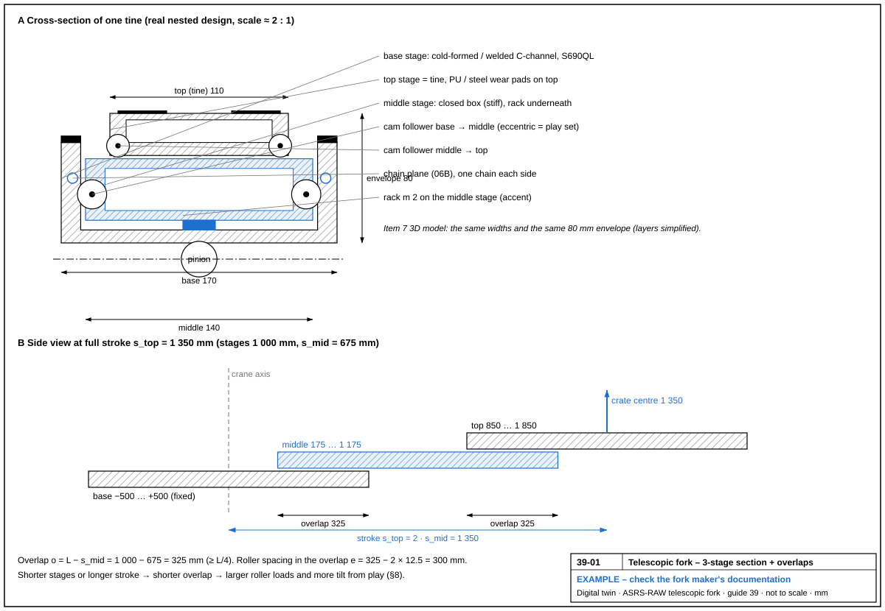
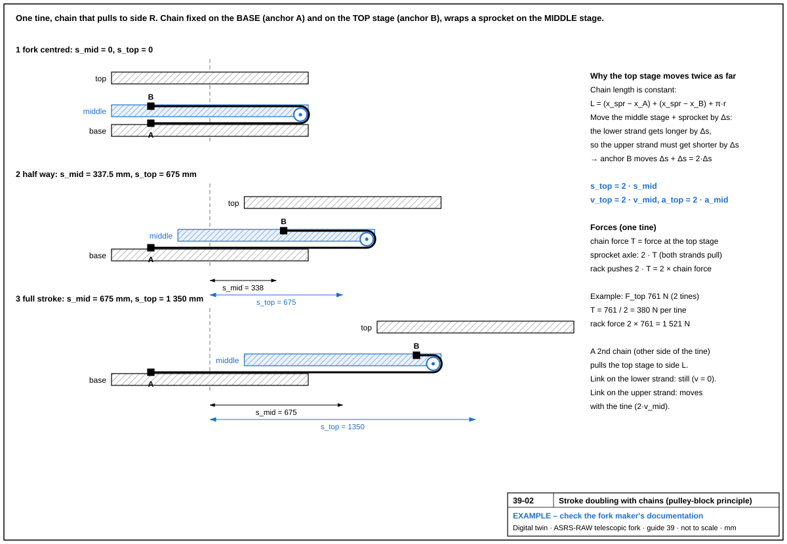
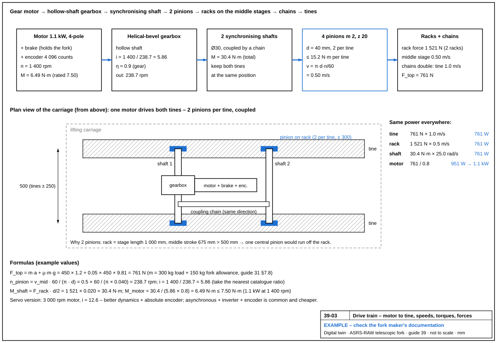
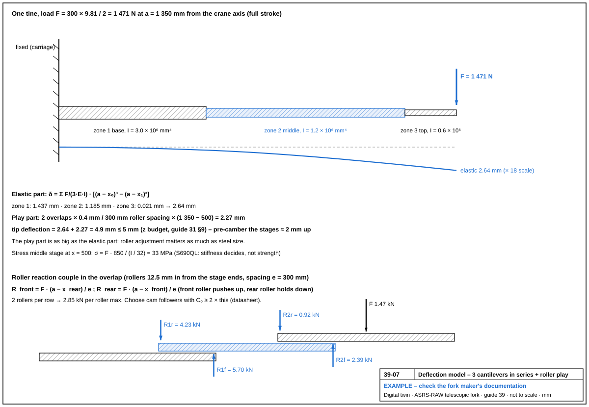
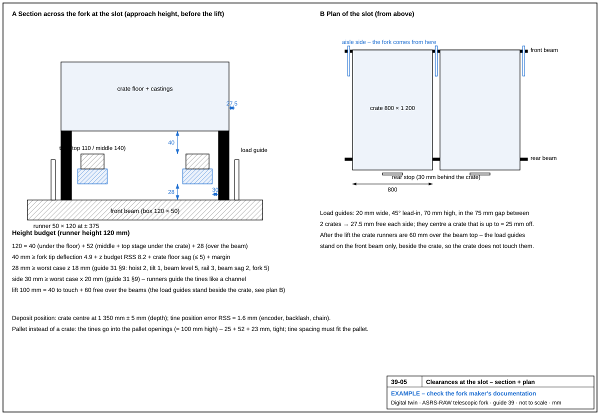
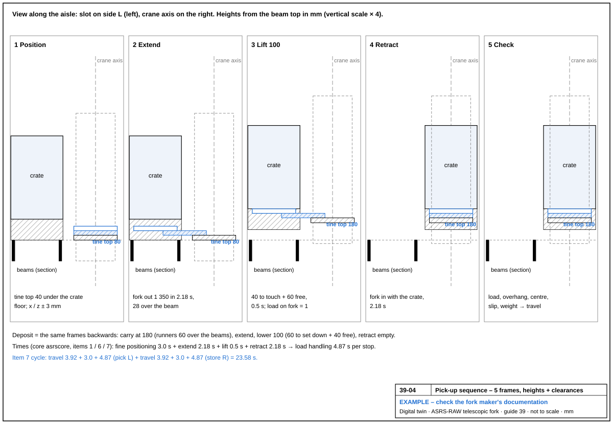
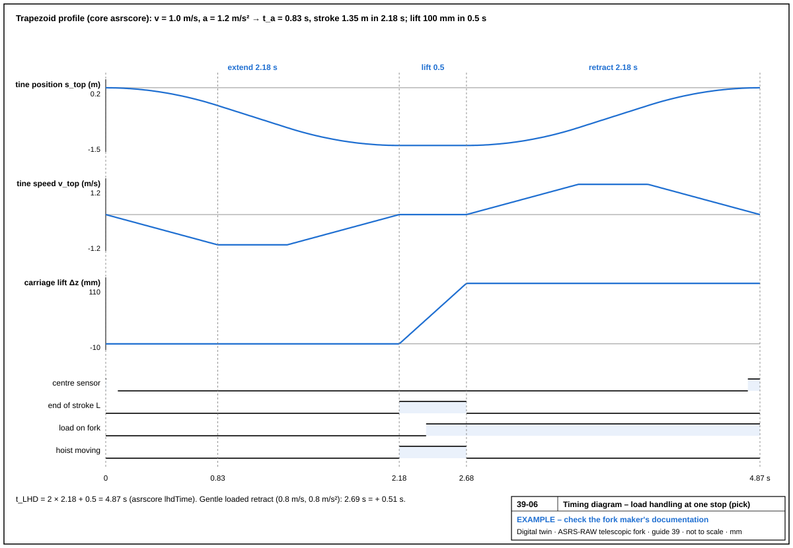
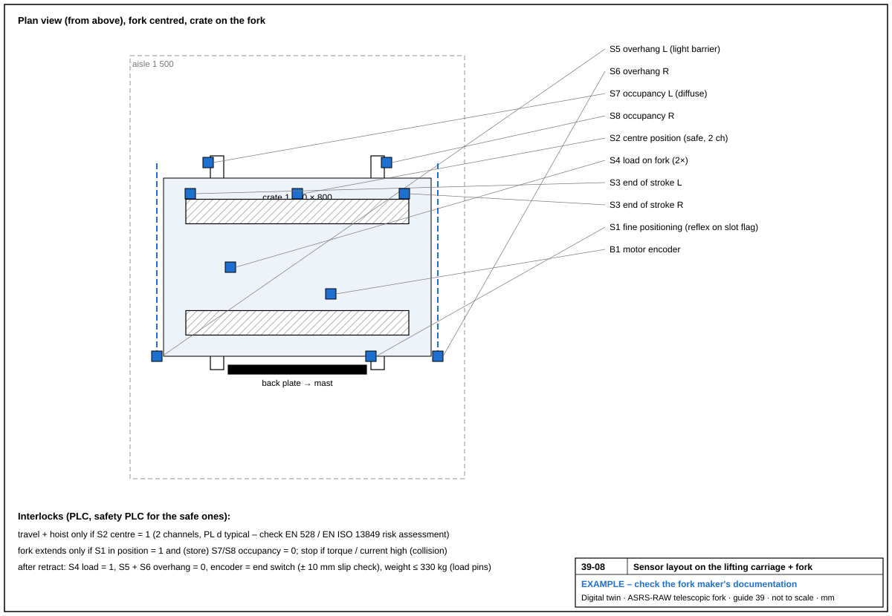

# 39 – AS/RS telescopic fork: how it moves, gear + chain transfer, load pick-up (3D simulation + design guide)

Tab **AS/RS raw materials**, item **7 · Telescopic fork**. Deep link: `/?sritem=7#asrs`.

This guide explains the **telescopic fork** of the stacker crane – the part that reaches into the rack, goes under the
crate, lifts it and pulls it onto the crane. It answers the question of the user:

> *"I don't understand the telescopic fork. How does it move, what gear transfer, how does it connect with the pallet
> (crate) etc. Please add a detail tab with simulation in 3D."*

It is the companion of guide 31 (the whole AS/RS) and guide 38 (the stacker crane structure and manufacturing).
The fork is the **same fork** as in items 1 and 6: 2 tines at ± 250 mm, 3 stages of 1 000 mm, stroke ± 1 350 mm,
300 kg, 1.0 m/s, 1.2 m/s², 1.1 kW, tip deflection 4.9 mm.

> **All values in this guide are examples – the fork maker's data decides.** Use the numbers to understand the design,
> to check an offer and to ask good questions. Do not build a fork from this guide without the maker's calculation,
> drawings, tests and risk assessment (EN 528, Machinery Regulation).

Reader: mechanical engineer. Language: simple English, short sentences. Every formula comes with the example numbers,
so you can check it with a pocket calculator.

---

## Contents

1. [Purpose](#1-purpose)
2. [How to use the page](#2-how-to-use-the-page)
3. [Files and self-check](#3-files-and-self-check)
4. [What a load-handling device is](#4-what-a-load-handling-device-is)
5. [Fork types and the parts of a 3-stage fork](#5-fork-types-and-the-parts-of-a-3-stage-fork)
6. [How it moves – the stroke-doubling principle](#6-how-it-moves--the-stroke-doubling-principle)
7. [Drive trains and gear transfer](#7-drive-trains-and-gear-transfer)
8. [Strength and stiffness – deflection, overlap, roller loads, chains](#8-strength-and-stiffness--deflection-overlap-roller-loads-chains)
9. [Connection with the load – tines, crate, clearances](#9-connection-with-the-load--tines-crate-clearances)
10. [Pick-up and deposit sequence](#10-pick-up-and-deposit-sequence)
11. [Control – positioning, profiles, encoder, homing, slip check](#11-control--positioning-profiles-encoder-homing-slip-check)
12. [Safety](#12-safety)
13. [Fault cases – what the sensor sees, what the PLC does](#13-fault-cases--what-the-sensor-sees-what-the-plc-does)
14. [Manufacturing](#14-manufacturing)
15. [Installation and adjustment](#15-installation-and-adjustment)
16. [Maintenance plan and failure modes](#16-maintenance-plan-and-failure-modes)
17. [Parts list, buy list and shopping list](#17-parts-list-buy-list-and-shopping-list)
18. [Standards register](#18-standards-register)
19. [Checklists](#19-checklists)
20. [Questions for the fork maker](#20-questions-for-the-fork-maker)
21. [Glossary](#21-glossary)
22. [Limits of the twin](#22-limits-of-the-twin)
23. [Drawings and how the numbers were checked](#23-drawings-and-how-the-numbers-were-checked)
- [Next to read](#next-to-read)

---

## 1. Purpose

Item 1 shows the fork working inside the rack, item 6 shows it as one assembly of the crane. Neither shows **how the
three stages move together**, **which gears and chains** do it, and **how the tines meet the crate**. Item 7 and this
guide close that gap.

| Question | Where you find the answer |
|---|---|
| Why do 3 stages come out together? Why does the top stage move twice as far as the middle stage? | page card 1 (3D, X-ray, "follow one chain link") · §6 |
| Which gears? How does one motor drive both tines? What ratio, torque, power? | page card 3 (live calculation) · §7 |
| How stiff must it be? Why is the tip 4.9 mm lower? What do the rollers carry? | page card 3 · §8 |
| How do the tines go under the crate? What clearances? Crate or pallet? | page card 4 · §9 |
| What exactly happens when the crane picks a crate from the rack? Which sensor does what? | page cards 1 + 2 (timeline) · §10, §11 |
| What can go wrong and what does the PLC do? | page card 5 (fault buttons) · §13 |
| How is it made, adjusted and maintained? What do I buy? | page card 6 + catalogue card · §14–§17 |

---

## 2. How to use the page

Open the tab **AS/RS raw materials**, click item **7 · Telescopic fork**. The page has 7 cards.

### 2.1 Card 1 – 3D simulation

The 3D view shows the lifting carriage of the crane in the aisle between the two rack sides (3 bays × 3 levels each
side), the fork with its 2 tines, the drive, the 4 chains, the sensors, and the crate that is picked.

| Control | What it does |
|---|---|
| **▶ Play full cycle** | runs the complete job: travel to slot L-02-1-2, fine positioning, fork out, lift, fork in, checks, travel to slot R-03-1-3, fine positioning + occupancy check, fork out, lower, fork in (23.58 s) |
| **◀ step / step ▶** | go back to the start of the previous step / play only the next step |
| **Reset** | back to t = 0 (keeps the chosen fault) |
| **speed** | 0.1× … 2× – use 0.2× to watch the chains |
| **◀ extend L · centre · extend R ▶** | manual mode: the carriage stays at slot L, the fork runs a full stroke with the real profile (1.0 m/s, 1.2 m/s²) |
| **stroke slider** | manual mode: put the top stage at any position − 1 350 … + 1 350 mm |
| **Iso / Front / Top / X-ray / Section** | camera views. **X-ray** makes stages, crate and rack transparent and shows the drive train. **Section** cuts through all 3 stages |
| **drive design** (select) | rack + pinion + chains (default), all-chain drive, toothed belts, friction wheel (§7.1) |
| **labels** | name tags on the parts (structure in Iso/Front/Top, drive + chains in X-ray, all in Section) |
| **follow one chain link** | one link turns yellow and gets a tag: it lies still on the base, runs over the sprocket, then moves with the tine (§6.4) |
| **show forces** | arrows: load per tine (red), roller reactions base → middle (blue), middle → top (green), chain force (orange), rack force (violet) – live with the real geometry |
| **gentle with load** | loaded moves at 0.8 m/s, 0.8 m/s² instead of 1.0 / 1.2 (+ 1.01 s per cycle) |

The info panel on the right shows the step, the positions s_mid and s_top, the speeds, the pinion and motor speed, the
carriage position, the load, and **10 sensor lamps** (green = signal on, red = alarm signal on).

Colours in the 3D view: base stage dark grey, middle stage mid grey, top stage light grey, rack green, pinion red,
synchronising shaft violet, sprockets blue, chains black, chain anchors orange, rollers yellow, gear motor dark blue,
lifting carriage yellow-orange, rack uprights blue, beams orange, picked crate gold.

### 2.2 Card 2 – the cycle step by step

A **timeline chart** with 3 strips (fork position s_top, fork speed v_top, carriage height Δz; shaded = crate on the
fork), synced with the 3D view. Click the chart to jump to a moment. Below: the **step table** (11 steps) with time,
what happens and the sensor states. Click a row to jump to that step.

### 2.3 Card 3 – kinematics + gear transfer

A live drawing of one tine with the chain (s_mid and s_top = 2·s_mid move with the simulation), 13 inputs (load,
stroke, speed, acceleration, friction, efficiency, pinion diameter, motor speed, stage length, roller play, slope,
chain elongation) and 6 calculation tables: A kinematics, B gear transfer, C forces + power, D deflection, E roller
loads, F positioning accuracy. Each row: item, formula with numbers, value, unit, check (OK / CHECK).

### 2.4 Card 4 – connection with the load

A section at the slot with the clearances, the interface table, crate-versus-pallet table, offset / overhang rules and
a comparison of load-handling devices.

### 2.5 Card 5 – faults

Six buttons: crate offset, slot occupied (double storage), chain elongation / slip, obstacle, fork not at centre before
travel, overload. Each runs the cycle in the 3D view until the sensor catches the fault, shows a red alarm box and
explains what the sensor sees, what the PLC does and how to fix it (§13).

### 2.6 Card 6 – manufacturing + maintenance

How each part is made, the chain tensioning procedure, the maintenance plan, typical failures and the parts list.

### 2.7 Card 7 – catalogue card

8 drawings (click to enlarge), buy list with real makers and a shopping list for one fork (§17).

### 2.8 URL parameters

| Parameter | Effect |
|---|---|
| `?sritem=7#asrs` | open item 7 |
| `&sr7view=iso\|front\|top\|xray\|section` | start view |
| `&sr7design=rack\|chain\|belt\|friction` | drive design |
| `&sr7t=9.2` | jump to t = 9.2 s of the cycle |
| `&sr7fault=offset\|occupied\|chain\|obstacle\|notcentre\|overload` | start with a fault case |
| `&sr7s=-0.8` | manual mode, top stage at − 800 mm |
| `&sr7follow` · `&sr7forces` · `&sr7play` | follow a chain link · show forces · start playing |
| `&sr7card=seq\|kin\|load\|fault\|mfg` | scroll to a card |
| `&sr7tab=draw\|buy\|shop` · `&sr7box=N` | catalogue card tab · open drawing N |
| `&sr7test` | self-check (console lines `SR7TEST …` + a debug box at the end of the page) |
| `&sr7back` | switching test 7 → 6 → 1 → 7 → 6 → 7 (console `SR7BACK …`) |
| `&sr7hold` | test only: keeps the page "loading" so a headless screenshot waits |

---

## 3. Files and self-check

| File | Content |
|---|---|
| `web/asrsfork.js` | UI of item 7: lazy build on the `sritemshow` event, cards, timeline chart, faults, self-check |
| `web/asrsfork_3d.js` | Three.js scene: carriage, 3-stage fork, rack + pinion, shaft, gear motor, 4 chains with moving links, rack, crates, sensors, forces, labels, views |
| `web/asrsfork_calc.js` | geometry (`FG`, `CR`, `RK`, `CLR`), the cycle plan + `stateAt(t)`, fault plans, calculations `calc7()`, hand values `CHECK7` |
| `web/asrsfork_data.js` | texts, step info, sensors, faults, interface tables, manufacturing, maintenance, BOM, catalogue card |
| `web/asrsfork.css` | styles (light + dark theme) |
| `docs/img/39_*.svg` = `web/img/39_*.svg` | 8 drawings |

The page imports Three.js only when item 7 is opened and draws only when the view is visible and something moves.
It uses the shared core `web/asrscore.js` (CRANE, RACK, `trapTime`, `trapPos`, `forkTime`, `lhdTime`) – it does not
change it.

**Self-check** `/?sritem=7&sr7test#asrs`: about 80 lines, for example

```
SR7TEST PASS calc nP = 238.732 (hand 238.732 ± 0.48)
SR7TEST PASS guide 38 tip deflection 4.9 mm = 4.90989 (hand 4.9 ± 0.05)
SR7TEST PASS LHD at the pick = out + lift + in = 4.86667
SR7TEST PASS chain length constant over the stroke (4 chains, 3 positions) – L = 1563.7 mm
SR7TEST PASS followed link moves 2× the middle stage on the upper strand – Δx -0.100 m for Δs_mid −0.05
SR7TEST PASS fault occupied: fork never extends to R
SR7TEST DONE pass=… fail=0 errors=none
```

---

## 4. What a load-handling device is

The stacker crane has three motions: **travel** along the aisle (x), **hoist** up and down (z) and **load handling**
across the aisle into the rack (y). The device that does the third motion is the **load-handling device (LHD)**. In our
store it is a **telescopic fork**.

What the LHD must do:

1. reach into a slot on **both sides** of the aisle (side L and side R);
2. go **under the load without touching it** (clearances, §9);
3. carry the load safely while the crane travels (load must not slide or overhang);
4. put the load down in the slot **in the right place** (± 5 mm in depth, centred between the load guides);
5. be **flat** when retracted: the fork must fit between the crate runners and the carriage;
6. be **fast** – it works at every stop: 2 × 2.18 s of the 4.87 s load-handling time;
7. be **safe**: never move the crane with the fork out, never push a crate into an occupied slot.

Why telescopic? The aisle is only 1 500 mm wide, but the crate centre is 1 350 mm from the crane axis. A rigid arm of
1 350 mm would hit the rack on the other side. The fork therefore has **stages that slide out of each other**, like a
drawer slide: closed it is 1 000 mm long (fits in the aisle), open it reaches 1 850 mm (crate centre at 1 350 mm).

```
   closed (centre position)                 open to side R (full stroke)
   ┌──────────────┐                         ┌──────────────┐
   │ top    1000  │                         │ base (fixed) │
   │ middle 1000  │                         └─────┬────────┴──────┐
   │ base   1000  │                               │ middle (675)  │
   └──────────────┘                               └──────┬────────┴──────┐
        fits in the 1 500 mm aisle                       │ top (1 350)   │  ← crate centre
                                                         └───────────────┘
```

---

## 5. Fork types and the parts of a 3-stage fork

### 5.1 Types

| Type | Stroke (our crate) | Use | Notes |
|---|---|---|---|
| 2-stage fork (base + 1 moving stage) | ≈ ± 0.5 – 0.8 m | small totes, narrow racks | simple, but short reach: the moving stage cannot be longer than the carriage |
| **3-stage fork** (base + middle + top) | **± 1.35 m** (ours) | crates, pallets, single deep | the standard; reach ≈ 1.35 × closed length |
| 4/5-stage fork, double deep | ≈ ± 2.3 m | double-deep racks | + 100 % slots in the same aisle length, but the front load must be moved to reach the rear one (no strict FIFO, guide 31 A.5) |
| **Synchronised twin forks** (2 tines, ours) | – | crates, pallets | 2 tines driven by **one motor** through a synchronising shaft; both tines move exactly together |
| Twin forks with variable spacing | – | different load widths | a spindle moves the tines apart / together |
| Two independent forks on one carriage | – | 2 loads per stop | 2 motors, more throughput, more cost |

### 5.2 The parts of our 3-stage fork



| Part | Job | Example (item 6 / guide 38) |
|---|---|---|
| **Base stage** (one per tine) | fixed on the lifting carriage; carries the middle stage on rollers; holds the pinion window, the base chain anchors, end switches | C-channel 170 wide, I ≈ 3.0 × 10⁶ mm⁴, ≈ 45 kg |
| **Middle stage** | moves s_mid = 675 mm; carries the **rack** underneath and the **sprockets** at both ends; runs on rollers in the base and carries the top stage on rollers | box 140 wide, I ≈ 1.2 × 10⁶ mm⁴, ≈ 30 kg |
| **Top stage = tine** | moves s_top = 2·s_mid = 1 350 mm; goes under the crate; wear pads on top; chamfered tip; top chain anchors | 110 wide, I ≈ 0.6 × 10⁶ mm⁴, ≈ 22 kg |
| **Rollers / cam followers** | carry each stage in the stage below at the **overlap**; some on eccentric studs to set the play | 16 per fork (2 rows × 2 sides × 2 overlaps × 2 tines) |
| **Guide strips** | hardened running faces for the rollers | C45 induction hardened 50 – 55 HRC |
| **Rack + pinions** | the motor drives the middle stage | module 2, 2 pinions per tine (z 20, d = 40 mm) at ± 300 mm – §7.3 |
| **Synchronising shafts** | 2 cross shafts (at ± 300 mm) connect the pinions of both tines → both tines move together; a short coupling chain links the 2 shafts | Ø30, 2 bearings each |
| **Gear motor** | 1.1 kW, helical-bevel gearbox i ≈ 5.9 with hollow shaft on shaft 1, brake, encoder | SEW / Nord / Lenze type |
| **Chains + sprockets + anchors** | double the stroke: 2 chains per tine (one pulls to R, one pulls to L) | roller chain 06B-1, 4 sprockets, tension rods |
| **Sensors** | centre position (safe), end of stroke, load on fork, overhang, occupancy, encoder | §11.6 |

**Why the stages are nested.** The middle stage runs **inside** the base channel, the top stage **on** the middle stage.
The whole fork is only 80 mm high. Each stage is held by **two rows of rollers** in the overlap with the stage below:
the front row pushes up, the rear row holds down (§8.3). The rollers sit 12.5 mm in from the stage ends.

**The item 7 3D model** uses the same widths (170 / 140 / 110 mm) and the same 80 mm envelope, but the stages are drawn
as stacked layers (base − 80 … − 54 mm, middle − 52 … − 28, top − 26 … 0 below the tine top) so the chains, rollers and
rack are easy to see. Drawing 39-01 shows the real nested section.

---

## 6. How it moves – the stroke-doubling principle

### 6.1 One motor, three stages

The motor moves **only the middle stage** (rack + pinion). The top stage gets its motion **from chains** that run over
sprockets on the middle stage. The base does not move. Result:

```
s_top = 2 · s_mid        v_top = 2 · v_mid        a_top = 2 · a_mid
```

Example: s_top = 1 350 mm → s_mid = 675 mm; v_top = 1.0 m/s → v_mid = 0.5 m/s; a_top = 1.2 m/s² → a_mid = 0.6 m/s².

### 6.2 The chain scheme ("pulley block")



One chain (the one that pulls the tine to side R):

* end **A** is fixed on the **base** (300 mm on the L side of the crane axis);
* the chain runs to side R along the base, **around a sprocket** at the R end of the middle stage (460 mm from the
  middle-stage centre), and back to side L;
* end **B** is fixed on the **top stage** (300 mm on the L side of the top-stage centre).

```
          B (on top stage)                                  sprocket on the middle stage
   top    ■━━━━━━━━━━━━━━━━━━━━━━━━━━━━━━━━━━━━━━━━━━━━━━━━━━━━╮
   middle                                                      ⊙
   base   ■━━━━━━━━━━━━━━━━━━━━━━━━━━━━━━━━━━━━━━━━━━━━━━━━━━━━╯
          A (on base)                       lower strand lies still on the base
```

**Why the top stage moves twice as far.** The chain length L is constant:

```
L = (x_spr − x_A) + (x_spr − x_B) + π · r
```

* x_A does not move (base).
* Move the middle stage by Δs → the sprocket moves Δs → (x_spr − x_A) grows by Δs.
* L is constant → (x_spr − x_B) must shrink by Δs → x_B = x_spr − … moves by **Δs + Δs = 2·Δs**.

It is the same as a rope over a moving pulley (pulley block): one end fixed, the pulley moves s, the other end moves 2s.

**The second chain** (other side of the tine) is the mirror image: A' on the base at + 300 mm, sprocket at the L end of
the middle stage, B' on the top stage at + 300 mm. It pulls the tine to side L. When the fork goes to R, chain 1 pulls
and chain 2 just follows (it stays taut because its length is also constant). Each tine has 2 chains, the fork has 4.

### 6.3 Worked example – chain length and positions

With the example geometry (anchors ∓ 300 mm, sprocket ± 460 mm, pitch radius r = 13.9 mm for 06B z 9):

| Position | s_mid | sprocket x | lower strand A → sprocket | upper strand sprocket → B | total incl. π·r |
|---|---|---|---|---|---|
| centre | 0 | 460 | 760 | 760 | 1 563.7 mm |
| half R | 337.5 | 797.5 | 1 097.5 | 422.5 | 1 563.7 mm |
| full R | 675 | 1 135 | 1 435 | 85 | 1 563.7 mm |
| full L | − 675 | − 215 | 85 | 1 435 | 1 563.7 mm |

(upper strand at full R: from the sprocket at 1 135 back to B at 1 350 − 300 = 1 050 → 85 mm.)
The total stays 1 563.7 mm – the self-check tests this for all 4 chains. A 06B chain with 164 links (164 × 9.525 =
1 562 mm) plus the tension rods makes this length.

### 6.4 Follow one chain link

Tick **follow one chain link** on the page. The yellow link starts on the **lower strand** (on the base). Extend the fork
to L:

| Where the link is | Speed of the link (relative to the base) | Why |
|---|---|---|
| lower strand (between A and the sprocket) | **0** – it lies still | the strand is fixed at A; the sprocket rolls along it like a wheel on a road |
| on the sprocket | changes from 0 to 2·v_mid | it goes around the half circle |
| upper strand (between the sprocket and B) | **2·v_mid = v_top** – it moves with the tine | the strand is fixed at B on the top stage |

The self-check moves the middle stage by − 0.05 m: the link on the upper strand moves − 0.100 m (2 ×), the link on the
lower strand does not move at all.

### 6.5 Forces in the chain

The chain force T pulls the top stage. At the sprocket **both strands pull**, so the sprocket axle (middle stage)
carries 2·T. The rack must push the middle stage with 2·T (plus the middle stage's own inertia and friction).

```
T (per tine)       = force needed at the top stage of that tine
sprocket axle      = 2 · T
rack force         = 2 · T  (the chain force is HALF of the push force)
power check:  T · v_top = 2T · v_mid   ✓  (same power, half speed, double force)
```

Example: F_top = 761 N for both tines (§7.4) → T = 380 N per tine → rack force 2 × 761 = 1 521 N in total
(761 N per rack).

### 6.6 Kinetic energy and equivalent mass (good to know)

The middle stage moves at half speed. Its kinetic energy ½·m·(v/2)² is a quarter of what it would be at tine speed.
Referred to the tine speed, the middle stage counts with m_mid / 4. Example: load 300 kg, 2 top stages 44 kg, 2 middle
stages 60 kg → m_eq = 300 + 44 + 60 / 4 = 359 kg, plus the rotating parts (motor rotor × i², pinions, sprockets).
Guide 31 uses a simple, safe allowance of **150 kg** for all moving fork parts: m = 300 + 150 = 450 kg.

---

## 7. Drive trains and gear transfer

### 7.1 Four designs compared

| Design | How it works | Plus | Minus | Typical use |
|---|---|---|---|---|
| **Rack + pinion + chains** (default) | gear motor → shaft → 2 pinions → racks on the middle stages; chains double the stroke | positive drive (no slip), stiff, accurate, 300 – 1 500 kg | rack machining + hardening; chain tension + oil | most unit-load cranes |
| **All-chain drive** | motor sprocket drives a chain fixed to both ends of the middle stage (omega wrap over 2 idlers); chains double the stroke | cheap, no rack | chain elongation now also in the middle stage → more position error, more chains to tension | low-cost forks |
| **Toothed belts** | steel-cord PU belts for the drive (omega) and the stroke doubling | no oil, quiet, clean, low elongation | bigger clamps + pulleys; heat / oil sensitive; tooth jump at low tension | totes, food / pharma, light loads |
| **Friction wheel** | spring-loaded PU wheel drives a strip under the middle stage; chains / belts double the stroke | cheapest; slips in a collision instead of breaking | **slips**: needs a position sensor on the stage, not only the motor encoder; wheel wear; oil = no drive | light forks, retrofits |

Select the design on the page: the 3D view shows the rack and pinion (default), the drive sprocket with the drive chain
fixed under the middle stage (all-chain), black belts (belt), or the black rubber wheel (friction).

### 7.2 The drive train step by step



```
motor 1 400 rpm ──► helical-bevel gearbox i = 5.86 ──► hollow shaft on synchronising shaft 1 (238.7 rpm)
      6.49 N·m            (brake + encoder on the motor)          30.4 N·m ── coupling chain ──► shaft 2
                                                                    │
                         ┌──────────────────────────────────────────┴───────────────┐
                    2 pinions tine 1 (d 40, ± 300 mm)                    2 pinions tine 2 (d 40, ± 300 mm)
                    15.2 N·m, rack force 761 N                           15.2 N·m, rack force 761 N
                         │                                                    │
                    middle stage 0.5 m/s                                 middle stage 0.5 m/s
                         │ chains ×2                                          │ chains ×2
                    top stage (tine) 1.0 m/s, 380 N                      top stage 1.0 m/s, 380 N
```

**Why synchronising shafts?** The two tines must be at the same position (± 1 mm) or the crate is twisted on the fork.
One motor + rigid cross shafts + pinions set to the same tooth position guarantee that. (Two motors would need an
electronic gear – possible, but more expensive and less robust.)

**Why helical-bevel with hollow shaft?** The motor lies along the fork under the carriage (flat), the gearbox turns the
motion 90° and slides directly onto the shaft – no coupling, short, stiff.

### 7.3 Gear ratio – worked example

```
v = π · d · n / 60     →     n_pinion = v_mid · 60 / (π · d) = 0.5 · 60 / (π · 0.040) = 238.7 rpm
i = n_motor / n_pinion = 1 400 / 238.7 = 5.86
```

* Take the nearest catalogue ratio (e.g. 5.8 or 6.0) and set the inverter frequency to get exactly 1.0 m/s.
* Motor turns for one full stroke: s_mid / (π·d) · i = 0.675 / 0.1257 × 5.86 = **31.5 revolutions**.
* Pinion: module 2, z = d / m = 40 / 2 = **20 teeth** (≥ 17: no undercut).
* **Servo version**: motor 3 000 rpm → i = 3 000 / 238.7 = 12.6; more dynamic, absolute encoder, but more expensive.
* **Rack length** = stage length 1 000 mm. **Careful – a single pinion at the crane axis does not work here.** The rack
  on the middle stage spans s_mid ± 500 mm. At full stroke (s_mid = 675 mm) it spans 175 … 1 175 mm – the crane axis
  (x = 0) is no longer under the rack. A central pinion would run off the rack at |s_mid| > 500 mm.

The rule: **one central pinion needs L ≥ 2 · s_mid** (here 1 000 < 1 350). Real forks solve it like this:

| Solution | How | Used in item 7? |
|---|---|---|
| **2 pinions per tine** at ± 300 mm from the axis, on 2 cross shafts coupled by a short chain (or gears) | at s_mid = + 675 the pinion at + 300 is 375 mm inside the rack end (margin 125 mm); at − 675 the pinion at − 300; at 0 both mesh | **yes** (3D model + self-check: worst margin 125 mm) |
| rack on the **base**, pinion on the **middle stage**, motor rides along | motor moves with the middle stage, needs a cable chain | no |
| **chain drive** for the middle stage (all-chain design) | drive chain fixed to the middle-stage ends, running over idlers at the base ends and the motor sprocket | selector "all-chain drive" (simplified) |

With 2 pinions, both pinions turn in the **same direction** (they mesh the same rack), so the coupling is a chain loop
(or an idler gear between 2 gears). Both pinions must be set to the **same tooth phase** on the rack at assembly, or
the rack is pushed by one and braked by the other when both mesh. Ask the fork maker how the mesh is kept over the
full stroke (§20).

### 7.4 Forces, torque and power – worked example (guide 31 §7.8)

```
m      = load + fork allowance = 300 + 150 = 450 kg
F_acc  = m · a                 = 450 × 1.2                = 540 N
F_fric = μ · m · g             = 0.05 × 450 × 9.81        = 220.7 N
F_top  = F_acc + F_fric                                   = 760.7 N ≈ 761 N   (both tines, at the tine speed)
(slope: fork tilted 3 mm/m → m·g·0.003 = 13.2 N – small, add it if the carriage tilts)

T per tine         = 761 / 2                               = 380 N
rack force (both)  = 2 · F_top                             = 1 521 N
shaft torque       = F_rack · d/2 = 1 521 × 0.020          = 30.4 N·m   (15.2 N·m per pinion)
motor torque       = 30.4 / (i · η) = 30.4 / (5.86 × 0.8)  = 6.49 N·m
motor power        = F_top · v / η = 761 × 1.0 / 0.8       = 951 W   → motor 1.1 kW
rated torque 1.1 kW at 1 400 rpm = 9 550 × 1.1 / 1 400     = 7.50 N·m  → use 86 %
```

η = 0.8 is the whole chain motor → tine (gearbox ≈ 0.9, pinion/rack ≈ 0.97, chains + sprockets ≈ 0.95, rollers).

**Braking.** The brake on the motor holds the fork when the drive is off (crane stopped on a slope, power loss). The
deceleration energy goes back into the inverter DC link (shared with travel + hoist in our crane, guide 38 §6.9).

**Motor choice.** A 4-pole asynchronous motor + inverter + encoder (closed loop) is common and cheaper; a servo motor
gives better dynamics and an absolute encoder (no homing after power loss). Both need STO (safe torque off).

### 7.5 Positioning accuracy – worked example

Every error of the middle stage counts **twice** at the tine. Chain wear adds directly.

| Error source | Formula | Value at the tine |
|---|---|---|
| motor encoder 4 096 counts/rev | 2·π·d / (N·i) = 2·π·40 / (4 096 × 5.86) | 0.010 mm |
| gearbox backlash 10 arcmin | 2 · r · θ = 2 × 20 × 0.00291 | 0.116 mm |
| rack ↔ pinion backlash 0.10 mm | 2 × 0.10 | 0.20 mm |
| chain wear elongation 0.1 % (after re-tension) | 0.001 × 1 564 | 1.56 mm |
| **RSS** | √(Σ e²) | **1.58 mm** |

Chain wear is the big one. It grows with time:

| Elongation | Lag of the tine (one chain) | What to do |
|---|---|---|
| 0.1 % | 1.6 mm | normal after bedding-in |
| 0.5 % | 7.8 mm | **re-tension** (§15.3) – slip alarm at 10 mm comes soon |
| 2 – 3 % | 31 – 47 mm | **replace** both chains of the tine (+ check sprockets) |

Requirement (example): crate centre in depth ± 5 mm. The slip check (encoder vs. end switch on the top stage) alarms at
10 mm (§11.5).

### 7.6 Is 150 kg allowance enough? – rotating masses (worked example)

The motor rotor turns fast, so it "feels" heavy at the tine. Reflect every part to the tine speed (equal kinetic energy):

```
motor angle per metre of tine:  θ' = (1/2) / r_pinion · i = 0.5 / 0.020 × 5.86 = 146.6 rad/m
rotor (1.1 kW 4-pole, J ≈ 0.003 kg·m² – see datasheet):  m = J · θ'² = 0.003 × 146.6² ≈ 64 kg
2 top stages (move with the tine)                        = 44 kg
2 middle stages (half speed → ¼)                          = 60 / 4 = 15 kg
pinions, shafts, sprockets, chains (estimate)             ≈ 5 kg
equivalent moving mass of the fork                        ≈ 128 kg  ≤ 150 kg allowance ✓
```

The rotor is the **biggest single item** – that is why a servo motor with a low-inertia rotor (or a higher ratio with a
smaller motor) makes a fork more dynamic. Use the real J from the motor datasheet.


---

## 8. Strength and stiffness – deflection, overlap, roller loads, chains



### 8.1 Deflection – 3 cantilevers in series (guide 38 §7.7)

At full stroke the tine is a cantilever fixed in the carriage. It is made of 3 zones with different stiffness:

| Zone (mm from the crane axis) | Stage that carries | I (mm⁴) |
|---|---|---|
| 0 – 500 | base | 3.0 × 10⁶ |
| 500 – 1 175 | middle | 1.2 × 10⁶ |
| 1 175 – 1 350 | top | 0.6 × 10⁶ |

Load per tine F = 300 × 9.81 / 2 = 1 471 N at a = 1 350 mm. Unit-load method (δ = ∫ M·m / (E·I) dx) for a stepped
cantilever with a point load at the tip gives for each zone:

```
δ_zone = F / (3 · E · I) · [ (a − x₀)³ − (a − x₁)³ ]          E = 210 000 N/mm²

zone 1: 1 471 / (3 × 210 000 × 3.0e6) × (1 350³ − 850³) = 1.437 mm
zone 2: 1 471 / (3 × 210 000 × 1.2e6) × (850³ − 175³)   = 1.185 mm
zone 3: 1 471 / (3 × 210 000 × 0.6e6) × 175³            = 0.021 mm
δ_elastic                                                 = 2.64 mm
```

Plus the **tilt from roller play**: each overlap has some play c (0.4 mm) over the roller spacing e (300 mm). The tilt
c / e acts over the lever from the base tip to the load (1 350 − 500 = 850 mm):

```
δ_play = 2 overlaps × 0.4 / 300 × 850 = 2.27 mm
δ_tip  = 2.64 + 2.27 = 4.9 mm   ≤ 5 mm "fork deflection" line of the z budget (guide 31 §9)
```

**The play part is as big as the elastic part.** Adjusting the eccentric rollers (§15.4) matters as much as the steel
size. The stages are **pre-cambered** ≈ 2 mm upwards at the tip in manufacturing, so the loaded fork is nearly level.

Stress in the middle stage at x = 500: σ = F · 850 / (I / 32) = 1 471 × 850 / 37 500 = **33 MPa** – far below S690QL.
The fork is designed for **stiffness**, not strength. Root moment per tine: F · a = 1 471 × 1.35 = **1.99 kN·m** – this
goes into the lifting carriage.

### 8.2 Overlap – why it matters

```
overlap o = L − s_mid = 1 000 − 675 = 325 mm        roller spacing e = o − 2 × 12.5 = 300 mm
```

| If you … | then … |
|---|---|
| make the stroke longer with the same stages | o gets shorter → roller loads grow (§8.3), tilt from play grows (c / e) |
| make the stages longer | o gets longer, but the fork no longer fits in the aisle when closed (1 000 mm stages in a 1 500 mm aisle) |
| rule of thumb | o ≥ L / 4 (here 325 ≥ 250 ✓) |

Try it on the page: set the stage length to 0.9 m – the overlap drops to 225 mm, the play deflection rises, the check
turns to CHECK.

### 8.3 Roller loads in the overlap – the reaction couple

Each moving stage is a short beam held by **two roller rows** in the stage below:

* the **front roller** (at the tip of the stage below) pushes **up**;
* the **rear roller** (at the rear end of the moving stage) holds **down** (it takes the "lever" of the cantilever).

```
R_front = F · (a − x_rear)  / e          R_rear = F · (a − x_front) / e
```

Example at full stroke (F = 1 471 N at a = 1 350; rollers 12.5 mm in from the ends; e = 300 mm):

| Overlap | Front roller x | Rear roller x | R_front | R_rear |
|---|---|---|---|---|
| base → middle | 487.5 | 187.5 | 1 471 × (1 350 − 187.5) / 300 = **5.70 kN** (up) | 1 471 × (1 350 − 487.5) / 300 = **4.23 kN** (down) |
| middle → top | 1 162.5 | 862.5 | 1 471 × (1 350 − 862.5) / 300 = **2.39 kN** (up) | 1 471 × (1 350 − 1 162.5) / 300 = **0.92 kN** (down) |

Check: R_front − R_rear = 5.70 − 4.23 = 1.47 kN = F ✓ (vertical balance).

With 2 rollers per row (one each side of the profile) the highest load is **2.85 kN per roller**. Choose cam followers
with a static rating C₀ ≥ 2 × 2.85 kN and check the track (guide strip) contact stress with the roller maker's table.
Shock loads (crate set down hard) – use a dynamic factor ≈ 1.2 – 1.5 (check the fork maker's calculation).

Show forces on the page: the arrows change live with the fork position – at half stroke the couple is much smaller.

### 8.4 Chain strength

Normal running: T = 380 N per tine – tiny. The chain is sized for the **jam / collision** case: the motor delivers its
peak torque (≈ 2.5 × rated) until the torque monitoring stops it.

```
T_peak = 2.5 · M_n · i · η / (d/2) / 2 tines / 2   = 2.5 × 7.50 × 5.86 × 0.8 / 0.020 / 4 = 1 100 N
safety factor = F_B / T_peak = 8 900 / 1 100 = 8.1   (06B-1, F_B ≥ 8.9 kN – check the chain maker; rule ≥ 6)
```

(rack force per tine 2 200 N → chain force = half = 1 100 N.) A torque limit in the drive (current limit) keeps the
real peak lower – that also protects the tine tip in a collision.

### 8.5 What changes for a heavier crate? (500 kg example)

| Value | 300 kg (ours) | 500 kg | Rule |
|---|---|---|---|
| force at the tines F_top | 761 N | (650 × 1.2 + 0.05 × 650 × 9.81) = 1 099 N | m = load + 150 |
| motor power | 951 W → 1.1 kW | 1 373 W → **1.5 kW** | F · v / η |
| elastic deflection | 2.64 mm | 2.64 × 500 / 300 = 4.40 mm | linear in F |
| play deflection | 2.27 mm | 2.27 mm (geometry, once the play is taken up) | c / e · lever |
| tip deflection | 4.9 mm | **6.7 mm > 5 mm** → stiffer stages (I × 1.5) or less play | |
| front roller base → middle | 5.70 kN | 9.50 kN | linear in F |
| chain force per tine | 380 N | 549 N | F_top / 2 |

A heavier load first hits the **deflection** limit, not the strength. The fork maker then uses higher stages (bigger
I), longer overlaps, or limits the stroke.


---

## 9. Connection with the load – tines, crate, clearances



### 9.1 The interface

| Item | Value (example) | Why / check |
|---|---|---|
| Tines | 2 tines at ± 250 mm (500 mm apart); top stage 110 wide, middle 140, base 170; fork envelope 80 mm | same as items 1 + 6 |
| Crate | 1 200 × 800 × 600 mm, ≤ 300 kg, steel; **2 runners (feet) 50 × 120 mm at ± 375 mm**, running in the fork direction | the tines run in the 2 free channels between the runners, under the crate floor |
| Clearance under the crate floor | **40 mm** at approach height | ≥ fork deflection 4.9 + z budget RSS 8.2 + crate floor sag + margin |
| Middle stage ↔ beam top | 120 − 40 − 52 = **28 mm** | ≥ worst case z 18 mm (guide 31 §9) |
| Side clearance runner ↔ middle stage | 375 − 25 − (250 + 70) = **30 mm** (top stage 45 mm) | ≥ worst case x 20 mm (guide 31 §9) |
| Crate ↔ load guide | **27.5 mm** each side (20 mm guide in the 75 mm gap between 2 crates) | 45° lead-in centres a crate up to ≈ 25 mm off |
| Lift stroke | **100 mm in 0.5 s** = 40 mm to touch + 60 mm free | asrscore `liftDz` 0.1 m, `tLift` 0.5 s (items 1 + 6) |
| Deposit position | crate centre at 1 350 mm ± 5 mm (depth); rear stop 30 mm behind the crate | position error RSS 1.6 mm (§7.5) |
| Carry type | **lift carry**: the crate sits on the tines, nothing slides | friction carry only for light totes |

**Height budget** (runner height 120 mm):

```
120 mm = 40 (tine top under the crate floor) + 52 (middle + top stage under the crate) + 28 (middle stage over the beam)
```

During the lift: after 40 mm the tines touch the crate floor (0.2 s of the 0.5 s), then the crate goes up 60 mm and
is free of the beams. During the deposit the opposite: the carriage comes 60 mm above the deposit height, lowers 60 mm
until the runners sit on the beams, then 40 mm more so the tines are free.

**A note on item 1.** Item 1 draws the crate runners at ± 250 mm, directly over the tines. That is a drawing
simplification: with runners lying across the 2 beams, a tine directly under a runner would have to pass through the
front beam. The real design is the one of item 7: **runners outside the tines** (± 375 mm), tines in the channels.
(Guide 31 §6.10 says "2 runners at ± 250 mm (fork tine positions)" – read it as "runners matched to the tine positions";
the crate drawing of the crate maker decides.)

### 9.2 Crate with runners or a pallet?

| | Crate with runners (our case) | EUR pallet 1 200 × 800 (EN 13698-1) |
|---|---|---|
| Where the tines go | in the open channels between the 2 runners – under the crate floor | into the pallet openings between the blocks (≈ 100 mm high) |
| Tine spacing | 500 mm (fits the runners at ± 375) | must fit the openings – ≈ 330 mm centres for the 800 side (check the pallet) |
| Height budget | runner 120 = 40 + 52 + 28 mm | opening ≈ 100 = 25 + 52 + 23 mm – tight, needs a thin fork |
| Risks | crate is stiff, runners straight ± 2 mm | broken boards, nails, sagging pallets, film hanging down → contour check before storing |
| Rack | 2 beams (front + rear), runners across them | 2 beams, bottom boards across them |

For castings and forgings (raw material of this factory) a **steel crate with runners** is the better choice: stiff,
repeatable, no broken boards, and the fork channels are always free.

### 9.3 Load guides and centring

The rack has **load guides** on the front beam between the crates: 20 mm wide, 70 mm high, with a 45° lead-in. When the
fork puts a crate down a little off centre (along the aisle), the lead-in pushes it into the right place. A **rear stop**
on the rear beam stops a crate that is pushed too deep. Both are bent galvanised sheet (guide 31 §6.1).

### 9.4 What if the crate is offset or overhangs?

| Situation | Who finds it | What happens |
|---|---|---|
| crate up to ≈ 20 mm off (along the aisle) | load guides | centred at the next deposit, no alarm |
| crate stands too far towards the aisle (> 20 mm) | overhang light barrier on the carriage after the fork has retracted | fork stops, travel blocked, alarm (fault "crate offset", §13) |
| crate stands too deep (rear) | the fork picks it with the normal stroke – it sits off-centre on the fork → overhang barrier on the other side | same |
| castings stick out of the crate | contour check at the infeed (guide 31 §10) | crate is rejected before it enters the store |
| crate too heavy | weighing at the infeed; load pins in the hoist | rejected; or "overload" (§13) |

### 9.5 Lift carry versus friction carry

* **Lift carry** (our fork): the tines lift the load. The load does not slide. Works for any bottom shape that leaves
  free channels. Needs the lift stroke (0.5 s) and free space under the load.
* **Friction carry**: the load is pulled or pushed over rollers or a smooth surface (e.g. shuttles with fingers for
  totes, belt conveyors on the carriage). No lift, but friction forces and the bottom of the load matter.

### 9.6 Other load-handling devices

| Device | Loads | How it works | Plus | Minus |
|---|---|---|---|---|
| **Telescopic fork** (ours) | crates, pallets 100 – 1 500 kg | lifts the load, both sides, single or double deep | robust, accurate, independent of the load bottom | needs free channels under the load; 2 × 2.2 s |
| Chain / roller conveyor on the carriage | pallets, flat-bottom crates | pulls / pushes the load into a conveyor-type slot (channel rack) | fast, simple, no lift | rollers in every slot → expensive rack |
| Shuttle with gripper arms (fingers) | totes, cartons 20 – 50 kg (mini-load) | arms go beside the tote, fingers fold behind it and pull it onto a belt | very fast, multi-deep, adjustable width | light loads only, tote must be stiff |
| Clamping arms | cartons, trays, tyres | 2 belts / plates clamp the load from the sides and pull it | no free space under the load needed | load must take the clamping force |
| Satellite (channel shuttle) | pallets, many per SKU | battery car drives under the pallet deep into a channel | very deep lanes (10 – 40 pallets) | LIFO lanes, charging, slower per load |

---

## 10. Pick-up and deposit sequence



### 10.1 The cycle of the page (11 steps, 23.58 s)

The page runs one dual job: **pick** a crate from slot L-02-1-2 (side L, bay 2, position 1, level 2) and **store** it
into slot R-03-1-3 (side R, bay 3, level 3). Travel 1.925 m and hoist 1.25 m between the stops.

| # | Step | Time (s) | What happens | Sensor states |
|---|---|---|---|---|
| 1 | travel + hoist to slot L | 3.92 | crane travels 1.925 m and hoists 1.25 m together (travel decides: 2·√(1.925 / 0.5) = 3.92 s). Fork **must** be centred | centre = 1, load = 0 |
| 2 | fine positioning ± 3 mm | 3.00 | slow approach to the slot flag; tine top 40 mm under the crate floor; slot check sees a crate (correct for a pick) | in position = 1 at the end |
| 3 | fork out to L | 2.18 | top stage − 1 350 mm; tines in the channels, 40 mm under the floor, 28 mm over the beams, 30 mm side clearance | centre = 0 after 5 mm, end L = 1 at the end, current normal |
| 4 | lift 100 mm | 0.50 | 40 mm to touch (0.2 s), 60 mm free | load on fork = 1, load pins + 300 kg |
| 5 | fork in with the load | 2.18 | the crate comes onto the carriage | end L = 0, centre = 1 at the end |
| 6 | checks | 0 | load on fork, no overhang, centre position, encoder = end switch (slip), weight ≤ 300 kg | centre = 1, load = 1, overhang = 0, slip = 0 |
| 7 | travel + hoist to slot R | 3.92 | with the crate; carriage 60 mm above the deposit height | centre = 1, load = 1 |
| 8 | fine positioning + occupancy check | 3.00 | the occupancy sensor looks into the target slot – it **must** be empty | occupancy R = 0 (else stop) |
| 9 | fork out to R with the crate | 2.18 | load guides centre the crate | end R = 1 at the end |
| 10 | lower 100 mm | 0.50 | 60 mm to set down + 40 mm free | load on fork = 0, load pins − 300 kg |
| 11 | fork in empty | 2.18 | centre = 1 → crane may travel; WMS books the slot | centre = 1, job done |

```
total = 2 × 3.92 (travel) + 2 × 3.0 (positioning) + 2 × 4.87 (load handling) = 23.58 s
```

### 10.2 Load-handling time and the timing diagram



Trapezoid profile (the core `asrscore.js` uses trapezoids for all axes):

```
t_a  = v / a = 1.0 / 1.2                 = 0.833 s   (acceleration distance ½·a·t_a² = 0.417 m)
cruise distance = 1.35 − 2 × 0.417        = 0.517 m  → 0.517 s
t_f  = s / v + v / a = 1.35 + 0.833       = 2.183 s
t_LHD = 2 · t_f + t_lift = 2 × 2.183 + 0.5 = 4.867 s   = asrscore lhdTime(), guide 31 §8 (one stop 7.87 s with positioning)
```

**Gentle loaded moves.** Many fork makers move slower with a heavy load (less sway of the castings in the crate, less
shock on the rollers). Example 0.8 m/s, 0.8 m/s²: t = 1.35 / 0.8 + 0.8 / 0.8 = 2.69 s → + 0.51 s per loaded move,
+ 1.01 s per cycle of the page (tick "gentle with load"). The core keeps 1.0 / 1.2 both ways so that items 1–7 have the
same cycle times.

### 10.3 Storing = picking backwards

| Pick (retrieve from the rack) | Store (put into the rack) |
|---|---|
| approach 40 mm **under** the crate floor | approach with the crate, runners 60 mm **over** the beams |
| slot check: crate **must be there** | occupancy check: slot **must be empty** |
| extend empty | extend loaded |
| **lift** 100 mm | **lower** 100 mm |
| retract loaded | retract empty |
| checks: load on fork, overhang, weight | checks: load gone, fork centred, WMS booking |

### 10.4 The sequence as PLC steps (example)

```
STEP 0  IDLE            wait for a job from the WCS          → job AND S2 centre            → STEP 1
STEP 1  MOVE            travel + hoist to the slot           → x, z in window (± 20 mm)      → STEP 2
STEP 2  FINE POSITION   slow to the flag                     → S1 in position (± 3 mm)
                                                               AND (pick: S7/S8 = 1 | store: S7/S8 = 0)  → STEP 3
                                                               (store AND occupied → ALARM "slot occupied")
STEP 3  FORK OUT        to ± 1 350 mm                        → encoder target AND S3 end switch → STEP 4
                                                               (current high → ALARM "collision")
STEP 4  LIFT / LOWER    hoist ± 100 mm                       → z reached AND load pins plausible → STEP 5
                                                               (pick AND weight > 330 kg → ALARM "overload", lower back)
STEP 5  FORK IN         to 0                                 → S2 centre (both channels)    → STEP 6
STEP 6  CHECK           S4 load = expected, S5/S6 = 0, |encoder − switch| ≤ 10 mm → STEP 7 (next stop) or STEP 0
```

Each step has a **watchdog time** (e.g. 1.5 × the planned time). If a step takes too long, the PLC stops the crane with
an alarm that names the step – this is how a stuck crate or a broken sensor is found quickly. Guide 35 shows such step
chains in ladder logic for Delta and Siemens PLCs.


---

## 11. Control – positioning, profiles, encoder, homing, slip check

### 11.1 Position control loop

The fork axis is a normal positioning axis: the PLC / motion controller sends a target position (− 1 350, 0, + 1 350 mm
at the tine), the inverter runs the motor with a speed profile, the motor encoder closes the loop. Because the tine moves
2× the middle stage, the controller scales: **1 mm at the tine = 0.5 mm at the rack = 0.5 / (π·40) × 5.86 motor turns
= 0.0233 rev = 95.6 encoder counts** (4 096 counts/rev).

### 11.2 Trapezoid and S-curve

* **Trapezoid** (used in the twin): constant acceleration, jumps in acceleration (infinite jerk at the corners).
* **S-curve**: limited jerk j (e.g. 5 – 10 m/s³). Smoother for the crate and the rollers, a little slower:
  for each acceleration phase add about a / j = 1.2 / 6 = 0.2 s (example). Most fork drives use a short S-curve.

### 11.3 Encoder and homing

* **Incremental encoder** on the motor: after power-on the fork does not know where it is → **homing** (reference run)
  on the centre sensor at slow speed, from the side where the fork stands (the fork is normally centred).
* **Absolute encoder** (multi-turn) or a servo motor with absolute feedback: no homing; check the position at the centre
  sensor at every pass (plausibility).
* **Encoder on the motor sees the middle stage only.** It does not see the chains. Chain elongation or a slipping
  friction wheel is invisible to it → the slip check (§11.5).

### 11.4 End positions

The PLC stops the fork at the encoder target (± 1 350 mm). **End switches / sensors** on the base (or at the top stage)
confirm it. A hard **mechanical end stop** (buffer) is the last line if everything fails. The software limit is a few
mm before the switch, the switch a few mm before the hard stop.

### 11.5 Slip check (encoder versus position)

At the end of every stroke the PLC compares:

```
expected tine position (encoder) − real tine position (end switch on the top stage / laser) ≤ 10 mm  → OK
```

* rack + chain drive: a difference means **chain elongation** (or a broken chain);
* friction drive: the difference means **slip** – correct the encoder count at every end switch;
* > 10 mm → alarm "slip / chain elongation", fork back to centre slowly, service (§13, §15.3).

### 11.6 Sensors



| Sensor | What it checks | Example | Safety relevant? |
|---|---|---|---|
| S1 fine positioning | x and z of the crane at the slot within ± 3 mm | reflex sensor on a flag at each slot (or laser + teach-in table) | no (positioning) |
| S2 fork centre (2 channels) | fork is in the centre position | 2 inductive sensors on the base, flag on the middle stage; safety sensor or 2 standard sensors with diagnostics | **yes** – enables travel + hoist |
| S3 end of stroke L / R | fork fully out | inductive sensors / switches | yes (with the hard stop) |
| S4 load on fork | a crate is on the tines | 2 diffuse sensors looking up between the tines | yes for the sequence |
| S5 / S6 overhang L / R | crate edge not beyond ± (600 + 20) mm | through-beam light barriers along the carriage edges | yes – blocks travel |
| S7 / S8 occupancy L / R | target slot empty before a store; crate present before a pick | diffuse sensor with background suppression / distance sensor | yes – prevents double storage |
| torque / current | collision, jam | drive function (current monitoring, safe torque limit) | yes |
| B1 motor encoder | position + speed | 4 096 counts/rev, HTL / SSI / HIPERFACE | for the loop |
| load pins (hoist) | weight on the carriage | guide 38 §6.6 | yes – overload |

### 11.7 Interlocks (PLC logic, example)

```
TRAVEL_ENABLE  = S2_centre_A AND S2_centre_B AND NOT S5_overhang_L AND NOT S6_overhang_R AND NOT fork_fault
HOIST_ENABLE   = TRAVEL_ENABLE  OR  (phase = LIFT / LOWER at the slot AND S1_in_position)
FORK_ENABLE    = S1_in_position AND hoist_stopped AND travel_stopped
                 AND (job = PICK  → S7/S8 occupancy = 1)      // the crate must be there
                 AND (job = STORE → S7/S8 occupancy = 0)      // the slot must be empty
FORK_STOP      = current > limit  OR  end switch reached unexpectedly  OR  slip > 10 mm
```

Guide 35 (PLC ladder) and guide 33 (circuits) show how such conditions are wired and programmed for the crane.

### 11.8 I/O list of the fork (example)

| Tag | Type | Device | Meaning |
|---|---|---|---|
| FK_S2A / FK_S2B | DI (safety) | inductive sensors on the base | fork centred, channel A / B |
| FK_S3L / FK_S3R | DI | inductive sensors / switches | end of stroke L / R |
| FK_S4A / FK_S4B | DI | diffuse sensors | load on fork |
| FK_S5 / FK_S6 | DI | light barriers | overhang L / R |
| FK_S7 / FK_S8 | DI | diffuse / distance sensors | slot occupied L / R |
| FK_TOPEND_L / R | DI | sensor on the top stage (or flag) | real tine end position for the slip check |
| FK_BRK_FB | DI | brake microswitch | brake released |
| FK_BRK | DO | brake rectifier | release the brake |
| FK_STO_A / B | DO (safety) | inverter STO inputs | safe torque off |
| FK_POS_SET / ACT | fieldbus | inverter / servo | position set-point / actual (mm at the tine) |
| FK_VEL_SET / ACT | fieldbus | inverter / servo | speed set-point / actual |
| FK_CURR | fieldbus | inverter | motor current (collision / jam monitoring) |
| FK_ENC | encoder | motor | 4 096 counts / rev, homing on FK_S2 |
| FK_FAULT | fieldbus | inverter | drive fault code |

All fork signals reach the crane PLC through the carriage terminal box and the energy chain (guide 38 §6.9); the safety
signals go to the safety PLC (guide 33).


---

## 12. Safety

The stacker crane is a machine under **EN 528** (rail-dependent storage and retrieval equipment – safety requirements)
and the Machinery Directive / Machinery Regulation. For the fork the main hazards and measures are:

| Hazard | Measure (example) |
|---|---|
| crane travels / hoists with the fork out → fork hits the rack | **safe centre-position monitoring** (2 channels) → STO on travel + hoist; PL d typical (check the risk assessment, EN ISO 13849-1) |
| crate falls from the fork | lift carry, overhang + load sensors, occupancy check, end positions, no persons under loads (store is fenced) |
| fork pushes a crate into an occupied slot → crate falls at the rear | occupancy check before every store |
| collision with an obstacle | current / torque limit, slow speed in manual mode |
| person in the aisle | the aisle is a closed area: fence + door switches / light curtains at the access (guide 31, 32); maintenance only with lock-out |
| maintenance on the fork | maintenance mode: STO, brake applied, lock-out of the main switch, mechanical blocking of the carriage (guide 38 §17) |
| uncontrolled fork movement after power loss | holding brake on the fork motor |
| chain break | 2 chains per tine (one pulls each way) → the tine is still held in one direction; chain inspection |

**Performance level.** The required PL comes from the risk assessment of the crane maker (EN ISO 13849-1, PL_r).
For "fork not centred → stop travel" PL d is typical – **check** with the crane maker. Guide 32 lists the safety
functions of the whole crane.

---

## 13. Fault cases – what the sensor sees, what the PLC does

The fault buttons run the cycle until the fault is caught. The times are the stop times of the page.

| Fault | Stops at | What the sensor sees | What the PLC does | Fix + prevent |
|---|---|---|---|---|
| **Crate offset** | step 6 (11.79 s) | the crate stood 60 mm towards the aisle in slot L; the fork picked it with the normal stroke → on the carriage it sits 60 mm off-centre to side R → overhang barrier **R** interrupted | fork stops, travel + hoist blocked, alarm "load overhang R 60 mm" | manual mode: put it back with a corrected stroke or take it out; check load guides + last deposit (teach-in) |
| **Slot occupied** | step 8 (18.72 s) | occupancy sensor sees a crate in R-03-1-3 during fine positioning | fork does **not** extend; alarm "target slot occupied" to the WMS; WMS blocks the slot and gives a new one | find why (booking error, manual store); correct stock (guide 34); never bypass the check |
| **Chain elongation / slip** | step 3 (9.11 s) | encoder says 1 350 mm, but the end switch on the top stage comes 25 mm late | alarm "slip 25 mm > 10 mm"; fork back to centre slowly; crane stops after the job | measure elongation, re-tension both chains, replace at 2 – 3 % |
| **Obstacle** | step 3 (8.36 s) | motor current rises steeply: the tine tip hits a fallen casting at ≈ 1.40 m | current limit stops the fork within mm; retract slowly; alarm "fork collision L"; slot blocked | lock-out, remove the part, check the tine (deflection test), rack + chains |
| **Fork not at centre** | step 6 (11.79 s) | after the retract the fork stops 30 mm before the centre; S2 stays OFF | **interlock**: STO on travel + hoist; only the fork may move (slowly) | re-home on S2, check encoder coupling and chain tension |
| **Overload (360 kg)** | step 5 (11.89 s) | load pins / motor current see 360 kg > 330 kg (110 %) during the lift | stop lifting, lower back onto the beams, fork in **empty**, alarm, slot blocked | weigh the crate, correct the WMS master data; the infeed scale should have caught it |

---

## 14. Manufacturing

### 14.1 Parts and processes

| Part | Material / how | Process notes | Check |
|---|---|---|---|
| Stage profiles | cold-formed or laser-cut + welded S690QL / S355; aluminium extrusions for light forks | short intermittent welds, alternate sides; **pre-camber ≈ 2 mm up** at the tip | straightness 0.2 / 1 m, camber per drawing |
| Guide strips | hardened steel strips (C45 induction hardened 50 – 55 HRC, or drawn spring steel), screwed / bonded | joints offset, screws every 100 mm | parallel ± 0.1 mm, no step at joints |
| Rollers / cam followers | bought, stud type with needle bearings; some on **eccentric studs** | press-fit / screw in reamed holes; set play 0.1 – 0.2 mm | turn freely; tip play ≤ 0.4 mm per overlap |
| Rack | module 2, C45 / 42CrMo4, teeth induction hardened; bought as bars, cut to length | screw + dowel to the middle stage; joints with a gauge pinion | pitch error across a joint ≤ 0.02 mm; parallel to the strips ± 0.05 |
| Pinions + shafts | 4 pinions z 20 m 2, shrink discs on 2 shafts, coupling chain | all pinions to the same tooth phase | tines level ± 0.5 mm, same position ± 1 mm |
| Chains + anchors | roller chain 06B-1 (ISO 606), pre-stretched; anchors with threaded tension rods + lock nuts | assemble in the centre position, both chains of a tine equal | tension per §15.3 |
| Surface | zinc-nickel / zinc-flake small parts; paint on the base; running faces bare + oiled | mask strips and racks | DFT per paint system |

### 14.2 Route (from guide 38 §14.7, 730 min ≈ 12.2 h per fork)

| No. | Operation | Machine | Check | Typical mistake |
|---|---|---|---|---|
| 10 | cut profiles, strips, rack bars | laser + band saw | length ± 0.5 | – |
| 20 | fit-up in a straightening jig with **pre-camber** | long jig with pins | camber per drawing | no pre-camber → tip sinks below the beam |
| 30 | weld (short stitches, alternate sides) | MAG / TIG | VT | long continuous seam → banana shape |
| 40 | mill roller tracks + rack seats | long CNC gantry mill (2 m) | tracks parallel ± 0.1, straightness 0.2 / 1 m | tracks not parallel → stage jams |
| 50 | harden rack teeth / strips | induction | 50 – 55 HRC | – |
| 60 | assemble stages, rollers, chains; adjust; test | assembly bench + 300 kg test load | chain tension, centre position, deflection ≤ 4.9 mm at 1 350 mm | chains not equal → tines at different heights |

### 14.3 Make or buy?

For a first crane **buy the complete fork** (from the crane maker or a fork specialist). Making it needs a 2 m CNC mill,
induction hardening, a test bench with 300 kg at full stroke, and experience with roller play and chain setting. Make it
yourself only for a series of cranes or a spare-parts strategy.

---

## 15. Installation and adjustment

### 15.1 Mounting on the carriage

1. Lift the fork with a crane and spreader onto the carriage arms (≈ 200 kg); fix the base stages with the bolts and
   dowels of the maker (torque per drawing).
2. **Level** the fork: both tines level ± 0.5 mm across, and parallel to the rack beams (laser or precision level).
3. **Parallelism of the 2 tines**: distance 500 mm ± 1 mm at both ends of the base.
4. Connect motor, brake, encoder, sensors (energy chain on the carriage).

### 15.2 Centre position

1. Move the fork by hand (brake released, motor without power – maker's procedure) or in slow manual mode to the
   mechanical centre.
2. Set the centre flag / sensors S2 so both channels switch at 0 ± 1 mm.
3. Home the axis; check that the fork stops at 0 from both sides (± 1 mm).

### 15.3 Chain tensioning (both tines)

1. Lock out the crane (maintenance mode), fork centred, no load.
2. Measure the chain sag in the middle of the free span (or the force with a spring scale): example target 2 – 3 mm sag
   at 20 N.
3. Loosen the lock nut of the anchor on the top stage; turn the tension rod. Do the **other chain of the same tine the
   same amount** – the top stage must stay in the centre (± 1 mm).
4. Repeat on the second tine. Both tines at the same position (± 1 mm) and level (± 0.5 mm).
5. Lock nuts, paint mark, run 10 × to both sides slowly, check again.
6. Home on S2; check end positions L / R with the encoder (± 2 mm).
7. Measure elongation over 10 links with a gauge: replace at 2 – 3 % (always both chains of a tine; check sprockets).

### 15.4 Roller play

Turn the eccentric studs until the stage runs without play but freely (no "hard spots" over the stroke). Check the tip
play at full stroke: lift the tine tip by hand / with a lever and measure – ≤ 0.4 mm per overlap (this gives the 2.27 mm
of §8.1). Lock the eccentric studs.

### 15.5 Function and load test

| Test | Target (example) |
|---|---|
| stroke L / R, speed 1.0 m/s, 20 cycles | no noise, no jerks, end positions ± 2 mm |
| deflection with 300 kg at 1 350 mm, both sides | ≤ 4.9 mm at the tip (guide 38 §16 ITP no. 11) |
| synchronism of the tines | ± 1 mm along the stroke |
| sensors S2 – S8 | each switches at the right place (lamp test) |
| slip check | encoder vs. end switch ≤ 2 mm after setting |
| overload | 110 % → alarm (with the hoist load pins) |
| brake | holds the fork at full stroke with 300 kg (power off) |

---

## 16. Maintenance plan and failure modes

### 16.1 Maintenance plan (example – the fork maker's manual decides)

| When | What | Who |
|---|---|---|
| daily | visual: tine tips (bent? cracks?), crates centred on the fork, no oil leaks, no unusual noise | operator |
| weekly | end-position and centre-sensor function test (move the fork, watch the lamp); clean sensor lenses | operator / maintenance |
| monthly | lubricate chains (oil, brush / drip) and racks (adhesive grease); rollers turn freely; wipe guide strips | maintenance |
| 3-monthly | chain tension + equal length; fork level (± 0.5 mm) and centre position; roller play (tip test); gearbox oil level | maintenance (guide 38 §17) |
| yearly | chain elongation gauge; rack wear (tooth thickness, pitting); pinions; rollers + strips; **deflection test** with 300 kg at full stroke (≤ 4.9 mm); brake test of the fork motor | maintenance + crane maker |
| 5 – 8 years / at limits | replace chains (2 – 3 %), rollers, guide strips, pinions; overhaul the gear motor | crane maker / service |

**Wear limits (examples – the maker's values decide):** chain elongation 2 – 3 %; rack tooth thickness − 10 %;
roller play > 0.4 mm per overlap that cannot be adjusted out; guide strip wear groove > 0.3 mm.

### 16.2 Failure modes

| Failure | Cause | Effect | Cure / prevention |
|---|---|---|---|
| chain elongation | wear in pins + bushes, no oil | top stage lags, tines at different positions, slip alarm | re-tension, oil, replace at 2 – 3 % |
| tine tip too low | no pre-camber, roller play, overload | tine hits the beam or the runner | set roller play, pre-camber, deflection test |
| bent tine after collision | crate offset, obstacle, teach-in wrong | fork jams, deflection high | torque monitoring, occupancy + overhang sensors; straighten or replace the stage |
| rack tooth wear / pitting | no grease, dirt, overload | noise, backlash, position error | adhesive grease, covers, replace rack + pinions |
| roller flats / seized | shock loads, dirt, no grease | stage jerks, noise | sealed cam followers, replace in sets |
| guide strip worn / loose | screws loose, not hardened | stage drops, play | hardened strips, thread lock, torque check |
| tines not synchronous | pinion slipped on the shaft, coupling chain loose, chains of the 2 tines not equal | crate twisted on the fork | shrink discs, coupling chain tension, set chains equal, level check |
| pinions fight each other | 2 pinions per tine not in the same tooth phase | noise, wear, current peaks when both mesh | set the phase at assembly with a gauge |
| sensor misaligned / dirty | vibration, dust | false overhang / occupancy alarms | rigid brackets, weekly cleaning, function test |

---

## 17. Parts list, buy list and shopping list

### 17.1 Parts list – one fork with 2 tines (example)

| Pos | Item | Make / buy | Material / spec | Qty | kg |
|---|---|---|---|---|---|
| 1 | Base stage (U-channel, guide strips) | MAKE | S690QL / S355 + hardened strips | 2 | 90 |
| 2 | Middle stage (rack seat, sprocket axles) | MAKE | S690QL, milled tracks ± 0.1 | 2 | 60 |
| 3 | Top stage = tine (wear pads, chamfered tip) | MAKE | S690QL, pre-camber 2 mm | 2 | 44 |
| 4 | Rack m 2, L = 1 000 | BUY + machine | C45 / 42CrMo4, induction hardened | 2 | 6 |
| 5 | Pinion m 2, z 20 (2 per tine) | BUY | hardened, shrink disc | 4 | 2 |
| 6 | Synchronising shafts Ø30 + bearings + coupling chain | MAKE + BUY | 42CrMo4 +QT; 06B chain + 2 sprockets | 2 | 9 |
| 7 | Gear motor 1.1 kW, helical-bevel, i ≈ 5.9, brake + encoder | BUY | servo or asynchronous + inverter | 1 | 22 |
| 8 | Roller chain 06B-1, ≈ 1.6 m, tension rods + anchors | BUY | ISO 606 | 4 | 2.4 |
| 9 | Sprockets 06B z 9 with axles + bearings | BUY + machine | hardened teeth | 4 | 0.8 |
| 10 | Cam followers / track rollers (some eccentric) | BUY | sealed, needle bearings | 16 | 2.4 |
| 11 | Guide strips, wear pads, end stops | MAKE + BUY | hardened steel, PU pads | 1 set | 6 |
| 12 | Sensors (centre safe, end, load, overhang, occupancy) | BUY | see §17.2 | 1 set | 3 |
| 13 | Cable + energy chain on the carriage, terminal box | BUY | drag-chain cable | 1 | 3 |
| | **total** | | | | **≈ 251 kg** |

(Item 6 counts the fork as ≈ 200 kg of steel stages + drive; the parts list above includes motor, sensors and cables.)

### 17.2 Buy list – catalogue examples

Data only where confident; otherwise "see datasheet". Price class = **estimate – ask for a quote** (€ < 500,
€€ 500 – 5 000, €€€ 5 000 – 50 000).

| Item | Spec (from the guide) | Example maker / series | Data | Price class | What to check |
|---|---|---|---|---|---|
| Complete telescopic fork, single deep | 300 kg, ± 1 350 mm, 1 m/s | Eurofork (Italy) – check current range | see datasheet | €€€ – ask for a quote | deflection at full stroke, drive included, double-deep option |
| Complete telescopic fork | unit load / mini-load | MIAS Group – check | see datasheet | €€€ | load, stroke, envelope height |
| Fork as part of the crane | – | crane makers build in-house (e.g. Swisslog, Dematic, SSI Schaefer, Kardex Mlog, Stöcklin – check) | – | in the crane price | spare parts, chain life |
| Helical-bevel gear motor 1.1 kW | i ≈ 6, brake, encoder | SEW-Eurodrive (K / KA gear + DRN motor + BE brake; or CMP servo) | see datasheet | €€ | torque ≥ 6.5 N·m × service factor, encoder interface |
| Helical-bevel gear motor 1.1 kW | as above | Nord (SK helical-bevel), Lenze (g500-B) – check | see datasheet | €€ | same |
| Rack m 2 + pinion z 20 | hardened, quality 6 – 8 | Atlanta Antriebssysteme, WMH Herion, Güdel – check | see datasheet | €€ | quality class, joint gauge, hardened teeth |
| Roller chain 06B-1 | ISO 606, F_B ≥ 8.9 kN (check) | iwis, Renold, Tsubaki | see datasheet | € per m | breaking load, wear resistance, pre-stretched |
| Sprocket 06B z 9 – 12 | hardened teeth | chain makers or stock sprockets (e.g. Mädler – check) | see datasheet | € | hardened, bore |
| Toothed belt (belt version) | steel cord PU | Gates, ContiTech, Brecoflex – check | see datasheet | €€ | tensile strength, clamp plates |
| Cam follower (stud type) | needle bearing, eccentric option | Schaeffler INA (KR / KRE / NUKR) | C₀ – see datasheet | € each | static rating ≥ 2 × 2.85 kN |
| Cam follower | as above | McGill (Regal Rexnord) CAMROL, SKF, IKO, THK – check | see datasheet | € each | seals, lubrication |
| Combined / track rollers | radial + axial | Winkel, Nadella – check | see datasheet | €€ | axial guidance |
| Motor encoder | incremental / absolute, 4 096 counts | SICK (DFS60 / AFS60), Kübler (Sendix), Heidenhain – check | see datasheet | € | interface (HTL / SSI / HIPERFACE) |
| Safe centre-position sensor | inductive, safety-rated | SICK IN4000, Pepperl+Fuchs safety inductive – check | PL – see datasheet | €€ | 2 channels, PL d / SIL 2 |
| Diffuse / distance sensor | occupancy, load on fork | SICK W16 / W12, Leuze HT / ODS, Pepperl+Fuchs R100 – check | see datasheet | € | range, black / shiny surfaces |
| Light barrier (overhang) | through-beam | SICK, Leuze, Pepperl+Fuchs – check | see datasheet | € | length ≈ 1 m, alignment |
| Reflex sensor (fine positioning) | flag at each slot | SICK, Leuze – check | see datasheet | € | repeatability ± 1 mm |

### 17.3 Shopping list – one fork (if you make it)

| Pos | Qty | Item | Spec | Example | Price class |
|---|---|---|---|---|---|
| 1 | 1 | Gear motor 1.1 kW, i ≈ 5.9, brake + encoder | helical-bevel, hollow shaft | SEW / Nord / Lenze | €€ |
| 2 | 2 + 4 | Rack m 2 L 1 000 + pinion z 20 | hardened | Atlanta / WMH Herion | €€ |
| 3 | 4 × 1.6 m | Roller chain 06B-1 + tension rods | ISO 606 | iwis / Renold / Tsubaki | € |
| 4 | 4 | Sprockets 06B z 9 + axles | hardened | chain maker / stock | € |
| 5 | 16 | Cam followers (8 eccentric) | sealed | Schaeffler INA / McGill | € |
| 6 | ≈ 200 kg | Steel S690QL + S355 for 6 stages | laser cut | steel service centre | €€ |
| 7 | 1 set | Guide strips hardened + wear pads | C45 50 – 55 HRC | local / stock | € |
| 8 | 1 set | Sensors | see buy list | SICK / Leuze / P+F | €€ |
| 9 | 1 | Chain gauge + spring scale + feeler gauges | maintenance | chain maker / tool shop | € |

---

## 18. Standards register

| Standard | Title (short) | Why it matters here |
|---|---|---|
| EN 528 | Rail-dependent storage and retrieval equipment – safety requirements | the stacker crane incl. LHD; safety functions, tests |
| EN ISO 12100 | Safety of machinery – risk assessment | method for the fork hazards |
| EN ISO 13849-1 / -2 | Safety-related parts of control systems | PL of "fork centred → travel enable", interlocks |
| EN 60204-1 | Electrical equipment of machines | motor, brake, sensors wiring |
| ISO 606 | Short-pitch roller chains (06B etc.) | chain dimensions + minimum tensile strength |
| ISO 10823 | Guidance on the selection of roller chain drives – check | chain sizing |
| ISO 6336 (DIN 3990) | Calculation of load capacity of gears | rack + pinion |
| DIN 867 / ISO 53 | Basic rack profile for involute gears | module 2 tooth form |
| ISO 1328-1 | Gear accuracy grades | rack quality class |
| ISO 281 / ISO 76 | Rolling bearings – dynamic / static load rating | cam followers |
| EN 10025-6 | High-strength steels (S690QL) | stage material |
| ISO 5817 | Weld quality levels | stage welds |
| FEM 9.831 / EN 13001 (ideas) | Design of S/R machines / cranes | load cases, dynamic factors (check which applies) |
| EN 15512 / EN 15620 | Racking – design / tolerances | beam level + deflection the fork sees |
| EN 13698-1 | Pallet production specification (EUR pallet) | if pallets are used |
| EN 619 | Continuous handling equipment for unit loads – safety | conveyors at the I/O (not the fork itself – check) |

"check" = confirm the current edition and whether it applies with the crane maker.

---

## 19. Checklists

### 19.1 Design review of a fork offer

- [ ] load, stroke, speed, acceleration match the job (300 kg, ± 1 350 mm, 1 m/s, 1.2 m/s²)
- [ ] deflection at full stroke with rated load given (≤ 5 mm) and pre-camber stated
- [ ] overlap at full stroke ≥ L / 4; roller loads and roller ratings given
- [ ] how the rack mesh is kept over the full stroke (2 pinions / chain drive)
- [ ] fork envelope (height) fits the crate channels: 40 / 28 / 30 mm clearances
- [ ] safe centre-position monitoring (PL stated), end positions, current limit
- [ ] occupancy, overhang, load-on-fork sensors included
- [ ] chain type, breaking load, safety factor at peak torque; tensioning method
- [ ] encoder type (absolute / incremental + homing)
- [ ] maintenance intervals, wear limits, spare parts list, delivery times

### 19.2 Commissioning

- [ ] fork level ± 0.5 mm, tines parallel ± 1 mm
- [ ] centre sensor S2 at 0 ± 1 mm, both channels
- [ ] chains tensioned equally, top stage centred ± 1 mm
- [ ] roller play ≤ 0.4 mm per overlap
- [ ] end positions ± 2 mm; slip check ≤ 2 mm
- [ ] deflection test 300 kg at 1 350 mm both sides ≤ 4.9 mm
- [ ] all sensor functions tested; interlocks tested (try to travel with the fork 30 mm out → must be blocked)
- [ ] brake holds 300 kg at full stroke

### 19.3 Monthly walk-around

- [ ] tine tips straight, no cracks; wear pads OK
- [ ] chains oiled, no stiff links, no rust
- [ ] racks greased, no pitting
- [ ] sensors clean, brackets tight
- [ ] no unusual noise over the stroke

---

## 20. Questions for the fork maker

1. Load, stroke, speed, acceleration – rated values and the values with a "gentle" loaded profile?
2. Fork envelope height and tine widths? Does it fit our crate channels (40 / 28 / 30 mm clearances)?
3. Deflection at full stroke with the rated load – elastic + play? Pre-camber? Test record?
4. How is the rack mesh kept over the full stroke (2 pinions? chain drive? motor on the middle stage)?
5. Chain type, breaking load, safety factor at motor peak torque? Pre-stretched? Tensioning method and interval?
6. Roller type and rating, how the play is set, wear limits?
7. Motor: servo or asynchronous? Encoder type? Homing needed after power loss? Brake data?
8. Safety: centre-position monitoring – which sensors, which PL? Current / torque limit for collisions?
9. Which sensors are included (end, load on fork, overhang, occupancy)? Interfaces to the crane PLC?
10. Double-deep option later? Same carriage?
11. Maintenance plan, lubrication (oil / grease types), wear parts and their life at 40 jobs/h, 2 shifts?
12. Spare parts set and delivery times (chains, rollers, pinions, sensors)?
13. Noise level at full speed?
14. Can we get the stage drawings / section for our crate and rack check?

---

## 21. Glossary

| Term | Meaning |
|---|---|
| LHD | load-handling device – here the telescopic fork |
| telescopic fork | fork with 2 – 5 stages that slide out of each other and reach into the rack on both sides |
| tine | one fork arm; our fork has 2 tines |
| base stage | the fixed stage, bolted to the lifting carriage |
| middle stage | the stage driven by the rack + pinion; moves half the stroke |
| top stage | the stage that goes under the load; moves the full stroke |
| stroke | travel of the top stage from the centre (± 1 350 mm) |
| stroke doubling | top stage moves 2× the middle stage, by chains or belts over sprockets on the middle stage |
| overlap | length where two stages are inside each other at full stroke (325 mm) |
| cam follower | small roller with a stud (needle bearing) that carries a stage |
| eccentric stud | stud with an offset – turn it to set the roller play |
| guide strip | hardened strip the rollers run on |
| rack / pinion | straight gear bar / small gear wheel; module m = tooth size (d = m · z) |
| synchronising shaft | shaft that connects the pinions of both tines so they move together |
| sprocket | toothed wheel for a chain |
| chain anchor | fixed end of a chain (on the base or on the top stage), with a tension rod |
| 06B | British-standard roller chain, pitch 9.525 mm (3/8″), ISO 606 |
| runner | foot of the crate, here 50 × 120 mm, running in the fork direction |
| load guide | sheet-metal guide on the rack beam that centres the crate |
| lift carry / friction carry | load is lifted / load is pulled or pushed over a surface |
| lift stroke | vertical movement of the carriage to pick up / set down the load (100 mm) |
| occupancy check | check that the target slot is empty before a store |
| overhang | load sticking out beyond the allowed outline on the carriage |
| slip check | comparison of encoder position and real position (end switch) |
| homing | reference run to find the zero position after power-on |
| STO | safe torque off – the drive cannot make torque |
| PL | performance level of a safety function (EN ISO 13849-1) |
| pre-camber | the stage is made slightly bent upwards so that it is straight under load |
| RSS | root sum of squares – statistical sum of independent errors |

---

## 22. Limits of the twin

* The fork geometry is simplified: stages drawn as stacked layers (the real nested section is drawing 39-01); 1 roller
  pair per stage end; one chain plane each side.
* Motion profiles are trapezoids (no jerk limit), the same as the core of items 1 – 6.
* The 3D crane shows only a mast segment and 3 bays × 3 levels; travel and hoist use the core speeds.
* The chain is always taut; chain slack and chain dynamics are not simulated. The "chain elongation" fault shows the lag
  of the top stage, not the slack chain.
* The all-chain, belt and friction designs are visual alternatives; the calculations of card 3 are for rack + chain.
* Forces are static (no dynamic factor); deflection uses the guide-38 beam model.
* Fault cases are scripted sequences (one fault at a time), not a full PLC simulation – guides 32, 33 and 35 cover the
  control and the program.

---

## 23. Drawings and how the numbers were checked

### 23.1 Drawings

| No. | File | Content |
|---|---|---|
| 39-01 | `39_fork_section.svg` | nested 3-stage section of one tine (rollers, strips, rack, pinion, chain planes, sizes); side view at full stroke with overlaps |
| 39-02 | `39_stroke_doubling.svg` | chain scheme in 3 positions; s_top = 2·s_mid; chain forces |
| 39-03 | `39_drive_train.svg` | motor → gearbox → 2 coupled shafts → 2 pinions per tine → racks → chains → tines; speeds, torques, power |
| 39-04 | `39_pickup_sequence.svg` | 5 frames: position, extend, lift, retract, check – heights + clearances |
| 39-05 | `39_slot_clearances.svg` | section at the slot (40 / 28 / 30 / 27.5 mm) + plan with load guides and rear stop |
| 39-06 | `39_timing_diagram.svg` | s_top, v_top, lift and sensor signals over the 4.87 s load handling |
| 39-07 | `39_deflection_model.svg` | 3 cantilevers in series + roller play = 4.9 mm; roller reaction couple |
| 39-08 | `39_sensor_layout.svg` | sensors on the carriage + interlocks |

All drawings: white background, black + one accent colour, title block "EXAMPLE – check the fork maker's
documentation", not to scale. The same files are in `web/img/` (catalogue card of item 7).

### 23.2 How the numbers were checked

Every number of §6 – §10 was computed with a Python script using only the standard library (`verify7.py` in the
scratch folder of the build). The same formulas are in `web/asrsfork_calc.js`; the page self-check `&sr7test`
compares them with the hand values (`CHECK7`) and with the core (`forkTime`, `lhdTime`) and guides 31 / 38.

| Value | Guide 31 / 38 / core | This guide |
|---|---|---|
| fork stroke / speed / acceleration | ± 1 350 mm, 1.0 m/s, 1.2 m/s² | same |
| time per stroke / load handling | 2.18 s / 4.87 s | 2.183 s / 4.867 s |
| fork force / power / motor | 761 N / 0.95 kW / 1.1 kW (guide 31 §7.8) | 760.7 N / 951 W / 1.1 kW |
| tip deflection | 2.64 + 2.27 = 4.9 mm (guide 38 §7.7) | 2.643 + 2.267 = 4.91 mm |
| stage widths, I values, stage length | 170 / 140 / 110 mm; 3.0 / 1.2 / 0.6 × 10⁶ mm⁴; 1 000 mm (item 6, guide 38) | same |
| lift stroke | 100 mm in 0.5 s (core `liftDz`, `tLift`) | same (40 + 60 mm) |
| positioning budget | x RSS 8.7 / worst 20 mm, z RSS 8.2 / worst 18 mm (guide 31 §9) | clearances 30 mm (x) and 28 / 40 mm (z) are larger |

New in this guide (not in guides 31 / 38): gear ratio 5.86, pinion 238.7 rpm, shaft torque 30.4 N·m, motor torque
6.49 N·m, chain force 380 N (1 100 N at peak, safety factor 8.1), roller loads 5.70 / 4.23 / 2.39 / 0.92 kN,
chain length 1 563.7 mm, tine position error RSS 1.58 mm, and the design rule **L ≥ 2·s_mid for one central pinion**
(not met → 2 pinions per tine).

---

## Next to read

* **Guide 31** – AS/RS mechanical system: rack, crane, I/O, cycle time, positioning budget (item 1).
* **Guide 38** – stacker crane structure + manufacturing: lifting carriage, fork stages route, ITP (item 6).
* **Guide 32** – AS/RS control system: motion profiles, positioning, safety functions (item 2).
* **Guide 33** – AS/RS control circuits: drives, STO, sensors wiring (item 3).
* **Guide 35** – PLC ladder for the AS/RS: sequences and interlocks like §11.7 (item 5).
* **Guide 34** – WMS / ERP / MES: slot booking, blocked slots after a fault (item 4).
