# 40 – Ball screw, ball nut and profiled linear guide: design, load ratings, accuracy, 3D (products of the new factory)

Tab **Ball screw + guide factory**, item **1 · Products – ball screw, nut, profiled linear guide**. Deep link: `/?bfitem=1#bsf`.

This guide is the textbook and the reference for the **products** of the new factory. The factory will make four
products:

| Code | Product | Short description |
|---|---|---|
| `BS-3210-1000-C5` | Ground ball screw shaft | Ø32 mm, lead 10 mm, right hand, 1 start, thread 850 mm, total 1 000 mm, grade C5 |
| `BN-3210-FL` | Flanged ball nut | DIN 69051-5 form B style flange, balls Ø6.35 mm, internal deflector, 4 circuits × 1 turn, preload P1 (3 % Ca) |
| `LG-25-1000` | Profiled linear guide rail | size 25, 23 × 22 mm, 1 000 mm, hole pitch 60 mm, 4 raceways at 45° (O-arrangement) |
| `LB-25-FL` | Carriage (block), flange type | size 25, 70 mm wide, 4 rows of recirculating balls Ø4.763 mm, preload Z1 |

The later items of the tab (manufacturing, factory twin, communication, quality, MES, ERP, PLC programs) all use these
four products. Their data lives in **one** file: `web/bsfprod_data.js`. If you change a value there, all items follow.

> **All values in this guide are examples of catalogue class (THK / HIWIN / NSK / Bosch Rexroth / Schaeffler style) –
> check the maker's catalogue.** Use the numbers to understand the design, to check an offer and to ask good
> questions. For a real machine, take the load ratings, rigidity, accuracy and permissible speeds from the catalogue of
> the maker you buy from, and use the maker's calculation tool.

Reader: mechanical engineer. Language: simple English, short sentences. Every formula comes with the example numbers,
so you can check it with a pocket calculator. Units: mm, N, N·m, µm, min⁻¹ (rpm), kg, °C unless written otherwise.

---

## Contents

1. [Purpose](#1-purpose)
2. [How to use the page](#2-how-to-use-the-page)
3. [Files and self-check](#3-files-and-self-check)
4. [History and types](#4-history-and-types)
5. [Ball screw assembly – the parts](#5-ball-screw-assembly--the-parts)
6. [Geometry and contact mechanics](#6-geometry-and-contact-mechanics)
7. [Lead, speed, torque, efficiency, back-driving](#7-lead-speed-torque-efficiency-back-driving)
8. [Load ratings, life, buckling, critical speed, DN](#8-load-ratings-life-buckling-critical-speed-dn)
9. [Preload, rigidity, lost motion, preload torque](#9-preload-rigidity-lost-motion-preload-torque)
10. [Accuracy grades, thermal growth, error budget](#10-accuracy-grades-thermal-growth-error-budget)
11. [Materials and heat treatment](#11-materials-and-heat-treatment)
12. [Linear guide design](#12-linear-guide-design)
13. [Guide loads, equivalent load, life, static safety](#13-guide-loads-equivalent-load-life-static-safety)
14. [Guide accuracy classes, preload classes, rigidity](#14-guide-accuracy-classes-preload-classes-rigidity)
15. [Lubrication and sealing](#15-lubrication-and-sealing)
16. [Mounting and alignment](#16-mounting-and-alignment)
17. [Selection example – HMC X axis, end to end](#17-selection-example--hmc-x-axis-end-to-end)
18. [Failure modes](#18-failure-modes)
19. [Design checklists](#19-design-checklists)
20. [Parts lists per product, product family, codes](#20-parts-lists-per-product-product-family-codes)
21. [Buy list – catalogue examples](#21-buy-list--catalogue-examples)
22. [Shopping list – first prototype run](#22-shopping-list--first-prototype-run)
23. [Standards register](#23-standards-register)
24. [Questions for the supplier](#24-questions-for-the-supplier)
25. [Glossary](#25-glossary)
26. [Drawings and how the numbers were checked](#26-drawings-and-how-the-numbers-were-checked)
- [Next to read](#next-to-read)

---

## 1. Purpose

A ball screw and a profiled linear guide are the two "bones" of every CNC axis. The ball screw moves the table, the
linear guide carries it. The new factory will make both. Before we plan machines, lines, MES and ERP, we must know the
products very well:

| Question | Where you find the answer |
|---|---|
| What are the parts and what does each part do? | §5 (ball screw), §12 (guide), 3D cards on the page (click a part) |
| Why does the groove have two arcs? Why 45°? | §6 |
| How much torque does the motor need? | §7, §17.7 |
| How long does it live? | §8 (screw), §13 (guide) |
| How fast can it turn? | §8.6 (critical speed), §8.7 (DN) |
| How stiff is it, how much does it lose at reversal? | §9 |
| What does "C5" mean? How accurate is the axis? | §10 |
| Which steel, which hardening? | §11 |
| How do I mount it right? | §16 |
| How do I select screw and guide for a real axis? | §17 (HMC X axis, end to end) |
| Why do they fail? | §18 |
| What do we make, what do we buy? | §20 – §22 |

What this guide is **not**: it is not a catalogue. The load ratings in `web/bsfprod_data.js` are of the right class,
but your real product needs its own calculation (ISO 3408-5, ISO 14728) and its own tests (item 5, quality).

---

## 2. How to use the page

Open the tab **Ball screw + guide factory** and click item **1 · Products**. Or use the deep link `/?bfitem=1#bsf`.
The page is built the first time you open the item (lazy). The 3D views render only when they are visible.

The page has six cards, from top to bottom:

| # | Card | What you can do |
|---|---|---|
| 1 | **Ball screw + nut – 3D** | Views *assembled / cut-away / X-ray / exploded*. Select the return system: **internal deflector** (main) / end cap / tube. Select the preload: **ball oversize** / double nut + spacer. **Play** turns the screw: the nut moves 10 mm per turn, the balls circulate inside the nut at about 0.43 × screw speed. rpm slider. Labels on / off. **Click a part** → the info panel shows function, material, hardness, tolerance, how it is made, how it fails. |
| 2 | **Linear guide – 3D** | Views *assembled / X-ray / cut / exploded*. **O / X arrangement** – a live SVG profile section shows the contact lines. Rolling element **ball / roller**. **Play** moves the carriage: the balls circulate; loaded balls move at half the carriage speed. Click parts → info. |
| 3 | **Theory + calculators** | Live inputs. Each result shows the formula with your numbers in it, so you can check it by hand: lead / speed / torque / efficiency; load cycle → mean load → life; buckling / critical speed / DN with mounting select; rigidity + lost motion + preload torque; thermal growth + pre-tension; accuracy grade table + error budget; guide equivalent load with moments; guide life; static safety; preload classes; accuracy class vs length; mounting tolerances. |
| 4 | **Selection example – HMC X axis** | Editable inputs (mass, rapid speed, acceleration, cutting forces, distances). A step table shows every check with OK / not OK. Same numbers as §17. |
| 5 | **Parts lists per product + product family** | Make / buy, material, heat treatment for the 4 products; the size family for MES / ERP. Same as §20. |
| 6 | **Real components + drawings – catalogue examples** (`bfCard1`) | 13 drawings (click to enlarge, ← → to browse, Esc to close), buy list with filter, shopping list for a first prototype run. |

### 2.1 URL parameters

| Parameter | Effect |
|---|---|
| `?bfitem=1#bsf` | open item 1 of the tab |
| `&bf1view=asm\|cut\|xray\|exploded` | ball screw view |
| `&bf1nut=deflector\|endcap\|tube` | ball return system of the nut |
| `&bf1pre=oversize\|double` | preload method (single nut with oversize balls / double nut + spacer) |
| `&bf1gview=asm\|xray\|cut\|exploded` | linear guide view |
| `&bf1arr=O\|X` | O- or X-arrangement in the profile section |
| `&bf1roll=ball\|roller` | ball guide or roller guide |
| `&bf1card=bs\|lg\|calc\|sel\|parts` | scroll to that card |
| `&bf1play` | start both animations at once |
| `&bf1calc=1…7` | open calculator tab 1 … 7 |
| `&bf1test` | self-check (console lines `BF1TEST …` and the box `#bf1Debug`) |
| `&bf1hold` | test only: keeps the page "loading" so headless screenshots wait |
| `&bf1tab=draw\|buy\|shop`, `&bf1box=N` | catalogue card: open a tab / open drawing N |

### 2.2 A first walk through the page (10 minutes)

1. Ball screw card: press **Play**. Watch the nut move. Count: one screw turn = 10 mm.
2. Switch to **X-ray**. The nut becomes transparent. Follow one ball: it runs one turn in the groove, then the
   deflector lifts it over the land and puts it back one groove earlier.
3. Select **end cap**, then **tube**. See how the return path changes (§5.3).
4. Select **double nut + spacer**. Two half nuts appear with a spacer between them (§9.1).
5. **Cut-away**: see the balls in the groove of the shaft and of the nut. **Exploded**: see all parts.
6. Click the fixed support. Read why it takes all axial load (§5.5).
7. Linear guide card: **X-ray**, **Play**. The balls under the steel body roll, the balls in the return holes and end
   caps are pushed. Switch **O / X** and compare the contact lines (§12.3).
8. Calculators: change the axial load in the life calculator. Double the load → the life drops to 1/8 (§8.2).
9. Selection card: change the rapid speed to 40 m/min. See which check turns red (DN, §8.7).

---

## 3. Files and self-check

| File | Content |
|---|---|
| `web/bsfprod.js` | UI of item 1: lazy build on the event `bfitemshow` (detail "1"), cards, calculators, selection, parts lists, catalogue card, self-check `&bf1test`, hold `&bf1hold` |
| `web/bsfprod_data.js` | **shared reference data** of the 4 products: geometry, materials, hardness, tolerances, load ratings, accuracy grades, preload classes, supports, parts lists, product family, click info of the 3D parts, catalogue card data. Items 2 – 8 import it. |
| `web/bsfprod_calc.js` | all formulas as pure functions (`efficiency`, `torqueDrive`, `meanLoad`, `lifeBS`, `buckling`, `critSpeed`, `rigidity`, `thermal`, `accuracyBS`, `eqLoad`, `lifeLG`, `mountTol`, `selection` …) and the check values `CHECK1` |
| `web/bsfprod_geo.js` | shared 2D geometry without Three.js: gothic-arch thread profile (`shaftR`, `nutR`), rail + carriage section with the 4 raceway notches (`railOutline`, `blockOutline`), ball-row loops – used by the 3D models and by the live section drawing |
| `web/bsfprod_3dcore.js` | shared 3D core: renderer, mouse control, render-on-demand loop (stops when hidden), labels, click picking, X-ray / clipping by material role |
| `web/bsfprod_3dbs.js` | Three.js model of the ball screw: shaft with real gothic-arch thread, nut with 3 return systems, balls, seals, supports, coupling, motor |
| `web/bsfprod_3dlg.js` | Three.js model of the linear guide: rail with 4 raceways, carriage, end caps, seals, retainer, nipple, 4 circulating ball rows, roller option |
| `web/bsfprod.css` | styles (light + dark theme) |
| `docs/40_ballscrew_linear_guide_products.md` | this guide |
| `docs/img/40_*.svg` (copies in `web/img/`) | 13 drawings (§26) |

The tab shell (`web/bsf.js`) sends `CustomEvent("bfitemshow", {detail: "N"})` when an item is shown. Item 1 builds
itself on detail "1". `window.bfCtl = {showItem, current(), tabVisible()}` lets tests switch items.

**Self-check** `/?bfitem=1&bf1test#bsf`: the page recomputes the HMC example with `selection()` and compares every value
with `CHECK1` (values computed independently with Python stdlib). It also checks the 3D models (parts, ball counts,
views, a non-blank snapshot), the calculators and the catalogue card (13 drawings loaded). Result in the console:
`BF1TEST PASS …` / `FAIL …` and a final line `BF1TEST DONE pass=… fail=…`.

**How other items use the data** (example for item 2, manufacturing):

```js
import { BS, BN, LG, LB, BOM, MAT } from "./bsfprod_data.js";
const ops = BOM[BS.code];          // parts list of the screw shaft → operations of the shaft line
console.log(BS.hardness, BS.grade); // "raceway induction hardened 58 – 62 HRC …", "C5"
```

---

## 4. History and types

### 4.1 From the sliding screw to the ball screw

A normal trapezoidal screw (ISO 2904, Tr 32 × 6) slides. Its efficiency is about 30 – 40 %. It wears, it has backlash,
it "sticks" at low speed (stick-slip). For a CNC axis this is bad: the position control fights against friction.

The ball screw puts **balls** between screw and nut. Sliding friction (μ ≈ 0.1 – 0.2) becomes rolling friction
(μ ≈ 0.003 – 0.01). Results:

| Property | Trapezoidal screw | Ball screw |
|---|---|---|
| Efficiency | 0.3 – 0.4 | 0.9 – 0.97 |
| Backlash | yes (0.05 – 0.2 mm) | 0 with preload |
| Stick-slip | yes | almost none |
| Self-locking | often yes | **no** – a vertical axis needs a brake (§7.5) |
| Life | wear, hard to predict | fatigue, predictable (L10, §8) |
| Price | low | 3 – 10 × higher |

The first ball screws for cars (steering) came around 1940 – 1950. With NC machine tools (1960s) ground precision ball
screws became standard. Today almost every CNC axis up to about 2 m stroke uses a ball screw. Longer axes use rack and
pinion or linear motors.

### 4.2 Rolled vs ground screws

| | **Rolled** screw | **Ground** screw (our product) |
|---|---|---|
| How the thread is made | cold rolled between thread-rolling dies, then induction hardened | turned, hardened, then the thread is **ground** with a profile wheel |
| Typical grade | C7 – C10 (v_300 = 50 – 210 µm) | C0 – C5 |
| Typical use | handling, packaging, robots, 3D printers | CNC machine tools, grinding, measuring |
| Price (Ø32, 1 m) | ≈ 150 – 300 € (estimate) | ≈ 600 – 1 200 € with nut (estimate) |
| Lead | fixed by the dies | any lead, any length up to the grinder |

Rolled screws are very good today (some makers offer C5 rolled), but for a machining centre we make **ground C5**.
Item 2 shows both processes.

### 4.3 Nut types

| Nut type | Description |
|---|---|
| Flanged single nut (**our BN-3210-FL**) | flange to bolt to the table; standard flange dimensions DIN 69051-5 |
| Cylindrical nut with key | fits into a bore of the table; flange-free |
| Double nut | two nuts with spacer → high preload, high rigidity (§9.1) |
| Miniature nut | Ø4 – 16 mm, small leads |
| Rotating nut | the nut is driven (belt or hollow motor), the long screw stands still – for long axes |
| High-lead nut | lead ≥ diameter, end-cap return, high speed |

### 4.4 Ball return systems (§5.3 for details)

| System | Principle | Main use |
|---|---|---|
| **Internal deflector** (main) | 1 turn per circuit; a deflector lifts the ball over the land | precision nuts, small OD |
| End cap | many turns; return through a hole in the nut body; end caps at both ends | high speed, large leads |
| Return tube | external tube over 2.5 turns | low cost, robust |

### 4.5 Linear guide types

| Type | Description |
|---|---|
| Round shaft + linear ball bushing | cheap, low rigidity, low load |
| Slide guide (cast iron, Turcite coating) | very good damping, old machine tools, heavy |
| **Profiled rail guide, ball type (our LG/LB-25)** | 4 ball rows, preloaded, high rigidity, standard for CNC up to medium size |
| Profiled rail guide, roller type | cylindrical rollers, line contact, ≈ 2 × rigidity, heavy machine tools (§12.4) |
| Crossed-roller / miniature guides | short strokes, measuring and medical devices |

Profiled ball guides appeared in the early 1970s (THK, the "LM Guide"), roller guides in the 1990s. Row
arrangements:

| Rows | Contact | Remark |
|---|---|---|
| 2 rows (gothic arch, 4-point) | each row touches at 2 points | compact, miniature guides |
| **4 rows, 45° (O-arrangement)** | 4 rows, 2-point contact each, equal load in 4 directions | **our product**, the standard in size 15 – 45 |
| 4 rows, 2 at 90° + 2 at 45° | higher radial load capacity | some makers' "heavy radial" types |
| 6 rows | more rows in a wide block | very high load / moment capacity |

---

## 5. Ball screw assembly – the parts

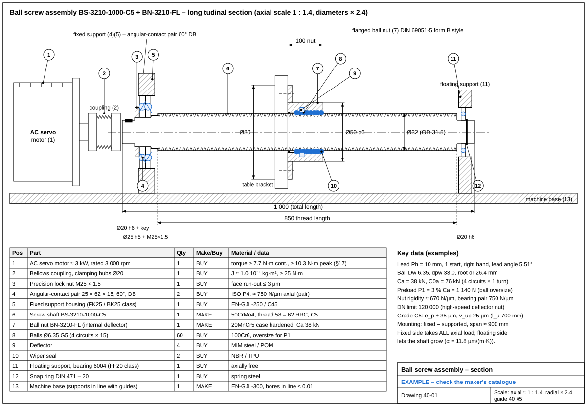

### 5.1 Parts of the assembly

A complete axis drive has these parts (from the motor to the free end):

| Part | Function | Example (our axis) |
|---|---|---|
| Servo motor | torque + speed, encoder for the position loop | ≈ 2 – 3 kW class, rated 3 000 rpm (§17.7) |
| Coupling | connects motor and screw, torsionally stiff, allows small misalignment | bellows / disc coupling, J = 1.0 × 10⁻⁴ kg·m² |
| Fixed support | takes all axial load in both directions + radial load | angular-contact thrust pair 25 × 62 × 15, 60°, DB / DF, axial rigidity 750 N/µm |
| Lock nut | clamps the bearings to the journal (sets bearing preload) | precision lock nut M25 × 1.5 |
| Screw shaft | turns rotation into motion; 10 mm per turn | `BS-3210-1000-C5` |
| Ball nut | carries the balls, return system, seals; bolted to the table | `BN-3210-FL` |
| Floating support | radial only; lets the shaft grow with temperature | deep-groove bearing 6004 (20 × 42 × 12) |
| Base | holds both supports in line with the guides | supports in line ≤ 0.01 mm (example) |

Screw shaft `BS-3210-1000-C5` – main data (example – check the maker's catalogue):

| Value | Symbol | Example |
|---|---|---|
| Nominal diameter | d0 | 32 mm |
| Lead (1 start → = pitch) | Ph | 10 mm, right hand |
| Ball circle diameter (ball centres) | dpw | 33.0 mm |
| Root diameter (for rigidity, buckling, critical speed) | dr | 26.4 mm |
| Land (outside) diameter | – | 31.5 mm |
| Thread length / total length | – | 850 / 1 000 mm |
| Lead angle | λ | 5.51° |
| Accuracy grade | – | C5 (ISO 3408-3 / JIS B 1192-3) |
| Fixed end | – | Ø25 h5 journal for the bearing pair + M25 × 1.5 lock-nut thread, motor journal Ø20 h6 with key 6 × 6 |
| Floating end | – | Ø20 h6 journal + snap-ring groove DIN 471 |
| Material | – | 50CrMo4 (1.7228) or CF53 (1.1213), quenched + tempered core 250 – 300 HB |
| Hardness | – | raceway induction hardened 58 – 62 HRC, case depth ≥ 1.5 mm (≈ 2 – 3 mm for Ø32) |
| Roughness | – | raceway Ra ≤ 0.2 µm, journals Ra ≤ 0.4 µm |
| Journal run-out to the thread axis | – | ≤ 8 µm (C5 example) |
| Mass | – | ≈ 5.4 kg/m |

### 5.2 The nut and the DIN 69051 flange

Ball nut `BN-3210-FL` – main data (example – check the maker's catalogue):

| Value | Example |
|---|---|
| Ball diameter Dw | 6.35 mm (1/4") |
| Conformity f = r / Dw | 0.53 |
| Contact angle α | 45° |
| Circuits × turns | 4 × 1 (internal deflector) |
| Balls | 15 per circuit, 60 in total |
| Dynamic axial load rating Ca (10⁶ rev) | 38 000 N |
| Static axial load rating C0a | 76 000 N |
| Preload | P1 = 3 % Ca = 1 140 N, by ball oversize |
| Axial rigidity of the nut | ≈ 670 N/µm at 3 % Ca (catalogue ≈ 1 000 N/µm at 10 % Ca) |
| Speed limit DN (high-speed deflector nut) | 120 000 (standard nuts ≈ 70 000) |
| Nut body OD D1 | 50 mm (g6) |
| Flange D4 / thickness | 80 mm / 12 mm |
| Bolt circle / bolts | 65 mm / 6 × Ø9 (M8) |
| Flat | one flat at 62 mm (form B style) |
| Length incl. seals | 100 mm |
| Material | 20MnCr5 / 20CrMo4 case hardened, or 100Cr6 through-hardened |
| Hardness | 58 – 62 HRC on the ball track, case depth 0.8 – 1.2 mm |
| Seals | 2 wiper seals (NBR / TPU lip or POM labyrinth), snap rings |
| Lubrication | grease nipple M6 or lube hole on the flange; initial fill NLGI 2 |
| Mass | ≈ 1.2 kg |

**Why 15 balls per circuit?** One turn of the ball path is π · dpw / cos λ = π · 33.0 / cos 5.51° = 104.2 mm long.
That is room for 104.2 / 6.35 = 16.4 balls. The deflector takes the space of about 1.4 balls, and a small gap
is needed so that the balls do not jam → 15 balls per circuit.

**DIN 69051-5 flange.** DIN 69051 part 5 fixes the main dimensions of flanged nuts (nut OD, flange OD, bolt circle,
holes, length class) per size d0 × Ph. Form B has a flange with a flat side. Advantage: a machine builder can change
the maker without changing the table bracket. Always check the real drawing – makers deviate in length, number of
holes and lube connection.

Important nut features for the machine builder:

* **Centring diameter D1 (g6)** – it centres the nut in the bracket. Never let the bolts take the radial position.
* **Flange face run-out** ≤ 10 µm to the axis – a tilted flange presses the balls at one side (edge load).
* **Lube connection** – nipple or a radial / axial hole for central lubrication.
* **Seal type** – contact lip (good protection, more drag) or labyrinth (low drag, less protection).

### 5.3 Ball return systems

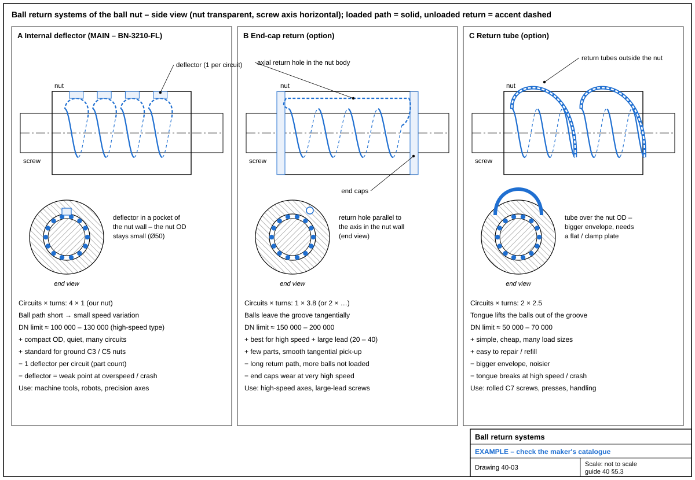

A ball in the groove moves forward. At the end of the loaded zone it must be brought back to the start. This is the
**return system**. The balls in the return path carry no load.

| | **Internal deflector** (main, our nut) | **End cap** (option) | **Return tube** (option) |
|---|---|---|---|
| Circuits × turns (our model) | 4 × 1 | 1 × 3.8 | 2 × 2.5 |
| Path | 1 turn in the groove, the deflector lifts the ball over the land into the previous groove | several turns, out tangentially into the end cap, back through an axial hole in the nut body, in through the other end cap | a bent tube outside the nut picks the balls up with a tongue |
| Nut OD | smallest | medium | largest (tube outside) |
| Speed (DN, example) | 70 000 standard, ≈ 120 000 high-speed type | 150 000 – 200 000 | 50 000 – 70 000 |
| Noise | low | low | higher |
| Cost | medium (precise pockets) | medium – high | low |
| Typical use | precision C3 – C5 nuts | high speed, large lead | rolled screws, heavy loads, low cost |

| Nut type | DN limit (example) |
|---|---|
| Standard tube / deflector nut | 50 000 – 70 000 |
| High-speed deflector nut | 100 000 – 130 000 |
| End-cap / high-speed nut (large lead) | 130 000 – 200 000 |

**What the deflector does.** One circuit = one turn. At the end of the turn the ball meets the deflector (a small part
of sintered steel or plastic, set into a pocket in the nut wall). The deflector has an S-shaped channel. It lifts the
ball radially by about 2.6 mm – over the land of the screw – and puts it back one groove earlier. The ball continues
in the same direction of rotation. Short circuits mean few balls per circuit: if one circuit has a problem, the others
still carry.

**Ball speed in the nut.** When the screw turns at n and the nut does not rotate, the balls roll like the balls of a
bearing with a rotating inner ring. The ball centres orbit at about half the screw speed, reduced by the geometry
factor γ:

  n_ball ≈ n / 2 · (1 − γ),  γ = Dw · cos α / dpw = 6.35 · cos 45° / 33.0 = 0.136

  n_ball ≈ n · 0.5 · 0.864 = **0.43 · n**

This is what the 3D animation shows: at 60 rpm screw speed the balls go round the nut at about 26 rpm.

### 5.4 Seals

The nut has a **wiper seal** at each end. It follows the thread profile. Types:

| Type | Protection | Drag torque | Use |
|---|---|---|---|
| Contact lip (NBR / TPU) | good against chips and coolant | ≈ 0.1 – 0.3 N·m per nut (example) | machine tools |
| Labyrinth (POM, small gap) | medium | almost none | clean, high speed |
| Brush / felt scraper in front | coarse chips | small | grinding, wood |

A worn seal is the start of most failures: chips and coolant come in, the grease is washed out (§18).

### 5.5 End supports and coupling

The **fixed side** takes all axial force. Our example: an angular-contact thrust pair 25 × 62 × 15 with 60° contact
angle in DB or DF arrangement (e.g. NSK 25TAC62B, SKF BSA 205, Schaeffler 7602025 – check), axial rigidity of the pair
≈ 750 N/µm, friction torque ≈ 0.2 N·m (examples). A precision lock nut M25 × 1.5 clamps the pair. Ready-made
"support units" (FK25 / BK25 class) contain housing, bearings, lock nut and seals.

The **floating side** carries only radial load. A deep-groove bearing 6004 sits in a housing (FF20 / BF20 class) and
is axially free, so the shaft can grow with temperature (11.8 µm per metre and kelvin).

The **coupling** must be torsionally stiff (≥ 10 000 N·m/rad, example) – a soft coupling is a spring in the position
loop and limits the servo gain. Bellows or disc couplings are standard; elastomer jaw couplings only for simple axes.

End support arrangements (fixed–free, fixed–supported, fixed–fixed, supported–supported) change the buckling load
and the critical speed – see §8.5 and §8.6.

---

## 6. Geometry and contact mechanics

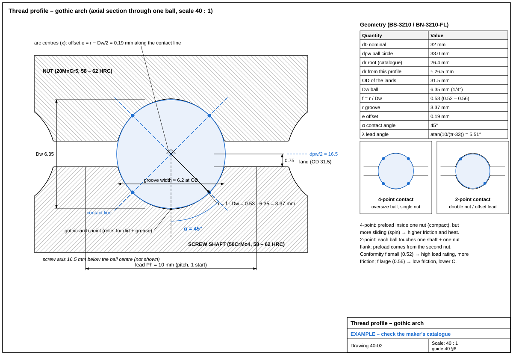

### 6.1 Diameters

| Diameter | Symbol | Value | Meaning |
|---|---|---|---|
| Nominal | d0 | 32 mm | name of the size |
| Ball circle (pitch circle) | dpw | 33.0 mm | diameter through the ball centres – used for lead angle, DN, ball speed |
| Land (outside) | – | 31.5 mm | top of the thread lands |
| Root | dr | 26.4 mm (catalogue) | bottom of the groove – the "core" for rigidity, buckling, critical speed |

### 6.2 Gothic-arch profile and conformity

The groove is not a single circle. It is made of **two arcs** (like a gothic church window). Each arc has the radius

  r = f · Dw = 0.53 · 6.35 = **3.37 mm**

The ratio f = r / Dw is the **conformity**. Typical values 0.52 – 0.56:

| f | Effect |
|---|---|
| small (0.52) | groove fits the ball closely → small contact pressure, high load rating, but more friction and heat, sensitive to dirt |
| large (0.56) | more "point-like" contact → lower friction, but higher pressure, lower rating |
| **0.53** (our example) | usual compromise for precision nuts |

The two arc centres are offset from the ball centre by

  e = r − Dw / 2 = 3.3655 − 3.175 = **0.19 mm**

along the 45° contact line. Each arc touches the ball at one point at 45°. In the middle (bottom of the groove) the two
arcs meet with a small point – this space holds grease and debris and the ball never touches there.

Check of the root diameter from the profile: the bottom of the groove lies at

  y = dpw/2 + e · sin 45° − √(r² − (e · sin 45°)²) = 16.5 + 0.1347 − √(11.327 − 0.018) = 13.27 mm

→ root diameter ≈ 2 · 13.27 = **26.54 mm**. The catalogue gives 26.4 mm (grinding allowance, tolerance) – we use 26.4 mm
in all strength calculations (safe side).

Groove width on the land diameter (31.5 mm): half width = 3.11 mm → groove ≈ 6.22 mm, land ≈ 10 − 6.22 = 3.78 mm.

### 6.3 Contact angle

The **contact angle α** is the angle between the contact line (ball centre → contact point) and the plane
perpendicular to the axis. 45° is standard:

* the axial component of the ball force is F · sin α – this carries the axial load;
* the radial component pushes the nut outward and the shaft inward;
* 45° gives a good balance between axial load capacity and rigidity in both directions.

Under load the contact angle grows a little (elastic deformation), with preload it is set to 45°.

### 6.4 Four-point and two-point contact

| | 2-point contact | 4-point contact |
|---|---|---|
| How | each ball touches one flank of the shaft groove and the opposite flank of the nut groove | each ball touches both flanks of both grooves (oversize ball) |
| Preload by | double nut or offset lead | ball oversize (single nut) |
| Friction | lower (pure rolling) | higher (spin / differential sliding) |
| Max preload | high (P2 – P3) | low – medium (P1 – P2) |
| Our nut | double-nut option | **main (P1 by oversize)** |

### 6.5 Load per ball

With Z loaded balls and an ideal, equal load sharing, the normal force on one ball is

  Q = Fa / (Z · sin α · cos λ)

Our nut: Z = 60, sin 45° = 0.7071, cos 5.51° = 0.9954.

| Axial load Fa | Q per ball |
|---|---|
| Preload 1 140 N | 27.0 N |
| Mean load 1 745 N (§17) | 41.3 N |
| Cutting 4 069 N (§17) | 96.4 N |
| Static rating C0a 76 000 N | 1 800 N |

In reality the load is not shared equally (lead errors, elastic nut). A load sharing factor of ≈ 0.7 – 0.8 is often
used: the most loaded ball carries Q / 0.7.

### 6.6 Hertz point contact – worked example

Ball and groove are two curved bodies. Under the force Q they flatten a little and touch on a small **contact
ellipse** with half axes a (long, across the groove) and b (short, along the ball path). The pressure is highest in the
middle (p_max). Theory by Heinrich Hertz (1881); the formulas below are the bearing form (Harris).

**Step 1 – curvatures.** Ball: 2 / Dw in both directions. Shaft groove: −1/r across (concave), and the shaft
curvature along the path. With γ = Dw · cos α / dpw = 0.1361:

  Σρ (shaft) = (1/Dw) · (4 − 1/f + 2γ/(1 − γ)) = (1/6.35) · (4 − 1.8868 + 0.3151) = **0.3824 mm⁻¹**

  Σρ (nut)  = (1/Dw) · (4 − 1/f − 2γ/(1 + γ)) = (1/6.35) · (4 − 1.8868 − 0.2396) = **0.2951 mm⁻¹**

  F(ρ) (shaft) = (1/f + 2γ/(1 − γ)) / (4 − 1/f + 2γ/(1 − γ)) = **0.9068**;  F(ρ) (nut) = **0.8792**

**Step 2 – ellipse shape.** Find κ = a / b so that

  F(ρ) = [(κ² + 1) · E(e) − 2 · K(e)] / [(κ² − 1) · E(e)],  e² = 1 − 1/κ²

K and E are the complete elliptic integrals of the first and second kind (computed with the arithmetic-geometric
mean; a few lines of Python). Result: **κ = 7.02** (shaft), **5.93** (nut). The ellipse is long and narrow – typical
for a close conformity.

**Step 3 – size and pressure.** With E = 206 000 N/mm², ν = 0.3 for ball and groove:

  a = a* · [3Q / (2Σρ) · 2(1 − ν²)/E]^(1/3),  b = b* · [same]^(1/3),  a* = (2κ²E(e)/π)^(1/3),  b* = (2E(e)/(πκ))^(1/3)

  p_max = 3Q / (2π · a · b)

| Load case | Q (N) | Contact | a (mm) | b (mm) | p_max (MPa) |
|---|---|---|---|---|---|
| Preload 1 140 N | 27.0 | shaft | 0.312 | 0.044 | 933 |
| Mean load 1 745 N | 41.3 | shaft | 0.359 | 0.051 | **1 075** |
| Mean load 1 745 N | 41.3 | nut | 0.351 | 0.059 | 951 |
| Cutting 4 069 N | 96.4 | shaft | 0.476 | 0.068 | 1 426 |
| C0a 76 000 N, equal sharing | 1 800 | shaft | 1.263 | 0.180 | **3 783** |
| C0a 76 000 N, equal sharing | 1 800 | nut | 1.234 | 0.208 | 3 347 |
| C0a, most loaded ball (sharing 0.7) | 2 571 | shaft | – | – | ≈ **4 260** |

**What it means.** ISO 76 (bearings) and ISO 3408-5 (ball screws) define the static rating as the load that gives a
contact pressure of about **4 000 – 4 200 MPa** at the most loaded contact. At this pressure the permanent dent is
about 1/10 000 of the ball diameter (0.6 µm) – still acceptable for smooth running. Our example values are consistent:
3 780 MPa with ideal sharing, ≈ 4 260 MPa at the most loaded ball. The shaft contact is always the critical one (it is
convex along the path, so Σρ is bigger).

At the mean load the pressure is about 1 100 MPa – far below the static limit. The life is limited by **fatigue**
(millions of over-rollings), not by the static pressure. That is the topic of §8.

> Check yourself: double the load → p_max grows only by 2^(1/3) = 1.26 (pressure ∝ Q^(1/3)).

---

## 7. Lead, speed, torque, efficiency, back-driving

### 7.1 Lead and speed

One turn of the screw moves the nut by one **lead** Ph. For a 1-start screw lead = pitch.

  v = n · Ph   (v in mm/min, n in rpm, Ph in mm)

Example: n = 3 000 rpm, Ph = 10 mm → v = 30 000 mm/min = **30 m/min** (rapid traverse of our HMC X axis, §17).

The other way: n = v / Ph = 30 000 / 10 = 3 000 rpm.

| Lead | Speed for 30 m/min | Effect |
|---|---|---|
| 5 mm | 6 000 rpm | high resolution, high force per torque – but too fast for Ø32 (critical speed, DN) |
| **10 mm** | **3 000 rpm** | our choice (§17.2) |
| 16 mm | 1 875 rpm | fewer rpm, more torque per force |
| 20 mm | 1 500 rpm | for 40 – 60 m/min axes |

### 7.2 Lead angle

  tan λ = Ph / (π · dpw) = 10 / (π · 33.0) = 0.09646  → λ = **5.51°**

### 7.3 Efficiency

The efficiency comes from the lead angle λ and the friction angle ρ (tan ρ = μ):

  Normal drive (torque → force):  η = tan λ / tan(λ + ρ)

  Back-driving (force → torque):  η' = tan(λ − ρ) / tan λ

With μ = 0.003 (rolling, theory): ρ = 0.172°, η = tan 5.51° / tan 5.68° = **0.970**, η' = **0.969**.

In practice seals, preload and lubricant add losses. For design use the catalogue values **η = 0.9** (drive) and
**η' = 0.8** (back-driving) – these are used in all calculations of this guide. Compare: a trapezoidal screw has
η ≈ 0.3 – 0.4.

### 7.4 Drive torque

The torque the motor needs to push an axial force F:

  T = F · Ph / (2π · η)   (F in N, Ph in m, T in N·m)

Example 1: F = 1 000 N → T = 1 000 · 0.010 / (2π · 0.9) = **1.77 N·m**.

Example 2 (HMC cutting, §17): F = 4 069 N → T = 4 069 · 0.010 / (2π · 0.9) = **7.20 N·m**.

To this add the preload torque of the nut (§9.6, 0.29 N·m) and the friction of the support bearings and seals
(≈ 0.2 N·m, example).

### 7.5 Back-driving and the brake for vertical axes

A ball screw is **not self-locking**. A force on the nut turns the screw:

  T' = F · Ph · η' / (2π)

Example: F = 1 000 N → T' = 1 000 · 0.010 · 0.8 / (2π) = **1.27 N·m**.

Vertical axis example: a head of 200 kg hangs on the screw. F = 200 · 9.81 = 1 962 N.

* Torque the load produces on the screw (back-driving): T' = 1 962 · 0.010 · 0.8 / (2π) = **2.50 N·m**.
* Torque to lift it: T = 1 962 · 0.010 / (2π · 0.9) = **3.47 N·m**.
* The axis falls when the power is off – a **holding brake** in the motor is necessary. Rule of thumb (example):
  brake torque ≥ 2 × back-driving torque → ≥ 5 N·m. Check it as part of the safety function (risk assessment,
  brake test). Many machine builders also add a counterweight or a gas spring.

---

## 8. Load ratings, life, buckling, critical speed, DN

### 8.1 Load ratings

| Rating | Symbol | Our nut | Meaning |
|---|---|---|---|
| Basic dynamic axial load rating | Ca | 38 000 N | constant axial load at which 90 % of a large group of equal ball screws reach 10⁶ revolutions without fatigue (ISO 3408-5) |
| Basic static axial load rating | C0a | 76 000 N | axial load that gives ≈ 4 000 – 4 200 MPa at the most loaded contact (permanent dent ≈ 0.0001 · Dw, §6.6) |

Ca depends on the number of loaded balls: more turns → higher Ca, but not linearly (the load is not shared equally).
For the size family see §20.3.

### 8.2 Life L10

  L10 = (Ca / (fw · Fm))³ · 10⁶   revolutions

  Lh = L10 / (60 · nm)   hours,   L_km = L10 · Ph / 10⁶   km

fw = load factor: 1.0 – 1.2 smooth, **1.2 – 1.5 normal machine tool** (we use 1.2), 1.5 – 2.0 with impact.

Example (HMC, §17): Fm = 1 745 N, nm = 800 rpm, fw = 1.2:

  L10 = (38 000 / (1.2 · 1 744.7))³ · 10⁶ = (18.15)³ · 10⁶ = **5.98 · 10⁹ rev**

  Lh = 5.98 · 10⁹ / (60 · 800) = **124 600 h**,   L_km = 5.98 · 10⁹ · 10 / 10⁶ = **59 800 km**

Requirement for a machine tool: Lh ≥ 20 000 h (example) → OK with a big margin.

> The cube is important: **double the load → 1/8 of the life**. 10 % more load → 25 % less life.

### 8.3 Mean load from a load cycle

An axis has phases with different force and speed. The mean load counts each phase by its number of revolutions:

  nm = Σ nᵢ · tᵢ   (tᵢ = time fraction)

  Fm = (Σ Fᵢ³ · nᵢ · tᵢ / nm)^(1/3)

HMC X axis (§17):

| Phase | Force Fᵢ (N) | Speed nᵢ (rpm) | Time tᵢ | nᵢ · tᵢ |
|---|---|---|---|---|
| Rapid | 69.4 (friction) | 3 000 | 20 % | 600 |
| Acceleration | 1 869.4 | 1 500 (mean) | 5 % | 75 |
| Deceleration | 1 730.6 | 1 500 (mean) | 5 % | 75 |
| Cutting | 4 069.4 | 100 (1 m/min) | 50 % | 50 |
| Idle | 0 | 0 | 20 % | 0 |
| **Sum** | | | | **nm = 800 rpm** |

  Fm = ((69.4³ · 600 + 1 869.4³ · 75 + 1 730.6³ · 75 + 4 069.4³ · 50) / 800)^(1/3) = **1 744.7 N**

Note: the cutting phase is 50 % of the time but only 50 / 800 = 6 % of the revolutions. The acceleration phases
count a lot because the force is high and the speed too.

### 8.4 Mean load with preload

A preloaded nut carries its preload all the time. ISO 3408-5 / catalogue method for a preloaded nut: the more loaded
half of the nut sees

  F_eff = Fpr · (1 + F / (2.83 · Fpr))^1.5   if F ≤ 2.83 · Fpr

  F_eff = F                     if F > 2.83 · Fpr (the other half is unloaded, preload is "lost")

With Fpr = 1 140 N: 2.83 · 1 140 = 3 226 N.

| Phase | F (N) | F_eff (N) |
|---|---|---|
| Rapid | 69.4 | 1 177 |
| Acceleration | 1 869.4 | 2 263 |
| Deceleration | 1 730.6 | 2 171 |
| Cutting | 4 069.4 | 4 069 (> 3 226 → preload lost during cutting) |

  Fm (with preload) = **1 955.7 N** → L10 = (38 000 / (1.2 · 1 955.7))³ · 10⁶ = **4.24 · 10⁹ rev** → **88 400 h**.

Still far above 20 000 h. The preload costs about 29 % of the life here – this is the price of zero backlash.

### 8.5 Static safety

  fs = C0a / Fa,max ≥ 2 – 3 (machine tools: consider crash and impact)

Example: fs = 76 000 / 4 069 = **18.7** → OK. A crash into a fixture can give 10 – 20 × the normal force – a high
static safety protects the raceways from brinelling (§18).

### 8.6 End support arrangements, buckling

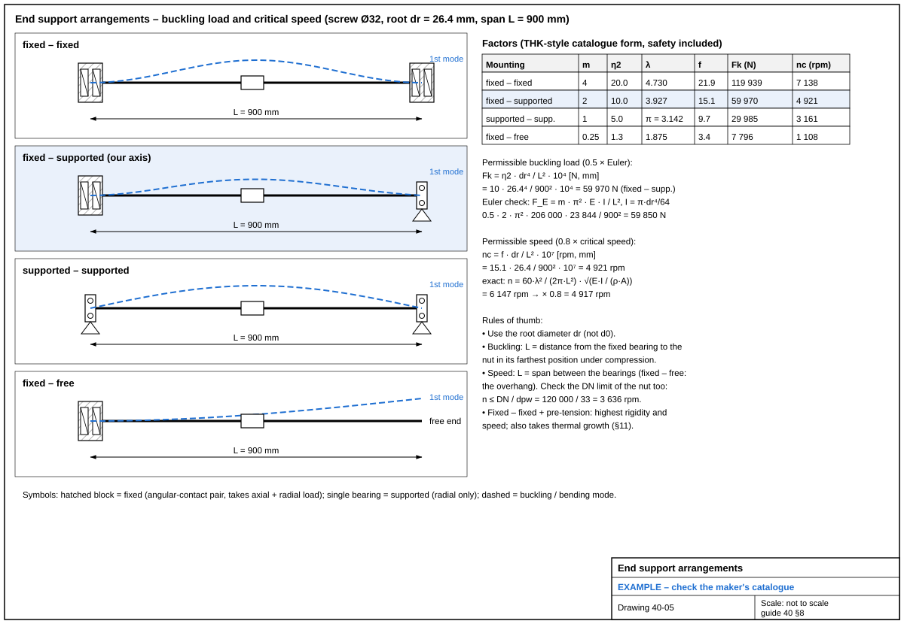

A long screw under compression can buckle like a column. The permissible buckling load (catalogue form, safety 0.5
included):

  Fk = η2 · dr⁴ / L² · 10⁴   (N; dr, L in mm; L = distance between the bearing that takes the load and the nut at its
  farthest position)

This comes from Euler: F_Euler = m · π² · E · I / L², I = π · dr⁴ / 64, with 0.5 safety:
0.5 · m · π³ · 206 000 / 64 ≈ m · 4.99 · 10⁴ → η2 = 20 / 10 / 5 / 1.3 for m = 4 / 2 / 1 / 0.25.

| Arrangement | Euler factor m | η2 | Critical-speed factor λ | Factor λ²-form (·10⁷, 0.8 included) |
|---|---|---|---|---|
| fixed – fixed | 4 | 20.0 | 4.730 | 21.9 |
| **fixed – supported** (our axis) | 2 | 10.0 | 3.927 | 15.1 |
| supported – supported | 1 | 5.0 | π | 9.7 |
| fixed – free | 0.25 | 1.3 | 1.875 | 3.4 |

Example: dr = 26.4 mm, L = 900 mm (dr⁴ = 485 746 mm⁴, L² = 810 000 mm²):

| Arrangement | Fk (N) |
|---|---|
| fixed – fixed | 119 939 |
| fixed – supported | **59 970** |
| supported – supported | 29 985 |
| fixed – free | 7 796 |

Euler check fixed–supported: I = π · 26.4⁴ / 64 = 23 844 mm⁴; 0.5 · 2 · π² · 206 000 · 23 844 / 810 000 = 59 850 N ✓.

Our maximum compressive force is 4 069 N → huge margin. Buckling becomes important for long, thin screws
(Ø16 – 20 and L > 1 m) and for presses.

### 8.7 Critical speed

A rotating shaft whirls (bends dangerously) when the speed reaches its first bending natural frequency. Exact:

  n_cr = 60 · λ² / (2π · L²) · √(E · I / (ρ · A))   with √(I/A) = dr/4 for a solid shaft

For fixed – supported, L = 0.9 m, dr = 0.0264 m, E = 206 · 10⁹ Pa, ρ = 7 850 kg/m³:

  n_cr = 60 · 3.927² / (2π · 0.81) · (0.0264 / 4) · √(206 · 10⁹ / 7 850) = **6 147 rpm**

Allowed = 0.8 · n_cr = **4 917 rpm**. Catalogue short form (0.8 included):

  n_c = f · dr / L² · 10⁷ = 15.1 · 26.4 / 810 000 · 10⁷ = **4 921 rpm**

| Arrangement | n_c (rpm), L = 900 mm |
|---|---|
| fixed – fixed | 7 138 |
| fixed – supported | **4 921** |
| supported – supported | 3 161 |
| fixed – free | 1 108 |

Rapid speed 3 000 rpm < 4 921 rpm → OK.

### 8.8 DN value

The ball speed in the nut is limited (deflector / end-cap strength, heat, noise). Makers give a limit for

  DN = dpw · n   (mm · rpm)

| Nut type | DN limit (example) |
|---|---|
| Standard tube / deflector nut | 50 000 – 70 000 |
| High-speed deflector nut | 100 000 – 130 000 |
| End-cap / high-speed nut (large lead) | 130 000 – 200 000 |

Our axis: DN = 33.0 · 3 000 = **99 000**. That is **more than a standard nut (≈ 70 000)**. Our nut is a high-speed
internal-deflector type with DN ≤ 120 000 → n_max = 120 000 / 33 = **3 636 rpm**.

Permissible speed of the screw = min(critical speed, DN speed) = min(4 921, 3 636) = **3 636 rpm** ≥ 3 000 rpm → OK.

---

## 9. Preload, rigidity, lost motion, preload torque

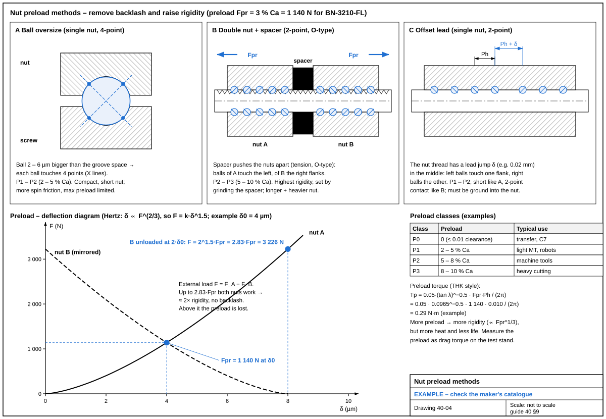

### 9.1 Why preload?

Without preload a nut has a small axial clearance (backlash). At every reversal the table stands still for a moment →
a step in the contour (reversal error, "quadrant glitch"). Preload removes the clearance: the balls are pressed
against the flanks before any external load.

| Method | How | Preload class | Pros / cons |
|---|---|---|---|
| Ball oversize (single nut, 4-point contact) | balls 2 – 6 µm bigger than the groove space → each ball touches 4 points | P1 – P2 (2 – 5 % Ca) | compact, short; higher friction per ball, lower max preload |
| Double nut + spacer (2-point, O-type) | a spacer pushes the two nuts apart (tension preload) – or pulls them together | P2 – P3 (5 – 10 % Ca) | highest rigidity, adjustable by spacer grinding; longer, heavier nut |
| Offset lead (single nut) | the nut thread has a lead shift of δ (e.g. +0.02 mm) in the middle | P1 – P2 | short like oversize but 2-point contact; must be ground into the nut |

### 9.2 Preload classes

| Class | Preload | Typical use |
|---|---|---|
| P0 | 0 (small clearance ≤ 0.01 mm allowed) | transfer, C7 rolled screws |
| P1 | 2 – 5 % Ca | machine tools light, robots, C5 |
| P2 | 5 – 8 % Ca | machine tools (double nut) |
| P3 | 8 – 10 % Ca | heavy machining, high rigidity |

Our nut: **P1 = 3 % Ca = 0.03 · 38 000 = 1 140 N** by ball oversize (balls a few µm bigger, sorted in 1 µm classes).

### 9.3 When is the preload lost?

The two flanks (or two nuts) act like two springs preloaded against each other. With Hertz contact the deflection
grows with F^(2/3). One side becomes free when the external load reaches

  F = 2^(3/2) · Fpr = **2.83 · Fpr** = 2.83 · 1 140 = **3 226 N**

Above this the nut behaves like a nut without preload (lower rigidity). In our HMC example the cutting force
(4 069 N) exceeds it – for heavy cutting a higher preload (P2, double nut) or a bigger screw would be better. This is
a typical design trade-off: more preload = more rigidity, but more heat, more torque and less life.

### 9.4 Rigidity of the axis

The axial rigidity of the whole drive is a chain of springs in series:

  1/K = 1/K_shaft + 1/K_nut + 1/K_bearing (+ 1/K_housings …)

**Shaft** (fixed – free or fixed – supported, load taken by the fixed side):

  K_shaft = A · E / La,  A = π · dr² / 4 = π · 26.4² / 4 = 547.4 mm²

La = distance fixed bearing → nut. Worst case La = 700 mm:

  K_shaft = 547.4 · 206 000 / 700 = 161 100 N/mm = **161 N/µm**

Fixed – fixed (both ends axially fixed) – the shaft works as two springs in parallel, minimum in the middle:

  K_shaft = A · E · L / (4 · a · (L − a)) → in the middle (a = L/2): 4 · A · E / L = 4 · 547.4 · 206 000 / 900 = **501 N/µm**

**Nut**: catalogue value ≈ 1 000 N/µm at 10 % Ca preload. At another preload:

  K_nut = K_cat · (Fpr / (0.1 · Ca))^(1/3) = 1 000 · (1 140 / 3 800)^(1/3) = **669 N/µm**

**Support bearings** (angular-contact pair, example): **750 N/µm**.

**Total** (fixed – supported, La = 700 mm):

  1/K = 1/161.1 + 1/669.4 + 1/750 → K = **110.7 N/µm**

The shaft is the weakest spring. Deflection under the cutting force:

  δ = F / K = 4 069 / 110.7 = **36.8 µm**

With fixed – fixed mounting (pre-tensioned shaft, §10.5) and the nut in the middle the total becomes about
4 069 / 207.4 = 19.6 µm. A closed-loop axis with a linear scale corrects the static part; the dynamic part (vibration,
servo bandwidth) still depends on K.

### 9.5 Lost motion

At a reversal the friction force changes sign. The springs deflect by F/K in one direction, then by F/K in the other:

  Lost motion = 2 · Ff / K = 2 · 69.4 / 110.7 = **1.25 µm** (plus backlash = 0 with preload)

Without preload add the backlash (5 – 20 µm). The CNC can compensate a constant lost motion ("backlash compensation").

### 9.6 Preload torque (drag torque of the nut)

  Tp = 0.05 · (tan λ)^(−0.5) · Fpr · Ph / (2π)   (catalogue form, THK style)

  Tp = 0.05 · 0.09646^(−0.5) · 1 140 · 0.010 / (2π) = 0.05 · 3.220 · 1 140 · 0.010 / 6.283 = **0.29 N·m**

The maker measures the preload torque on every nut (variation band, e.g. ± 30 %); it is the main acceptance test of
the preload (item 5).

---

## 10. Accuracy grades, thermal growth, error budget

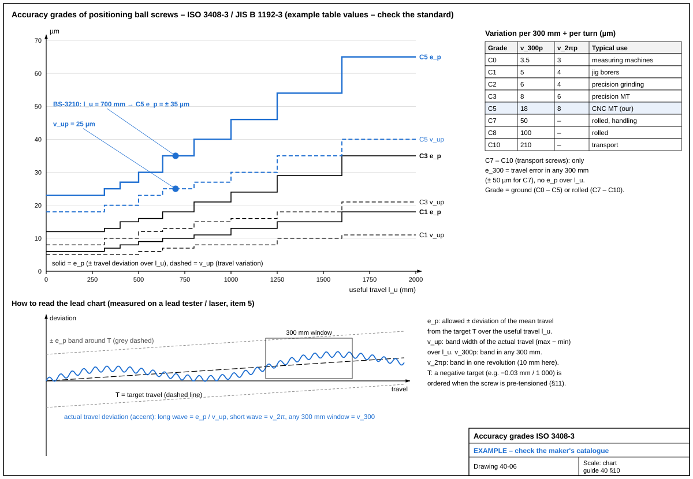

### 10.1 What is measured

The maker measures the real travel against the nominal travel along the useful travel l_u (laser interferometer,
item 5). From the curve:

| Symbol | Name | Meaning |
|---|---|---|
| c | travel compensation | target value of the mean travel deviation over l_u (often 0, or negative = "T value", §10.4) |
| e_p | tolerance on actual mean travel deviation | how far the mean line of the curve may deviate from c over l_u |
| v_up | permissible travel variation over l_u | band width of the curve around its mean line |
| v_300p | variation in any 300 mm | local waviness |
| v_2πp | variation within one revolution | wobble error per turn |

### 10.2 Grades (ISO 3408-3 / JIS B 1192-3, example values as printed in catalogues – check the standard)

| Useful travel l_u (mm) | 0 – 315 | 315 – 400 | 400 – 500 | 500 – 630 | 630 – 800 | 800 – 1000 | 1000 – 1250 | 1250 – 1600 | 1600 – 2000 |
|---|---|---|---|---|---|---|---|---|---|
| C1 e_p (± µm) | 6 | 7 | 8 | 9 | 10 | 11 | 13 | 15 | 18 |
| C1 v_up (µm) | 5 | 5 | 5 | 6 | 7 | 8 | 8 | 10 | 11 |
| C3 e_p (± µm) | 12 | 13 | 15 | 16 | 18 | 21 | 24 | 29 | 35 |
| C3 v_up (µm) | 8 | 10 | 10 | 12 | 13 | 15 | 16 | 18 | 21 |
| C5 e_p (± µm) | 23 | 25 | 27 | 30 | 35 | 40 | 46 | 54 | 65 |
| C5 v_up (µm) | 18 | 20 | 20 | 23 | 25 | 27 | 30 | 35 | 40 |

| Grade | C0 | C1 | C2 | C3 | C5 | C7 | C8 | C10 |
|---|---|---|---|---|---|---|---|---|
| v_300p (µm) | 3.5 | 5 | 6 | 8 | 18 | 50 | 100 | 210 |
| v_2πp (µm) | 3 | 4 | 4 | 6 | 8 | – | – | – |

| Grade | Typical use |
|---|---|
| C0 – C1 | jig borers, measuring machines, ultra-precision |
| C3 | precision machine tools, grinding |
| **C5** | CNC machining centres, lathes (with linear scales or pitch error compensation) |
| C7 | rolled screws – handling, packaging, robots (only v_300 = 50 µm is specified) |
| C10 | simple transport (v_300 = 210 µm) |

**Our screw:** useful travel l_u = 850 (thread) − 100 (nut) − 2 · 25 (run-out) = **700 mm** → bin 630 – 800 mm:

  C5: e_p = **± 35 µm**, v_up = **25 µm**, v_300p = 18 µm, v_2πp = 8 µm.

### 10.3 Other accuracy items of a ground screw

* run-out of the journals to the thread axis (≤ 8 µm C5 example)
* run-out of the nut flange face (≤ 10 µm example)
* preload torque band
* straightness of the shaft (after hardening and straightening)

### 10.4 Thermal elongation

A screw warms up (balls, seals, bearings, motor). The length grows:

  ΔL = α · ΔT · L,  α = 11.8 · 10⁻⁶ /K

Example: ΔT = 3 K over the thread length 850 mm: ΔL = 11.8 · 10⁻⁶ · 3 · 850 = 0.0301 mm = **30.1 µm**.

That is as big as the whole C5 tolerance! Answers:

1. **Linear scale** (closed loop) – measures the table directly. Best for machine tools.
2. **Pre-tension** – mount fixed – fixed and stretch the shaft before use (§10.5).
3. Cooled screw (hollow shaft with coolant) for high-speed axes.
4. Thermal compensation in the CNC (temperature sensors + model).

### 10.5 Pre-tension and T value

The screw is ground with a **negative travel target** (T value), e.g. **−30 µm over the thread** (≈ −35 µm/m). At
assembly the shaft is stretched between two fixed supports until its lead is nominal. When it warms up by 3 K, the
tension drops but the length does not change (it was already "longer").

Pre-tension force for ΔT = 3 K:

  F = α · ΔT · E · A = 11.8 · 10⁻⁶ · 3 · 206 000 · 547.4 = **3 992 N**  (stress 7.3 N/mm² – small)

The fixed bearings at both ends must carry this force plus the working load. The pre-tension also raises the shaft
rigidity (§9.4) and the critical speed a little.

### 10.6 Positioning error budget (semi-closed loop, encoder on the motor)

| Error source | Value (µm) | Source |
|---|---|---|
| Lead deviation e_p (C5, 700 mm) | 35.0 | §10.2 |
| Thermal growth (3 K, 850 mm) | 30.1 | §10.4 |
| Elastic deflection under cutting force (4 069 N / 110.7 N/µm) | 36.8 | §9.4 |
| Lost motion at reversal | 1.25 | §9.5 |
| **Sum (worst case)** | **103.1** | all add up in the same direction |
| **RSS (√ of sum of squares)** | **59.0** | errors independent – more realistic |

Lessons: for ± 10 µm positioning (ISO 230-2 type test) the axis needs a linear scale or pitch-error + thermal
compensation; the screw grade alone does not decide. With a linear scale the lead error and thermal growth of the
screw drop out (only the dynamic stiffness remains).

---

## 11. Materials and heat treatment

| Part | Material | Heat treatment | Note |
|---|---|---|---|
| Screw shaft | 50CrMo4 / CF53 (Cr-Mo or carbon steel, 0.45 – 0.55 % C) | QT core 250 – 300 HB → induction hardening of the thread zone 58 – 62 HRC, tempering 160 – 180 °C, (sub-zero optional) → stress-relief, straightening | case 2 – 3 mm, journals soft |
| Nut | 20MnCr5 / 20CrMo4 (case hardening) or 100Cr6 | carburize 920 °C → quench → temper 160 °C → 58 – 62 HRC (Eht 0.8 – 1.2 mm); 100Cr6: through-harden 840 °C / oil, temper 160 °C | low distortion, grind after hardening |
| Balls | 100Cr6 (AISI 52100, SUJ2) | through hardened 62 – 66 HRC, ISO 3290 grade G5 – G10 (sphericity ≤ 0.13 / 0.25 µm) | sorted in 1 µm size steps for preload |
| Rail | C55 / S55C cold-drawn profile (100Cr6 for small sizes) | induction hardening of the raceway shoulders 58 – 62 HRC, case 1.5 – 2.5 mm; straighten; grind raceways + datum | base soft for the bolt holes |
| Carriage body | 20CrMo4 / SCM420 case hardening, or 100Cr6 | carburize + harden 58 – 62 HRC; grind the 4 raceways in one set-up | flange holes drilled before hardening |
| Deflector / end cap / return pipe | POM, PA66-GF, sintered steel (MIM) for high-load deflectors | injection moulding / MIM, no heat treatment (MIM: sinter + harden) | smooth ball path, no edge |
| Seals | NBR / TPU lip + steel plate, POM labyrinth, felt scrapers | bought parts | replaceable |

### 11.1 Screw shaft – induction hardening

1. Bar 50CrMo4 +QT (quenched + tempered, 250 – 300 HB). Good machinability and a tough core.
2. Turn, leave grinding allowance (≈ 0.3 – 0.5 mm on the diameter).
3. **Induction hardening** of the thread zone only: a coil moves along the turning shaft, heats the surface to
   ≈ 900 °C, water-polymer spray quenches it. Hardness 58 – 62 HRC, case depth 2 – 3 mm for Ø32 (deeper than the groove
   + Hertz stress depth; the maximum shear stress lies at ≈ 0.47 · b – 0.78 · b below the surface).
4. Temper 160 – 180 °C (reduces brittleness, keeps ≥ 58 HRC).
5. Straighten (press) – induction hardening bends the shaft. Stress relief.
6. Grind OD, then **thread grinding** with a single-rib profile wheel (item 2), several passes, finish with small
   depth to avoid **grinding burn** (re-tempering or re-hardening of the surface → early flaking). Check by Nital etch
   or Barkhausen noise (item 5).
7. Journals stay soft (20 – 30 HRC) – they are turned / ground after hardening.

### 11.2 Nut – case hardening

20MnCr5 or 20CrMo4: carburize at ≈ 920 °C (carbon into the surface to ≈ 0.8 %), quench, temper 160 °C →
58 – 62 HRC, case depth Eht 0.8 – 1.2 mm (to 550 HV). The core stays tough (≈ 30 – 40 HRC). Alternative 100Cr6
through-hardened (840 °C / oil, temper 160 °C) – simpler, but more distortion and less tough. Retained austenite
must be low (< 10 – 15 %), otherwise the nut grows with time → preload change. A sub-zero treatment (−80 °C) can
help.

### 11.3 Balls

100Cr6 (AISI 52100, SUJ2), through hardened 62 – 66 HRC, ground and lapped to ISO 3290 grade G5 (sphericity
0.13 µm, lot diameter variation 0.25 µm) or G10. Sorted in 1 µm size classes – the nut assembler chooses the class
that gives the right preload torque.

### 11.4 Rail and block

Rail: cold-drawn C55 profile (the shape comes from the drawing mill), induction hardened at the raceway shoulders
58 – 62 HRC, case 1.5 – 2.5 mm, base soft for drilling. Block: case-hardening steel (20CrMo4) or 100Cr6, all four
raceways ground in one set-up after hardening.

---

## 12. Linear guide design

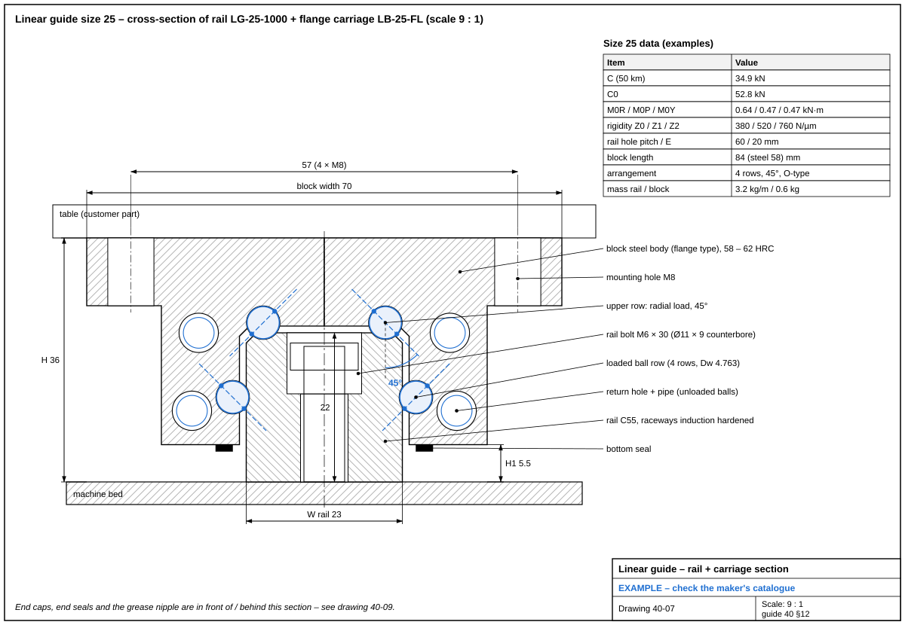

A profiled linear guide has two main parts: the **rail** (bolted to the machine bed) and the **carriage** or block
(bolted to the table). Between them, balls run in four rows. Under the steel body the balls are loaded; at the ends
the end caps turn them round and send them back through return holes.

### 12.1 The rail `LG-25-1000`

| Value | Example (check the maker's catalogue) |
|---|---|
| Size | 25 |
| Width W × height H | 23 × 22 mm |
| Length | 1 000 mm (family 300 – 4 000 mm; longer = butt-jointed rails) |
| Hole pitch P / end distance E | 60 mm / 20 mm at both ends → 20 + 16 · 60 + 20 = 1 000 mm → **17 holes** |
| Bolts | M6 × 30, 12.9, ISO 4762, counterbore Ø11 × 9, tightening torque 13.7 N·m (steel bed) |
| Raceways | 4, at 45°, O-arrangement |
| Material | C55 (1.0535, S55C class) cold-drawn profile (100Cr6 for small sizes) |
| Hardness | raceways induction hardened 58 – 62 HRC, case 1.5 – 2.5 mm, base soft |
| Straightness | after straightening ≤ 0.1 mm / m free; bolted down it follows the bed |
| Mass | ≈ 3.2 kg/m |
| Datum | one side face is the reference (marked) – it is pressed against the shoulder of the bed |

Hole pattern: E = 20 mm at both ends and pitch 60 mm fit exactly into 1 000 mm (20 + 16 · 60 + 20) → 17 holes. For other
lengths the maker centres the pattern so that both end distances are equal and ≥ the catalogue minimum (a too small E
can crack the rail end, a too big E lets the rail end lift). Always check the rail drawing.

### 12.2 The carriage `LB-25-FL` – parts

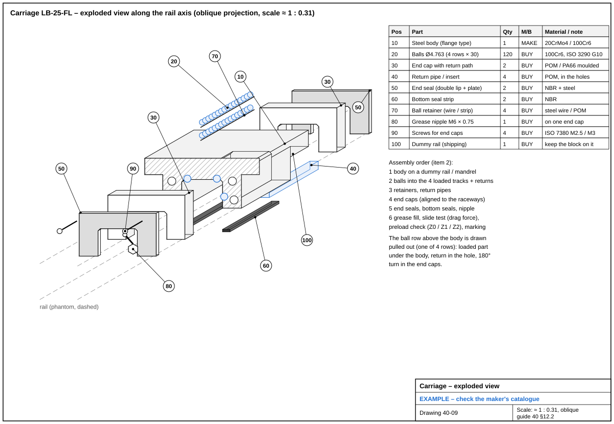

| Value | Example (check the maker's catalogue) |
|---|---|
| Block width / length (incl. end caps) / steel body length | 70 / 84 / 58 mm |
| Assembly height H (rail bottom → block top) / gap H1 | 36 / 5.5 mm |
| Mounting holes | 4 × M8 on 57 × 45 mm |
| Balls | Ø4.763 mm (3/16"), 4 rows × 30 = 120 |
| Dynamic load rating C (50 km) | 34 900 N |
| Static load rating C0 | 52 800 N |
| Static moment ratings M0R / M0P / M0Y | 640 / 470 / 470 N·m |
| C for 100 km basis | 27 700 N |
| Preload | Z1 (≈ 0.02 C) |
| Radial rigidity per block | Z0 380 / Z1 520 / Z2 760 N/µm |
| Seal drag | ≈ 10 N per block (end + bottom seals, greased) |
| Material / hardness | 20CrMo4 case hardened, or 100Cr6 / raceways 58 – 62 HRC |
| Mass | ≈ 0.6 kg |

Parts, from inside to outside:

1. **Steel body** – 4 ground raceways, flange with 4 × M8, 4 return holes.
2. **Balls** – 4 rows; in each row: loaded zone under the body, turn-round in the end cap, return hole.
3. **Retainer** (wire or plastic strip) – keeps the balls in when the block leaves the rail.
4. **Return pipes** (POM) in the return holes – quiet, smooth path.
5. **End caps** (POM / PA66, 2 pieces) – 180° turn-round paths and grease channels.
6. **End seals** (double lip NBR + steel plate) – wipe the rail.
7. **Bottom seals** – close the gap under the body.
8. **Grease nipple** M6 × 0.75 on one end cap (or a connection for central lubrication).
9. Screws for end caps and seals.

**Ball speed.** The loaded balls roll between rail and block. Like a roller under a plank, a ball centre moves at
**half** the carriage speed relative to the rail. Relative to the block it moves backwards at v/2 – and this is the
speed of the whole ball chain in the circuit. At 30 m/min = 0.5 m/s carriage speed, the balls in the block run at
0.25 m/s.

### 12.3 O- and X-arrangement

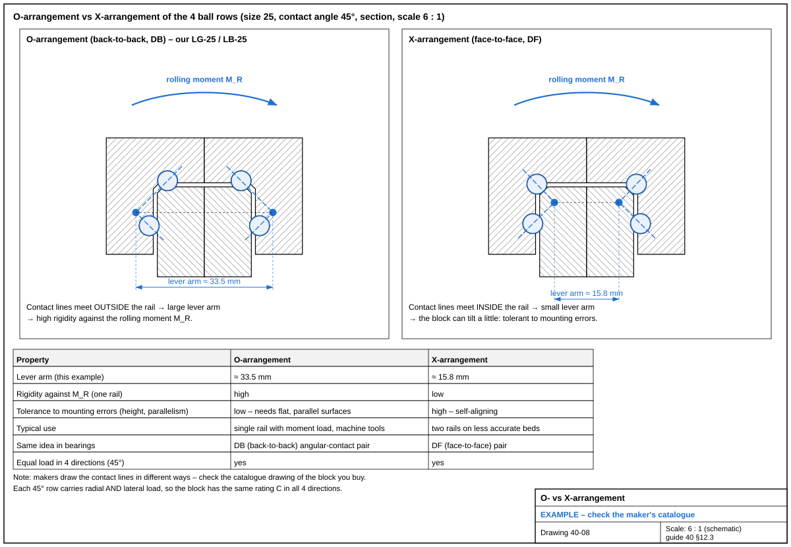

Draw the 4 contact lines (through the contact points of each row). In the **O-arrangement** (back-to-back) the lines
of the two rows of one side meet *outside* the rail; in the **X-arrangement** (face-to-face) they cross *inside* the
rail.

| | O-arrangement (our guide) | X-arrangement |
|---|---|---|
| Lever arm against the rolling moment M_R | large (contact lines spread outward) | small |
| Rigidity against M_R (single rail use) | high | low |
| Tolerance to mounting errors (height, parallelism) | smaller – the block "resists" | larger – the block self-aligns a little |
| Typical use | single rail, moments, machine tools | two rails on a less accurate bed |

Same idea as angular-contact bearings: DB (O) is stiff against tilting, DF (X) accepts misalignment.

### 12.4 Roller guides

A roller guide uses cylindrical rollers (slightly crowned) instead of balls. Line contact instead of point contact:

| | Ball guide size 25 | Roller guide size 25 (example) |
|---|---|---|
| Contact | point (ellipse) | line |
| Rigidity | 1 | ≈ 2 × |
| Dynamic load rating | 1 | ≈ 1.5 – 2 × |
| Life exponent p | 3 | 10/3 |
| Life basis | 50 km (or 100 km) | 100 km |
| Friction | lower | a little higher |
| Mounting surface | normal | flatter, more accurate (edge load on the roller end!) |
| Use | most CNC machines | heavy machining centres, grinding, big lathes |

Life of a roller guide: L = (fc · C / (fw · P))^(10/3) · 100 km. Example: C / P = 2 → 2^(10/3) = 10.08 → 1 008 km.

---

## 13. Guide loads, equivalent load, life, static safety

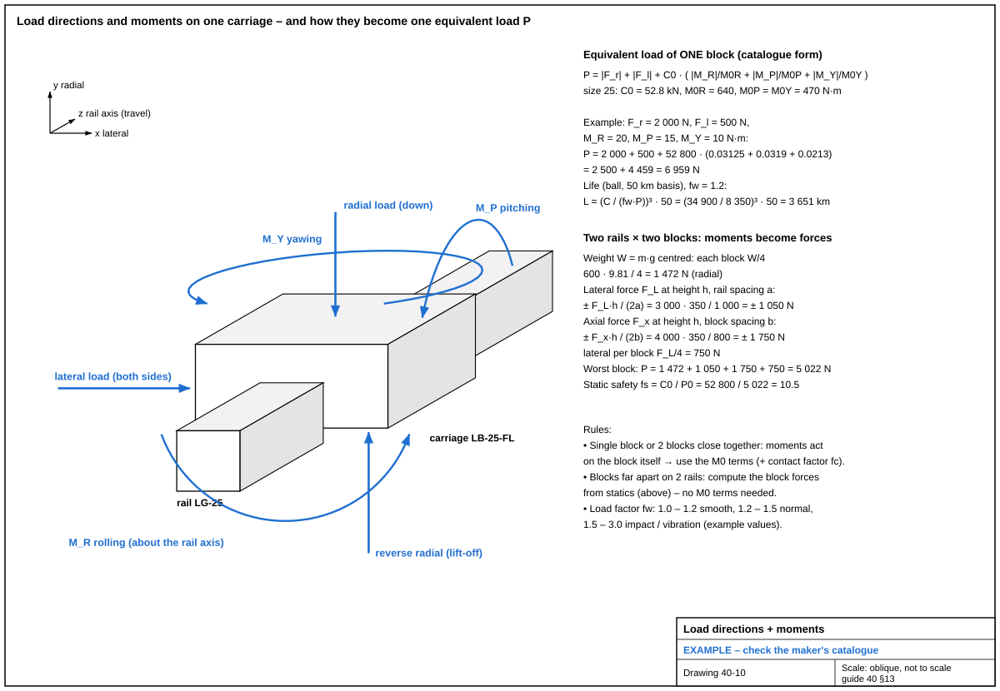

### 13.1 Load directions

| Load | Direction | Our 4-row 45° guide |
|---|---|---|
| Radial (down) | presses the block onto the rail | C, C0 |
| Reverse radial (up) | pulls the block off | same rating (45° = equal in 4 directions) |
| Lateral (side) | sideways | same rating |
| Rolling moment M_R | about the rail axis | M0R = 640 N·m |
| Pitch moment M_P | about the horizontal cross axis | M0P = 470 N·m |
| Yaw moment M_Y | about the vertical axis | M0Y = 470 N·m |

With **two blocks on one rail** (close together) and **two rails**, the moments are taken as force couples between
the blocks – the single block sees no moment, only forces (§13.4).

### 13.2 Equivalent load with moments (single block)

  P = |F_r| + |F_l| + C0 · (|M_R| / M0R + |M_P| / M0P + |M_Y| / M0Y)

Example: F_r = 2 000 N, F_l = 500 N, M_R = 20 N·m, M_P = 15 N·m, M_Y = 10 N·m:

  P = 2 000 + 500 + 52 800 · (20/640 + 15/470 + 10/470) = 2 500 + 52 800 · (0.03125 + 0.03191 + 0.02128)
    = 2 500 + 4 458.5 = **6 958.5 N**

A small moment of 20 N·m counts like 1 650 N! Moments are expensive for a single block – use two blocks per rail.

### 13.3 Life

  L = (fh · ft · fc · C / (fw · P))³ · 50 km   (ball guide, C for 50 km)

  Lh = L · 1 000 / (vm · 60)   hours (vm = mean speed in m/min)

| Factor | Meaning | Values (example) |
|---|---|---|
| fh | hardness of the raceway | 1.0 at ≥ 58 HRC (less if softer) |
| ft | temperature | 1.0 up to 100 °C |
| fc | contact factor (blocks close together share unequally) | 1 block 1.0; 2 blocks in contact 0.81; 3: 0.72; 4: 0.66; 5: 0.61; blocks far apart 1.0 |
| fw | load factor | 1.0 – 1.2 smooth, ≤ 15 m/min; 1.2 – 1.5 small impact, 15 – 60 m/min; 1.5 – 3.0 impact, > 60 m/min |

Example single block (§13.2), fw = 1.2: L = (34 900 / (1.2 · 6 958.5))³ · 50 = 4.18³ · 50 = **3 650 km**.

**50 km or 100 km?** Japanese and Taiwanese makers (THK, HIWIN, PMI) state C for 50 km; Bosch Rexroth, Schaeffler
and many European catalogues (and newer NSK) state C for 100 km. Conversion (ball type):

  C100 = C50 / 2^(1/3) = C50 / 1.26 → 34 900 / 1.26 = **27 700 N**

Both give the **same** life: (27 700 / P)³ · 100 = (34 900 / P)³ · 50. Never compare a 50 km C with a 100 km C
directly – an offer with "C = 34.9 kN" is not better than one with "C = 27.7 kN (100 km)".

### 13.4 Four blocks under a table

For a table on 2 rails (spacing a) × 2 blocks (spacing b), weight W in the middle, a force F at height h:

* weight: each block W / 4
* lateral force F_L at height h: lateral W share F_L / 4 per block, plus a radial change ± F_L · h / (2a) per block
* axial force F_x at height h above the guide plane: radial change ± F_x · h / (2b) per block
* acceleration: m · a at the centre of gravity height h_g: ± m · a · h_g / (2b)

The worked numbers for the HMC table are in §17.9.

### 13.5 Static safety

  fs = C0 / P0,max

| Condition | fs (example, check the catalogue) |
|---|---|
| normal, no impact | 1.0 – 3.5 |
| with impact / vibration | 2.0 – 5.0 |
| machine tools (our target) | ≥ 3 |

For moment loads also check M0 / M_max ≥ fs.

---

## 14. Guide accuracy classes, preload classes, rigidity

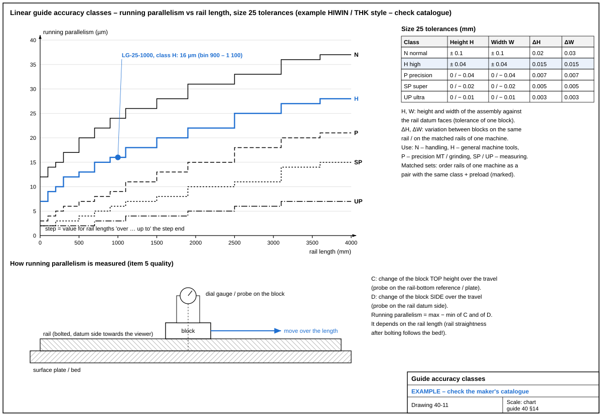

### 14.1 Accuracy classes (size 25, example – HIWIN / THK style)

| Class | Height H tolerance (mm) | Width W tolerance (mm) | Height variation ΔH (mm) | Width variation ΔW (mm) |
|---|---|---|---|---|
| N | ± 0.1 | ± 0.1 | 0.02 | 0.03 |
| H | ± 0.04 | ± 0.04 | 0.015 | 0.015 |
| P | 0 / − 0.04 | 0 / − 0.04 | 0.007 | 0.007 |
| SP | 0 / − 0.02 | 0 / − 0.02 | 0.005 | 0.005 |
| UP | 0 / − 0.01 | 0 / − 0.01 | 0.003 | 0.003 |

* **Height H tolerance** – of one block on one rail (from the rail bottom to the block top).
* **Height variation ΔH** – between several blocks on the same plane (important for 4-block tables).
* **Width tolerance** – datum side of the rail → datum side of the block.

### 14.2 Running parallelism vs rail length

The block moves along the rail; its top face and its datum side may wander a little relative to the rail bottom and
datum. The permissible wander grows with the rail length:

| Rail length up to (mm) | 100 | 200 | 300 | 500 | 700 | 900 | 1100 | 1500 | 1900 | 2500 | 3100 | 3600 | 4000 |
|---|---|---|---|---|---|---|---|---|---|---|---|---|---|
| N (µm) | 12 | 14 | 15 | 17 | 20 | 22 | 24 | 26 | 28 | 31 | 33 | 36 | 37 |
| H (µm) | 7 | 9 | 10 | 12 | 13 | 15 | 16 | 18 | 20 | 22 | 25 | 27 | 28 |
| P (µm) | 3 | 4 | 5 | 6 | 7 | 8 | 9 | 11 | 13 | 15 | 18 | 20 | 21 |
| SP (µm) | 2 | 2 | 3 | 3 | 4 | 5 | 6 | 7 | 8 | 10 | 11 | 14 | 15 |
| UP (µm) | 2 | 2 | 2 | 2 | 2 | 3 | 3 | 4 | 4 | 5 | 6 | 7 | 7 |

Example: rail 1 000 mm, class H → read the column "up to 1 100" → **16 µm**; at 700 mm 13 µm.

| Class | Typical use |
|---|---|
| N (normal) | handling, automation |
| **H (high)** | general machine tools (our default) |
| P (precision) | precision machining, grinding |
| SP, UP | measuring machines, ultra-precision |

### 14.3 Preload classes

| Class | Name | Preload force | Use |
|---|---|---|---|
| Z0 | 0 (very light / small clearance) | ≈ 0 | transfer, light loads, smooth motion |
| Z1 | light preload | ≈ 0.02 C | general machines, small vibration (our default) |
| Z2 | medium preload | ≈ 0.08 C | machine tools, high rigidity, impact loads |

Our block Z1: 0.02 · 34 900 = **698 N** preload. Z2: 0.08 · 34 900 = **2 792 N**.

### 14.4 Rigidity

| Preload | Radial rigidity per block (example) |
|---|---|
| Z0 | 380 N/µm |
| **Z1** | **520 N/µm** |
| Z2 | 760 N/µm |

Higher preload → higher rigidity and better damping, but more friction, more heat, shorter life and **tighter
mounting tolerances** (§16.3). Like the nut (§9.3), the preload is lost when the load exceeds ≈ 2.8 × the preload.

---

## 15. Lubrication and sealing

### 15.1 Why lubricate?

The lubricant separates the rolling surfaces (EHL film, ≈ 0.1 – 1 µm), reduces friction and wear, protects against
corrosion. Without lubricant a ball screw or guide can fail in hours.

### 15.2 Grease or oil?

| | Grease (our default) | Oil / fluid grease (central lubrication) |
|---|---|---|
| Type | lithium-complex or urea, NLGI 2, base oil ≈ 100 cSt at 40 °C (example) | ISO VG 32 – 68 oil, or NLGI 00 / 000 fluid grease |
| Interval | every 100 – 300 km or 3 – 6 months (example – check) | small shots every 15 – 60 min |
| Equipment | grease gun, nipple | pump + piston distributors (0.03 – 0.1 cm³ per shot) |
| Pros | simple, clean | constant film, washes particles out |
| Cons | can be washed out by coolant | coolant gets oil-contaminated |

Initial fill of our nut: ≈ 3 – 4 cm³. **Do not mix greases** with different thickeners (lithium / urea / calcium) –
ask the maker which grease is in the new part.

Speed factor of the grease: n · dpw (= DN) must be inside the limit of the grease (e.g. 300 000 – 500 000 for high
speed greases, example – check).

### 15.3 Seals and protection

| Protection | Effect |
|---|---|
| Wiper seals of the nut | first barrier |
| End seals + bottom seals of the block | wipe the rail |
| Double seals, scrapers (metal plate) | for chips |
| Rail hole caps | flush with the rail top – otherwise the seals wear at each hole |
| Bellows / telescopic covers | the most important protection in a machining centre |
| Lubrication units in front of the seals (felt with oil) | keep a film even with little relubrication |

---

## 16. Mounting and alignment

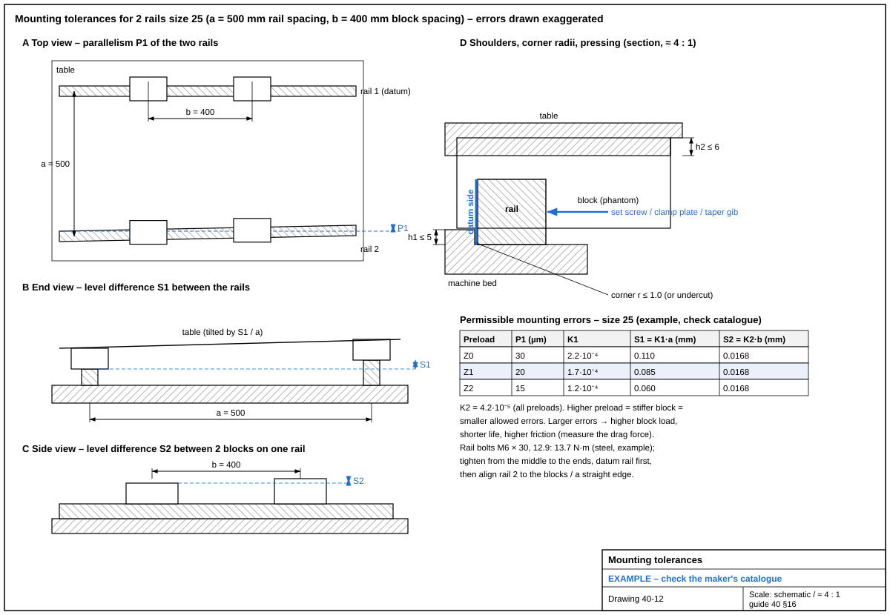

### 16.1 Ball screw

1. Machine the bores of both supports in **one set-up**, in line ≤ 0.01 mm, parallel to the guides ≤ 0.01 mm / 500 mm
   (example).
2. Mount the fixed support, tighten the lock nut to the maker's torque (bearing preload!).
3. Move the table with the nut **near the fixed side**, bolt the nut bracket loosely, then tighten (no side force).
4. Move the table near the floating side, check that the nut runs free (no torque peak). Mount the floating support.
5. Measure the run-out of the shaft near the nut over the stroke (≤ 0.02 mm, example) and the drive torque over the
   stroke – a torque peak means misalignment.
6. Fixed – fixed: pre-tension the shaft (§10.5) by measuring the elongation or the lead.

**Never let the nut take radial or moment loads.** The guides carry the table, the nut only pushes.

### 16.2 Linear guide

1. Clean the bed surfaces and the rail. Remove burrs. Check flatness (≈ 5 – 10 µm / 500 mm for class H / P, example).
2. Lay the **master rail** with its datum side against the bed shoulder. Tighten the bolts lightly.
3. Press the rail against the shoulder (clamp plates or pressing screws) and tighten the bolts to **13.7 N·m (M6, steel
   bed, example)** in order: from the middle outward, or from one end to the other – always with the rail pressed
   against the shoulder.
4. Mount the second rail parallel: with a shoulder, with a reference straight edge and dial gauge, or by "following" the
   master rail with the table.
5. Mount the blocks, put the table on, tighten the block bolts (M8, maker's torque) diagonally: first the blocks on
   the master side, pressed to their datum.
6. Check the running force (no peaks) and the parallelism with a dial gauge.
7. Put the hole caps in (flush, tap with a plastic hammer).

Shoulders (size 25, example): rail shoulder height ≤ **5 mm**, block shoulder ≤ **6 mm**, corner radius ≤ **1.0 mm**
(or an undercut) – the edge of the rail / block has a chamfer that must not sit on a radius.

### 16.3 Permissible mounting errors (size 25, example – check the catalogue)

| Error | Symbol | Z0 | Z1 | Z2 |
|---|---|---|---|---|
| Parallelism of the two rails | P1 | 30 µm | 20 µm | 15 µm |
| Level difference of the two rails | S1 = K1 · a | 2.2 · 10⁻⁴ · a | 1.7 · 10⁻⁴ · a | 1.2 · 10⁻⁴ · a |
| — with rail spacing a = 500 mm | S1 | **0.110 mm** | **0.085 mm** | **0.060 mm** |
| Level difference of 2 blocks along the rail | S2 = K2 · b | 4.2 · 10⁻⁵ · b | | |
| — with block spacing b = 400 mm | S2 | **0.017 mm** | | |

Higher preload → smaller permissible error (the preloaded block cannot follow the error; it is forced and loses
life). This is why a Z2 guide needs a well-machined bed.

---

## 17. Selection example – HMC X axis, end to end

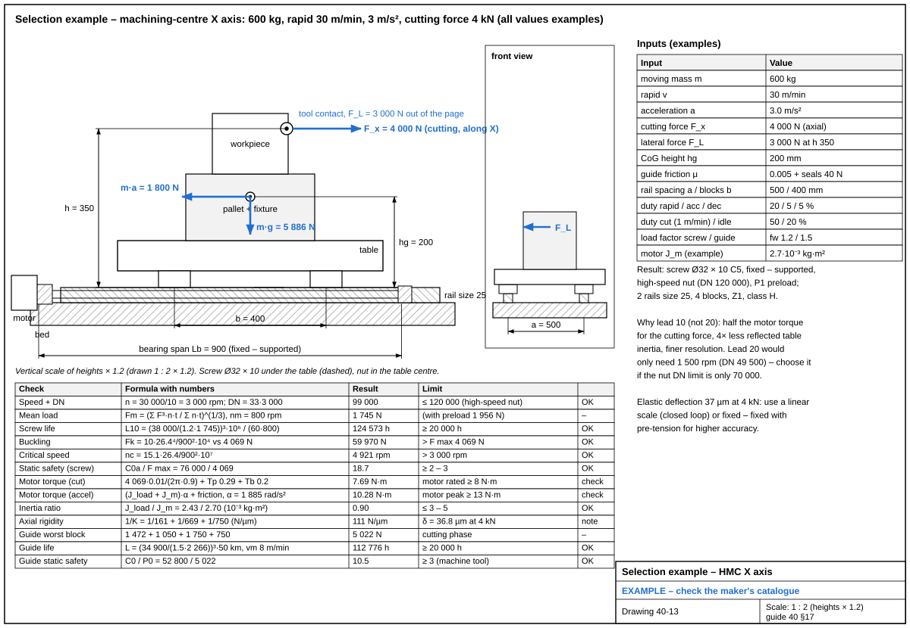

This is the same calculation as the card **Selection example** on the page (`selection()` in `web/bsfprod_calc.js`
with the default inputs `SEL_DEF`). Change the inputs on the page to see your own axis.

### 17.1 Axis data (example)

| Input | Symbol | Value |
|---|---|---|
| Moving mass (table + pallet + fixture + workpiece) | m | 600 kg |
| Rapid traverse | v_r | 30 m/min |
| Acceleration | a | 3.0 m/s² (≈ 0.3 g) |
| Axial cutting force (along the screw) | Fc | 4 000 N |
| Lateral cutting force (across the rails) | F_L | 3 000 N |
| Height of the cutting force above the guide plane | h | 350 mm |
| Height of the centre of gravity above the guide plane | h_g | 200 mm |
| Friction coefficient of the guides | μ | 0.005 |
| Seal drag (4 blocks + nut seals) | F_seal | 40 N |
| Rail spacing / block spacing | a / b | 500 / 400 mm |
| Bearing span for buckling + critical speed | L_b | 900 mm (fixed – supported) |
| Max. distance fixed bearing → nut | L_a | 700 mm |
| Cutting feed | v_cut | 1 m/min |
| Duty (time fractions) | | rapid 20 %, accel 5 %, decel 5 %, cutting 50 %, idle 20 % |
| Load factors | fw | 1.2 (screw), 1.5 (guide) |
| Motor inertia (candidate) | J_m | 2.7 · 10⁻³ kg·m² |
| Required life | | 20 000 h |

### 17.2 Choice of the lead – why Ø32 × 10?

For Ø32 the leads 10, 16 and 20 exist. The same axis with each lead (all values from `selection()`, 20-bit encoder):

| Lead | Screw speed at 30 m/min | DN | Torque for cutting (N·m) | Peak torque at 3 m/s² (N·m) | Load inertia / motor inertia | Travel per encoder count |
|---|---|---|---|---|---|---|
| **10 mm** | 3 000 rpm | 99 000 | **7.20** | 10.28 | **0.90** | **0.0095 µm** |
| 16 mm | 1 875 rpm | 61 875 | 11.51 | 9.60 | 1.78 | 0.0153 µm |
| 20 mm | 1 500 rpm | 49 500 | 14.39 | 9.99 | 2.59 | 0.0191 µm |

Reading the table:

* The **cutting torque** (long time, decides the motor's RMS torque and heat) is lowest with lead 10.
* The **peak torque** is about the same for all three – with lead 10 the motor's own inertia needs most of it.
* The **inertia ratio** is best with lead 10 (0.9; ≤ 3 – 5 is good for a stiff, fast servo loop).
* The **resolution** is finest with lead 10.
* But: lead 10 needs **3 000 rpm** and **DN 99 000** – more than a standard nut (70 000). → We choose Ø32 × 10 **with a
  high-speed internal-deflector nut (DN ≤ 120 000)** and a 3 000 rpm motor. For 40 – 60 m/min we would take lead 16 –
  20 or Ø40.

### 17.3 Axial forces

  Ff = μ · m · g + F_seal = 0.005 · 600 · 9.81 + 40 = 29.43 + 40 = **69.43 N**

  F_acc = m · a + Ff = 600 · 3.0 + 69.43 = **1 869.43 N**

  F_dec = m · a − Ff = 1 800 − 69.43 = **1 730.57 N**

  F_cut = Fc + Ff = 4 000 + 69.43 = **4 069.43 N**

### 17.4 Mean load and life of the screw

Load cycle table: §8.3. Result nm = **800 rpm**, Fm = **1 744.7 N**.

  L10 = (38 000 / (1.2 · 1 744.7))³ · 10⁶ = **5.98 · 10⁹ rev** = **124 600 h** = 59 800 km  → ≥ 20 000 h **OK**

With the preload correction (§8.4): Fm = 1 955.7 N → L10 = 4.24 · 10⁹ rev = **88 400 h** → **OK**.

### 17.5 Static safety of the screw

  fs = C0a / F_max = 76 000 / 4 069.4 = **18.7** ≥ 3 → **OK**

### 17.6 Buckling, critical speed, DN

| Check | Formula | Value | Limit | Result |
|---|---|---|---|---|
| Buckling (fixed – supported, L = 900) | 10 · 26.4⁴ / 900² · 10⁴ | 59 970 N | ≥ 4 069 N | **OK** (14.7 ×) |
| Critical speed | 15.1 · 26.4 / 900² · 10⁷ | 4 921 rpm | ≥ 3 000 rpm | **OK** |
| DN speed | 120 000 / 33.0 | 3 636 rpm | ≥ 3 000 rpm | **OK** (high-speed nut) |
| DN with a standard nut | 33.0 · 3 000 = 99 000 | > 70 000 | | **not OK** → high-speed nut needed |
| Permissible speed | min(4 921; 3 636) | 3 636 rpm | ≥ 3 000 rpm | **OK** |

### 17.7 Motor torque and inertia

Inertias (screw as a solid cylinder Ø32 × 1 000 mm):

  J_screw = π · ρ · L · d⁴ / 32 = π · 7 850 · 1.0 · 0.032⁴ / 32 = **8.08 · 10⁻⁴ kg·m²**

  J_table = m · (Ph / 2π)² = 600 · (0.010 / 2π)² = **1.52 · 10⁻³ kg·m²**

  J_coupling = 1.0 · 10⁻⁴ kg·m²  →  J_load = **2.43 · 10⁻³ kg·m²**

  Inertia ratio J_load / J_m = 2.43 / 2.7 = **0.90** → good (≤ 3 – 5)

Angular acceleration: α = 2π · a / Ph = 2π · 3.0 / 0.010 = **1 885 rad/s²**. Time to rapid speed:
t = v / a = 0.5 / 3.0 = **0.167 s**, distance 0.5² / (2 · 3) = 41.7 mm.

Torques:

| Torque | Formula | Value |
|---|---|---|
| Friction torque | Ff · Ph / (2π · η) = 69.43 · 0.010 / (2π · 0.9) | 0.123 N·m |
| Preload torque of the nut | §9.6 | 0.292 N·m |
| Support bearings + seals (example) | – | 0.2 N·m |
| **Peak (acceleration)** | (J_load + J_m) · α + 0.123 + 0.292 + 0.2 = 5.128 · 10⁻³ · 1 885 + 0.615 | **10.28 N·m** |
| Deceleration | −9.666 + 0.615 | −9.05 N·m |
| **Cutting** | 4 069.43 · 0.010 / (2π · 0.9) + 0.292 + 0.2 = 7.196 + 0.492 | **7.69 N·m** |
| Rapid (constant speed) | 0.123 + 0.292 + 0.2 | 0.61 N·m |
| **RMS over the duty** | √(0.2 · 0.61² + 0.05 · 10.28² + 0.05 · 9.05² + 0.5 · 7.69²) | **6.25 N·m** |

Motor choice (example): rated torque ≥ 1.2 · 6.25 ≈ 7.5 N·m at 3 000 rpm, peak torque ≥ 1.5 · 10.3 ≈ 15 N·m, rotor
inertia ≈ 2 – 3 · 10⁻³ kg·m². A 2.5 – 3.5 kW servo class motor fits (check the motor maker's sizing tool – it also
checks the speed – torque curve and the thermal limit).

### 17.8 Rigidity and lost motion

| Value | Result |
|---|---|
| K_shaft (La = 700) | 161 N/µm |
| K_nut (3 % Ca) | 669 N/µm |
| K_bearing | 750 N/µm |
| **K total** | **110.7 N/µm** |
| Deflection under cutting force | 4 069 / 110.7 = **36.8 µm** (→ linear scale or fixed – fixed + higher preload for heavy cutting) |
| Lost motion | 2 · 69.4 / 110.7 = **1.25 µm** |

### 17.9 Linear guide – size 25, 2 rails × 2 blocks

Loads on the **most loaded block** (example geometry of §17.1):

| Load part | Formula | Value |
|---|---|---|
| Weight per block | 600 · 9.81 / 4 | 1 471.5 N |
| Lateral force → radial change | F_L · h / (2a) = 3 000 · 350 / (2 · 500) | ± 1 050 N |
| Axial force → radial change | Fc · h / (2b) = 4 000 · 350 / (2 · 400) | ± 1 750 N |
| Lateral force per block | F_L / 4 | 750 N |
| Acceleration → radial change | m · a · h_g / (2b) = 600 · 3 · 200 / 800 | ± 450 N |
| **Cutting: P = 1 471.5 + 1 050 + 1 750 + 750** | radial + lateral | **5 021.5 N** |
| **Accel / decel: P = 1 471.5 + 450** | | **1 921.5 N** |
| Rapid: P | weight only | 1 471.5 N |

Mean load by **distance** (a guide counts kilometres, not revolutions): distances per minute of the duty

| Phase | P (N) | Distance share (m per min of cycle) |
|---|---|---|
| Rapid | 1 471.5 | 30 · 0.20 = 6.0 |
| Accel | 1 921.5 | 15 · 0.05 = 0.75 |
| Decel | 1 921.5 | 15 · 0.05 = 0.75 |
| Cutting | 5 021.5 | 1 · 0.50 = 0.5 |
| **Sum** | | **vm = 8.0 m/min** |

  Pm = ((1 471.5³ · 6 + 1 921.5³ · 1.5 + 5 021.5³ · 0.5) / 8)^(1/3) = **2 265.9 N**

  L = (fc · C / (fw · Pm))³ · 50 = (1.0 · 34 900 / (1.5 · 2 265.9))³ · 50 = **54 100 km**

  Lh = 54 132 · 1 000 / (8.0 · 60) = **112 800 h** → ≥ 20 000 h **OK**

(fc = 1.0 because the blocks are 400 mm apart; fw = 1.5 for 30 m/min with small impacts.)

  Static safety fs = C0 / P_max = 52 800 / 5 021.5 = **10.5** ≥ 3 → **OK**

Check with the 100 km rating: (27 700 / (1.5 · 2 265.9))³ · 100 = same 54 100 km ✓.

### 17.10 Summary

| Check | Value | Limit | Result |
|---|---|---|---|
| Screw life L10h (without / with preload) | 124 600 / 88 400 h | ≥ 20 000 h | OK |
| Screw static safety | 18.7 | ≥ 3 | OK |
| Buckling | 59 970 N | ≥ 4 069 N | OK |
| Critical speed | 4 921 rpm | ≥ 3 000 rpm | OK |
| DN (high-speed nut 120 000) | 99 000 | ≤ 120 000 | OK (standard nut: not OK) |
| Motor peak / RMS torque | 10.3 / 6.25 N·m | motor data | choose motor |
| Inertia ratio | 0.90 | ≤ 3 – 5 | OK |
| Axial rigidity | 110.7 N/µm, 36.8 µm under cutting | design target | acceptable with linear scale |
| Guide life | 112 800 h | ≥ 20 000 h | OK |
| Guide static safety | 10.5 | ≥ 3 | OK |

**Decision (example):** ball screw `BS-3210-1000-C5` + nut `BN-3210-FL` (high-speed deflector), fixed – supported,
motor ≈ 3 kW class; 2 rails `LG-25-1000` + 4 blocks `LB-25-FL`, preload Z1 (Z2 for heavy cutting), class H.

---

## 18. Failure modes

| Failure | What you see | Cause | Prevention |
|---|---|---|---|
| **Flaking** (fatigue spalling) | pieces break out of the raceway, noise, vibration | normal end of life (L10) – or overload, misalignment, poor lubricant, grinding burn | correct sizing (§8, §13), alignment, lubrication, no grinding burn (item 5 inspection) |
| **Brinelling** (true) | regular dents at ball pitch | static overload: crash, hammering at mounting | fs ≥ 3, crash protection (torque limit, collision detection), never hammer on the nut or block |
| **False brinelling** | shiny / brown marks at ball pitch, no real dent | vibration at standstill (transport, machine next to a press), small oscillating strokes | transport locks, damping, a longer stroke now and then for re-lubrication, suitable grease |
| **Wear** | preload torque drops, backlash grows | abrasive particles, missing lubricant, coolant in the grease | seals, covers, relubrication interval, filtered coolant |
| **Lost preload** | reversal error grows, lower rigidity, chatter | wear, settling, overload > 2.83 Fpr for long times, overheating | right preload class, temperature control, check preload torque in maintenance |
| **Contamination** | scratches, indentations, noise | broken seal, missing hole caps, no bellows | full covers, scrapers, seal inspection |
| **Deflector / end cap break** | sudden lock, balls falling out | DN too high, crash, ball jam | DN check (§8.8), soft limits, collision detection |
| **Misalignment** | torque peak over the stroke, warm nut, early flaking at one side | supports not in line, nut bracket not parallel, rails not parallel | machine the bores in one set-up, assembly procedure (§16), check P1 / S1 / S2 |
| **Corrosion** | rust, pitting | coolant, humidity, no rust protection in storage | VCI packing, grease, stainless options |
| **Overheating** | thermal growth, grease degradation | too high preload, too much grease, high speed | correct preload and grease quantity, cooling |
| **Buckling / whirling** | bent shaft, vibration at speed | compression load or speed over the limit | §8.6 / §8.7 checks |

---

## 19. Design checklists

### 19.1 Ball screw

- [ ] Stroke, speed, acceleration, forces and duty cycle written down
- [ ] Lead chosen (speed, torque, resolution, inertia – §17.2)
- [ ] Mean load and L10h ≥ requirement (with fw, with preload correction)
- [ ] Static safety C0a / F_max ≥ 3 (incl. crash)
- [ ] Buckling with the right mounting factor and length
- [ ] Critical speed (0.8 included) and DN of the nut type
- [ ] Rigidity (shaft, nut, bearings) and lost motion meet the accuracy target
- [ ] Accuracy grade + T value, thermal concept (scale / pre-tension / cooling)
- [ ] Motor: peak, RMS, speed, inertia ratio; brake for vertical axes
- [ ] End machining drawing (journals, lock-nut thread, keyway, snap-ring groove) agreed with the maker
- [ ] Support units, coupling, lubrication connection, seals, covers
- [ ] Mounting procedure and acceptance tests (torque over stroke, run-out)

### 19.2 Linear guide

- [ ] Number of rails and blocks, spacing a / b
- [ ] Block loads incl. moments (single block: equivalent load with M0)
- [ ] Life with fh, ft, fc, fw – check 50 / 100 km basis
- [ ] Static safety ≥ 3 for machine tools
- [ ] Preload class vs rigidity and mounting tolerances
- [ ] Accuracy class vs required parallelism over the length
- [ ] Mounting surfaces: flatness, shoulders, radii, datum sides
- [ ] Bolts, torque, hole caps, butt joints for long rails
- [ ] Lubrication (grease / central), seals, covers

---

## 20. Parts lists per product, product family, codes

The parts lists below are the array `BOM` in `web/bsfprod_data.js`. **Item 2** (manufacturing) uses them to build the
operation routes, **item 6** (MES) for work orders and traceability, **item 7** (ERP) for the BOM, MRP and purchasing:

```js
import { BOM, FAMILY_BS, FAMILY_LG, codeBS, codeBN, codeLG, codeLB } from "./bsfprod_data.js";
```

### 20.1 Parts lists (make / buy, material, heat treatment)

**BS-3210-1000-C5**

| Pos | Part | Qty | Make / buy | Material | Heat treatment / finish | Main operations / note (item 2) |
|---|---|---|---|---|---|---|
| 10 | Screw shaft blank Ø36 × 1 010 mm | 1 | BUY (bar) → MAKE | 50CrMo4 +QT round bar, peeled | QT 250 – 300 HB as delivered | saw, face + centre, rough turn, stress relief |
| 20 | Screw shaft (finished) | 1 | MAKE | 50CrMo4 | induction harden thread zone 58 – 62 HRC, temper | turn journals, harden, straighten, grind OD, thread grinding (C5), grind journals, lap |
| 30 | Lock nut M25 × 1.5 (precision) | 1 | BUY | steel, with locking screw | – | normally supplied with the support unit |
| 40 | Key 6 × 6 × 20 (motor journal) | 1 | BUY | C45 key steel | – | DIN 6885 A |
| 50 | Rust protection + VCI packing tube | 1 | BUY | oil + plastic tube | – | ship horizontal, supported every 300 mm |

**BN-3210-FL**

| Pos | Part | Qty | Make / buy | Material | Heat treatment / finish | Main operations / note (item 2) |
|---|---|---|---|---|---|---|
| 10 | Nut body with flange | 1 | MAKE | 20MnCr5 bar Ø85 | carburize, harden, temper 58 – 62 HRC | turn, drill flange, mill flat + deflector pockets, harden, grind bore + OD + flange face, internal thread grinding |
| 20 | Balls Ø6.35 (1/4") | 60 | BUY | 100Cr6 | 62 – 66 HRC, ISO 3290 G5 | sorted size class for preload P1 (oversize) |
| 30 | Deflector (internal return) | 4 | BUY | sintered steel MIM / POM | MIM: harden | pressed / glued into the pockets |
| 40 | Wiper seal | 2 | BUY | NBR / TPU + holder | – | snap ring retained |
| 50 | Snap ring for seal | 2 | BUY | spring steel | – | DIN 472 |
| 60 | Grease nipple M6 / plug | 1 | BUY | steel zinc plated | – | DIN 71412 |
| 70 | Grease (initial fill) | 1 | BUY | lithium-complex NLGI 2 (e.g. Klüber Isoflex NBU 15 class) | – | ≈ 3 – 4 cm³ |
| 80 | Spacer (double-nut version BN-3210-FLD only) | 1 | MAKE | 100Cr6 / C45 | harden 58 HRC (or QT) | grind width to the preload (± 1 µm) |

**LG-25-1000**

| Pos | Part | Qty | Make / buy | Material | Heat treatment / finish | Main operations / note (item 2) |
|---|---|---|---|---|---|---|
| 10 | Rail profile bar (cold drawn) 25 | 1 | BUY → MAKE | C55 profile from a specialist mill | as drawn | cut to 1 000 + allowance |
| 20 | Rail (finished) | 1 | MAKE | C55 | induction harden raceways 58 – 62 HRC | straighten, drill + counterbore 17 holes (pitch 60, E 20), harden, straighten, grind datum + 4 raceways, cut ends, mark datum |
| 30 | Rail hole caps Ø11 | 17 | BUY | POM (or brass for coolant areas) | – | flush with the rail top |
| 40 | Rust protection + packing | 1 | BUY | oil + VCI film + wood profile | – | mark datum side + rail no. for matched pairs |

**LB-25-FL**

| Pos | Part | Qty | Make / buy | Material | Heat treatment / finish | Main operations / note (item 2) |
|---|---|---|---|---|---|---|
| 10 | Carriage steel body | 1 | MAKE | 20CrMo4 / 100Cr6 | carburize / harden 58 – 62 HRC | mill, drill + tap M8, bore return holes, harden, grind base + reference side + 4 raceways |
| 20 | Balls Ø4.763 (3/16") | 120 | BUY | 100Cr6 | ISO 3290 G10, size-matched | 4 rows × 30 (example) |
| 30 | End cap with return path | 2 | BUY | POM / PA66 injection moulded | – | screwed, aligned to the body |
| 40 | Return pipe / insert | 4 | BUY | POM | – | in the return holes |
| 50 | End seal (double lip + steel plate) | 2 | BUY | NBR + steel | – | outside the end caps |
| 60 | Bottom seal strip | 2 | BUY | NBR | – | under the body |
| 70 | Ball retainer (wire / strip) | 4 | BUY | steel wire / POM | – | keeps balls in when the block leaves the rail |
| 80 | Grease nipple M6 × 0.75 | 1 | BUY | steel | – | on one end cap |
| 90 | Screws for end caps M2.5 / M3 | 4 | BUY | steel | – | ISO 7380 |
| 100 | Dummy rail (shipping) | 1 | BUY | PE / ABS | – | keep the block on it until mounting |

### 20.2 What we make, what we buy

| Make (core know-how of the factory) | Buy (specialist suppliers) |
|---|---|
| screw shafts (turning, induction hardening, thread grinding) | round bar, rail profiles (cold drawn), block blanks |
| nut bodies (turning, case hardening, internal thread grinding) | balls (ISO 3290 G5 / G10) |
| rails (drilling, hardening, straightening, raceway grinding) | deflectors, end caps, return pipes (injection moulding / MIM) |
| carriage bodies (milling, hardening, raceway grinding) | seals, wipers, retainers, grease nipples, screws |
| assembly, preload setting, testing | grease, packing material, support units for kits |

### 20.3 Product family

Ball screws (catalogue-class examples – check the maker's catalogue):

| d0 (mm) | Lead Ph (mm) | Ball Dw (mm) | Circuits × turns | Ca (kN) | C0a (kN) |
|---|---|---|---|---|---|
| 16 | 5 | 3.175 | 3 × 1 | 7.6 | 13.5 |
| 16 | 10 | 3.175 | 2 × 1 | 5.6 | 9.0 |
| 20 | 5 | 3.175 | 4 × 1 | 10.5 | 21.0 |
| 20 | 10 | 3.969 | 3 × 1 | 11.0 | 20.0 |
| 20 | 20 | 3.969 | 2 × 1.5 | 7.5 | 13.0 |
| 25 | 5 | 3.175 | 4 × 1 | 12.0 | 27.0 |
| 25 | 10 | 4.762 | 3 × 1 | 17.0 | 33.0 |
| 25 | 20 | 4.762 | 2 × 1.5 | 11.0 | 20.0 |
| 32 | 5 | 3.175 | 5 × 1 | 16.0 | 40.0 |
| 32 | 10 | 6.35 | 4 × 1 | 38.0 | 76.0 |
| 32 | 20 | 6.35 | 2 × 1.5 | 23.0 | 43.0 |
| 40 | 5 | 3.175 | 5 × 1 | 18.0 | 50.0 |
| 40 | 10 | 6.35 | 4 × 1 | 44.0 | 100.0 |
| 40 | 20 | 6.35 | 3 × 1 | 33.0 | 68.0 |

Linear guides (block flange type, standard length, 50 km basis – examples):

| Size | Rail W | Rail H | Block W (flange) | C (kN, 50 km) | C0 (kN) | M0R (kN·m) | M0P (kN·m) | M0Y (kN·m) | Ball Ø (mm) |
|---|---|---|---|---|---|---|---|---|---|
| 15 | 15 | 15 | 47 | 14.7 | 23.5 | 0.17 | 0.15 | 0.15 | 3.175 |
| 20 | 20 | 17.5 | 63 | 27.1 | 36.7 | 0.39 | 0.29 | 0.29 | 3.969 |
| 25 | 23 | 22 | 70 | 34.9 | 52.8 | 0.64 | 0.47 | 0.47 | 4.763 |
| 30 | 28 | 26 | 90 | 48.5 | 71.9 | 1.06 | 0.83 | 0.83 | 5.556 |
| 35 | 34 | 29 | 100 | 64.6 | 93.6 | 1.69 | 1.14 | 1.14 | 6.35 |

Family range (for MES / ERP): screws Ø16 / 20 / 25 / 32 / 40, leads 5 / 10 / 20, lengths 300 – 2 000 mm, grades
C3 / C5 / C7; guides size 15 / 20 / 25 / 30 / 35, rail length 300 – 4 000 mm, blocks FL (flange) / NA (narrow),
preload Z0 / Z1 / Z2, classes N / H / P.

### 20.4 Code scheme

| Code builder | Example call | Result |
|---|---|---|
| `codeBS(d, Ph, L, grade)` | `codeBS(32, 10, 1000, "C5")` | `BS-3210-1000-C5` |
| | `codeBS(16, 5, 500, "C7")` | `BS-1605-500-C7` |
| `codeBN(d, Ph, type)` | `codeBN(32, 10)` / `codeBN(32, 10, "FLD")` | `BN-3210-FL` / `BN-3210-FLD` (double nut) |
| `codeLG(size, L)` | `codeLG(25, 1000)` | `LG-25-1000` |
| `codeLB(size, type)` | `codeLB(25)` / `codeLB(25, "NA")` | `LB-25-FL` / `LB-25-NA` |

Preload and accuracy class of guides (Z0 / Z1 / Z2, N / H / P) are order attributes (item 7) – they are not part of the
code.

---

## 21. Buy list – catalogue examples

Makers and models are real **catalogue examples** – data and prices change. Price class = **estimate – ask for a
quote**. Mark "(check)" means: we are not sure about the exact type designation – ask the maker.

### 21.1 Ground ball screws + nuts (complete)

| Item | Required spec | Example maker + model | Key data | Price class (estimate – ask for a quote) | Check in the datasheet |
|---|---|---|---|---|---|
| Ground ball screw Ø32 × 10, C5, flanged nut, preload | d0 32, Ph 10, Dw 6.35, Ca ≥ 35 kN, DN ≥ 100 000, DIN 69051 flange | THK BIF / BNFN 3210 (precision ground) | Ca ≈ 33 – 38 kN (check) | ≈ 600 – 1 200 € per 1 m set | Ca / C0a, nut rigidity, preload torque, DN, lead chart (e_p, v_300), end machining drawing |
| Same | same | HIWIN FSI / FSV 32-10 (ground, internal recirculation) | ground C3 / C5, internal return (check) | ≈ 400 – 900 € | same |
| Same | same | NSK ZFT / PFT 3210 (precision ground) | check catalogue | ≈ 600 – 1 200 € | same; NSK S1 seal + K1 lube unit option |
| Same | same | Bosch Rexroth FEM-E-S 32×10 (precision ball screw assembly) | DIN 69051 flange single nut (check) | ≈ 600 – 1 200 € | same; Rexroth calculation tool |
| Same | same | Schaeffler INA KGT / KGM 32×10 (check type) | check catalogue | ask for a quote | same |
| Same | same | PMI FSDC / FSIC 32-10 (check) | ground, internal return | ≈ 400 – 900 € | same |
| Same | same | Kuroda Precision (ground ball screws, check type) | C3 / C5 | ask for a quote | same |
| Same | same | Steinmeyer 1000 series (check) | precision ground, DIN flange | ask for a quote | same |
| Same | same | SKF / Ewellix precision ground ball screws (check brand) | check catalogue | ask for a quote | same |
| Rolled ball screw Ø32 × 10, C7 (cheaper option) | C7 / v_300 50 µm, light preload | HIWIN R32-10 / THK BTK / PMI rolled | C7, Ca ≈ 20 – 30 kN (check) | ≈ 150 – 300 € | lead accuracy, straightness, nut type |

### 21.2 Profiled linear guides size 25 (ball type)

| Item | Required spec | Example maker + model | Key data | Price class (estimate – ask for a quote) | Check in the datasheet |
|---|---|---|---|---|---|
| Rail size 25 + flange block, Z1, class H | C ≥ 30 kN (50 km), C0 ≥ 45 kN, 4 rows 45°, rail 23 × 22, pitch 60 | HIWIN HGR25 + HGW25CC | C ≈ 34.9 kN, C0 ≈ 52.8 kN (check) | ≈ 150 – 300 € per 1 m rail + 2 blocks | C (50 or 100 km basis!), C0, M0R/M0P/M0Y, rigidity, accuracy class table, mounting tolerances P1/S1 |
| Same | same | THK SHS25 / HSR25 (check type) | check catalogue | ≈ 200 – 400 € | same |
| Same | same | NSK NH25 / LH25 (check) | check catalogue (100 km basis?) | ≈ 200 – 400 € | same |
| Same | same | Bosch Rexroth ball rail system size 25 (R1651-…) | C for 100 km (check) | ≈ 200 – 400 € | same |
| Same | same | Schaeffler INA KUVE25-B (check) | check catalogue | ask for a quote | same |
| Same | same | PMI MSA25 (check) | check catalogue | ≈ 150 – 300 € | same |
| Same | same | SKF / Ewellix LLT size 25 (check brand) | check catalogue | ask for a quote | same |
| Roller guide size 25 (heavy option) | C ≥ 50 kN, rigidity ≈ 2× ball type | HIWIN RG25 / THK SRG25 / Rexroth roller rail / Schaeffler RUE25 | check catalogue | ≈ 300 – 600 € | rigidity, mounting flatness needs |

### 21.3 Precision balls (ISO 3290 / DIN 5401)

| Item | Required spec | Example maker + model | Key data | Price class (estimate – ask for a quote) | Check in the datasheet |
|---|---|---|---|---|---|
| Balls Ø6.35 G5, 100Cr6, size-sorted | G5, sorting 1 µm, lot certificate | Tsubaki Nakashima (incl. former Hoover Precision) | G3 – G10, 52100 | ≈ 30 – 80 € per 1 000 (check) | grade, size class, hardness, lot traceability |
| Same | same | AKS (Amatsuji Steel Ball) | G3 – G10 | ask for a quote | same |
| Same | same | Hartford Technologies / ITI (check) | check | ask for a quote | same |
| Balls Ø4.763 G10 for blocks | G10, matched lots | Tsubaki Nakashima · AKS | check | ≈ 15 – 40 € per 1 000 | same |

### 21.4 Seals, wipers, deflectors, end caps

| Item | Required spec | Example maker + model | Key data | Price class (estimate – ask for a quote) | Check in the datasheet |
|---|---|---|---|---|---|
| Ball nut wiper seal Ø32 × 10 | profile seal, NBR / TPU, fits the lead | From the ball screw maker (THK / HIWIN / NSK …) | matched to the profile | ≈ 5 – 20 € each | profile, drag torque, coolant resistance |
| Rail wiper / double seal / scraper | size 25 | From the guide maker (HIWIN DD / ZZ / KK, THK UU / SS / LaCS) | check | ≈ 5 – 30 € per block set | drag force, coolant type |
| Elastomer seals – custom | NBR / FKM / TPU | Freudenberg (Simrit) · Trelleborg · SKF seals | check | ask for a quote | material vs coolant, temperature |
| Deflectors / end caps (own nut design) | MIM steel / POM | MIM and injection-moulding suppliers (local) | tool needed | tool 5 000 – 20 000 €, parts < 1 € | step-free path, tolerances |

### 21.5 Grease + lubrication

| Item | Required spec | Example maker + model | Key data | Price class (estimate – ask for a quote) | Check in the datasheet |
|---|---|---|---|---|---|
| Ball screw + guide grease | lithium-complex / urea, NLGI 2, base oil ≈ 100 cSt | Klüber Isoflex NBU 15 / Microlube GBU Y 131 (check) | speed factor high | ≈ 20 – 60 € per kg | compatibility with the maker's initial grease |
| Same | same | THK AFB-LF / AFA · NSK AS2 / LR3 (maker greases) | check | ≈ 30 – 80 € per 400 g | same |
| Central lubrication (oil / fluid grease) | piston distributors, 0.03 – 0.1 cm³ / shot | SKF Lincoln · Bijur Delimon · Lubricant pumps (local) | check | ≈ 500 – 2 000 € per machine | interval, distributor size per block / nut |

### 21.6 Support bearings + support units + couplings

| Item | Required spec | Example maker + model | Key data | Price class (estimate – ask for a quote) | Check in the datasheet |
|---|---|---|---|---|---|
| Angular-contact thrust pair 25 × 62 × 15, 60° | ISO P4, DB / DF, preload L / M | NSK 25TAC62B (check) | axial rigidity ≈ 750 N/µm pair (check) | ≈ 150 – 300 € pair | rigidity, preload, limiting speed, lock nut torque |
| Same | same | SKF BSA 205 C / BSD 2562 (check) | check | ≈ 150 – 300 € | same |
| Same | same | Schaeffler INA 7602025-2RS / ZKLN 2557 (check) | check | ≈ 100 – 250 € | same |
| Support units fixed / floating for Ø32 screw | fixed FK25 / BK25, floating FF20 / BF20 | THK FK/FF · HIWIN BK/BF · NSK WBK (check) | check | ≈ 150 – 300 € per pair | shaft end drawing, lock nut, bearing class |
| Bellows / disc coupling ≥ 25 N·m | torsionally stiff, clamping hubs Ø20 | R+W BK2 / BKL · KTR Radex-NC · Mayr ROBA-DS (check) | check | ≈ 80 – 250 € | torsional stiffness, misalignment, inertia |

---

## 22. Shopping list – first prototype run

First prototype run: 5 ball screw sets (`BS-3210` + `BN-3210-FL`) and 5 guide sets (`LG-25-1000` + 2 × `LB-25-FL`) made
in-house, plus 2 bought benchmark sets per product. Machines, heat treatment and measuring equipment are bought in
items 2 and 5 – this list is material and purchased components only. Prices are rough estimates 2026 – ask for a quote.

| Pos | Qty | Item | Spec (from the guide) | Example (choose one maker per item) | Price class (estimate – ask for a quote) |
|---|---|---|---|---|---|
| 1 | 2 × 6 m | Round bar 50CrMo4 +QT Ø36, peeled | for 5 shafts + set-up parts | local steel stock holder (EN 10083-3) | ≈ 300 – 500 € |
| 2 | 1 × 3 m | Round bar 20MnCr5 Ø85 (nut bodies) | 5 nuts + trials | local steel stock holder | ≈ 300 – 500 € |
| 3 | 2 000 | Balls Ø6.35 G5 100Cr6, 3 size classes | oversize sorting for P1 | Tsubaki Nakashima · AKS | ≈ 100 – 250 € |
| 4 | 40 | Deflectors (prototype MIM / machined) | 4 per nut + spares | MIM supplier / own CNC | ≈ 200 – 800 € |
| 5 | 15 | Wiper seals Ø32 × 10 | 2 per nut + spares | screw maker spare part | ≈ 100 – 300 € |
| 6 | 2 × 4 m | Rail profile size 25, cold drawn C55 | 5 rails + trials | profile mill (ask the guide maker for the source) | ≈ 300 – 700 € |
| 7 | 1 × 2 m | Block blank bar 20CrMo4 / flat 75 × 40 | 10 blocks + trials | local steel stock holder | ≈ 150 – 300 € |
| 8 | 2 000 | Balls Ø4.763 G10 | 10 blocks × 120 + spares | Tsubaki Nakashima · AKS | ≈ 50 – 120 € |
| 9 | 25 sets | End caps, end seals, bottom seals, retainers, nipples size 25 | bought as spare-part sets | guide maker spare parts | ≈ 300 – 800 € |
| 10 | 5 + 5 | Support units FK25 + FF20 class | for the test stand + 4 kits | THK · HIWIN · NSK | ≈ 750 – 1 500 € |
| 11 | 2 kg | Grease NLGI 2 lithium-complex | initial fill | Klüber · maker grease | ≈ 60 – 150 € |
| 12 | 2 | Benchmark ground ball screw Ø32 × 10 C5 1 m | to measure and compare (item 5) | THK · HIWIN · NSK · Rexroth | ≈ 1 200 – 2 400 € |
| 13 | 2 | Benchmark guide size 25, 1 m + 2 blocks | same | HIWIN · THK · Rexroth · Schaeffler | ≈ 300 – 800 € |
| 14 | 1 | Bellows coupling + servo motor ≈ 1.5 kW (test stand) | run-in and noise test | R+W + any servo maker | ≈ 1 000 – 2 000 € |

Total (rough): ≈ 5 000 – 11 000 € (estimate – ask for a quote).

---

## 23. Standards register

| Standard | Subject |
|---|---|
| ISO 3408-1 … 5 | Ball screws: vocabulary, nominal sizes, acceptance (accuracy), axial rigidity, load ratings + life |
| JIS B 1192-1 … 6 | Ball screws (Japanese; C0 … C10 grades used by THK / NSK / HIWIN) |
| DIN 69051-1 … 6 | Ball screws (German; part 5: flange nut dimensions, form B) |
| ISO 12090-1 / -2 | Rolling bearings – profiled rail guides for linear motion: boundary dimensions and tolerances (part 1 series 1 – 3, part 2 series 4 – 5) – check edition |
| ISO 14728-1 / -2 | Linear motion rolling bearings: dynamic + static load ratings |
| ISO 3290-1 | Rolling bearing balls – steel balls (grades G3 … G200); DIN 5401 old German version |
| ISO 281 | Rolling bearings – dynamic load rating and rating life (idea L10 = (C/P)^p) |
| ISO 76 | Rolling bearings – static load ratings (idea of C0, 4 200 MPa contact stress) |
| ISO 230-2 | Test code for machine tools – positioning accuracy (the whole axis) |
| ISO 683-17 / EN ISO 683-3 | Steels for rolling bearings / case-hardening steels |

Additional standards and documents (check the current editions):

| Standard | Subject |
|---|---|
| ISO 3408-1 | Ball screws – vocabulary and designation |
| ISO 3408-2 | Ball screws – nominal diameters and nominal leads (metric series) |
| ISO 3408-3 | Ball screws – acceptance conditions and acceptance tests (e_p, v_up, v_300p, v_2πp, run-outs) |
| ISO 3408-4 | Ball screws – static axial rigidity |
| ISO 3408-5 | Ball screws – static and dynamic axial load ratings and operational life |
| JIS B 1192-1 … 6 | Japanese ball screw standard (C0 … C10 grades) – check edition |
| DIN 69051-5 | Ball screws – flanged nut dimensions (form B) – check if replaced by ISO 3408 parts |
| ISO 12090-1 / -2 | Profiled rail guides – boundary dimensions and tolerances – check edition |
| ISO 14728-1 / -2 | Linear motion rolling bearings – dynamic (L = 100 km basis) and static load ratings |
| ISO 3290-1 | Steel balls for rolling bearings (grades) |
| DIN 5401 | Balls for rolling bearings (older German standard, replaced by ISO 3290 – check) |
| ISO 281 | Rolling bearings – dynamic load rating and rating life (idea of L10) |
| ISO 76 | Rolling bearings – static load ratings (4 200 MPa for ball bearings) |
| ISO 683-17 | Heat-treated steels – ball and roller bearing steels |
| EN ISO 683-3 | Case-hardening steels (20MnCr5 …) |
| EN 10083-3 | Steels for quenching and tempering (50CrMo4 …) |
| ISO 230-2 | Test code for machine tools – positioning accuracy of NC axes |
| ISO 4762 / ISO 7380 | Socket head cap screws / button head screws |
| DIN 471 / DIN 472 | Retaining rings for shafts / bores |
| DIN 71412 | Grease nipples |
| DIN 6885 | Parallel keys |

---

## 24. Questions for the supplier

**Ball screw maker:**

1. Ca and C0a of exactly this nut (circuits × turns, ball size)? Rating standard (ISO 3408-5)?
2. Permissible DN of this nut type? With which grease?
3. Preload: method, value in N and % Ca, preload torque band (N·m ± %)?
4. Axial rigidity of the nut at this preload?
5. Lead accuracy chart per screw (e_p, v_up, v_300p, v_2πp) – measured per ISO 3408-3? With which travel compensation (T value)?
6. Material and heat treatment of shaft and nut, case depth, hardness certificate?
7. End machining: your standard or our drawing? Tolerances of the journals, run-out?
8. Seal type and drag torque? Coolant resistance?
9. Lead time, minimum order, repair / re-grinding service?
10. Which support units and lock nuts do you recommend; tightening torques?

**Linear guide maker:**

1. C and C0 – for 50 km or 100 km? M0R / M0P / M0Y?
2. Rigidity per preload class (radial, reverse radial, lateral)?
3. Accuracy class table and running parallelism vs length for this rail length?
4. Permissible mounting errors P1, S1, S2 for this preload?
5. Matched rail pairs, butt-joint rails – how marked?
6. Seal options and drag force; scraper / double seal; lubrication units?
7. Grease in the new block; relubrication quantity and interval?
8. Hole pattern (E at both ends) for our length?

**Ball maker:**

1. Grade (G5 / G10), size classes (1 µm steps?), lot certificate (diameter, sphericity, roughness, hardness)?
2. Material 100Cr6 / 52100, cleanliness?
3. Packaging (oil, lot separation), minimum quantity?

---

## 25. Glossary

| Term | Meaning |
|---|---|
| Ball circle diameter dpw | diameter through the ball centres |
| Ball screw | screw + nut with balls; turns rotation into linear motion with η ≈ 0.9 |
| Backlash | axial clearance between screw and nut (0 with preload) |
| Brinelling | permanent dents by static overload |
| Buckling load Fk | compression load at which the screw bends sideways (here with safety 0.5) |
| C / Ca | basic dynamic load rating (guide per 50 or 100 km; screw per 10⁶ rev) |
| C0 / C0a | basic static load rating |
| C0 … C10 | accuracy grades of ball screws (JIS B 1192, ISO 3408-3) |
| Carriage / block | moving part of the linear guide |
| Conformity f | groove radius / ball diameter (0.52 – 0.56) |
| Contact angle α | angle of the contact line to the radial plane (45°) |
| Critical speed n_cr | speed at which the rotating shaft whirls |
| Deflector | part that lifts the ball over the land (internal return) |
| DN value | dpw · n, speed limit of the nut |
| e_p | tolerance of the mean travel deviation (ISO 3408-3) |
| End cap | return part at the nut / block ends |
| Equivalent load P | one load that gives the same life as the real combination of forces and moments |
| False brinelling | wear marks by vibration at standstill |
| Fixed / floating support | bearing that takes axial load / bearing that lets the shaft grow |
| Flaking | fatigue break-out of the raceway surface |
| fw, fc, fh, ft | load, contact, hardness and temperature factors |
| Gothic arch | groove made of two arcs → 2 contact points per groove |
| Lead Ph | travel per revolution |
| Lead angle λ | helix angle at the ball circle |
| Lost motion | difference of position when approaching from both sides |
| L10 | rating life reached by 90 % of a group |
| M_R, M_P, M_Y | rolling, pitch, yaw moment on a guide block |
| O- / X-arrangement | contact lines spreading outside / crossing inside |
| Preload | internal force that removes clearance and raises rigidity |
| Pre-tension | stretching the screw between two fixed supports |
| Rigidity K | force per deflection (N/µm) |
| Root diameter dr | core diameter at the groove bottom |
| T value | negative travel target of a pre-tensioned screw |
| v_up, v_300p, v_2πp | travel variation over l_u, in 300 mm, in one revolution |
| Z0 / Z1 / Z2 | preload classes of the guide |

---

## 26. Drawings and how the numbers were checked

### 26.1 Drawings

All drawings are SVG files in `docs/img/` (copies in `web/img/` for the catalogue card). White background, black lines
plus one accent colour, title block "EXAMPLE – check the maker's catalogue".

| # | File | Title | Content | Section |
|---|---|---|---|---|
| 1 | `40_ballscrew_assembly_section.svg` | Ball screw assembly – section | Motor, coupling, fixed support (angular-contact pair, lock nut), screw Ø32 × 10, flanged nut with seals, floating support; main sizes and part list. | guide 40 §5 |
| 2 | `40_thread_profile_gothic_arch.svg` | Thread profile – gothic arch | Ball Ø6.35 in the shaft and nut grooves, 2 arcs r = 0.53·Dw, offset e, contact angle 45°, d0 / dpw / dr, 4-point vs 2-point contact. | guide 40 §6 |
| 3 | `40_recirculation_types.svg` | Ball return systems | Internal deflector (1 turn per circuit), end cap (axial return hole), return tube – paths, pros and cons, DN limits. | guide 40 §5.3 |
| 4 | `40_nut_preload_methods.svg` | Nut preload methods | Ball oversize (4-point), double nut with spacer (O-type), offset lead; preload – deflection diagram and the 2.83 · Fpr limit. | guide 40 §9 |
| 5 | `40_end_support_arrangements.svg` | End support arrangements | Fixed–free, supported–supported, fixed–supported, fixed–fixed with buckling factor η2 and critical-speed factor λ. | guide 40 §8 |
| 6 | `40_ballscrew_accuracy_grades.svg` | Accuracy grades ISO 3408-3 | Travel deviation e_p and variation v_up against useful travel for C1 / C3 / C5, v_300 for C7 / C10, how to read the lead chart. | guide 40 §10 |
| 7 | `40_linear_guide_section.svg` | Linear guide – rail + carriage section | Size 25 rail 23 × 22 with 4 raceways, flange block 70 × 36, 4 ball rows at 45°, return holes, seals, main sizes. | guide 40 §12 |
| 8 | `40_o_vs_x_arrangement.svg` | O- vs X-arrangement | Contact lines, lever arm of the moment, rigidity against rolling moment vs tolerance to mounting errors. | guide 40 §12.3 |
| 9 | `40_carriage_exploded.svg` | Carriage – exploded view | Steel body, ball rows, retainer, return pipes, end caps, end seals, bottom seals, grease nipple, screws. | guide 40 §12.2 |
| 10 | `40_load_directions_moments.svg` | Load directions + moments | Radial, reverse radial, lateral loads and M_R / M_P / M_Y; equivalent load P = /F_r/ + /F_l/ + C0·ΣM/M0. | guide 40 §13 |
| 11 | `40_guide_accuracy_parallelism.svg` | Guide accuracy classes | Running parallelism vs rail length for N / H / P / SP / UP; height and width tolerances size 25. | guide 40 §14 |
| 12 | `40_mounting_tolerances.svg` | Mounting tolerances | Rail parallelism P1, level S1 = K1·a, S2 = K2·b, shoulder heights and corner radii, datum sides. | guide 40 §16 |
| 13 | `40_selection_axis_example.svg` | Selection example – HMC X axis | 600 kg table, 30 m/min, 3 m/s², 4 kN cutting force: screw Ø32 × 10 fixed–supported, 2 rails size 25 × 2 blocks, loads and results. | guide 40 §17 |

### 26.2 How the numbers were checked

* Every number of this guide was computed with Python stdlib scripts in the scratch folder (`calc.py` → reference values,
  `guide_check.py` → Hertz contact with elliptic integrals, lead comparison, RMS torque, vertical axis, preload
  correction). The JavaScript functions in `web/bsfprod_calc.js` were written separately; their results for the
  default HMC example are compared with the Python values (`CHECK1`) by the page self-check
  `/?bfitem=1&bf1test#bsf` (console `BF1TEST …`).
* Rounding: tables show 3 – 4 significant digits; the self-check uses the full values with 0.2 % tolerance.
* Catalogue-type values (Ca, C0a, C, C0, M0, rigidity, accuracy tables, mounting tolerances, DN limits) are **examples of
  the right class** – not the data of a specific product. Replace them with the data of your maker.

---

## Next to read

* **Guide 12** – HMC build: axis drive train (ball screw Ø50 × 20, roller guides, accuracy budget) – a bigger axis
  with the same method.
* **Guide 10** – mechanical interfaces: bolted joints, fits, shoulders, alignment.
* **Guide 41** (coming) – manufacturing of screw shaft, nut, rail and carriage: every operation in 3D.
* **Guide 42** (coming) – factory layout and live 3D digital twin.
* **Guide 43** (coming) – communication: only Ethernet + Modbus TCP + HTTP.
* **Guide 44** (coming) – quality and inspection: lead accuracy, preload torque, parallelism, SPC.
* **Guide 45 / 46** (coming) – MES and ERP (HTTP) using the product data of this guide.
* **Guide 47** (coming) – PLC control programs (Delta + Siemens).
