# 41 – Manufacturing processes: screw shaft, ball nut, rail, carriage – every operation, routing sheets, machines, capacity

Tab **Ball screw + guide factory**, item **2 · Manufacturing processes – screw shaft, nut, rail, carriage: every operation in 3D**.
Deep link: `/?bfitem=2#bsf`.

This guide is the textbook and the manufacturing reference for **how the four products are made**. Guide 40 explains
*what* the products are. This guide explains *how we make them*: which operations, in which order, on which machine,
with which tool, with which cutting and process data, how long it takes, how we check it and what typically goes wrong.

| Code | Product | Made from | Main process chain (short) |
|---|---|---|---|
| `BS-3210-1000-C5` | Ground ball screw shaft Ø32 × 10, 1 000 mm, C5 | 50CrMo4 +QT bar Ø36 | saw → straighten → centre → turn → induction harden → temper → straighten → grind OD → **thread grinding** → lead measurement |
| `BN-3210-FL` | Flanged ball nut | 20MnCr5 bar Ø85 | saw → turn → drill + mill windows → **carburise** → hard turn → **internal thread grinding** → deflectors + ball class |
| `LG-25-1000` | Profiled rail size 25, 1 000 mm | C55 cold-drawn profile | cut → straighten → drill → **induction harden** → temper → straighten → grind base → **profile grinding** → cut → check |
| `LB-25-FL` | Flange carriage size 25 | 20CrMo4 drawn block profile | cut → HMC milling + drilling → carburise → grind base → **raceway grinding** → assembly → preload matching |

The process data lives in **one** file: `web/bsfmfg_data.js`. The layout + live twin (item 3), quality (item 5),
MES (item 6), ERP (item 7) and the PLC programs (item 8) import it. If you change a cycle time there, the capacity,
the layout and the MES follow.

> **All values in this guide are examples – check the machine maker's data, your tooling supplier and your own
> trials.** Cutting data, cycle times, scrap rates and prices are of the right class for a new plant, but every real
> machine, wheel, steel lot and furnace is different. Use the numbers to understand the process, to check an offer,
> to plan a first layout and to ask good questions. Before you buy, run trial parts on the maker's machine.

Reader: mechanical engineer. Language: simple English, short sentences. Every formula comes with the example numbers,
so you can check it with a pocket calculator. Units: mm, min (time), m/min (cutting speed vc), mm/rev (feed f),
mm (depth of cut ap), m/s (wheel speed vs), min⁻¹ (rpm), kW, kHz, °C, µm, % unless written otherwise.

---

## Contents

1. [Purpose](#1-purpose)
2. [How to use the page](#2-how-to-use-the-page)
3. [Files, self-check and the shared data module](#3-files-self-check-and-the-shared-data-module)
4. [Plant design point](#4-plant-design-point)
5. [Process chain overview](#5-process-chain-overview)
6. [Screw shaft routing `BS-3210-1000-C5`](#6-screw-shaft-routing-bs-3210-1000-c5)
7. [Ball nut routing `BN-3210-FL`](#7-ball-nut-routing-bn-3210-fl)
8. [Rail routing `LG-25-1000`](#8-rail-routing-lg-25-1000)
9. [Carriage routing `LB-25-FL`](#9-carriage-routing-lb-25-fl)
10. [Final assembly + packing](#10-final-assembly--packing)
11. [Heat treatment](#11-heat-treatment)
12. [Thread grinding](#12-thread-grinding)
13. [Thread whirling + thread rolling](#13-thread-whirling--thread-rolling)
14. [Nut internal thread grinding + hard turning](#14-nut-internal-thread-grinding--hard-turning)
15. [Rail + block profile and raceway grinding](#15-rail--block-profile-and-raceway-grinding)
16. [Straightening](#16-straightening)
17. [Measurement](#17-measurement)
18. [Grinding wheels, dressing, grinding physics](#18-grinding-wheels-dressing-grinding-physics)
19. [Capacity, takt, machine list](#19-capacity-takt-machine-list)
20. [Environment + layout hints for item 3](#20-environment--layout-hints-for-item-3)
21. [Buy list – catalogue examples](#21-buy-list--catalogue-examples)
22. [Shopping list – first line](#22-shopping-list--first-line)
23. [Quality gates](#23-quality-gates)
24. [Typical defects and causes](#24-typical-defects-and-causes)
25. [Cost per part outline](#25-cost-per-part-outline)
26. [Standards register](#26-standards-register)
27. [Glossary](#27-glossary)
28. [Supplier questions](#28-supplier-questions)
29. [Next to read](#29-next-to-read)

---

## 1. Purpose

A ball screw or a linear guide is a simple-looking steel part. The difficulty is in the numbers: the lead of a C5
screw may deviate only ± 35 µm over 700 mm, the raceways must be 58 – 62 HRC hard and 2 – 3 mm deep, the run-out of
the journals must be below 8 µm. You get these numbers only with the **right sequence of operations**:

* soft machining first (cheap, fast, carbide tools),
* then heat treatment (hard, but the part bends and grows),
* then straightening (bring the part back),
* then hard finishing by grinding (slow, expensive, precise),
* then measurement in a temperature-controlled room,
* then assembly with selected balls (preload).

This guide answers these questions:

| Question | Where you find the answer |
|---|---|
| What is the order of the operations and why? | §5 |
| Which operations, machines, tools, cutting data for each part? | §6 (screw), §7 (nut), §8 (rail), §9 (block), §10 (assembly) |
| How deep does induction hardening go? Which frequency? How much power? | §11 |
| How is a ball screw thread ground? How long does it take? | §12 |
| What is whirling, what is rolling, when do I use them? | §13 |
| How do I grind a thread inside a small nut? | §14 |
| How are rails and blocks ground? | §15 |
| How do I straighten a hardened shaft without cracking it? | §16 |
| How do I measure lead, hardness, case depth, preload? | §17 |
| Which grinding wheel? When does the part burn? Why 20 °C? | §18, §20 |
| How many machines do we need for the target quantity? | §19 |
| Which machines do we buy, from whom, for how much? | §21, §22 |
| Where do we check what (quality gates for item 5)? | §23 |
| What goes wrong and why? | §24 |
| What does one screw cost in machine time? | §25 |

What this guide is **not**: it is not a process release. Every routing must be proven with trial parts (first-article
inspection, item 5), with your machine, your wheels, your steel and your heat treatment.

---

## 2. How to use the page

Open the tab **Ball screw + guide factory** and click item **2 · Manufacturing processes**. Or use the deep link
`/?bfitem=2#bsf`. The page is built the first time you open the item (lazy). The 3D view renders only when it is
visible.

The page has eight cards, from top to bottom:

| # | Card | What you can do |
|---|---|---|
| 1 | **Process flow** (`#bf2Flow`) | Route buttons **Screw shaft / Ball nut / Rail / Carriage / Ball screw set / Guide set**. For the screw shaft a select chooses the thread variant **G** (ground from solid, C5 – main), **W** (hard whirling + finish grinding, C5) or **R** (rolled, C7 / C10). The flow diagram (SVG) shows one box per operation: operation no., name, machine id, cycle time. Quality-gate operations have an accent frame. **Click a box** → this operation is shown in 3D and in the info panel. |
| 2 | **Operation in 3D** (`#bf2Op`) | One parametric Three.js scene. It swaps the machine module for the selected operation: saw, straightening press with dial gauge, centring machine, lathe, thread rolling, induction scanning with spray quench, furnace, centre-hole grinder, cylindrical grinder, whirling, thread grinder, lead measuring machine, washer, machining centre, internal thread grinder, rail drilling, rail induction, surface grinder, profile grinder, block raceway grinder, moulding (bought), assembly bench, run-in stand, matching station, marking, packing. Buttons: **play / pause**, speed **× 1 – × 20**, **previous / next operation**, labels on / off. The info panel shows machine, tool, cutting / process data, cycle time, check + gauge + frequency, typical mistake + effect, and live readouts (pass n / N, rpm, feed, position). |
| 3 | **Routing sheet** (`#bf2Sheet`) | The operation sheet of the selected route as a table: no., operation, machine, tool, data, set-up, cycle, batch, effective time, check, scrap. Totals: Σ cycle, Σ set-up share, yield, start quantity for the daily target. |
| 4 | **Machine list** (`#bf2Mach`) | All machine types with id (e.g. `BS-TGR`), name, area, number needed at the design point, instances (`BS-TGR-01 … 08`), kW, footprint, Modbus TCP signal groups (for item 4), maker examples. |
| 5 | **Capacity calculator** (`#bf2Cap`) | Inputs: good quantity per day for each route, shifts, net hours per shift, OEE, screw variant. Output per machine type: load (min/day), need (machines, fraction), n (machines, whole), utilisation bar; the **bottleneck** is highlighted. Takt time per route. Totals: machines, installed kW, floor area of the machines. |
| 6 | **Process physics** (`#bf2Phys`) | Tabs: **induction** (penetration depth, power, scan time), **grinding burn** (power, contact length, surface temperature), **thread grinding time**, **thermal growth** (lead error vs temperature), **straightening** (force, spring-back), **heat treatment** (carburising depth, tempering parameter), **preload torque**. Each result shows the formula with your numbers. |
| 7 | **Quality gates** (`#bf2QG`) | Where we measure run-out, hardness, case depth, lead, profile, preload – with spec, method, frequency and reaction. Feeds item 5. |
| 8 | **Real components + drawings – catalogue examples** (`bfCard2`) | 13 drawings (click to enlarge, ← → to browse, Esc to close), buy list of machines with filter, shopping list for a first line. |

### 2.1 URL parameters

| Parameter | Effect |
|---|---|
| `?bfitem=2#bsf` | open item 2 of the tab |
| `&bf2route=BS\|BN\|LG\|LB\|FABS\|FALG` | select the route (screw shaft, nut, rail, block, ball screw set, guide set) |
| `&bf2op=<op no>` | select this operation, e.g. `&bf2route=BS&bf2op=100` = thread grinding |
| `&bf2var=G\|W\|R` | screw thread variant: ground / whirled + ground / rolled |
| `&bf2speed=1…20` | animation speed factor |
| `&bf2pause` | start with the animation paused |
| `&bf2phys=ind\|burn\|tgr\|therm\|str\|ht\|tq` | open this physics tab |
| `&bf2card=flow\|op\|sheet\|mach\|cap\|phys\|qg` | scroll to that card |
| `&bf2test` | self-check (console lines `BF2TEST …` and the box `#bf2Debug`) |
| `&bf2hold` | test only: keeps the page "loading" so headless screenshots wait |
| `&bf2tab=draw\|buy\|shop`, `&bf2box=N` | catalogue card: open a tab / open drawing N |

Examples:

* `/?bfitem=2&bf2route=BS&bf2op=100#bsf` – thread grinding of the screw shaft in 3D.
* `/?bfitem=2&bf2route=BN&bf2op=60#bsf` – internal thread grinding of the nut.
* `/?bfitem=2&bf2route=LG&bf2op=80&bf2speed=5#bsf` – rail profile grinding, 5 × speed.
* `/?bfitem=2&bf2var=W&bf2card=cap#bsf` – capacity with hard whirling.

### 2.2 A first walk through the page (15 minutes)

1. **Process flow**: the screw shaft route is selected. Read the boxes from left to right: 12 operations for the
   ground screw (variant G). The accent boxes are quality gates.
2. Click box **50 Induction hardening**. The 3D view shows the vertical hardening machine: the shaft rotates, the
   copper coil with the spray ring moves along the thread. Read in the info panel: 30 kHz, 4 mm/s, case 2 – 3 mm.
3. Click **next**. Tempering furnace: the rack with 60 shafts goes into the furnace. 170 °C, 2 h.
4. Click **next**. Straightening press: the dial gauge shows the run-out; the ram presses; the run-out drops to
   ≤ 0.02 mm.
5. Go to **100 Thread grinding**. Watch: the wheel is tilted by the lead angle 5.51°. The shaft turns, the table
   moves 10 mm per turn. The readout counts the passes: 3 rough + 2 semi + 2 finish.
6. Change the variant to **R (rolled)**. Thread grinding disappears, **45 Thread rolling** appears. The capacity
   card now needs 64 instead of 72 machines (§19).
7. **Ball nut**: open **60 Internal thread grinding**. See the small wheel on the long quill inside the nut (§14).
8. **Rail**: open **80 Profile grinding**. Three heads grind the top, the datum side and the 4 raceways (§15).
9. **Capacity calculator**: set OEE from 0.75 to 0.65. The thread grinders go from 8 to 9 (§19.4).
10. **Process physics → grinding burn**: double the infeed from 0.005 to 0.010 mm/rev. The surface temperature goes
    from ≈ 358 °C to ≈ 602 °C – above the burn limit (§18.5).
11. **Process physics → thermal growth**: 1 K warmer screw = 10 µm longer over 850 mm (§18.7).

---

## 3. Files, self-check and the shared data module

| File | Content |
|---|---|
| `web/bsfmfg.js` | UI of item 2: lazy build on the event `bfitemshow` (detail "2"), the eight cards, flow SVG, routing sheet, machine list, capacity calculator, physics tabs, quality gates, catalogue card, self-check `&bf2test`, hold `&bf2hold` |
| `web/bsfmfg_data.js` | **shared process data**: plant target `PLANT`, thread variants `VARIANTS`, routings `ROUTES` (every operation with machine, tool, data, set-up, cycle, batch, check, gauge, frequency, mistake, effect, scrap, quality gate), machine types `MTYPES`, machine instances `MACHINES`, Modbus signal groups `SIGNALS`, quality gates `QGATES`, `capacity()`, default result `CAP0`, catalogue card `CARD2` |
| `web/bsfmfg_calc.js` | process physics as pure functions (`inductionDepth`, `freqForDepth`, `inductionPower`, `threadTime`, `wheelRpm`, `turning`, `grindBurn`, `thermalGrowth`, `straighten`, `hollomon`, `carbDepth`, `carbTime`, `preloadTorque`, `sawTime`, `costPerPart`) and the hand-check values `CHECK2` |
| `web/bsfmfg_3d.js` | Three.js scene core + machine modules (one parametric scene, the module is swapped per operation) |
| `web/bsfmfg.css` | styles (light + dark theme) |
| `docs/41_ballscrew_guide_manufacturing.md` | this guide |
| `docs/img/41_*.svg` (copies in `web/img/`) | 13 drawings |

The tab shell (`web/bsf.js`) sends `CustomEvent("bfitemshow", {detail: "N"})` when an item is shown. Item 2 builds
itself on detail "2". `window.bfCtl = {showItem, current(), tabVisible()}` lets tests switch items. The product data
(codes, sizes, materials, hardness) comes from item 1: `web/bsfprod_data.js`.

**Self-check** `/?bfitem=2&bf2test#bsf`: the page recomputes every physics formula and compares it with `CHECK2`
(values computed independently with Python stdlib), recomputes the capacity at the design point (72 machines,
bottleneck `BS-TGR`), checks that every operation has a machine type and a 3D module, that every quality gate points
to an existing operation, that the 3D view renders a non-blank snapshot for several machine modules, and that the
catalogue card shows 13 drawings. Result in the console: `BF2TEST PASS …` / `FAIL …` and a final line
`BF2TEST DONE pass=… fail=…`.

### 3.1 The data structure of one operation

```js
{ no: "100", op: "Thread grinding (single-rib wheel)", mod: "threadgrind", m: "BS-TGR",
  tool: "single-rib vitrified corundum wheel Ø400 × 12 …", data: "vs 40 m/s; work speed rough 40 / semi 20 / finish 10 min⁻¹ …",
  p: { vs: 40, ds: 400, Ph: 10, L: 850, over: 50, passes: [[3, 40], [2, 20], [2, 10]], tilt: 5.51 },
  setup: 45, cyc: { G: 40, W: 22 }, batch: 20,
  chk: "pitch Ø over balls, profile …", gauge: "ball-pin micrometer …", freq: "100 % in-process; profile 1 in 10",
  err: "oil temperature drifts 1 K", eff: "lead grows 10 µm over 850 mm …", scrap: 1.5, gate: "QG-BS-4", v: ["G", "W"] }
```

| Key | Meaning |
|---|---|
| `no` | operation number (10, 20, 30 … – gaps leave room for later operations) |
| `op` | name of the operation |
| `mod` | 3D machine module of the page |
| `m` | machine **type** id (`BS-TGR`); the instances are `BS-TGR-01 …` in `MACHINES` |
| `tool`, `data` | tool and cutting / process data as text (for the routing sheet and the MES work instruction) |
| `p` | the same data as numbers (for the 3D animation and the formulas) |
| `setup` | set-up / change-over time per batch (min) |
| `cyc` | cycle time per piece incl. load / unload (min); an object if it depends on the variant (`{G, W, R}`) |
| `batch` | pieces per batch (set-up share = setup / batch) |
| `chk`, `gauge`, `freq` | what is checked, with which gauge, how often |
| `err`, `eff` | typical mistake and its effect |
| `scrap` | scrap rate of this operation (%) |
| `gate` | quality gate id (see `QGATES`, §23) |
| `v` | variants in which the operation exists (missing = all) |
| `buy` | bought operation (supplier makes it; only incoming check) |

### 3.2 How the other items use the data

```js
import { PLANT, ROUTES, ROUTE_KEYS, MTYPES, MACHINES, QGATES, SIGNALS, capacity, CAP0, opsOf, effCycle, machineOps }
  from "./bsfmfg_data.js";

// item 3 – layout + live twin: place every machine instance with its footprint in its area
for (const m of MACHINES) place(m.id, m.area, m.foot);            // "BS-TGR-01" … "BS-TGR-08", area "grind", [5.5, 2.8] m

// item 4 – communication: each instance gets an IP address + Modbus unit id; the register groups come from m.signals
MACHINES.filter((m) => m.type === "HT-CAR").forEach((m) => console.log(m.id, m.signals));

// item 5 – quality: the inspection plan
QGATES.filter((g) => g.r === "BS");                                // 5 gates of the screw route

// item 6 – MES: operations of a work order (ground screw)
opsOf("BS", "G").map((o) => [o.no, o.op, o.m, effCycle(o, "G")]);  // 12 operations, standard times

// item 7 – ERP: routing + standard cost, capacity planning
const c = capacity({ qty: { BS: 150 }, shifts: 2, oee: 0.75 });    // what if 150 screws per day?
console.log(c.bottleneck.id, c.machines);
```

`capacity()` is a pure function: you can call it with any target and get the result immediately (§19).

---

## 4. Plant design point

We need a target to size the plant. The target below is an **example design point** for a medium plant (`PLANT` in
the data file). A real plant starts smaller (first line, §22) and grows.

| Item | Value (example) |
|---|---|
| Ball screws `BS-3210-1000-C5` | 120 good shafts per day |
| Ball nuts `BN-3210-FL` | 120 good nuts per day (one per screw) |
| Rails `LG-25-1000` | 200 good rails per day = 200 m of rail |
| Carriages `LB-25-FL` | 400 good blocks per day (2 per rail) |
| Ball screw sets assembled + packed | 120 per day |
| Guide sets assembled + packed | 200 per day |
| Working days | 250 per year |
| Shifts | 2 × 7.5 h net (8 h minus 0.5 h break) = **900 min per day** |
| Heat treatment | 3 shifts = **1 350 min per day** (furnaces should not cool down) |
| OEE (overall equipment effectiveness) | 0.75 (availability × performance × quality, example for a new plant) |
| Environment | grinding room 20 ± 1 °C, thread grinding + lead measurement 20 ± 0.5 °C |

Per year this is 120 × 250 = **30 000 ball screws**, 200 × 250 = **50 000 m of rail** and 400 × 250 = **100 000
carriages**. This is the size of a regional maker, not of the world market leaders.

**Takt time** = available time / quantity:

| Route | Calculation | Takt |
|---|---|---|
| Screw shaft, nut, screw set | 900 / 120 | **7.5 min** |
| Rail, guide set | 900 / 200 | **4.5 min** |
| Carriage | 900 / 400 | **2.25 min** |

Every operation whose effective time is longer than the takt (after OEE) needs more than one machine. The thread
grinding of the screw takes 42.25 min effective – more than 5 × the takt: we need 8 thread grinders (§19).

---

## 5. Process chain overview

### 5.1 The four stages

| Stage | What happens | Typical machines | Hardness of the part | Tolerance class reached |
|---|---|---|---|---|
| 1 Soft machining | saw, straighten, face + centre, turn, drill, mill | saws, lathes, machining centres | 250 – 300 HB (screw, QT), ≈ 180 – 220 HB (nut, block, annealed) | ± 0.05 mm |
| 2 Heat treatment | induction hardening (screw, rail) or carburising (nut, block), tempering | induction machines, furnaces | 58 – 62 HRC on the raceways | the part bends and grows: 0.1 – 0.6 mm run-out |
| 3 Straightening + hard finishing | straighten, re-centre, grind OD, thread / profile / raceway grinding, hard turning | presses, grinders | 58 – 62 HRC | ± 2 – 5 µm, lead ± 35 µm / 700 mm |
| 4 Measurement + assembly | lead measurement, preload selection, run-in, marking, packing | measuring machines, torque testers | – | C5 / class H certified |

Why this order? Hard steel can be cut only slowly (grinding, CBN). Soft steel is cut fast and cheap. So we remove
**most of the material soft** and leave only a small **grinding stock** (0.1 – 0.25 mm per side). But heat
treatment distorts the part. So the grinding stock must be larger than the distortion – otherwise we get "black
spots" (unground areas). Straightening reduces the distortion before grinding.

### 5.2 Datums – the centres are everything

A long shaft is machined **between centres** in every operation: turning, cylindrical grinding, thread grinding,
lead measurement. The two 60° centre holes are the **datum** of the shaft. Rules:

1. Make the centres first (op 30), make them good (DIN 332 form B, protected cone).
2. Never damage them (protect during handling, no scale from heat treatment inside).
3. After hardening, **grind the centres** again (op 80): scale and distortion change them.
4. Every later run-out is measured between the same centres.

For the nut, the datum is the **bore** + **flange face** (hard turned in one clamping, op 50). For the rail, the
datum is the **base** + **datum side** (ground first, op 70 + 80). For the block, it is the **base** +
**reference side** (op 50).

### 5.3 Grinding stock (allowance) – example

| Part | Feature | Soft size | Stock (per side) | Why |
|---|---|---|---|---|
| Screw shaft | thread OD | Ø32.4 | 0.2 mm (OD ground to Ø31.5 lands after the thread) | distortion after hardening ≤ 0.02 mm after straightening + roundness |
| Screw shaft | journals | + 0.3 mm on Ø | 0.15 mm | journal run-out ≤ 3 µm after grinding |
| Screw shaft | thread groove (G) | ground from solid | full groove ≈ 3.3 mm deep | no soft pre-cut – the wheel makes the whole groove |
| Nut | internal thread | pre-cut soft, stock 0.2 mm | 0.2 mm | carburising distortion of the bore |
| Rail | base, top, raceways | drawn profile | 0.1 mm base, 0.2 – 0.3 mm raceways | banana distortion after induction hardening |
| Block | channel + raceways | 0.25 mm | 0.25 mm | carburising distortion of the U-shape |

### 5.4 Areas of the plant

| Area | Code in `MTYPES.area` | Climate | Machines (design point) |
|---|---|---|---|
| Soft machining | `soft` | normal hall | 19 |
| Heat treatment | `ht` | normal hall, exhaust, fire protection | 9 |
| Grinding room | `grind` | 20 ± 1 °C | 22 |
| Assembly, washing, marking, packing | `assy` | clean, 20 – 24 °C | 15 |
| Metrology + inspection | `qc` | 20 ± 0.5 °C | 6 (+ laboratory) |

(Numbers from `CAP0`, see §19 and §20.)

---

## 6. Screw shaft routing `BS-3210-1000-C5`

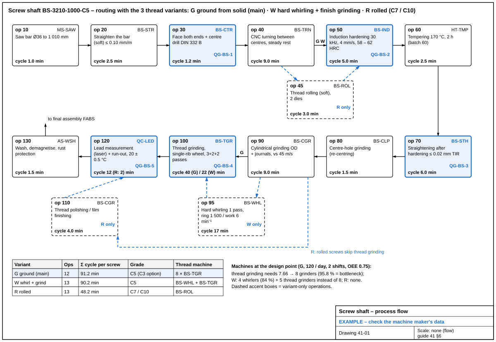

Material: **50CrMo4 +QT** round bar Ø36, peeled, 250 – 300 HB, 1 010 mm per shaft. Quenched and tempered bar is
bought: the core already has its strength; we only harden the surface of the thread zone by induction.

### 6.1 Routing overview (variant G – ground from solid)

| No. | Operation | Machine | Set-up (min) | Cycle (min) | Batch | Effective (min/pc) | Scrap % | Gate |
|---|---|---|---|---|---|---|---|---|
| 10 | Saw the bar to 1 010 mm | `MS-SAW` | 10 | 1.0 | 60 | 1.167 | 0.2 | |
| 20 | Straighten the bar (soft) | `BS-STR` | 5 | 2.5 | 60 | 2.583 | 0.3 | |
| 30 | Face both ends + centre drill | `BS-CTR` | 15 | 1.2 | 60 | 1.450 | 0.1 | QG-BS-1 |
| 40 | CNC turning between centres | `BS-TRN` | 30 | 9.0 | 40 | 9.750 | 0.5 | |
| 50 | Induction hardening of the thread zone | `BS-IND` | 20 | 5.0 | 60 | 5.333 | 1.0 | QG-BS-2 |
| 60 | Tempering (batch furnace) | `HT-TMP` | 0 | 2.5 | 60 | 2.500 | 0.2 | |
| 70 | Straightening after hardening | `BS-STH` | 10 | 6.0 | 60 | 6.167 | 1.5 | QG-BS-3 |
| 80 | Centre-hole grinding | `BS-CLP` | 10 | 1.5 | 60 | 1.667 | 0.1 | |
| 90 | Cylindrical grinding OD + journals | `BS-CGR` | 25 | 9.0 | 40 | 9.625 | 0.5 | |
| 100 | Thread grinding (single-rib wheel) | `BS-TGR` | 45 | 40 | 20 | 42.250 | 1.5 | QG-BS-4 |
| 120 | Lead measurement (laser) + run-out | `QC-LED` | 5 | 12 | 20 | 12.250 | 0.5 | QG-BS-5 |
| 130 | Wash, demagnetise, rust protection | `AS-WSH` | 0 | 1.5 | 60 | 1.500 | 0 | |
| | **Totals** | | | **Σ cycle 91.2** | | **Σ set-up share 5.04** | **yield 93.77 %** | |

Effective time = cycle + set-up / batch. Example op 100: 40 + 45 / 20 = **42.25 min**.

Yield = Π (1 − scrap) = (1 − 0.002) · (1 − 0.003) · … = **0.9377**. To get 120 good shafts we must start
120 / 0.9377 = **128.0 bars** per day.

Variants:

| Variant | Operations that change | Σ cycle (min) | Σ set-up share | Yield | Start qty |
|---|---|---|---|---|---|
| **G** ground from solid (main) | op 100 thread grinding 40 min | 91.2 | 5.04 | 93.77 % | 128.0 |
| **W** hard whirling + finish grinding | + op 95 whirling 17 min (15 cut + 2 handling), op 100 only 2 finish passes 22 min (18 grinding + 4 handling) | 90.2 | 6.38 | 92.83 % | 129.3 |
| **R** rolled (C7 / C10) | + op 45 rolling 3 min, op 110 polishing 4 min, no op 95 / 100, op 120 sample only (2 min) | 48.2 | 3.96 | 94.06 % | 127.6 |

### 6.2 Operation sheets

Each sheet: machine – tool – data – check – typical mistake. The page shows the same sheet in the info panel of the
3D view.

#### Op 10 – Saw the bar to length 1 010 mm (`MS-SAW`, 3D module `saw`)

| Item | Value (example) |
|---|---|
| Machine | automatic bandsaw for bars (shared with the nut bars Ø85) |
| Tool | bi-metal band M42, 3/4 TPI, 34 × 1.1 mm (or carbide band) |
| Data | band speed vc 60 m/min, cutting rate 30 cm²/min, emulsion 6 % |
| Cut time | area = π/4 · 3.6² = 10.18 cm² → t = 10.18 / 30 = **0.34 min**; with feeding + clamping cycle 1.0 min |
| Check | length 1 010 ± 1 mm, cut square ≤ 0.5 mm – steel tape / length stop, square – first part + every 20th |
| Typical mistake | worn band runs off → crooked cut → facing allowance lost, centre drill off-centre |

Why 1 010 mm? Finished length 1 000 mm, 2 × 2 mm facing (op 30 gives 1 004 mm), the rest for the saw-cut variation.
The last 2 × 2 mm carry the centre holes; they are removed at the end machining to the customer drawing.

#### Op 20 – Straighten the bar, soft (`BS-STR`, module `press`)

| Item | Value (example) |
|---|---|
| Machine | hydraulic straightening press 100 kN, 2 V-blocks (span 400 mm), ram with prism insert, 2 rollers + dial gauge |
| Data | 3-point bending, press force ≈ 30 – 50 kN, overbend = spring-back + set; target run-out ≤ 0.10 mm / m |
| Physics | yield force F = 4 · σ_y · W / L = 4 · 700 · 4 580 / 400 = **32.1 kN**; with 1.5 × overbend **48.1 kN** (§16) |
| Check | run-out ≤ 0.10 mm TIR over the length – dial gauge 0.01 mm on 2 rollers – 100 % |
| Typical mistake | over-bending in one place → kink, residual stress → the shaft bends again after turning and hardening |

A bar from the mill can have 0.5 – 1 mm / m bow. A bent bar turned between centres gives an eccentric turned
diameter and uneven stock for the next steps.

#### Op 30 – Face both ends + centre drill (`BS-CTR`, module `centre`)

| Item | Value (example) |
|---|---|
| Machine | facing + centring machine, both ends at the same time, bar clamped in the middle |
| Tool | 2 facing heads with CNMG inserts + centre drill B4 (DIN 332 form B, 60° with protecting cone) |
| Data | facing vc 150 m/min, f 0.15 mm/rev; centre drill 1 500 min⁻¹, f 0.05 mm/rev |
| Check | total length 1 004 ± 0.2 mm, centre depth (Ø at the face) – length gauge, centre-hole gauge – first + every 20th |
| Typical mistake | centre off-axis or damaged → the centres are the datum of **every** later operation: run-out in turning, hardening, grinding |
| Quality gate | **QG-BS-1** centre holes concentric, undamaged, 60° |

#### Op 40 – CNC turning between centres (`BS-TRN`, module `lathe`)

| Item | Value (example) |
|---|---|
| Machine | CNC lathe ≥ 1 200 mm between centres, tailstock, follow / steady rest, driven tools |
| Tools | CNMG 120408 carbide P25 (rough), VNMG 160404 P15 (finish), grooving insert 2 mm, driven end mill Ø6 (key slot) |
| Data rough | vc 200 m/min, f 0.30 mm/rev, ap 1.8 mm |
| Data finish | vc 250 m/min, f 0.12 mm/rev, ap 0.3 mm |
| Sizes | thread zone Ø32.4 (stock 0.2 mm per side for grinding), journals + 0.3 mm |
| Check | Ø thread zone 32.4 ± 0.05, journals, lengths, run-out ≤ 0.05 mm – micrometer, height gauge, dial gauge between centres – first + 1 in 10 |
| Typical mistake | no steady rest at L/D ≈ 31 → chatter marks, taper, bent shaft |

Worked numbers (`turning()` in `bsfmfg_calc.js`):

* Rough: n = 1 000 · vc / (π · d) = 1 000 · 200 / (π · 36) = **1 768 min⁻¹**. Time for 870 mm:
  t = L / (f · n) = 870 / (0.3 · 1 768) = **1.64 min**.
* Metal removal rate Q = vc · ap · f = 200 · 1.8 · 0.3 = **108 cm³/min**. Power P = vc · ap · f · kc / 60 000 / η
  with kc ≈ 2 600 N/mm², η = 0.85 → P = 200 · 1.8 · 0.3 · 2 600 / 60 000 / 0.85 = **5.5 kW**. A 22 kW lathe has margin.
* Finish: n = 1 000 · 250 / (π · 32.4) = **2 456 min⁻¹**, t = 870 / (0.12 · 2 456) = **2.95 min**.
* Journals, grooves, key slot ≈ 1.5 min, handling ≈ 2 min → cycle ≈ 9 min.

Slenderness L/D = 1 000 / 32 ≈ 31. Without support the cutting force pushes the shaft away from the tool in the
middle: the shaft becomes barrel-shaped and chatters. Rule of thumb: above L/D ≈ 10 use a steady rest or a follow
rest.

#### Op 45 – Thread rolling (`BS-ROL`, module `roll`, only variant R)

| Item | Value (example) |
|---|---|
| Machine | 2-die thread rolling machine, through-feed |
| Tool | 2 cylindrical rolling dies Ø200 with the ball-groove profile (multi-start ring dies), DC53 / HSS 60 HRC |
| Data | in-feed + through-feed rolling, die 30 min⁻¹, axial feed ≈ 1 m/min, rolling force ≈ 100 – 150 kN, blank Ø = pitch Ø − allowance |
| Time | 850 mm / 1 000 mm/min = **0.85 min**; with loading and in-feed cycle 3.0 min |
| Check | lead v300 (C7: 50 µm), pitch Ø over balls, OD – lead tester sample, ball micrometer – first + 1 in 20 |
| Typical mistake | blank Ø wrong or die wear → flank shape / Ø error → wrong preload, flaking |

Details in §13.3.

#### Op 50 – Induction hardening of the thread zone (`BS-IND`, module `induction`)

| Item | Value (example) |
|---|---|
| Machine | vertical induction scanning hardening machine, generator 60 kW, 30 kHz |
| Tool | 1-turn copper coil Ø46 ID with integral spray quench ring; shaft rotates between centres (vertical) |
| Data | 30 kHz, used power ≈ 30 – 40 kW, scan speed 4 mm/s, rotation 150 min⁻¹, polymer quench 10 %, 25 °C |
| Result | case 2 – 3 mm, 58 – 62 HRC; journals **not** hardened (they stay machinable and tough) |
| Time | 850 mm / 4 mm/s = **212.5 s**; + 90 s load, position, unload = 302.5 s = **5.04 min** → cycle 5.0 min |
| Check | surface hardness 58 – 62 HRC (Rockwell, ISO 6508), case depth 2 – 3 mm (cut-up + HV1 profile, ISO 18203), no cracks (eddy current / magnetic particle) |
| Frequency | HRC first + 1 in 20; case depth 1 cut-up per shift / new set-up; crack test 100 % |
| Typical mistake | power or scan speed drift, coil not centred → soft spots (spiral soft band), too deep → cracks + distortion, overheated thread run-out |
| Quality gate | **QG-BS-2** |

Physics in §11.

#### Op 60 – Tempering (`HT-TMP`, module `furnace`)

| Item | Value (example) |
|---|---|
| Machine | air-circulation tempering furnace, vertical hanging rack for 60 shafts |
| Data | 170 °C, 2 h at temperature (≈ 2.5 h incl. heat-up); start within 1 h after quenching; optional sub-zero −80 °C before tempering for C3 |
| Cycle | 150 min / 60 shafts = **2.5 machine-minutes per shaft** |
| Check | furnace temperature chart, hardness after temper 58 – 62 HRC – recorder (AMS 2750 style survey), Rockwell – every load |
| Typical mistake | tempering too late → delayed quench cracks; too hot → < 58 HRC → short life |

#### Op 70 – Straightening after hardening (`BS-STH`, module `press`)

| Item | Value (example) |
|---|---|
| Machine | CNC straightening press 100 kN with laser / LVDT run-out measurement on rotating rollers |
| Data | measure → compute bend point + stroke → bend → re-measure (3 – 6 loops); bend mainly in the soft journal zones, small careful strokes in the hardened zone |
| Target | run-out ≤ **0.02 mm** TIR along the thread (from ≈ 0.25 mm after hardening) |
| Check | run-out (built-in laser), crack test by eddy current – 100 % |
| Typical mistake | too large bend stroke in the hardened zone → cracks in the case (scrap); residual stress → bends again in grinding |
| Quality gate | **QG-BS-3** |

Details in §16.

#### Op 80 – Centre-hole grinding (`BS-CLP`, module `centre`)

| Item | Value (example) |
|---|---|
| Machine | centre-hole grinder with a 60° mounted point (corundum / CBN), planetary motion |
| Data | spindle 30 000 min⁻¹, planetary 300 min⁻¹, 0.02 – 0.05 mm per centre |
| Check | centre roundness ≤ 1 µm, contact pattern ≥ 80 % – blue-ink test on a master centre – first + 1 in 20 |
| Typical mistake | dirty or scaled centre left → all ground diameters run out → journal run-out not to C5 |

#### Op 90 – Cylindrical grinding: thread OD + journals (`BS-CGR`, module `cylgrind`)

| Item | Value (example) |
|---|---|
| Machine | CNC cylindrical grinder, 1 000 mm between centres, in-process gauge |
| Wheel | vitrified corundum 89A 60 K7 V, Ø500 × 63 (or CBN B126), diamond roll dresser |
| Data | vs 45 m/s (n = 45 · 60 000 / (π · 500) = **1 719 min⁻¹**), work 150 min⁻¹ (vw = π · 32 · 150 / 60 000 = **0.25 m/s**), plunge 0.005 mm/rev rough, 0.001 mm/rev finish + spark-out, oil / emulsion filtered 10 µm, dress every 10 parts |
| Check | journal Ø h5, roundness ≤ 2 µm, journal run-out ≤ 3 µm, no burn – in-process gauge (100 %), roundness tester, nital etch or Barkhausen noise (1 in 20) |
| Typical mistake | dull wheel, too fast in-feed → grinding burn (tempered or re-hardened layer) → cracks, flaking |

Burn physics in §18.5.

#### Op 95 – Hard whirling (`BS-WHL`, module `whirl`, only variant W)

| Item | Value (example) |
|---|---|
| Machine | hard whirling machine |
| Tool | whirling ring with 6 CBN / carbide inserts with the gothic-arch form; ring tilted by the lead angle 5.51° |
| Data | ring 1 500 min⁻¹ (vc ≈ 150 – 200 m/min on 60 HRC), work 6 min⁻¹, axial feed = Ph · n = 10 · 6 = **60 mm/min**, dry or MQL, 1 pass full depth |
| Time | (850 + 50) / 60 = **15 min** cutting + 2 min load / probe = **17 min** cycle (set-up 40 min per batch of 30) |
| Check | profile + pitch Ø over balls, lead v300 sample – ball micrometer, contour tester – first + 1 in 10 |
| Typical mistake | insert edge chipping not detected → groove form error, white layer → must be ground |

Details in §13.

#### Op 100 – Thread grinding (`BS-TGR`, module `threadgrind`, variants G and W)

| Item | Value (example) |
|---|---|
| Machine | CNC external thread grinder for ball screws ≤ 1.5 m |
| Wheel | single-rib vitrified corundum wheel Ø400 × 12 (or CBN B91); gothic-arch form dressed by a CNC diamond disc; wheel head tilted by the lead angle 5.51° |
| Data | vs 40 m/s (n = 40 · 60 000 / (π · 400) = **1 910 min⁻¹**); work speed rough 40 / semi 20 / finish 10 min⁻¹ → table feed = Ph · n = 400 / 200 / 100 mm/min; passes 3 + 2 + 2; radial infeed 0.30 / 0.08 / 0.02 mm; grinding oil 20 ± 0.5 °C, 200 l/min; dress before finishing; lead compensation (thermal + T value) |
| Time G | 3 · 900/400 + 2 · 900/200 + 2 · 900/100 = 6.75 + 9 + 18 = **33.75 min** grinding + 6.25 min load, dress, probe = **40 min** |
| Time W | only 2 finish passes: 2 · 900/100 = **18 min** grinding + 4 min load / dress / probe = 22 min cycle |
| Check | pitch Ø over balls, profile (contact angle 45°), in-process lead probe – ball-pin micrometer, contour tester, probe – 100 % in-process, profile 1 in 10 |
| Typical mistake | oil temperature drifts 1 K → lead grows 10 µm over 850 mm → C5 (e_p ± 35 µm) lost; worn wheel profile → wrong contact angle |
| Quality gate | **QG-BS-4** |

This is the **bottleneck** of the whole plant: 8 machines at 95.8 % (§19). Details in §12.

#### Op 110 – Thread polishing / super-finishing (`BS-CGR`, module `cylgrind`, only variant R)

| Item | Value (example) |
|---|---|
| Machine | cylindrical grinder with a follow fixture (or a separate polishing machine) |
| Tool | abrasive film / polishing stones |
| Data | work 300 min⁻¹, film 30 µm → 9 µm, oil |
| Check | Ra ≤ 0.4 µm in the groove – roughness tester – 1 in 20 |
| Typical mistake | film not changed → rough groove → noise, wear |

#### Op 120 – Lead measurement (laser) + run-out (`QC-LED`, module `lead`)

| Item | Value (example) |
|---|---|
| Machine | lead measuring machine: screw between centres, ball probe follows the groove, laser interferometer (Renishaw XL-80 class) + rotary encoder |
| Data | room 20 ± 0.5 °C, screw soaked ≥ 4 h, material temperature sensor, measure every 1 – 5 mm over the useful travel; evaluate e_p, v_up, v_300, v_2π (ISO 3408-3) |
| Cycle | G / W: 12 min (100 %), R: 2 min (sample) |
| Spec C5 | e_p ± 35 µm, v_up 25 µm (l_u 700), v_300 18 µm, v_2π 8 µm |
| Typical mistake | screw not at 20 °C → false reject / false accept (10 µm per K over 850 mm) |
| Quality gate | **QG-BS-5** |

Details in §17.

#### Op 130 – Wash, demagnetise, rust protection (`AS-WSH`, module `wash`)

| Item | Value (example) |
|---|---|
| Machine | through-feed washer: alkaline wash 55 °C, rinse, hot-air dry, demagnetising tunnel, oil mist (shared by all routes) |
| Data | belt 1 m/min, residual magnetism ≤ 0.3 mT, cleanliness ≤ 1 mg per part (example) |
| Check | residual magnetism, visual cleanliness – Gauss meter – 1 in 20 |
| Typical mistake | magnetised shaft → chips stick in the groove → noise, early wear |

### 6.3 Why ground from solid (G) is the main route

| Route | + | − | Typical grade |
|---|---|---|---|
| G ground from solid (hardened first, then the whole groove ground) | best lead + profile, no soft pre-cut, no distortion after grinding | long grinding time (40 min), expensive machines | C1 – C5 |
| W hard whirling + finish grinding | stock removed in 15 min (17 min cycle) with a cheaper tool; grinding only 18 min (22 min cycle) | extra machine type, insert cost, white layer must be ground off | C3 – C5 (C7 whirled only) |
| Soft pre-cut + harden + grind (not in our data) | short grinding | distortion of the groove in hardening, uneven case at the groove bottom | C5 – C7 |
| R rolled before hardening | fastest (3 min), cheapest, cold-worked surface | lead changes in hardening + straightening, profile less exact | C7 – C10 |

Our design point uses G: 8 thread grinders. With W the plant needs 5 thread grinders + 4 whirling machines
(73 machines in total, §19.5). This is a classic investment decision for the business plan (§25).

---

## 7. Ball nut routing `BN-3210-FL`

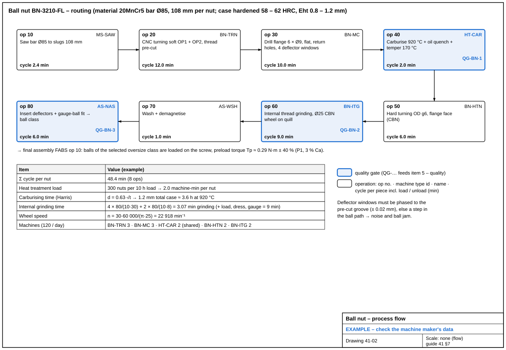

Material: **20MnCr5** round bar Ø85, 108 mm per nut. A case-hardening steel (≈ 0.2 % C): soft and tough core, hard
carburised surface.

### 7.1 Routing overview

| No. | Operation | Machine | Set-up | Cycle | Batch | Effective | Scrap % | Gate |
|---|---|---|---|---|---|---|---|---|
| 10 | Saw the bar Ø85 to slugs 108 mm | `MS-SAW` | 10 | 2.4 | 120 | 2.483 | 0.2 | |
| 20 | CNC turning soft OP1 + OP2, thread pre-cut | `BN-TRN` | 45 | 12.0 | 40 | 13.125 | 0.8 | |
| 30 | Drill flange, mill flat, return holes, deflector windows, tap | `BN-MC` | 40 | 10.0 | 40 | 11.000 | 0.8 | |
| 40 | Carburise + harden + temper | `HT-CAR` | 0 | 2.0 | 300 | 2.000 | 1.0 | QG-BN-1 |
| 50 | Hard turning: flange face, OD, bore lands | `BN-HTN` | 30 | 6.0 | 40 | 6.750 | 0.5 | |
| 60 | Internal thread grinding | `BN-ITG` | 40 | 9.0 | 30 | 10.333 | 1.5 | QG-BN-2 |
| 70 | Wash + demagnetise | `AS-WSH` | 0 | 1.0 | 120 | 1.000 | 0 | |
| 80 | Insert deflectors + gauge-ball fit | `AS-NAS` | 10 | 6.0 | 40 | 6.250 | 0.5 | QG-BN-3 |
| | **Totals** | | | **Σ 48.4** | | **Σ set-up share 4.54** | **yield 94.81 %** | start 126.6 / day |

### 7.2 Operation sheets

#### Op 10 – Saw (`MS-SAW`, module `saw`)

Bi-metal band M42 2/3 TPI, vc 50 m/min, 30 cm²/min. Cut time = π/4 · 8.5² / 30 = 56.7 / 30 = **1.89 min**; cycle
2.4 min. Check length 108 ± 0.5 (caliper, first + 1 in 50). Mistake: burr left on the slug → the chuck clamps wrong →
run-out.

#### Op 20 – CNC turning soft, OP1 + OP2 (`BN-TRN`, module `lathe`)

| Item | Value (example) |
|---|---|
| Machine | turning centre with main + sub-spindle and driven tools |
| Tools | U-drill Ø30, boring bar, CNMG / DNMG P25, internal thread pre-cutting bar with gothic-arch insert (stock 0.2 mm), sub-spindle for OP2 |
| Data | turning vc 220 m/min, f 0.25 mm/rev, ap 2; drilling vc 150 m/min, f 0.10; thread pre-cut 12 passes, vc 120 m/min |
| Check | bore Ø, OD Ø50.4, flange, length, thread pitch Ø (pre-cut) – bore gauge, micrometer, thread ball gauge – first + 1 in 10 |
| Typical mistake | uneven thread pre-cut stock → long grinding time or unground black spots after grinding |

Why pre-cut the nut thread soft but not the screw? The nut thread is short (≈ 80 mm with run-outs). The small
internal wheel (§14) removes material slowly. A soft pre-cut leaves only 0.2 mm – the internal grinding then takes
minutes, not an hour. The carburising distortion of a short, thick nut is small and even.

#### Op 30 – Drill, mill, windows (`BN-MC`, module `mill`)

| Item | Value (example) |
|---|---|
| Machine | vertical machining centre with 4th axis (rotary table), probe |
| Tools | carbide drill Ø9 (6 flange holes), end mill Ø16 (flat at 62 mm), end mill Ø6 (4 deflector windows), tap M6 (grease hole) |
| Data | drill vc 80 m/min, f 0.15 mm/rev; mill vc 180 m/min, fz 0.05 mm; windows ± 0.02 mm to the thread phase (probe the groove first) |
| Check | hole position, window position to the groove (angle + axial) – CMM sample, window position gauge – first + 1 in 20 |
| Typical mistake | window not phased to the pre-cut groove → step in the ball path → noise, ball jam, deflector break |

The 4 windows are the 4 deflector seats, one per circuit. Each window must sit exactly where the ball must leave the
groove after one turn. The probe first measures the angular position of the pre-cut groove; the CNC then turns the
4th axis to this phase.

#### Op 40 – Carburise + harden + temper (`HT-CAR`, module `furnace`)

| Item | Value (example) |
|---|---|
| Machine | sealed-quench (integral quench) furnace + washer + tempering furnace; baskets of 300 nuts per load |
| Data | carburise 920 °C, carbon potential 1.1 → 0.8 %C, ≈ 5 h; harden 840 °C, oil quench 60 °C, wash, temper 170 °C 2 h |
| Result | Eht 0.8 – 1.2 mm (550 HV), 58 – 62 HRC |
| Cycle | load ≈ 10 h = 600 min / 300 nuts = **2.0 min per nut** (3 shifts) |
| Check | surface hardness, case depth Eht, core hardness, retained austenite ≤ 15 %, distortion (bore ovality) – Rockwell, HV1 profile on a test piece (ISO 18203), microscope, X-ray diffraction sample – every load |
| Typical mistake | carbon potential too low / time too short → thin case → flaking under the balls; too much retained austenite → size change in service |
| Quality gate | **QG-BN-1** |

Physics in §11.3.

#### Op 50 – Hard turning (`BN-HTN`, module `lathe`)

| Item | Value (example) |
|---|---|
| Machine | precision hard-turning lathe (hydrostatic or very stiff slide) |
| Tool | CBN insert (low CBN content, chamfered edge) |
| Data | vc 180 m/min, f 0.08 mm/rev, ap 0.10 mm, dry |
| Check | OD g6, flange face run-out ≤ 5 µm to the bore – air gauge (100 %), run-out on a mandrel (1 in 10) |
| Typical mistake | worn CBN edge → white layer, size drift, face run-out → nut tilts on the table |

Details in §14.5.

#### Op 60 – Internal thread grinding (`BN-ITG`, module `intgrind`)

| Item | Value (example) |
|---|---|
| Machine | CNC internal thread grinder for ball nuts |
| Wheel | CBN B76 vitrified, Ø25 × 6 on a 120 mm quill; gothic-arch form dressed by a diamond disc; quill tilted by the lead angle |
| Data | vs 30 m/s → n = 30 · 60 000 / (π · 25) = **22 918 min⁻¹**; work rough 30 / finish 8 min⁻¹ (table 300 / 80 mm/min); passes 4 + 2; infeed 0.04 / 0.01 mm; oil 20 ± 1 °C |
| Grinding time | 4 · 80/300 + 2 · 80/80 = 1.07 + 2.0 = **3.07 min**; dressing, infeed moves, gauging, loading ≈ 6 min → cycle 9 min |
| Check | pitch Ø over 2 balls, profile, lead over the nut length – internal ball gauge (100 %), contour tester (1 in 10), master screw fit |
| Typical mistake | quill deflection (long, thin quill) → thread tapers (bell-mouth) → load only on one circuit → short life |
| Quality gate | **QG-BN-2** |

Details in §14.

#### Op 70 – Wash + demagnetise (`AS-WSH`, module `wash`)

Through-feed washer as screw op 130, cycle 1.0 min. Mistake: grinding sludge left in the return holes → balls jam,
noise.

#### Op 80 – Insert deflectors + gauge-ball fit (`AS-NAS`, module `bench`)

| Item | Value (example) |
|---|---|
| Machine | nut assembly bench: press-in tool for the 4 deflectors, master screw + gauge balls in 1 µm classes, LVDT |
| Data | deflector pressed ≤ 0.5 kN, flush ≤ 0.01 mm to the groove; measure axial play with gauge balls → choose the oversize class for P1 (3 % Ca = 1 140 N) |
| Check | deflector step-free, axial play → ball class – LVDT on the master screw, feeler – 100 % |
| Typical mistake | deflector not fully seated → ball jam → sudden lock of the axis |
| Quality gate | **QG-BN-3** |

How the ball class is found: on the master screw, with gauge balls of known size, the nut shows an axial play. A
bigger ball closes this play; with 4-point contact and oversize the balls become preloaded. The exact relation "play
→ ball class" depends on the gothic-arch conformity and the contact angle, so the bench software uses a table that
is **calibrated** with nuts of measured preload torque (§17.7). The real balls for the real shaft are loaded in final
assembly (§10).

---

## 8. Rail routing `LG-25-1000`

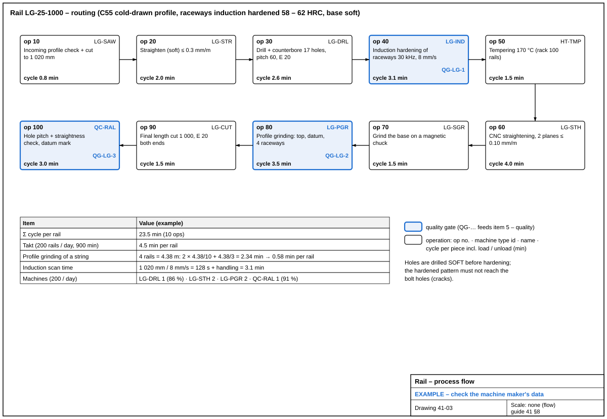

Material: **C55** cold-drawn rail profile size 25, bought from a profile mill in 4 m bars, cut to 1 020 mm blanks.
The drawn profile is already close to the final shape (raceway notches, side grooves). We do not mill the profile –
this would cost too much material and time.

### 8.1 Routing overview

| No. | Operation | Machine | Set-up | Cycle | Batch | Effective | Scrap % | Gate |
|---|---|---|---|---|---|---|---|---|
| 10 | Incoming profile check + cut to 1 020 mm | `LG-SAW` | 10 | 0.8 | 100 | 0.900 | 0.3 | |
| 20 | Straighten (soft) | `LG-STR` | 5 | 2.0 | 100 | 2.050 | 0.2 | |
| 30 | Drill + counterbore 17 holes | `LG-DRL` | 20 | 2.6 | 100 | 2.800 | 0.3 | |
| 40 | Induction hardening of the raceway shoulders | `LG-IND` | 20 | 3.1 | 100 | 3.300 | 0.8 | QG-LG-1 |
| 50 | Tempering | `HT-TMP` | 0 | 1.5 | 100 | 1.500 | 0.2 | |
| 60 | Straightening after hardening (2 planes) | `LG-STH` | 10 | 4.0 | 100 | 4.100 | 0.8 | |
| 70 | Grind the base (magnetic chuck) | `LG-SGR` | 15 | 1.5 | 100 | 1.650 | 0.3 | |
| 80 | Profile grinding (multi-head) | `LG-PGR` | 60 | 3.5 | 100 | 4.100 | 1.0 | QG-LG-2 |
| 90 | Final length cut 1 000 mm + chamfer | `LG-CUT` | 10 | 1.5 | 100 | 1.600 | 0.3 | |
| 100 | Hole pitch + straightness check, mark, wash, oil | `QC-RAL` | 5 | 3.0 | 100 | 3.050 | 0.3 | QG-LG-3 |
| | **Totals** | | | **Σ 23.5** | | **Σ 1.55** | **yield 95.59 %** | start 209.2 / day |

### 8.2 Operation sheets

#### Op 10 – Profile check + cut (`LG-SAW`, module `saw`)

Circular cold saw Ø350, HSS-Co or carbide-tipped, vc 120 m/min (carbide), 0.05 mm/tooth, emulsion. Check profile
width / height and twist for every bar lot, length 1 020 ± 1 (first + 1 in 50). Mistake: twisted profile not detected
→ grinding stock not enough → black spots.

#### Op 20 – Straighten soft (`LG-STR`, module `press`)

Rail straightening press with 2 supports + ram, vertical and horizontal, ≈ 20 – 40 kN, target ≤ 0.3 mm / m in both
planes, 100 % with straight edge + feeler / laser. Mistake: over-bending → residual stress → banana after hardening.

#### Op 30 – Drill + counterbore 17 holes (`LG-DRL`, module `raildrill`)

| Item | Value (example) |
|---|---|
| Machine | CNC rail drilling centre (gantry, 2 spindles) |
| Tool | carbide step drill Ø7 / counterbore Ø11 × 9 (one tool) |
| Data | vc 90 m/min, f 0.12 mm/rev, internal coolant 20 bar; pitch ± 0.05 mm (soft) |
| Holes | (1 000 − 2 · 20) / 60 + 1 = **17 holes**, E = 20 mm from both final ends (the blank is 1 020 mm, so the pattern starts 10 mm further in) |
| Check | hole pitch, counterbore depth, burr-free – pitch gauge bar, depth gauge – first + 1 in 20 |
| Typical mistake | burr in the counterbore, wrong reference end → bolt head not flush, cumulative pitch error → rails do not fit the customer bed |

The holes are drilled **before** hardening because the base stays soft – only the raceway shoulders are hardened.

#### Op 40 – Induction hardening of the raceway shoulders (`LG-IND`, module `railind`)

| Item | Value (example) |
|---|---|
| Machine | horizontal through-feed induction line for rails |
| Tool | 2 profiled hairpin coils (left + right shoulder) + spray quench; the rail is pushed through on rollers |
| Data | 30 kHz, ≈ 80 kW, feed 8 mm/s, polymer quench; case 1.5 – 2.5 mm, 58 – 62 HRC, base stays soft |
| Time | 1 020 / 8 = **127.5 s** + 60 s handling = 187.5 s = **3.1 min** |
| Check | hardness, hardened pattern (macro etch), base soft – Rockwell / HV (first + 1 in 20), macro-etch cut-up (1 per shift) |
| Typical mistake | pattern reaches the bolt-hole area → cracks from the holes, large banana distortion |
| Quality gate | **QG-LG-1** |

#### Op 50 – Tempering (`HT-TMP`, module `furnace`)

Same furnace as the screws, rack of 100 rails, 170 °C 2 h (≈ 2.5 h incl. heat-up) → 150 / 100 = **1.5 min per rail**.

#### Op 60 – Straightening after hardening (`LG-STH`, module `press`)

CNC rail straightening press 150 kN with laser measurement vertical + horizontal. Measure → bend → re-measure, target
≤ 0.10 mm / m in both planes, 100 %. Mistake: bending on a hole (weak section) → crack at the hole, kink.

#### Op 70 – Grind the base (`LG-SGR`, module `surfgrind`)

Surface grinder, corundum wheel 89A 46 J Ø400 × 50, magnetic chuck 2 000 × 500 (8 rails). vs 30 m/s, table 15 m/min,
cross feed 10 mm, ap 0.01 mm, 0.1 mm stock. Check base flatness and height to the top (dial gauge on a surface plate,
first + 1 in 20). **Typical mistake**: the magnet pulls the bent rail flat; it is ground flat while clamped; after
unclamping it springs back → straightness lost. Remedy: straighten well before (op 60), shim the rail on the chuck,
use low magnet power for the finishing pass.

#### Op 80 – Profile grinding (`LG-PGR`, module `profgrind`)

| Item | Value (example) |
|---|---|
| Machine | linear-guide rail profile grinder, multi-head, 4.5 m table |
| Heads | (1) top + datum side, (2) left raceways form wheel, (3) right raceways form wheel |
| Wheels | vitrified corundum form wheels Ø350, CNC diamond profile roll dressing |
| Data | vs 35 m/s, table 10 m/min rough / 3 m/min finish, 2 + 1 passes, 4 rails in a string, dress every string (Ud ≈ 3) |
| Time | string length 4 · 1.02 + 0.3 = 4.38 m; 2 · 4.38/10 + 1 · 4.38/3 = **2.34 min per string = 0.58 min per rail** of pure grinding; loading, aligning, dressing, measuring → cycle 3.5 min per rail |
| Check | raceway height + width over gauge balls, profile radius, running parallelism – comparator gauge with master rail + gauge balls (100 %), contour tester (1 per string), block + electronic probe along the rail (1 in 10) |
| Typical mistake | dressing roll worn, wheel profile not re-dressed → wrong raceway radius → contact angle + preload wrong, block runs rough |
| Quality gate | **QG-LG-2** |

The pure grinding is only 0.58 of the 3.5 min. Handling dominates – this is where automation (string loading by a
gantry) pays back first. Details in §15.

#### Op 90 – Final length cut (`LG-CUT`, module `saw`)

Precision abrasive / carbide cut-off + end-face mill, length stop to the hole pattern: E = 20 mm both ends
(symmetric), length 1 000 ± 0.5, chamfer 0.5 × 45°. 100 % length gauge to the first hole. Mistake: cut from the wrong
end → E not symmetric → rails do not butt-join.

Why cut **after** grinding? The grinder supports the ends better on a longer blank, and the ends of a ground string
have small run-in / run-out errors that are cut away.

#### Op 100 – Hole pitch + straightness check, mark (`QC-RAL`, module `railcheck`)

Rail measuring bench (linear stage + camera / probe), electronic level, marker. Hole pitch 60 ± 0.2 cumulative,
straightness + running parallelism class H (13 µm / 700 mm), mark datum side + class + serial; wash, oil. 100 %.
Mistake: rail measured warm from the grinder → false class. Quality gate **QG-LG-3**.

---

## 9. Carriage routing `LB-25-FL`

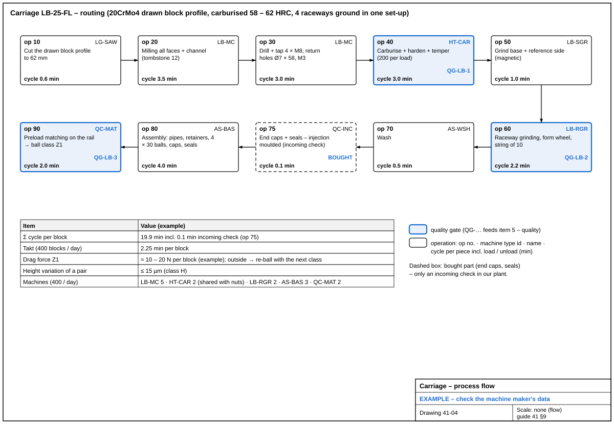

Material: **20CrMo4** cold-drawn / forged block profile (bought), 62 mm per body. Like the nut: a case-hardening
steel, carburised.

### 9.1 Routing overview

| No. | Operation | Machine | Set-up | Cycle | Batch | Effective | Scrap % | Gate |
|---|---|---|---|---|---|---|---|---|
| 10 | Cut the drawn block profile to 62 mm | `LG-SAW` | 10 | 0.6 | 200 | 0.650 | 0.2 | |
| 20 | Milling all faces + flange + channel (tombstone, 12 blocks) | `LB-MC` | 60 | 3.5 | 120 | 4.000 | 0.5 | |
| 30 | Drill + tap 4 × M8, return holes, M3, nipple | `LB-MC` | 20 | 3.0 | 120 | 3.167 | 0.5 | |
| 40 | Carburise + harden + temper | `HT-CAR` | 0 | 3.0 | 200 | 3.000 | 1.0 | QG-LB-1 |
| 50 | Grind base + reference side | `LB-SGR` | 15 | 1.0 | 200 | 1.075 | 0.3 | |
| 60 | Raceway grinding (internal form grinding) | `LB-RGR` | 45 | 2.2 | 200 | 2.425 | 1.0 | QG-LB-2 |
| 70 | Wash | `AS-WSH` | 0 | 0.5 | 200 | 0.500 | 0 | |
| 75 | End caps + seals – injection moulded (**bought**, incoming check on our side) | `QC-INC` | 0 | 0.1 | 400 | 0.100 | 0 | |
| 80 | Block assembly | `AS-BAS` | 10 | 4.0 | 100 | 4.100 | 0.3 | |
| 90 | Preload matching on the rail | `QC-MAT` | 5 | 2.0 | 100 | 2.050 | 0.3 | QG-LB-3 |
| | **Totals** (without op 75) | | | **Σ 19.8** | | **Σ 1.17** | **yield 95.97 %** | start 416.8 / day |

### 9.2 Operation sheets

#### Op 10 – Cut (`LG-SAW`, module `saw`)

Circular cold saw shared with the rail, vc 120 m/min carbide, emulsion. Length 62 ± 0.3. Mistake: burr → wrong
clamping on the tombstone.

#### Op 20 – Milling on the HMC (`LB-MC`, module `mill`)

| Item | Value (example) |
|---|---|
| Machine | horizontal machining centre with pallet changer + tombstones (12 blocks per tombstone) |
| Tools | face mill Ø80 (carbide), form cutter for the channel, chamfer mill |
| Data | vc 220 m/min, fz 0.15 mm, ap 2 mm; channel rough with 0.25 mm grinding stock |
| Check | width 70, height, channel width + stock – micrometer, height gauge – first + 1 in 20 |
| Typical mistake | chips under the block on the tombstone → height error → grinding stock uneven |

Why a tombstone? 12 blocks per clamping: the tool changes and rapid moves are shared by 12 parts. The pallet
changer loads the next tombstone while the machine cuts.

#### Op 30 – Drilling on the HMC (`LB-MC`, module `mill`)

Carbide drill Ø6.8 + tap M8 (4 table holes), long carbide drill Ø7 with internal coolant 40 bar (4 return holes
Ø7 × 58), drill Ø2.5 + tap M3 (end-cap screws), nipple hole. Drill vc 80 m/min, f 0.12 mm/rev. Check hole positions
(CMM sample, plug gauges). Mistake: return hole drifts (long drill) → ball path step at the end cap → noise.

Two operations run on the same machine type: `LB-MC` carries the load of op 20 **and** op 30 (§19).

#### Op 40 – Carburise (`HT-CAR`, module `furnace`)

Shared furnace line with the nut, 200 blocks per load, 920 °C carburise, 840 °C oil quench, temper 170 °C;
Eht 0.8 – 1.0 mm, 58 – 62 HRC. 600 min / 200 = **3.0 min per block**. Check hardness, Eht, distortion of the channel
every load. Mistake: blocks packed too tight in the basket → soft spots, uneven case. Gate **QG-LB-1**.

#### Op 50 – Grind base + reference side (`LB-SGR`, module `surfgrind`)

Surface grinder, corundum wheel, magnetic chuck with 20 blocks, vs 30 m/s, table 15 m/min, ap 0.01 mm. Check base
flatness and reference side square. Mistake: chuck not cleaned → tilt → block height variation.

#### Op 60 – Raceway grinding (`LB-RGR`, module `blockgrind`)

| Item | Value (example) |
|---|---|
| Machine | block raceway grinder (internal form grinding, string fixture) |
| Wheel | form wheel Ø80 (CBN or corundum) inside the channel, grinding 2 raceways per side |
| Fixture | blocks clamped in a string of 10 on a dummy-rail fixture |
| Data | vs 30 m/s (CBN 45 m/s), table 3 m/min, 3 passes, dressing by diamond roll every string |
| Check | raceway height + width over gauge balls vs master rail (100 %), profile (1 per string) |
| Typical mistake | string clamping distorts the blocks → height variation between blocks > class H (15 µm) |
| Quality gate | **QG-LB-2** |

#### Op 70 – Wash (`AS-WSH`, module `wash`), 0.5 min per block.

#### Op 75 – End caps + seals (bought, `QC-INC`, module `mould`)

The supplier moulds the end caps on an 80 t injection moulding machine with a 4-cavity tool (POM / PA66). We do an
incoming check: ball path step, flash, dimensions (AQL 0.65 sample). This operation has no capacity load in our
plant (`buy: true`). Mistake at the supplier: flash in the ball turn-around → ball jam, noise.

#### Op 80 – Block assembly (`AS-BAS`, module `bench`)

Assembly bench with dummy rail, ball counting feeder, screwdriver with torque control. Return pipes, 4 retainers,
4 × 30 balls of the selected size class, 2 end caps (screws 0.6 N·m), seals, nipple, grease 1.5 cm³. Check ball
count and smooth running on the dummy rail. Mistake: one ball missing or wrong class → uneven load, noise, low
rigidity.

#### Op 90 – Preload matching (`QC-MAT`, module `match`)

| Item | Value (example) |
|---|---|
| Machine | matching station: block on a master rail section, force sensor, height probe |
| Data | drag force Z1 ≈ 10 – 20 N (example), height H ± 0.04 (class H); if outside → re-ball with the next size class |
| Check | drag force, height H, height variation of the pair – 100 % |
| Typical mistake | rail section worn → wrong preload class shipped |
| Quality gate | **QG-LB-3** |

Preload of a ball guide = negative clearance between ball and raceways. Bigger balls → more preload → higher drag
force. The block body is ground to a tolerance; the ball class (1 µm steps) "tunes" the preload. This is how a block
is **selected to a rail by ball size class**.

---

## 10. Final assembly + packing

### 10.1 Ball screw set (`FABS`, 120 sets per day)

| No. | Operation | Machine | Set-up | Cycle | Batch | Effective | Scrap % | Gate |
|---|---|---|---|---|---|---|---|---|
| 10 | Ball loading of the nut onto the screw + preload torque check | `AS-BSA` | 10 | 10.0 | 20 | 10.500 | 0.5 | QG-FA-1 |
| 20 | Seals, snap rings, grease fill | `AS-BSA` | 0 | 3.0 | 20 | 3.000 | 0 | |
| 30 | Run-in + torque chart + noise check | `AS-RUN` | 5 | 6.0 | 20 | 6.250 | 0.3 | QG-FA-2 |
| 40 | Laser marking | `AS-MRK` | 0 | 0.5 | 20 | 0.500 | 0 | |
| 50 | Rust protection + packing | `AS-PCK` | 0 | 3.0 | 20 | 3.000 | 0 | |
| | **Totals** | | | **Σ 22.5** | | **Σ 0.75** | **yield 99.20 %** | start 121.0 |

**Op 10 – Ball loading + preload torque** (module `assy`). Ball loading sleeve (arbor) with the 60 balls of the
selected oversize class; the nut slides from the sleeve onto the screw. Torque tester: the screw turns at 60 min⁻¹,
the nut is held by a force arm. Dynamic preload torque Tp ≈ **0.29 N·m ± 40 %** (P1, example) → window
0.175 – 0.409 N·m (§17.7). Mistake: wrong ball class → too high (heat, short life) or too low (backlash).

**Op 20 – Seals, grease.** Seal press-in tool, grease dosing gun, 3.5 cm³ lithium-complex NLGI 2. Mistake: seal lip
turned over → dirt inside, grease leaks.

**Op 30 – Run-in** (module `runin`). Run-in stand: servo, torque sensor, microphone / accelerometer. 10 strokes at
500 min⁻¹ (= 5 m/min with lead 10), torque chart, noise limit (example 65 dB(A)). Mistake: running dry → false torque
peaks, wear.

**Op 40 – Laser marking** (module `mark`). Fibre laser 20 W; code, serial, grade, date on the nut flange + shaft end;
the data comes from the MES over HTTP. Mistake: wrong serial → lead certificate does not match the screw.

**Op 50 – Packing** (module `pack`). Oil dip, VCI film, plastic tube, supports every 300 mm; lead chart + test report
in the box. Mistake: packed without supports → bent in transport.

### 10.2 Guide set (`FALG`, 200 sets per day)

| No. | Operation | Machine | Set-up | Cycle | Batch | Effective | Scrap % | Gate |
|---|---|---|---|---|---|---|---|---|
| 10 | Set assembly: 2 matched blocks on the rail, drag force + parallelism | `AS-GAS` | 5 | 3.0 | 50 | 3.100 | 0.2 | QG-FA-3 |
| 20 | Laser marking rail + blocks | `AS-MRK` | 0 | 1.1 | 50 | 1.100 | 0 | |
| 30 | Rust protection + packing | `AS-PCK` | 0 | 2.5 | 50 | 2.500 | 0 | |
| | **Totals** | | | **Σ 6.6** | | **Σ 0.10** | **yield 99.80 %** | start 200.4 |

Op 10: both blocks of the same preload + height class on one rail; drag force per block, running parallelism class H,
height variation of the pair ≤ 15 µm. Op 20: datum mark on the rail end, serial on the blocks (mistake: datum mark on
the wrong side → the customer mounts the wrong side to the shoulder). Op 30: oil spray, VCI bag, wood profile,
blocks on the dummy rail, hole caps in a bag (mistake: block slides off the dummy rail → balls fall out).

---

## 11. Heat treatment

All raceways (screw groove, nut groove, rail raceways, block raceways) must be **58 – 62 HRC** hard. A softer raceway
gets dents (brinelling) and flakes early: the rolling contact stress under a ball is 2 000 – 4 000 MPa (guide 40 §6.6).
Two different methods are used:

| Part | Steel | Method | Why |
|---|---|---|---|
| Screw shaft | 50CrMo4 (0.5 % C) +QT | **induction hardening** of the thread zone | long part: only the surface of the thread zone, little distortion, journals stay soft |
| Rail | C55 (0.55 % C) | **induction hardening** of the raceway shoulders | long part, base must stay soft for the bolt holes |
| Nut | 20MnCr5 (0.2 % C) | **carburising** + hardening | short thick part, hard all around the bore, tough core; low-carbon steel needs carbon added |
| Block | 20CrMo4 (0.2 % C) | **carburising** + hardening | same |

Steel can be hardened only if it has enough carbon (≥ ≈ 0.4 % for ≥ 58 HRC). Medium-carbon steels (50CrMo4, C55) are
hardened directly. Low-carbon steels (20MnCr5, 20CrMo4) get carbon diffused into the surface first.

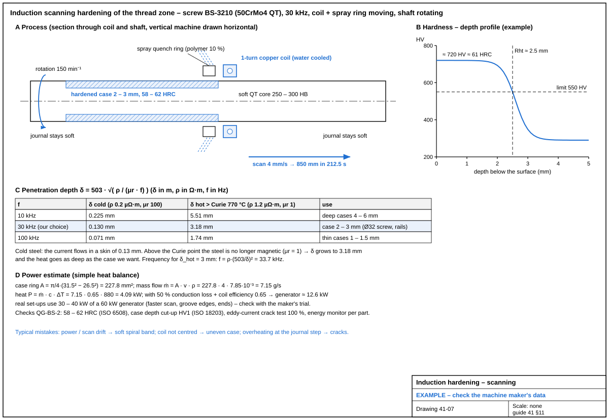

### 11.1 Induction hardening – how it works

An alternating current (here 30 kHz) flows in a copper coil around the part. It induces **eddy currents** in the
surface of the steel. The eddy currents heat the surface in seconds to ≈ 900 °C (austenite). Right behind the coil a
spray ring quenches the hot zone with polymer solution: austenite becomes **martensite** – hard. The core stays cool
and keeps its QT structure (250 – 300 HB). In **scanning** the coil moves along the rotating shaft (4 mm/s).

### 11.2 Penetration depth – which frequency?

The eddy current is strongest at the surface and falls exponentially. The depth where it has dropped to 1/e (37 %)
is the **penetration depth** δ:

  **δ = 503 · √( ρ / (μr · f) )**  (δ in m, ρ in Ω·m, f in Hz)

ρ = electrical resistivity, μr = relative magnetic permeability, f = frequency. Both ρ and μr change when the steel
heats up. Above the Curie temperature (≈ 770 °C) steel is no longer magnetic (μr = 1) and ρ is about 6 × higher.

| State | ρ (Ω·m) | μr | f | δ |
|---|---|---|---|---|
| cold steel | 2.0 · 10⁻⁷ | 100 | 30 kHz | 503 · √(2.0e-7 / (100 · 30 000)) = **0.13 mm** |
| hot steel (> Curie) | 1.2 · 10⁻⁶ | 1 | 30 kHz | 503 · √(1.2e-6 / 30 000) = **3.18 mm** |
| hot steel | 1.2 · 10⁻⁶ | 1 | 10 kHz | **5.51 mm** |
| hot steel | 1.2 · 10⁻⁶ | 1 | 3 kHz | 10.06 mm |
| hot steel | 1.2 · 10⁻⁶ | 1 | 100 kHz | 1.74 mm |
| hot steel | 1.2 · 10⁻⁶ | 1 | 200 kHz | 1.23 mm |

What this means: at the start the cold surface heats in a very thin layer (0.13 mm). When the surface passes the
Curie point, δ jumps to ≈ 3.2 mm and the heat goes deeper. The hardened case is roughly 0.5 – 1 × the hot δ –
depending on power density and time. For a case of 2 – 3 mm, f ≈ 10 – 30 kHz is right. The frequency for a wanted hot
depth is f = ρ · (503 / δ)² → for δ = 3 mm: f = 1.2e-6 · (503 / 0.003)² = **33.7 kHz** (`freqForDepth`).

Rule: **thin case → high frequency, deep case → low frequency.** Too high frequency for a deep case means long heating
times; the surface overheats (grain growth, cracks) before the depth is reached.

### 11.3 Power and scan speed – worked example

Heated volume per second = case ring area × scan speed. Thread OD 31.5 mm, case 2.5 mm:

* Ring area A = π/4 · (31.5² − 26.5²) = **227.8 mm²**
* Mass flow ṁ = A · v · ρ_steel = 227.8 · 4 · 7.85 · 10⁻³ = **7.15 g/s**
* Heat into the case Q̇ = ṁ · c · ΔT = 7.15 · 0.65 · (900 − 20) = **4.09 kW** (c ≈ 0.65 J/(g·K) mean)
* With 50 % heat flow into the core during heating and coil efficiency 0.65: P_gen = 4.09 / (0.5 · 0.65) = **12.6 kW**
* Scan time for 850 mm: 850 / 4 = **212.5 s**

The simple estimate gives 12.6 kW. Real set-ups for this size use **30 – 40 kW** of a 60 kW generator (data file):
the groove geometry, the coil gap, higher peak temperatures (950 – 1 000 °C for the short heating time) and the
pre-cooling by the spray need reserve. The machine maker sets the real recipe by trials and cut-ups. The estimate
tells you the order of magnitude and why a 15 kW generator would be too small.

Process control: an **energy monitor** measures the energy per part (kJ). Deviations > ± 3 – 5 % (example) mean
soft spots or overheating → part blocked (Modbus signal group `ind`).

### 11.4 Quench

| Quenchant | Use | Note |
|---|---|---|
| Water | very fast | crack risk with 0.5 % C steel |
| **Polymer solution 8 – 12 %** (PAG) | our choice for 50CrMo4 / C55 | quench speed between water and oil; concentration checked daily (refractometer) |
| Oil | carburised parts in the furnace (nut, block) | slow, low distortion |

Typical mistakes: blocked spray nozzles → soft spiral band; polymer concentration too low → cracks; too high → soft.

### 11.5 Carburising (nut, block)

The parts are heated in a gas atmosphere with a high **carbon potential** (here 1.1 % C, then 0.8 % C) at 920 °C.
Carbon atoms diffuse into the surface. Then the parts are cooled to 840 °C and quenched in oil. The surface (0.7 –
0.8 % C) becomes hard martensite; the core (0.2 % C) stays tough.

Case depth grows with the square root of time:

  **d = K · √t**  (K ≈ 0.63 mm/√h at 920 °C, example – depends on steel and carbon potential)

| Time at 920 °C | Total case depth d |
|---|---|
| 3 h | 0.63 · √3 = **1.09 mm** |
| 4 h | 1.26 mm |
| 5 h | 0.63 · √5 = **1.41 mm** |
| 6 h | 1.54 mm |

Inverse: for a total case of 1.2 mm, t = (1.2 / 0.63)² = **3.63 h**; for 1.0 mm, t = 2.52 h. The effective case depth
**Eht** (where the hardness drops to 550 HV, ISO 18203) is smaller than the total carbon depth – our target Eht
0.8 – 1.2 mm needs ≈ 5 h (data file). Doubling the depth needs **4 ×** the time.

A load: ≈ 10 h in total (heat-up, carburise, diffuse, cool to 840 °C, quench, wash, temper) for 300 nuts or 200
blocks → 2.0 or 3.0 machine-minutes per part. The furnace line runs 3 shifts (1 350 min/day).

Option **low-pressure carburising (LPC)** + high-pressure gas quench: less distortion, no intergranular oxidation
(IGO), cleaner parts; higher investment (§21.2).

### 11.6 Tempering

Fresh martensite is hard but brittle and full of stress. **Tempering** at 160 – 180 °C for 2 h reduces the stress
and makes the steel tougher; hardness drops by 1 – 2 HRC only.

* Temper **within 1 h** after quenching. A quenched part left cold for hours can crack by itself (delayed cracking).
* Too hot (e.g. 250 °C) → < 58 HRC → short life.

Equivalent tempering – the **Hollomon–Jaffe parameter**:

  **P = T · (20 + log₁₀ t)**  (T in K, t in h)

| Temper | P |
|---|---|
| 160 °C, 2 h | 433.15 · 20.30 = 8 793 |
| **170 °C, 2 h** (our recipe) | 443.15 · 20.30 = **8 996** |
| 180 °C, 2 h | 9 199 |

Same P = same result (roughly). For P = 8 996: at 190 °C it takes only 10^(8 996 / 463.15 − 20) = **0.27 h**; at
160 °C it takes **5.9 h**. So 10 K more temperature is as strong as several hours more time: the furnace temperature
must be uniform (± 5 K survey, AMS 2750 / CQI-9 style).

### 11.7 Retained austenite and sub-zero treatment

After quenching, not all austenite becomes martensite. The rest is **retained austenite (RA)**: 10 – 20 % in
carburised cases (high carbon), less in induction-hardened 0.5 % C steel. RA is soft and can transform later, in
service, under stress or at low temperature: the part **grows** (a few µm) → lead and preload of a C3 screw change.

| Measure | Effect |
|---|---|
| Spec RA ≤ 15 % (nut, block) | checked by X-ray diffraction on samples (QG-BN-1) |
| Sub-zero treatment −80 °C (dry ice / LN₂ cabinet) right after quenching, before tempering | transforms most RA → dimensional stability; used for C3 / C1 and measuring parts |
| Tempering at higher temperature | reduces RA but also hardness |
| Stabilising (repeated low tempering, rest) | for highest precision |

### 11.8 Heat-treatment norms (check edition)

| Norm | Topic |
|---|---|
| ISO 18203 | case depth (Eht, Rht, CHD) – measurement by hardness traverse |
| ISO 6508-1 | Rockwell hardness (HRC) |
| ISO 6507-1 | Vickers hardness (HV1 traverse) |
| EN ISO 683-3 / ISO 683-17 | case-hardening steels / bearing steels |
| EN 10083-3 | quenched + tempered alloy steels (50CrMo4) |
| AMS 2750 / CQI-9 | pyrometry, furnace uniformity surveys, heat-treat system assessment (automotive style) |

---

## 12. Thread grinding

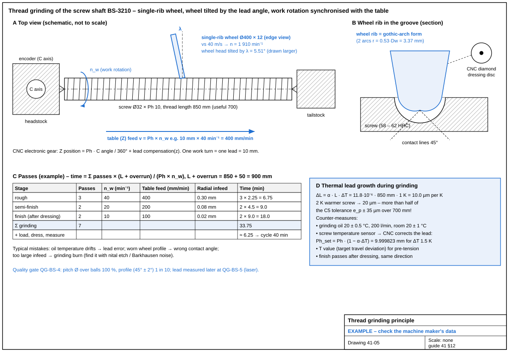

### 12.1 Principle

The screw rotates between centres. A **single-rib** grinding wheel with the gothic-arch profile cuts the groove. The
table (or the wheel head) moves along the screw axis **exactly one lead per screw revolution**:

  **table feed v_f = Ph · n_w**   (mm/min = mm · min⁻¹)

The wheel axis is **tilted by the lead angle** λ so that the wheel plane follows the helix:

  **λ = arctan( Ph / (π · d_pw) ) = arctan( 10 / (π · 33.0) ) = 5.51°**

Without the tilt, the wheel would cut the flanks of the groove (interference) and the profile would be wrong.

The synchronisation of work spindle (C axis) and table (Z axis) is electronic (CNC "gearing"). The lead accuracy of
the screw comes from the **linear scale of the Z axis**, the encoder on the work spindle, the temperature stability
and the compensation tables of the machine.

### 12.2 Passes and time – worked example

From the data file: L = 850 mm thread + 50 mm overrun = 900 mm per pass, Ph = 10 mm.

| Stage | Passes | Work speed n_w | Table feed = Ph · n_w | Time per pass = 900 / v_f | Radial infeed | Time |
|---|---|---|---|---|---|---|
| Rough | 3 | 40 min⁻¹ | 400 mm/min | 2.25 min | 0.30 mm | 6.75 min |
| Semi | 2 | 20 min⁻¹ | 200 mm/min | 4.5 min | 0.08 mm | 9.0 min |
| Finish | 2 | 10 min⁻¹ | 100 mm/min | 9.0 min | 0.02 mm | 18.0 min |
| **Σ** | **7** | | | | | **33.75 min** |

  **t = Σ passes · (L + overrun) / (Ph · n_w)** = 3 · 900/400 + 2 · 900/200 + 2 · 900/100 = **33.75 min**

Plus load / unload, dressing before the finish passes, probing → cycle **40 min**. Finish passes are slow because
the slow work speed gives a better surface and less heat per groove length.

Wheel speed: n = vs · 60 000 / (π · d) = 40 · 60 000 / (π · 400) = **1 910 min⁻¹**. As the wheel wears and is dressed
smaller, the CNC raises n to keep vs constant.

### 12.3 Dressing the profile

The gothic-arch profile (two arcs r = 0.53 · Dw = 3.37 mm, contact angle 45°, guide 40 §6.2) is dressed into the
wheel by a **CNC diamond disc** (contour dressing: the disc follows the profile with 2 axes) or by a **diamond form
roll**. Dressing data (example):

* overlap ratio U_d = b_d / f_d = 0.5 / 0.15 = **3.3** (b_d = effective diamond width, f_d = dressing feed per wheel
  revolution) – higher U_d → finer, duller wheel surface (better finish, more heat); lower → sharper, rougher.
* dressing infeed 0.01 – 0.02 mm per stroke, 2 – 4 strokes before finishing.

Profile wear between dressings changes the **contact angle** → load rating and preload of the nut change. That is why
QG-BS-4 checks the profile 1 in 10 with a contour tester.

### 12.4 Lead compensation

Two corrections are programmed into the Z axis:

1. **Thermal**: the screw warms up during grinding. If it is ΔT warmer than 20 °C while being ground, it shrinks by
   α · L · ΔT when it cools. 1 K over 850 mm = 11.8 · 10⁻⁶ · 850 · 1 = **10 µm** (= 0.29 × C5 e_p). The machine
   measures the screw temperature (contact sensor) and stretches the programmed lead: for an expected ΔT = 1.5 K,
   Ph_set = 10 · (1 + 11.8 · 10⁻⁶ · 1.5) – a correction of **17.7 µm/m**.
2. **T value** (target travel compensation): the customer may order a screw that is slightly "short" (negative
   travel compensation) because he pre-tensions it in the machine (guide 40 §10.5). The grinder grinds the lead with
   this offset.

Plus the machine's own **lead error table** from the last laser calibration of the Z axis.

### 12.5 Rules for good thread grinding

| Rule | Why |
|---|---|
| Grinding oil (not emulsion), 200 l/min, cooled to 20 ± 0.5 °C | oil reduces burn and wheel wear; temperature = lead |
| Steady rests (follow rests) every ≈ 300 mm | a Ø32 × 1 000 shaft bends under the grinding force |
| Screw soaked in the room before grinding | no thermal drift during the 40 min |
| Dress before finishing | sharp, exact profile for the last passes |
| In-process lead probe after semi-finishing | correct the finish passes |
| Same centres as all previous operations | run-out |

---

## 13. Thread whirling + thread rolling

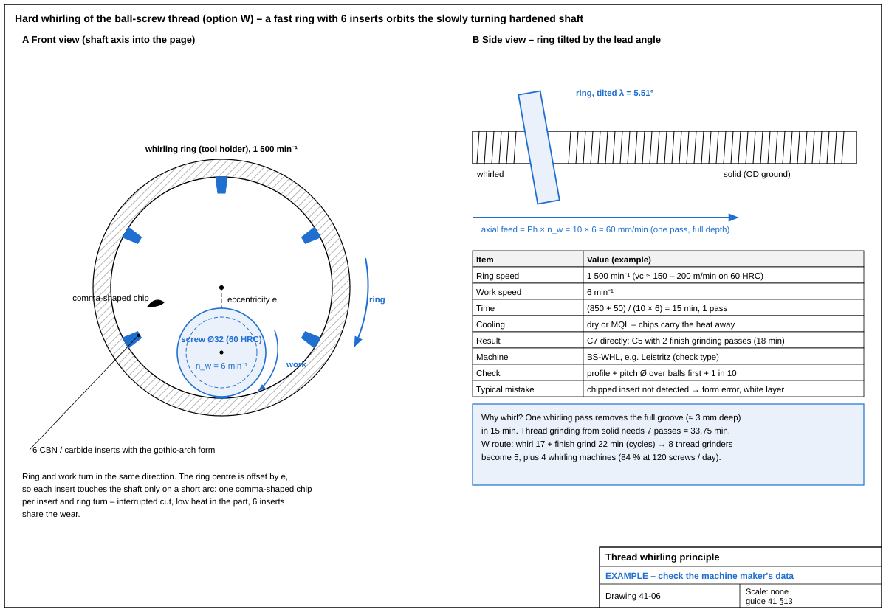

### 13.1 Whirling principle

A **whirling ring** (internal tool ring) carries several inserts (here 6) with the groove profile on the inside. The
ring rotates fast (1 500 min⁻¹) and is **eccentric** to the shaft: only one insert at a time cuts, and only for a short
arc. The shaft rotates slowly (6 min⁻¹). The ring is tilted by the lead angle (5.51°) and moves one lead per shaft
revolution: axial feed = Ph · n_w = 10 · 6 = **60 mm/min**.

Each insert takes a small **comma-shaped chip**. Worked numbers:

* Cutting speed: vc = π · D · n_ring. For vc ≈ 175 m/min at 1 500 min⁻¹ the cutting circle is
  D = 175 · 1 000 / (π · 1 500) = **37 mm**; at D = 40 mm vc = **188 m/min**.
* Feed per insert (circumferential): work surface speed π · 32 · 6 = 603 mm/min, divided by 1 500 · 6 insert
  passes per minute → **0.067 mm per insert**.
* Time: (850 + 50) / 60 = **15 min**, one pass, full depth.

### 13.2 Hard whirling – where it fits

| + | − |
|---|---|
| full groove in one pass in hardened steel (60 HRC) with CBN inserts | insert cost, edge chipping |
| dry / MQL, fast (15 vs 33.75 min grinding from solid) | white layer + tool marks → finish grinding needed for C5 |
| low heat into the part | extra machine type (`BS-WHL`) |

Our variant **W**: whirling 15 min cut (17 min cycle with load + probe) + 2 finish grinding passes 18 min (22 min cycle
with load, dressing, probing). Effective thread time per screw: 17 + 40/30 + 22 + 45/20 = **42.6 min** – about the same
as G (42.25 min), BUT the expensive thread grinder is busy only 24.25 min per screw. Result: 5 thread grinders + 4
whirling machines instead of 8 thread grinders (§19.5) – a cheaper whirling machine replaces part of the thread grinders.

### 13.3 Thread rolling (rolled screws, C7 / C10)

Two (or three) hardened **rolling dies** with the groove profile press into the soft (QT) shaft and form the groove
by **cold plastic deformation** – no chips. In through-feed the dies are slightly tilted, so the shaft moves axially
(≈ 1 m/min): 850 mm in **0.85 min**.

| + | − |
|---|---|
| very fast, no chips, no material loss | lead accuracy only C7 (v300 50 µm) / C10 |
| cold-worked, smooth surface, fibres follow the groove | induction hardening and straightening after rolling change the lead |
| cheap machines per piece | blank diameter must be very exact; dies expensive |

Route R: turn the blank to the rolling diameter → roll (op 45) → induction harden → temper → straighten → polish
(op 110) → lead sample (op 120, 1 in 20). No thread grinder at all: the plant needs 64 machines (§19.5). Rolled screws
are for handling, packaging, robots – not for precision machine tools (guide 40 §10.2).

---

## 14. Nut internal thread grinding + hard turning

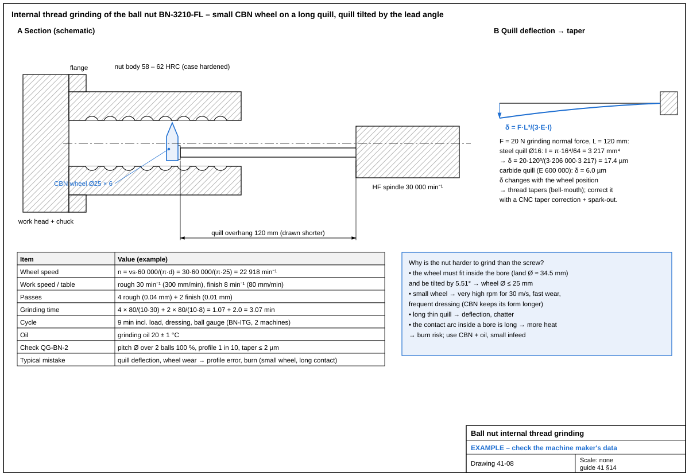

### 14.1 The problem: a small wheel in a small hole

The nut thread must be ground **inside** a bore of ≈ 34 mm (land diameter). The wheel plus its tilt by the lead angle
must fit: wheel Ø ≤ ≈ 25 mm. The wheel sits on a **quill** (a long thin spindle extension) that must reach through the
whole nut: 120 mm.

### 14.2 Wheel speed

For vs = 30 m/s with a Ø25 wheel:

  **n = vs · 60 000 / (π · d) = 30 · 60 000 / (π · 25) = 22 918 min⁻¹**

A high-frequency spindle (≈ 30 000 – 60 000 min⁻¹) is needed. Check: π · 25 · 22 918 / 60 000 = 30.0 m/s.

Why **CBN** (B76, vitrified)? A small wheel has few grains in contact and wears fast. CBN is ≈ 2 × harder than
corundum and wears 100 × slower: the profile stays exact for many nuts, and its high thermal conductivity reduces
burn (§18).

### 14.3 Time

From the data file: thread length incl. run-out 80 mm, Ph 10.

| Stage | Passes | n_w | Table feed | Time per pass | Time |
|---|---|---|---|---|---|
| Rough | 4 | 30 min⁻¹ | 300 mm/min | 0.27 min | 1.07 min |
| Finish | 2 | 8 min⁻¹ | 80 mm/min | 1.0 min | 2.0 min |
| **Σ** | 6 | | | | **3.07 min** |

Cycle 9 min: frequent dressing of the small wheel, infeed moves between passes, in-process gauging, loading.

### 14.4 Quill deflection – the taper problem

The quill is a cantilever: deflection y = F · l³ / (3 · E · I). With l = 120 mm and a thin quill, the radial grinding
force pushes the wheel away from the work. The deflection is larger when the wheel is deep in the nut (long overhang
effective) than at the entry → the thread pitch diameter **tapers** (bell-mouth). Effect: only one circuit carries the
load → short life.

Remedies: stiff quill (carbide or heavy metal), short overhang, small finish infeed (0.01 mm), spark-out passes,
CNC **taper correction** (the X axis compensates the measured taper), measure pitch Ø at both ends (QG-BN-2: taper ≤
2 µm).

### 14.5 Hard turning (op 50)

Hard turning with CBN replaces grinding for the **flange face, OD Ø50 g6 and bore lands**: vc 180 m/min, f 0.08 mm/rev,
ap 0.10 mm, dry. Face and bore in **one clamping** → face run-out ≤ 5 µm to the bore (the nut must sit square on the
table). Good: one machine instead of a cylindrical + face grinder, no coolant. Risks: worn edge → **white layer**
(re-hardened, brittle layer) and size drift → tool-life counter + 100 % air gauge.

---

## 15. Rail + block profile and raceway grinding

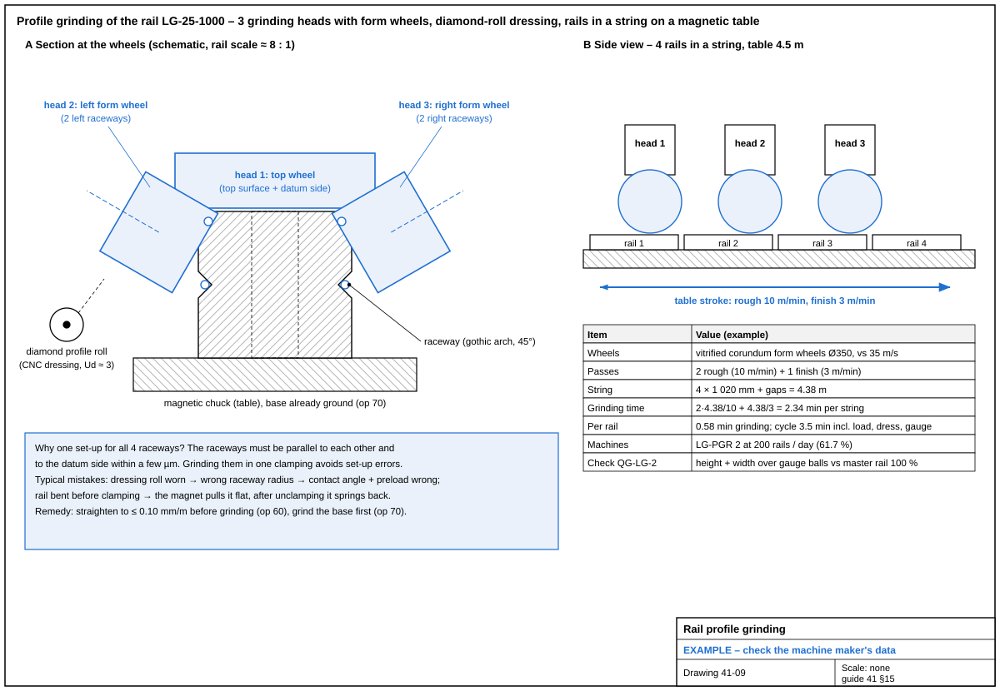

### 15.1 Rail profile grinding (op 80)

After the base is ground (op 70), the rails are clamped on the magnetic table of a multi-head grinder, 4 rails in a
string (4.38 m). Three heads grind in one table stroke:

| Head | Grinds | Wheel |
|---|---|---|
| 1 | top + datum side | straight / cup wheel |
| 2 | left 2 raceways (upper + lower) | form wheel Ø350 with 2 raceway arcs |
| 3 | right 2 raceways | form wheel Ø350 |

Everything is ground relative to the base and the datum side in **one clamping** → height and width tolerance
(class H ± 0.04 mm) and raceway parallelism to the datum.

Worked time (data file): 2 rough strokes at 10 m/min + 1 finish stroke at 3 m/min over 4.38 m:
2 · 4.38/10 + 4.38/3 = **2.34 min per string → 0.58 min per rail**. The cycle per rail is 3.5 min because loading,
aligning on the magnet, dressing, gauging and unloading take most of the time.

**Form dressing**: the raceway radius is dressed by a **diamond profile roll** (CNC rotary dresser) once per string
(U_d ≈ 3). A worn roll gives the wrong raceway radius → wrong conformity and contact angle → the block preload and
running feel change. The roll is checked on a contour tester and replaced by wear limit.

**Straightness on the magnet**: a rail is long and thin. The magnet pulls it flat; after release the rail "remembers"
its bow. Good practice: straighten well (≤ 0.10 mm/m), demagnetise, low clamping force for finishing, temperature-stable
table.

### 15.2 Block raceway grinding (op 60, LB-RGR)

The block raceways are on the **inside** of the U-shaped channel. A form wheel Ø80 enters the channel and grinds the 2
raceways of one side; then the other side (or a second wheel). 10 blocks are clamped in a string on a dummy-rail
fixture, the table moves at 3 m/min, 3 passes. CBN wheels (45 m/s) keep the small form longer.

Height variation between blocks must be ≤ 15 µm (class H): all blocks of a string are ground in one go, the string
fixture must not distort the blocks (clamping on the base, not on the flange).

### 15.3 Surface grinding of bases (LG-SGR, LB-SGR)

Base and reference side are the datums for everything after. Surface grinders with magnetic chucks, vs 30 m/s, table
15 m/min, ap 0.01 mm. Clean the chuck before every load – a chip under a block = tilt = height error.

---

## 16. Straightening

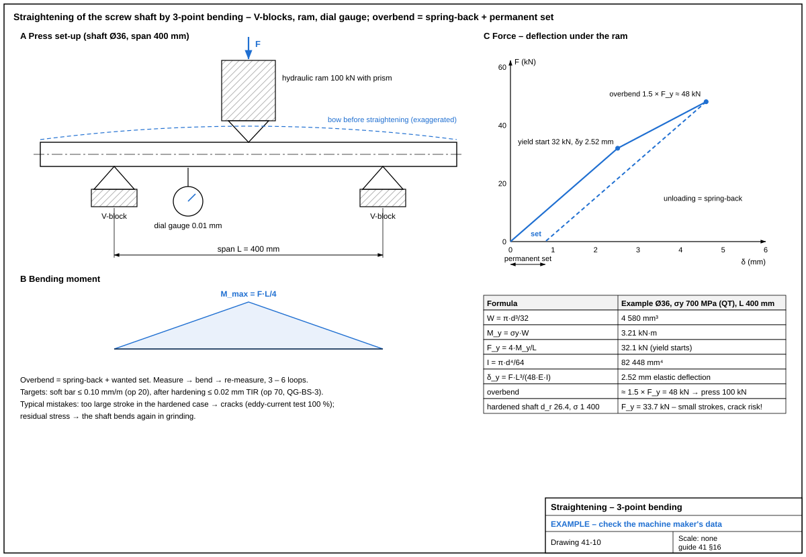

### 16.1 Why straighten?

A bar from the mill is bent. Turning releases stresses. Hardening bends a shaft much more: the hot surface expands,
the quench transforms it to martensite (volume +), the case is never perfectly even. Typical run-out after hardening:
0.25 mm (screw, data file), 0.6 mm/m (rail). Grinding stock is only 0.1 – 0.2 mm per side: **we must straighten**.

### 16.2 3-point bending – worked example (soft bar, op 20)

The bar lies on two V-blocks (span L = 400 mm). The ram presses in the middle at the high point. To bend permanently
the stress must exceed the yield stress σ_y.

| Step | Formula | Numbers (Ø36, σ_y 700 MPa, L 400) |
|---|---|---|
| Section modulus | W = π · d³ / 32 | π · 36³ / 32 = **4 580 mm³** |
| Moment of inertia | I = π · d⁴ / 64 | **82 448 mm⁴** |
| Yield moment | M_y = σ_y · W | 700 · 4 580 = **3.21 kN·m** |
| Force at first yield | F_y = 4 · M_y / L | 4 · 3.21 · 10⁶ / 400 = **32.1 kN** |
| Elastic deflection at first yield | δ_y = F · L³ / (48 · E · I) | 32 063 · 400³ / (48 · 206 000 · 82 448) = **2.52 mm** |
| Force for overbend (≈ 1.5 × F_y) | | **48.1 kN** → a 100 kN press has margin |

**Overbend**: the ram must push **beyond** the straight position: deflection = spring-back (elastic, ≈ 2.5 mm here) +
the wanted permanent set (= the bow you want to remove, e.g. 0.3 mm). The press software learns the spring-back of
each material lot from the first strokes.

### 16.3 Straightening a hardened shaft (op 70)

The hardened case (58 – 62 HRC) is brittle: it does not yield, it **cracks**. Rules:

1. Bend preferably in the **soft zones** (journals, thread run-outs) – a small kink there corrects the whole shaft.
2. In the hardened thread zone only small strokes, at the lowest possible stress; some makers use **local peening**
   (hammering the groove bottom on the concave side → compressive stress → the shaft bends back) instead of bending.
3. Example with the root diameter 26.4 mm, span 300 mm and σ ≈ 1 400 MPa in the case: W = π · 26.4³ / 32 = 1 806 mm³,
   F = 4 · 1 400 · 1 806 / 300 = **33.7 kN**, elastic deflection δ = 3.86 mm – the shaft must be bent far, close to the
   strength of the case. This is why hardened straightening is done in many small steps with measurement in between
   (3 – 6 loops, 6 min cycle).
4. 100 % crack test (eddy current) after straightening.
5. Straighten after tempering (more toughness), never right after quenching.

Target **≤ 0.02 mm** TIR (QG-BS-3). Residual stress from straightening can be partly released during grinding: the
shaft may bend again → a second light straightening after rough grinding is an option for C3.

---

## 17. Measurement

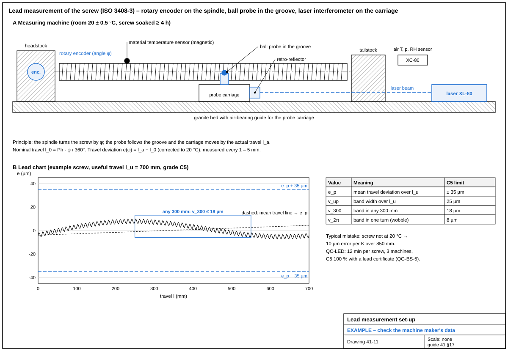

### 17.1 What is measured where

| Characteristic | Where (gate) | Method | Instrument |
|---|---|---|---|
| Run-out | op 20, 40, 70, 90 (QG-BS-3) | rotate between centres / on rollers | dial gauge, LVDT, laser |
| Hardness | op 50, 60, 40 (furnace) (QG-BS-2, BN-1, LG-1, LB-1) | Rockwell HRC | Rockwell tester (ISO 6508-1) |
| Case depth | same | cut-up, polish, HV1 traverse | micro-Vickers (ISO 6507), evaluation ISO 18203 |
| Cracks | op 50, 70 | eddy current / magnetic particle | crack tester |
| Grinding burn | op 90, 100 | nital etch / Barkhausen noise | etch line, Barkhausen sensor |
| Thread profile + pitch Ø | op 100 (QG-BS-4), op 60 nut (QG-BN-2) | ball-pin measurement, contour tracing | ball micrometer, contour tester |
| Lead | op 120 (QG-BS-5) | laser interferometer vs rotary encoder | lead measuring machine |
| Raceway geometry rail / block | op 80 / 60 (QG-LG-2, LB-2) | comparison with a master over gauge balls | comparator gauge |
| Hole pitch, straightness, parallelism | op 100 rail (QG-LG-3) | measuring bench | camera / probe + scale |
| Preload | assembly (QG-FA-1, LB-3) | torque / drag force | torque tester, force sensor |

### 17.2 Lead measurement (op 120)

Set-up: the screw lies between centres on a granite bed. A **rotary encoder** on the work spindle measures the
rotation angle φ. A carriage with a **ball probe** sits in the groove and is moved along by the groove (or by a
servo following the groove). A **laser interferometer** (Renishaw XL-80 class) measures the real axial position x of
the carriage. Nominal position = Ph · φ / 360°. Deviation e(x) = x_measured − x_nominal.

From the deviation curve over the useful travel l_u (here 700 mm) the software computes (ISO 3408-3):

| Value | Meaning | C5 limit (l_u 700) |
|---|---|---|
| e_p | mean travel deviation (vs the target travel incl. T value) | ± 35 µm |
| v_up | travel variation over l_u (band width around the mean line) | 25 µm |
| v_300 | variation in any 300 mm | 18 µm |
| v_2π | variation within one revolution (wobble) | 8 µm |

Sample step: every 1 – 5 mm (the data file uses 5 mm → 170 points over 850 mm); for v_2π finer steps (e.g. 10 per
revolution).

**Temperature**: the screw must be at 20 °C, or its temperature must be measured and the result corrected. A Ø32
shaft in still air has a thermal time constant τ = ρ · c · d / (4 · h) = 7 850 · 460 · 0.032 / (4 · 10) ≈ **48 min**.
To go from 5 K too warm to 0.1 K takes τ · ln(50) ≈ **3.1 h** → rule "soak ≥ 4 h" in the metrology room (20 ± 0.5 °C).
An error of only 0.5 K gives 11.8 · 10⁻⁶ · 850 · 0.5 = **5 µm** over the thread.

The laser itself needs environmental compensation (air temperature, pressure, humidity → wavelength) and the
**material temperature sensor** on the screw.

### 17.3 Hardness

Rockwell C (HRC, ISO 6508-1): diamond cone, 150 kgf total load, depth difference → number. Quick, on the part (flat
test spot or cylinder correction). Our spec 58 – 62 HRC ≈ 655 – 745 HV (approximate conversion, ISO 18265 – check).
Use calibrated test blocks daily.

### 17.4 Case depth

Cut a test piece or a part across the hardened zone, polish, measure HV1 every 0.1 mm from the surface inwards. The
depth where the hardness falls to the limit is the case depth (ISO 18203):

* **Rht** (induction): limit = 0.8 × minimum surface hardness (e.g. 550 HV used in the data file).
* **Eht / CHD** (carburising): limit 550 HV.

Cut-ups destroy parts: 1 per shift / set-up for induction (QG-BS-2), test pieces in every furnace load (QG-BN-1).

### 17.5 Profile and pitch diameter

* **Pitch Ø over balls**: two (nut: internal) or three balls of known Ø in the groove, measure over / between the
  balls with a micrometer → pitch diameter. Fast, 100 %.
* **Contour tester**: a fine stylus traces the groove profile; software fits the two arcs and gives radius, offset,
  contact angle (45° ± 2°). Sample 1 in 10.

### 17.6 Run-out

Journal run-out to the thread axis ≤ 8 µm for C5 (guide 40). Measured between centres with the ball probe in the
groove as the reference, or on V-blocks on the ground thread lands.

### 17.7 Preload torque (assembly, QG-FA-1)

Catalogue formula for the dynamic preload torque of a ball nut:

  **Tp = 0.05 / √(tan λ) · Fpr · Ph / (2π)**

| Value | Number |
|---|---|
| lead angle λ = arctan(Ph / (π · d_pw)) | arctan(10 / (π · 33.0)) = **5.51°**, tan λ = 0.0965 |
| preload Fpr (P1 = 3 % Ca) | 0.03 · 38 000 = **1 140 N** |
| Ph | 10 mm = 0.010 m |
| Tp | 0.05 / √0.0965 · 1 140 · 0.010 / (2π) = **0.292 N·m** |
| window ± 40 % (example) | **0.175 – 0.409 N·m** |

The torque tester also records the **torque variation** along the stroke (smoothness); allowed variation depends on
the grade and length (JIS B 1192-3 / ISO 3408-3 table – check). Too high torque = too much preload (heat, short life);
too low = backlash risk.

---

## 18. Grinding wheels, dressing, grinding physics

### 18.1 Abrasives

| Abrasive | Hardness (Knoop, approx.) | Use here | + | − |
|---|---|---|---|---|
| Corundum (Al₂O₃), white / pink 89A, sintered (SG) | ≈ 2 000 | cylindrical, thread, profile, surface grinding of 60 HRC steel | cheap, easy to dress into any profile, forgiving | wears fast → frequent dressing, profile changes |
| **CBN** (cubic boron nitride) | ≈ 4 500 | internal thread (small wheel), block raceways, high-volume thread grinding | 100 × longer life, stable profile, high thermal conductivity → less heat into the part | 10 – 50 × price, needs stiff machines, harder to dress |
| Diamond | ≈ 8 000 | dressing tools (discs, rolls), not for steel | hardest | reacts with iron at high temperature |
| Silicon carbide | ≈ 2 500 | cast iron, non-ferrous | sharp | not for hardened steel |

### 18.2 Wheel specification – how to read it

Example **89A 60 K7 V** (corundum wheel of op 90):

| Part | Meaning |
|---|---|
| 89A | abrasive type (maker code for a corundum blend) |
| 60 | grit size (mesh) – 46 coarse, 60 medium, 80 – 120 fine |
| K | grade = bond hardness (E soft … Z hard); K = medium-soft |
| 7 | structure (pore spacing) |
| V | vitrified (ceramic) bond |

CBN example **B126** = CBN grit 126 µm (FEPA), B91 / B76 finer. Bond vitrified for profile wheels (dressable).

### 18.3 Dressing

| Dressing tool | Use |
|---|---|
| Single-point / multi-point diamond | simple cylindrical wheels |
| **CNC diamond disc** | profile of the thread grinding wheel (contour dressing, 2 axes) |
| **Diamond form roll** (rotary) | fixed profiles in series (rail raceways, block raceways), fast |
| Diamond roll for CBN | dressing + sharpening of vitrified CBN |

Overlap ratio U_d = b_d / f_d (effective diamond width / dressing feed per wheel revolution). Example 0.5 / 0.15 =
**3.3**. U_d > 4: fine, closed wheel surface – better Ra, more heat, burn risk. U_d < 2: open, sharp – cooler, rougher.

### 18.4 Specific energy and power

Grinding needs much more energy per removed volume than turning: the grains cut with negative rake angles, rub and
plough. **Specific energy** e_c (J/mm³):

| Process | e_c (example, hardened steel) |
|---|---|
| Turning (kc 2 600 N/mm²) | 2.6 J/mm³ |
| Grinding with corundum | 30 – 60 J/mm³ (we use 40) |
| Grinding with CBN | 20 – 40 J/mm³ (we use 30) |

Power per mm wheel width: P' = e_c · Q'_w, with Q'_w = a · v_w (infeed per workpiece revolution × work surface speed).

Example op 90 (Ø32, n_w 150 min⁻¹, a = 0.005 mm): v_w = π · 32 · 150 / 60 = **251.3 mm/s**,
Q'_w = 0.005 · 251.3 = **1.26 mm³/(mm·s)**, P' = 40 · 1.26 = **50.3 W/mm**; for a contact width b = 20 mm
P = **1.0 kW** at the contact.

### 18.5 Grinding burn – the surface temperature

Nearly all grinding energy becomes heat in a very short contact zone. A fraction ε goes into the workpiece
(corundum ε ≈ 0.6 – 0.8, CBN ε ≈ 0.2 – 0.4 because CBN conducts heat away). The maximum surface temperature for a
moving band heat source (Jaeger, high Péclet number):

  **θ_max = 1.13 · q · √( α · l_c / v_w ) / k**

with contact length l_c = √(a · d_e), equivalent wheel diameter d_e = d_s · d_w / (d_s + d_w), heat flux into the
work q = ε · P' / l_c, thermal diffusivity α = 1.1 · 10⁻⁵ m²/s, conductivity k = 40 W/(m·K).

| Case (op 90, d_s 500, d_w 32, n_w 150) | a (mm/rev) | e_c | ε | l_c (mm) | q (W/mm²) | **θ_max** |
|---|---|---|---|---|---|---|
| A corundum, normal infeed | 0.005 | 40 | 0.75 | 0.388 | 97.2 | **358 °C** |
| B corundum, double infeed | 0.010 | 40 | 0.75 | 0.548 | 137.5 | **602 °C** |
| C CBN, normal infeed | 0.005 | 30 | 0.30 | 0.388 | 29.2 | **107 °C** |

d_e = 500 · 32 / 532 = 30.1 mm. Case A: l_c = √(0.005 · 30.1) = 0.388 mm; q = 0.75 · 50.3 / 0.388 = 97.2 W/mm²;
θ = 1.13 · 97.2 · 10⁶ · √(1.1e-5 · 0.388e-3 / 0.2513) / 40 = **358 °C** (rise above the bulk temperature).

Burn limit (example): the 170 °C-tempered martensite starts to temper visibly at short times above ≈ 450 °C
(**temper burn**: softer zone, tensile stress); above ≈ 720 – 800 °C it re-austenitises and re-hardens (**re-hardening
burn**: brittle white layer with a soft tempered zone below). Doubling the infeed (B) raises θ by
√2 · 2^(1/4) ≈ 1.68 → **602 °C: burn**. CBN (C) stays at 107 °C.

Lessons:

1. Burn grows faster than the removal rate. Never "just go faster" in finishing.
2. Dull wheel = higher e_c = burn. Dress in time (dressing counter in Modbus group `grind`).
3. CBN + oil is the safest combination for high removal.
4. Check burn by **nital etch** (dark = tempered, white = re-hardened) or **Barkhausen noise** (non-destructive, 100 %
   possible).

### 18.6 Coolant / grinding oil

| | Grinding oil | Emulsion |
|---|---|---|
| Lubrication | very good → lower e_c, less burn, longer wheel life | medium |
| Cooling | lower heat capacity | better |
| Use | thread grinding, internal thread, CBN | cylindrical, surface grinding |
| Requirement | fire protection (CO₂ system), mist extraction, chiller 20 ± 0.5 °C, filtration ≤ 5 – 10 µm | bacteria control, concentration |

### 18.7 Thermal growth and lead error

  **ΔL = α · L · ΔT**,  α = 11.8 · 10⁻⁶ /K

| ΔT of the screw | ΔL over 850 mm | Share of C5 e_p (± 35 µm) |
|---|---|---|
| 0.5 K | 5.0 µm | 14 % |
| **1 K** | **10.0 µm** | 29 % |
| 2 K | 20.1 µm | 57 % |

Where the heat comes from: grinding heat (some % of the spindle power stays in the part), the oil (if not cooled),
the room (sun, doors, neighbouring machines), the operator's hands. Countermeasures: oil chiller ± 0.5 K, room 20 ± 1
K, soak parts before grinding, measure screw temperature and compensate (§12.4), grind finishing passes only after
temperature equilibrium.

---

## 19. Capacity, takt, machine list

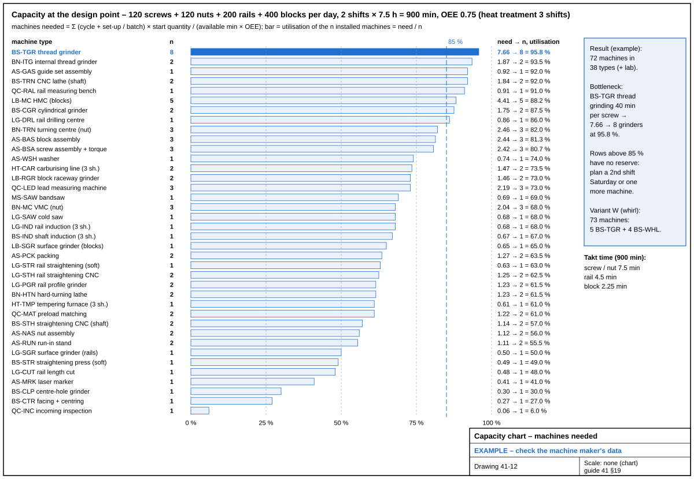

### 19.1 The formula

For each machine type m:

  **load_m = Σ over all operations on m of ( effective time × start quantity )**   (min per day)

  **need_m = load_m / ( available time × OEE )**   → **n_m = ceil(need_m)**, utilisation = need_m / n_m

* effective time = cycle + set-up / batch (§3.1)
* start quantity of an operation = good quantity / Π (1 − scrap) **of this and all later operations** of the route –
  an early operation must make more parts because some are lost later.
* available time = shifts × net hours × 60 = 2 × 7.5 × 60 = **900 min** (heat treatment 3 shifts = **1 350 min**)
* OEE = 0.75

### 19.2 Worked example – thread grinder `BS-TGR`

| Step | Numbers |
|---|---|
| effective time | 40 + 45 / 20 = **42.25 min** |
| yield of op 100 + later ops (100, 120, 130) | (1 − 0.015) · (1 − 0.005) · 1 = 0.98008 |
| start quantity at op 100 | 120 / 0.98008 = **122.44** |
| load | 42.25 · 122.44 = **5 173 min/day** |
| capacity of one machine | 900 · 0.75 = **675 min/day** |
| need | 5 173 / 675 = **7.66** → **8 machines** |
| utilisation | 7.66 / 8 = **95.8 %** → **bottleneck** of the plant |

Worked example – furnace line `HT-CAR` (shared): nuts 124.3 starts · 2.0 min + blocks 411.8 starts · 3.0 min =
248.6 + 1 235.4 = **1 484 min/day**; 1 484 / (1 350 · 0.75) = **1.47 → 2 lines** (73.3 %).

### 19.3 Machine list at the design point (variant G, 2 shifts, OEE 0.75)

| Machine type | Name (short) | Area | Load (min/day) | Need | n | Util. % | kW each | Footprint (m) |
|---|---|---|---|---|---|---|---|---|
| `BS-TGR` | thread grinder | grind | 5 173 | 7.66 | **8** | **95.8** | 30 | 5.5 × 2.8 |
| `BN-ITG` | internal thread grinder | grind | 1 265 | 1.87 | 2 | 93.7 | 18 | 4.0 × 2.5 |
| `AS-GAS` | guide set assembly | assy | 621 | 0.92 | 1 | 92.0 | 0.5 | 5.0 × 1.2 |
| `BS-TRN` | CNC lathe long | soft | 1 240 | 1.84 | 2 | 91.9 | 22 | 4.5 × 2.2 |
| `QC-RAL` | rail measuring bench | qc | 612 | 0.91 | 1 | 90.6 | 1 | 5.0 × 1.2 |
| `LB-MC` | HMC + tombstones | soft | 2 975 | 4.41 | 5 | 88.1 | 26 | 6.0 × 4.0 |
| `BS-CGR` | cylindrical grinder | grind | 1 184 | 1.75 | 2 | 87.7 | 25 | 4.5 × 2.8 |
| `LG-DRL` | rail drilling centre | soft | 583 | 0.86 | 1 | 86.4 | 15 | 7.0 × 2.5 |
| `BN-TRN` | turning centre | soft | 1 658 | 2.46 | 3 | 81.9 | 18.5 | 3.8 × 2.0 |
| `AS-BAS` | block assembly | assy | 1 650 | 2.44 | 3 | 81.5 | 1 | 2.0 × 1.2 |
| `AS-BSA` | ball screw assembly + torque | assy | 1 631 | 2.42 | 3 | 80.6 | 2 | 3.5 × 1.2 |
| `AS-WSH` | washer | assy | 502 | 0.74 | 1 | 74.3 | 25 | 6.0 × 1.8 |
| `HT-CAR` | carburising line (3 shifts) | ht | 1 484 | 1.47 | 2 | 73.3 | 250 | 14 × 6 |
| `LB-RGR` | block raceway grinder | grind | 986 | 1.46 | 2 | 73.0 | 30 | 6.0 × 3.0 |
| `QC-LED` | lead measuring machine | qc | 1 477 | 2.19 | 3 | 73.0 | 2 | 3.5 × 1.2 |
| `MS-SAW` | bandsaw | soft | 464 | 0.69 | 1 | 68.7 | 5 | 3.5 × 2.0 |
| `BN-MC` | VMC + 4th axis | soft | 1 378 | 2.04 | 3 | 68.1 | 15 | 3.0 × 2.5 |
| `LG-SAW` | cold saw | soft | 459 | 0.68 | 1 | 68.0 | 7.5 | 5.0 × 2.0 |
| `LG-IND` | rail induction line (3 shifts) | ht | 685 | 0.68 | 1 | 67.7 | 120 | 10 × 2.5 |
| `BS-IND` | shaft induction machine (3 shifts) | ht | 675 | 0.67 | 1 | 66.7 | 80 | 3.0 × 2.5 |
| `LB-SGR` | surface grinder blocks | grind | 438 | 0.65 | 1 | 64.9 | 11 | 4.0 × 2.5 |
| `AS-PCK` | packing | assy | 860 | 1.27 | 2 | 63.7 | 1 | 4.0 × 2.0 |
| `LG-STR` | rail press soft | soft | 428 | 0.63 | 1 | 63.4 | 7.5 | 5.0 × 1.5 |
| `LG-STH` | rail press CNC | ht | 843 | 1.25 | 2 | 62.4 | 15 | 8.0 × 2.0 |
| `LG-PGR` | rail profile grinder | grind | 833 | 1.23 | 2 | 61.7 | 60 | 12 × 4.0 |
| `BN-HTN` | hard-turning lathe | grind | 831 | 1.23 | 2 | 61.5 | 15 | 3.0 × 2.0 |
| `HT-TMP` | tempering furnace (3 shifts) | ht | 622 | 0.61 | 1 | 61.4 | 45 | 3.0 × 2.5 |
| `QC-MAT` | block matching station | qc | 822 | 1.22 | 2 | 60.9 | 1 | 2.0 × 1.2 |
| `BS-STH` | CNC straightening press | ht | 771 | 1.14 | 2 | 57.1 | 11 | 3.5 × 1.8 |
| `AS-NAS` | nut assembly bench | assy | 754 | 1.12 | 2 | 55.8 | 1 | 2.0 × 1.2 |
| `AS-RUN` | run-in stand | assy | 752 | 1.11 | 2 | 55.7 | 3 | 3.0 × 1.0 |
| `LG-SGR` | surface grinder rails | grind | 336 | 0.50 | 1 | 49.8 | 15 | 6.0 × 3.0 |
| `BS-STR` | straightening press soft | soft | 330 | 0.49 | 1 | 48.9 | 7.5 | 3.0 × 1.5 |
| `LG-CUT` | rail cut-off | grind | 322 | 0.48 | 1 | 47.7 | 7.5 | 5.0 × 1.5 |
| `AS-MRK` | laser marker | assy | 280 | 0.41 | 1 | 41.5 | 1 | 1.5 × 1.2 |
| `BS-CLP` | centre-hole grinder | grind | 205 | 0.30 | 1 | 30.4 | 3 | 1.5 × 1.2 |
| `BS-CTR` | facing + centring | soft | 185 | 0.27 | 1 | 27.4 | 11 | 3.5 × 1.8 |
| `QC-INC` | incoming inspection (bought end caps) | qc | 40 | 0.06 | 1 | 6.0 | 0.5 | 2.0 × 1.0 |
| **Total** | | | | | **72** | | **1 752.5 kW installed** | **931 m² machine footprint** |

Plus the laboratory `QC-LAB` (1, not in the routing) → `MACHINES` has 73 instances. The bought end caps (LB op 75,
`buy: true`) are made by the supplier – the time in the routing (0.1 min) is our incoming check on `QC-INC`.

By area: soft machining 19 machines / 328 kW / 238 m²; heat treatment 9 / 797 kW / 253 m²; grinding room 22 /
573 kW / 350 m²; assembly 15 / 46 kW / 65 m²; metrology 7 / 9.5 kW / 25 m².

Machine footprints are without aisles, material buffers and service space. Rule of thumb for item 3: hall area ≈ 2.5
– 3 × machine footprint → 931 · 2.5 ≈ **2 300 m²** of production floor, plus stores, offices, laboratory.

### 19.4 What the numbers say

1. **Thread grinding is the bottleneck** (95.8 %). Every minute saved there saves ≈ 120 machine-minutes per day.
   Options: CBN wheels (fewer dressings), whirling (variant W), more passes in parallel (twin-wheel machines), or
   a 3rd shift only for the thread grinders.
2. Several machine types run at 90 – 94 % (internal thread grinder, lathe, guide set assembly, rail measuring bench):
   **near-bottlenecks**. A small change (OEE 0.70, 10 % more orders) makes them the bottleneck.
3. Many single machines at 30 – 50 % (centring, centre-hole grinder, marker): they exist because a process step needs
   them, not because of capacity. They have reserve for product family growth (other diameters, longer screws).
4. Sensitivity: OEE 0.75 → 0.65 raises the thread grinders from 7.66 to 5 173 / (900 · 0.65) = **8.84 → 9 machines**.
5. Heat treatment runs on 3 shifts; with 2 shifts the carburising line would need 1 484 / 675 = 2.2 → 3 lines.

### 19.5 Variants

| Variant | Machines | Changes against G |
|---|---|---|
| **G** ground from solid | **72** | bottleneck `BS-TGR` 8 × 95.8 % |
| **W** whirling + finish grinding | **73** | `BS-WHL` 3.36 → 4 machines (84.0 %), `BS-TGR` 4.40 → **5** (88.0 %); bottleneck moves to `BN-ITG` 93.7 % |
| **R** rolled C7 | **64** | no `BS-TGR`; `BS-ROL` 0.75 → 1; `BS-CGR` 2.48 → 3 (polishing op 110); `QC-LED` 0.40 → 1; bottleneck `BN-ITG` 93.7 % |

Variant W is nearly at 100 % on the whirling machines – in reality you would buy a 4th whirling machine or accept a
3rd shift for whirling. The calculator on the page shows this immediately.

### 19.6 Takt and flow

Takt (§4): 7.5 min for screws, 4.5 min for rails, 2.25 min for blocks. A one-piece flow is not realistic here: heat
treatment works in **batches** (60 – 300 parts), grinding in **strings** and **lots**. The plant is a **job-shop with
batch flow**: lots of 20 – 60 pieces move between areas with AGVs (item 3) and buffers before the bottleneck
(protect the thread grinders from starving – "drum-buffer-rope").

---

## 20. Environment + layout hints for item 3

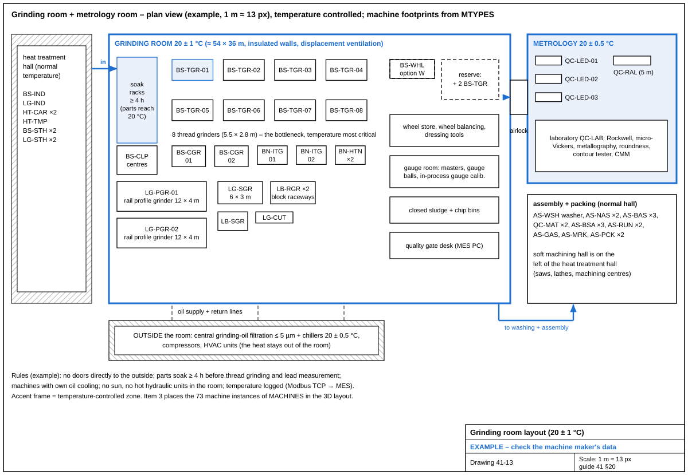

### 20.1 Climate zones

| Zone | Temperature | Why |
|---|---|---|
| Soft machining, heat treatment | normal hall (15 – 30 °C) | ± 0.05 mm tolerances |
| **Grinding room** | **20 ± 1 °C**, gradient ≤ 1 K/m height (example) | 1 K = 10 µm over 850 mm (§18.7) |
| Thread grinding + lead measurement | 20 ± 0.5 °C | C5 lead (± 35 µm), measurement uncertainty |
| **Metrology room** | **20 ± 0.5 °C**, no sun, airlock | lead, roundness, contour, CMM |
| Assembly | 20 – 24 °C, clean (no grinding dust) | balls, grease, seals |

### 20.2 Layout rules (input for item 3)

1. **Material flow** in one direction: bar store → saws → soft machining → washer → heat treatment → straightening
   → grinding room → metrology → assembly → packing → shipping.
2. **Heat treatment** separate: exhaust, quench oil, fire protection, gas supply (endogas / nitrogen / propane),
   floor loads, crane for furnace baskets. Keep it away from the grinding room (heat!).
3. **Grinding room**: closed room with HVAC; airlock for parts; parts **soak** in a buffer inside the room
   (≥ 4 h, §17.2) before thread grinding and measurement → buffer area for ≈ 4 h × 16 screws/h ≈ 64 shafts.
4. **Thread grinders on isolated foundations** (vibration from presses, saws, forklifts); presses and HMCs away from
   the grinders.
5. **Central oil system** for the grinders: filtration ≤ 5 – 10 µm, chillers 20 ± 0.5 °C, mist extraction, CO₂ fire
   protection for oil machines.
6. **Metrology room** next to the grinding room (short way, same temperature).
7. **Long parts**: screws up to 2 m, rails up to 4 m (family) – racks, carts and AGV loads for long parts, turning
   space.
8. **Utilities**: 1 752 kW installed (simultaneity factor ≈ 0.5 – 0.6 → ≈ 0.9 – 1.1 MW transformer, example);
   compressed air; Ethernet to every machine (item 4: Modbus TCP signal groups in `MTYPES[...].sig`).

### 20.3 Machine data for the twin

Item 3 takes from `MACHINES`: `id` (e.g. `BS-TGR-03`), `type`, `area`, `kW`, `foot` [length, width] in m, and the
Modbus signal groups `signals`. Item 4 maps the groups to register blocks (contract: holding registers, REAL = 2
registers ABCD, polling 100 ms / 1 s / 10 s).

| Signal group (`SIGNALS`) | Machines | Example content |
|---|---|---|
| `std` | all | status word, counters good / scrap, last cycle time, alarm code, order no. + part code, kW + kWh |
| `grind` | all grinders | wheel speed + spindle power, dressing counter + wheel Ø, oil temperature, in-process gauge |
| `tgr` | `BS-TGR`, `BN-ITG` | pass no. / passes, work speed, lead compensation + screw temperature, wheel tilt |
| `ind` | `BS-IND`, `LG-IND` | power, frequency, scan speed, quench flow + temperature + polymer %, energy per part |
| `furn` | `HT-CAR`, `HT-TMP` | zone temperatures, carbon potential, CO, oil temperature, load no., step, remaining time |
| `press` | straightening presses | run-out before / after, force, stroke, bend count |
| `meas` | `QC-LED`, `QC-RAL` | e_p, v_up, v_300, v_2π, grade result, material temperature |
| `torque` | assembly + matching | preload torque mean / variation, drag force, result + class |
| `cnc` | lathes, machining centres, rolling, whirling | spindle speed + load, tool no. + tool life, feed override |
| `wash` | washer | bath temperature, conductivity, belt speed |

---

## 21. Buy list – catalogue examples

Machine prices are rough estimates 2026 – **estimate – ask for a quote**. Makers marked **(check)**: confirm that they
offer this machine type for this part size today. Ask for references from ball screw / linear guide makers. The same
list is in the catalogue card (`bfCard2`, tab "Buy list") with a filter.

### 21.1 Soft machining (saw, lathe, machining centres)

| Item | Spec | Maker examples | Price class (estimate – ask for a quote) | Ask for |
|---|---|---|---|---|
| CNC lathe ≥ 1 200 mm between centres, steady rest | Ø36 bars × 1 010, 22 kW, tailstock, driven tools | DMG MORI CTX beta / CLX (check) · Okuma LB3000 EX II / LU (check) · Mazak QT-Nexus / Quick Turn (check) · Doosan (DN Solutions) Puma / Lynx (check) | ≈ 120 – 300 k€ | between centres, steady rest, live tools, gantry loader |
| Turning centre main + sub-spindle (nut) | Ø85 chuck work, sub-spindle, Y axis | DMG MORI NLX · Okuma LB-MYW · Mazak QT-Nexus MS · Doosan Puma SMX | ≈ 180 – 350 k€ | bar Ø, sub-spindle, Y axis, gantry loader |
| Vertical machining centre + 4th axis (nut) | flange drilling, deflector windows | DMG MORI CMX V · Okuma MB-46V · Mazak VCN · Doosan DNM | ≈ 100 – 250 k€ | rotary table, probe |
| Horizontal machining centre + tombstones (blocks) | 12 blocks per tombstone, pallet changer | DMG MORI NHX · Okuma MA-500 · Mazak HCN · Doosan NHP | ≈ 350 – 600 k€ | pallet pool, magazine ≥ 60 tools, IC 40 bar |
| Bandsaw / cold saw | Ø36 – Ø85 bars, rail + block profiles | Kasto · Behringer · Amada saws (check) | ≈ 40 – 150 k€ | auto feed, bundle clamping |
| Thread rolling machine (rolled screws) | 2-die through-feed | Profiroll (check) · PeeWee (check) | ≈ 250 – 500 k€ | rolling force, die Ø, through-feed length |
| Facing + centring machine | both ends, DIN 332 form B | Hessapp (check) · local makers | ≈ 80 – 180 k€ | bar Ø range, cycle |
| Rail drilling centre | gantry, 2 spindles, 4 m | local builders · long-bed VMC (check) | ≈ 150 – 300 k€ | length, spindles, IC |

### 21.2 Heat treatment (induction, carburising, tempering)

| Item | Spec | Maker examples | Price class | Ask for |
|---|---|---|---|---|
| Vertical induction scanning machine 60 kW, 30 kHz | shaft ≤ 1 500 mm, spray quench, energy monitor | EMA Indutec (check) · EFD Induction (check) · eldec (EMAG group) (check) · SMS Elotherm (check) | ≈ 250 – 450 k€ | generator kW + frequency range, energy monitor, quench system, coil change |
| Rail induction through-feed line | 2 hairpin coils, 80 – 120 kW | EFD Induction · EMA Indutec · SMS Elotherm (check) | ≈ 400 – 700 k€ | rail sizes, feed speed, straightness after hardening |
| Sealed-quench carburising furnace line | ≥ 600 kg per load, washer, temper | Ipsen · Aichelin · SECO/WARWICK (check) | ≈ 1 – 2 M€ | load size, carbon control, oil quench, LPC option |
| Low-pressure carburising (LPC) + gas quench (option) | less distortion, no IGO | ALD Vacuum Technologies · Ipsen · SECO/WARWICK (check) | ≈ 1.5 – 3 M€ | distortion, cycle, gas pressure |
| Tempering furnace | ≤ 300 °C, air circulation | Nabertherm · Aichelin · local (check) | ≈ 60 – 150 k€ | uniformity ± 5 K survey |

### 21.3 Grinding (cylindrical, thread, internal thread, profile, surface)

| Item | Spec | Maker examples | Price class | Ask for |
|---|---|---|---|---|
| CNC cylindrical grinder 1 000 mm | between centres, in-process gauge | Studer S33 / S41 (United Grinding) · Junker (check type) · Kellenberger (check) | ≈ 350 – 800 k€ | wheel Ø, in-process gauge, B axis, CBN option |
| External thread grinder for ball screws | ≤ 1.5 m, single-rib wheel, CNC dresser, lead compensation | Mitsui Seiki (check) · Drake Manufacturing GS:TE (check) · Holroyd / Precision Technologies Group (check) · Matrix Machine Tools (check) | ≈ 0.7 – 1.5 M€ | max length, lead accuracy achieved, dressing, thermal control, references |
| Hard whirling machine | Ø16 – 63, 1.5 m | Leistritz (check type) | ≈ 0.5 – 1 M€ | hard whirling 60 HRC, insert life, accuracy C5 / C7 |
| Internal thread grinder for ball nuts | nut ID ≥ 25 mm, quill ≤ 150 mm, 30 000 min⁻¹ | Mitsui Seiki · Drake · Holroyd / PTG · Okamoto (all check) | ≈ 0.6 – 1.2 M€ | min. bore, quill stiffness, CBN wheel, taper correction |
| Rail profile grinder multi-head | rails size 15 – 35, 4.5 m table | Amada (check) · Okamoto (check) · Blohm Jung PROFIMAT (check) · Nagase (check) | ≈ 1 – 2 M€ | heads, form dressing, chuck straightness, string length |
| Block raceway grinder | internal form wheel, string fixture | Amada · Okamoto · Blohm Jung · special builders (all check) | ≈ 0.6 – 1.2 M€ | wheel Ø vs channel, CBN option |
| Surface grinder 2 000 × 500 magnetic | rail base, block base | Okamoto · Blohm · Jung · Amada (check) | ≈ 150 – 500 k€ | chuck size, auto-dressing |
| Precision hard-turning lathe | CBN, stiff slide | Hembrug (check) · DMG MORI · EMAG VL · Okuma | ≈ 200 – 400 k€ | face run-out achieved, white-layer control |
| Grinding wheels + dressers | corundum 89A, CBN B76 – B126, diamond rolls + discs | Tyrolit · Norton (Saint-Gobain) · Krebs & Riedel · Noritake · Winterthur (3M) · Dr. Kaiser (dressers) | ≈ 0.3 – 5 k€ per wheel / roll | grit, bond, speed rating, dressing system |
| Grinding-oil filtration + cooling | ≤ 5 µm, 20 ± 0.5 °C | Knoll · Mayfran · Losma · Filtration Group (check) | ≈ 50 – 200 k€ per central plant | flow, filter fineness, chiller capacity |

### 21.4 Straightening presses

| Item | Spec | Maker examples | Price class | Ask for |
|---|---|---|---|---|
| Automatic straightening press with run-out measurement | 100 – 150 kN, shafts + rails | MAE (check) · Galdabini (check) · Eitel (check) | ≈ 200 – 500 k€ | force, measuring system, bend algorithm, crack monitoring |
| Manual / semi-automatic press (soft bars) | 100 kN, dial gauge | same makers | ≈ 60 – 150 k€ | stroke control |

### 21.5 Measurement + laboratory

| Item | Spec | Maker examples | Price class | Ask for |
|---|---|---|---|---|
| Laser interferometer for lead measurement | linear, environmental compensation | Renishaw XL-80 + XC-80 | ≈ 25 – 40 k€ | material sensors, software, bench integration |
| Lead measuring machine (complete) | ≤ 2 m screws, ball probe, encoder | integrator / screw-machine makers (check) | ≈ 120 – 300 k€ | uncertainty, ISO 3408-3 evaluation, report |
| Rockwell hardness tester | HRC, ISO 6508 | Zwick/Roell · Wilson (Buehler) · Mitutoyo · Emco-Test (check) | ≈ 8 – 25 k€ | test blocks, automatic cycle |
| Micro-Vickers + metallography | HV1 profile, case depth ISO 18203 | Struers · Buehler · Qness (check) | ≈ 40 – 120 k€ | auto traverse, cut-off + mount + polish |
| Roundness + contour testers | roundness ≤ 0.05 µm, contour | Taylor Hobson · Mahr · Mitutoyo · Jenoptik (Hommel) (check) | ≈ 60 – 200 k€ each | thread profile software |
| CMM | hole positions, windows | Zeiss · Hexagon · Mitutoyo (check) | ≈ 100 – 250 k€ | temperature range |
| Eddy-current / Barkhausen crack + burn testing | 100 % on shafts | Foerster (check) · Stresstech (Barkhausen) (check) | ≈ 50 – 150 k€ | probe, automatic scanning |

### 21.6 Washing, assembly, marking, packing

| Item | Spec | Maker examples | Price class | Ask for |
|---|---|---|---|---|
| Through-feed washer + demagnetiser | alkaline, dry, demag | Dürr Ecoclean · MAFAC · BvL (check) | ≈ 80 – 200 k€ | cleanliness spec |
| Torque sensors for preload + run-in | 0 – 5 N·m, ± 0.1 % FS | HBM (HBK) · Kistler · Lorenz Messtechnik (check) | ≈ 2 – 6 k€ each | range, speed, Modbus / analog out |
| Fibre laser marker 20 W | data-matrix, class 1 cabin | Trumpf · Keyence · Gravotech · Coherent (Rofin) (check) | ≈ 20 – 50 k€ | Ethernet interface, marking speed |
| Assembly benches, matching station, run-in stand | own design | local integrator | ≈ 20 – 150 k€ each | – |

---

## 22. Shopping list – first line

A new plant does not start with 72 machines. The **first line** (ramp-up, 1 shift, ≈ 20 screws + 20 nuts + 30 rails
+ 60 blocks per day) has one machine of each key type; carburising and rail induction are **sub-contracted** at first.

| Pos | Qty | Item | Spec | Example (choose one maker) | Price class (estimate – ask for a quote) |
|---|---|---|---|---|---|
| 1 | 1 | Bandsaw automatic | Ø20 – 100 bars | Kasto · Behringer | ≈ 40 – 90 k€ |
| 2 | 1 | Straightening press (manual + dial gauge) | 100 kN | MAE · Galdabini | ≈ 60 – 150 k€ |
| 3 | 1 | CNC lathe between centres + steady rest | 1 200 mm, 22 kW | DMG MORI · Okuma · Mazak · Doosan | ≈ 150 – 300 k€ |
| 4 | 1 | Turning centre main + sub-spindle | nuts | DMG MORI · Okuma · Mazak · Doosan | ≈ 180 – 350 k€ |
| 5 | 1 | Vertical machining centre + 4th axis | nuts + blocks (first line) | DMG MORI · Okuma · Mazak · Doosan | ≈ 100 – 250 k€ |
| 6 | 1 | Induction scanning machine 60 kW | shafts (rails sub-contracted) | EMA Indutec · EFD · eldec | ≈ 250 – 450 k€ |
| 7 | 1 | Tempering furnace | ≤ 300 °C | Nabertherm · Aichelin | ≈ 60 – 150 k€ |
| 8 | 1 | CNC automatic straightening press | 100 kN + run-out laser | MAE · Galdabini · Eitel | ≈ 200 – 400 k€ |
| 9 | 1 | CNC cylindrical grinder | 1 000 mm | Studer · Junker · Kellenberger | ≈ 350 – 700 k€ |
| 10 | 1 | External thread grinder | ≤ 1.5 m ball screws | Mitsui Seiki · Drake · Holroyd / PTG (check) | ≈ 0.7 – 1.5 M€ |
| 11 | 1 | Internal thread grinder | ball nuts | Mitsui Seiki · Drake · Holroyd / PTG (check) | ≈ 0.6 – 1.2 M€ |
| 12 | 1 | Rail profile grinder (or used machine) | 4.5 m, 3 heads | Amada · Okamoto · Blohm Jung (check) | ≈ 1 – 2 M€ |
| 13 | 1 | Surface grinder magnetic 2 000 × 500 | rail + block base | Okamoto · Blohm · Jung | ≈ 250 – 500 k€ |
| 14 | 1 | Lead measuring machine with laser | ≤ 2 m | Renishaw XL-80 + integrator | ≈ 120 – 300 k€ |
| 15 | 1 | Laboratory set (Rockwell, micro-Vickers, cut-off, roundness, contour) | QC-LAB | Zwick/Roell · Struers · Taylor Hobson · Mahr | ≈ 200 – 400 k€ |
| 16 | 1 | Washer + demagnetiser | through-feed | Dürr Ecoclean · MAFAC | ≈ 80 – 200 k€ |
| 17 | 2 | Assembly benches (nut + block) + torque tester + run-in stand | own design | HBM / Kistler sensors | ≈ 100 – 250 k€ |
| 18 | 1 | Laser marker + packing station | 20 W | Trumpf · Keyence | ≈ 30 – 80 k€ |
| 19 | 1 set | Grinding wheels, dressers, gauges, gauge balls, master screw + master rail | start kit | Tyrolit · Norton · Dr. Kaiser · ball maker | ≈ 80 – 200 k€ |
| 20 | 1 | Grinding room HVAC 20 ± 1 °C + oil chillers | ≈ 600 m² | local HVAC + Knoll / Losma chillers | ≈ 300 – 800 k€ |

Sum of the price classes: ≈ 5 – 10 M€ (rough). Buildings, compressed air, power supply and installation are extra.
The block raceway grinder is missing on purpose: in the first line the blocks can be bought as ground bodies or the
raceways ground on the profile grinder with a fixture (ask the maker) – decide in the business plan.

First capacity check for the first line (1 shift = 450 min, OEE 0.65 at start-up → 292 min): one thread grinder makes
292 / 42.25 ≈ 7 screws per shift. For 20 screws per day the thread grinder needs ≈ 3 shifts – so the first line runs
the thread grinder in 3 shifts from the start, or buys variant W (whirling) earlier.

---

## 23. Quality gates

These gates are the start of the inspection plan of item 5 (`QGATES` in the data file). Every gate has an id, the
route, the operation after which it is done, the characteristic, the spec, the method, the frequency and the reaction.

| Gate | Route / after op | Characteristic | Spec (example) | Method | Frequency | Reaction |
|---|---|---|---|---|---|---|
| QG-BS-1 | BS / 30 | centre holes | concentric, undamaged, 60° | centre-hole gauge, blue-ink contact | first + 1 in 20 | re-centre; block the lot until checked |
| QG-BS-2 | BS / 50 | hardness + case depth + cracks | 58 – 62 HRC, Rht 550 HV at 2 – 3 mm, no cracks | Rockwell (ISO 6508), HV1 cut-up (ISO 18203), eddy current 100 % | HRC 1 in 20, cut-up per shift, crack 100 % | stop the induction machine, check coil gap + energy monitor |
| QG-BS-3 | BS / 70 | run-out after straightening | ≤ 0.02 mm TIR along the thread | laser / LVDT on rotating rollers | 100 % | re-straighten (max. 2 ×), else scrap (crack risk) |
| QG-BS-4 | BS / 100 | thread profile + pitch Ø | contact angle 45° ± 2°, pitch Ø ± 3 µm | ball-pin micrometer, contour tester | pitch Ø 100 %, profile 1 in 10 | re-dress the wheel, check the dressing disc |
| QG-BS-5 | BS / 120 | lead accuracy | C5: e_p ± 35 µm, v_up 25, v_300 18, v_2π 8 µm | laser lead measuring machine (ISO 3408-3) | C5 100 %, C7 1 in 20 | downgrade to C7 or regrind with compensation |
| QG-BN-1 | BN / 40 | case hardening result | 58 – 62 HRC, Eht 0.8 – 1.2 mm, RA ≤ 15 % | test pieces per load, HV1, microscope | every load | hold the load, re-temper / scrap |
| QG-BN-2 | BN / 60 | internal thread pitch Ø + profile + lead | pitch Ø ± 3 µm, profile 45°, taper ≤ 2 µm | internal ball gauge, contour tester, master screw | 100 % / 1 in 10 | re-dress, check quill, adjust taper correction |
| QG-BN-3 | BN / 80 | deflector fit + ball class | step ≤ 0.01 mm, ball class for 3 % Ca | LVDT on master screw with gauge balls | 100 % | re-press / replace the deflector |
| QG-LG-1 | LG / 40 | raceway hardness + pattern | 58 – 62 HRC, case 1.5 – 2.5 mm, base soft | Rockwell, macro-etch cut-up | 1 in 20, cut-up per shift | adjust power / feed, check the coil position |
| QG-LG-2 | LG / 80 | raceway geometry | height + width class H, raceway radius, parallelism 13 µm / 700 mm | comparator + gauge balls vs master rail, contour tester | 100 % | re-dress the form wheels, re-grind |
| QG-LG-3 | LG / 100 | hole pitch + straightness + class | pitch 60 ± 0.2 cumulative, class H | rail measuring bench | 100 % | downgrade class N / scrap |
| QG-LB-1 | LB / 40 | case hardening result | 58 – 62 HRC, Eht 0.8 – 1.0 mm | test pieces per load | every load | hold the load |
| QG-LB-2 | LB / 60 | raceway geometry | height variation ≤ 15 µm (class H), profile | comparator with gauge balls vs master rail | 100 % | re-dress, check string clamping |
| QG-LB-3 | LB / 90 | preload (drag force) + height class | Z1 drag force window, H ± 0.04 | matching station | 100 % | re-ball with the next ball class |
| QG-FA-1 | FABS / 10 | preload torque | Tp 0.29 N·m ± 40 % (P1) | torque tester with chart | 100 % | re-ball with another class |
| QG-FA-2 | FABS / 30 | run-in torque + noise | no torque peaks > limit, noise ≤ 65 dB(A) at 500 min⁻¹ (example) | run-in stand | 100 % | open the nut, check deflectors + balls |
| QG-FA-3 | FALG / 10 | guide set check | drag force per block, parallelism class H, pair height variation ≤ 15 µm | force gauge + probe | 100 % | exchange the block |

Principles:

* **Measure close to the cause**: hardness right after hardening (not after grinding), run-out right after
  straightening.
* **100 % where the cost of a miss is high** (lead, cracks, preload); samples where the process is stable (profile,
  case depth – destructive).
* Every gate result goes to the MES (item 6) with serial / lot → traceability (lead chart of every C5 screw).
* SPC (item 5) on the key values: pitch Ø, lead e_p, case depth, preload torque.

---

## 24. Typical defects and causes

| Defect | What you see | Causes | Where it comes from (op) | Counter-measure |
|---|---|---|---|---|
| **Grinding burn** | dark / white zones after nital etch, Barkhausen signal high, soft spots, cracks later | dull wheel, too fast infeed, too little / too warm oil, U_d too high | 90, 100, 60 (nut), 80 (rail) | dress in time, reduce infeed in finishing, CBN, oil flow; 100 % Barkhausen for C3 |
| **Lead error** (e_p, v_300 out) | lead chart outside C5 | screw / oil / room temperature drift, worn Z-axis compensation, screw not soaked, residual stress released | 100, 120 | 20 ± 0.5 °C, oil chiller, soak ≥ 4 h, temperature compensation, re-calibrate the machine with a laser |
| **Periodic lead error (v_2π)** | wobble once per revolution | centres not concentric, run-out of the shaft, spindle error | 30, 80, 100 | re-grind centres, check the work spindle |
| **Waviness / chatter marks** | regular marks on the groove or OD, noise in run-in | unbalanced wheel, worn spindle bearings, no steady rest, resonance | 40, 90, 100 | balance the wheel (automatic balancer), steady rests, change work speed |
| **Quench cracks** | fine cracks along the groove or at steps, found by eddy current | overheating, too fast quench (low polymer %), sharp corners, delayed tempering | 50, 40 (rail) | energy monitor, polymer concentration daily, radius at steps, temper within 1 h |
| **Straightening cracks** | cracks in the hardened case | bend stroke too large in the hardened zone | 70 | bend in soft zones, small steps, 100 % crack test |
| **Soft spots / soft band** | hardness < 58 HRC locally, spiral band | blocked spray nozzle, coil not centred, scan speed drift, decarburised bar surface | 50, 40 (rail) | nozzle check, coil centring, energy monitor, peeled bar |
| **Distortion (banana, ovality)** | run-out, bow, oval bore | uneven heating / quench, residual stress from straightening, tight basket loading | 50, 40, 60 | even quench, stress-free soft straightening, basket rules |
| **Black spots (unground areas)** | dark unground patches in the groove or on the rail | stock too small for the distortion, eccentric pre-cut | 20 (nut), 70 → 100 | more stock, straighten better, centre the pre-cut |
| **Taper of the nut thread** | pitch Ø different at the nut ends, one circuit overloaded | quill deflection | 60 (nut) | stiffer quill, spark-out, CNC taper correction |
| **Wrong contact angle** | preload / load rating off, rough running | worn wheel profile, wrong dressing program, worn dressing roll | 100, 60, 80 (rail), 60 (block) | profile check 1 in 10 / per string, dressing roll wear limit |
| **Too much retained austenite** | size change in service, lead drift months later | high carbon potential, too high hardening temperature, no sub-zero | 40 (nut, block) | RA ≤ 15 % spec, sub-zero for C3 |
| **White layer** | thin brittle layer after hard turning / whirling | worn CBN edge | 50 (nut), 95 | tool-life counter, finish grinding after whirling |
| **Deflector step / jam** | noise, torque peaks, sudden lock | window not phased, deflector not seated | 30, 80 (nut) | probe before milling, step check 100 % |
| **Wrong preload** | too high torque / backlash | wrong ball class, mixed balls | 80 (nut), FA 10, LB 80 / 90 | ball class from measurement, poka-yoke ball containers, 100 % torque |
| **Rail springs back after grinding** | straightness lost after unclamping | magnet pulls a bent rail flat | 70, 80 (rail) | straighten ≤ 0.10 mm/m, shims, low magnet power |
| **Corrosion in transport** | rust marks | no / wrong oil, humid packing | 130, FA 50, FALG 30 | VCI packing, oil spec, dry storage |

---

## 25. Cost per part outline

A first, simple **machine-time cost** per part (not a full cost calculation – item 7 ERP does the standard cost):

  **cost per op = machine-hour rate × effective time / 60 / OEE**

The machine-hour rate (example) includes depreciation, interest, space, energy, maintenance, tools and the operator
share. Example rates (assumptions, ask your controller): saw / press / centring 60 €/h, lathe 80 €/h, induction
100 €/h, tempering 40 €/h, CNC straightening 80 €/h, cylindrical grinder 120 €/h, **thread grinder 150 €/h**, lead
measurement 90 €/h, washer 50 €/h.

Quick example (the formula of `costPerPart`): thread grinding 150 €/h × 40 min / 60 / 0.75 = **133 €** per screw
(cycle only). With the set-up share (42.25 min): **141 €**.

Screw shaft `BS-3210-1000-C5`, variant G, effective times from §6.1, OEE 0.75:

| Op | Effective (min) | Rate (€/h) | Cost (€) |
|---|---|---|---|
| 10 saw | 1.167 | 60 | 1.56 |
| 20 straighten | 2.583 | 60 | 3.44 |
| 30 face + centre | 1.450 | 60 | 1.93 |
| 40 turn | 9.750 | 80 | 17.33 |
| 50 induction | 5.333 | 100 | 11.85 |
| 60 temper | 2.500 | 40 | 2.22 |
| 70 straighten | 6.167 | 80 | 10.96 |
| 80 centre grind | 1.667 | 60 | 2.22 |
| 90 cylindrical grind | 9.625 | 120 | 25.67 |
| **100 thread grind** | **42.250** | **150** | **140.83** |
| 120 lead measurement | 12.250 | 90 | 24.50 |
| 130 wash | 1.500 | 50 | 1.67 |
| **Σ machine time** | | | **≈ 244 €** |

Material: bar Ø36 × 1 010 mm = 7.85 · 10⁻⁶ · π/4 · 36² · 1 010 = **8.07 kg** × ≈ 1.5 €/kg (example) ≈ **12 €**.

The thread grinding is **58 %** of the machine-time cost. Scrap (yield 93.77 %) adds ≈ 6 % on top, the nut, the
assembly and the overheads come on top. Compare with the market price of a ground Ø32 × 10 C5 set (guide 40 §21,
≈ 600 – 1 200 € for 1 m) – the business case depends mainly on the thread grinding cost and the scrap rate.

How to reduce the cost: CBN wheels (fewer dressings, longer cycles unattended), whirling for roughing (variant W),
higher OEE on the thread grinders (set-up reduction, preventive maintenance, operators per 2 – 3 machines), rolled
screws for C7 applications (variant R).

---

## 26. Standards register

Mark: **check edition** – verify the current edition before you quote a standard in a contract.

| Standard | Topic | Used in |
|---|---|---|
| ISO 3408-3 | Ball screws – acceptance conditions and acceptance tests (e_p, v_up, v_300, v_2π, run-out, torque) – check edition | §17.2, QG-BS-5 |
| JIS B 1192-3 | Ball screws (Japanese; C0 … C10 grades) – check edition | §17 |
| ISO 3408-1 / -2 / -4 / -5 | vocabulary, nominal sizes, axial rigidity, load ratings – check edition | guide 40 |
| ISO 6508-1 | Rockwell hardness test – check edition | §17.3 |
| ISO 6507-1 | Vickers hardness test – check edition | §17.4 |
| ISO 18265 | conversion of hardness values – check edition | §17.3 |
| ISO 18203 | steel – determination of the thickness of surface-hardened layers (Eht, Rht, CHD) – check edition | §11.5, §17.4 |
| ISO 3290-1 | rolling bearing balls – steel balls (grades G3 …) – check edition | balls |
| ISO 12090-1 / -2 | profiled rail guides – boundary dimensions and tolerances – check edition | rails, blocks |
| EN ISO 683-3 / ISO 683-17 | case-hardening steels / ball and roller bearing steels – check edition | §11 |
| EN 10083-3 | alloy steels for quenching and tempering (50CrMo4) – check edition | §6 |
| ISO 230-2 | test code for machine tools – positioning accuracy (laser calibration of the grinders) – check edition | §12.4 |
| AMS 2750 | pyrometry (furnace uniformity surveys, instrument accuracy) – check edition | §11.6 |
| CQI-9 (AIAG) | heat treat system assessment – check edition | §11 |
| ISO 21920-1 … 3 (replaces ISO 4287 / ISO 1302 profile parameters and indication) | surface texture Ra, Rz – check edition | op 90, 110 |
| DIN 332-1 | centre holes – check edition | op 30 |
| EN 13218 / EN ISO 16089 | safety of stationary grinding machines – check edition | machine purchase |
| EN 60519 / EN IEC 60519-3 | safety in electroheating installations (induction) – check edition | §11 |
| ISO 13849-1 | safety of control systems (hard-wired safety, contract) – check edition | items 4, 8 |

---

## 27. Glossary

| Term | Meaning |
|---|---|
| Allowance / stock | material left for the next (finishing) operation |
| Austenite | high-temperature structure of steel (≈ > 750 – 900 °C); quenching turns it into martensite |
| Barkhausen noise | magnetic method to find grinding burn and stress without destroying the part |
| Batch | number of parts made after one set-up |
| Black spot | unground area – stock was smaller than the distortion |
| Bottleneck | the machine type with the highest utilisation; it limits the plant output |
| Carburising | diffusing carbon into the surface of a low-carbon steel at ≈ 920 °C before hardening |
| Case depth (Eht, Rht, CHD) | depth of the hardened layer, measured where the hardness falls to a limit (ISO 18203) |
| CBN | cubic boron nitride – super-abrasive for hardened steel |
| Centres | 60° conical holes at the shaft ends – the datum for turning, grinding, measuring |
| Contact angle | angle of the line ball – raceway contact (45°) |
| Curie point | ≈ 770 °C; above it steel is not magnetic (μr = 1), penetration depth jumps |
| Deflector | insert in the nut that lifts the ball over the land into the previous groove |
| Dressing | re-shaping and sharpening a grinding wheel with a diamond tool |
| Effective time | cycle + set-up / batch |
| e_p, v_up, v_300, v_2π | lead accuracy values of ISO 3408-3 |
| Grinding burn | thermal damage of the surface (tempered or re-hardened layer) |
| Hard turning | turning hardened steel (58 – 62 HRC) with CBN inserts |
| Hard whirling | whirling of hardened steel with CBN inserts |
| Hollomon–Jaffe parameter | P = T · (20 + log t), equivalence of tempering time and temperature |
| Induction hardening | heating the surface by eddy currents from a coil, then quenching |
| Lead angle λ | helix angle of the thread: tan λ = Ph / (π · d_pw) |
| Lead compensation | programmed stretch / shrink of the ground lead (thermal + T value) |
| Martensite | hard, brittle structure from quenching austenite |
| OEE | overall equipment effectiveness = availability × performance × quality |
| Overbend | bending past straight so the spring-back leaves the part straight |
| Penetration depth δ | depth where the induced current falls to 37 % of the surface value |
| Polymer quench | water solution of a polymer (PAG); quench speed between water and oil |
| Quill | long thin spindle extension carrying the internal grinding wheel |
| Retained austenite (RA) | austenite that did not transform in quenching; can change size later |
| Routing | the ordered list of operations of a part |
| Run-out (TIR) | total indicator reading when the part rotates |
| Set-up | changing the machine from one part type / batch to the next |
| Single-rib wheel | thread grinding wheel with one profile rib (vs multi-rib) |
| Soak | waiting until the part has room temperature |
| Specific energy e_c | energy per removed volume (J/mm³) |
| Steady rest | support of a long workpiece against the cutting / grinding force |
| String | several rails / blocks clamped in a row and ground together |
| Sub-zero treatment | cooling to −80 °C after quenching to transform retained austenite |
| T value | target travel compensation ordered by the customer (pre-tension) |
| Takt | available time / required quantity |
| Tempering | heating hardened steel to 160 – 180 °C to reduce stress and brittleness |
| Tombstone | vertical fixture with many parts on an HMC pallet |
| Thread rolling | forming the groove by pressing rolling dies into the soft shaft |
| U_d | dressing overlap ratio = diamond width / dressing feed per revolution |
| White layer | very hard, brittle, thin re-hardened layer from hard machining or burn |
| Yield | share of good parts = Π (1 − scrap) |

---

## 28. Supplier questions

**Thread grinder / internal thread grinder**

1. Which ball screw / nut makers use this machine? Can we visit a reference?
2. Lead accuracy achieved on Ø32 × 1 000 (e_p, v_300, v_2π) – with which room / oil temperature?
3. Grinding from solid: cycle time for our part (send the drawing + 3 test shafts)? Passes, wheel, dressing?
4. Thermal compensation: screw temperature sensor? Automatic lead correction? Laser calibration interval?
5. Dressing system: CNC disc or roll? Profile accuracy of the gothic arch? Time per dressing?
6. CBN option? Wheel cost per part?
7. Steady rests: number, automatic?
8. Internal: minimum bore, quill length and stiffness, max. wheel speed, taper correction?
9. Interfaces: Modbus TCP (our standard) – which signals (pass, lead compensation, temperatures, counters)?
10. Delivery time, installation, training, spare parts, service in our country?

**Induction hardening**

1. Generator power and frequency range? Energy monitor per part with pass / fail?
2. Coil design and change time for the family Ø16 – 40?
3. Quench system: polymer, concentration control, filtration, temperature control?
4. Trial hardening of 5 shafts with cut-up reports (case depth profile, HRC, distortion)?
5. Distortion (run-out) to expect after hardening for Ø32 × 1 000?

**Carburising furnace line**

1. Load size and cycle for 300 nuts / 200 blocks with Eht 0.8 – 1.2 mm?
2. Carbon control (oxygen probe), CO / CO₂ analysis, AMS 2750 / CQI-9 compliance?
3. Distortion data for ring-shaped parts; LPC option?
4. Sub-zero option?

**Straightening press**

1. Measuring system (laser / LVDT), resolution, run-out achieved on hardened shafts?
2. Bend algorithm (learning spring-back), crack monitoring?
3. Rails: 2-plane straightening, max. length?

**Profile / raceway grinders**

1. Number of heads, form dressing system, profile accuracy?
2. String length, magnetic chuck straightness, rails size 15 – 35?
3. Cycle time for 4 rails LG-25-1000, height / width tolerance achieved (class H / P)?

**Measurement**

1. Lead measuring machine: uncertainty (k = 2), ISO 3408-3 evaluation and report, material temperature compensation?
2. Laser: environmental compensation unit, calibration certificate?

---

## 29. Next to read

| Guide | Item | Why |
|---|---|---|
| `40_ballscrew_linear_guide_products.md` | 1 · Products | what the parts must achieve: geometry, hardness, accuracy grades, preload |
| `42_…` (planned) | 3 · Factory layout + live 3D digital twin | places the 73 machine instances (`MACHINES`) in the areas of §20, AGV flows, buffers |
| `43_…` (planned) | 4 · Communication – Ethernet + Modbus TCP + HTTP | register maps for the signal groups of §20.3 |
| `44_…` (planned) | 5 · Quality + inspection | inspection plan from the quality gates of §23, SPC, gauges |
| `45_…` (planned) | 6 · MES (HTTP) | work orders from the routings, operation confirmation, traceability |
| `46_…` (planned) | 7 · ERP (HTTP) | BOM + routing → standard cost (§25), capacity planning with `capacity()` |
| `47_…` (planned) | 8 · PLC control programs | machine cell logic (Delta + Siemens) |

Data and formulas: `web/bsfmfg_data.js`, `web/bsfmfg_calc.js`. All values in this guide are examples – check the
machine maker's data.
