# 42 – Factory layout + live 3D digital twin: hall, zones, material flow, special rooms, utilities, AGVs, plant simulation

Tab **Ball screw + guide factory**, item **3 · Factory layout + live 3D digital twin (lines, machines, AGVs, stores)**.
Deep link: `/?bfitem=3#bsf`.

This guide is the textbook for **planning the factory building** of the new product line and for the **live digital twin**
of the whole plant. Guide 40 explains *what* the products are, guide 41 explains *how* each part is made and *how many
machines* we need. This guide answers the next questions:

* How big must the hall be, and why?
* Where does each of the 73 machines stand, and why there?
* How does the material flow – how many transports per day, how many metres, how many AGVs?
* What do the special rooms need – the grinding room at 20 ± 1 °C, the measurement room at 20 ± 0.5 °C, the isolated
  foundations of the thread grinders, the heat-treatment bay?
* How big are the utilities – transformer, compressed air, coolant, grinding oil, chips?
* How does the live simulation of the whole plant work (orders, lots, machine states, breakdowns, AGVs, stores, OEE,
  Little's law, bottleneck) – and how will items 4 – 8 (communication, quality, MES, ERP, PLC) connect to it with
  **Modbus TCP and HTTP only**?

| What | Example result of this guide |
|---|---|
| Design point | 120 ground ball screws + 120 nuts + 200 rails + 400 carriages per day → 120 screw sets + 200 guide sets, 2 shifts × 7.5 h, OEE 0.75 (item 2) |
| Machines | 73 instances (72 in the routings + laboratory), 978.8 m² footprint (930.8 m² without the laboratory) |
| Hall | **80 × 48 m = 3 840 m²**, columns 10 × 24 m, clear height 9 m, + annex 80 × 8 m (offices, MES room, utilities) |
| Zones | raw store → saw cell → soft machining → heat treatment (walled) → grinding room 20 ± 1 °C → measurement room 20 ± 0.5 °C → assembly → packing + FG |
| Flow | Z-flow, goods-in north-west, shipping south-east; 93 AGV trips per day, ≈ 2 070 m/day loaded |
| AGVs | 0.39 AGVs busy → **1 AGV + 1 spare = 2** (example) |
| Grinding room | ≈ 126 kW heat to the air, ≈ 75 000 m³/h, ≈ 17 air changes per hour, oil chillers ≈ 220 kW |
| Electrical | 2 262 kW installed, ≈ 1 265 kW demand, ≈ 1 360 kVA → transformer 1 600 kVA |
| Simulation (example run) | screw sets ≈ 120 / day, guide sets ≈ 200 / day, plant OEE ≈ 0.69, bottleneck BS-TGR (97 % busy), WIP ≈ 75 – 85 lots, order lead time ≈ 6 days |

> **All values in this guide are examples – check with your factory planner, the machine makers' installation
> drawings, the HVAC and electrical planners and your local building codes.** The numbers are of the right class for a
> new plant of this size. Use them to understand the method, to check an offer and to ask good questions. Before you
> build, a planning office makes the real layout with the real machine drawings, a soil report and a vibration survey.

Reader: mechanical engineer. Language: simple English, short sentences. Every formula comes with the example numbers,
so you can check it with a pocket calculator. Units: m, m², kW, kWh, m³/h, l/min, °C, K, h, min, s unless written
otherwise.

---

## Contents

1. [Purpose](#1-purpose)
2. [How to use the page](#2-how-to-use-the-page)
3. [Files, self-check and the shared simulation](#3-files-self-check-and-the-shared-simulation)
4. [Factory planning method](#4-factory-planning-method)
5. [Capacity → machines → areas → hall size](#5-capacity--machines--areas--hall-size)
6. [Layout types and the block layout](#6-layout-types-and-the-block-layout)
7. [Detailed layout – every machine placed](#7-detailed-layout--every-machine-placed)
8. [Material flow – from–to analysis](#8-material-flow--fromto-analysis)
9. [Special rooms – grinding room and measurement room](#9-special-rooms--grinding-room-and-measurement-room)
10. [Foundations and vibration](#10-foundations-and-vibration)
11. [Utilities sizing](#11-utilities-sizing)
12. [Material handling and AGV fleet sizing](#12-material-handling-and-agv-fleet-sizing)
13. [The digital twin – what the simulation models](#13-the-digital-twin--what-the-simulation-models)
14. [How items 4 – 8 connect – Modbus TCP + HTTP only](#14-how-items-4--8-connect--modbus-tcp--http-only)
15. [What-if studies – results and how to read them](#15-what-if-studies--results-and-how-to-read-them)
16. [Buy list – catalogue examples](#16-buy-list--catalogue-examples)
17. [Shopping list – plant infrastructure + twin](#17-shopping-list--plant-infrastructure--twin)
18. [Standards register](#18-standards-register)
19. [Glossary](#19-glossary)
20. [Questions for suppliers and planners](#20-questions-for-suppliers-and-planners)
21. [Next to read](#21-next-to-read)
22. [Appendix A – getBSF() API reference](#22-appendix-a--getbsf-api-reference)
23. [Appendix B – Modbus signal fields per group (SIGFIELDS)](#23-appendix-b--modbus-signal-fields-per-group-sigfields)

---

## 1. Purpose

A factory is planned **from the inside to the outside**: first the products and the quantity, then the operations,
then the number of machines, then the space, and only at the end the building. If you start with a building, the
machines must fit into it – that is how bad layouts are made: long transport ways, a grinding room next to the
furnaces, a thread grinder beside a press, no space for the work-in-process (WIP) racks.

This item does three things:

1. **Layout design.** It takes the 73 machine instances of item 2 (`MACHINES` in `web/bsfmfg_data.js`), groups them
   into zones, sizes every zone, places every machine with its real footprint, draws the doors and aisles and checks
   the flow with a from–to matrix. The result is a block layout and a detailed layout (drawings 42-01 and 42-02).
2. **Live 3D digital twin.** It builds the whole hall in 3D (Three.js, offline) and runs a **simulation of the whole
   plant**: customer orders, work orders split into lots, lots travelling through the routings, machines with set-up,
   breakdowns and scrap, batch furnaces, AGVs with batteries, raw-material and finished-goods stores. You see the
   machines change colour, the lots move, the WIP grow at the bottleneck, and you get live KPIs.
3. **The shared plant simulation for items 4 – 8.** `web/bsfsim.js` gives one shared instance (`getBSF()` →
   `window.BSF`). Item 4 (communication) will expose its state over HTTP and map every machine's state object 1:1 to
   Modbus TCP registers. Items 5 (quality), 6 (MES), 7 (ERP) and 8 (PLC) read and drive the same instance.

Why a digital twin at all? Because a spreadsheet (like `capacity()` in item 2) gives **average** numbers. A real plant
has **variability**: breakdowns, set-ups, batches, shifts, random scrap, AGV waiting, furnaces that wait for a full
load. Variability makes queues, queues make WIP, WIP makes long lead times. Only a dynamic model shows this. With the
twin you can ask "what if we buy 7 thread grinders instead of 8?" before you spend 1 M€.

---

## 2. How to use the page

The page has five cards:

| Card | What you do there |
|---|---|
| **1 · Layout design** | switch block layout / detailed layout (machine ids); read the hall-size calculation, the zone table, the layout principles with numbers, the from–to matrix and the AGV fleet sizing |
| **2 · Live 3D digital twin** | turn / move / zoom the hall; views iso, top, grinding room, heat treatment, walk-through; colour modes machine state / utilisation / WIP / OEE / power; click a machine for its panel |
| **3 · Controls + live KPIs** | run / pause, speed × 1 … × 3600, shifts 1 – 3, OEE target, AGV count, daily order mix, add an order, break / repair a machine; 8 KPI tiles, 4 small charts, event log, orders, stores |
| **4 · What-if** | tick scenarios (7 / 9 thread grinders, OEE 0.65 / 0.85, 1 / 3 AGVs, half transfer lots, 3 shifts, demand + 20 %), choose warm-up and measured days, run → comparison table |
| **Real components + drawings** | catalogue card `bfCard3`: 12 drawings, buy list (AGVs, racks, HVAC, coolant + oil systems, compressed air, floor + foundations, twin hardware), shopping list |

### 2.1 URL parameters

| Parameter | Effect |
|---|---|
| `?bfitem=3#bsf` | open the tab at item 3 |
| `&bf3view=iso\|top\|grind\|ht\|walk` | start view of the 3D twin |
| `&bf3mode=state\|util\|wip\|oee\|energy` | colour mode |
| `&bf3speed=1 … 3600` | simulation speed (simulated seconds per real second) |
| `&bf3pause` | start paused |
| `&bf3sel=BS-TGR-03` | select a machine (panel + blue frame) |
| `&bf3plan=block\|detail` | plan shown in card 1 |
| `&bf3card=lay\|twin\|ctl\|what` | scroll to a card |
| `&bf3what` | run the what-if comparison at start |
| `&bf3test` | self-check (console lines `BF3TEST …`, results in a debug box at the end) |
| `&bf3hold` | test only: keeps the page "loading" for headless screenshots and shows the tab |
| `&bf3tab=draw\|buy\|shop`, `&bf3box=N` | catalogue card: open a section / enlarge drawing N |
| `&bf3svgdump` | test only: `window.bf3Svg` holds all 12 drawings as SVG text (used to write `docs/img/42_*.svg`) |

### 2.2 A first walk through the page (15 minutes)

1. Open `/?bfitem=3#bsf`. The plant has already run 8 simulated days in the background (warm-up), so it is full of
   work. The clock in the 3D view shows the simulated day and time, for example `D9 07:08 · × 60 · running`.
2. **Card 1:** read the "Hall size – worked example" table. 930.8 m² of machines × 2.75 + 920 m² for stores and the
   aisle = 3 480 m² → hall 80 × 48 m. Switch to **Detailed (machine ids)** and find the 8 thread grinders
   `BS-TGR-01 … 08` along the south wall of the grinding room.
3. **Card 2:** press **Top**. Green = RUN, teal = SET-UP, yellow = STARVED (waiting for parts), orange = BLOCKED,
   red = DOWN, light grey = IDLE, dark grey = OFF (no shift). The small coloured boxes are lots. Blue boxes = screw
   shafts, green = nuts, orange = rails, violet = carriages.
4. Press **Grinding room**, then click one thread grinder. The panel shows the lot, the operation (`op 100 Thread
   grinding`), the piece counter, the ideal cycle (2 400 s = 40 min) and the real last cycle (≈ 3 100 s because of the
   speed factor P ≈ 0.77), OEE = A × P × Q, the time split bar and at the end the **Modbus TCP signal groups** with the
   live values (`std`, `grind`, `tgr`).
5. Switch the colour mode to **WIP queue**: dark blue machines have many lots waiting. The thread grinders are dark –
   they are the bottleneck.
6. **Card 3:** set the speed to × 900 and watch the KPI tiles: screw sets per day (target 120), guide sets per day
   (target 200), OEE, bottleneck, WIP, lead time, AGVs, energy.
7. Break a thread grinder (`break a machine` → `BS-TGR-03` → **break**). The machine turns red, the event log shows
   `alarm 900`, and after some simulated hours the WIP in front of the thread grinders grows. Press **repair**.
8. **Card 4:** keep the ticks (base, 7 thread grinders, OEE 0.85, 1 AGV, 3 AGVs, transfer lots ½) and press **Run
   what-if**. After a few seconds you get the comparison table (chapter 15).
9. At the end open the catalogue card: drawings, buy list, shopping list.

### 2.3 The controls in detail

| Control | Effect in the simulation |
|---|---|
| Run / Pause | stops the shared simulation clock (all items that use `window.BSF` see it stopped) |
| Speed | 1 = real time, 60 = one simulated minute per second, 3600 = one simulated hour per second |
| Shifts | 1, 2 or 3 shifts of 7.5 h net from 06:00; heat treatment always runs ≥ 3 shifts |
| OEE target | sets the speed factor P of every machine: P = OEE target / availability (chapter 13.5) |
| AGVs | 1 … 6 vehicles; removed vehicles finish their job and park |
| Daily mix | screw sets + guide sets per day; a new customer order of each type is created every day at 06:00 |
| Add order | an extra order for a set (FABS, FALG) or for spare parts (BS, BN, LG, LB) |
| Break / repair | manual alarm 900 on the chosen machine until you press repair |

---

## 3. Files, self-check and the shared simulation

### 3.1 Files

| File | What it contains |
|---|---|
| `web/bsflay.js` | the page: cards, controls, KPI tiles, charts, what-if, catalogue card, self-check |
| `web/bsflay_data.js` | hall, zones, machine placement `PLACE`, doors, lanes, chargers, racks, lot sizes, AGV data, `flowMatrix()`, `fleetSize()`, `areaTable()`, `layoutCheck()`, catalogue data `CARD3` |
| `web/bsflay_3d.js` | the 3D hall: instanced machine models, lots, AGVs, racks with stock, labels, picking, views, walk-through, heat maps |
| `web/bsflay_svg.js` | the plan for card 1 and the 12 drawings `42_*.svg` (generated from the same data) |
| `web/bsfsim.js` | **the shared plant simulation** (`createSim()`, `getBSF()`, `SIGFIELDS`, `STATES`, `ALARMS`) |
| `web/bsflay.css` | styles (light + dark theme) |
| `docs/img/42_*.svg`, `web/img/42_*.svg` | 12 drawings (identical copies) |
| `web/bsfmfg_data.js` (item 2, read only) | routings, machine types, machine instances, Modbus signal groups, `capacity()` |

### 3.2 The self-check `&bf3test`

Open `/?bfitem=3&bf3test#bsf`. The console prints about 42 lines `BF3TEST PASS …` and at the end
`BF3TEST DONE pass=42 fail=0 errors=none`. The checks are hand-checkable:

| Check | Hand calculation |
|---|---|
| layout | every one of the 73 machines is placed, lies inside its zone (0.3 m margin) and keeps ≥ 0.5 m to every other machine |
| footprint | Σ L × W = 978.8 m² (930.8 m² without the laboratory) |
| zone areas | Σ zone areas + main aisle 80 × 4 m = 3 840 m² = hall |
| thread grinding effective time | 40 + 45 / 20 = 42.25 min per screw (cycle + set-up share) |
| ideal output of the bottleneck | 8 machines × 900 min / 42.25 min = 170.4 screws per day at OEE 1 |
| real output of the bottleneck | 170.4 × 0.75 × yield after thread grinding = 125.3 good screws per day = 120 × 8 / 7.664 (item 2) |
| AGV trips | Σ (lots per day × AGV legs per lot) = 7 × 4 + 4 × 5 + 5 × 4 + 5 × 5 = 93 |
| screw lots per day | ⌈120 / 0.9377 / 20⌉ = ⌈6.4⌉ = 7 |
| distance raw store → saw cell | \|28 − 25\| + 12 + \|28 − 25\| = 18 m (east lane at y = 25 m) |
| AGVs needed | 4.14 h busy / (15 h × 0.7) = 0.39 → 1 |
| shared instance | `getBSF() === window.BSF` |
| snapshot | `JSON.stringify(B.snapshot())` works, 73 machines, every SIGFIELDS field present |
| methods + events | `setMachineDown` → DOWN → repaired; `addOrder` creates lots; events machine / alarm / lot / stock / tick fire |
| Little's law | background run 8 + 10 days: WIP L = λ × W within 10 % |
| output | screw sets ≥ 108 / day, guide sets ≥ 180 / day; bottleneck = BS-TGR; AGV trips within 15 % of the matrix; OEE 0.6 … 0.8 |
| what-if | 7 thread grinders → fewer screw shafts per day, ≤ 109.6 × 1.05 (hand: 125.3 × 7 / 8 = 109.6) |
| drawings | 12 drawings, viewBox, title block "EXAMPLE – check with your planner", no up / down arrow characters, text ≥ 11 px |
| 3D | 73 machines, < 200 scene objects (instancing), snapshots of 3 views are not blank |
| card | `bfCard3` exists after the what-if card, 12 drawings loaded |

### 3.3 Data you can change

| Value | File | Default (example) |
|---|---|---|
| hall size, column grid | `bsflay_data.js` `HALL` | 80 × 48 m, 10 × 24 m |
| zone rectangles | `ZONES[...].rect` | see chapter 6 |
| machine position | `PLACE[id] = [x, y, rot, face]` | see chapter 7 |
| AGV hand-over points | `DOORS` | 7 points on the main aisle |
| transfer lot sizes | `LOT` | screw 20, nut 40, rail 50, carriage 100, sets 20 / 50 |
| AGV data | `AGV` | 2 vehicles, 1.0 m/s, load 45 s, unload 45 s, doors 30 s, battery 8 h |
| MTBF / MTTR classes | `bsfsim.js` `REL` | chapter 13.6 |
| power factors | `bsfsim.js` `PWR`, `INFRA` | chapter 11.1 |

`layoutCheck()` runs in the self-check: if you move a machine into another one or out of its zone, the check fails
and names the machines.

---

## 4. Factory planning method

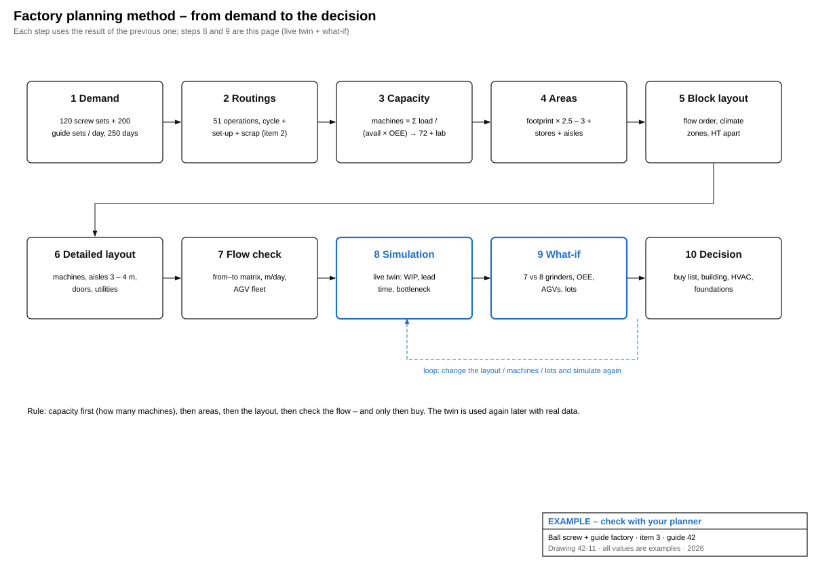

The classic method (German literature: "Fabrikplanung", e.g. the VDI 5200 guideline family – check the edition) has
these steps. Each step uses the result of the previous one.

| Step | Question | Result in this plant (example) | Where |
|---|---|---|---|
| 1 Demand | what, how many, when? | 120 screw sets + 200 guide sets per day, 250 days per year | item 2 `PLANT` |
| 2 Routings | which operations, which machine type, how long? | 51 operations, cycle, set-up, batch, scrap per operation | item 2 `ROUTES` |
| 3 Capacity | how many machines of each type? | 72 machines + laboratory; bottleneck thread grinding 95.8 % | item 2 `capacity()` |
| 4 Areas | how much floor area? | 930.8 m² machines × 2.5 – 3 + stores + aisle | chapter 5 |
| 5 Block layout | which zone where? | Z-flow, climate rooms south, heat treatment north-east | chapter 6 |
| 6 Detailed layout | where exactly is each machine? | 73 machines placed, aisles 3 – 4 m, doors, racks | chapter 7 |
| 7 Flow check | how much transport? | from–to matrix, 93 AGV trips / day, 2 073 m / day | chapter 8 |
| 8 Simulation | does it really work with variability? | live twin: WIP, lead time, bottleneck | chapter 13 |
| 9 What-if | what if …? | 7 vs 8 grinders, OEE, AGVs, lot sizes, shifts | chapter 15 |
| 10 Decision | what do we buy and build? | buy list, building, HVAC, foundations | chapters 16 – 17 |

Steps 4 – 9 are a **loop**: if the simulation shows a problem (for example too much WIP in front of a machine, or an
AGV that is always busy), you go back, change the layout, the machine count or the lot size, and simulate again.

Three rules from practice:

1. **Capacity first.** Never draw a layout before the machine count is known. A missing thread grinder cannot be
   "squeezed in" later into a full climate room.
2. **Flow before beauty.** The best layout is the one with the shortest, simplest material flow without crossings and
   backflow, not the one that looks symmetrical.
3. **Plan for growth.** Leave one direction free for extension (here: east of assembly + packing, south of the
   grinding room).

---

## 5. Capacity → machines → areas → hall size

### 5.1 Recap – machines from capacity (item 2)

`capacity()` in item 2 computes for every machine type:

    load (min/day) = Σ over the operations on this type of ( effective time per piece × start quantity )
    effective time = cycle + set-up / batch
    start quantity = good quantity / Π (1 − scrap) of this and all later operations
    machines needed = load / (available minutes per day × OEE),   n = round up

Example thread grinder `BS-TGR` (op 100, screw shaft):

    effective time = 40 + 45 / 20 = 42.25 min
    start quantity = 120 / (yield of op 100, 120, 130) = 120 / 0.980 ≈ 122.4 screws per day (example)
    load = 42.25 × 122.4 ≈ 5 173 min/day
    available = 2 shifts × 7.5 h × 60 = 900 min/day,  OEE 0.75 → 675 productive min per machine
    machines needed = 5 173 / 675 ≈ 7.66 → 8 thread grinders, utilisation 7.66 / 8 = 95.8 %

The result of item 2 is 72 machines in the routings + 1 laboratory = 73 instances (`MACHINES`).

### 5.2 Machine footprint

Every machine type has a footprint `foot = [length, width]` in metres (example from catalogues – the real value comes
from the maker's installation drawing and **includes** the chip conveyor, the control cabinet, the coolant tank and the
door swing).

    footprint of all machines = Σ (L × W × n) = 978.8 m²   (73 instances)
                              = 930.8 m²  without the laboratory (8 × 6 m)

### 5.3 Space factor

The machine footprint alone is not the floor area. Around every machine you need:

| Space | Typical value (example) |
|---|---|
| operator area in front of the machine | 1.0 – 1.5 m deep |
| maintenance access behind / beside | 0.8 – 1.0 m, doors of the cabinet must open (90°) |
| WIP rack in front (lot in + lot out) | 1.2 × 0.8 m per lot place, 2 – 4 places |
| part of the cell aisle | 3.0 – 3.5 m aisle shared by two rows |
| tool / gauge cabinet, chip container | 1 – 2 m² per machine |

This is summarised as a **space factor**:

    production area = machine footprint × k,   k = 2.5 – 3.0 for machining (example), 1.8 – 2.3 for dense furnace lines,
                                               4 – 7 for manual assembly benches (people, carts, run-in, growth)

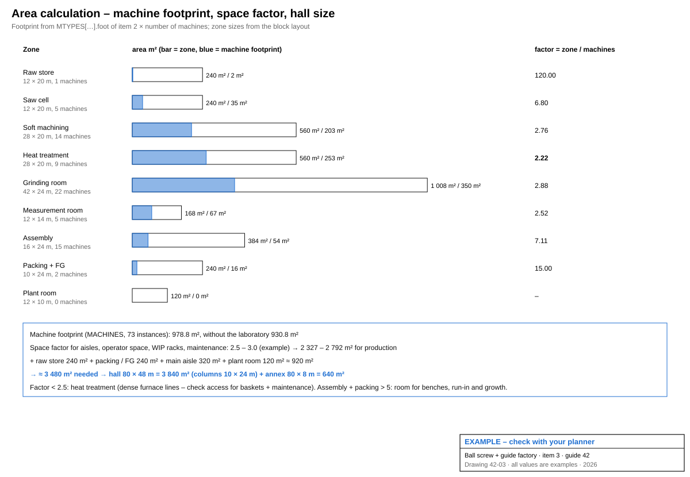

### 5.4 Hall size – worked example

    machines without the laboratory   930.8 m²
    × space factor 2.75               2 560 m²   (range 2.5 – 3.0 → 2 327 – 2 792 m²)
    + raw store                         240 m²
    + packing + finished goods          240 m²
    + main aisle 80 × 4 m               320 m²
    + plant room (HVAC + oil)           120 m²
    = needed                         ≈ 3 480 m²

Chosen: **hall 80 × 48 m = 3 840 m²** (10 % reserve) + **annex 80 × 8 m = 640 m²** for offices, the MES / server
room and the utilities (compressed air, coolant central system + chips, electrics, heat-treatment utilities).

Why 80 × 48 m and not, for example, 60 × 64 m?

* **Width 48 m = two spans of 24 m.** A 24 m span is a standard steel-frame span; one inner column row at y = 24 m
  lies exactly on the wall between the main aisle and the south rooms, so the columns never stand in an aisle.
* **Length 80 m = 8 bays of 10 m.** The zones fit on the 10 m grid (raw store 12 m, saw cell 12 m, soft machining
  28 m, heat treatment 28 m – the zone borders do not need to be on the grid, but long rooms like the grinding room
  42 m and the heat-treatment bay 28 m are easy to build on it).
* A long, narrow hall gives a natural flow direction (Z-flow from north-west to south-east) and short cross ways.
* The smallest possible hall with k = 2.5 would be ≈ 3 247 m² ≈ 68 × 48 m – no room for growth and very tight around
  the heat treatment.

### 5.5 Clear height and crane

| Item | Value (example) | Why |
|---|---|---|
| clear height under the crane girder | 9.0 m | carburising furnace lines ≈ 4.5 m + loading car + crane hook travel; tall induction tower 4 m; cantilever racks 2.6 m |
| heat-treatment bay crane | 5 t bridge crane, span 28 m | furnace baskets (≈ 600 – 1 000 kg), coils, quench-oil pumps, maintenance |
| grinding room ceiling | 4.5 m (suspended ceiling with the supply ducts) | smaller air volume = less HVAC; machines are placed through a 5 × 4.5 m door with a mobile crane / air skates |
| soft machining | jib cranes 0.5 – 1 t at lathes and presses | screw shafts 1 – 2 m long, chucks, steady rests |

### 5.6 Zone table (from `areaTable()`)

| Zone | Size (m) | Area m² | Machines | Machine footprint m² | Space factor |
|---|---|---|---|---|---|
| Goods-in + raw-material store | 12 × 20 | 240 | 1 | 2.0 | 120.00 |
| Saw + straighten + centre cell | 12 × 20 | 240 | 5 | 35.3 | 6.80 |
| Soft machining (turning, milling, drilling) | 28 × 20 | 560 | 14 | 202.6 | 2.76 |
| Heat treatment + hard straightening (walled) | 28 × 20 | 560 | 9 | 252.6 | 2.22 |
| Grinding room 20 ± 1 °C | 42 × 24 | 1 008 | 22 | 349.7 | 2.88 |
| Measurement room 20 ± 0.5 °C | 12 × 14 | 168 | 5 | 66.6 | 2.52 |
| Wash + assembly + run-in (20 – 24 °C, clean) | 16 × 24 | 384 | 15 | 54.0 | 7.11 |
| Packing + finished-goods store + shipping | 10 × 24 | 240 | 2 | 16.0 | 15.00 |
| Grinding HVAC + oil plant room | 12 × 10 | 120 | 0 | 0.0 | – |

Read the factor column: heat treatment 2.22 is dense (furnace lines are compact by design – check access for baskets
and maintenance with the furnace maker); assembly 7.11 and packing 15.0 are generous on purpose (benches, run-in,
growth, the component supermarket and the finished-goods racks are not "machines").

---

## 6. Layout types and the block layout

### 6.1 The four basic layout types

| Type | Idea | Good for | Bad for |
|---|---|---|---|
| **Functional (process) layout** | machines of the same kind together (all lathes, all grinders) | many products, shared machines, special environment (climate room, heat treatment) | long and crossing material flow, high WIP |
| **Product (line) layout** | machines in the order of the routing of one product | one product in high volume, short flow | low utilisation of machines that are used only shortly; inflexible |
| **Cell layout** | a group of different machines makes one part family complete | medium volume part families, short lead time, one team owns the cell | needs balanced cycle times; machines shared by families are duplicated |
| **Fixed position** | the product stays, people and tools come | very large products (ships, presses) | not for our parts |

Most real plants are **hybrids**. The question is: where does each type fit?

### 6.2 Why a hybrid layout here

| Area | Type chosen | Reason |
|---|---|---|
| Saw cell | functional | 2 saws + 2 straightening presses + centring serve all four parts; noisy and vibrating – one place far from the grinders |
| Soft machining | functional groups | lathes for screws and nuts, VMCs for nuts, 5 HMCs for blocks, the rail drill: the parts do not share machines, but the area shares the emulsion central system and chip handling |
| Heat treatment | functional (walled bay) | batch furnaces are shared by nuts + carriages (carburising) and screws + rails (tempering); fire wall, exhaust, gas, crane – one special room |
| Grinding room | functional (climate room) | all grinders need 20 ± 1 °C; the climate room is expensive per m², so all grinders are put in one compact room |
| Measurement room | functional (climate room 20 ± 0.5 °C) | lead measuring machines and the laboratory need the best climate, next to the grinding room |
| Assembly | product lines | screw line (nut assembly → screw assembly → run-in → marking) and guide line (block assembly → matching → set assembly) |

A pure cell layout (one complete cell per part) would need ≈ 15 more machines: every cell would need its own saw,
washer, tempering furnace, carburising line (!) and climate room. That is not economic at this volume.

### 6.3 The block layout

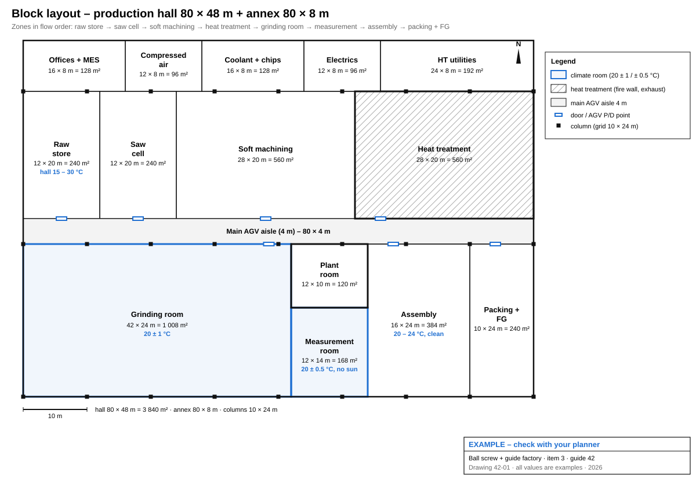

| Key | Zone | Rect x0 / y0 / x1 / y1 (m) | Climate | Contents |
|---|---|---|---|---|
| `RAW` | Goods-in + raw-material store | 0 / 28 / 12 / 48 | hall 15 – 30 °C | bars Ø36 / Ø85 (cantilever racks), rail + block profiles, bought parts (balls, seals, end caps), incoming check; truck dock in the west wall |
| `SAW` | Saw + straighten + centre cell | 12 / 28 / 24 / 48 | hall | bandsaw, cold saw, soft straightening presses, facing + centring – noisy + vibrating, kept away from the grinders |
| `SOFT` | Soft machining (turning, milling, drilling) | 24 / 28 / 52 / 48 | hall | CNC lathes, turning centres, VMCs, rail drilling centre, 5 HMCs with tombstones; emulsion central system, chip conveyors |
| `HT` | Heat treatment + hard straightening (walled) | 52 / 28 / 80 / 48 | hot zone, exhaust | 2 sealed-quench carburising lines, induction (shafts + rails), tempering, CNC straightening presses; fire wall, exhaust hoods, 5 t crane, oil-tight floor |
| `AISLE` | Main AGV aisle (4 m) | 0 / 24 / 80 / 28 | hall | 2 one-way AGV lanes + walkway, all hand-over points (doors) lie on it |
| `GRIND` | Grinding room 20 ± 1 °C | 0 / 0 / 42 / 24 | 20 ± 1 °C (thread grinders 20 ± 0.5 °C) | 8 thread grinders on isolated foundations, cylindrical, internal thread, profile, surface + raceway grinders; airlock, soak buffer ≥ 4 h |
| `METRO` | Measurement room 20 ± 0.5 °C | 42 / 0 / 54 / 14 | 20 ± 0.5 °C, no sun | 3 laser lead measuring machines, rail measuring bench, laboratory (hardness, metallography, roundness, contour, CMM) |
| `PLANT` | Grinding HVAC + oil plant room | 42 / 14 / 54 / 24 | technical | air-handling units for the grinding + measurement rooms, central grinding-oil filtration ≤ 5 µm + chillers, CO₂ fire protection |
| `ASSY` | Wash + assembly + run-in (20 – 24 °C, clean) | 54 / 0 / 70 / 24 | 20 – 24 °C, clean | washer + demagnetiser, nut + block assembly, preload matching, screw assembly + torque test, run-in stands, laser marker, component supermarket |
| `PACK` | Packing + finished-goods store + shipping | 70 / 0 / 80 / 24 | hall | packing stations (VCI, tubes, boxes, labels), finished-goods racks, truck dock in the east wall |
| `OFFICE` | Offices + MES / server room (2 floors) | 0 / 48 / 16 / 56 | office | production office, planning, quality office, MES / twin server room with UPS, Ethernet core switch |
| `AIR` | Compressed-air station | 16 / 48 / 28 / 56 | technical | 2 + 1 screw compressors, dryer, 2 × 3 m³ receivers, heat recovery |
| `COOL` | Coolant central system + chip handling | 28 / 48 / 44 / 56 | technical | emulsion central filtration (soft machining), chip conveyor end, briquetting press, chip containers |
| `ELEC` | Transformer + main LV switchboard | 44 / 48 / 56 / 56 | technical | 1 600 kVA transformer (example), main LV board, power-factor correction, energy meters (Modbus TCP) |
| `HTU` | Heat-treatment utilities | 56 / 48 / 80 / 56 | technical | endogas generator / N₂-methanol, propane, quench-oil cooler, polymer tank, closed cooling tower, exhaust fans |

Flow order (Z-flow):

    goods-in (west wall, north) → raw store → saw cell → soft machining → heat treatment (north-east)
       → main aisle → grinding room (south-west) → measurement room → assembly → packing + FG → shipping (east wall, south)

Five decisions in the block layout and why:

1. **Climate rooms in the south half, heat treatment in the north-east corner.** The two hottest and the two most
   temperature-sensitive areas are as far apart as possible. They have no common wall; their nearest corners are
   ≈ 10.8 m apart (4 m aisle + two walls). The heat-treatment bay also has its utilities (gas, quench-oil cooler,
   cooling tower, exhaust fans) directly behind its north wall in the annex.
2. **Measurement room between grinding room and assembly.** Screws go from the thread grinders through an inner door
   into the measurement room (same climate class), then through another inner door to the washer in assembly – no AGV
   and no climate change on the way.
3. **One main aisle, all hand-over points on it.** The 4 m main aisle (y = 24 … 28 m) runs the full length. Every zone
   has exactly one AGV pick / drop point (P/D point) on it. No AGV enters a climate room or the heat-treatment bay
   (doors, temperature, oil on the floor).
4. **Noisy and vibrating machines in the north.** Saws, presses, HMCs and furnaces are in the north row; the thread
   grinders stand along the south wall of the grinding room, ≥ 28 m away from the nearest press / saw / HMC.
5. **Growth.** Assembly and packing can grow east (hall extension), the grinding room can grow south (outside wall)
   without moving machines.

### 6.4 Alternatives that were rejected

| Alternative | Why rejected |
|---|---|
| U-flow (goods-in and shipping at the same wall) | possible (one dock, one yard), but then the grinding room would lie next to the heat treatment or the saws |
| grinding room in the middle of the hall | climate room with 4 inner walls is good for HVAC, but every flow would cross it; no outside wall for growth |
| heat treatment sub-contracted (no furnaces) | good for the start (item 2 shopping list: first line sub-contracts carburising), but long lead time (transport 2 × 1 – 3 days) and quality risk for the full plant |
| two halls (soft + hard) | separates heat / dust better, but doubles the transport distance and the building envelope |

---

## 7. Detailed layout – every machine placed

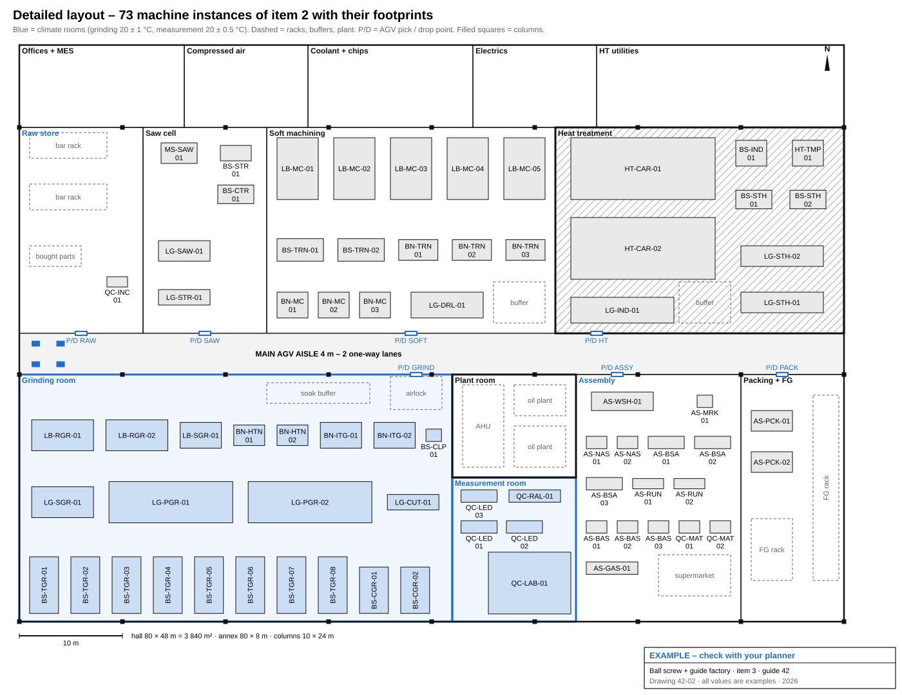

### 7.1 Placement rules used

| Rule | Value (example) | Where you see it |
|---|---|---|
| distance between machines in a row | ≥ 1.0 – 1.5 m (doors, chip conveyor, maintenance) | thread grinders: 2.8 m wide at 4.0 m pitch → 1.2 m gap |
| service space to a wall | ≥ 0.8 – 1.0 m | grinding room south row: 0.8 m to the wall |
| cell aisle | 3.0 – 3.5 m | grinding room aisles y = 6.3 … 9.6 m and 13.6 … 16.6 m |
| operator side | towards the aisle | `PLACE[id][3]` = "N" / "S" / "E" / "W" |
| long machines | long side along the aisle | profile grinders 12 m, carburising lines 14 m, rail straightening presses 8 m |
| WIP places | in front of each machine (lot in + lot out) | the 3D shows the lots there |
| check | `layoutCheck(0.5)`: inside the zone (0.3 m margin), ≥ 0.5 m to every other machine | self-check line 1 |

### 7.2 Machine positions (from `PLACE`)

Coordinates: x along the hall (west → east, 0 … 80 m), y across (south → north, 0 … 48 m), origin = south-west inside
corner. "long side across" = footprint length along y.

**Goods-in + raw-material store** – zone 0 / 28 / 12 / 48 m (x0 / y0 / x1 / y1)

| Machine id | Type | Footprint L × W (m) | Centre x / y (m) | Orientation | Operator side | kW |
|---|---|---|---|---|---|---|
| `QC-INC-01` | Incoming inspection bench (bought plastic parts) | 2 × 1 | 9.5 / 33 | long side along (x) | S | 0.5 |

**Saw + straighten + centre cell** – zone 12 / 28 / 24 / 48 m (x0 / y0 / x1 / y1)

| Machine id | Type | Footprint L × W (m) | Centre x / y (m) | Orientation | Operator side | kW |
|---|---|---|---|---|---|---|
| `MS-SAW-01` | Automatic bandsaw (bar) | 3.5 × 2 | 15.5 / 45.5 | long side along (x) | S | 5 |
| `BS-STR-01` | Hydraulic straightening press 100 kN (soft bars) | 3 × 1.5 | 21 / 45.5 | long side along (x) | S | 7.5 |
| `BS-CTR-01` | Facing + centring machine (both ends) | 3.5 × 1.8 | 21 / 41.5 | long side along (x) | S | 11 |
| `LG-SAW-01` | Circular cold saw (rail + block profiles) | 5 × 2 | 16 / 36 | long side along (x) | S | 7.5 |
| `LG-STR-01` | Rail straightening press (soft) | 5 × 1.5 | 16 / 31.5 | long side along (x) | S | 7.5 |

**Soft machining (turning, milling, drilling)** – zone 24 / 28 / 52 / 48 m (x0 / y0 / x1 / y1)

| Machine id | Type | Footprint L × W (m) | Centre x / y (m) | Orientation | Operator side | kW |
|---|---|---|---|---|---|---|
| `BS-TRN-01` | CNC lathe with tailstock + steady rest (≥ 1 200 mm between centres) | 4.5 × 2.2 | 27.25 / 36.1 | long side along (x) | N | 22 |
| `BS-TRN-02` | CNC lathe with tailstock + steady rest (≥ 1 200 mm between centres) | 4.5 × 2.2 | 33.15 / 36.1 | long side along (x) | N | 22 |
| `BN-TRN-01` | CNC turning centre, main + sub-spindle, driven tools | 3.8 × 2 | 38.7 / 36.1 | long side along (x) | N | 18.5 |
| `BN-TRN-02` | CNC turning centre, main + sub-spindle, driven tools | 3.8 × 2 | 43.9 / 36.1 | long side along (x) | N | 18.5 |
| `BN-TRN-03` | CNC turning centre, main + sub-spindle, driven tools | 3.8 × 2 | 49.1 / 36.1 | long side along (x) | N | 18.5 |
| `BN-MC-01` | Vertical machining centre with 4th axis | 3 × 2.5 | 26.5 / 30.75 | long side along (x) | S | 15 |
| `BN-MC-02` | Vertical machining centre with 4th axis | 3 × 2.5 | 30.5 / 30.75 | long side along (x) | S | 15 |
| `BN-MC-03` | Vertical machining centre with 4th axis | 3 × 2.5 | 34.5 / 30.75 | long side along (x) | S | 15 |
| `LG-DRL-01` | CNC rail drilling centre (gantry, 2 spindles) | 7 × 2.5 | 41.5 / 30.75 | long side along (x) | S | 15 |
| `LB-MC-01` | Horizontal machining centre with pallet changer + tombstones | 6 × 4 | 27 / 44 | long side across (y) | S | 26 |
| `LB-MC-02` | Horizontal machining centre with pallet changer + tombstones | 6 × 4 | 32.5 / 44 | long side across (y) | S | 26 |
| `LB-MC-03` | Horizontal machining centre with pallet changer + tombstones | 6 × 4 | 38 / 44 | long side across (y) | S | 26 |
| `LB-MC-04` | Horizontal machining centre with pallet changer + tombstones | 6 × 4 | 43.5 / 44 | long side across (y) | S | 26 |
| `LB-MC-05` | Horizontal machining centre with pallet changer + tombstones | 6 × 4 | 49 / 44 | long side across (y) | S | 26 |

**Heat treatment + hard straightening (walled)** – zone 52 / 28 / 80 / 48 m (x0 / y0 / x1 / y1)

| Machine id | Type | Footprint L × W (m) | Centre x / y (m) | Orientation | Operator side | kW |
|---|---|---|---|---|---|---|
| `BS-IND-01` | Vertical induction scanning hardening machine 60 kW / 30 kHz | 3 × 2.5 | 71 / 45.5 | long side along (x) | S | 80 |
| `HT-TMP-01` | Air-circulation tempering furnace (≤ 300 °C) | 3 × 2.5 | 76.5 / 45.5 | long side along (x) | S | 45 |
| `BS-STH-01` | CNC automatic straightening press 100 kN with run-out measurement | 3.5 × 1.8 | 71.25 / 41 | long side along (x) | S | 11 |
| `BS-STH-02` | CNC automatic straightening press 100 kN with run-out measurement | 3.5 × 1.8 | 76.5 / 41 | long side along (x) | S | 11 |
| `HT-CAR-01` | Sealed-quench carburising furnace line (furnace, washer, temper, loader) | 14 × 6 | 60.5 / 44 | long side along (x) | S | 250 |
| `HT-CAR-02` | Sealed-quench carburising furnace line (furnace, washer, temper, loader) | 14 × 6 | 60.5 / 36.25 | long side along (x) | S | 250 |
| `LG-IND-01` | Horizontal through-feed induction line for rails | 10 × 2.5 | 58.5 / 30.25 | long side along (x) | S | 120 |
| `LG-STH-01` | CNC rail straightening press 150 kN, 2 planes | 8 × 2 | 74 / 31 | long side along (x) | S | 15 |
| `LG-STH-02` | CNC rail straightening press 150 kN, 2 planes | 8 × 2 | 74 / 35.5 | long side along (x) | S | 15 |

**Grinding room 20 ± 1 °C** – zone 0 / 0 / 42 / 24 m (x0 / y0 / x1 / y1)

| Machine id | Type | Footprint L × W (m) | Centre x / y (m) | Orientation | Operator side | kW |
|---|---|---|---|---|---|---|
| `BS-CLP-01` | Centre-hole grinder | 1.5 × 1.2 | 40.2 / 18.1 | long side along (x) | S | 3 |
| `BS-CGR-01` | CNC cylindrical grinder (1 000 mm between centres) | 4.5 × 2.8 | 34.4 / 3.05 | long side across (y) | N | 25 |
| `BS-CGR-02` | CNC cylindrical grinder (1 000 mm between centres) | 4.5 × 2.8 | 38.4 / 3.05 | long side across (y) | N | 25 |
| `BS-TGR-01` | CNC external thread grinder (ball screws ≤ 1.5 m) | 5.5 × 2.8 | 2.4 / 3.55 | long side across (y) | N | 30 |
| `BS-TGR-02` | CNC external thread grinder (ball screws ≤ 1.5 m) | 5.5 × 2.8 | 6.4 / 3.55 | long side across (y) | N | 30 |
| `BS-TGR-03` | CNC external thread grinder (ball screws ≤ 1.5 m) | 5.5 × 2.8 | 10.4 / 3.55 | long side across (y) | N | 30 |
| `BS-TGR-04` | CNC external thread grinder (ball screws ≤ 1.5 m) | 5.5 × 2.8 | 14.4 / 3.55 | long side across (y) | N | 30 |
| `BS-TGR-05` | CNC external thread grinder (ball screws ≤ 1.5 m) | 5.5 × 2.8 | 18.4 / 3.55 | long side across (y) | N | 30 |
| `BS-TGR-06` | CNC external thread grinder (ball screws ≤ 1.5 m) | 5.5 × 2.8 | 22.4 / 3.55 | long side across (y) | N | 30 |
| `BS-TGR-07` | CNC external thread grinder (ball screws ≤ 1.5 m) | 5.5 × 2.8 | 26.4 / 3.55 | long side across (y) | N | 30 |
| `BS-TGR-08` | CNC external thread grinder (ball screws ≤ 1.5 m) | 5.5 × 2.8 | 30.4 / 3.55 | long side across (y) | N | 30 |
| `BN-HTN-01` | Precision hard-turning lathe | 3 × 2 | 22.3 / 18.1 | long side along (x) | S | 15 |
| `BN-HTN-02` | Precision hard-turning lathe | 3 × 2 | 26.5 / 18.1 | long side along (x) | S | 15 |
| `BN-ITG-01` | CNC internal thread grinder (ball nuts) | 4 × 2.5 | 31.2 / 18.1 | long side along (x) | S | 18 |
| `BN-ITG-02` | CNC internal thread grinder (ball nuts) | 4 × 2.5 | 36.4 / 18.1 | long side along (x) | S | 18 |
| `LG-SGR-01` | Surface grinder with magnetic chuck 2 000 × 500 | 6 × 3 | 4.2 / 11.6 | long side along (x) | S | 15 |
| `LG-PGR-01` | Linear-guide rail profile grinder (multi-head, 4.5 m table) | 12 × 4 | 14.7 / 11.6 | long side along (x) | S | 60 |
| `LG-PGR-02` | Linear-guide rail profile grinder (multi-head, 4.5 m table) | 12 × 4 | 28.2 / 11.6 | long side along (x) | S | 60 |
| `LG-CUT-01` | Precision cut-off + end machining for rails | 5 × 1.5 | 38.2 / 11.6 | long side along (x) | S | 7.5 |
| `LB-SGR-01` | Surface grinder for blocks (magnetic chuck) | 4 × 2.5 | 17.6 / 18.1 | long side along (x) | S | 11 |
| `LB-RGR-01` | Block raceway grinder (internal form grinding, string fixture) | 6 × 3 | 4.2 / 18.1 | long side along (x) | S | 30 |
| `LB-RGR-02` | Block raceway grinder (internal form grinding, string fixture) | 6 × 3 | 11.4 / 18.1 | long side along (x) | S | 30 |

**Measurement room 20 ± 0.5 °C** – zone 42 / 0 / 54 / 14 m (x0 / y0 / x1 / y1)

| Machine id | Type | Footprint L × W (m) | Centre x / y (m) | Orientation | Operator side | kW |
|---|---|---|---|---|---|---|
| `QC-LED-01` | Lead measuring machine (laser) ≤ 2 m | 3.5 × 1.2 | 44.6 / 9.2 | long side along (x) | N | 2 |
| `QC-LED-02` | Lead measuring machine (laser) ≤ 2 m | 3.5 × 1.2 | 49 / 9.2 | long side along (x) | N | 2 |
| `QC-LED-03` | Lead measuring machine (laser) ≤ 2 m | 3.5 × 1.2 | 44.6 / 12.2 | long side along (x) | S | 2 |
| `QC-RAL-01` | Rail measuring bench (hole pitch, straightness, parallelism) | 5 × 1.2 | 50 / 12.2 | long side along (x) | S | 1 |
| `QC-LAB-01` | Laboratory: Rockwell + Vickers testers, metallography, roundness, contour, CMM (not in the routing) | 8 × 6 | 49.5 / 3.75 | long side along (x) | N | 5 |

**Wash + assembly + run-in (20 – 24 °C, clean)** – zone 54 / 0 / 70 / 24 m (x0 / y0 / x1 / y1)

| Machine id | Type | Footprint L × W (m) | Centre x / y (m) | Orientation | Operator side | kW |
|---|---|---|---|---|---|---|
| `AS-WSH-01` | Through-feed washer + demagnetiser + oiler | 6 × 1.8 | 58.5 / 21.4 | long side along (x) | S | 25 |
| `AS-NAS-01` | Nut assembly bench (deflector press, gauge-ball fit) | 2 × 1.2 | 56 / 17.4 | long side along (x) | S | 1 |
| `AS-NAS-02` | Nut assembly bench (deflector press, gauge-ball fit) | 2 × 1.2 | 59 / 17.4 | long side along (x) | S | 1 |
| `AS-BAS-01` | Block assembly bench (ball feeder, dummy rail) | 2 × 1.2 | 56 / 9.2 | long side along (x) | S | 1 |
| `AS-BAS-02` | Block assembly bench (ball feeder, dummy rail) | 2 × 1.2 | 59 / 9.2 | long side along (x) | S | 1 |
| `AS-BAS-03` | Block assembly bench (ball feeder, dummy rail) | 2 × 1.2 | 62 / 9.2 | long side along (x) | S | 1 |
| `QC-MAT-01` | Block preload matching station (drag force + height) | 2 × 1.2 | 65 / 9.2 | long side along (x) | S | 1 |
| `QC-MAT-02` | Block preload matching station (drag force + height) | 2 × 1.2 | 68 / 9.2 | long side along (x) | S | 1 |
| `AS-BSA-01` | Ball screw assembly + preload torque tester | 3.5 × 1.2 | 62.75 / 17.4 | long side along (x) | S | 2 |
| `AS-BSA-02` | Ball screw assembly + preload torque tester | 3.5 × 1.2 | 67.25 / 17.4 | long side along (x) | S | 2 |
| `AS-BSA-03` | Ball screw assembly + preload torque tester | 3.5 × 1.2 | 56.75 / 13.4 | long side along (x) | S | 2 |
| `AS-RUN-01` | Run-in stand (servo + torque + noise) | 3 × 1 | 61 / 13.4 | long side along (x) | S | 3 |
| `AS-RUN-02` | Run-in stand (servo + torque + noise) | 3 × 1 | 65 / 13.4 | long side along (x) | S | 3 |
| `AS-GAS-01` | Guide set assembly + check table | 5 × 1.2 | 57.5 / 5.2 | long side along (x) | S | 0.5 |
| `AS-MRK-01` | Fibre laser marker 20 W (class 1 cabin) | 1.5 × 1.2 | 66.5 / 21.4 | long side along (x) | S | 1 |

**Packing + finished-goods store + shipping** – zone 70 / 0 / 80 / 24 m (x0 / y0 / x1 / y1)

| Machine id | Type | Footprint L × W (m) | Centre x / y (m) | Orientation | Operator side | kW |
|---|---|---|---|---|---|---|
| `AS-PCK-01` | Packing station (oil, VCI, tubes, boxes, label printer) | 4 × 2 | 73 / 19.5 | long side along (x) | W | 1 |
| `AS-PCK-02` | Packing station (oil, VCI, tubes, boxes, label printer) | 4 × 2 | 73 / 15.5 | long side along (x) | W | 1 |

### 7.3 Grinding room – the inside layout in words

* **Row S (south wall, y 0.8 … 6.3 m):** 8 thread grinders `BS-TGR-01 … 08` (5.5 × 2.8 m, long side across) and 2
  cylindrical grinders `BS-CGR-01/02`, each on its own isolated foundation (chapter 10). The operator side faces north
  into aisle 1.
* **Aisle 1 (y 6.3 … 9.6 m, 3.3 m):** lot carts for screws (hand-pushed, 20 shafts per rack).
* **Row M (y 9.6 … 13.6 m):** rail line – surface grinder `LG-SGR-01`, two profile grinders `LG-PGR-01/02` (12 × 4 m),
  cut-off `LG-CUT-01`; rails flow west → east and leave through the inner door into the measurement room
  (`QC-RAL-01`).
* **Aisle 2 (y 13.6 … 16.6 m, 3.0 m).**
* **Row N (y 16.6 … 19.6 m):** carriage raceway grinders `LB-RGR-01/02`, block surface grinder `LB-SGR-01`, nut
  hard-turning lathes `BN-HTN-01/02`, internal thread grinders `BN-ITG-01/02`, centre-hole grinder `BS-CLP-01`.
* **North strip (y 20.6 … 24 m):** soak buffer (2 racks, ≥ 4 h, chapter 9.5) and the airlock with two doors
  (parts + people) at x 36 … 41 m. The AGV P/D point `GRIND` is in front of the airlock in the main aisle.

### 7.4 Assembly – product lines

* Washer + demagnetiser `AS-WSH-01` at the entrance (y ≈ 21 m) – every part is washed before it enters assembly.
* Screw line: nut assembly benches `AS-NAS-01/02` → screw assembly + torque test `AS-BSA-01 … 03` → run-in stands
  `AS-RUN-01/02` → laser marker `AS-MRK-01`.
* Guide line: block assembly `AS-BAS-01 … 03` → preload matching `QC-MAT-01/02` → guide set table `AS-GAS-01`.
* Component supermarket (x 62 … 69, y 2.5 … 6.5 m): finished screws, nuts, rails, blocks waiting for assembly – pegged
  to customer orders in the simulation.

---

## 8. Material flow – from–to analysis

### 8.1 What a from–to matrix is

A from–to matrix (also called "flow matrix" or "transport matrix") counts **how much material moves from each area to
each other area per day**. Rows = from, columns = to. The unit can be pieces, lots (= transport loads), kg or
transport trips. Here we use **lots per day**, because one lot = one AGV load (one long-part rack).

For each route r and each pair of consecutive operations in different zones:

    lots per day (r) = ⌈ start quantity per day (r) / lot size (r) ⌉      (one order per product per day → whole lots)
    start quantity   = good quantity / route yield
    route yield      = Π (1 − scrap of each operation)

Example screw shaft: yield ≈ 0.9377 (all scrap rates of the G route), start = 120 / 0.9377 = 128.0 shafts per day,
lot size 20 → ⌈6.4⌉ = 7 lots per day. The zone sequence of the screw route is

    RAW → SAW (saw, straighten, centre) → SOFT (turning) → HT (induction, temper, straighten)
        → GRIND (centre-hole, cylindrical, thread grinding) → METRO (lead measurement) → ASSY (wash) → supermarket

→ 4 AGV legs (RAW→SAW, SAW→SOFT, SOFT→HT, HT→GRIND) + 2 hand-cart legs (GRIND→METRO, METRO→ASSY through the inner
doors).

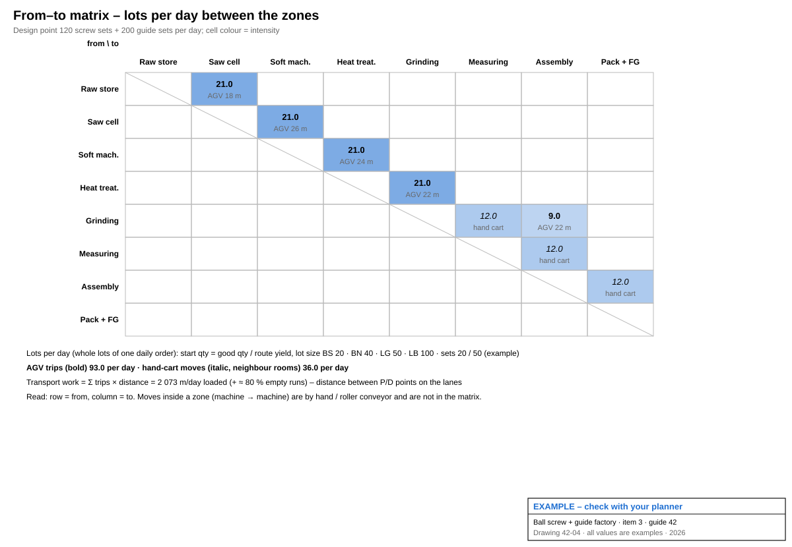

### 8.2 The matrix (lots per day)

| from  to | Raw store | Saw cell | Soft machining | Heat treatment | Grinding room | Measurement room | Assembly | Packing + FG |
|---|---|---|---|---|---|---|---|---|
| **Raw store** | – | **21** (AGV 18 m) | – | – | – | – | – | – |
| **Saw cell** | – | – | **21** (AGV 26 m) | – | – | – | – | – |
| **Soft machining** | – | – | – | **21** (AGV 24 m) | – | – | – | – |
| **Heat treatment** | – | – | – | – | **21** (AGV 22 m) | – | – | – |
| **Grinding room** | – | – | – | – | – | *12* (cart) | **9** (AGV 22 m) | – |
| **Measurement room** | – | – | – | – | – | – | *12* (cart) | – |
| **Assembly** | – | – | – | – | – | – | – | *12* (cart) |
| **Packing + FG** | – | – | – | – | – | – | – | – |

### 8.3 Per route

| Route | Start pcs/day | Lot | Lots/day | AGV legs | Cart legs | m per lot (AGV) | AGV trips/day | m/day |
|---|---|---|---|---|---|---|---|---|
| BS | 128.0 | 20 | 7 | 4 | 2 | 90 | 28 | 627 |
| BN | 126.6 | 40 | 4 | 5 | 0 | 111 | 20 | 444 |
| LG | 209.2 | 50 | 5 | 4 | 2 | 90 | 20 | 448 |
| LB | 416.8 | 100 | 5 | 5 | 0 | 111 | 25 | 555 |
| FABS | 121.0 | 20 | 7 | 0 | 1 | 0 | 0 | 0 |
| FALG | 200.4 | 50 | 5 | 0 | 1 | 0 | 0 | 0 |
| **Total** | | | | | | | **93** | **2 073** |

### 8.4 Distance and transport work

The AGV distance between two P/D points follows the lanes: from the door straight to the lane, along the lane, from
the lane to the other door. East-bound lane at y = 25 m, west-bound lane at y = 27 m:

    d = | y_A − y_lane | + | x_B − x_A | + | y_B − y_lane |

Example SOFT (38, 28) → HT (56, 28), going east (lane 25): d = 3 + 18 + 3 = 24 m.

    transport work (loaded) = Σ trips × d = 2 073 m per day
    empty runs              ≈ 0.8 × loaded (example: an AGV rarely gets a new job exactly where it unloaded)
    total                   ≈ 3 731 m per day

The **transport intensity** of a pair = trips × distance. The highest intensities should have the shortest distance.
Here the four main AGV legs (RAW→SAW 18 m, SAW→SOFT 26 m, SOFT→HT 24 m, HT→GRIND 22 m) are all short because every
zone border is a door on the same aisle.

### 8.5 Sankey view

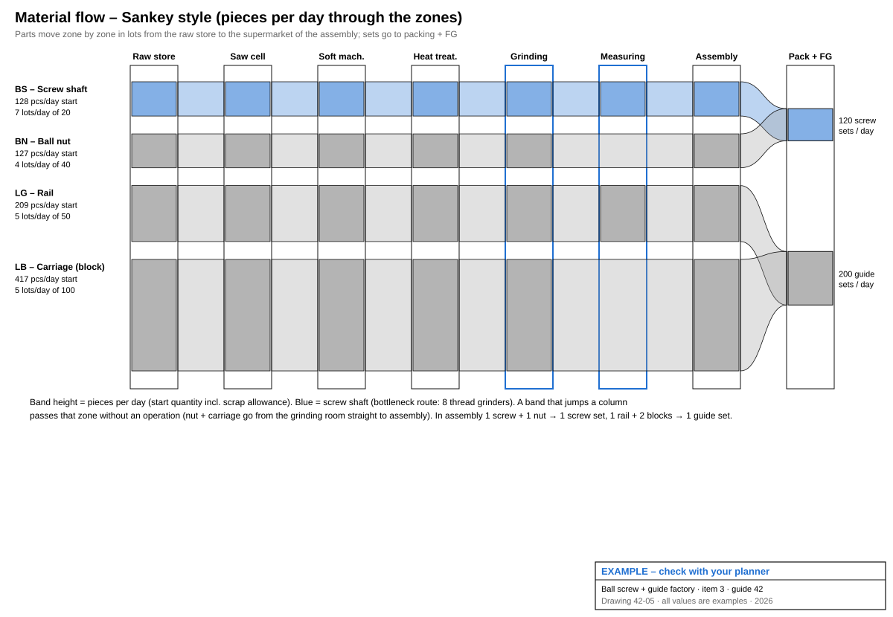

The Sankey diagram shows the same flow as bands with a width proportional to the pieces per day. You see at once that
the carriages (417 per day) are the biggest piece flow, but the screw shafts (128 per day) are the critical one:
they pass every zone and the bottleneck (thread grinding).

### 8.6 Rules for good flow

| Rule | Check in this layout |
|---|---|
| no backflow between zones | only hand-cart backflow inside assembly; no AGV goes "back" in the route |
| no crossings of main flows | all flows use the same aisle in one direction (west → east in the north, then back west on the other lane to the grinding room, then east again) – lanes are one-way, so AGVs never meet head-on |
| neighbour rooms for frequent hand moves | grinding room ↔ measurement room ↔ assembly ↔ packing share walls with doors |
| P/D points in niches | lots waiting for an AGV stand inside the zone next to the door, not in the aisle |
| transport ≤ 5 % of lead time | AGV trip ≈ 160 s vs. lead time ≈ 6 days – transport is not the problem; queues are |

### 8.7 A simple layout improvement method (CRAFT idea)

The classic computer method CRAFT swaps two areas and keeps the swap if Σ (flow × distance) gets smaller. You can do
the same by hand with the from–to matrix:

1. Compute Σ trips × d for the current layout (here 2 073 m/day).
2. Swap two zones of similar size (for example soft machining and heat treatment).
3. Recompute the distances; keep the swap if the sum is smaller **and** no rule is broken (heat away from the grinding
   room, noise away from the grinders, utilities close).
4. Repeat until no swap helps.

With only 7 AGV legs per route and short distances, the transport sum is already small; the layout is driven by the
climate and vibration rules, not by distance.

---

## 9. Special rooms – grinding room and measurement room

### 9.1 Why 20 °C and why ± 1 K

Steel grows with temperature:

    ΔL = α · L · ΔT,   α ≈ 11.5 × 10⁻⁶ /K for steel

Screw shaft, useful thread length 850 mm, 1 K warmer:

    ΔL = 11.5 × 10⁻⁶ × 850 mm × 1 K = 0.0098 mm ≈ 10 µm

The C5 lead tolerance e_p is ± 35 µm over the useful travel and v_300 is 18 µm (guide 40 / 41). A 2 K drift during
thread grinding eats more than half of the tolerance. Therefore:

| Room | Temperature (example) | Why |
|---|---|---|
| grinding room | **20 ± 1 °C**, gradient ≤ 1 K per m height, ≤ 1 K per hour change | profiles, diameters, rail parallelism (13 µm / 700 mm class H) |
| thread grinders + lead measurement | **20 ± 0.5 °C** at the machine (local control: oil 20 ± 0.5 °C, machine covers) | lead error 10 µm per K |
| measurement room | **20 ± 0.5 °C**, no sun, airlock, 45 ± 10 % rel. humidity | lead measurement uncertainty, CMM, roundness |
| assembly | 20 – 24 °C, clean | balls, grease, seals – no dust, no condensation |

20 °C is the **standard reference temperature** for dimensional measurement (ISO 1). All drawings are valid at 20 °C.

### 9.2 Heat load of the grinding room – worked example

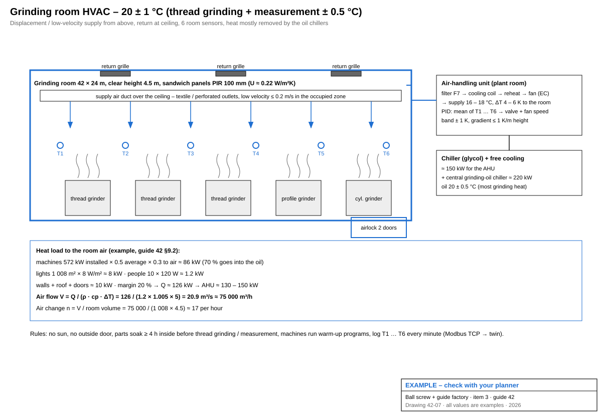

The HVAC system must remove all heat that enters the room air. Most grinding heat goes into the grinding oil and is
removed by the oil chillers – only part of the machine power heats the air (motors, hydraulics, electronics, warm
machine surfaces).

| Heat source | Formula | Example |
|---|---|---|
| machines | installed kW × average load × share to air | 572.5 kW × 0.5 × 0.3 ≈ 86 kW |
| lighting | area × W/m² | 1 008 m² × 8 W/m² ≈ 8 kW |
| people | number × 120 W | 10 × 0.12 ≈ 1.2 kW |
| walls, roof, doors, airlock | U · A · ΔT + air leakage | ≈ 10 kW (example) |
| sum | | ≈ 105 kW |
| + 20 % margin | | **Q ≈ 126 kW** → air-handling unit (AHU) 130 – 150 kW cooling |

The 572.5 kW are the installed powers of all 22 grinding-room machines (`MTYPES[...].kW`): 8 × 30 (thread grinders)
+ 2 × 25 + 3 + 2 × 15 + 2 × 18 + 15 + 2 × 60 + 7.5 + 11 + 2 × 30.

### 9.3 Air flow and air change

The supply air is colder than the room by ΔT (here 5 K, displacement / low-velocity outlets):

    V = Q / (ρ · c_p · ΔT) = 126 kW / (1.2 kg/m³ × 1.005 kJ/(kg·K) × 5 K) = 20.9 m³/s ≈ 75 000 m³/h
    air change n = V / room volume = 75 000 / (1 008 m² × 4.5 m) ≈ 17 per hour

17 air changes per hour is normal for a precision room (10 – 20 per hour, example). With a smaller ΔT (3 K) the air
flow grows to ≈ 125 000 m³/h – better uniformity, but bigger ducts and fans. The HVAC planner decides.

Air velocity in the occupied zone ≤ 0.2 m/s (no draft on people, no cooling of one side of a machine).

### 9.4 The ± 1 K control loop

* 6 room sensors T1 … T6 (Pt100, class A, at 1.5 m height near the machines) + 2 sensors at 0.5 m and 3.5 m for the
  vertical gradient.
* Controller: the mean of T1 … T6 drives the cooling-coil valve and the reheat (PID); the fan runs with constant or
  slowly changing speed (constant air flow = stable pattern).
* Logging: every minute, to the twin over Modbus TCP (item 4) → alarm if any sensor leaves 20 ± 1 °C for > 10 min.
* Disturbances: door opening (airlock with 2 doors, never both open), sun (no windows), the machines' warm-up (machines
  run a warm-up program before the first thread grinding of the shift), the oil temperature (oil chiller 20 ± 0.5 °C).

The time constant of the room air is short (minutes), the time constant of a machine bed is long (hours). That is why
a stable 24 h climate is important – also at night and on the weekend (the HVAC never switches off; INFRA in the
simulation keeps 55 kW for HVAC 24 h).

### 9.5 Soak time – why parts wait ≥ 4 h before thread grinding

A shaft that comes from the hall (for example 25 °C) needs time to reach 20 °C. Simple lumped model (Biot number
small):

    T(t) − T_room = (T₀ − T_room) · e^(−t/τ),   τ = ρ · c · V / (h · A) = ρ · c · d / (4 · h) for a long round bar

Screw shaft Ø32, steel ρ = 7 850 kg/m³, c = 460 J/(kg·K), still air h ≈ 10 W/(m²·K):

    τ = 7 850 × 460 × 0.032 / (4 × 10) = 2 889 s ≈ 48 min
    time from 5 K to 0.1 K difference: t = τ · ln(5 / 0.1) = 48 min × 3.9 ≈ 3.1 h

→ the rule "soak ≥ 4 h inside the room" has a safety margin. A rail (equivalent thickness ≈ 16 mm) needs about half of
that. The soak buffer must hold 4 h of flow:

    screws: ≈ 128 per day / 15 h ≈ 9 per hour × 4 h ≈ 36 shafts
    rails:  ≈ 209 per day / 15 h ≈ 14 per hour × 4 h ≈ 56 rails   → 2 racks 5 × 2 m (x 24 … 34 m, y 21.2 … 23.2 m)

### 9.6 The measurement room

| Item | Value (example) |
|---|---|
| size | 12 × 14 m = 168 m², ceiling 3.5 m |
| machines | 3 lead measuring machines `QC-LED` (3.5 × 1.2 m), rail measuring bench `QC-RAL` (5 × 1.2 m), laboratory `QC-LAB` (8 × 6 m) |
| heat load | equipment ≈ 10 kW + lights 1.7 kW + 4 people 0.5 kW + walls ≈ 1 kW ≈ 13 kW → 15 – 20 kW precision air-conditioning |
| control | 20 ± 0.5 °C, gradient ≤ 0.5 K/m, humidity 45 ± 10 % |
| access | from the grinding room (inner door, x = 42 m) and to assembly (inner door, x = 54 m) – no outside wall, no sun |
| floor | own slab section or isolation joint to the hall slab (vibration, chapter 10) |

### 9.7 Fire protection in an oil grinding room

Grinding with oil (thread grinders, internal thread grinders) creates oil mist. Rules (example – check with the fire
insurer and the local code):

* oil mist extraction on every oil machine (electrostatic or mechanical, ≥ 99 %),
* CO₂ fire extinguishing system for each oil machine (machine enclosure flooding) or for the central oil filter,
* no open flames, spark-free tools, regular cleaning of ducts,
* the central oil plant in its own room (plant room, chapter 11.4) with an oil-tight floor and a sump.

---

## 10. Foundations and vibration

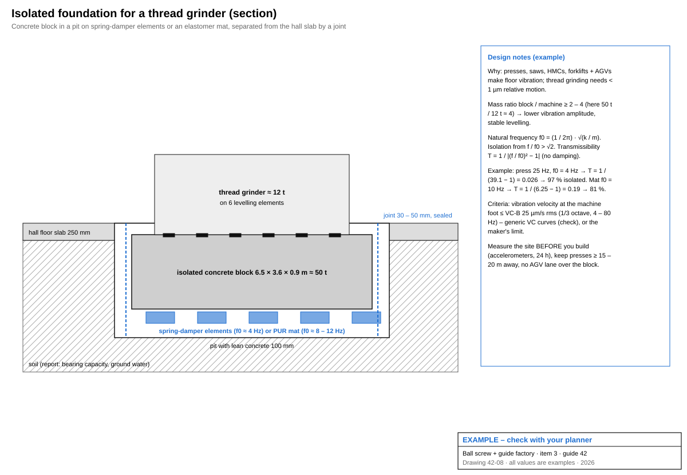

### 10.1 Why vibration matters

A thread grinder removes a few µm per pass. If the floor moves the wheel against the workpiece by 1 µm at 20 Hz, you
see chatter marks and a wavy lead (v_2π). Sources in this plant:

| Source | Typical frequency (example) | Distance to the nearest thread grinder |
|---|---|---|
| straightening presses (impacts) | 5 – 30 Hz, shocks | ≥ 28 m (`LG-STR-01`) |
| bandsaw / cold saw | 10 – 50 Hz | ≈ 30 m |
| HMCs (roughing) | 20 – 200 Hz | ≈ 37 m |
| forklifts, trucks at the dock | 2 – 15 Hz | ≥ 20 m |
| AGVs | 5 – 20 Hz | ≥ 18 m (main aisle), no lane over a foundation |
| compressors, pumps (annex) | 25 – 50 Hz | > 40 m, on their own mounts |

### 10.2 The isolated foundation block

Design (example – the machine maker gives the foundation drawing):

* concrete block in a pit, separated from the hall slab by a **joint 30 – 50 mm** (sealed with a soft sealant, never
  with mortar),
* block mass ≥ 2 – 4 × machine mass: thread grinder ≈ 12 t → block 6.5 × 3.6 × 0.9 m = 21 m³ × 2.4 t/m³ ≈ 50 t,
* resting on **spring-damper elements** (natural frequency f₀ ≈ 3 – 6 Hz) or on an **elastomer mat** (PUR, f₀ ≈ 8 – 12
  Hz),
* machine on 6 levelling elements on the block.

### 10.3 Isolation – the formula

A mass m on springs with total stiffness k has the natural frequency

    f₀ = (1 / 2π) · √(k / m)

Above f₀ · √2 the springs isolate. Transmissibility (share of the floor vibration that reaches the block), without
damping:

    T = 1 / | (f / f₀)² − 1 |

| Case | f (disturbance) | f₀ | T | isolation 1 − T |
|---|---|---|---|---|
| springs, press 25 Hz | 25 Hz | 4 Hz | 1 / (39.1 − 1) = 0.026 | 97 % |
| PUR mat, press 25 Hz | 25 Hz | 10 Hz | 1 / (6.25 − 1) = 0.19 | 81 % |
| springs, forklift 6 Hz | 6 Hz | 4 Hz | 1 / (2.25 − 1) = 0.80 | 20 % – low frequencies are hard to isolate |
| PUR mat, forklift 6 Hz | 6 Hz | 10 Hz | 1 / \|0.36 − 1\| = 1.56 | amplification! |

Lesson: a too-stiff mat **amplifies** low-frequency traffic vibration. Keep forklifts and trucks away; measure the site
first.

Spring stiffness needed for f₀ = 4 Hz with block + machine = 62 t:

    k = m · (2π f₀)² = 62 000 kg × (2π × 4 Hz)² = 3.9 × 10⁷ N/m = 39 kN/mm (total, e.g. 8 elements × 4.9 kN/mm)
    static deflection δ = g / (2π f₀)² = 9.81 / 631.7 = 0.0155 m ≈ 16 mm

### 10.4 Vibration criteria

| Criterion | Value (example – check) | Use |
|---|---|---|
| generic VC curves (vibration criterion, 1/3-octave rms velocity, 1 – 80 Hz) | VC-A 50 µm/s, VC-B 25 µm/s, VC-C 12.5 µm/s | precision machines + measuring rooms: VC-A … VC-B is typical (check) |
| machine maker's limit | e.g. ≤ 1 µm displacement at the foundation, 5 – 100 Hz | the binding value – ask for it (chapter 20) |
| ISO 20816 (replaces ISO 10816) | vibration severity of the machines themselves | condition monitoring of spindles, pumps, fans – not a floor criterion |
| DIN 4150-3 | vibration effect on structures | building damage – much higher levels |

Do a **site vibration survey** before the design: accelerometers at the planned foundation positions, 24 h, with
trucks, forklifts and (if the plant exists) presses running.

### 10.5 Floor slab and other foundations

| Area | Floor (example) |
|---|---|
| whole hall | 250 mm reinforced or steel-fibre concrete slab, flatness for AGV lanes (DIN 18202 / EN 15620 class – check with the AGV maker) |
| heat treatment | oil-tight coated floor, sump for quench oil, pit for the quench tank of the carburising lines (maker's drawing), heat-resistant joints |
| presses, HMCs | on the slab with levelling mounts; heavy presses on their own block (shocks!) |
| cantilever racks | anchor loads, column base plates – check slab thickness |
| measurement room | slab section separated by a joint |

---

## 11. Utilities sizing

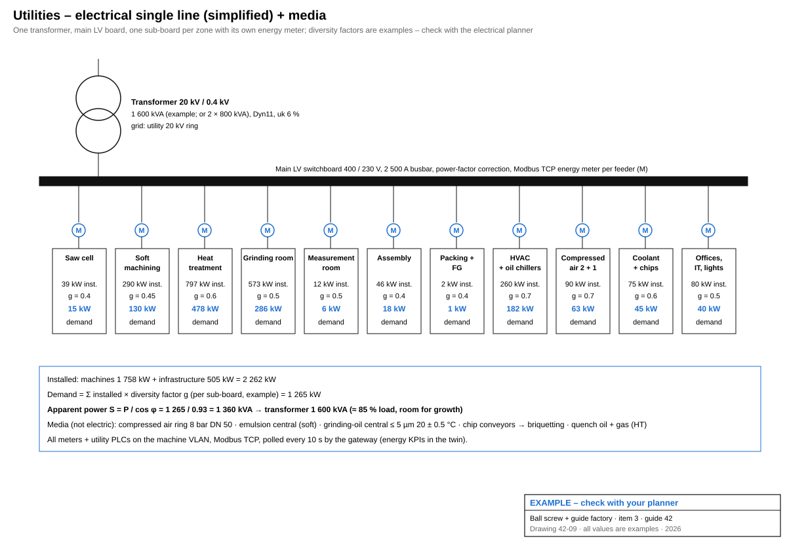

### 11.1 Electrical load with diversity factor

Not all machines run at full power at the same time. The planner multiplies the installed power of each sub-board by
a **diversity (simultaneity) factor g**:

    demand P = Σ (installed P × g)
    apparent power S = P / cos φ

| Sub-board | Installed kW (from `MTYPES[...].kW`) | g (example) | Demand kW |
|---|---|---|---|
| saw cell | 38.5 | 0.4 | 15 |
| soft machining | 289.5 | 0.45 | 130 |
| heat treatment | 797 | 0.6 | 478 |
| grinding room | 572.5 | 0.5 | 286 |
| measurement room | 12 | 0.5 | 6 |
| assembly | 45.5 | 0.4 | 18 |
| packing + raw store | 2.5 | 0.4 | 1 |
| HVAC + oil chillers | 260 | 0.7 | 182 |
| compressed air (2 + 1) | 90 | 0.7 | 63 |
| coolant + chips | 75 | 0.6 | 45 |
| offices, IT, lights | 80 | 0.5 | 40 |
| **sum** | **2 262** | | **≈ 1 265** |

    S = 1 265 kW / 0.93 = 1 360 kVA → transformer 1 600 kVA (≈ 85 % load) or 2 × 800 kVA (redundancy)

Notes:

* The heat treatment is the largest consumer. If the carburising furnaces are **gas-heated**, the electrical load drops
  by ≈ 300 – 400 kW, but you need a gas connection (the twin keeps the electrical example).
* Every sub-board gets a **Modbus TCP energy meter** (kW, kWh, cos φ) – polled every 10 s by the gateway (item 4).
* The simulation uses simple power factors: RUN = 0.55 × kW (furnaces 0.6, induction 0.7), set-up / idle / starved /
  blocked = 0.15 × kW (furnaces hold temperature 0.3 × kW), down 0.05 × kW, off 0.02 × kW; plus infrastructure
  (HVAC 55 kW 24 h, compressed air 35 kW in shift / 8 kW off, lights 20 / 3 kW). Example run: ≈ 17 700 kWh per day,
  ≈ 55 kWh per set.

### 11.2 Compressed air

| Consumer | Example |
|---|---|
| air gauges + sealing air (grinders, measuring) | 22 machines × 20 – 60 Nl/min |
| blow-off in washers, machines | 2 – 3 m³/min while running |
| spindle sealing air, pneumatic clamps | 73 machines × 30 – 80 Nl/min average |
| blow guns, tools | 10 × 300 Nl/min × 10 % use |

    average ≈ 6 – 8 m³/min at 8 bar → 2 speed-controlled compressors × 5 m³/min (≈ 30 kW each) + 1 standby
    receiver (speed-controlled compressors): V ≈ 0.3 × Q(m³/min) per m³ … here 2 × 3 m³ (example, check with the maker)
    quality ISO 8573-1 class 1.4.1 for air gauges (particles 1, dew point + 3 °C class 4, oil 1)
    pressure drop in the ring main ≤ 0.1 bar (aluminium ring DN 50)

Specific power of a good compressor ≈ 6 kW per m³/min → 7 m³/min × 6 ≈ 42 kW average. Leaks are typical 20 – 30 % of
the consumption – measure them (Modbus TCP flow meter in the main line).

### 11.3 Coolant (emulsion) central system – soft machining

    flow = Σ machine flows: 14 machines × ≈ 70 l/min + saws 5 × 20 l/min ≈ 1 080 l/min → central system ≈ 1 200 l/min
    tank volume ≈ 10 – 15 min of flow = 12 – 18 m³
    filtration: band filter / vacuum filter ≈ 20 µm, skimmer for tramp oil, concentration control 5 – 8 %

A central system costs more at the start than individual machine tanks, but it keeps the concentration and the
temperature stable and makes chip handling simple.

### 11.4 Grinding oil central system – grinding room

    flow: 8 thread grinders × 100 + 2 cylindrical × 150 + 2 profile × 300 + 2 internal × 60 + 2 surface × 150
          + 2 raceway × 150 + cut-off 50 + centre-hole 10 ≈ 2 480 l/min → central system ≈ 2 500 l/min
    heat into the oil ≈ 70 % of the average machine power ≈ 0.7 × 286 kW ≈ 200 kW → oil chiller ≈ 220 kW
    temperature rise across the machines: ΔT = P / (ρ · c · V̇) = 200 / (870 × 1.9 × 0.0413) ≈ 2.9 K
    tank ≈ 10 – 20 min of flow ≈ 25 – 50 m³, filtration ≤ 5 µm (precoat or backflush filter), oil 20 ± 0.5 °C

The oil returns 2.9 K warmer from the machines and the chiller brings it back to 20 ± 0.5 °C. That is the most
important "climate" of the thread grinder.

### 11.5 Chips and sludge

    screw shaft: Ø36 → Ø32 over ≈ 1 000 mm ≈ 0.785 × (36² − 31²) mm² × 1 000 mm ≈ 263 cm³ ≈ 2.1 kg per shaft
    ball nut: slug Ø85 × 108 ≈ 4.8 kg → nut ≈ 1.2 kg → ≈ 3.6 kg chips per nut
    rail: drilling + grinding ≈ 0.2 kg; carriage: milling + drilling ≈ 0.15 kg
    per day: 128 × 2.1 + 127 × 3.6 + 209 × 0.2 + 417 × 0.15 ≈ 830 kg steel chips + ≈ 30 kg grinding sludge

→ chip conveyors to a central container station (annex), briquetting press (oil recovery, better scrap price),
grinding sludge as special waste (oil content).

### 11.6 Other media

| Medium | Consumer | Example size |
|---|---|---|
| process gas (endogas / N₂-methanol), propane | carburising lines | from the furnace maker; safety per EN 746 (check) |
| quench oil cooling, polymer quench | furnaces, induction | closed cooling tower ≈ 300 – 500 kW (example) |
| cooling water | induction generators, laser marker | closed circuit, 25 °C |
| exhaust | furnaces, washers, quench | hoods + fans, heat recovery possible |
| Ethernet | every machine, meter, door, AGV charger | star from the MES / server room, machine VLAN (item 4) |

---

## 12. Material handling and AGV fleet sizing

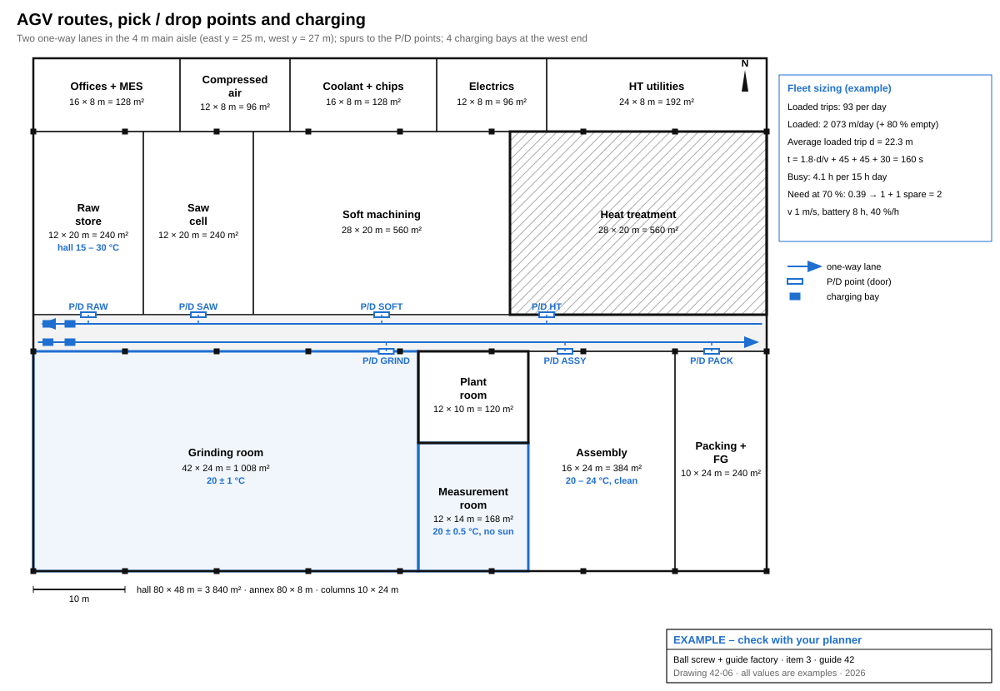

### 12.1 What moves how

| Move | Means | Why |
|---|---|---|
| raw bars + profiles: truck → rack | forklift / crane at goods-in | 6 m bars, bundles 1 – 2 t |
| between zones (7 P/D points) | **AGV** with long-part lot racks (1.2 × 0.8 m, 20 shafts / 50 rails / 40 nuts / 100 blocks) | repeatable, traceable (lot id), no forklift in the hall |
| inside a zone (machine → machine) | hand cart, roller conveyor, jib crane | short distances, operator moves the lot (3 min in the simulation) |
| neighbour rooms (grinding ↔ measurement ↔ assembly ↔ packing) | hand cart through inner doors | 4 – 5 min in the simulation |
| finished goods → truck | forklift at the shipping dock | wooden boxes, pallets |

### 12.2 Trip time

    t_trip = d_loaded / v + d_empty / v + t_load + t_unload + t_doors
           = 22.3 m × (1 + 0.8) / 1.0 m/s + 45 s + 45 s + 30 s ≈ 160 s

d = average loaded distance from the from–to matrix (2 073 m / 93 trips = 22.3 m). v = 1.0 m/s loaded (the AGV may
drive 1.5 – 2 m/s empty on a free aisle, but slows down at doors and crossings).

### 12.3 Fleet size

    busy time per day = trips × t_trip = 93 × 160 s = 14 890 s = 4.14 h
    AGVs needed = busy time / (available hours × max. utilisation) = 4.14 / (15 h × 0.7) = 0.39 → 1 AGV
    + 1 spare (maintenance, battery change, breakdown) = 2 AGVs (the twin starts with 2)

Max. utilisation 0.7 (example) leaves room for traffic peaks: the lots do not come evenly – a furnace load releases 2 – 5
lots at the same moment.

### 12.4 Battery and charging

| Item | Value (example) |
|---|---|
| battery | Li-ion, 8 h of driving per charge |
| consumption in the simulation | driving 12.5 %/h, standing 2 %/h, loading 3 %/h |
| charging | opportunity charging at 4 floor-contact chargers at the west end of the main aisle, 40 %/h |
| rule | below 25 % → go to charge after the current job; idle > 3 min and < 75 % → charge |

### 12.5 Lanes, doors and safety

* Two **one-way lanes** in the 4 m main aisle (east-bound y = 25 m, west-bound y = 27 m): AGVs never meet head-on;
  people walk on the 1 m walkway (EN ISO 3691-4 – personal detection, speed limits, warning fields – check with the AGV
  maker).
* AGVs stop at the P/D points in front of the doors; they do **not** drive into the climate rooms or the
  heat-treatment bay.
* Rapid doors open on request of the AGV (Modbus TCP I/O module at the door; the fleet manager asks over HTTP – item 4).
* The airlock of the grinding room has 2 doors that are never open at the same time (interlock, hard-wired).

### 12.6 The AGV fleet manager – HTTP only

The contract of this tab allows only Modbus TCP and HTTP. VDA 5050 (the common AGV interface) uses MQTT. Here we take
its **ideas** and map them to HTTP:

| VDA 5050 idea | HTTP mapping (proposal for item 4 / 6) |
|---|---|
| order (nodes + edges) | `POST /api/agv/orders` `{ "lot": "L00124", "from": "HT", "to": "GRIND" }` |
| state (position, battery, load) | `GET /api/agv/state` or Server-Sent Events `/api/agv/stream` |
| instant actions (pause, cancel) | `POST /api/agv/{id}/actions` |
| factsheet | `GET /api/agv/{id}` |

In the twin, `B.tq` is the transport-order queue and `B.agvs` the vehicle states – the same data structure.

---

## 13. The digital twin – what the simulation models

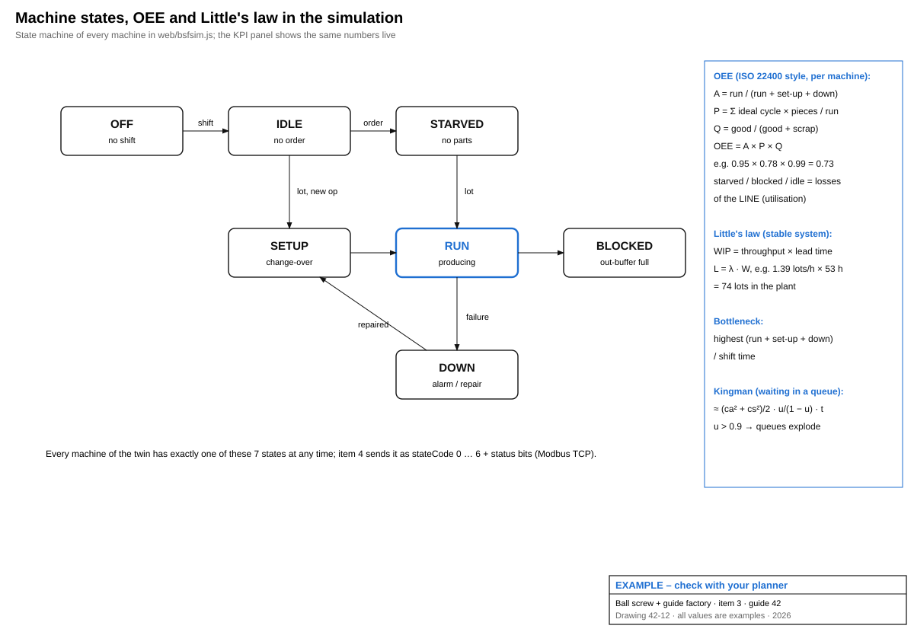

### 13.1 What a digital twin is (and what it is not)

ISO 23247 (digital twin framework for manufacturing) describes a digital twin as a digital model of an observable
manufacturing element that is **synchronised** with it. There are three stages:

| Stage | Data direction | This page |
|---|---|---|
| digital model | none – a simulation only | **yes – today (simulation mode)** |
| digital shadow | real plant → model (live data) | later: item 4 gateway feeds the machine states over Modbus TCP → HTTP |
| digital twin | real plant ↔ model (the model also gives orders back) | later: MES (item 6) dispatches with the help of the model |

Because every machine of the simulation has the same state object and the same signal fields as the real machine will
have (SIGFIELDS), the switch from "simulation" to "live" only replaces the data source.

### 13.2 Discrete-event vs time-step simulation

| Method | Idea | Pro / con |
|---|---|---|
| discrete-event (DES) | the clock jumps from event to event (lot arrives, piece finished, failure, repair) | exact, fast for big models; more code |
| time-step | the clock moves in fixed steps dt; in each step every machine and AGV is updated | simple, easy to animate, accurate if dt ≪ shortest duration |

`bsfsim.js` is a **time-step simulation with event handling inside the step**: the page clock runs at 10 Hz; each
tick advances the simulation by dt = real time × speed, split into sub-steps of ≤ 10 s. Inside a sub-step a machine
can finish several pieces (a while-loop), so the result does not depend on the step size. The what-if runs use dt =
30 s and need ≈ 30 – 50 ms per simulated day in the browser.

### 13.3 What is modelled

| Element | Model (example values) |
|---|---|
| customer orders | daily at 06:00: one order "120 screw sets" (FABS) and one "200 guide sets" (FALG), due in 7 days; extra orders by `addOrder()` |
| work orders + lots | per order and part: start qty = qty / route yield, split into lots of LOT size (screw 20, nut 40, rail 50, carriage 100) |
| routings | `ROUTES` of item 2, variant G; operations with `buy: true` (bought end caps) are skipped |
| raw store | blanks per part; delivery 07:00 if stock < 2 days of demand, up to 6 days |
| kits (bought parts) | screw kits (balls + seals + grease) and block kits; incoming check on `QC-INC-01`; consumed at FABS op 10 and LB op 80 |
| machine queues | one queue per machine TYPE; the first free instance takes a lot; same set-up first, else FIFO |
| set-up | when the operation changes or after `batch` pieces since the last set-up (= set-up / batch of capacity()) |
| piece time | cycle / P × (1 ± 6 % random) |
| scrap | per piece, probability = scrap % of the operation |
| breakdowns | run time to failure ~ exponential(MTBF), repair ~ exponential(MTTR), ≥ 5 min; alarm code per machine class |
| furnaces | `HT-CAR` (nuts + carriages) and `HT-TMP` (screws + rails) load several lots up to 100 % of `batch`, mixed parts allowed; start when full or after max. wait (carburising 600 min, tempering 45 min – it must start ≤ 1 h after hardening) |
| moves | same zone: hand cart 3 min; neighbour room: 4 – 5 min; other zone: AGV transport order |
| out-buffers | max. 12 lots per zone waiting for an AGV; full → the machine is BLOCKED |
| AGVs | lanes, speed, load / unload, doors, battery, charging, nearest free AGV gets the job |
| supermarket | finished parts per order (pegged) + free stock; assembly lot starts when ≥ 20 screws + 20 nuts (or 50 rails + 100 blocks) of the order are there; top-up lots if scrap was higher than the allowance |
| finished goods | sets in the FG store; complete orders are shipped at 14:00 |
| shifts | net time from 06:00 (1 – 3 shifts × 7.5 h; breaks pulled to the end); heat treatment ≥ 3 shifts; furnaces finish a running load outside the shift |
| energy | power per state + infrastructure (chapter 11.1) |

### 13.4 Machine states

| State | Code | Status bit | Meaning |
|---|---|---|---|
| OFF | 0 | bit 7 | no shift |
| IDLE | 1 | bit 1 | ready, no work planned for this machine type |
| RUN | 2 | bit 0 | producing |
| SETUP | 3 | bit 2 | set-up / change-over |
| DOWN | 4 | bit 3 | alarm / breakdown / repair |
| BLOCKED | 5 | bit 5 | a finished lot cannot leave (out-buffer full) |
| STARVED | 6 | bit 6 | waiting for parts (upstream lots exist, furnace load not full, kits missing) |

These are the `stateCode` and `status` fields of the Modbus group `std` (chapter 14).

### 13.5 OEE – as the twin measures it (ISO 22400 style)

Item 2 sized the machines with OEE = 0.75. The twin makes the machines **really** lose 25 %:

    availability from MTBF / MTTR:  A₀ = MTBF / (MTBF + MTTR)       e.g. thread grinder 80 / 82.5 = 0.970
    speed factor:                   P = OEE target / A₀              e.g. 0.75 / 0.970 = 0.773
    real piece time:                cycle / P                        e.g. 40 min / 0.773 = 51.7 min (+ random ± 6 %)

So a machine with the item 2 load is exactly as busy as capacity() said. Furnaces are the exception: their recipe time
is fixed (P = 1); their losses are partial loads and waiting for a full load.

The twin then **measures** OEE per machine as ISO 22400 does:

    A = run time / (run time + set-up time + down time)
    P = Σ (ideal cycle × pieces) / run time
    Q = good pieces / (good + scrap)
    OEE = A × P × Q

Example thread grinder after some days: A ≈ 0.92 (set-up 45 min per 20 screws + breakdowns), P ≈ 0.77, Q ≈ 0.99 →
OEE ≈ 0.70. The measured OEE is a little lower than the target 0.75 because ISO 22400 counts set-up as an availability
loss, while capacity() put the set-up into the effective cycle. The plant OEE (weighted by busy time) in the example run
is ≈ 0.69.

**Starved, blocked and idle time are not losses of the machine** – they are losses of the line. They show up in the
**utilisation** = (run + set-up) / shift time and in the colour mode "Utilisation".

### 13.6 MTBF / MTTR classes (example)

| Class | Machine types | MTBF h | MTTR h | Availability A₀ | speed factor P = 0.75 / A₀ |
|---|---|---|---|---|---|
| misc | MS-SAW, BS-CLP, LG-SAW, LG-CUT, QC-INC, AS-BAS, AS-MRK, AS-PCK, QC-LAB | 150 | 0.75 | 1.00 | 0.75 |
| press | BS-STR, BS-STH, LG-STR, LG-STH | 150 | 1 | 0.99 | 0.76 |
| cnc | BS-CTR, BS-TRN, BN-TRN, BN-MC, BN-HTN, LG-DRL, LB-MC | 60 | 1.5 | 0.98 | 0.77 |
| ind | BS-IND, LG-IND | 120 | 2 | 0.98 | 0.76 |
| furn | HT-TMP, HT-CAR | 250 | 4 | 0.98 | 1.00 |
| grind | BS-CGR, LG-SGR, LG-PGR, LB-SGR, LB-RGR | 80 | 2 | 0.98 | 0.77 |
| tgr | BS-TGR, BN-ITG | 80 | 2.5 | 0.97 | 0.77 |
| meas | QC-LED, QC-RAL | 300 | 1 | 1.00 | 0.75 |
| wash | AS-WSH | 200 | 1 | 1.00 | 0.75 |
| torque | AS-NAS, QC-MAT, AS-BSA, AS-RUN, AS-GAS | 400 | 0.5 | 1.00 | 0.75 |

### 13.7 Little's law

For any stable system (what goes in comes out, on average):

    L = λ · W      WIP = throughput × lead time

Example run (8 days warm-up, 10 days measured): λ = 1.40 lots finished per hour, W = 52.7 h average flow time of a
lot (release from the raw store → supermarket / FG), L (time-average lots in the plant) = 76.0; λ · W = 73.7. The
self-check accepts 10 % difference (the measuring window cuts lots at the start and the end).

What it tells you: **you cannot shorten the lead time without lowering the WIP** (at the same throughput). And WIP
comes from queues – mostly in front of highly utilised machines.

### 13.8 Bottleneck and variability

The bottleneck is the machine type with the highest busy share = (run + set-up + down) / shift time. In the example
run: `BS-TGR` 97 %, then `BN-ITG` 93 %, `AS-GAS` 93 %, `BS-TRN` 92 %, `LB-MC` 91 %.

Why do queues explode near 100 %? Kingman's approximation for the waiting time in front of one machine:

    W_q ≈ ( (c_a² + c_s²) / 2 ) · ( u / (1 − u) ) · t_e

c_a, c_s = coefficients of variation of arrivals and process times (0 = perfectly regular, 1 = random), u =
utilisation, t_e = mean process time.

| u | u / (1 − u) | waiting (c_a² = c_s² = 1, t_e = 1 lot) |
|---|---|---|
| 0.70 | 2.3 | 2.3 lots |
| 0.85 | 5.7 | 5.7 lots |
| 0.90 | 9 | 9 lots |
| 0.95 | 19 | 19 lots |
| 0.97 | 32 | 32 lots |

A thread grinder lot takes ≈ 20 × 51.7 min ≈ 17 h. At u = 0.97 the waiting time in front of the 8 grinders is many
lot-times divided by 8 machines – exactly what you see as dark blue WIP in the 3D. Ways out: more capacity (9th
grinder), less variability (preventive maintenance, smaller lots, fixed sequence), higher OEE.

### 13.9 Warm-up, random seed, measuring window

* The model starts **empty**. The first days are a ramp-up (no lot has finished yet). Therefore every run first
  **warms up** (live: 8 days in ≈ 0.3 s; what-if: 5 / 8 / 12 days) and then resets the statistics.
* The live instance keeps the KPIs of the last 3 warm-up days as "previous values" for the first simulated hours, so
  the tiles show sensible numbers immediately.
* Random numbers come from a seeded generator (xorshift, seed 7): the same settings give the same result. Different
  scenarios still get different random sequences after the first difference – use ≥ 7 – 14 measured days and compare
  differences of more than ≈ 3 %.

### 13.10 Validation – how do I know the model is right?

| Check | How |
|---|---|
| capacity | the measured busy share of each machine type ≈ capacity() utilisation of item 2 (± a few %) |
| bottleneck | the same machine type as in item 2 (BS-TGR) |
| conservation | Little's law within 10 % |
| output | ≈ demand when no machine type is overloaded |
| face validity | a production planner watches the 3D for an hour: are the queues, set-ups, furnace loads plausible? |
| later (live data) | compare the twin's daily output, OEE and WIP with the real plant; tune MTBF / MTTR / cycle times |

VDI 3633 (simulation of logistics, material flow and production systems) describes this procedure in detail.

---

## 14. How items 4 – 8 connect – Modbus TCP + HTTP only

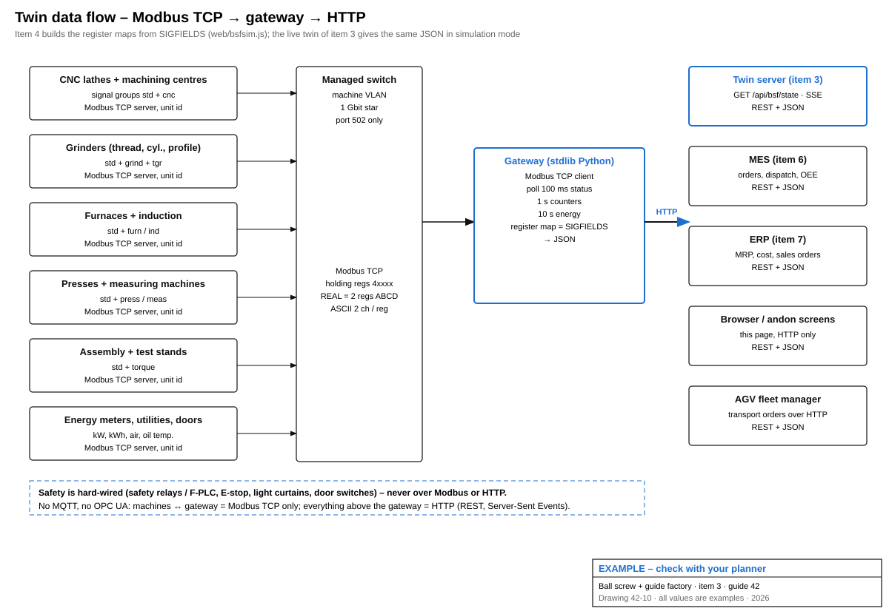

### 14.1 The rule of this tab

* machines, PLCs, test stands, meters, doors ↔ gateway: **Modbus TCP only** (port 502),
* gateway ↔ twin, MES, ERP, AGV fleet manager, label printer, browser: **HTTP only** (REST + JSON; Server-Sent Events
  for live push),
* no MQTT, no OPC UA; safety hard-wired (safety relays / F-PLC), never over Modbus or HTTP.

### 14.2 One shared instance – `getBSF()`

```js
import { getBSF } from "./bsfsim.js";
const B = getBSF();                       // = window.BSF, created once (8 days warm-up), then a 10 Hz clock
B.on("machine", ({ m, from, to }) => console.log(m.id, from, "→", to));
B.on("alarm", ({ m, code, text, on }) => …);
const snap = B.snapshot();                // JSON-serialisable – item 4 serves it as GET /api/bsf/state
const tgr = B.machine("BS-TGR-03");       // state object incl. sig.std, sig.grind, sig.tgr (refreshed)
B.addOrder({ product: "FABS", qty: 40 }); // item 6 MES / item 7 ERP create orders
B.setMachineDown("BS-TGR-03", true);      // item 8 PLC / item 5 quality can stop a machine
```

The full API is in Appendix A. Items 4 – 8 must **not** create their own plant simulation – they use `getBSF()` so
that all items show the same factory.

### 14.3 From the state object to Modbus registers (proposal for item 4)

Every machine has `sig` with one object per signal group of its type (`MTYPES[type].sig`), and the field list with
Modbus data types is `SIGFIELDS` (Appendix B). A register map follows directly:

| Offset (0-based, holding registers 4xxxx) | Field | Type | Registers |
|---|---|---|---|
| 0 | std.status | UINT16 | 1 |
| 1 | std.mode | UINT16 | 1 |
| 2 | std.stateCode | UINT16 | 1 |
| 3 – 4 | std.good | UINT32 (high word first) | 2 |
| 5 – 6 | std.scrap | UINT32 | 2 |
| 7 – 8 | std.lastCycle_s | REAL (ABCD) | 2 |
| 9 | std.alarm | UINT16 | 1 |
| 10 – 19 | std.order | ASCII 20 (2 chars per register) | 10 |
| 20 – 29 | std.part | ASCII 20 | 10 |
| 30 – 31 | std.power_kW | REAL | 2 |
| 32 – 33 | std.energy_kWh | REAL | 2 |
| 34 … | next group (e.g. grind.wheelSpeed_ms …) | | |

Example `BS-TGR-03` running: status = 1 (bit 0 RUN), stateCode = 2, good = 102 → registers 3 – 4 = 0x0000 0x0066,
lastCycle_s = 3091.0 → REAL 0x45413000 → registers 7 – 8 = 0x4541 0x3000.

Polling (contract): 100 ms fast status (`std.status`, `stateCode`, `alarm`), 1 s counters, 10 s energy.

### 14.4 HTTP routes (proposal – the lead decides the integration in server.py)

| Route | Content |
|---|---|
| `GET /api/bsf/state` | `B.snapshot()` – machines, AGVs, transport orders, lots, orders, stores, KPIs, events |
| `GET /api/bsf/machines/{id}` | one state object with all signal groups |
| `GET /api/bsf/stream` | Server-Sent Events: `machine`, `alarm`, `lot`, `agv`, `stock`, `order` events |
| `POST /api/bsf/orders` | `{ product, qty, due }` → `B.addOrder()` |
| `POST /api/bsf/machines/{id}/down` | `{ down: true, minutes }` → `B.setMachineDown()` |
| `POST /api/bsf/settings` | `{ speed, shifts, mix, agvs, oee }` |

### 14.5 What each later item takes from the twin

| Item | Takes | Gives back |
|---|---|---|
| 4 Communication | `M[*].sig` + `SIGFIELDS` → register maps; `snapshot()` → HTTP | live machine data replaces the simulated values (digital shadow) |
| 5 Quality | `lot` events (`op-done` with good / scrap), `QGATES` of item 2, `meas` / `torque` groups | holds / releases lots, scrap reasons |
| 6 MES | orders, lots, `L.h` (operation history per lot = traceability), machine states, OEE | dispatching rules, work-order release, operator confirmations |
| 7 ERP | orders, stores (raw, kits, FG), energy, scrap | sales orders → `addOrder()`, purchase orders → raw store |
| 8 PLC | machine state model (states, alarms, counters) | cell logic per machine (Delta + Siemens), interlocks |

---

## 15. What-if studies – results and how to read them

Example run of the what-if card (warm-up 8 days, 7 measured days, seed 7). Numbers vary from run to run by a few %
because the random breakdowns are different once the scenarios diverge.

| Scenario | Screw sets / day | Guide sets / day | Screw shafts / day | OEE | Bottleneck (busy) | WIP lots | Lead time d | AGV util. | AGV trips / day | kWh / set |
|---|---|---|---|---|---|---|---|---|---|---|
| Base (8 TGR, 2 AGVs, OEE 0.75, 2 shifts) | 121.7 | 199.0 | 117.9 | 0.69 | BS-TGR 97 % | 85 | 6.3 | 11 % | 102 | 55.2 |
| 7 thread grinders | 119.7 * | 214.6 | **112.1** | 0.70 | BS-TGR **100 %** | 86 | 5.6 | 10 % | 96 | 52.4 |
| 9 thread grinders | 122.4 | 200.0 | 122.1 | 0.69 | BS-TRN 93 % | 81 | 5.9 | 11 % | 101 | 55.1 |
| OEE 0.85 | 119.9 | 200.4 | 119.9 | 0.77 | BS-TGR 88 % | **72** | **4.6** | 10 % | 95 | 52.7 |
| OEE 0.65 | **107.7** | **186.3** | 103.7 | 0.60 | many at 100 % | **110** | 7.5 | 10 % | 98 | 62.0 |
| 1 AGV | 119.4 | 199.9 | 122.6 | 0.69 | BS-TGR 100 % | 85 | 5.7 | **21 %** | 97 | 56.0 |
| 3 AGVs | 113.0 * | 199.9 | 118.9 | 0.69 | BS-CGR 96 % | 87 | 6.5 | 7 % | 104 | 56.8 |
| Transfer lots ½ | 118.1 | 202.9 | 124.4 | 0.69 | BN-ITG 99 % | 93 (but 2 034 pcs) | **4.4** | 18 % | **171** | 55.0 |
| 3 shifts | 125.7 | 207.1 | 118.4 | 0.69 | HT-TMP 71 % | **56** | **4.2** | 10 % | 98 | 57.0 |
| Demand + 20 % (144 + 240) | 133.7 | 213.1 | 126.6 | 0.69 | many at 100 % | **123** | 6.9 | 11 % | 104 | 53.8 |

\* sets per day can be higher or lower than the screw shafts per day for a week, because the supermarket and the WIP
act as a buffer – look at the screw shafts per day for the bottleneck effect.

How to read it:

1. **7 thread grinders**: screw shafts drop to ≈ 112 per day (hand: 125.3 × 7 / 8 = 109.6) – below the demand of 120.
   The WIP grows week by week (not visible in 7 days at once, but the busy share is 100 %). → 8 is the minimum.
2. **9 thread grinders**: output is limited by demand; the bottleneck moves to the screw lathes `BS-TRN` (93 %). The
   9th grinder buys **robustness** (breakdowns, growth), not output.
3. **OEE 0.85**: the same machines are less loaded → WIP − 15 %, lead time − 27 %. An OEE programme (preventive
   maintenance, faster set-ups) is worth as much as a machine.
4. **OEE 0.65**: many machine types reach 100 % → output below demand, WIP + 30 %, lead time + 20 %. The plant is
   designed for OEE 0.75 – do not accept less.
5. **AGVs**: 1 AGV is busy only ≈ 21 % – one vehicle is enough for the flow; the second is for availability. 3 AGVs do
   not change the output (the 113 is week-to-week noise of the screw-set assembly).
6. **Transfer lots ½**: lead time − 30 % (lots finish an operation sooner and move on), pieces in WIP − 35 %, but AGV
   trips + 70 % and more set-ups on shared machines. A good deal here because the AGVs have spare capacity.
7. **3 shifts**: same machines, 50 % more time → every utilisation drops to ≈ 2/3, WIP − 34 %, lead time − 33 %. Costs:
   personnel. A typical way to start the plant with fewer machines.
8. **Demand + 20 %**: the plant cannot do it: output rises only to the capacity limit, WIP and lead time grow without
   limit (in a longer run). You need more machines (chapter 5 again).

---

## 16. Buy list – catalogue examples

Prices are rough estimates 2026 – **estimate – ask for a quote**. Makers marked **(check)**: confirm that they offer
this product for this use today. The same list is in the catalogue card `bfCard3` (tab "Buy list") with a filter.
The production machines themselves are in item 2 (`bfCard2`, guide 41 chapter 21).

### 16.1 AGVs / AMRs + fleet manager (HTTP API)

| Item | Spec | Maker examples | Status | Price class (estimate – ask for a quote) | Ask for |
|---|---|---|---|---|---|
| Underride / pallet AGV 1 000 – 1 500 kg for long-part racks | lot rack 1.2 × 0.8 m (screws, rails ≤ 1.1 m), lift 60 mm, natural or laser navigation, ± 10 mm stop | KUKA (KMP series) (check) | check | ≈ 60 – 120 k€ each (estimate – ask for a quote) | fleet manager HTTP / REST API (VDA 5050 ideas over HTTP), stop accuracy, charging contacts, safety scanners PL d |
| Same | same | Jungheinrich (AGV / ERC series) (check) | check | ≈ 60 – 130 k€ each | same; forklift-type AGV for pallets |
| Same | same | DS Automotion (check) | check | ≈ 70 – 140 k€ each | same; custom long-load handling |
| Same | same | Grenzebach (check) | check | ≈ 60 – 120 k€ each | same |
| Same | same | MiR (Teradyne) MiR1350 / SAFELOG / Linde Robotics (check) | check | ≈ 50 – 110 k€ each | same |
| Fleet manager / traffic control software | orders over HTTP REST from the MES, traffic rules, doors + airlock interface | from the AGV maker (check) | check | ≈ 30 – 100 k€ | open HTTP API, door interface (Modbus TCP I/O), simulation of the layout |
| Charging stations (contact / inductive) | 24 – 48 V, 100 – 300 A, floor contacts | from the AGV maker · Wiferion (check) | check | ≈ 5 – 15 k€ each | opportunity charging, Modbus TCP status |
| Rapid doors + airlock interlock for AGVs | door opens on AGV request (Modbus TCP I/O) | Efaflex · Hörmann · Novoferm (check) | check | ≈ 8 – 25 k€ per door | speed, insulation (grinding room), safety edge, I/O |

### 16.2 Racks + stores

| Item | Spec | Maker examples | Status | Price class (estimate – ask for a quote) | Ask for |
|---|---|---|---|---|---|
| Cantilever racks for bars + profiles | 6 m bars, arms 1 000 – 1 500 mm, 1 – 2 t per arm | Kasto · OHRA · Mecalux · SSI Schäfer (check) | check | ≈ 1 – 3 k€ per column (estimate – ask for a quote) | arm load, height, forklift / crane access |
| Automatic bar store (option) | honeycomb store for bars, saw connection | Kasto UNITOWER / UNICOMPACT (check) | check | ≈ 300 – 800 k€ | cassettes, saw interface, WMS over HTTP |
| Pallet racks for FG + kits | 1 000 kg / pallet place, 3 – 4 levels | SSI Schäfer · Mecalux · Jungheinrich · Stow (check) | check | ≈ 60 – 120 € per pallet place | beam load, seismic class, protection |
| Long-part lot racks (AGV load carriers) | 20 shafts / 50 rails, plastic-coated V-supports | local steel builder (check) | check | ≈ 0.8 – 2 k€ each | AGV interface, stacking, no steel-steel contact |
| Shelving for bought parts (balls, seals, end caps) | bins, FIFO, ESD not needed | Bito · SSI Schäfer · Kardex (vertical lift) (check) | check | ≈ 5 – 60 k€ | FIFO, lot traceability label |

### 16.3 Air-conditioning for the grinding + measurement rooms

| Item | Spec | Maker examples | Status | Price class (estimate – ask for a quote) | Ask for |
|---|---|---|---|---|---|
| Air-handling unit (AHU) for the grinding room ± 1 K | ≈ 130 – 150 kW cooling, ≈ 75 000 m³/h, displacement / textile outlets | Weiss Klimatechnik (check) · Trox · Swegon · Systemair · Daikin Applied (check) | check | ≈ 200 – 500 k€ incl. ducts (estimate – ask for a quote) | ± 1 K at all points, gradient ≤ 1 K/m, sensors + logging, redundancy |
| Precision air-conditioning for the measurement room ± 0.5 K | ≈ 15 – 25 kW, laminar low velocity ≤ 0.2 m/s | Weiss Klimatechnik (check) · Stulz · Vertiv (Liebert) (check) | check | ≈ 60 – 150 k€ | ± 0.5 K, humidity 45 ± 10 %, recovery after door opening |
| Chiller + free cooling for the AHUs | ≈ 200 kW, glycol | Carrier · Trane · Daikin · Clivet (check) | check | ≈ 80 – 200 k€ | COP / SEER, free cooling hours, refrigerant |
| Sandwich panel room (insulated walls + ceiling) | PIR 100 mm, doors, airlock | Kingspan · local clean-room builders (check) | check | ≈ 80 – 160 €/m² wall | U-value, airtightness, doors |

### 16.4 Coolant + grinding oil central systems, chip handling

| Item | Spec | Maker examples | Status | Price class (estimate – ask for a quote) | Ask for |
|---|---|---|---|---|---|
| Central grinding-oil filtration for the grinding room | ≈ 1 500 – 2 500 l/min, ≤ 5 µm (precoat / backflush), 20 ± 0.5 °C | Knoll (check) | check | ≈ 250 – 600 k€ (estimate – ask for a quote) | flow per machine, filter fineness, chiller ± 0.5 K, CO₂ fire protection, mist |
| Same | same | MAYFRAN (check) | check | ≈ 250 – 600 k€ | same |
| Same | same | LOSMA (check) | check | ≈ 200 – 500 k€ | same |
| Same | same | Filtration Group / Transor / Vomat (check) | check | ≈ 200 – 500 k€ | same |
| Emulsion central system for soft machining | ≈ 800 – 1 200 l/min, band filter + vacuum, 20 µm | Knoll · MAYFRAN · LOSMA (check) | check | ≈ 120 – 300 k€ | concentration control, skimmer, flow per machine |
| Chip conveyors + briquetting press | steel chips 1 – 2 t/day | Knoll · MAYFRAN · RUF (briquetting) (check) | check | ≈ 80 – 200 k€ | chip type, oil recovery, container logistics |
| Oil mist extraction per machine | electrostatic / mechanical, ≥ 99 % | Absolent · Filtermist · Losma · Keller (check) | check | ≈ 3 – 10 k€ per machine | air flow, filter class, fire safety |

### 16.5 Compressed air

| Item | Spec | Maker examples | Status | Price class (estimate – ask for a quote) | Ask for |
|---|---|---|---|---|---|
| Screw compressors 2 + 1 (speed controlled) | ≈ 2 × 30 kW, 8 bar, ≈ 2 × 5 m³/min | Atlas Copco · Kaeser · Boge · Ingersoll Rand (check) | check | ≈ 25 – 50 k€ each (estimate – ask for a quote) | free air delivery, specific power kW/(m³/min), heat recovery, Modbus TCP |
| Refrigeration dryer + filters (ISO 8573-1 class 1.4.1) | dew point + 3 °C, oil ≤ 0.01 mg/m³ | same makers (check) | check | ≈ 8 – 20 k€ | pressure dew point, pressure drop |
| Air receivers + ring main | 2 × 3 m³, aluminium ring DN 50 | Transair (Parker) · Teseo · Infinity (check) | check | ≈ 30 – 80 k€ | pressure drop ≤ 0.1 bar, leak tightness |

### 16.6 Floor, foundations + vibration isolation

| Item | Spec | Maker examples | Status | Price class (estimate – ask for a quote) | Ask for |
|---|---|---|---|---|---|
| Industrial floor slab | 250 mm reinforced / steel-fibre, flatness DIN 18202 / EN 15620 (AGV lanes) | local contractor (check) | check | ≈ 60 – 120 €/m² (estimate – ask for a quote) | load per wheel, flatness for AGVs, joints, oil resistance (HT) |
| Isolated foundation blocks for thread grinders | concrete block ≈ 2 – 3 × machine mass, separation joint | local contractor + design by the isolator maker (check) | check | ≈ 15 – 40 k€ per machine | machine maker's foundation drawing, soil report |
| Vibration isolators / spring elements | steel springs + viscous dampers, f0 ≈ 3 – 6 Hz | Bilz (check) · GERB (check) | check | ≈ 5 – 25 k€ per machine | natural frequency, damping, levelling |
| Elastomer isolation mats (PUR) | Sylomer / Sylodyn under foundation blocks, f0 ≈ 8 – 12 Hz | Getzner (check) · Regupol (check) | check | ≈ 80 – 200 €/m² | static load range, creep, natural frequency |
| Levelling machine mounts | for presses / lathes outside the grinding room | Bilz · Nivell · Airloc (check) | check | ≈ 50 – 300 € each | load, isolation efficiency |

### 16.7 Twin + communication hardware (Modbus TCP + HTTP only)

| Item | Spec | Maker examples | Status | Price class (estimate – ask for a quote) | Ask for |
|---|---|---|---|---|---|
| Twin / MES server (on-premise) | 2 × server, RAID, UPS, Python stdlib service, HTTP + SSE | Dell · HPE · Lenovo · Fujitsu (check) | check | ≈ 8 – 20 k€ each (estimate – ask for a quote) | redundancy, backup, no cloud needed |
| Managed industrial Ethernet switches (machine VLAN) | 24 × 1 Gbit, ring / star, VLAN | Siemens SCALANCE · Hirschmann (Belden) · Phoenix Contact · Moxa (check) | check | ≈ 0.8 – 3 k€ each | VLAN, port mirroring, diagnostics over HTTP / SNMP |
| Modbus TCP energy meters per sub-board | class 0.5S, kW / kWh / cos φ | Janitza · Siemens SENTRON PAC · Schneider PM · Phoenix EEM (check) | check | ≈ 0.4 – 1.5 k€ each | Modbus TCP register map, CT ratio |
| Modbus TCP I/O couplers for old machines | status lamp + counter signals → Modbus TCP | WAGO 750 · Phoenix Contact · Moxa ioLogik · Advantech ADAM (check) | check | ≈ 0.3 – 1 k€ each | inputs 24 V, counters, Modbus TCP unit id |
| Large screens for the twin (andon) | 55 – 65 inch, browser kiosk | any industrial display maker (check) | check | ≈ 1 – 3 k€ each | brightness, 24/7 rating |

### 16.8 How to choose an AGV supplier (short checklist)

| Question | Why |
|---|---|
| Can the fleet manager take transport orders over **HTTP / REST** (no MQTT, no OPC UA)? | contract of this tab |
| Stop accuracy at the P/D point (± mm) and the load interface (lift, rollers, forks)? | the lot rack must sit on the stand without a person |
| Personal protection (EN ISO 3691-4), speed in mixed traffic, warning fields? | people walk next to the lanes |
| Door / airlock interface (Modbus TCP I/O)? | rapid doors, airlock interlock |
| Charging concept (opportunity, contacts, time per charge)? | 15 h shift time with one vehicle |
| Simulation of our layout with our from–to matrix (93 trips / day)? | the supplier must confirm the fleet size |
| Service, spare parts, remote diagnosis without cloud? | offline plant |

---

## 17. Shopping list – plant infrastructure + twin

Full design point (120 screw sets + 200 guide sets per day, 2 shifts). Machines: item 2. Building shell, land and
permits not included.

| Pos | Qty | Item | Spec (from the guide) | Example (choose one maker per item) | Price class (estimate – ask for a quote) |
|---|---|---|---|---|---|
| 1 | 1 | Industrial floor 3 840 m² + annex 640 m² | 250 mm, FF for AGV lanes, oil-tight in HT | local contractor | ≈ 0.3 – 0.5 M€ |
| 2 | 10 | Isolated foundations (8 thread grinders + 2 cylindrical) | block + isolators / mats | Bilz · GERB · Getzner + contractor | ≈ 0.2 – 0.6 M€ |
| 3 | 1 | Grinding room 1 008 m² + measurement room 168 m² (panels, doors, airlock) | PIR 100 mm, 2 rapid doors | Kingspan + local builder | ≈ 0.25 – 0.45 M€ |
| 4 | 1 | HVAC grinding room (± 1 K) + measurement room (± 0.5 K) + chiller | ≈ 150 + 20 kW cooling | Weiss · Trox · Stulz · Carrier | ≈ 0.4 – 0.9 M€ |
| 5 | 1 | Central grinding-oil filtration + chillers | ≈ 2 000 l/min, ≤ 5 µm | Knoll · MAYFRAN · LOSMA | ≈ 0.25 – 0.6 M€ |
| 6 | 1 | Emulsion central system + chip conveyors + briquetting | soft machining | Knoll · MAYFRAN · LOSMA · RUF | ≈ 0.2 – 0.5 M€ |
| 7 | 1 | Compressed-air station 2 + 1 compressors, dryer, ring main | 8 bar, ≈ 10 m³/min | Atlas Copco · Kaeser · Boge | ≈ 0.12 – 0.25 M€ |
| 8 | 1 | Transformer 1 600 kVA + main LV board + 11 sub-boards + energy meters | diversity 0.4 – 0.7 per board | Siemens · ABB · Schneider · Janitza | ≈ 0.35 – 0.7 M€ |
| 9 | 1 | HT utilities (gas supply, exhaust, quench-oil cooler, cooling tower) | for 2 carburising lines + induction | furnace maker + local | ≈ 0.3 – 0.8 M€ |
| 10 | 1 | 5 t bridge crane over the HT bay | span 28 m | Demag · Konecranes · ABUS · Stahl | ≈ 60 – 120 k€ |
| 11 | 2 + 1 | AGVs (2 + 1 spare) + fleet manager + 4 charging bays | 1 000 – 1 500 kg, HTTP API | KUKA · Jungheinrich · DS Automotion · Grenzebach | ≈ 0.25 – 0.5 M€ |
| 12 | 40 | Long-part lot racks (AGV load carriers) | 20 shafts / 50 rails | local steel builder | ≈ 40 – 80 k€ |
| 13 | 1 | Cantilever racks + bought-part shelves + FG pallet racks + supermarket | raw + FG | Kasto · OHRA · SSI Schäfer · Mecalux | ≈ 80 – 200 k€ |
| 14 | 4 | Rapid doors (HT, grinding airlock × 2, assembly) | AGV request via Modbus TCP I/O | Efaflex · Hörmann | ≈ 40 – 100 k€ |
| 15 | 1 | Ethernet machine network (switches, fibre, 80 drops) + Modbus TCP I/O couplers | VLAN, star | Siemens · Hirschmann · Phoenix · WAGO | ≈ 80 – 180 k€ |
| 16 | 2 | Twin / MES servers + UPS + 6 andon screens | on-premise, HTTP + SSE | Dell · HPE · Lenovo | ≈ 40 – 90 k€ |
| 17 | 1 | Factory planning + simulation study (external) | layout, flow, HVAC, foundations | planning office | ≈ 50 – 150 k€ |

Ramp-up hint (from item 2): the first line (1 shift, ≈ 20 screws + 20 nuts + 30 rails + 60 blocks per day) needs only
part of this list: the grinding room can be built for the full plant but equipped step by step; the heat treatment can
be sub-contracted at first (then the HT bay and its utilities come later); 1 AGV or even hand carts are enough.

---

## 18. Standards register

Check the current edition of every standard before you use it. "check" = the relevance or the exact part must be
confirmed by your planner.

| Standard / guideline | Topic | Use in this item |
|---|---|---|
| ISO 1 | standard reference temperature 20 °C for geometrical product specification | grinding + measurement room temperature |
| ISO 22400-1 / -2 | KPIs for manufacturing operations management (OEE, utilisation, …) | OEE = A × P × Q in the twin (chapter 13.5) |
| ISO 23247 (series) | digital twin framework for manufacturing | twin stages model / shadow / twin (chapter 13.1) |
| VDI 3633 (series) | simulation of logistics, material flow and production systems | simulation procedure, validation, warm-up (check edition) |
| VDI 5200 (series) | factory planning – planning procedure | planning method (chapter 4) – check |
| IEC 62264 / ISA-95 | enterprise-control system integration (levels 0 – 4) | role of twin, MES, ERP (items 6 – 7) |
| EN ISO 3691-4 | driverless industrial trucks and their systems – safety | AGVs, lanes, personal detection |
| VDA 5050 | AGV interface (uses MQTT) | only the ideas, mapped to HTTP (chapter 12.6) |
| VDI 2510 | automated guided vehicle systems | AGV planning – check |
| ISO 20816 (series, replaces ISO 10816) | mechanical vibration – evaluation of machine vibration | condition monitoring of machines (not the floor criterion) |
| generic VC curves (e.g. IEST-RP-CC012 – check) | vibration criteria for sensitive equipment | floor criterion for grinders + measuring room (chapter 10.4) |
| DIN 4150-3 | vibration in buildings – effects on structures | building, not machines |
| DIN 18202 / EN 15620 | tolerances in building construction / floor flatness for racks | AGV lanes, racks – check with the AGV + rack maker |
| EN 16798 (series) / ASHRAE Handbook – HVAC Applications | ventilation + indoor climate / precision rooms | HVAC design basics (check) – comfort standards do not give ± 1 K process rooms |
| EN ISO 14644 | clean rooms | **not needed** (no particle class required) – check if a customer asks for it |
| EN 12464-1 | lighting of indoor work places | ≈ 500 lx machining, 750 – 1 000 lx measurement + assembly (check) |
| ISO 8573-1 | compressed-air quality classes | class 1.4.1 for air gauges |
| IEC 60364 (series) / local code | low-voltage electrical installations | sub-boards, transformer, diversity |
| EN 60204-1 | electrical equipment of machines | machine side (item 8) |
| ISO 12100 | safety of machinery – risk assessment | layout of safety distances, AGV + people |
| EN 746 (series) | industrial thermoprocessing equipment – safety | carburising furnaces, gas, quench |
| ISO 50001 / EN 16247 | energy management / energy audits | energy KPIs (kWh per set) |
| local workplace rules (e.g. ASR A1.8 in Germany – check) | traffic routes, aisle widths | aisle widths, walkways |

---

## 19. Glossary

| Term | Meaning |
|---|---|
| AGV | automated guided vehicle (driverless transport vehicle); AMR = autonomous mobile robot (free navigation) |
| airlock | small room with two doors that are never open at the same time – keeps the climate of the grinding room |
| availability A | share of the busy time in which the machine really runs (ISO 22400: run / (run + set-up + down)) |
| A₀ | inherent availability from reliability: MTBF / (MTBF + MTTR) |
| block layout | first layout: only zones (rectangles) with sizes, no machines |
| bottleneck | the resource with the highest load; it limits the output of the whole plant |
| busy share | (run + set-up + down) / shift time of a machine type – the twin's bottleneck measure |
| cell layout | a group of different machines that makes one part family complete |
| CONWIP | constant work in process – release a new lot only when one has left |
| diversity factor g | share of the installed electrical power that is used at the same time |
| digital model / shadow / twin | simulation only / live data into the model / live data in both directions |
| discrete-event simulation | the clock jumps from event to event |
| FG | finished goods |
| FIFO | first in, first out |
| from–to matrix | table of material flow (lots, pieces, trips) from each area to each other area |
| functional layout | machines of the same kind grouped together |
| gateway | computer between the machines (Modbus TCP) and the IT systems (HTTP) |
| heat load | heat that enters the room air and must be removed by the HVAC (kW) |
| HVAC | heating, ventilation and air-conditioning |
| AHU | air-handling unit (fan, filter, cooling coil, reheat) |
| isolated foundation | concrete block separated from the hall slab, on springs or an elastomer mat |
| Kingman formula | approximation of the waiting time in a queue: (c_a² + c_s²)/2 · u/(1 − u) · t_e |
| lead time | time from order release to order complete |
| Little's law | WIP = throughput × lead time (L = λ · W) |
| lot (transfer lot) | the quantity that moves together (one AGV load) |
| MTBF / MTTR | mean time between failures / mean time to repair |
| OEE | overall equipment effectiveness = A × P × Q |
| P/D point | pick-up / drop-off point of the AGV at a zone door |
| performance P | ideal time of the good + scrap pieces / run time |
| quality Q | good pieces / all pieces |
| soak time | waiting time until a part has the room temperature |
| space factor k | floor area / machine footprint |
| STARVED / BLOCKED | the machine waits for parts / cannot give its finished lot away |
| supermarket | small store of finished parts in front of the assembly, pulled by the assembly |
| transmissibility T | share of the floor vibration that passes an isolator |
| utilisation | (run + set-up) / shift time |
| VC curves | vibration criteria (VC-A … VC-E) for sensitive equipment, rms velocity in 1/3 octaves |
| warm-up | first simulated days that are not measured (the model starts empty) |
| WIP | work in process – parts released but not finished |
| Z-flow | flow from goods-in in one corner to shipping in the opposite corner |

---

## 20. Questions for suppliers and planners

**Factory planner / architect**

1. Is the hall 80 × 48 m with columns 10 × 24 m and 9 m clear height possible on our site (soil, fire sections,
   escape routes, truck yard)?
2. Fire sections: heat-treatment bay (fire wall, rating?), oil grinding room (CO₂), annex – what does the local code
   require?
3. Floor slab: thickness, flatness class for AGVs, oil-tight area in heat treatment, pits for quench tanks?
4. Expansion: can we extend east by 10 – 20 m and the grinding room south later?
5. Daylight vs climate rooms: no windows in the grinding and measurement rooms – what does the workplace code require?

**HVAC planner**

1. Can you guarantee 20 ± 1 °C at all 6 sensor points and ≤ 1 K/m vertical gradient with our heat load (≈ 126 kW air +
   oil 200 kW)?
2. Air flow, outlet type (textile / perforated / displacement), velocity in the occupied zone ≤ 0.2 m/s?
3. Recovery time after the airlock door opens; behaviour at night and at the weekend (constant climate)?
4. Measurement room 20 ± 0.5 °C, 45 ± 10 % rel. humidity – separate unit? Redundancy?
5. Heat recovery from the oil chillers, compressors and furnaces for the offices?

**Foundation + vibration**

1. Site vibration survey (24 h, positions of the 10 grinder foundations) – who does it, which criteria?
2. Block size, isolator type (springs / PUR mat) and natural frequency for our machines (masses from the makers)?
3. Expected transmissibility for our sources (presses 5 – 30 Hz, forklifts, trucks)?
4. Settlement and re-levelling interval?

**AGV supplier** – see chapter 16.8.

**Coolant / grinding oil system supplier**

1. Flow per machine and total (≈ 2 500 l/min oil, ≈ 1 200 l/min emulsion) – your sizing?
2. Filter fineness (≤ 5 µm oil), filter type, waste (precoat), oil life?
3. Chiller ± 0.5 K at 200 kW; how is the temperature measured and sent (Modbus TCP)?
4. CO₂ fire protection, oil mist extraction, oil-tight plant room?

**Electrical planner**

1. Diversity factors per sub-board – do you agree with 0.4 – 0.7? Transformer 1 600 kVA or 2 × 800 kVA?
2. Gas-heated vs electric carburising furnaces – effect on the transformer?
3. Energy meters with Modbus TCP per sub-board and for the big machines?
4. UPS for the MES / server room and the network core?

**Simulation / twin (internal or a simulation consultant)**

1. Which real data replace the examples first (cycle times, set-up, MTBF / MTTR, scrap)?
2. Which KPIs must the twin match before we trust it (daily output, OEE, WIP, lead time ± x %)?
3. Who keeps the layout data (`PLACE`, `ZONES`) up to date when a machine moves?

---

## 21. Next to read

| Guide | Item | Why |
|---|---|---|
| `40_ballscrew_linear_guide_products.md` | 1 · Products | what the parts must achieve – the reason for 20 ± 1 °C and the isolated foundations |
| `41_ballscrew_guide_manufacturing.md` | 2 · Manufacturing processes | routings, machine types, capacity(), the 73 machines placed here |
| `43_…` (planned) | 4 · Communication – Ethernet + Modbus TCP + HTTP | register maps from SIGFIELDS, the gateway, HTTP routes for `window.BSF` |
| `44_…` (planned) | 5 · Quality + inspection | quality gates on the lots of the twin |
| `45_…` (planned) | 6 · MES (HTTP) | dispatching, traceability (`L.h`), OEE from the twin |
| `46_…` (planned) | 7 · ERP (HTTP) | orders, stores, MRP for raw materials + kits |
| `47_…` (planned) | 8 · PLC control programs | machine state model, alarms, counters |
| `26_installation_foundation_alignment.md` | Installation tab | foundations, anchoring, levelling of machines |
| `31_asrs_mechanical_3d.md` | AS/RS tab | option: automatic store for raw materials / FG |

### Drawings of this guide

| No. | File | Title | Content |
|---|---|---|---|
| 42-01 | `42_block_layout.svg` | Block layout – 80 × 48 m hall + annex | Zones with sizes: raw store, saw cell, soft machining, heat treatment (walled), grinding room 20 ± 1 °C, measurement room 20 ± 0.5 °C, plant room, assembly, packing + FG, main AGV aisle, annex with offices + utilities. |
| 42-02 | `42_detailed_layout.svg` | Detailed layout with machine ids | All 73 machine instances of item 2 placed with their footprint, aisles 3 – 4 m, doors, racks, columns 10 × 24 m. |
| 42-03 | `42_area_calculation.svg` | Area calculation per zone | Machine footprint vs zone area, space factor per zone (target 2.5 – 3), hall size 80 × 48 m justified from 931 m² machine footprint. |
| 42-04 | `42_from_to_matrix.svg` | From–to matrix (lots per day) | Lots per day between the zones from the routings and the transfer lot sizes, AGV trips vs hand-cart moves, transport metres per day. |
| 42-05 | `42_material_flow_sankey.svg` | Material flow – Sankey style | Pieces per day from raw store through soft machining, heat treatment, grinding, measurement to assembly and FG; band width = pieces per day. |
| 42-06 | `42_agv_routes.svg` | AGV routes, doors and charging | Two one-way lanes in the 4 m main aisle, 7 hand-over points, 4 charging bays, fleet sizing 2 AGVs (example). |
| 42-07 | `42_grinding_room_hvac.svg` | Grinding room HVAC 20 ± 1 °C | Heat loads (machines, people, lights, walls), air-handling unit, displacement air outlets, return air, oil chillers, ± 1 K control loop, airlock. |
| 42-08 | `42_grinder_foundation.svg` | Isolated foundation for a thread grinder | Reinforced concrete block on vibration isolators / mat in a pit, separation joint, mass ratio, natural frequency 5 – 8 Hz, VC criteria. |
| 42-09 | `42_utilities_single_line.svg` | Utilities – electrical single line + media | 1 600 kVA transformer, main LV board, sub-boards per zone with diversity factor, compressed air, coolant central systems, chip handling. |
| 42-10 | `42_twin_data_flow.svg` | Twin data flow – Modbus TCP → gateway → HTTP | Machines + PLCs (Modbus TCP, port 502) → gateway (polling 100 ms / 1 s / 10 s) → HTTP REST + SSE → twin, MES, ERP, browser. No MQTT, no OPC UA. |
| 42-11 | `42_planning_method.svg` | Factory planning method | Capacity → machines → areas → block layout → detailed layout → flow check → simulation (twin) → what-if → decision. |
| 42-12 | `42_sim_states_oee.svg` | Machine states, OEE and Little's law | State model OFF / IDLE / STARVED / SETUP / RUN / BLOCKED / DOWN, OEE = A × P × Q (ISO 22400 style), WIP = throughput × lead time. |

All values in this guide are examples – check with your factory planner, the machine makers and the local codes.

---

## 22. Appendix A – getBSF() API reference

File `web/bsfsim.js`. One shared instance for the whole tab: `getBSF()` returns `window.BSF` (created on the first
call with seed 7 and 8 days of warm-up, then driven by a 10 Hz page clock). `createSim(opts)` makes a **separate**
instance without a clock (what-if, tests).

### 22.1 Create

| Call | Effect |
|---|---|
| `getBSF()` | the shared instance (`window.BSF`) |
| `createSim({ seed, variant, shifts, oee, mix, agvs, count, lot, autoOrders, warmDays, failures })` | separate instance; `count = { "BS-TGR": 7 }` overrides the machine count per type; `lot` overrides transfer lots; `warmDays` runs a fast warm-up and resets the statistics |

### 22.2 Clock + control

| Member | Meaning |
|---|---|
| `B.t` | simulated seconds since day 1 06:00 |
| `B.clock()`, `B.clockOf(t)` | `"D9 07:08"` (calendar day, the production day starts 06:00) |
| `B.day()` | production day number |
| `B.running`, `B.run()`, `B.pause()` | clock on / off |
| `B.speed`, `B.setSpeed(x)` | simulated seconds per real second (0.1 … 3600) |
| `B.step(dt)` | advance dt seconds (sub-steps ≤ 10 s), emits `tick` |
| `B.runFor(s, dt = 30)` | fast run for s seconds (no clock) |
| `B.resetStats(keep = false)` | reset KPIs (keep = keep day records + charts and use the old KPIs for the first hours) |

### 22.3 Plant settings + orders

| Call | Effect |
|---|---|
| `B.setShifts(1 \| 2 \| 3)` | shift model |
| `B.setMix({ FABS, FALG })` | daily auto order quantities |
| `B.setAGVs(n)` | fleet size 1 … 8 |
| `B.setOEE(x)` | OEE target → speed factor P of every machine |
| `B.addOrder({ product, qty, due, id })` | product `FABS`, `FALG`, `BS`, `BN`, `LG`, `LB`; returns the order |
| `B.setMachineDown(id, true \| false, minutes?)` | manual alarm 900 / repair |

### 22.4 Read

| Member | Content |
|---|---|
| `B.M` | array of the machine state objects (stable objects) |
| `B.byId[id]`, `B.machine(id)` | one machine (`machine()` refreshes `sig`) |
| `B.byType[type]` | machines of a type |
| `B.Q[type]` | queue (lots) of a machine type |
| `B.lots`, `B.lotsDone` | open lots / the last 400 finished lots |
| `B.orders` | orders (open, complete, shipped) |
| `B.agvs`, `B.tq` | AGV states / transport-order queue |
| `B.stores` | `raw`, `kits`, `sm` (supermarket per order + `free`), `fg` |
| `B.routes` | routings used (variant, bought ops removed) with yield |
| `B.log` | events, newest first (≤ 300) |
| `B.hist` | samples every 10 min (≤ 3 days): wip, oee, kW, output today, AGV use |
| `B.days` | day records: output per route, energy, scrap |
| `B.kpi()` | KPIs (below) |
| `B.snapshot()` | JSON-serialisable plant state |
| `B.signals(m)` | refresh the signal groups of one machine |

### 22.5 Events

| Event | Data |
|---|---|
| `tick` | the instance (after each `step`) |
| `machine` | `{ m, from, to }` state change |
| `alarm` | `{ m, code, text, on, e }` (on = true: alarm came, false: cleared) |
| `lot` | `{ ev, lot, m?, op?, good?, scrap?, agv? }`, ev = created / released / arrived / start / op-done / agv / done / scrapped |
| `agv` | `{ a, state }` or `{ n }` |
| `stock` | `{ what }` = raw / kits / sm / fg |
| `order` | the order |

`B.on(event, fn)` returns an unsubscribe function.

### 22.6 Machine state object

    { id, type, name, zone, area, kW, foot, x, y, rot, groups,
      state, code, since, lot, order, part, route, op, opName, pcsLot, pcsDone, progress,
      cycleIdeal_s, lastCycle_s, good, scrap, alarm, alarmText, lastAlarm { code, text, t, clock },
      power_kW, energy_kWh, queue, t { on, run, setup, down, blocked, starved, idle, off },
      oee { A, P, Q, OEE }, util, mtbf_h, mttr_h, perf,
      sig { std {…}, grind {…}, tgr {…}, ind {…}, furn {…}, press {…}, meas {…}, torque {…}, cnc {…}, wash {…} } }

Fields starting with `_` are internal (job, timers) – do not use them.

### 22.7 KPI object (`B.kpi()`)

    { t, clock, day, elapsedDays, wip { lots, pcs, byRoute }, oee, powerNow, agvUtilNow,
      target { FABS, FALG, BS, BN, LG, LB }, outTotal, outPerDay, outToday, outLastDay,
      bottleneck { type, n, share }, typeLoad [ … ], leadTime_h, flowTime_h { BS, … }, ordersDone, ordersOpen,
      agvUtil, agvs, trips, tripsPerDay, mLoadedPerDay, mEmptyPerDay,
      energy_kWh, energyPerDay_kWh, energyMachines_kWh, energyInfra_kWh, kWhPerSet, scrapPcs,
      little { L, lambda_h, W_h, LW, n }, shifts, oeeTarget, mix, fromPrev }

### 22.8 Snapshot (`B.snapshot()`)

    { version, t, clock, day, speed, running, shifts, oeeTarget, mix, variant,
      machines [ state objects without internals, with sig ], agvs [ … ], transport [ … ], lots [ … ],
      orders [ last 60 ], stores { raw, kits, fg, smFree }, kpi { … }, events [ last 50 ] }

Size ≈ 90 kB. Item 4 can serve it as `GET /api/bsf/state` and send changes as Server-Sent Events.

---

## 23. Appendix B – Modbus signal fields per group (SIGFIELDS)

Every machine type has signal groups (`MTYPES[type].sig` of item 2). `SIGFIELDS` in `bsfsim.js` gives the fields and
the Modbus data type of each group. REAL = 2 registers, word order ABCD (big-endian); UINT32 = 2 registers, high word
first; ASCII20 = 10 registers, 2 characters per register.

**Group `std`**

| Field | Modbus type | Unit | Meaning |
|---|---|---|---|
| `status` | UINT16 | – | bit0 run, bit1 idle, bit2 set-up, bit3 alarm, bit4 e-stop (hard-wired copy), bit5 blocked, bit6 starved, bit7 no shift |
| `mode` | UINT16 | – | 0 manual, 1 auto, 2 set-up, 3 maintenance |
| `stateCode` | UINT16 | – | 0 OFF 1 IDLE 2 RUN 3 SETUP 4 DOWN 5 BLOCKED 6 STARVED |
| `good` | UINT32 | pcs | good parts counter |
| `scrap` | UINT32 | pcs | scrap counter |
| `lastCycle_s` | REAL | s | last cycle time |
| `alarm` | UINT16 | – | alarm code (0 = none, ALARMS) |
| `order` | ASCII20 | – | lot / work order no. |
| `part` | ASCII20 | – | part code |
| `power_kW` | REAL | kW | electrical power |
| `energy_kWh` | REAL | kWh | energy counter |

**Group `grind`**

| Field | Modbus type | Unit | Meaning |
|---|---|---|---|
| `wheelSpeed_ms` | REAL | m/s | wheel speed vs |
| `spindlePower_pct` | REAL | % | spindle power |
| `dressCount` | UINT16 | – | dressing counter |
| `wheelDia_mm` | REAL | mm | wheel Ø |
| `oilTemp_C` | REAL | °C | coolant / oil temperature |
| `gaugeDev_um` | REAL | µm | in-process gauge deviation |

**Group `tgr`**

| Field | Modbus type | Unit | Meaning |
|---|---|---|---|
| `pass` | UINT16 | – | pass no. |
| `passes` | UINT16 | – | passes per part |
| `workSpeed_rpm` | REAL | min⁻¹ | work speed |
| `leadComp_um_m` | REAL | µm/m | lead compensation |
| `screwTemp_C` | REAL | °C | screw temperature |
| `wheelTilt_deg` | REAL | ° | wheel tilt (lead angle) |

**Group `ind`**

| Field | Modbus type | Unit | Meaning |
|---|---|---|---|
| `power_kW` | REAL | kW | generator power |
| `freq_kHz` | REAL | kHz | frequency |
| `scan_mm_s` | REAL | mm/s | scan speed |
| `quenchFlow_l_min` | REAL | l/min | quench flow |
| `quenchTemp_C` | REAL | °C | quench temperature |
| `polymer_pct` | REAL | % | polymer concentration |
| `energyPart_kJ` | REAL | kJ | energy per part |
| `energyOK` | UINT16 | – | 1 pass, 2 fail |

**Group `furn`**

| Field | Modbus type | Unit | Meaning |
|---|---|---|---|
| `zone1_C` | REAL | °C | zone 1 |
| `zone2_C` | REAL | °C | zone 2 |
| `zone3_C` | REAL | °C | zone 3 |
| `zone4_C` | REAL | °C | zone 4 |
| `carbonPot_pct` | REAL | %C | carbon potential |
| `co_pct` | REAL | % | CO |
| `oilTemp_C` | REAL | °C | quench oil |
| `loadNo` | UINT16 | – | load no. |
| `step` | UINT16 | – | program step |
| `remain_min` | REAL | min | remaining time |

**Group `press`**

| Field | Modbus type | Unit | Meaning |
|---|---|---|---|
| `runoutBefore_um` | REAL | µm | run-out before |
| `runoutAfter_um` | REAL | µm | run-out after |
| `force_kN` | REAL | kN | press force |
| `stroke_mm` | REAL | mm | stroke |
| `bends` | UINT16 | – | bend count per part |

**Group `meas`**

| Field | Modbus type | Unit | Meaning |
|---|---|---|---|
| `ep_um` | REAL | µm | e_p |
| `vup_um` | REAL | µm | v_up |
| `v300_um` | REAL | µm | v_300 |
| `v2pi_um` | REAL | µm | v_2π |
| `grade` | UINT16 | – | 3 = C3, 5 = C5, 7 = C7, 0 = reject |
| `matTemp_C` | REAL | °C | material temperature |

**Group `torque`**

| Field | Modbus type | Unit | Meaning |
|---|---|---|---|
| `torqueMean_Nm` | REAL | N·m | preload torque mean |
| `torqueVar_Nm` | REAL | N·m | torque variation |
| `drag_N` | REAL | N | drag force |
| `result` | UINT16 | – | 1 OK, 2 NOK |
| `cls` | UINT16 | – | ball / preload class |

**Group `cnc`**

| Field | Modbus type | Unit | Meaning |
|---|---|---|---|
| `spindle_rpm` | REAL | min⁻¹ | spindle speed |
| `spindleLoad_pct` | REAL | % | spindle load |
| `toolNo` | UINT16 | – | tool no. |
| `toolLife_pct` | UINT16 | % | tool life left |
| `feedOvr_pct` | UINT16 | % | feed override |

**Group `wash`**

| Field | Modbus type | Unit | Meaning |
|---|---|---|---|
| `bathTemp_C` | REAL | °C | bath temperature |
| `conduct_uS` | REAL | µS/cm | conductivity |
| `belt_m_min` | REAL | m/min | belt speed |

### 23.1 Alarm codes (examples)

| Code | Text |
|---|---|
| 101 | spindle overload |
| 102 | tool broken (tool monitor) |
| 103 | chip conveyor jam |
| 104 | axis following error |
| 151 | band / blade change needed |
| 152 | safety door open (production stop) |
| 153 | feeder fault |
| 201 | in-process gauge fault |
| 202 | wheel balance vibration high |
| 203 | coolant flow low |
| 211 | wheel profile dressing fault |
| 212 | lead probe out of range |
| 213 | oil temperature drift > 0.5 K |
| 301 | generator fault (inverter) |
| 302 | quench flow low |
| 303 | energy monitor out of window |
| 401 | furnace zone temperature deviation |
| 402 | carbon potential out of band |
| 403 | quench oil temperature high |
| 501 | press force limit |
| 502 | run-out sensor fault |
| 601 | laser beam interrupted |
| 602 | material temperature out of 20 ± 0.5 °C |
| 701 | torque sensor fault |
| 702 | ball feeder empty / jam |
| 801 | bath temperature low |
| 802 | belt drive fault |
| 900 | manual stop / breakdown set by the user |
