# 43 – Communication with only Ethernet + Modbus TCP + HTTP: network, register maps, gateway, HTTP APIs

Tab **Ball screw + guide factory**, item **4 · Communication – only Ethernet + Modbus TCP + HTTP (register maps, gateway, live)**.
Deep link: `/?bfitem=4#bsf`.

This guide is the textbook for **all data communication** of the new ball screw + profiled linear guide factory. Guide 40
explains the products, guide 41 the manufacturing processes and the 73 machines, guide 42 the hall and the live digital
twin. This guide answers the next questions:

* How do 73 machines, the MES, the ERP, the AGV fleet, the label printers, the digital twin and the browsers talk to each
  other – when the company allows **only Ethernet, Modbus TCP and HTTP**?
* How must the network look (VLANs, IP addresses, switches, cables, firewall)?
* What exactly is inside a Modbus TCP frame, and how do we put temperatures, counters and order numbers into registers?
* How does a gateway poll 73 machines reliably – with time-outs, retries, stale flags and report-by-exception?
* How does the MES send an order **to** a machine safely, with only Modbus registers?
* What do the HTTP APIs for MES, ERP, AGV fleet and printer look like (resources, JSON, errors, idempotency)?
* What do we lose without MQTT and OPC UA – and how do we compensate?

| What | Example result of this guide |
|---|---|
| Rule | machines / PLCs ↔ gateway = **Modbus TCP only** (port 502); gateway ↔ MES, ERP, twin, AGV fleet, printer, browser = **HTTP only** (REST + JSON, Server-Sent Events); **no MQTT, no OPC UA**; safety hard-wired |
| Network | site block 10.60.0.0/16, **10 VLANs** (VLAN 6xx ↔ subnet 10.60.xx.0/24), 5 cell VLANs with 19 / 9 / 22 / 8 / 15 machines, managed switches, firewall with zones + conduits (IEC 62443) |
| Addresses | every machine: fixed IP, port 502, **unit id 1 … 73**, host name `vc-bsf-<area>-<id>`, e.g. BS-TGR-03 = `10.60.43.16`, unit 15, `vc-bsf-grd-bstgr03` |
| Register map | one map per machine type (41 types), blocks **fast 0 – 11**, **counters + process 20 – 99**, **energy 100 – 103**, **command 200 – 226** (226 = gateway heartbeat); REAL = 2 registers, word order **ABCD**; REAL / UINT32 on even offsets; **map V1.1** (0x0101, 227 registers 0 – 226, since 2026-11-13) |
| Polling | fast 500 ms (12 registers), counters 1 s (26 – 48 registers, average 35.68), energy 10 s (4 registers) = 226.3 reads/s, plus the **gateway heartbeat** write FC06 226 every 1 s = 73 writes/s → **299.3 requests per second** for 73 machines |
| Network load | ≈ **62.0 kB/s = 0.50 Mbit/s = 0.5 %** of a 100 Mbit/s link (V1.0 without the heartbeat: 48.8 kB/s, 0.39 %) – the network is never the bottleneck; the device answer time is |
| Data age | normal: poll period + round-trip ≈ 0.5 s (fast); stale flag after **2.1 s** without an answer |
| Commands | MES → machine with a **toggle-bit handshake** (REQ / ACK / BUSY / DONE, sequence number, result code), ≈ 0.3 s per command, idempotent by `msgId` |
| HTTP | `/api/bsf/...` REST + JSON, problem+json errors (RFC 9457), `Idempotency-Key`, paging, `/v1/` versioning, SSE every 1 s, long polling |
| Software | stdlib Python only: Modbus TCP simulator (73 machines), gateway (Modbus client + HTTP server), all routes inside `server.py`, also stand-alone tools |

All numbers in this guide are **examples** – check them with your network designer, the machine makers and the device
manuals before you buy or build anything.

---

## Contents

1. [Purpose and the company rule](#1-purpose-and-the-company-rule)
2. [How to use the page](#2-how-to-use-the-page)
3. [Architecture overview](#3-architecture-overview)
4. [Ethernet for factories](#4-ethernet-for-factories)
5. [Connecting the machines](#5-connecting-the-machines)
6. [Modbus TCP in depth](#6-modbus-tcp-in-depth)
7. [Data types and word order](#7-data-types-and-word-order)
8. [The register map of this plant](#8-the-register-map-of-this-plant)
9. [Gateway design](#9-gateway-design)
10. [HTTP in depth](#10-http-in-depth)
11. [Integration patterns and sequences](#11-integration-patterns-and-sequences)
12. [Time synchronisation](#12-time-synchronisation)
13. [Cybersecurity – zones, conduits, firewall](#13-cybersecurity--zones-conduits-firewall)
14. [Commissioning and test plan](#14-commissioning-and-test-plan)
15. [Troubleshooting](#15-troubleshooting)
16. [What you lose without MQTT and OPC UA](#16-what-you-lose-without-mqtt-and-opc-ua)
17. [Buy list and shopping list](#17-buy-list-and-shopping-list)
18. [Standards register](#18-standards-register)
19. [Glossary](#19-glossary)
20. [Supplier questions](#20-supplier-questions)
21. [Next to read](#21-next-to-read)
22. [Appendix A – HTTP API list](#appendix-a--http-api-list)
23. [Appendix B – files of item 4](#appendix-b--files-of-item-4)

---

## 1. Purpose and the company rule

### 1.1 The rule

Our company uses a small, fixed set of communication technologies. The contract of the new factory
(docs/40_contract_bsf.md, "Communication rule") says:

| Layer | Allowed | Not allowed |
|---|---|---|
| Physical | Ethernet (100 Mbit / 1 Gbit), star topology, managed switches, a separate machine VLAN | – |
| Machines, PLCs, test stands, sensors ↔ gateway | **Modbus TCP only** (TCP port 502) | PROFINET, EtherNet/IP, OPC UA, MQTT, vendor protocols |
| Gateway, MES, ERP, twin, AGV fleet, label printer, browser | **HTTP only** – REST + JSON, Server-Sent Events (SSE) for live push | MQTT, OPC UA, AMQP, message queues, file shares as interface |
| Safety (emergency stop, guards, light curtains) | **hard-wired** to safety relays / F-PLCs | never over Modbus or HTTP |

Why such a rule? Because a small company must be able to **maintain** its plant with its own people:

* **Modbus TCP** is the simplest industrial protocol. Every PLC maker, every CNC maker, every energy meter, every
  remote-I/O coupler supports it. Any technician can read a register with a free tool. There is no licence, no
  certificate handling, no information model to learn.
* **HTTP + JSON** is the language of every IT system. Every programming language has it built in (Python: `http.server`,
  `urllib`). Every browser speaks it. Every firewall understands it.
* Fewer protocols = fewer things to learn, fewer things to patch, fewer things to break.

The price of the rule: Modbus has **no events, no security and no data model**, and HTTP alone has **no publish /
subscribe**. This guide shows how a well-designed **gateway** closes these gaps (chapter 16 compares in detail).

### 1.2 What item 4 builds

| Part | What it is | File |
|---|---|---|
| Register maps | one Modbus TCP register map per machine type, from the signal list of item 3 (`SIGFIELDS`) | `twin/bsf_comm_map.py`, `web/bsfcomm_map.js` |
| IP plan | VLANs, subnets, IP address + unit id + host name for each of the 73 machines | same |
| Modbus TCP simulator | one TCP server, 73 machines (unit id = machine), fed by the live twin or by its own model | `twin/bsf_comm_modbus.py`, `tools/bsf_modbus_sim.py` |
| Gateway | Modbus TCP **client** that polls all 73 machines and offers the data over HTTP | `twin/bsf_comm.py`, `tools/bsf_gateway.py` |
| HTTP APIs | gateway API + demo APIs of MES, ERP, AGV fleet and label printer | `twin/bsf_comm.py`, `twin/bsf_comm_api.py`, routes in `server.py` |
| Page | live data flow with real frames, device table, register-map browser, frame decoder / builder, command demo, calculator, fault injection, API "try it" | `web/bsfcomm.js` |
| Drawings | 12 drawings 43-01 … 43-12 | `docs/img/43_*.svg` (copies in `web/img/`) |

### 1.3 Who reads what

| Reader | Read first |
|---|---|
| Mechanical / production engineer | §1, §2, §3, §8.1, §9.6, §16 |
| Electrical / PLC engineer of a machine maker | §5, §6, §7, §8 (and §8.6 = the specification text) |
| Network / IT engineer | §4, §10, §12, §13, §14, §15 |
| MES / ERP developer (items 6, 7) | §8.4, §10, §11, Appendix A |
| Purchasing | §17, §20 |

---

## 2. How to use the page

Open the tab **Ball screw + guide factory** and press **4 · Communication**. The page has nine cards and the catalogue card.

| Card | What you do there |
|---|---|
| **Rule box** (top) | the company rule in one paragraph |
| **1 · Network architecture + IP plan** | drawing 43-01, the VLAN table (10 VLANs, machines per cell), the server table, host-number rules; download the register map + IP list as **CSV** (`/api/bsf/map.csv`) or **JSON** (`/api/bsf/map`) |
| **2 · Live data flow** | **Start Modbus sim + gateway** / **Stop**; animation twin → Modbus TCP server → gateway → HTTP API → MES / ERP / page; 8 KPI tiles (devices online, requests/s, bytes/s, round-trip, time-outs, exceptions, max data age, snapshot from twin); table of the last Modbus frames with **real request and response bytes** and decoded values; the newest report-by-exception changes |
| **3 · Devices** | table of all 73 machines: host name, IP : port, unit id, VLAN, status, round-trip, data age, machine state, good count, alarm, power; filter by area or status; click a machine → all decoded values |
| **4 · Register maps + frame decoder + frame builder** | choose a machine type → full register table (offset, 4xxxx, registers, name, type, unit, R/W, block, meaning, **live value** of a chosen machine); paste any hex frame → decoded MBAP, function code, registers, values; build FC 03 / 04 / 06 / 16 / 01 / 05 frames → hex, send to the simulator; REAL ↔ registers converter (ABCD / CDAB) |
| **5 · Command to a machine** | choose machine, command (load order, start, stop, ack alarm, recipe, unknown), order no., part, quantity, recipe, `msgId` → **Send command** → every frame of the handshake with timing; then the machine-side handshake bits and pieces done until DONE |
| **6 · Timing + load calculator** | inputs: devices, poll periods, registers, device round-trip, worker threads, time-out, retries, link speed → polls/s, wire bytes, link load, worker load, data age, cost of a dead device; measured values of the running gateway beside it |
| **7 · Fault injection** | 9 faults: machine offline, slow answer, device failure (04), wrong word order (CDAB), wrong unit id (0B), register out of range (02), function not supported (01), too many registers (03), network loss; table "what you see / what to do" |
| **8 · HTTP APIs** | 18 example requests (gateway, MES, ERP, AGV, printer, errors, versioning) → **Send** → the real request and response; **Send again (same Idempotency-Key)** shows idempotency; the full API catalogue (`/api/bsf/api`) |
| **9 · Without MQTT and OPC UA** | comparison table (8 topics) and the honest exceptions (NTP, DNS, switch management, safety, machine vendors) |
| **Real components + drawings** | catalogue card `bfCard4`: 12 drawings, buy list (switches, firewalls, Modbus gateways + I/O, servers + UPS, cabling, test tools), shopping list (12 positions) |

### 2.1 Backend mode and browser demo mode

Nothing of item 4 runs on the server when `server.py` starts. The page shows **"backend stopped – browser demo mode"**.
In this mode the page still works fully: it builds the **same register image** from the live twin (`window.BSF`), encodes
**real Modbus frames** with the same codec, answers them with a small Modbus server written in JavaScript
(`demoServe()` in `web/bsfcomm_map.js`) and decodes the answers. You see the same tables, but nothing travels over TCP.

Press **Start Modbus sim + gateway** (with the simulator port, default 1502) to switch to the **backend mode**:

1. `POST /api/bsf/control {"action": "start", "simPort": 1502}` starts, inside `server.py`,
   * the Modbus TCP simulator on `127.0.0.1:1502` (73 machines, unit id 1 … 73), and
   * the gateway with 4 worker threads that poll the simulator over real TCP sockets.
2. The page opens `GET /api/bsf/stream` (Server-Sent Events, one message per second).
3. Every second the page posts the twin's machine states to `POST /api/bsf/snapshot`; the simulator then serves the
   values of the twin (badge "values from the twin"); without snapshots it uses its own small model ("own model").

**Stop** calls `{"action": "stop"}` – all threads end and the port closes. On the production server (port 8080) this
means: item 4 costs nothing until somebody presses Start.

### 2.2 URL parameters

| Parameter | Effect |
|---|---|
| `?bfitem=4#bsf` | open the tab at item 4 |
| `&bf4card=net\|flow\|dev\|map\|cmd\|calc\|fault\|api\|cmp` | scroll to a card |
| `&bf4start` | start the backend (simulator + gateway) when the page opens |
| `&bf4port=1502` | simulator TCP port used by the Start button (the self-check uses 15020 if not given) |
| `&bf4demo` | force the browser demo mode (do not ask the server) |
| `&bf4type=BS-TGR` | machine type shown in the register-map card |
| `&bf4test` | self-check (console lines `BF4TEST …`, results in a debug box at the end) |
| `&bf4hold` | test only: keeps the page "loading" for headless screenshots and shows the tab |
| `&bf4tab=draw\|buy\|shop`, `&bf4box=N` | catalogue card: open a section / enlarge drawing N |

### 2.3 The self-check `&bf4test`

The self-check runs about 60 checks: the IP plan (73 unique unit ids and IPs), the register maps (no overlap, REAL / UINT32
on even offsets), known frames (FC03, FC06, FC16, exception), data types (570.8 = 0x440E 0xB333, CDAB garbage, 20.0 =
0x41A0 0x0000, UINT32 high word first, ASCII), a round trip twin → registers → frame → decoded values, the demo server's
exceptions, map V1.1 (version 0x0101, 227 registers, offset 226 `cmd.gwHeartbeat` in every type, FC06 226 accepted, 227 →
exception 02), the timing calculator (V1.0: 226.3 polls/s, 48 827.5 B/s; V1.1: 299.3 requests/s, 61 967.5 B/s), and – if the
server answers – the Python map equals the JavaScript map (also version + size), start → 73 devices online → heartbeat
writes counted, 73 / 73 simulated PLCs see 226 change → frames → twin snapshot used → command with handshake → idempotent replay
→ busy rejection → exceptions 0B / 02 → CDAB garbage → offline device stale → frame builder → MES API → 404
problem+json → events → SSE → stop.

### 2.4 Running the stand-alone tools

The same code also runs as two separate programs – like on the real gateway PC.

```text
python tools/bsf_modbus_sim.py --port 15020                      simulator, own model
python tools/bsf_modbus_sim.py --port 15020 --source http://127.0.0.1:8085/api/bsf/snapshot
                                                                   values from the live twin
python tools/bsf_modbus_sim.py --fault BS-TGR-01=offline --fault BS-TGR-02=cdab
python tools/bsf_gateway.py --target 127.0.0.1:15020 --http 8091   gateway with its own HTTP API
python tools/bsf_gateway.py --target plan                          real plant: every machine at its IP 10.60.4x.y:502
python tools/bsf_gateway.py --target 127.0.0.1:15020 --duration 10 --print   test: status every 2 s, then stop
```

Example output of the gateway (own test run, loopback):

```text
BSF gateway: Modbus target 127.0.0.1:15021, HTTP API http://127.0.0.1:18091/api/bsf/status (Ctrl+C to stop)
  online 73/73  237.4 req/s  13803 B/s  rtt 0.036 ms  timeouts 0  exceptions 0  offline 0
  BS-TGR-03: {'std.stateCode': 2, 'std.good': 2120, 'std.lastCycle_s': 570.8, 'std.order': 'LOT-0821', ...}
```

Any other Modbus tool works too: e.g. read unit 15, holding registers 0 … 11 (in 1-based tools: 40001 … 40012).

---

## 3. Architecture overview

### 3.1 Levels (ISA-95 / IEC 62264 style)

| Level | Systems in this plant | Talks | Example host |
|---|---|---|---|
| 4 – Enterprise | ERP in the company IT, office clients | HTTPS to the DMZ only | `erp.corp` 10.10.0.20 |
| 3.5 – DMZ | ERP connector (HTTP reverse proxy / API gateway), time server, patch server | HTTPS | `vc-bsf-dmz-erpgw01` 10.60.10.11 |
| 3 – Operations | MES, label print server, historian, DNS | HTTP(S) | `vc-bsf-ops-mes01` 10.60.20.10 |
| 2 – Supervisory | **Modbus gateway** (gw01 + standby gw02), digital twin, AGV fleet manager, engineering station, andon screens | HTTP above, **Modbus TCP below** | `vc-bsf-sup-gw01` 10.60.30.10 |
| 1 – Control | machine PLCs / CNCs, I/O couplers, energy meters, AGV controllers | Modbus TCP server (port 502) | `vc-bsf-grd-bstgr03` 10.60.43.16 |
| 0 – Process | motors, sensors, valves, **safety circuits (hard-wired)** | wires | – |

### 3.2 Why one gateway?

You could let the MES poll the machines itself. Do not. One gateway between "Modbus land" and "HTTP land" gives:

| Benefit | Explanation |
|---|---|
| One Modbus client only | the firewall allows TCP 502 into the cells **only from the gateway IP** – every other system cannot touch a register |
| Few TCP connections per machine | many PLCs accept only 4 – 16 Modbus connections; with a gateway each machine sees 1 (+ 1 for commands) |
| One register map, one conversion | the gateway converts registers → named JSON values with units; MES, ERP, twin, andon never see word order or offsets |
| Data quality in one place | time-outs, retries, stale flags, back-off, statistics |
| Events where Modbus has none | report-by-exception (dead-band) and Server-Sent Events |
| Safe commands | one place implements the handshake, idempotency and logging for writes |

The gateway is a **single point of failure** – so it runs as a pair (gw01 active, gw02 hot standby, §9.8).

### 3.3 Data flows

| # | Flow | Protocol | Rate (example) |
|---|---|---|---|
| F1 | gateway polls every machine (fast, counters, energy) | Modbus TCP FC03 | 226.3 requests/s |
| F1b | gateway writes its heartbeat into every machine (map V1.1, PLC watchdog "gateway lost") | Modbus TCP FC06 offset 226 | 73 writes/s |
| F2 | page / andon / twin read live data | HTTP SSE `GET /api/bsf/stream` | 1 message/s |
| F3 | MES reads changes | HTTP long polling `GET /api/bsf/events?since=N&wait=20` | on change |
| F4 | MES sends an order to a machine | HTTP `POST /api/bsf/command` → Modbus FC16 + FC06 + FC03 | per lot |
| F5 | ERP ↔ MES orders, confirmations, goods movements | HTTPS REST via the DMZ connector | per order / lot |
| F6 | MES → AGV fleet transport orders | HTTP REST | ≈ 93 trips/day (guide 42) |
| F7 | MES → print server label jobs | HTTP REST | per box |
| F8 | twin (browser) → simulator (test only) | HTTP `POST /api/bsf/snapshot` | 1/s |


---

## 4. Ethernet for factories

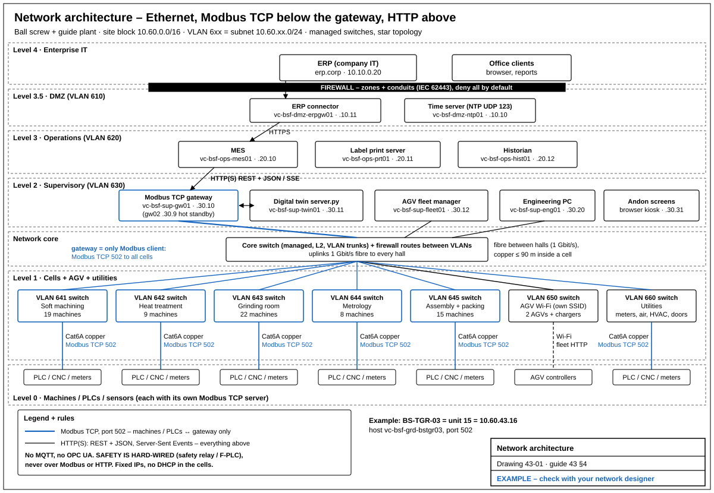

Ethernet is the same technology as in an office – but a factory has more electrical noise, oil, vibration, long cable
runs and machines that must run 24 h. This chapter gives the rules.

### 4.1 Topology – star, ring, MRP, RSTP

| Topology | How | Good | Bad | Use here |
|---|---|---|---|---|
| Star | every device has its own cable to a switch | simple, one cable fault = one device | switch fault = whole cell | **inside each cell** (machine → cell switch) |
| Line (daisy chain) | devices with 2 ports pass the traffic on | less cable | one fault cuts all devices behind it | only inside a machine (PLC → drives) |
| Ring with MRP / RSTP | switches in a ring, one link blocked; a fault opens the blocked link | survives one cable / switch fault | needs managed switches with the same ring protocol | **between the cell switches and the core** |

**MRP** (Media Redundancy Protocol, IEC 62439-2): one switch is the ring manager; recovery time ≤ 200 ms (example class,
check the switch). **RSTP** (Rapid Spanning Tree, IEEE 802.1w, now in 802.1D / 802.1Q): works between switches of
different makers; recovery 1 – 3 s typically (example). For our polling (fast block every 500 ms, stale limit 2.1 s)
both are fast enough – a ring reconfiguration shows at most as 1 – 2 time-outs.

Rule of thumb: **star at the edge, ring in the backbone, fibre between halls**.

### 4.2 VLANs – one subnet per zone

A **VLAN** (virtual LAN, IEEE 802.1Q) separates one physical network into several logical networks. Devices in
different VLANs cannot talk to each other unless a router / firewall lets them. We make **one VLAN per zone** of
IEC 62443 (§13):

| VLAN | Name | Subnet | Level | Use | Machines |
|---|---|---|---|---|---|
| 610 | BSF-DMZ | 10.60.10.0/24 | 3.5 | ERP connector, time server, patch server, remote service | – |
| 620 | BSF-OPS | 10.60.20.0/24 | 3 | MES, label print server, historian, DNS | – |
| 630 | BSF-SUP | 10.60.30.0/24 | 2 | Modbus gateway, digital twin, AGV fleet manager, engineering station, andon screens | – |
| 641 | BSF-SOFT | 10.60.41.0/24 | 1 | saws, lathes, machining centres, soft presses | 19 |
| 642 | BSF-HT | 10.60.42.0/24 | 1 | induction, furnaces, hardened straightening | 9 |
| 643 | BSF-GRIND | 10.60.43.0/24 | 1 | grinders, hard turning | 22 |
| 644 | BSF-QC | 10.60.44.0/24 | 1 | lead measuring, rail bench, matching, laboratory | 8 |
| 645 | BSF-ASSY | 10.60.45.0/24 | 1 | washer, assembly benches, run-in, marker, packing | 15 |
| 650 | BSF-AGV | 10.60.50.0/24 | 1 | AGVs, chargers (the fleet manager talks HTTP to them or to its own server) | – |
| 660 | BSF-UTIL | 10.60.60.0/24 | 1 | energy meters, compressors, HVAC, door I/O (all Modbus TCP) | – |

**Rule:** VLAN number `6xx` ↔ subnet `10.60.xx.0/24`. A technician who sees `10.60.43.16` knows at once: VLAN 643,
grinding room. This follows the idea of guide 15 §3.13 (`10.<VLAN>.0.<host>` in the compressor plant), adapted for a
second site: the whole ball screw plant is the block `10.60.0.0/16`, so the two sites never overlap.

Why VLANs per cell and not one big machine VLAN?

* **Broadcast domain small** – a faulty device that floods the network disturbs only its own cell.
* **Firewall rules per zone** – e.g. only the gateway may reach port 502 in the cells (§13).
* **Maintenance** – a machine maker's laptop can be allowed into one cell only.

### 4.3 IP plan – 10.60.xx.host

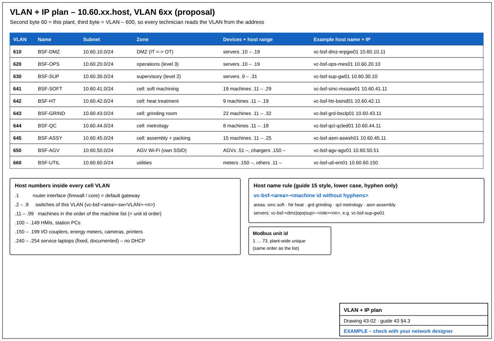

Host numbers inside every /24 subnet (example convention):

| Host range | Use | Example |
|---|---|---|
| .1 | firewall / router interface of the VLAN (default gateway) | 10.60.43.1 |
| .2 – .9 | switches of this VLAN | 10.60.43.2 = cell switch grinding |
| .11 – .99 | machines, in the order of the machine list | 10.60.43.11 = BS-CLP-01 |
| .100 – .149 | HMIs, operator PCs, servers (in VLANs 610 – 630: the servers) | 10.60.30.10 = gateway |
| .150 – .199 | I/O couplers, energy meters, cameras, printers | 10.60.45.150 |
| .200 – .239 | reserve | – |
| .240 – .254 | commissioning / service laptops (fixed, documented) | 10.60.43.240 |

**No DHCP in the cells.** Every device has a fixed address written on the device and in the IP list. Reason: a Modbus
client connects to an IP – if DHCP gives a new address after a power cut, the gateway loses the machine.

Servers and central devices (example):

| Host name | IP | VLAN | Role |
|---|---|---|---|
| `vc-bsf-dmz-ntp01` | 10.60.10.10 | 610 | time server (NTP – UDP 123, the one infrastructure exception, §12) |
| `vc-bsf-dmz-erpgw01` | 10.60.10.11 | 610 | ERP connector (HTTP reverse proxy / API gateway between ERP and MES) |
| `vc-bsf-ops-mes01` | 10.60.20.10 | 620 | MES (HTTP REST + JSON) |
| `vc-bsf-ops-prt01` | 10.60.20.11 | 620 | label print server (HTTP job API → printers) |
| `vc-bsf-ops-hist01` | 10.60.20.12 | 620 | historian (HTTP write / read) |
| `vc-bsf-ops-dns01` | 10.60.20.13 | 620 | DNS (UDP / TCP 53, infrastructure) |
| `vc-bsf-sup-gw02` | 10.60.30.9 | 630 | standby gateway (hot standby) |
| `vc-bsf-sup-gw01` | 10.60.30.10 | 630 | Modbus TCP gateway (client to 73 machines, HTTP server) |
| `vc-bsf-sup-twin01` | 10.60.30.11 | 630 | digital twin (server.py, HTTP + SSE) |
| `vc-bsf-sup-fleet01` | 10.60.30.12 | 630 | AGV fleet manager (HTTP API) |
| `vc-bsf-sup-eng01` | 10.60.30.20 | 630 | engineering station (PLC / CNC tools, Wireshark) |
| `vc-bsf-sup-and01` | 10.60.30.31 | 630 | andon screen 1 (browser kiosk, HTTP + SSE) |
| `erp.corp` (IT) | 10.10.0.20 | 10 (IT) | ERP in the company IT network (only HTTPS to the DMZ connector) |

Note: in VLANs 610 – 630 the servers use .9 – .31 in this example (few devices); if you prefer the strict range table,
move them to .100+. Decide once and write it into the IP list.

**All 73 machines** (generated from `twin/bsf_comm_map.py`; port 502 for all; unit id = position in the machine list):

| # unit | Machine | Type | Area | VLAN | IP | Host name |
|---|---|---|---|---|---|---|
| 1 | MS-SAW-01 | MS-SAW | soft | 641 | 10.60.41.11 | `vc-bsf-smc-mssaw01` |
| 2 | BS-STR-01 | BS-STR | soft | 641 | 10.60.41.12 | `vc-bsf-smc-bsstr01` |
| 3 | BS-CTR-01 | BS-CTR | soft | 641 | 10.60.41.13 | `vc-bsf-smc-bsctr01` |
| 4 | BS-TRN-01 | BS-TRN | soft | 641 | 10.60.41.14 | `vc-bsf-smc-bstrn01` |
| 5 | BS-TRN-02 | BS-TRN | soft | 641 | 10.60.41.15 | `vc-bsf-smc-bstrn02` |
| 6 | BS-IND-01 | BS-IND | ht | 642 | 10.60.42.11 | `vc-bsf-htr-bsind01` |
| 7 | HT-TMP-01 | HT-TMP | ht | 642 | 10.60.42.12 | `vc-bsf-htr-httmp01` |
| 8 | BS-STH-01 | BS-STH | ht | 642 | 10.60.42.13 | `vc-bsf-htr-bssth01` |
| 9 | BS-STH-02 | BS-STH | ht | 642 | 10.60.42.14 | `vc-bsf-htr-bssth02` |
| 10 | BS-CLP-01 | BS-CLP | grind | 643 | 10.60.43.11 | `vc-bsf-grd-bsclp01` |
| 11 | BS-CGR-01 | BS-CGR | grind | 643 | 10.60.43.12 | `vc-bsf-grd-bscgr01` |
| 12 | BS-CGR-02 | BS-CGR | grind | 643 | 10.60.43.13 | `vc-bsf-grd-bscgr02` |
| 13 | BS-TGR-01 | BS-TGR | grind | 643 | 10.60.43.14 | `vc-bsf-grd-bstgr01` |
| 14 | BS-TGR-02 | BS-TGR | grind | 643 | 10.60.43.15 | `vc-bsf-grd-bstgr02` |
| 15 | BS-TGR-03 | BS-TGR | grind | 643 | 10.60.43.16 | `vc-bsf-grd-bstgr03` |
| 16 | BS-TGR-04 | BS-TGR | grind | 643 | 10.60.43.17 | `vc-bsf-grd-bstgr04` |
| 17 | BS-TGR-05 | BS-TGR | grind | 643 | 10.60.43.18 | `vc-bsf-grd-bstgr05` |
| 18 | BS-TGR-06 | BS-TGR | grind | 643 | 10.60.43.19 | `vc-bsf-grd-bstgr06` |
| 19 | BS-TGR-07 | BS-TGR | grind | 643 | 10.60.43.20 | `vc-bsf-grd-bstgr07` |
| 20 | BS-TGR-08 | BS-TGR | grind | 643 | 10.60.43.21 | `vc-bsf-grd-bstgr08` |
| 21 | QC-LED-01 | QC-LED | qc | 644 | 10.60.44.11 | `vc-bsf-qcl-qcled01` |
| 22 | QC-LED-02 | QC-LED | qc | 644 | 10.60.44.12 | `vc-bsf-qcl-qcled02` |
| 23 | QC-LED-03 | QC-LED | qc | 644 | 10.60.44.13 | `vc-bsf-qcl-qcled03` |
| 24 | AS-WSH-01 | AS-WSH | assy | 645 | 10.60.45.11 | `vc-bsf-asm-aswsh01` |
| 25 | BN-TRN-01 | BN-TRN | soft | 641 | 10.60.41.16 | `vc-bsf-smc-bntrn01` |
| 26 | BN-TRN-02 | BN-TRN | soft | 641 | 10.60.41.17 | `vc-bsf-smc-bntrn02` |
| 27 | BN-TRN-03 | BN-TRN | soft | 641 | 10.60.41.18 | `vc-bsf-smc-bntrn03` |
| 28 | BN-MC-01 | BN-MC | soft | 641 | 10.60.41.19 | `vc-bsf-smc-bnmc01` |
| 29 | BN-MC-02 | BN-MC | soft | 641 | 10.60.41.20 | `vc-bsf-smc-bnmc02` |
| 30 | BN-MC-03 | BN-MC | soft | 641 | 10.60.41.21 | `vc-bsf-smc-bnmc03` |
| 31 | HT-CAR-01 | HT-CAR | ht | 642 | 10.60.42.15 | `vc-bsf-htr-htcar01` |
| 32 | HT-CAR-02 | HT-CAR | ht | 642 | 10.60.42.16 | `vc-bsf-htr-htcar02` |
| 33 | BN-HTN-01 | BN-HTN | grind | 643 | 10.60.43.22 | `vc-bsf-grd-bnhtn01` |
| 34 | BN-HTN-02 | BN-HTN | grind | 643 | 10.60.43.23 | `vc-bsf-grd-bnhtn02` |
| 35 | BN-ITG-01 | BN-ITG | grind | 643 | 10.60.43.24 | `vc-bsf-grd-bnitg01` |
| 36 | BN-ITG-02 | BN-ITG | grind | 643 | 10.60.43.25 | `vc-bsf-grd-bnitg02` |
| 37 | AS-NAS-01 | AS-NAS | assy | 645 | 10.60.45.12 | `vc-bsf-asm-asnas01` |
| 38 | AS-NAS-02 | AS-NAS | assy | 645 | 10.60.45.13 | `vc-bsf-asm-asnas02` |
| 39 | LG-SAW-01 | LG-SAW | soft | 641 | 10.60.41.22 | `vc-bsf-smc-lgsaw01` |
| 40 | LG-STR-01 | LG-STR | soft | 641 | 10.60.41.23 | `vc-bsf-smc-lgstr01` |
| 41 | LG-DRL-01 | LG-DRL | soft | 641 | 10.60.41.24 | `vc-bsf-smc-lgdrl01` |
| 42 | LG-IND-01 | LG-IND | ht | 642 | 10.60.42.17 | `vc-bsf-htr-lgind01` |
| 43 | LG-STH-01 | LG-STH | ht | 642 | 10.60.42.18 | `vc-bsf-htr-lgsth01` |
| 44 | LG-STH-02 | LG-STH | ht | 642 | 10.60.42.19 | `vc-bsf-htr-lgsth02` |
| 45 | LG-SGR-01 | LG-SGR | grind | 643 | 10.60.43.26 | `vc-bsf-grd-lgsgr01` |
| 46 | LG-PGR-01 | LG-PGR | grind | 643 | 10.60.43.27 | `vc-bsf-grd-lgpgr01` |
| 47 | LG-PGR-02 | LG-PGR | grind | 643 | 10.60.43.28 | `vc-bsf-grd-lgpgr02` |
| 48 | LG-CUT-01 | LG-CUT | grind | 643 | 10.60.43.29 | `vc-bsf-grd-lgcut01` |
| 49 | QC-RAL-01 | QC-RAL | qc | 644 | 10.60.44.14 | `vc-bsf-qcl-qcral01` |
| 50 | LB-MC-01 | LB-MC | soft | 641 | 10.60.41.25 | `vc-bsf-smc-lbmc01` |
| 51 | LB-MC-02 | LB-MC | soft | 641 | 10.60.41.26 | `vc-bsf-smc-lbmc02` |
| 52 | LB-MC-03 | LB-MC | soft | 641 | 10.60.41.27 | `vc-bsf-smc-lbmc03` |
| 53 | LB-MC-04 | LB-MC | soft | 641 | 10.60.41.28 | `vc-bsf-smc-lbmc04` |
| 54 | LB-MC-05 | LB-MC | soft | 641 | 10.60.41.29 | `vc-bsf-smc-lbmc05` |
| 55 | LB-SGR-01 | LB-SGR | grind | 643 | 10.60.43.30 | `vc-bsf-grd-lbsgr01` |
| 56 | LB-RGR-01 | LB-RGR | grind | 643 | 10.60.43.31 | `vc-bsf-grd-lbrgr01` |
| 57 | LB-RGR-02 | LB-RGR | grind | 643 | 10.60.43.32 | `vc-bsf-grd-lbrgr02` |
| 58 | QC-INC-01 | QC-INC | qc | 644 | 10.60.44.15 | `vc-bsf-qcl-qcinc01` |
| 59 | AS-BAS-01 | AS-BAS | assy | 645 | 10.60.45.14 | `vc-bsf-asm-asbas01` |
| 60 | AS-BAS-02 | AS-BAS | assy | 645 | 10.60.45.15 | `vc-bsf-asm-asbas02` |
| 61 | AS-BAS-03 | AS-BAS | assy | 645 | 10.60.45.16 | `vc-bsf-asm-asbas03` |
| 62 | QC-MAT-01 | QC-MAT | qc | 644 | 10.60.44.16 | `vc-bsf-qcl-qcmat01` |
| 63 | QC-MAT-02 | QC-MAT | qc | 644 | 10.60.44.17 | `vc-bsf-qcl-qcmat02` |
| 64 | AS-BSA-01 | AS-BSA | assy | 645 | 10.60.45.17 | `vc-bsf-asm-asbsa01` |
| 65 | AS-BSA-02 | AS-BSA | assy | 645 | 10.60.45.18 | `vc-bsf-asm-asbsa02` |
| 66 | AS-BSA-03 | AS-BSA | assy | 645 | 10.60.45.19 | `vc-bsf-asm-asbsa03` |
| 67 | AS-RUN-01 | AS-RUN | assy | 645 | 10.60.45.20 | `vc-bsf-asm-asrun01` |
| 68 | AS-RUN-02 | AS-RUN | assy | 645 | 10.60.45.21 | `vc-bsf-asm-asrun02` |
| 69 | AS-GAS-01 | AS-GAS | assy | 645 | 10.60.45.22 | `vc-bsf-asm-asgas01` |
| 70 | AS-MRK-01 | AS-MRK | assy | 645 | 10.60.45.23 | `vc-bsf-asm-asmrk01` |
| 71 | AS-PCK-01 | AS-PCK | assy | 645 | 10.60.45.24 | `vc-bsf-asm-aspck01` |
| 72 | AS-PCK-02 | AS-PCK | assy | 645 | 10.60.45.25 | `vc-bsf-asm-aspck02` |
| 73 | QC-LAB-01 | QC-LAB | qc | 644 | 10.60.44.18 | `vc-bsf-qcl-qclab01` |

How the table is made (the same algorithm in Python `machines()` and JavaScript `NETM`):

1. go through the machine types in the order of `MTYPES` (item 2) and their instances 01, 02, …;
2. unit id = running number 1 … 73;
3. VLAN from the area: soft → 641, ht → 642, grind → 643, qc → 644, assy → 645;
4. host number = 11, 12, … counted per area;
5. host name = `vc-bsf-` + area code (`smc`, `htr`, `grd`, `qcl`, `asm`) + `-` + machine id without hyphens, lower case.

Download the table as CSV from the page (card 1) or `GET /api/bsf/map.csv` (semicolon separated, opens in Excel).

### 4.4 Host names

Rule (follows guide 15 §3.13): `vc-<plant>-<area>-<device>`, lower case, letters, digits and hyphens only.

| Object | Rule | Example |
|---|---|---|
| Machine (PLC / CNC = Modbus server) | `vc-bsf-<area code>-<machine id without hyphen>` | `vc-bsf-grd-bstgr03` |
| Part of a machine | + `-<function><n>` | `vc-bsf-grd-bstgr03-io1` (I/O coupler), `-hmi` |
| Server | `vc-bsf-<zone>-<role><nn>`, zone = dmz / ops / sup | `vc-bsf-sup-gw01` |
| Switch | `vc-bsf-<area>-sw<VLAN>-<n>` | `vc-bsf-grd-sw643-1` |

* DNS label ≤ 63 characters (all machine names here: ≤ 19). **Windows** computers: ≤ 15 characters (NetBIOS) – so a
  Windows HMI gets a short name like `vc-bsf-grd-h1`.
* The host name follows the **equipment**, not the address; never put the IP into the name.
* Modbus clients use the **IP**, not the name – the cells do not depend on DNS.

### 4.5 Managed switches and PoE

Use **managed industrial switches** only – never unmanaged office switches in a cell.

| Feature | Why we need it |
|---|---|
| VLAN 802.1Q (access + trunk ports) | zones (§4.2) |
| Ring protocol MRP / RSTP | backbone redundancy |
| Port mirroring | connect a laptop with Wireshark to see the Modbus frames of a machine (§15) |
| Port security / 802.1X / MAC lock, unused ports off | nobody can plug a laptop in and write registers (§13) |
| IGMP snooping, broadcast storm limit | one faulty device cannot flood the cell |
| Diagnostics over HTTPS web UI (SNMP optional, see §12) | port status, errors, link speed |
| Redundant 24 V supply, −40 … +70 °C (example class), DIN rail | cabinet mounting, reliability |
| PoE 802.3af / at / bt (only where needed) | cameras, Wi-Fi access points, small andon displays |

**Sizing example – cell switch grinding room (VLAN 643):** 22 machines + 4 spare + 2 uplinks (ring) + 1 mirror port
= 29 ports → one 24-port switch is too small → use 2 × 16-port or 1 × 28-port (example). Each machine needs 1 port
(the machine's own internal network stays behind the machine PLC – NAT or a second NIC, ask the maker).

**PoE budget example:** 4 Wi-Fi access points × 25 W (802.3at) = 100 W → the PoE switch needs ≥ 120 W budget
(20 % reserve).

### 4.6 Cabling – Cat6A, fibre, M12

| Link | Medium | Max length | Example product class |
|---|---|---|---|
| Machine → cell switch | Cat6A S/FTP, PUR jacket (oil-resistant), 4 pair | 90 m permanent + 10 m patch = 100 m channel (ISO/IEC 11801 / EN 50173) | Lapp ETHERLINE, Helukabel, Belden, Siemens IE FC (check) |
| Inside drag chains | Cat6A / Cat5e drag-chain cable | as above | same makers, "chain" versions |
| Cell switch ↔ core | fibre OM3 / OM4 multimode | ≈ 300 – 400 m at 10 Gbit/s, 550 m at 1 Gbit/s (example) | Corning, Prysmian + SFP modules |
| Between halls / buildings | fibre OS2 single mode | km | same |
| Connectors | RJ45 in cabinets (IP20), M12 X-coded (IP67) on machines | – | Harting, Phoenix, Murrelektronik (check) |

Why fibre between halls? It carries no current – no earth loops between buildings with different earth potential, no
lightning surge, no EMC pick-up.

Test every copper link with a certifier (Cat6A class EA report) and every fibre with an OTDR / loss test – keep the
reports in the plant documentation (§14).

### 4.7 EMC, earthing and shielding

Machines with inverters (spindles, servo drives, induction generators of 60 – 120 kW, guide 41) produce strong
electrical noise. Rules (examples – follow EN 50310 and the machine makers' manuals):

| Rule | Why |
|---|---|
| Shielded cable (S/FTP), shield connected **360°** at both ends to the cabinet earth | shield works only with low-impedance connection at both ends |
| Equipotential bonding (mesh) between machine, cabinet and cable tray, ≥ 16 mm² Cu (example) | prevents current flowing on the shield |
| Separate trays (or ≥ 200 mm distance, example) for power cables and data cables; cross at 90° | less coupling |
| Never run Ethernet next to the induction hardening bus bars | very strong magnetic fields at 10 – 30 kHz |
| Fibre where the earth potential differs (other building, heat-treatment bay) | no earth loop |
| Ferrite cores only as a repair, not as design | – |

A typical symptom of EMC problems: Modbus time-outs only when a certain machine is running (e.g. the induction line
LG-IND-01 starts) – the switch counters show CRC errors on the port. Check §15.

### 4.8 Wi-Fi for AGVs

AGVs move, so they need Wi-Fi (VLAN 650, own SSID). Wi-Fi is the weakest link – plan it carefully:

* site survey before installation; ≥ −67 dBm signal everywhere on the AGV lanes (example target);
* 5 GHz, fast roaming (802.11r / k / v) – roaming time < 50 ms (example);
* WPA3-Enterprise or WPA2-Enterprise with certificates;
* the **fleet manager** (`vc-bsf-sup-fleet01`) talks to the AGVs (its own protocol inside its system, or HTTP); the
  MES talks **only HTTP** to the fleet manager (§11.3). Safety of the AGV (scanners, bumpers) is on the vehicle –
  never over Wi-Fi.

---

## 5. Connecting the machines

Each of the 73 machines must offer a **Modbus TCP server** (old word: "slave") with our register map (§8). There are
three ways.

### 5.1 Native Modbus TCP server in the PLC / CNC (preferred)

Most modern controllers have it built in or as a software option (examples – check with the maker):

| Controller family | Modbus TCP server | Note |
|---|---|---|
| Siemens S7-1200 / S7-1500 | `MB_SERVER` instruction (free, in TIA Portal) | map a DB to holding registers; data type REAL = big-endian ABCD natively |
| Delta DVP / AS series | built-in Modbus TCP server | D registers = holding registers; check word order of floats |
| Mitsubishi iQ-R / FX5 | built-in (parameter setting) | word order of 32-bit values = **CDAB** by default – configure or swap in the PLC |
| Beckhoff TwinCAT | TF6250 Modbus TCP | – |
| Fanuc / Siemens / Heidenhain CNC | often only via the PLC side of the CNC (option) | ask: "Modbus TCP server with our map – yes / option / no?" |
| Energy meters (Janitza, Siemens PAC, Schneider PM) | built-in | fixed vendor map – the gateway needs a **device profile** (§8.3) |

The machine maker programs the map in the machine PLC – this is part of the purchase specification (§8.6).

### 5.2 Remote I/O coupler for old machines

An old machine without Ethernet still has lamps and relays. A **Modbus TCP I/O coupler** (e.g. WAGO 750-352, Phoenix
Axioline, Moxa ioLogik – check) reads 24 V signals:

| Signal from the old machine | Coupler input | Register in our map |
|---|---|---|
| "machine running" lamp | digital input 1 | status bit 0 |
| "alarm" lamp | digital input 2 | status bit 3, alarm code 999 (= unknown) |
| part counter pulse (end of cycle) | counter input | `std.good` (UINT32) |
| power | separate Modbus energy meter | `std.power_kW`, `std.energy_kWh` |

The gateway then reads the coupler's own map and converts it to our standard names (a device profile).

### 5.3 Modbus RTU → TCP gateway

Some devices (temperature controllers of furnaces, small sensors) speak **Modbus RTU** on RS-485. A serial gateway
(e.g. Moxa MGate MB3170 – check) puts them on Ethernet: the gateway has one IP; behind it the **unit id selects the
serial device** (1 … 247). If a serial device does not answer, the serial gateway returns exception **0B** (gateway
target device failed to respond) or **0A** (gateway path unavailable) – our gateway shows this as "exception".

### 5.4 Unit id rules in this plant

The **unit id** is one byte in the Modbus TCP header (§6.2). In Modbus TCP it is only needed when one IP serves several
devices (serial gateway, simulator). Our rule:

| Rule | Example |
|---|---|
| every machine gets a plant-wide unique unit id 1 … 73 (column "unit" in §4.3) | BS-TGR-03 = unit 15 |
| a direct Modbus TCP device should accept its plan unit id (or ignore the unit id – many do; the Modbus TCP specification recommends 0xFF for direct addressing) | – |
| the machine writes its own unit id into register 2 (`hdr.unitId`) | the gateway can check "am I talking to the right machine?" (wrong cable / swapped IP) |
| the simulator serves all 73 on one port and uses the unit id to select the machine; unknown unit → exception 0B | unit 200 → 0B |

Why unique? Because the logs and Wireshark traces then show the machine directly, and the same map works through a
simulator, a serial gateway or direct devices.

---

## 6. Modbus TCP in depth

### 6.1 Client and server

Modbus is a **request / response** protocol. The **client** (old word "master") asks, the **server** ("slave") answers.
A server never speaks first – there are **no events** in Modbus.

| Role | In this plant |
|---|---|
| Modbus TCP client | the gateway (`vc-bsf-sup-gw01`), test tools on the engineering station |
| Modbus TCP server | every machine PLC / CNC, I/O coupler, energy meter, serial gateway; the simulator |

Modbus TCP = the Modbus application protocol (function codes, data model) carried in a **TCP connection** to port 502.
TCP gives reliable, ordered delivery, so Modbus TCP has **no CRC** (Modbus RTU has one). The client keeps the TCP
connection open and sends request after request.

The Modbus **data model** has four tables:

| Table | Access | Size | Old address style (1-based) | Used here |
|---|---|---|---|---|
| Coils | read / write, 1 bit | 0 … 65535 | 0xxxx (00001 …) | coils 0 – 31 = status bits (read), coil 100 = ack alarm (write) – optional |
| Discrete inputs | read, 1 bit | 0 … 65535 | 1xxxx | not used |
| Input registers | read, 16 bit | 0 … 65535 | 3xxxx | same data as holding registers (FC04) |
| **Holding registers** | read / write, 16 bit | 0 … 65535 | 4xxxx (40001 …) | **all our data** |

### 6.2 The MBAP header

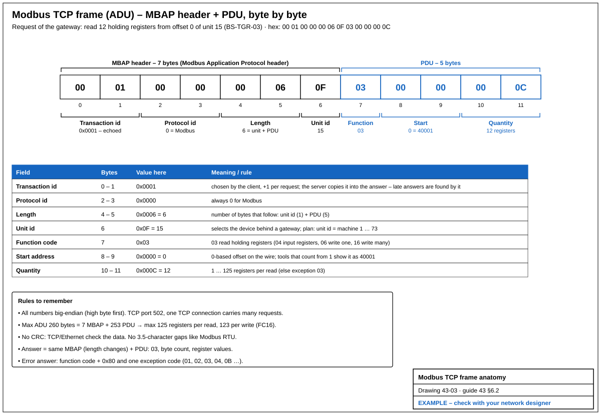

Every Modbus TCP message (ADU = application data unit) is **MBAP header (7 bytes) + PDU** (protocol data unit):

| Byte | Field | Size | Example (request to BS-TGR-03) | Meaning |
|---|---|---|---|---|
| 0 – 1 | Transaction identifier | 2 | `00 01` | the client counts 1, 2, 3 …; the server copies it into the answer → client matches answer to request |
| 2 – 3 | Protocol identifier | 2 | `00 00` | always 0 = Modbus |
| 4 – 5 | Length | 2 | `00 06` | number of bytes that follow (unit id + PDU) = 1 + 5 = 6 |
| 6 | Unit identifier | 1 | `0F` | 15 = BS-TGR-03 |
| 7 | Function code | 1 | `03` | read holding registers |
| 8 – 9 | Starting address | 2 | `00 00` | offset 0 |
| 10 – 11 | Quantity of registers | 2 | `00 0C` | 12 registers |

The complete request: **`00 01 00 00 00 06 0F 03 00 00 00 0C`** (12 bytes). All numbers are **big-endian** (high byte
first). Maximum ADU = 7 + 253 = **260 bytes**.

### 6.3 Function codes

| FC | Name | Request PDU | Response PDU | Used in this plant |
|---|---|---|---|---|
| 01 | Read Coils | FC, start, quantity (1 – 2000) | FC, byte count, bits | optional: status bits 0 – 31 |
| 02 | Read Discrete Inputs | as 01 | as 01 | no (→ exception 01) |
| **03** | **Read Holding Registers** | FC, start, quantity (1 – 125) | FC, byte count (2 × n), n registers | **all polling** |
| 04 | Read Input Registers | as 03 | as 03 | yes – serves the same data as 03 |
| 05 | Write Single Coil | FC, address, 0xFF00 = ON / 0x0000 = OFF | echo | optional: coil 100 = acknowledge alarm |
| **06** | **Write Single Register** | FC, address, value | echo | REQ toggle (register 202); gateway heartbeat (register 226, every 1 s – map V1.1) |
| 15 | Write Multiple Coils | – | – | no |
| **16** | **Write Multiple Registers** | FC, start, quantity (1 – 123), byte count, values | FC, start, quantity | command block 200 – 225 |
| 08 | Diagnostics | – | – | serial line only → exception 01 |

### 6.4 Worked example – FC03 request and response

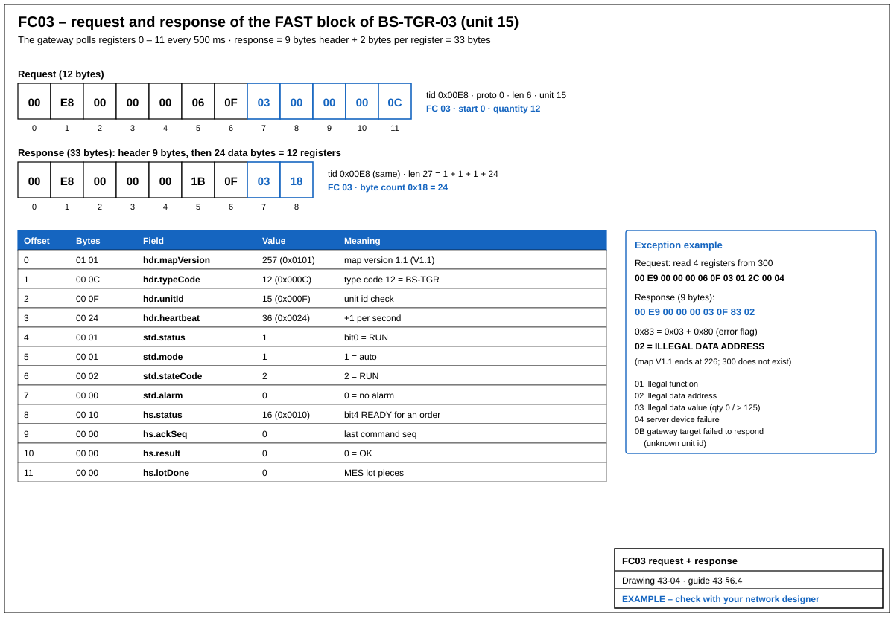

The gateway reads the **fast block** of BS-TGR-03 (unit 15): 12 registers from offset 0.

**Request** (12 bytes): `00 01 00 00 00 06 0F 03 00 00 00 0C`

**Response** (33 bytes, example values):

```text
00 01 00 00 00 1B 0F 03 18 01 01 00 0C 00 0F 00 35 00 01 00 01 00 02 00 00 00 10 00 00 00 00 00 00
```

| Bytes | Value | Field | Decoded |
|---|---|---|---|
| `00 01` | 1 | transaction id | same as the request |
| `00 00` | 0 | protocol id | Modbus |
| `00 1B` | 27 | length | 1 (unit) + 1 (FC) + 1 (byte count) + 24 (data) |
| `0F` | 15 | unit id | BS-TGR-03 |
| `03` | 3 | function code | read holding registers |
| `18` | 24 | byte count | 12 registers × 2 bytes |
| `01 01` | 0x0101 | reg 0 `hdr.mapVersion` | map version 1.1 (V1.0 machines answer `01 00`) |
| `00 0C` | 12 | reg 1 `hdr.typeCode` | type 12 = BS-TGR |
| `00 0F` | 15 | reg 2 `hdr.unitId` | the machine says "I am unit 15" ✓ |
| `00 35` | 53 | reg 3 `hdr.heartbeat` | +1 per second |
| `00 01` | 1 | reg 4 `std.status` | bit 0 = RUN |
| `00 01` | 1 | reg 5 `std.mode` | 1 = auto |
| `00 02` | 2 | reg 6 `std.stateCode` | 2 = RUN |
| `00 00` | 0 | reg 7 `std.alarm` | no alarm |
| `00 10` | 16 | reg 8 `hs.status` | bit 4 = READY for an order |
| `00 00` | 0 | reg 9 `hs.ackSeq` | – |
| `00 00` | 0 | reg 10 `hs.result` | – |
| `00 00` | 0 | reg 11 `hs.lotDone` | – |

Formula for the response size of FC03: **ADU = 9 + 2 × n bytes** (7 MBAP + FC + byte count + data). For n = 12:
9 + 24 = 33 bytes. The request is always 12 bytes.

**Exception response** (the client asked for offset 300, which does not exist):

```text
00 01 00 00 00 03 0F 83 02
```

The function code comes back with the high bit set (0x03 + 0x80 = **0x83**), followed by the exception code **02**
(illegal data address). An exception answer is always 9 bytes.

A real frame pair captured from the simulator (unit 73 = QC-LAB-01, transaction 0x00BE):

```text
-> 00 BE 00 00 00 06 49 03 00 00 00 0C
<- 00 BE 00 00 00 1B 49 03 18 01 01 00 29 00 49 00 02 00 01 00 01 00 02 00 00 00 10 00 00 00 00 00 00
   type code 0x29 = 41 = QC-LAB, unit 0x49 = 73, heartbeat 2, status 1 (RUN), state 2
```

### 6.5 Exception codes

| Code | Name | Typical cause | What the gateway does |
|---|---|---|---|
| 01 | ILLEGAL FUNCTION | the device does not support this FC (e.g. FC08 on TCP) | status "exception 01"; fix the configuration |
| 02 | ILLEGAL DATA ADDRESS | start + quantity outside the map; 0 / 1-based mistake; old map version | status "exception 02" |
| 03 | ILLEGAL DATA VALUE | quantity 0 or > 125; byte count wrong; coil value not 0xFF00 / 0x0000 | status "exception 03" |
| 04 | SERVER DEVICE FAILURE | device internal error (e.g. PLC Modbus block not running) | keep last values, mark stale |
| 05 / 06 | ACKNOWLEDGE / BUSY | long operation (rare) | retry later |
| 0A | GATEWAY PATH UNAVAILABLE | serial gateway misconfigured | status "exception 0A" |
| 0B | GATEWAY TARGET DEVICE FAILED TO RESPOND | serial device behind a gateway silent; **wrong unit id** | status "exception 0B" |

Real example from the simulator – wrong unit id 200 (0xC8):

```text
-> 6F 01 00 00 00 06 C8 03 00 00 00 0C
<- 6F 01 00 00 00 03 C8 83 0B        EXCEPTION fc 03 code 0B GATEWAY TARGET DEVICE FAILED TO RESPOND
```

**No answer at all** is not an exception – it is a **time-out** (cable, device off, wrong IP, firewall). The client
decides after its time-out (here 300 ms).

### 6.6 0-based and 1-based addresses – the most common mistake

The **protocol** always carries the 0-based offset. Many manuals and tools show the old 1-based "4xxxx" notation.

| In this guide (offset) | In the frame | In a 1-based tool / manual |
|---|---|---|
| 0 | `00 00` | 40001 |
| 20 | `00 14` | 40021 |
| 200 | `00 C8` | 40201 |

Formula: **1-based = 40001 + offset**. If a value appears "shifted by one register" (e.g. you read the low word of a
REAL as the high word), check this first. Some vendors write "register 40001" and mean offset 40000 – always test with
a known value (map version 0x0101 in offset 0).

### 6.7 Limits

| Limit | Value | Why |
|---|---|---|
| registers per read (FC03 / 04) | **125** | 125 × 2 = 250 data bytes + 3 = 253 PDU bytes |
| registers per write (FC16) | **123** | 123 × 2 = 246 + 6 = 252 bytes |
| coils per read (FC01) | 2 000 | – |
| ADU size | **260 bytes** | 7 MBAP + 253 PDU |
| addresses per table | 65 536 | 16-bit address |

Our biggest block is the counters block of BS-TGR / BN-ITG with **48 registers** – far below 125, so one FC03 per block.

### 6.8 TCP connections and unit id

* A Modbus TCP server accepts a limited number of connections (example: S7-1200 a few, many PLCs 4 – 16 – **ask**).
  Our gateway uses **one** connection per device for polling plus a short extra connection for a command.
* Inside one connection the client may send the next request only after the answer (simple clients) – our gateway does
  this. Pipelining several requests is allowed by the standard but many devices do not support it.
* After a **time-out** our client **closes the connection and reconnects**. Then a late answer can never be mixed up
  with the next request. In addition it checks the transaction id and drops answers with an old id.
* Keep-alive: the polling itself keeps the connection alive; devices often close idle connections after 60 – 120 s.

### 6.9 Timing and device response time

The time for one request = **round-trip time (RTT)**:

**RTT = t(network) + t(device response)**

| Part | Typical (example) |
|---|---|
| network on a switched 100 Mbit LAN, 1 – 3 switches | 0.05 – 0.3 ms |
| PLC answer time – the Modbus server runs once per PLC scan or in a communication task | 2 – 20 ms |
| CNC with Modbus on its PLC side | 5 – 50 ms |
| serial gateway with RS-485 behind it (19 200 baud, 12 registers) | 20 – 60 ms |
| our simulator on the same PC (loopback) | 0.02 – 0.1 ms (measured, not realistic) |

So the **device**, not the network, sets the speed. The calculator (card 6, §9.6) uses 3 ms as the default device RTT.

---

## 7. Data types and word order

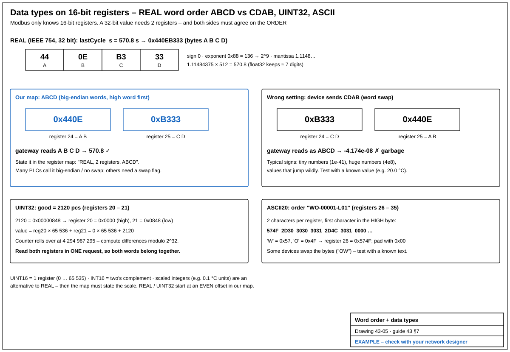

A Modbus register has **16 bits**. Everything bigger than 16 bits needs several registers, and there the trouble starts:
the Modbus standard does **not** say in which order. Our map fixes it.

### 7.1 UINT16, INT16 and scaling

| Type | Range | Registers | Example |
|---|---|---|---|
| UINT16 | 0 … 65 535 | 1 | alarm code 202 → `00 CA` |
| INT16 (two's complement) | −32 768 … 32 767 | 1 | −125 → `FF 83` |
| INT16 with scale | e.g. value × 10 | 1 | −12.5 °C × 10 = −125 → `FF 83`, the client divides by 10 |

Scaled integers are common in older devices ("temperature in 0.1 °C"). Our map uses **REAL** for all physical values,
so the `scale` column is always 1 – but the gateway's map format has the field, so a device profile of a foreign device
(energy meter with scale 0.01) fits in.

### 7.2 UINT32 – high word first

Counters (good parts, scrap) can exceed 65 535 → UINT32 = 2 registers. Our rule: **high word first** (in the lower
address).

| Value | Register n (high) | Register n + 1 (low) |
|---|---|---|
| 2 120 | `0x0000` | `0x0848` |
| 100 000 | `0x0001` | `0x86A0` |
| 4 294 967 295 (max) | `0xFFFF` | `0xFFFF` |

Formula: **value = high × 65 536 + low**. Check: 1 × 65 536 + 0x86A0 (34 464) = 100 000 ✓.

UINT32 does not overflow in practice: 4.29 × 10⁹ parts at 1 part per minute = 8 166 years.

### 7.3 REAL – IEEE 754 single precision, 2 registers

A REAL (float32) has 4 bytes: sign (1 bit), exponent (8 bits), mantissa (23 bits). Name the 4 bytes **A B C D** in
big-endian order (A = the byte with the sign).

**Worked example – last cycle time 570.8 s:**

1. 570.8 = 1.11484375 × 2⁹ → sign 0, exponent 9 + 127 = 136 = `1000 1000`, mantissa 0.11484375 × 2²³ ≈ 963 379 = `0xEB333`
2. bits: `0 10001000 00011101011001100110011` → bytes **A = 0x44, B = 0x0E, C = 0xB3, D = 0x33**
3. float32 cannot store 570.8 exactly: the stored value is 570.799988 → the gateway rounds to 7 significant digits → 570.8.

The four possible word / byte orders – the same 4 bytes, read four ways:

| Order | Register n | Register n + 1 | Read as ABCD gives | Who uses it (examples – check) |
|---|---|---|---|---|
| **ABCD** (big-endian, **this plant**) | `0x440E` | `0xB333` | **570.8** | Siemens S7 (`MB_SERVER` on a DB), Modbus standard spirit, many meters |
| CDAB (word swap) | `0xB333` | `0x440E` | −4.173858 × 10⁻⁸ | Mitsubishi, Schneider, many Modbus libraries default |
| BADC (byte swap) | `0x0E44` | `0x33B3` | 2.42 × 10⁻³⁰ | rare |
| DCBA (little-endian) | `0x33B3` | `0x0E44` | 8.34 × 10⁻⁸ | some PC-based devices |

**How to recognise a word-order error:** the values are **nonsense but stable** – e.g. a coolant temperature of
20.2 °C (`0x41A1 0x999A`) read with swapped words shows −1.59 × 10⁻²³; 8.77 kW shows 1.27 × 10¹¹ kW. The device status
is "online", the frames look fine – only the numbers are wrong. Test value: **20.0 = 0x41A0 0x0000** – easy to spot
in a hex dump. Card 7 of the page injects this fault ("wrong word order").

### 7.4 ASCII strings – 2 characters per register

Order numbers and part codes are 20 characters = **10 registers**. First character in the **high byte**, padded with
0x00.

"WO-00001-L01" →

| Register | 203 | 204 | 205 | 206 | 207 | 208 | 209 – 212 |
|---|---|---|---|---|---|---|---|
| Characters | W O | - 0 | 0 0 | 0 1 | - L | 0 1 | (0x00) |
| Value | `0x574F` | `0x2D30` | `0x3030` | `0x3031` | `0x2D4C` | `0x3031` | `0x0000` |

Only ASCII 0x20 – 0x7E is allowed (no umlauts, no "°"). The decoder stops at the first 0x00.

### 7.5 Status words and bits

A status word packs 16 booleans into one register – cheaper than 16 coils and read in the same FC03 as the rest.

`std.status` (offset 4):

| Bit | Value | Meaning |
|---|---|---|
| 0 | 1 | RUN – producing |
| 1 | 2 | IDLE – ready, no order |
| 2 | 4 | SET-UP |
| 3 | 8 | ALARM (code in `std.alarm`) |
| 4 | 16 | E-STOP pressed – **copy for display only**, the safety function is hard-wired |
| 5 | 32 | BLOCKED – finished lot cannot leave |
| 6 | 64 | STARVED – waiting for parts |
| 7 | 128 | no shift (OFF) |

Example: status = 64 = `0000 0000 0100 0000` → bit 6 → STARVED. Exactly one of bits 0 – 3, 5 – 7 is set (the state of
the twin, item 3); `std.stateCode` (offset 6) gives the same state as a number 0 … 6.

---

## 8. The register map of this plant

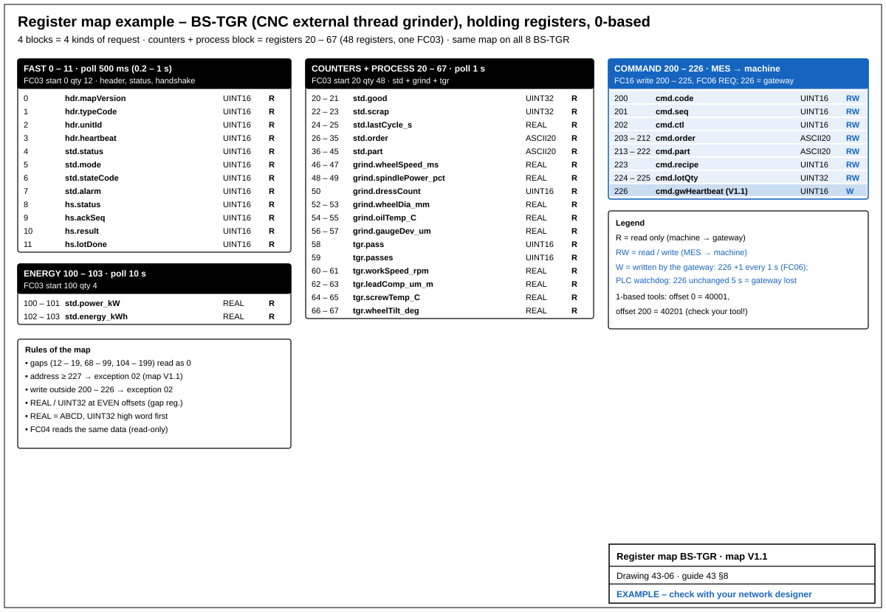

### 8.1 The four blocks

The map is designed **for polling**: each block is one FC03 read with its own poll period.

| Block | Offsets | Registers read | Poll period (example) | Content | Access |
|---|---|---|---|---|---|
| **FAST** | 0 – 11 | 12 | 500 ms (200 ms – 1 s) | header (map version, type code, unit id, heartbeat), status, mode, state, alarm, handshake status | read |
| **COUNTERS + PROCESS** | 20 – 99 (used 20 – 45 + process) | 26 – 48 (type dependent) | 1 s | good, scrap (UINT32), last cycle time (REAL), order no. + part code (ASCII20), process values of the type's signal groups | read |
| **ENERGY** | 100 – 103 | 4 | 10 s | power kW, energy kWh (REAL) | read |
| **COMMAND** | 200 – 226 | (written) | on demand; 226 every 1 s | MES → machine: command code, sequence, REQ, order, part, recipe, lot quantity (200 – 225); **226 = gateway heartbeat** (map V1.1, written by the gateway) | read / write |

Rules of the map (all machine types):

| Rule | Value |
|---|---|
| table | holding registers (FC03, write FC06 / FC16); FC04 returns the same data |
| addressing | 0-based offsets; offset 0 = 40001 in 1-based tools |
| map size | map V1.1: offsets 0 – 226 exist (227 registers); gaps (12 – 19, unused part of 20 – 99, 104 – 199) read as 0 (reserved); ≥ 227 → exception 02 |
| writes | only 200 – 226; elsewhere → exception 02 |
| UINT32 | 2 registers, high word first |
| REAL | IEEE 754, 2 registers, **ABCD** |
| ASCII20 | 10 registers, 2 characters per register, high byte first, 0x00 padded |
| even-offset rule | every REAL / UINT32 starts at an **even** offset (a reserved register fills the gap) – some PLCs map 32-bit values only on even word addresses (e.g. %MD / %MF style) |
| counters start | process values start at offset 46, in the order of the type's signal groups (`MTYPES[type].sig`) and of `SIGFIELDS` |

FAST block (identical for all 41 types):

| Offset | Name | Type | Meaning |
|---|---|---|---|
| 0 | `hdr.mapVersion` | UINT16 | 0x0101 = 1.1 (V1.0 = 0x0100) – check after every machine software update |
| 1 | `hdr.typeCode` | UINT16 | 1 = MS-SAW … 41 = QC-LAB (order of the type list) |
| 2 | `hdr.unitId` | UINT16 | the machine's own unit id (plausibility: wrong cable / IP) |
| 3 | `hdr.heartbeat` | UINT16 | +1 every second, wraps 65 535 → 0; **frozen = machine program stopped** |
| 4 | `std.status` | UINT16 | status bits (§7.5) |
| 5 | `std.mode` | UINT16 | 0 manual, 1 auto, 2 set-up, 3 maintenance |
| 6 | `std.stateCode` | UINT16 | 0 OFF, 1 IDLE, 2 RUN, 3 SETUP, 4 DOWN, 5 BLOCKED, 6 STARVED |
| 7 | `std.alarm` | UINT16 | alarm code, 0 = none (codes of item 3, e.g. 211 wheel dressing fault) |
| 8 | `hs.status` | UINT16 | handshake bits (§8.4) |
| 9 | `hs.ackSeq` | UINT16 | sequence number of the last accepted / rejected command |
| 10 | `hs.result` | UINT16 | 0 OK, 1 unknown command, 2 not ready, 3 bad data, 4 busy |
| 11 | `hs.lotDone` | UINT16 | pieces done of the MES lot |

Why is the heartbeat important? A PLC can stop its program while its communication processor still answers Modbus with
the **last values**. The frames look fine, but the data is frozen. If the heartbeat does not change for 3 s, the MES
must treat the machine as "unknown".

COMMAND block (identical for all types; 226 added with map V1.1):

| Offset | Name | Type | Meaning |
|---|---|---|---|
| 200 | `cmd.code` | UINT16 | 1 load order, 2 start, 3 stop (end of cycle), 4 acknowledge alarm, 5 select recipe |
| 201 | `cmd.seq` | UINT16 | message counter (MES + 1 per command); the machine copies it to `hs.ackSeq` |
| 202 | `cmd.ctl` | UINT16 | bit 0 = **REQ toggle** – written **last**; the machine answers ACK = REQ |
| 203 – 212 | `cmd.order` | ASCII20 | work order / lot no. (command 1) |
| 213 – 222 | `cmd.part` | ASCII20 | part code (command 1) |
| 223 | `cmd.recipe` | UINT16 | recipe / NC program no. (commands 1 and 5) |
| 224 – 225 | `cmd.lotQty` | UINT32 | lot quantity (command 1) – on an even offset |
| 226 | `cmd.gwHeartbeat` | UINT16 | **gateway heartbeat** (map V1.1): the **gateway** writes it with FC06 once per second, + 1 per write, wraps 65 535 → 0; the PLC only reads it |

**Why a gateway heartbeat (map V1.1, decided 2026-11-13)?** Offset 3 tells the gateway that the PLC program runs. The
other direction – "is the gateway still there?" – the PLC must find out itself, because without the gateway no new
order can come and the machine must not wait for one (guide 47 §6). A Siemens S7 with `MB_SERVER` sees every request
(outputs `DR` / `NDR`), but a **Delta AS** PLC does not see single Modbus requests in its program. So the gateway writes
a counter the PLC can watch, the same way the gateway watches offset 3:

**gateway lost = (register 226 has not changed for 5 s)** → message / lamp, READY = 0, the running lot is finished.

With a 1 s write period the watchdog allows 4 missed writes (e.g. one gateway restart or a switch-over gw01 → gw02,
§9.8) before it trips. The same rule works on every PLC, so it is the **common method** for Delta and Siemens (Siemens
may keep `DR` / `NDR` in parallel). Cost: one FC06 per machine and second = 73 writes/s, + 13.1 kB/s on the wire (§9.6).

### 8.2 Full map of the thread grinder BS-TGR

BS-TGR (type code 12, 8 machines BS-TGR-01 … 08, units 13 – 20) has the signal groups std + grind + tgr. This is
the biggest map (with BN-ITG). Generated from `twin/bsf_comm_map.py`:

| Offset | 1-based | Regs | Name | Type | Unit | R/W | Block | Meaning |
|---|---|---|---|---|---|---|---|---|
| 0 | 40001 | 1 | `hdr.mapVersion` | UINT16 |  | R | fast | map version 0x0101 = 1.1 (check after a machine software update; 0x0100 = V1.0 without 226) |
| 1 | 40002 | 1 | `hdr.typeCode` | UINT16 |  | R | fast | machine type code (1 = MS-SAW ... 41 = QC-LAB, order of the type list) |
| 2 | 40003 | 1 | `hdr.unitId` | UINT16 |  | R | fast | unit id of this machine (plausibility check: wrong cable / wrong IP) |
| 3 | 40004 | 1 | `hdr.heartbeat` | UINT16 |  | R | fast | +1 every second, wraps 65535 -> 0; frozen = machine program stopped |
| 4 | 40005 | 1 | `std.status` | UINT16 |  | R | fast | bit0 run, bit1 idle, bit2 set-up, bit3 alarm, bit4 e-stop (hard-wired copy), bit5 blocked, bit6 starved, bit7 no shift |
| 5 | 40006 | 1 | `std.mode` | UINT16 |  | R | fast | 0 manual, 1 auto, 2 set-up, 3 maintenance |
| 6 | 40007 | 1 | `std.stateCode` | UINT16 |  | R | fast | 0 OFF 1 IDLE 2 RUN 3 SETUP 4 DOWN 5 BLOCKED 6 STARVED |
| 7 | 40008 | 1 | `std.alarm` | UINT16 |  | R | fast | alarm code (0 = none, ALARMS) |
| 8 | 40009 | 1 | `hs.status` | UINT16 |  | R | fast | handshake: bit0 ACK toggle (= REQ when accepted), bit1 BUSY (MES lot running), bit2 DONE toggle (lot finished), bit3 REJECT, bit4 READY for an order |
| 9 | 40010 | 1 | `hs.ackSeq` | UINT16 |  | R | fast | sequence number of the last accepted / rejected command |
| 10 | 40011 | 1 | `hs.result` | UINT16 |  | R | fast | 0 OK, 1 unknown command, 2 not ready (not auto / alarm), 3 bad data, 4 busy |
| 11 | 40012 | 1 | `hs.lotDone` | UINT16 | pcs | R | fast | pieces done of the MES lot |
| 20 | 40021 | 2 | `std.good` | UINT32 | pcs | R | counters | good parts counter |
| 22 | 40023 | 2 | `std.scrap` | UINT32 | pcs | R | counters | scrap counter |
| 24 | 40025 | 2 | `std.lastCycle_s` | REAL | s | R | counters | last cycle time |
| 26 | 40027 | 10 | `std.order` | ASCII20 |  | R | counters | lot / work order no. |
| 36 | 40037 | 10 | `std.part` | ASCII20 |  | R | counters | part code |
| 46 | 40047 | 2 | `grind.wheelSpeed_ms` | REAL | m/s | R | counters | wheel speed vs |
| 48 | 40049 | 2 | `grind.spindlePower_pct` | REAL | % | R | counters | spindle power |
| 50 | 40051 | 1 | `grind.dressCount` | UINT16 |  | R | counters | dressing counter |
| 52 | 40053 | 2 | `grind.wheelDia_mm` | REAL | mm | R | counters | wheel Ø |
| 54 | 40055 | 2 | `grind.oilTemp_C` | REAL | °C | R | counters | coolant / oil temperature |
| 56 | 40057 | 2 | `grind.gaugeDev_um` | REAL | µm | R | counters | in-process gauge deviation |
| 58 | 40059 | 1 | `tgr.pass` | UINT16 |  | R | counters | pass no. |
| 59 | 40060 | 1 | `tgr.passes` | UINT16 |  | R | counters | passes per part |
| 60 | 40061 | 2 | `tgr.workSpeed_rpm` | REAL | min⁻¹ | R | counters | work speed |
| 62 | 40063 | 2 | `tgr.leadComp_um_m` | REAL | µm/m | R | counters | lead compensation |
| 64 | 40065 | 2 | `tgr.screwTemp_C` | REAL | °C | R | counters | screw temperature |
| 66 | 40067 | 2 | `tgr.wheelTilt_deg` | REAL | ° | R | counters | wheel tilt (lead angle) |
| 100 | 40101 | 2 | `std.power_kW` | REAL | kW | R | energy | electrical power |
| 102 | 40103 | 2 | `std.energy_kWh` | REAL | kWh | R | energy | energy counter |
| 200 | 40201 | 1 | `cmd.code` | UINT16 |  | RW | command | 1 load order, 2 start, 3 stop (end of cycle), 4 acknowledge alarm, 5 select recipe |
| 201 | 40202 | 1 | `cmd.seq` | UINT16 |  | RW | command | message counter (MES +1 per command) - the machine copies it to hs.ackSeq |
| 202 | 40203 | 1 | `cmd.ctl` | UINT16 |  | RW | command | bit0 REQ toggle - change it LAST; the machine answers ACK = REQ |
| 203 | 40204 | 10 | `cmd.order` | ASCII20 |  | RW | command | work order / lot no. for command 1 |
| 213 | 40214 | 10 | `cmd.part` | ASCII20 |  | RW | command | part code for command 1 |
| 223 | 40224 | 1 | `cmd.recipe` | UINT16 |  | RW | command | recipe / NC program no. for commands 1 and 5 |
| 224 | 40225 | 2 | `cmd.lotQty` | UINT32 | pcs | RW | command | lot quantity for command 1 (even offset) |
| 226 | 40227 | 1 | `cmd.gwHeartbeat` | UINT16 |  | W | command | V1.1: gateway heartbeat - the GATEWAY writes it with FC06 once per second, +1 per write, wraps 65535 -> 0; the PLC watchdog: unchanged for 5 s = gateway lost |

Polls of a BS-TGR: `FC03 start 0 qty 12` (fast), `FC03 start 20 qty 48` (counters + process), `FC03 start 100 qty 4`
(energy). Note the gap at offset 51: `grind.dressCount` (UINT16) ends at 50, so `grind.wheelDia_mm` (REAL) starts at 52
– the even-offset rule.

### 8.3 All 41 machine types

The same FAST, ENERGY and COMMAND blocks for every type; the counters block differs by the signal groups. Registers of
the signal groups (process part): std 34 (spread over the fixed blocks), grind 11, tgr 10, ind 15, furn 18, press 9, meas 11,
torque 8, cnc 7, wash 6 (before even-offset padding).

| Code | Type | Machines | Area | Signal groups | Counters block (from 20) | FC03 polls |
|---|---|---|---|---|---|---|
| 1 | MS-SAW | 1 | soft | std | 26 regs (20 – 45) | 0/12 · 20/26 · 100/4 |
| 2 | BS-STR | 1 | soft | std + press | 35 regs (20 – 54) | 0/12 · 20/35 · 100/4 |
| 3 | BS-CTR | 1 | soft | std + cnc | 33 regs (20 – 52) | 0/12 · 20/33 · 100/4 |
| 4 | BS-TRN | 2 | soft | std + cnc | 33 regs (20 – 52) | 0/12 · 20/33 · 100/4 |
| 5 | BS-ROL | 0 | soft | std + cnc | 33 regs (20 – 52) | 0/12 · 20/33 · 100/4 |
| 6 | BS-IND | 1 | ht | std + ind | 41 regs (20 – 60) | 0/12 · 20/41 · 100/4 |
| 7 | HT-TMP | 1 | ht | std + furn | 44 regs (20 – 63) | 0/12 · 20/44 · 100/4 |
| 8 | BS-STH | 2 | ht | std + press | 35 regs (20 – 54) | 0/12 · 20/35 · 100/4 |
| 9 | BS-CLP | 1 | grind | std | 26 regs (20 – 45) | 0/12 · 20/26 · 100/4 |
| 10 | BS-CGR | 2 | grind | std + grind | 38 regs (20 – 57) | 0/12 · 20/38 · 100/4 |
| 11 | BS-WHL | 0 | grind | std + cnc | 33 regs (20 – 52) | 0/12 · 20/33 · 100/4 |
| 12 | BS-TGR | 8 | grind | std + grind + tgr | 48 regs (20 – 67) | 0/12 · 20/48 · 100/4 |
| 13 | QC-LED | 3 | qc | std + meas | 38 regs (20 – 57) | 0/12 · 20/38 · 100/4 |
| 14 | AS-WSH | 1 | assy | std + wash | 32 regs (20 – 51) | 0/12 · 20/32 · 100/4 |
| 15 | BN-TRN | 3 | soft | std + cnc | 33 regs (20 – 52) | 0/12 · 20/33 · 100/4 |
| 16 | BN-MC | 3 | soft | std + cnc | 33 regs (20 – 52) | 0/12 · 20/33 · 100/4 |
| 17 | HT-CAR | 2 | ht | std + furn | 44 regs (20 – 63) | 0/12 · 20/44 · 100/4 |
| 18 | BN-HTN | 2 | grind | std + cnc | 33 regs (20 – 52) | 0/12 · 20/33 · 100/4 |
| 19 | BN-ITG | 2 | grind | std + grind + tgr | 48 regs (20 – 67) | 0/12 · 20/48 · 100/4 |
| 20 | AS-NAS | 2 | assy | std + torque | 34 regs (20 – 53) | 0/12 · 20/34 · 100/4 |
| 21 | LG-SAW | 1 | soft | std | 26 regs (20 – 45) | 0/12 · 20/26 · 100/4 |
| 22 | LG-STR | 1 | soft | std + press | 35 regs (20 – 54) | 0/12 · 20/35 · 100/4 |
| 23 | LG-DRL | 1 | soft | std + cnc | 33 regs (20 – 52) | 0/12 · 20/33 · 100/4 |
| 24 | LG-IND | 1 | ht | std + ind | 41 regs (20 – 60) | 0/12 · 20/41 · 100/4 |
| 25 | LG-STH | 2 | ht | std + press | 35 regs (20 – 54) | 0/12 · 20/35 · 100/4 |
| 26 | LG-SGR | 1 | grind | std + grind | 38 regs (20 – 57) | 0/12 · 20/38 · 100/4 |
| 27 | LG-PGR | 2 | grind | std + grind | 38 regs (20 – 57) | 0/12 · 20/38 · 100/4 |
| 28 | LG-CUT | 1 | grind | std | 26 regs (20 – 45) | 0/12 · 20/26 · 100/4 |
| 29 | QC-RAL | 1 | qc | std + meas | 38 regs (20 – 57) | 0/12 · 20/38 · 100/4 |
| 30 | LB-MC | 5 | soft | std + cnc | 33 regs (20 – 52) | 0/12 · 20/33 · 100/4 |
| 31 | LB-SGR | 1 | grind | std + grind | 38 regs (20 – 57) | 0/12 · 20/38 · 100/4 |
| 32 | LB-RGR | 2 | grind | std + grind | 38 regs (20 – 57) | 0/12 · 20/38 · 100/4 |
| 33 | QC-INC | 1 | qc | std | 26 regs (20 – 45) | 0/12 · 20/26 · 100/4 |
| 34 | AS-BAS | 3 | assy | std | 26 regs (20 – 45) | 0/12 · 20/26 · 100/4 |
| 35 | QC-MAT | 2 | qc | std + torque | 34 regs (20 – 53) | 0/12 · 20/34 · 100/4 |
| 36 | AS-BSA | 3 | assy | std + torque | 34 regs (20 – 53) | 0/12 · 20/34 · 100/4 |
| 37 | AS-RUN | 2 | assy | std + torque | 34 regs (20 – 53) | 0/12 · 20/34 · 100/4 |
| 38 | AS-GAS | 1 | assy | std + torque | 34 regs (20 – 53) | 0/12 · 20/34 · 100/4 |
| 39 | AS-MRK | 1 | assy | std | 26 regs (20 – 45) | 0/12 · 20/26 · 100/4 |
| 40 | AS-PCK | 2 | assy | std | 26 regs (20 – 45) | 0/12 · 20/26 · 100/4 |
| 41 | QC-LAB | 1 | qc | std | 26 regs (20 – 45) | 0/12 · 20/26 · 100/4 |

Two types (BS-ROL, BS-WHL) have 0 machines in the design point (variant without rolling / whirling, guide 41), but
their map exists. Average counters block over the 73 machines: **2 605 / 73 = 35.68 registers**.

**Foreign devices** (energy meters, compressors, HVAC, door I/O in VLAN 660) keep their **vendor map**. The gateway
needs a **device profile** for each (same JSON format: address, type, scale, word order, unit, name). Ask the vendor for
the map as a table (§20).

### 8.4 Commands MES → machine – the toggle-bit handshake

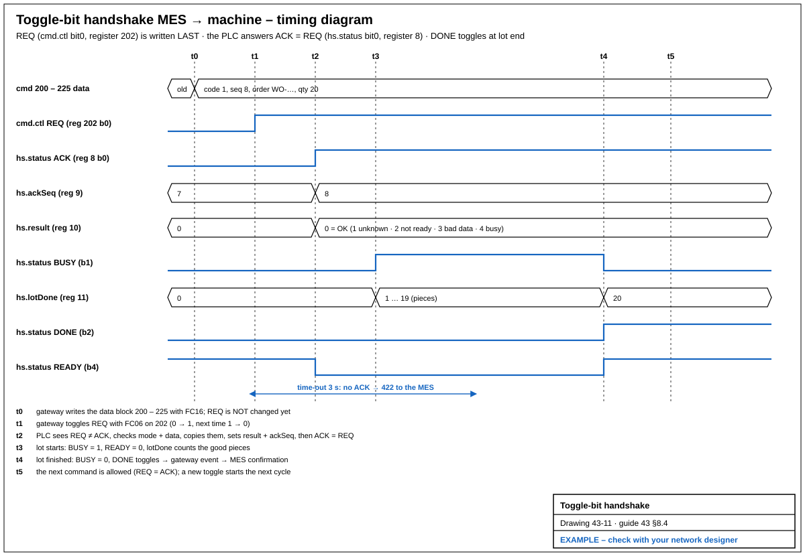

Writing a register is easy. Writing it **safely** is not: the PLC must see a complete, consistent command exactly once,
even if the network hiccups, the gateway retries, or the MES sends the same request twice. A **toggle bit** solves this:
"a new command exists" is signalled by a **change** of a bit, not by its value.

`hs.status` bits (offset 8, read by the gateway in the fast block):

| Bit | Name | Set by the machine when … |
|---|---|---|
| 0 | ACK | the machine has taken a command: ACK := REQ (it toggles together with REQ) |
| 1 | BUSY | a MES lot is running on the machine |
| 2 | DONE | toggles when a MES lot is finished (the MES sees a change → books the confirmation) |
| 3 | REJECT | the last command was rejected (`hs.result` ≠ 0) |
| 4 | READY | auto mode, no alarm, no MES lot → may receive an order |

**Sequence** (the exact frames of `Gateway.command()` in `twin/bsf_comm.py`):

| Step | Frame | Purpose |
|---|---|---|
| 1 | FC03 read 200 – 202 | current `cmd.seq` and REQ |
| 2 | FC03 read 8 – 10 | current ACK; if REQ ≠ ACK → a previous command is still open → error, do not write |
| 3 | FC16 write 200 – 225 (26 registers) | code, seq + 1, REQ **unchanged**, order, part, recipe, quantity (226 is **not** part of it – the gateway heartbeat is its own FC06 every second) |
| 4 | FC06 write 202 | **toggle REQ** – written **last**, in its own frame |
| 5 | FC03 read 8 – 11 every 100 ms | until ACK = REQ and `hs.ackSeq` = seq (time-out 3 s) |
| 6 | – | answer to the MES: `result` 0 → OK; else rejected with reason |

Why write REQ in a separate frame? Some PLCs process an FC16 in several scan cycles; if REQ were inside the same block,
the PLC might see the new REQ before the new order number. With "data first, REQ last" this cannot happen.

**Machine side (PLC program, pseudo code):**

```text
IF cmd.ctl.0 <> hs.status.0 THEN                 // REQ changed -> new command
    copy cmd.order, cmd.part, cmd.recipe, cmd.lotQty to internal memory
    CASE cmd.code OF
      1: IF order = '' OR qty = 0 OR qty > 100000 THEN result := 3          // bad data
         ELSIF BUSY THEN result := 4                                         // busy
         ELSIF mode <> AUTO OR alarm THEN result := 2                        // not ready
         ELSE load lot; BUSY := TRUE; result := 0 END_IF
      2: start (result 2 if not ready)    3: stop at end of cycle, BUSY := FALSE
      4: acknowledge alarm                5: select recipe (result 3 if recipe = 0)
      ELSE result := 1                                                       // unknown command
    END_CASE
    hs.ackSeq := cmd.seq;  REJECT := (result <> 0);
    hs.status.0 := cmd.ctl.0                                                 // ACK = REQ, LAST
END_IF
IF BUSY AND piece finished THEN lotDone := lotDone + 1;
   IF lotDone >= qty THEN BUSY := FALSE; DONE := NOT DONE END_IF END_IF   // DONE toggles
```

**Real frames** of a command "load order WO-00001-L01, part BS-3210-1000-C5, qty 20, recipe 12" to BS-TGR-03 (unit 15),
from the simulator (transaction ids start at 0x7001 for commands):

```text
1  -> 70 01 00 00 00 06 0F 03 00 C8 00 03          read 200 - 202
   <- 70 01 00 00 00 09 0F 03 06 00 00 00 00 00 00 code 0, seq 0, REQ 0
2  -> 70 02 00 00 00 06 0F 03 00 08 00 03          read 8 - 10
   <- 70 02 00 00 00 09 0F 03 06 00 10 00 00 00 00 hs.status 0x10 = READY, ACK 0
3  -> 70 03 00 00 00 3B 0F 10 00 C8 00 1A 34 00 01 00 01 00 00 57 4F 2D 30 30 30 30 31 2D 4C 30 31 00 00 00 00
      00 00 00 00 42 53 2D 33 32 31 30 2D 31 30 30 30 2D 43 35 00 00 00 00 00 00 0C 00 00 00 14
   <- 70 03 00 00 00 06 0F 10 00 C8 00 1A          26 registers written from 200
4  -> 70 04 00 00 00 06 0F 06 00 CA 00 01          REQ := 1
   <- 70 04 00 00 00 06 0F 06 00 CA 00 01          echo
5.1-> 70 05 00 00 00 06 0F 03 00 08 00 04          poll (100 ms later): ACK still 0
5.2   … ACK = 1, ackSeq = 1, result 0  -> OK after ≈ 300 ms in total (7 frames)
```

Decoding step 3: `00 01` code 1, `00 01` seq 1, `00 00` REQ unchanged, then 10 registers order, 10 registers part,
`00 0C` recipe 12, `00 00 00 14` quantity 20.

**Result codes** (`hs.result`, offset 10):

| Code | Text | Typical cause | HTTP answer of `/api/bsf/command` |
|---|---|---|---|
| 0 | OK | command taken | 200, `"ok": true` |
| 1 | unknown command | code not 1 … 5 | 422 |
| 2 | not ready | not in auto, alarm active, machine DOWN | 422 |
| 3 | bad data | empty order, qty 0 or > 100 000, recipe 0 | 422 |
| 4 | busy | a MES lot is still running | 422 |
| – | handshake time-out | no ACK within 3 s (PLC program stopped?) | 422, `"error": "handshake time-out"` |
| – | previous command open | REQ ≠ ACK before writing | 422 |

**Idempotency:** the MES sends a `msgId` (UUID). The gateway keeps the answers of the last 200 `msgId`s; the same
`msgId` again returns the **first answer** with `"replay": true` – nothing is written twice. This matters when the MES
does not get the HTTP answer (time-out) and repeats the request.

**DONE → confirmation:** when the lot is finished, the machine toggles DONE and clears BUSY. The gateway sees the change
of `hs.status` in the fast block (report-by-exception event `hs.status`), the MES gets the event (long polling or SSE)
and books the confirmation (`POST /api/bsf/mes/confirmations`, §11).

### 8.5 Map version and change control

The register map is an **interface contract** between the machine maker and us. Treat it like a drawing:

| Rule | How |
|---|---|
| version in the device | `hdr.mapVersion` (offset 0), now 0x0101 = 1.1; major byte = incompatible change, minor byte = additions |
| gateway checks the version | at connect / every minute; mismatch → alarm "map version", do not decode |
| additions only at the end of a block or in reserved space | never move an existing field |
| map file under revision control | `twin/bsf_comm_map.py` + the JSON / CSV export, change note, test (§14) |
| type code + unit id plausibility | `hdr.typeCode`, `hdr.unitId` must match the IP plan |

**Version history of the map**

| Version | Value in offset 0 | Date | Registers | Change | Compatible? |
|---|---|---|---|---|---|
| V1.0 | 0x0100 (256) | 2026-11-13 | 226 (0 – 225) | first release: FAST 0 – 11, COUNTERS + PROCESS 20 – 99, ENERGY 100 – 103, COMMAND 200 – 225 | – |
| **V1.1** | **0x0101 (257)** | **2026-11-13** | **227 (0 – 226)** | **addition** at the end of the command block: offset 226 `cmd.gwHeartbeat` (UINT16, written by the gateway with FC06 once per second, + 1 per write, wraps 65 535 → 0) for the PLC watchdog "gateway lost" (proposed by item 8, guide 47 §6.2; approved by the user) | yes – minor change: no field moved; a V1.1 gateway reads V1.0 machines unchanged, but their FC06 226 is answered with exception 02 → the gateway shows it as an error until the machine program is updated |

Migration V1.0 → V1.1 per machine: extend the PLC register area by one word (Delta D226, Siemens "MB_HR" + `cmd_gwHeartbeat`,
`WORD 227`), set offset 0 to 0x0101, add the watchdog network (guide 47 §6), run commissioning test 13 (§14.1).

### 8.6 Specification text for machine makers (copy into the purchase specification)

> **Communication interface (mandatory).** The machine shall provide a Modbus TCP server (TCP port 502, Modbus
> Messaging on TCP/IP Implementation Guide V1.0b) on one Ethernet port (RJ45 or M12 X-coded, 100 Mbit/s or 1 Gbit/s) with
> a fixed IP address set by the customer. The server shall support function codes 03, 04, 06 and 16, at least
> 2 simultaneous TCP connections, and answer a read of 48 registers within 20 ms (example). The register map shall follow
> the customer's map "BSF register map V1.1" for machine type <type>: blocks FAST 0 – 11, COUNTERS + PROCESS from 20,
> ENERGY 100 – 103, COMMAND 200 – 226; holding registers, 0-based; UINT32 high word first; REAL IEEE 754 big-endian
> word order ABCD; ASCII 2 characters per register; 32-bit values on even offsets. The heartbeat (offset 3) shall
> increment every second while the PLC program runs. The gateway writes offset 226 (gateway heartbeat) once per second;
> the machine shall report "gateway lost" and refuse new orders (READY = 0) when offset 226 has not changed for 5 s, and
> finish a running lot. The command handshake (toggle bit REQ / ACK, BUSY, DONE, result
> codes 0 – 4) shall be implemented as described in §8.4 of guide 43. No other protocol (OPC UA, MQTT, vendor cloud) shall be
> active on the customer network. Safety functions shall be hard-wired and shall not depend on this interface. The
> maker shall deliver the implemented map as a table (CSV / Excel) and support a register-map test at acceptance (§14).

---

## 9. Gateway design

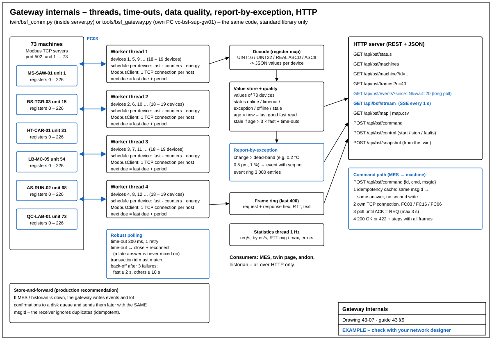

The gateway is the heart of item 4. It is a normal Python program (stdlib only) – inside `server.py` or stand-alone as
`tools/bsf_gateway.py` – and it must run for years without attention.

### 9.1 Threads

| Thread | Count | Job |
|---|---|---|
| `bsf-gw-0 … 3` (workers) | 4 (configurable 1 – 16) | each owns about 1/4 of the devices (round-robin: device i → worker i mod 4), keeps one Modbus TCP connection per (IP, port), polls its devices on schedule |
| `bsf-gw-stats` | 1 | every 1 s: requests/s, bytes/s, round-trip average over the last ≈ 11 s |
| HTTP request threads | per request | `server.py` (ThreadingHTTPServer): read the value store, write commands |
| SSE threads | per open page | one message per second from `stream_payload()` |
| `bsf-plantsim`, `bsf-modbus-server` | 1 + per connection | only the **embedded simulator** (test / demo), not on a real gateway |

All shared data (value store, frame ring, event ring, statistics) is protected by **one lock** (`threading.RLock`);
a condition variable wakes long-polling clients when new events arrive. Workers hold the lock only for microseconds
(after a frame), never during network I/O – so a slow device never blocks the HTTP side.

Why threads and not one thread per device? 73 threads would also work, but 4 workers with a schedule give the same
throughput (devices answer in a few ms) with less overhead. Why not asyncio? Plain threads are easier to read for
our maintenance people; both are stdlib.

### 9.2 Polling schedule

Each device has three **poll groups** (from the map, §8.1). Each group has a next-due time:

```text
loop (each worker):
    due = all (device, group) with next_due <= now
    for each due poll:  FC03 read  ->  decode  ->  store  ->  next_due += period
    if nothing due: sleep until the earliest next_due (max 0.5 s)
```

* At start the first polls are **spread over one fast period** (device i starts at i / 73 × 500 ms) – no burst of 73
  requests at the same moment.
* If a worker falls behind by more than one period, the next due time restarts from "now" (no catch-up burst).
* Periods are configurable at run time: `POST /api/bsf/control {"action": "config", "fast_ms": 250}`.

| Group | Default period | Allowed range (code) |
|---|---|---|
| fast | 500 ms | 100 – 5 000 ms |
| counters | 1 000 ms | 200 – 60 000 ms |
| energy | 10 000 ms | 1 000 – 600 000 ms |
| time-out | 300 ms | 50 – 5 000 ms |
| retries | 1 | 0 – 5 |

The contract allows 100 ms for the fast group. At 100 ms: 73 × 10 = 730 fast polls/s + 80 = 810 requests/s – possible,
but every PLC must answer 10 requests/s. 500 ms is enough for MES and OEE; use 100 – 200 ms only for single machines
that need it (e.g. a handshake with an AGV at a door).

### 9.3 Time-out, retry, reconnect, transaction id, back-off

| Mechanism | Value (example) | Why |
|---|---|---|
| time-out | 300 ms | 10 – 100 × the normal device RTT; shorter = false alarms, longer = one dead device slows the worker |
| retry | 1 (only after a time-out) | one lost frame is not an alarm |
| reconnect after a time-out | close socket, new connection on the next poll | a late answer can never be taken as the answer to the next request |
| transaction-id check | answers with another id are dropped | second protection against mixed answers |
| exception answer | no retry, status "exception NN" | the device answered – repeating does not help |
| connect failure | status "offline" | IP wrong, device off, firewall |
| **back-off** | after **3** failures in a row: fast group only every ≥ 2 s, other groups every ≥ 10 s | a dead device would cost time-out × (1 + retries) = 600 ms per poll and slow its whole worker |

Cost of one dead device without back-off (worked example): fast every 0.5 s → 2 polls/s × 600 ms = **1.2 s of waiting
per second** – more than the worker has. With back-off: 0.5 polls/s × 600 ms = 0.3 s per second → the other 17 devices of
the worker still get their polls in time.

### 9.4 Data quality – age and stale flag

For every device the gateway stores the time of the last good answer per group. The HTTP API returns:

```json
"quality": { "ageMs": 405, "stale": false, "staleLimitMs": 2100 }
```

**Stale limit = 3 × fast period + time-out × (1 + retries) = 3 × 500 + 300 × 2 = 2 100 ms** (example).

Meaning: three fast polls in a row failed, including their retries. Then

* the device status becomes `timeout` / `exception` / `offline` (or `stale` if the status still says online),
* the **last values stay** in the JSON (useful for the operator) but `stale: true` – an MES must not book OEE or
  counts from stale data,
* andon screens show the machine grey.

| Status | Meaning |
|---|---|
| `unknown` | not yet polled |
| `online` | last poll OK, age < stale limit |
| `stale` | no good answer for longer than the stale limit (but no error recorded yet) |
| `timeout` | last poll: no answer within the time-out (after retries) |
| `exception` | the device answered with an exception (code in `exc`) |
| `offline` | TCP connection could not be opened / was lost |

### 9.5 Report-by-exception and dead-bands

Modbus has no events, so the gateway **makes** them: after each poll it compares every value with the last one and
writes an event if the change is bigger than the **dead-band**:

**event if |new − old| > max(dead-band of the unit, 1 % × |old|)** – for REAL values; integers and strings: any change.

| Unit | Dead-band (example) | Unit | Dead-band |
|---|---|---|---|
| °C | 0.2 | kW | 0.5 |
| µm | 0.5 | kWh | 1.0 (energy counter not reported) |
| µm/m | 0.5 | s | 0.5 |
| % | 1.0 | min⁻¹ | 5 |
| %C | 0.02 | N·m | 0.01 |
| m/s | 0.5 | N | 0.5 |
| mm | 0.05 | kN | 1.0 |
| kJ | 50 | l/min | 2.0 |
| mm/s | 0.5 | kHz | 0.5 |
| µS/cm | 20 | m/min | 0.1 |
| ° | 0.05 | min | 1.0 |

Not reported: `hdr.heartbeat` (changes every second by design) and `std.energy_kWh` (always rising). The first read of
a group creates no events.

Events are kept in a ring of 3 000 with a sequence number. Consumers:

* **SSE** (`/api/bsf/stream`): the newest events every second (pages, andon);
* **long polling** (`/api/bsf/events?since=N&wait=20`): the MES asks "everything after N", the request waits up to 20 s
  (max 30 s) until something new arrives – nearly as fast as a push, but plain HTTP.

Example event: `{"seq": 10, "t": 1794553475.652, "id": "BS-TGR-03", "name": "grind.spindlePower_pct", "old": 69.573, "new": 68.242}`

Report-by-exception reduces the data for the MES from 226 read frames/s × all values to a few events per second – the MES
sees state changes, alarms, counters and handshake bits within ≈ 0.5 – 1.5 s.

### 9.6 Timing and load – worked example

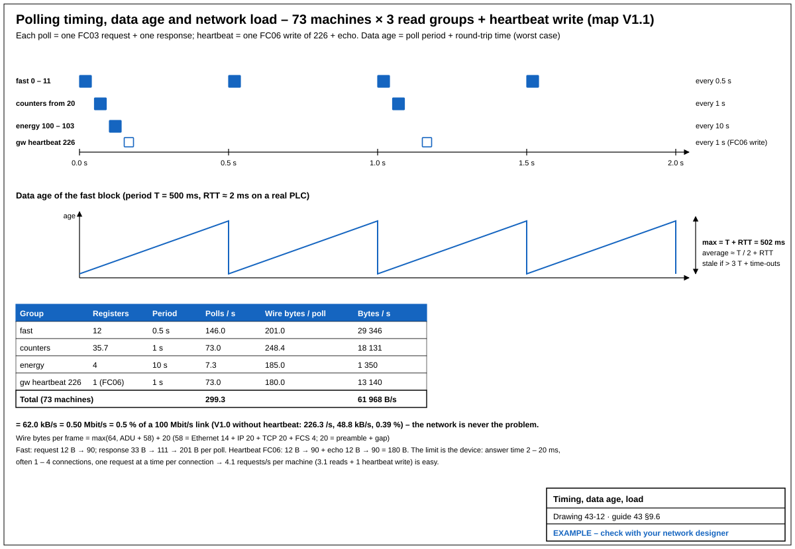

**Step 1 – requests per second.** For each group: polls/s = devices × 1 000 / period (ms).

| Group | Period | Requests/s for 73 devices |
|---|---|---|
| fast | 500 ms | 73 × 2 = 146 |
| counters | 1 000 ms | 73 × 1 = 73 |
| energy | 10 000 ms | 73 × 0.1 = 7.3 |
| reads (V1.0 total) | | 226.3 |
| gateway heartbeat FC06 226 (map V1.1) | 1 000 ms | 73 × 1 = 73 |
| **total (map V1.1)** | | **299.3 requests/s** |

**Step 2 – bytes per poll.** Modbus ADU: request 12 bytes, response 9 + 2 × n bytes. On the wire each frame also has
Ethernet 14 + IP 20 + TCP 20 + FCS 4 = **58 bytes** of headers, a minimum frame size of **64 bytes**, and 20 bytes of
preamble + inter-frame gap:

**wire bytes = max(64, ADU + 58) + 20**

| Group | n (registers) | Request ADU → wire | Response ADU → wire | Wire bytes per poll |
|---|---|---|---|---|
| fast | 12 | 12 → max(64, 70) + 20 = 90 | 33 → 91 + 20 = 111 | **201** |
| counters | 35.68 (average) | 12 → 90 | 80.4 → 138.4 + 20 = 158.4 | **248.4** |
| energy | 4 | 12 → 90 | 17 → 75 + 20 = 95 | **185** |
| gateway heartbeat (FC06 write 226) | 1 | 12 → 90 | echo 12 → 90 | **180** |

**Step 3 – load.**

| Group | Polls/s | × wire bytes | = bytes/s |
|---|---|---|---|
| fast | 146 | 201 | 29 346 |
| counters | 73 | 248.4 | 18 131 |
| energy | 7.3 | 185 | 1 350.5 |
| reads only (V1.0) | 226.3 | | 48 827.5 B/s = 0.39 Mbit/s = 0.39 % |
| gateway heartbeat | 73 | 180 | 13 140 |
| **total (map V1.1)** | **299.3** | | **61 967.5 B/s = 0.50 Mbit/s = 0.50 % of 100 Mbit/s** |

(TCP acknowledgements are not counted – they are mostly piggy-backed on the next frame. Even doubled, the load stays
< 1 %.) The Modbus payload alone (ADU bytes) is ≈ 15.3 kB/s (V1.0: 13.5 kB/s; the heartbeat adds 73 × 24 = 1 752 B/s) –
this is what the gateway statistics show as "bytes/s" (measured on the simulator: ≈ 15 300 – 15 800 B/s).

Check with Python (stdlib, the same formula as the page):

```python
wire = lambda adu: max(64, adu + 58) + 20
avg = 35.685                                   # average counter registers (twin/bsf_comm_map.py)
rows = [(146, 12, 9 + 2 * 12), (73, 12, 9 + 2 * avg), (7.3, 12, 9 + 2 * 4), (73, 12, 12)]   # (requests/s, request ADU, response ADU)
print(sum(r[0] for r in rows))                                  # 299.3 requests/s
print(sum(n * (wire(q) + wire(a)) for n, q, a in rows))         # 61 967.5 B/s
print(sum(n * (wire(q) + wire(a)) for n, q, a in rows) * 8 / 1e8 * 100)   # 0.4957 % of 100 Mbit/s
```

**Conclusion:** the network is never the bottleneck. The limits are the **device answer time** and the **number of
connections** a device accepts.

**Step 4 – worker load.** Each worker polls sequentially; while it waits for an answer it does nothing else.

**worker load = polls/s ÷ workers × RTT**

With a device RTT of 3 ms (example): 299.3 ÷ 4 × 3 ms = 224 ms per second = **22 %** → fine (V1.0: 17 %). With slow
CNCs (RTT 20 ms): 299.3 ÷ 4 × 20 ms = 1.50 s per second = **150 %** → too slow → use 8 workers (75 %) – 12 workers
(50 %) or slower periods.

**Cycle per device:** Σ(1/T) × RTT = (2 + 1 + 0.1 + 1 heartbeat) × 3 ms = 12.3 ms per second → max devices per worker =
1 000 / 12.3 = **81** (V1.0: 9.3 ms, 107); we have 73 / 4 ≈ 19 per worker.

**Step 5 – data age.** A value read now is at most one period old, plus the round-trip:

**max data age = poll period + RTT** → fast: 500 + 3 = **503 ms**; counters 1 003 ms; energy 10 003 ms.

If a device fails: **period + time-out × (1 + retries) + RTT** = 500 + 600 + 3 = 1 103 ms until the gateway knows; stale
flag after 2 100 ms (§9.4).

**End-to-end example "machine goes DOWN → andon turns red":** PLC sets status (≤ 1 scan, 10 ms) + up to one fast period
(500 ms) + RTT (3 ms) + up to one SSE interval (1 000 ms) + browser render (≈ 20 ms) ≈ **≤ 1.5 s**. For an andon and
for MES this is fine; for control loops it is not – and it must not be (control stays in the PLC).

Card 6 of the page calculates all of this for your own inputs (input "gw heartbeat write ms", 0 = V1.0); the self-check
verifies 299.3 requests/s, 61 967.5 B/s, 15 276.7 ADU B/s, 81 devices per worker and the V1.0 values 226.3 / 48 827.5.

### 9.7 Buffering and store-and-forward

Without MQTT persistent sessions, how do we avoid losing data when something is down?

| Failure | What protects the data |
|---|---|
| network to one machine down | counters are **totals** (UINT32) in the machine – after reconnect the gateway reads the new total; nothing is lost, it is only late |
| gateway down / restart | same: totals in the machines; lot results stay in the PLC until the MES confirms (DONE toggle stays changed) |
| MES down | events stay in the gateway ring (3 000 entries); the MES reads `?since=N` after restart; if N is older than the ring, it reads the current totals instead (full resync) |
| historian down | the historian client in the MES buffers on disk and writes later (HTTP POST in batches) |

Design rule: **send states and totals, not deltas.** A total can be read again; a lost delta is lost forever.

### 9.8 Redundancy – gw01 and gw02

| Item | gw01 (10.60.30.10) | gw02 (10.60.30.9) |
|---|---|---|
| role | active – polls all 73 machines, serves HTTP | hot standby – polls only `/api/bsf/health` of gw01 every 1 s |
| switch-over | – | after 3 missed health checks: gw02 starts polling, takes over a virtual IP / DNS name `gw.bsf` (example) |
| machine connections | 1 per machine | 0 while standby (devices with few connections!) |
| state | value store in memory | rebuilt from the devices within 1 – 10 s (totals!) |

The firewall must allow port 502 from **both** gateway IPs. Test the switch-over at commissioning (§14).

### 9.9 Code walk-through

| File | Main parts |
|---|---|
| `twin/bsf_comm_map.py` | `TYPES` (41 types with instance counts), `SIGFIELDS` (copy of item 3), `VLANS`, `SERVERS`, `machines()` (IP plan), `type_map()` (register map per type, even-offset rule), `poll_groups()`, `map_json()`, `map_csv()`, value codecs `encode_value()` / `decode_value()` / `decode_block()`, frame builders `req_read()` / `req_write1()` / `req_writen()`, `decode_frame()` |
| `twin/bsf_comm_modbus.py` | `Unit` (register image, own state model, PLC-like handshake), `PlantSim` (73 units, 10 Hz update, twin snapshot or own model), `serve()` (request → response with exceptions 01 / 02 / 03 / 04 / 0B and faults), `ModbusServer` (socketserver, one port), `ModbusClient` (time-out, transaction-id check, reconnect), `check_response()`, `regs_of()` |
| `twin/bsf_comm.py` | `Device`, `Gateway` (workers, `_poll()`, `_ok()` with report-by-exception, `_fail()`, `_house()` statistics, `quality()`, `command()` handshake, `probe()`, `raw()`), module state (inert until `start()`), `control()`, `store_snapshot()`, `stream_payload()`, `handle()` = HTTP dispatcher, `sse_lines()` |
| `twin/bsf_comm_api.py` | MES / ERP / AGV / printer demo resources, idempotency store, paging, problem+json |
| `server.py` | `/api/bsf/...` routes → lazy `import twin.bsf_comm` → `handle()`; `GET /api/bsf/stream` → `sse_lines()` |
| `tools/bsf_modbus_sim.py` | stand-alone simulator (optionally fed from `GET /api/bsf/snapshot` of a twin server) |
| `tools/bsf_gateway.py` | stand-alone gateway with its own small HTTP server (same routes) |

The heart of a poll (simplified from `Gateway._poll`):

```python
req = MAP.req_read(tid, d.unit, start, qty)            # 12-byte FC03 request
resp, rtt = client.transact(req)                       # send, wait <= timeout, check transaction id
pdu = check_response(req, resp)                        # exception -> ModbusError("exception", code)
vals = MAP.decode_block(d.type, start, regs_of(pdu), "ABCD")   # registers -> {"std.good": 2120, ...}
self._ok(d, group, vals, rtt, ...)                     # store, quality, events (dead-band), frame log
```

**Inert until started:** importing `twin.bsf_comm` creates no thread and opens no port. `server.py` imports it only on
the first `/api/bsf/...` request. `start()` opens the simulator port (127.0.0.1 only) and the workers; `stop()` joins all
threads and closes the port.

---

## 10. HTTP in depth

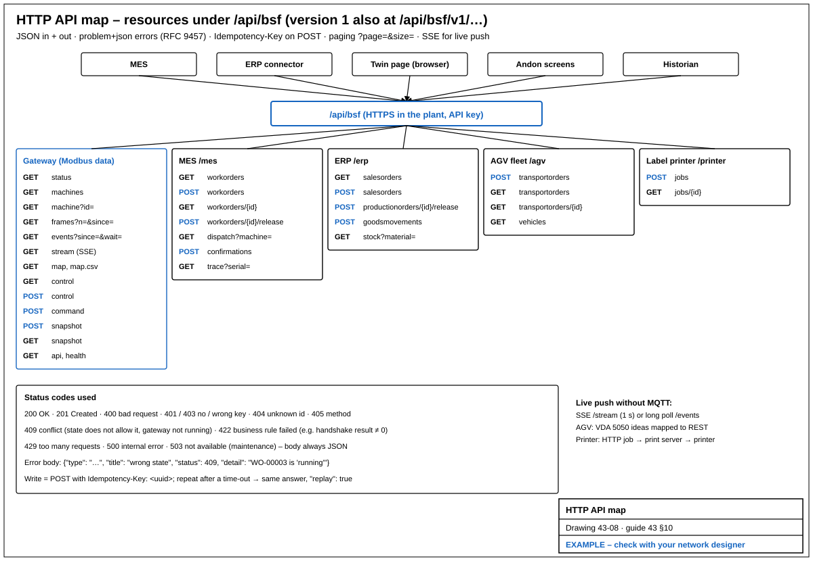

### 10.1 REST in five rules

| Rule | Example |
|---|---|
| a **resource** is a noun with a URL | `/api/bsf/mes/workorders/WO-00004` |
| the **method** says what to do | GET read, POST create / action, PUT replace, PATCH change, DELETE remove |
| the **status code** says what happened | 200 OK, 201 Created, 404 Not Found, 409 Conflict … |
| the body is **JSON** (RFC 8259), UTF-8 | `{"product": "BS", "qty": 40}` |
| the server keeps **no session** per client | every request carries everything (key, ids) |

Field names: camelCase; times ISO 8601 UTC (`"2026-11-13T07:04:38Z"`) in the business APIs; the gateway uses Unix
seconds (`"t": 1794553477.5`) because it serves machine data at high rate.

Actions that are not CRUD (release, confirm) are POST to a sub-resource: `POST /api/bsf/mes/workorders/{id}/release`.

### 10.2 Methods and status codes used

| Code | Meaning | Example in this plant |
|---|---|---|
| 200 OK | read / action done; idempotent replay | `GET /api/bsf/status`; same Idempotency-Key again |
| 201 Created | new resource | `POST /api/bsf/mes/workorders` |
| 400 Bad Request | malformed / missing field | unknown product, bad JSON |
| 401 / 403 | not authenticated / not allowed | missing / wrong API key (real plant) |
| 404 Not Found | unknown resource | `GET /api/bsf/machine?id=XX` |
| 405 Method Not Allowed | wrong method | `PUT /api/bsf/status` |
| 409 Conflict | state does not allow it | release a work order twice; goods issue > stock; gateway not running |
| 422 Unprocessable | understood, but a business rule fails | command rejected by the machine (busy, not ready); quantity out of range |
| 429 Too Many Requests | rate limit (real plant, with `Retry-After`) | a script polls 100 ×/s |
| 500 / 503 | server error / not available | – |

### 10.3 Errors – problem+json (RFC 9457)

Every error has the content type `application/problem+json` and this body:

```json
{
  "type": "https://plant.example/problems/wrong-state",
  "title": "wrong state",
  "status": 409,
  "detail": "WO-00004 is 'released', only 'created' can be released"
}
```

The gateway routes use `"type": "about:blank"` (example: unknown machine → 404, `"detail": "id=XX"`). Clients
**must** look at the status code first, then at `title` / `detail`.

### 10.4 Idempotency

A network can lose the **answer** of a POST. The client does not know if the server created the object – if it repeats,
it may create a second work order or a second goods issue. Solution: the client sends a unique key:

```text
POST /api/bsf/mes/workorders HTTP/1.1
Content-Type: application/json
Idempotency-Key: 3f2a9c1e-7d41-4b8e-9a55-0c2f61d8b001

{"product": "BS", "qty": 40, "dueDays": 5}
```

First call → `201 Created`, `"id": "WO-00004"`. Same key again → `200 OK`, the **same** body plus `"replay": true` –
no WO-00005. The demo keeps the last 500 keys; for the machine command the key is the body field `msgId` (last 200).
In a real MES keep keys ≥ 24 h in the database.

GET, PUT and DELETE are idempotent by definition; POST needs the key.

### 10.5 Paging

```text
GET /api/bsf/mes/workorders?page=1&size=2
-> {"items": [ … 2 work orders … ], "page": 1, "size": 2, "total": 3, "next": "/api/bsf/mes/workorders?page=2&size=2"}
```

`size` max 200. Follow `next` until it is missing.

### 10.6 Server-Sent Events (SSE)

SSE is **plain HTTP**: the server answers `Content-Type: text/event-stream` and never closes the response; it writes
text blocks. The browser's `EventSource` reconnects automatically.

```text
GET /api/bsf/stream HTTP/1.1

HTTP/1.0 200 OK
Content-Type: text/event-stream
Cache-Control: no-store

retry: 3000

id: 1
event: bsf
data: {"running": true, "t": 1794553478.5, "status": {...}, "control": {...}, "events": [...], "frames": [...], "machines": [...]}

id: 2
event: bsf
data: { … one second later … }
```

* one message per second; `data` = status, control, the newest ≤ 60 events, the last 12 frames, all 73 device rows
  (≈ 20 – 30 kB, example);
* when the gateway is stopped: `{"running": false, "control": {...}}` every second;
* `retry: 3000` → the browser reconnects after 3 s;
* JavaScript: `const es = new EventSource("/api/bsf/stream"); es.addEventListener("bsf", e => JSON.parse(e.data));`

SSE vs WebSocket: WebSocket upgrades the connection to another protocol (it starts as HTTP, but then it is not HTTP
any more) – under our rule we use SSE (server → client) + normal POST (client → server).

### 10.7 Long polling

For servers (MES) that cannot keep an SSE stream: `GET /api/bsf/events?since=1315&wait=20`. The gateway answers
**immediately** if events with seq > 1315 exist, otherwise it holds the request up to 20 s (max 30 s) and answers as soon
as an event arrives (or with an empty list at the end). The client stores the returned `seq` and asks again.

### 10.8 Webhooks (explained, not implemented)

A webhook = the server calls the client: the MES registers `POST https://mes/hooks/bsf` and the gateway POSTs each event
there. It is HTTP, so it is allowed – but the gateway (level 2) would open connections **upwards** to level 3, which
the firewall conduit must allow, and it needs retries + a queue when the MES is down. For our size, long polling from
the MES is simpler and keeps all connections "from the top down". Webhooks may come later (item 6).

### 10.9 Versioning

The version is in the path: `/api/bsf/v1/...`. In this release `/api/bsf/v1/x` and `/api/bsf/x` are the same (the
dispatcher strips `/v1/`). Rules: adding fields is not a new version (clients must ignore unknown fields); removing /
renaming fields or changing meaning → `/v2/`, and `/v1/` stays at least 12 months (example).

### 10.10 Security – HTTPS, API keys, rate limits

* **HTTPS = HTTP over TLS** (RFC 8446 TLS 1.3, RFC 9110). It is still HTTP – allowed by the rule – and required for
  every connection that crosses a zone (ERP ↔ DMZ ↔ MES, MES ↔ gateway). Certificates from the company CA.
* **Authentication:** `Authorization: Bearer <api key>` (one key per client system, rotated yearly, example) or HTTP
  Basic over HTTPS only. Roles: read (andon, twin), write-business (MES, ERP), write-machine (only the MES may call
  `/api/bsf/command`), admin (`/api/bsf/control`). The demo does **not** enforce keys; `server.py` listens on
  127.0.0.1 by default.
* **Rate limit:** e.g. 20 requests/s per key, answer 429 with `Retry-After`.
* **Caching:** all live answers send `Cache-Control: no-store` (machine data must never come from a cache). The map
  (`/api/bsf/map`) could use `ETag` (changes only with the map version).

### 10.11 JSON examples for every route

All examples are **real answers** of the code (in-process run, example values; long arrays shortened with "…").

**Gateway – status** `GET /api/bsf/status` → 200 (stopped: `{"running": false, "control": {...}}`)

```json
{
  "running": true, "uptime_s": 3.0,
  "cfg": {"fast_ms": 500, "counters_ms": 1000, "energy_ms": 10000, "gwhb_ms": 1000, "timeout_ms": 300, "retries": 1,
          "workers": 4, "target": "sim", "simHost": "127.0.0.1", "simPort": 15031, "order": "ABCD", "frameLog": 400},
  "totals": {"req": 950, "ok": 950, "timeout": 0, "exception": 0, "offline": 0, "tx": 11400, "rx": 35957, "rttMax": 1.325,
             "reads": 731, "hbWrites": 219, "rttAvgMs": 0.027},
  "rate": {"reqPerS": 316.6, "bytesPerS": 15781.0, "rttAvgMs": 0.027, "okPerS": 316.6},
  "devices": {"online": 73}, "online": 73, "n": 73, "eventSeq": 74, "frameSeq": 950
}
```

(The first seconds show more than 299 req/s because all energy polls run once at start. `reads` = FC03 polls,
`hbWrites` = FC06 gateway heartbeat writes to offset 226.)

**Gateway – all devices** `GET /api/bsf/machines` → 200, `{"t": …, "machines": [ 73 rows ]}`; one row:

```json
{
  "id": "BS-TGR-03", "type": "BS-TGR", "unit": 15, "ip": "10.60.43.16", "host": "vc-bsf-grd-bstgr03", "vlan": 643,
  "status": "online", "err": "", "exc": null, "rttMs": 0.02, "rttAvgMs": 0.02, "ok": 10, "errors": 0, "changes": 2,
  "quality": {"ageMs": 405, "stale": false, "staleLimitMs": 2100},
  "main": {"std.status": 1, "std.stateCode": 2, "std.alarm": 0, "std.good": 2120, "std.scrap": 17, "std.order": "LOT-0821", "std.power_kW": 8.77}
}
```

**Gateway – one device** `GET /api/bsf/machine?id=BS-TGR-03` → 200: the row above plus

```json
{
  "values": {
    "hdr.mapVersion": 257, "hdr.typeCode": 12, "hdr.unitId": 15, "hdr.heartbeat": 2,
    "std.status": 1, "std.mode": 1, "std.stateCode": 2, "std.alarm": 0,
    "hs.status": 16, "hs.ackSeq": 0, "hs.result": 0, "hs.lotDone": 0,
    "std.good": 2120, "std.scrap": 17, "std.lastCycle_s": 570.8, "std.order": "LOT-0821", "std.part": "",
    "grind.wheelSpeed_ms": 35.0, "grind.spindlePower_pct": 66.792, "grind.dressCount": 212, "grind.wheelDia_mm": 397.991,
    "grind.oilTemp_C": 20.202, "grind.gaugeDev_um": -1.307, "tgr.pass": 1, "tgr.passes": 7, "tgr.workSpeed_rpm": 40.0,
    "tgr.leadComp_um_m": -11.534, "tgr.screwTemp_C": 20.026, "tgr.wheelTilt_deg": 5.51,
    "std.power_kW": 8.77, "std.energy_kWh": 2268.32
  },
  "groups": [["fast", 0, 12], ["counters", 20, 48], ["energy", 100, 4]],
  "tOk": {"fast": 1794553477.101, "counters": 1794553476.651, "energy": 1794553474.652}
}
```

Unknown id → 404 `{"type": "about:blank", "title": "unknown machine", "status": 404, "detail": "id=XX"}`.
Gateway not started → 409 `"title": "gateway not running"`.

**Gateway – frames** `GET /api/bsf/frames?n=2` → 200

```json
{"seq": 731, "frames": [
  {"seq": 731, "t": 1794553477.505, "id": "MS-SAW-01", "unit": 1, "group": "fast", "kind": "ok",
   "req": "00 BF 00 00 00 06 01 03 00 00 00 0C",
   "resp": "00 BF 00 00 00 1B 01 03 18 01 00 00 01 00 01 00 02 00 02 00 01 00 01 00 00 00 10 00 00 00 00 00 00",
   "rttMs": 0.02, "text": "FC03 fast 24 B data",
   "values": {"hdr.heartbeat": 2, "std.status": 2, "std.stateCode": 1, "std.alarm": 0, "hs.status": 16}}, … ]}
```

`kind`: ok, timeout, exception, offline, cmd, probe, raw. Ring of 400 frames; `since=N` returns only newer ones.

**Gateway – events** `GET /api/bsf/events?since=0&wait=1` → 200

```json
{"seq": 74, "events": [
  {"seq": 1, "t": 1794553475.562, "id": "BS-STR-01", "name": "press.runoutBefore_um", "old": 39.01, "new": 36.611},
  {"seq": 10, "t": 1794553475.652, "id": "BS-TGR-03", "name": "grind.spindlePower_pct", "old": 69.573, "new": 68.242}, … ]}
```

**Gateway – command** `POST /api/bsf/command` → 200 (accepted) or 422 (rejected / error)

```json
{"id": "BS-TGR-03", "cmd": "order", "order": "WO-00001-L01", "part": "BS-3210-1000-C5", "qty": 20, "recipe": 12,
 "msgId": "7b1d0a52-3c2e-4f7a-9d10-5e8c4a2b9f01"}
```

```json
{"ok": true, "result": 0, "resultText": "OK", "ackSeq": 1, "busy": true, "reject": false,
 "steps": [{"ms": 0.4, "text": "1 read cmd.code / cmd.seq / cmd.ctl (200 - 202)", "req": "70 01 00 00 00 06 0F 03 00 C8 00 03",
            "resp": "70 01 00 00 00 09 0F 03 06 00 00 00 00 00 00", "rttMs": 0.19, "decoded": "3 register(s)"}, … 7 steps …],
 "id": "BS-TGR-03", "code": 1, "cmd": "load order", "ms": 302.4, "msgId": "7b1d0a52-3c2e-4f7a-9d10-5e8c4a2b9f01"}
```

Same `msgId` again → the same body with `"replay": true`. A second order while the lot runs → 422
`{"ok": false, "result": 4, "resultText": "busy", "ackSeq": 2, …}`. `cmd` values: order, start, stop, ack, recipe
(or `"code": n`).

**Gateway – control** `GET /api/bsf/control` → 200

```json
{"running": true, "sim": true, "simMode": "twin", "simPort": 15031, "simFrames": 1788, "cfg": {…}, "started": 1794553474.5,
 "error": "", "faults": {}, "netloss": false, "snapshotAge_s": 4.0, "mapVersion": "V1.1", "mapSize": 227, "gwHbOk": 73,
 "version": "bsf_comm 1.1 (map V1.1)"}
```

`POST /api/bsf/control` bodies:

| Body | Effect |
|---|---|
| `{"action": "start", "simPort": 1502}` | start the embedded simulator + gateway (options: `sim` false + `target` "host:port" or "plan"; `fast_ms`, `counters_ms`, `energy_ms`, `timeout_ms`, `retries`, `workers`, `order`) |
| `{"action": "stop"}` | stop everything |
| `{"action": "config", "fast_ms": 250, "order": "CDAB"}` | change periods / word order while running |
| `{"action": "fault", "id": "BS-TGR-01", "fault": "offline"}` | fault injection: none, offline, slow, exc04, cdab (`"id": "all"` for all) |
| `{"action": "netloss", "on": true}` | no machine answers |
| `{"action": "probe", "kind": "badunit"}` | send one wrong request: badunit, badaddr, badfc, badqty, cdab → both frames decoded |
| `{"action": "raw", "hex": "00 01 00 00 00 06 0F 03 00 00 00 0C"}` | frame builder: send this frame, return the decoded answer |

Probe answer (wrong unit id):

```json
{"ok": true, "rttMs": 0.16,
 "req":  {"hex": "6F 01 00 00 00 06 C8 03 00 00 00 0C", "mbap": {"transactionId": 28417, "protocolId": 0, "length": 6, "unitId": 200},
          "fc": 3, "fcName": "Read Holding Registers", "dir": "req", "start": 0, "qty": 12, "text": "read 12 register(s) from 0 (40001 1-based)"},
 "resp": {"hex": "6F 01 00 00 00 03 C8 83 0B", "fc": 131, "dir": "resp", "exception": 11,
          "text": "EXCEPTION fc 03 code 0B GATEWAY TARGET DEVICE FAILED TO RESPOND"},
 "kind": "badunit"}
```

**Gateway – snapshot** `POST /api/bsf/snapshot` `{"t": …, "clock": "D4 08:15", "machines": [{"id", "state", "code", "sig"}, …]}`
→ `{"ok": true, "machines": 73, "n": 12, "used": true}`. `GET /api/bsf/snapshot` → `{"age_s": 0.4, "n": 12, "data": {…}}`.
A snapshot older than 15 s is ignored (the simulator falls back to its own model).

**Gateway – map** `GET /api/bsf/map` → version, size 226, port 502, word order, blocks, poll defaults, command codes,
result codes, `types` (41 × registers + groups), `machines` (73), `vlans`, `servers`. `GET /api/bsf/map.csv` → CSV:

```text
type;addr_0based;addr_1based_4xxxx;registers;name;data_type;unit;scale;rw;block;meaning
MS-SAW;0;40001;1;hdr.mapVersion;UINT16;;1;R;fast;map version 0x0101 = 1.1 (check after a machine software update, 0x0100 = V1.0 without 226)
…
machine;type;unit_id;vlan;ip;port;host
MS-SAW-01;MS-SAW;1;641;10.60.41.11;502;vc-bsf-smc-mssaw01
```

**Gateway – catalogue / health** `GET /api/bsf/api` → `{"version", "routes": [[method, path, purpose], …], "rule"}`;
`GET /api/bsf/health` → `{"ok": true, "running": true, "version": "bsf_comm 1.1 (map V1.1)", "t": …}`.

**MES – work orders** `GET /api/bsf/mes/workorders?page=1&size=2` → paged list (see §10.5). Create:

```text
POST /api/bsf/mes/workorders   Idempotency-Key: 3f2a9c1e-…   {"product": "BS", "qty": 40, "dueDays": 5}
-> 201 {"id": "WO-00004", "product": "BS", "material": "BS-3210-1000-C5", "qty": 40, "due": "2026-11-18T07:04:38Z",
        "status": "created", "created": "2026-11-13T07:04:38Z",
        "operations": [{"op": "10", "machineType": "MS-SAW", "status": "open", "good": 0, "scrap": 0}, … 9 operations … ],
        "lots": ["WO-00004-L01", "WO-00004-L02"]}
```

Products: FABS, FALG, BS, BN, LG, LB; qty 1 … 5 000 (else 422). `GET /api/bsf/mes/workorders/WO-00004` → the same
object. `POST /api/bsf/mes/workorders/WO-00004/release` → 200 with `"status": "released"`; a second time → 409
`wrong state`.

**MES – dispatch list** `GET /api/bsf/mes/dispatch?machine=BS-TGR-03` → 200

```json
{"machine": "BS-TGR-03", "machineType": "BS-TGR",
 "items": [{"wo": "WO-00001", "lot": "WO-00001-L01", "op": "80", "product": "BS", "qty": 20, "due": "2026-11-15T07:04:38Z", "seq": 1},
           {"wo": "WO-00004", "lot": "WO-00004-L01", "op": "80", "product": "BS", "qty": 20, "due": "2026-11-18T07:04:38Z", "seq": 2}],
 "generated": "2026-11-13T07:04:38Z"}
```

**MES – confirmation** `POST /api/bsf/mes/confirmations` `{"wo": "WO-00001", "op": "80", "machine": "BS-TGR-03", "good": 19, "scrap": 1}`
→ 201 `{"id": "CF-00001", "wo": "WO-00001", "op": "80", "machine": "BS-TGR-03", "good": 19, "scrap": 1, "t": "2026-11-13T07:04:38Z"}`.
Unknown WO → 404; WO not released → 409; unknown op → 422.

**MES – traceability** `GET /api/bsf/mes/trace?serial=BS-3210-1000-C5-0001` → 200
`{"serial", "lot": "WO-00001-L01", "material": {"bar": "50CrMo4 heat 7741 (example)", "cert": "EN 10204 3.1"},
"operations": [{"op": "10", "machine": "MS-SAW-01", "t": …}, … 9 …], "results": {"QC-LED": {"ep_um": 11.8, "v300_um": 8.9, "grade": "C5"}, "HRC": 60.5}}`.

**ERP – sales orders** `GET /api/bsf/erp/salesorders` → paged list; `POST` `{"customer": "Machine builder B (example)", "product": "FALG", "qty": 30}`
→ 201 `{"id": "SO-00002", "customer": "Machine builder B (example)", "product": "FALG", "qty": 30, "due": "2026-11-27T07:04:38Z", "status": "open", "created": …}`.

**ERP – release production order** `POST /api/bsf/erp/productionorders/PO-4711/release` `{"product": "LG", "qty": 50}`
→ 201 `{"productionOrder": "PO-4711", "status": "released", "mesWorkOrder": "WO-00005", "lots": ["WO-00005-L01", "WO-00005-L02", "WO-00005-L03"]}`.

**ERP – goods movement** `POST /api/bsf/erp/goodsmovements` `{"type": "GI", "material": "RAW-50CrMo4-D36", "qty": 21, "order": "WO-00001"}`
→ 201 `{"id": "MV-00001", "type": "GI", "material": "RAW-50CrMo4-D36", "qty": 21, "order": "WO-00001", "stock": 279, "t": …}`.
GI more than stock → 409 `{"title": "not enough stock", "detail": "LB-25-FL: 150 < 99999"}`. Types: GI (goods issue),
GR (goods receipt).

**ERP – stock** `GET /api/bsf/erp/stock?material=LB-25-FL` → `{"material": "LB-25-FL", "qty": 150, "unit": "pcs", "t": …}`;
without `material` → all items.

**AGV – transport order** `POST /api/bsf/agv/transportorders` `{"from": "GRIND-OUT", "to": "QC-IN", "load": "lot WO-00001-L01", "priority": 3}`
→ 201 `{"id": "TO-00001", "from": "GRIND-OUT", "to": "QC-IN", "load": "lot WO-00001-L01", "priority": 3, "state": "CREATED", "vehicle": null, "created": …}`.
`GET /api/bsf/agv/transportorders/TO-00001` (4 s later) → `"state": "PICKING", "vehicle": "AGV-01"`. States:
CREATED → ASSIGNED → PICKING → DELIVERING → FINISHED. `GET /api/bsf/agv/vehicles` →
`{"items": [{"id": "AGV-01", "ip": "10.60.50.51", "state": "IDLE", "soc": 78}, {"id": "AGV-02", …}]}`.

**Printer – print job** `POST /api/bsf/printer/jobs`
`{"printer": "PRT-PCK-01", "template": "BS-box-100x50", "data": {"part": "BS-3210-1000-C5", "serial": "BS-0001", "qty": 1, "lot": "WO-00001-L01"}}`
→ 201

```json
{"id": "PJ-00001", "printer": "PRT-PCK-01", "template": "BS-box-100x50", "state": "QUEUED", "created": "2026-11-13T07:04:42Z",
 "zplPreview": "^XA^FO40,30^A0N,40,40^FDBS-3210-1000-C5^FS^FO40,80^BCN,80,Y,N,N^FDBS-0001^FS^FO40,200^A0N,28,28^FDqty 1  lot WO-00001-L01^FS^XZ",
 "note": "the print server sends ZPL to the printer (raw TCP 9100 inside the print server - the MES only talks HTTP)"}
```

`GET /api/bsf/printer/jobs/PJ-00001` → `"state": "PRINTING"`, after 2 s `"PRINTED"`.

---

## 11. Integration patterns and sequences

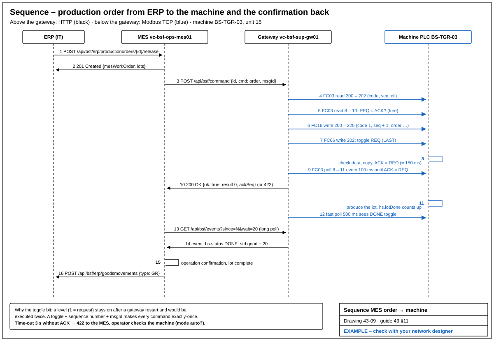

### 11.1 From the customer order to the machine and back

The full path of one lot of 20 screw shafts (example; MES and ERP are completed in items 6 and 7):

```text
ERP              ERP connector (DMZ)      MES                    Gateway                     BS-TGR-03 (PLC)
 |  sales order SO-00002                   |                       |                             |
 |-- POST /erp/productionorders/PO-4711/release (HTTPS) -->|      |                             |
 |                                         | WO-00005, lots L01…   |                             |
 |                                         |-- GET /mes/dispatch?machine=BS-TGR-03 (planning)   |
 |                                         |-- POST /api/bsf/command {order, part, qty, msgId}->|
 |                                         |                       |-- FC03 read 200-202 ------->|
 |                                         |                       |-- FC03 read 8-10 ---------->|
 |                                         |                       |-- FC16 write 200-225 ------>|
 |                                         |                       |-- FC06 write 202 (REQ) ---->|
 |                                         |                       |-- FC03 read 8-11 (poll) --->|  ACK = REQ
 |                                         |<-- 200 {"ok": true, "result": 0} -------------------|
 |                                         |-- POST /agv/transportorders (blanks to the grinder)|
 |                                         |                       |   … 20 pieces, lotDone 1 … 20
 |                                         |                       |<- fast poll: DONE toggled ---|
 |                                         |<-- event hs.status (long poll /api/bsf/events) ----|
 |                                         |-- POST /mes/confirmations {good 19, scrap 1}        |
 |<-- POST /erp/goodsmovements {GR …} -----|                                                     |
 |                                         |-- POST /printer/jobs (box label)                    |
```

Every arrow above the gateway is **HTTP**; every arrow below is **Modbus TCP**. The MES never opens a Modbus
connection; the machine never sees HTTP.

### 11.2 Patterns used

| Pattern | Where | Rule |
|---|---|---|
| request / response | all REST calls | timeout on the client (e.g. 5 s), retry only with Idempotency-Key |
| command with handshake | MES → machine | §8.4; the HTTP call returns when the machine has acknowledged (≈ 0.3 s), **not** when the lot is done |
| state change by event | machine → MES | report-by-exception + long polling / SSE; the MES compares totals (good count) – never counts events |
| reconciliation | MES ↔ machine every shift | MES reads the counters and compares with its confirmations; differences → alarm |
| outbox | MES → ERP | the MES writes the confirmation to its database first, then sends it to the ERP with an Idempotency-Key until 2xx |
| polling of long jobs | AGV, printer | create (201) → GET the state every 1 – 5 s until FINISHED / PRINTED |

### 11.3 AGV fleet – VDA 5050 ideas over REST

VDA 5050 is the German standard interface between a master control and AGVs; version 2 uses **MQTT** + JSON. We may
not use MQTT, so we use its **ideas** over HTTP:

| VDA 5050 idea | Our HTTP mapping |
|---|---|
| order with nodes and edges | `POST /api/bsf/agv/transportorders {from, to, load, priority}` – the fleet manager plans the path itself |
| state topic (vehicle state) | `GET /api/bsf/agv/vehicles`, `GET /api/bsf/agv/transportorders/{id}` (poll or SSE from the fleet manager) |
| order id + update id | `id` (TO-00001) + Idempotency-Key |
| actions (pick, drop) | implied by `from` / `to`; door / airlock requests via Modbus TCP I/O in VLAN 660 |
| connection topic (online / offline) | HTTP health of the fleet manager |

Ask the AGV maker for a **REST API of the fleet manager** (most offer one) and switch off its MQTT broker towards the
plant network (the internal link fleet manager ↔ vehicles is the maker's system on VLAN 650).

### 11.4 Label printing – why a print server

Industrial label printers (Zebra, Honeywell, SATO, …) receive their print language (ZPL, DPL, SBPL) as raw bytes on
**TCP port 9100**. That is **not HTTP**. Three honest options:

| Option | Rule-conform? | Note |
|---|---|---|
| print server (`vc-bsf-ops-prt01`, e.g. BarTender / NiceLabel or own small service) with an **HTTP job API**; the print server talks 9100 to the printers | **yes** – the MES speaks HTTP; port 9100 stays inside the print-server ↔ printer conduit (documented exception, §13) | recommended |
| printer with its own HTTP / REST interface (some current models – check, e.g. "Link-OS" web services, SATO / Honeywell web APIs) | yes | depends on model and firmware |
| MES sends ZPL to 9100 directly | **no** | not allowed |

The demo `POST /api/bsf/printer/jobs` shows the shape: template + data → job id → state QUEUED → PRINTING → PRINTED,
with a ZPL preview.

### 11.5 Andon and the twin

Andon screens and the digital twin are browsers: they open `GET /api/bsf/stream` (SSE) and draw. 6 screens × ≈ 25 kB/s
= 150 kB/s – nothing. They never write.

---

## 12. Time synchronisation

Every event needs a correct time stamp (OEE, traceability, sequence of alarms). Honest facts:

* **NTP** (RFC 5905) runs on **UDP port 123** – it is **not HTTP**. There is no good HTTP replacement.
* The gateway stamps every value **when it receives it** (`t`, `ageMs`). The machine PLC does not need a clock for our map
  (option: two UINT32 registers with Unix time if a maker wants source time stamps).

| Option | Accuracy (example) | Rule | Recommendation |
|---|---|---|---|
| NTP from `vc-bsf-dmz-ntp01` (synchronised to the company time source / GPS) for servers, gateway, switches | 1 – 10 ms on a LAN | **infrastructure exception** – like DNS; carries no production data | **yes** – document it in the firewall rules (UDP 123 from DMZ to the server VLANs) |
| HTTP `Date` header: the gateway reads the `Date` of the MES answers and corrects its clock | ± 1 s (the header has 1 s resolution) | pure HTTP | fallback if NTP is refused; enough for OEE, not for sequence-of-events |
| PTP (IEEE 1588) | < 1 µs | UDP / Ethernet – exception | not needed here |

Machines: their clocks are only for their own HMI. Do not use machine time stamps for MES data unless the PLC is
synchronised (NTP client in the PLC = the same exception, decide with IT).

---

## 13. Cybersecurity – zones, conduits, firewall

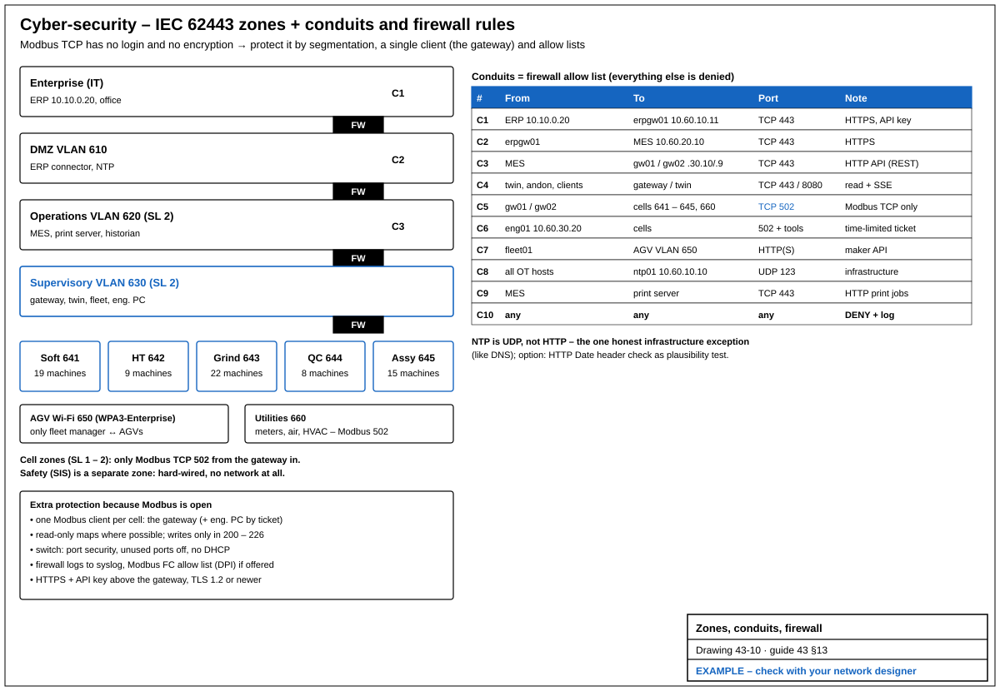

**Modbus TCP has no security at all**: no login, no encryption, no signature. Anybody who can send a TCP packet to port
502 of a machine can read and **write** registers. HTTP alone has none either – HTTPS + keys add it. So security comes
from **network design** (IEC 62443-3-2 zones and conduits, 62443-3-3 system requirements).

### 13.1 Zones

| Zone | VLAN | Security level target (example) | Content |
|---|---|---|---|
| Enterprise | IT | – (IT policy) | ERP, office |
| DMZ | 610 | SL 2 | ERP connector, NTP, patch server, remote-service gateway |
| Operations | 620 | SL 2 | MES, print server, historian, DNS |
| Supervisory | 630 | SL 2 | gateway gw01 / gw02, twin, fleet manager, engineering station, andon |
| Cells | 641 – 645 | SL 2 (SL 1 for very old machines with compensation) | machines, I/O couplers |
| AGV | 650 | SL 2 | AGVs, chargers (Wi-Fi WPA3 / WPA2-Enterprise) |
| Utilities | 660 | SL 1 – 2 | meters, compressors, HVAC, doors |

### 13.2 Conduits = firewall rules (example, deny all else + log)

| # | From | To | Protocol / port | Purpose |
|---|---|---|---|---|
| C1 | ERP (IT) 10.10.0.20 | ERP connector 10.60.10.11 | HTTPS TCP 443 | orders, goods movements |
| C2 | ERP connector | MES 10.60.20.10 | HTTPS TCP 443 | forwarded API calls |
| C3 | MES | gateway 10.60.30.9 / .10 | HTTPS TCP 443 (or 8080 inside OT) | read machine data, commands |
| C4 | twin / andon / clients (630) | gateway | HTTP(S) TCP 443 / 8080 | read only (SSE) |
| C5 | **gateway .9 / .10 only** | cells 641 – 645, 660 | **Modbus TCP 502** | polling + commands |
| C6 | MES | fleet manager 10.60.30.12 | HTTPS 443 | transport orders |
| C7 | MES | print server 10.60.20.11 (same zone) | HTTPS 443 | label jobs; print server → printers TCP 9100 (documented exception) |
| C8 | engineering station 10.60.30.20 | cells | Modbus 502 + vendor engineering ports | **only when enabled** (time-limited, ticket) |
| C9 | NTP 10.60.10.10 | servers, gateway, switches | UDP 123 | time (infrastructure exception) |
| C10 | any | any | – | **deny + log** |

Remote service of machine makers: only through the remote-access gateway in the DMZ, time-limited, with a person
watching – never a 4G router in the machine cabinet.

### 13.3 Hardening Modbus

| Measure | Effect |
|---|---|
| port 502 into the cells only from the gateway IPs (C5) | MES, office, laptops cannot reach registers |
| read-only maps where possible – writes only to 200 – 226, the PLC rejects writes elsewhere (exception 02) | a mistake cannot change a process value |
| commands only with the handshake + plausibility in the PLC (result 3 "bad data") | random writes do nothing |
| firewall with **Modbus deep packet inspection** (allow FC 03 / 04 everywhere, FC 06 / 16 only to 200 – 226 and only from the gateway) | blocks e.g. FC 05 / 15 / 08 – check the firewall model |
| switch port security / 802.1X, unused ports disabled, no DHCP | no foreign device in a cell |
| no internet in the cells, no vendor cloud | – |
| log every write (the gateway frame log `kind: cmd`) | audit trail |
| safety hard-wired | an attacker can stop production but cannot disable an emergency stop |

### 13.4 HTTP side

HTTPS with company certificates, API key per system with roles (§10.10), rate limits, no admin routes
(`/api/bsf/control`) from outside the supervisory zone, patching of the servers (patch server in the DMZ).

---

## 14. Commissioning and test plan

### 14.1 Register-map test (each of the 73 machines)

| # | Test | Method | Accept |
|---|---|---|---|
| 1 | ping, link 100 / 1 000 Mbit full duplex | switch web UI | no errors on the port |
| 2 | read offset 0 – 11 | test tool or page card 4 (frame builder → "Send") | map version 0x0101 (V1.1), type code = plan, unit id = plan |
| 3 | heartbeat | read offset 3 twice, 2 s apart | +2 (± 1) |
| 4 | state + status | set the machine to set-up / auto / alarm | `std.status`, `std.mode`, `std.stateCode`, `std.alarm` follow within 1 s |
| 5 | counters | make 3 parts (or simulate) | `std.good` +3 |
| 6 | REAL word order | read a known value (e.g. coolant 20.x °C) | plausible (not 10⁻²³ / 10⁸) |
| 7 | ASCII | load an order from the HMI | `std.order` readable |
| 8 | process values | compare 3 values with the HMI | equal within display resolution |
| 9 | out of range | read offset 300 | exception 02 |
| 10 | handshake | page card 5: load order qty 3 | ACK, result 0, BUSY, lotDone 1 … 3, DONE toggles |
| 11 | rejections | order with qty 0; second order while busy; machine in manual | result 3 / 4 / 2 |
| 12 | write protection | FC06 to offset 4; FC06 to offset 227 | exception 02 (both) |
| 13 | **gateway heartbeat** (map V1.1) | gateway running: read offset 226 twice, 2 s apart; then stop the gateway (or block FC06 at the firewall) for 10 s, then start it again | 226 counts + 2 (± 1); after the stop the PLC shows "gateway lost" within 5 – 6 s (lamp / HMI), READY = 0 (`hs.status` bit 4), a running lot is finished; gateway back → READY = 1 within 1 – 2 s without manual action |

Keep the result sheet per machine (CSV export of the device table + screenshots of card 5).

### 14.2 Load test

* all 73 machines polled for 8 h with the planned periods; accept: 0 exceptions, time-outs < 0.01 % (example),
  RTT 95 % value < 20 ms, gateway CPU < 20 %, no memory growth;
* double rate test (fast 250 ms) for 30 min – shows reserve;
* SSE with 10 browsers open, MES long polling – HTTP response time < 100 ms.

### 14.3 Failure tests (the 9 faults of card 7, on the real plant)

| # | Fault | How (real plant) | Accept |
|---|---|---|---|
| F1 | machine offline | pull the cable | status timeout within 1.1 s, stale after 2.1 s, other machines unaffected (their age < 600 ms), back-off visible (fast poll every 2 s) |
| F2 | slow answer | gateway time-out set to 5 ms temporarily | time-outs + retries; no mixed answers (values plausible) |
| F3 | device failure | stop the Modbus server block in the PLC | exception 04 or offline |
| F4 | wrong word order | configure CDAB in the gateway for one type | nonsense values → this test shows that the check in §14.1 #6 works |
| F5 | wrong unit id | test tool, unit 200 via a serial gateway | exception 0B |
| F6 | out of range | read 300 | exception 02 |
| F7 | unsupported FC | FC08 | exception 01 |
| F8 | too many registers | FC03 qty 200 | exception 03 |
| F9 | network loss | switch off the cell switch / pull the uplink | all machines of the cell stale after 2.1 s; HTTP still answers with `stale: true`; recovery < 10 s after reconnect; MES got no wrong counts |
| F10 | gateway switch-over | stop gw01 | gw02 polls within 5 s (example) |
| F11 | ring | open one ring link | ≤ 2 time-outs, no stale |

### 14.4 Acceptance criteria (summary, example)

| Criterion | Value |
|---|---|
| devices online in normal operation | 73 / 73 |
| data age fast block | ≤ 0.6 s (95 %) |
| command round-trip (HTTP in → ACK → HTTP out) | ≤ 1 s |
| report-by-exception delay (state change → MES event) | ≤ 1.5 s |
| network load per cell uplink | < 5 % |
| documentation | IP list, register maps (CSV), firewall rule list, switch configs, test reports |

---

## 15. Troubleshooting

### 15.1 Wireshark

Connect the engineering laptop to the **mirror port** of the cell switch (mirror the machine port or the uplink).

| Filter | Shows |
|---|---|
| `tcp.port == 502` | all Modbus TCP traffic |
| `mbtcp` | Modbus TCP frames (MBAP decoded) |
| `mbtcp.unit_id == 15` | only BS-TGR-03 |
| `mbtcp.trans_id == 0x7003` | one transaction (request + answer) |
| `modbus.func_code == 16` | all writes of multiple registers |
| `modbus.func_code >= 128` (or `modbus.exception_code`) | exception answers |
| `tcp.analysis.retransmission` | lost packets (cable, EMC, overload) |
| `tcp.flags.reset == 1` | connections closed hard (device limit reached, gateway reconnect) |
| `http` / `http.request.method == "POST"` | HTTP calls (only without TLS – inside the OT test network) |
| `ip.addr == 10.60.43.16` | everything of one machine |

Wireshark shows the Modbus time between request and answer (`mbtcp` → "Time since request") – this is the device RTT.

### 15.2 Common errors

| Symptom | Likely cause | Check / fix |
|---|---|---|
| all values of a device 0, map version 0 | wrong address offset (1-based!) or wrong register table (input vs holding) | read offset 0 = 0x0101 (V1.1)? §6.6 |
| REAL values like 1.2 × 10⁻³⁸ or 4.4 × 10⁸ | word order | §7.3, test value 20.0 = 0x41A0 0x0000 |
| values "shifted" by one field | 0 / 1-based; REAL on odd offset in the device | compare `hdr.typeCode` / `hdr.unitId` |
| status timeout for one device only | cable, IP, device off, firewall | ping; switch port LED / counters; `tcp.port == 502` |
| time-outs only while a big machine runs | EMC | shield 360°, separate trays, fibre (§4.7); switch CRC counters |
| time-outs after some minutes, then OK | device closes idle / extra connections; connection limit | number of connections; one gateway only |
| exception 0B | unit id wrong / serial device off | IP plan, serial gateway config |
| exception 02 on every read | map version mismatch / block too long | read the vendor's map; reduce quantity |
| values frozen, status online | PLC program stopped, communication module still answers | heartbeat (offset 3) not changing → alarm |
| machine shows "gateway lost" although the gateway polls it | gateway with map V1.0 (no FC06 226) or the firewall blocks FC06 to 226 | gateway frame log: `group gwhb`; allow FC06 to 226 from the gateway (§13.3) |
| FC06 226 answered with exception 02 | machine still on map V1.0 (map ends at 225) | update the machine program to V1.1 (§8.5 migration) |
| command time-out (no ACK) | PLC handshake not implemented / PLC in STOP | read 202 and 8 – 10 with a tool, PLC program |
| command result 4 busy | previous lot still running | wait for DONE or send command 3 (stop) |
| HTTP 409 "gateway not running" | backend not started | `POST /api/bsf/control {"action": "start"}` |
| HTTP 409 on release | wrong state | read the object first (GET) |
| duplicate work orders | client retried without Idempotency-Key | always send the key |
| SSE stops after a few minutes | proxy buffers / closes long responses | proxy: no buffering for `text/event-stream`, timeout > 60 s |
| "port already in use" when starting the simulator | another program on that port | other `simPort` (card 2 input / `&bf4port`) |

---

## 16. What you lose without MQTT and OPC UA

| Topic | MQTT / OPC UA would give | Here: Modbus TCP + HTTP | Limit / cost |
|---|---|---|---|
| Live data push (publish / subscribe) | MQTT broker pushes every change; OPC UA subscriptions with sampling + dead-band | gateway polls (fast 0.5 s) and does report-by-exception itself: dead-band per unit → event ring → Server-Sent Events (1 s) and long polling for MES / ERP | 1 extra hop; data age = poll period + RTT (≤ 0.5 s) – fine for MES / OEE, not for control loops |
| Data model / semantics | OPC UA information model, companion specs (e.g. OPC 40501 machine tools); MQTT Sparkplug B | register map per machine type as JSON + CSV (`/api/bsf/map`), versioned (register 0), names `group.field` + unit; the gateway converts registers → named JSON | the map must be kept in step with the PLC program (change control §8.5, test §14) |
| Security | OPC UA certificates + signing; MQTT over TLS with user / client certificate | Modbus has none → cell VLANs, firewall: 502 only from the gateway, read-only maps, command handshake + plausibility; HTTP over HTTPS with API keys | an attacker inside a cell VLAN can still write registers → port security / 802.1X |
| Browse / discovery | OPC UA browse; MQTT topic tree | `/api/bsf/api` + `/api/bsf/map`; `hdr.typeCode` + `hdr.mapVersion` in every device | no automatic discovery – the IP plan is the master list |
| Time stamps at the source | OPC UA SourceTimestamp, Sparkplug timestamps | gateway time stamp at receipt (`ageMs`, stale flag); source time only if the PLC writes it | ± (RTT + poll period); synchronise the gateway clock (§12) |
| Store-and-forward | MQTT persistent sessions / QoS 1 – 2; OPC UA historical access | totals in the machines (never lost, only late); event ring with `?since=N`; lot result kept until the MES confirms (DONE toggle) | plan resync when the ring is overrun |
| Methods / commands | OPC UA methods with arguments + result | command block 200 – 225 + toggle-bit handshake (226 = gateway heartbeat, V1.1), `POST /api/bsf/command`, idempotent with `msgId` | every machine maker must implement the handshake (§8.6) |
| Large data (programs, files, pictures) | OPC UA file transfer; MQTT payloads | HTTP: NC programs, measurement reports, pictures as files over HTTP – never over Modbus | Modbus only for small process values (≤ 125 registers per read) |

**What we gain:** one simple protocol per side, free tools, no broker or certificate infrastructure to run, every
technician can debug with a hex dump and a browser, and the security boundary is a single, clear firewall rule
(port 502 only from the gateway).

**Honest exceptions** (infrastructure, not production data – decide them with IT and write them down):

| Exception | Protocol | Why it is needed | Alternative inside the rule |
|---|---|---|---|
| time sync | NTP UDP 123 | correct time stamps | HTTP `Date` header (± 1 s) |
| name resolution | DNS UDP / TCP 53 | servers by name | IP addresses only (cells already work without DNS) |
| switch / firewall management | HTTPS web UI (allowed); SNMP, syslog (UDP) | monitoring | HTTPS UI + manual checks |
| label printers | raw TCP 9100 behind the print server | printers speak ZPL | printers with HTTP API |
| safety | hard-wired | life safety | none – never over a network |
| machine vendors' OPC UA / MQTT / cloud | – | often on by default | switch off / block at the cell firewall; ask for Modbus TCP (§20) |

---

## 17. Buy list and shopping list

Makers marked (check) – confirm that they offer this product for this use. Prices are rough 2026 estimates –
**estimate – ask for a quote**. The same lists are in the catalogue card `bfCard4` of the page.

### 17.1 Buy list – catalogue examples

**Managed industrial Ethernet switches (cell + core)** (guide 43 §4.5, §17)

| Item | Spec | Maker / model (example) | Data sheet | Price class (estimate – ask for a quote) | Check |
|---|---|---|---|---|---|
| Cell switch, managed, 8 – 24 ports, DIN rail | 1 Gbit copper + 2 – 4 SFP fibre uplinks, VLAN 802.1Q, RSTP / MRP ring, IGMP, port mirroring, 802.1X, HTTPS web UI | Siemens SCALANCE XC200 / XC300 (check) | check | ≈ 0.8 – 2.5 k€ (estimate – ask for a quote) | ring protocol (MRP / RSTP), port security, mirror port for Wireshark, 24 V redundant supply |
| Same | same | Hirschmann (Belden) RSP / GREYHOUND / BOBCAT (check) | check | ≈ 0.9 – 3 k€ | same; HiOS features, ring coupling |
| Same | same | Moxa EDS-500 / EDS-G500 / RKS (check) | check | ≈ 0.5 – 2 k€ | same; Turbo Ring, IEC 62443-4-2 certified models |
| Same | same | Phoenix Contact FL SWITCH 2000 / 4000 (check) | check | ≈ 0.6 – 2.5 k€ | same; PROFINET not needed here |
| Core / distribution switch (19″ rack, L3) | 24 – 48 × 1 / 10 Gbit SFP, inter-VLAN routing only through the firewall | Siemens SCALANCE XR500 · Hirschmann DRAGON / MACH · Cisco IE / Catalyst (check) | check | ≈ 3 – 12 k€ | redundant power, stacking, ACLs, 10 Gbit uplinks between halls |
| PoE switch for cameras / access points / andon | 802.3at / bt, 4 – 8 PoE ports | Moxa · Phoenix · Siemens · Hirschmann (check) | check | ≈ 0.8 – 2 k€ | PoE budget (W), VLAN per port |

**Firewall (zones + conduits, IEC 62443)** (guide 43 §13)

| Item | Spec | Maker / model (example) | Data sheet | Price class (estimate – ask for a quote) | Check |
|---|---|---|---|---|---|
| Industrial firewall between IT, DMZ and OT (pair, HA) | stateful, ≥ 6 interfaces, deep packet inspection for Modbus TCP (read-only filter option), VPN for remote service | Fortinet FortiGate rugged (check) | check | ≈ 3 – 10 k€ each (estimate – ask for a quote) | Modbus DPI (allow FC 03 / 04 only from MES side), HA pair, logging to syslog |
| Same | same | Siemens SCALANCE S615 / SC600 (check) | check | ≈ 1.5 – 5 k€ | zone firewall per cell (option), simpler rules |
| Same | same | Phoenix Contact mGuard (check) | check | ≈ 1.5 – 4 k€ | same; cell firewall in the cabinet |
| Same | same | Moxa EDR-G9010 / Cisco Secure Firewall ISA (check) | check | ≈ 2 – 8 k€ | industrial DPI for Modbus |

**Modbus TCP gateways + remote I/O (old machines, serial devices)** (guide 43 §5, §6)

| Item | Spec | Maker / model (example) | Data sheet | Price class (estimate – ask for a quote) | Check |
|---|---|---|---|---|---|
| Modbus RTU (RS-485) → Modbus TCP gateway | 1 – 4 serial ports, up to 32 devices per port, unit id routing | Moxa MGate MB3170 / MB3270 / MB3660 (check) | check | ≈ 0.3 – 1.2 k€ (estimate – ask for a quote) | time-out per port, exception 0B / 0A behaviour, number of TCP connections |
| Same | same | Phoenix Contact FL COMSERVER / GW Modbus (check) | check | ≈ 0.3 – 1 k€ | same |
| Same | same | Lantronix · Anybus (HMS) Communicator (check) | check | ≈ 0.3 – 1 k€ | same |
| Remote I/O coupler Modbus TCP (signal lamps, counters of old machines) | digital in 24 V, counter inputs, 2 Ethernet ports | WAGO 750-352 / 750-362 + I/O modules (check) | check | ≈ 0.3 – 0.8 k€ + modules | Modbus register map of the process image, watchdog |
| Same | same | Phoenix Contact Axioline AXL F BK ETH (check) · Moxa ioLogik E1200 (check) | check | ≈ 0.25 – 0.8 k€ | same; web configuration |
| Energy meter with Modbus TCP per machine / sub-board | class 0.5S, kW, kWh, cos φ | Janitza UMG 96 / 604 · Siemens SENTRON PAC · Schneider PM5000 · Phoenix EEM (check) | check | ≈ 0.4 – 1.5 k€ | register map (REAL, word order!), CT ratio |

**Servers, UPS, rack** (guide 43 §9, §17)

| Item | Spec | Maker / model (example) | Data sheet | Price class (estimate – ask for a quote) | Check |
|---|---|---|---|---|---|
| Gateway PC (industrial, fanless) – gw01 + gw02 | 4 – 8 cores, 16 GB, SSD, 2 – 4 Ethernet ports, Python stdlib service | Siemens SIMATIC IPC · Advantech · Beckhoff C60xx · OnLogic (check) | check | ≈ 1.5 – 4 k€ each (estimate – ask for a quote) | 2 NICs (cell side / server side), watchdog, 24 V supply, temperature range |
| Twin / MES server (rack) | 2 × server, RAID 1, 32 – 64 GB, 10 Gbit | Dell PowerEdge · HPE ProLiant · Lenovo ThinkSystem · Fujitsu PRIMERGY (check) | check | ≈ 6 – 15 k€ each | redundant PSU, remote management, backup |
| UPS for servers + core switches | 3 – 6 kVA online (double conversion), 15 – 30 min | APC (Schneider) Smart-UPS · Eaton 9PX · Socomec · Riello (check) | check | ≈ 2 – 6 k€ | network card (HTTP / SNMP) for shutdown, battery test |
| DIN-rail UPS 24 V for cell switches | 24 V / 5 – 20 A + battery / supercap | Phoenix QUINT UPS · Siemens SITOP · PULS (check) | check | ≈ 0.2 – 0.6 k€ | buffer time, status contact |
| 19″ network rack + patch panels | 42 U, fibre + copper patch panels | Rittal · Schroff · Legrand (check) | check | ≈ 1.5 – 4 k€ | cooling, earthing, cable management |

**Cabling** (guide 43 §4.6)

| Item | Spec | Maker / model (example) | Data sheet | Price class (estimate – ask for a quote) | Check |
|---|---|---|---|---|---|
| Industrial Ethernet cable Cat6A S/FTP, PUR, oil-resistant | 4-pair, 10 Gbit up to 100 m, drag-chain versions | Lapp ETHERLINE · Helukabel · Belden · Siemens IE FC (check) | check | ≈ 2 – 6 €/m (estimate – ask for a quote) | oil / coolant resistance, shielding, bending radius |
| RJ45 field connectors / M12 X-coded | IP20 in cabinets, M12 IP67 on machines | Harting · Phoenix · Lapp · Murrelektronik (check) | check | ≈ 8 – 30 € each | shield contact 360°, tooling |
| Fibre between halls / zones | OM3 / OM4 multimode (≤ 300 – 400 m at 10 Gbit) or OS2 single mode, 12 fibres | Corning · Prysmian · Lapp (check) + SFP modules from the switch maker | check | ≈ 3 – 10 €/m + splicing | immune to EMC, no earthing loops between buildings |
| Wi-Fi access points for AGVs (industrial, roaming) | 802.11ac / ax, fast roaming, 5 GHz | Siemens SCALANCE W · Moxa AWK · Phoenix FL WLAN · Cisco (check) | check | ≈ 0.8 – 2.5 k€ each | roaming time < 50 ms, site survey |

**Test + diagnosis tools** (guide 43 §14 – §15)

| Item | Spec | Maker / model (example) | Data sheet | Price class (estimate – ask for a quote) | Check |
|---|---|---|---|---|---|
| Network tap / mirror port + laptop with Wireshark | filter mbtcp, http; capture at the gateway port | Wireshark (free) · Profitap / Garland taps (check) | check | ≈ 0 – 1 k€ | mirror port on every cell switch |
| Modbus test client (master simulator) | read / write registers, log frames | Modbus Poll (Witte Software) · QModMaster (free) · mbpoll (free) (check) | check | ≈ 0 – 150 € | word order setting, 0 / 1-based addressing option |
| Cable tester / certifier | Cat6A certification, fibre OTDR (contractor) | Fluke Networks DSX · Softing (check) | check | ≈ 2 – 15 k€ (or rent) | certification report per link |

### 17.2 Shopping list – network + gateway for the 73 machines (example design point)

| Pos | Qty | Item | Spec (from the guide) | Example (choose one maker per item) | Price class (estimate – ask for a quote) |
|---|---|---|---|---|---|
| 1 | 6 | Cell switches (641 – 645 + utilities 660), managed, 16 – 24 ports + 2 SFP | VLAN, ring, mirror port | SCALANCE XC · Hirschmann RSP · Moxa EDS · Phoenix FL | ≈ 8 – 18 k€ |
| 2 | 2 | Core switches L3, redundant | 10 Gbit uplinks | SCALANCE XR · Hirschmann DRAGON · Cisco | ≈ 8 – 24 k€ |
| 3 | 2 | Firewall pair (HA) IT / DMZ / OT | Modbus DPI option | FortiGate rugged · SCALANCE S · mGuard | ≈ 8 – 20 k€ |
| 4 | 2 | Gateway PCs gw01 + gw02 (hot standby) | 2 NICs, fanless | SIMATIC IPC · Advantech · Beckhoff | ≈ 4 – 8 k€ |
| 5 | 2 | Twin / MES servers + 19″ rack + 2 UPS | RAID 1, 30 min | Dell · HPE · Lenovo + APC · Eaton | ≈ 20 – 40 k€ |
| 6 | 6 | Modbus TCP I/O couplers / RTU gateways for machines without Modbus TCP | estimate 6 of 73 | WAGO 750-352 · Moxa MGate · Phoenix | ≈ 3 – 8 k€ |
| 7 | 80 | Cat6A drops machine → cell switch (≈ 40 m each) | S/FTP PUR, tested | Lapp · Helukabel · Belden | ≈ 25 – 50 k€ incl. labour |
| 8 | 1 | Fibre backbone between zones (12 × OM4 / OS2) | ≈ 600 m, spliced | Corning · Prysmian | ≈ 10 – 25 k€ |
| 9 | 4 | Wi-Fi access points for AGVs + controller | roaming < 50 ms | SCALANCE W · Moxa AWK · Cisco | ≈ 5 – 12 k€ |
| 10 | 6 | Andon screens (browser kiosk, SSE) | 55″, 24/7 | any industrial display maker | ≈ 6 – 18 k€ |
| 11 | 1 | Engineering laptop + Modbus test tools + tap | Wireshark, Modbus Poll | any | ≈ 2 – 4 k€ |
| 12 | 1 | Network design, IP plan, firewall rules, commissioning tests (external) | IEC 62443 risk assessment | system integrator | ≈ 20 – 60 k€ |

Not included: cable trays, installation labour of the building, IT licences (ERP), the machines themselves (item 2,
`bfCard2`). Order of magnitude of the whole communication system: **≈ 0.12 – 0.29 M€** (example, sum of the shopping list) – a
small share of the machine investment of item 2.

---

## 18. Standards register

| Standard | Title / content | Used for | Note |
|---|---|---|---|
| Modbus Application Protocol Specification V1.1b3 (Modbus Organization, 2012) | function codes, data model, exceptions | §6 | free download from modbus.org |
| Modbus Messaging on TCP/IP Implementation Guide V1.0b (2006) | MBAP header, port 502, connections, unit id | §6.2, §6.8 | free |
| IEC 61158 / IEC 61784 (Modbus TCP as CPF 15) | fieldbus standards | reference | (check edition) |
| IEEE 802.3 | Ethernet (100BASE-TX, 1000BASE-T, fibre, PoE 802.3af / at / bt) | §4 | |
| IEEE 802.1Q | VLAN tagging (and RSTP / MSTP today) | §4.2 | |
| IEEE 802.1D / 802.1w | bridging / Rapid Spanning Tree | §4.1 | 802.1w merged into 802.1D-2004 / 802.1Q (check edition) |
| IEC 62439-2 | MRP Media Redundancy Protocol | §4.1 | (check edition) |
| IEEE 802.1X | port-based network access control | §13 | |
| IEEE 802.11 (r / k / v) | Wi-Fi, fast roaming | §4.8 | |
| ISO/IEC 11801-1 / -3, EN 50173-1 / -3 | generic cabling, industrial premises | §4.6 | (check edition) |
| EN 50310 | telecommunications bonding networks (earthing) | §4.7 | (check edition) |
| IEC 61918 / IEC 61784-5 | installation of industrial communication networks | §4.6, §4.7 | (check edition) |
| IEC 62443-3-2 | security risk assessment, zones and conduits | §13 | |
| IEC 62443-3-3 | system security requirements and security levels | §13 | |
| IEC 62443-4-2 | component security requirements | switches / firewalls | |
| RFC 9110 | HTTP semantics (methods, status codes) | §10 | 2022 |
| RFC 9112 | HTTP/1.1 message syntax | §10 | 2022 |
| RFC 8259 | JSON | §10 | |
| RFC 9457 | Problem Details for HTTP APIs (problem+json) | §10.3 | replaces RFC 7807 |
| WHATWG HTML Living Standard – Server-sent events | `text/event-stream`, `EventSource` | §10.6 | living standard |
| RFC 8446 | TLS 1.3 | §10.10 | |
| RFC 3339 / ISO 8601 | date and time format | §10.1 | |
| IETF draft "The Idempotency-Key HTTP Header Field" | Idempotency-Key | §10.4 | draft (check status) |
| RFC 5905 | NTP version 4 | §12 | |
| IEEE 1588 | PTP precision time | §12 | not used |
| IEC 62264 (ISA-95) | enterprise-control integration, levels | §3 | |
| ISO 22400-2 | KPIs for manufacturing operations (OEE …) | data the MES computes | (check edition) |
| VDA 5050 | AGV ↔ master control interface (MQTT + JSON) | §11.3 – ideas only | version 2.x (check) |
| IEEE 754 | floating-point arithmetic (REAL) | §7.3 | |
| ISO 13849-1 / IEC 62061 | safety of machinery – control systems | safety is hard-wired | |

---

## 19. Glossary

| Term | Meaning |
|---|---|
| ADU | application data unit – the whole Modbus TCP message (MBAP + PDU), max 260 bytes |
| andon | large screen in the hall that shows machine states |
| back-off | polling a failing device less often so it does not slow the others |
| big-endian | high byte first (Modbus standard for 16-bit values) |
| client / server | Modbus roles; the client (gateway) asks, the server (machine) answers (old: master / slave) |
| conduit | allowed communication path between two zones (IEC 62443) = a set of firewall rules |
| dead-band | minimum change that is reported as an event |
| DMZ | demilitarised zone – network between IT and OT |
| DPI | deep packet inspection – a firewall that understands Modbus function codes |
| exception | error answer of a Modbus server (function code + 0x80, code 01 … 0B) |
| FC | function code (03 read holding registers, 06 write single, 16 write multiple …) |
| gateway | here: the program that polls the machines (Modbus TCP client) and offers the data over HTTP |
| handshake | agreed sequence of bits for a safe command (REQ / ACK / BUSY / DONE) |
| heartbeat | counter the machine increments every second – shows that the PLC program runs |
| gateway heartbeat | counter the gateway writes into offset 226 every second (map V1.1) – shows the PLC that the gateway is alive |
| holding register | 16-bit read / write register of Modbus (4xxxx) |
| idempotent | doing it twice has the same effect as once |
| Idempotency-Key | HTTP header with a unique id so that a repeated POST is not executed twice |
| long polling | HTTP request that the server holds open until data is there |
| MBAP | Modbus application protocol header – 7 bytes: transaction id, protocol id, length, unit id |
| MRP | media redundancy protocol for rings (IEC 62439-2) |
| PDU | protocol data unit – function code + data |
| PoE | power over Ethernet |
| problem+json | standard JSON error format (RFC 9457) |
| REAL | 32-bit floating point (IEEE 754) in 2 registers |
| report-by-exception | send a value only when it changes beyond the dead-band |
| REST | style of HTTP API: resources + methods + status codes |
| RSTP | rapid spanning tree protocol |
| RTT | round-trip time: request out → answer back |
| SSE | Server-Sent Events – server push over a normal HTTP response |
| stale | value too old to be trusted (> 2.1 s here) |
| toggle bit | bit whose **change** means "new command" |
| transaction id | number in the MBAP header that pairs a request with its answer |
| unit id | one byte in the MBAP header; selects the device behind a gateway (here 1 … 73) |
| VLAN | virtual LAN – logical network separation on the same switches |
| word order | order of the two 16-bit registers of a 32-bit value (ABCD, CDAB, …) |
| zone | group of devices with the same security requirements (IEC 62443) |

---

## 20. Supplier questions

**Machine makers (all 73 machines):**

1. Does the machine controller offer a **Modbus TCP server** (port 502)? Built-in or option (price)?
2. Can you implement **our register map** (§8.6) for this machine type? Which fields are not available?
3. Which function codes are supported (03, 04, 06, 16, 01, 05)? How many TCP connections at the same time?
4. Answer time for a read of 48 registers (ms)? Does the Modbus server run in a separate task or in the PLC scan?
5. Word order of REAL / 32-bit values – can it be set to ABCD? Are 32-bit values on even addresses?
6. Can you implement the toggle-bit handshake with result codes (§8.4), a heartbeat (offset 3) and the "gateway lost"
   watchdog on the gateway heartbeat (offset 226 unchanged for 5 s, map V1.1)?
7. Which other protocols are active (OPC UA, MQTT, MTConnect, cloud, remote service)? Can they be switched off?
8. How is the machine's internal network separated from our cell network (second NIC, NAT, managed switch)?
9. Will you deliver the implemented map as CSV / Excel and support a register-map test at acceptance?
10. Is the safety function completely independent of the Ethernet interface?

**Switch / firewall makers:**

1. MRP and / or RSTP – recovery time with 6 switches in the ring?
2. Port mirroring, 802.1X, MAC lock, storm control? Management over HTTPS (and is SNMP needed)?
3. Firewall: Modbus TCP deep packet inspection – can it allow FC 03 / 04 only and FC 06 / 16 only to an address range
   from one source IP? Throughput with DPI on?
4. IEC 62443-4-2 certification of the model? Security level?
5. Temperature range, redundant 24 V supply, MTBF, firmware update policy (how long)?

**Modbus gateway / I/O makers:**

1. Time-out and retry settings per serial port; exception 0A / 0B behaviour?
2. Number of TCP client connections; unit id routing table?
3. Counter inputs (max frequency), register map of the process image, word order of 32-bit counters?

**AGV fleet manager:**

1. Is there a documented **REST / HTTP API** for transport orders, order state and vehicle state? JSON examples?
2. Can the MQTT / VDA 5050 broker be kept inside your system (not on the plant network)?
3. Door / airlock interface via Modbus TCP I/O?
4. Idempotency of order creation (order id from the MES)?

**Label printer / print server:**

1. Does the printer model offer an **HTTP / REST print interface**, or do we need a print server?
2. Print server: HTTP job API (JSON), job state query, template management, audit log?
3. Barcode types (Code 128, DataMatrix), label sizes, ZPL / DPL emulation?

---

## 21. Next to read

| Guide / item | Why |
|---|---|
| Guide 40 – products (item 1) | the product codes in the order numbers (BS-3210-1000-C5, LB-25-FL, …) |
| Guide 41 – manufacturing (item 2) | the 41 machine types, their signal groups, the 73 machines |
| Guide 42 – layout + live twin (item 3) | the shared simulation `getBSF()`, `SIGFIELDS`, Appendix B = the signal list behind our map |
| Guide 15 – numbering and identification | host-name and IP rules of the company (§3.13) |
| Guide 07 – communication (compressor plant) | the older plant with OPC UA / MQTT – compare the two approaches |
| Item 5 – quality + inspection (guide 44) | uses the `meas` / `torque` registers (lead deviation, preload torque) |
| Item 6 – MES (guide 45) | full implementation of `/api/bsf/mes/...`, uses `/api/bsf/command` and `/api/bsf/events` |
| Item 7 – ERP (guide 46) | full implementation of `/api/bsf/erp/...` |
| Item 8 – PLC programs (guide 47) | the machine side of the map and the handshake in ladder (Delta + Siemens) |

---

## Appendix A – HTTP API list

All routes of item 4 (in `server.py` and in `tools/bsf_gateway.py`; `/api/bsf/v1/...` = the same).

| Method | Path | Purpose |
|---|---|---|
| GET | `/api/bsf/status` | gateway state, statistics, device counts |
| GET | `/api/bsf/machines` | all 73 devices: id, IP, unit id, status, round-trip, data age, main values |
| GET | `/api/bsf/machine?id=BS-TGR-03` | one device: all decoded values + quality |
| GET | `/api/bsf/frames?n=40&since=0` | last Modbus TCP frames (hex + decoded text) |
| GET | `/api/bsf/events?since=0&wait=20` | report-by-exception changes (long polling, max 30 s) |
| GET | `/api/bsf/stream` | Server-Sent Events: status + changes + frames every 1 s |
| GET | `/api/bsf/map` | register maps of all machine types, machines, VLANs, servers (JSON) |
| GET | `/api/bsf/map.csv` | the same as CSV (Excel, ; separated) |
| GET | `/api/bsf/control` | running? configuration, injected faults |
| POST | `/api/bsf/control` | start | stop | config | fault | netloss | probe | raw |
| POST | `/api/bsf/command` | MES -> machine command: FC16 write + toggle-bit handshake |
| POST | `/api/bsf/snapshot` | twin snapshot from the browser (feeds the Modbus simulator) |
| GET | `/api/bsf/snapshot` | stored twin snapshot |
| GET | `/api/bsf/api` | this catalogue |
| GET | `/api/bsf/mes/workorders?status=released&page=1&size=20` | MES work orders (paged) |
| POST | `/api/bsf/mes/workorders` | create a work order {product, qty, due} (Idempotency-Key) |
| GET | `/api/bsf/mes/workorders/{id}` | one work order with operations |
| POST | `/api/bsf/mes/workorders/{id}/release` | release to the shop floor (409 if not 'created') |
| GET | `/api/bsf/mes/dispatch?machine=BS-TGR-03` | dispatch list of one machine (next lots) |
| POST | `/api/bsf/mes/confirmations` | operation confirmation {wo, op, machine, good, scrap} (Idempotency-Key) |
| GET | `/api/bsf/mes/trace?serial=BS-...` | traceability: lot, operations, machines, measured values |
| GET | `/api/bsf/erp/salesorders` | ERP sales orders |
| POST | `/api/bsf/erp/salesorders` | create a sales order {customer, product, qty, due} |
| POST | `/api/bsf/erp/productionorders/{id}/release` | release a production order -> creates the MES work order |
| POST | `/api/bsf/erp/goodsmovements` | goods issue (GI) / goods receipt (GR) {type, material, qty, order} |
| GET | `/api/bsf/erp/stock?material=LB-25-FL` | stock per material |
| POST | `/api/bsf/agv/transportorders` | AGV transport order {from, to, load, priority} (VDA 5050 ideas over HTTP) |
| GET | `/api/bsf/agv/transportorders/{id}` | transport order state CREATED -> ASSIGNED -> PICKING -> DELIVERING -> FINISHED |
| POST | `/api/bsf/printer/jobs` | label print job {printer, template, data} -> print server (HTTP) |
| GET | `/api/bsf/printer/jobs/{id}` | print job state |

---

## Appendix B – files of item 4

| File | Content |
|---|---|
| `web/bsfcomm.js` | page: 9 cards, live flow animation, device table, register-map browser, frame decoder / builder, command demo, calculator, fault injection, HTTP "try it", browser demo engine, self-check `&bf4test` |
| `web/bsfcomm_map.js` | register map, IP plan, frame codec, load calculator, browser demo Modbus server (mirror of the Python map) |
| `web/bsfcomm_data.js` | texts, HTTP examples, comparison table, fault catalogue, catalogue card `CARD4` |
| `web/bsfcomm.css` | styles of the page |
| `twin/bsf_comm_map.py` | register maps, IP plan, value + frame codec (Python) |
| `twin/bsf_comm_modbus.py` | Modbus TCP plant simulator (server) and client |
| `twin/bsf_comm.py` | gateway, control, HTTP dispatcher, SSE |
| `twin/bsf_comm_api.py` | MES / ERP / AGV / printer demo APIs |
| `tools/bsf_modbus_sim.py` | stand-alone Modbus TCP simulator (73 machines) |
| `tools/bsf_gateway.py` | stand-alone gateway with its own HTTP API |
| `server.py` | routes `/api/bsf/...` (lazy import, inert until started) |
| `docs/img/43_*.svg` (+ `web/img/`) | 12 drawings 43-01 … 43-12 |
| `docs/43_bsf_communication_modbus_http.md` | this guide |

*All values in this guide are examples – check with your network designer, the machine makers and the device manuals.*
