# 44 – Quality + inspection: control plan, lead accuracy, preload, parallelism, SPC, MSA, traceability

Tab **Ball screw + guide factory**, item **5 · Quality + inspection – lead accuracy, preload, parallelism, SPC**.
Deep link: `/?bfitem=5#bsf`.

This guide is the textbook for the **quality system and the inspection** of the new ball screw + profiled linear guide
factory. Guide 40 explains the products, guide 41 the manufacturing processes and the 17 quality gates of the routings,
guide 42 the hall and the live digital twin, guide 43 the communication (only Ethernet + Modbus TCP + HTTP). This guide
answers the next questions:

* What must we check on a screw shaft, a ball nut, a rail and a carriage – with which gauge, how often, by whom, and what
  do we do when a value is wrong (control plan)?
* How do we measure the lead of a ball screw with a laser and evaluate it per ISO 3408-3 (T, E, e_p, v_up, v_300p, v_2πp)?
* How do we test preload torque, rigidity, run-out, thread profile, hardness, case depth, roughness, rail parallelism,
  carriage height, noise and cleanliness?
* Is the process capable (SPC, Cp / Cpk) and is the gauge good enough (gauge R&R, uncertainty)?
* How do we sample bought parts, handle a non-conformance (NCR / 8D) and trace every serial number back to the steel heat?
* How do the measuring machines send their results to the MES – with only Modbus TCP and HTTP?

| What | Example result of this guide |
|---|---|
| Control plan | **55 characteristics** for screw, nut, rail, carriage, screw assembly and guide set; **21 critical (CC)**; every one linked to an operation of item 2 and, where one exists, to one of the **17 quality gates** |
| Lead accuracy | laser bench, 1 mm steps over l_u = 700 mm, temperature compensation α = 11.5 µm/(m·K) at 20 °C; C5: \|E − T\| ≤ 35 µm, v_up ≤ 25 µm, v_300p ≤ 18 µm, v_2πp ≤ 8 µm; 1 K on 700 mm = **8.05 µm** |
| Preload | Tp = 0.05 / √tanλ · Fpr · Ph / 2π = **0.292 N·m**, band ± 40 % (C5, Tp 0.2 – 0.4 N·m) over the effective stroke |
| Linear guide | running parallelism LG-25-1000 class H ≤ **16 µm** (P 9 µm), carriage height H 36 ± 0.04 mm, pair variation ΔH ≤ 15 µm |
| SPC | X̄-R / X̄-s / I-MR charts on live twin data, Western Electric rules 1 – 4, worked example Cp 1.49 / **Cpk 1.44** |
| MSA | gauge R&R 10 parts × 3 operators × 3 trials: **%GRR 9.5 %** (6.7 % of the tolerance), ndc 14 (ANOVA 8.8 %, ndc 16) |
| Uncertainty | lead measurement 700 mm, room 20 ± 0.5 °C: u_c = 0.785 µm, **U = 1.57 µm (k = 2)** → C5 conformance zone ± 33.4 µm (ISO 14253-1) |
| Sampling | ISO 2859-1 level II for bought parts, e.g. lot 1 000, AQL 2.5 → n 80, Ac 5 |
| Traceability | serial per screw / nut / rail / carriage → lot → heat lot → machine, operator, measurement record, gauge |
| Integration | machines → **Modbus TCP** registers (`meas`, `torque` groups) → gateway → **HTTP**; instrument PCs → HTTP JSON `POST /api/bsf/qa/results`; MES confirmation `POST /api/bsf/mes/confirmations` |
| Software | page `web/bsfqa*.js` (shared data `web/bsfqa_data.js` for MES + ERP), optional stdlib Python QA service `twin/bsf_qa.py` (`/api/bsf/qa/...`), self-check `&bf5test` (≈ 80 checks) |

All numbers in this guide are **examples** – check them with the standard (ISO 3408-3, JIS B 1192-3, ISO 6508, ISO 6507,
ISO 18203, ISO 21920, ISO 2859-1, ISO 22514, AIAG MSA / SPC …), the maker's catalogue and the drawing / quality agreement
of your customer before you use them.

---

## Contents

1. [Purpose and scope](#1-purpose-and-scope)
2. [How to use the page](#2-how-to-use-the-page)
3. [Quality system basics](#3-quality-system-basics)
4. [Control plan and the 17 quality gates](#4-control-plan-and-the-17-quality-gates)
5. [Characteristics of screw, nut, rail and carriage – why each one matters](#5-characteristics-of-screw-nut-rail-and-carriage--why-each-one-matters)
6. [GD&T for ball screws and rails](#6-gdt-for-ball-screws-and-rails)
7. [Ball screw lead measurement – the laser bench](#7-ball-screw-lead-measurement--the-laser-bench)
8. [ISO 3408-3 lead accuracy in depth](#8-iso-3408-3-lead-accuracy-in-depth)
9. [Preload torque, rigidity and lost motion](#9-preload-torque-rigidity-and-lost-motion)
10. [Run-out, roundness, thread profile and ball size classes](#10-run-out-roundness-thread-profile-and-ball-size-classes)
11. [Linear guide accuracy](#11-linear-guide-accuracy)
12. [Hardness, case depth, roughness, noise and cleanliness](#12-hardness-case-depth-roughness-noise-and-cleanliness)
13. [Metrology room and measurement uncertainty](#13-metrology-room-and-measurement-uncertainty)
14. [SPC and process capability](#14-spc-and-process-capability)
15. [MSA – gauge R&R, bias, linearity, stability, calibration](#15-msa--gauge-rr-bias-linearity-stability-calibration)
16. [Sampling and first article inspection](#16-sampling-and-first-article-inspection)
17. [Non-conformance (NCR) and 8D](#17-non-conformance-ncr-and-8d)
18. [Traceability and data model](#18-traceability-and-data-model)
19. [Integration with MES and ERP – HTTP and Modbus TCP only](#19-integration-with-mes-and-erp--http-and-modbus-tcp-only)
20. [Self-check and tests](#20-self-check-and-tests)
21. [Buy list and shopping list](#21-buy-list-and-shopping-list)
22. [Standards register](#22-standards-register)
23. [Glossary](#23-glossary)
24. [Supplier questions](#24-supplier-questions)
25. [Next to read](#25-next-to-read)
26. [Appendix A – HTTP API of the QA service](#appendix-a--http-api-of-the-qa-service)
27. [Appendix B – files of item 5](#appendix-b--files-of-item-5)

---

## 1. Purpose and scope

### 1.1 What this guide is for

Guide 40 explains the products (ball screw, nut, profiled rail, carriage). Guide 41 explains how we make them on 73
machines. Guide 42 shows the factory as a live digital twin, guide 43 the communication with only Ethernet, Modbus TCP
and HTTP. This guide answers the **quality questions**:

* Which characteristics of a screw, a nut, a rail and a carriage must we check – and why?
* With which gauge, how often, by whom, and what do we do when a value is wrong (reaction plan)?
* How does a laser lead measuring machine work, and how do we evaluate a lead curve per ISO 3408-3
  (T, E, e_p, v_up, v_300p, v_2πp)?
* How do we test preload torque, rigidity, run-out, the thread profile, rail parallelism, carriage height,
  hardness, case depth, roughness, noise and cleanliness?
* How good must the measuring room be (20 °C), and how big is the measurement uncertainty?
* How do we watch the process (SPC, Cpk), prove that a gauge is good enough (gauge R&R), sample bought parts (AQL),
  handle a defect (NCR / 8D) and trace every serial number back to its steel heat?
* How do the results reach the MES – by HTTP JSON or by Modbus TCP registers through the gateway?

### 1.2 What item 5 builds

| Part of item 5 | What it is | Where |
|---|---|---|
| Shared quality data | 55 characteristics (control plan rows), the 17 quality gates, SPC settings, torque table, AQL table, GRR example, calibration list, uncertainty budget, serial formats, NCR example, standards | `web/bsfqa_data.js` – **items 6 (MES) and 7 (ERP) import it** |
| Formulas | ISO 3408-3 lead evaluation, lead curve simulation, Cp / Cpk / Pp / Ppk, control limits, Western Electric rules, gauge R&R (average + range and ANOVA), AQL plan, OC curve, uncertainty budget, case depth, roughness, circle fit | `web/bsfqa_calc.js` (+ hand values `CHECK5`) |
| 11 live measuring stations | run-out, hardness + case depth, thread profile, ball classes, preload torque, rigidity, rail parallelism, carriage H / W2, roughness, noise, cleanliness | `web/bsfqa_meas.js` |
| Page | 6 cards + catalogue card (this guide §2) | `web/bsfqa.js`, `web/bsfqa_chart.js`, `web/bsfqa_card.js`, `web/bsfqa.css` |
| QA service (optional) | in-memory HTTP service: results, trace, SPC, NCR, calculation cross-check | `twin/bsf_qa.py`, routes `/api/bsf/qa/...` in `server.py` |

### 1.3 Reference products

All examples use the four reference products of the contract (docs/40_contract_bsf.md):

| Code | Product | Quality-relevant data (examples) |
|---|---|---|
| `BS-3210-1000-C5` | ground ball screw shaft Ø32, lead 10 mm, 1 000 mm | useful travel l_u = 700 mm, grade C5: e_p ± 35 µm, v_up 25 µm, v_300 18 µm, v_2π 8 µm; thread 58 – 62 HRC, case 2 – 3 mm |
| `BN-3210-FL` | flanged ball nut, balls Ø6.35, preload P1 (3 % Ca) | preload torque Tp = 0.29 N·m, internal pitch Ø ± 3 µm, Eht 0.8 – 1.2 mm |
| `LG-25-1000` | profiled rail size 25, 1 000 mm | class H: running parallelism ≤ 16 µm over 1 000 mm, hole pitch 60 ± 0.2 mm cumulative |
| `LB-25-FL` | flange carriage size 25, preload Z1 | H = 36 ± 0.04 mm (class H), ΔH ≤ 15 µm, drag force 10 – 22 N (example) |

### 1.4 Who reads what

| Reader | Start with |
|---|---|
| Quality manager | §3, §4, §14 – §18 |
| Metrology / lab engineer | §7, §8, §10 – §13, §15 |
| Process engineer (grinding, heat treatment) | §5, §8.7 – §8.9, §12, §14 |
| Assembly | §9, §10.5, §11 |
| IT / MES / ERP | §4 (data file), §18, §19 |
| Buyer | §21, §24 |

All numbers in this guide are **examples – check the standard and your customer's drawing / quality agreement**
before you use them for a real product.

---

## 2. How to use the page

Open the tab **Ball screw + guide factory** and press **5 · Quality + inspection** (deep link `/?bfitem=5#bsf`).
The page is built the first time you open the item (lazy) and pauses its animations when the item is hidden.

### 2.1 The cards

| Card | What you see and do |
|---|---|
| **Rule box** (top) | the quality rule: every characteristic has spec, gauge, frequency, owner and reaction plan; results only by Modbus TCP (machines) or HTTP JSON (instrument PCs) |
| **1 · Control plan + 17 quality gates** | choose the product (screw, nut, rail, carriage, screw assembly, guide set). The process flow of the routing (item 2) shows the operations as boxes and the **quality gates as diamonds**. Click a diamond → the gate (what, spec, how, frequency, reaction) and only its characteristics. Click an operation box → only the characteristics of that operation. The table is the control plan (No, op / machine, characteristic, class CC / SC, spec, method / gauge, sample / frequency, who, control method, reaction plan, gate). "All 17 quality gates" opens the full gate list |
| **2 · Ball screw lead measurement** | an animated laser bench (work head with encoder, screw, carriage with ball probe and retro-reflector, laser, interferometer, compensator, 3 material sensors). **Measure next screw** starts a new screw (new serial number); **auto** measures one screw after the other. 10 sliders change the error sources (T, grinder lead error, 2π wobble, long wave, grinding temperature, temperature rise during the pass, bench temperature, drift, sensor error, noise), plus temperature compensation on / off and "use the live screw temperature of the thread grinders". The chart shows the raw laser reading (dashed), the true curve at 20 °C, the evaluated curve, the mean travel line and T. The table gives E − T, v_up, v_300p, v_2πp against the C3 / C5 / C7 limits and the grade reached |
| **3 · Other measurements – live stations** | 11 tabs (stations). Each tab: how the measurement works, the gauge, the standard, the control-plan characteristics. **Measure next part** (or **auto**) runs a 2-second live measurement – chart and result table with OK / NOK. Some stations have an option (hardness: screw / nut / rail; torque: grade C3 / C5 / C7). Every result becomes a measurement record (log below) |
| **4 · SPC** | choose one of 8 characteristics and the chart type (auto, X̄-R, X̄-s, I-MR). Control chart with phase-I limits, 1σ / 2σ zones, red points where a Western Electric rule fires; range / s / moving-range chart; capability table with every formula (μ, σ within, σ overall, Cp, Cpk, Pp, Ppk, ppm out of spec); histogram with LSL / USL and the normal curve. **inject shift +1.5σ** moves the process mean of the live data – watch the rules fire; **remove shift** ends it. Below: the live Modbus signal group `meas` of the lead machine |
| **5 · MSA** | gauge R&R study 10 parts × 3 operators × 3 trials: data table, method (average + range or ANOVA) with all formulas, %GRR, %tolerance, ndc; operator chart + range chart. **new random study** / **example data set**. Below: the uncertainty budget of the lead measurement (choose room tolerance ± 0.5 / 1 / 2 K and l_u 300 / 700 / 1 500 mm) with the ISO 14253-1 guard bands, and the calibration intervals |
| **6 · Sampling, FAI, NCR, traceability, MES** | AQL calculator (lot size, AQL → code letter, n, Ac, Re, OC curve); first-article checklist; NCR workflow with the example 8D, **open NCR for the last NOK result** and **next 8D step**; traceability per serial (genealogy, operations of the lot from the twin, measurement records, data model); **POST last lead result → /api/bsf/qa/results** and **send confirmation → MES demo** show the real HTTP request and answer; the Modbus TCP register block `meas` of the lead machine with the real FC03 request and response bytes |
| **Real components + drawings** | catalogue card `bfCard5`: 12 drawings, buy list (laser + lead benches, CMM / form / contour / roughness, hardness + metallography, preload / force / noise, basic metrology + room, SPC software), shopping list for the first QA room |

### 2.2 Where the live data comes from

The page reads the shared live simulation `window.BSF` (item 3, guide 42). Every time a measuring machine of the twin
(QC-LED lead bench, QC-RAL rail bench, QC-MAT matching station, AS-BSA torque tester, BS-CGR grinder with in-process
gauge, BS-IND induction line) finishes a good piece, the page creates measurement records for that piece:
value = process mean + bias of the upstream machine + injected shift + live signal effect (for the lead: the screw
temperature of the thread grinder) + random scatter. The upstream machine (e.g. which of the thread grinders) is read
from the lot history of the twin. Before the twin has produced enough pieces, 30 subgroups of **history** (simulated
"before today") fill the SPC charts. The chart badge shows how many values came from the twin.

### 2.3 With and without the QA service

The page works alone in the browser. If `server.py` runs with item 5 (`twin/bsf_qa.py`), the badge in card 6 says
"QA service /api/bsf/qa: online" and the buttons really POST the records, open NCRs on the server and read the trace
back. The service is **inert**: it is imported only when the first `/api/bsf/qa/...` request arrives, it opens no port
and starts no thread. All data lives in memory (a demo – the real plant uses the MES database).

### 2.4 URL parameters

| Parameter | Effect |
|---|---|
| `?bfitem=5#bsf` | open the tab at item 5 |
| `&bf5card=plan\|lead\|meas\|spc\|msa\|trace` | scroll to a card |
| `&bf5part=BS\|BN\|LG\|LB\|FABS\|FALG` | product of the control plan |
| `&bf5meas=runout\|hard\|profile\|balls\|torque\|rigid\|par\|hw\|rough\|noise\|clean` | station opened in card 3 |
| `&bf5spc=BS-EP\|BS-V300\|BS-JD\|BS-HRC\|FA-TP\|LG-PAR\|LB-H\|LB-DRAG` | characteristic of the SPC card |
| `&bf5test` | self-check (console lines `BF5TEST …`, results in a debug box at the end of the item) – see §20 |
| `&bf5hold` | test only: keeps the page "loading" for headless screenshots and shows the tab |
| `&bf5tab=draw\|buy\|shop`, `&bf5box=N` | catalogue card: open a section / enlarge drawing N |

### 2.5 A 10-step walk-through

1. Open `/?bfitem=5#bsf`. Card 1 shows the screw routing. Click the diamond **BS-5** – the control plan shows the 4 lead
   characteristics (E − T, v_up, v_300, v_2π), all CC, measured 100 % on QC-LED.
2. Change the product to **Rail** – 3 gates, 8 characteristics. Click operation **80** (profile grinding).
3. Card 2: watch the carriage move along the screw. When it stops, read the table: e.g. E − T = −1.9 µm,
   v_300 = 8.2 µm, v_2π = 4.4 µm → grade **C5** (v_300 > 8 µm misses C3).
4. Move **material temperature at the bench** to 21 °C and switch **temperature compensation** off: E jumps by about
   +8 µm (α · 1 K · 0.7 m = 8.05 µm). Switch compensation on again – the curve comes back.
5. Move **temperature rise during the finish pass** to 3 K and press **Measure next screw**: the curve bends, v_up and
   v_300 grow (§8.8).
6. Card 3, tab **Preload torque test**: the torque curve runs inside the ± 40 % band around Tp = 0.292 N·m.
   Switch the option to **grade C3** (band ± 35 %) and measure again.
7. Tab **Rail running parallelism**: read the best class reached (e.g. H with 11 µm against the limit 16 µm).
8. Card 4: choose **FA-TP**, press **inject shift +1.5σ** and wait a minute: new points move up; rule 2 or 4 fires
   (red points). Cpk drops. Press **remove shift**.
9. Card 5: read %GRR = 9.5 % (average + range) and 8.8 % (ANOVA), ndc 14 / 16 → the height gauge is acceptable. Change
   the room tolerance to ± 2 K and see the guard band eat the C5 tolerance.
10. Card 6: press **POST last lead result** (the 4 records of the last screw), then choose the serial in the trace list.
    Press **open NCR for the last NOK result** and **next 8D step** five times until the NCR is closed.

---

## 3. Quality system basics

### 3.1 ISO 9001 – the frame

ISO 9001 describes **what** a quality management system (QMS) must do, not **how**. The main ideas for our plant:

| ISO 9001 idea | What it means in the ball screw factory (example) |
|---|---|
| Process approach | every operation of guide 41 has inputs, outputs, an owner and measures (cycle time, scrap, Cpk) |
| Risk-based thinking | PFMEA for every routing; high risk → special characteristic → tighter control |
| Customer requirements | drawing + quality agreement (grade C5, class H, test report with lead curve) |
| Control of monitoring + measuring resources (§7.1.5) | calibrated gauges, traceable to national standards, MSA, calibration intervals (§15) |
| Control of non-conforming outputs (§8.7) | block, tag, NCR, disposition (use-as-is / rework / scrap / return) – §17 |
| Improvement (§10) | corrective action (8D), Cpk trend, lessons learned |
| Documented information | control plan, work instructions, measurement records (kept ≥ product life + x years – example 15 years) |

### 3.2 IATF 16949 – ideas we use (without being an automotive supplier)

IATF 16949 is the automotive add-on to ISO 9001. Many machine-tool customers ask for the same tools, so we use them:

* **APQP** (advanced product quality planning) – a fixed path from the idea to series production.
* **PPAP** (production part approval process) – a package of evidence before the first series delivery.
* **Control plan** – one table that links every characteristic to its control.
* **MSA** – every gauge in the control plan has a gauge R&R study.
* **SPC** – critical characteristics are watched with control charts and capability indices.
* **Special characteristics** (CC / SC) marked on drawing, PFMEA and control plan.
* **Layered process audits** – short daily checks that the control plan is followed.

### 3.3 APQP – 5 phases

| Phase | Main outputs (example for a new screw size Ø40 × 20) |
|---|---|
| 1 Plan + define | customer requirements, target grade C5, volume, target cost, first list of special characteristics |
| 2 Product design | drawing with GD&T (§6), DFMEA, prototype build, design verification (load test, life test) |
| 3 Process design | routing, process flow, PFMEA, **pre-launch control plan**, gauge concept, floor plan, packaging |
| 4 Product + process validation | trial run (e.g. 300 pieces), MSA, preliminary capability (Ppk ≥ 1.67), **production control plan**, PPAP submission |
| 5 Launch, feedback, improvement | SPC in series, reduced variation, lessons learned, customer satisfaction |

### 3.4 PPAP – the evidence package

| No | PPAP element | Example for BS-3210-1000-C5 |
|---|---|---|
| 1 | design records | drawing rev. C, 62 characteristics ballooned |
| 2 | engineering change documents | none (first release) |
| 3 | customer engineering approval | – |
| 4 | DFMEA | product design FMEA |
| 5 | process flow diagram | routing BS of guide 41 (ops 10 … 130) |
| 6 | PFMEA | per operation |
| 7 | control plan | this guide §4 (`CONTROL_PLAN` of `web/bsfqa_data.js`) |
| 8 | MSA studies | gauge R&R of the lead bench, height gauge, torque tester (§15) |
| 9 | dimensional results | FAI of 5 screws, all characteristics (§16.3) |
| 10 | material + performance test results | 3.1 certificate, hardness cut-up, preload torque, noise |
| 11 | initial process studies | Ppk of the CC characteristics on ≥ 100 pieces (§14) |
| 12 | qualified laboratory documentation | ISO/IEC 17025 scope or internal lab procedure |
| 13 | appearance approval report | (only if the customer asks) |
| 14 | sample products | 2 screws with test reports |
| 15 | master sample | 1 screw kept in the QA room |
| 16 | checking aids | master screw, master rail, setting rings |
| 17 | customer-specific requirements | e.g. lead curve as CSV with every screw |
| 18 | part submission warrant (PSW) | signed summary |

### 3.5 From the PFMEA to the control plan

The PFMEA asks for each operation: *what can go wrong (failure mode), what is the effect, why does it happen
(cause), how do we prevent it, how do we detect it?* The answers become rows of the control plan.

| PFMEA (op 100 thread grinding) | Control plan row |
|---|---|
| Failure mode: lead variation v_300 too high | characteristic BS-V300, spec ≤ 18 µm |
| Effect: positioning error of the customer's axis (severity S = 8) | class CC |
| Cause: grinding-oil temperature drift, wheel wear | process parameter: oil 20 ± 0.5 °C (Modbus signal `grind.oilTemp_C`) |
| Prevention: oil chiller + interlock | control method "interlock + SPC" |
| Detection: laser lead measurement 100 % (D = 2) | gauge QC-LED, 100 % |
| Reaction | downgrade to C7 or regrind with corrected compensation |

Severity, occurrence and detection give an action priority (AIAG-VDA FMEA, AP high / medium / low). High AP →
improve prevention first, detection second.

### 3.6 Special characteristics

| Class | Meaning | Typical control (example) |
|---|---|---|
| **CC** critical | affects function, safety or legal requirements, or the customer marks it | 100 % automatic check or SPC with Cpk ≥ 1.67; reaction plan "stop + contain" |
| **SC** significant | affects fit, performance or the next operation | SPC or frequent sampling, Cpk ≥ 1.33 |
| (none) | standard characteristic | first part + sampling, check sheet |

In our data 21 of the 55 characteristics are CC (hardness, case depth, cracks, pitch Ø, lead, preload, parallelism, height …).

### 3.7 Quality gates

A **quality gate** is a fixed point in the routing where a lot may only continue if the checks are OK. Gates sit
after operations whose errors cannot be seen or repaired later – hardness after heat treatment, run-out after
straightening, lead after grinding, preload after assembly. Item 2 defined 17 gates (`QGATES`); item 5 links each
gate to its characteristics (§4.4). In the MES (item 6) a gate is a **hold point**: the lot status changes to
"released for the next op" only when all records of the gate are OK.

### 3.8 Who does what

| Role | Tasks |
|---|---|
| Operator | first-part check, in-process gauges, check sheets, SPC entries at the machine, stop when a rule fires |
| Setter | set-up, first-part approval with the inspector, gauge mastering |
| Inspector (QA) | 100 % final measurements (lead bench, rail bench), FAI, release of gates |
| Lab | hardness cut-ups, case depth, metallography, roughness / contour audits, calibration |
| Quality engineer | control plan, PFMEA, MSA, capability studies, NCR / 8D lead |
| Production manager | reaction plan decisions (stop, sort), resources for corrective actions |
| MES / QA software | blocks lots with NOK or missing results, expired gauges, trends |

---

## 4. Control plan and the 17 quality gates

### 4.1 Control plan columns

The control plan of `web/bsfqa_data.js` (export `CONTROL_PLAN`) follows the AIAG / IATF layout:

| Column | Meaning | Example (BS-V300) |
|---|---|---|
| No | running number | 15 |
| Op / machine | routing operation of item 2 + machine type | 120 · QC-LED |
| Characteristic | id + name | BS-V300 lead variation in any 300 mm |
| Class | CC / SC | CC |
| Spec | nominal + tolerance | C5: ≤ 18 µm |
| Method / gauge | how + with what | laser lead machine, ISO 3408-3 evaluation – QC-LED |
| Sample / frequency | how many, how often | 100 % · every part |
| Who | owner | inspector (automatic evaluation) |
| Control method | how the result is used | SPC chart (I-MR) |
| Reaction plan | what to do when NOK | check grinding-oil temperature + master screw |
| Gate | linked quality gate | QG-BS-5 |

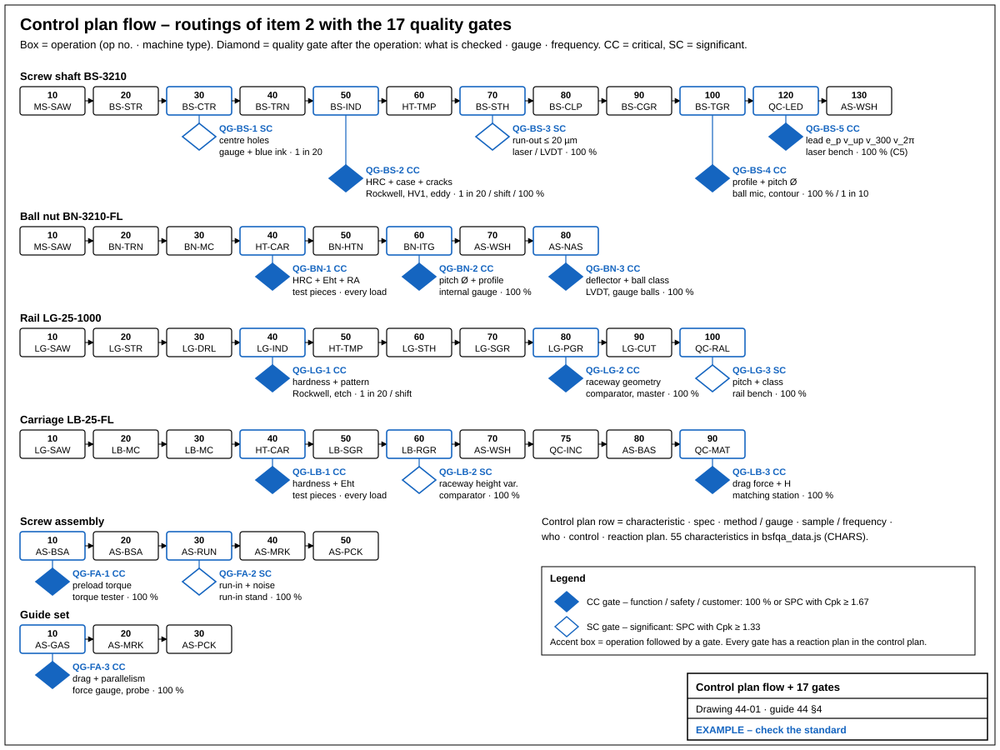

### 4.2 Characteristics per part

All values are examples of the control plan in `web/bsfqa_data.js` – check the standard and your customer.

**Screw shaft BS-3210-1000-C5 (18 characteristics)**

| Id | Op | Characteristic | Spec | Class | Method / gauge | Frequency | Reaction |
|---|---|---|---|---|---|---|---|
| BS-LEN | 30 | total length after facing | 1 004 ± 0.2 mm | – | length gauge + master bar | first + 1 in 20 | re-set stop, check last 20 |
| BS-CTR | 30 | centre holes 60° | contact ≥ 80 %, no damage | SC | centre-hole gauge, blue ink | first + 1 in 20 | re-centre, block lot |
| BS-OD | 40 | thread zone Ø before hardening | 32.4 ± 0.05 mm | – | micrometer 0.001 mm | first + 1 in 10 | tool offset |
| BS-HRC | 50 | surface hardness | 58 – 62 HRC | CC | Rockwell ISO 6508, 3 readings | first + 1 in 20 | stop induction, check coil + energy |
| BS-CHD | 50 | case depth at 550 HV | 2.0 – 3.0 mm | CC | cut-up, HV 1 traverse, ISO 18203 | 1 per shift + set-up | hold lot, adjust power / speed |
| BS-CRK | 50 | quench cracks | none | CC | eddy current | 100 % | scrap; 2 in a lot → stop |
| BS-RO | 70 | run-out after straightening | ≤ 20 µm TIR | SC | laser sensor of the press | 100 % | re-straighten max 2 × |
| BS-JD | 90 | journal Ø25 h5 | 0 / −9 µm | SC | in-process + air gauge | 100 % | re-master, wheel wear |
| BS-JRO | 120 | journal run-out to thread axis | ≤ 8 µm | SC | sensor 0.1 µm, screw held in the thread | 100 % | regrind journals |
| BS-PD | 100 | pitch Ø over balls | ± 3 µm | CC | ball-pin comparator | 100 % | re-dress wheel |
| BS-PRF | 100 | contact angle (gothic arch) | 45° ± 2°, f 0.53 ± 0.01 | SC | contour tester | 1 in 10 + after dressing | re-dress profile |
| BS-RA | 100 | raceway roughness | Ra ≤ 0.2 µm | – | stylus, ISO 21920 | 1 in 20 + wheel change | re-dress, coolant filter |
| BS-EP | 120 | lead E − T | ± 35 µm (C5, l_u 700) | CC | laser lead machine | 100 % (C7: 1 in 20) | downgrade C7 / regrind |
| BS-VU | 120 | lead v_up | ≤ 25 µm | CC | same | 100 % | check lead system |
| BS-V300 | 120 | lead v_300 | ≤ 18 µm | CC | same | 100 % | oil temperature, master screw |
| BS-V2PI | 120 | lead v_2π | ≤ 8 µm | SC | same (fine steps) | 100 % | work-head run-out, centres |
| BS-MAG | 130 | residual magnetism | ≤ 0.3 mT | – | Hall probe | 1 per lot (3 parts) | demagnetise again |
| BS-CLN | 130 | cleanliness + rust protection | ≤ 2.0 mg, no particle > 400 µm | – | visual 100 %, gravimetric | weekly | clean washer, filters |

**Ball nut BN-3210-FL (10 characteristics)**

| Id | Op | Characteristic | Spec | Class | Method / gauge | Frequency | Reaction |
|---|---|---|---|---|---|---|---|
| BN-HRC | 40 | surface hardness (test piece) | 58 – 62 HRC | CC | Rockwell | every load | hold load |
| BN-CHD | 40 | case depth CHD 550 HV | 0.8 – 1.2 mm | CC | HV 1 traverse | every load | check C-potential + time |
| BN-RA | 40 | retained austenite | ≤ 15 % | – | XRD / microscope | weekly | sub-zero, quench |
| BN-OD | 50 | centring OD Ø50 g6 | −9 / −25 µm | SC | air gauge | 1 in 10 | CBN tool offset |
| BN-FRO | 50 | flange face run-out | ≤ 5 µm | SC | dial gauge on arbor | 1 in 10 | check chuck |
| BN-PD | 60 | internal pitch Ø | ± 3 µm | CC | internal ball comparator | 100 % | re-dress, quill |
| BN-PRF | 60 | internal contact angle | 45° ± 2° | SC | replica + contour | 1 in 10 | re-dress |
| BN-TAP | 60 | taper of pitch Ø | ≤ 2 µm | – | comparator both ends | 1 in 10 | taper correction |
| BN-DEF | 80 | deflector step | ≤ 10 µm | SC | LVDT on master screw | 100 % | re-press / replace |
| BN-CLS | 80 | ball size class | play + 2 – 6 µm | CC | axial play fixture + gauge balls | 100 % | re-measure, rework |

**Rail LG-25-1000 (8 characteristics)**

| Id | Op | Characteristic | Spec | Class | Method / gauge | Frequency | Reaction |
|---|---|---|---|---|---|---|---|
| LG-HRC | 40 | raceway hardness | 58 – 62 HRC | CC | Rockwell | 1 in 20 | power / feed, coil position |
| LG-CHD | 40 | hardened pattern | 1.5 – 2.5 mm, base soft | SC | macro etch + HV | 1 per shift | coil position |
| LG-STR | 60 | straightness after hardening | ≤ 0.10 mm / m | – | press sensor | 100 % | re-straighten |
| LG-H | 80 | height over gauge balls | ± 15 µm to master | SC | comparator | 100 % | re-dress form wheels |
| LG-PAR | 80 | running parallelism | class H ≤ 16 µm / 1 000 mm | CC | rail bench QC-RAL | 100 % | regrind / downgrade |
| LG-PITCH | 100 | hole pitch cumulative | 60 ± 0.2 mm | – | camera / scale | 100 % | scrap / re-drill rule |
| LG-RA | 80 | raceway roughness | Ra ≤ 0.4 µm | – | stylus | 1 per shift | re-dress |
| LG-LEN | 90 | length + E | 1 000 ± 0.5, E 20 ± 0.5 | – | length bench | first + 1 in 20 | re-set stop |

**Carriage LB-25-FL (7 characteristics)**

| Id | Op | Characteristic | Spec | Class | Method / gauge | Frequency | Reaction |
|---|---|---|---|---|---|---|---|
| LB-HRC | 40 | raceway hardness (test piece) | 58 – 62 HRC | CC | Rockwell | every load | hold load |
| LB-CHD | 40 | case depth | 0.8 – 1.0 mm | CC | HV 1 traverse | every load | hold load |
| LB-HV | 60 | raceway height variation | ≤ 15 µm | SC | comparator vs master rail | 100 % | re-dress, clamping |
| LB-H | 90 | assembly height H | 36 ± 0.04 mm | CC | height gauge + gauge blocks | 100 % | re-ball, regrind |
| LB-W2 | 90 | width W2 | ± 0.04 mm | SC | side probe | 100 % | regrind reference side |
| LB-DRAG | 90 | drag force (Z1, no seals) | 10 – 22 N | CC | force sensor at 60 mm/s | 100 % | next ball class |
| LB-RA | 60 | raceway roughness | Ra ≤ 0.2 µm | – | replica / stylus | 1 per shift | re-dress |

**Ball screw assembly FABS (7) and guide set FALG (5)**

| Id | Op | Characteristic | Spec | Class | Method / gauge | Frequency | Reaction |
|---|---|---|---|---|---|---|---|
| FA-TP | 10 | preload torque mean | 0.29 N·m ± 40 % | CC | torque tester AS-BSA | 100 % | re-ball |
| FA-TPV | 10 | torque fluctuation | all values in Tp ± 40 % | CC | same curve | 100 % | open nut |
| FA-AX | 10 | axial rigidity / lost motion | K ≥ 540 N/µm, LM ≤ 2 µm | SC | rigidity fixture | 1 per lot | check preload class |
| FA-NOISE | 30 | run-in noise at 500 min⁻¹ | ≤ 65 dB(A) | SC | run-in stand + microphone | 100 % | open nut |
| FA-RUN | 30 | run-in torque peaks | ≤ Tp + 40 % | SC | run-in stand | 100 % | open nut |
| FA-MRK | 40 | data-matrix marking | grade ≥ C (ISO/IEC 29158) | – | code verifier | 100 % | re-mark |
| FA-PACK | 50 | rust protection + documents | checklist | – | checklist | 100 % | re-pack |
| FG-DRAG | 10 | drag force per block (with seals) | 15 – 35 N | SC | force sensor | 100 % | exchange block |
| FG-PAR | 10 | running parallelism of the set | ≤ 16 µm | CC | probe | 100 % | exchange rail |
| FG-PAIRH | 10 | height variation of the 2 blocks | ≤ 15 µm | CC | height gauge | 100 % | exchange block |
| FG-MRK | 20 | datum marks + serial | visible | – | visual | 100 % | re-mark |
| FG-PACK | 30 | rust protection + packing | checklist | – | checklist | 100 % | re-pack |

### 4.3 How to read sample size and frequency

* **100 %** – every part. Used for CC characteristics that the machine measures automatically (lead, pitch Ø,
  run-out, preload). Cost is cycle time, not inspector time.
* **first + 1 in n** – first part after set-up, then every n-th part. The lot is released only after the first part.
* **per load / per shift** – destructive tests (cut-up for case depth) and furnace loads.
* **weekly / per lot** – slow-changing characteristics (cleanliness, residual magnetism, retained austenite).

Rule of thumb for the sampling interval of a stable process: so often that a drift is found before it can make
scrap. Example: wheel wear changes the pitch Ø by about 0.2 µm per screw (example) and the tolerance is ± 3 µm with
a process spread of ± 1.5 µm → after about (3 − 1.5) / 0.2 ≈ 7 screws the process could touch the limit → measure
100 % or at least 1 in 5 – we chose 100 %.

### 4.4 The 17 quality gates

| Gate | Part | After op | What | Spec | How | Frequency | Reaction |
|---|---|---|---|---|---|---|---|
| QG-BS-1 | BS | 30 | centre holes | concentric, undamaged, 60° | centre-hole gauge, blue ink | first + 1 in 20 | re-centre; block lot |
| QG-BS-2 | BS | 50 | hardness + case depth + cracks | 58 – 62 HRC, 550 HV at 2 – 3 mm, no cracks | Rockwell, HV 1 cut-up, eddy current | HRC 1 in 20, cut-up per shift, crack 100 % | stop induction, coil gap + energy monitor |
| QG-BS-3 | BS | 70 | run-out after straightening | ≤ 0.02 mm TIR | laser / LVDT | 100 % | re-straighten max 2 ×, else scrap |
| QG-BS-4 | BS | 100 | thread profile + pitch Ø | 45° ± 2°, pitch Ø ± 3 µm | ball-pin micrometer, contour tester | 100 % / 1 in 10 | re-dress |
| QG-BS-5 | BS | 120 | lead accuracy | C5: e_p ± 35, v_up 25, v_300 18, v_2π 8 µm | laser lead machine | C5 100 %, C7 1 in 20 | downgrade C7 or regrind |
| QG-BN-1 | BN | 40 | case hardening | 58 – 62 HRC, Eht 0.8 – 1.2, RA ≤ 15 % | test pieces, HV 1, microscope | every load | hold load |
| QG-BN-2 | BN | 60 | internal pitch Ø + profile + lead | ± 3 µm, 45°, taper ≤ 2 µm | ball gauge, contour, master screw | 100 % / 1 in 10 | re-dress, quill, taper |
| QG-BN-3 | BN | 80 | deflector fit + ball class | step ≤ 0.01 mm, class for 3 % Ca | LVDT + gauge balls | 100 % | re-press deflector |
| QG-LG-1 | LG | 40 | raceway hardness + pattern | 58 – 62 HRC, 1.5 – 2.5 mm | Rockwell, macro etch | 1 in 20, cut-up per shift | power / feed, coil |
| QG-LG-2 | LG | 80 | raceway geometry | H ± class, parallelism | comparator + gauge balls, contour | 100 % | re-dress form wheels |
| QG-LG-3 | LG | 100 | hole pitch + straightness + class | 60 ± 0.2 cumulative, class H | rail bench | 100 % | downgrade N / scrap |
| QG-LB-1 | LB | 40 | case hardening | 58 – 62 HRC, Eht 0.8 – 1.0 | test pieces | every load | hold load |
| QG-LB-2 | LB | 60 | raceway geometry | height variation ≤ 15 µm | comparator vs master rail | 100 % | re-dress, clamping |
| QG-LB-3 | LB | 90 | preload + height class | Z1 drag window, H ± 0.04 | matching station | 100 % | re-ball |
| QG-FA-1 | FABS | 10 | preload torque | Tp 0.29 N·m ± 40 % | torque tester | 100 % | re-ball |
| QG-FA-2 | FABS | 30 | run-in torque + noise | no peaks, ≤ 65 dB(A) at 500 min⁻¹ | run-in stand | 100 % | open nut |
| QG-FA-3 | FALG | 10 | guide set | drag force, class H, ΔH ≤ 15 µm | force gauge + probe | 100 % | exchange block |

### 4.5 Reaction plan rules

A reaction plan must answer 4 questions: **stop?**, **what about the parts already made?**, **who decides?**,
**how do we restart?** The plant rules (example):

| Situation | Reaction |
|---|---|
| one CC value NOK | stop the machine, tag + block the part, check the last n parts back to the last OK check (n = sampling interval), call the setter + QA |
| SPC rule 1 (point outside a control limit) but in tolerance | do not stop the machine yet: find the special cause within 15 min, record it in the chart; if not found → measure 100 % until found |
| SPC rules 2 – 4 | adjust (offset, dressing) and record the reason; no blocking |
| gauge found out of calibration | block the gauge; re-check all parts measured since the last good calibration (traceability, §18) |
| destructive test (cut-up) NOK | hold the whole lot / furnace load, test 2 more pieces, then decide (scrap / re-temper / sort) |
| 3 NCRs of the same kind in a month | 8D with root cause proof (§17) |

Restart only after the first part after the correction is OK and the reason is written in the MES (item 6).

---

## 5. Characteristics of screw, nut, rail and carriage – why each one matters

A characteristic is in the control plan only if a wrong value harms the function, the next operation or the customer.
This chapter connects **function → characteristic → failure if wrong**, with numbers.

### 5.1 Screw shaft

| Function | Characteristic | Failure if wrong (example numbers) |
|---|---|---|
| positions the axis | lead (E − T, v_up, v_300, v_2π) | every µm of lead error is a µm of positioning error of the machine (semi-closed loop) |
| carries the ball load | hardness 58 – 62 HRC, case depth 2 – 3 mm | 1 HRC less ≈ 10 % less load rating (rule of thumb: fH = (HRC/58)^3.6 for < 58 HRC → 56 HRC: fH = 0.88); too thin a case → sub-surface fatigue |
| sets the preload with the nut | pitch Ø over balls ± 3 µm | see §5.2 – 1 µm changes the preload by ≈ 40 % |
| rotates true | run-out, journal run-out to the thread axis | bending moment on the nut, wobble in v_2π, uneven torque |
| fits the bearings | journal Ø25 h5 (0 / −9 µm) | too big → bearing preload too high, heat; too small → fretting |
| low friction, long life | raceway Ra ≤ 0.2 µm, contact angle 45° | rough → heat, early wear; wrong angle → wrong rigidity and load rating |

### 5.2 Worked example – 1 µm of pitch Ø changes the preload

The nut is preloaded by ball oversize: the balls are about 4 µm bigger than the space between the screw and nut grooves
(design interference δ0 = 4 µm, example). The preload force of a Hertzian contact grows with δ^1.5:

  **F ∝ δ^1.5** → F1 / F0 = (δ1 / δ0)^1.5

If the screw pitch Ø is 1 µm too big, the space is about 1 µm smaller and the interference becomes 5 µm:

  F1 / F0 = (5 / 4)^1.5 = 1.25^1.5 = **1.40** → preload + 40 %

The preload torque grows in the same ratio: 0.292 N·m → ≈ 0.41 N·m – just above the + 40 % band of the C5 torque test
(0.409 N·m, §9). That is why the pitch Ø tolerance is ± 3 µm along the whole thread and why the nut gets its ball class
after measuring (§10.5).

### 5.3 Worked example – journal h5

The fixed bearing pair (25 × 62 × 15) needs a light interference or a transition fit. Journal Ø25 h5 = 25.000 / 24.991 mm.
Bearing bore tolerance (P4 class, example) 0 / −5 µm → fit between −5 µm (5 µm interference) and +9 µm (9 µm
clearance). A journal at 25.004 (4 µm over, NOK) gives up to 9 µm interference → the inner ring grows ≈ 7 µm, the
bearing preload rises and the bearing runs hot. A journal at 24.985 (6 µm under) gives up to 15 µm clearance → the
ring creeps → fretting. Both errors are invisible after assembly – so 100 % in-process gauging.

### 5.4 Worked example – run-out and its effect

The journal run-out to the thread axis is 8 µm TIR (= 4 µm eccentricity). Over the bearing distance of 900 mm and a
nut at 450 mm, the thread axis is tilted against the bearing axis by about 4 µm / 450 mm ≈ 9 µrad. The nut sees a small
radial wobble once per revolution; part of it shows up in the lead curve as a periodic error (v_2π) and as a torque
ripple. A shaft bent by 20 µm in the middle (straightening limit) gives a radial force on the nut of roughly
F = k_r · 10 µm (k_r = radial stiffness of the nut, ≈ 50 – 150 N/µm, example) ≈ 0.5 – 1.5 kN – that is why the
straightening limit is tight and why the screw is checked again on the lead machine.

### 5.5 Nut

| Function | Characteristic | Failure if wrong |
|---|---|---|
| carries the load | case hardness 58 – 62 HRC, CHD 0.8 – 1.2 mm, retained austenite ≤ 15 % | soft → indentation; too much retained austenite → it transforms in use → dimension change → preload loss |
| sets the preload | internal pitch Ø ± 3 µm, taper ≤ 2 µm | same as §5.2; taper → one end of the nut carries more |
| mounts to the table | OD g6, flange face run-out ≤ 5 µm | tilted nut → edge load on the balls, short life |
| recirculates the balls | deflector step ≤ 10 µm | balls hit the step → noise, torque peaks, deflector break |
| preload class | ball size class | wrong class → torque out of band |

### 5.6 Rail and carriage

| Function | Characteristic | Failure if wrong |
|---|---|---|
| straight, smooth motion | running parallelism (class H ≤ 16 µm / 1 000 mm) | the table pitches / yaws; machined parts are not flat |
| interchangeable blocks | height H ± 0.04, W2 ± 0.04, pair variation ΔH ≤ 15 µm | one block carries more load (the higher one), uneven drag, short life |
| load capacity | raceway hardness, case depth | flaking under the most loaded block |
| preload Z1 | drag force 10 – 22 N | too low → play, vibration; too high → heat, wear |
| mounting | hole pitch 60 ± 0.2 cumulative, length, E | rail does not fit the customer's bed holes |

Worked example – pair height variation: two blocks on one rail differ by ΔH = 15 µm. With a radial rigidity of
520 N/µm per block (Z1), a stiff table forces both to the same height: the higher block gets an extra load of about
15 / 2 µm · 520 N/µm ≈ 3.9 kN and the lower one 3.9 kN less. With C = 34.9 kN the life of the loaded block drops by
(P / (P + 3.9 kN))³ – at P = 5 kN: (5 / 8.9)³ = 0.18 → only 18 % of the planned life. Class H limits ΔH to 15 µm, class P
to 7 µm.

---

## 6. GD&T for ball screws and rails

### 6.1 The symbols we use (ISO 1101)

| Symbol (name) | Tolerance zone | Where on our parts |
|---|---|---|
| circular run-out (single arrow) | difference of the readings in one turn at one cross-section, measured against a datum axis | journals to the thread axis, thread OD, nut flange face |
| total run-out (double arrow) | all readings over the whole surface during several turns and an axial movement | long journals, thread OD (optional) |
| straightness | between two parallel lines (in a section) or a cylinder (axis) | rail after straightening, screw axis |
| parallelism | between two planes / lines parallel to a datum | rail running parallelism (top B to bottom A, side D to datum C) |
| flatness | between two parallel planes | rail base, carriage mounting face |
| perpendicularity | between two planes / lines perpendicular to a datum | journal shoulder to axis, nut flange to axis |
| coaxiality | a cylinder around the datum axis | journals to each other |
| datum (letter in a box with a triangle) | the reference feature | A, B = journals or thread axis; rail: A bottom, B top, C datum side, D other side |

A run-out tolerance always needs a **datum axis**. For a ball screw the natural datum is the **thread axis**, because the
balls run there – the journals must run true to it. On the drawing: "datum A = axis of the thread established by
2 balls in 2 V-blocks at 1/4 and 3/4 of the thread length" (example definition).

### 6.2 How the screw drawing calls the tolerances (example)

| Callout | Value C5 (example) | Measured |
|---|---|---|
| circular run-out of bearing journal Ø25 h5 to A | 8 µm | QC-LED run-out station (§10) |
| circular run-out of motor journal Ø20 h6 to A | 10 µm | same |
| perpendicularity of journal shoulder to A | 5 µm | dial gauge on the shoulder, screw rotating |
| radial run-out of the thread OD over the length (straightness of the axis), per 1 000 mm | 30 µm | between centres, 5 stations |
| coaxiality of both journals | Ø 10 µm | roundness tester / CMM |
| nut: flange face perpendicular / run-out to the nut axis | 5 µm | arbor + dial gauge |
| nut: OD run-out to the nut axis | 8 µm | arbor + dial gauge |

### 6.3 Run-out tolerances of ISO 3408-3 and JIS B 1192-3 – the idea

The ball-screw standards define a set of **geometrical tolerances t1 … t7** (and more for flanged nuts). The idea
(numbering and values differ between ISO 3408-3 and JIS B 1192-3 – **mark check** in the current edition):

| Group (our label) | What is toleranced | Depends on |
|---|---|---|
| t1 | radial run-out of the screw OD over the length l_1, to the support axis | grade, length / diameter ratio |
| t2 – t3 | radial run-out of the bearing journals to the thread axis (near + far end) | grade, journal length |
| t4 | perpendicularity (axial run-out) of the journal shoulder | grade |
| t5 | radial run-out of the nut OD or flange centring to the screw axis | grade, nut size |
| t6 | perpendicularity of the nut flange face | grade, flange diameter |
| t7 | parallelism of a flat nut mounting surface | grade |

Example values for Ø32, C5 (catalogue class, check): journal run-out 8 µm, shoulder 5 µm, flange face 10 µm,
nut OD 10 µm. The values grow by about one step from C3 → C5 → C7.

### 6.4 Rail drawing (example)

| Callout | Value class H (example) |
|---|---|
| parallelism of top B to bottom A over the length | per class table (§11.1) – 16 µm at 1 000 mm |
| parallelism of datum side D to datum C | same |
| height H of the assembly (rail + block) | 36 ± 0.04 mm |
| straightness of the free rail | 0.1 mm / m (it is pressed straight on the bed) |
| flatness of the base | 10 µm / 500 mm (example) |
| hole pitch, cumulative | ± 0.2 mm over the length |

Note: the running parallelism is a **functional** tolerance – the block runs along the rail and its height changes.
It is not the straightness of the rail itself; a slightly bent free rail is pulled straight by the bolts.

---

## 7. Ball screw lead measurement – the laser bench

### 7.1 What is measured

The **lead** is the axial travel of the nut for one revolution (10 mm nominal). The lead measuring machine compares the
**actual travel** (laser) with the **nominal travel** (angle × lead / 2π) at many points along the useful travel l_u:

  **e(l) = actual travel − nominal travel = l_laser − θ · Ph / (2π)**

e(l) is the actual travel deviation curve (µm over mm). Everything in §8 is computed from it.

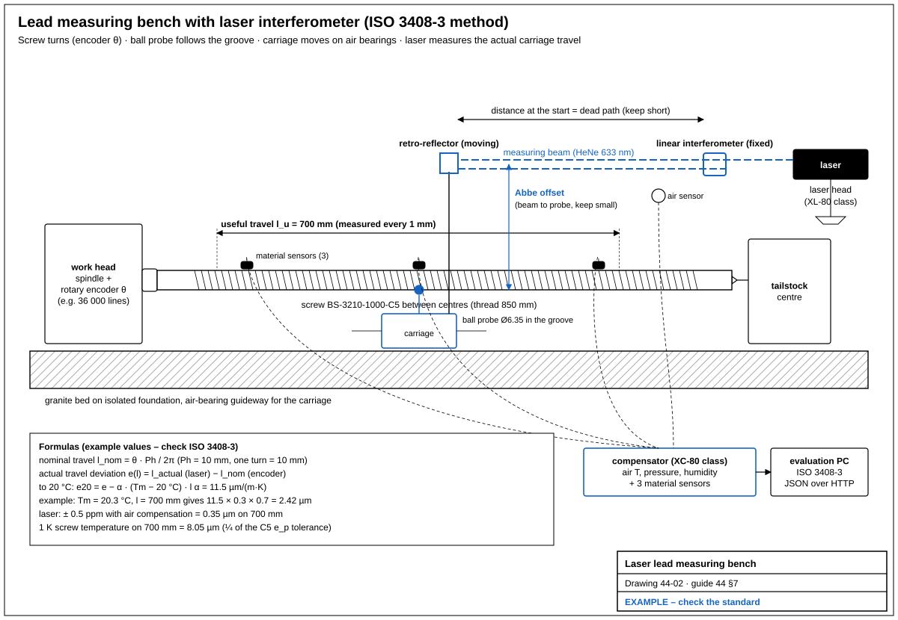

### 7.2 Parts of the bench

| Part | Function | Example data |
|---|---|---|
| granite bed + air-bearing guideway | straight, stiff, temperature-stable base | 3 000 × 600 mm, straightness 2 µm / m |
| work head with spindle + rotary encoder | turns the screw, measures θ | encoder 36 000 lines + interpolation → 0.1″ resolution |
| tailstock with centre | holds the screw between centres | dead centre, adjustable |
| carriage + ball probe | a ball (Ø6.35, like the nut balls) sits in the groove; the carriage follows the screw axially with almost no force | air bearings, probe force ≈ 1 N |
| laser head (Renishaw XL-80 class) | stabilised HeNe laser | λ 632.990 577 nm in vacuum, ± 0.05 ppm frequency stability |
| linear interferometer (fixed) | splits and recombines the beam | mounted on the bed near the start |
| retro-reflector (moving) | on the carriage, returns the beam | in line with the probe (small Abbe offset) |
| compensator (XC-80 class) | air temperature, pressure, humidity → refractive index; 1 – 3 material sensors | air ± 0.2 °C, pressure ± 1 hPa, rH ± 6 %, material ± 0.1 °C |
| software | ISO 3408-3 evaluation, curve export, results by Modbus TCP / HTTP | §19 |

### 7.3 Interferometer principle

The laser beam is split in the interferometer. One part goes to a fixed reference reflector, the other to the moving
retro-reflector and back. When both parts meet again they interfere: bright and dark **fringes**. When the reflector
moves by λ/2, the light path changes by λ, and one full fringe passes the detector.

  **displacement = N · λ_air / 2**, λ_air = λ_vac / n_air

| Quantity | Value (example) |
|---|---|
| λ_vac | 632.991 nm |
| n_air at 20 °C, 1 013.25 hPa, 50 % rH | ≈ 1.000 271 |
| λ_air | 632.991 / 1.000 271 = 632.819 nm |
| one fringe = λ_air / 2 | 316.4 nm |
| 700 mm travel | N = 700 000 000 nm / 316.41 nm ≈ 2 212 000 fringes |
| resolution with electronic interpolation | 1 nm |

The detector counts fringes in both directions (two signals 90° apart, quadrature), so the direction is known.

### 7.4 Environment compensation (Edlén equation)

The refractive index of air depends on temperature, pressure and humidity (Edlén equation, modified by Birch and Downs).
Rules of thumb near 20 °C / 1 013 hPa:

| Change | Effect on the laser reading |
|---|---|
| air temperature + 1 K | −0.93 ppm (the laser reads too short if not compensated) |
| air pressure + 1 hPa | +0.27 ppm |
| relative humidity + 10 % | −0.09 ppm |

Example: weather change of 20 hPa without compensation → 20 · 0.27 = 5.4 ppm → 3.8 µm on 700 mm. With the compensator
the residual error is ± 0.5 ppm → ± 0.35 µm on 700 mm (§13 uncertainty budget).

### 7.5 Material temperature compensation

The bigger effect is the **screw itself**. Steel grows with temperature:

  **ΔL = α · L · (T − 20 °C)**, α = 11.5 µm/(m·K) (example for the hardened screw steel)

| Screw temperature | Error over 700 mm |
|---|---|
| 20.1 °C | 0.81 µm |
| 20.5 °C | 4.03 µm |
| 21.0 °C | **8.05 µm** |
| 22.0 °C | 16.1 µm |

One kelvin is about a quarter of the C5 tolerance e_p = ± 35 µm. The software corrects the reading to 20 °C (ISO 1
reference temperature):

  **e_20(l) = e_measured(l) − α · (T_sensor − 20) · l**

The material sensors (1 – 3, magnetic, on the screw) give T_sensor. If the sensor reads 0.1 K wrong, 0.8 µm of error stays
(700 mm). If α is wrong by 1 µm/(m·K) and the screw is at 20.5 °C, another 0.35 µm stays. The best cure is still a
screw at 20 °C: room 20 ± 0.5 °C and soak time.

### 7.6 Soak time

A screw that comes from the grinding room (20 ± 1 °C) or from washing needs time to reach the room temperature. Simple
estimate (Newton cooling, time constant τ):

  **ΔT(t) = ΔT0 · e^(−t/τ)**, τ ≈ ρ · c · d / (4 · h) for a long cylinder

For Ø32 steel (ρ = 7 850 kg/m³, c = 460 J/(kg·K), h ≈ 8 W/(m²·K) in still air): τ = 7 850 · 460 · 0.032 / (4 · 8) ≈ 3 610 s
≈ 1 h. From ΔT0 = 2 K to 0.1 K: t = τ · ln(20) = 3 h. With margin: **soak ≥ 4 h** on a rack in the measuring room
(our rule, example). Holding the screw with bare hands warms it locally – use gloves.

### 7.7 Dead path, Abbe and cosine errors

| Error | Cause | Formula | Example |
|---|---|---|---|
| dead path | beam length between interferometer and reflector at the zero point is not compensated for air changes during the run | e = L_dead · Δn | 100 mm · 0.2 K · 0.93 ppm/K = 0.02 µm |
| Abbe error | the probe is offset from the beam by a; the carriage pitches by angle φ | e = a · φ | 20 mm · 9.7 µrad (2″) = 0.19 µm |
| cosine error | beam not parallel to the motion, angle θ | e = L · (1 − cos θ) ≈ L · θ² / 2 | 0.2 mm misalignment over 700 mm: θ = 0.286 mrad → 700 · (2.86e-4)² / 2 = 2.9e-5 mm = 0.03 µm |

Rules: put the retro-reflector in line with the probe (small a), align the beam to ≤ 0.2 mm over the travel, start
with the reflector close to the interferometer.

### 7.8 Procedure (example work instruction)

1. Screw soaked ≥ 4 h, room 20 ± 0.5 °C (logger OK), gloves.
2. Clean the centres and the centre holes, mount the screw, clamp the driver.
3. Place the 3 material sensors (1/4, 1/2, 3/4 of the thread), check the air sensor near the beam.
4. Align the laser (beam on target over the full travel), set the dead path short, zero the reading.
5. Put the ball probe into the groove at the start of l_u.
6. Run: the screw turns slowly (e.g. 10 min⁻¹ → 100 mm/min); data every 1 mm (v_2π needs ≥ 10 points per lead;
   some benches sample continuously every 0.1 – 0.5 mm).
7. Run back (reverse) – optional; compare forward and reverse for probe hysteresis.
8. Software: temperature correction to 20 °C, evaluation per ISO 3408-3 (§8), grade, curve file.
9. Result → MES (Modbus TCP registers via the gateway or HTTP JSON, §19). Label the screw with the grade.
10. Every day: measure the master screw and compare with its calibrated curve (≤ 1 µm difference, example).

---

## 8. ISO 3408-3 lead accuracy in depth

### 8.1 Definitions

| Symbol | Name (ISO 3408 / JIS) | Meaning |
|---|---|---|
| l_u | useful travel | the length of the thread where the nut may run (here 850 − 100 nut − 2 × 25 run-out = 700 mm) |
| e(l) | actual travel deviation | measured curve, actual − nominal travel (µm) |
| T (c) | travel compensation / target travel deviation | a value the customer **wants** over l_u, e.g. −20 µm per 700 mm to pre-compensate the growth of a warm screw in his machine. T = 0 for most screws |
| mean travel line | – | least-squares straight line through e(l) over l_u |
| E (e_sa) | actual mean travel deviation | rise of the mean travel line over l_u |
| e_p | tolerance on the mean travel | |E − T| ≤ e_p |
| v_up (V_u) | permissible travel variation over l_u | width of the band parallel to the mean travel line that contains the whole curve |
| v_300p | travel variation in any 300 mm | largest band width in any 300 mm window |
| v_2πp | travel variation in one revolution | largest band width in any 2π window (= one lead, 10 mm) |

(Index p = permissible value of the table, index a = actual measured value – v_300a ≤ v_300p, etc.)

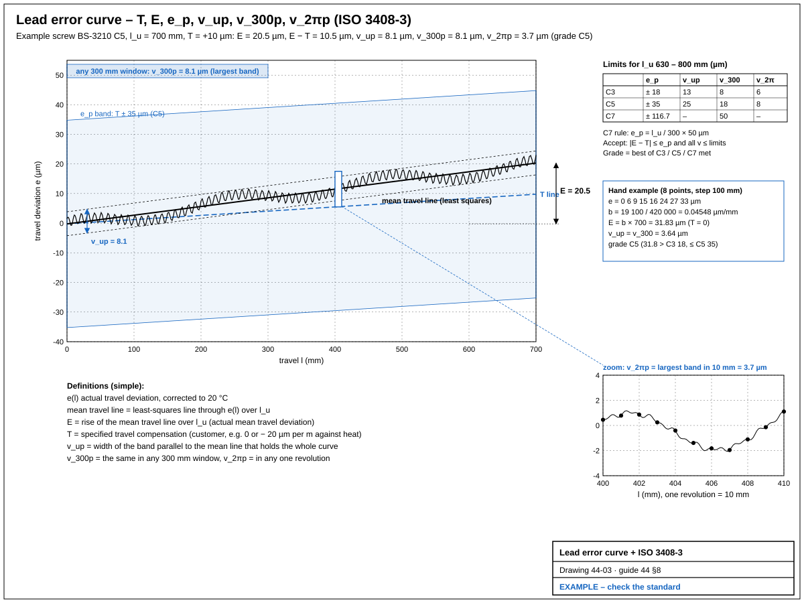

### 8.2 The evaluation algorithm

Given n points (x_i in mm, e_i in µm), already corrected to 20 °C:

1. Means: x̄ = Σx_i / n, ē = Σe_i / n.
2. Slope: **b = Σ(x_i − x̄)(e_i − ē) / Σ(x_i − x̄)²** (µm per mm); intercept a = ē − b · x̄.
3. **E = b · l_u** (µm).
4. Check **|E − T| ≤ e_p**.
5. Residuals r_i = e_i − (a + b · x_i).
6. **v_u = max r − min r** over l_u.
7. **v_300 = max over all windows [x, x + 300 mm] of (max r − min r)** inside the window (the residuals stay relative to
   the mean line over l_u – the line is not re-fitted per window).
8. **v_2π** = the same with a window of one lead (10 mm).
9. Grade = the best grade whose 4 limits are all met.

The page (`leadEval()` in `web/bsfqa_calc.js`) and the QA service (`lead_eval()` in `twin/bsf_qa.py`) implement this
independently; the self-check compares both on the 8-point example and on the live 701-point curve.

### 8.3 Worked example – 8 points (hand calculation)

Example data (coarse, only for learning): x = 0, 100, … 700 mm, e = 0, 6, 9, 15, 16, 24, 27, 33 µm, T = 0.

x̄ = 350 mm, ē = 130 / 8 = 16.25 µm.

| x_i | e_i | x_i − x̄ | e_i − ē | (x − x̄)² | (x − x̄)(e − ē) |
|---|---|---|---|---|---|
| 0 | 0 | −350 | −16.25 | 122 500 | 5 687.5 |
| 100 | 6 | −250 | −10.25 | 62 500 | 2 562.5 |
| 200 | 9 | −150 | −7.25 | 22 500 | 1 087.5 |
| 300 | 15 | −50 | −1.25 | 2 500 | 62.5 |
| 400 | 16 | 50 | −0.25 | 2 500 | −12.5 |
| 500 | 24 | 150 | 7.75 | 22 500 | 1 162.5 |
| 600 | 27 | 250 | 10.75 | 62 500 | 2 687.5 |
| 700 | 33 | 350 | 16.75 | 122 500 | 5 862.5 |
| **Σ** | 130 | 0 | 0 | **420 000** | **19 100** |

b = 19 100 / 420 000 = **0.045 476 µm/mm** (= 45.5 µm/m); a = 16.25 − 0.045 476 · 350 = 0.333 µm.

**E = b · l_u = 0.045 476 · 700 = 31.83 µm.**

Residuals r = e − (a + b·x):

| x | line a + b·x | r |
|---|---|---|
| 0 | 0.333 | −0.333 |
| 100 | 4.881 | 1.119 |
| 200 | 9.429 | −0.429 |
| 300 | 13.976 | 1.024 |
| 400 | 18.524 | −2.524 |
| 500 | 23.071 | 0.929 |
| 600 | 27.619 | −0.619 |
| 700 | 32.167 | 0.833 |

v_u = 1.119 − (−2.524) = **3.643 µm**.

300 mm windows (4 points each): 0 – 300 contains −0.333, 1.119, −0.429, 1.024 → 1.119 − (−0.429) = 1.548 µm; 100 – 400: 1.119 − (−2.524) = 3.643; 200 – 500: 1.024 − (−2.524) = 3.548;
300 – 600: 3.548; 400 – 700: 0.929 − (−2.524) = 3.452. **v_300 = 3.643 µm.** v_2π cannot be judged with 100 mm steps
(each 10 mm window holds only one point → 0).

Decision for l_u = 700 mm (table row "up to 800 mm"):

| Value | Measured | C3 | C5 |
|---|---|---|---|
| E − T | 31.83 | ± 18 → **NOK** | ± 35 → OK |
| v_u | 3.64 | 13 → OK | 25 → OK |
| v_300 | 3.64 | 8 → OK | 18 → OK |

→ The screw is **C5**, not C3, only because of the mean travel. A customer who orders T = +30 µm would get
E − T = 1.83 µm → C3 for this criterion. This shows why T must be agreed **before** grinding: the grinder compensates
the lead to hit T.

### 8.4 Worked example – v_2π on a test curve

Test curve: e(x) = 2 µm · cos(2π (x − 350) / 10), x = 0 … 700 mm every 1 mm (701 points). The curve is symmetric around
the middle → the least-squares slope is exactly 0 → E = 0. Every 10 mm window contains one maximum (+2) and one
minimum (−2) at integer positions → **v_2π = v_300 = v_u = 4.000 µm** (= 2 × amplitude). A sine wobble of amplitude A gives
v_2π ≈ 2A. The C5 limit 8 µm therefore allows a wobble amplitude of about 4 µm minus noise.

### 8.5 Tolerance table (example – check ISO 3408-3 / JIS B 1192-3)

e_p (±) and v_up in µm for the useful travel l_u "up to":

| l_u up to (mm) | 315 | 400 | 500 | 630 | 800 | 1 000 | 1 250 | 1 600 | 2 000 |
|---|---|---|---|---|---|---|---|---|---|
| e_p C1 | 6 | 7 | 8 | 9 | 10 | 11 | 13 | 15 | 18 |
| e_p C3 | 12 | 13 | 15 | 16 | 18 | 21 | 24 | 29 | 35 |
| e_p C5 | 23 | 25 | 27 | 30 | 35 | 40 | 46 | 54 | 65 |
| v_up C1 | 5 | 5 | 5 | 6 | 7 | 8 | 8 | 10 | 11 |
| v_up C3 | 8 | 10 | 10 | 12 | 13 | 15 | 16 | 18 | 21 |
| v_up C5 | 18 | 20 | 20 | 23 | 25 | 27 | 30 | 35 | 40 |

| Grade | C0 | C1 | C2 | C3 | C5 | C7 | C8 | C10 |
|---|---|---|---|---|---|---|---|---|
| v_300p (µm) | 3.5 | 5 | 6 | 8 | 18 | 50 | 100 | 210 |
| v_2πp (µm) | 3 | 4 | 4 | 6 | 8 | – | – | – |

**C7 (and coarser) rule:** only v_300 = 50 µm is specified; the mean travel tolerance follows from it (JIS style):
**e_p = (l_u / 300) · v_300** → for 700 mm: 700 / 300 · 50 = **116.7 µm**. v_up and v_2π are not checked. (ISO 3408-3
transport grades T use e_p = 2 · (l_u / 300) · v_300p – check which rule your customer uses.)

| Grade | Typical use |
|---|---|
| C0 – C1 | jig borers, measuring machines, ultra-precision |
| C3 | precision machine tools, grinding machines |
| C5 | CNC machining centres and lathes (often with pitch compensation or linear scales) – **our main grade** |
| C7 | rolled screws – handling, packaging, robots |
| C10 | simple transport |

### 8.6 What each error source does to the curve

| Error source | Shape in e(l) | Mainly affects |
|---|---|---|
| lead slightly too long / short (grinder compensation, mean temperature) | straight line (slope) | **E** (e_p) |
| temperature change of the screw **during** the grinding pass | bow (parabola) | E and **v_up**, v_300 |
| work-head run-out, centre-hole error, thread eccentricity | sine with period = lead | **v_2π** |
| master screw / lead-system error of the grinder, straightness | long waves (100 – 400 mm) | **v_300**, v_up |
| wheel wear along the screw | slow drift | E, v_up |
| measuring noise, dirt in the groove | random points | v_2π, v_300 (spikes) |
| wrong material temperature at the bench | straight line | E (false accept / reject) |

The live simulation of the page (`leadSim()`) builds the curve from exactly these parts (example defaults):
systematic error 4 ± 5 µm over l_u, 2π wobble 1.6 µm, long wave 2.0 µm with 230 mm period, noise 0.25 µm, grinding at
20.2 °C with a rise of 0.8 K, bench at 20.3 °C with + 0.1 K drift.

### 8.7 Temperature at the bench – worked numbers

The true screw has E = 10 µm at 20 °C. It is measured at 21.0 °C:

* raw laser reading: E_raw = 10 + α · ΔT · l_u = 10 + 11.5 · 1.0 · 0.7 = **18.05 µm**
* after compensation with a correct sensor: E = 18.05 − 8.05 = **10.00 µm**
* sensor reads 0.1 K too low (20.9 °C): E = 18.05 − 11.5 · 0.9 · 0.7 = 10.81 µm (0.8 µm error)

Without compensation a C3 screw with E = 12 µm and T = 0 (limit 18 µm) measured at 21 °C reads 20.05 µm → **false
reject**. In the other direction a bad screw can be accepted – for example a screw with E = −40 µm (reject) measured at
21 °C reads −32 µm (C5 OK).

### 8.8 Grinding thermal growth (link to item 2)

During thread grinding the screw is warmer than 20 °C – grinding power goes into the part even with oil at
20 ± 0.5 °C. A warm screw is longer; the grinder cuts the nominal lead into the long screw; after cooling the lead is
**too short**:

  **e_grind(x) = −α · ΔT · x**

Item 2 / 3 deliver the screw temperature of the thread grinders by Modbus (`tgr.screwTemp_C`, about 20.2 °C):

  E_grind = −11.5 · 0.2 · 0.7 = **−1.61 µm** (a slope – it moves E)

If the temperature **rises** during the finish pass from ΔT = 0 at the start to ΔT_end = 0.8 K at the end, the error grows
with x², a bow:

  e(x) = −α · ΔT_end · x² / (2 · l_u) → end value −11.5 · 0.8 · 0.7 / 2 = **−3.22 µm**

The least-squares line takes most of a parabola into E (for y = x² on [0, 1] the best line is y = x − 1/6). What stays as a
band is 1/4 of the end value: v_u (bow) ≈ 0.25 · 3.22 = **0.80 µm**. At 3 K rise: end value −12.1 µm, band ≈ 3 µm –
noticeable for C3 (v_up 13 µm, v_300 8 µm).

The grinder therefore compensates the lead: `tgr.leadComp_um_m` ≈ −11.5 µm/m in item 2 = the agreed T (here 0) plus the
expected growth of the screw in grinding, learned from the lead curves (closed loop: lead bench → MES → grinder recipe).
The SPC of E − T (§14) shows when this compensation drifts.

### 8.9 Downgrade and rework rules (example)

| Result | Decision |
|---|---|
| all C5 limits met | accept as C5 (or better: if C3 met, the customer still gets C5 unless agreed) |
| only E − T out (v values OK) | regrind with corrected lead compensation (one more finish pass, removes 5 – 10 µm stock) – if the pitch-Ø stock allows; else C7 |
| v_300 or v_up out | check grinder (oil temperature, master screw); regrind only if the cause is known; else C7 |
| v_2π out | check work-head run-out / centres; regrind journals + thread |
| C7 limits not met | scrap (or C10 if a C10 order exists) |

Every downgrade is an NCR with disposition "use as C7" (§17) and a new label.

---

## 9. Preload torque, rigidity and lost motion

### 9.1 Why we test the preload torque

The preload of the nut (P1 = 3 % of Ca, by ball oversize) cannot be measured directly after assembly. But it makes
friction: a preloaded nut needs a small torque to turn even without load – the **dynamic preload torque Tp**. Tp is
measured 100 % (gate QG-FA-1) and tells us: preload right? balls of the right class? deflectors smooth? pitch Ø even?

### 9.2 Reference torque – the catalogue formula

  **Tp = 0.05 / √(tan λ) · Fpr · Ph / (2π)**   (N·m; Fpr in N, Ph in m)

| Quantity | Value (example) |
|---|---|
| lead angle λ = atan(Ph / (π · dpw)) = atan(10 / (π · 33.0)) | 5.51° (tan λ = 0.0965) |
| 0.05 / √tan λ = 0.05 / 0.3106 | 0.161 |
| preload Fpr = 3 % · Ca = 0.03 · 38 000 N | 1 140 N |
| Fpr · Ph / 2π = 1 140 · 0.010 / 6.283 | 1.814 N·m |
| **Tp** = 0.161 · 1.814 | **0.292 N·m** |

The same value is used by item 2 (`preloadTorque()` in `web/bsfmfg_calc.js`). It is a reference for the test, not an
exact physical value – the real torque depends on grease, ball class, conformity and speed. Catalogues give the
reference torque per nut; the drawing may give it directly.

### 9.3 Test set-up

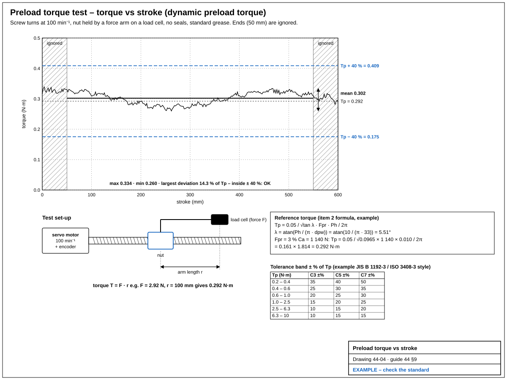

| Item | Example |
|---|---|
| drive | servo motor turns the screw at a constant 100 min⁻¹ (ISO / JIS conditions – check), screw between a chuck and a tailstock |
| nut | held against rotation by an arm on a load cell at radius r (e.g. 100 mm): T = F · r |
| condition | wiper seals **removed** (seal drag 0.05 – 0.2 N·m would hide the preload), standard grease, run-in 5 strokes, 20 ± 2 °C |
| recording | torque vs stroke (encoder), 1 point per 2 mm, over the full stroke in both directions |
| evaluation | ignore the nut length region at both ends of the stroke (start-up, ball pick-up); here 50 mm each end of 600 mm |

### 9.4 Tolerance band (example – check JIS B 1192-3 / ISO 3408-3 / catalogue)

All values over the effective stroke must stay inside **Tp ± tolerance**. The tolerance (±, % of Tp) depends on Tp and the
grade (slenderness l_u / d0 ≤ 40):

| Tp from – to (N·m) | C3 | C5 | C7 |
|---|---|---|---|
| 0.2 – 0.4 | ± 35 % | ± 40 % | ± 50 % |
| 0.4 – 0.6 | ± 25 % | ± 30 % | ± 35 % |
| 0.6 – 1.0 | ± 20 % | ± 25 % | ± 30 % |
| 1.0 – 2.5 | ± 15 % | ± 20 % | ± 25 % |
| 2.5 – 6.3 | ± 10 % | ± 15 % | ± 20 % |
| 6.3 – 10 | ± 10 % | ± 15 % | ± 15 % |

For slender screws (l_u / d0 > 40) the standards allow a wider band. Our screw: l_u / d0 = 700 / 32 = 22 → normal table;
Tp = 0.292 N·m, C5 → **± 40 % → band 0.175 … 0.409 N·m**.

### 9.5 Worked example

A screw gives over the effective stroke 50 … 550 mm (251 points): mean 0.301 N·m, max 0.372, min 0.236.

| Check | Calculation | Result |
|---|---|---|
| mean deviation | (0.301 − 0.292) / 0.292 | + 3.1 % |
| max inside band | 0.372 ≤ 0.409 | OK |
| min inside band | 0.236 ≥ 0.175 | OK |
| fluctuation (largest deviation from Tp) | max(0.372 − 0.292, 0.292 − 0.236) / 0.292 = 0.080 / 0.292 | 27.4 % ≤ 40 % → OK |

Typical causes when the curve leaves the band:

| Curve shape | Cause |
|---|---|
| whole curve too high | ball class too big, nut pitch Ø small, grease too stiff |
| whole curve too low | ball class too small → re-ball with the next class (+1 µm) |
| slow wave over 300 – 500 mm | pitch Ø of the screw varies along the thread (§5.2: 1 µm ≈ 40 %) |
| short regular peaks | deflector step, a damaged ball, dirt |
| one big peak | chip / burr in the groove – open, clean, check |

The page station "Preload torque test" makes this curve live: mean shift ≈ N(2 %, 7 %), slow pitch-Ø wave 5 – 13 %,
ball-circulation ripple 2.2 %, noise 1.2 % of Tp, disturbances near the ends.

### 9.6 Axial rigidity

Rigidity K = force / elastic displacement of the nut against the screw:

  **K = ΔF / Δδ** (N/µm), measured on the loading branch from 0.3 F to F

Test: screw clamped, nut loaded 0 → +2 kN → 0 → −2 kN → 0 in 100 N steps, LVDT 0.1 µm between nut and screw.

Worked example: δ = 0.95 µm at 600 N, 3.04 µm at 2 000 N → K = 1 400 / 2.09 = **670 N/µm** – the catalogue nut rigidity
Kn at 3 % Ca (item 1: 1 000 N/µm at 10 % Ca, scaled with (Fpr / 0.1 Ca)^(1/3) = 0.3^(1/3) = 0.67). Acceptance limit
(example) **K ≥ 540 N/µm ≈ 0.8 · Kn**. Note: a preloaded nut stays linear only up to about 2.83 · Fpr = 3.2 kN, then one
half of the nut loses its preload and the rigidity halves.

### 9.7 Lost motion

Lost motion = the difference in position when the direction of the force changes – backlash + friction hysteresis +
elastic deformation of the parts outside the measured length. On the force–displacement loop it is the **gap between the
two branches at F = 0**.

| Nut | Typical lost motion (example) |
|---|---|
| without preload (P0, small clearance) | 5 – 20 µm |
| P1 ball oversize (ours) | ≤ 2 µm |
| double nut P2 / P3 | ≤ 1 µm |

Lost motion > 2 µm on a P1 nut means: wrong (too small) ball class, wear, or a loose fixture.

### 9.8 Drag force of carriages (linear guides)

The carriage version of the preload torque is the **drag force**: the force to push the block along the rail at
constant speed (e.g. 60 mm/s), measured at the matching station QC-MAT.

| Condition | Window (example, size 25) |
|---|---|
| Z1, without seals (LB-DRAG) | 10 – 22 N |
| Z1, with end + bottom seals, greased (FG-DRAG) | 15 – 35 N |
| Z0 | 2 – 8 N |
| Z2 | 30 – 60 N |

Too low → the ball class is too small (play); too high → class too big. The reaction is the same as for the nut:
re-ball with the next class.

---

## 10. Run-out, roundness, thread profile and ball size classes

### 10.1 Run-out – TIR

**Circular run-out** = total indicator reading (TIR) = max − min of a dial gauge in one full turn at one cross-section,
the part turning around the datum axis.

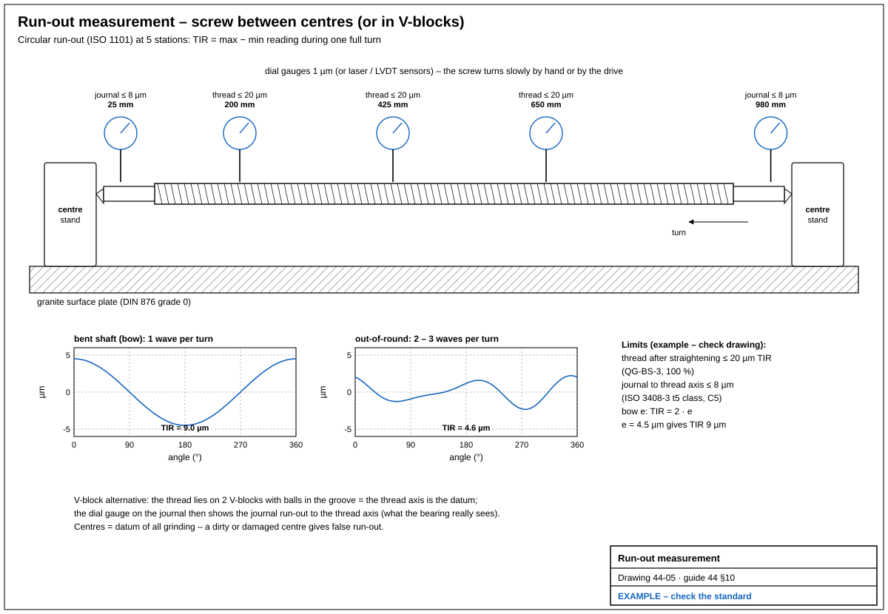

A reading over the angle φ contains:

  r(φ) = e · cos(φ − φ0) + form error (2, 3 … waves per turn) + noise

* **bow / eccentricity** e → 1 wave per turn, TIR = 2e
* **out-of-round** (lobing from grinding, chatter) → 2, 3, 5 … waves, adds to TIR
* the run-out tolerance does **not** separate them; a roundness tester does (§10.3).

Worked example: station at x = 425 mm (thread middle), readings max + 6.2 µm, min − 5.4 µm → TIR = **11.6 µm**
≤ 20 µm → OK; it is mostly bow (1 wave), eccentricity ≈ 5.8 µm.

### 10.2 The 5 stations of the page

| Station x | Where | Limit (example) | Characteristic |
|---|---|---|---|
| 25 mm | bearing journal, fixed end | ≤ 8 µm | BS-JRO |
| 200 mm | thread | ≤ 20 µm | BS-RO |
| 425 mm | thread middle | ≤ 20 µm | BS-RO |
| 650 mm | thread | ≤ 20 µm | BS-RO |
| 980 mm | journal, floating end | ≤ 8 µm | BS-JRO |

Two set-ups:

| Set-up | Datum | Use |
|---|---|---|
| between centres | centre-hole axis | in-process (straightening press, grinder) – fast, but the centres are only a substitute datum |
| thread in 2 V-blocks with balls | **thread axis** | final check of journal run-out to the thread axis (drawing datum, §6.1) |

Errors of the measurement: dirty or damaged centres (they add their own run-out), V-block angle (a V-block reads a
3-lobe out-of-round wrongly), stylus force bends a long thin shaft (support it).

### 10.3 Roundness

A roundness tester turns the part (or the probe) on a precision spindle (radial error ≤ 0.02 – 0.05 µm) and records the
radius over 360°. The software fits a reference circle (least squares LSCI, minimum zone MZCI …) and filters the profile
(e.g. 1 – 50 undulations per revolution, ISO 12181). Roundness of the journals (example limit 2 µm, guide 41 op 90) and
the cylindricity of the nut OD are measured here, as an audit (1 per shift / per set-up).

### 10.4 Thread profile – the gothic arch

The groove is made of **two arcs** (gothic arch), not one circle. Each flank arc has the radius

  **r = f · Dw = 0.53 · 6.35 = 3.366 mm** (conformity f = 0.53)

The centres of the two arcs are offset from the ball centre by

  **e = r − Dw / 2 = 3.366 − 3.175 = 0.191 mm** along the 45° contact lines.

| Geometry (example, BS-3210) | Value |
|---|---|
| ball Ø Dw | 6.35 mm |
| ball centre radius dpw / 2 | 16.5 mm |
| arc centres relative to the ball centre | (∓ e · sin 45°, + e · cos 45°) = (∓ 0.135, + 0.135) mm |
| groove bottom below the ball centre | r − e · cos 45° = 3.366 − 0.135 = 3.231 mm |
| root Ø | 2 · (16.5 − 3.231) = **26.54 mm** (catalogue dr 26.4) |
| land (OD 31.5) below the ball centre | 16.5 − 15.75 = 0.75 mm |
| contact angle α | 45° (spec 45° ± 2°) |

Why two arcs? The ball touches each flank in one point on the 45° line, with a defined contact angle and a small
clearance at the bottom (room for dirt and grease). With ball oversize the ball touches both flanks of the screw and of
the nut → 4-point contact = the preload.

**Measurement** (contour tester): the stylus traces the groove across the thread (axial direction, ± 2.9 mm). The
evaluation (`bsfqa_meas.js`, station "profile"):

1. Take the points of each flank in the contact region (1.2 … 2.8 mm from the groove centre).
2. Fit a circle to each flank by least squares (**Kåsa method**: minimise Σ(x² + y² + D·x + E·y + F)² → a linear 3 × 3
   system; centre (−D/2, −E/2), r = √(x_c² + y_c² − F)).
3. Place the ball: its centre is at distance (r − Dw/2) from **both** arc centres → intersection of two circles; take the
   solution **below** the arc centres.
4. Contact point of each flank = arc centre + r · unit vector (arc centre → ball centre). Contact angle = angle of the
   line ball centre → contact point against the radial direction.
5. Report r (left / right), f = r / Dw (spec 0.53 ± 0.01), α (left / right, spec 45° ± 2°), ball centre height.

Worked example (one simulated part): r_L = 3.371, r_R = 3.358 mm → f = 0.531 / 0.529 → OK; α_L = 44.4°, α_R = 45.7° → OK.

A wrong profile is usually a worn dressing disc or a wrong dressing program; the contact angle changes the rigidity and
the load rating (load rating ∝ (cos α)^0.7 · tan α … – check the catalogue method), and an asymmetric profile gives
different behaviour in the two directions.

### 10.5 Pitch Ø over balls

The pitch Ø is measured with two measuring balls (Dw = 6.35 mm) in opposite grooves and a ball-pin micrometer /
comparator against a setting master. The reading "over balls" M relates to the pitch Ø, the ball Ø and the lead angle
(like the three-wire method for threads). In the plant we only compare with a master screw: deviation ± 3 µm (CC,
100 %). §5.2 shows why: 1 µm ≈ 40 % preload change.

### 10.6 Ball size classes

Balls (ISO 3290-1) are made in grades. Grade G5 means (example values of the standard – check):

| G5 property | Value |
|---|---|
| ball diameter variation (one ball) | 0.13 µm |
| deviation from spherical form | 0.13 µm |
| lot diameter variation | 0.25 µm |
| surface roughness Ra | 0.014 µm |

The ball maker delivers **sorts** (size classes) in 1 µm steps around the nominal Ø6.350 mm, e.g. −2 … +8 µm. Each box is
one sort. Incoming check: a sample on a ball comparator (two flat anvils, 0.05 µm).

**Class choice at nut assembly (gate QG-BN-3):**

1. Put the nut on a master screw with gauge balls of class 0.
2. Measure the axial play and convert it to the ball-diameter equivalent δ_play (e.g. 2.4 µm).
3. Add the preload interference for P1 (2 – 6 µm, target 4 µm): needed class = round(2.4 + 4) = **+6 µm**.
4. Fill the 60 balls (4 circuits × 15) from sort +6. All balls of one nut from one sort.
5. Check the preload torque (§9) – if out of band, change by one class.

---

## 11. Linear guide accuracy

### 11.1 Running parallelism vs rail length

The block runs along the rail. Two probes on the block (or on a measuring carriage) measure the height of the block top
over the rail bottom (B → A) and the side of the block to the rail datum side (D → C). **Running parallelism = max − min**
of each probe over the rail length.

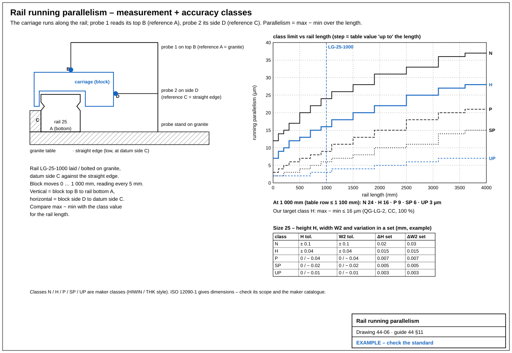

Running parallelism in µm for rail length "up to" (example, HIWIN / THK style – check the maker's catalogue):

| Rail length up to (mm) | N | H | P | SP | UP |
|---|---|---|---|---|---|
| 100 | 12 | 7 | 3 | 2 | 2 |
| 200 | 14 | 9 | 4 | 2 | 2 |
| 300 | 15 | 10 | 5 | 3 | 2 |
| 500 | 17 | 12 | 6 | 3 | 2 |
| 700 | 20 | 13 | 7 | 4 | 2 |
| 900 | 22 | 15 | 8 | 5 | 3 |
| 1 100 | 24 | 16 | 9 | 6 | 3 |
| 1 500 | 26 | 18 | 11 | 7 | 4 |
| 1 900 | 28 | 20 | 13 | 8 | 4 |
| 2 500 | 31 | 22 | 15 | 10 | 5 |
| 3 100 | 33 | 25 | 18 | 11 | 6 |
| 3 600 | 36 | 27 | 20 | 14 | 7 |
| 4 000 | 37 | 28 | 21 | 15 | 7 |

Our rail LG-25-1000 (1 000 mm → row "up to 1 100 mm"): **N 24 · H 16 · P 9 · SP 6 · UP 3 µm**. Our standard class is H.

Worked example: top probe range 11.1 µm, side probe 7.4 µm → the larger value 11.1 µm ≤ 16 → class **H** reached
(P needs ≤ 9 µm).

### 11.2 Measuring method

| Step | Detail (example) |
|---|---|
| set-up | rail on a granite table ≥ rail length, datum side C against a straight edge, light clamping (no bending) |
| carriage | measuring block with 2 probes (0.1 µm), or a master block, moved along the rail at constant speed |
| position | linear scale or laser (Heidenhain / Renishaw class), 1 reading per 5 mm |
| evaluation | max − min per probe; also the curve shape (bow, waves at the hole pitch 60 mm from bolt-hole distortion) |
| environment | 20 ± 1 °C; a 1 m rail with a temperature difference of 0.5 K top–bottom bends measurably |

### 11.3 Height H, width W2 and pair variation

The assembly height **H** (rail bottom to block top, 36 mm for size 25 flange) and the width **W2** (rail datum side to
block reference side) have class tolerances. For a set of blocks on one rail the **variation** ΔH (max − min of H) and ΔW2
also count.

Size 25 (example – check the maker's catalogue):

| Class | H tolerance | W2 tolerance | ΔH (pair variation) | ΔW2 |
|---|---|---|---|---|
| N normal | ± 0.1 mm | ± 0.1 mm | 0.020 mm | 0.030 mm |
| H high | ± 0.04 mm | ± 0.04 mm | 0.015 mm | 0.015 mm |
| P precision | 0 / − 0.04 mm | 0 / − 0.04 mm | 0.007 mm | 0.007 mm |
| SP super precision | 0 / − 0.02 mm | 0 / − 0.02 mm | 0.005 mm | 0.005 mm |
| UP ultra precision | 0 / − 0.01 mm | 0 / − 0.01 mm | 0.003 mm | 0.003 mm |

The class of a set = the best class whose H / W2 tolerances **and** variations are all met.

Worked example: 4 blocks H − 36.000 = +3.1, −4.2, +7.8, +0.5 µm; W2 deviations −2.0, +3.5, −4.7, +1.2 µm.
ΔH = 7.8 − (−4.2) = 12.0 µm, ΔW2 = 3.5 − (−4.7) = 8.2 µm. P needs ΔH ≤ 7 µm and H ≤ 0 → not met. H: all within ± 40 µm,
ΔH 12 ≤ 15, ΔW2 8.2 ≤ 15 → class **H**.

### 11.4 Standards and maker classes

ISO 12090-1 (rolling bearings – profiled rail guides) gives boundary dimensions and tolerances for some sizes – **mark check
its exact scope and edition**. The accuracy classes N / H / P / SP / UP (and their table values) are **maker classes**:
every maker (THK, HIWIN, NSK, Bosch Rexroth, Schaeffler, IKO, PMI …) publishes its own table; values are similar but not
identical. Our tables follow the HIWIN / THK style and must be checked against the catalogue we want to be compatible with.

### 11.5 Matched sets and interchangeable parts

| Concept | Meaning | Consequence for QA |
|---|---|---|
| matched set (non-interchangeable) | rail + blocks measured and sold together; ΔH from the actual parts | serial numbers of rail and blocks linked; set marked (FG-MRK) |
| interchangeable | any block of the class fits any rail of the class | every block and rail must be inside the class tolerance alone (tighter grinding) |
| matched pair of rails | two parallel rails of one axis with the same height class | rail no. marked on both, same lot |

---

## 12. Hardness, case depth, roughness, noise and cleanliness

### 12.1 Rockwell C (ISO 6508)

| Item | Value |
|---|---|
| indenter | diamond cone 120°, tip radius 0.2 mm |
| preliminary force F0 | 98.07 N (10 kgf) |
| total force F | 1 471 N (150 kgf), held 2 – 6 s |
| result | HRC = 100 − h / 0.002 mm (h = permanent depth increase after removing the additional force) |
| range | 20 – 70 HRC |
| spacing | distance between indent centres ≥ 3 × indent diameter (≥ 1 mm), to the edge ≥ 2.5 × diameter |
| thickness | ≥ 10 × indent depth |
| curved surfaces | correction values for cylinders (ISO 6508-1 annex) – better: measure on a small ground flat at the thread run-out |
| check | daily on a certified test block (ISO 6508-3) near the working range (e.g. 60 HRC) |

Our practice: 3 readings, report all three and the mean; spec 58 – 62 HRC for each reading.

### 12.2 Vickers (ISO 6507)

  **HV = 0.1891 · F / d²**   (F in N, d = mean diagonal in mm)

Worked example: HV 1 → F = 9.807 N; diagonals 0.0530 / 0.0534 mm → d = 0.0532 mm →
HV = 0.1891 · 9.807 / 0.0532² = 1.8545 / 0.002830 = **655 HV 1** (≈ 58 HRC).

Spacing: indent centres ≥ 2.5 × d (steel) apart and from the edge – for a dense traverse the indents are placed in a
staggered (zig-zag) line.

### 12.3 Case depth (ISO 18203)

| Term | Process | Limit hardness |
|---|---|---|
| **CHD** case hardening depth (Eht) | carburised + hardened (nut, carriage) | **550 HV** (standard limit) |
| **SHD** surface hardening depth (Rht) | induction / flame hardened (screw, rail) | **0.8 × minimum specified surface hardness** (HV) – e.g. 58 HRC ≈ 653 HV → 0.8 · 653 = **522 HV**; the drawing may fix 550 HV instead |
| NHD nitriding hardness depth | nitrided | core hardness + 50 HV |

The plant uses 550 HV on all drawings (example, agreed with the customer) – check your drawing.

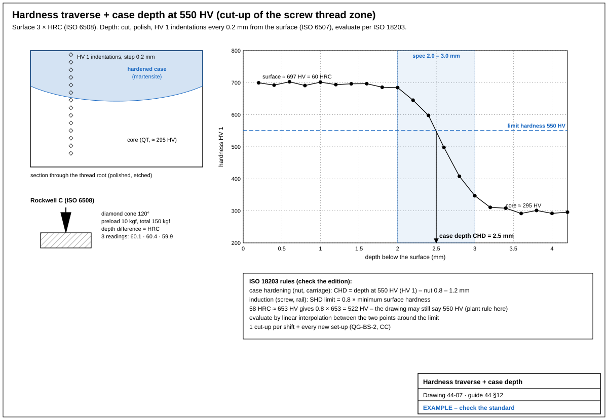

**Procedure:** cut the part (or a test piece of the furnace load) across the hardened zone, mount, grind + polish,
HV 1 indentations from 0.1 mm below the surface every 0.2 mm (screw) or 0.1 mm (nut, carriage), until the core.

**Worked traverse (screw, example):**

| Depth (mm) | 0.1 | 0.6 | 1.0 | 1.4 | 1.8 | 2.2 | **2.4** | **2.6** | 3.0 | 3.4 | 4.0 |
|---|---|---|---|---|---|---|---|---|---|---|---|
| HV 1 | 702 | 698 | 694 | 688 | 670 | 625 | **571** | **528** | 410 | 320 | 298 |

The curve crosses 550 HV between 2.4 and 2.6 mm. Linear interpolation:

  CHD = 2.4 + (571 − 550) / (571 − 528) · 0.2 = 2.4 + 21 / 43 · 0.2 = **2.50 mm** → spec 2.0 – 3.0 mm → OK

Core 298 HV ≈ 29 HRC – the QT core of 50CrMo4 (250 – 300 HB).

### 12.4 HRC ↔ HV (approximate, ISO 18265 style)

| HRC | 20 | 30 | 40 | 45 | 50 | 52 | 54 | 55 | 56 | 58 | 60 | 62 | 64 | 66 |
|---|---|---|---|---|---|---|---|---|---|---|---|---|---|---|
| HV | 238 | 302 | 392 | 446 | 513 | 544 | 577 | 595 | 613 | 653 | 697 | 746 | 800 | 865 |

550 HV ≈ 52.4 HRC. Conversions are approximate and depend on the steel – never convert a contract value without the
customer's agreement.

### 12.5 Roughness (ISO 21920)

ISO 21920-1/-2/-3 (2021) replaces ISO 1302, ISO 4287, ISO 4288 and ISO 13565; many drawings still name the old
standards – the parameters Ra, Rq, Rz keep their meaning, but the default evaluation rules changed (check the drawing
indication).

| Parameter | Definition |
|---|---|
| Ra | arithmetic mean of the absolute heights of the roughness profile |
| Rq | root mean square of the heights |
| Rz | mean of the maximum heights (peak to valley) of 5 sampling lengths |

| Cut-off λc (Gaussian filter) | Typical Ra range | Evaluation length (5 × λc) |
|---|---|---|
| 0.08 mm | ≤ 0.02 µm | 0.4 mm |
| 0.25 mm | 0.02 – 0.1 µm | 1.25 mm |
| 0.8 mm | 0.1 – 2 µm | 4 mm |
| 2.5 mm | 2 – 10 µm | 12.5 mm |

Our raceways (Ra ≈ 0.1 µm) are measured with λc 0.25 mm along the groove (the page station uses λc 0.25 mm, a moving-
average filter as a simple stand-in for the Gaussian filter). Spec: screw + carriage raceway Ra ≤ 0.2 µm, rail ≤ 0.4 µm,
journals ≤ 0.4 µm. Rule of thumb for ground surfaces: Rz ≈ 4 … 7 × Ra.

Worked example: Ra 0.124 µm, Rz 0.74 µm (5 sampling lengths 0.69 / 0.81 / 0.70 / 0.77 / 0.73) → OK.

### 12.6 Noise and vibration at run-in

Run-in stand AS-RUN: speed sweep 100 → 3 000 min⁻¹, microphone (class 1, IEC 61672-1) at 0.3 m, accelerometer on the
nut. Limit (example): **65 dB(A) at 500 min⁻¹, + 6 dB per doubling of the speed above** →

| Speed (min⁻¹) | 500 | 1 000 | 2 000 | 3 000 |
|---|---|---|---|---|
| limit dB(A) | 65 | 71 | 77 | 80.5 |

A damaged deflector, a ball of the wrong class or a dented raceway shows at the **ball-pass frequency**:

  **f_b = (n / 60) · (z / 2) · (1 − Dw · cos α / dpw)**, z = π · dpw / Dw = π · 33 / 6.35 = 16.3 balls per turn

At 1 500 min⁻¹: f_n = 25 Hz → f_b = 25 · 8.16 · (1 − 6.35 · 0.707 / 33) = 25 · 8.16 · 0.864 = **176 Hz**. Harmonics at 353,
529 Hz. A peak there that is 3 × higher than on good screws → open the nut.

### 12.7 Cleanliness and rust protection

| Check | Method | Limit (example) |
|---|---|---|
| residual dirt (gravimetric) | rinse the part in an extraction cabinet, filter (5 µm membrane), dry, weigh (ISO 16232 / VDA 19.1) | ≤ 2.0 mg per part |
| largest particle | microscope with particle software; size classes B 5 – 15 µm … K > 1 000 µm | ≤ 400 µm (metallic) |
| residual magnetism | Hall probe at the thread ends | ≤ 0.3 mT (≈ 2.4 A/cm) |
| oil film / no rust / no fingerprints | visual 100 % under a lamp | complete |
| packing | VCI tube closed, supports every 300 mm, humidity indicator | checklist |

Why it matters: a 400 µm hard particle rolled over by a ball makes a dent → noise → early flaking; residual magnetism
holds grinding swarf in the groove. The extraction test is weekly (destructive in time, not for the part), the visual
check is 100 %.

---

## 13. Metrology room and measurement uncertainty

A precision part is only as good as the measurement that says it is good. A C5 ball screw has a lead tolerance of
± 35 µm over 700 mm. That is 0.005 % of the length. Temperature, dirt, vibration and the gauge itself can easily
eat this tolerance. This chapter explains the room (where we measure) and the **measurement uncertainty** (how sure
we are about a measured value).

All values in this chapter are **examples – check the standard (ISO 1, ISO 14253-1, JCGM 100) and your customer**.

### 13.1 Why 20 °C?

ISO 1 fixes the **reference temperature for length measurement at 20 °C**. A drawing dimension is the size of the
part **at 20 °C**. Steel grows when it is warm:

  **ΔL = α · L · ΔT**

| Symbol | Meaning | Example |
|---|---|---|
| α | thermal expansion coefficient of the screw steel | 11.5 µm/(m·K) (ALPHA in web/bsfqa_data.js) |
| L | measured length | 0.7 m (useful travel l_u of BS-3210) |
| ΔT | difference between part temperature and 20 °C | 1 K |
| ΔL | length error | 11.5 × 0.7 × 1 = **8.05 µm** |

So **1 K over 700 mm = 8.05 µm**. That is almost **one quarter** of the C5 e_p tolerance (± 35 µm) and more than
the whole v_2π tolerance (8 µm). A screw that comes warm from the grinding room (say 22 °C) and is measured at once
shows 16 µm "too long". Therefore:

* the room is held at **20 ± 0.5 °C**,
* the screw **soaks ≥ 4 h** in the room before the lead measurement,
* the lead bench has **material temperature sensors** on the screw and corrects the reading to 20 °C (§7, §8),
* the gauge (laser, master screw, gauge blocks) is at the same temperature as the part.

Why α = 11.5 and not 11.8 (item 1)? Hardened Cr-Mo / bearing steel lies between 11 and 12 µm/(m·K). The lead bench
uses the value of the material certificate or of a test. The **uncertainty of α** (± 1 µm/(m·K)) appears in the
budget below. When the part is exactly at 20 °C the α error does not matter – one more reason for a good room.

### 13.2 Room specification

Example values from `ROOM` in web/bsfqa_data.js:

| Item | Value (example) | Why |
|---|---|---|
| Air temperature | **20 ± 0.5 °C** | lead + CMM measurement, C3 / C5 |
| Change per hour | ≤ 0.5 K/h | parts and gauges follow slowly; fast changes bend the granite |
| Vertical gradient | ≤ 0.5 K/m | a screw of 1 m lying horizontal sees less, a CMM column sees more |
| Horizontal gradient | ≤ 0.3 K over the bench length | the screw must have one temperature |
| Relative humidity | 45 ± 10 % rH | no rust (> 60 %), no static, stable laser air index |
| Soak time | ≥ 4 h for screws Ø32 × 1 000, ≥ 8 h for Ø40 × 2 000 | core = surface temperature |
| Air speed at the bench | ≤ 0.2 m/s | no draught on the beam and the part |
| Vibration | ≤ VC-B class at the bench (≈ 25 µm/s rms, check) | interferometer and probes are sensitive |
| Cleanliness | no grinding dust, shoe cleaning at the air lock | dust on balls and probes = false readings |
| Light | 750 – 1 000 lx, LED (low heat) | reading scales, visual checks |
| People | ≤ 4 persons (each person ≈ 100 W) | body heat changes the room temperature |

How long does a screw need to soak? A rough rule: the time constant τ of a steel bar in still air is about
τ ≈ 1.5 h for Ø32 mm. After 3 τ (4.5 h) 95 % of the start difference has gone. A screw that comes in 3 K warm still
has 0.15 K after 4.5 h – that is 1.2 µm on 700 mm. That is why the soak rack is in the room and the bench also
compensates with the sensor reading.

### 13.3 Layout of the metrology room

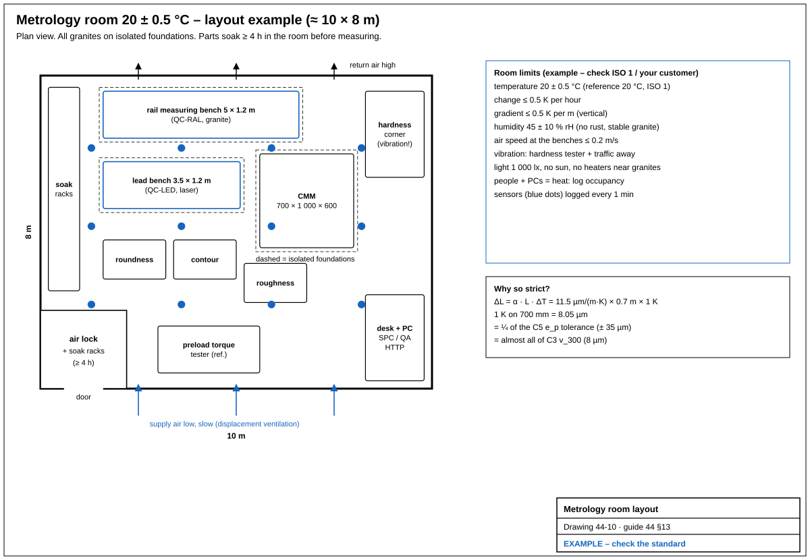

Example layout ≈ 80 m² (12 × 6.5 m) next to the grinding room (item 3 layout, zone `qc`):

| Area | Equipment | Note |
|---|---|---|
| Air lock | double door, shoe cleaner, coat hooks | keeps warm air and dust out |
| Soak racks | horizontal racks for 2 × 40 screws, rail rack | screws support every 300 mm (no bending) |
| Lead bench | QC-LED (granite 3.5 × 1.2 m, laser on the bench end) | own foundation block, far from the door |
| Rail bench | QC-RAL (granite 5 × 1.2 m) | own foundation |
| CMM | bridge CMM 700 × 1 000 × 600 | own foundation, not under the air inlet |
| Form corner | roundness, contour, roughness | quiet corner, on a damped table |
| Hardness corner | Rockwell + micro-hardness | metallography (cutting, polishing) is OUTSIDE (dirt, water) |
| QA desk | PC with the QA service, label printer, gauge cabinet | gauges stored in the room (same temperature) |

### 13.4 HVAC – how to hold 20 ± 0.5 °C

* **Displacement ventilation**: cool air comes in slowly at floor level (≈ 0.1 – 0.2 m/s) and rises with the heat
  of people and machines; it leaves under the ceiling. No draught, small gradients. Mixing ventilation (fast jets)
  gives draught and is avoided at the benches.
* **Air change**: 6 – 10 per hour; the room has a small over-pressure (+ 10 – 20 Pa) to keep dust out.
* **Control**: supply air temperature controlled by a PI loop on 4 – 8 room sensors (0.05 K resolution).
  Two units (N + 1) – a failure must not ruin a week of measurements.
* **Heat loads (example)**: CMM 0.5 kW, benches 1 kW, PCs 0.5 kW, light 0.6 kW, people 0.4 kW, walls + sun → total
  ≈ 5 – 8 kW. No windows to the south, insulated walls.
* **Monitoring**: the room sensors are read by the gateway (Modbus TCP, item 4) and shown in the twin. The lead
  bench blocks a measurement (alarm 602 "material temperature out of 20 ± 0.5 °C") when the screw is out of range.

### 13.5 Foundations and vibration

The grinding room has big machines and the hall has forklifts and AGVs. The benches stand on **separate concrete
blocks** (≈ 0.5 – 0.8 m thick, mass ≥ 3 × bench mass), cut free from the hall floor with a joint filled with an
elastic material. Small benches (contour, roughness) stand on passive or active damping tables. A vibration
measurement before building (site survey) is a good investment.

### 13.6 Measurement uncertainty – the GUM in simple steps

Every measured value is uncertain. The **GUM** (JCGM 100, "Guide to the expression of uncertainty in
measurement") gives a common method:

1. **Write the model.** What does the result depend on? For the lead: laser reading, material temperature, α,
   alignment, probe contact …
2. **Estimate each contribution u_i** (a standard uncertainty = "one standard deviation"):
   * **Type A** – from repeated measurements: u = s (or s / √n for a mean of n readings).
   * **Type B** – from other knowledge (certificate, data sheet, experience). Often only a limit ± a is known:
     * rectangular distribution (every value inside ± a equally likely): **u = a / √3**
     * triangular: u = a / √6
     * normal with a given expanded U (k = 2) from a certificate: u = U / 2
3. **Sensitivity**: if the contribution is in another unit (K), multiply by the sensitivity coefficient
   (here α · L, in µm/K).
4. **Combine** (contributions independent): **u_c = √(Σ u_i²)**
5. **Expand**: **U = k · u_c**, with k = 2 (≈ 95 % coverage).
6. **Report**: "v_300 = 9.4 µm, U = 1.6 µm (k = 2)".

### 13.7 Worked budget – lead measurement over 700 mm, room 20 ± 0.5 °C

From `UNC` in web/bsfqa_data.js, calculated by `uncBudget(0.7, 0.5)` in web/bsfqa_calc.js (page §5 shows it live):

| # | Contribution | Half-width a (µm) | Distribution | u = a / divisor (µm) | u² | Share |
|---|---|---|---|---|---|---|
| 1 | Laser wavelength + air compensation ± 0.5 ppm × 700 mm | 0.350 | rectangular, √3 | 0.202 | 0.0408 | 6.6 % |
| 2 | Material temperature sensor ± 0.1 K × α × L = 0.1 × 11.5 × 0.7 | 0.805 | rectangular, √3 | 0.465 | 0.2160 | 35.0 % |
| 3 | Uncertainty of α ± 1 µm/(m·K) × 0.5 K × 0.7 m | 0.350 | rectangular, √3 | 0.202 | 0.0408 | 6.6 % |
| 4 | Temperature gradient along the screw ± 0.1 K × α × L | 0.805 | rectangular, √3 | 0.465 | 0.2160 | 35.0 % |
| 5 | Abbe: offset 20 mm × carriage pitch 2″ (9.7 µrad) | 0.194 | rectangular, √3 | 0.112 | 0.0125 | 2.0 % |
| 6 | Cosine error (beam 0.2 mm off over 700 mm: L·θ²/2) | 0.0286 | rectangular, √3 | 0.0165 | 0.0003 | 0.04 % |
| 7 | Repeatability of the probe in the groove (s of 5 repeats) | – | normal (type A) | 0.300 | 0.0900 | 14.6 % |
| 8 | Dead path 100 mm × air change 0.2 K × 1 ppm/K | 0.020 | rectangular, √3 | 0.0115 | 0.0001 | 0.02 % |
| | **Sum of u²** | | | | **0.6167** | 100 % |
| | **Combined u_c = √0.6167** | | | **0.785 µm** | | |
| | **Expanded U = 2 × 0.785** | | | **1.57 µm** | | |

Hand check of line 2: a = 0.1 K × 11.5 µm/(m·K) × 0.7 m = 0.805 µm; u = 0.805 / 1.732 = 0.465 µm.
Hand check of line 6: θ = 0.2 / 700 = 2.86 × 10⁻⁴ rad; error = L · θ² / 2 = 700 mm × 8.16 × 10⁻⁸ / 2 =
2.86 × 10⁻⁵ mm = 0.0286 µm – the cosine error is tiny when the beam is aligned to 0.2 mm.

**What the budget tells us:** 70 % of the uncertainty comes from **temperature** (sensor + gradient). A better laser
would not help. Better temperature sensors (± 0.05 K) and more sensors along the screw would.

### 13.8 What a worse room does

Only line 3 (α uncertainty × |T − 20 °C|) depends on the room tolerance in this simple model. Lines 2 and 4 are
for a good, soaked screw; in a bad room the gradient (line 4) also grows, so the real effect is bigger than shown.

| Room | a line 3 (µm) | u line 3 (µm) | u_c (µm) | U, k = 2 (µm) | U / (2 · e_p C5 35 µm) |
|---|---|---|---|---|---|
| 20 ± 0.5 °C | 0.35 | 0.202 | 0.785 | **1.57** | 2.2 % |
| 20 ± 1 °C | 0.70 | 0.404 | 0.860 | **1.72** | 2.5 % |
| 20 ± 2 °C | 1.40 | 0.808 | 1.109 | **2.22** | 3.2 % |

Calculation for ± 2 K: u_c² = 0.6167 − 0.0408 + 0.808² = 0.5759 + 0.6533 = 1.2292 → u_c = 1.109 µm.
Change the room on the page (§5 "room / screw temperature") and watch the guard band grow. For v_300 (18 µm)
and v_2π (8 µm) the ratio is much worse: U = 1.57 µm is already 20 % of the v_2π tolerance.

### 13.9 Decision rules – ISO 14253-1

A measured value close to the limit is a problem: is it in or out? ISO 14253-1 says: the **supplier** proves
conformity only when the measured value is inside the tolerance **reduced by U on each side** (the
**conformance zone**). The **customer** proves non-conformity only outside the tolerance **plus U**.

| Characteristic | Tolerance | U (k = 2) | Conformance zone (we may ship) | Uncertainty range (no proof) |
|---|---|---|---|---|
| E − T, C5, l_u 700 mm | ± 35 µm | 1.57 µm | **± 33.43 µm** | 33.43 … 35 µm |
| v_300, C5 | ≤ 18 µm | 1.57 µm | **≤ 16.43 µm** | 16.43 … 18 µm |
| v_2π, C5 | ≤ 8 µm | 1.57 µm | ≤ 6.43 µm | 6.43 … 8 µm |
| v_up, C5 (l_u 700) | ≤ 25 µm | 1.57 µm | ≤ 23.43 µm | 23.43 … 25 µm |

Rules of thumb:

* **U ≤ 10 – 20 % of the tolerance** (some customers write a "golden rule" 1 : 10). Here U / (2 · 35 µm) = 2.2 % –
  very good for e_p, but U / 8 µm = 20 % for v_2π – at the limit.
* Agree the decision rule with the customer **in the contract** (the default of ISO 14253-1 is the guard band
  above; some customers accept "simple acceptance" – measured value inside the tolerance).
* Write U on the test report of every screw (the lead curve report has a field for it).

### 13.10 Typical mistakes

| Mistake | Effect | Remedy |
|---|---|---|
| Screw measured right after grinding | 1 – 3 K warm → 8 – 24 µm error in E | soak rack, temperature interlock |
| Sensor on the screw not in contact (magnet on paint / oil film) | wrong compensation | clean spot, check reading vs a second sensor |
| Door open, people standing at the bench | gradient, drift during the run | measure at night / with door interlock, max. 4 persons |
| α wrong (e.g. 11.5 for a stainless screw with 16) | compensation wrong when T ≠ 20 °C | material table in the bench software |
| Gauge blocks stored outside the room | wrong height measurement | gauge cabinet in the room |
| Laser not warmed up (≈ 10 – 15 min) | wavelength drift | switch on at shift start |

---

## 14. SPC and process capability

### 14.1 Why SPC?

Inspection sorts parts after the damage is done. **Statistical process control (SPC)** watches the process while
it runs and reacts **before** parts go out of tolerance. It separates two kinds of variation:

| Variation | Also called | Example in our plant | What to do |
|---|---|---|---|
| **Common causes** | random, natural noise | small differences of material, wheel grain, gauge noise | nothing on the shop floor – only a process change (better machine) reduces it |
| **Special causes** | assignable causes | wheel worn, grinding oil 1.5 K warm, wrong ball class, operator error | find and remove the cause NOW |

A **control chart** draws the measured values over time with a centre line (CL) and two **control limits** (UCL,
LCL) at ± 3 σ of the common-cause variation. Points outside the limits or strange patterns show special causes.
Control limits come from the **process**, specification limits (LSL, USL) come from the **drawing**. Never mix them.

### 14.2 Which chart?

| Data | Chart | Subgroup | Example in this plant |
|---|---|---|---|
| Variable, several parts at once | **X̄-R** (mean + range) | n = 2 … 9 (often 5) | journal Ø of 5 consecutive screws (BS-JD), HRC 3 readings (BS-HRC), block height of 5 blocks (LB-H) |
| Variable, large subgroups | **X̄-s** (mean + standard deviation) | n ≥ 10 (or any n) | hardness of 10 blocks of a furnace load |
| Variable, one value per part or per long cycle | **I-MR** (individuals + moving range) | n = 1 | lead E − T and v_300 per screw (BS-EP, BS-V300), preload torque (FA-TP), rail parallelism (LG-PAR), drag force (LB-DRAG) |
| Attribute, fraction defective | **p** chart | variable lot size | crack test rejects per lot |
| Attribute, number defective | **np** chart | constant lot size | NOK end caps per incoming lot of 500 |
| Attribute, defects per unit | c / u chart | | marking defects |

Subgroup rules: take the parts of one subgroup **close together in time** (same set-up, same wheel), so that the
range shows only short-term (common-cause) variation. Take subgroups often enough to see a change before scrap
(e.g. every 1 – 2 h or every 20 parts).

### 14.3 Formulas and constants

**X̄-R chart** (k subgroups of size n):

* X̄̄ = mean of the k subgroup means, R̄ = mean of the k ranges
* X̄ chart: UCL = X̄̄ + A2 · R̄, LCL = X̄̄ − A2 · R̄
* R chart: UCL = D4 · R̄, LCL = D3 · R̄
* σ within (short-term) = R̄ / d2

**X̄-s chart**: UCL/LCL X̄ = X̄̄ ± A3 · s̄; s chart UCL = B4 · s̄, LCL = B3 · s̄; σ within = s̄ / c4.

**I-MR chart**: MR_i = |x_i − x_{i−1}|; I chart: x̄ ± E2 · MR̄ (E2 = 2.660 = 3 / 1.128); MR chart UCL = 3.267 · MR̄;
σ within = MR̄ / 1.128.

Constants (`SPC` in web/bsfqa_data.js, AIAG SPC manual / ASTM E2587):

| n | A2 | D3 | D4 | d2 | A3 | B3 | B4 | c4 |
|---|---|---|---|---|---|---|---|---|
| 2 | 1.880 | 0 | 3.267 | 1.128 | 2.659 | 0 | 3.267 | 0.7979 |
| 3 | 1.023 | 0 | 2.574 | 1.693 | 1.954 | 0 | 2.568 | 0.8862 |
| 4 | 0.729 | 0 | 2.282 | 2.059 | 1.628 | 0 | 2.266 | 0.9213 |
| 5 | 0.577 | 0 | 2.114 | 2.326 | 1.427 | 0 | 2.089 | 0.9400 |
| 6 | 0.483 | 0 | 2.004 | 2.534 | 1.287 | 0.030 | 1.970 | 0.9515 |
| 7 | 0.419 | 0.076 | 1.924 | 2.704 | 1.182 | 0.118 | 1.882 | 0.9594 |
| 8 | 0.373 | 0.136 | 1.864 | 2.847 | 1.099 | 0.185 | 1.815 | 0.9650 |
| 9 | 0.337 | 0.184 | 1.816 | 2.970 | 1.032 | 0.239 | 1.761 | 0.9693 |
| 10 | 0.308 | 0.223 | 1.777 | 3.078 | 0.975 | 0.284 | 1.716 | 0.9727 |

### 14.4 Phase I and phase II

* **Phase I (set up the chart)**: collect ≥ 25 subgroups (`SPC.phase1` = 25) of a stable process. Calculate the
  limits. Remove subgroups with a known special cause and recalculate.
* **Phase II (use the chart)**: the limits are **frozen**. New points are compared with them. Recalculate only after
  a planned process change (new wheel type, new machine, after an 8D action).

The page uses the first 25 subgroups (or 25 values for I-MR) as phase I and draws all later points against these
limits. Press **inject shift +1.5σ**: the new live values move, the frozen limits stay, and after a few points the
rules below fire.

### 14.5 Western Electric rules

| Rule | Pattern (`WE_RULES`) | Meaning |
|---|---|---|
| 1 | 1 point beyond 3σ (outside a control limit) | special cause – stop + check |
| 2 | 2 of 3 points in a row beyond 2σ on the same side | shift starting |
| 3 | 4 of 5 points in a row beyond 1σ on the same side | small shift |
| 4 | 8 points in a row on the same side of the centre line | process mean has moved |

The chart shows the 1σ and 2σ zones as thin dotted lines; a point where a rule fires is red (hover = rule number).
More rules (6 in a row rising, 14 alternating, Nelson rules) exist – more rules = more false alarms. Use 1 – 4.

**Reaction (example, put it in the control plan):** rule 1 → stop the machine, check the last parts back to the last
good point, find the cause, write it in the chart; rules 2 – 4 → inform the setter, check wheel / dressing /
temperature, increase the check frequency until clear.

### 14.6 Process capability – Cp, Cpk, Pp, Ppk

Capability compares the **process spread** with the **tolerance** (ISO 22514-2, AIAG):

| Index | Formula | Meaning |
|---|---|---|
| Cp | (USL − LSL) / (6 · σ_within) | potential – if the process were centred |
| Cpk | min(USL − μ, μ − LSL) / (3 · σ_within) | actual short-term capability (centring included) |
| Pp | (USL − LSL) / (6 · σ_overall) | long-term spread (all variation, also shifts between subgroups) |
| Ppk | min(USL − μ, μ − LSL) / (3 · σ_overall) | long-term performance |

σ_within comes from the chart (R̄ / d2, s̄ / c4 or MR̄ / 1.128). σ_overall is the normal standard deviation of all
values (N − 1). If Ppk is much smaller than Cpk, the process moves between subgroups – find out why.

**One-sided specification** (v_300 ≤ 18 µm, run-out ≤ 20 µm, roughness Ra ≤ 0.2 µm): there is no Cp, only
**Cpu = (USL − μ) / (3σ)** (or Cpl for a lower limit). The page shows "– (one-sided)" for Cp.

Targets (examples – check your customer's quality agreement):

| Case | Target |
|---|---|
| Significant characteristic (SC) in series | Cpk ≥ 1.33 |
| Critical characteristic (CC) in series | Cpk ≥ 1.67 |
| New process, PPAP / initial sample (short run) | Ppk ≥ 1.67 |
| Cpk < 1.0 | 100 % inspection until improved |

Expected out-of-spec parts for a centred normal process (one side): Cpk 1.0 → z = 3 → 1 350 ppm per side;
Cpk 1.33 → z = 4 → 32 ppm; Cpk 1.67 → z = 5 → 0.3 ppm; Cpk 2.0 → z = 6 → 0.001 ppm.

### 14.7 Worked example – X̄-R chart with 5 subgroups of 5 (hand check of the self-test)

Data (`CHECK5.cap`, e.g. journal Ø in a fictive unit, spec 10 ± 1):

| Subgroup | x1 | x2 | x3 | x4 | x5 | Sum | Mean X̄ | Range R |
|---|---|---|---|---|---|---|---|---|
| G1 | 10.2 | 9.8 | 10.1 | 10.0 | 9.9 | 50.0 | 10.00 | 10.2 − 9.8 = 0.4 |
| G2 | 10.3 | 10.0 | 9.7 | 10.1 | 10.0 | 50.1 | 10.02 | 10.3 − 9.7 = 0.6 |
| G3 | 9.9 | 10.2 | 10.0 | 10.4 | 10.0 | 50.5 | 10.10 | 10.4 − 9.9 = 0.5 |
| G4 | 10.1 | 9.6 | 10.0 | 10.2 | 9.9 | 49.8 | 9.96 | 10.2 − 9.6 = 0.6 |
| G5 | 10.0 | 10.1 | 9.8 | 10.3 | 10.2 | 50.4 | 10.08 | 10.3 − 9.8 = 0.5 |

Step by step:

1. X̄̄ = (10.00 + 10.02 + 10.10 + 9.96 + 10.08) / 5 = 50.16 / 5 = **10.032**
2. R̄ = (0.4 + 0.6 + 0.5 + 0.6 + 0.5) / 5 = 2.6 / 5 = **0.52**
3. σ_within = R̄ / d2 = 0.52 / 2.326 = **0.22356**
4. X̄ chart: UCL = 10.032 + 0.577 × 0.52 = **10.33204**, LCL = 10.032 − 0.30004 = **9.73196**
5. R chart: UCL = 2.114 × 0.52 = **1.09928**, LCL = 0 (D3 = 0 for n = 5)
6. Cp = (11 − 9) / (6 × 0.22356) = 2 / 1.34136 = **1.4910**
7. Cpk = min(11 − 10.032, 10.032 − 9) / (3 × 0.22356) = 0.968 / 0.67068 = **1.4433**
8. σ_overall of all 25 values (N − 1) = **0.19088** → Pp = 2 / (6 × 0.19088) = **1.7463**,
   Ppk = 0.968 / (3 × 0.19088) = **1.6905**

All means lie between 9.73 and 10.33 and all ranges below 1.10 → in control. Cpk 1.44 ≥ 1.33 → capable as SC,
not yet as CC (1.67). (Here σ_overall < σ_within – with only 25 values this happens by chance; with real data
Pp ≤ Cp is normal.)

### 14.8 Worked example – I-MR

Values (one per screw): 10, 12, 11, 13, 12. Moving ranges: |12 − 10| = 2, |11 − 12| = 1, |13 − 11| = 2, |12 − 13| = 1.
MR̄ = 6 / 4 = **1.5**; σ_within = 1.5 / 1.128 = **1.330**; x̄ = 58 / 5 = 11.6; I chart UCL = 11.6 + 2.66 × 1.5 =
15.59, LCL = 7.61; MR chart UCL = 3.267 × 1.5 = 4.90.

### 14.9 Live SPC on the page

The page takes its SPC data from the digital twin (window.BSF of item 3). Every piece that leaves a measuring machine
creates one measurement record per characteristic. The value = process model + machine bias + live signal effect
+ injected shift + random noise (`SPC_CHARS` in web/bsfqa_data.js, examples):

| Char | Chart | Mean μ | σ | Measuring machine (source) | Upstream machine (bias per instance) | Live signal used |
|---|---|---|---|---|---|---|
| BS-EP (E − T) | I-MR | 4.0 µm | 6.0 µm | QC-LED | BS-TGR (± 2.5 µm) | tgr.screwTemp_C: − α · (T − 20.2) · 0.7 |
| BS-V300 | I-MR | 9.0 µm | 2.0 µm | QC-LED | BS-TGR (± 0.8 µm) | – |
| BS-JD (journal Ø) | X̄-R, n 5 | − 4.5 µm | 1.0 µm | BS-CGR | BS-CGR (± 0.4) | – |
| BS-HRC | X̄-R, n 3 | 60.2 HRC | 0.45 | BS-IND | BS-IND (± 0.2) | – |
| FA-TP (preload torque) | I-MR | 0.295 N·m | 0.022 | AS-BSA | AS-NAS (± 0.006) | – |
| LG-PAR | I-MR | 7.5 µm | 1.8 µm | QC-RAL | LG-PGR (± 0.6) | – |
| LB-H | X̄-R, n 5 | 3.0 µm | 8.0 µm | QC-MAT | LB-RGR (± 2.0) | – |
| LB-DRAG | I-MR | 15.5 N | 1.6 N | QC-MAT | AS-BAS (± 0.4) | – |

Expected capability of the model: BS-EP Cpk ≈ (35 − 4) / (3 × 6) = 1.72; BS-V300 Cpu ≈ (18 − 9) / 6 = 1.5;
LB-H Cpk ≈ (40 − 3) / 24 = 1.54. The page also seeds 30 – 40 "history" subgroups so that the charts are not empty
when the twin has just started. The upstream machine is found in the lot history (`lot.h`) of the twin – so a
biased grinder shows up in the trace and the NCR (§17, §18).

The gateway signal group **meas** of QC-LED-01 (e_p, v_up, v_300, v_2π, grade, material temperature – item 4
register map) is shown under the charts. In the real plant the same values come from the lead bench PLC by Modbus TCP
(§19).

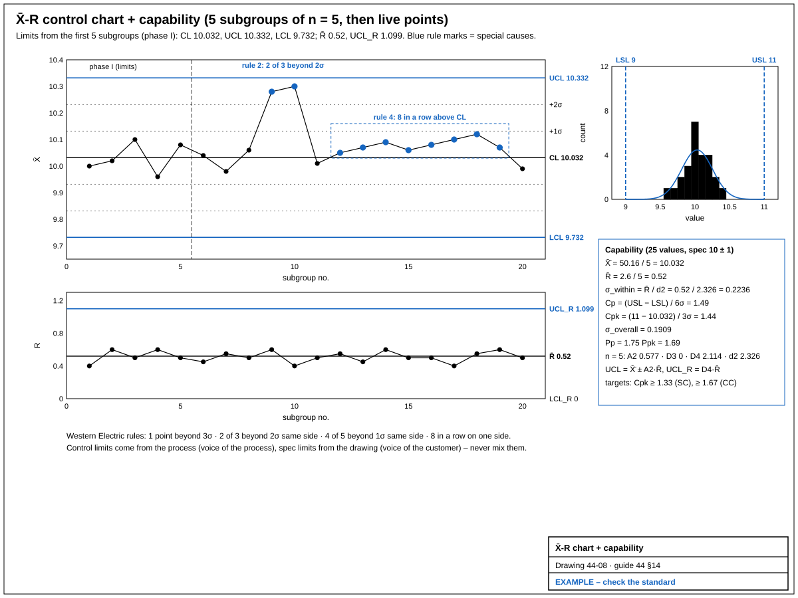

### 14.10 Typical mistakes

| Mistake | Effect | Remedy |
|---|---|---|
| Spec limits drawn as control limits | no reaction until scrap | control limits from the process |
| Limits recalculated every day | shifts are "absorbed" | freeze in phase II |
| Subgroup = parts of different machines | big R̄, wide limits, nothing found | one chart per machine (or bias corrected) |
| Cpk from 10 values | random result (± 30 %) | ≥ 100 values / 25 subgroups |
| Cpk on non-normal data (run-out, roughness = skewed) | wrong ppm | ISO 22514-4 percentile method or transformation |
| Gauge with %GRR 40 % | chart shows the gauge, not the process | MSA first (§15) |

---

## 15. MSA – gauge R&R, bias, linearity, stability, calibration

### 15.1 Why MSA?

The measured spread = process spread + gauge spread:  **σ²_observed = σ²_process + σ²_gauge**.
If the gauge spread is big, the SPC chart and the Cpk show the gauge, good parts are rejected and bad parts are
accepted. **Measurement systems analysis (MSA, AIAG MSA 4th ed.)** checks the gauge before we trust it. The main
study is the **gauge R&R** (repeatability and reproducibility):

| Term | Meaning | Caused by |
|---|---|---|
| Repeatability (EV, equipment variation) | same operator, same part, same gauge – spread of repeated readings | gauge, fixture, part form |
| Reproducibility (AV, appraiser variation) | difference between operators | handling, reading, clamping |
| GRR | √(EV² + AV²) | the whole measuring system |
| PV (part variation) | spread of the true part values | the process |
| TV (total variation) | √(GRR² + PV²) | |

### 15.2 Study design

Example (`GRR_DATA`, `GRR_INFO` in web/bsfqa_data.js): carriage **height H deviation** on the master rail (µm),
electronic height gauge 0.1 µm + gauge-block stack grade 0, tolerance class H ± 40 µm → **T = 80 µm**.

* 10 blocks that cover the process range (not 10 consecutive blocks!)
* 3 operators A, B, C (the people who really measure)
* 3 trials each, parts in random order, operator does not see the earlier reading (blind)

### 15.3 The data set (µm)

| Part | A1 | A2 | A3 | B1 | B2 | B3 | C1 | C2 | C3 | x̄ part |
|---|---|---|---|---|---|---|---|---|---|---|
| 1 | −14.9 | −13.7 | −13.9 | −13.1 | −12.8 | −13.3 | −14.1 | −14.8 | −14.7 | −13.92 |
| 2 | −8.9 | −8.6 | −8.4 | −7.5 | −8.3 | −8.8 | −8.9 | −9.9 | −8.1 | −8.60 |
| 3 | −3.0 | −3.0 | −2.6 | −2.4 | −2.1 | −2.5 | −3.9 | −3.9 | −3.9 | −3.03 |
| 4 | 2.1 | 2.5 | 1.3 | 1.2 | 1.9 | 1.8 | 0.9 | 0.5 | 0.6 | 1.42 |
| 5 | 4.4 | 5.4 | 4.7 | 6.3 | 4.9 | 5.1 | 4.7 | 5.2 | 4.8 | 5.06 |
| 6 | 8.7 | 10.5 | 9.9 | 9.7 | 10.3 | 11.0 | 7.9 | 8.4 | 9.7 | 9.57 |
| 7 | 12.5 | 12.6 | 13.1 | 14.0 | 12.7 | 13.0 | 12.2 | 12.3 | 12.0 | 12.71 |
| 8 | −11.4 | −11.2 | −11.6 | −9.5 | −10.5 | −10.8 | −11.0 | −12.4 | −12.4 | −11.20 |
| 9 | 5.4 | 5.4 | 7.4 | 7.9 | 8.0 | 8.8 | 6.8 | 5.0 | 5.8 | 6.72 |
| 10 | 15.8 | 14.1 | 15.8 | 16.6 | 16.0 | 15.8 | 16.8 | 15.0 | 15.3 | 15.69 |

### 15.4 Average and range method – step by step

1. **Range per part and operator** (max − min of the 3 trials), e.g. A part 1: −13.7 − (−14.9) = 1.2.
   Mean range per operator: **R̄_A = 1.08, R̄_B = 0.99, R̄_C = 1.05**.
2. **R̄̄** = (1.08 + 0.99 + 1.05) / 3 = **1.04**.
3. **EV** (repeatability) = R̄̄ × K1 = 1.04 × 0.5908 = **0.6144 µm** (K1 for 3 trials).
4. **Operator means**: x̄_A = 1.3467, x̄_B = 2.1133, x̄_C = 0.8633 → **X̄diff** = 2.1133 − 0.8633 = **1.25**.
5. **AV** (reproducibility) = √((X̄diff × K2)² − EV² / (n · r)) = √((1.25 × 0.5231)² − 0.6144² / (10 × 3))
   = √(0.42755 − 0.01258) = **0.6442 µm** (K2 for 3 operators).
6. **GRR** = √(0.6144² + 0.6442²) = **0.8902 µm**.
7. **Rp** = max − min of the part means = 15.69 − (−13.92) = **29.611 µm**.
8. **PV** = Rp × K3 = 29.611 × 0.3146 = **9.3157 µm** (K3 for 10 parts).
9. **TV** = √(0.8902² + 9.3157²) = **9.3581 µm**.
10. Percentages of TV: %EV = 6.57 %, %AV = 6.88 %, **%GRR = 100 × 0.8902 / 9.3581 = 9.51 %**, %PV = 99.5 %.
11. Percent of tolerance: 100 × 6 × 0.8902 / 80 = **6.68 %**.
12. **ndc** (number of distinct categories) = ⌊1.41 × PV / GRR⌋ = ⌊1.41 × 9.3157 / 0.8902⌋ = ⌊14.76⌋ = **14**.

Constants (AIAG MSA 4th ed.):

| | 2 | 3 | 4 | 5 | 6 | 7 | 8 | 9 | 10 |
|---|---|---|---|---|---|---|---|---|---|
| K1 (trials) | 0.8862 | 0.5908 | | | | | | | |
| K2 (operators) | 0.7071 | 0.5231 | | | | | | | |
| K3 (parts) | 0.7071 | 0.5231 | 0.4467 | 0.4030 | 0.3742 | 0.3534 | 0.3375 | 0.3249 | 0.3146 |

### 15.5 ANOVA method

The ANOVA (two-way, operator × part with interaction) uses all information and separates the **interaction**
(an operator measures some parts differently). Same data:

| Source | SS | df | MS | |
|---|---|---|---|---|
| Part | 8 582.99 | 9 | 953.666 | |
| Operator | 23.839 | 2 | 11.919 | |
| Operator × part | 9.588 | 18 | 0.5327 | F = 0.5327 / 0.394 = 1.352 |
| Error (repeatability) | 23.64 | 60 | 0.394 | |
| Total | 8 640.06 | 89 | | |

Variance components:

* σ²_repeatability = MS_error = **0.394**
* σ²_operator = (MS_op − MS_int) / (parts · trials) = (11.919 − 0.5327) / 30 = **0.3796**
* σ²_interaction = (MS_int − MS_error) / trials = (0.5327 − 0.394) / 3 = **0.0462**
* σ²_part = (MS_part − MS_int) / (operators · trials) = (953.666 − 0.5327) / 9 = **105.904**
* σ_GRR = √(0.394 + 0.3796 + 0.0462) = **0.9054 µm**; σ_TV = √(0.8198 + 105.904) = 10.331 µm
* **%GRR = 8.76 %**, %tolerance = 6.79 %, **ndc = ⌊1.41 × 10.291 / 0.9054⌋ = 16**

The interaction F = 1.35 is small (rule: if p > 0.25 it can be pooled into the error). Both methods agree:
the gauge is good.

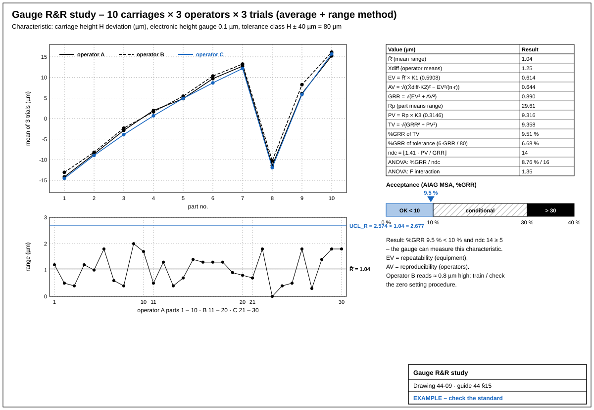

### 15.6 Acceptance

| %GRR (of TV or of tolerance) | Decision (AIAG) |
|---|---|
| < 10 % | acceptable |
| 10 – 30 % | conditionally acceptable – depends on the importance of the characteristic, cost of the gauge |
| > 30 % | not acceptable – improve the gauge |
| ndc ≥ 5 | the gauge can separate the process into ≥ 5 groups – required |

Use %GRR of the **tolerance** when the gauge sorts parts (100 % inspection), %GRR of **TV** when it controls the
process (SPC). Our example: 9.5 % (TV) / 6.7 % (tolerance), ndc 14 → **acceptable for both**.
When EV > AV: the gauge / fixture is the problem. When AV > EV: train the operators, write a better work instruction,
use a fixture.

On the page: **example data set** shows these numbers; **new random study** creates a new data set with random
operator bias and repeatability – try to get one with %GRR > 30 %.

### 15.7 Bias, linearity, stability, attribute studies

| Study | How (example) | Accept |
|---|---|---|
| **Bias** | measure a reference part (calibrated) 10 – 25 times; bias = mean − reference value; t-test | bias not significant, or ≤ 10 % of tolerance |
| **Linearity** | bias at 5 reference parts across the range (e.g. gauge blocks 25, 30, 35, 40, 45 mm); regression bias vs size | slope and bias ≈ 0 |
| **Stability** | measure the same master every day; I-MR chart of the readings | no rule fires over months |
| **Attribute agreement** | 50 parts (good, bad, borderline) judged twice by 3 inspectors (e.g. crack indication, visual rust check); kappa | kappa ≥ 0.75 good, < 0.4 bad |
| **Type-1 study (Cg / Cgk)** | 50 repeats on one master by one person (VDA 5 / Bosch book 10) | Cgk ≥ 1.33 |

For the lead bench: the **reference screw** is the master. Daily check = stability chart of e.g. v_300 of the
master screw; monthly compare the full curve with the certificate.

### 15.8 Calibration system

A calibration compares a gauge with a better standard whose value is traceable to the SI metre (laser wavelength) by
an unbroken chain of calibrations, each with a stated uncertainty. The system follows **ISO 10012** (measurement
management) and uses labs accredited to **ISO/IEC 17025**. Each gauge has an id, a label with the due date, a
record in the gauge management, and **is blocked in the MES when it is overdue** (the measurement record carries the
gauge id – §18). When a gauge is found out of tolerance at calibration, all parts measured since the last good
calibration are checked (**reverse traceability**).

Calibration intervals (`CAL`, examples – set by your procedure, history and risk):

| Gauge | Interval | Who calibrates | Check between calibrations |
|---|---|---|---|
| Laser interferometer (Renishaw XL-80 class) + compensator XC-80 + sensors | 12 months | accredited lab (ISO/IEC 17025) or maker | daily: compare with a reference screw / step gauge |
| Reference (master) ball screw for the lead bench | 24 months | accredited lab (laser) | monthly: measure on the bench, compare the curve |
| Gauge blocks grade 0 / K (ISO 3650) | 12 – 24 months | accredited lab | visual, wringing check |
| Setting rings / ring masters, master bars | 12 months | lab | after a drop |
| Ball-pin micrometer, outside micrometers | 6 – 12 months | internal lab with gauge blocks | zero check every shift |
| Dial gauges, digital indicators, LVDT probes | 6 – 12 months | internal lab (indicator tester) | check with gauge block before use |
| Air gauges + in-process gauges | 6 months (masters 12) | internal | re-master every shift / every 2 h |
| Rockwell tester | 12 months (indirect verification ISO 6508-2) | accredited lab / maker | daily: certified test block (ISO 6508-3) |
| Vickers / micro-hardness tester | 12 months (ISO 6507-2) | accredited lab / maker | weekly: test block (ISO 6507-3) |
| Roughness tester | 12 months | maker / lab | daily: roughness standard (ISO 5436-1 type C) |
| Contour tester | 12 months | maker | weekly: contour standard (radius + angle gauge) |
| Torque sensor of the preload tester | 12 months | accredited lab (torque) | weekly: reference weight on the arm |
| Force sensor of the matching station | 12 months | accredited lab | weekly: reference weight |
| CMM (ISO 10360-2) | 12 months | maker / accredited lab | monthly: interim check with a step gauge / ball plate |
| Granite surface plate (DIN 876 / ISO 8512-2 grade 00 / 0) | 24 – 36 months | service (electronic level / autocollimator) | clean daily |
| Thermometers + room loggers | 12 months | accredited lab | compare 2 sensors monthly |
| Master rail + master carriage | 12 months | internal lab with CMM / bench | daily zero on the bench |
| Sound level meter class 1 + calibrator (IEC 61672 / 60942) | 24 months (calibrator 12) | accredited lab | calibrator before each shift |

Interval adjustment (example): 3 calibrations in a row "as found inside 50 % of the tolerance" → extend by 50 %;
one "out of tolerance" → halve the interval.

---

## 16. Sampling and first article inspection

### 16.1 100 % inspection or sampling?

| Case | Method in this plant | Why |
|---|---|---|
| Critical characteristics of our own parts (lead, preload torque, parallelism, cracks, pitch Ø) | **100 %**, mostly automatic | every screw is unique; a C5 screw is expensive; the customer wants a test report per serial |
| Significant characteristics with good Cpk (journal Ø, HRC) | **SPC** with a frequency (control plan, §4) | the process is watched, not every part |
| Destructive tests (case depth cut-up, cleanliness extraction) | **per shift / per load / per week** | one part per load is cut |
| Bought parts (balls, seals, end caps, deflectors, grease) | **sampling ISO 2859-1** at QC-INC | big lots of cheap parts; the supplier has his own SPC |
| Audits (product audit, packing audit) | small samples | confirms the system |

`AQL.use`: "Sampling only for bought parts (incoming: balls, seals, end caps, deflectors) and audit checks. Precision
characteristics of our own parts are checked 100 % (CC / SC in the control plan)."

### 16.2 ISO 2859-1 in simple steps

ISO 2859-1 gives sampling plans **by attributes** (part good / defective) indexed by the **AQL** (acceptable quality
limit, % defective that is still accepted most of the time).

1. Find the **code letter** from the lot size (general inspection level II):

| Lot size | Letter | | Lot size | Letter |
|---|---|---|---|---|
| 2 – 8 | A | | 501 – 1 200 | J |
| 9 – 15 | B | | 1 201 – 3 200 | K |
| 16 – 25 | C | | 3 201 – 10 000 | L |
| 26 – 50 | D | | 10 001 – 35 000 | M |
| 51 – 90 | E | | 35 001 – 150 000 | N |
| 91 – 150 | F | | 150 001 – 500 000 | P |
| 151 – 280 | G | | > 500 000 | Q |
| 281 – 500 | H | | | |

2. The letter gives the **sample size n**: A 2, B 3, C 5, D 8, E 13, F 20, G 32, H 50, J 80, K 125, L 200, M 315,
   N 500, P 800, Q 1 250, R 2 000.
3. In Table 2-A (normal inspection, single sampling) find **Ac** (accept number) and **Re** (reject number = Ac + 1)
   for the letter and the AQL. Where the table shows an **arrow**, use the first plan below (arrow down) or above
   (arrow up) – with its sample size.
4. Take n parts **at random** from the whole lot. Defective ≤ Ac → accept; ≥ Re → reject.

How the page implements Table 2-A (`aqlPlan()` in web/bsfqa_calc.js – example logic, check the printed table): for
each AQL there is a letter where **Ac 0 / Re 1** appears first (AQL 0.65 → F, 1.0 → E, 1.5 → D, 2.5 → C, 4.0 → B,
6.5 → A). Smaller letters: arrow down to this plan. One letter later: arrow up (use the 0/1 plan). Two letters later:
arrow down to the 1/2 plan. Then along the diagonal Ac = 1, 2, 3, 5, 7, 10, 14, 21.

### 16.3 Worked examples (all checked by the self-test)

| Lot | AQL | Letter | Rule | n | Ac | Re |
|---|---|---|---|---|---|---|
| 150 end caps | 1.0 % | F | one letter after E (0/1) → arrow up → use E | **13** | **0** | 1 |
| 500 seals | 1.0 % | H | 3 letters after E → first Ac 1 plan | **50** | **1** | 2 |
| 1 000 deflectors | 2.5 % | J | 6 letters after C → Ac sequence 1, 2, 3, **5** | **80** | **5** | 6 |
| 100 wipers | 0.65 % | F | Ac 0 letter of AQL 0.65 | **20** | **0** | 1 |
| 3 000 balls (sorting lot) | 4.0 % | K | 8 letters after B → Ac 1, 2, 3, 5, 7, **10** | **125** | **10** | 11 |

If n ≥ lot size → inspect 100 %.

### 16.4 OC curve – what a plan really does

The probability to **accept** a lot with a fraction defective p (binomial):

  **Pa = Σ (k = 0 … Ac) C(n, k) · p^k · (1 − p)^(n − k)**

Example n = 13, Ac = 0, p = 1 %: Pa = 0.99¹³ = **0.8775**. So a lot with 1 % defects is accepted 88 % of the time;
a lot with 10 % defects still has Pa = 0.9¹³ = 25 %. Sampling does **not** guarantee good parts – it protects
against very bad lots. The page draws the OC curve for the chosen plan and prints Pa at the AQL.

| p (lot defective) | Pa for n 13 / Ac 0 | Pa for n 80 / Ac 5 |
|---|---|---|
| 0.5 % | 0.937 | ≈ 1.00 |
| 1 % | 0.878 | ≈ 1.00 |
| 2.5 % | 0.720 | ≈ 0.99 |
| 5 % | 0.513 | ≈ 0.79 |
| 10 % | 0.254 | ≈ 0.18 |

(Second column: binomial sum, rounded – check with the page.)

### 16.5 Switching rules (short)

ISO 2859-1 starts with **normal** inspection. 2 of 5 consecutive lots rejected → **tightened** (smaller Ac).
5 lots accepted on tightened → back to normal. 10 lots in a row accepted on normal + steady production + approval
→ **reduced** (smaller n). Write the switching state per supplier and part number in the incoming inspection record.

### 16.6 First article inspection (FAI)

The first parts of a new part, a new machine, a new NC program or after a long stop are measured **completely**
before the lot is released. Ideas from AS9102 (aerospace) and PPAP (automotive):

| Step | What (example) |
|---|---|
| 1 Ballooned drawing | every dimension, tolerance, note numbered (screw drawing ≈ 60 characteristics, rail ≈ 35) |
| 2 Measure ALL characteristics | first 1 – 3 parts: CMM, contour, roughness, lead, hardness cut-up |
| 3 Material + process records | EN 10204 3.1 certificate (heat), heat-treatment chart, induction energy record |
| 4 Report | measured value vs spec per balloon, gauge id, decision; signed by QA |
| 5 Release | MES releases the lot only when the FAI record is "approved" (HTTP POST /api/bsf/qa/results, char "FAI") |
| 6 Repeat | after a tool / wheel change on a CC operation, program change, machine move, 12 months without production |

For a **PPAP** (production part approval) the customer may also ask for: design records, PFMEA, control plan,
MSA studies, initial capability (Ppk ≥ 1.67), material tests, sample parts, part submission warrant (PSW).

---

## 17. Non-conformance (NCR) and 8D

### 17.1 What is an NCR?

A **non-conformance report (NCR)** documents a part, lot or process that does not meet the requirement. It answers:
what, where, how many, since when, who decided what to do with the parts (**disposition**), and why it happened.

| NCR field | Example |
|---|---|
| NCR no. | NCR-00012 |
| Part / serials / lot | BS-3210-1000-C5, 12 serials of lot L0045 |
| Characteristic + value | BS-V300 = 21.3 µm, limit 18 µm |
| Detected at | QC-LED-01, gate QG-BS-5, 2026-11-14 03:10 |
| Upstream machine | BS-TGR-03 |
| Quantity suspect / blocked | 40 screws (whole night shift) |
| Disposition | regrade to C7 (12), regrind with compensation (0), use as is (0), scrap (0) |
| Root cause + action | see 8D |

### 17.2 Disposition – what to do with the parts

| Disposition | When | Who decides |
|---|---|---|
| **Use as is** | deviation has no effect on function; customer agrees (deviation permit) | MRB + customer |
| **Rework** | the part can be made good with the normal process (re-straighten, regrind journal) | QA + production |
| **Regrade** | the part meets a lower grade (C5 → C7, rail class H → N) | QA (sold as the lower grade) |
| **Scrap** | cannot be repaired (crack, soft spot, too much stock removed) | QA |
| **Return to supplier** | bought part defective | incoming QA + purchasing |

The **MRB** (material review board: QA, production, engineering, sometimes the customer) decides difficult cases.
In the MES a blocked serial cannot be moved, assembled or shipped until the disposition is recorded.

### 17.3 Containment first

Before looking for the root cause: **stop the bleeding**. Block the lot, the WIP between the cause and the
detection point, the finished goods store and – if shipped – inform the customer. 100 % check the suspect parts.
Rule (example): containment within 24 h.

### 17.4 Root cause – 5-Why and Ishikawa

* **5-Why**: ask "why?" until you reach a cause you can switch on and off – usually a missing system rule, not a
  person.
* **Ishikawa (fishbone, 6M)**: Man, Machine, Method, Material, Measurement, Environment (Mother Nature). Write all
  possible causes, then prove or exclude each one with data (trace records, signals from the gateway, trials).

### 17.5 8D – the eight disciplines

`NCR_STEPS` in web/bsfqa_data.js (the page shows them as a row of steps):

| Step | 8D | Content |
|---|---|---|
| detect | D0 / D2 – detect + describe | What is wrong, where, how many, since when? (IS / IS-NOT) |
| contain | D3 – contain | block the lot + WIP + stock, 100 % check, inform the customer if shipped |
| root-cause | D4 – root cause | 5-Why + Ishikawa; prove it (switch on / off) |
| action | D5 / D6 – corrective action | permanent action, implement, update control plan + FMEA + work instruction |
| verify | D7 – verify + prevent | effectiveness check (Cpk, 3 lots without defect), lessons learned, similar processes |
| close | D8 – close + thank the team | sign-off by quality + production |

(D1 = build the team: QA, the setter of the machine, maintenance, process engineer.)

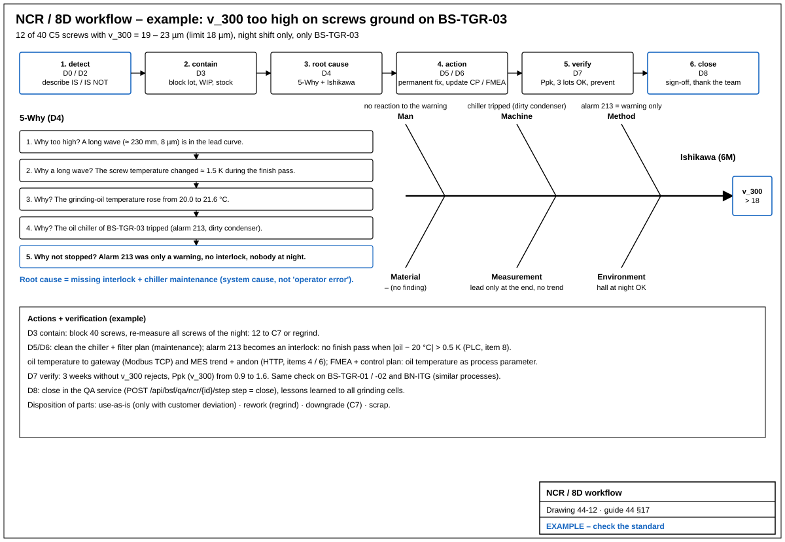

### 17.6 Complete example (`NCR_EXAMPLE`)

**Title:** v_300 too high on screws ground on BS-TGR-03 (night shift).

| | |
|---|---|
| IS | 12 of 40 screws BS-3210 C5 with v_300 = 19 – 23 µm (limit 18 µm), all ground on BS-TGR-03 between 22:00 and 02:00 |
| IS NOT | not on BS-TGR-01 / 02, not on the day shift, e_p and v_2π OK |

5-Why:

1. Why is v_300 too high? – a long wave (≈ 230 mm) with 8 µm amplitude is in the lead curve.
2. Why is there a long wave? – the screw temperature changed by ≈ 1.5 K during the finish pass.
3. Why did the temperature change? – the grinding-oil temperature rose from 20.0 to 21.6 °C.
4. Why did the oil temperature rise? – the oil chiller of BS-TGR-03 tripped (alarm 213 "oil temperature drift").
5. Why was it not stopped? – alarm 213 was only a warning on the HMI; no interlock, nobody at the machine at night.

Ishikawa:

| 6M | Finding |
|---|---|
| Man | no reaction to the warning |
| Machine | chiller tripped (dirty condenser) |
| Method | alarm 213 = warning only |
| Material | – |
| Measurement | lead measured only at the end (no in-process lead probe trend) |
| Environment | hall temperature at night OK |

Actions:

* contain: block 40 screws, re-measure all screws of the night (done), 12 to C7 or regrind
* chiller cleaned + filter plan (maintenance)
* alarm 213 → interlock: no finish pass when |oil − 20 °C| > 0.5 K (PLC, item 8)
* oil temperature → gateway → MES trend + andon (items 4 / 6)
* FMEA + control plan updated: oil temperature as process parameter, 100 % recorded

Verify: 3 weeks without v_300 rejects; Ppk (v_300) from 0.9 to 1.6.

Why did the temperature make a wave? Lead error from heat = − α · ΔT(x) · x (§8). A rise of 1.5 K during the pass
gives up to 11.5 × 0.85 × 1.5 ≈ 15 µm at the end of the thread; the least-squares line removes the linear part, the
rest is a bow / wave that shows in v_300 and v_up. Try it on the page: lead bench → "temperature rise during the
finish pass" = 2.5 K.

### 17.7 NCR on the page and in the QA service

* **open NCR for the last NOK result** takes the newest NOK measurement record (from the twin, the lead bench or a
  station) and sends `POST /api/bsf/qa/ncr {serial, char, value, machine, text}` → `201 {id: "NCR-00001",
  status: "open", steps: [detect]}`.
* **next 8D step** sends `POST /api/bsf/qa/ncr/{id}/step {"step": "contain", "text": "…"}`. The service enforces the
  **order** (a step may not be skipped → 409 "step out of order") and refuses any step on a **closed** NCR (409).
* Without the backend the page keeps a local NCR (id "NCR-local-…").

### 17.8 Escalation (example)

| Situation | Escalate to |
|---|---|
| 24 h without containment | QA manager |
| 10 days without root cause (D4) | plant manager |
| same defect again within 6 months | 8D re-opened, management review |
| customer complaint | customer 8D format and deadlines (often D3 in 24 h, D4 in 10 days, D8 in 60 days) |

---

## 18. Traceability and data model

### 18.1 Why traceability?

If a customer finds a cracked screw, we must answer within hours: **which other screws** come from the same bar
(heat), the same induction set-up, the same grinding wheel, the same night? Without traceability the recall is
"everything of the last 3 months". With it, it may be 40 serials. Traceability also links every measured value to
the gauge that measured it – an out-of-tolerance gauge at calibration leads to the parts it measured.

### 18.2 Serial numbers

`SERIAL.fmt` in web/bsfqa_data.js (example formats):

| Part | Format | Example |
|---|---|---|
| Screw shaft | BS3210-YYMMDD-NNNN | BS3210-261113-0042 |
| Ball nut | BN3210-YYMMDD-NNNN | BN3210-261113-0007 |
| Rail | LG25-YYMMDD-NNNN | LG25-261113-0120 |
| Carriage | LB25-YYMMDD-NNNN | LB25-261113-0233 |
| Screw assembly | A-BS-YYMMDD-NNNN | A-BS-261114-0012 |
| Guide set | A-LG-YYMMDD-NNNN | A-LG-261114-0031 |

Where marked (`SERIAL.where`): laser marked on the screw end face / flange OD / rail end + datum side / block side
(data-matrix ECC 200 + plain text). The serial is created at the first operation that can carry a mark (screw after
centring = op 30, nut op 20, rail op 30, block op 20). Before that the **lot number** travels on the lot card.
After hardening and grinding the mark must still be readable – mark on a surface that is not ground (end face,
chamfer) or mark again at the end (AS-MRK, op 40 of FABS) and link the old and new code in the MES.

Data-matrix (example): 14 × 14 to 22 × 22 modules, cell size ≥ 0.25 mm on a ground surface, quality grade ≥ C
(ISO/IEC 29158), content = serial + part code (+ grade), a plain-text line next to it for people.

### 18.3 The chain

**heat lot → production lot → serial → operation records → measurement records → gauge → NCR → shipment**

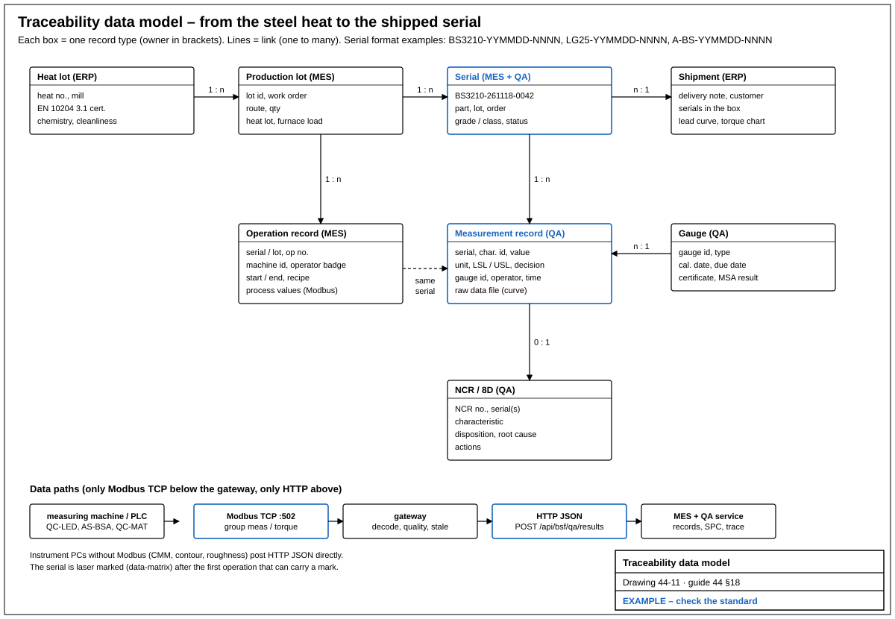

`SERIAL.entities`:

| Entity | Fields | Owner |
|---|---|---|
| Heat lot (material) | heat no., mill, EN 10204 3.1 certificate, chemistry, cleanliness | ERP (goods receipt) |
| Production lot | lot id, work order, route, qty, heat lot, furnace load no. | MES |
| Serial | serial no., part code, lot, order, grade / class, status (OK / NOK / blocked / scrapped) | MES + QA |
| Operation record | serial / lot, op no., machine id, operator badge, start / end, program / recipe, process values (Modbus signals) | MES (from the gateway) |
| Measurement record | serial, characteristic id, value, unit, LSL / USL, decision, gauge id, calibration due date, operator, time, raw data file (curve) | QA (this item) → MES |
| Gauge | gauge id, type, calibration date, due date, certificate, MSA result | QA (calibration system) |
| NCR / 8D | NCR no., serial(s), characteristic, disposition, root cause, actions | QA |
| Shipment | delivery note, customer, serials in the box, test reports (lead curve, torque chart) | ERP |

Keys: one serial has many measurement records (1 : n); one lot has many serials; one heat has many lots; furnace
loads mix lots (n : m – store the load no. in the operation record of every lot).

### 18.4 Genealogy example on the page

Section 6 → **traceability per serial**: choose a serial (from the lead bench, a station or a live twin piece).
The page shows:

* serial, part, production lot (twin lot id, order, route), heat lot (example heat no.), upstream machine (e.g. the
  thread grinder BS-TGR-03 found in the lot history), measuring machine and operator badge (shift A / B / C);
* the **operations of the lot from the twin** – `lot.h` of window.BSF: op no., machine id, time in, time out
  ("D4 08:15" format), good, scrap;
* all **measurement records** of the serial: characteristic, value, spec, decision, gauge, source (twin / bench /
  station / history).

The same over HTTP: `GET /api/bsf/qa/trace?serial=BS3210-261118-0001` → records grouped by operation + overall
decision (§19, Appendix A). The MES trace of item 4 (`GET /api/bsf/mes/trace?serial=…`) adds the material certificate
and the operation times.

### 18.5 Retention

| Record | Keep (example – check customer + law) |
|---|---|
| Measurement records + lead curves of CC characteristics | 15 years (automotive: life of the part + 1 year, often ≥ 15) |
| Operation records, heat certificates | 10 – 15 years |
| Calibration certificates | life of the gauge + 10 years |
| NCR / 8D | 10 years |
| SPC charts | 5 years (or as the customer says) |

Store raw curves (CSV, 701 points per screw ≈ 15 kB) on the QA server, back up daily, keep them readable (open
format, not only a vendor database). 120 screws per day × 250 days × 15 kB ≈ 450 MB per year – small.

---

## 19. Integration with MES and ERP – HTTP and Modbus TCP only

### 19.1 The company rule for quality data

Same rule as everywhere (contract, guide 43): **machines / PLCs / test stands ↔ gateway = Modbus TCP only**;
**gateway, MES, ERP, QA service, instrument PCs, browser = HTTP only** (REST + JSON). No MQTT, no OPC UA, no file
shares as interface, no vendor protocols. Quality data has two typical sources:

| Source | Example | Path |
|---|---|---|
| Measuring machine with a PLC | lead bench QC-LED, rail bench QC-RAL, matching station QC-MAT, torque tester AS-BSA, run-in stand AS-RUN | PLC → **Modbus TCP registers** → gateway (polls) → HTTP → MES / QA |
| Instrument with a PC | CMM, contour tester, roughness tester, hardness tester with software | instrument PC → **HTTP POST JSON** → QA service → MES |

### 19.2 Modbus TCP – the result registers

The item-4 register map (web/bsfcomm_map.js `typeMap()`) puts the signal groups of a machine type into the
**counters block** right after the standard counters: offsets 20 – 21 good (UINT32), 22 – 23 scrap, 24 – 25 last
cycle (REAL), 26 – 35 order (ASCII 20), 36 – 45 part (ASCII 20), then the group fields from **offset 46**, REAL on
even offsets, word order **ABCD**. For QC-LED (groups std + meas):

| Offset | Register (4xxxx) | Name | Type | Unit | Meaning |
|---|---|---|---|---|---|
| 46 – 47 | 40047 – 40048 | meas.ep_um | REAL | µm | e_p (E − T) of the last screw |
| 48 – 49 | 40049 – 40050 | meas.vup_um | REAL | µm | v_up |
| 50 – 51 | 40051 – 40052 | meas.v300_um | REAL | µm | v_300 |
| 52 – 53 | 40053 – 40054 | meas.v2pi_um | REAL | µm | v_2π |
| 54 | 40055 | meas.grade | UINT16 | – | 3 = C3, 5 = C5, 7 = C7, 0 = reject |
| 56 – 57 | 40057 – 40058 | meas.matTemp_C | REAL | °C | material temperature (offset 55 stays free: REAL on an even offset) |

For the torque group (AS-BSA, AS-RUN, QC-MAT, AS-GAS – groups std + torque): 46 – 47 torque.torqueMean_Nm (REAL),
48 – 49 torque.torqueVar_Nm (REAL), 50 – 51 torque.drag_N (REAL), 52 torque.result (UINT16, 1 OK, 2 NOK),
53 torque.cls (UINT16, ball / preload class).

The gateway reads the counters block every **1 s** with one FC03 (QC-LED: start 20, quantity 38). The page (§6)
shows a live FC03 request + response of QC-LED-01 for the meas block only (start 46 = 0x002E, quantity 12 = 0x000C)
and the decoded values.

**Result-ready handshake (idea):** a value in registers alone does not say "new screw". Use the good counter
(offset 20) or a result sequence number: the gateway stores a result **only when the counter changes**, reads the
whole block in **one** request (consistent data), and ties it to the serial that the MES loaded with the order
command (cmd.order, offset 203, guide 43 §8.4). For the full curve (701 points) Modbus is not suited – the bench PC
posts the curve file by HTTP (next section) and the register block carries only the summary.

### 19.3 HTTP – POST a measurement record

Instrument PCs and this page post JSON to the QA service (`twin/bsf_qa.py`):

```
POST /api/bsf/qa/results HTTP/1.1
Content-Type: application/json
Idempotency-Key: 7f9c0f5e-3a1b-4c55-9c1e-2b9a8f0d1e42

{ "serial": "BS3210-261113-0042", "part": "BS-3210-1000-C5", "char": "BS-V300",
  "name": "Lead: variation in any 300 mm v_300", "value": 9.4, "unit": "µm", "lsl": null, "usl": 18,
  "op": "120", "machine": "QC-LED-01", "gauge": "XL80-0317 (cal. due 2027-03-01)", "operator": "badge 1043",
  "lot": "L0012", "heat": "50CrMo4 heat 7741 (example)", "tMeas": "2026-11-13T09:41:12Z", "source": "instrument-pc",
  "curve": { "file": "/qa/curves/BS3210-261113-0042.csv", "step_mm": 1, "lu_mm": 700, "tMat_C": 20.31 } }
```

Answer `201 Created`:

```
{ "id": "QR-00042", "serial": "BS3210-261113-0042", "char": "BS-V300", "decision": "OK" }
```

* **Batch**: `{"records": [ {…}, {…}, {…}, {…} ]}` → `201 {"items": [...], "n": 4}` (the page sends E − T, v_up,
  v_300, v_2π of one screw in one request).
* **Decision**: the service decides OK / NOK from value, lsl, usl (or takes `"result": "OK" | "NOK"` for attributes).
* **Idempotency-Key** (or body `msgId`): the same key again → `200` with the first answer + `"replay": true`, no
  second record – safe retries after a network time-out.
* **Errors** (problem+json, RFC 9457): `400` missing serial / char or not a JSON object; `422` no value and no result;
  `404` unknown serial on trace / unknown NCR; `409` not enough data for SPC, NCR step out of order or NCR closed;
  `500` "internal error" instead of a crash.

Other routes: `GET /api/bsf/qa/results?serial=&char=&n=50`, `GET /api/bsf/qa/trace?serial=`,
`GET /api/bsf/qa/spc?char=BS-EP&n=5` (X̄-R limits + Cp / Cpk of the stored values), `POST /api/bsf/qa/eval` (the same
calculation as the page – cross-check), NCR routes (§17.7). Full list: Appendix A.

### 19.4 MES confirmation

The MES needs good / scrap per operation of the work order (item 4 demo API, item 6 later):

```
POST /api/bsf/mes/confirmations
Idempotency-Key: <uuid>

{ "wo": "WO-00004", "op": "90", "machine": "QC-LED-01", "good": 1, "scrap": 0,
  "serial": "BS3210-261118-0001", "grade": "C5" }

201 { "id": "CF-00001", "wo": "WO-00004", "op": "90", "machine": "QC-LED-01", "good": 1, "scrap": 0, "t": "…" }
```

In the item-4 demo the BS work order has 9 operations numbered 10 … 90 by machine type; QC-LED is op "90" there
(op 120 in the item-2 routing). The page button **send confirmation → MES demo** creates and releases a work order
once, then confirms the last lead result (good = 1 when C5 is met). The **ERP** does not talk to the QA service: it
gets the grade, the scrap quantity and the goods receipt from the MES (item 7); the test reports go with the
delivery note.

### 19.5 Sequence – one screw from the grinder to shipment

| # | Step | Protocol |
|---|---|---|
| 1 | MES loads order + serial into BS-TGR-03 (command block, toggle-bit handshake) | HTTP → gateway → Modbus TCP FC16 / FC06 |
| 2 | grinder runs; oil temperature, screw temperature, lead compensation polled every 1 s | Modbus TCP FC03 → gateway → HTTP / SSE |
| 3 | screw soaks 4 h, goes to QC-LED; the bench reads the serial (scanner) | – |
| 4 | bench measures, PLC writes the meas registers + counter + 1 | Modbus TCP (gateway polls) |
| 5 | bench PC posts curve + 4 records | HTTP POST /api/bsf/qa/results |
| 6 | QA service decides OK / NOK; NOK → NCR + block in the MES | HTTP |
| 7 | MES confirmation op 120 good / scrap, grade C5 or regrade C7 | HTTP POST /api/bsf/mes/confirmations |
| 8 | assembly (AS-BSA preload torque → torque registers), run-in, marking | Modbus TCP + HTTP |
| 9 | packing: test report printed (lead curve, torque chart) | HTTP to the print server |
| 10 | ERP goods receipt, delivery note with serials | HTTP MES → ERP |

### 19.6 What items 6 (MES) and 7 (ERP) import

`web/bsfqa_data.js` is the shared quality data module:

| Export | Content | Used by |
|---|---|---|
| NOTE5, ALPHA, ROOM | note text, α = 11.5 µm/(m·K), room spec | MES (temperature interlock), guides |
| CHARS, CHAR_BY_ID | all characteristics (id, part, op, spec, LSL / USL, unit, class CC / SC, method, gauge, sample, frequency, who, control, reaction, gate) | MES (inspection steps per operation), ERP (spec on the certificate) |
| CONTROL_PLAN, PLAN_PARTS | control plan rows with process + machine | MES work instructions |
| GATES, GATE_BY_ID, FLOWS | the 17 gates of item 2 with their characteristics, flow per part | MES (block at a gate) |
| SPC, SPC_CHARS, WE_RULES | constants, live SPC characteristics, rules | MES andon / SPC |
| TORQUE_TOL, LEAD_SIM | preload torque tolerance table, lead simulation defaults | MES limits, twin |
| AQL | ISO 2859-1 table data | ERP / MES incoming inspection |
| GRR_DATA, GRR_INFO, CAL, UNC | MSA example, calibration intervals, uncertainty budget | gauge management |
| SERIAL, RESULT_EXAMPLE | serial formats, data model, record JSON | MES (serial creation), ERP (shipment) |
| NCR_STEPS, NCR_EXAMPLE | 8D steps + example | MES / QA workflow |
| STDS5 | standards register | documents |

---

## 20. Self-check and tests

### 20.1 How to run it

Open `/?bfitem=5&bf5test#bsf` (with the server running for the backend checks). The page runs ≈ 80 checks and
writes one console line per check (`BF5TEST PASS …` / `BF5TEST FAIL …`) and at the end
`BF5TEST DONE pass=… fail=… errors=…`. The same list appears in the box `#bf5Debug` at the end of the item.
For headless screenshots add `&bf5hold` (keeps the page load pending, shows the tab and item 5).

### 20.2 What is checked

| Group | Checks (hand values in `CHECK5`, web/bsfqa_calc.js) |
|---|---|
| Lead, 8-point set (§8) | slope b = 19 100 / 420 000 = 0.045476 µm/mm, E = 31.833 µm, v_up = v_300 = 3.643 µm, grade C5 |
| Lead, cos curve | A = 2 µm, period 10 mm, 701 points: E = 0, v_2π = v_300 = 4.000 µm (= 2A) |
| C7 rule | e_p = l_u / 300 × 50 = 116.7 µm → E = 120 µm is "reject" |
| Capability 5 × 5 (§14.7) | X̄̄ 10.032, R̄ 0.52, σ 0.22356, Cp 1.4910, Cpk 1.4433, UCL X̄ 10.33204, UCL R 1.09928, Pp 1.7463 |
| I-MR | MR̄ 1.5, σ = 1.5 / 1.128 |
| Western Electric | a test series fires rule 1 at #4, rule 2 at #7, rule 3 at #12, rule 4 at #20 |
| Gauge R&R (§15) | R̄̄ 1.04, X̄diff 1.25, EV 0.6144, AV 0.6442, GRR 0.8902, PV 9.3157, %GRR 9.51 %, ndc 14, %tol 6.68 %; ANOVA %GRR 8.76 %, ndc 16, F 1.352 |
| Sampling (§16) | the 5 plans of §16.3; OC Pa(13, 0, 1 %) = 0.99¹³ |
| Uncertainty (§13) | u_c = 0.785 µm, U = 1.571 µm (700 mm, ± 0.5 K) |
| Preload torque | Tp = 0.292 N·m (item 2 formula), C5 tolerance at 0.29 N·m = ± 40 % |
| Data integrity | 17 gates, every gate linked to ≥ 1 characteristic; unique characteristic ids; every op exists in the routing; SPC characteristics have limits |
| Stations | all 11 stations generate a part, draw a chart and give records; thread profile fit 43 – 47° on ≥ 4 of 5 random parts |
| Temperature compensation | simulated screw at 21 °C, E = 10 µm: compensated E = 10.000, raw E = 10 + 11.5 × 0.7 = **18.05 µm** |
| Live | history seeded (≥ 300 records), twin → live records after running the twin, lead bench finished with 4 records |
| Python = JavaScript | POST /api/bsf/qa/eval: lead 8-point set, the live 701-point curve (E, v_up, v_300, v_2π, grade), Cp / Cpk, GRR (AR + ANOVA) |
| QA API | POST results 201 (n = 4), NOK decision + idempotent replay 200, 400 problem+json, trace of the lead serial, unknown serial 404, server SPC (6 subgroups), NCR opened + 5 steps → closed, step on a closed NCR → 409 |
| MES | confirmation via the item-4 demo API → 201 |
| Page | card bfCard5 with buy + shopping rows, 12 drawings loaded, control plan table rows, SPC chart drawn |

Without the server the browser checks still run ("QA backend not reachable – browser-only checks done").

### 20.3 Other checks

* `python tools/verify_engine.py` – all PASS (the QA routes do not change the existing engine).
* Items 1 – 4 self-checks (`&bf1test` … `&bf4test`) still pass.
* The QA service is inert: nothing runs until the first request to `/api/bsf/qa/...`; data are in memory (lost on a
  restart – the real plant stores them in the MES database).

---

## 21. Buy list and shopping list

The page card **"Real components + drawings – catalogue examples"** (`bfCard5`, data `CARD5` in web/bsfqa_card.js)
has 12 drawings, 27 catalogue rows in 6 groups and a 12-position shopping list. All prices: **estimate – ask for a
quote** (2026). Makers marked **(check)** – confirm the exact model, accuracy class and the service in your country.

### 21.1 Buy list – catalogue examples

**Laser interferometers + lead measuring machines**

| Item | Spec | Example makers | Price class |
|---|---|---|---|
| Laser interferometer (linear) | HeNe stabilised, ± 0.5 ppm with compensation, 1 nm resolution | Renishaw XL-80 + XC-80 (check) | ≈ 25 – 45 k€ |
| Multi-axis calibrator (6 DOF) | linear + pitch + yaw + straightness + roll | Renishaw XM-60 (check) | ≈ 60 – 100 k€ |
| Laser interferometer, other makers | same class | Keysight 5530, API XD Laser, SIOS, Status Pro (check) | ≈ 25 – 80 k€ |
| Ball screw lead measuring machine (complete) | ≤ 2 000 mm, granite, air-bearing carriage, rotary encoder, ISO 3408-3 software | screw-machine makers / integrators (Steinmeyer, Mitsui Seiki, Hiwin / THK in-house types – mark check) | ≈ 120 – 300 k€ |
| Reference (master) ball screw | C1 / C0, calibrated curve | bench maker / accredited lab | ≈ 5 – 15 k€ |

**CMM, form, contour, roughness**

| Item | Spec | Example makers | Price class |
|---|---|---|---|
| Bridge CMM 700 × 1 000 × 600 | MPE_E ≈ 1.5 + L/350 µm, scanning | Zeiss CONTURA / PRISMO, Hexagon GLOBAL / Leitz, Mitutoyo CRYSTA-Apex, Wenzel (check) | ≈ 120 – 300 k€ |
| Roundness / form tester | spindle 0.02 µm | Mahr MarForm, Taylor Hobson Talyrond, Mitutoyo Roundtest, Jenoptik (check) | ≈ 60 – 150 k€ |
| Contour tester (gothic arch) | 0.01 µm resolution, arc + angle evaluation | Mahr MarSurf XC / LD, Taylor Hobson Form Talysurf, Mitutoyo CV / Formtracer, Jenoptik Waveline (check) | ≈ 40 – 120 k€ |
| Roughness tester | Ra / Rz ISO 21920, λc 0.25 / 0.8 | Mahr MarSurf, Mitutoyo SJ, Taylor Hobson Surtronic, Jenoptik (check) | ≈ 3 – 25 k€ |
| Rail measuring bench | 1.5 – 4.5 m granite, probes, scale | own design with Heidenhain / Renishaw scales (check) | ≈ 80 – 200 k€ |

**Hardness + metallography**

| Item | Spec | Example makers | Price class |
|---|---|---|---|
| Rockwell tester | ISO 6508, HRC, closed-loop load | Struers, Emco-Test, Wilson (Buehler), Zwick/Roell, Mitutoyo (check) | ≈ 8 – 25 k€ |
| Micro-hardness tester with motorised stage | HV 0.1 – HV 10, automatic CHD (ISO 18203) | Struers Duramin-40, Emco-Test DuraScan, Buehler Wilson VH, Qness (check) | ≈ 30 – 80 k€ |
| Metallography line | cut-off, mounting press, grinder / polisher | Struers, Buehler, ATM Qness, Presi (check) | ≈ 30 – 70 k€ |
| Eddy-current crack tester (in line) | rotating probe | Foerster, Rohmann, Magnetic Analysis (check) | ≈ 40 – 120 k€ |

**Preload, force, noise**

| Item | Spec | Example makers | Price class |
|---|---|---|---|
| Preload torque tester | servo + encoder + load cell 0.5 – 10 N·m, band evaluation | own design with HBM / Kistler / Lorenz / Burster sensors (check) | ≈ 40 – 120 k€ |
| Torque / force sensors | 0.1 % class, DAkkS calibrated | HBM (HBK), Kistler, Lorenz, Burster, ME-Meßsysteme (check) | ≈ 1 – 5 k€ each |
| Sound level meter class 1 + calibrator | IEC 61672-1 | Brüel & Kjær (HBK), NTi Audio, Svantek, Norsonic (check) | ≈ 3 – 10 k€ |
| Accelerometer + DAQ | IEPE, FFT | PCB, Kistler, HBK, NI (check) | ≈ 2 – 8 k€ |

**Basic metrology + room**

| Item | Spec | Example makers | Price class |
|---|---|---|---|
| Granite surface plates | DIN 876 grade 00 / 0 | Mitutoyo, Mahr, local stone makers (check) | ≈ 2 – 15 k€ each |
| Gauge block sets | ISO 3650 grade 0 / K | Mitutoyo, Mahr, Tesa, Koba (check) | ≈ 2 – 8 k€ per set |
| Height gauges, micrometers, indicators, ball-pin micrometers | 0.1 – 1 µm | Mahr, Mitutoyo, Tesa, Sylvac (check) | ≈ 10 – 30 k€ (set) |
| Air gauges + in-process gauges | ± 0.1 µm, masters | Marposs, Movomatic, Mahr, Stotz (check) | ≈ 3 – 15 k€ per station |
| HVAC for the metrology room | 20 ± 0.5 °C, ± 0.5 K/h, displacement ventilation | Weiss Klimatechnik, Stulz, Kiefer, Trox, local contractor (check) | ≈ 80 – 200 k€ (60 – 100 m²) |
| Room temperature monitoring | 8 – 16 sensors 0.05 K | Testo, Rotronic, Ahlborn, Renishaw XC-80 (check) | ≈ 3 – 10 k€ |

**SPC + quality software**

| Item | Spec | Example makers | Price class |
|---|---|---|---|
| SPC software (CAQ) | charts, capability, MSA | Q-DAS (Hexagon) qs-STAT / O-QIS, Minitab, InfinityQS, Babtec, iqs (check) | ≈ 5 – 40 k€ + yearly |
| Gauge management | due dates, certificates | Q-DAS solara.MP, CAQ suites, Blue Gauge (check) | ≈ 3 – 15 k€ |
| Own QA service (this page + twin/bsf_qa.py) | stdlib Python, HTTP JSON | in-house | internal effort |

### 21.2 Shopping list – first QA room

Example design point: 120 ball screws + 200 rails + 400 carriages per day (item 2). Machines with built-in gauges
(in-process gauges, press run-out sensors) are in the item-2 card (bfCard2).

| Pos | Qty | Item | Spec | Example | Price class (estimate – ask for a quote) |
|---|---|---|---|---|---|
| 1 | 1 | Ball screw lead measuring bench ≤ 2 m with laser | ISO 3408-3, v_2π, temperature compensation | integrator + Renishaw XL-80 / XC-80 | ≈ 150 – 300 k€ |
| 2 | 1 | Rail measuring bench 1.5 m (extendable) | parallelism, height, pitch | own design + Heidenhain / Mahr | ≈ 80 – 200 k€ |
| 3 | 1 | Bridge CMM 700 × 1 000 × 600 | MPE 1.5 + L/350 µm | Zeiss, Hexagon, Mitutoyo, Wenzel | ≈ 120 – 300 k€ |
| 4 | 1 | Contour + roughness station | gothic arch + Ra | Mahr, Taylor Hobson, Mitutoyo, Jenoptik | ≈ 60 – 150 k€ |
| 5 | 1 | Roundness tester | journal form + run-out | Mahr, Taylor Hobson, Mitutoyo | ≈ 60 – 150 k€ |
| 6 | 1 + 1 | Rockwell + micro-hardness with CHD software | ISO 6508 / 6507 / 18203 | Struers, Emco-Test, Wilson | ≈ 40 – 100 k€ |
| 7 | 1 | Metallography line | 1 cut-up per shift | Struers, Buehler, Qness | ≈ 30 – 70 k€ |
| 8 | 2 | Preload torque testers + matching-station sensors | 0.01 N·m, band evaluation | own design + HBM / Kistler | ≈ 80 – 200 k€ |
| 9 | 1 | Granite plates, gauge blocks, height gauges, indicators, masters | grade 0 / 00 | Mitutoyo, Mahr, Tesa | ≈ 30 – 60 k€ |
| 10 | 1 | Metrology room 80 m² 20 ± 0.5 °C (HVAC, insulation, air lock, foundations) | ± 0.5 K/h, 45 ± 10 % rH | HVAC contractor | ≈ 150 – 350 k€ |
| 11 | 1 | SPC / CAQ software + gauge management | HTTP import | Q-DAS, Minitab, Babtec | ≈ 15 – 60 k€ |
| 12 | 1 | Calibration of all gauges (first year, accredited) | ISO/IEC 17025 | accredited labs | ≈ 10 – 25 k€ / year |

**Total (sum of the ranges): ≈ 0.8 – 1.9 M€** for the first QA room, without building work, installation and
training (example – ask for quotes).

### 21.3 What to buy first

1. **Room + HVAC** – it takes longest (design, building, 4 – 8 weeks temperature mapping) and every gauge needs it.
2. **Lead bench + laser** – the C5 screw cannot be shipped without it (100 % CC characteristic, gate QG-BS-5).
3. **Hardness testers + metallography** – needed from the first induction / carburising trials (QG-BS-2, QG-BN-1).
4. **Preload torque tester + matching station** – needed at the first assembly.
5. **Contour + roughness**, then **CMM** and **roundness** (first articles can go to an external lab for the first
   months).
6. **SPC software** – start with this page + the QA service; buy a CAQ system when the data volume grows.

---

## 22. Standards register

`STDS5` in web/bsfqa_data.js. Always **check the current edition** before you use a standard in a contract.

| Standard | Title / content | Used in this guide |
|---|---|---|
| ISO 9001 | quality management systems – requirements | §3 |
| IATF 16949 | automotive QMS (APQP, PPAP, control plan, MSA, SPC) – ideas used here | §3, §4, §16 |
| ISO 3408-3 | ball screws – acceptance conditions and acceptance tests (e_p, v_up, v_300p, v_2πp, preload torque) | §7 – §9 |
| JIS B 1192-3 | ball screws – accuracy grades C0 – C10, preload torque tolerance | §8, §9 |
| ISO 12090-1 | rolling bearings – profiled rail guides – dimensions + tolerances (check scope); classes N / H / P / SP / UP are maker classes | §11 |
| ISO 1101 | GPS – geometrical tolerancing (run-out, straightness, parallelism) | §6, §10, §11 |
| ISO 6508-1 / -2 / -3 | Rockwell hardness – test, verification of testers, test blocks | §12, §15 |
| ISO 6507-1 / -2 / -3 | Vickers hardness | §12, §15 |
| ISO 18203 | steel – thickness of surface-hardened layers (CHD, SHD, NHD) | §12 |
| ISO 21920-1 / -2 / -3 | GPS – surface texture: profile (replaces ISO 4287, ISO 4288, ISO 13565) | §12 |
| ISO 4287 / ISO 4288 | legacy roughness standards (Ra, Rz) – still on many drawings | §12 |
| ISO 1 | GPS – standard reference temperature 20 °C | §13 |
| ISO 14253-1 | GPS – decision rules for verifying conformity (guard bands) | §13 |
| JCGM 100 (GUM) | evaluation of measurement data – expression of uncertainty | §13 |
| ISO 22514-2 / -4 | statistical methods – process capability and performance | §14 |
| ISO 7870-2 | control charts – Shewhart charts | §14 |
| AIAG MSA 4th ed. | measurement systems analysis (gauge R&R, ndc) | §15 |
| AIAG SPC 2nd ed. | statistical process control | §14 |
| ISO 2859-1 | sampling procedures for inspection by attributes (AQL) | §16 |
| ISO 3290-1 | rolling bearings – balls (grades G3 – G200) | §10 |
| ISO 230-2 | machine tools – positioning accuracy (laser) – related method | §7 |
| ISO 10360-2 | CMM acceptance + reverification | §15, §21 |
| ISO 16232 / VDA 19.1 | technical cleanliness – particle contamination | §12 |
| IEC 61672-1 | sound level meters | §12 |
| ISO 9934-1 | magnetic particle testing | §4, §12 |
| ISO 15549 | eddy-current testing – general principles | §4 |
| ISO/IEC 17025 | competence of testing + calibration laboratories | §15 |
| ISO 10012 | measurement management systems | §15 |
| DIN 876 / ISO 8512-2 | surface plates | §15, §21 |
| ISO 3650 | gauge blocks | §15, §21 |
| ISO/IEC 29158 | direct part marking – data-matrix quality | §18 |
| AS9102 | aerospace first article inspection (ideas) | §16 |
| RFC 9457 / RFC 8259 | problem details for HTTP APIs / JSON | §19 |

---

## 23. Glossary

| Term | Meaning |
|---|---|
| Abbe error | error when the measuring line (laser beam) is offset from the line of the measured point and the carriage tilts: offset × tilt angle |
| Ac / Re | accept number / reject number of a sampling plan |
| APQP | advanced product quality planning – the project plan from concept to series (automotive) |
| AQL | acceptable quality limit – % defective accepted most of the time by a sampling plan |
| AV | appraiser variation = reproducibility (differences between operators) |
| Bias | mean of repeated readings minus the reference value |
| Calibration | comparison of a gauge with a better, traceable standard, with a stated uncertainty |
| CC / SC | critical / significant characteristic in the control plan |
| CHD | case hardening depth – depth where the hardness falls to 550 HV (ISO 18203) |
| Conformance zone | tolerance reduced by U on each side (ISO 14253-1) |
| Control chart | chart of a process value over time with centre line and control limits |
| Control limit (UCL / LCL) | ± 3σ limits of the common-cause variation – from the process, not from the drawing |
| Control plan | table of all characteristics with spec, method, gauge, frequency, owner, reaction |
| Cosine error | error when the beam is not parallel to the motion: L · θ² / 2 |
| Cp / Cpk | short-term process capability (σ within) without / with centring |
| Cpu / Cpl | one-sided capability to the upper / lower limit |
| Dead path | beam length between interferometer and reflector at the zero position – not compensated for air changes |
| Disposition | decision about non-conforming parts: use as is, rework, regrade, scrap, return |
| E | mean travel deviation: rise of the least-squares mean travel line over l_u |
| e_p | tolerance of E − T (ISO 3408-3), e.g. C5 ± 35 µm over 700 mm |
| EV | equipment variation = repeatability |
| FAI | first article inspection – complete measurement of the first parts |
| FMEA / PFMEA | (process) failure mode and effects analysis |
| Gauge R&R (GRR) | √(EV² + AV²) – spread of the measuring system |
| Gothic arch | groove profile of two arcs with offset centres – 2 contact points per ball |
| Guard band | the part of the tolerance given up for the uncertainty U |
| GUM | Guide to the expression of uncertainty in measurement (JCGM 100) |
| Heat (heat lot) | one melt of steel at the mill, with one certificate |
| HRC / HV | Rockwell C hardness / Vickers hardness |
| I-MR | individuals and moving range chart (n = 1) |
| Ishikawa | fishbone diagram of possible causes (6M) |
| k | coverage factor; U = k · u_c, k = 2 ≈ 95 % |
| Kappa | agreement measure for attribute gauges |
| l_u | useful travel of a ball screw (here 700 mm) |
| Lost motion | difference of position when the direction of motion reverses |
| MRB | material review board – decides about non-conforming material |
| MSA | measurement systems analysis |
| NCR | non-conformance report |
| ndc | number of distinct categories = ⌊1.41 · PV / GRR⌋, ≥ 5 |
| OC curve | operating characteristic – probability of acceptance vs lot defective |
| Phase I / II | set up the control limits / use the frozen limits |
| Pp / Ppk | long-term process performance (σ overall) |
| PPAP | production part approval process (automotive) |
| ppm | parts per million |
| PV | part variation in an MSA study |
| R̄ / X̄̄ | mean range / grand mean of subgroups |
| Ra / Rz | arithmetic mean roughness / mean peak-to-valley height of 5 sampling lengths |
| Repeatability | spread of repeated readings, same operator, part, gauge |
| Reproducibility | difference between operators |
| Retro-reflector | prism that sends the laser beam back parallel – moves with the carriage |
| Run-out (TIR) | total indicator reading in one turn: max − min |
| SHD | surface hardening depth (induction) – limit 0.8 × min surface hardness (ISO 18203) |
| Soak time | time a part rests in the room to reach 20 °C |
| SPC | statistical process control |
| Special / common cause | assignable / natural random variation |
| Subgroup | parts taken close together in time and charted as one point |
| T | specified travel compensation of a ball screw (µm over l_u) |
| Tp | dynamic preload torque of a ball screw (here 0.292 N·m) |
| Traceability | link from a part to its material, operations, machines, people, gauges |
| TV | total variation (MSA) = √(GRR² + PV²) |
| Type A / B | uncertainty from repeated readings / from other knowledge |
| U | expanded uncertainty |
| u_c | combined standard uncertainty = √Σ u_i² |
| v_up | travel variation: band of the curve around the mean travel line over l_u |
| v_300p | largest band in any 300 mm window |
| v_2πp | largest band within one revolution (one lead) |
| Western Electric rules | 4 pattern rules on a control chart that show special causes |
| 8D | eight-disciplines problem-solving report |
| 5-Why | asking why five times to reach the root cause |

---

## 24. Supplier questions

**Laser interferometer / lead bench maker:**

1. Accuracy of the laser with environmental compensation (ppm)? Which sensors (air temperature, pressure, humidity,
   number of material sensors) and their uncertainty?
2. Repeatability of the complete bench on a reference screw (µm, 5 runs)? Is an MSA / type-1 study part of the
   acceptance?
3. Does the software evaluate ISO 3408-3 / JIS B 1192-3 (E, T, e_p, v_up, v_300p, v_2πp) and show the 300 mm window?
4. Step size and speed: continuous or point-to-point? Fine steps for v_2π (≤ 1 mm or angle-based)?
5. Maximum screw length, diameter, mass; centres / chuck; how is the probe guided in the groove (ball Ø)?
6. Can the bench PLC offer a Modbus TCP server with our register block (meas group, §19.2) and a result counter?
7. Can the bench PC post results + curve as HTTP JSON to our QA service? Export format of the curve (CSV)?
8. Abbe offset, dead path, alignment procedure – who aligns, how long?
9. Calibration of the laser (interval, accredited lab in our country, loan unit)?
10. Room requirements (temperature, vibration, foundation) and warm-up time?

**CMM / contour / roughness maker:**

1. MPE_E and MPE_P per ISO 10360-2 / -5 at our room temperature range?
2. Gothic-arch evaluation: 2-arc fit, ball fit, contact angle, conformity – standard software or option?
3. Internal arm for nut profiles – minimum bore Ø, depth?
4. Roughness parameters per ISO 21920 and the legacy ISO 4287 names – both available?
5. Data export as HTTP / JSON or a text file a script can post (no proprietary-only database)?
6. Fixtures for screws (1 m), rails, carriages – included?
7. Service response time, calibration interval, spare parts for ≥ 10 years?

**Hardness tester maker:**

1. ISO 6508-2 / 6507-2 verification included in the delivery? Test blocks in our hardness ranges?
2. Automatic CHD / SHD evaluation per ISO 18203 with the 550 HV and the 0.8 × surface-hardness rules?
3. Anvils for round parts (V-anvil Ø20 – 40); curvature correction?
4. Image analysis of the indentation (HV 1) – repeatability, MSA data?
5. Export of the results (CSV / HTTP)?
6. Metallography consumables cost per sample?

**Preload torque tester builder:**

1. Torque range and resolution (0.5 – 10 N·m, 0.001 N·m)? Sensor calibration certificate?
2. Speed range, seal-less test, evaluation of mean + band per ISO 3408-3 / JIS with our tolerance table?
3. Exclusion of the stroke ends – programmable?
4. Axial rigidity / lost motion test as option (load cell 5 kN, LVDT 0.1 µm)?
5. Modbus TCP register block (torque group, §19.2) + HTTP post of the chart?
6. Change-over time between screw sizes (Ø16 – 40)?
7. Gauge R&R result at acceptance?

**HVAC contractor (metrology room):**

1. Guaranteed 20 ± 0.5 °C at all bench positions, ± 0.5 K/h, gradient ≤ 0.5 K/m – how is it proven (temperature
   mapping, how many sensors, how long)?
2. Displacement ventilation layout; air speed at the benches ≤ 0.2 m/s?
3. Redundancy (N + 1), behaviour at power failure, alarm outputs (Modbus TCP to the gateway)?
4. Humidity control 45 ± 10 % rH – summer / winter?
5. Heat load assumptions (people, machines, light); what if we add a second CMM?
6. Energy consumption per year; maintenance contract?
7. Vibration of the units – where are they placed?

**SPC / CAQ software:**

1. HTTP / REST import of measurement records (JSON) – no file share needed?
2. Charts X̄-R, X̄-s, I-MR, p, np, Western Electric / Nelson rules, phase I / II limits?
3. Capability per ISO 22514 (also non-normal distributions), MSA per AIAG 4th ed. (AR + ANOVA)?
4. Alarm to the MES / andon over HTTP when a rule fires?
5. Licence model (per user / per station), runs on an offline factory server?
6. Export of reports for PPAP?

**Calibration laboratory:**

1. Accreditation scope (ISO/IEC 17025) – laser, gauge blocks, torque, hardness blocks, roughness standards?
2. Uncertainty for each service (e.g. laser ppm, gauge block µm)?
3. On-site calibration (CMM, granite plates, hardness testers) or only in the lab?
4. Turn-around time, loan instruments?
5. "As found / as left" values on the certificate (needed for reverse traceability)?
6. Price per instrument and yearly contract?

---

## 25. Next to read

| Read | Why |
|---|---|
| Guide 40 – products | accuracy grades C0 – C10, preload classes, linear guide classes N … UP (the specs of this guide) |
| Guide 41 – manufacturing | where each characteristic is made, the 17 quality gates, grinding, hardening, typical mistakes |
| Guide 42 – layout + digital twin | where the metrology room sits, the live twin that feeds the SPC data |
| Guide 43 – communication | Modbus TCP register map (meas / torque groups), gateway, HTTP conventions |
| Guide 45 – MES (next) | work orders, dispatch, blocking at gates, serial creation, confirmations from QA |
| Guide 46 – ERP (next) | material certificates, regraded goods, cost of scrap, shipment with test reports |
| Guide 47 – PLC programs (next) | interlocks (e.g. oil temperature before the finish pass), result registers of the benches |

Standards to buy first: ISO 3408-3 (and JIS B 1192-3), ISO 1101, ISO 14253-1, ISO 18203, ISO 21920-2, ISO 2859-1,
ISO 22514-2, JCGM 100 (free), AIAG MSA + SPC manuals.

Books (examples): D. C. Montgomery, *Introduction to Statistical Quality Control*; AIAG, *Measurement Systems
Analysis* (4th ed.) and *Statistical Process Control* (2nd ed.); R. Leach, *Fundamental Principles of Engineering
Nanometrology* (laser interferometry chapters); Renishaw application notes on laser measurement and environmental
compensation; maker catalogues of THK / HIWIN / NSK / Bosch Rexroth / Schaeffler (accuracy and preload torque tables).

---

## Appendix A – HTTP API of the QA service

Service `twin/bsf_qa.py`, routed by `server.py` (lazy import, in-memory, inert until the first request). All routes
also under `/api/bsf/v1/qa/...`. JSON in + out, UTF-8, problem+json errors (RFC 9457), `Idempotency-Key` on POST.

| Method | Path | Body / query | Answer |
|---|---|---|---|
| GET | /api/bsf/qa/health | – | 200 `{ok, version, results, ncr, t}` |
| GET | /api/bsf/qa/api | – | 200 route list |
| POST | /api/bsf/qa/results | one record or `{records: [...]}` (serial, char, value or result, unit, lsl, usl, op, machine, gauge, operator, lot, heat, tMeas, source, curve) | 201 `{id, serial, char, decision}` or `{items, n}`; 400 missing serial / char; 422 no value |
| GET | /api/bsf/qa/results?serial=&char=&n=50 | filters | 200 `{items, total}` |
| GET | /api/bsf/qa/trace?serial=… | – | 200 `{serial, part, lot, heat, operations: [{op, records}], decision}`; 404 unknown serial |
| GET | /api/bsf/qa/spc?char=BS-EP&n=5 | subgroup size 2 – 10 | 200 `{subgroups, xbarbar, rbar, sigmaWithin, UCLx, LCLx, UCLr, Cp, Cpk, Pp, Ppk}`; 409 not enough data |
| POST | /api/bsf/qa/ncr | `{serial, char, value, machine, text, qty}` | 201 `{id, status: "open", steps}`; 400 no text / char |
| GET | /api/bsf/qa/ncr | – | 200 `{items, total}` |
| GET | /api/bsf/qa/ncr/{id} | – | 200 NCR; 404 |
| POST | /api/bsf/qa/ncr/{id}/step | `{step: contain / root-cause / action / verify / close, text}` | 200 NCR; 400 unknown step; 409 out of order / closed |
| POST | /api/bsf/qa/eval | `{kind: "lead", x, e, T, ph}` · `{kind: "capability", groups, lsl, usl}` · `{kind: "grr", data, tol}` | 200 the same results as web/bsfqa_calc.js; 400 bad data |

Examples:

```
curl -X POST http://127.0.0.1:8080/api/bsf/qa/eval -H "Content-Type: application/json" \
     -d '{"kind":"lead","x":[0,100,200,300,400,500,600,700],"e":[0,6,9,15,16,24,27,33]}'
→ {"lu": 700.0, "E": 31.8333, "dev": 31.8333, "vu": 3.6429, "v300": 3.6429, "v2pi": 0.0, "bin": 800, ..., "grade": "C5"}

curl -X POST http://127.0.0.1:8080/api/bsf/qa/results -H "Content-Type: application/json" -H "Idempotency-Key: k-1" \
     -d '{"serial":"T-1","char":"BS-V300","value":25,"usl":18}'
→ 201 {"id": "QR-00001", "serial": "T-1", "char": "BS-V300", "decision": "NOK"}
  (same key again → 200 {..., "replay": true})
```

(Port 8080 = the normal plant server; use your own port for tests.)

---

## Appendix B – files of item 5

| File | Content |
|---|---|
| `web/bsfqa.js` | UI of item 5 (#bfItem5): control plan + gate flow, lead bench animation + ISO 3408-3 evaluation, 11 stations, SPC on live twin data, MSA, uncertainty, sampling, FAI, NCR, traceability, HTTP + Modbus result paths, self-check `&bf5test`, hold `&bf5hold` |
| `web/bsfqa_data.js` | SHARED quality data (items 6 MES + 7 ERP import it): CHARS, CONTROL_PLAN, GATES, FLOWS, SPC, SPC_CHARS, WE_RULES, TORQUE_TOL, LEAD_SIM, AQL, GRR_DATA, CAL, UNC, SERIAL, RESULT_EXAMPLE, NCR_STEPS, NCR_EXAMPLE, STDS5 |
| `web/bsfqa_calc.js` | formulas as pure functions (leadEval, leadSim, capability, xbarS, imrStats, weRules, grr, aqlPlan, ocPa, uncBudget, torqueTol, torqueEval, caseDepth, roughness, circleFit, parClass, hwClass) + hand values CHECK5 |
| `web/bsfqa_meas.js` | 11 measuring stations (run-out, hardness + case depth, thread profile, ball classes, preload torque, rigidity, rail parallelism, carriage H / W2, roughness, noise, cleanliness) |
| `web/bsfqa_chart.js` | small SVG chart helper (lines, dots, bars, limit lines, histogram) |
| `web/bsfqa_card.js` | catalogue card CARD5 (12 drawings, buy list, shopping list) |
| `web/bsfqa.css` | styles (light + dark theme) |
| `twin/bsf_qa.py` | QA service: results, trace, SPC, NCR / 8D, eval (independent Python calculation) |
| `server.py` | lazy routes `/api/bsf/qa/...` (and `/api/bsf/v1/qa/...`) in `_bsf()` |
| `docs/44_bsf_quality_inspection.md` | this guide |
| `docs/img/44_*.svg` (12) + copies in `web/img/` | control plan flow, laser lead setup, lead error curve, preload torque curve, run-out, rail parallelism, case depth traverse, SPC chart, gauge R&R, metrology room, traceability model, NCR / 8D flow |

Deep link: `/?bfitem=5#bsf` · `&bf5card=plan|lead|meas|spc|msa|trace` · `&bf5part=BS|BN|LG|LB|FABS|FALG` ·
`&bf5meas=<station>` · `&bf5spc=<char>` · `&bf5test` · `&bf5hold` · card `&bf5tab=draw|buy|shop` · `&bf5box=N`.
